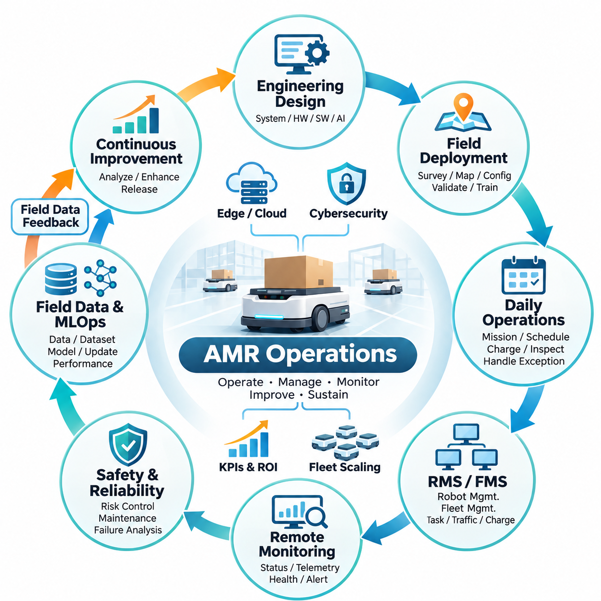
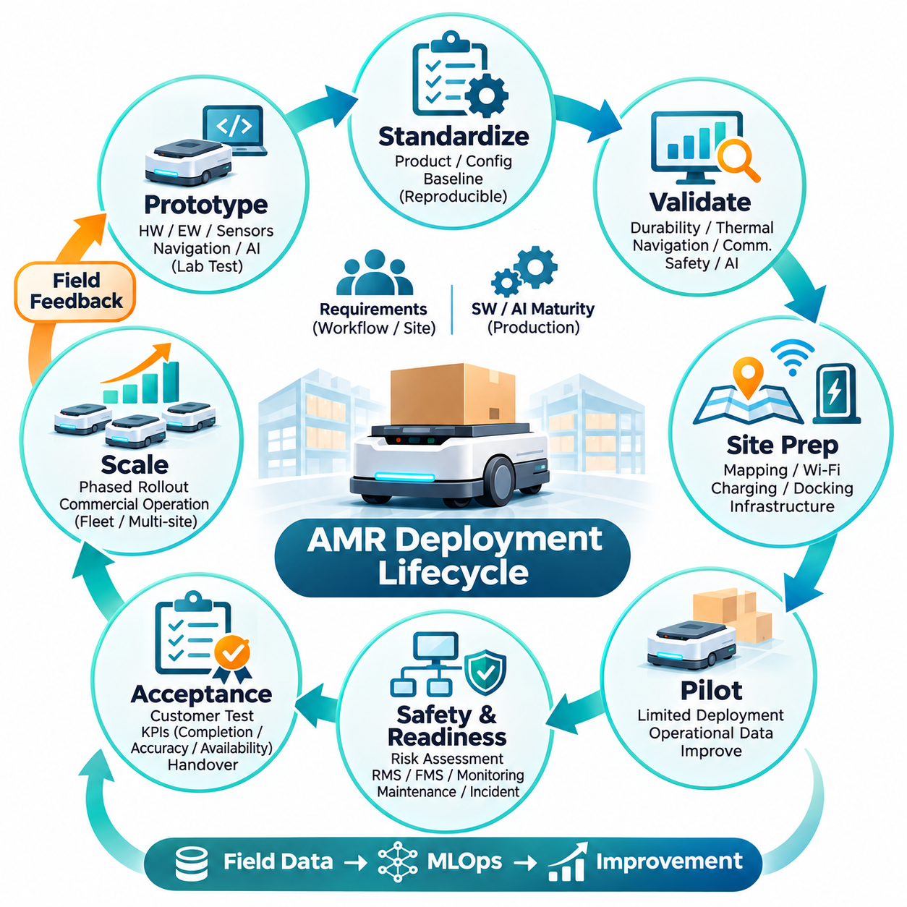
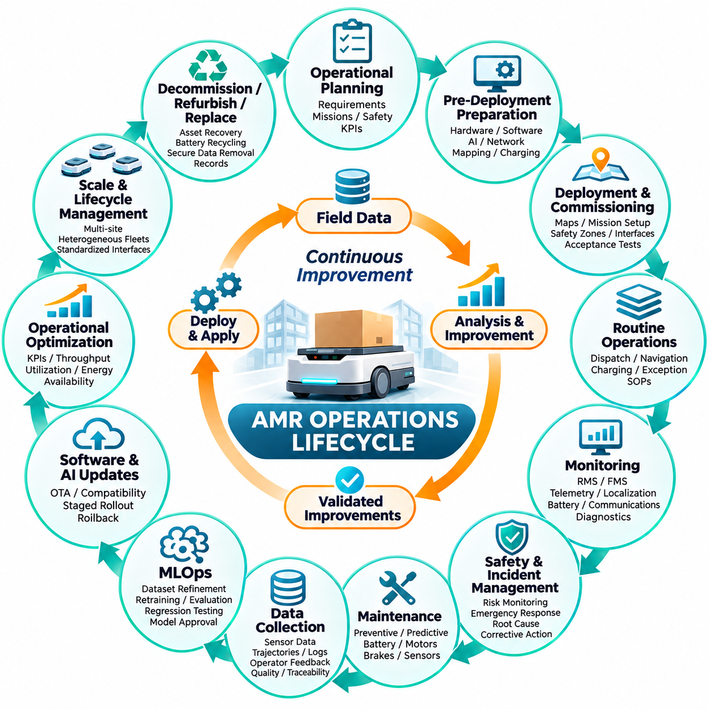
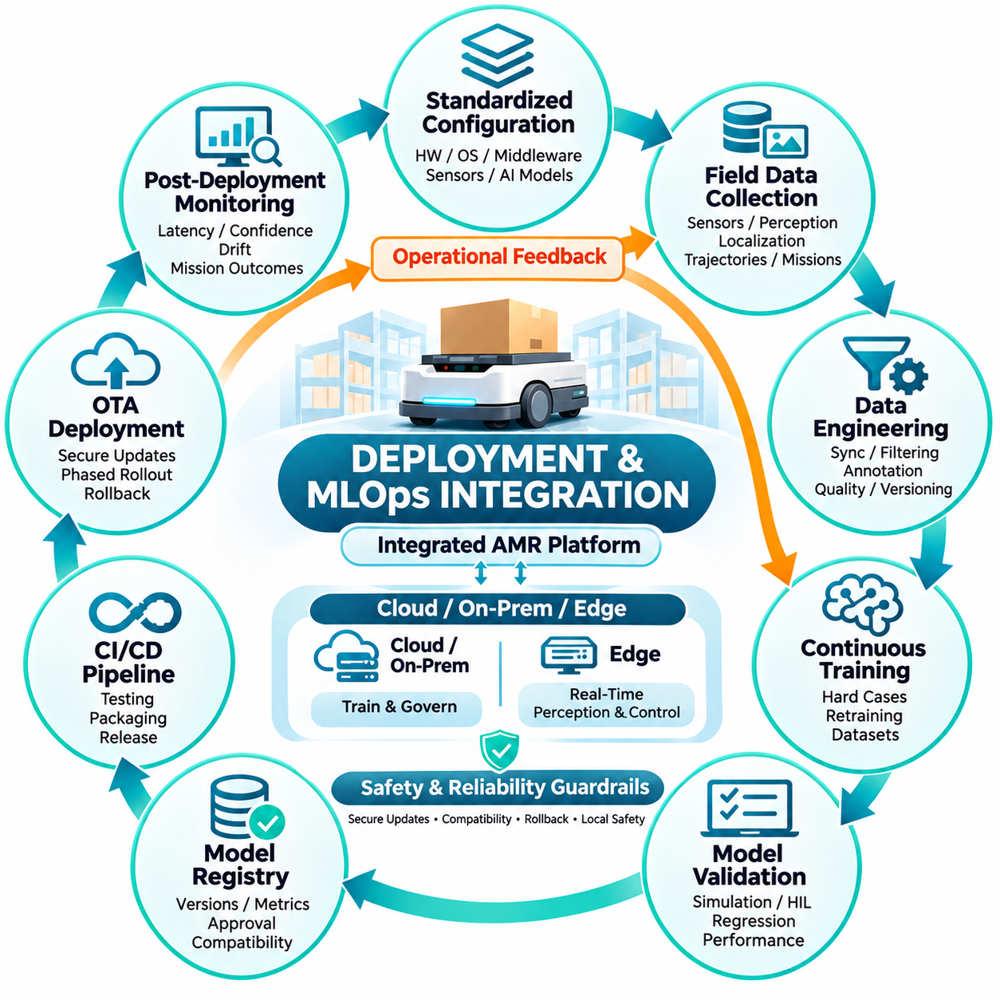
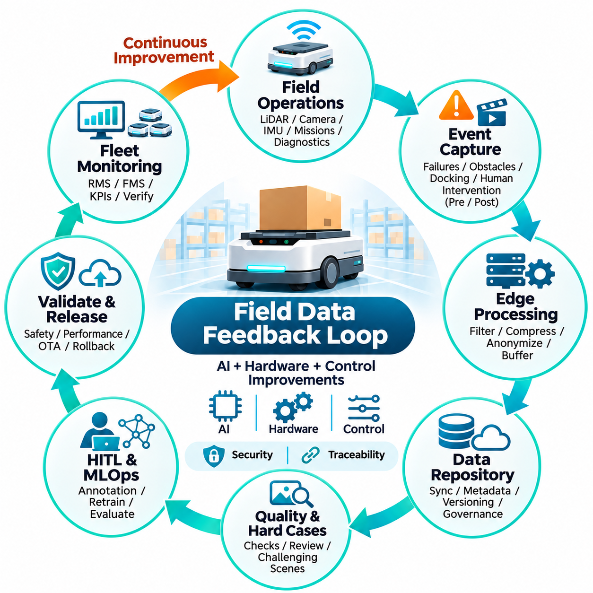
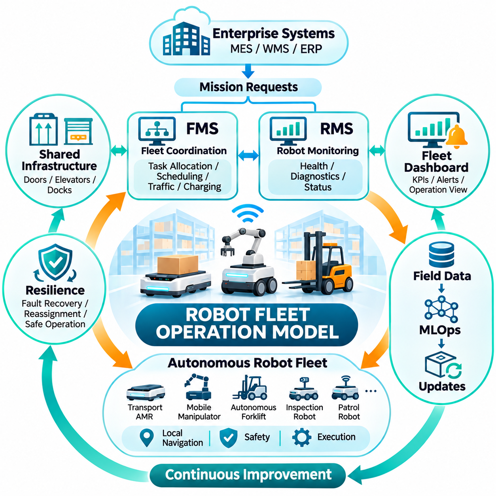
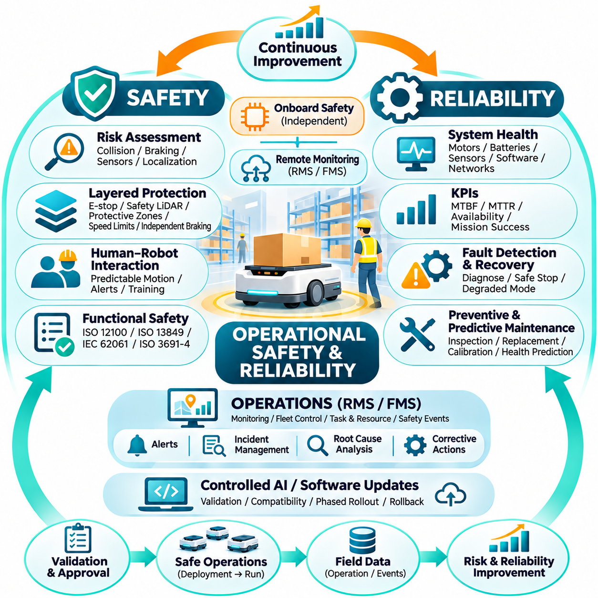
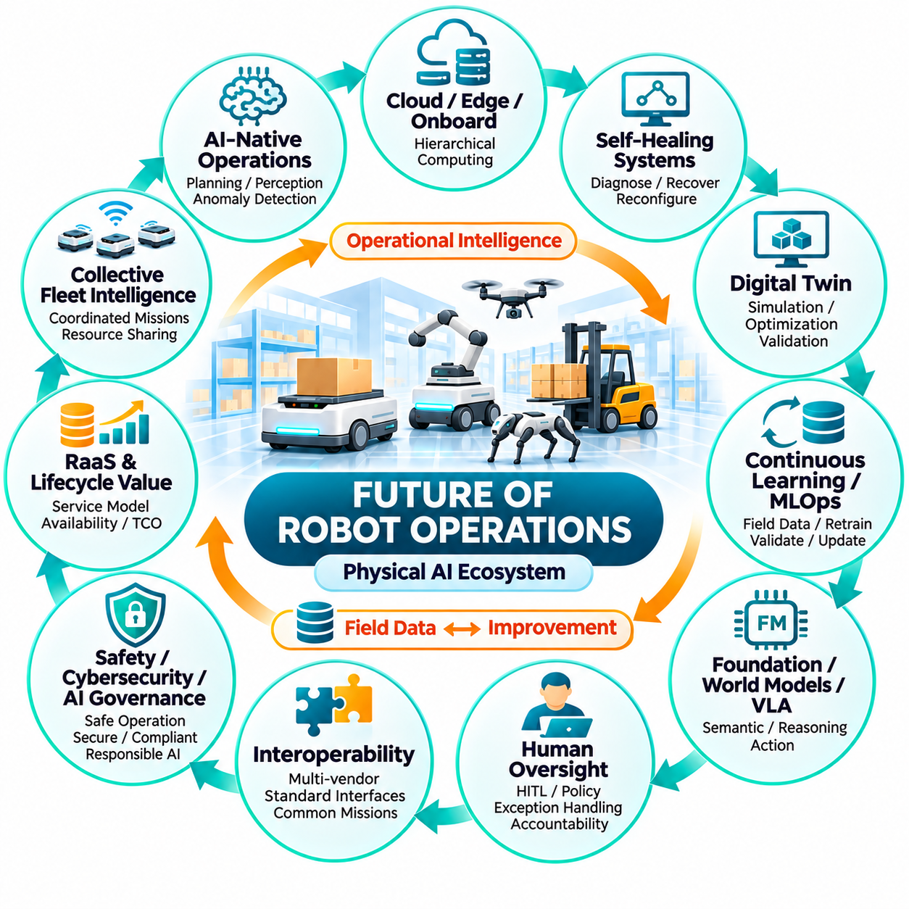

**Volume 08. AMR Operations, Deployment, and MLOps**


# Chapter 00. Introduction

## 00.1 Role of Operations in AMR

{width="7.268055555555556in" height="7.268055555555556in"}

Operations in Autonomous Mobile Robots (AMRs) represent a fundamental engineering discipline that connects robot development with practical service delivery in real-world environments. While mechanical engineering, electrical engineering, software development, and artificial intelligence establish the technical capabilities of an AMR, operations ensure that these capabilities are consistently delivered under actual working conditions throughout the robot\'s lifecycle.

The primary objective of AMR operations is to transform autonomous robotic capabilities into reliable, measurable, and sustainable operational value. A robot that demonstrates excellent performance in a laboratory environment may not necessarily achieve the same performance in an industrial facility, hospital, logistics center, or public environment. Operational engineering addresses this gap by managing environmental variability, system availability, and service requirements.

AMR operations begin before physical deployment. Operational requirements must be considered during system architecture design, hardware selection, software development, and AI model engineering. Factors such as maintenance accessibility, remote diagnostics, network connectivity, battery management, software update capability, and data collection infrastructure directly influence the operational feasibility and long-term sustainability of a robotic system.

Deployment represents the transition from engineering development to practical operation. This transition involves site surveys, environmental mapping, infrastructure integration, system configuration, safety validation, and operator training. Deployment engineers must ensure that the robot can interact effectively with existing facilities, information systems, human workers, and operational procedures without introducing unacceptable risks or disruptions.

Daily field operations involve mission execution, task scheduling, battery charging, system inspection, performance monitoring, and exception handling. Although AMRs are designed to perform tasks autonomously, operational supervision remains necessary to maintain service continuity. Human operators and automated management systems cooperate to identify abnormal conditions, resolve operational conflicts, and respond to unexpected environmental changes.

The Robot Management System (RMS) and Fleet Management System (FMS) provide essential infrastructure for centralized AMR operations. An RMS typically manages individual robot configurations, operational status, diagnostic information, and service interfaces, while an FMS coordinates multiple robots through task allocation, traffic management, resource scheduling, and charging optimization. Their functional boundaries may vary according to system architecture.

Remote monitoring enables operational teams to supervise distributed robotic systems without maintaining a permanent physical presence at every deployment location. Robot telemetry, localization status, battery conditions, sensor health, communication quality, and mission progress can be transmitted to centralized monitoring platforms. This infrastructure improves operational visibility and supports early detection of abnormal system behavior.

Operational reliability is a critical factor in determining the commercial viability of AMR systems. Frequent hardware failures, software interruptions, navigation errors, or communication problems can significantly reduce productivity and customer confidence. Reliability engineering therefore extends beyond initial product validation to include continuous health monitoring, preventive maintenance, predictive maintenance, and systematic failure analysis.

Operational safety must remain a fundamental requirement throughout the entire AMR service lifecycle. Robots frequently operate alongside pedestrians, industrial vehicles, equipment, patients, and other autonomous systems. Appropriate safety mechanisms, operational boundaries, speed restrictions, emergency response procedures, and periodic risk assessments must be maintained as environmental conditions and service requirements evolve.

Field operations also provide a valuable source of real-world data for continuous engineering improvement. Sensor recordings, navigation trajectories, mission histories, environmental observations, operator interventions, and failure events reveal conditions that may not have been adequately represented during development. Structured operational data collection enables engineering teams to identify weaknesses and prioritize system improvements.

Machine Learning Operations (MLOps) extends conventional AMR operations into the management of artificial intelligence throughout the robot\'s service lifecycle. AI models deployed in robotic systems require performance monitoring, dataset management, validation, version control, and controlled updates. Operational feedback supports the development of improved models that can address changing environments and previously unrecognized scenarios.

The integration of cloud computing and edge computing establishes a distributed operational architecture for modern AMR systems. Edge devices execute latency-sensitive perception, navigation, and control functions, while cloud or on-premises infrastructure supports fleet coordination, data aggregation, model training, remote diagnostics, and long-term performance analysis. Essential safety functions must remain effective during communication failures.

Cybersecurity is another essential component of operational engineering because connected robots interact with enterprise networks, remote management platforms, and external information systems. Secure authentication, access control, encrypted communication, software integrity verification, and vulnerability management are required to protect robotic assets against unauthorized access and operational disruption throughout their service lifecycle.

Operational performance must be evaluated through measurable Key Performance Indicators (KPIs), including robot availability, mission completion rate, task throughput, energy consumption, intervention frequency, Mean Time Between Failures (MTBF), and Mean Time to Repair (MTTR). These indicators provide quantitative evidence for evaluating service quality, identifying operational bottlenecks, and improving Return on Investment (ROI).

As AMR deployments expand from individual robots to large-scale heterogeneous fleets, operations increasingly become a discipline of distributed system orchestration. Multiple robotic platforms must coordinate missions, share infrastructure, manage limited resources, and exchange relevant environmental information. Scalable operational architectures enable organizations to expand robotic services without proportionally increasing administrative complexity.

Ultimately, AMR operations establish a continuous relationship between engineering development, field deployment, service management, and artificial intelligence improvement. Rather than treating deployment as the final stage of product development, modern robotics organizations should recognize operations as an ongoing engineering process that transforms autonomous machines into reliable, evolving, and economically sustainable Physical AI systems.

자율이동로봇(Autonomous Mobile Robot, AMR)의 운영(Operations)은 로봇 개발(Robot Development)과 실제 환경에서의 서비스 제공(Service Delivery)을 연결하는 핵심 엔지니어링 분야이다. 기계공학(Mechanical Engineering), 전기공학(Electrical Engineering), 소프트웨어 개발(Software Development), 인공지능(Artificial Intelligence)이 AMR의 기술적 역량을 확립한다면, 운영은 로봇의 전체 수명주기(Lifecycle)에 걸쳐 실제 작업 환경에서 이러한 역량이 일관되게 발휘되도록 보장한다.

AMR 운영의 주요 목적은 자율 로봇의 기술적 역량을 신뢰할 수 있고, 측정 가능하며, 지속 가능한 운영 가치(Operational Value)로 전환하는 것이다. 실험실 환경에서 우수한 성능을 입증한 로봇이라도 산업시설, 병원, 물류센터 또는 공공 환경에서 동일한 성능을 발휘한다고 보장할 수는 없다. 운영 엔지니어링(Operational Engineering)은 환경 변동성(Environmental Variability), 시스템 가용성(System Availability), 서비스 요구사항(Service Requirements)을 관리함으로써 이러한 격차를 해소한다.

AMR 운영은 실제 배포(Deployment) 이전부터 시작된다. 운영 요구사항(Operational Requirements)은 시스템 아키텍처 설계(System Architecture Design), 하드웨어 선정(Hardware Selection), 소프트웨어 개발 및 AI 모델 엔지니어링(AI Model Engineering) 단계에서부터 고려되어야 한다. 유지보수 접근성(Maintenance Accessibility), 원격 진단(Remote Diagnostics), 네트워크 연결성(Network Connectivity), 배터리 관리(Battery Management), 소프트웨어 업데이트 기능 및 데이터 수집 인프라(Data Collection Infrastructure)는 로봇 시스템의 운영 실현 가능성과 장기적인 지속 가능성에 직접적인 영향을 미친다.

배포(Deployment)는 엔지니어링 개발 단계에서 실제 운영 단계로 전환되는 과정을 의미한다. 이러한 전환 과정에는 현장 조사(Site Survey), 환경 매핑(Environmental Mapping), 인프라 통합(Infrastructure Integration), 시스템 구성(System Configuration), 안전 검증(Safety Validation), 운영자 교육(Operator Training)이 포함된다. 배포 엔지니어는 허용할 수 없는 위험이나 운영 중단을 유발하지 않으면서 로봇이 기존 시설, 정보 시스템, 작업자 및 운영 절차와 효과적으로 상호작용할 수 있도록 보장해야 한다.

일상적인 현장 운영(Daily Field Operations)에는 임무 수행(Mission Execution), 작업 스케줄링(Task Scheduling), 배터리 충전(Battery Charging), 시스템 점검(System Inspection), 성능 모니터링(Performance Monitoring), 예외 처리(Exception Handling)가 포함된다. AMR은 자율적으로 작업을 수행하도록 설계되지만, 서비스 연속성(Service Continuity)을 유지하기 위해서는 운영 감독(Operational Supervision)이 필요하다. 인간 운영자와 자동화된 관리 시스템은 상호 협력하여 비정상 상태를 식별하고, 운영 충돌을 해결하며, 예측하지 못한 환경 변화에 대응한다.

로봇 관리 시스템(Robot Management System, RMS)과 플릿 관리 시스템(Fleet Management System, FMS)은 중앙집중형 AMR 운영을 위한 핵심 인프라를 제공한다. RMS는 일반적으로 개별 로봇의 구성 정보, 운영 상태, 진단 정보 및 서비스 인터페이스(Service Interface)를 관리한다. 반면 FMS는 작업 할당(Task Allocation), 교통 관리(Traffic Management), 자원 스케줄링(Resource Scheduling), 충전 최적화(Charging Optimization)를 통해 다수의 로봇을 협조적으로 운영한다. 두 시스템의 기능적 경계는 시스템 아키텍처에 따라 달라질 수 있다.

원격 모니터링(Remote Monitoring)은 운영팀이 모든 배포 현장에 상주하지 않고도 분산된 로봇 시스템을 감독할 수 있도록 지원한다. 로봇 원격 측정 데이터(Robot Telemetry), 위치 추정 상태(Localization Status), 배터리 상태(Battery Condition), 센서 건전성(Sensor Health), 통신 품질(Communication Quality), 임무 진행 상황(Mission Progress)은 중앙집중형 모니터링 플랫폼으로 전송될 수 있다. 이러한 인프라는 운영 가시성(Operational Visibility)을 향상시키고 비정상적인 시스템 동작을 조기에 탐지할 수 있도록 지원한다.

운영 신뢰성(Operational Reliability)은 AMR 시스템의 상업적 실현 가능성(Commercial Viability)을 결정하는 핵심 요소이다. 빈번한 하드웨어 고장, 소프트웨어 중단, 자율주행 오류 또는 통신 문제는 생산성과 고객 신뢰도를 크게 저하시킬 수 있다. 따라서 신뢰성 엔지니어링(Reliability Engineering)은 초기 제품 검증을 넘어 지속적인 건전성 모니터링(Health Monitoring), 예방 유지보수(Preventive Maintenance), 예측 유지보수(Predictive Maintenance), 체계적인 고장 분석(Failure Analysis)을 포함하도록 확장되어야 한다.

운영 안전성(Operational Safety)은 AMR의 전체 서비스 수명주기에 걸쳐 기본적인 요구사항으로 유지되어야 한다. 로봇은 보행자, 산업용 차량, 장비, 환자 및 다른 자율 시스템과 동일한 공간에서 빈번하게 운영된다. 환경 조건과 서비스 요구사항이 변화함에 따라 적절한 안전 메커니즘(Safety Mechanism), 운영 경계(Operational Boundary), 속도 제한(Speed Restriction), 비상 대응 절차(Emergency Response Procedure), 정기적인 위험 평가(Risk Assessment)가 지속적으로 유지되어야 한다.

현장 운영은 지속적인 엔지니어링 개선(Continuous Engineering Improvement)을 위한 가치 있는 실제 환경 데이터(Real-World Data)의 공급원이기도 하다. 센서 기록(Sensor Recording), 자율주행 궤적(Navigation Trajectory), 임무 이력(Mission History), 환경 관측(Environmental Observation), 운영자 개입(Operator Intervention), 고장 이벤트(Failure Event)는 개발 과정에서 충분히 반영되지 못했던 조건들을 드러낸다. 체계적인 운영 데이터 수집(Operational Data Collection)은 엔지니어링팀이 시스템의 취약점을 식별하고 개선 우선순위를 결정할 수 있도록 지원한다.

기계학습 운영(Machine Learning Operations, MLOps)은 기존의 AMR 운영을 로봇의 전체 서비스 수명주기에 걸친 인공지능 관리 영역으로 확장한다. 로봇 시스템에 배포된 AI 모델에는 성능 모니터링(Performance Monitoring), 데이터셋 관리(Dataset Management), 검증(Validation), 버전 관리(Version Control), 통제된 업데이트(Controlled Update)가 요구된다. 운영 피드백(Operational Feedback)은 변화하는 환경과 이전에 인식하지 못했던 시나리오에 대응할 수 있는 개선된 AI 모델의 개발을 지원한다.

클라우드 컴퓨팅(Cloud Computing)과 엣지 컴퓨팅(Edge Computing)의 통합은 현대적인 AMR 시스템을 위한 분산형 운영 아키텍처(Distributed Operational Architecture)를 확립한다. 엣지 장치(Edge Device)는 지연시간에 민감한 인지(Perception), 자율주행(Navigation), 제어(Control) 기능을 수행하며, 클라우드 또는 온프레미스(On-Premises) 인프라는 플릿 조정(Fleet Coordination), 데이터 집계(Data Aggregation), 모델 학습(Model Training), 원격 진단 및 장기 성능 분석을 지원한다. 필수적인 안전 기능은 통신 장애(Communication Failure)가 발생하더라도 유효하게 유지되어야 한다.

사이버보안(Cybersecurity)은 네트워크에 연결된 로봇이 기업 네트워크(Enterprise Network), 원격 관리 플랫폼(Remote Management Platform), 외부 정보 시스템과 상호작용하기 때문에 운영 엔지니어링의 또 다른 핵심 구성요소이다. 전체 서비스 수명주기에 걸쳐 무단 접근과 운영 중단으로부터 로봇 자산을 보호하기 위해 보안 인증(Secure Authentication), 접근 제어(Access Control), 암호화 통신(Encrypted Communication), 소프트웨어 무결성 검증(Software Integrity Verification), 취약점 관리(Vulnerability Management)가 요구된다.

운영 성능(Operational Performance)은 측정 가능한 핵심 성과 지표(Key Performance Indicator, KPI)를 통해 평가되어야 한다. 이러한 지표에는 로봇 가용성(Robot Availability), 임무 완료율(Mission Completion Rate), 작업 처리량(Task Throughput), 에너지 소비량(Energy Consumption), 개입 빈도(Intervention Frequency), 평균 고장 간격(Mean Time Between Failures, MTBF), 평균 수리 시간(Mean Time to Repair, MTTR)이 포함된다. 이러한 지표는 서비스 품질 평가, 운영 병목현상(Operational Bottleneck) 식별 및 투자수익률(Return on Investment, ROI) 개선을 위한 정량적 근거를 제공한다.

AMR 배포가 개별 로봇에서 대규모 이기종 로봇 플릿(Heterogeneous Robot Fleet)으로 확장됨에 따라 운영은 점차 분산 시스템 오케스트레이션(Distributed System Orchestration)의 분야로 발전한다. 다수의 로봇 플랫폼은 임무를 조정하고, 인프라를 공유하며, 제한된 자원을 관리하고, 관련 환경 정보를 상호 교환해야 한다. 확장 가능한 운영 아키텍처(Scalable Operational Architecture)는 관리 복잡성(Administrative Complexity)을 비례적으로 증가시키지 않으면서 조직이 로봇 서비스를 확장할 수 있도록 지원한다.

궁극적으로 AMR 운영은 엔지니어링 개발(Engineering Development), 현장 배포(Field Deployment), 서비스 관리(Service Management), 인공지능 개선(AI Improvement) 사이의 지속적인 관계를 확립한다. 현대적인 로봇 기업과 조직은 배포를 제품 개발(Product Development)의 최종 단계로 간주하기보다는, 운영을 자율 기계(Autonomous Machine)에서 신뢰할 수 있고 지속적으로 진화하며 경제적으로 지속 가능한 피지컬 AI 시스템(Physical AI System)으로 전환시키는 연속적인 엔지니어링 프로세스(Continuous Engineering Process)로 인식해야 한다.

## 00.2 From Prototype to Field Deployment

{width="7.268055555555556in" height="7.268055555555556in"}

The transition from prototype development to field deployment represents a critical milestone in the lifecycle of an Autonomous Mobile Robot (AMR). A prototype demonstrates the technical feasibility of selected engineering concepts, whereas a field-deployed robot must deliver consistent performance, operational reliability, and measurable service value under actual working conditions. This transition requires systematic engineering and operational preparation.

Prototype development primarily focuses on validating fundamental technologies, including mechanical structures, electrical systems, sensor integration, autonomous navigation, and artificial intelligence algorithms. During this stage, engineers frequently operate robots under controlled conditions with direct technical supervision. Temporary configurations and experimental software implementations are acceptable when evaluating specific concepts.

Transitioning toward field deployment requires converting experimental configurations into standardized and reproducible product architectures. Hardware components, electrical interfaces, software dependencies, communication protocols, and AI model configurations must be systematically documented and controlled. Engineering teams must establish configuration baselines that support consistent manufacturing, deployment, maintenance, and troubleshooting.

Operational requirements must be established by analyzing the intended deployment environment and customer workflows. Industrial facilities, hospitals, logistics centers, and outdoor environments present different operational challenges involving environmental conditions, human interactions, infrastructure availability, and mission complexity. These requirements define the operational boundaries and acceptance criteria for the deployed robot.

Engineering validation must extend beyond individual component performance to evaluate complete system behavior. Mechanical durability, electrical stability, thermal management, localization accuracy, navigation reliability, communication robustness, and safety mechanisms must be assessed under representative operating conditions. Integrated testing helps identify weaknesses that may remain undetected during isolated prototype experiments.

Software maturity is another essential requirement for transitioning from prototype development to field deployment. Experimental software must evolve into a maintainable production architecture with appropriate error handling, process supervision, logging mechanisms, configuration management, and automated recovery capabilities. Software releases should follow controlled procedures incorporating version management and regression testing.

Artificial intelligence models must also undergo field-oriented validation before operational deployment. Models trained using laboratory datasets may exhibit reduced performance when exposed to unfamiliar lighting conditions, environmental structures, objects, or human behavior. Representative field datasets, scenario-based testing, and performance benchmarks are necessary to establish acceptable levels of robustness and generalization.

Site preparation establishes the physical and digital infrastructure required for reliable AMR operations. Deployment engineers must evaluate floor conditions, passage dimensions, slopes, obstacles, wireless network coverage, charging infrastructure, and interactions with existing equipment. Environmental mapping, restricted zone configuration, docking station installation, and external system integration must be completed before operational acceptance.

Pilot deployment provides an intermediate stage between controlled development and full-scale commercial operation. A limited number of robots are introduced into representative customer environments under enhanced technical supervision. During this period, engineering teams collect operational data, investigate unexpected failures, evaluate customer workflows, and identify necessary improvements before expanding the deployment scope.

Safety validation must address the differences between laboratory testing and actual human-shared environments. Risk assessments should evaluate potential collisions, emergency stopping behavior, unexpected obstacle encounters, communication failures, and abnormal operating conditions. Deployment approval must depend on documented safety evidence and verified protective mechanisms rather than successful mission execution alone.

Operational readiness requires establishing the infrastructure and organizational procedures necessary to support deployed robotic systems. Robot Management Systems (RMS), Fleet Management Systems (FMS), remote monitoring platforms, diagnostic interfaces, and maintenance procedures provide essential operational capabilities. Responsibilities for incident response, technical escalation, spare parts management, and customer support must be clearly defined.

Customer acceptance testing establishes whether the deployed AMR satisfies agreed functional, performance, safety, and reliability requirements. Acceptance criteria may include mission completion rates, positioning accuracy, operational availability, task throughput, and charging performance. Test results must be documented, and unresolved deficiencies should be evaluated against defined release conditions before formal customer handover.

Following initial deployment, operational data becomes an important resource for continuous engineering improvement. Sensor recordings, system logs, mission histories, failure events, and operator interventions provide evidence of actual system behavior. Machine Learning Operations (MLOps) and controlled software update processes transform this feedback into validated improvements while maintaining operational stability and traceability.

Scaling from pilot deployment to commercial operation requires reproducible installation procedures, standardized configurations, automated provisioning, centralized monitoring, and consistent service practices. Fleet expansion should follow a phased rollout strategy that evaluates operational performance at each stage. This approach reduces deployment risks and prevents unresolved technical problems from propagating across multiple robots.

Ultimately, transitioning from prototype to field deployment represents more than completing product development. It establishes a continuous engineering relationship between product architecture, real-world operations, customer requirements, and system improvement. A successful AMR deployment converts experimental autonomous technologies into reliable, maintainable, scalable, and economically sustainable Physical AI services.

프로토타입 개발(Prototype Development)에서 현장 배포(Field Deployment)로의 전환은 자율이동로봇(Autonomous Mobile Robot, AMR)의 수명주기(Lifecycle)에서 중요한 이정표를 의미한다. 프로토타입(Prototype)은 특정 엔지니어링 개념의 기술적 실현 가능성(Technical Feasibility)을 입증하는 반면, 현장에 배포된 로봇은 실제 작업 환경에서 일관된 성능(Consistent Performance), 운영 신뢰성(Operational Reliability), 측정 가능한 서비스 가치(Service Value)를 제공해야 한다. 이러한 전환에는 체계적인 엔지니어링 및 운영 준비가 요구된다.

프로토타입 개발은 주로 기계 구조(Mechanical Structure), 전기 시스템(Electrical System), 센서 통합(Sensor Integration), 자율주행(Autonomous Navigation), 인공지능 알고리즘(Artificial Intelligence Algorithm)을 포함한 핵심 기술의 검증에 집중한다. 이 단계에서 엔지니어는 직접적인 기술 감독(Technical Supervision)하에 통제된 환경(Controlled Environment)에서 로봇을 운영하는 경우가 많다. 특정 기술 개념을 평가하는 과정에서는 임시 구성(Temporary Configuration)과 실험적인 소프트웨어 구현(Experimental Software Implementation)이 허용될 수 있다.

현장 배포로 전환하기 위해서는 실험적인 시스템 구성을 표준화되고 재현 가능한 제품 아키텍처(Product Architecture)로 발전시켜야 한다. 하드웨어 구성요소(Hardware Component), 전기적 인터페이스(Electrical Interface), 소프트웨어 의존성(Software Dependency), 통신 프로토콜(Communication Protocol), AI 모델 구성(AI Model Configuration)은 체계적으로 문서화되고 관리되어야 한다. 엔지니어링팀은 일관된 제조(Manufacturing), 배포(Deployment), 유지보수(Maintenance), 문제 해결(Troubleshooting)을 지원하는 구성 기준선(Configuration Baseline)을 확립해야 한다.

운영 요구사항(Operational Requirements)은 목표 배포 환경(Deployment Environment)과 고객 업무 흐름(Customer Workflow)을 분석하여 수립해야 한다. 산업시설, 병원, 물류센터 및 실외 환경은 환경 조건(Environmental Condition), 인간 상호작용(Human Interaction), 인프라 가용성(Infrastructure Availability), 임무 복잡성(Mission Complexity)과 관련하여 서로 다른 운영 과제를 제시한다. 이러한 요구사항은 배포된 로봇의 운영 경계(Operational Boundary)와 인수 기준(Acceptance Criteria)을 정의한다.

엔지니어링 검증(Engineering Validation)은 개별 구성요소의 성능 평가를 넘어 전체 시스템 동작(System Behavior)을 평가하는 범위로 확장되어야 한다. 기계적 내구성(Mechanical Durability), 전기적 안정성(Electrical Stability), 열 관리(Thermal Management), 위치 추정 정확도(Localization Accuracy), 자율주행 신뢰성(Navigation Reliability), 통신 강건성(Communication Robustness), 안전 메커니즘(Safety Mechanism)은 실제 운영을 대표하는 조건에서 평가되어야 한다. 통합 시험(Integrated Testing)은 개별적인 프로토타입 실험에서 발견되지 않았던 취약점을 식별하는 데 기여한다.

소프트웨어 성숙도(Software Maturity)는 프로토타입 개발에서 현장 배포로 전환하기 위한 또 다른 핵심 요구사항이다. 실험적인 소프트웨어는 적절한 오류 처리(Error Handling), 프로세스 감시(Process Supervision), 로깅 메커니즘(Logging Mechanism), 구성 관리(Configuration Management), 자동 복구 기능(Automated Recovery Capability)을 갖춘 유지보수 가능한 상용 운영 아키텍처(Production Architecture)로 발전해야 한다. 소프트웨어 릴리스(Software Release)는 버전 관리(Version Management)와 회귀 시험(Regression Testing)을 포함하는 통제된 절차를 따라야 한다.

인공지능 모델(Artificial Intelligence Model) 역시 실제 운영 배포 이전에 현장 중심 검증(Field-Oriented Validation)을 수행해야 한다. 실험실 데이터셋(Laboratory Dataset)을 사용하여 학습된 모델은 익숙하지 않은 조명 조건(Lighting Condition), 환경 구조(Environmental Structure), 객체(Object) 또는 인간 행동(Human Behavior)에 노출될 경우 성능이 저하될 수 있다. 허용 가능한 수준의 강건성(Robustness)과 일반화 성능(Generalization Performance)을 확보하기 위해서는 대표성 있는 현장 데이터셋(Field Dataset), 시나리오 기반 시험(Scenario-Based Testing), 성능 벤치마크(Performance Benchmark)가 필요하다.

현장 준비(Site Preparation)는 신뢰할 수 있는 AMR 운영에 필요한 물리적 인프라(Physical Infrastructure)와 디지털 인프라(Digital Infrastructure)를 구축하는 과정이다. 배포 엔지니어는 바닥 상태(Floor Condition), 통로 치수(Passage Dimension), 경사로(Slope), 장애물(Obstacle), 무선 네트워크 커버리지(Wireless Network Coverage), 충전 인프라(Charging Infrastructure), 기존 장비와의 상호작용을 평가해야 한다. 환경 매핑(Environmental Mapping), 제한 구역 설정(Restricted Zone Configuration), 도킹 스테이션 설치(Docking Station Installation), 외부 시스템 통합(External System Integration)은 운영 인수(Operational Acceptance) 이전에 완료되어야 한다.

시범 배포(Pilot Deployment)는 통제된 개발 단계와 본격적인 상용 운영(Commercial Operation) 사이의 중간 단계를 제공한다. 제한된 수량의 로봇을 실제 운영 환경을 대표하는 고객 현장에 투입하고, 강화된 기술 감독(Enhanced Technical Supervision)하에 운영한다. 이 기간 동안 엔지니어링팀은 운영 데이터(Operational Data)를 수집하고, 예상하지 못한 고장(Unexpected Failure)을 조사하며, 고객 업무 흐름을 평가하고, 배포 범위(Deployment Scope)를 확대하기 전에 필요한 개선사항을 식별한다.

안전 검증(Safety Validation)은 실험실 시험(Laboratory Testing)과 인간이 공간을 공유하는 실제 운영 환경(Human-Shared Environment)의 차이를 고려해야 한다. 위험 평가(Risk Assessment)는 잠재적인 충돌(Potential Collision), 비상 정지 동작(Emergency Stopping Behavior), 예기치 않은 장애물 조우(Unexpected Obstacle Encounter), 통신 장애(Communication Failure), 비정상 운영 조건(Abnormal Operating Condition)을 평가해야 한다. 배포 승인(Deployment Approval)은 단순한 임무 수행 성공 여부가 아니라 문서화된 안전성 증거(Safety Evidence)와 검증된 보호 메커니즘(Protective Mechanism)을 기반으로 결정되어야 한다.

운영 준비도(Operational Readiness)를 확보하기 위해서는 배포된 로봇 시스템을 지원하는 인프라와 조직적 절차(Organizational Procedure)를 확립해야 한다. 로봇 관리 시스템(Robot Management System, RMS), 플릿 관리 시스템(Fleet Management System, FMS), 원격 모니터링 플랫폼(Remote Monitoring Platform), 진단 인터페이스(Diagnostic Interface), 유지보수 절차(Maintenance Procedure)는 필수적인 운영 기능을 제공한다. 사고 대응(Incident Response), 기술적 상위 대응(Technical Escalation), 예비 부품 관리(Spare Parts Management), 고객 지원(Customer Support)에 대한 책임과 역할도 명확하게 정의되어야 한다.

고객 인수 시험(Customer Acceptance Testing, CAT)은 배포된 AMR이 사전에 합의된 기능적 요구사항(Functional Requirements), 성능 요구사항(Performance Requirements), 안전 요구사항(Safety Requirements), 신뢰성 요구사항(Reliability Requirements)을 충족하는지 확인하는 과정이다. 인수 기준에는 임무 완료율(Mission Completion Rate), 위치 정확도(Positioning Accuracy), 운영 가용성(Operational Availability), 작업 처리량(Task Throughput), 충전 성능(Charging Performance)이 포함될 수 있다. 시험 결과(Test Result)는 문서화되어야 하며, 해결되지 않은 결함은 공식적인 고객 인계(Customer Handover) 이전에 정의된 릴리스 조건(Release Condition)에 따라 평가되어야 한다.

초기 배포(Initial Deployment) 이후 운영 데이터는 지속적인 엔지니어링 개선(Continuous Engineering Improvement)을 위한 중요한 자원이 된다. 센서 기록(Sensor Recording), 시스템 로그(System Log), 임무 이력(Mission History), 고장 이벤트(Failure Event), 운영자 개입(Operator Intervention)은 실제 시스템 동작에 대한 증거를 제공한다. 기계학습 운영(Machine Learning Operations, MLOps)과 통제된 소프트웨어 업데이트 프로세스(Controlled Software Update Process)는 운영 안정성(Operational Stability)과 추적성(Traceability)을 유지하면서 이러한 피드백을 검증된 개선 결과로 전환한다.

시범 배포에서 상용 운영으로 확장(Scaling)하기 위해서는 재현 가능한 설치 절차(Reproducible Installation Procedure), 표준화된 구성(Standardized Configuration), 자동화된 프로비저닝(Automated Provisioning), 중앙집중형 모니터링(Centralized Monitoring), 일관된 서비스 운영 방식(Consistent Service Practice)이 요구된다. 로봇 플릿 확장(Fleet Expansion)은 각 단계에서 운영 성능을 평가하는 단계적 배포 전략(Phased Rollout Strategy)을 따라야 한다. 이러한 접근 방식은 배포 위험(Deployment Risk)을 감소시키고, 해결되지 않은 기술적 문제가 다수의 로봇으로 확산되는 것을 방지한다.

궁극적으로 프로토타입에서 현장 배포로의 전환은 단순히 제품 개발(Product Development)을 완료하는 것 이상의 의미를 가진다. 이는 제품 아키텍처(Product Architecture), 실제 환경 운영(Real-World Operations), 고객 요구사항(Customer Requirements), 시스템 개선(System Improvement) 사이의 지속적인 엔지니어링 관계를 확립하는 과정이다. 성공적인 AMR 배포는 실험적인 자율 기술(Experimental Autonomous Technology)을 신뢰할 수 있고, 유지보수가 가능하며, 확장 가능하고, 경제적으로 지속 가능한 피지컬 AI 서비스(Physical AI Service)로 전환한다.

## 00.3 AMR Operations Lifecycle

{width="7.268055555555556in" height="7.268055555555556in"}

The operational lifecycle of an Autonomous Mobile Robot (AMR) encompasses all activities required to prepare, deploy, operate, maintain, improve, and eventually retire a robotic system. Unlike conventional product lifecycles that primarily emphasize manufacturing and delivery, the AMR operations lifecycle establishes a continuous engineering framework for maintaining autonomous capabilities and delivering sustainable service value in real-world environments.

The lifecycle begins with operational planning, during which customer requirements, service objectives, environmental constraints, and expected workloads are established. Operational teams must define mission profiles, operating schedules, infrastructure requirements, safety boundaries, and performance targets. These requirements provide the foundation for deployment strategies, resource allocation, operational procedures, and long-term service management.

Pre-deployment preparation ensures that both the robotic system and its intended operating environment are ready for integration. Activities include hardware inspection, software configuration, AI model verification, network preparation, environmental mapping, and charging infrastructure installation. Standardized preparation procedures and configuration baselines reduce installation variability and establish consistent conditions for subsequent field operations.

Deployment and commissioning represent the initial introduction of the AMR into its intended operational environment. Engineers configure navigation maps, mission parameters, safety zones, communication interfaces, and external system connections. Functional testing and site acceptance testing verify that the integrated robotic system satisfies operational requirements before authorization for routine service execution is granted.

During routine operations, AMRs execute assigned missions while interacting with human workers, physical infrastructure, information systems, and other robotic platforms. Daily operational activities include task scheduling, mission dispatch, autonomous navigation, charging management, and exception handling. Standard Operating Procedures (SOPs) establish consistent practices for robot startup, shutdown, supervision, and operational recovery.

Continuous monitoring provides visibility into the operational conditions of individual robots and distributed fleets. Robot Management Systems (RMS) and Fleet Management Systems (FMS) collect telemetry, localization status, mission progress, battery information, communication quality, and diagnostic events. Monitoring infrastructure enables operators to detect abnormal conditions, evaluate service availability, and initiate appropriate corrective actions.

Operational safety and incident management must remain active throughout every lifecycle stage. Environmental changes, unexpected human behavior, equipment failures, and communication interruptions may introduce new operational risks. Safety monitoring, incident classification, emergency response procedures, root cause analysis, and corrective actions establish a systematic framework for maintaining acceptable risk levels throughout service operation.

Maintenance management preserves the physical and functional integrity of AMR systems over extended operational periods. Preventive maintenance addresses scheduled component inspection and replacement, while predictive maintenance utilizes operational data to estimate degradation and potential failures. Battery health, motor performance, braking systems, sensor calibration, mechanical wear, and thermal conditions require continuous or periodic assessment.

Operational data collection transforms deployed AMRs into distributed sources of engineering knowledge. Sensor measurements, navigation trajectories, environmental observations, mission records, system logs, and operator interventions provide valuable information about actual operating conditions. Data collection policies must address synchronization, data quality, storage efficiency, privacy protection, and traceability to support engineering improvement and AI development.

Machine Learning Operations (MLOps) integrates AI model development with the continuing operational lifecycle of robotic systems. Field data supports dataset refinement, model retraining, performance evaluation, and regression testing. Validated models are registered, approved, and distributed through controlled deployment procedures, ensuring that improvements in artificial intelligence do not compromise existing operational capabilities or safety requirements.

Software and AI model updates represent recurring lifecycle activities rather than isolated development events. Over-the-Air (OTA) update mechanisms enable distributed robots to receive approved software packages, configuration changes, security patches, and AI model releases. Compatibility verification, staged deployment, integrity checking, rollback mechanisms, and post-update validation protect operational continuity during system evolution.

Operational optimization focuses on improving service efficiency through systematic analysis of Key Performance Indicators (KPIs). Mission completion rates, fleet utilization, task throughput, energy consumption, intervention frequency, system availability, and maintenance costs provide measurable evidence of operational performance. These indicators support improvements in scheduling, resource allocation, navigation behavior, and charging strategies.

As deployment scales across multiple locations, lifecycle management must accommodate heterogeneous robot platforms, regional requirements, infrastructure differences, and customer-specific workflows. Centralized management platforms, standardized operational interfaces, automated device provisioning, and distributed edge computing enable scalable service delivery while maintaining consistent operational governance and configuration control.

The final lifecycle stage involves system decommissioning, refurbishment, replacement, or retirement. Organizations must manage physical asset recovery, battery recycling, secure data removal, software license termination, and the preservation of relevant operational records. Historical maintenance information and lifecycle performance data provide engineering knowledge for subsequent product generations and future deployment strategies.

Ultimately, the AMR operations lifecycle should be understood as a closed-loop engineering process rather than a linear sequence of independent activities. Deployment produces operational experience, operational experience generates data, and validated engineering improvements enhance subsequent operations. This continuous feedback mechanism establishes the foundation for reliable, scalable, adaptive, and economically sustainable Physical AI systems.

자율이동로봇(Autonomous Mobile Robot, AMR)의 운영 수명주기(Operations Lifecycle)는 로봇 시스템의 준비, 배포, 운영, 유지보수, 개선 및 최종적인 운용 종료에 필요한 모든 활동을 포함한다. 제조(Manufacturing)와 인도(Delivery)를 중심으로 하는 기존의 제품 수명주기(Product Lifecycle)와 달리, AMR 운영 수명주기는 실제 환경에서 자율 기능(Autonomous Capability)을 유지하고 지속 가능한 서비스 가치(Service Value)를 제공하기 위한 연속적인 엔지니어링 프레임워크(Continuous Engineering Framework)를 확립한다.

운영 수명주기는 고객 요구사항(Customer Requirements), 서비스 목표(Service Objectives), 환경적 제약조건(Environmental Constraints), 예상 작업 부하(Expected Workload)를 설정하는 운영 계획(Operational Planning) 단계에서 시작된다. 운영팀은 임무 프로파일(Mission Profile), 운영 일정(Operating Schedule), 인프라 요구사항(Infrastructure Requirements), 안전 경계(Safety Boundary), 성능 목표(Performance Target)를 정의해야 한다. 이러한 요구사항은 배포 전략(Deployment Strategy), 자원 할당(Resource Allocation), 운영 절차(Operational Procedure), 장기적인 서비스 관리(Service Management)의 기반을 제공한다.

배포 전 준비(Pre-Deployment Preparation)는 로봇 시스템과 목표 운영 환경이 상호 통합될 수 있도록 준비하는 과정이다. 주요 활동에는 하드웨어 점검(Hardware Inspection), 소프트웨어 구성(Software Configuration), AI 모델 검증(AI Model Verification), 네트워크 준비(Network Preparation), 환경 매핑(Environmental Mapping), 충전 인프라 설치(Charging Infrastructure Installation)가 포함된다. 표준화된 준비 절차(Standardized Preparation Procedure)와 구성 기준선(Configuration Baseline)은 설치 과정의 변동성을 줄이고 이후 현장 운영을 위한 일관된 조건을 확립한다.

배포 및 시운전(Deployment and Commissioning)은 AMR을 목표 운영 환경에 최초로 도입하는 단계를 의미한다. 엔지니어는 자율주행 지도(Navigation Map), 임무 매개변수(Mission Parameter), 안전 구역(Safety Zone), 통신 인터페이스(Communication Interface), 외부 시스템 연결(External System Connection)을 구성한다. 기능 시험(Functional Testing)과 현장 인수 시험(Site Acceptance Testing, SAT)을 통해 통합된 로봇 시스템이 운영 요구사항을 충족하는지 검증한 후 정규 서비스 수행(Routine Service Execution)을 승인한다.

정규 운영(Routine Operations) 단계에서 AMR은 인간 작업자, 물리적 인프라(Physical Infrastructure), 정보 시스템(Information System), 다른 로봇 플랫폼과 상호작용하면서 할당된 임무를 수행한다. 일상적인 운영 활동에는 작업 스케줄링(Task Scheduling), 임무 배정(Mission Dispatch), 자율주행(Autonomous Navigation), 충전 관리(Charging Management), 예외 처리(Exception Handling)가 포함된다. 표준 운영 절차(Standard Operating Procedure, SOP)는 로봇의 시작(Startup), 종료(Shutdown), 감독(Supervision), 운영 복구(Operational Recovery)를 위한 일관된 운영 방식을 확립한다.

지속적인 모니터링(Continuous Monitoring)은 개별 로봇과 분산된 로봇 플릿(Distributed Robot Fleet)의 운영 상태에 대한 가시성(Visibility)을 제공한다. 로봇 관리 시스템(Robot Management System, RMS)과 플릿 관리 시스템(Fleet Management System, FMS)은 원격 측정 데이터(Telemetry), 위치 추정 상태(Localization Status), 임무 진행 상황(Mission Progress), 배터리 정보(Battery Information), 통신 품질(Communication Quality), 진단 이벤트(Diagnostic Event)를 수집한다. 모니터링 인프라는 운영자가 비정상 상태를 탐지하고, 서비스 가용성(Service Availability)을 평가하며, 적절한 시정 조치(Corrective Action)를 수행할 수 있도록 지원한다.

운영 안전성(Operational Safety)과 사고 관리(Incident Management)는 수명주기의 모든 단계에서 지속적으로 유지되어야 한다. 환경 변화(Environmental Change), 예측하지 못한 인간 행동(Unexpected Human Behavior), 장비 고장(Equipment Failure), 통신 중단(Communication Interruption)은 새로운 운영 위험(Operational Risk)을 발생시킬 수 있다. 안전 모니터링(Safety Monitoring), 사고 분류(Incident Classification), 비상 대응 절차(Emergency Response Procedure), 근본 원인 분석(Root Cause Analysis, RCA), 시정 조치는 전체 서비스 운영 기간에 걸쳐 허용 가능한 위험 수준(Acceptable Risk Level)을 유지하기 위한 체계적인 프레임워크를 확립한다.

유지보수 관리(Maintenance Management)는 장기간의 운영 과정에서 AMR 시스템의 물리적 및 기능적 건전성(Physical and Functional Integrity)을 유지한다. 예방 유지보수(Preventive Maintenance)는 계획된 구성요소 점검과 교체를 수행하는 반면, 예측 유지보수(Predictive Maintenance)는 운영 데이터를 활용하여 성능 열화(Degradation)와 잠재적 고장(Potential Failure)을 예측한다. 배터리 건전성(Battery Health), 모터 성능(Motor Performance), 제동 시스템(Braking System), 센서 캘리브레이션(Sensor Calibration), 기계적 마모(Mechanical Wear), 열적 상태(Thermal Condition)는 지속적이거나 주기적인 평가가 요구된다.

운영 데이터 수집(Operational Data Collection)은 배포된 AMR을 분산형 엔지니어링 지식 공급원(Distributed Source of Engineering Knowledge)으로 전환한다. 센서 측정값(Sensor Measurement), 자율주행 궤적(Navigation Trajectory), 환경 관측(Environmental Observation), 임무 기록(Mission Record), 시스템 로그(System Log), 운영자 개입(Operator Intervention)은 실제 운영 조건에 대한 가치 있는 정보를 제공한다. 데이터 수집 정책(Data Collection Policy)은 엔지니어링 개선과 AI 개발을 지원하기 위해 시간 동기화(Synchronization), 데이터 품질(Data Quality), 저장 효율성(Storage Efficiency), 개인정보 보호(Privacy Protection), 추적성(Traceability)을 고려해야 한다.

기계학습 운영(Machine Learning Operations, MLOps)은 AI 모델 개발(AI Model Development)을 로봇 시스템의 지속적인 운영 수명주기와 통합한다. 현장 데이터(Field Data)는 데이터셋 개선(Dataset Refinement), 모델 재학습(Model Retraining), 성능 평가(Performance Evaluation), 회귀 시험(Regression Testing)을 지원한다. 검증된 모델은 등록(Registration), 승인(Approval), 통제된 배포 절차(Controlled Deployment Procedure)를 통해 배포된다. 이를 통해 인공지능의 개선이 기존 운영 기능이나 안전 요구사항(Safety Requirements)을 저해하지 않도록 보장한다.

소프트웨어 및 AI 모델 업데이트(Software and AI Model Update)는 독립적인 개발 이벤트가 아니라 수명주기 전반에서 반복적으로 수행되는 활동이다. 무선 업데이트(Over-the-Air Update, OTA) 메커니즘은 분산된 로봇이 승인된 소프트웨어 패키지(Software Package), 구성 변경(Configuration Change), 보안 패치(Security Patch), AI 모델 릴리스(AI Model Release)를 수신할 수 있도록 지원한다. 호환성 검증(Compatibility Verification), 단계적 배포(Staged Deployment), 무결성 검사(Integrity Checking), 롤백 메커니즘(Rollback Mechanism), 업데이트 후 검증(Post-Update Validation)은 시스템의 진화 과정에서 운영 연속성(Operational Continuity)을 보호한다.

운영 최적화(Operational Optimization)는 핵심 성과 지표(Key Performance Indicator, KPI)의 체계적인 분석을 통해 서비스 효율성(Service Efficiency)을 향상시키는 데 집중한다. 임무 완료율(Mission Completion Rate), 플릿 활용률(Fleet Utilization), 작업 처리량(Task Throughput), 에너지 소비량(Energy Consumption), 개입 빈도(Intervention Frequency), 시스템 가용성(System Availability), 유지보수 비용(Maintenance Cost)은 운영 성능에 대한 측정 가능한 근거를 제공한다. 이러한 지표는 스케줄링(Scheduling), 자원 할당(Resource Allocation), 자율주행 행동(Navigation Behavior), 충전 전략(Charging Strategy)의 개선을 지원한다.

배포 규모가 여러 지역과 현장으로 확대됨에 따라 수명주기 관리(Lifecycle Management)는 이기종 로봇 플랫폼(Heterogeneous Robot Platform), 지역별 요구사항(Regional Requirements), 인프라 차이(Infrastructure Difference), 고객별 업무 흐름(Customer-Specific Workflow)을 수용할 수 있어야 한다. 중앙집중형 관리 플랫폼(Centralized Management Platform), 표준화된 운영 인터페이스(Standardized Operational Interface), 자동화된 장치 프로비저닝(Automated Device Provisioning), 분산형 엣지 컴퓨팅(Distributed Edge Computing)은 일관된 운영 거버넌스(Operational Governance)와 구성 제어(Configuration Control)를 유지하면서 확장 가능한 서비스 제공(Scalable Service Delivery)을 가능하게 한다.

수명주기의 최종 단계에는 시스템 운용 해제(Decommissioning), 재정비(Refurbishment), 교체(Replacement) 또는 퇴역(Retirement)이 포함된다. 조직은 물리적 자산 회수(Physical Asset Recovery), 배터리 재활용(Battery Recycling), 안전한 데이터 삭제(Secure Data Removal), 소프트웨어 라이선스 종료(Software License Termination), 관련 운영 기록(Operational Record)의 보존을 관리해야 한다. 과거 유지보수 정보(Historical Maintenance Information)와 수명주기 성능 데이터(Lifecycle Performance Data)는 차세대 제품 개발과 향후 배포 전략을 위한 엔지니어링 지식을 제공한다.

궁극적으로 AMR 운영 수명주기는 독립적인 활동이 순차적으로 진행되는 선형 프로세스(Linear Process)가 아니라 폐루프 엔지니어링 프로세스(Closed-Loop Engineering Process)로 이해되어야 한다. 배포는 운영 경험(Operational Experience)을 창출하고, 운영 경험은 데이터를 생성하며, 검증된 엔지니어링 개선(Validated Engineering Improvement)은 이후의 운영 성능을 향상시킨다. 이러한 지속적인 피드백 메커니즘(Continuous Feedback Mechanism)은 신뢰할 수 있고, 확장 가능하며, 적응력을 갖추고, 경제적으로 지속 가능한 피지컬 AI 시스템(Physical AI System)을 구축하기 위한 기반을 확립한다.

## 00.4 Deployment and MLOps Integration

{width="7.268055555555556in" height="7.268055555555556in"}

The integration of deployment engineering and Machine Learning Operations (MLOps) establishes a continuous framework for developing, operating, and improving intelligent Autonomous Mobile Robots (AMRs). While deployment engineering focuses on introducing robotic systems into real-world environments, MLOps manages the lifecycle of artificial intelligence models. Their integration enables autonomous robots to evolve systematically throughout their operational lifetime.

Traditional robotic deployment primarily emphasizes hardware installation, software configuration, environmental mapping, system integration, and operational validation. However, AI-driven robotic systems introduce additional requirements because model performance depends on training data, environmental characteristics, and computational resources. Deployment must therefore incorporate mechanisms for monitoring, evaluating, and updating artificial intelligence models.

MLOps extends conventional software development and operations practices by integrating dataset management, model training, experimentation, validation, model registration, deployment, and performance monitoring. In AMR systems, these activities must accommodate physical interactions, real-time processing requirements, embedded computing limitations, environmental uncertainty, and safety constraints that distinguish robotics from conventional AI applications.

An integrated deployment and MLOps architecture begins with establishing standardized configurations across robotic platforms. Hardware specifications, operating systems, middleware versions, sensor configurations, AI models, and runtime dependencies must be systematically managed. Configuration traceability ensures that engineering teams can reproduce operational conditions, investigate failures, and evaluate compatibility between software and AI model releases.

Field data collection provides the foundation for connecting deployed robotic systems with AI development infrastructure. AMRs continuously generate sensor measurements, perception results, localization estimates, navigation trajectories, mission records, and diagnostic events. Selected operational data is transferred to centralized or on-premises infrastructure for storage, quality assessment, annotation, dataset development, and subsequent model training.

Data engineering pipelines must transform heterogeneous operational recordings into structured and reusable datasets. Time synchronization, sensor calibration metadata, data filtering, compression, event classification, and dataset versioning are essential components of this process. Privacy protection, access control, retention policies, and data lineage management ensure that operational information remains secure, traceable, and suitable for authorized engineering activities.

Continuous Training (CT) enables AI models to incorporate newly collected operational experience through controlled retraining processes. Difficult perception scenarios, navigation failures, environmental changes, and unexpected object appearances can be identified and incorporated into updated training datasets. Retraining should be initiated according to defined performance criteria and data quality standards rather than automatically accepting every newly collected observation.

Model validation establishes the technical and operational suitability of newly developed AI models before deployment. Evaluation should include representative datasets, scenario-based simulation, hardware-in-the-loop testing, computational performance analysis, and regression testing. Improvements in detection accuracy or behavioral performance must not introduce unacceptable inference latency, excessive resource consumption, or deterioration of existing capabilities.

A model registry provides centralized management of approved AI model artifacts and their associated engineering information. Each model version should be linked to training datasets, hyperparameters, evaluation results, runtime requirements, hardware compatibility, and approval records. This infrastructure supports reproducibility, release governance, configuration management, and the identification of models operating across individual robots or distributed fleets.

Continuous Integration and Continuous Delivery (CI/CD) pipelines connect software development with controlled AI model distribution. Automated procedures can perform dependency verification, software testing, model compatibility checks, container packaging, and deployment preparation. Integrating CI/CD with Continuous Training establishes a coordinated engineering workflow covering conventional robot software and data-dependent artificial intelligence components.

Over-the-Air (OTA) deployment mechanisms enable approved software and AI models to be distributed across remotely operated robots. Updates should incorporate authenticated communication, digital signature verification, package integrity checks, hardware compatibility assessment, and recovery mechanisms. Phased rollout and canary deployment strategies reduce operational risks by evaluating new releases on a limited group of robots before wider distribution.

Post-deployment monitoring is essential for identifying differences between validated model performance and actual field behavior. AI monitoring systems should evaluate inference latency, confidence distributions, resource utilization, data drift, and task-level outcomes. Robot Management Systems (RMS) and Fleet Management Systems (FMS) can correlate these indicators with mission failures, operator interventions, and environmental conditions.

The integration of cloud, on-premises, and edge computing establishes the computational infrastructure required for robotic MLOps. Centralized infrastructure supports large-scale data processing, dataset management, model training, and release governance, while edge computing platforms execute real-time perception and autonomous decision-making. Essential control and safety functions must remain effective during network interruptions and model management activities.

Ultimately, deployment and MLOps integration transforms AMR operations into a closed-loop engineering ecosystem connecting field experience, data engineering, artificial intelligence development, validation, and controlled deployment. Rather than treating AI models as fixed software components, this framework enables continuous and governed improvement of robotic intelligence while preserving operational reliability, safety, scalability, and service continuity.

배포 엔지니어링(Deployment Engineering)과 기계학습 운영(Machine Learning Operations, MLOps)의 통합은 지능형 자율이동로봇(Autonomous Mobile Robot, AMR)을 개발하고, 운영하며, 개선하기 위한 연속적인 프레임워크(Continuous Framework)를 확립한다. 배포 엔지니어링이 로봇 시스템을 실제 환경에 도입하는 데 집중하는 반면, MLOps는 인공지능 모델(Artificial Intelligence Model)의 수명주기(Lifecycle)를 관리한다. 두 영역의 통합은 자율 로봇이 전체 운영 수명에 걸쳐 체계적으로 진화할 수 있도록 지원한다.

기존의 로봇 배포(Traditional Robotic Deployment)는 주로 하드웨어 설치(Hardware Installation), 소프트웨어 구성(Software Configuration), 환경 매핑(Environmental Mapping), 시스템 통합(System Integration), 운영 검증(Operational Validation)에 중점을 둔다. 그러나 AI 기반 로봇 시스템(AI-Driven Robotic System)은 모델 성능이 학습 데이터(Training Data), 환경적 특성(Environmental Characteristics), 컴퓨팅 자원(Computational Resources)에 의존하기 때문에 추가적인 요구사항을 발생시킨다. 따라서 배포에는 인공지능 모델을 모니터링하고, 평가하며, 업데이트하기 위한 메커니즘이 포함되어야 한다.

MLOps는 데이터셋 관리(Dataset Management), 모델 학습(Model Training), 실험(Experimentation), 검증(Validation), 모델 등록(Model Registration), 배포(Deployment), 성능 모니터링(Performance Monitoring)을 통합함으로써 기존의 소프트웨어 개발 및 운영 방식을 확장한다. AMR 시스템에서 이러한 활동은 일반적인 AI 애플리케이션과 로봇 시스템을 구분하는 물리적 상호작용(Physical Interaction), 실시간 처리 요구사항(Real-Time Processing Requirements), 임베디드 컴퓨팅 제약(Embedded Computing Limitations), 환경적 불확실성(Environmental Uncertainty), 안전 제약조건(Safety Constraints)을 고려해야 한다.

통합된 배포 및 MLOps 아키텍처(Integrated Deployment and MLOps Architecture)는 로봇 플랫폼 전반에 걸쳐 표준화된 구성(Standardized Configuration)을 확립하는 것에서 시작된다. 하드웨어 사양(Hardware Specification), 운영체제(Operating System), 미들웨어 버전(Middleware Version), 센서 구성(Sensor Configuration), AI 모델 및 런타임 의존성(Runtime Dependency)은 체계적으로 관리되어야 한다. 구성 추적성(Configuration Traceability)은 엔지니어링팀이 운영 조건을 재현하고, 고장을 조사하며, 소프트웨어와 AI 모델 릴리스 간의 호환성(Compatibility)을 평가할 수 있도록 보장한다.

현장 데이터 수집(Field Data Collection)은 배포된 로봇 시스템과 AI 개발 인프라(AI Development Infrastructure)를 연결하기 위한 기반을 제공한다. AMR은 센서 측정값(Sensor Measurement), 인지 결과(Perception Result), 위치 추정값(Localization Estimate), 자율주행 궤적(Navigation Trajectory), 임무 기록(Mission Record), 진단 이벤트(Diagnostic Event)를 지속적으로 생성한다. 선별된 운영 데이터(Operational Data)는 저장(Storage), 품질 평가(Quality Assessment), 어노테이션(Annotation), 데이터셋 개발(Dataset Development), 후속 모델 학습을 위해 중앙집중형 또는 온프레미스(On-Premises) 인프라로 전송된다.

데이터 엔지니어링 파이프라인(Data Engineering Pipeline)은 이기종 운영 기록(Heterogeneous Operational Recording)을 구조화되고 재사용 가능한 데이터셋(Reusable Dataset)으로 변환해야 한다. 시간 동기화(Time Synchronization), 센서 캘리브레이션 메타데이터(Sensor Calibration Metadata), 데이터 필터링(Data Filtering), 압축(Compression), 이벤트 분류(Event Classification), 데이터셋 버전 관리(Dataset Versioning)는 이러한 프로세스의 핵심 구성요소이다. 개인정보 보호(Privacy Protection), 접근 제어(Access Control), 데이터 보존 정책(Retention Policy), 데이터 계보 관리(Data Lineage Management)는 운영 정보의 보안성과 추적성을 유지하고, 승인된 엔지니어링 활동에 적합하도록 보장한다.

지속적 학습(Continuous Training, CT)은 통제된 재학습 프로세스(Controlled Retraining Process)를 통해 AI 모델이 새롭게 수집된 운영 경험(Operational Experience)을 반영할 수 있도록 지원한다. 어려운 인지 시나리오(Difficult Perception Scenario), 자율주행 실패(Navigation Failure), 환경 변화(Environmental Change), 예상하지 못한 객체의 출현(Unexpected Object Appearance)을 식별하여 업데이트된 학습 데이터셋에 반영할 수 있다. 재학습은 새롭게 수집된 모든 관측 데이터를 자동으로 수용하는 방식이 아니라, 사전에 정의된 성능 기준(Performance Criteria)과 데이터 품질 표준(Data Quality Standards)에 따라 시작되어야 한다.

모델 검증(Model Validation)은 새롭게 개발된 AI 모델의 기술적 및 운영적 적합성(Technical and Operational Suitability)을 배포 이전에 확립하는 과정이다. 평가에는 대표성 있는 데이터셋(Representative Dataset), 시나리오 기반 시뮬레이션(Scenario-Based Simulation), 하드웨어 인 더 루프 시험(Hardware-in-the-Loop Testing, HIL Testing), 컴퓨팅 성능 분석(Computational Performance Analysis), 회귀 시험(Regression Testing)이 포함되어야 한다. 탐지 정확도(Detection Accuracy) 또는 행동 성능(Behavioral Performance)의 개선이 허용할 수 없는 추론 지연시간(Inference Latency), 과도한 자원 소비(Resource Consumption), 기존 기능의 성능 저하를 유발해서는 안 된다.

모델 레지스트리(Model Registry)는 승인된 AI 모델 산출물(Model Artifact)과 관련 엔지니어링 정보를 중앙집중적으로 관리하는 기능을 제공한다. 각각의 모델 버전(Model Version)은 학습 데이터셋(Training Dataset), 하이퍼파라미터(Hyperparameter), 평가 결과(Evaluation Result), 런타임 요구사항(Runtime Requirements), 하드웨어 호환성(Hardware Compatibility), 승인 기록(Approval Record)과 연결되어야 한다. 이러한 인프라는 재현성(Reproducibility), 릴리스 거버넌스(Release Governance), 구성 관리(Configuration Management), 개별 로봇 또는 분산된 로봇 플릿에서 운영 중인 모델의 식별을 지원한다.

지속적 통합 및 지속적 전달(Continuous Integration and Continuous Delivery, CI/CD) 파이프라인은 소프트웨어 개발과 통제된 AI 모델 배포를 연결한다. 자동화된 절차(Automated Procedure)는 의존성 검증(Dependency Verification), 소프트웨어 시험(Software Testing), 모델 호환성 검사(Model Compatibility Check), 컨테이너 패키징(Container Packaging), 배포 준비(Deployment Preparation)를 수행할 수 있다. CI/CD와 지속적 학습(Continuous Training)의 통합은 기존 로봇 소프트웨어와 데이터 의존적인 인공지능 구성요소(Data-Dependent AI Component)를 포괄하는 일관된 엔지니어링 업무 흐름(Engineering Workflow)을 확립한다.

무선 배포(Over-the-Air Deployment, OTA Deployment) 메커니즘은 승인된 소프트웨어와 AI 모델을 원격으로 운영되는 로봇 전체에 배포할 수 있도록 지원한다. 업데이트에는 인증된 통신(Authenticated Communication), 디지털 서명 검증(Digital Signature Verification), 패키지 무결성 검사(Package Integrity Check), 하드웨어 호환성 평가(Hardware Compatibility Assessment), 복구 메커니즘(Recovery Mechanism)이 포함되어야 한다. 단계적 배포(Phased Rollout)와 카나리 배포(Canary Deployment) 전략은 전체 로봇으로 배포를 확장하기 전에 제한된 로봇 그룹에서 새로운 릴리스를 평가함으로써 운영 위험(Operational Risk)을 감소시킨다.

배포 후 모니터링(Post-Deployment Monitoring)은 검증된 모델 성능과 실제 현장 동작(Field Behavior) 사이의 차이를 식별하기 위해 필수적이다. AI 모니터링 시스템(AI Monitoring System)은 추론 지연시간(Inference Latency), 신뢰도 분포(Confidence Distribution), 자원 활용률(Resource Utilization), 데이터 드리프트(Data Drift), 작업 수준의 결과(Task-Level Outcome)를 평가해야 한다. 로봇 관리 시스템(Robot Management System, RMS)과 플릿 관리 시스템(Fleet Management System, FMS)은 이러한 지표를 임무 실패(Mission Failure), 운영자 개입(Operator Intervention), 환경 조건(Environmental Condition)과 연계하여 분석할 수 있다.

클라우드(Cloud), 온프레미스(On-Premises), 엣지 컴퓨팅(Edge Computing)의 통합은 로봇 MLOps에 필요한 컴퓨팅 인프라(Computational Infrastructure)를 확립한다. 중앙집중형 인프라(Centralized Infrastructure)는 대규모 데이터 처리(Large-Scale Data Processing), 데이터셋 관리, 모델 학습, 릴리스 거버넌스를 지원하며, 엣지 컴퓨팅 플랫폼(Edge Computing Platform)은 실시간 인지(Real-Time Perception)와 자율 의사결정(Autonomous Decision-Making)을 수행한다. 필수적인 제어 및 안전 기능(Control and Safety Function)은 네트워크 중단(Network Interruption)과 모델 관리 활동 중에도 유효하게 유지되어야 한다.

궁극적으로 배포와 MLOps의 통합(Deployment and MLOps Integration)은 AMR 운영을 현장 경험(Field Experience), 데이터 엔지니어링(Data Engineering), 인공지능 개발(Artificial Intelligence Development), 검증(Validation), 통제된 배포(Controlled Deployment)를 연결하는 폐루프 엔지니어링 생태계(Closed-Loop Engineering Ecosystem)로 전환한다. 이러한 프레임워크는 AI 모델을 고정된 소프트웨어 구성요소(Fixed Software Component)로 취급하는 것이 아니라, 운영 신뢰성(Operational Reliability), 안전성(Safety), 확장성(Scalability), 서비스 연속성(Service Continuity)을 유지하면서 로봇 지능(Robotic Intelligence)의 지속적이고 체계적으로 관리되는 개선을 가능하게 한다.

## 00.5 Field Data Feedback Loop

{width="7.268055555555556in" height="7.268055555555556in"}

The Field Data Feedback Loop is a fundamental engineering mechanism that connects the real-world operation of Autonomous Mobile Robots (AMRs) with continuous system improvement and artificial intelligence development. Rather than treating deployed robots as independent service platforms, this approach establishes them as distributed sources of operational knowledge that contribute to the systematic evolution of robotic capabilities.

During routine operations, AMRs continuously generate heterogeneous data representing interactions between robotic systems and their physical environments. These data include LiDAR measurements, camera images, inertial measurements, localization estimates, navigation trajectories, actuator responses, battery conditions, mission histories, and diagnostic events. Collectively, they provide valuable evidence of actual system behavior and environmental characteristics.

A structured field data collection strategy must distinguish between routine operational information and data with significant engineering value. Continuous recording of every sensor stream may impose excessive storage, communication, and computational demands. Event-triggered recording, periodic sampling, anomaly detection, and selective sensor activation enable efficient data acquisition while preserving information relevant to system improvement.

Event-based data collection is particularly important for identifying operational conditions that were insufficiently represented during initial development. Localization failures, unexpected obstacles, emergency stops, unsuccessful docking attempts, perception errors, and human interventions can automatically trigger detailed data recording. Pre-event and post-event data provide contextual information necessary for reconstructing operational scenarios.

Data synchronization and contextual metadata are essential for ensuring the technical usefulness of collected field information. Sensor measurements, robot states, control commands, and environmental observations must be associated with consistent timestamps. Additional metadata should identify robot configurations, software versions, AI model versions, calibration parameters, operating locations, and mission conditions to support reproducible engineering analysis.

Edge computing platforms perform preliminary data processing before transferring selected information to centralized infrastructure. Local filtering, compression, anonymization, event classification, and temporary buffering reduce communication overhead and storage requirements. Data transmission policies should prioritize critical events while accommodating available network bandwidth, operational workloads, and intermittent connectivity.

Centralized or on-premises data infrastructure provides systematic storage, indexing, retrieval, and management of operational datasets collected from distributed robot fleets. Dataset repositories must support data lineage, version control, access management, retention policies, and metadata search. These capabilities enable engineering teams to identify relevant operational scenarios without repeatedly processing extensive collections of raw sensor recordings.

Field data quality assessment determines whether collected information is suitable for engineering investigation and AI model development. Incomplete recordings, synchronization errors, corrupted sensor measurements, inaccurate annotations, and inconsistent metadata can reduce the effectiveness of subsequent analysis. Automated quality checks combined with expert review establish dependable datasets for troubleshooting, validation, and machine learning.

Hard case mining identifies operational scenarios in which existing robotic capabilities demonstrate insufficient accuracy, reliability, or generalization. Examples include reflective surfaces, unusual obstacles, crowded environments, adverse weather, and unexpected human behavior. Prioritizing these challenging scenarios allows engineering teams to concentrate development resources on conditions that have the greatest impact on operational performance.

Human-in-the-Loop (HITL) feedback complements automated analysis by incorporating observations from robot operators, field technicians, customers, and engineering specialists. Manual interventions, corrected annotations, mission adjustments, and incident reports provide contextual knowledge that may not be directly observable through sensor measurements. Structured feedback mechanisms convert human experience into actionable engineering information.

The integration of field data with Machine Learning Operations (MLOps) enables controlled improvement of AI models throughout the AMR service lifecycle. Selected operational data undergoes annotation, dataset refinement, model retraining, and systematic evaluation. Newly developed models must demonstrate measurable improvements while satisfying established requirements for inference latency, computational efficiency, robustness, and operational safety.

Operational feedback also supports improvements beyond artificial intelligence. Analysis of motor currents, vibration measurements, battery degradation, navigation errors, and communication interruptions can reveal weaknesses in mechanical structures, electrical architectures, control algorithms, and software implementations. The feedback loop therefore contributes to multidisciplinary engineering improvement across the complete robotic system.

Validated improvements must be returned to deployed robots through controlled software and model release procedures. Over-the-Air (OTA) updates, phased rollout strategies, configuration management, compatibility verification, and rollback mechanisms establish a dependable deployment framework. Post-update monitoring determines whether introduced improvements achieve their intended operational benefits without causing unexpected performance degradation.

Fleet-level feedback enables operational experience collected by individual robots to contribute to improvements across entire robotic fleets. Robot Management Systems (RMS) and Fleet Management Systems (FMS) aggregate operational indicators, identify recurring failure patterns, and compare performance across deployment environments. Data governance and privacy protection must ensure that shared knowledge remains authorized, secure, and traceable.

Ultimately, the Field Data Feedback Loop establishes a continuous cycle of operation, observation, data collection, engineering analysis, learning, validation, redeployment, and performance verification. This closed-loop architecture transforms conventional AMR deployment into an evolving Physical AI ecosystem in which accumulated operational experience contributes to increasingly reliable, adaptive, scalable, and economically sustainable robotic services.

현장 데이터 피드백 루프(Field Data Feedback Loop)는 자율이동로봇(Autonomous Mobile Robot, AMR)의 실제 환경 운영(Real-World Operations)을 지속적인 시스템 개선(Continuous System Improvement) 및 인공지능 개발(Artificial Intelligence Development)과 연결하는 핵심 엔지니어링 메커니즘이다. 이러한 접근 방식은 배포된 로봇을 독립적인 서비스 플랫폼(Service Platform)으로 취급하는 것이 아니라, 로봇의 기술적 역량(Robotic Capability)이 체계적으로 진화하는 데 기여하는 분산형 운영 지식 공급원(Distributed Source of Operational Knowledge)으로 확립한다.

정규 운영(Routine Operations) 과정에서 AMR은 로봇 시스템과 물리적 환경(Physical Environment) 사이의 상호작용을 나타내는 이기종 데이터(Heterogeneous Data)를 지속적으로 생성한다. 이러한 데이터에는 LiDAR 측정값(LiDAR Measurement), 카메라 영상(Camera Image), 관성 측정값(Inertial Measurement), 위치 추정값(Localization Estimate), 자율주행 궤적(Navigation Trajectory), 액추에이터 응답(Actuator Response), 배터리 상태(Battery Condition), 임무 이력(Mission History), 진단 이벤트(Diagnostic Event)가 포함된다. 이러한 데이터는 종합적으로 실제 시스템 동작(System Behavior)과 환경적 특성(Environmental Characteristics)에 대한 가치 있는 증거를 제공한다.

체계적인 현장 데이터 수집 전략(Field Data Collection Strategy)은 일상적인 운영 정보(Routine Operational Information)와 높은 엔지니어링 가치를 가진 데이터를 구분해야 한다. 모든 센서 스트림(Sensor Stream)을 지속적으로 기록하는 것은 과도한 저장 공간, 통신 및 컴퓨팅 자원을 요구할 수 있다. 이벤트 기반 기록(Event-Triggered Recording), 주기적 샘플링(Periodic Sampling), 이상 탐지(Anomaly Detection), 선택적 센서 활성화(Selective Sensor Activation)는 시스템 개선과 관련된 정보를 보존하면서 효율적인 데이터 획득(Data Acquisition)을 가능하게 한다.

이벤트 기반 데이터 수집(Event-Based Data Collection)은 초기 개발 과정에서 충분히 반영되지 못했던 운영 조건(Operational Condition)을 식별하는 데 특히 중요하다. 위치 추정 실패(Localization Failure), 예상하지 못한 장애물(Unexpected Obstacle), 비상 정지(Emergency Stop), 도킹 실패(Unsuccessful Docking Attempt), 인지 오류(Perception Error), 인간 개입(Human Intervention)은 상세한 데이터 기록을 자동으로 시작하도록 하는 트리거(Trigger)가 될 수 있다. 이벤트 발생 이전 데이터(Pre-Event Data)와 이벤트 발생 이후 데이터(Post-Event Data)는 운영 시나리오(Operational Scenario)를 재구성하는 데 필요한 맥락 정보(Contextual Information)를 제공한다.

데이터 동기화(Data Synchronization)와 맥락 메타데이터(Contextual Metadata)는 수집된 현장 정보의 기술적 활용 가능성을 보장하기 위한 필수 요소이다. 센서 측정값, 로봇 상태(Robot State), 제어 명령(Control Command), 환경 관측(Environmental Observation)은 일관된 타임스탬프(Timestamp)와 연결되어야 한다. 추가적인 메타데이터(Metadata)는 재현 가능한 엔지니어링 분석(Reproducible Engineering Analysis)을 지원하기 위해 로봇 구성(Robot Configuration), 소프트웨어 버전(Software Version), AI 모델 버전(AI Model Version), 캘리브레이션 매개변수(Calibration Parameter), 운영 위치(Operating Location), 임무 조건(Mission Condition)을 식별할 수 있어야 한다.

엣지 컴퓨팅 플랫폼(Edge Computing Platform)은 선별된 정보를 중앙집중형 인프라(Centralized Infrastructure)로 전송하기 전에 사전 데이터 처리(Preliminary Data Processing)를 수행한다. 로컬 필터링(Local Filtering), 압축(Compression), 익명화(Anonymization), 이벤트 분류(Event Classification), 임시 버퍼링(Temporary Buffering)은 통신 오버헤드(Communication Overhead)와 저장 공간 요구사항(Storage Requirements)을 감소시킨다. 데이터 전송 정책(Data Transmission Policy)은 가용 네트워크 대역폭(Available Network Bandwidth), 운영 작업 부하(Operational Workload), 간헐적 연결성(Intermittent Connectivity)을 고려하면서 중요한 이벤트를 우선적으로 처리해야 한다.

중앙집중형 또는 온프레미스 데이터 인프라(On-Premises Data Infrastructure)는 분산된 로봇 플릿(Distributed Robot Fleet)에서 수집된 운영 데이터셋(Operational Dataset)의 체계적인 저장(Storage), 인덱싱(Indexing), 검색(Retrieval), 관리(Management) 기능을 제공한다. 데이터셋 저장소(Dataset Repository)는 데이터 계보(Data Lineage), 버전 관리(Version Control), 접근 관리(Access Management), 데이터 보존 정책(Retention Policy), 메타데이터 검색(Metadata Search)을 지원해야 한다. 이러한 기능은 엔지니어링팀이 방대한 원시 센서 기록(Raw Sensor Recording)을 반복적으로 처리하지 않고도 관련 운영 시나리오를 식별할 수 있도록 지원한다.

현장 데이터 품질 평가(Field Data Quality Assessment)는 수집된 정보가 엔지니어링 조사(Engineering Investigation)와 AI 모델 개발(AI Model Development)에 적합한지 판단하는 과정이다. 불완전한 기록(Incomplete Recording), 동기화 오류(Synchronization Error), 손상된 센서 측정값(Corrupted Sensor Measurement), 부정확한 어노테이션(Inaccurate Annotation), 일관성이 부족한 메타데이터(Inconsistent Metadata)는 후속 분석의 효과를 감소시킬 수 있다. 자동화된 품질 검사(Automated Quality Check)와 전문가 검토(Expert Review)를 결합하면 문제 해결(Troubleshooting), 검증(Validation), 기계학습(Machine Learning)을 위한 신뢰할 수 있는 데이터셋을 구축할 수 있다.

난해 사례 발굴(Hard Case Mining)은 기존 로봇의 기술적 역량이 충분한 정확도(Accuracy), 신뢰성(Reliability), 일반화 성능(Generalization Performance)을 제공하지 못하는 운영 시나리오를 식별하는 과정이다. 대표적인 사례에는 반사 표면(Reflective Surface), 비정형 장애물(Unusual Obstacle), 혼잡한 환경(Crowded Environment), 악천후(Adverse Weather), 예상하지 못한 인간 행동(Unexpected Human Behavior)이 포함된다. 이러한 도전적인 시나리오에 우선순위를 부여함으로써 엔지니어링팀은 운영 성능(Operational Performance)에 가장 큰 영향을 미치는 조건에 개발 자원을 집중할 수 있다.

인간 참여형 피드백(Human-in-the-Loop Feedback, HITL Feedback)은 로봇 운영자(Robot Operator), 현장 기술자(Field Technician), 고객(Customer), 엔지니어링 전문가(Engineering Specialist)의 관찰 결과를 반영함으로써 자동화된 분석(Automated Analysis)을 보완한다. 수동 개입(Manual Intervention), 수정된 어노테이션(Corrected Annotation), 임무 조정(Mission Adjustment), 사고 보고서(Incident Report)는 센서 측정값만으로는 직접 관측하기 어려운 맥락적 지식(Contextual Knowledge)을 제공한다. 체계적인 피드백 메커니즘(Structured Feedback Mechanism)은 인간의 경험을 실제 개선에 활용할 수 있는 엔지니어링 정보(Actionable Engineering Information)로 전환한다.

현장 데이터와 기계학습 운영(Machine Learning Operations, MLOps)의 통합은 AMR의 전체 서비스 수명주기(Service Lifecycle)에 걸쳐 AI 모델의 통제된 개선(Controlled Improvement)을 가능하게 한다. 선별된 운영 데이터는 어노테이션, 데이터셋 개선(Dataset Refinement), 모델 재학습(Model Retraining), 체계적인 평가(Systematic Evaluation) 과정을 거친다. 새롭게 개발된 모델은 추론 지연시간(Inference Latency), 컴퓨팅 효율성(Computational Efficiency), 강건성(Robustness), 운영 안전성(Operational Safety)에 대한 기존 요구사항을 충족하면서 측정 가능한 성능 개선(Measurable Performance Improvement)을 입증해야 한다.

운영 피드백(Operational Feedback)은 인공지능 이외의 영역에서도 개선을 지원한다. 모터 전류(Motor Current), 진동 측정값(Vibration Measurement), 배터리 열화(Battery Degradation), 자율주행 오류(Navigation Error), 통신 중단(Communication Interruption)에 대한 분석은 기계 구조(Mechanical Structure), 전기 아키텍처(Electrical Architecture), 제어 알고리즘(Control Algorithm), 소프트웨어 구현(Software Implementation)의 취약점을 발견하는 데 기여할 수 있다. 따라서 피드백 루프(Feedback Loop)는 전체 로봇 시스템에 걸친 다학제적 엔지니어링 개선(Multidisciplinary Engineering Improvement)에 기여한다.

검증된 개선사항(Validated Improvement)은 통제된 소프트웨어 및 모델 릴리스 절차(Controlled Software and Model Release Procedure)를 통해 배포된 로봇에 다시 적용되어야 한다. 무선 업데이트(Over-the-Air Update, OTA), 단계적 배포 전략(Phased Rollout Strategy), 구성 관리(Configuration Management), 호환성 검증(Compatibility Verification), 롤백 메커니즘(Rollback Mechanism)은 신뢰할 수 있는 배포 프레임워크(Deployment Framework)를 확립한다. 업데이트 후 모니터링(Post-Update Monitoring)은 적용된 개선사항이 예상하지 못한 성능 저하(Performance Degradation)를 유발하지 않으면서 의도한 운영상의 효과를 달성하는지 평가한다.

플릿 수준 피드백(Fleet-Level Feedback)은 개별 로봇에서 수집된 운영 경험(Operational Experience)이 전체 로봇 플릿(Robot Fleet)의 개선에 기여할 수 있도록 지원한다. 로봇 관리 시스템(Robot Management System, RMS)과 플릿 관리 시스템(Fleet Management System, FMS)은 운영 지표(Operational Indicator)를 집계하고, 반복적인 고장 패턴(Recurring Failure Pattern)을 식별하며, 서로 다른 배포 환경(Deployment Environment)에서의 성능을 비교한다. 데이터 거버넌스(Data Governance)와 개인정보 보호(Privacy Protection)는 공유된 지식이 승인된 범위 내에서 활용되고, 보안성과 추적성(Traceability)이 유지되도록 보장해야 한다.

궁극적으로 현장 데이터 피드백 루프(Field Data Feedback Loop)는 운영(Operation), 관측(Observation), 데이터 수집(Data Collection), 엔지니어링 분석(Engineering Analysis), 학습(Learning), 검증(Validation), 재배포(Redeployment), 성능 확인(Performance Verification)으로 이어지는 지속적인 순환 구조(Continuous Cycle)를 확립한다. 이러한 폐루프 아키텍처(Closed-Loop Architecture)는 기존의 AMR 배포를 지속적으로 진화하는 피지컬 AI 생태계(Physical AI Ecosystem)로 전환하며, 축적된 운영 경험을 기반으로 더욱 신뢰할 수 있고, 적응력을 갖추며, 확장 가능하고, 경제적으로 지속 가능한 로봇 서비스(Robotic Service)를 구현할 수 있도록 지원한다.

## 00.6 Robot Fleet Operation Model

{width="7.268055555555556in" height="7.268055555555556in"}

The Robot Fleet Operation Model establishes a systematic framework for managing multiple Autonomous Mobile Robots (AMRs) as an integrated operational system. Unlike independent robot operations, fleet-based operations require coordinated mission execution, shared resource management, centralized supervision, and distributed autonomous decision-making. The primary objective is to maximize collective productivity while maintaining operational safety and reliability.

A robot fleet generally consists of multiple robotic platforms operating within a common physical environment or across geographically distributed locations. These platforms may include transportation robots, towing robots, autonomous forklifts, inspection robots, patrol robots, and mobile manipulators. A unified operation model enables heterogeneous robotic systems to participate in coordinated service workflows according to their individual capabilities.

The operational architecture of a robot fleet typically combines individual robot intelligence with centralized or distributed management infrastructure. Robot Management Systems (RMS) supervise individual robot conditions, configurations, diagnostics, and operational states, while Fleet Management Systems (FMS) coordinate mission allocation, scheduling, traffic management, and shared resources. Their integration establishes comprehensive fleet-level operational visibility.

Mission management converts customer requirements and external service requests into executable robotic tasks. Each mission may contain transportation objectives, destination information, execution priorities, payload requirements, time constraints, and environmental restrictions. Standardized mission definitions enable fleet management platforms to allocate tasks consistently while accommodating differences in robot capabilities and operational responsibilities.

Task allocation determines which robot should execute a particular mission according to its current location, availability, battery condition, payload capacity, functional capability, and workload. Dynamic allocation algorithms continuously evaluate changing operational conditions to improve resource utilization. Effective task assignment reduces unnecessary travel distances, minimizes idle time, and improves overall fleet productivity.

Fleet scheduling coordinates mission execution across multiple robots while accounting for operational priorities, infrastructure limitations, and service deadlines. Scheduling mechanisms must accommodate recurring tasks, unexpected service requests, maintenance activities, and charging requirements. Dynamic rescheduling enables the fleet to respond to robot failures, environmental changes, and fluctuations in operational demand without unnecessary service interruptions.

Traffic management is essential when multiple robots operate within shared physical environments. Intersections, narrow corridors, elevators, docking stations, and loading areas may become operational bottlenecks. Centralized route coordination, zone reservation, priority management, and deadlock prevention mechanisms should complement individual obstacle avoidance capabilities to maintain safe and efficient movement throughout the environment.

Energy management establishes coordinated charging strategies that maintain adequate operational availability across the robot fleet. Battery State of Charge (SOC), State of Health (SOH), expected mission duration, and charging station availability influence charging decisions. Opportunity charging, scheduled charging, and dynamic charging allocation can reduce unnecessary downtime while preventing excessive competition for shared charging infrastructure.

Fleet operations require integration with existing enterprise systems and physical infrastructure. Manufacturing Execution Systems (MES), Warehouse Management Systems (WMS), Enterprise Resource Planning (ERP), elevators, automatic doors, and industrial equipment may exchange operational information with fleet management platforms. Standardized Application Programming Interfaces (APIs) enable robots to participate in broader automated service processes.

Remote monitoring and operational supervision provide centralized awareness of fleet conditions and mission execution. Operational dashboards should visualize robot locations, mission progress, battery conditions, communication status, traffic congestion, and diagnostic events. Automated alert mechanisms and incident classification procedures enable operators to identify abnormal conditions and initiate appropriate responses across distributed deployment locations.

Fault tolerance and operational resilience are fundamental requirements for sustainable fleet operations. When individual robots experience hardware failures, software errors, or communication interruptions, the fleet management system should evaluate remaining operational capacity and redistribute affected missions where feasible. Local emergency protection, safe-state transitions, and controlled recovery procedures prevent individual failures from escalating into fleet-wide disruptions.

Heterogeneous fleet management extends operational coordination beyond identical robotic platforms. Different robot types may possess different mobility characteristics, payload capacities, sensor configurations, communication protocols, and artificial intelligence capabilities. Capability-based task allocation, standardized interfaces, and common operational state definitions enable interoperability while preserving platform-specific control and safety requirements.

Fleet-level data collection and Machine Learning Operations (MLOps) establish a mechanism for sharing operational experience across multiple robotic systems. Individual robots contribute sensor recordings, mission histories, failure events, and environmental observations to centralized or on-premises infrastructure. Validated engineering improvements and AI model updates can subsequently be distributed across compatible robotic platforms through controlled deployment procedures.

Fleet performance evaluation relies on measurable Key Performance Indicators (KPIs), including mission completion rate, task throughput, fleet utilization, operational availability, energy consumption, intervention frequency, and maintenance costs. These indicators enable operational teams to identify bottlenecks, evaluate resource allocation efficiency, optimize fleet size, and assess the economic sustainability of robotic services.

Ultimately, the Robot Fleet Operation Model transforms individual autonomous robots into a coordinated and continuously improving operational ecosystem. By integrating autonomous execution, collective resource management, operational supervision, infrastructure connectivity, and field data feedback, organizations can establish scalable robotic services that support industrial automation, logistics, healthcare, and smart city applications within an evolving Physical AI ecosystem.

로봇 플릿 운영 모델(Robot Fleet Operation Model)은 여러 대의 자율이동로봇(Autonomous Mobile Robot, AMR)을 하나의 통합 운영 시스템(Integrated Operational System)으로 관리하기 위한 체계적인 프레임워크를 확립한다. 개별 로봇 운영(Independent Robot Operation)과 달리, 플릿 기반 운영(Fleet-Based Operation)은 조율된 임무 수행(Coordinated Mission Execution), 공유 자원 관리(Shared Resource Management), 중앙집중형 감독(Centralized Supervision), 분산형 자율 의사결정(Distributed Autonomous Decision-Making)을 요구한다. 주요 목표는 운영 안전성(Operational Safety)과 신뢰성(Reliability)을 유지하면서 집단 생산성(Collective Productivity)을 극대화하는 것이다.

로봇 플릿(Robot Fleet)은 일반적으로 공통된 물리적 환경(Physical Environment) 또는 지리적으로 분산된 여러 지역에서 운영되는 다수의 로봇 플랫폼(Robotic Platform)으로 구성된다. 이러한 플랫폼에는 운송 로봇(Transportation Robot), 견인 로봇(Towing Robot), 자율주행 지게차(Autonomous Forklift), 검사 로봇(Inspection Robot), 순찰 로봇(Patrol Robot), 모바일 매니퓰레이터(Mobile Manipulator)가 포함될 수 있다. 통합 운영 모델(Unified Operation Model)은 이기종 로봇 시스템(Heterogeneous Robotic System)이 개별 기능과 역량에 따라 조율된 서비스 업무 흐름(Coordinated Service Workflow)에 참여할 수 있도록 지원한다.

로봇 플릿의 운영 아키텍처(Operational Architecture)는 일반적으로 개별 로봇 지능(Individual Robot Intelligence)과 중앙집중형 또는 분산형 관리 인프라(Centralized or Distributed Management Infrastructure)를 결합한다. 로봇 관리 시스템(Robot Management System, RMS)은 개별 로봇의 상태, 구성, 진단 및 운영 상태(Operational State)를 감독하며, 플릿 관리 시스템(Fleet Management System, FMS)은 임무 할당(Mission Allocation), 스케줄링(Scheduling), 교통 관리(Traffic Management), 공유 자원(Shared Resources)을 조율한다. 이러한 시스템의 통합은 포괄적인 플릿 수준의 운영 가시성(Fleet-Level Operational Visibility)을 확립한다.

임무 관리(Mission Management)는 고객 요구사항(Customer Requirements)과 외부 서비스 요청(External Service Request)을 실행 가능한 로봇 작업(Executable Robotic Task)으로 변환한다. 각각의 임무에는 운송 목표(Transportation Objective), 목적지 정보(Destination Information), 실행 우선순위(Execution Priority), 적재 요구사항(Payload Requirements), 시간 제약조건(Time Constraints), 환경적 제한사항(Environmental Restrictions)이 포함될 수 있다. 표준화된 임무 정의(Standardized Mission Definition)는 플릿 관리 플랫폼이 로봇별 기능과 운영 책임의 차이를 고려하면서 일관되게 작업을 할당할 수 있도록 지원한다.

작업 할당(Task Allocation)은 로봇의 현재 위치(Current Location), 가용성(Availability), 배터리 상태(Battery Condition), 적재 용량(Payload Capacity), 기능적 역량(Functional Capability), 작업 부하(Workload)를 기반으로 특정 임무를 수행할 로봇을 결정하는 과정이다. 동적 할당 알고리즘(Dynamic Allocation Algorithm)은 변화하는 운영 조건을 지속적으로 평가하여 자원 활용률(Resource Utilization)을 향상시킨다. 효과적인 작업 배정(Task Assignment)은 불필요한 이동 거리를 줄이고, 유휴 시간(Idle Time)을 최소화하며, 전체 플릿 생산성(Fleet Productivity)을 향상시킨다.

플릿 스케줄링(Fleet Scheduling)은 운영 우선순위(Operational Priority), 인프라 제약조건(Infrastructure Limitations), 서비스 완료 기한(Service Deadline)을 고려하면서 여러 로봇의 임무 수행을 조율한다. 스케줄링 메커니즘(Scheduling Mechanism)은 반복 작업(Recurring Task), 예상하지 못한 서비스 요청(Unexpected Service Request), 유지보수 활동(Maintenance Activity), 충전 요구사항(Charging Requirements)을 수용할 수 있어야 한다. 동적 재스케줄링(Dynamic Rescheduling)은 불필요한 서비스 중단(Service Interruption) 없이 로봇 고장, 환경 변화 및 운영 수요 변동(Operational Demand Fluctuation)에 대응할 수 있도록 지원한다.

교통 관리(Traffic Management)는 여러 로봇이 공유된 물리적 환경(Shared Physical Environment)에서 운영될 때 필수적이다. 교차로(Intersection), 좁은 통로(Narrow Corridor), 엘리베이터(Elevator), 도킹 스테이션(Docking Station), 적재 구역(Loading Area)은 운영 병목현상(Operational Bottleneck)이 발생하는 지점이 될 수 있다. 중앙집중형 경로 조율(Centralized Route Coordination), 구역 예약(Zone Reservation), 우선순위 관리(Priority Management), 교착 상태 방지 메커니즘(Deadlock Prevention Mechanism)은 개별 로봇의 장애물 회피 기능(Obstacle Avoidance Capability)을 보완하여 전체 환경에서 안전하고 효율적인 이동을 유지해야 한다.

에너지 관리(Energy Management)는 전체 로봇 플릿에서 적절한 운영 가용성(Operational Availability)을 유지하기 위한 조율된 충전 전략(Coordinated Charging Strategy)을 확립한다. 배터리 충전 상태(State of Charge, SOC), 배터리 건전성(State of Health, SOH), 예상 임무 수행 시간(Expected Mission Duration), 충전 스테이션 가용성(Charging Station Availability)은 충전 의사결정(Charging Decision)에 영향을 미친다. 기회 충전(Opportunity Charging), 계획 충전(Scheduled Charging), 동적 충전 할당(Dynamic Charging Allocation)은 공유 충전 인프라에 대한 과도한 경쟁을 방지하면서 불필요한 비가동 시간(Downtime)을 감소시킬 수 있다.

플릿 운영(Fleet Operations)은 기존의 기업 시스템(Enterprise System) 및 물리적 인프라와의 통합을 요구한다. 제조 실행 시스템(Manufacturing Execution System, MES), 창고 관리 시스템(Warehouse Management System, WMS), 전사적 자원 관리 시스템(Enterprise Resource Planning, ERP), 엘리베이터, 자동문(Automatic Door), 산업 장비(Industrial Equipment)는 플릿 관리 플랫폼과 운영 정보를 교환할 수 있다. 표준화된 응용 프로그래밍 인터페이스(Application Programming Interface, API)는 로봇이 더욱 광범위한 자동화 서비스 프로세스(Automated Service Process)에 참여할 수 있도록 지원한다.

원격 모니터링(Remote Monitoring)과 운영 감독(Operational Supervision)은 플릿 상태와 임무 수행에 대한 중앙집중형 상황 인식(Centralized Situational Awareness)을 제공한다. 운영 대시보드(Operational Dashboard)는 로봇 위치, 임무 진행 상황(Mission Progress), 배터리 상태, 통신 상태(Communication Status), 교통 혼잡(Traffic Congestion), 진단 이벤트(Diagnostic Event)를 시각화해야 한다. 자동화된 경보 메커니즘(Automated Alert Mechanism)과 사고 분류 절차(Incident Classification Procedure)는 운영자가 분산된 배포 현장에서 비정상 상태를 식별하고 적절한 대응을 시작할 수 있도록 지원한다.

고장 허용성(Fault Tolerance)과 운영 복원력(Operational Resilience)은 지속 가능한 플릿 운영을 위한 핵심 요구사항이다. 개별 로봇에서 하드웨어 고장(Hardware Failure), 소프트웨어 오류(Software Error), 통신 중단(Communication Interruption)이 발생하는 경우, 플릿 관리 시스템은 나머지 로봇의 운영 역량(Remaining Operational Capacity)을 평가하고 가능한 범위에서 영향을 받은 임무를 재할당해야 한다. 로컬 비상 보호(Local Emergency Protection), 안전 상태 전환(Safe-State Transition), 통제된 복구 절차(Controlled Recovery Procedure)는 개별 로봇의 고장이 전체 플릿의 운영 중단(Fleet-Wide Disruption)으로 확대되는 것을 방지한다.

이기종 플릿 관리(Heterogeneous Fleet Management)는 동일한 로봇 플랫폼을 넘어 다양한 로봇 시스템으로 운영 조율(Operational Coordination)의 범위를 확장한다. 서로 다른 로봇 유형은 상이한 이동 특성(Mobility Characteristics), 적재 용량(Payload Capacity), 센서 구성(Sensor Configuration), 통신 프로토콜(Communication Protocol), 인공지능 역량(Artificial Intelligence Capability)을 보유할 수 있다. 역량 기반 작업 할당(Capability-Based Task Allocation), 표준화된 인터페이스(Standardized Interface), 공통 운영 상태 정의(Common Operational State Definition)는 플랫폼별 제어 및 안전 요구사항을 유지하면서 상호운용성(Interoperability)을 확보할 수 있도록 지원한다.

플릿 수준의 데이터 수집(Fleet-Level Data Collection)과 기계학습 운영(Machine Learning Operations, MLOps)은 여러 로봇 시스템에서 축적된 운영 경험(Operational Experience)을 공유하기 위한 메커니즘을 확립한다. 개별 로봇은 센서 기록(Sensor Recording), 임무 이력(Mission History), 고장 이벤트(Failure Event), 환경 관측(Environmental Observation)을 중앙집중형 또는 온프레미스 인프라(On-Premises Infrastructure)에 제공한다. 이후 검증된 엔지니어링 개선사항(Validated Engineering Improvement)과 AI 모델 업데이트(AI Model Update)는 통제된 배포 절차(Controlled Deployment Procedure)를 통해 호환 가능한 로봇 플랫폼 전체에 배포될 수 있다.

플릿 성능 평가(Fleet Performance Evaluation)는 임무 완료율(Mission Completion Rate), 작업 처리량(Task Throughput), 플릿 활용률(Fleet Utilization), 운영 가용성(Operational Availability), 에너지 소비량(Energy Consumption), 개입 빈도(Intervention Frequency), 유지보수 비용(Maintenance Cost)을 포함하는 측정 가능한 핵심 성과 지표(Key Performance Indicator, KPI)를 기반으로 수행된다. 이러한 지표는 운영팀이 병목현상을 식별하고, 자원 할당 효율성(Resource Allocation Efficiency)을 평가하며, 플릿 규모(Fleet Size)를 최적화하고, 로봇 서비스의 경제적 지속 가능성(Economic Sustainability)을 평가할 수 있도록 지원한다.

궁극적으로 로봇 플릿 운영 모델(Robot Fleet Operation Model)은 개별 자율 로봇을 상호 조율되며 지속적으로 개선되는 운영 생태계(Operational Ecosystem)로 전환한다. 자율 임무 수행(Autonomous Execution), 집단 자원 관리(Collective Resource Management), 운영 감독(Operational Supervision), 인프라 연결성(Infrastructure Connectivity), 현장 데이터 피드백(Field Data Feedback)을 통합함으로써 조직은 지속적으로 진화하는 피지컬 AI 생태계(Physical AI Ecosystem) 내에서 산업 자동화(Industrial Automation), 물류(Logistics), 헬스케어(Healthcare), 스마트 시티(Smart City) 애플리케이션을 지원하는 확장 가능한 로봇 서비스(Scalable Robotic Service)를 구축할 수 있다.

## 00.7 Operational Safety and Reliability

{width="7.268055555555556in" height="7.268055555555556in"}

Operational safety and reliability are fundamental requirements for the successful deployment and sustainable operation of Autonomous Mobile Robots (AMRs). Safety focuses on preventing unacceptable risks to humans, equipment, infrastructure, and the surrounding environment, while reliability concerns the ability of robotic systems to perform their intended functions consistently under specified operating conditions throughout their service lifetime.

Unlike robots operating within isolated industrial environments, AMRs frequently interact with human workers, pedestrians, vehicles, equipment, and other autonomous systems. Dynamic environmental conditions introduce uncertainties that cannot always be fully anticipated during development. Operational safety must therefore be established through systematic risk assessment, protective mechanisms, continuous monitoring, and controlled operational procedures.

Risk assessment provides the foundation for establishing appropriate operational safety requirements. Potential hazards include collisions, unexpected acceleration, braking failures, localization errors, sensor malfunctions, unstable payloads, and communication interruptions. Each identified hazard must be evaluated according to its potential severity, probability, and exposure conditions to determine suitable risk reduction measures.

A layered safety architecture integrates mechanical protection, electrical safeguards, safety-related control systems, environmental perception, and supervisory monitoring. Emergency stop devices, safety laser scanners, protective fields, speed limitation mechanisms, and independent braking functions provide complementary protection. Safety-critical functions should not depend exclusively on conventional AI models or centralized fleet management infrastructure.

Operational safety zones establish spatial boundaries within which specific robot behaviors and movement restrictions are enforced. Restricted areas, pedestrian crossings, narrow passages, loading stations, and shared intersections may require different speed limits and protective measures. Dynamic changes to operational zones must remain within validated safety constraints and account for robot speed, stopping distance, and environmental conditions.

Human-Robot Interaction (HRI) safety is particularly important in hospitals, logistics facilities, manufacturing environments, and public spaces. Robots should exhibit predictable movement, appropriate stopping behavior, and understandable visual or acoustic notifications. Human workers must receive suitable operational training to recognize robot intentions, maintain safe interactions, and respond appropriately during abnormal operating conditions.

Functional safety establishes engineering principles for ensuring that safety-related functions respond correctly during hazardous situations and system failures. Safety requirements should be derived from risk assessment and applicable standards, such as ISO 12100, ISO 13849, IEC 62061, and ISO 3691-4 where relevant. Compliance requires documented design verification, validation, and appropriate assessment of safety-related control functions.

Operational reliability depends on the combined performance of mechanical structures, electrical systems, embedded computers, sensors, communication networks, control software, and artificial intelligence models. Weaknesses in individual subsystems may propagate across the complete robotic architecture. Reliability engineering must therefore evaluate component degradation, subsystem dependencies, environmental stress, and potential common-cause failures.

Reliability metrics provide quantitative methods for evaluating system performance throughout operational service. Mean Time Between Failures (MTBF), Mean Time to Repair (MTTR), operational availability, mission completion rate, and failure frequency represent important indicators. Consistent measurement procedures and failure classifications enable engineering teams to compare reliability across robot configurations, deployment environments, and software versions.

Fault detection, isolation, and recovery capabilities allow robotic systems to respond systematically to abnormal operating conditions. Diagnostic mechanisms should identify sensor failures, actuator abnormalities, communication losses, software process failures, and electrical faults. Depending on the severity of the detected condition, the robot may enter a validated degraded operating mode, execute a controlled stop, or request external technical assistance.

Preventive and predictive maintenance contribute to operational reliability by reducing unexpected equipment failures and service interruptions. Scheduled inspections, component replacement, sensor calibration, battery health assessment, and mechanical condition monitoring preserve system integrity. Predictive maintenance uses historical operating data and condition monitoring to identify emerging degradation and support maintenance planning before critical failures occur.

Robot Management Systems (RMS) and Fleet Management Systems (FMS) support fleet-level safety supervision and reliability management through centralized monitoring of operational conditions. Safety events, emergency stops, diagnostic alerts, communication status, and maintenance requirements should be recorded and analyzed. However, essential onboard safety functions must remain effective independently of cloud connectivity and remote management availability.

Software and AI model updates introduce additional operational risks because changes may affect perception, navigation, decision-making, and system resource utilization. Controlled release procedures must incorporate compatibility verification, regression testing, safety impact assessment, phased deployment, and rollback mechanisms. Machine Learning Operations (MLOps) should ensure that continuous intelligence improvement does not compromise previously validated safety capabilities.

Incident management establishes a structured process for responding to operational failures, safety events, and near-miss situations. Event recording, incident classification, immediate protective actions, root cause analysis, corrective measures, and recovery authorization contribute to systematic risk reduction. Operational experience should be incorporated into updated safety assessments, engineering requirements, maintenance procedures, and validation scenarios.

Ultimately, operational safety and reliability must be treated as continuous lifecycle responsibilities rather than one-time engineering achievements. Integrating risk management, functional safety, reliability engineering, health monitoring, predictive maintenance, incident response, and controlled system improvement establishes the foundation for trustworthy, scalable, and economically sustainable Physical AI operations across diverse real-world environments.

운영 안전성(Operational Safety)과 신뢰성(Reliability)은 자율이동로봇(Autonomous Mobile Robot, AMR)의 성공적인 배포와 지속 가능한 운영을 위한 핵심 요구사항이다. 안전성은 인간, 장비, 인프라 및 주변 환경에 대한 허용할 수 없는 위험(Unacceptable Risk)을 방지하는 데 중점을 두는 반면, 신뢰성은 로봇 시스템이 전체 서비스 수명(Service Lifetime)에 걸쳐 지정된 운영 조건(Specified Operating Conditions)에서 의도된 기능을 일관되게 수행할 수 있는 능력과 관련된다.

격리된 산업 환경(Isolated Industrial Environment)에서 작동하는 로봇과 달리, AMR은 인간 작업자, 보행자, 차량, 장비 및 기타 자율 시스템(Autonomous System)과 빈번하게 상호작용한다. 동적인 환경 조건(Dynamic Environmental Conditions)은 개발 과정에서 완전히 예측하기 어려운 불확실성(Uncertainty)을 발생시킨다. 따라서 운영 안전성은 체계적인 위험성 평가(Risk Assessment), 보호 메커니즘(Protective Mechanism), 지속적인 모니터링(Continuous Monitoring), 통제된 운영 절차(Controlled Operational Procedure)를 통해 확립되어야 한다.

위험성 평가(Risk Assessment)는 적절한 운영 안전 요구사항(Operational Safety Requirements)을 확립하기 위한 기반을 제공한다. 잠재적 위험원(Potential Hazard)에는 충돌(Collision), 예상하지 못한 가속(Unexpected Acceleration), 제동 실패(Braking Failure), 위치 추정 오류(Localization Error), 센서 오작동(Sensor Malfunction), 불안정한 적재물(Unstable Payload), 통신 중단(Communication Interruption)이 포함된다. 식별된 각각의 위험원은 적절한 위험 감소 조치(Risk Reduction Measure)를 결정하기 위해 잠재적 심각도(Severity), 발생 확률(Probability), 노출 조건(Exposure Condition)에 따라 평가되어야 한다.

다계층 안전 아키텍처(Layered Safety Architecture)는 기계적 보호(Mechanical Protection), 전기적 보호장치(Electrical Safeguard), 안전 관련 제어 시스템(Safety-Related Control System), 환경 인지(Environmental Perception), 감독 모니터링(Supervisory Monitoring)을 통합한다. 비상 정지 장치(Emergency Stop Device), 안전 레이저 스캐너(Safety Laser Scanner), 보호 영역(Protective Field), 속도 제한 메커니즘(Speed Limitation Mechanism), 독립적인 제동 기능(Independent Braking Function)은 상호 보완적인 보호 기능을 제공한다. 안전 필수 기능(Safety-Critical Function)은 일반적인 AI 모델이나 중앙집중형 플릿 관리 인프라에만 의존해서는 안 된다.

운영 안전 구역(Operational Safety Zone)은 특정 로봇 행동과 이동 제한(Movement Restriction)이 적용되는 공간적 경계(Spatial Boundary)를 확립한다. 제한 구역(Restricted Area), 보행자 횡단 구역(Pedestrian Crossing), 좁은 통로(Narrow Passage), 적재 스테이션(Loading Station), 공유 교차로(Shared Intersection)에는 서로 다른 속도 제한(Speed Limit)과 보호 조치(Protective Measure)가 요구될 수 있다. 운영 구역의 동적 변경(Dynamic Change)은 검증된 안전 제약조건(Validated Safety Constraints) 내에서 이루어져야 하며, 로봇 속도(Robot Speed), 정지 거리(Stopping Distance), 환경 조건(Environmental Condition)을 고려해야 한다.

인간-로봇 상호작용 안전성(Human-Robot Interaction Safety, HRI Safety)은 병원, 물류 시설, 제조 환경 및 공공장소에서 특히 중요하다. 로봇은 예측 가능한 움직임(Predictable Movement), 적절한 정지 행동(Stopping Behavior), 이해하기 쉬운 시각적 또는 청각적 알림(Visual or Acoustic Notification)을 제공해야 한다. 인간 작업자는 로봇의 의도(Robot Intention)를 인식하고, 안전한 상호작용(Safe Interaction)을 유지하며, 비정상 운영 조건(Abnormal Operating Conditions)에서 적절하게 대응할 수 있도록 운영 교육(Operational Training)을 받아야 한다.

기능 안전(Functional Safety)은 위험 상황(Hazardous Situation)과 시스템 고장(System Failure)이 발생했을 때 안전 관련 기능(Safety-Related Function)이 올바르게 작동하도록 보장하기 위한 엔지니어링 원칙을 확립한다. 안전 요구사항(Safety Requirements)은 위험성 평가와 해당되는 경우 ISO 12100, ISO 13849, IEC 62061, ISO 3691-4와 같은 적용 가능한 표준(Applicable Standards)을 기반으로 도출되어야 한다. 표준 준수(Compliance)를 위해서는 문서화된 설계 검증(Design Verification), 유효성 검증(Validation), 안전 관련 제어 기능에 대한 적절한 평가가 요구된다.

운영 신뢰성(Operational Reliability)은 기계 구조(Mechanical Structure), 전기 시스템(Electrical System), 임베디드 컴퓨터(Embedded Computer), 센서(Sensor), 통신 네트워크(Communication Network), 제어 소프트웨어(Control Software), 인공지능 모델(Artificial Intelligence Model)의 종합적인 성능에 의존한다. 개별 하위 시스템(Subsystem)의 취약점은 전체 로봇 아키텍처(Robotic Architecture)로 전파될 수 있다. 따라서 신뢰성 공학(Reliability Engineering)은 구성요소의 성능 열화(Component Degradation), 하위 시스템 간 의존성(Subsystem Dependency), 환경적 스트레스(Environmental Stress), 잠재적인 공통 원인 고장(Common-Cause Failure)을 평가해야 한다.

신뢰성 지표(Reliability Metrics)는 전체 운영 서비스 기간에 걸쳐 시스템 성능을 평가하기 위한 정량적 방법(Quantitative Method)을 제공한다. 평균 고장 간격(Mean Time Between Failures, MTBF), 평균 수리 시간(Mean Time to Repair, MTTR), 운영 가용성(Operational Availability), 임무 완료율(Mission Completion Rate), 고장 발생 빈도(Failure Frequency)는 주요 신뢰성 지표에 해당한다. 일관된 측정 절차(Measurement Procedure)와 고장 분류(Failure Classification)는 엔지니어링팀이 서로 다른 로봇 구성, 배포 환경 및 소프트웨어 버전의 신뢰성을 비교할 수 있도록 지원한다.

고장 탐지, 격리 및 복구(Fault Detection, Isolation, and Recovery, FDIR) 기능은 로봇 시스템이 비정상 운영 조건에 체계적으로 대응할 수 있도록 지원한다. 진단 메커니즘(Diagnostic Mechanism)은 센서 고장(Sensor Failure), 액추에이터 이상(Actuator Abnormality), 통신 손실(Communication Loss), 소프트웨어 프로세스 고장(Software Process Failure), 전기적 결함(Electrical Fault)을 식별할 수 있어야 한다. 탐지된 상태의 심각도에 따라 로봇은 검증된 성능 저하 운영 모드(Degraded Operating Mode)로 전환하거나, 통제된 정지(Controlled Stop)를 수행하거나, 외부 기술 지원(External Technical Assistance)을 요청할 수 있다.

예방 유지보수(Preventive Maintenance)와 예측 유지보수(Predictive Maintenance)는 예상하지 못한 장비 고장(Equipment Failure)과 서비스 중단(Service Interruption)을 감소시킴으로써 운영 신뢰성 향상에 기여한다. 계획된 점검(Scheduled Inspection), 구성요소 교체(Component Replacement), 센서 캘리브레이션(Sensor Calibration), 배터리 건전성 평가(Battery Health Assessment), 기계적 상태 모니터링(Mechanical Condition Monitoring)은 시스템 건전성(System Integrity)을 유지한다. 예측 유지보수는 과거 운영 데이터(Historical Operating Data)와 상태 모니터링(Condition Monitoring)을 활용하여 초기 성능 열화(Emerging Degradation)를 식별하고, 심각한 고장(Critical Failure)이 발생하기 전에 유지보수 계획(Maintenance Planning)을 수립할 수 있도록 지원한다.

로봇 관리 시스템(Robot Management System, RMS)과 플릿 관리 시스템(Fleet Management System, FMS)은 운영 조건에 대한 중앙집중형 모니터링(Centralized Monitoring)을 통해 플릿 수준의 안전 감독(Fleet-Level Safety Supervision)과 신뢰성 관리(Reliability Management)를 지원한다. 안전 이벤트(Safety Event), 비상 정지(Emergency Stop), 진단 경보(Diagnostic Alert), 통신 상태(Communication Status), 유지보수 요구사항(Maintenance Requirements)은 기록되고 분석되어야 한다. 그러나 필수적인 온보드 안전 기능(Onboard Safety Function)은 클라우드 연결성(Cloud Connectivity)과 원격 관리 가용성(Remote Management Availability)에 의존하지 않고 독립적으로 유효하게 유지되어야 한다.

소프트웨어 및 AI 모델 업데이트(Software and AI Model Update)는 변경사항이 인지(Perception), 자율주행(Navigation), 의사결정(Decision-Making), 시스템 자원 활용률(System Resource Utilization)에 영향을 미칠 수 있기 때문에 추가적인 운영 위험(Operational Risk)을 발생시킨다. 통제된 릴리스 절차(Controlled Release Procedure)에는 호환성 검증(Compatibility Verification), 회귀 시험(Regression Testing), 안전 영향 평가(Safety Impact Assessment), 단계적 배포(Phased Deployment), 롤백 메커니즘(Rollback Mechanism)이 포함되어야 한다. 기계학습 운영(Machine Learning Operations, MLOps)은 로봇 지능의 지속적인 개선(Continuous Intelligence Improvement)이 이전에 검증된 안전 역량(Validated Safety Capability)을 저해하지 않도록 보장해야 한다.

사고 관리(Incident Management)는 운영 장애(Operational Failure), 안전 이벤트 및 아차 사고 상황(Near-Miss Situation)에 대응하기 위한 체계적인 프로세스를 확립한다. 이벤트 기록(Event Recording), 사고 분류(Incident Classification), 즉각적인 보호 조치(Immediate Protective Action), 근본 원인 분석(Root Cause Analysis, RCA), 시정 조치(Corrective Measure), 복구 승인(Recovery Authorization)은 체계적인 위험 감소(Systematic Risk Reduction)에 기여한다. 축적된 운영 경험(Operational Experience)은 업데이트된 안전성 평가(Safety Assessment), 엔지니어링 요구사항(Engineering Requirements), 유지보수 절차(Maintenance Procedure), 검증 시나리오(Validation Scenario)에 반영되어야 한다.

궁극적으로 운영 안전성과 신뢰성(Operational Safety and Reliability)은 일회성 엔지니어링 성과(One-Time Engineering Achievement)가 아니라 전체 수명주기에 걸친 지속적인 책임(Continuous Lifecycle Responsibility)으로 다루어져야 한다. 위험 관리(Risk Management), 기능 안전(Functional Safety), 신뢰성 공학(Reliability Engineering), 건전성 모니터링(Health Monitoring), 예측 유지보수(Predictive Maintenance), 사고 대응(Incident Response), 통제된 시스템 개선(Controlled System Improvement)의 통합은 다양한 실제 환경에서 신뢰할 수 있고, 확장 가능하며, 경제적으로 지속 가능한 피지컬 AI 운영(Physical AI Operations)을 구현하기 위한 기반을 확립한다.

## 00.8 Future of Robot Operations

{width="7.268055555555556in" height="7.268055555555556in"}

The future of robot operations represents a fundamental transition from conventional robotic deployment toward intelligent, adaptive, and continuously evolving operational ecosystems. Autonomous Mobile Robots (AMRs) will increasingly function as interconnected components of Physical AI systems rather than isolated automation equipment. Operational intelligence will become as important as individual robotic performance in determining overall service capabilities.

AI-native robot operations will integrate artificial intelligence throughout the entire operational lifecycle, including mission planning, environmental perception, resource allocation, anomaly detection, and maintenance management. Instead of relying exclusively on predetermined operational rules, future robotic systems will increasingly utilize learned representations and contextual information to adapt their behavior to changing operational conditions.

Autonomous fleet operations will extend individual robot intelligence toward coordinated decision-making across heterogeneous robotic systems. Transportation robots, mobile manipulators, autonomous forklifts, inspection robots, quadruped robots, and unmanned aerial vehicles may cooperate within shared operational environments. Collective intelligence will enable these platforms to distribute missions, coordinate resources, and respond collaboratively to complex situations.

Hierarchical operational architectures will combine onboard autonomy, edge intelligence, fleet-level orchestration, and centralized computing infrastructure. Individual robots will execute time-critical perception and control functions, while edge platforms coordinate localized robotic activities. Centralized infrastructure will support large-scale optimization, AI model development, historical data analysis, and strategic operational decision-making.

Self-healing robot systems will increasingly incorporate automated fault detection, diagnosis, recovery, and operational reconfiguration capabilities. When software processes fail or individual subsystems exhibit abnormal behavior, robotic platforms may initiate validated recovery procedures without immediate human intervention. Fleet management systems will redistribute affected missions and isolate unavailable resources to maintain service continuity.

Cloud-edge integrated operation platforms will provide scalable infrastructure for managing geographically distributed robot fleets. Cloud environments will support centralized service management, large-scale data processing, and AI development, while edge computing platforms will provide low-latency inference and localized operational coordination. On-premises infrastructure will remain important where data sovereignty, security, and operational independence are required.

Digital Twin technology will become increasingly important for connecting physical robot operations with virtual engineering environments. Operational data collected from deployed robots can continuously synchronize digital representations of robotic platforms and their surroundings. These virtual environments will support mission simulation, fleet optimization, predictive maintenance, operational risk assessment, and pre-deployment validation of system updates.

Continuous learning robot fleets will transform operational experience into a reusable source of collective intelligence. Field data feedback loops, automated data selection, hard case mining, human feedback, and Machine Learning Operations (MLOps) will support systematic improvement of robotic capabilities. Validated knowledge acquired from individual robots may subsequently benefit compatible robotic platforms operating across multiple locations.

Foundation models, World Models, and Vision-Language-Action (VLA) architectures may expand the operational capabilities of future autonomous robots. These technologies can support semantic environmental understanding, natural language instruction processing, contextual reasoning, and generalized task execution. Their deployment will require careful evaluation of computational requirements, behavioral consistency, uncertainty, and operational safety.

Human-Robot Collaboration will evolve from direct supervision and manual intervention toward higher-level operational management. Human operators will increasingly define mission objectives, evaluate exceptional situations, establish operational policies, and supervise autonomous decision-making. Human-in-the-Loop mechanisms will remain essential for managing uncertainty, resolving complex operational problems, and maintaining accountability.

Future robotic operations will require greater interoperability between robot manufacturers, enterprise platforms, and physical infrastructure. Standardized communication interfaces, shared semantic maps, capability descriptions, and common mission representations will facilitate heterogeneous fleet integration. Interoperability will reduce dependence on individual technology providers and support the development of scalable multi-vendor robotic ecosystems.

Cybersecurity, functional safety, and AI governance will become increasingly significant as robotic systems acquire greater connectivity and autonomous decision-making capabilities. Secure communication, device authentication, software integrity verification, access control, and controlled AI model deployment will be essential. Safety architectures must preserve independent protective functions even as operational intelligence becomes more adaptive and distributed.

Smart factories, hospitals, logistics facilities, transportation infrastructure, and smart cities will increasingly integrate robotic fleets into their broader operational ecosystems. Robots may cooperate with intelligent buildings, automated equipment, digital infrastructure, and centralized operation centers. Such integration will enable coordinated physical services that extend beyond the capabilities of individual robots or isolated automation systems.

The economic model of robot operations will gradually shift from equipment-centered purchasing toward lifecycle-oriented service delivery. Robotics-as-a-Service (RaaS), performance-based contracts, remote technical support, and continuous software improvement may influence commercial deployment strategies. Total Cost of Ownership (TCO), operational availability, service productivity, and long-term adaptability will become critical measures of economic value.

Ultimately, the future of robot operations will be characterized by the convergence of autonomous execution, collective intelligence, continuous learning, distributed computing, and integrated operational governance. This evolution will establish the foundation for scalable Physical AI ecosystems in which heterogeneous robotic systems continuously improve their capabilities through accumulated operational experience while maintaining safety and human oversight.

로봇 운영의 미래(Future of Robot Operations)는 기존의 로봇 배포(Conventional Robotic Deployment)에서 지능적이고 적응력을 갖추며 지속적으로 진화하는 운영 생태계(Operational Ecosystem)로의 근본적인 전환을 의미한다. 자율이동로봇(Autonomous Mobile Robot, AMR)은 독립적인 자동화 장비(Automation Equipment)가 아니라 상호 연결된 피지컬 AI 시스템(Physical AI System)의 구성요소로 점차 기능하게 될 것이다. 운영 지능(Operational Intelligence)은 전체 서비스 역량(Service Capability)을 결정하는 데 있어 개별 로봇의 성능만큼 중요해질 것이다.

AI 네이티브 로봇 운영(AI-Native Robot Operations)은 임무 계획(Mission Planning), 환경 인지(Environmental Perception), 자원 할당(Resource Allocation), 이상 탐지(Anomaly Detection), 유지보수 관리(Maintenance Management)를 포함한 전체 운영 수명주기(Operational Lifecycle)에 인공지능을 통합할 것이다. 미래의 로봇 시스템은 사전에 정의된 운영 규칙(Predefined Operational Rules)에만 의존하는 대신, 학습된 표현(Learned Representation)과 맥락 정보(Contextual Information)를 활용하여 변화하는 운영 조건에 적응하는 방향으로 발전할 것이다.

자율 플릿 운영(Autonomous Fleet Operations)은 개별 로봇 지능(Individual Robot Intelligence)을 이기종 로봇 시스템(Heterogeneous Robotic System) 간의 조율된 의사결정(Coordinated Decision-Making)으로 확장할 것이다. 운송 로봇(Transportation Robot), 모바일 매니퓰레이터(Mobile Manipulator), 자율주행 지게차(Autonomous Forklift), 검사 로봇(Inspection Robot), 4족 보행 로봇(Quadruped Robot), 무인항공기(Unmanned Aerial Vehicle, UAV)는 공유된 운영 환경에서 협력할 수 있다. 집단 지능(Collective Intelligence)은 이러한 플랫폼이 임무를 분배하고, 자원을 조율하며, 복잡한 상황에 협력적으로 대응할 수 있도록 지원할 것이다.

계층적 운영 아키텍처(Hierarchical Operational Architecture)는 온보드 자율성(Onboard Autonomy), 엣지 지능(Edge Intelligence), 플릿 수준 오케스트레이션(Fleet-Level Orchestration), 중앙집중형 컴퓨팅 인프라(Centralized Computing Infrastructure)를 결합할 것이다. 개별 로봇은 시간 민감형 인지 및 제어 기능(Time-Critical Perception and Control Function)을 수행하고, 엣지 플랫폼(Edge Platform)은 지역 단위의 로봇 활동을 조율할 것이다. 중앙집중형 인프라는 대규모 최적화(Large-Scale Optimization), AI 모델 개발(AI Model Development), 과거 데이터 분석(Historical Data Analysis), 전략적 운영 의사결정(Strategic Operational Decision-Making)을 지원할 것이다.

자가 치유 로봇 시스템(Self-Healing Robot System)은 자동화된 고장 탐지(Fault Detection), 진단(Diagnosis), 복구(Recovery), 운영 재구성(Operational Reconfiguration) 기능을 점차 통합할 것이다. 소프트웨어 프로세스에 장애가 발생하거나 개별 하위 시스템이 비정상적인 동작을 나타내는 경우, 로봇 플랫폼은 즉각적인 인간 개입(Human Intervention) 없이 검증된 복구 절차(Validated Recovery Procedure)를 시작할 수 있다. 플릿 관리 시스템(Fleet Management System, FMS)은 영향을 받은 임무를 재분배하고 가용하지 않은 자원을 격리하여 서비스 연속성(Service Continuity)을 유지할 것이다.

클라우드-엣지 통합 운영 플랫폼(Cloud-Edge Integrated Operation Platform)은 지리적으로 분산된 로봇 플릿(Geographically Distributed Robot Fleet)을 관리하기 위한 확장 가능한 인프라(Scalable Infrastructure)를 제공할 것이다. 클라우드 환경(Cloud Environment)은 중앙집중형 서비스 관리(Centralized Service Management), 대규모 데이터 처리(Large-Scale Data Processing), AI 개발을 지원하고, 엣지 컴퓨팅 플랫폼(Edge Computing Platform)은 저지연 추론(Low-Latency Inference)과 지역 단위의 운영 조율(Localized Operational Coordination)을 제공할 것이다. 데이터 주권(Data Sovereignty), 보안(Security), 운영 독립성(Operational Independence)이 요구되는 환경에서는 온프레미스 인프라(On-Premises Infrastructure)가 지속적으로 중요하게 활용될 것이다.

디지털 트윈(Digital Twin) 기술은 물리적 로봇 운영(Physical Robot Operations)과 가상 엔지니어링 환경(Virtual Engineering Environment)을 연결하는 데 점차 중요해질 것이다. 배포된 로봇에서 수집된 운영 데이터(Operational Data)는 로봇 플랫폼 및 주변 환경의 디지털 표현(Digital Representation)을 지속적으로 동기화할 수 있다. 이러한 가상 환경은 임무 시뮬레이션(Mission Simulation), 플릿 최적화(Fleet Optimization), 예측 유지보수(Predictive Maintenance), 운영 위험성 평가(Operational Risk Assessment), 시스템 업데이트의 배포 전 검증(Pre-Deployment Validation)을 지원할 것이다.

지속 학습 로봇 플릿(Continuous Learning Robot Fleet)은 운영 경험(Operational Experience)을 재사용할 수 있는 집단 지능의 원천(Reusable Source of Collective Intelligence)으로 전환할 것이다. 현장 데이터 피드백 루프(Field Data Feedback Loop), 자동화된 데이터 선택(Automated Data Selection), 난해 사례 발굴(Hard Case Mining), 인간 피드백(Human Feedback), 기계학습 운영(Machine Learning Operations, MLOps)은 로봇 역량의 체계적인 개선(Systematic Improvement)을 지원할 것이다. 개별 로봇에서 획득한 검증된 지식(Validated Knowledge)은 이후 여러 지역에서 운영되는 호환 가능한 로봇 플랫폼의 성능 향상에 기여할 수 있다.

파운데이션 모델(Foundation Model), 월드 모델(World Model), 시각-언어-행동 아키텍처(Vision-Language-Action Architecture, VLA Architecture)는 미래 자율 로봇의 운영 역량(Operational Capability)을 확장할 수 있다. 이러한 기술은 의미론적 환경 이해(Semantic Environmental Understanding), 자연어 명령 처리(Natural Language Instruction Processing), 맥락적 추론(Contextual Reasoning), 일반화된 작업 수행(Generalized Task Execution)을 지원할 수 있다. 이러한 기술의 배포에는 컴퓨팅 요구사항(Computational Requirements), 행동 일관성(Behavioral Consistency), 불확실성(Uncertainty), 운영 안전성(Operational Safety)에 대한 신중한 평가가 요구될 것이다.

인간-로봇 협업(Human-Robot Collaboration, HRC)은 직접적인 감독(Direct Supervision)과 수동 개입(Manual Intervention)에서 상위 수준의 운영 관리(Higher-Level Operational Management)로 발전할 것이다. 인간 운영자는 점차 임무 목표(Mission Objective)를 정의하고, 예외 상황(Exceptional Situation)을 평가하며, 운영 정책(Operational Policy)을 수립하고, 자율 의사결정(Autonomous Decision-Making)을 감독하는 역할을 수행하게 될 것이다. 인간 참여형 메커니즘(Human-in-the-Loop Mechanism, HITL Mechanism)은 불확실성 관리, 복잡한 운영 문제 해결, 책임성(Accountability) 유지를 위해 지속적으로 필수적인 요소가 될 것이다.

미래의 로봇 운영은 로봇 제조사(Robot Manufacturer), 기업 플랫폼(Enterprise Platform), 물리적 인프라(Physical Infrastructure) 간의 더욱 높은 수준의 상호운용성(Interoperability)을 요구할 것이다. 표준화된 통신 인터페이스(Standardized Communication Interface), 공유 의미론적 지도(Shared Semantic Map), 역량 기술(Capability Description), 공통 임무 표현(Common Mission Representation)은 이기종 플릿 통합(Heterogeneous Fleet Integration)을 촉진할 것이다. 상호운용성은 특정 기술 공급업체에 대한 의존성을 감소시키고, 확장 가능한 다중 공급업체 로봇 생태계(Scalable Multi-Vendor Robotic Ecosystem)의 발전을 지원할 것이다.

사이버보안(Cybersecurity), 기능 안전(Functional Safety), AI 거버넌스(AI Governance)는 로봇 시스템의 연결성(Connectivity)과 자율 의사결정 역량(Autonomous Decision-Making Capability)이 향상됨에 따라 점차 중요해질 것이다. 보안 통신(Secure Communication), 장치 인증(Device Authentication), 소프트웨어 무결성 검증(Software Integrity Verification), 접근 제어(Access Control), 통제된 AI 모델 배포(Controlled AI Model Deployment)는 필수적인 요소가 될 것이다. 안전 아키텍처(Safety Architecture)는 운영 지능이 더욱 적응적이고 분산된 형태로 발전하더라도 독립적인 보호 기능(Independent Protective Function)을 유지해야 한다.

스마트 팩토리(Smart Factory), 병원(Hospital), 물류 시설(Logistics Facility), 교통 인프라(Transportation Infrastructure), 스마트 시티(Smart City)는 로봇 플릿을 더욱 광범위한 운영 생태계에 점차 통합할 것이다. 로봇은 지능형 건물(Intelligent Building), 자동화 장비(Automated Equipment), 디지털 인프라(Digital Infrastructure), 중앙집중형 운영센터(Centralized Operation Center)와 협력할 수 있다. 이러한 통합은 개별 로봇이나 독립적인 자동화 시스템의 역량을 넘어서는 조율된 물리적 서비스(Coordinated Physical Service)를 구현할 수 있도록 지원할 것이다.

로봇 운영의 경제적 모델(Economic Model)은 장비 중심 구매(Equipment-Centered Purchasing)에서 수명주기 중심의 서비스 제공(Lifecycle-Oriented Service Delivery)으로 점진적으로 전환될 것이다. 서비스형 로봇(Robotics-as-a-Service, RaaS), 성과 기반 계약(Performance-Based Contract), 원격 기술 지원(Remote Technical Support), 지속적인 소프트웨어 개선(Continuous Software Improvement)은 상업적 배포 전략(Commercial Deployment Strategy)에 영향을 미칠 수 있다. 총소유비용(Total Cost of Ownership, TCO), 운영 가용성(Operational Availability), 서비스 생산성(Service Productivity), 장기적 적응성(Long-Term Adaptability)은 경제적 가치(Economic Value)를 평가하는 핵심 지표가 될 것이다.

궁극적으로 로봇 운영의 미래는 자율 실행(Autonomous Execution), 집단 지능(Collective Intelligence), 지속 학습(Continuous Learning), 분산 컴퓨팅(Distributed Computing), 통합 운영 거버넌스(Integrated Operational Governance)의 융합으로 특징지어질 것이다. 이러한 진화는 이기종 로봇 시스템이 안전성과 인간의 감독(Human Oversight)을 유지하면서 축적된 운영 경험을 통해 자체 역량을 지속적으로 개선하는 확장 가능한 피지컬 AI 생태계(Scalable Physical AI Ecosystem)를 구축하기 위한 기반을 확립할 것이다.
