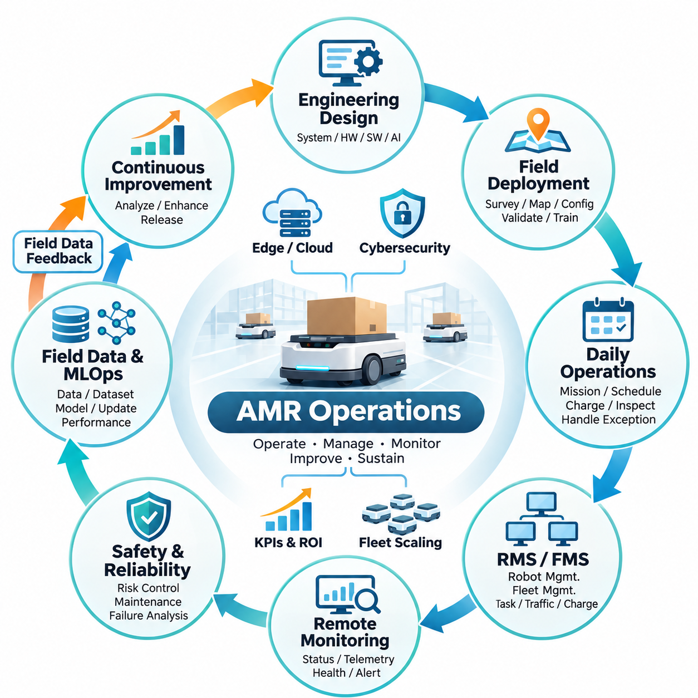
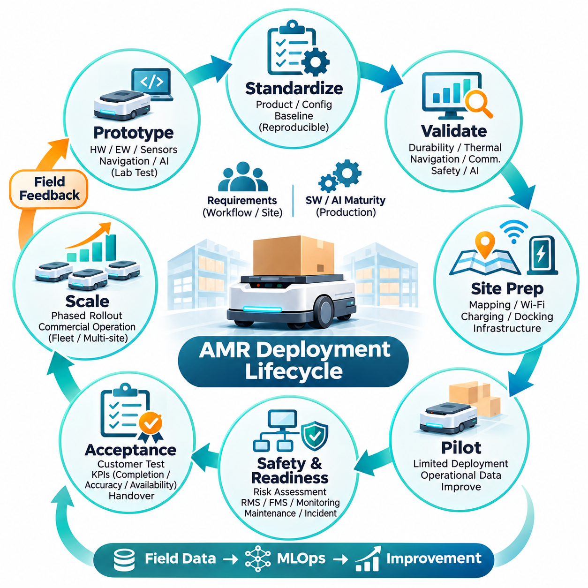
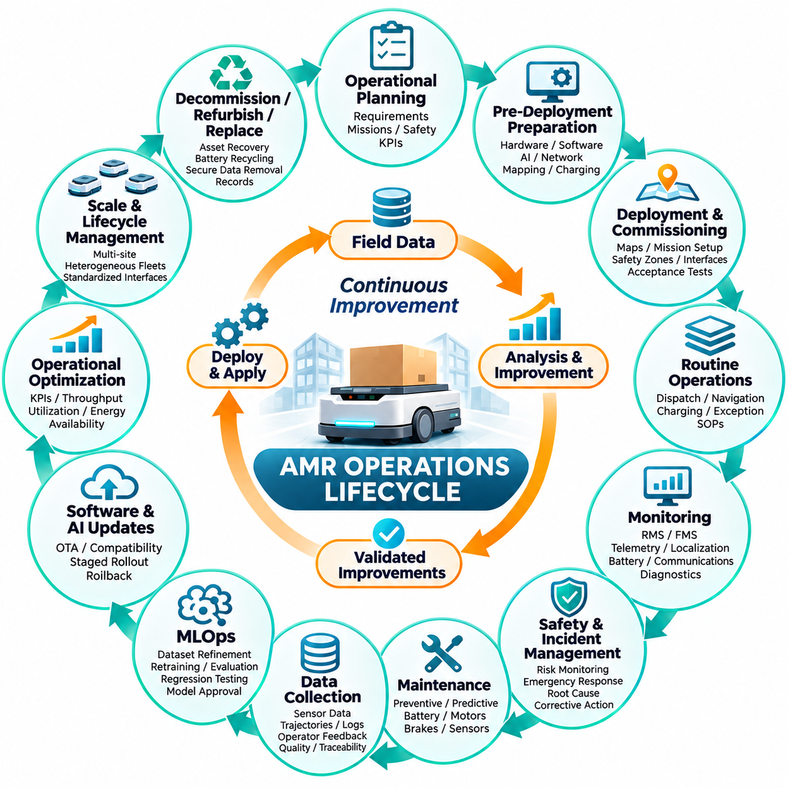
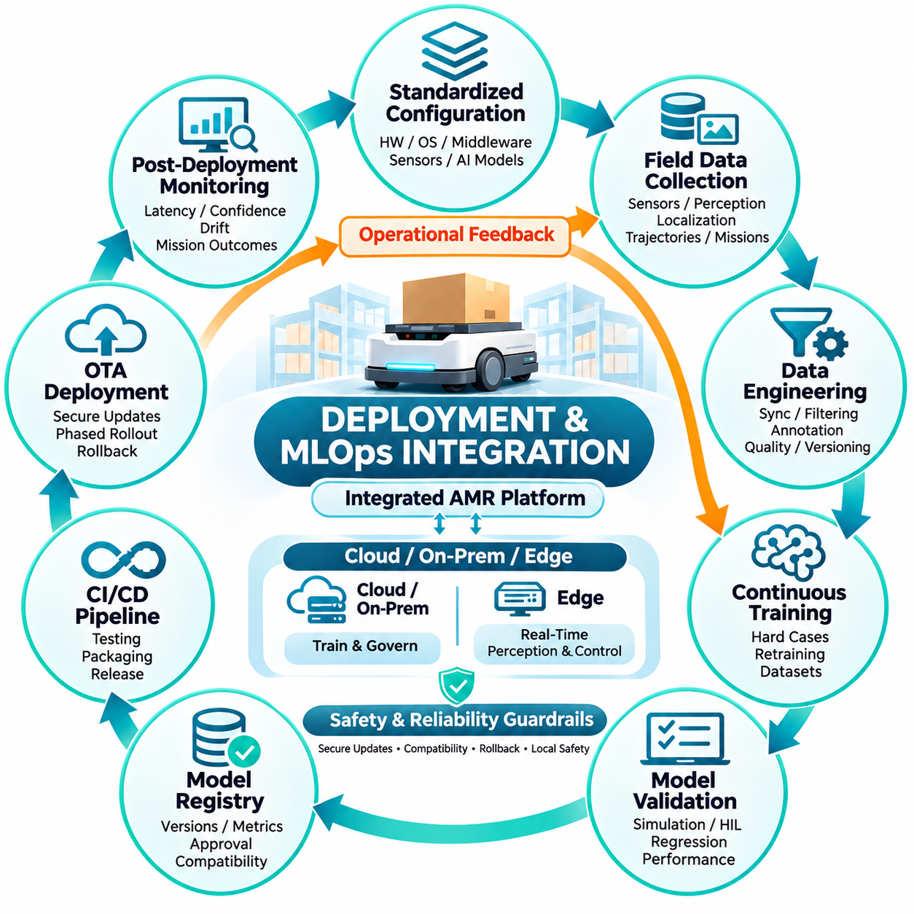
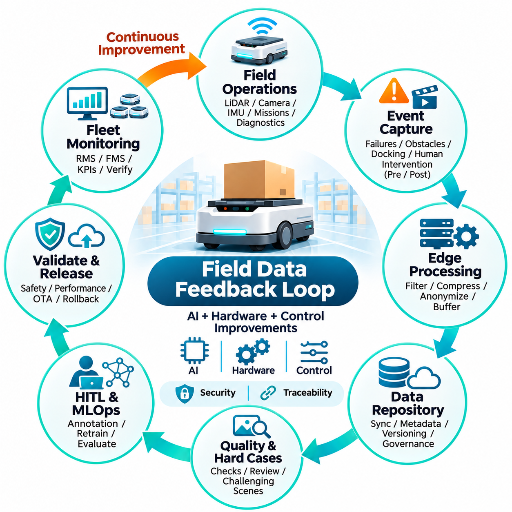
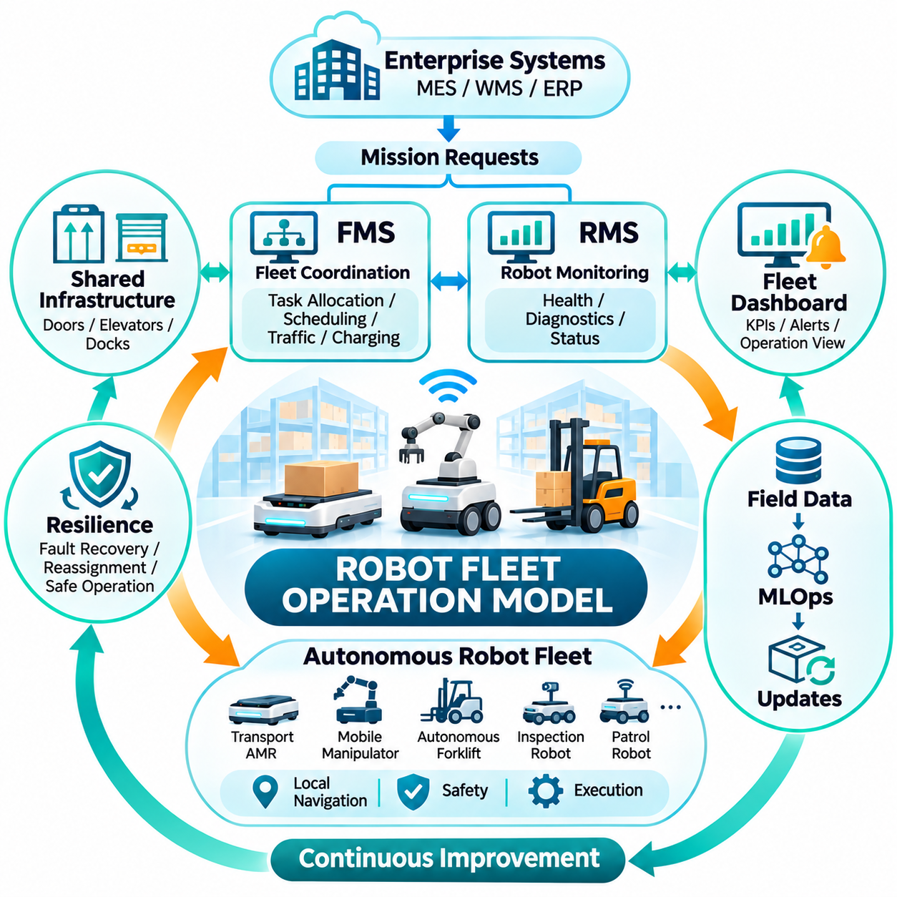
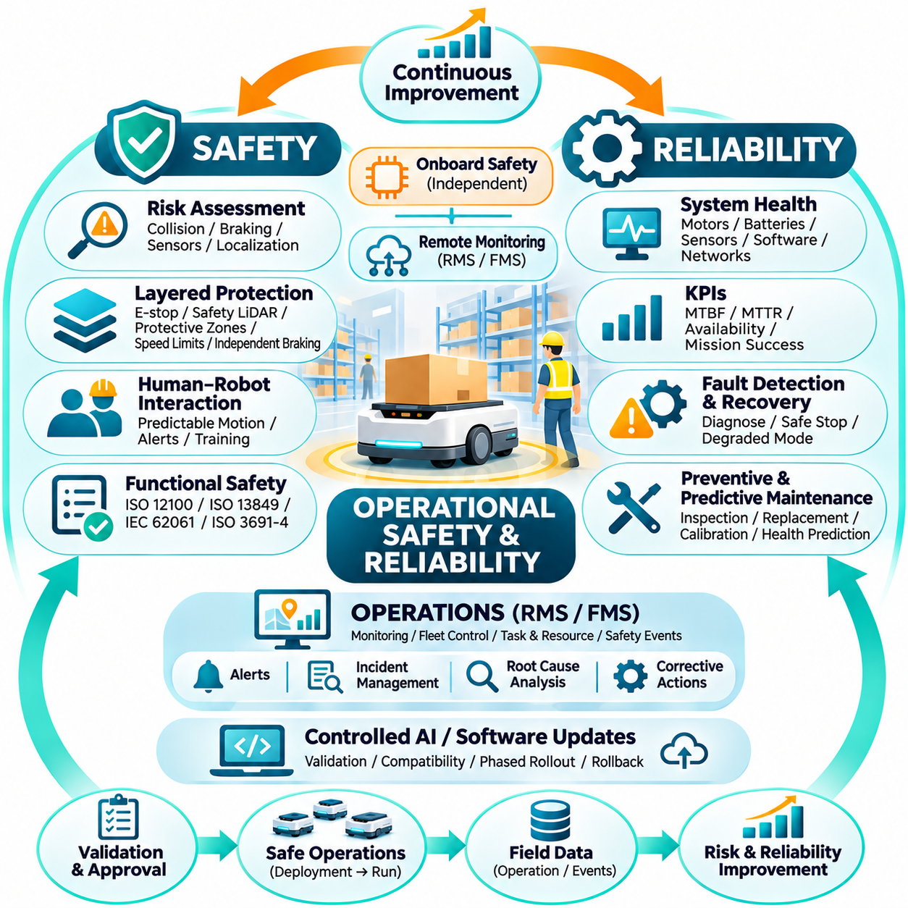
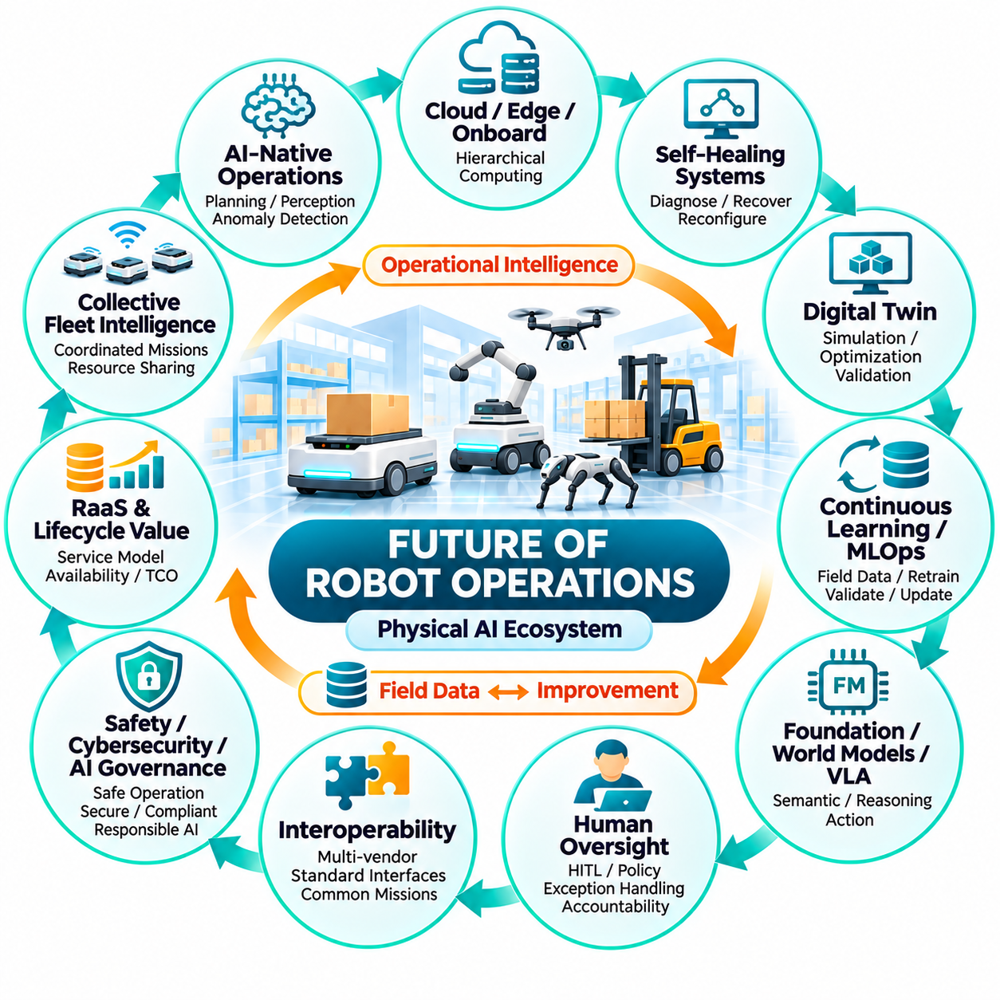

**Volume 08. AMR Operations, Deployment, and MLOps**

# Chapter 00. Introduction

## 00.1 Role of Operations in AMR

{width="7.268055555555556in" height="7.268055555555556in"}

Operations in Autonomous Mobile Robots (AMRs) represent a fundamental engineering discipline that connects robot development with practical service delivery in real-world environments. While mechanical engineering, electrical engineering, software development, and artificial intelligence establish the technical capabilities of an AMR, operations ensure that these capabilities are consistently delivered under actual working conditions throughout the robot\'s lifecycle.

The primary objective of AMR operations is to transform autonomous robotic capabilities into reliable, measurable, and sustainable operational value. A robot that demonstrates excellent performance in a laboratory environment may not necessarily achieve the same performance in an industrial facility, hospital, logistics center, or public environment. Operational engineering addresses this gap by managing environmental variability, system availability, and service requirements.

AMR operations begin before physical deployment. Operational requirements must be considered during system architecture design, hardware selection, software development, and AI model engineering. Factors such as maintenance accessibility, remote diagnostics, network connectivity, battery management, software update capability, and data collection infrastructure directly influence the operational feasibility and long-term sustainability of a robotic system.

Deployment represents the transition from engineering development to practical operation. This transition involves site surveys, environmental mapping, infrastructure integration, system configuration, safety validation, and operator training. Deployment engineers must ensure that the robot can interact effectively with existing facilities, information systems, human workers, and operational procedures without introducing unacceptable risks or disruptions.

Daily field operations involve mission execution, task scheduling, battery charging, system inspection, performance monitoring, and exception handling. Although AMRs are designed to perform tasks autonomously, operational supervision remains necessary to maintain service continuity. Human operators and automated management systems cooperate to identify abnormal conditions, resolve operational conflicts, and respond to unexpected environmental changes.

The Robot Management System (RMS) and Fleet Management System (FMS) provide essential infrastructure for centralized AMR operations. An RMS typically manages individual robot configurations, operational status, diagnostic information, and service interfaces, while an FMS coordinates multiple robots through task allocation, traffic management, resource scheduling, and charging optimization. Their functional boundaries may vary according to system architecture.

Remote monitoring enables operational teams to supervise distributed robotic systems without maintaining a permanent physical presence at every deployment location. Robot telemetry, localization status, battery conditions, sensor health, communication quality, and mission progress can be transmitted to centralized monitoring platforms. This infrastructure improves operational visibility and supports early detection of abnormal system behavior.

Operational reliability is a critical factor in determining the commercial viability of AMR systems. Frequent hardware failures, software interruptions, navigation errors, or communication problems can significantly reduce productivity and customer confidence. Reliability engineering therefore extends beyond initial product validation to include continuous health monitoring, preventive maintenance, predictive maintenance, and systematic failure analysis.

Operational safety must remain a fundamental requirement throughout the entire AMR service lifecycle. Robots frequently operate alongside pedestrians, industrial vehicles, equipment, patients, and other autonomous systems. Appropriate safety mechanisms, operational boundaries, speed restrictions, emergency response procedures, and periodic risk assessments must be maintained as environmental conditions and service requirements evolve.

Field operations also provide a valuable source of real-world data for continuous engineering improvement. Sensor recordings, navigation trajectories, mission histories, environmental observations, operator interventions, and failure events reveal conditions that may not have been adequately represented during development. Structured operational data collection enables engineering teams to identify weaknesses and prioritize system improvements.

Machine Learning Operations (MLOps) extends conventional AMR operations into the management of artificial intelligence throughout the robot\'s service lifecycle. AI models deployed in robotic systems require performance monitoring, dataset management, validation, version control, and controlled updates. Operational feedback supports the development of improved models that can address changing environments and previously unrecognized scenarios.

The integration of cloud computing and edge computing establishes a distributed operational architecture for modern AMR systems. Edge devices execute latency-sensitive perception, navigation, and control functions, while cloud or on-premises infrastructure supports fleet coordination, data aggregation, model training, remote diagnostics, and long-term performance analysis. Essential safety functions must remain effective during communication failures.

Cybersecurity is another essential component of operational engineering because connected robots interact with enterprise networks, remote management platforms, and external information systems. Secure authentication, access control, encrypted communication, software integrity verification, and vulnerability management are required to protect robotic assets against unauthorized access and operational disruption throughout their service lifecycle.

Operational performance must be evaluated through measurable Key Performance Indicators (KPIs), including robot availability, mission completion rate, task throughput, energy consumption, intervention frequency, Mean Time Between Failures (MTBF), and Mean Time to Repair (MTTR). These indicators provide quantitative evidence for evaluating service quality, identifying operational bottlenecks, and improving Return on Investment (ROI).

As AMR deployments expand from individual robots to large-scale heterogeneous fleets, operations increasingly become a discipline of distributed system orchestration. Multiple robotic platforms must coordinate missions, share infrastructure, manage limited resources, and exchange relevant environmental information. Scalable operational architectures enable organizations to expand robotic services without proportionally increasing administrative complexity.

Ultimately, AMR operations establish a continuous relationship between engineering development, field deployment, service management, and artificial intelligence improvement. Rather than treating deployment as the final stage of product development, modern robotics organizations should recognize operations as an ongoing engineering process that transforms autonomous machines into reliable, evolving, and economically sustainable Physical AI systems.

## 00.2 From Prototype to Field Deployment

{width="7.268055555555556in" height="7.268055555555556in"}

The transition from prototype development to field deployment represents a critical milestone in the lifecycle of an Autonomous Mobile Robot (AMR). A prototype demonstrates the technical feasibility of selected engineering concepts, whereas a field-deployed robot must deliver consistent performance, operational reliability, and measurable service value under actual working conditions. This transition requires systematic engineering and operational preparation.

Prototype development primarily focuses on validating fundamental technologies, including mechanical structures, electrical systems, sensor integration, autonomous navigation, and artificial intelligence algorithms. During this stage, engineers frequently operate robots under controlled conditions with direct technical supervision. Temporary configurations and experimental software implementations are acceptable when evaluating specific concepts.

Transitioning toward field deployment requires converting experimental configurations into standardized and reproducible product architectures. Hardware components, electrical interfaces, software dependencies, communication protocols, and AI model configurations must be systematically documented and controlled. Engineering teams must establish configuration baselines that support consistent manufacturing, deployment, maintenance, and troubleshooting.

Operational requirements must be established by analyzing the intended deployment environment and customer workflows. Industrial facilities, hospitals, logistics centers, and outdoor environments present different operational challenges involving environmental conditions, human interactions, infrastructure availability, and mission complexity. These requirements define the operational boundaries and acceptance criteria for the deployed robot.

Engineering validation must extend beyond individual component performance to evaluate complete system behavior. Mechanical durability, electrical stability, thermal management, localization accuracy, navigation reliability, communication robustness, and safety mechanisms must be assessed under representative operating conditions. Integrated testing helps identify weaknesses that may remain undetected during isolated prototype experiments.

Software maturity is another essential requirement for transitioning from prototype development to field deployment. Experimental software must evolve into a maintainable production architecture with appropriate error handling, process supervision, logging mechanisms, configuration management, and automated recovery capabilities. Software releases should follow controlled procedures incorporating version management and regression testing.

Artificial intelligence models must also undergo field-oriented validation before operational deployment. Models trained using laboratory datasets may exhibit reduced performance when exposed to unfamiliar lighting conditions, environmental structures, objects, or human behavior. Representative field datasets, scenario-based testing, and performance benchmarks are necessary to establish acceptable levels of robustness and generalization.

Site preparation establishes the physical and digital infrastructure required for reliable AMR operations. Deployment engineers must evaluate floor conditions, passage dimensions, slopes, obstacles, wireless network coverage, charging infrastructure, and interactions with existing equipment. Environmental mapping, restricted zone configuration, docking station installation, and external system integration must be completed before operational acceptance.

Pilot deployment provides an intermediate stage between controlled development and full-scale commercial operation. A limited number of robots are introduced into representative customer environments under enhanced technical supervision. During this period, engineering teams collect operational data, investigate unexpected failures, evaluate customer workflows, and identify necessary improvements before expanding the deployment scope.

Safety validation must address the differences between laboratory testing and actual human-shared environments. Risk assessments should evaluate potential collisions, emergency stopping behavior, unexpected obstacle encounters, communication failures, and abnormal operating conditions. Deployment approval must depend on documented safety evidence and verified protective mechanisms rather than successful mission execution alone.

Operational readiness requires establishing the infrastructure and organizational procedures necessary to support deployed robotic systems. Robot Management Systems (RMS), Fleet Management Systems (FMS), remote monitoring platforms, diagnostic interfaces, and maintenance procedures provide essential operational capabilities. Responsibilities for incident response, technical escalation, spare parts management, and customer support must be clearly defined.

Customer acceptance testing establishes whether the deployed AMR satisfies agreed functional, performance, safety, and reliability requirements. Acceptance criteria may include mission completion rates, positioning accuracy, operational availability, task throughput, and charging performance. Test results must be documented, and unresolved deficiencies should be evaluated against defined release conditions before formal customer handover.

Following initial deployment, operational data becomes an important resource for continuous engineering improvement. Sensor recordings, system logs, mission histories, failure events, and operator interventions provide evidence of actual system behavior. Machine Learning Operations (MLOps) and controlled software update processes transform this feedback into validated improvements while maintaining operational stability and traceability.

Scaling from pilot deployment to commercial operation requires reproducible installation procedures, standardized configurations, automated provisioning, centralized monitoring, and consistent service practices. Fleet expansion should follow a phased rollout strategy that evaluates operational performance at each stage. This approach reduces deployment risks and prevents unresolved technical problems from propagating across multiple robots.

Ultimately, transitioning from prototype to field deployment represents more than completing product development. It establishes a continuous engineering relationship between product architecture, real-world operations, customer requirements, and system improvement. A successful AMR deployment converts experimental autonomous technologies into reliable, maintainable, scalable, and economically sustainable Physical AI services.

## 00.3 AMR Operations Lifecycle

{width="7.268055555555556in" height="7.268055555555556in"}

The operational lifecycle of an Autonomous Mobile Robot (AMR) encompasses all activities required to prepare, deploy, operate, maintain, improve, and eventually retire a robotic system. Unlike conventional product lifecycles that primarily emphasize manufacturing and delivery, the AMR operations lifecycle establishes a continuous engineering framework for maintaining autonomous capabilities and delivering sustainable service value in real-world environments.

The lifecycle begins with operational planning, during which customer requirements, service objectives, environmental constraints, and expected workloads are established. Operational teams must define mission profiles, operating schedules, infrastructure requirements, safety boundaries, and performance targets. These requirements provide the foundation for deployment strategies, resource allocation, operational procedures, and long-term service management.

Pre-deployment preparation ensures that both the robotic system and its intended operating environment are ready for integration. Activities include hardware inspection, software configuration, AI model verification, network preparation, environmental mapping, and charging infrastructure installation. Standardized preparation procedures and configuration baselines reduce installation variability and establish consistent conditions for subsequent field operations.

Deployment and commissioning represent the initial introduction of the AMR into its intended operational environment. Engineers configure navigation maps, mission parameters, safety zones, communication interfaces, and external system connections. Functional testing and site acceptance testing verify that the integrated robotic system satisfies operational requirements before authorization for routine service execution is granted.

During routine operations, AMRs execute assigned missions while interacting with human workers, physical infrastructure, information systems, and other robotic platforms. Daily operational activities include task scheduling, mission dispatch, autonomous navigation, charging management, and exception handling. Standard Operating Procedures (SOPs) establish consistent practices for robot startup, shutdown, supervision, and operational recovery.

Continuous monitoring provides visibility into the operational conditions of individual robots and distributed fleets. Robot Management Systems (RMS) and Fleet Management Systems (FMS) collect telemetry, localization status, mission progress, battery information, communication quality, and diagnostic events. Monitoring infrastructure enables operators to detect abnormal conditions, evaluate service availability, and initiate appropriate corrective actions.

Operational safety and incident management must remain active throughout every lifecycle stage. Environmental changes, unexpected human behavior, equipment failures, and communication interruptions may introduce new operational risks. Safety monitoring, incident classification, emergency response procedures, root cause analysis, and corrective actions establish a systematic framework for maintaining acceptable risk levels throughout service operation.

Maintenance management preserves the physical and functional integrity of AMR systems over extended operational periods. Preventive maintenance addresses scheduled component inspection and replacement, while predictive maintenance utilizes operational data to estimate degradation and potential failures. Battery health, motor performance, braking systems, sensor calibration, mechanical wear, and thermal conditions require continuous or periodic assessment.

Operational data collection transforms deployed AMRs into distributed sources of engineering knowledge. Sensor measurements, navigation trajectories, environmental observations, mission records, system logs, and operator interventions provide valuable information about actual operating conditions. Data collection policies must address synchronization, data quality, storage efficiency, privacy protection, and traceability to support engineering improvement and AI development.

Machine Learning Operations (MLOps) integrates AI model development with the continuing operational lifecycle of robotic systems. Field data supports dataset refinement, model retraining, performance evaluation, and regression testing. Validated models are registered, approved, and distributed through controlled deployment procedures, ensuring that improvements in artificial intelligence do not compromise existing operational capabilities or safety requirements.

Software and AI model updates represent recurring lifecycle activities rather than isolated development events. Over-the-Air (OTA) update mechanisms enable distributed robots to receive approved software packages, configuration changes, security patches, and AI model releases. Compatibility verification, staged deployment, integrity checking, rollback mechanisms, and post-update validation protect operational continuity during system evolution.

Operational optimization focuses on improving service efficiency through systematic analysis of Key Performance Indicators (KPIs). Mission completion rates, fleet utilization, task throughput, energy consumption, intervention frequency, system availability, and maintenance costs provide measurable evidence of operational performance. These indicators support improvements in scheduling, resource allocation, navigation behavior, and charging strategies.

As deployment scales across multiple locations, lifecycle management must accommodate heterogeneous robot platforms, regional requirements, infrastructure differences, and customer-specific workflows. Centralized management platforms, standardized operational interfaces, automated device provisioning, and distributed edge computing enable scalable service delivery while maintaining consistent operational governance and configuration control.

The final lifecycle stage involves system decommissioning, refurbishment, replacement, or retirement. Organizations must manage physical asset recovery, battery recycling, secure data removal, software license termination, and the preservation of relevant operational records. Historical maintenance information and lifecycle performance data provide engineering knowledge for subsequent product generations and future deployment strategies.

Ultimately, the AMR operations lifecycle should be understood as a closed-loop engineering process rather than a linear sequence of independent activities. Deployment produces operational experience, operational experience generates data, and validated engineering improvements enhance subsequent operations. This continuous feedback mechanism establishes the foundation for reliable, scalable, adaptive, and economically sustainable Physical AI systems.

## 00.4 Deployment and MLOps Integration

{width="7.268055555555556in" height="7.268055555555556in"}

The integration of deployment engineering and Machine Learning Operations (MLOps) establishes a continuous framework for developing, operating, and improving intelligent Autonomous Mobile Robots (AMRs). While deployment engineering focuses on introducing robotic systems into real-world environments, MLOps manages the lifecycle of artificial intelligence models. Their integration enables autonomous robots to evolve systematically throughout their operational lifetime.

Traditional robotic deployment primarily emphasizes hardware installation, software configuration, environmental mapping, system integration, and operational validation. However, AI-driven robotic systems introduce additional requirements because model performance depends on training data, environmental characteristics, and computational resources. Deployment must therefore incorporate mechanisms for monitoring, evaluating, and updating artificial intelligence models.

MLOps extends conventional software development and operations practices by integrating dataset management, model training, experimentation, validation, model registration, deployment, and performance monitoring. In AMR systems, these activities must accommodate physical interactions, real-time processing requirements, embedded computing limitations, environmental uncertainty, and safety constraints that distinguish robotics from conventional AI applications.

An integrated deployment and MLOps architecture begins with establishing standardized configurations across robotic platforms. Hardware specifications, operating systems, middleware versions, sensor configurations, AI models, and runtime dependencies must be systematically managed. Configuration traceability ensures that engineering teams can reproduce operational conditions, investigate failures, and evaluate compatibility between software and AI model releases.

Field data collection provides the foundation for connecting deployed robotic systems with AI development infrastructure. AMRs continuously generate sensor measurements, perception results, localization estimates, navigation trajectories, mission records, and diagnostic events. Selected operational data is transferred to centralized or on-premises infrastructure for storage, quality assessment, annotation, dataset development, and subsequent model training.

Data engineering pipelines must transform heterogeneous operational recordings into structured and reusable datasets. Time synchronization, sensor calibration metadata, data filtering, compression, event classification, and dataset versioning are essential components of this process. Privacy protection, access control, retention policies, and data lineage management ensure that operational information remains secure, traceable, and suitable for authorized engineering activities.

Continuous Training (CT) enables AI models to incorporate newly collected operational experience through controlled retraining processes. Difficult perception scenarios, navigation failures, environmental changes, and unexpected object appearances can be identified and incorporated into updated training datasets. Retraining should be initiated according to defined performance criteria and data quality standards rather than automatically accepting every newly collected observation.

Model validation establishes the technical and operational suitability of newly developed AI models before deployment. Evaluation should include representative datasets, scenario-based simulation, hardware-in-the-loop testing, computational performance analysis, and regression testing. Improvements in detection accuracy or behavioral performance must not introduce unacceptable inference latency, excessive resource consumption, or deterioration of existing capabilities.

A model registry provides centralized management of approved AI model artifacts and their associated engineering information. Each model version should be linked to training datasets, hyperparameters, evaluation results, runtime requirements, hardware compatibility, and approval records. This infrastructure supports reproducibility, release governance, configuration management, and the identification of models operating across individual robots or distributed fleets.

Continuous Integration and Continuous Delivery (CI/CD) pipelines connect software development with controlled AI model distribution. Automated procedures can perform dependency verification, software testing, model compatibility checks, container packaging, and deployment preparation. Integrating CI/CD with Continuous Training establishes a coordinated engineering workflow covering conventional robot software and data-dependent artificial intelligence components.

Over-the-Air (OTA) deployment mechanisms enable approved software and AI models to be distributed across remotely operated robots. Updates should incorporate authenticated communication, digital signature verification, package integrity checks, hardware compatibility assessment, and recovery mechanisms. Phased rollout and canary deployment strategies reduce operational risks by evaluating new releases on a limited group of robots before wider distribution.

Post-deployment monitoring is essential for identifying differences between validated model performance and actual field behavior. AI monitoring systems should evaluate inference latency, confidence distributions, resource utilization, data drift, and task-level outcomes. Robot Management Systems (RMS) and Fleet Management Systems (FMS) can correlate these indicators with mission failures, operator interventions, and environmental conditions.

The integration of cloud, on-premises, and edge computing establishes the computational infrastructure required for robotic MLOps. Centralized infrastructure supports large-scale data processing, dataset management, model training, and release governance, while edge computing platforms execute real-time perception and autonomous decision-making. Essential control and safety functions must remain effective during network interruptions and model management activities.

Ultimately, deployment and MLOps integration transforms AMR operations into a closed-loop engineering ecosystem connecting field experience, data engineering, artificial intelligence development, validation, and controlled deployment. Rather than treating AI models as fixed software components, this framework enables continuous and governed improvement of robotic intelligence while preserving operational reliability, safety, scalability, and service continuity.

## 00.5 Field Data Feedback Loop

{width="7.268055555555556in" height="7.268055555555556in"}

The Field Data Feedback Loop is a fundamental engineering mechanism that connects the real-world operation of Autonomous Mobile Robots (AMRs) with continuous system improvement and artificial intelligence development. Rather than treating deployed robots as independent service platforms, this approach establishes them as distributed sources of operational knowledge that contribute to the systematic evolution of robotic capabilities.

During routine operations, AMRs continuously generate heterogeneous data representing interactions between robotic systems and their physical environments. These data include LiDAR measurements, camera images, inertial measurements, localization estimates, navigation trajectories, actuator responses, battery conditions, mission histories, and diagnostic events. Collectively, they provide valuable evidence of actual system behavior and environmental characteristics.

A structured field data collection strategy must distinguish between routine operational information and data with significant engineering value. Continuous recording of every sensor stream may impose excessive storage, communication, and computational demands. Event-triggered recording, periodic sampling, anomaly detection, and selective sensor activation enable efficient data acquisition while preserving information relevant to system improvement.

Event-based data collection is particularly important for identifying operational conditions that were insufficiently represented during initial development. Localization failures, unexpected obstacles, emergency stops, unsuccessful docking attempts, perception errors, and human interventions can automatically trigger detailed data recording. Pre-event and post-event data provide contextual information necessary for reconstructing operational scenarios.

Data synchronization and contextual metadata are essential for ensuring the technical usefulness of collected field information. Sensor measurements, robot states, control commands, and environmental observations must be associated with consistent timestamps. Additional metadata should identify robot configurations, software versions, AI model versions, calibration parameters, operating locations, and mission conditions to support reproducible engineering analysis.

Edge computing platforms perform preliminary data processing before transferring selected information to centralized infrastructure. Local filtering, compression, anonymization, event classification, and temporary buffering reduce communication overhead and storage requirements. Data transmission policies should prioritize critical events while accommodating available network bandwidth, operational workloads, and intermittent connectivity.

Centralized or on-premises data infrastructure provides systematic storage, indexing, retrieval, and management of operational datasets collected from distributed robot fleets. Dataset repositories must support data lineage, version control, access management, retention policies, and metadata search. These capabilities enable engineering teams to identify relevant operational scenarios without repeatedly processing extensive collections of raw sensor recordings.

Field data quality assessment determines whether collected information is suitable for engineering investigation and AI model development. Incomplete recordings, synchronization errors, corrupted sensor measurements, inaccurate annotations, and inconsistent metadata can reduce the effectiveness of subsequent analysis. Automated quality checks combined with expert review establish dependable datasets for troubleshooting, validation, and machine learning.

Hard case mining identifies operational scenarios in which existing robotic capabilities demonstrate insufficient accuracy, reliability, or generalization. Examples include reflective surfaces, unusual obstacles, crowded environments, adverse weather, and unexpected human behavior. Prioritizing these challenging scenarios allows engineering teams to concentrate development resources on conditions that have the greatest impact on operational performance.

Human-in-the-Loop (HITL) feedback complements automated analysis by incorporating observations from robot operators, field technicians, customers, and engineering specialists. Manual interventions, corrected annotations, mission adjustments, and incident reports provide contextual knowledge that may not be directly observable through sensor measurements. Structured feedback mechanisms convert human experience into actionable engineering information.

The integration of field data with Machine Learning Operations (MLOps) enables controlled improvement of AI models throughout the AMR service lifecycle. Selected operational data undergoes annotation, dataset refinement, model retraining, and systematic evaluation. Newly developed models must demonstrate measurable improvements while satisfying established requirements for inference latency, computational efficiency, robustness, and operational safety.

Operational feedback also supports improvements beyond artificial intelligence. Analysis of motor currents, vibration measurements, battery degradation, navigation errors, and communication interruptions can reveal weaknesses in mechanical structures, electrical architectures, control algorithms, and software implementations. The feedback loop therefore contributes to multidisciplinary engineering improvement across the complete robotic system.

Validated improvements must be returned to deployed robots through controlled software and model release procedures. Over-the-Air (OTA) updates, phased rollout strategies, configuration management, compatibility verification, and rollback mechanisms establish a dependable deployment framework. Post-update monitoring determines whether introduced improvements achieve their intended operational benefits without causing unexpected performance degradation.

Fleet-level feedback enables operational experience collected by individual robots to contribute to improvements across entire robotic fleets. Robot Management Systems (RMS) and Fleet Management Systems (FMS) aggregate operational indicators, identify recurring failure patterns, and compare performance across deployment environments. Data governance and privacy protection must ensure that shared knowledge remains authorized, secure, and traceable.

Ultimately, the Field Data Feedback Loop establishes a continuous cycle of operation, observation, data collection, engineering analysis, learning, validation, redeployment, and performance verification. This closed-loop architecture transforms conventional AMR deployment into an evolving Physical AI ecosystem in which accumulated operational experience contributes to increasingly reliable, adaptive, scalable, and economically sustainable robotic services.

## 00.6 Robot Fleet Operation Model

{width="7.268055555555556in" height="7.268055555555556in"}

The Robot Fleet Operation Model establishes a systematic framework for managing multiple Autonomous Mobile Robots (AMRs) as an integrated operational system. Unlike independent robot operations, fleet-based operations require coordinated mission execution, shared resource management, centralized supervision, and distributed autonomous decision-making. The primary objective is to maximize collective productivity while maintaining operational safety and reliability.

A robot fleet generally consists of multiple robotic platforms operating within a common physical environment or across geographically distributed locations. These platforms may include transportation robots, towing robots, autonomous forklifts, inspection robots, patrol robots, and mobile manipulators. A unified operation model enables heterogeneous robotic systems to participate in coordinated service workflows according to their individual capabilities.

The operational architecture of a robot fleet typically combines individual robot intelligence with centralized or distributed management infrastructure. Robot Management Systems (RMS) supervise individual robot conditions, configurations, diagnostics, and operational states, while Fleet Management Systems (FMS) coordinate mission allocation, scheduling, traffic management, and shared resources. Their integration establishes comprehensive fleet-level operational visibility.

Mission management converts customer requirements and external service requests into executable robotic tasks. Each mission may contain transportation objectives, destination information, execution priorities, payload requirements, time constraints, and environmental restrictions. Standardized mission definitions enable fleet management platforms to allocate tasks consistently while accommodating differences in robot capabilities and operational responsibilities.

Task allocation determines which robot should execute a particular mission according to its current location, availability, battery condition, payload capacity, functional capability, and workload. Dynamic allocation algorithms continuously evaluate changing operational conditions to improve resource utilization. Effective task assignment reduces unnecessary travel distances, minimizes idle time, and improves overall fleet productivity.

Fleet scheduling coordinates mission execution across multiple robots while accounting for operational priorities, infrastructure limitations, and service deadlines. Scheduling mechanisms must accommodate recurring tasks, unexpected service requests, maintenance activities, and charging requirements. Dynamic rescheduling enables the fleet to respond to robot failures, environmental changes, and fluctuations in operational demand without unnecessary service interruptions.

Traffic management is essential when multiple robots operate within shared physical environments. Intersections, narrow corridors, elevators, docking stations, and loading areas may become operational bottlenecks. Centralized route coordination, zone reservation, priority management, and deadlock prevention mechanisms should complement individual obstacle avoidance capabilities to maintain safe and efficient movement throughout the environment.

Energy management establishes coordinated charging strategies that maintain adequate operational availability across the robot fleet. Battery State of Charge (SOC), State of Health (SOH), expected mission duration, and charging station availability influence charging decisions. Opportunity charging, scheduled charging, and dynamic charging allocation can reduce unnecessary downtime while preventing excessive competition for shared charging infrastructure.

Fleet operations require integration with existing enterprise systems and physical infrastructure. Manufacturing Execution Systems (MES), Warehouse Management Systems (WMS), Enterprise Resource Planning (ERP), elevators, automatic doors, and industrial equipment may exchange operational information with fleet management platforms. Standardized Application Programming Interfaces (APIs) enable robots to participate in broader automated service processes.

Remote monitoring and operational supervision provide centralized awareness of fleet conditions and mission execution. Operational dashboards should visualize robot locations, mission progress, battery conditions, communication status, traffic congestion, and diagnostic events. Automated alert mechanisms and incident classification procedures enable operators to identify abnormal conditions and initiate appropriate responses across distributed deployment locations.

Fault tolerance and operational resilience are fundamental requirements for sustainable fleet operations. When individual robots experience hardware failures, software errors, or communication interruptions, the fleet management system should evaluate remaining operational capacity and redistribute affected missions where feasible. Local emergency protection, safe-state transitions, and controlled recovery procedures prevent individual failures from escalating into fleet-wide disruptions.

Heterogeneous fleet management extends operational coordination beyond identical robotic platforms. Different robot types may possess different mobility characteristics, payload capacities, sensor configurations, communication protocols, and artificial intelligence capabilities. Capability-based task allocation, standardized interfaces, and common operational state definitions enable interoperability while preserving platform-specific control and safety requirements.

Fleet-level data collection and Machine Learning Operations (MLOps) establish a mechanism for sharing operational experience across multiple robotic systems. Individual robots contribute sensor recordings, mission histories, failure events, and environmental observations to centralized or on-premises infrastructure. Validated engineering improvements and AI model updates can subsequently be distributed across compatible robotic platforms through controlled deployment procedures.

Fleet performance evaluation relies on measurable Key Performance Indicators (KPIs), including mission completion rate, task throughput, fleet utilization, operational availability, energy consumption, intervention frequency, and maintenance costs. These indicators enable operational teams to identify bottlenecks, evaluate resource allocation efficiency, optimize fleet size, and assess the economic sustainability of robotic services.

Ultimately, the Robot Fleet Operation Model transforms individual autonomous robots into a coordinated and continuously improving operational ecosystem. By integrating autonomous execution, collective resource management, operational supervision, infrastructure connectivity, and field data feedback, organizations can establish scalable robotic services that support industrial automation, logistics, healthcare, and smart city applications within an evolving Physical AI ecosystem.

## 00.7 Operational Safety and Reliability

{width="7.268055555555556in" height="7.268055555555556in"}

Operational safety and reliability are fundamental requirements for the successful deployment and sustainable operation of Autonomous Mobile Robots (AMRs). Safety focuses on preventing unacceptable risks to humans, equipment, infrastructure, and the surrounding environment, while reliability concerns the ability of robotic systems to perform their intended functions consistently under specified operating conditions throughout their service lifetime.

Unlike robots operating within isolated industrial environments, AMRs frequently interact with human workers, pedestrians, vehicles, equipment, and other autonomous systems. Dynamic environmental conditions introduce uncertainties that cannot always be fully anticipated during development. Operational safety must therefore be established through systematic risk assessment, protective mechanisms, continuous monitoring, and controlled operational procedures.

Risk assessment provides the foundation for establishing appropriate operational safety requirements. Potential hazards include collisions, unexpected acceleration, braking failures, localization errors, sensor malfunctions, unstable payloads, and communication interruptions. Each identified hazard must be evaluated according to its potential severity, probability, and exposure conditions to determine suitable risk reduction measures.

A layered safety architecture integrates mechanical protection, electrical safeguards, safety-related control systems, environmental perception, and supervisory monitoring. Emergency stop devices, safety laser scanners, protective fields, speed limitation mechanisms, and independent braking functions provide complementary protection. Safety-critical functions should not depend exclusively on conventional AI models or centralized fleet management infrastructure.

Operational safety zones establish spatial boundaries within which specific robot behaviors and movement restrictions are enforced. Restricted areas, pedestrian crossings, narrow passages, loading stations, and shared intersections may require different speed limits and protective measures. Dynamic changes to operational zones must remain within validated safety constraints and account for robot speed, stopping distance, and environmental conditions.

Human-Robot Interaction (HRI) safety is particularly important in hospitals, logistics facilities, manufacturing environments, and public spaces. Robots should exhibit predictable movement, appropriate stopping behavior, and understandable visual or acoustic notifications. Human workers must receive suitable operational training to recognize robot intentions, maintain safe interactions, and respond appropriately during abnormal operating conditions.

Functional safety establishes engineering principles for ensuring that safety-related functions respond correctly during hazardous situations and system failures. Safety requirements should be derived from risk assessment and applicable standards, such as ISO 12100, ISO 13849, IEC 62061, and ISO 3691-4 where relevant. Compliance requires documented design verification, validation, and appropriate assessment of safety-related control functions.

Operational reliability depends on the combined performance of mechanical structures, electrical systems, embedded computers, sensors, communication networks, control software, and artificial intelligence models. Weaknesses in individual subsystems may propagate across the complete robotic architecture. Reliability engineering must therefore evaluate component degradation, subsystem dependencies, environmental stress, and potential common-cause failures.

Reliability metrics provide quantitative methods for evaluating system performance throughout operational service. Mean Time Between Failures (MTBF), Mean Time to Repair (MTTR), operational availability, mission completion rate, and failure frequency represent important indicators. Consistent measurement procedures and failure classifications enable engineering teams to compare reliability across robot configurations, deployment environments, and software versions.

Fault detection, isolation, and recovery capabilities allow robotic systems to respond systematically to abnormal operating conditions. Diagnostic mechanisms should identify sensor failures, actuator abnormalities, communication losses, software process failures, and electrical faults. Depending on the severity of the detected condition, the robot may enter a validated degraded operating mode, execute a controlled stop, or request external technical assistance.

Preventive and predictive maintenance contribute to operational reliability by reducing unexpected equipment failures and service interruptions. Scheduled inspections, component replacement, sensor calibration, battery health assessment, and mechanical condition monitoring preserve system integrity. Predictive maintenance uses historical operating data and condition monitoring to identify emerging degradation and support maintenance planning before critical failures occur.

Robot Management Systems (RMS) and Fleet Management Systems (FMS) support fleet-level safety supervision and reliability management through centralized monitoring of operational conditions. Safety events, emergency stops, diagnostic alerts, communication status, and maintenance requirements should be recorded and analyzed. However, essential onboard safety functions must remain effective independently of cloud connectivity and remote management availability.

Software and AI model updates introduce additional operational risks because changes may affect perception, navigation, decision-making, and system resource utilization. Controlled release procedures must incorporate compatibility verification, regression testing, safety impact assessment, phased deployment, and rollback mechanisms. Machine Learning Operations (MLOps) should ensure that continuous intelligence improvement does not compromise previously validated safety capabilities.

Incident management establishes a structured process for responding to operational failures, safety events, and near-miss situations. Event recording, incident classification, immediate protective actions, root cause analysis, corrective measures, and recovery authorization contribute to systematic risk reduction. Operational experience should be incorporated into updated safety assessments, engineering requirements, maintenance procedures, and validation scenarios.

Ultimately, operational safety and reliability must be treated as continuous lifecycle responsibilities rather than one-time engineering achievements. Integrating risk management, functional safety, reliability engineering, health monitoring, predictive maintenance, incident response, and controlled system improvement establishes the foundation for trustworthy, scalable, and economically sustainable Physical AI operations across diverse real-world environments.

## 00.8 Future of Robot Operations

{width="7.268055555555556in" height="7.268055555555556in"}

The future of robot operations represents a fundamental transition from conventional robotic deployment toward intelligent, adaptive, and continuously evolving operational ecosystems. Autonomous Mobile Robots (AMRs) will increasingly function as interconnected components of Physical AI systems rather than isolated automation equipment. Operational intelligence will become as important as individual robotic performance in determining overall service capabilities.

AI-native robot operations will integrate artificial intelligence throughout the entire operational lifecycle, including mission planning, environmental perception, resource allocation, anomaly detection, and maintenance management. Instead of relying exclusively on predetermined operational rules, future robotic systems will increasingly utilize learned representations and contextual information to adapt their behavior to changing operational conditions.

Autonomous fleet operations will extend individual robot intelligence toward coordinated decision-making across heterogeneous robotic systems. Transportation robots, mobile manipulators, autonomous forklifts, inspection robots, quadruped robots, and unmanned aerial vehicles may cooperate within shared operational environments. Collective intelligence will enable these platforms to distribute missions, coordinate resources, and respond collaboratively to complex situations.

Hierarchical operational architectures will combine onboard autonomy, edge intelligence, fleet-level orchestration, and centralized computing infrastructure. Individual robots will execute time-critical perception and control functions, while edge platforms coordinate localized robotic activities. Centralized infrastructure will support large-scale optimization, AI model development, historical data analysis, and strategic operational decision-making.

Self-healing robot systems will increasingly incorporate automated fault detection, diagnosis, recovery, and operational reconfiguration capabilities. When software processes fail or individual subsystems exhibit abnormal behavior, robotic platforms may initiate validated recovery procedures without immediate human intervention. Fleet management systems will redistribute affected missions and isolate unavailable resources to maintain service continuity.

Cloud-edge integrated operation platforms will provide scalable infrastructure for managing geographically distributed robot fleets. Cloud environments will support centralized service management, large-scale data processing, and AI development, while edge computing platforms will provide low-latency inference and localized operational coordination. On-premises infrastructure will remain important where data sovereignty, security, and operational independence are required.

Digital Twin technology will become increasingly important for connecting physical robot operations with virtual engineering environments. Operational data collected from deployed robots can continuously synchronize digital representations of robotic platforms and their surroundings. These virtual environments will support mission simulation, fleet optimization, predictive maintenance, operational risk assessment, and pre-deployment validation of system updates.

Continuous learning robot fleets will transform operational experience into a reusable source of collective intelligence. Field data feedback loops, automated data selection, hard case mining, human feedback, and Machine Learning Operations (MLOps) will support systematic improvement of robotic capabilities. Validated knowledge acquired from individual robots may subsequently benefit compatible robotic platforms operating across multiple locations.

Foundation models, World Models, and Vision-Language-Action (VLA) architectures may expand the operational capabilities of future autonomous robots. These technologies can support semantic environmental understanding, natural language instruction processing, contextual reasoning, and generalized task execution. Their deployment will require careful evaluation of computational requirements, behavioral consistency, uncertainty, and operational safety.

Human-Robot Collaboration will evolve from direct supervision and manual intervention toward higher-level operational management. Human operators will increasingly define mission objectives, evaluate exceptional situations, establish operational policies, and supervise autonomous decision-making. Human-in-the-Loop mechanisms will remain essential for managing uncertainty, resolving complex operational problems, and maintaining accountability.

Future robotic operations will require greater interoperability between robot manufacturers, enterprise platforms, and physical infrastructure. Standardized communication interfaces, shared semantic maps, capability descriptions, and common mission representations will facilitate heterogeneous fleet integration. Interoperability will reduce dependence on individual technology providers and support the development of scalable multi-vendor robotic ecosystems.

Cybersecurity, functional safety, and AI governance will become increasingly significant as robotic systems acquire greater connectivity and autonomous decision-making capabilities. Secure communication, device authentication, software integrity verification, access control, and controlled AI model deployment will be essential. Safety architectures must preserve independent protective functions even as operational intelligence becomes more adaptive and distributed.

Smart factories, hospitals, logistics facilities, transportation infrastructure, and smart cities will increasingly integrate robotic fleets into their broader operational ecosystems. Robots may cooperate with intelligent buildings, automated equipment, digital infrastructure, and centralized operation centers. Such integration will enable coordinated physical services that extend beyond the capabilities of individual robots or isolated automation systems.

The economic model of robot operations will gradually shift from equipment-centered purchasing toward lifecycle-oriented service delivery. Robotics-as-a-Service (RaaS), performance-based contracts, remote technical support, and continuous software improvement may influence commercial deployment strategies. Total Cost of Ownership (TCO), operational availability, service productivity, and long-term adaptability will become critical measures of economic value.

Ultimately, the future of robot operations will be characterized by the convergence of autonomous execution, collective intelligence, continuous learning, distributed computing, and integrated operational governance. This evolution will establish the foundation for scalable Physical AI ecosystems in which heterogeneous robotic systems continuously improve their capabilities through accumulated operational experience while maintaining safety and human oversight.
