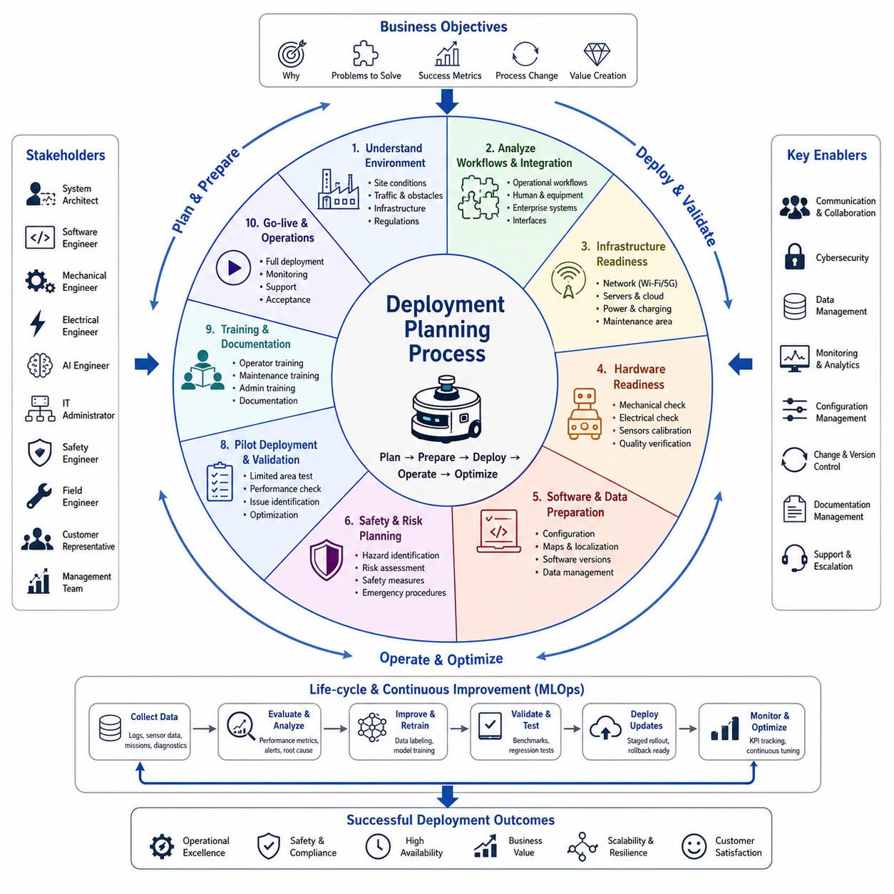
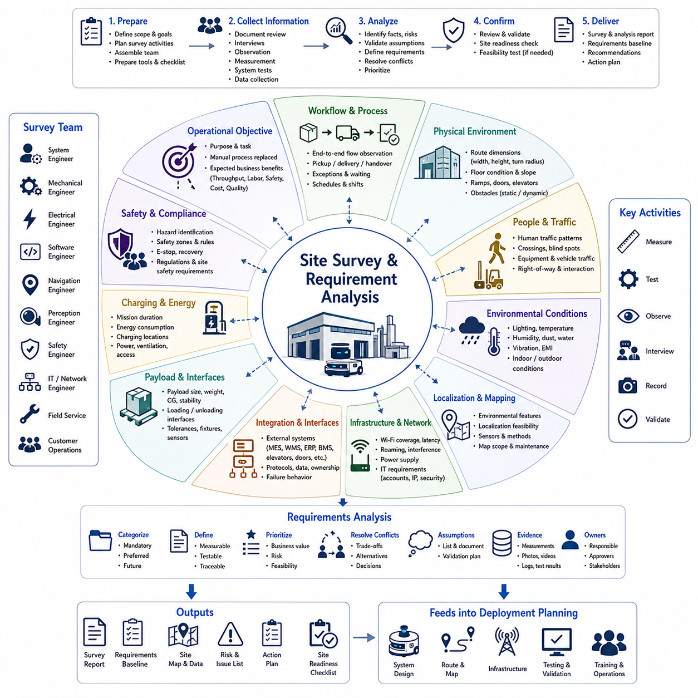
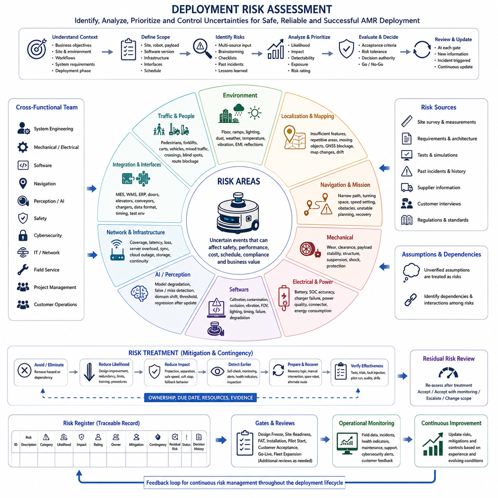
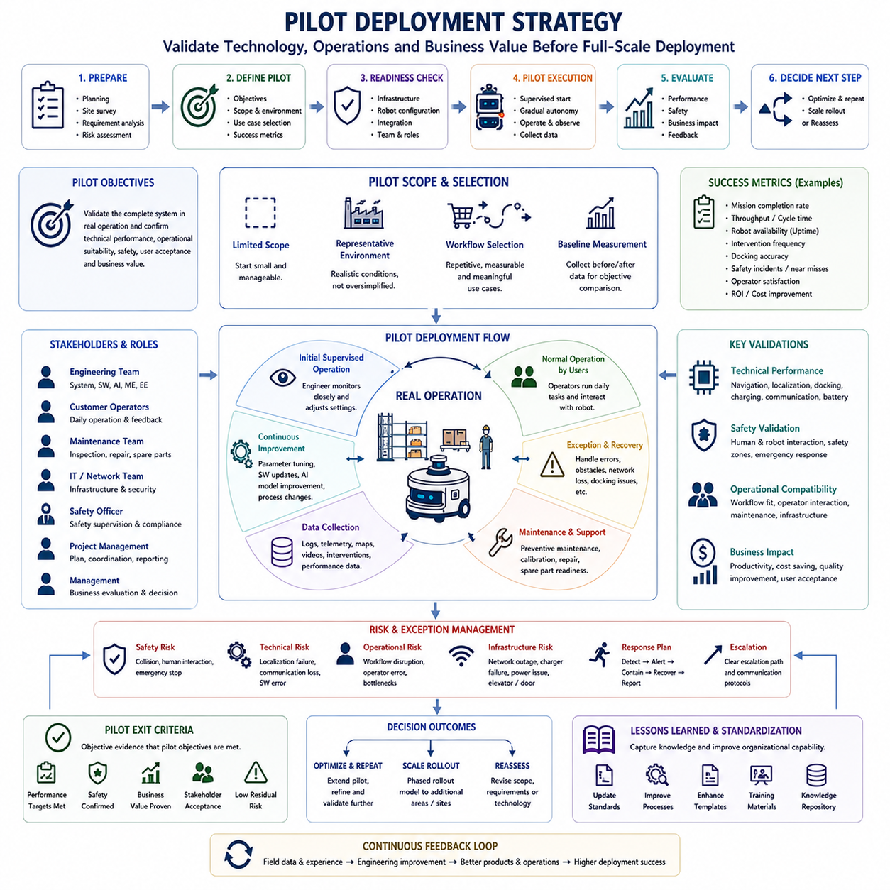
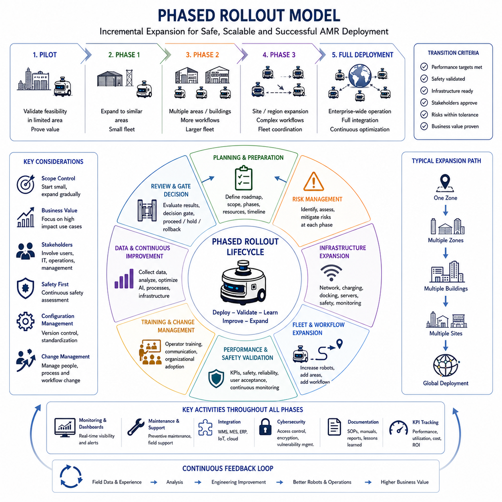
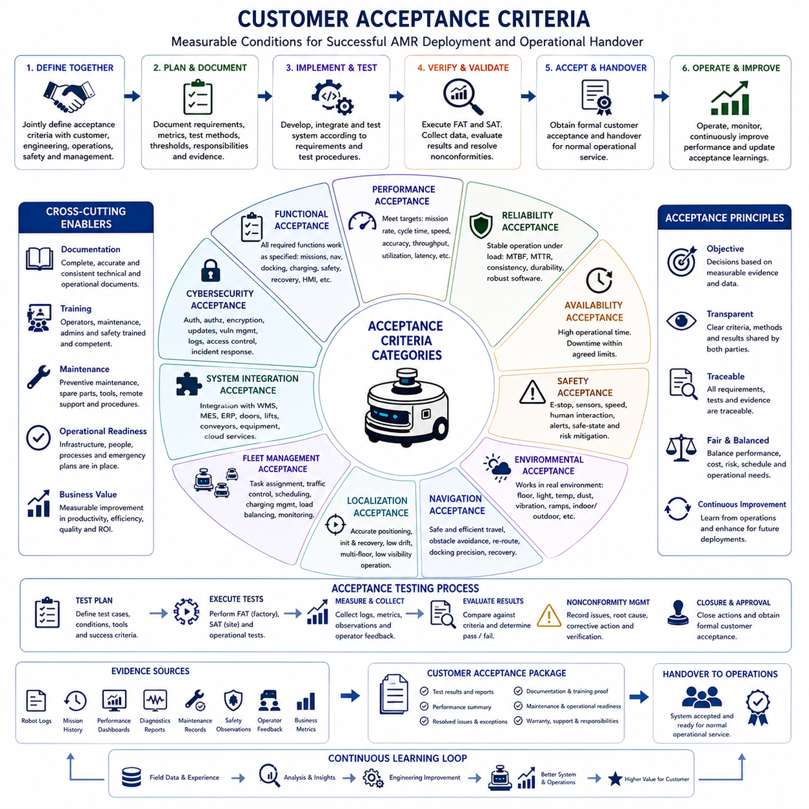
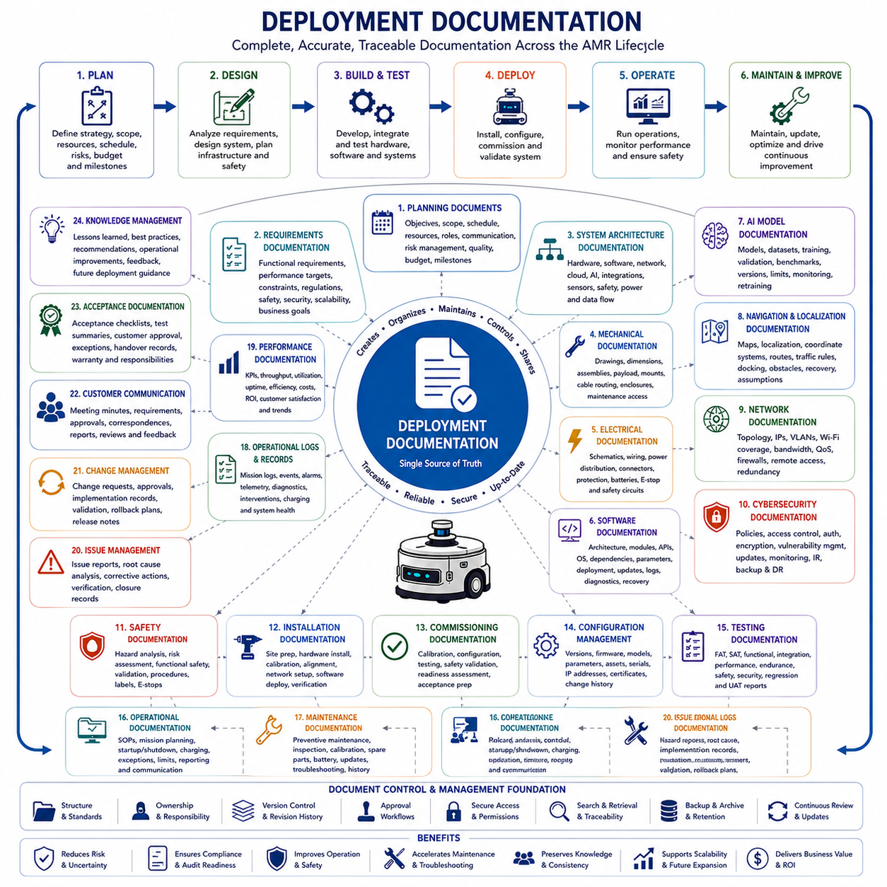
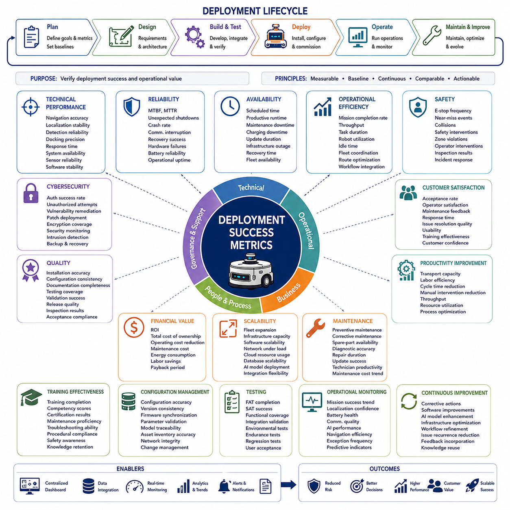

**Volume 08. AMR Operations, Deployment, and MLOps**

# Chapter 01. Deployment Strategy

## 01.1 Deployment Planning Process

{width="7.268055555555556in" height="7.268055555555556in"}

The deployment planning process is the bridge between successful development and successful real-world operation. A technically capable Autonomous Mobile Robot (AMR) does not automatically become a successful product simply because it performs well in laboratory testing. Real deployment introduces changing environments, human interaction, communication constraints, operational procedures, regulatory requirements, and customer-specific workflows that cannot be fully reproduced during development. Deployment planning therefore begins long before the first robot arrives at the customer site. It establishes a structured roadmap that defines technical objectives, operational expectations, organizational responsibilities, deployment milestones, risk mitigation activities, validation methods, and long-term support strategies. Within the overall Operations, Deployment, and MLOps volume, the deployment planning process serves as the foundation for every subsequent activity, including site surveys, pilot deployments, rollout strategies, operational monitoring, and continuous optimization.

An effective deployment plan starts with a clear understanding of business objectives rather than technical specifications alone. Every deployment should answer why the robot is being introduced, what operational problems it is expected to solve, how success will be measured, and which organizational processes will change after deployment. These objectives should be translated into measurable operational outcomes such as reduced transportation time, improved throughput, lower labor dependency, increased operational consistency, enhanced workplace safety, or higher asset utilization. Without clearly defined objectives, technical optimization often focuses on metrics that provide little practical value to customers.

Deployment planning requires close collaboration among multiple stakeholders throughout the project lifecycle. System architects define overall technical boundaries, software engineers prepare deployment packages, mechanical and electrical engineers validate hardware readiness, AI engineers verify perception and decision models, IT administrators prepare infrastructure, safety engineers assess operational risks, field engineers coordinate installation, customer representatives explain operational requirements, and management teams define acceptance criteria. A deployment plan should therefore function as a common communication framework that aligns all participants around shared goals, schedules, responsibilities, and expected deliverables.

One of the earliest activities involves understanding the operational environment in which the robots will function. Indoor factories, hospitals, warehouses, outdoor logistics centers, campuses, and public spaces all impose different environmental conditions. Floor materials, lighting variation, temperature, humidity, wireless network quality, obstacle density, traffic patterns, elevator availability, door automation, charging infrastructure, GPS availability, and pedestrian behavior all influence deployment complexity. Environmental characteristics determine sensor configurations, localization strategies, navigation parameters, safety policies, and maintenance requirements before installation even begins.

Operational workflow analysis is equally important because robots rarely operate in isolation. They become part of larger business processes involving people, equipment, enterprise software, inventory systems, manufacturing execution systems, warehouse management systems, hospital information systems, elevators, automatic doors, conveyor systems, and cloud services. Deployment planning must identify every interaction point between the robot and surrounding systems to minimize operational disruption. Integration planning reduces unexpected failures that often occur after installation when assumptions made during development differ from actual customer workflows.

Infrastructure readiness assessment ensures that supporting facilities are prepared before deployment activities begin. Network coverage should be verified across the entire operational area, including wireless roaming performance, latency, bandwidth, and redundancy. Charging stations require appropriate electrical capacity and physical accessibility. Server infrastructure should provide sufficient computing resources for fleet management, monitoring, logging, data storage, and software updates. Physical maintenance areas should be prepared for inspection, repair, battery replacement, and spare component storage. Addressing these infrastructure requirements early significantly reduces deployment delays.

Hardware readiness verification confirms that every robot satisfies manufacturing quality standards before leaving the production facility. Mechanical assembly should be inspected for structural integrity, fastening quality, suspension performance, wheel alignment, and payload stability. Electrical verification includes battery health, wiring integrity, connector reliability, emergency stop functionality, power distribution, and thermal behavior. Sensor calibration should be completed under controlled conditions while software versions, firmware revisions, AI models, and configuration files are documented for traceability throughout the deployment lifecycle.

Software deployment preparation involves much more than copying executable files onto a robot. Configuration management ensures that localization parameters, navigation maps, safety zones, mission definitions, communication settings, authentication credentials, logging policies, and AI inference parameters match the target environment. Version control mechanisms maintain consistency across fleets while enabling rollback when unexpected issues arise. Automated deployment pipelines reduce human error by standardizing software installation, verification, and configuration procedures for every deployed robot.

Mapping and localization preparation represents another critical planning activity. Existing facility layouts should be reviewed to determine whether pre-built maps can be reused or whether new mapping operations are required. High-definition maps should accurately represent walls, permanent obstacles, docking stations, charging locations, elevators, restricted areas, and operational zones. Planning should also consider how maps will be updated as facilities evolve over time. Long-term localization stability depends on maintaining synchronization between physical environments and digital representations.

Safety planning must be integrated into deployment activities from the beginning rather than treated as a final approval step. Hazard identification evaluates possible collisions, equipment damage, emergency evacuation interference, cybersecurity threats, communication failures, localization loss, sensor degradation, power interruptions, and unexpected human behavior. Appropriate mitigation measures include safety speed limits, restricted operating zones, redundant sensing, emergency stop procedures, operator training, recovery workflows, and continuous safety monitoring. Risk assessments should remain living documents that evolve throughout deployment and operational phases.

Deployment schedules should be carefully coordinated with customer operations to minimize business disruption. Many industrial facilities cannot suspend production simply to accommodate robot installation. Consequently, deployments are often scheduled during weekends, holidays, maintenance shutdowns, or nighttime operations. Installation activities should be divided into clearly defined stages, including infrastructure preparation, hardware installation, software deployment, mapping, calibration, functional testing, operational validation, operator training, pilot operation, and production release. Each stage should include entry criteria, exit criteria, estimated durations, required personnel, and contingency plans.

Pilot deployment provides an intermediate validation stage before large-scale rollout. Rather than deploying an entire fleet immediately, organizations typically introduce a limited number of robots into carefully selected operational areas. Pilot operations allow engineering teams to observe navigation performance, mission execution, user interaction, communication reliability, charging behavior, and operational efficiency under realistic conditions. Lessons learned during pilot operation frequently reveal optimization opportunities that would have been expensive to address after full deployment.

Deployment planning should include detailed acceptance criteria agreed upon by both supplier and customer before installation begins. Acceptance criteria may include navigation accuracy, docking precision, mission completion rate, obstacle avoidance performance, throughput targets, communication reliability, battery endurance, charging efficiency, software stability, recovery time after faults, and compliance with safety requirements. Clearly documented acceptance metrics reduce ambiguity during project completion and establish objective standards for deployment success.

Training preparation is another essential component of deployment planning because long-term operational success depends heavily on human users. Operators should understand normal mission execution, manual control procedures, safety guidelines, emergency recovery, charging operations, basic troubleshooting, and reporting processes. Maintenance personnel require additional knowledge regarding hardware inspection, preventive maintenance, diagnostic tools, software updates, calibration procedures, and replacement of critical components. Administrators should receive training on fleet management systems, user permissions, monitoring dashboards, reporting tools, and operational analytics.

Documentation planning ensures that technical knowledge remains accessible throughout the robot lifecycle. Deployment packages should include installation manuals, wiring diagrams, network configurations, calibration records, software versions, maintenance schedules, troubleshooting guides, recovery procedures, operational checklists, emergency contacts, and configuration backups. Well-organized documentation significantly reduces downtime during future maintenance while enabling new personnel to support deployed systems without extensive retraining.

Communication planning establishes structured coordination among engineering teams, field technicians, customer representatives, and management. Daily deployment meetings, issue tracking systems, progress reports, installation checklists, risk registers, and escalation procedures improve transparency throughout deployment activities. Communication becomes particularly important during multi-site deployments where geographically distributed teams must maintain consistent deployment quality across different locations.

Deployment planning also incorporates cybersecurity considerations because modern AMRs operate as connected cyber-physical systems. Authentication policies, encrypted communications, secure software distribution, credential management, network segmentation, remote access controls, and vulnerability monitoring should be defined before robots become operational. Security planning reduces exposure to unauthorized access while ensuring compliance with customer IT policies and industry regulations.

Data management planning prepares the foundation for continuous operational improvement. Robots generate large volumes of sensor data, navigation logs, mission histories, diagnostic information, AI inference results, and operational statistics. Deployment plans should define what data will be collected, how frequently it will be transmitted, where it will be stored, how long it will be retained, and which teams may access it. These datasets later support predictive maintenance, AI retraining, operational optimization, and incident investigation.

Modern deployment planning increasingly incorporates MLOps principles to enable continuous improvement after deployment. AI models should not remain static throughout the robot lifecycle. Instead, field data should support ongoing model evaluation, dataset expansion, performance benchmarking, controlled model updates, regression testing, and staged deployment of improved algorithms. Planning these feedback mechanisms before deployment ensures that operational experience continuously enhances future robot performance instead of remaining isolated within individual customer sites.

Risk management remains active throughout deployment rather than ending after initial planning. New risks emerge during installation, testing, customer training, pilot operation, and production rollout. A structured risk management process continuously evaluates likelihood, operational impact, mitigation effectiveness, ownership, and contingency actions. Maintaining dynamic risk assessments allows deployment teams to respond proactively instead of reacting after operational failures have already affected customers.

Performance monitoring should begin immediately after deployment rather than waiting until problems occur. Key operational indicators such as mission completion rates, localization accuracy, battery utilization, charging efficiency, communication latency, robot availability, fault frequency, mean time between failures, recovery duration, and operator intervention frequency provide early insight into deployment quality. Continuous monitoring enables engineering teams to detect performance degradation before customers experience significant operational disruptions.

Successful deployment planning ultimately transforms deployment from a one-time installation event into a managed operational lifecycle. Instead of focusing exclusively on delivering robots to customer sites, deployment planning emphasizes sustainable operation, measurable business value, continuous technical improvement, operational resilience, and long-term customer satisfaction. As AMR fleets become larger, more autonomous, and increasingly integrated with enterprise systems, deployment planning evolves into a strategic engineering discipline that combines systems engineering, operations management, safety engineering, software lifecycle management, AI governance, cybersecurity, and continuous improvement into a unified operational framework. A mature deployment planning process therefore provides the organizational structure necessary for scalable, reliable, and economically sustainable autonomous robot operations across diverse industries and deployment environments.

## 01.2 Site Survey and Requirement Analysis

{width="7.268055555555556in" height="7.268055555555556in"}

A site survey and requirement analysis establish the factual basis for deploying an Autonomous Mobile Robot in a real operating environment. The purpose is not merely to inspect a building or collect customer requests, but to convert physical conditions, operational workflows, technical constraints, safety concerns, and business expectations into verifiable deployment requirements.

The process should begin before detailed system configuration or installation planning is finalized. Early investigation reduces the risk of selecting unsuitable sensors, communication methods, charging locations, navigation strategies, or vehicle dimensions. It also prevents project teams from designing around assumptions that may be valid in a laboratory but incorrect at the customer site.

A successful survey combines document review, stakeholder interviews, direct observation, physical measurement, system testing, and operational data collection. Facility drawings, process maps, network diagrams, safety rules, equipment specifications, and existing performance reports provide useful background, but they should always be compared with actual field conditions because documented information may be incomplete or outdated.

The survey team should include representatives from system engineering, mechanical and electrical engineering, software, navigation, perception, safety, information technology, field service, and customer operations. Each discipline observes different risks, and a multidisciplinary team prevents important constraints from being overlooked during a survey led only by commercial or installation personnel.

Before arriving on site, the team should define the survey scope, expected operating areas, target workflows, required measurements, interview participants, tools, and deliverables. A standardized checklist improves consistency, but it should not limit investigation. Unexpected conditions should be recorded even when they are outside the original checklist because they may influence design or deployment risk.

The first requirement is to understand the operational objective of the deployment. The team must identify what task the robot will perform, why automation is needed, which manual process it replaces or supports, and what business improvement is expected. Throughput, labor reduction, cycle-time stability, safety, traceability, service quality, and operating cost may all influence the final system design.

Workflow observation should follow the complete movement of materials, tools, products, documents, or service items from origin to destination. The survey should record pickup methods, loading time, waiting conditions, delivery confirmation, unloading procedures, exception handling, and responsibility transfer between people and systems. Small manual steps often become major barriers to automation.

Operating schedules must be examined in detail because the same facility can behave differently across shifts, weekends, production peaks, maintenance periods, or seasonal demand. Traffic density, worker behavior, available floor space, wireless usage, and charging opportunities may change significantly over time. Survey data should therefore represent typical, peak, and abnormal operating conditions.

The physical route should be measured from the robot's perspective rather than from a general facility layout. Corridor width, turning radius, doorway clearance, ceiling height, floor slope, ramp angle, curb height, surface gaps, drainage channels, speed bumps, elevator dimensions, and loading-zone geometry directly affect vehicle selection and path feasibility.

Floor conditions require careful attention because they influence traction, vibration, braking distance, localization stability, sensor performance, and mechanical durability. Concrete joints, steel plates, tiles, epoxy coatings, wet areas, dust, oil, debris, uneven surfaces, and damaged sections should be documented with location, severity, frequency, and expected operational impact.

Static obstacles must be classified according to permanence and predictability. Walls, columns, racks, fences, machines, fixed guards, and utility structures can usually be represented in maps, while movable carts, pallets, containers, temporary barriers, and parked vehicles require dynamic handling. The survey should distinguish between stable geometry and frequently changing layouts.

Human traffic analysis is essential wherever robots share space with employees, patients, visitors, contractors, drivers, or the public. The survey should identify crossing points, blind corners, entrances, queues, workstations, break areas, emergency exits, and locations where people may suddenly enter the robot path. Behavior patterns are often more important than simple headcounts.

Vehicle and equipment traffic should also be analyzed. Forklifts, pallet trucks, cleaning machines, towing vehicles, cranes, carts, and manually driven platforms may have different speeds, stopping distances, visibility, and right-of-way practices. Their interaction with the AMR must be reflected in traffic rules, safety zones, route priorities, and operating schedules.

Lighting conditions affect cameras, depth sensors, visual markers, and human visibility. The survey should examine direct sunlight, reflections, shadows, flicker, low-light zones, transparent surfaces, highly polished floors, and rapid transitions between indoor and outdoor areas. Measurements should be taken at different times when lighting changes significantly during operation.

Environmental conditions such as temperature, humidity, rain, snow, fog, dust, vibration, electromagnetic interference, and chemical exposure influence component selection and enclosure design. Indoor environments may also contain washdown areas, refrigerated rooms, clean zones, or corrosive materials. Requirements must reflect actual exposure duration rather than only nominal facility conditions.

Localization feasibility should be evaluated according to available environmental features and expected environmental change. Long uniform corridors, repetitive racks, glass walls, open outdoor areas, moving inventory, and frequently reconfigured production zones may reduce localization reliability. The survey should identify whether LiDAR, vision, GNSS, markers, reflectors, or combined methods are appropriate.

Mapping requirements depend on route complexity, map size, environmental stability, and the number of operational zones. The team should identify restricted areas, one-way paths, waiting zones, speed-control regions, docking points, charging areas, elevators, automatic doors, and emergency routes. Map ownership and map-update responsibility should also be defined.

Wireless network assessment should cover the complete route and not only office or production workspaces. Signal strength, roaming behavior, latency, packet loss, interference, network congestion, access-point placement, authentication, and firewall rules can affect mission control and monitoring. Temporary test equipment should be used when existing network records are insufficient.

The survey must determine which robot functions require continuous communication and which can continue safely during network loss. Navigation may remain local while task updates, remote monitoring, data upload, or external system integration depend on network availability. This distinction influences offline behavior, buffering, recovery logic, and infrastructure redundancy.

Information technology requirements include account management, device registration, certificates, IP allocation, domain policies, remote access, time synchronization, logging, cloud connectivity, server hosting, backup, and cybersecurity approval. Many deployments are delayed because IT requirements are discovered after the robot arrives rather than during the initial site analysis.

Integration analysis should identify every external system that creates, modifies, approves, or records robot tasks. These systems may include MES, ERP, WMS, hospital systems, building management platforms, elevators, doors, conveyors, production equipment, access controls, and customer dashboards. Each interface requires defined ownership, protocol, data format, and failure behavior.

Docking locations must be evaluated for mechanical accessibility, localization repeatability, human interference, floor condition, available space, and nearby obstacles. A docking station that appears suitable on a drawing may fail when carts, workers, doors, or production materials occupy the area. Approach paths and recovery space should be included in the evaluation.

Charging analysis should consider battery capacity, mission duration, energy consumption, charging rate, operating schedule, opportunity-charging windows, electrical supply, ventilation, and access restrictions. The number and location of chargers should support both normal operation and degraded conditions such as charger failure, delayed missions, or unexpected energy consumption.

Payload requirements should describe more than maximum weight. Size, center of gravity, load distribution, orientation, stability, securing method, loading tolerance, vibration sensitivity, temperature sensitivity, and contamination risk affect vehicle design and operation. The survey should also identify whether the payload changes during transport or requires active handling.

Loading and unloading interfaces must be analyzed in relation to height, alignment, tolerance, human involvement, mechanical guides, conveyors, fixtures, doors, and confirmation sensors. Reliable navigation alone cannot guarantee successful automation if transfer interfaces are inconsistent. Interface repeatability should be measured under realistic operating conditions.

Safety requirement analysis should identify hazards arising from robot motion, payload movement, shared traffic, charging, maintenance, network failure, localization loss, sensor blockage, and unauthorized access. Existing site safety rules should be reviewed together with robot-specific controls so that the deployment does not create conflicts with emergency or evacuation procedures.

Emergency response conditions should include emergency-stop access, manual movement, towing, brake release, damaged-payload handling, blocked-route recovery, fire response, and communication with site personnel. The survey should determine who is permitted to intervene, what training is required, and how the robot can be returned to a safe operating state.

Maintenance requirements depend on access to the robot, available workspace, technical skill, spare-parts policy, cleaning procedures, and customer support expectations. The survey should identify where inspection, calibration, repair, battery service, and software recovery can be performed without interfering with normal operations or exposing personnel to unnecessary risk.

Operational roles should be defined during requirement analysis. Operators, supervisors, administrators, maintenance technicians, IT personnel, safety managers, remote-support teams, and system owners need different permissions and responsibilities. Clear role definition supports training, access control, issue escalation, and accountability after the system enters production.

Customer expectations should be translated into measurable acceptance requirements. General statements such as reliable operation, accurate docking, safe navigation, or high productivity are not sufficient. Each expectation should be converted into a testable condition with a defined scenario, measurement method, threshold, observation period, and responsible approving party.

Performance requirements may include mission completion rate, cycle time, throughput, localization accuracy, docking precision, battery endurance, charging availability, communication reliability, obstacle response, recovery time, uptime, and operator intervention frequency. Target values should reflect real operating conditions rather than ideal demonstrations under controlled circumstances.

The analysis should distinguish mandatory requirements from preferred features and future expansion requests. Mixing these categories can create unnecessary cost and delay. Mandatory requirements define deployment acceptance, preferred requirements improve usability or resilience, and future requirements guide architecture decisions without becoming immediate contractual obligations.

Requirements should also be classified by source and ownership. Business, operational, safety, mechanical, electrical, software, AI, network, integration, maintenance, and regulatory requirements may belong to different stakeholders. Traceability from each requirement to its source helps resolve conflicts and prevents important decisions from being based on informal discussions.

Conflicting requirements are common and should be resolved explicitly. Customers may request high speed while safety teams require conservative motion, or demand continuous operation while limiting charging locations. The analysis should document tradeoffs, alternatives, assumptions, responsible decision makers, and approved compromises rather than hiding contradictions inside technical specifications.

Assumptions must be separated from confirmed facts. Examples include expected network availability, stable floor layouts, fixed payload dimensions, available elevator interfaces, or predictable human traffic. Unverified assumptions should be assigned validation actions because they can become major deployment failures when treated as established requirements.

Survey evidence should include measurements, annotated maps, photographs, videos, test results, interview records, network logs, environmental observations, and workflow timing data. Evidence improves communication between teams that did not attend the survey and provides a reference when site conditions change or disputes arise later in the project.

The requirement analysis output should connect directly to system configuration and deployment planning. Survey findings influence robot dimensions, payload design, sensor placement, localization methods, safety parameters, network architecture, charging strategy, integration scope, test scenarios, training content, documentation, schedule, and required field support.

A formal site survey report should describe the environment, workflows, infrastructure, interfaces, risks, assumptions, unresolved issues, and recommended actions. It should identify conditions that are acceptable, conditions requiring modification, and conditions that may prevent deployment. Critical findings should be assigned owners and completion dates before installation begins.

Site readiness should be confirmed through a structured review rather than assumed after the survey. Required floor repairs, network installation, electrical work, doorway modification, safety marking, server preparation, interface development, and operational procedure updates must be completed and verified. Readiness gates reduce costly idle time during installation.

When major uncertainties remain, a focused feasibility test may be required. Temporary robots, sensors, network equipment, markers, or simulation tools can validate route clearance, localization, docking, wireless coverage, and workflow compatibility. Small early tests often provide more reliable evidence than lengthy discussions based on incomplete information.

The site survey should not be treated as a one-time event. Facility layouts, workflows, network infrastructure, safety rules, production equipment, and traffic patterns may change between initial planning and final deployment. Important conditions should be reconfirmed before installation, pilot operation, fleet expansion, or major software and hardware updates.

After deployment, field data should be compared with the original survey assumptions and requirements. Differences between predicted and actual cycle time, traffic, battery consumption, intervention rate, or localization performance reveal gaps in the survey method. These lessons should improve future checklists, measurement practices, and requirement templates.

A mature site survey and requirement analysis process reduces technical uncertainty before resources are committed to full deployment. It aligns customer expectations with engineering reality, exposes environmental and organizational constraints, establishes measurable acceptance conditions, and creates traceable evidence for design decisions, risk control, validation, and long-term operation.

Ultimately, the quality of an AMR deployment is strongly influenced by the quality of the information collected before installation. Careful observation, disciplined measurement, cross-functional analysis, and explicit requirement definition allow the deployment team to design for the actual site rather than an assumed environment, creating safer, more reliable, and more scalable robot operations.

## 01.3 Deployment Risk Assessment

{width="7.268055555555556in" height="7.268055555555556in"}

Deployment risk assessment is the structured process of identifying, analyzing, prioritizing, and controlling uncertainties that may prevent an Autonomous Mobile Robot from being deployed safely, reliably, and economically. It converts technical, operational, organizational, environmental, and commercial concerns into traceable risks with defined owners, mitigation actions, verification methods, and escalation criteria.

The process begins after initial business objectives, site conditions, workflows, and system requirements have been understood, but it should remain active throughout installation, pilot operation, customer acceptance, and fleet expansion. Risks evolve as new information becomes available, so the assessment must be maintained as a living engineering record rather than completed once and archived.

A deployment risk is any uncertain event or condition that can negatively affect safety, schedule, cost, performance, system availability, customer acceptance, regulatory compliance, cybersecurity, or long-term maintainability. Risks may originate from design limitations, site conditions, incomplete information, external systems, human behavior, supplier dependencies, or changes introduced during deployment.

Risk assessment should involve representatives from system engineering, mechanical and electrical engineering, software, navigation, perception, artificial intelligence, safety, cybersecurity, information technology, field service, project management, and customer operations. Each discipline sees different failure mechanisms, and cross-functional participation reduces the chance that critical risks remain hidden.

The assessment should begin by defining its scope. The team must determine which site, robot model, payload, workflow, software version, infrastructure, integration interface, operating schedule, and deployment phase are included. Without a clear scope, risk descriptions become too broad to manage and mitigation actions become difficult to verify.

Risk identification should use multiple sources rather than relying only on team experience. Site survey evidence, requirements, architecture documents, test reports, failure histories, supplier information, customer interviews, simulation results, cybersecurity reviews, safety analyses, and lessons from previous deployments should all contribute to a comprehensive risk register.

Environmental risks include floor damage, ramps, narrow passages, poor lighting, dust, rain, temperature extremes, vibration, electromagnetic interference, water exposure, reflective surfaces, and outdoor weather variation. These conditions may degrade traction, sensing, localization, braking, communication, thermal performance, or mechanical durability during operation.

Traffic-related risks arise when robots share space with pedestrians, forklifts, carts, vehicles, cleaning machines, or other robots. Blind corners, crossing points, unpredictable human behavior, mixed right-of-way rules, blocked routes, and temporary obstacles may increase collision probability or create repeated mission delays that reduce operational value.

Localization and mapping risks include insufficient environmental features, repetitive geometry, moving inventory, glass walls, GNSS blockage, map changes, sensor occlusion, accumulated drift, and incorrect initial positioning. These issues may cause route deviation, docking failure, false obstacle detection, emergency stops, or loss of mission continuity.

Navigation risks arise when the planned vehicle motion does not match real site constraints. Insufficient turning space, unstable local planning, narrow route margins, changing obstacles, poor reversing behavior, unsuitable speed settings, or inadequate recovery logic may cause frequent stops, unsafe maneuvers, route blockage, or excessive operator intervention.

Mechanical risks include structural weakness, wheel wear, insufficient ground clearance, payload instability, fastener loosening, shock damage, poor suspension behavior, and inadequate protection from environmental exposure. These risks may not appear during short demonstrations but can become serious during long-run field operation.

Electrical and power risks include battery degradation, inaccurate state-of-charge estimation, unstable power distribution, charger failure, insufficient charging opportunities, connector damage, thermal overload, voltage drop, and unexpected energy consumption. Power-related failures can reduce mission availability and create unsafe recovery situations.

Sensor risks include calibration drift, contamination, condensation, vibration, field-of-view obstruction, timing mismatch, component failure, and performance degradation under lighting or weather changes. Because perception and safety functions depend on sensor quality, these risks should include both hardware failure and degraded but still functioning conditions.

Software risks may result from crashes, memory leaks, deadlocks, timing problems, incorrect configuration, incompatible dependencies, weak exception handling, or uncontrolled version differences. A robot may operate correctly in testing but fail under long-duration loads, unusual mission sequences, communication loss, or repeated recovery cycles.

Artificial intelligence risks include model performance degradation, domain shift, false detections, missed obstacles, unstable confidence thresholds, unrecognized site-specific objects, and model regression after updates. AI behavior should therefore be assessed under realistic environmental conditions rather than only against laboratory datasets or average benchmark scores.

Network and infrastructure risks include weak wireless coverage, poor roaming, excessive latency, packet loss, firewall restrictions, server overload, time synchronization failure, cloud outage, and insufficient data storage. The assessment should distinguish functions that depend on continuous connectivity from functions that can continue locally during communication loss.

Integration risks arise at interfaces with warehouse management systems, manufacturing execution systems, enterprise software, elevators, doors, conveyors, access controls, chargers, and customer dashboards. Incorrect data formats, unclear ownership, timing mismatches, incomplete error handling, and unavailable test environments frequently delay deployment.

Cybersecurity risks include unauthorized access, weak credentials, exposed services, insecure remote support, unencrypted communication, compromised updates, unmanaged accounts, vulnerable third-party software, and inadequate logging. These risks can affect not only information security but also physical safety because robots are connected cyber-physical systems.

Safety risks should include collision, crushing, trapping, payload drop, brake failure, unexpected motion, emergency-stop failure, localization loss, sensor blockage, unsafe manual recovery, and interference with evacuation routes. Safety assessment must consider normal operation, foreseeable misuse, degraded states, and maintenance activities.

Human and organizational risks often have a greater operational effect than technical defects. Insufficient training, unclear roles, resistance to process change, inconsistent operating rules, unauthorized interventions, poor incident reporting, and weak ownership can prevent technically capable robots from delivering stable business performance.

Schedule risks include delayed site preparation, late network approval, incomplete interfaces, unavailable customer personnel, delayed hardware shipment, unresolved safety reviews, and insufficient pilot time. The deployment plan should identify dependencies and critical-path activities so that delays can be detected before they affect the go-live date.

Cost risks arise from unplanned site modification, additional sensors, custom integration, repeated travel, extended engineering support, spare-part shortages, infrastructure upgrades, or rework after failed acceptance tests. Each major risk should include an estimate of potential financial impact so that mitigation decisions can be prioritized rationally.

Supplier and supply-chain risks include long lead times, discontinued components, inconsistent part quality, limited repair support, licensing changes, and dependency on single vendors. Deployment teams should identify critical components and software services that require alternative sources, spare inventory, or contingency plans.

Regulatory and compliance risks vary by industry and region. Industrial facilities, hospitals, logistics centers, outdoor public spaces, and critical infrastructure may impose different safety, privacy, electromagnetic compatibility, data retention, network, and operational approval requirements. These constraints must be confirmed before installation.

Each identified risk should be written as a clear cause-event-impact statement. A useful description explains what condition exists, what uncertain event may occur, and what consequence could follow. Vague entries such as "network issue" or "navigation problem" do not provide enough information to select effective controls.

Risk analysis commonly evaluates likelihood and impact. Likelihood estimates how probable the risk is under expected operating conditions, while impact measures its effect on safety, cost, schedule, performance, availability, compliance, or customer operation. Consistent scales should be used so that risks can be compared across disciplines.

Some risks require additional dimensions beyond likelihood and impact. Detectability, exposure duration, recovery difficulty, affected fleet size, and speed of escalation may be important. A rare risk with severe safety consequences may require stronger control than a frequent but easily recoverable operational interruption.

Risk ratings should support prioritization but should not replace engineering judgment. Numerical scores can create a false sense of precision when evidence is limited. High-consequence safety or cybersecurity risks may require mandatory treatment even when their estimated likelihood is low.

Risk acceptance criteria should be agreed upon before final deployment approval. The organization should define which risk levels are unacceptable, which require management review, which can be accepted with monitoring, and which are considered sufficiently controlled. Responsibility for formal acceptance must be clearly assigned.

Mitigation follows a hierarchy of actions. The preferred approach is to eliminate the hazard or dependency through design changes. If elimination is not feasible, the team may reduce likelihood, limit impact, add detection, provide fallback behavior, improve recovery, add training, or introduce monitoring and escalation procedures.

Technical mitigation may include additional sensors, revised mechanical design, improved braking, network redundancy, protected charging locations, software watchdogs, safer navigation parameters, improved error handling, updated AI models, better calibration, or separation of critical and noncritical system functions.

Operational mitigation may include route restrictions, speed limits, scheduled operating windows, traffic rules, manual checkpoints, cleaning procedures, battery inspection, operator training, maintenance intervals, spare-part preparation, and temporary support personnel during pilot and early production stages.

Contingency planning defines what happens when prevention measures fail. Each critical risk should have a practical response such as safe stop, controlled rollback, manual recovery, alternate route, spare robot activation, local operation during network loss, technician dispatch, or temporary return to the previous manual process.

Mitigation actions should include an owner, due date, required resources, completion criteria, and verification method. An action should not be considered complete simply because a document was updated or a meeting was held. Evidence must demonstrate that the risk has actually been reduced.

Verification may involve simulation, bench testing, environmental testing, route trials, network measurements, fault injection, endurance operation, cybersecurity testing, emergency drills, or pilot deployment. The selected method should reproduce the conditions under which the risk could occur and confirm that controls work as intended.

Residual risk is the level of risk remaining after mitigation has been implemented. Residual risks should be reassessed using the same criteria as initial risks and formally reviewed before customer acceptance. If the remaining exposure is still unacceptable, additional controls or changes to the deployment scope are required.

Assumptions should be managed as potential risks until they are confirmed. Expected wireless coverage, stable floor layouts, predictable traffic, adequate battery runtime, available integration interfaces, and unchanged payload dimensions are common assumptions that can cause major problems when treated as facts.

Dependencies between risks should also be examined. A network outage may prevent mission updates, remote diagnostics, and data logging at the same time. A localization failure may trigger unsafe navigation behavior, blocked traffic, and customer rejection. Understanding these relationships helps identify controls that reduce multiple risks together.

Risk ownership must remain clear throughout the project. The owner is responsible for monitoring the risk, coordinating mitigation, reporting status, and escalating when exposure increases. Ownership should be assigned to a person or accountable role rather than a general department.

The risk register should include a unique identifier, description, source, category, affected requirement, likelihood, impact, priority, owner, mitigation, contingency, due date, evidence, residual rating, status, and decision history. Traceability allows teams to connect risks with design changes, tests, incidents, and customer approvals.

Risk reviews should be scheduled at key deployment gates, including design freeze, site readiness, factory acceptance, installation, pilot start, customer acceptance, go-live, and fleet expansion. Additional reviews should be triggered by major incidents, site changes, software updates, hardware modifications, or new regulatory requirements.

During pilot operation, actual field evidence should replace earlier estimates wherever possible. Mission failures, intervention frequency, localization loss, battery consumption, charging delays, network interruptions, safety events, and user feedback provide a more accurate basis for reassessing deployment risks.

Near misses and minor incidents should be included in the risk process because they often reveal weaknesses before severe failures occur. Repeated emergency stops, temporary map loss, manual recoveries, or unexplained sensor warnings may indicate growing risk even when no injury or major operational loss has occurred.

Risk communication should be transparent and adapted to the audience. Engineers need detailed failure mechanisms and verification evidence, while customer management requires clear information about operational impact, mitigation status, remaining exposure, and decisions needed before deployment.

The assessment should avoid hiding risks to protect schedules or commercial expectations. Delaying disclosure often increases cost and reduces customer trust when problems later appear in operation. Early communication provides more options for redesign, process adjustment, phased deployment, or scope reduction.

Deployment approval should be based on the combined risk profile rather than on individual risk closure alone. A large number of moderate residual risks may create unacceptable overall exposure even when no single risk is classified as critical. Interactions among risks should therefore be considered in the final readiness decision.

After go-live, the risk register should transition into operational monitoring and incident management. Field logs, health indicators, maintenance data, support requests, cybersecurity alerts, and customer feedback should be reviewed to identify changes in likelihood, impact, or effectiveness of existing controls.

A mature deployment risk assessment process supports safer decisions, more realistic schedules, better resource allocation, clearer accountability, and stronger customer confidence. It allows the deployment team to concentrate effort on the uncertainties that matter most rather than responding reactively after failures have disrupted operation.

Ultimately, deployment risk assessment is not intended to eliminate every uncertainty, because complex robotic systems always operate with residual risk. Its purpose is to make uncertainty visible, measurable, controlled, and consciously accepted so that AMR deployment can proceed with an appropriate balance of safety, reliability, performance, cost, and business value.

## 01.4 Pilot Deployment Strategy

{width="7.268055555555556in" height="7.268055555555556in"}

A pilot deployment strategy is the controlled introduction of an Autonomous Mobile Robot into a real operating environment before full-scale production deployment. Rather than immediately deploying an entire fleet across all operational areas, the organization first validates technical performance, operational suitability, human acceptance, infrastructure readiness, and business value under actual working conditions. The pilot serves as the final bridge between laboratory validation and commercial operation, allowing engineering teams to discover and resolve practical issues before large-scale investment and organizational commitment. Within the overall deployment strategy, the pilot deployment phase significantly reduces technical uncertainty while increasing confidence in the final production rollout.

The primary objective of a pilot deployment is not simply to demonstrate that the robot can move autonomously. Instead, the pilot verifies whether the complete operational system---including the robot, software, infrastructure, operators, enterprise integration, maintenance processes, and customer workflows---functions together reliably under realistic conditions. A technically successful demonstration may still fail as a deployment if operators reject the workflow, infrastructure proves unreliable, or business objectives are not achieved.

Pilot deployment should begin only after deployment planning, site survey, requirement analysis, and deployment risk assessment have been completed. Entering a pilot phase without understanding environmental constraints, operational requirements, or identified deployment risks often converts the pilot into an uncontrolled troubleshooting exercise rather than a structured validation process. The pilot therefore represents a validation stage rather than an exploratory experiment.

A pilot should have clearly defined business objectives before deployment begins. The organization must identify which operational problems the robot is expected to solve, what improvements should be measured, how success will be evaluated, and what evidence is required before expansion. Objectives may include reducing transportation time, increasing throughput, improving inspection quality, reducing labor-intensive tasks, enhancing safety, minimizing operational variability, or validating a new business model.

Pilot scope should remain intentionally limited. Instead of attempting to automate every process simultaneously, the deployment team should select representative workflows that capture the most important operational characteristics while maintaining manageable complexity. A smaller deployment area allows engineering teams to observe robot behavior closely, collect detailed operational data, and rapidly implement improvements without disrupting broader customer operations.

Selecting the appropriate pilot environment is one of the most important strategic decisions. The selected area should represent realistic operational conditions rather than an artificially simplified demonstration environment. At the same time, the environment should provide sufficient engineering support, network access, maintenance capability, safety supervision, and operational flexibility to allow rapid problem resolution during the early deployment phase.

Workflow selection should focus on repetitive, measurable, and operationally meaningful activities. Transportation between fixed stations, automated inspection routes, warehouse replenishment, material handling, sample transportation, towing operations, or scheduled patrol missions often provide suitable pilot applications because their performance can be evaluated objectively using measurable operational indicators.

The pilot deployment team should include system engineers, software engineers, AI engineers, mechanical and electrical engineers, safety specialists, field service personnel, customer operators, IT administrators, maintenance technicians, and project managers. Cross-functional collaboration enables problems to be diagnosed quickly because many deployment failures originate from interactions between multiple engineering disciplines rather than from individual components.

Roles and responsibilities should be clearly assigned before pilot operation begins. Engineering teams manage technical issues, customer operators perform daily robot interaction, maintenance personnel handle inspections and repairs, IT teams maintain network infrastructure, safety officers supervise operational compliance, and management evaluates business outcomes. Clear responsibility prevents confusion when unexpected events occur during pilot operation.

Infrastructure readiness should be confirmed immediately before pilot deployment. Wireless communication, charging stations, docking equipment, server availability, fleet management software, monitoring dashboards, logging systems, emergency communication, maintenance areas, and spare parts should all be verified under operational conditions rather than assumed to function correctly based on installation completion.

Robot configuration should remain under strict configuration management throughout the pilot period. Software versions, firmware, AI models, navigation parameters, safety settings, calibration files, maps, mission definitions, and network configurations should be documented before deployment. Any modifications introduced during the pilot must be traceable so that performance improvements or unexpected failures can be accurately analyzed.

Before autonomous operation begins, comprehensive baseline measurements should be collected. Existing manual process performance, transportation times, operator workload, production throughput, waiting times, safety incidents, energy consumption, maintenance frequency, and operational costs provide reference values against which pilot improvements can later be measured objectively.

Initial pilot operation often begins under supervised conditions. Engineers closely observe robot movement, docking accuracy, localization performance, obstacle avoidance, communication stability, charging behavior, and mission execution while maintaining the ability to intervene immediately if unexpected situations arise. This supervised stage allows parameter adjustment before normal operators assume routine responsibility.

Operational observation should extend beyond robot performance alone. Engineers should evaluate operator interaction, customer acceptance, workflow compatibility, maintenance effort, network utilization, infrastructure reliability, and organizational adaptation. Many pilot failures occur not because the robot cannot navigate but because surrounding operational processes fail to support autonomous operation effectively.

Performance evaluation should include quantitative operational indicators. Mission completion rate, average mission duration, throughput, localization accuracy, docking precision, battery utilization, charging efficiency, communication latency, obstacle avoidance success, intervention frequency, recovery time, robot availability, and mean time between failures provide objective evidence regarding deployment quality.

Safety evaluation remains active throughout the pilot rather than occurring only before deployment. Safety observations should include interactions with pedestrians, forklifts, vehicles, temporary obstacles, emergency situations, blocked routes, manual recovery procedures, emergency-stop usage, near misses, and operator behavior. Dynamic operational safety frequently differs from laboratory validation because human behavior becomes significantly less predictable.

Pilot deployment should intentionally expose the robot to realistic environmental variation. Different work shifts, lighting conditions, traffic density, seasonal weather, production schedules, equipment movement, and operational disturbances reveal performance limitations that controlled testing cannot reproduce. However, exposure should remain carefully managed to avoid unacceptable operational risk.

Exception handling represents one of the most valuable aspects of pilot deployment. Engineers should carefully document localization failures, communication interruptions, navigation deadlocks, blocked routes, docking errors, charging failures, software exceptions, sensor degradation, infrastructure faults, and human interventions. Recovery capability often determines long-term operational success more strongly than nominal navigation performance.

Operator feedback provides information unavailable through automated performance metrics. Daily users observe workflow inconvenience, user-interface limitations, unnecessary alarms, inefficient mission sequences, confusing recovery procedures, maintenance challenges, and operational bottlenecks. Structured interviews and regular review meetings transform operational experience into engineering improvements.

Customer feedback should focus on business outcomes rather than technical implementation details. Management typically evaluates productivity improvement, service quality, operational stability, return on investment, organizational acceptance, maintainability, scalability, and future deployment potential. Engineering success alone does not guarantee commercial success unless measurable business objectives are achieved.

Data collection during pilot deployment should be comprehensive. Robot telemetry, sensor recordings, localization logs, navigation trajectories, battery statistics, communication records, AI inference outputs, operator interventions, maintenance reports, mission histories, environmental observations, and infrastructure performance should all be recorded with synchronized timestamps for later analysis.

Pilot data should support continuous engineering improvement rather than simply documenting deployment history. Performance trends identify optimization opportunities, operational anomalies reveal hidden risks, failure patterns improve predictive maintenance, and collected datasets support AI retraining, navigation refinement, perception enhancement, and future deployment planning.

Configuration changes introduced during pilot operation require disciplined change management. Software updates, navigation parameter adjustments, safety modifications, AI model improvements, infrastructure changes, workflow revisions, and mechanical adjustments should be evaluated individually whenever possible. Simultaneous changes make it difficult to identify which modification produced observed performance improvements or failures.

Regression testing should accompany every significant configuration change during the pilot. Previously validated missions, docking procedures, navigation routes, safety functions, communication interfaces, and recovery behaviors should be re-evaluated after updates. Continuous verification prevents improvements in one area from unintentionally degrading performance elsewhere.

Pilot deployment should establish measurable acceptance criteria before production rollout is approved. Minimum mission completion rates, localization accuracy, docking repeatability, safety performance, communication availability, battery endurance, maintenance effort, operator satisfaction, infrastructure reliability, and business performance targets should all be defined before pilot operation begins.

Exit criteria are equally important. The organization should define exactly what evidence demonstrates that the pilot has successfully achieved its objectives. Completion should depend on verified operational performance rather than elapsed calendar time. A longer pilot may be justified if critical operational questions remain unresolved despite satisfactory early results.

Not every pilot concludes with immediate fleet expansion. Some pilots reveal that workflows require redesign, infrastructure needs modification, AI models require additional training, safety procedures require refinement, or business assumptions need reconsideration. A pilot should therefore be viewed as a learning process rather than a mandatory approval stage.

Scalability analysis should evaluate whether pilot success can realistically be replicated across additional operational areas. A robot performing well within a small deployment zone may encounter communication limitations, traffic congestion, maintenance constraints, charging bottlenecks, or fleet coordination challenges when expanded to larger facilities or multiple buildings.

Human adoption should be monitored continuously throughout the pilot period. Acceptance often evolves over time as operators gain confidence, develop trust, and integrate robots into daily workflows. Conversely, repeated operational interruptions or confusing interfaces may reduce confidence despite technically acceptable system performance. Organizational adaptation therefore deserves the same attention as technical validation.

Maintenance readiness should also be verified under realistic operating conditions. Preventive maintenance procedures, spare-part availability, diagnostic tools, software recovery, battery replacement, calibration workflows, and field-service response should all be exercised before production deployment. Long-term operational sustainability depends heavily upon maintainable system design rather than initial deployment success.

Cybersecurity validation should continue during pilot deployment. Authentication, encrypted communication, remote access control, software update mechanisms, vulnerability monitoring, account management, logging integrity, and incident response procedures should be exercised under realistic operational conditions to ensure secure long-term deployment.

Integration validation confirms reliable communication between the robot and enterprise systems such as Warehouse Management Systems, Manufacturing Execution Systems, Enterprise Resource Planning systems, elevators, automatic doors, conveyors, charging infrastructure, and cloud services. Stable integration is often more important than individual robot performance because business workflows depend on coordinated system operation.

Operational readiness reviews should be conducted periodically throughout the pilot rather than only at its conclusion. Engineering teams, customer representatives, safety personnel, management, and field operators should jointly evaluate technical performance, operational risks, unresolved issues, business progress, and deployment readiness. Regular reviews enable timely corrective actions before problems accumulate.

A structured pilot deployment report should summarize objectives, deployment scope, configuration history, operational metrics, safety observations, customer feedback, engineering findings, remaining risks, corrective actions, lessons learned, and recommendations for production deployment. This report becomes an essential engineering reference for future deployments at similar customer sites.

Lessons learned from each pilot should be incorporated into organizational deployment standards. Checklists, installation procedures, configuration templates, safety guidelines, acceptance criteria, operator training materials, maintenance documentation, deployment schedules, and risk assessment methods should all evolve based on validated field experience rather than theoretical assumptions.

Pilot deployment should also support continuous learning across engineering organizations. Knowledge gained during one deployment should improve future robot platforms, software architectures, AI models, operational procedures, fleet management systems, and deployment methodologies. This continuous feedback loop transforms individual project experience into scalable organizational capability.

Ultimately, a pilot deployment strategy is not simply a preliminary demonstration before commercial deployment. It is a disciplined systems engineering process that validates technology, operations, infrastructure, people, safety, business objectives, and organizational readiness as one integrated system. By systematically reducing uncertainty before full-scale deployment, a well-designed pilot strategy increases deployment success, minimizes operational disruption, strengthens customer confidence, and provides the evidence required to expand autonomous robot operations safely, efficiently, and economically across increasingly complex operational environments.

## 01.5 Phased Rollout Model

{width="7.268055555555556in" height="7.268055555555556in"}

A phased rollout model is a structured deployment methodology that expands an Autonomous Mobile Robot system gradually rather than introducing the complete solution across all operational areas at once. After successful pilot validation, the deployment progresses through predefined stages in which operational scope, fleet size, workflow complexity, infrastructure, and organizational involvement increase in a controlled manner. This progressive approach minimizes operational disruption while allowing engineering teams to validate performance, improve reliability, and continuously reduce deployment risks before reaching full production operation.

The fundamental objective of phased rollout is to balance deployment speed with operational stability. Although immediate organization-wide deployment may appear attractive from a scheduling perspective, large-scale implementation without sufficient validation frequently introduces technical failures, workflow interruptions, safety concerns, and user resistance. By expanding deployment incrementally, organizations maintain business continuity while continuously improving the autonomous system based on real operational experience.

A phased rollout should begin only after pilot deployment objectives have been successfully achieved. The pilot demonstrates technical feasibility and operational suitability within a limited environment, while phased rollout focuses on validating scalability across increasingly larger operational areas. The transition from pilot to phased deployment should be supported by documented acceptance criteria, performance metrics, safety validation, and stakeholder approval.

Deployment phases should be defined before rollout begins. Each phase should specify deployment scope, operational boundaries, participating departments, infrastructure requirements, expected performance targets, success criteria, risk mitigation plans, and transition conditions. Clearly defined phases prevent uncontrolled expansion and ensure that every deployment stage delivers measurable business value before additional investment is made.

The first rollout phase often expands from a single pilot area to adjacent operational zones with similar environmental characteristics. Because the infrastructure, workflows, and operating conditions remain relatively familiar, engineering teams can validate whether previously observed performance remains consistent while introducing moderate increases in operational complexity.

Subsequent deployment phases gradually introduce more challenging operational conditions. Larger facilities, additional production lines, multiple warehouse zones, increased traffic density, different floor materials, varying lighting conditions, outdoor environments, or mixed human and vehicle traffic progressively expose the autonomous system to broader operating scenarios while maintaining controlled engineering supervision.

Geographical expansion should occur systematically rather than randomly. Deployment typically progresses from one work area to multiple areas, from one building to multiple buildings, from a single facility to several production sites, and eventually to regional or global deployment. Each expansion stage provides valuable engineering knowledge that improves deployment efficiency for future locations.

Fleet expansion should follow a similar progression. Initial rollout may involve only one or two robots operating under moderate workloads. As operational confidence increases, additional robots are introduced while fleet coordination, traffic management, charging strategies, task allocation, communication performance, and maintenance capacity are continuously evaluated under increasing operational demand.

Operational complexity should increase gradually throughout the rollout process. Early deployment phases often automate relatively simple transportation or inspection tasks with predictable routes and stable operating conditions. Later phases introduce dynamic scheduling, collaborative missions, shared operational resources, complex routing decisions, multiple task priorities, and interaction with external enterprise systems.

Workflow expansion should remain aligned with business priorities. Organizations should initially automate processes that provide high operational value with relatively low implementation risk. Once these workflows achieve stable performance, additional business processes can be incorporated into the autonomous operation while maintaining manageable deployment complexity.

Infrastructure expansion requires careful planning at every rollout stage. Wireless network coverage, charging stations, docking facilities, localization infrastructure, fleet management servers, monitoring systems, maintenance workstations, spare-part inventories, and cybersecurity controls should all expand proportionally with the growing deployment footprint to prevent infrastructure limitations from becoming operational bottlenecks.

Scalability validation should accompany every deployment phase. Engineering teams should evaluate whether navigation algorithms, localization systems, communication architecture, AI inference performance, fleet management software, databases, cloud services, and enterprise integrations continue to perform reliably as the number of robots, missions, and operational users increases.

Performance consistency is more important than achieving isolated peak performance during phased rollout. Every deployment phase should demonstrate stable operation over an extended period before further expansion occurs. Consistent mission completion, predictable response times, reliable localization, stable communication, and repeatable operational behavior provide stronger evidence of deployment readiness than occasional high-performance demonstrations.

Operational metrics should be collected continuously throughout each rollout stage. Mission completion rate, transportation efficiency, throughput improvement, docking accuracy, robot availability, charging utilization, battery health, intervention frequency, communication reliability, software stability, maintenance requirements, and user productivity provide objective evidence for evaluating deployment progress.

Safety validation remains active throughout the rollout lifecycle. As deployment expands into new operational areas, engineering teams should reassess pedestrian interactions, vehicle traffic, emergency evacuation routes, hazardous operating zones, temporary obstacles, construction activities, and changing environmental conditions. Safety validation therefore becomes a continuous engineering process rather than a one-time certification activity.

Risk management should evolve alongside deployment expansion. Risks identified during pilot deployment may become less significant as operational maturity improves, while entirely new risks may emerge when fleet size, organizational complexity, or infrastructure scale increases. Continuous risk reassessment ensures that mitigation strategies remain effective throughout deployment growth.

Configuration management becomes increasingly important as deployment expands. Robot firmware, navigation software, AI models, localization parameters, safety settings, fleet management software, communication protocols, and infrastructure configurations should remain version-controlled across all deployed systems. Configuration consistency greatly simplifies troubleshooting and ensures predictable operational behavior.

Software deployment should follow controlled release procedures. Rather than updating every deployed robot simultaneously, engineering teams should validate new software versions on a limited subset of robots before organization-wide distribution. This staged software rollout minimizes operational disruption and rapidly identifies unexpected software regressions.

AI models should also be deployed incrementally. Improvements in perception, object recognition, obstacle detection, route optimization, predictive maintenance, or mission planning should first be evaluated within representative operational environments before becoming standard across the entire fleet. Continuous monitoring ensures that model improvements consistently outperform previous versions.

Data collection expands naturally as deployment progresses. Larger fleets operating across multiple facilities generate extensive operational datasets that support navigation optimization, predictive maintenance, workflow analysis, infrastructure planning, AI retraining, and future deployment improvements. Standardized data management becomes essential for maintaining analytical consistency across deployment phases.

Operational support capability should grow together with deployment scale. Maintenance personnel, technical support engineers, IT administrators, field service teams, spare-part inventories, diagnostic equipment, and remote monitoring capabilities should all increase proportionally with the expanding operational footprint. Insufficient support capacity can become a significant deployment constraint even when robot technology performs reliably.

Operator training should follow the phased rollout schedule. Personnel directly interacting with autonomous systems should receive training before deployment reaches their operational area. Progressive training allows employees to develop familiarity with robot behavior, safety procedures, exception handling, maintenance responsibilities, and operational workflows without overwhelming the organization.

Organizational change management is a critical component of phased deployment. Employees may initially view autonomous systems with uncertainty or concern regarding workflow changes and job responsibilities. Transparent communication, structured training, active stakeholder participation, and visible operational success gradually improve organizational acceptance while reducing resistance to technological change.

Enterprise system integration should expand gradually as well. Early deployment phases may integrate only basic task scheduling and monitoring capabilities. Later phases can incorporate Warehouse Management Systems, Manufacturing Execution Systems, Enterprise Resource Planning platforms, inventory management, production scheduling, quality inspection systems, and cloud-based analytics. Incremental integration reduces implementation complexity while improving operational reliability.

Customer feedback should be collected continuously throughout each rollout stage. Operators, supervisors, maintenance personnel, safety officers, production managers, and executive stakeholders often identify different improvement opportunities based on their daily responsibilities. Structured feedback collection supports iterative engineering refinement while maintaining strong customer engagement.

Decision gates should separate every rollout phase. Before expansion proceeds, engineering teams should review deployment performance, safety metrics, operational stability, infrastructure readiness, customer satisfaction, unresolved issues, maintenance capability, cybersecurity status, and business performance. Only after predefined acceptance criteria have been achieved should the organization authorize transition to the next deployment phase.

Rollback planning should accompany every rollout stage. If unexpected technical failures, safety concerns, infrastructure limitations, or operational disruptions occur, the deployment team should be able to return affected operational areas to previously validated configurations with minimal business interruption. Well-defined rollback procedures significantly reduce deployment risk.

Resource allocation should remain flexible throughout phased rollout. Engineering effort, infrastructure investment, maintenance resources, training activities, and operational support should be adjusted according to deployment progress rather than following a rigid implementation schedule. Adaptive resource management enables organizations to respond effectively to unexpected deployment challenges.

Business performance should be evaluated at every deployment phase rather than only after full rollout. Productivity improvement, labor utilization, operational efficiency, service quality, asset utilization, maintenance cost, energy consumption, return on investment, and customer satisfaction should all be measured continuously to verify that deployment objectives remain aligned with organizational strategy.

Standardization becomes increasingly valuable as deployment expands. Installation procedures, network architecture, robot configuration, commissioning processes, maintenance schedules, safety documentation, operator training materials, and reporting templates should gradually evolve into standardized organizational practices. Standardization reduces deployment time while improving quality and operational consistency across future implementations.

Knowledge transfer between deployment phases significantly accelerates organizational learning. Engineering lessons, operational experiences, maintenance observations, software improvements, infrastructure recommendations, and customer feedback collected during earlier deployments should be incorporated into deployment documentation before subsequent rollout phases begin. This continuous knowledge accumulation enables each new deployment to become faster, safer, and more efficient than the previous one.

Continuous improvement should remain active throughout the entire rollout lifecycle. Performance optimization, workflow refinement, AI enhancement, infrastructure modernization, predictive maintenance, cybersecurity improvement, and operator training should continue even after deployment phases have been completed. A phased rollout therefore represents an ongoing operational evolution rather than a fixed implementation schedule.

Ultimately, a phased rollout model provides a disciplined framework for transforming successful pilot validation into sustainable enterprise-wide autonomous operation. By expanding deployment gradually, validating each stage with measurable operational evidence, and continuously incorporating engineering improvements, organizations reduce deployment risk, strengthen operational reliability, increase stakeholder confidence, and establish a scalable foundation for long-term autonomous mobile robot deployment across increasingly complex industrial environments.

## 01.6 Customer Acceptance Criteria

{width="7.268055555555556in" height="7.268055555555556in"}

A customer acceptance criteria framework defines the measurable conditions that an Autonomous Mobile Robot system must satisfy before the customer formally approves deployment and transfers the system into normal operational service. Acceptance criteria establish a common understanding between the supplier and the customer regarding expected functionality, performance, safety, reliability, operational readiness, and business outcomes. Rather than relying on subjective opinions, acceptance is based on objective evidence collected through structured testing, operational validation, documented inspections, and agreed performance measurements.

Customer acceptance should be considered throughout the entire development and deployment lifecycle rather than only at project completion. Acceptance requirements influence system architecture, hardware selection, software development, testing procedures, documentation, training programs, and deployment planning from the beginning of the project. Clearly defining acceptance expectations early minimizes misunderstandings, prevents scope disputes, and establishes realistic performance targets for both engineering teams and customers.

Acceptance criteria should be jointly developed by the customer, system integrator, engineering teams, safety specialists, operational personnel, and project managers. Collaborative definition ensures that technical capabilities remain aligned with operational requirements while balancing engineering feasibility, budget limitations, deployment schedules, regulatory compliance, and long-term maintenance considerations.

Acceptance requirements should be documented in formal project specifications before implementation begins. Every acceptance item should include a clear description, measurable success conditions, verification methods, responsible evaluation personnel, required evidence, acceptance thresholds, and procedures for handling nonconformities. Well-defined documentation provides traceability throughout the project and supports objective decision making during final system evaluation.

Functional acceptance verifies that the deployed robot performs all specified operational functions correctly. Mission execution, autonomous navigation, task scheduling, docking, charging, obstacle avoidance, localization, fleet coordination, remote monitoring, emergency recovery, and operator interaction should all operate according to documented system requirements. Every required capability should be demonstrated under representative operational conditions rather than only during laboratory testing.

Performance acceptance evaluates whether the system achieves the operational targets defined by the customer. Typical performance indicators include mission completion rate, transportation cycle time, average travel speed, localization accuracy, docking repeatability, task throughput, battery endurance, charging efficiency, fleet utilization, communication latency, and system availability. Performance validation should rely on statistically meaningful operational data collected over extended deployment periods.

Reliability acceptance confirms that the robot maintains stable operation under continuous production conditions. Mean time between failures, mean time to repair, mission success consistency, communication stability, hardware durability, software robustness, and long-duration operational performance should all demonstrate acceptable reliability before customer approval. Reliability testing should include normal production workloads rather than isolated engineering demonstrations.

Availability acceptance evaluates the percentage of time the autonomous system remains operational and capable of executing assigned missions. Downtime caused by hardware failures, software issues, charging delays, communication interruptions, maintenance activities, or infrastructure failures should remain within predefined contractual limits. High availability is essential for production environments that depend upon continuous autonomous operation.

Safety acceptance represents one of the most critical elements of customer approval. Safety validation should confirm proper operation of emergency-stop functions, protective sensors, speed limitations, obstacle detection, human interaction behavior, emergency recovery procedures, fault handling, warning systems, and safe-state transitions. Safety evaluation should consider both routine operation and abnormal operating conditions to ensure comprehensive risk mitigation.

Environmental acceptance verifies that the autonomous system performs reliably within the customer\'s actual operating environment. Floor conditions, lighting variation, temperature ranges, humidity, dust, vibration, electromagnetic interference, indoor and outdoor transitions, narrow passages, ramps, elevators, and dynamic obstacles should all be evaluated under representative operating conditions to confirm environmental compatibility.

Navigation acceptance validates the robot\'s ability to travel safely and efficiently throughout the designated operational area. Route planning, localization accuracy, obstacle avoidance, traffic negotiation, rerouting capability, docking precision, mission completion, and recovery from navigation failures should all satisfy predefined operational requirements. Navigation performance should remain consistent across different operational scenarios and varying traffic conditions.

Localization acceptance focuses specifically on positioning performance. The robot should consistently determine its position with sufficient accuracy to support autonomous operation, docking, manipulation, inspection, or transportation tasks. Localization validation should evaluate initialization, long-term drift, recovery after signal loss, multi-floor operation, environmental changes, and operation in areas with reduced sensor visibility.

Communication acceptance verifies stable data exchange among robots, fleet management systems, cloud services, enterprise applications, operator interfaces, and supporting infrastructure. Wireless coverage, communication latency, bandwidth utilization, packet reliability, failover capability, network security, and recovery following temporary communication interruptions should all satisfy operational requirements.

Fleet management acceptance confirms that multiple robots operate cooperatively under centralized coordination. Task assignment, traffic control, charging management, resource allocation, mission prioritization, congestion avoidance, fault recovery, workload balancing, and operational monitoring should function correctly as fleet size increases. Multi-robot validation is particularly important for large-scale industrial deployments.

System integration acceptance evaluates communication between the autonomous robot system and external operational systems. Integration with Warehouse Management Systems, Manufacturing Execution Systems, Enterprise Resource Planning systems, elevators, automatic doors, conveyors, production equipment, access control systems, charging stations, and cloud platforms should be verified using realistic operational workflows rather than isolated interface testing.

Cybersecurity acceptance confirms that the deployed solution satisfies organizational security requirements. Authentication mechanisms, authorization policies, encrypted communication, software update integrity, vulnerability management, account administration, audit logging, access control, network segmentation, and incident response procedures should all be validated before production approval. Security acceptance should also include operational procedures for maintaining cybersecurity after deployment.

Human-machine interaction acceptance evaluates the usability of operator interfaces and daily operational workflows. Operators should be able to assign missions, monitor robot status, acknowledge alarms, perform manual recovery, access diagnostic information, and execute routine operational procedures efficiently with minimal training. User acceptance depends not only on technical functionality but also on intuitive interface design and practical workflow integration.

Maintenance acceptance confirms that the deployed system can be supported throughout its operational lifetime. Preventive maintenance schedules, spare-part replacement, calibration procedures, diagnostic tools, software updates, battery replacement, component inspection, remote support capability, and maintenance documentation should all be validated before final acceptance. Maintainability directly influences long-term operational cost and system availability.

Documentation acceptance verifies that complete technical and operational documentation has been delivered. Installation manuals, user guides, maintenance procedures, troubleshooting instructions, software documentation, network configuration records, safety documentation, training materials, spare-part lists, and configuration records should all be accurate, complete, and consistent with the deployed system. Documentation becomes a critical reference throughout the operational lifecycle.

Training acceptance confirms that customer personnel possess sufficient knowledge to operate and maintain the deployed solution safely. Operators, maintenance technicians, supervisors, IT administrators, and safety personnel should successfully complete training programs appropriate to their responsibilities. Practical operational exercises should demonstrate competency rather than relying solely on classroom instruction.

Operational readiness acceptance evaluates whether the customer organization is fully prepared for routine autonomous operation. Infrastructure availability, trained personnel, maintenance capability, spare-part inventory, operational procedures, emergency response plans, cybersecurity processes, and management responsibilities should all be established before formal system acceptance. Organizational readiness is as important as technical readiness.

Business acceptance measures whether the deployment satisfies the operational objectives defined during project planning. Improvements in productivity, transportation efficiency, inspection quality, process consistency, labor utilization, operational flexibility, service quality, energy efficiency, return on investment, and overall business performance should be evaluated using objective operational evidence. Successful engineering implementation should ultimately produce measurable business value.

Pilot acceptance often precedes full production acceptance. During pilot operation, customers evaluate technical feasibility, workflow compatibility, organizational adaptation, and operational performance within a controlled deployment environment. Only after pilot objectives have been successfully achieved should the project advance toward production acceptance and larger-scale deployment.

Factory Acceptance Testing and Site Acceptance Testing serve complementary roles during customer approval. Factory Acceptance Testing verifies system functionality under controlled engineering conditions before shipment, while Site Acceptance Testing validates complete operational performance after installation within the customer\'s actual environment. Successful completion of both evaluation stages provides comprehensive evidence supporting final customer acceptance.

Acceptance testing should follow predefined procedures rather than improvised demonstrations. Every test should specify initial conditions, operational sequences, expected outcomes, measurement methods, pass and fail criteria, required evidence, responsible evaluators, and reporting formats. Standardized testing improves repeatability while minimizing subjective interpretation of results.

Objective measurement is essential throughout the acceptance process. Sensor logs, mission histories, navigation records, system diagnostics, performance dashboards, communication statistics, maintenance reports, safety observations, operator feedback, and business performance metrics should all contribute to acceptance evidence. Decisions supported by quantitative data provide greater confidence than those based solely on visual observation.

Nonconformities identified during acceptance testing should be documented systematically. Each issue should include problem descriptions, severity classifications, affected functions, root-cause investigations, corrective actions, verification procedures, and closure evidence. Formal issue management ensures that unresolved problems do not remain hidden during project completion.

Conditional acceptance may be appropriate when only minor issues remain unresolved. In such situations, customers may approve operational deployment while requiring completion of specific corrective actions within agreed schedules. Conditional acceptance should clearly distinguish between acceptable minor deficiencies and critical issues that must be resolved before operational approval.

Final customer acceptance should conclude with formal documentation signed by authorized representatives of both organizations. Acceptance records should summarize completed verification activities, achieved performance results, remaining limitations, documented exceptions, delivered documentation, completed training, maintenance readiness, warranty information, and agreed operational responsibilities. These records establish the official transition from project implementation to operational service.

Acceptance criteria should not remain static after deployment. Operational experience often reveals opportunities for improving performance expectations, maintenance procedures, workflow integration, AI capabilities, safety processes, and operational efficiency. Continuous review allows future deployments to benefit from lessons learned while maintaining consistency across multiple customer installations.

Knowledge gained from customer acceptance activities should be incorporated into future engineering projects. Acceptance reports, operational feedback, failure analysis, customer recommendations, performance trends, maintenance observations, and deployment experiences provide valuable input for improving system architecture, software quality, testing methodology, deployment processes, documentation standards, and organizational best practices.

Ultimately, customer acceptance criteria provide the objective foundation for determining whether an Autonomous Mobile Robot system is ready for long-term operational service. By establishing measurable technical, operational, safety, reliability, integration, and business requirements before deployment begins, organizations create a transparent evaluation framework that reduces project risk, strengthens customer confidence, ensures deployment quality, and supports successful transition from engineering implementation to sustainable production operation.

## 01.7 Deployment Documentation

{width="7.268055555555556in" height="7.268055555555556in"}

Deployment documentation is the complete collection of technical, operational, administrative, and management records required to successfully install, validate, operate, maintain, and continuously improve an Autonomous Mobile Robot system throughout its entire lifecycle. These documents provide a common source of truth for customers, deployment engineers, system integrators, operators, maintenance personnel, project managers, and future engineering teams. Comprehensive documentation reduces deployment uncertainty, supports operational consistency, improves knowledge transfer, and establishes traceability for every stage of deployment.

Deployment documentation should begin during the earliest planning activities rather than after installation has been completed. Information generated during requirement analysis, system design, infrastructure planning, safety assessment, procurement, software development, testing, commissioning, training, and operational validation should all become part of an organized documentation system. Preparing documentation continuously throughout the project produces more accurate records than attempting to reconstruct information after deployment.

The primary objective of deployment documentation is to ensure that every technical decision, operational procedure, system configuration, and deployment activity can be understood, reproduced, maintained, and audited throughout the operational lifetime of the autonomous system. Well-organized documentation enables new personnel to understand the deployed solution quickly while supporting maintenance, troubleshooting, upgrades, regulatory compliance, and future deployment expansion.

Documentation should follow a structured hierarchy with clearly defined ownership and version control. Project management documents, engineering specifications, mechanical drawings, electrical schematics, software documentation, network configurations, operational procedures, maintenance manuals, training materials, validation reports, acceptance records, and continuous improvement documents should each belong to well-defined categories that simplify long-term management.

Deployment planning documents establish the overall execution strategy before implementation begins. These documents typically define deployment objectives, project scope, customer requirements, implementation schedules, resource allocation, organizational responsibilities, communication plans, risk management strategies, quality assurance procedures, budget estimates, and deployment milestones. They provide management with a complete overview of deployment activities from project initiation through operational handover.

Requirement documentation captures customer expectations and operational constraints. Functional requirements, performance targets, environmental conditions, infrastructure limitations, regulatory obligations, safety expectations, cybersecurity requirements, maintenance objectives, scalability considerations, and business goals should all be documented before system implementation begins. Clear requirements reduce misunderstandings while providing measurable acceptance criteria throughout deployment.

System architecture documentation describes the complete technical structure of the deployed solution. Hardware architecture, software architecture, communication networks, cloud services, edge computing resources, AI components, fleet management systems, enterprise integrations, sensor configurations, power distribution, safety systems, and data management pipelines should all be documented using consistent engineering conventions.

Mechanical documentation provides detailed information regarding the physical construction of the deployed system. Mechanical drawings, assembly procedures, dimensional specifications, payload limitations, mounting interfaces, structural calculations, cable routing, enclosure designs, maintenance access points, and replacement procedures enable reliable installation and long-term maintenance throughout the robot\'s operational life.

Electrical documentation records the complete electrical architecture supporting the deployed solution. Power distribution diagrams, wiring schematics, connector definitions, communication buses, grounding methods, fuse specifications, circuit protection, battery systems, charging interfaces, emergency-stop circuits, and electrical safety requirements should all be documented with sufficient detail for maintenance and troubleshooting.

Software documentation explains how the deployed autonomous system operates internally. Software architecture, module relationships, APIs, middleware configuration, operating systems, software dependencies, deployment procedures, configuration parameters, update mechanisms, logging systems, diagnostic interfaces, and recovery procedures should all be described in a manner that supports future development and maintenance.

AI documentation becomes increasingly important as autonomous systems rely more heavily on machine learning models. Model architectures, training datasets, data preprocessing, model validation results, performance benchmarks, inference requirements, retraining procedures, model version history, deployment conditions, known limitations, and performance monitoring methods should all be documented to support responsible AI lifecycle management.

Localization and navigation documentation should explain map generation, localization algorithms, coordinate systems, navigation parameters, route definitions, traffic management rules, docking procedures, obstacle handling strategies, recovery behavior, and environmental assumptions. Accurate documentation enables future engineers to modify navigation behavior without introducing unnecessary operational risk.

Network documentation records communication infrastructure supporting robot operation. Wireless coverage maps, IP address assignments, VLAN configurations, firewall rules, switch configurations, quality-of-service settings, bandwidth allocation, network redundancy, remote access methods, cloud connectivity, and cybersecurity controls should all be maintained throughout deployment.

Cybersecurity documentation defines policies protecting deployed autonomous systems against unauthorized access and operational disruption. Authentication mechanisms, access control policies, password management, encryption methods, vulnerability assessment procedures, software update policies, security monitoring, incident response plans, backup strategies, and disaster recovery procedures should all remain current throughout the operational lifecycle.

Safety documentation provides evidence that deployment satisfies applicable safety requirements. Hazard analyses, risk assessments, functional safety evaluations, emergency procedures, safety validation reports, protective device verification, operating restrictions, warning labels, emergency response plans, and operator safety instructions should all be documented before operational approval is granted.

Installation documentation provides detailed procedures for deploying the autonomous system at customer facilities. Site preparation requirements, infrastructure verification, hardware installation sequences, calibration procedures, sensor alignment, software deployment, network configuration, system commissioning, functional verification, and initial operational validation should all be described using repeatable engineering procedures.

Commissioning documentation records activities performed immediately before operational deployment. Calibration reports, configuration records, communication verification, safety validation, navigation tuning, infrastructure testing, software installation, hardware inspection, operational readiness assessment, and customer acceptance preparation provide evidence that the deployed system satisfies deployment requirements before entering production.

Configuration management documentation records every deployed system configuration throughout its operational lifetime. Software versions, firmware revisions, AI models, parameter settings, calibration values, hardware serial numbers, network addresses, security certificates, configuration changes, and deployment history should all remain traceable to simplify maintenance, troubleshooting, and future upgrades.

Testing documentation provides objective evidence that system requirements have been verified successfully. Factory Acceptance Testing, Site Acceptance Testing, functional testing, integration testing, performance testing, endurance testing, cybersecurity validation, safety testing, environmental testing, regression testing, and user acceptance testing should all produce standardized reports documenting procedures, observations, results, and corrective actions.

Operational documentation supports daily robot operation after deployment. Standard operating procedures, mission planning instructions, operator responsibilities, startup procedures, shutdown procedures, charging instructions, exception handling, emergency recovery, operational limitations, reporting methods, and communication protocols enable consistent operation across different shifts and operating personnel.

Maintenance documentation enables long-term operational sustainability. Preventive maintenance schedules, inspection procedures, calibration instructions, spare-part replacement methods, battery maintenance, software update procedures, troubleshooting guides, diagnostic workflows, repair records, maintenance history, and service intervals should all be maintained throughout the deployment lifecycle.

Training documentation ensures that customer personnel receive consistent knowledge transfer. Operator manuals, maintenance guides, administrator documentation, safety training materials, troubleshooting exercises, instructional presentations, practical evaluation procedures, certification records, and competency assessments provide evidence that personnel are prepared to operate the autonomous system safely and efficiently.

Operational logs become valuable deployment documents throughout long-term operation. Mission histories, navigation logs, localization records, AI inference logs, communication events, charging statistics, maintenance records, operator interventions, software exceptions, infrastructure failures, and system diagnostics collectively provide comprehensive evidence supporting performance analysis and continuous improvement.

Performance documentation records measurable operational results after deployment. Key Performance Indicators, productivity improvements, transportation efficiency, robot utilization, mission completion rates, battery performance, fleet coordination efficiency, maintenance costs, downtime statistics, return on investment, and customer satisfaction measurements demonstrate whether deployment objectives have been achieved successfully.

Issue management documentation records deployment problems and their resolution. Problem reports, root-cause analyses, corrective actions, preventive actions, engineering investigations, software patches, hardware modifications, verification activities, approval records, and closure documentation create organizational knowledge that improves future deployments while preventing repeated failures.

Change management documentation ensures that every modification introduced after deployment remains fully traceable. Software updates, infrastructure modifications, AI model revisions, hardware replacements, workflow improvements, parameter adjustments, safety updates, and cybersecurity improvements should all be documented together with approval records, implementation schedules, validation evidence, and rollback procedures.

Customer communication documentation records formal interactions throughout deployment. Meeting minutes, technical discussions, requirement changes, design approvals, deployment schedules, training completion, acceptance decisions, issue reports, management reviews, operational feedback, and project correspondence provide valuable project history that supports future engineering decisions.

Acceptance documentation formally records successful deployment completion. Acceptance checklists, validation summaries, testing reports, customer approvals, unresolved issues, conditional acceptance items, delivered documentation, warranty information, maintenance agreements, operational responsibilities, and final handover records establish the official transition from deployment project to operational service.

Knowledge management documentation captures lessons learned throughout deployment. Successful engineering practices, deployment recommendations, operational improvements, infrastructure optimization methods, maintenance observations, customer feedback, performance trends, failure analysis, AI improvement opportunities, and organizational best practices should all be incorporated into future deployment standards.

Document version control is essential for maintaining consistency across long-term deployment. Every document should include version numbers, revision history, approval records, responsible authors, modification dates, document status, distribution information, and change summaries. Controlled documentation prevents obsolete procedures from remaining in operational use while ensuring that engineering teams always reference current information.

Documentation should be stored within secure document management systems that provide controlled access, backup protection, search capability, revision history, approval workflows, and long-term archival support. Digital document management improves collaboration across engineering organizations while protecting sensitive deployment information from unauthorized modification or loss.

Documentation quality should be reviewed regularly throughout the operational lifecycle. As systems evolve through software updates, infrastructure improvements, AI enhancements, and operational optimization, documentation should be updated simultaneously to maintain consistency with the deployed solution. Outdated documentation often introduces operational risk even when the underlying technology performs correctly.

Ultimately, deployment documentation serves as the institutional memory of an Autonomous Mobile Robot deployment project. It connects planning, engineering, installation, testing, operation, maintenance, customer acceptance, continuous improvement, and future expansion into one coherent knowledge system. Comprehensive, accurate, and continuously maintained documentation reduces technical risk, accelerates troubleshooting, supports regulatory compliance, preserves organizational knowledge, and establishes the foundation for reliable, scalable, and sustainable autonomous system deployment across increasingly complex industrial environments.

## 01.8 Deployment Success Metrics

{width="7.268055555555556in" height="7.268055555555556in"}

Successful deployment of an Autonomous Mobile Robot system cannot be determined solely by completing installation activities or handing the system over to the customer. True deployment success is measured by how effectively the deployed solution performs under real operational conditions throughout its entire lifecycle. Deployment success metrics provide objective evidence that technical objectives, operational expectations, business goals, and customer requirements have been achieved. These metrics transform deployment evaluation from subjective opinions into measurable performance indicators that support continuous improvement and future deployment optimization.

Deployment success metrics should be defined during the earliest stages of project planning rather than after deployment has been completed. Customer expectations, contractual obligations, operational targets, safety requirements, maintenance objectives, and business performance indicators should all be translated into measurable values before implementation begins. Establishing baseline measurements allows project teams to compare expected outcomes with actual operational performance after deployment.

Technical performance metrics evaluate whether the deployed system satisfies engineering requirements. Navigation accuracy, localization stability, obstacle detection reliability, positioning repeatability, docking precision, mission execution accuracy, communication latency, system availability, response time, computational performance, sensor reliability, and software stability collectively demonstrate whether the technical architecture performs as designed under operational conditions.

Operational efficiency metrics measure how effectively the deployed robot supports customer operations. Mission completion rate, transportation throughput, average task duration, robot utilization, idle time, fleet coordination efficiency, charging efficiency, route optimization performance, traffic management effectiveness, and workflow integration all provide valuable insight into the productivity of the deployed autonomous system.

Reliability metrics determine whether the system can maintain stable operation over extended periods. Mean Time Between Failures, Mean Time To Repair, unexpected shutdown frequency, software crash rates, communication interruption frequency, localization recovery success, sensor fault occurrence, hardware failure statistics, battery reliability, and overall operational uptime indicate the long-term dependability of the deployed solution.

Availability metrics evaluate how much time the autonomous system remains operational and capable of performing assigned tasks. Scheduled operating time, productive runtime, maintenance downtime, charging downtime, software update duration, infrastructure outages, recovery time after failures, and overall fleet availability help organizations understand whether operational capacity meets customer expectations.

Safety metrics verify that deployment maintains safe operation throughout daily use. Emergency stop activation frequency, near-miss events, collision occurrences, safety system interventions, restricted-area violations, operator intervention rates, safety inspection results, compliance audits, hazard mitigation effectiveness, and incident response performance demonstrate whether operational risks remain under acceptable limits.

Cybersecurity metrics assess the resilience of deployed systems against digital threats. Authentication success rates, unauthorized access attempts, vulnerability remediation time, security patch deployment frequency, encrypted communication coverage, security monitoring effectiveness, intrusion detection events, backup reliability, and incident recovery performance provide measurable indicators of cybersecurity readiness throughout system operation.

Quality metrics evaluate the consistency of deployment execution and system performance. Installation accuracy, configuration consistency, documentation completeness, testing coverage, validation success rate, commissioning quality, software release quality, hardware inspection results, calibration accuracy, and acceptance compliance demonstrate whether deployment processes follow established engineering standards.

Customer satisfaction metrics determine whether deployment successfully meets user expectations. Customer acceptance rates, operator satisfaction surveys, maintenance feedback, response time evaluations, issue resolution quality, usability assessments, training effectiveness, technical support performance, and overall customer confidence provide valuable information regarding the practical success of the deployed solution beyond purely technical performance.

Productivity improvement metrics compare operational performance before and after deployment. Material transportation capacity, labor efficiency, process cycle time, manual intervention reduction, workflow automation rate, production throughput, resource utilization, scheduling efficiency, operational consistency, and business process optimization demonstrate the measurable value created by autonomous system deployment.

Financial metrics evaluate whether deployment delivers expected economic benefits. Return on Investment, total cost of ownership, operating cost reduction, maintenance expenses, energy consumption, labor savings, productivity gains, equipment utilization, asset lifespan, and payback period help management determine whether deployment objectives have been achieved from a business perspective.

Scalability metrics assess how effectively the deployed solution can expand to meet future operational demands. Fleet expansion capability, infrastructure capacity, software scalability, network performance under increased load, cloud resource utilization, database scalability, AI model deployment efficiency, and system integration flexibility determine whether future growth can be achieved without major architectural redesign.

Maintenance metrics evaluate the effectiveness of long-term support activities. Preventive maintenance completion rates, corrective maintenance frequency, spare-part availability, diagnostic accuracy, repair duration, software update success, firmware management efficiency, maintenance scheduling compliance, technician productivity, and maintenance cost trends collectively indicate operational sustainability throughout the deployment lifecycle.

Training effectiveness metrics determine whether personnel are adequately prepared to operate and maintain the deployed system. Training completion rates, competency assessment scores, operator certification results, maintenance proficiency, troubleshooting capability, procedural compliance, safety awareness, knowledge retention, and independent operational performance indicate the overall success of knowledge transfer activities.

Configuration management metrics ensure that deployed systems remain technically consistent throughout operational life. Configuration accuracy, software version consistency, firmware synchronization, parameter validation, AI model traceability, hardware inventory accuracy, network configuration integrity, security certificate management, and documented configuration changes support reliable maintenance and future system upgrades.

Testing metrics verify that deployment objectives have been achieved through objective engineering evidence. Factory Acceptance Test completion, Site Acceptance Test success, functional verification coverage, integration validation, environmental testing results, endurance performance, regression testing effectiveness, cybersecurity validation, safety verification, and user acceptance results collectively provide measurable confidence before production operation begins.

Operational monitoring metrics continuously evaluate system behavior after deployment. Mission success trends, fleet utilization, localization confidence, battery health, communication quality, AI inference performance, navigation efficiency, environmental adaptation, exception frequency, diagnostic alerts, and predictive maintenance indicators enable engineering teams to identify emerging problems before operational performance deteriorates.

Continuous improvement metrics measure how effectively deployment evolves after commissioning. Corrective action implementation, software improvement frequency, AI model enhancement, infrastructure optimization, workflow refinement, issue recurrence reduction, maintenance efficiency improvement, customer feedback incorporation, documentation updates, and engineering knowledge reuse demonstrate organizational learning throughout the deployment lifecycle.

Deployment success metrics should be monitored using centralized dashboards that combine operational data, engineering measurements, maintenance records, customer feedback, and business performance indicators into a unified performance management framework. Real-time visualization enables project managers, operators, maintenance teams, and executives to identify trends, evaluate deployment health, and make evidence-based operational decisions throughout the lifetime of the autonomous system.

Metric ownership should be clearly assigned across engineering, operations, maintenance, quality assurance, cybersecurity, and project management teams. Each performance indicator should include defined calculation methods, acceptable thresholds, reporting frequency, corrective action procedures, and continuous review mechanisms. Clearly defined governance ensures that deployment success is evaluated consistently across different projects and customer environments.

Ultimately, deployment success metrics provide the quantitative foundation for evaluating Autonomous Mobile Robot deployment beyond simple installation completion. They connect engineering performance, operational efficiency, safety, reliability, cybersecurity, customer satisfaction, financial value, and continuous improvement into one comprehensive measurement framework. By continuously monitoring meaningful performance indicators throughout the operational lifecycle, organizations reduce deployment risk, improve decision-making, accelerate future deployments, strengthen customer confidence, and establish a scalable methodology for long-term autonomous system success.
