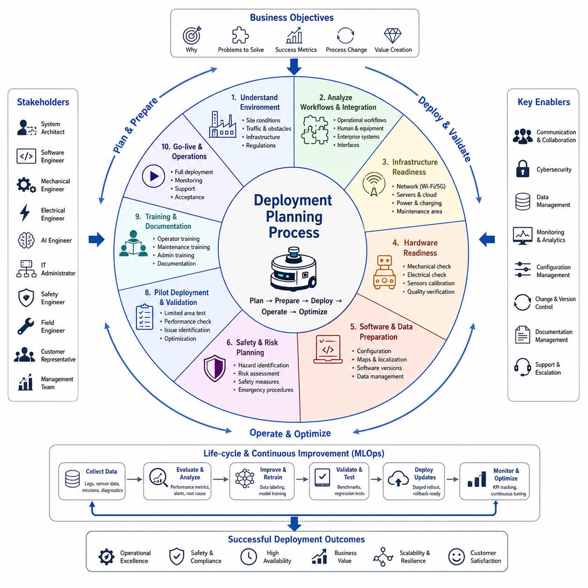
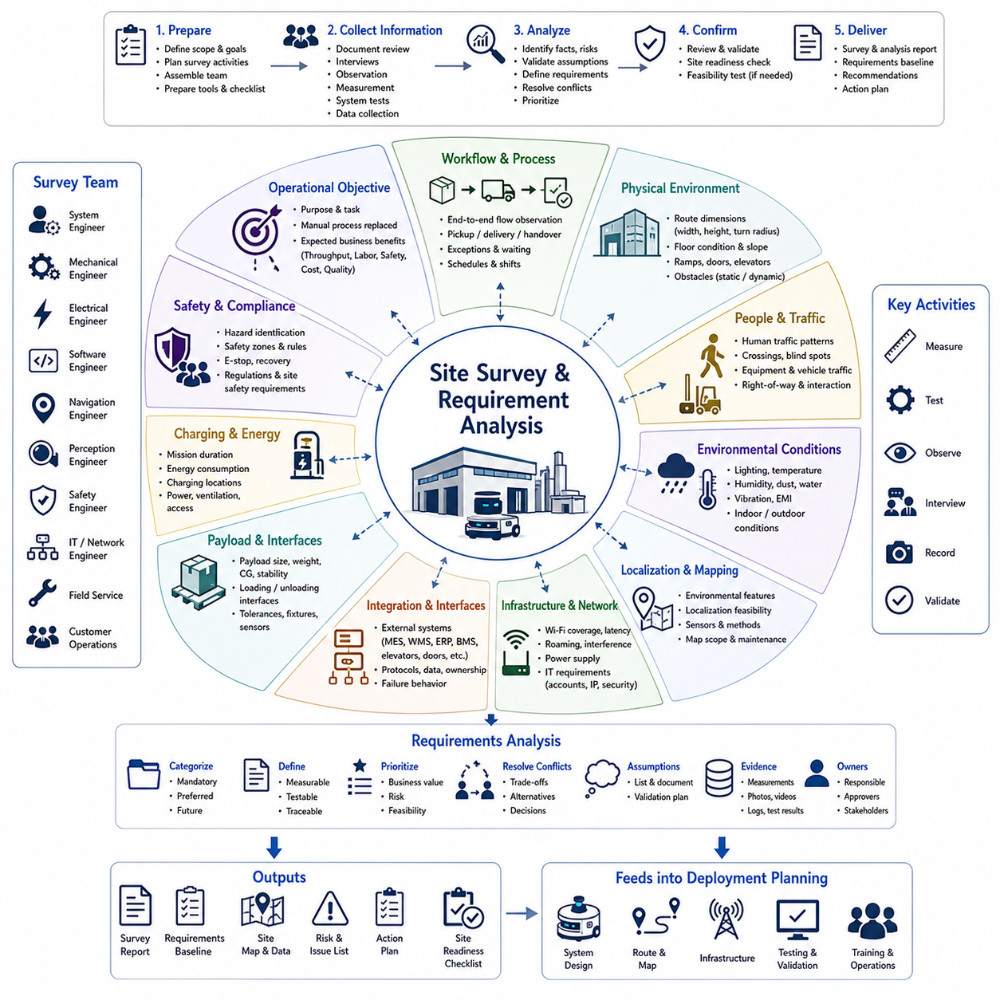
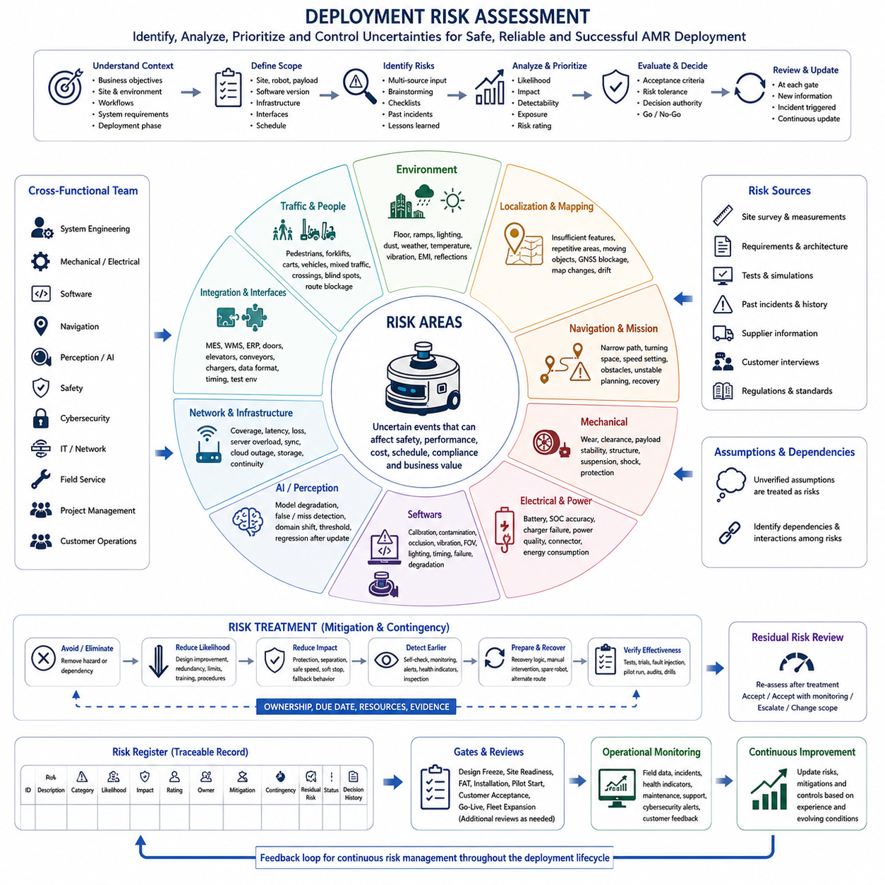
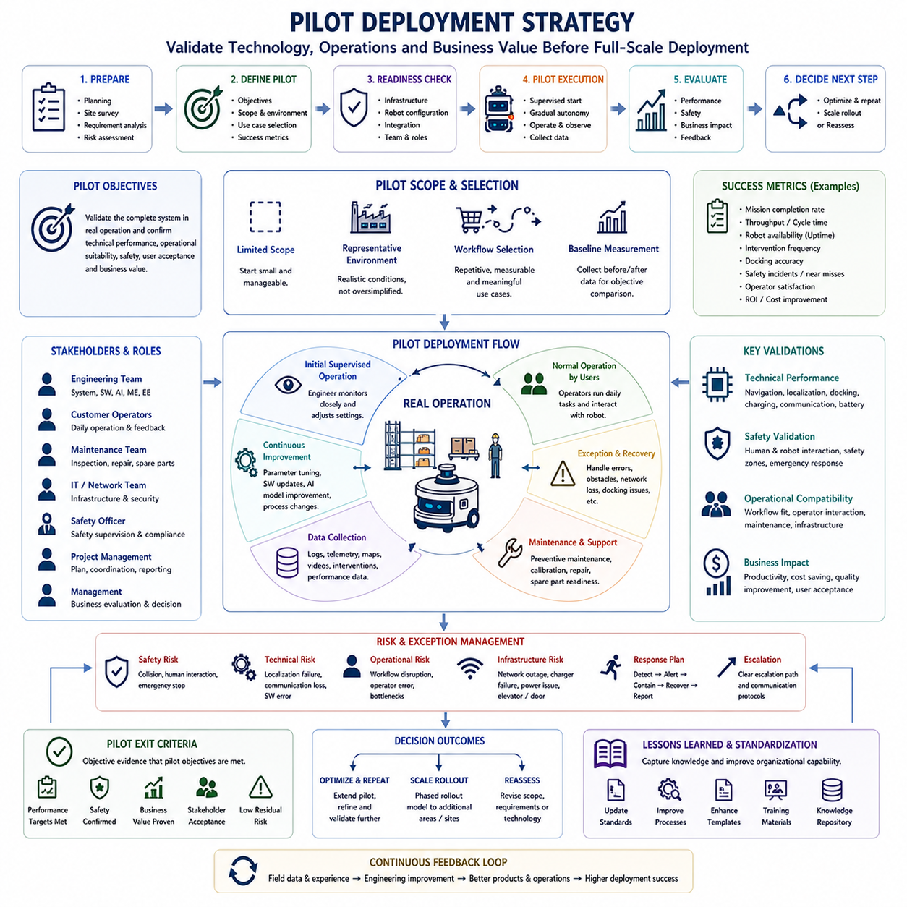
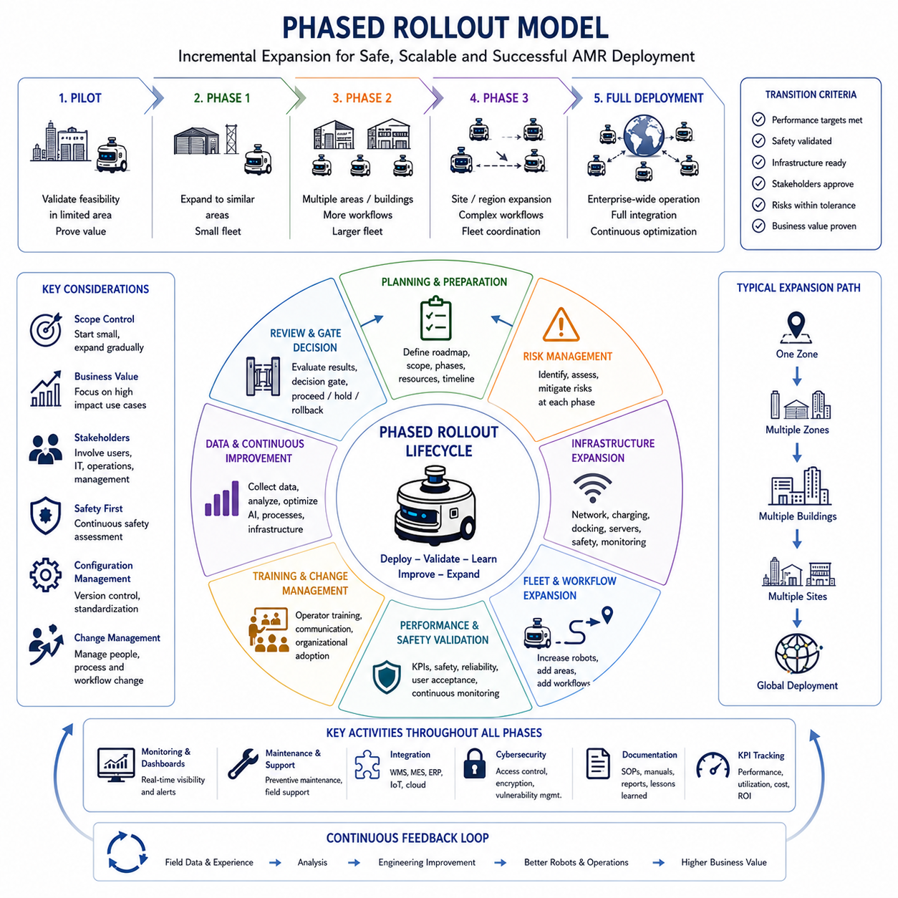
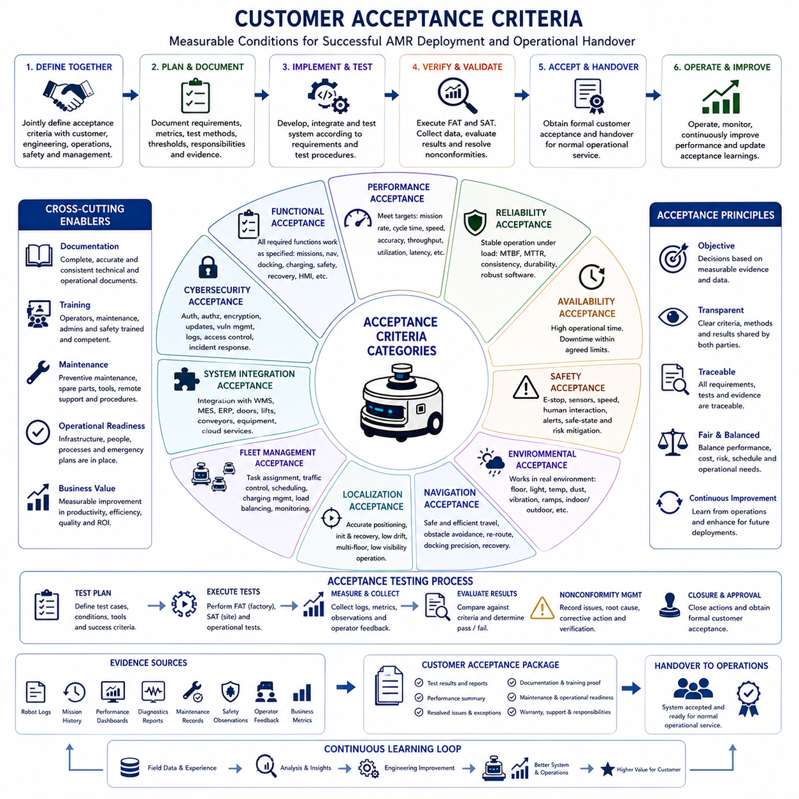
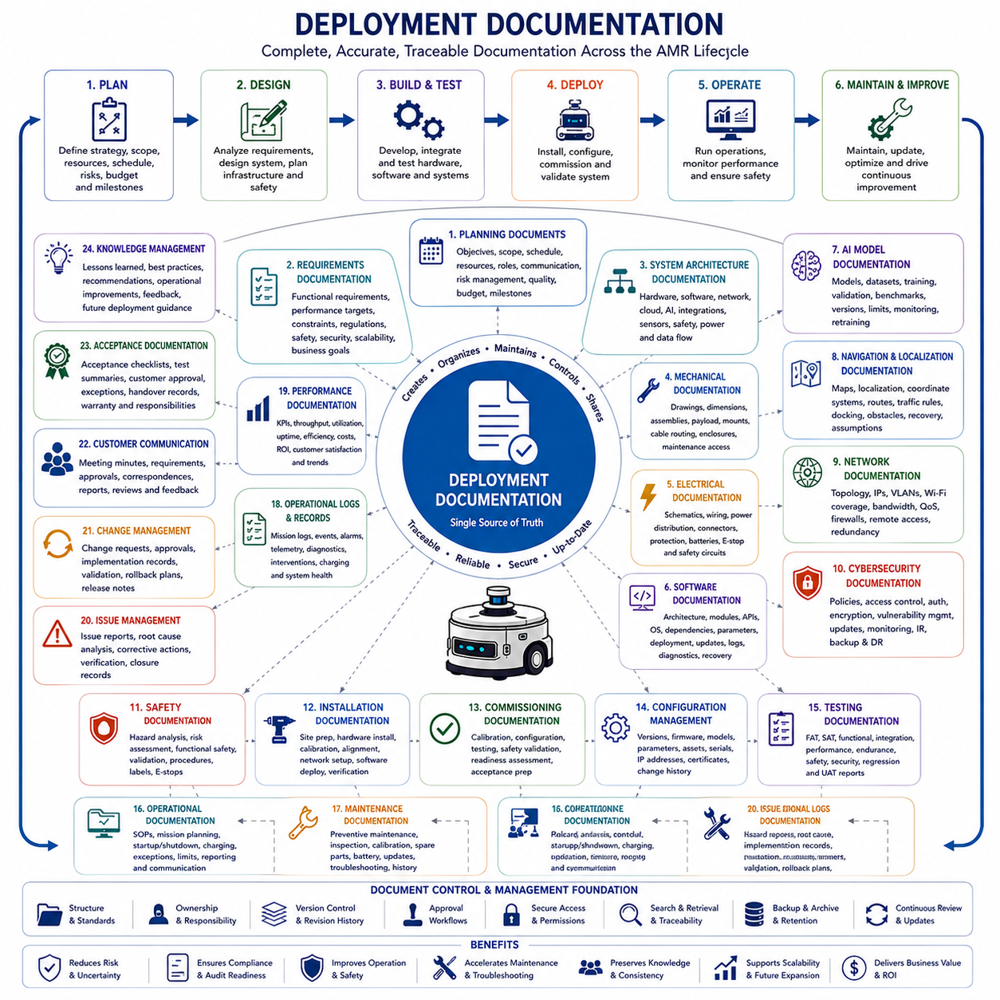
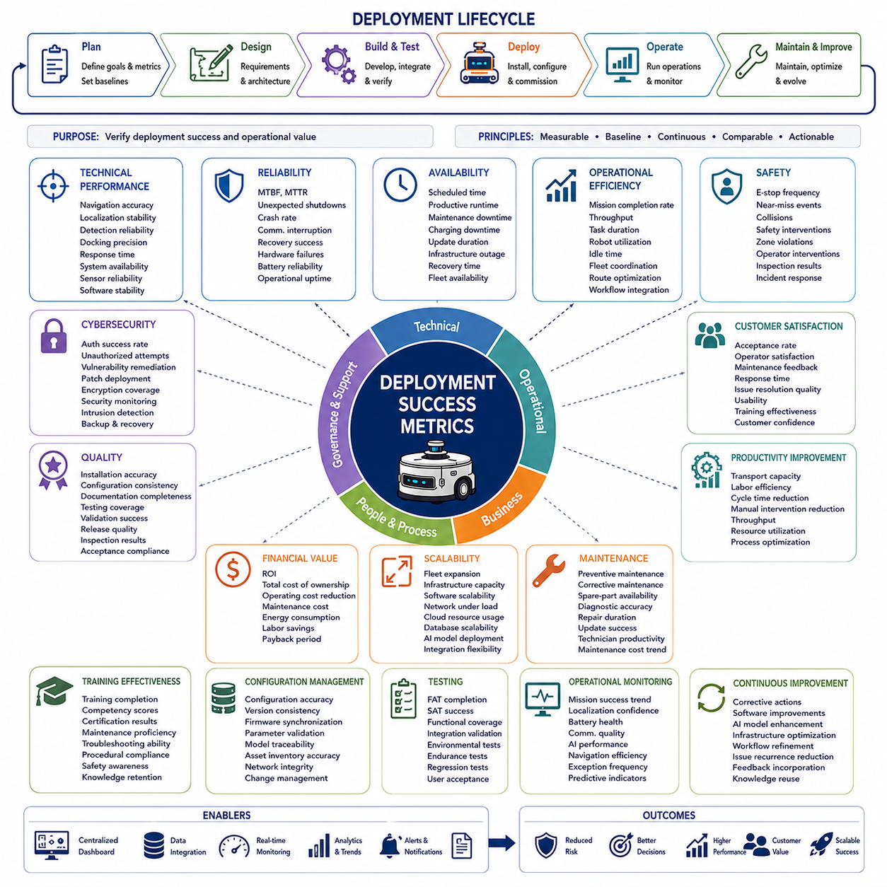

**Volume 08. AMR Operations, Deployment, and MLOps**

# Chapter 01. Deployment Strategy

## 01.1 Deployment Planning Process

{width="7.268055555555556in" height="7.268055555555556in"}

배포 계획 프로세스(Deployment Planning Process)는 성공적인 개발과 성공적인 실제 운영을 연결하는 핵심적인 가교이다. 기술적으로 우수한 자율이동로봇(Autonomous Mobile Robot, AMR)은 실험실에서 뛰어난 성능을 보였다고 해서 자동으로 성공적인 제품이 되는 것은 아니다. 실제 배포 환경에서는 끊임없이 변화하는 환경, 사람과의 상호작용, 통신 제약, 운영 절차, 규제 요구사항, 고객별 업무 프로세스 등 개발 단계에서 완전히 재현하기 어려운 요소들이 존재한다. 따라서 배포 계획은 첫 번째 로봇이 고객 현장에 도착하기 훨씬 이전부터 시작되어야 한다. 이 과정에서는 기술 목표, 운영 기대사항, 조직별 역할과 책임, 배포 단계, 위험(Risk) 완화 활동, 검증 방법, 장기적인 지원 전략 등을 체계적으로 정의하는 로드맵을 수립한다. 운영(Operations), 배포(Deployment), MLOps 전체 볼륨에서 배포 계획 프로세스는 이후 수행되는 현장 조사(Site Survey), 파일럿(Pilot) 배포, 단계적 확산 전략, 운영 모니터링, 지속적인 최적화의 기반이 되는 핵심 절차이다.

효과적인 배포 계획은 기술 사양보다 비즈니스 목표를 명확히 이해하는 것에서 시작된다. 모든 배포 프로젝트는 왜 로봇을 도입하는지, 어떤 운영상의 문제를 해결하려는 것인지, 성공 여부를 어떤 기준으로 평가할 것인지, 그리고 배포 이후 어떤 업무 프로세스가 변화하는지를 먼저 정의해야 한다. 이러한 목표는 운송 시간 단축, 처리량 증가, 인력 의존도 감소, 운영 일관성 향상, 작업 안전성 증대, 자산 활용률 향상과 같은 측정 가능한 운영 성과로 구체화되어야 한다. 명확한 목표가 없다면 엔지니어링 최적화는 고객에게 실질적인 가치를 제공하지 못하는 기술 지표만을 개선하는 방향으로 흐르기 쉽다.

배포 계획은 프로젝트 전 과정에서 다양한 이해관계자의 긴밀한 협업을 요구한다. 시스템 아키텍트(System Architect)는 전체 기술 구조를 정의하고, 소프트웨어 엔지니어는 배포 패키지를 준비하며, 기계(Mechanical) 및 전기(Electrical) 엔지니어는 하드웨어 준비 상태를 검증한다. 인공지능(AI) 엔지니어는 인식(Perception) 및 의사결정 모델을 확인하고, IT 관리자는 인프라를 준비하며, 안전(Safety) 엔지니어는 운영 위험을 평가한다. 현장(Field) 엔지니어는 설치를 수행하고, 고객 담당자는 실제 운영 요구사항을 설명하며, 관리 조직은 최종 승인 기준을 정의한다. 따라서 배포 계획은 모든 참여자가 동일한 목표와 일정, 책임, 산출물을 공유하는 공통의 의사소통 프레임워크가 되어야 한다.

배포 초기에 가장 중요한 활동 중 하나는 로봇이 실제로 운영될 환경을 정확하게 이해하는 것이다. 실내 공장, 병원, 물류창고, 실외 물류센터, 캠퍼스, 공공장소는 모두 서로 다른 환경적 특성을 가진다. 바닥 재질, 조명 변화, 온도, 습도, 무선 네트워크 품질, 장애물 밀도, 교통 흐름, 엘리베이터 존재 여부, 자동문, 충전 인프라, GNSS(Global Navigation Satellite System) 사용 가능 여부, 보행자 행동 특성 등은 모두 배포 난이도에 직접적인 영향을 미친다. 이러한 환경 조건은 센서 구성, 위치추정(Localization) 전략, 내비게이션(Navigation) 파라미터, 안전 정책, 유지보수 전략을 결정하는 중요한 입력 요소가 된다.

운영 워크플로우(Workflow) 분석 역시 매우 중요하다. 로봇은 독립적으로 동작하는 장비가 아니라 사람, 설비, 전사적 자원관리(Enterprise Resource Planning, ERP), 제조실행시스템(Manufacturing Execution System, MES), 창고관리시스템(Warehouse Management System, WMS), 병원정보시스템(Hospital Information System, HIS), 엘리베이터, 자동문, 컨베이어, 클라우드(Cloud) 서비스 등 다양한 시스템과 함께 운영된다. 배포 계획은 이러한 모든 인터페이스를 사전에 분석하여 실제 운영 중 발생할 수 있는 예기치 않은 장애를 최소화해야 한다. 이러한 통합(Integration) 계획은 개발 단계에서의 가정과 실제 고객 환경의 차이로 인해 발생하는 문제를 크게 줄여준다.

인프라(Infrastructure) 준비 상태를 사전에 검증하는 것도 중요한 계획 요소이다. 운영 구역 전체에서 무선 네트워크 커버리지, 로밍(Roaming) 성능, 지연시간(Latency), 대역폭(Bandwidth), 이중화(Redundancy)를 확인해야 한다. 충전 스테이션은 충분한 전력 공급과 접근성을 확보해야 하며, 서버(Server)는 플릿(Fleet) 관리, 모니터링(Monitoring), 로그(Logging), 데이터 저장, 소프트웨어 업데이트를 수행할 수 있는 충분한 컴퓨팅 자원을 제공해야 한다. 또한 유지보수를 위한 작업 공간, 배터리 교체 공간, 예비 부품 보관 공간도 사전에 준비되어야 한다. 이러한 인프라 요구사항을 초기 단계에서 해결하면 배포 일정 지연을 크게 줄일 수 있다.

하드웨어(Hardware) 준비 상태 검증은 생산 공장을 출하하기 전에 모든 로봇이 품질 기준을 만족하는지 확인하는 과정이다. 기계 구조는 프레임 강성, 체결 상태, 서스펜션(Suspension) 성능, 휠 정렬, 적재 안정성을 검사해야 한다. 전기 시스템은 배터리 상태, 배선 품질, 커넥터(Connector) 신뢰성, 비상정지(Emergency Stop) 기능, 전력 분배, 열 관리 상태를 검증해야 한다. 센서 보정(Calibration)은 제어된 환경에서 완료되어야 하며, 소프트웨어 버전, 펌웨어(Firmware), AI 모델, 구성(Configuration) 정보는 향후 추적성을 위해 정확하게 기록되어야 한다.

소프트웨어 배포 준비는 단순히 실행 파일을 복사하는 작업이 아니다. 위치추정 파라미터, 내비게이션 맵(Map), 안전 구역, 미션(Mission) 정의, 통신 설정, 인증 정보, 로그 정책, AI 추론(Inference) 파라미터 등이 실제 운영 환경에 맞게 구성되어야 한다. 버전 관리(Version Control)는 플릿 전체의 일관성을 유지하면서도 문제가 발생했을 경우 이전 버전으로 안전하게 복구(Rollback)할 수 있도록 지원한다. 자동화된 배포 파이프라인(Deployment Pipeline)은 설치 과정의 표준화를 통해 사람의 실수를 줄이고 반복 가능한 배포를 가능하게 한다.

지도(Map) 구축과 위치추정 준비 역시 핵심적인 계획 활동이다. 기존 시설의 도면을 검토하여 기존 지도를 사용할 수 있는지, 새로운 매핑(Mapping)이 필요한지를 판단해야 한다. 고정밀 지도는 벽, 고정 장애물, 도킹(Docking) 스테이션, 충전 위치, 엘리베이터, 제한 구역 등을 정확하게 표현해야 한다. 또한 시설 구조가 변경될 경우 지도를 어떻게 갱신할 것인지도 계획해야 한다. 장기간 안정적인 위치추정은 실제 환경과 디지털 지도 간의 지속적인 일치 여부에 크게 의존한다.

안전(Safety) 계획은 배포 마지막 단계가 아니라 초기부터 함께 진행되어야 한다. 위험(Hazard) 분석에서는 충돌, 설비 손상, 비상 대피 방해, 사이버 보안(Cybersecurity) 위협, 통신 장애, 위치추정 실패, 센서 성능 저하, 전원 장애, 예상하지 못한 사람의 행동 등을 모두 고려해야 한다. 이에 대한 대응으로 안전 속도 제한, 제한 구역 운영, 중복 센서(Redundant Sensor), 비상정지 절차, 작업자 교육, 복구 절차, 지속적인 안전 모니터링이 포함된다. 위험 평가는 배포 이후에도 지속적으로 갱신되는 살아있는 문서가 되어야 한다.

배포 일정은 고객의 운영 일정과 긴밀하게 조율되어야 한다. 대부분의 산업 현장은 로봇 설치를 위해 생산을 중단할 수 없기 때문에 설치는 주말, 휴일, 설비 정지 기간 또는 야간 시간에 수행되는 경우가 많다. 설치 과정은 인프라 구축, 하드웨어 설치, 소프트웨어 배포, 지도 생성, 센서 보정, 기능 시험, 운영 검증, 작업자 교육, 파일럿 운영, 본격적인 서비스 시작 등 여러 단계로 구분되어야 한다. 각 단계에는 시작 조건, 완료 조건, 예상 소요 시간, 필요한 인력, 비상 대응 계획이 명확하게 정의되어야 한다.

파일럿(Pilot) 배포는 전체 규모의 운영 이전에 수행되는 중요한 검증 단계이다. 처음부터 전체 플릿을 설치하는 대신 제한된 수의 로봇을 특정 구역에 배치하여 실제 운영 환경을 검증한다. 파일럿 운영에서는 내비게이션 성능, 미션 수행 능력, 사용자와의 상호작용, 통신 안정성, 충전 성능, 운영 효율성을 실제 환경에서 평가할 수 있다. 이 단계에서 발견되는 개선 사항은 전체 배포 이후 수정하는 것보다 훨씬 적은 비용으로 해결할 수 있다.

배포 계획에는 공급업체와 고객이 사전에 합의한 명확한 승인(Acceptance) 기준이 포함되어야 한다. 승인 기준에는 위치추정 정확도, 도킹 정밀도, 미션 성공률, 장애물 회피 성능, 처리량, 통신 신뢰성, 배터리 사용 시간, 충전 효율, 소프트웨어 안정성, 장애 복구 시간, 안전 규정 준수 여부 등이 포함될 수 있다. 이러한 객관적인 기준은 프로젝트 완료 시 발생할 수 있는 해석의 차이를 줄이고 성공 여부를 명확하게 판단할 수 있도록 한다.

교육(Training) 계획 역시 장기적인 운영 성공을 위해 매우 중요하다. 운영자는 정상적인 미션 수행 방법, 수동 조작 절차, 안전 수칙, 비상 복구, 충전 방법, 기본적인 문제 해결 절차를 이해해야 한다. 유지보수 담당자는 하드웨어 점검, 예방 정비, 진단 도구 사용, 소프트웨어 업데이트, 센서 보정, 주요 부품 교체 방법까지 숙지해야 한다. 시스템 관리자는 플릿 관리 시스템, 사용자 권한 관리, 운영 대시보드(Dashboard), 보고서 생성, 운영 분석 기능을 사용할 수 있도록 교육받아야 한다.

문서화(Document) 계획은 배포 이후에도 기술 지식이 유지될 수 있도록 보장한다. 설치 매뉴얼, 배선도, 네트워크 구성, 센서 보정 기록, 소프트웨어 버전, 유지보수 일정, 장애 해결 가이드, 복구 절차, 운영 체크리스트(Checklist), 비상 연락처, 구성 백업 등이 체계적으로 관리되어야 한다. 잘 정리된 문서는 유지보수 시간을 줄이고 신규 인력이 빠르게 시스템을 이해하도록 지원한다.

의사소통(Communication) 계획은 엔지니어링 팀, 현장 기술자, 고객 담당자, 경영진 간의 협업을 체계적으로 관리한다. 일일 배포 회의, 이슈(Issue) 관리 시스템, 진행 보고서, 설치 체크리스트, 위험 관리 문서, 단계별 보고 체계는 배포의 투명성과 효율성을 높인다. 특히 여러 지역에서 동시에 수행되는 대규모 배포에서는 이러한 의사소통 체계가 일관된 품질을 유지하는 데 매우 중요하다.

배포 계획에는 현대적인 로봇 시스템의 특성을 고려한 사이버 보안(Cybersecurity) 전략도 포함되어야 한다. 사용자 인증(Authentication), 암호화된 통신, 안전한 소프트웨어 배포, 계정 관리, 네트워크 분리(Network Segmentation), 원격 접근 제어, 취약점(Vulnerability) 모니터링 등을 사전에 정의해야 한다. 이러한 보안 계획은 무단 접근을 방지하고 고객의 IT 정책 및 산업 규정을 만족시키는 데 중요한 역할을 한다.

데이터(Data) 관리 계획은 지속적인 운영 개선을 위한 기반을 마련한다. 로봇은 센서 데이터, 내비게이션 로그, 미션 기록, 진단 정보, AI 추론 결과, 운영 통계 등 방대한 데이터를 생성한다. 배포 계획에서는 어떤 데이터를 수집할 것인지, 얼마나 자주 전송할 것인지, 어디에 저장할 것인지, 얼마나 오래 보관할 것인지, 누가 접근할 수 있는지를 명확하게 정의해야 한다. 이러한 데이터는 이후 예지보전(Predictive Maintenance), AI 재학습, 운영 최적화, 사고 분석의 핵심 자산이 된다.

현대의 배포 계획은 머신러닝 운영(MLOps) 원칙을 포함하여 운영 이후에도 지속적인 성능 향상이 가능하도록 설계된다. AI 모델은 한 번 배포된 이후 고정되어서는 안 되며, 현장에서 수집된 데이터를 기반으로 성능 평가, 데이터셋 확장, 벤치마크(Benchmark), 모델 업데이트, 회귀(Regression) 시험, 단계적 모델 배포가 이루어져야 한다. 이러한 피드백(Feedback) 구조를 초기 배포 계획에 포함시키면 현장 경험이 지속적으로 시스템 성능 향상으로 이어질 수 있다.

위험 관리(Risk Management)는 계획 수립 단계에서 끝나는 것이 아니라 배포 전 과정에서 지속된다. 설치, 시험, 고객 교육, 파일럿 운영, 본격적인 서비스 시작 과정에서는 새로운 위험이 계속 발생한다. 체계적인 위험 관리 프로세스는 발생 가능성, 영향도, 대응 효과, 책임자, 비상 대응 계획을 지속적으로 관리한다. 이를 통해 문제가 발생한 후 대응하는 것이 아니라 사전에 예방하는 운영 체계를 구축할 수 있다.

성능 모니터링(Performance Monitoring)은 배포 완료 직후부터 시작되어야 한다. 미션 성공률, 위치추정 정확도, 배터리 사용률, 충전 효율, 통신 지연시간, 로봇 가동률, 장애 발생 빈도, 평균 고장 간격(Mean Time Between Failures, MTBF), 복구 시간, 작업자 개입 빈도 등의 핵심 성과지표(Key Performance Indicator, KPI)는 배포 품질을 조기에 평가하는 중요한 기준이 된다. 지속적인 모니터링은 고객이 심각한 문제를 경험하기 전에 성능 저하를 조기에 발견할 수 있도록 지원한다.

궁극적으로 성공적인 배포 계획은 단순한 설치 작업을 장기적인 운영 라이프사이클(Lifecycle) 관리 체계로 전환시킨다. 배포의 목적은 단순히 로봇을 고객에게 전달하는 것이 아니라 안정적인 운영, 측정 가능한 비즈니스 가치, 지속적인 기술 개선, 높은 운영 신뢰성, 그리고 장기적인 고객 만족을 실현하는 것이다. 앞으로 AMR 플릿이 더욱 대규모화되고 자율성이 높아지며 다양한 기업 시스템과 긴밀하게 통합될수록, 배포 계획은 시스템 엔지니어링(System Engineering), 운영 관리(Operations Management), 안전 공학(Safety Engineering), 소프트웨어 생명주기 관리(Software Lifecycle Management), AI 거버넌스(Governance), 사이버 보안, 지속적인 개선을 하나의 통합된 운영 체계로 연결하는 전략적 엔지니어링 분야로 발전하게 될 것이다. 따라서 성숙한 배포 계획 프로세스는 다양한 산업과 운영 환경에서 확장 가능하고 신뢰성 높은 자율 로봇 운영을 실현하기 위한 가장 중요한 기반이 된다.

## 01.2 Site Survey and Requirement Analysis

{width="7.268055555555556in" height="7.268055555555556in"}

현장 조사(Site Survey) 및 요구사항 분석(Requirement Analysis)은 자율이동로봇(Autonomous Mobile Robot, AMR)을 실제 운영 환경에 배포하기 위한 사실 기반(Factual Basis)을 구축하는 과정이다. 이 과정의 목적은 단순히 건물을 점검하거나 고객의 요구사항을 수집하는 것이 아니라, 실제 현장의 물리적 환경, 운영 워크플로우(Workflow), 기술적 제약사항, 안전 요구사항, 그리고 비즈니스 기대사항을 검증 가능한 배포 요구사항으로 체계적으로 변환하는 데 있다.

이 과정은 상세한 시스템 구성이나 설치 계획이 최종 확정되기 전에 시작되어야 한다. 초기 조사를 수행하면 부적절한 센서 선택, 통신 방식, 충전 위치, 내비게이션(Navigation) 전략 또는 차량 크기를 선택하는 위험을 줄일 수 있다. 또한 실험실에서는 타당하지만 실제 고객 환경에서는 성립하지 않는 가정을 기반으로 시스템을 설계하는 문제를 예방할 수 있다.

성공적인 현장 조사는 문서 검토, 이해관계자 인터뷰, 직접 관찰, 물리적 측정, 시스템 시험, 운영 데이터 수집을 모두 포함한다. 시설 도면, 프로세스(Process) 흐름도, 네트워크(Network) 구성도, 안전 규정, 장비 사양, 기존 운영 보고서는 중요한 참고 자료가 되지만, 실제 현장 상황과 반드시 비교되어야 한다. 문서에 기록된 정보는 오래되었거나 불완전할 가능성이 있기 때문이다.

현장 조사팀은 시스템 엔지니어링(System Engineering), 기계(Mechanical), 전기(Electrical), 소프트웨어(Software), 내비게이션, 인식(Perception), 안전(Safety), 정보기술(IT), 현장 서비스(Field Service), 고객 운영(Customer Operations) 담당자로 구성되는 것이 바람직하다. 각 분야는 서로 다른 위험 요소를 발견하므로, 영업이나 설치 담당자만으로 구성된 조사에서는 중요한 제약사항이 쉽게 누락될 수 있다.

현장 방문 전에 조사 범위, 예상 운영 구역, 대상 워크플로우, 필요한 측정 항목, 인터뷰 대상자, 사용할 장비 및 최종 산출물을 명확히 정의해야 한다. 표준 체크리스트(Checklist)는 조사 품질의 일관성을 높여주지만 조사 범위를 제한해서는 안 된다. 예상하지 못한 사항도 설계나 배포 위험에 영향을 줄 수 있으므로 반드시 기록해야 한다.

첫 번째 요구사항은 배포의 운영 목적을 명확하게 이해하는 것이다. 조사팀은 로봇이 수행할 작업, 자동화가 필요한 이유, 기존의 어떤 수작업을 대체하거나 지원하는지, 그리고 고객이 기대하는 비즈니스 개선 효과가 무엇인지를 확인해야 한다. 처리량(Throughput), 인력 절감, 작업 주기(Cycle Time) 안정성, 안전성, 추적성(Traceability), 서비스 품질, 운영 비용 절감 등이 모두 최종 시스템 설계에 영향을 줄 수 있다.

워크플로우 분석은 자재(Material), 공구(Tool), 제품(Product), 문서(Document), 서비스 대상(Service Item)이 출발지에서 목적지까지 이동하는 전체 과정을 따라 수행되어야 한다. 적재 방식, 적재 시간, 대기 조건, 배송 확인 절차, 하역 과정, 예외 처리, 사람과 시스템 간의 책임 이전 등을 모두 기록해야 한다. 사람이 수행하는 작은 작업 하나가 자동화에서는 매우 큰 장애 요인이 되는 경우가 많다.

운영 일정(Operation Schedule)에 대한 분석도 중요하다. 동일한 시설이라도 교대 근무, 주말, 생산 피크(Peak), 유지보수 기간, 계절적 수요에 따라 운영 환경이 크게 달라질 수 있다. 교통량, 작업자의 행동, 사용 가능한 공간, 무선 네트워크 사용량, 충전 가능 시간도 지속적으로 변화할 수 있으므로 조사 데이터는 일반적인 상황뿐 아니라 최대 부하와 비정상 상황까지 포함해야 한다.

이동 경로(Route)는 일반적인 시설 도면이 아니라 로봇의 관점에서 측정해야 한다. 복도의 폭, 회전 반경, 출입문의 폭, 천장 높이, 바닥 경사, 램프(Ramp) 각도, 턱 높이, 바닥 틈새, 배수로, 과속방지턱, 엘리베이터 크기, 적재 구역의 형상 등은 차량 선정과 주행 가능성에 직접적인 영향을 미친다.

바닥(Floor) 상태는 구동력(Traction), 진동(Vibration), 제동 거리, 위치추정(Localization) 안정성, 센서 성능, 기계적 내구성에 영향을 주므로 세심하게 조사해야 한다. 콘크리트 이음부, 철판, 타일, 에폭시(Epoxy) 바닥, 습한 구역, 먼지, 오일, 이물질, 요철, 손상된 바닥 등을 위치, 심각도, 발생 빈도 및 운영 영향과 함께 기록해야 한다.

고정 장애물(Static Obstacle)은 영구적인 구조물과 변화 가능한 구조물로 구분해야 한다. 벽, 기둥, 랙(Rack), 펜스(Fence), 설비, 고정 안전장치는 지도(Map)에 포함할 수 있지만, 카트(Cart), 팔레트(Pallet), 컨테이너(Container), 임시 차단물, 주차된 차량은 동적으로 처리해야 한다. 따라서 안정적인 구조와 자주 변경되는 구조를 명확히 구분해야 한다.

사람의 이동 패턴(Human Traffic)은 로봇이 작업자, 환자, 방문객, 협력업체 직원, 운전자 또는 일반인과 공간을 공유하는 모든 환경에서 매우 중요하다. 교차 지점, 사각지대, 출입구, 대기열, 작업 공간, 휴게 공간, 비상구, 사람이 갑자기 진입할 수 있는 위치를 모두 조사해야 한다. 단순한 인원 수보다 사람들의 행동 패턴이 더 중요한 경우가 많다.

차량 및 장비의 이동도 함께 분석해야 한다. 지게차(Forklift), 핸드 팔레트 트럭(Pallet Truck), 청소 장비, 견인 차량(Towing Vehicle), 크레인(Crane), 운반 카트 등은 속도, 제동 거리, 시야 확보, 우선 통행 규칙이 서로 다르다. 이러한 특성은 교통 규칙, 안전 구역, 경로 우선순위, 운영 일정에 모두 반영되어야 한다.

조명(Lighting) 환경은 카메라(Camera), 깊이 센서(Depth Sensor), 시각 마커(Visual Marker), 사람의 가시성에 영향을 준다. 직사광선, 반사광, 그림자, 조명 깜빡임(Flicker), 저조도 구역, 투명 유리, 광택 바닥, 실내외 전환 구역 등을 조사해야 하며, 조명이 시간에 따라 달라지는 경우에는 여러 시간대에 측정을 수행하는 것이 바람직하다.

온도, 습도, 비, 눈, 안개, 먼지, 진동, 전자기 간섭(Electromagnetic Interference), 화학물질 노출과 같은 환경 조건은 부품 선정과 외함(Enclosure) 설계에 직접적인 영향을 준다. 또한 세척 구역(Washdown Area), 냉장 구역, 클린룸(Clean Room), 부식성 환경도 조사 대상에 포함되어야 한다. 요구사항은 단순한 시설 사양이 아니라 실제 노출 시간과 빈도를 반영해야 한다.

위치추정(Localization) 가능성은 환경 특징과 환경 변화 정도를 고려하여 평가해야 한다. 긴 직선 복도, 반복되는 랙 구조, 유리 벽, 넓은 야외 공간, 이동하는 재고, 자주 변경되는 생산 구역은 위치추정의 신뢰성을 떨어뜨릴 수 있다. 따라서 LiDAR, 비전(Vision), GNSS(Global Navigation Satellite System), 마커(Marker), 리플렉터(Reflector) 또는 복합 위치추정 방식 중 어떤 방법이 적절한지를 판단해야 한다.

지도(Map) 구축 요구사항은 경로의 복잡성, 지도 크기, 환경의 안정성, 운영 구역 수를 고려하여 결정된다. 제한 구역, 일방통행 구역, 대기 구역, 속도 제한 구역, 도킹(Docking) 위치, 충전 구역, 엘리베이터, 자동문, 비상 경로 등을 모두 식별해야 하며, 지도의 유지관리 책임과 갱신 절차도 정의되어야 한다.

무선 네트워크(Network)는 사무실이나 생산 구역뿐 아니라 로봇이 이동하는 전체 경로에서 조사해야 한다. 신호 강도, 로밍(Roaming), 지연시간(Latency), 패킷(Packet) 손실, 전파 간섭, 네트워크 혼잡, 액세스 포인트(Access Point) 위치, 인증(Authentication), 방화벽(Firewall) 정책 등이 모두 미션(Mission) 수행과 모니터링에 영향을 준다. 기존 자료가 부족한 경우에는 시험 장비를 이용한 측정이 필요하다.

조사 과정에서는 어떤 기능이 지속적인 네트워크 연결을 필요로 하고 어떤 기능은 네트워크가 끊겨도 안전하게 수행될 수 있는지를 구분해야 한다. 내비게이션은 로컬(Local)에서 계속 수행될 수 있지만, 미션 업데이트, 원격 모니터링, 데이터 업로드, 외부 시스템 연동은 네트워크에 의존할 수 있다. 이러한 구분은 오프라인(Offline) 동작, 버퍼(Buffer) 처리, 복구 로직, 인프라 이중화(Redundancy)에 영향을 준다.

정보기술(IT) 요구사항에는 계정 관리, 장치 등록, 인증서(Certificate), IP 주소 할당, 도메인(Domain) 정책, 원격 접속, 시간 동기화(Time Synchronization), 로그 관리, 클라우드 연결, 서버 운영, 백업(Backup), 사이버 보안(Cybersecurity) 승인 등이 포함된다. 많은 프로젝트가 로봇 설치 이후에 IT 요구사항이 발견되어 일정이 지연되므로 초기 조사 단계에서 이를 확인해야 한다.

연동(Integration) 분석에서는 로봇 작업을 생성, 수정, 승인 또는 기록하는 모든 외부 시스템을 식별해야 한다. 제조실행시스템(MES), 전사적 자원관리(ERP), 창고관리시스템(WMS), 병원 시스템, 건물관리시스템(Building Management System), 엘리베이터, 자동문, 컨베이어, 생산 설비, 출입통제 시스템, 고객 대시보드(Dashboard) 등이 이에 해당한다. 모든 인터페이스는 담당 조직, 통신 프로토콜(Protocol), 데이터 형식, 장애 발생 시 동작 방식을 명확하게 정의해야 한다.

도킹(Docking) 위치는 기계적 접근성, 위치 재현성, 사람의 간섭, 바닥 상태, 사용 가능한 공간, 주변 장애물을 고려하여 평가해야 한다. 도면상으로는 적절해 보이는 위치라도 실제 운영에서는 카트나 작업자, 자동문 또는 자재 때문에 사용할 수 없는 경우가 많다. 접근 경로와 복구 공간도 함께 평가해야 한다.

충전(Charging) 분석에서는 배터리 용량, 미션 시간, 에너지 소비량, 충전 속도, 운영 일정, 기회 충전(Opportunity Charging), 전력 공급, 환기, 접근 제한 등을 함께 고려해야 한다. 충전기의 수와 위치는 정상 운영뿐 아니라 충전기 고장, 미션 지연, 예상보다 높은 에너지 소비와 같은 비정상 상황도 지원할 수 있어야 한다.

적재물(Payload) 요구사항은 단순한 최대 중량만을 의미하지 않는다. 크기, 무게중심(Center of Gravity), 하중 분포, 방향, 안정성, 고정 방법, 적재 허용오차, 진동 민감도, 온도 민감도, 오염 위험 등을 모두 고려해야 한다. 또한 운송 중 적재물이 변하는지, 능동적인 취급이 필요한지도 조사해야 한다.

적재 및 하역 인터페이스는 높이, 정렬, 허용오차, 사람의 개입, 기계적 가이드, 컨베이어, 지그(Fixture), 자동문, 확인 센서 등을 중심으로 분석해야 한다. 아무리 내비게이션이 정확하더라도 물품 전달 인터페이스가 일정하지 않으면 자동화는 성공할 수 없다. 실제 운영 조건에서 인터페이스의 반복 정밀도도 측정해야 한다.

안전 요구사항 분석에서는 로봇 주행, 적재물 이동, 혼합 교통, 충전, 유지보수, 네트워크 장애, 위치추정 실패, 센서 차단, 무단 접근 등에서 발생할 수 있는 위험을 식별해야 한다. 기존 시설의 안전 규정과 로봇의 안전 기능을 함께 검토하여 비상 대피나 안전 절차와 충돌하지 않도록 해야 한다.

비상 대응(Emergency Response) 계획에는 비상정지 접근성, 수동 이동, 견인, 브레이크 해제, 손상된 적재물 처리, 경로 차단 시 복구, 화재 대응, 현장 인력과의 의사소통이 포함되어야 한다. 또한 누가 개입할 수 있으며 어떤 교육이 필요한지, 로봇을 어떻게 안전 상태로 복귀시킬 것인지도 정의해야 한다.

유지보수(Maintenance) 요구사항은 로봇 접근성, 작업 공간, 기술 수준, 예비 부품 정책, 청소 절차, 고객 지원 요구사항을 기반으로 결정된다. 점검, 보정(Calibration), 수리, 배터리 교체, 소프트웨어 복구를 정상 운영에 영향을 주지 않고 수행할 수 있는 위치를 조사해야 한다.

운영 역할(Operation Role)은 요구사항 분석 단계에서 명확하게 정의되어야 한다. 운영자, 관리자, 유지보수 담당자, IT 관리자, 안전 관리자, 원격 지원팀, 시스템 책임자는 서로 다른 권한과 책임을 가진다. 이러한 역할 정의는 교육, 접근 제어, 문제 보고 체계, 책임 관리의 기반이 된다.

고객의 기대사항은 측정 가능한 승인(Acceptance) 요구사항으로 변환되어야 한다. 안정적인 운영, 정확한 도킹, 안전한 주행, 높은 생산성과 같은 추상적인 표현만으로는 충분하지 않다. 모든 기대사항은 시험 시나리오, 측정 방법, 허용 기준, 관찰 기간, 승인 책임자를 포함하는 검증 가능한 조건으로 정의되어야 한다.

성능 요구사항에는 미션 성공률, 작업 주기(Cycle Time), 처리량, 위치추정 정확도, 도킹 정밀도, 배터리 사용 시간, 충전 가용성, 통신 신뢰성, 장애물 대응 성능, 복구 시간, 가동률(Uptime), 작업자 개입 빈도 등이 포함될 수 있다. 목표 수치는 실험실 환경이 아니라 실제 운영 환경을 기준으로 설정해야 한다.

요구사항은 필수(Mandatory) 요구사항, 선호(Preferred) 기능, 향후 확장(Future Expansion) 요구사항으로 구분해야 한다. 이러한 구분이 없으면 불필요한 비용과 일정 지연이 발생할 수 있다. 필수 요구사항은 배포 승인 기준을 정의하며, 선호 기능은 사용성과 안정성을 높이고, 향후 요구사항은 장기적인 아키텍처(Architecture) 설계를 위한 참고 자료가 된다.

요구사항은 출처(Source)와 책임자(Ownership)에 따라서도 분류되어야 한다. 비즈니스, 운영, 안전, 기계, 전기, 소프트웨어, AI, 네트워크, 연동, 유지보수, 규제 요구사항은 각각 다른 이해관계자에게 속할 수 있다. 모든 요구사항을 출처와 연결하면 향후 충돌을 해결하거나 설계 근거를 추적하기가 훨씬 쉬워진다.

상충되는 요구사항은 매우 흔하며 반드시 명확하게 해결해야 한다. 고객은 높은 속도를 원하지만 안전 담당자는 보수적인 속도를 요구할 수 있으며, 연속 운영을 요구하면서 충전 위치는 제한할 수도 있다. 이러한 충돌은 기술 사양 속에 숨겨서는 안 되며, 대안, 가정, 의사결정자, 승인된 절충안을 명확하게 기록해야 한다.

가정(Assumption)은 확인된 사실과 명확히 구분해야 한다. 네트워크 가용성, 바닥 구조의 안정성, 적재물 크기, 엘리베이터 인터페이스, 사람의 이동 패턴 등은 실제 검증 전까지는 가정에 불과하다. 이러한 가정에는 반드시 검증 계획을 연결해야 한다.

현장 조사 결과는 측정 데이터, 주석이 포함된 지도, 사진, 동영상, 시험 결과, 인터뷰 기록, 네트워크 로그, 환경 관찰 결과, 워크플로우 시간 분석 등을 포함해야 한다. 이러한 증거는 조사에 참여하지 않은 팀원들과의 의사소통을 돕고, 향후 환경 변화나 분쟁 발생 시 중요한 근거 자료가 된다.

요구사항 분석 결과는 시스템 구성과 배포 계획에 직접 연결되어야 한다. 현장 조사 결과는 차량 크기, 적재물 설계, 센서 배치, 위치추정 방식, 안전 파라미터, 네트워크 구조, 충전 전략, 시스템 연동 범위, 시험 시나리오, 교육 내용, 문서화, 일정 및 현장 지원 계획에 모두 영향을 준다.

공식적인 현장 조사 보고서는 환경, 워크플로우, 인프라, 인터페이스, 위험, 가정, 미해결 사항, 권장 조치를 체계적으로 기술해야 한다. 또한 현재 상태가 적합한 부분, 수정이 필요한 부분, 배포를 방해할 수 있는 조건을 명확하게 구분해야 하며, 중요한 조치에는 담당자와 완료 예정일을 지정해야 한다.

현장 준비 상태(Site Readiness)는 조사 후 자동으로 확보되는 것이 아니라 별도의 검토 절차를 통해 확인되어야 한다. 바닥 보수, 네트워크 구축, 전기 공사, 출입문 개조, 안전 표시, 서버 준비, 인터페이스 개발, 운영 절차 수정 등이 모두 완료되었는지 검증해야 한다. 이러한 준비 단계는 설치 기간 동안 발생하는 불필요한 대기 시간을 크게 줄여준다.

불확실성이 큰 경우에는 소규모 실현 가능성 시험(Feasibility Test)을 수행하는 것이 바람직하다. 임시 로봇, 센서, 네트워크 장비, 마커(Marker), 시뮬레이션(Simulation) 도구를 이용하여 경로 확보, 위치추정, 도킹, 무선 통신, 워크플로우 적합성을 검증할 수 있다. 이러한 작은 시험은 불완전한 정보에 기반한 긴 회의보다 훨씬 신뢰성 높은 결과를 제공하는 경우가 많다.

현장 조사는 일회성 작업으로 끝나서는 안 된다. 시설 구조, 운영 방식, 네트워크 인프라, 안전 규정, 생산 설비, 교통 패턴은 초기 조사 이후에도 계속 변화할 수 있다. 따라서 설치 전, 파일럿(Pilot) 운영 전, 플릿(Fleet) 확장 전, 주요 소프트웨어 및 하드웨어 업데이트 이전에는 반드시 주요 환경을 다시 확인해야 한다.

배포 이후에는 실제 운영 데이터와 초기 조사 결과를 비교해야 한다. 예상했던 작업 주기, 교통량, 배터리 소비, 작업자 개입 빈도, 위치추정 성능과 실제 결과의 차이는 조사 방법의 부족한 부분을 보여준다. 이러한 경험은 향후 체크리스트, 측정 방법, 요구사항 템플릿(Template)을 지속적으로 개선하는 데 활용되어야 한다.

성숙한 현장 조사 및 요구사항 분석 프로세스는 본격적인 배포 이전에 기술적 불확실성을 크게 줄여준다. 또한 고객의 기대와 실제 엔지니어링 현실을 일치시키고, 환경적·조직적 제약사항을 조기에 발견하며, 측정 가능한 승인 기준과 설계 의사결정의 추적성을 확보하여 위험 관리, 검증 및 장기적인 운영의 기반을 제공한다.

궁극적으로 AMR 배포의 품질은 설치 이전에 수집한 정보의 품질에 의해 크게 좌우된다. 체계적인 관찰, 정확한 측정, 분야 간 협업 분석, 명확한 요구사항 정의를 통해 배포팀은 가상의 환경이 아니라 실제 운영 환경을 기준으로 시스템을 설계할 수 있으며, 이를 통해 더욱 안전하고 신뢰성 높으며 확장 가능한 로봇 운영을 실현할 수 있다.

## 01.3 Deployment Risk Assessment

{width="7.268055555555556in" height="7.268055555555556in"}

배포 위험 평가(Deployment Risk Assessment)는 자율이동로봇(Autonomous Mobile Robot, AMR)의 안전하고 신뢰성 높으며 경제적인 배포를 방해할 수 있는 불확실성을 체계적으로 식별, 분석, 우선순위화 및 통제하는 과정이다. 이 과정은 기술적, 운영적, 조직적, 환경적, 상업적 우려 사항을 명확한 책임자, 완화 조치, 검증 방법, 단계적 보고 기준을 가진 추적 가능한 위험으로 변환한다.

이 과정은 초기 비즈니스 목표, 현장 조건, 워크플로우(Workflow), 시스템 요구사항을 이해한 이후 시작되지만, 설치, 파일럿(Pilot) 운영, 고객 승인, 플릿(Fleet) 확장 전 과정에서 지속되어야 한다. 새로운 정보가 확보됨에 따라 위험도 변화하므로, 위험 평가는 한 번 작성하고 보관하는 문서가 아니라 지속적으로 관리되는 살아있는 엔지니어링 기록이어야 한다.

배포 위험은 안전, 일정, 비용, 성능, 시스템 가용성, 고객 승인, 규제 준수, 사이버 보안(Cybersecurity), 장기적인 유지보수성에 부정적인 영향을 줄 수 있는 모든 불확실한 사건이나 조건을 의미한다. 이러한 위험은 설계 한계, 현장 조건, 불완전한 정보, 외부 시스템, 사람의 행동, 공급업체 의존성 또는 배포 과정에서 발생하는 변경으로부터 발생할 수 있다.

위험 평가에는 시스템 엔지니어링(System Engineering), 기계(Mechanical), 전기(Electrical), 소프트웨어(Software), 내비게이션(Navigation), 인식(Perception), 인공지능(Artificial Intelligence), 안전(Safety), 사이버 보안, 정보기술(IT), 현장 서비스(Field Service), 프로젝트 관리(Project Management), 고객 운영(Customer Operations) 담당자가 참여해야 한다. 각 분야는 서로 다른 고장 메커니즘을 파악하므로, 다기능 협업은 중요한 위험이 숨겨지는 가능성을 줄여준다.

평가는 먼저 범위를 정의하는 것에서 시작해야 한다. 팀은 어떤 현장, 로봇 모델, 적재물(Payload), 워크플로우, 소프트웨어 버전, 인프라(Infrastructure), 연동 인터페이스, 운영 일정, 배포 단계가 포함되는지를 명확히 결정해야 한다. 범위가 불분명하면 위험 설명이 지나치게 광범위해지고 완화 조치를 검증하기 어려워진다.

위험 식별은 팀의 경험에만 의존하지 말고 다양한 정보원을 활용해야 한다. 현장 조사 증거, 요구사항, 아키텍처(Architecture) 문서, 시험 보고서, 고장 이력, 공급업체 정보, 고객 인터뷰, 시뮬레이션(Simulation) 결과, 사이버 보안 검토, 안전 분석, 이전 배포 경험을 모두 종합하여 포괄적인 위험 등록부(Risk Register)를 구성해야 한다.

환경적 위험에는 바닥 손상, 경사로, 좁은 통로, 불충분한 조명, 먼지, 비, 극한 온도, 진동, 전자기 간섭(Electromagnetic Interference), 수분 노출, 반사 표면, 실외 기상 변화 등이 포함된다. 이러한 조건은 주행 접지력, 센싱(Sensing), 위치추정(Localization), 제동, 통신, 열 성능, 기계적 내구성을 저하시킬 수 있다.

교통 관련 위험은 로봇이 보행자, 지게차, 카트(Cart), 차량, 청소 장비 또는 다른 로봇과 공간을 공유할 때 발생한다. 사각지대, 교차 지점, 예측하기 어려운 사람의 행동, 혼합된 통행 우선 규칙, 경로 차단, 임시 장애물은 충돌 가능성을 높이거나 반복적인 미션 지연을 발생시켜 운영 가치를 낮출 수 있다.

위치추정 및 지도(Map) 관련 위험에는 부족한 환경 특징, 반복적인 구조, 이동하는 재고, 유리 벽, GNSS(Global Navigation Satellite System) 차단, 지도 변경, 센서 가림, 누적 오차, 잘못된 초기 위치 설정 등이 포함된다. 이러한 문제는 경로 이탈, 도킹(Docking) 실패, 오검출 장애물, 비상정지, 미션 연속성 상실로 이어질 수 있다.

내비게이션 위험은 계획된 차량 움직임이 실제 현장 제약조건과 일치하지 않을 때 발생한다. 부족한 회전 공간, 불안정한 로컬 플래닝(Local Planning), 좁은 경로 여유, 변화하는 장애물, 불충분한 후진 성능, 부적절한 속도 설정, 미흡한 복구 로직은 빈번한 정지, 불안전한 조향, 경로 차단, 과도한 작업자 개입을 초래할 수 있다.

기계적 위험에는 구조 강성 부족, 휠 마모, 불충분한 최저지상고, 적재물 불안정, 체결부 풀림, 충격 손상, 부적절한 서스펜션(Suspension) 동작, 환경 노출에 대한 보호 부족이 포함된다. 이러한 위험은 짧은 데모에서는 나타나지 않지만 장시간 현장 운영에서 심각한 문제로 발전할 수 있다.

전기 및 전력 위험에는 배터리 열화, 부정확한 충전상태(State of Charge) 추정, 불안정한 전력 분배, 충전기 고장, 부족한 충전 기회, 커넥터(Connector) 손상, 열 과부하, 전압 강하, 예상보다 높은 에너지 소비 등이 포함된다. 전력 관련 고장은 미션 가용성을 낮추고 불안전한 복구 상황을 만들 수 있다.

센서 위험에는 보정(Calibration) 오차 누적, 오염, 결로, 진동, 시야각(Field of View) 차단, 시간 동기화 불일치, 부품 고장, 조명이나 기상 변화에 따른 성능 저하가 포함된다. 인식과 안전 기능은 센서 품질에 의존하므로, 센서 위험은 완전한 하드웨어 고장뿐 아니라 동작은 하지만 성능이 저하된 상태도 포함해야 한다.

소프트웨어 위험은 충돌(Crash), 메모리 누수, 교착상태(Deadlock), 타이밍 문제, 잘못된 설정, 의존성 비호환, 미흡한 예외 처리, 통제되지 않은 버전 차이에서 발생할 수 있다. 시험에서는 정상 동작하더라도 장시간 부하, 비정상적인 미션 순서, 통신 손실, 반복적인 복구 과정에서 실패할 수 있다.

인공지능 위험에는 모델 성능 저하, 도메인 변화(Domain Shift), 오검출, 미검출, 불안정한 신뢰도 임계값, 현장 특화 객체 미인식, 업데이트 이후 모델 회귀(Model Regression)가 포함된다. 따라서 AI 동작은 실험실 데이터셋이나 평균 벤치마크(Benchmark) 점수만이 아니라 실제 환경 조건에서 평가해야 한다.

네트워크 및 인프라 위험에는 약한 무선 커버리지, 불안정한 로밍(Roaming), 과도한 지연시간(Latency), 패킷(Packet) 손실, 방화벽(Firewall) 제한, 서버 과부하, 시간 동기화 실패, 클라우드(Cloud) 장애, 부족한 데이터 저장 공간이 포함된다. 위험 평가에서는 지속적인 연결이 필요한 기능과 통신이 끊겨도 로컬(Local)에서 계속 수행 가능한 기능을 구분해야 한다.

연동 위험은 창고관리시스템(WMS), 제조실행시스템(MES), 전사적 자원관리시스템(ERP), 엘리베이터, 자동문, 컨베이어, 출입통제, 충전기, 고객 대시보드(Dashboard)와의 인터페이스에서 발생한다. 잘못된 데이터 형식, 불분명한 책임, 타이밍 불일치, 미흡한 오류 처리, 사용할 수 없는 시험 환경은 배포 지연의 주요 원인이 된다.

사이버 보안 위험에는 무단 접근, 취약한 자격증명, 외부에 노출된 서비스, 안전하지 않은 원격 지원, 암호화되지 않은 통신, 위변조된 업데이트, 관리되지 않는 계정, 취약한 외부 소프트웨어, 불충분한 로그 관리가 포함된다. 로봇은 연결된 사이버 물리 시스템(Cyber-Physical System)이므로, 이러한 위험은 정보 보안뿐 아니라 물리적 안전에도 영향을 줄 수 있다.

안전 위험에는 충돌, 압착, 끼임, 적재물 낙하, 브레이크 고장, 의도하지 않은 움직임, 비상정지 실패, 위치추정 상실, 센서 차단, 불안전한 수동 복구, 비상 대피로 방해 등이 포함된다. 안전 평가는 정상 운영, 예측 가능한 오사용, 성능 저하 상태, 유지보수 작업을 모두 고려해야 한다.

사람과 조직에 관련된 위험은 기술적 결함보다 더 큰 운영 영향을 미칠 수 있다. 부족한 교육, 불명확한 역할, 업무 변화에 대한 저항, 일관되지 않은 운영 규칙, 무단 개입, 부실한 사고 보고, 약한 책임 의식은 기술적으로 우수한 로봇이 안정적인 비즈니스 성과를 내는 것을 방해할 수 있다.

일정 위험에는 현장 준비 지연, 네트워크 승인 지연, 미완성 인터페이스, 고객 담당자 부재, 하드웨어 배송 지연, 해결되지 않은 안전 검토, 부족한 파일럿 기간 등이 포함된다. 배포 계획은 주요 의존성과 중요 경로(Critical Path)를 식별하여 지연이 가동 시작일(Go-Live Date)에 영향을 주기 전에 감지할 수 있어야 한다.

비용 위험은 예상하지 못한 현장 개조, 추가 센서, 맞춤형 연동, 반복 출장, 장기간 엔지니어링 지원, 예비 부품 부족, 인프라 업그레이드, 승인 시험 실패 이후의 재작업에서 발생한다. 주요 위험에는 잠재적인 재정 영향 추정치를 포함하여 완화 우선순위를 합리적으로 결정해야 한다.

공급업체 및 공급망(Supply Chain) 위험에는 긴 납기, 단종 부품, 불균일한 품질, 제한적인 수리 지원, 라이선스(License) 변경, 단일 공급업체 의존성이 포함된다. 배포팀은 대체 공급원, 예비 재고, 비상 대응 계획이 필요한 핵심 부품과 소프트웨어 서비스를 식별해야 한다.

규제 및 준수 위험은 산업과 지역에 따라 달라진다. 산업시설, 병원, 물류센터, 실외 공공공간, 핵심 인프라는 서로 다른 안전, 개인정보보호(Privacy), 전자파 적합성(Electromagnetic Compatibility), 데이터 보관, 네트워크, 운영 승인 요구사항을 가질 수 있다. 이러한 제약은 설치 이전에 반드시 확인해야 한다.

각 위험은 명확한 원인-사건-영향(Cause-Event-Impact) 구조로 작성해야 한다. 유용한 위험 설명은 어떤 조건이 존재하고, 어떤 불확실한 사건이 발생할 수 있으며, 그 결과 어떤 영향이 나타나는지를 설명한다. "네트워크 문제" 또는 "내비게이션 문제"와 같은 모호한 표현은 효과적인 통제 수단을 선택하기에 충분하지 않다.

위험 분석은 일반적으로 발생 가능성(Likelihood)과 영향도(Impact)를 평가한다. 발생 가능성은 예상 운영 조건에서 위험이 얼마나 자주 발생할 수 있는지를 나타내고, 영향도는 안전, 비용, 일정, 성능, 가용성, 규제 준수, 고객 운영에 미치는 결과를 측정한다. 모든 분야의 위험을 비교할 수 있도록 일관된 평가 척도를 사용해야 한다.

일부 위험은 발생 가능성과 영향도 외에 추가적인 평가 요소가 필요하다. 탐지 가능성(Detectability), 노출 지속시간, 복구 난이도, 영향을 받는 플릿 규모, 악화 속도 등이 중요할 수 있다. 매우 드물지만 심각한 안전 결과를 초래하는 위험은 자주 발생하지만 쉽게 복구되는 운영 장애보다 더 강한 통제가 필요할 수 있다.

위험 등급은 우선순위 결정을 지원해야 하지만 엔지니어링 판단을 대체해서는 안 된다. 근거가 부족한 상황에서 수치 점수는 잘못된 정확성의 인상을 줄 수 있다. 안전 또는 사이버 보안에 큰 영향을 주는 위험은 예상 발생 가능성이 낮더라도 의무적인 조치가 필요할 수 있다.

위험 수용 기준은 최종 배포 승인 전에 합의되어야 한다. 조직은 어떤 위험 수준을 수용할 수 없는지, 어떤 위험이 경영진 검토를 필요로 하는지, 어떤 위험은 모니터링 조건으로 수용할 수 있는지, 어떤 위험이 충분히 통제되었다고 판단되는지를 정의해야 한다. 공식적인 위험 수용 책임도 명확히 지정해야 한다.

위험 완화는 우선순위가 있는 계층적 방식으로 수행된다. 가장 바람직한 방법은 설계 변경을 통해 위험원이나 의존성을 제거하는 것이다. 제거가 어렵다면 발생 가능성을 줄이고, 영향을 제한하며, 탐지 기능을 추가하고, 대체 동작을 제공하며, 복구 능력을 개선하거나 교육과 모니터링 및 단계적 보고 절차를 강화할 수 있다.

기술적 완화 조치에는 추가 센서, 기계 설계 변경, 제동 성능 개선, 네트워크 이중화(Redundancy), 보호된 충전 위치, 소프트웨어 감시기(Watchdog), 더 안전한 내비게이션 파라미터, 개선된 오류 처리, AI 모델 업데이트, 정밀한 보정, 핵심 기능과 비핵심 기능의 분리가 포함될 수 있다.

운영적 완화 조치에는 경로 제한, 속도 제한, 운영 시간대 지정, 교통 규칙, 수동 확인 지점, 청소 절차, 배터리 점검, 운영자 교육, 유지보수 주기, 예비 부품 준비, 파일럿 및 초기 양산 운영 기간의 임시 지원 인력 배치가 포함될 수 있다.

비상 대응 계획(Contingency Planning)은 예방 조치가 실패했을 때 어떤 방식으로 대응할지를 정의한다. 각 중요 위험에는 안전정지, 통제된 롤백(Rollback), 수동 복구, 대체 경로, 예비 로봇 투입, 네트워크 손실 시 로컬 운영, 기술자 출동, 기존 수동 프로세스로의 임시 복귀와 같은 실질적인 대응책이 있어야 한다.

완화 조치에는 책임자, 완료 예정일, 필요한 자원, 완료 기준, 검증 방법이 포함되어야 한다. 단순히 문서를 수정하거나 회의를 수행했다는 이유만으로 조치가 완료된 것으로 간주해서는 안 된다. 위험이 실제로 감소했음을 보여주는 증거가 필요하다.

검증에는 시뮬레이션, 벤치 시험(Bench Test), 환경 시험, 경로 주행 시험, 네트워크 측정, 결함 주입(Fault Injection), 장시간 내구 운영, 사이버 보안 시험, 비상훈련, 파일럿 배포 등이 포함될 수 있다. 선택된 검증 방법은 위험이 발생할 수 있는 조건을 재현하고 통제 조치가 의도대로 동작하는지를 확인해야 한다.

잔여 위험(Residual Risk)은 완화 조치를 적용한 이후에도 남아 있는 위험 수준을 의미한다. 잔여 위험은 초기 위험과 동일한 기준으로 다시 평가되어야 하며, 고객 승인 전에 공식적으로 검토되어야 한다. 남은 위험이 여전히 허용 불가능하다면 추가 통제 또는 배포 범위 변경이 필요하다.

가정(Assumption)은 확인될 때까지 잠재적 위험으로 관리해야 한다. 예상 무선 커버리지, 안정적인 바닥 구조, 예측 가능한 교통, 충분한 배터리 사용 시간, 사용 가능한 연동 인터페이스, 변하지 않는 적재물 크기 등은 사실로 확인되지 않을 경우 큰 문제를 일으킬 수 있다.

위험 간의 의존성도 분석해야 한다. 하나의 네트워크 장애가 동시에 미션 업데이트, 원격 진단, 데이터 로깅을 방해할 수 있다. 위치추정 실패는 불안전한 내비게이션 동작, 교통 차단, 고객 승인 거절로 이어질 수 있다. 이러한 관계를 이해하면 여러 위험을 동시에 줄이는 통제 방안을 식별할 수 있다.

위험 책임은 프로젝트 전 과정에서 명확하게 유지되어야 한다. 위험 책임자는 위험 상태를 모니터링하고, 완화 활동을 조정하며, 현황을 보고하고, 위험 노출이 증가할 경우 단계적으로 보고할 책임을 가진다. 책임은 일반적인 부서가 아니라 특정 개인 또는 책임 역할에 지정되어야 한다.

위험 등록부에는 고유 식별번호, 위험 설명, 출처, 분류, 영향을 받는 요구사항, 발생 가능성, 영향도, 우선순위, 책임자, 완화 조치, 비상 대응, 완료일, 증거, 잔여 등급, 상태, 의사결정 이력이 포함되어야 한다. 추적성(Traceability)은 위험을 설계 변경, 시험, 사고, 고객 승인과 연결할 수 있게 한다.

위험 검토는 설계 동결(Design Freeze), 현장 준비 완료, 공장 승인 시험(Factory Acceptance), 설치, 파일럿 시작, 고객 승인, 가동 시작, 플릿 확장과 같은 주요 배포 관문에서 수행해야 한다. 또한 중대한 사고, 현장 변경, 소프트웨어 업데이트, 하드웨어 변경, 새로운 규제 요구사항 발생 시 추가 검토를 수행해야 한다.

파일럿 운영 중에는 가능한 경우 실제 현장 증거를 초기 추정치 대신 사용해야 한다. 미션 실패, 작업자 개입 빈도, 위치추정 상실, 배터리 소비, 충전 지연, 네트워크 중단, 안전 사건, 사용자 피드백은 배포 위험을 더 정확하게 재평가할 수 있는 근거를 제공한다.

아차사고(Near Miss)와 경미한 사고도 위험 관리 과정에 포함해야 한다. 반복적인 비상정지, 일시적인 지도 상실, 수동 복구, 원인을 설명하기 어려운 센서 경고는 부상이나 대규모 운영 손실이 발생하지 않았더라도 위험이 증가하고 있음을 보여줄 수 있다.

위험 의사소통은 투명해야 하며 대상에 맞게 조정되어야 한다. 엔지니어는 상세한 고장 메커니즘과 검증 증거가 필요하지만, 고객 경영진은 운영 영향, 완화 상태, 남은 위험 노출, 배포 이전에 필요한 의사결정을 명확히 이해해야 한다.

위험 평가는 일정이나 상업적 기대를 보호하기 위해 위험을 숨겨서는 안 된다. 문제 공개를 지연하면 이후 실제 운영에서 문제가 발생했을 때 비용이 증가하고 고객 신뢰가 낮아질 수 있다. 초기 의사소통은 재설계, 프로세스 조정, 단계적 배포, 범위 축소와 같은 더 많은 대응 선택지를 제공한다.

배포 승인은 개별 위험의 종료 여부만이 아니라 전체 위험 프로파일(Risk Profile)을 기준으로 이루어져야 한다. 단일 위험이 심각한 수준이 아니더라도 중간 수준의 잔여 위험이 다수 존재하면 전체 노출은 허용 불가능할 수 있다. 따라서 최종 준비 상태 결정에서는 위험 간 상호작용도 함께 고려해야 한다.

가동 시작 이후 위험 등록부는 운영 모니터링과 사고 관리로 전환되어야 한다. 현장 로그, 상태 지표, 유지보수 데이터, 지원 요청, 사이버 보안 경고, 고객 피드백을 검토하여 발생 가능성, 영향도, 기존 통제 조치의 효과가 변화하는지를 확인해야 한다.

성숙한 배포 위험 평가 프로세스는 더 안전한 의사결정, 현실적인 일정, 효율적인 자원 배분, 명확한 책임, 높은 고객 신뢰를 지원한다. 또한 문제가 운영을 방해한 이후에 반응적으로 대응하는 대신, 배포팀이 가장 중요한 불확실성에 노력을 집중할 수 있도록 한다.

궁극적으로 배포 위험 평가의 목적은 모든 불확실성을 완전히 제거하는 것이 아니다. 복잡한 로봇 시스템은 항상 일정 수준의 잔여 위험을 가진다. 이 과정의 목적은 불확실성을 가시화하고, 측정 가능하게 만들며, 통제하고, 의식적으로 수용하여 AMR 배포가 안전, 신뢰성, 성능, 비용, 비즈니스 가치 사이에서 적절한 균형을 유지하면서 진행되도록 하는 데 있다.

## 01.4 Pilot Deployment Strategy

{width="7.268055555555556in" height="7.268055555555556in"}

파일럿 배포 전략(Pilot Deployment Strategy)은 전체 규모의 생산 배포(Production Deployment) 이전에 자율이동로봇(Autonomous Mobile Robot, AMR)을 실제 운영 환경에 통제된 방식으로 도입하는 것을 말합니다. 조직은 전체 운영 구역에 로봇 군단(Fleet)을 즉시 배치하는 대신, 실제 작업 조건 하에서 기술적 성능, 운영 적합성, 인간의 수용성, 인프라 준비 상태, 그리고 비즈니스 가치를 먼저 검증합니다. 파일럿(Pilot)은 실험실 검증(Laboratory Validation)과 상업적 운영(Commercial Operation) 사이의 최종 교량 역할을 하며, 엔지니어링 팀이 대규모 투자와 조직적 헌신에 앞서 실질적인 문제를 발견하고 해결할 수 있도록 합니다. 전체 배포 전략 내에서 파일럿 배포 단계는 기술적 불확실성을 크게 줄이는 동시에 최종 생산 롤아웃(Production Rollout)에 대한 신뢰도를 높입니다.

파일럿 배포의 주요 목표는 단순히 로봇이 자율적으로 이동할 수 있다는 것을 보여주는 것이 아닙니다. 오히려 파일럿은 로봇, 소프트웨어, 인프라, 운영자(Operator), 기업 통합(Enterprise Integration), 유지보수 프로세스, 고객 워크플로우(Workflow)를 포함한 전체 운영 시스템이 실제 조건 하에서 함께 안정적으로 작동하는지를 검증합니다. 기술적으로 성공적인 시연(Demonstration)이라도 운영자가 워크플로우를 거부하거나, 인프라가 불안정하거나, 비즈니스 목표가 달성되지 않으면 배포로서는 실패할 수 있습니다.

파일럿 배포는 배포 계획(Deployment Planning), 현장 조사(Site Survey), 요구사항 분석(Requirement Analysis), 배포 위험 평가(Deployment Risk Assessment)가 완료된 이후에만 시작되어야 합니다. 환경적 제약, 운영 요구사항, 확인된 배포 위험을 이해하지 못한 채 파일럿 단계에 진입하면, 파일럿이 구조화된 검증 과정이 아니라 통제되지 않은 문제 해결(Troubleshooting) 활동으로 변질되는 경우가 많습니다. 따라서 파일럿은 탐색적 실험이 아니라 검증 단계로 간주되어야 합니다.

파일럿은 배포를 시작하기 전에 명확하게 정의된 비즈니스 목표를 가지고 있어야 합니다. 조직은 로봇이 해결할 것으로 기대되는 운영 문제가 무엇인지, 어떤 개선 사항을 측정할 것인지, 성공을 어떻게 평가할 것인지, 확장을 위해 어떤 증거가 필요한지를 파악해야 합니다. 목표에는 운송 시간 단축, 처리량(Throughput) 증가, 검사 품질 향상, 노동집약적 작업 감소, 안전성 강화, 운영 변동성 최소화, 또는 새로운 비즈니스 모델 검증 등이 포함될 수 있습니다.

파일럿 범위는 의도적으로 제한적이어야 합니다. 모든 프로세스를 동시에 자동화하려 하기보다, 배포 팀은 관리 가능한 복잡성을 유지하면서도 가장 중요한 운영 특성을 담아내는 대표적인 워크플로우를 선택해야 합니다. 규모가 작은 배포 구역은 엔지니어링 팀이 로봇의 행동을 면밀히 관찰하고, 상세한 운영 데이터를 수집하며, 더 넓은 고객 운영을 방해하지 않으면서 신속하게 개선을 실행할 수 있게 해줍니다.

적절한 파일럿 환경을 선택하는 것은 가장 중요한 전략적 결정 중 하나입니다. 선택된 구역은 인위적으로 단순화된 시연 환경이 아니라 실제적인 운영 조건을 대표해야 합니다. 동시에 그 환경은 초기 배포 단계에서 신속한 문제 해결이 가능하도록 충분한 엔지니어링 지원, 네트워크 접근성, 유지보수 역량, 안전 감독, 운영 유연성을 제공해야 합니다.

워크플로우 선택은 반복적이고, 측정 가능하며, 운영상 의미 있는 활동에 초점을 맞춰야 합니다. 고정된 스테이션 간 운송, 자동화된 검사 경로, 창고 보충(Warehouse Replenishment), 자재 취급(Material Handling), 샘플 운송, 견인 작업, 또는 예정된 순찰 임무 등은 측정 가능한 운영 지표를 사용하여 객관적으로 성능을 평가할 수 있기 때문에 적합한 파일럿 응용 분야가 되는 경우가 많습니다.

파일럿 배포 팀에는 시스템 엔지니어, 소프트웨어 엔지니어, AI 엔지니어, 기계 및 전기 엔지니어, 안전 전문가, 현장 서비스 인력, 고객 운영자, IT 관리자, 유지보수 기술자, 프로젝트 관리자가 포함되어야 합니다. 많은 배포 실패가 개별 구성 요소가 아니라 여러 공학 분야 간의 상호작용에서 비롯되기 때문에, 부서 간 협업(Cross-functional Collaboration)은 문제를 신속하게 진단할 수 있게 해줍니다.

역할과 책임은 파일럿 운영이 시작되기 전에 명확하게 배정되어야 합니다. 엔지니어링 팀은 기술적 문제를 관리하고, 고객 운영자는 로봇과의 일상적인 상호작용을 수행하며, 유지보수 인력은 점검과 수리를 담당하고, IT 팀은 네트워크 인프라를 유지하며, 안전 담당자는 운영 준수를 감독하고, 경영진은 비즈니스 성과를 평가합니다. 명확한 책임 분담은 예상치 못한 상황이 발생했을 때 혼란을 방지합니다.

인프라 준비 상태는 파일럿 배포 직전에 확인되어야 합니다. 무선 통신(Wireless Communication), 충전 스테이션, 도킹(Docking) 장비, 서버 가용성, 군단 관리 소프트웨어(Fleet Management Software), 모니터링 대시보드, 로깅 시스템, 비상 통신, 유지보수 구역, 예비 부품 등은 설치 완료를 근거로 정상 작동을 가정하기보다 실제 운영 조건 하에서 검증되어야 합니다.

로봇 구성(Configuration)은 파일럿 기간 내내 엄격한 형상 관리(Configuration Management) 하에 있어야 합니다. 소프트웨어 버전, 펌웨어(Firmware), AI 모델, 내비게이션 매개변수, 안전 설정, 캘리브레이션(Calibration) 파일, 지도, 임무 정의, 네트워크 구성은 배포 전에 문서화되어야 합니다. 파일럿 중에 도입된 모든 수정 사항은 추적 가능해야 하며, 이를 통해 성능 개선이나 예상치 못한 실패를 정확하게 분석할 수 있습니다.

자율 운영이 시작되기 전에 포괄적인 기준 측정치(Baseline Measurement)가 수집되어야 합니다. 기존의 수동 프로세스 성능, 운송 시간, 운영자 업무 부담, 생산 처리량, 대기 시간, 안전 사고, 에너지 소비, 유지보수 빈도, 운영 비용은 이후 파일럿 개선을 객관적으로 측정할 수 있는 기준값을 제공합니다.

초기 파일럿 운영은 흔히 감독 하의 조건에서 시작됩니다. 엔지니어들은 예상치 못한 상황이 발생하면 즉시 개입할 수 있는 능력을 유지하면서, 로봇의 이동, 도킹 정확도, 위치 추정(Localization) 성능, 장애물 회피, 통신 안정성, 충전 동작, 임무 수행을 면밀히 관찰합니다. 이러한 감독 단계는 일반 운영자가 일상적인 책임을 맡기 전에 매개변수를 조정할 수 있게 해줍니다.

운영 관찰은 로봇 성능에만 국한되어서는 안 됩니다. 엔지니어는 운영자와의 상호작용, 고객 수용도, 워크플로우 호환성, 유지보수 노력, 네트워크 이용률, 인프라 신뢰성, 조직적 적응을 평가해야 합니다. 많은 파일럿 실패는 로봇이 이동하지 못해서가 아니라 주변 운영 프로세스가 자율 운영을 효과적으로 뒷받침하지 못하기 때문에 발생합니다.

성능 평가에는 정량적 운영 지표가 포함되어야 합니다. 임무 완료율, 평균 임무 소요 시간, 처리량, 위치 추정 정확도, 도킹 정밀도, 배터리 이용률, 충전 효율, 통신 지연(Latency), 장애물 회피 성공률, 개입 빈도, 복구 시간, 로봇 가용성, 평균 고장 간격(Mean Time Between Failures)은 배포 품질에 대한 객관적인 증거를 제공합니다.

안전 평가는 배포 전에만 이루어지는 것이 아니라 파일럿 전 과정에서 지속적으로 이루어져야 합니다. 안전 관찰에는 보행자, 지게차(Forklift), 차량, 임시 장애물, 비상 상황, 막힌 경로, 수동 복구 절차, 비상 정지(Emergency-stop) 사용, 아차사고(Near Miss), 운영자 행동과의 상호작용이 포함되어야 합니다. 인간의 행동은 예측 가능성이 훨씬 낮아지기 때문에 실제 운영 안전은 실험실 검증과 자주 다르게 나타납니다.

파일럿 배포는 로봇을 실제적인 환경 변화에 의도적으로 노출시켜야 합니다. 서로 다른 근무 교대(Shift), 조명 조건, 교통 밀도, 계절적 날씨, 생산 일정, 장비 이동, 운영상의 방해 요인은 통제된 테스트로는 재현할 수 없는 성능 한계를 드러냅니다. 다만 노출은 용인할 수 없는 운영 위험을 피하기 위해 신중하게 관리되어야 합니다.

예외 처리(Exception Handling)는 파일럿 배포에서 가장 가치 있는 측면 중 하나입니다. 엔지니어는 위치 추정 실패, 통신 중단, 내비게이션 교착 상태(Deadlock), 막힌 경로, 도킹 오류, 충전 실패, 소프트웨어 예외(Exception), 센서 성능 저하, 인프라 결함, 사람의 개입을 세심하게 기록해야 합니다. 복구 능력(Recovery Capability)은 공칭 내비게이션 성능보다 장기적인 운영 성공을 더 강하게 좌우하는 경우가 많습니다.

운영자 피드백은 자동화된 성능 지표로는 얻을 수 없는 정보를 제공합니다. 일상 사용자는 워크플로우의 불편함, 사용자 인터페이스(User Interface)의 한계, 불필요한 경보, 비효율적인 임무 순서, 혼란스러운 복구 절차, 유지보수의 어려움, 운영상의 병목(Bottleneck)을 관찰합니다. 구조화된 인터뷰와 정기적인 검토 회의는 운영 경험을 엔지니어링 개선으로 전환시켜 줍니다.

고객 피드백은 기술적 구현 세부 사항보다 비즈니스 성과에 초점을 맞춰야 합니다. 경영진은 일반적으로 생산성 향상, 서비스 품질, 운영 안정성, 투자 수익률(Return on Investment, ROI), 조직적 수용도, 유지보수 용이성, 확장성, 향후 배포 잠재력을 평가합니다. 측정 가능한 비즈니스 목표가 달성되지 않으면 엔지니어링의 성공만으로는 상업적 성공이 보장되지 않습니다.

파일럿 배포 중의 데이터 수집은 포괄적이어야 합니다. 로봇 원격 측정(Telemetry), 센서 기록, 위치 추정 로그, 내비게이션 궤적, 배터리 통계, 통신 기록, AI 추론(Inference) 출력, 운영자 개입, 유지보수 보고서, 임무 이력, 환경 관찰, 인프라 성능 등은 이후 분석을 위해 동기화된 타임스탬프(Timestamp)와 함께 기록되어야 합니다.

파일럿 데이터는 단순히 배포 이력을 기록하는 것이 아니라 지속적인 엔지니어링 개선을 뒷받침해야 합니다. 성능 추세는 최적화 기회를 파악하고, 운영상의 이상 징후는 숨겨진 위험을 드러내며, 실패 패턴은 예측적 유지보수(Predictive Maintenance)를 개선하고, 수집된 데이터셋(Dataset)은 AI 재학습, 내비게이션 개선, 인지(Perception) 성능 향상, 향후 배포 계획을 뒷받침합니다.

파일럿 운영 중에 도입되는 구성 변경(Configuration Change)은 체계적인 변경 관리(Change Management)를 필요로 합니다. 소프트웨어 업데이트, 내비게이션 매개변수 조정, 안전 수정, AI 모델 개선, 인프라 변경, 워크플로우 수정, 기계적 조정은 가능한 한 개별적으로 평가되어야 합니다. 여러 변경 사항을 동시에 적용하면 어떤 수정이 관찰된 성능 개선이나 실패를 초래했는지 파악하기 어려워집니다.

회귀 테스트(Regression Testing)는 파일럿 중 이루어지는 모든 중요한 구성 변경에 수반되어야 합니다. 이전에 검증된 임무, 도킹 절차, 내비게이션 경로, 안전 기능, 통신 인터페이스, 복구 행동은 업데이트 이후 재평가되어야 합니다. 지속적인 검증은 한 영역의 개선이 다른 영역의 성능을 의도치 않게 저하시키는 것을 방지합니다.

파일럿 배포는 생산 롤아웃이 승인되기 전에 측정 가능한 수용 기준(Acceptance Criteria)을 수립해야 합니다. 최소 임무 완료율, 위치 추정 정확도, 도킹 반복 정밀도, 안전 성능, 통신 가용성, 배터리 지속 시간, 유지보수 노력, 운영자 만족도, 인프라 신뢰성, 비즈니스 성과 목표는 파일럿 운영이 시작되기 전에 모두 정의되어야 합니다.

종료 기준(Exit Criteria) 또한 마찬가지로 중요합니다. 조직은 파일럿이 목표를 성공적으로 달성했음을 증명하는 증거가 정확히 무엇인지를 정의해야 합니다. 완료 여부는 경과된 달력상의 시간이 아니라 검증된 운영 성과에 따라 결정되어야 합니다. 초기 결과가 만족스럽더라도 중요한 운영상의 의문이 해결되지 않았다면 더 긴 파일럿 기간이 정당화될 수 있습니다.

모든 파일럿이 즉각적인 군단 확장(Fleet Expansion)으로 끝나는 것은 아닙니다. 일부 파일럿은 워크플로우의 재설계가 필요하거나, 인프라 수정이 필요하거나, AI 모델의 추가 학습이 필요하거나, 안전 절차의 개선이 필요하거나, 비즈니스 가정을 재고할 필요가 있다는 것을 드러냅니다. 따라서 파일럿은 필수적인 승인 단계가 아니라 학습 과정으로 간주되어야 합니다.

확장성 분석(Scalability Analysis)은 파일럿의 성공이 추가적인 운영 구역에서 현실적으로 재현될 수 있는지를 평가해야 합니다. 작은 배포 구역에서 잘 작동하는 로봇이라도 더 큰 시설이나 여러 건물로 확장될 경우 통신 제약, 교통 혼잡, 유지보수 제약, 충전 병목, 군단 조정(Fleet Coordination)의 어려움에 직면할 수 있습니다.

인간의 수용(Human Adoption)은 파일럿 기간 내내 지속적으로 모니터링되어야 합니다. 수용도는 운영자가 자신감을 얻고, 신뢰를 형성하며, 로봇을 일상적인 워크플로우에 통합함에 따라 시간이 지나면서 변화하는 경우가 많습니다. 반대로 반복적인 운영 중단이나 혼란스러운 인터페이스는 기술적으로 수용 가능한 시스템 성능에도 불구하고 신뢰를 저하시킬 수 있습니다. 따라서 조직적 적응은 기술적 검증과 동일한 수준의 관심을 받을 만합니다.

유지보수 준비 상태 또한 실제 운영 조건 하에서 검증되어야 합니다. 예방적 유지보수(Preventive Maintenance) 절차, 예비 부품 가용성, 진단 도구, 소프트웨어 복구, 배터리 교체, 캘리브레이션 워크플로우, 현장 서비스 대응은 생산 배포 이전에 모두 실행되어야 합니다. 장기적인 운영 지속 가능성은 초기 배포 성공보다 유지보수 가능한 시스템 설계에 크게 좌우됩니다.

사이버보안 검증(Cybersecurity Validation)은 파일럿 배포 중에도 계속되어야 합니다. 인증(Authentication), 암호화된 통신, 원격 접근 제어, 소프트웨어 업데이트 메커니즘, 취약점 모니터링, 계정 관리, 로깅 무결성(Integrity), 사고 대응 절차는 안전한 장기 배포를 보장하기 위해 실제 운영 조건 하에서 실행되어야 합니다.

통합 검증(Integration Validation)은 로봇과 창고관리시스템(Warehouse Management System, WMS), 제조실행시스템(Manufacturing Execution System, MES), 전사적자원관리(Enterprise Resource Planning, ERP) 시스템, 엘리베이터, 자동문, 컨베이어(Conveyor), 충전 인프라, 클라우드 서비스 등의 기업 시스템 간의 신뢰할 수 있는 통신을 확인합니다. 비즈니스 워크플로우가 조정된 시스템 운영에 의존하기 때문에, 안정적인 통합은 개별 로봇 성능보다 더 중요한 경우가 많습니다.

운영 준비도 검토(Operational Readiness Review)는 파일럿 종료 시점에만이 아니라 파일럿 전 과정에 걸쳐 주기적으로 이루어져야 합니다. 엔지니어링 팀, 고객 대표, 안전 담당자, 경영진, 현장 운영자는 기술적 성능, 운영 위험, 미해결 문제, 비즈니스 진행 상황, 배포 준비 상태를 공동으로 평가해야 합니다. 정기적인 검토는 문제가 누적되기 전에 시기적절한 시정 조치를 가능하게 합니다.

구조화된 파일럿 배포 보고서(Pilot Deployment Report)는 목표, 배포 범위, 구성 이력, 운영 지표, 안전 관찰 사항, 고객 피드백, 엔지니어링 결과, 남아 있는 위험, 시정 조치, 얻은 교훈, 생산 배포에 대한 권고 사항을 요약해야 합니다. 이 보고서는 유사한 고객 현장에서의 향후 배포를 위한 필수적인 엔지니어링 참고 자료가 됩니다.

각 파일럿에서 얻은 교훈은 조직의 배포 표준에 반영되어야 합니다. 체크리스트, 설치 절차, 구성 템플릿(Template), 안전 지침, 수용 기준, 운영자 교육 자료, 유지보수 문서, 배포 일정, 위험 평가 방법은 이론적인 가정이 아니라 검증된 현장 경험을 바탕으로 모두 발전해야 합니다.

파일럿 배포는 엔지니어링 조직 전반에 걸친 지속적인 학습도 뒷받침해야 합니다. 한 배포 과정에서 얻은 지식은 향후 로봇 플랫폼, 소프트웨어 아키텍처(Architecture), AI 모델, 운영 절차, 군단 관리 시스템, 배포 방법론을 개선해야 합니다. 이러한 지속적인 피드백 루프(Feedback Loop)는 개별 프로젝트 경험을 확장 가능한 조직적 역량으로 전환시킵니다.

결국 파일럿 배포 전략은 상업적 배포 이전의 단순한 예비 시연이 아닙니다. 이는 기술, 운영, 인프라, 인력, 안전, 비즈니스 목표, 조직 준비 상태를 하나의 통합된 시스템으로서 검증하는 체계적인 시스템 엔지니어링(Systems Engineering) 프로세스입니다. 전체 규모 배포 이전에 불확실성을 체계적으로 줄임으로써, 잘 설계된 파일럿 전략은 배포 성공률을 높이고, 운영 중단을 최소화하며, 고객의 신뢰를 강화하고, 점점 더 복잡해지는 운영 환경 전반에서 자율로봇 운영을 안전하고 효율적이며 경제적으로 확장하는 데 필요한 증거를 제공합니다.

## 01.5 Phased Rollout Model

{width="7.268055555555556in" height="7.268055555555556in"}

단계적 롤아웃 모델(Phased Rollout Model)은 전체 솔루션을 모든 운영 구역에 한 번에 도입하는 대신, 자율이동로봇(Autonomous Mobile Robot) 시스템을 점진적으로 확장하는 구조화된 배포 방법론입니다. 파일럿 검증(Pilot Validation)이 성공적으로 완료된 이후, 배포는 운영 범위, 군단(Fleet) 규모, 워크플로우(Workflow) 복잡성, 인프라, 조직적 관여도가 통제된 방식으로 증가하는 사전 정의된 단계들을 거쳐 진행됩니다. 이러한 점진적 접근 방식은 운영 중단을 최소화하는 동시에, 완전한 생산 운영(Production Operation)에 도달하기 전에 엔지니어링 팀이 성능을 검증하고, 신뢰성을 개선하며, 배포 위험을 지속적으로 줄일 수 있게 해줍니다.

단계적 롤아웃의 근본적인 목표는 배포 속도와 운영 안정성의 균형을 맞추는 것입니다. 조직 전체에 대한 즉각적인 배포가 일정 관리 측면에서 매력적으로 보일 수 있지만, 충분한 검증 없이 이루어지는 대규모 구현은 기술적 실패, 워크플로우 중단, 안전 문제, 사용자 저항을 초래하는 경우가 많습니다. 배포를 점진적으로 확장함으로써 조직은 실제 운영 경험을 바탕으로 자율 시스템을 지속적으로 개선하면서도 비즈니스 연속성을 유지할 수 있습니다.

단계적 롤아웃은 파일럿 배포 목표가 성공적으로 달성된 이후에만 시작되어야 합니다. 파일럿은 제한된 환경 내에서 기술적 실현 가능성과 운영 적합성을 입증하는 반면, 단계적 롤아웃은 점점 더 넓어지는 운영 구역 전반에 걸친 확장성(Scalability) 검증에 초점을 맞춥니다. 파일럿에서 단계적 배포로의 전환은 문서화된 수용 기준(Acceptance Criteria), 성능 지표, 안전 검증, 이해관계자 승인에 의해 뒷받침되어야 합니다.

배포 단계는 롤아웃이 시작되기 전에 정의되어야 합니다. 각 단계는 배포 범위, 운영 경계, 참여 부서, 인프라 요구사항, 예상 성능 목표, 성공 기준, 위험 완화 계획, 전환 조건을 명시해야 합니다. 명확하게 정의된 단계는 통제되지 않은 확장을 방지하고, 추가 투자가 이루어지기 전에 모든 배포 단계가 측정 가능한 비즈니스 가치를 제공하도록 보장합니다.

첫 번째 롤아웃 단계는 흔히 단일 파일럿 구역에서 유사한 환경적 특성을 가진 인접 운영 구역으로 확장됩니다. 인프라, 워크플로우, 운영 조건이 비교적 익숙하게 유지되기 때문에, 엔지니어링 팀은 운영 복잡성을 적당히 증가시키면서 이전에 관찰된 성능이 일관되게 유지되는지를 검증할 수 있습니다.

이후의 배포 단계들은 점차 더 도전적인 운영 조건을 도입합니다. 더 큰 시설, 추가적인 생산 라인, 여러 창고 구역, 증가된 교통 밀도, 서로 다른 바닥재, 다양한 조명 조건, 실외 환경, 또는 사람과 차량이 혼재된 교통 상황은 통제된 엔지니어링 감독을 유지하면서도 자율 시스템을 더 폭넓은 운영 시나리오에 점진적으로 노출시킵니다.

지리적 확장은 무작위가 아니라 체계적으로 이루어져야 합니다. 배포는 일반적으로 하나의 작업 구역에서 여러 구역으로, 하나의 건물에서 여러 건물로, 단일 시설에서 여러 생산 현장으로, 그리고 궁극적으로는 지역 또는 글로벌(Global) 배포로 진행됩니다. 각 확장 단계는 향후 현장에 대한 배포 효율성을 개선하는 귀중한 엔지니어링 지식을 제공합니다.

군단 확장은 유사한 진행 과정을 따라야 합니다. 초기 롤아웃에는 적당한 작업 부하(Workload) 하에서 운영되는 로봇이 한두 대만 포함될 수 있습니다. 운영에 대한 신뢰가 높아짐에 따라, 군단 조정(Fleet Coordination), 교통 관리, 충전 전략, 작업 할당(Task Allocation), 통신 성능, 유지보수 역량이 증가하는 운영 수요 하에서 지속적으로 평가되면서 추가 로봇이 도입됩니다.

운영 복잡성은 롤아웃 과정 전반에 걸쳐 점진적으로 증가해야 합니다. 초기 배포 단계에서는 예측 가능한 경로와 안정적인 운영 조건을 가진 비교적 단순한 운송 또는 검사 작업을 자동화하는 경우가 많습니다. 이후 단계에서는 동적 스케줄링(Dynamic Scheduling), 협업 임무, 공유 운영 자원, 복잡한 경로 결정, 다중 작업 우선순위, 외부 기업 시스템과의 상호작용이 도입됩니다.

워크플로우 확장은 비즈니스 우선순위와 계속 일치해야 합니다. 조직은 처음에는 구현 위험이 비교적 낮으면서도 높은 운영 가치를 제공하는 프로세스를 자동화해야 합니다. 이러한 워크플로우가 안정적인 성능을 달성하면, 관리 가능한 배포 복잡성을 유지하면서 추가적인 비즈니스 프로세스를 자율 운영에 통합할 수 있습니다.

인프라 확장은 모든 롤아웃 단계에서 신중한 계획이 필요합니다. 무선 네트워크 커버리지, 충전 스테이션, 도킹(Docking) 시설, 위치 추정(Localization) 인프라, 군단 관리 서버, 모니터링 시스템, 유지보수 작업장, 예비 부품 재고, 사이버보안 통제는 인프라 제약이 운영상의 병목(Bottleneck)이 되는 것을 방지하기 위해 확대되는 배포 규모에 비례하여 확장되어야 합니다.

확장성 검증(Scalability Validation)은 모든 배포 단계에 수반되어야 합니다. 엔지니어링 팀은 로봇, 임무, 운영 사용자의 수가 증가함에 따라 내비게이션 알고리즘, 위치 추정 시스템, 통신 아키텍처(Architecture), AI 추론(Inference) 성능, 군단 관리 소프트웨어, 데이터베이스, 클라우드 서비스, 기업 통합이 계속해서 신뢰성 있게 작동하는지를 평가해야 합니다.

단계적 롤아웃 과정에서는 고립된 최고 성능을 달성하는 것보다 성능의 일관성(Performance Consistency)이 더 중요합니다. 모든 배포 단계는 추가 확장이 이루어지기 전에 장기간에 걸친 안정적인 운영을 입증해야 합니다. 일관된 임무 완료, 예측 가능한 응답 시간, 신뢰할 수 있는 위치 추정, 안정적인 통신, 반복 가능한 운영 행동은 간헐적인 고성능 시연보다 배포 준비 상태에 대한 더 강력한 증거를 제공합니다.

운영 지표는 각 롤아웃 단계 전반에 걸쳐 지속적으로 수집되어야 합니다. 임무 완료율, 운송 효율성, 처리량(Throughput) 개선, 도킹 정확도, 로봇 가용성, 충전 이용률, 배터리 상태, 개입 빈도, 통신 신뢰성, 소프트웨어 안정성, 유지보수 요구사항, 사용자 생산성은 배포 진행 상황을 평가하는 객관적인 증거를 제공합니다.

안전 검증은 롤아웃 생애주기(Lifecycle) 전반에 걸쳐 지속적으로 이루어져야 합니다. 배포가 새로운 운영 구역으로 확장됨에 따라, 엔지니어링 팀은 보행자와의 상호작용, 차량 통행, 비상 대피 경로, 위험 운영 구역, 임시 장애물, 건설 활동, 변화하는 환경 조건을 재평가해야 합니다. 따라서 안전 검증은 일회성 인증 활동이 아니라 지속적인 엔지니어링 프로세스가 됩니다.

위험 관리(Risk Management)는 배포 확장과 함께 발전해야 합니다. 파일럿 배포 중에 확인된 위험은 운영 성숙도가 향상됨에 따라 덜 중요해질 수 있는 반면, 군단 규모, 조직적 복잡성, 또는 인프라 규모가 증가하면 완전히 새로운 위험이 나타날 수 있습니다. 지속적인 위험 재평가는 배포 성장 전반에 걸쳐 완화 전략이 효과적으로 유지되도록 보장합니다.

형상 관리(Configuration Management)는 배포가 확장됨에 따라 점점 더 중요해집니다. 로봇 펌웨어(Firmware), 내비게이션 소프트웨어, AI 모델, 위치 추정 매개변수, 안전 설정, 군단 관리 소프트웨어, 통신 프로토콜, 인프라 구성은 배포된 모든 시스템에서 버전 관리(Version-controlled)되어야 합니다. 형상의 일관성은 문제 해결(Troubleshooting)을 크게 단순화하고 예측 가능한 운영 행동을 보장합니다.

소프트웨어 배포는 통제된 릴리스(Release) 절차를 따라야 합니다. 배포된 모든 로봇을 동시에 업데이트하기보다, 엔지니어링 팀은 조직 전체에 배포하기 전에 제한된 로봇 하위 집합에서 새로운 소프트웨어 버전을 검증해야 합니다. 이러한 단계적 소프트웨어 롤아웃은 운영 중단을 최소화하고 예상치 못한 소프트웨어 회귀(Regression)를 신속하게 식별합니다.

AI 모델 또한 점진적으로 배포되어야 합니다. 인지(Perception), 객체 인식, 장애물 감지, 경로 최적화, 예측적 유지보수(Predictive Maintenance), 또는 임무 계획의 개선 사항은 전체 군단에 표준으로 적용되기 전에 먼저 대표적인 운영 환경 내에서 평가되어야 합니다. 지속적인 모니터링은 모델 개선이 이전 버전보다 일관되게 우수한 성능을 내는지를 보장합니다.

데이터 수집은 배포가 진행됨에 따라 자연스럽게 확대됩니다. 여러 시설에 걸쳐 운영되는 더 큰 군단은 내비게이션 최적화, 예측적 유지보수, 워크플로우 분석, 인프라 계획, AI 재학습, 향후 배포 개선을 뒷받침하는 방대한 운영 데이터셋(Dataset)을 생성합니다. 표준화된 데이터 관리는 배포 단계 전반에 걸쳐 분석적 일관성을 유지하는 데 필수적입니다.

운영 지원 역량은 배포 규모와 함께 성장해야 합니다. 유지보수 인력, 기술 지원 엔지니어, IT 관리자, 현장 서비스 팀, 예비 부품 재고, 진단 장비, 원격 모니터링 역량은 모두 확대되는 운영 범위에 비례하여 증가해야 합니다. 로봇 기술이 신뢰성 있게 작동하더라도 지원 역량이 불충분하면 상당한 배포 제약이 될 수 있습니다.

운영자 교육은 단계적 롤아웃 일정을 따라야 합니다. 자율 시스템과 직접 상호작용하는 인력은 배포가 해당 운영 구역에 도달하기 전에 교육을 받아야 합니다. 점진적인 교육은 조직에 과부하를 주지 않으면서 직원들이 로봇의 행동, 안전 절차, 예외 처리, 유지보수 책임, 운영 워크플로우에 익숙해질 수 있게 해줍니다.

조직적 변화 관리(Organizational Change Management)는 단계적 배포의 핵심 요소입니다. 직원들은 처음에는 워크플로우 변화와 직무 책임에 대한 불확실성이나 우려를 가지고 자율 시스템을 바라볼 수 있습니다. 투명한 소통, 체계적인 교육, 이해관계자의 적극적인 참여, 눈에 보이는 운영 성공은 기술 변화에 대한 저항을 줄이면서 조직적 수용도를 점진적으로 향상시킵니다.

기업 시스템 통합 또한 점진적으로 확장되어야 합니다. 초기 배포 단계에서는 기본적인 작업 스케줄링과 모니터링 기능만 통합될 수 있습니다. 이후 단계에서는 창고관리시스템(Warehouse Management System), 제조실행시스템(Manufacturing Execution System), 전사적자원관리(Enterprise Resource Planning) 플랫폼, 재고 관리, 생산 스케줄링, 품질 검사 시스템, 클라우드 기반 분석(Analytics)을 통합할 수 있습니다. 점진적인 통합은 운영 신뢰성을 향상시키면서 구현 복잡성을 줄여줍니다.

고객 피드백은 각 롤아웃 단계 전반에 걸쳐 지속적으로 수집되어야 합니다. 운영자, 감독자, 유지보수 인력, 안전 담당자, 생산 관리자, 경영진 이해관계자는 각자의 일상적인 책임에 따라 서로 다른 개선 기회를 확인하는 경우가 많습니다. 구조화된 피드백 수집은 강력한 고객 참여를 유지하면서 반복적인 엔지니어링 개선을 뒷받침합니다.

의사결정 관문(Decision Gate)은 모든 롤아웃 단계를 구분해야 합니다. 확장이 진행되기 전에, 엔지니어링 팀은 배포 성능, 안전 지표, 운영 안정성, 인프라 준비 상태, 고객 만족도, 미해결 문제, 유지보수 역량, 사이버보안 상태, 비즈니스 성과를 검토해야 합니다. 사전 정의된 수용 기준이 달성된 이후에만 조직은 다음 배포 단계로의 전환을 승인해야 합니다.

롤백 계획(Rollback Planning)은 모든 롤아웃 단계에 수반되어야 합니다. 예상치 못한 기술적 실패, 안전 문제, 인프라 제약, 또는 운영 중단이 발생할 경우, 배포 팀은 최소한의 비즈니스 중단으로 영향을 받은 운영 구역을 이전에 검증된 구성으로 되돌릴 수 있어야 합니다. 잘 정의된 롤백 절차는 배포 위험을 크게 줄여줍니다.

자원 배분(Resource Allocation)은 단계적 롤아웃 전반에 걸쳐 유연하게 유지되어야 합니다. 엔지니어링 노력, 인프라 투자, 유지보수 자원, 교육 활동, 운영 지원은 엄격한 구현 일정을 따르기보다 배포 진행 상황에 따라 조정되어야 합니다. 적응적인 자원 관리는 조직이 예상치 못한 배포 과제에 효과적으로 대응할 수 있게 해줍니다.

비즈니스 성과는 전체 롤아웃 이후에만이 아니라 모든 배포 단계에서 평가되어야 합니다. 생산성 향상, 노동력 활용, 운영 효율성, 서비스 품질, 자산 활용, 유지보수 비용, 에너지 소비, 투자 수익률(Return on Investment, ROI), 고객 만족도는 배포 목표가 조직 전략과 계속 일치하는지를 검증하기 위해 지속적으로 측정되어야 합니다.

표준화(Standardization)는 배포가 확장됨에 따라 점점 더 가치가 커집니다. 설치 절차, 네트워크 아키텍처, 로봇 구성, 커미셔닝(Commissioning) 프로세스, 유지보수 일정, 안전 문서, 운영자 교육 자료, 보고 템플릿(Template)은 점차 표준화된 조직 관행으로 발전해야 합니다. 표준화는 배포 시간을 줄이면서 향후 구현 전반에 걸쳐 품질과 운영 일관성을 향상시킵니다.

배포 단계 간의 지식 전달(Knowledge Transfer)은 조직적 학습을 크게 가속화합니다. 초기 배포 과정에서 수집된 엔지니어링 교훈, 운영 경험, 유지보수 관찰 사항, 소프트웨어 개선 사항, 인프라 권고 사항, 고객 피드백은 이후 롤아웃 단계가 시작되기 전에 배포 문서에 반영되어야 합니다. 이러한 지속적인 지식 축적은 각각의 새로운 배포가 이전보다 더 빠르고, 더 안전하며, 더 효율적으로 이루어질 수 있게 해줍니다.

지속적 개선(Continuous Improvement)은 전체 롤아웃 생애주기 동안 계속 활발하게 이루어져야 합니다. 성능 최적화, 워크플로우 개선, AI 향상, 인프라 현대화, 예측적 유지보수, 사이버보안 개선, 운영자 교육은 배포 단계가 완료된 이후에도 계속되어야 합니다. 따라서 단계적 롤아웃은 고정된 구현 일정이 아니라 지속적인 운영상의 발전 과정을 나타냅니다.

궁극적으로, 단계적 롤아웃 모델은 성공적인 파일럿 검증을 지속 가능한 전사적(Enterprise-wide) 자율 운영으로 전환하기 위한 체계적인 프레임워크(Framework)를 제공합니다. 배포를 점진적으로 확장하고, 각 단계를 측정 가능한 운영상의 증거로 검증하며, 엔지니어링 개선 사항을 지속적으로 반영함으로써, 조직은 배포 위험을 줄이고, 운영 신뢰성을 강화하며, 이해관계자의 신뢰를 높이고, 점점 더 복잡해지는 산업 환경 전반에서 장기적인 자율이동로봇 배포를 위한 확장 가능한 기반을 구축할 수 있습니다.

## 01.6 Customer Acceptance Criteria

{width="7.268055555555556in" height="7.268055555555556in"}

고객 인수 기준(Customer Acceptance Criteria) 프레임워크는 자율이동로봇(Autonomous Mobile Robot, AMR) 시스템이 고객의 공식 승인을 받고 정상 운영 서비스로 전환되기 전에 충족해야 하는 측정 가능한 조건을 정의한다. 인수 기준은 공급업체와 고객이 기대 기능, 성능, 안전성, 신뢰성, 운영 준비 상태 및 사업 성과에 대해 공통된 이해를 갖도록 한다. 주관적인 판단에 의존하지 않고, 체계적인 시험, 운영 검증, 문서화된 검사 및 합의된 성능 측정을 통해 수집된 객관적 증거를 바탕으로 인수 여부를 결정한다.

고객 인수(Customer Acceptance)는 프로젝트 완료 시점에만 고려하는 절차가 아니라 전체 개발 및 배포 수명주기(Development and Deployment Lifecycle) 동안 지속적으로 고려해야 한다. 인수 요구사항은 프로젝트 초기부터 시스템 아키텍처(System Architecture), 하드웨어 선정, 소프트웨어 개발, 시험 절차, 문서화, 교육 프로그램 및 배포 계획에 영향을 미친다. 인수 기대치를 조기에 명확히 정의하면 오해를 줄이고 범위 분쟁을 예방하며, 엔지니어링 팀과 고객 모두에게 현실적인 성능 목표를 제시할 수 있다.

인수 기준은 고객, 시스템 통합업체(System Integrator), 엔지니어링 팀, 안전 전문가, 운영 인력 및 프로젝트 관리자(Project Manager)가 공동으로 수립해야 한다. 협업을 통해 기준을 정의하면 기술 역량이 실제 운영 요구사항과 정렬되며, 동시에 엔지니어링 실현 가능성, 예산 제약, 배포 일정, 규제 준수 및 장기 유지보수 조건을 균형 있게 고려할 수 있다.

인수 요구사항은 구현이 시작되기 전에 공식 프로젝트 사양서(Project Specification)에 문서화해야 한다. 각 인수 항목에는 명확한 설명, 측정 가능한 성공 조건, 검증 방법, 평가 책임자, 요구 증거, 인수 임계값 및 부적합 처리 절차가 포함되어야 한다. 명확하게 정의된 문서는 프로젝트 전 과정에서 추적성(Traceability)을 제공하고 최종 시스템 평가 시 객관적인 의사결정을 지원한다.

기능 인수(Functional Acceptance)는 배포된 로봇이 명시된 모든 운영 기능을 올바르게 수행하는지를 검증한다. 임무 수행(Mission Execution), 자율주행(Autonomous Navigation), 작업 스케줄링(Task Scheduling), 도킹(Docking), 충전(Charging), 장애물 회피(Obstacle Avoidance), 위치추정(Localization), 플릿 협조(Fleet Coordination), 원격 모니터링(Remote Monitoring), 비상 복구(Emergency Recovery) 및 작업자 상호작용이 모두 문서화된 시스템 요구사항에 따라 작동해야 한다. 모든 필수 기능은 실험실 환경뿐 아니라 대표적인 실제 운영 조건에서 시연되어야 한다.

성능 인수(Performance Acceptance)는 시스템이 고객이 정의한 운영 목표를 달성하는지를 평가한다. 일반적인 성능 지표에는 임무 완료율(Mission Completion Rate), 운송 사이클 시간(Transportation Cycle Time), 평균 주행 속도, 위치추정 정확도, 도킹 반복정밀도(Docking Repeatability), 작업 처리량(Throughput), 배터리 지속시간, 충전 효율, 플릿 활용률(Fleet Utilization), 통신 지연시간(Communication Latency) 및 시스템 가용률(System Availability)이 포함된다. 성능 검증은 장기간의 실제 배포 운영에서 수집된 통계적으로 유의미한 데이터에 근거해야 한다.

신뢰성 인수(Reliability Acceptance)는 로봇이 지속적인 생산 운영 조건에서도 안정적으로 작동하는지를 확인한다. 평균고장간격(Mean Time Between Failures, MTBF), 평균수리시간(Mean Time to Repair, MTTR), 임무 성공의 일관성, 통신 안정성, 하드웨어 내구성, 소프트웨어 강건성(Software Robustness) 및 장시간 운영 성능이 고객 승인 전에 허용 가능한 수준임을 입증해야 한다. 신뢰성 시험은 단발성 엔지니어링 시연이 아니라 실제 생산 부하를 포함해야 한다.

가용성 인수(Availability Acceptance)는 자율 시스템이 임무를 수행할 수 있는 상태로 유지되는 시간 비율을 평가한다. 하드웨어 고장, 소프트웨어 문제, 충전 지연, 통신 장애, 유지보수 작업 또는 인프라 장애로 인한 가동 중단시간(Downtime)은 사전에 정의된 계약 허용 범위 내에 있어야 한다. 높은 가용성은 지속적인 자율 운영에 의존하는 생산 환경에서 핵심적인 요구사항이다.

안전 인수(Safety Acceptance)는 고객 승인에서 가장 중요한 요소 중 하나이다. 안전 검증은 비상정지(Emergency Stop), 보호 센서(Protective Sensor), 속도 제한, 장애물 감지, 인간 상호작용 거동, 비상 복구 절차, 고장 처리, 경고 시스템 및 안전 상태 전환(Safe-State Transition)이 올바르게 작동하는지를 확인해야 한다. 안전 평가는 일상적인 운영뿐 아니라 비정상 운영 조건까지 고려하여 포괄적인 위험 저감(Risk Mitigation)을 보장해야 한다.

환경 인수(Environmental Acceptance)는 자율 시스템이 고객의 실제 운영 환경에서 신뢰성 있게 작동하는지를 검증한다. 바닥 상태, 조명 변화, 온도 범위, 습도, 먼지, 진동, 전자기 간섭(Electromagnetic Interference), 실내외 전환, 좁은 통로, 경사로, 엘리베이터 및 동적 장애물(Dynamic Obstacle)을 대표적인 운영 조건에서 평가하여 환경 적합성(Environmental Compatibility)을 확인해야 한다.

주행 인수(Navigation Acceptance)는 로봇이 지정된 운영 구역 전체에서 안전하고 효율적으로 이동할 수 있는지를 검증한다. 경로 계획(Route Planning), 위치추정 정확도, 장애물 회피, 교통 협상(Traffic Negotiation), 재경로 설정(Rerouting), 도킹 정밀도, 임무 완료 및 주행 실패 복구 기능이 사전에 정의된 운영 요구사항을 충족해야 한다. 주행 성능은 서로 다른 운영 시나리오와 변화하는 교통 조건에서도 일관되게 유지되어야 한다.

위치추정 인수(Localization Acceptance)는 위치 결정 성능에 중점을 둔다. 로봇은 자율주행, 도킹, 조작, 검사 또는 운송 작업을 지원할 수 있을 만큼 충분한 정확도로 자신의 위치를 지속적으로 추정해야 한다. 위치추정 검증은 초기화, 장기 드리프트(Long-Term Drift), 신호 손실 후 복구, 다층 운영, 환경 변화 및 센서 가시성이 낮은 구역에서의 운용을 포함해야 한다.

통신 인수(Communication Acceptance)는 로봇, 플릿 관리 시스템(Fleet Management System), 클라우드 서비스(Cloud Service), 기업 애플리케이션(Enterprise Application), 작업자 인터페이스 및 지원 인프라 사이의 안정적인 데이터 교환을 검증한다. 무선 통신 범위, 통신 지연, 대역폭 사용률, 패킷 신뢰성, 장애 전환(Failover), 네트워크 보안 및 일시적인 통신 중단 이후의 복구 능력이 운영 요구사항을 충족해야 한다.

플릿 관리 인수(Fleet Management Acceptance)는 여러 대의 로봇이 중앙집중식 제어 아래 협력하여 운용되는지를 확인한다. 작업 할당(Task Assignment), 교통 제어(Traffic Control), 충전 관리, 자원 할당(Resource Allocation), 임무 우선순위, 혼잡 회피(Congestion Avoidance), 고장 복구, 작업 부하 균형(Workload Balancing) 및 운영 모니터링이 플릿 규모 증가에 따라 정상적으로 작동해야 한다. 다중 로봇 검증은 대규모 산업 배포에서 특히 중요하다.

시스템 통합 인수(System Integration Acceptance)는 자율 로봇 시스템과 외부 운영 시스템 간의 통신을 평가한다. 창고관리시스템(Warehouse Management System, WMS), 제조실행시스템(Manufacturing Execution System, MES), 전사적자원관리(Enterprise Resource Planning, ERP), 엘리베이터, 자동문, 컨베이어, 생산 장비, 출입통제 시스템, 충전 스테이션 및 클라우드 플랫폼과의 통합은 단순 인터페이스 시험이 아니라 실제 운영 워크플로(Operational Workflow)를 사용하여 검증해야 한다.

사이버보안 인수(Cybersecurity Acceptance)는 배포된 솔루션이 조직의 보안 요구사항을 충족하는지를 확인한다. 인증(Authentication), 권한 부여(Authorization), 암호화 통신(Encrypted Communication), 소프트웨어 업데이트 무결성, 취약점 관리(Vulnerability Management), 계정 관리, 감사 로그(Audit Logging), 접근통제(Access Control), 네트워크 분할(Network Segmentation) 및 사고 대응 절차(Incident Response Procedure)를 생산 운영 승인 전에 검증해야 한다. 보안 인수에는 배포 이후 사이버보안을 유지하기 위한 운영 절차도 포함되어야 한다.

인간-기계 상호작용 인수(Human-Machine Interaction Acceptance)는 작업자 인터페이스와 일상적인 운영 워크플로의 사용성을 평가한다. 작업자는 최소한의 교육만으로 임무를 할당하고, 로봇 상태를 모니터링하며, 경보를 확인하고, 수동 복구를 수행하며, 진단 정보에 접근하고, 정기 운영 절차를 효율적으로 실행할 수 있어야 한다. 사용자 인수(User Acceptance)는 기술 기능뿐 아니라 직관적인 인터페이스 설계와 실제 업무 프로세스 통합에도 의존한다.

유지보수 인수(Maintenance Acceptance)는 배포된 시스템이 전체 운용 수명 동안 안정적으로 지원될 수 있는지를 확인한다. 예방정비 일정(Preventive Maintenance Schedule), 예비부품 교체, 교정 절차(Calibration Procedure), 진단 도구, 소프트웨어 업데이트, 배터리 교체, 부품 검사, 원격 지원 기능 및 유지보수 문서를 최종 인수 전에 모두 검증해야 한다. 유지보수성(Maintainability)은 장기 운영 비용과 시스템 가용성에 직접적인 영향을 미친다.

문서 인수(Documentation Acceptance)는 완전한 기술 및 운영 문서가 제공되었는지를 검증한다. 설치 매뉴얼, 사용자 지침서, 유지보수 절차, 문제 해결 지침, 소프트웨어 문서, 네트워크 구성 기록, 안전 문서, 교육 자료, 예비부품 목록 및 구성 기록은 모두 정확하고 완전하며 실제 배포된 시스템과 일치해야 한다. 문서는 전체 운영 수명주기에서 핵심적인 참조 자료가 된다.

교육 인수(Training Acceptance)는 고객 인력이 배포된 솔루션을 안전하게 운용하고 유지보수할 수 있는 충분한 지식을 보유했는지를 확인한다. 작업자, 유지보수 기술자, 감독자, 정보기술 관리자(IT Administrator) 및 안전 담당자는 각자의 책임에 적합한 교육 과정을 성공적으로 이수해야 한다. 단순한 강의식 교육이 아니라 실제 운영 실습을 통해 역량을 입증해야 한다.

운영 준비 인수(Operational Readiness Acceptance)는 고객 조직이 일상적인 자율 운영을 수행할 준비가 완료되었는지를 평가한다. 인프라 가용성, 교육된 인력, 유지보수 능력, 예비부품 재고, 운영 절차, 비상 대응 계획, 사이버보안 프로세스 및 관리 책임이 공식 시스템 인수 전에 모두 수립되어야 한다. 조직 준비도(Organizational Readiness)는 기술 준비도만큼 중요하다.

사업 인수(Business Acceptance)는 배포가 프로젝트 계획 단계에서 정의된 운영 목표를 충족하는지를 측정한다. 생산성 향상, 운송 효율, 검사 품질, 프로세스 일관성, 인력 활용, 운영 유연성, 서비스 품질, 에너지 효율, 투자수익률(Return on Investment, ROI) 및 전반적인 사업 성과를 객관적인 운영 증거를 활용하여 평가해야 한다. 성공적인 엔지니어링 구현은 궁극적으로 측정 가능한 사업 가치로 이어져야 한다.

파일럿 인수(Pilot Acceptance)는 전체 생산 인수 전에 수행되는 경우가 많다. 파일럿 운영 기간 동안 고객은 제한된 배포 환경에서 기술적 실현 가능성, 워크플로 적합성, 조직 적응 및 운영 성능을 평가한다. 파일럿 목표가 성공적으로 달성된 이후에만 생산 인수(Production Acceptance) 및 대규모 배포 단계로 진행해야 한다.

공장 인수 시험(Factory Acceptance Testing, FAT)과 현장 인수 시험(Site Acceptance Testing, SAT)은 고객 승인 과정에서 상호 보완적인 역할을 한다. 공장 인수 시험은 출하 전에 통제된 엔지니어링 환경에서 시스템 기능을 검증하며, 현장 인수 시험은 고객의 실제 환경에 설치된 이후 완전한 운영 성능을 검증한다. 두 평가 단계를 모두 성공적으로 완료하면 최종 고객 인수를 뒷받침하는 포괄적인 증거를 확보할 수 있다.

인수 시험(Acceptance Testing)은 즉흥적인 시연이 아니라 사전에 정의된 절차를 따라야 한다. 각 시험에는 초기 조건, 운영 순서, 예상 결과, 측정 방법, 합격 및 불합격 기준, 요구 증거, 평가 책임자 및 보고 형식이 명확하게 포함되어야 한다. 표준화된 시험은 반복성을 향상시키고 결과의 주관적 해석을 최소화한다.

객관적인 측정은 전체 인수 과정에서 필수적이다. 센서 로그(Sensor Log), 임무 이력(Mission History), 주행 기록, 시스템 진단, 성능 대시보드, 통신 통계, 유지보수 보고서, 안전 관찰 기록, 작업자 피드백 및 사업 성과 지표가 모두 인수 증거에 포함되어야 한다. 정량적 데이터에 근거한 의사결정은 단순한 육안 관찰에 의존한 판단보다 높은 신뢰성을 제공한다.

인수 시험에서 발견된 부적합(Nonconformity)은 체계적으로 문서화해야 한다. 각 이슈에는 문제 설명, 심각도 분류, 영향받는 기능, 근본원인 분석(Root Cause Analysis), 시정조치(Corrective Action), 검증 절차 및 종료 증거가 포함되어야 한다. 공식적인 이슈 관리는 해결되지 않은 문제가 프로젝트 종료 과정에서 숨겨지지 않도록 한다.

조건부 인수(Conditional Acceptance)는 경미한 문제만 남아 있을 때 적용할 수 있다. 이러한 경우 고객은 합의된 일정 내에 특정 시정조치를 완료하는 조건으로 운영 배포를 승인할 수 있다. 조건부 인수에서는 허용 가능한 경미한 결함과 운영 승인 전에 반드시 해결해야 하는 중대한 문제를 명확히 구분해야 한다.

최종 고객 인수(Final Customer Acceptance)는 양측 조직의 권한 있는 대표자가 서명한 공식 문서로 완료되어야 한다. 인수 기록에는 완료된 검증 활동, 달성된 성능 결과, 잔여 제한사항, 문서화된 예외, 제공된 문서, 완료된 교육, 유지보수 준비 상태, 보증 정보 및 합의된 운영 책임이 요약되어야 한다. 이 기록은 프로젝트 구현 단계에서 운영 서비스 단계로 공식 전환되었음을 입증한다.

인수 기준은 배포 이후에도 고정된 상태로 유지되어서는 안 된다. 실제 운영 경험은 성능 기대치, 유지보수 절차, 워크플로 통합, 인공지능 역량, 안전 프로세스 및 운영 효율을 개선할 수 있는 새로운 기회를 제공한다. 지속적인 검토를 통해 향후 배포에서는 기존 설치 경험을 활용하면서도 여러 고객 현장 간 일관성을 유지할 수 있다.

고객 인수 활동에서 얻은 지식은 향후 엔지니어링 프로젝트에 반영되어야 한다. 인수 보고서, 운영 피드백, 고장 분석, 고객 권고사항, 성능 추세, 유지보수 관찰 및 배포 경험은 시스템 아키텍처, 소프트웨어 품질, 시험 방법론, 배포 프로세스, 문서 표준 및 조직의 모범 사례를 개선하는 데 중요한 입력 자료가 된다.

궁극적으로 고객 인수 기준(Customer Acceptance Criteria)은 자율이동로봇(Autonomous Mobile Robot, AMR) 시스템이 장기적인 운영 서비스에 투입될 준비가 되었는지를 결정하는 객관적인 기반을 제공한다. 배포가 시작되기 전에 측정 가능한 기술, 운영, 안전, 신뢰성, 통합 및 사업 요구사항을 수립함으로써 조직은 투명한 평가 체계를 구축하고, 프로젝트 위험을 줄이며, 고객 신뢰를 강화하고, 배포 품질을 보장하며, 엔지니어링 구현 단계에서 지속 가능한 생산 운영으로 성공적으로 전환할 수 있다.

## 01.7 Deployment Documentation

{width="7.268055555555556in" height="7.268055555555556in"}

배포 문서(Deployment Documentation)는 자율이동로봇(Autonomous Mobile Robot) 시스템을 전체 생애주기(Lifecycle) 동안 성공적으로 설치, 검증, 운영, 유지보수하고 지속적으로 개선하는 데 필요한 기술적, 운영적, 행정적, 관리적 기록의 전체 모음입니다. 이러한 문서는 고객, 배포 엔지니어, 시스템 통합자(System Integrator), 운영자, 유지보수 인력, 프로젝트 관리자, 향후 엔지니어링 팀에게 공통된 정보의 원천(Source of Truth)을 제공합니다. 포괄적인 문서화는 배포상의 불확실성을 줄이고, 운영 일관성을 뒷받침하며, 지식 전달(Knowledge Transfer)을 개선하고, 배포의 모든 단계에 대한 추적 가능성(Traceability)을 확립합니다.

배포 문서화는 설치가 완료된 이후가 아니라 가장 초기의 계획 활동 중에 시작되어야 합니다. 요구사항 분석(Requirement Analysis), 시스템 설계, 인프라 계획, 안전 평가, 조달(Procurement), 소프트웨어 개발, 테스트, 커미셔닝(Commissioning), 교육, 운영 검증 과정에서 생성된 정보는 모두 체계화된 문서 관리 시스템의 일부가 되어야 합니다. 프로젝트 전반에 걸쳐 지속적으로 문서를 준비하는 것은 배포 이후에 정보를 재구성하려는 시도보다 더 정확한 기록을 만들어냅니다.

배포 문서화의 주요 목표는 모든 기술적 결정, 운영 절차, 시스템 구성, 배포 활동이 자율 시스템의 운영 기간 내내 이해되고, 재현되고, 유지보수되고, 감사(Audit)될 수 있도록 보장하는 것입니다. 잘 정리된 문서화는 새로운 인력이 배포된 솔루션을 신속하게 이해할 수 있게 해주는 동시에, 유지보수, 문제 해결(Troubleshooting), 업그레이드, 규제 준수, 향후 배포 확장을 뒷받침합니다.

문서화는 명확하게 정의된 소유권과 버전 관리(Version Control)를 갖춘 구조화된 계층 체계를 따라야 합니다. 프로젝트 관리 문서, 엔지니어링 사양서, 기계 도면, 전기 회로도, 소프트웨어 문서, 네트워크 구성, 운영 절차, 유지보수 매뉴얼, 교육 자료, 검증 보고서, 수용 기록, 지속적 개선 문서는 각각 장기적인 관리를 단순화하는 명확하게 정의된 범주에 속해야 합니다.

배포 계획 문서는 구현이 시작되기 전에 전체 실행 전략을 수립합니다. 이러한 문서는 일반적으로 배포 목표, 프로젝트 범위, 고객 요구사항, 구현 일정, 자원 배분, 조직적 책임, 소통 계획, 위험 관리 전략, 품질 보증 절차, 예산 견적, 배포 이정표(Milestone)를 정의합니다. 이는 프로젝트 착수부터 운영 인계까지 배포 활동에 대한 전체적인 개요를 경영진에게 제공합니다.

요구사항 문서는 고객의 기대사항과 운영상의 제약을 포착합니다. 기능적 요구사항, 성능 목표, 환경 조건, 인프라 제약, 규제상의 의무, 안전 기대사항, 사이버보안 요구사항, 유지보수 목표, 확장성 고려사항, 비즈니스 목표는 시스템 구현이 시작되기 전에 모두 문서화되어야 합니다. 명확한 요구사항은 오해를 줄이는 동시에 배포 전반에 걸쳐 측정 가능한 수용 기준(Acceptance Criteria)을 제공합니다.

시스템 아키텍처(System Architecture) 문서는 배포된 솔루션의 전체 기술적 구조를 설명합니다. 하드웨어 아키텍처, 소프트웨어 아키텍처, 통신 네트워크, 클라우드 서비스, 엣지 컴퓨팅(Edge Computing) 자원, AI 구성요소, 군단 관리 시스템(Fleet Management System), 기업 통합, 센서 구성, 전력 분배, 안전 시스템, 데이터 관리 파이프라인(Pipeline)은 모두 일관된 엔지니어링 관례를 사용하여 문서화되어야 합니다.

기계 문서는 배포된 시스템의 물리적 구조에 관한 상세 정보를 제공합니다. 기계 도면, 조립 절차, 치수 사양, 탑재 하중(Payload) 제한, 장착 인터페이스, 구조 계산, 케이블 배선, 인클로저(Enclosure) 설계, 유지보수 접근 지점, 교체 절차는 로봇의 운영 수명 동안 신뢰할 수 있는 설치와 장기적인 유지보수를 가능하게 합니다.

전기 문서는 배포된 솔루션을 뒷받침하는 전체 전기 아키텍처를 기록합니다. 전력 분배도, 배선 회로도, 커넥터(Connector) 정의, 통신 버스(Bus), 접지 방식, 퓨즈(Fuse) 사양, 회로 보호, 배터리 시스템, 충전 인터페이스, 비상 정지(Emergency-stop) 회로, 전기 안전 요구사항은 유지보수와 문제 해결에 충분한 세부 사항과 함께 문서화되어야 합니다.

소프트웨어 문서는 배포된 자율 시스템이 내부적으로 어떻게 작동하는지를 설명합니다. 소프트웨어 아키텍처, 모듈 관계, API, 미들웨어(Middleware) 구성, 운영체제, 소프트웨어 의존성, 배포 절차, 구성 매개변수, 업데이트 메커니즘, 로깅 시스템, 진단 인터페이스, 복구 절차는 향후 개발과 유지보수를 뒷받침하는 방식으로 기술되어야 합니다.

자율 시스템이 머신러닝(Machine Learning) 모델에 더욱 의존하게 됨에 따라 AI 문서는 점점 더 중요해지고 있습니다. 모델 아키텍처, 학습 데이터셋(Training Dataset), 데이터 전처리, 모델 검증 결과, 성능 벤치마크(Benchmark), 추론(Inference) 요구사항, 재학습 절차, 모델 버전 이력, 배포 조건, 알려진 한계, 성능 모니터링 방법은 책임감 있는 AI 생애주기 관리를 뒷받침하기 위해 모두 문서화되어야 합니다.

위치 추정(Localization) 및 내비게이션 문서는 지도 생성, 위치 추정 알고리즘, 좌표계, 내비게이션 매개변수, 경로 정의, 교통 관리 규칙, 도킹(Docking) 절차, 장애물 처리 전략, 복구 행동, 환경적 가정을 설명해야 합니다. 정확한 문서화는 향후 엔지니어가 불필요한 운영 위험을 초래하지 않고도 내비게이션 행동을 수정할 수 있게 해줍니다.

네트워크 문서는 로봇 운영을 뒷받침하는 통신 인프라를 기록합니다. 무선 커버리지 지도, IP 주소 할당, VLAN 구성, 방화벽 규칙, 스위치(Switch) 구성, 서비스 품질(Quality-of-Service) 설정, 대역폭 할당, 네트워크 이중화(Redundancy), 원격 접근 방식, 클라우드 연결, 사이버보안 통제는 배포 전반에 걸쳐 모두 유지되어야 합니다.

사이버보안 문서는 배포된 자율 시스템을 무단 접근과 운영 중단으로부터 보호하는 정책을 정의합니다. 인증(Authentication) 메커니즘, 접근 통제 정책, 비밀번호 관리, 암호화 방식, 취약점 평가 절차, 소프트웨어 업데이트 정책, 보안 모니터링, 사고 대응 계획, 백업 전략, 재해 복구(Disaster Recovery) 절차는 운영 생애주기 내내 최신 상태로 유지되어야 합니다.

안전 문서는 배포가 적용 가능한 안전 요구사항을 충족한다는 증거를 제공합니다. 위험 분석(Hazard Analysis), 위험 평가(Risk Assessment), 기능 안전 평가, 비상 절차, 안전 검증 보고서, 보호 장치 검증, 운영 제한, 경고 라벨, 비상 대응 계획, 운영자 안전 지침은 운영 승인이 부여되기 전에 모두 문서화되어야 합니다.

설치 문서는 고객 시설에 자율 시스템을 배포하기 위한 상세 절차를 제공합니다. 현장 준비 요구사항, 인프라 검증, 하드웨어 설치 순서, 캘리브레이션(Calibration) 절차, 센서 정렬, 소프트웨어 배포, 네트워크 구성, 시스템 커미셔닝, 기능 검증, 초기 운영 검증은 모두 반복 가능한 엔지니어링 절차를 사용하여 기술되어야 합니다.

커미셔닝 문서는 운영 배포 직전에 수행되는 활동을 기록합니다. 캘리브레이션 보고서, 구성 기록, 통신 검증, 안전 검증, 내비게이션 튜닝(Tuning), 인프라 테스트, 소프트웨어 설치, 하드웨어 점검, 운영 준비도 평가, 고객 수용 준비는 배포된 시스템이 생산 운영에 들어가기 전에 배포 요구사항을 충족한다는 증거를 제공합니다.

형상 관리(Configuration Management) 문서는 운영 기간 내내 배포된 모든 시스템 구성을 기록합니다. 소프트웨어 버전, 펌웨어(Firmware) 개정판, AI 모델, 매개변수 설정, 캘리브레이션 값, 하드웨어 일련번호, 네트워크 주소, 보안 인증서(Certificate), 구성 변경, 배포 이력은 유지보수, 문제 해결, 향후 업그레이드를 단순화하기 위해 모두 추적 가능한 상태로 유지되어야 합니다.

테스트 문서는 시스템 요구사항이 성공적으로 검증되었다는 객관적인 증거를 제공합니다. 공장 인수 테스트(Factory Acceptance Testing), 현장 인수 테스트(Site Acceptance Testing), 기능 테스트, 통합 테스트, 성능 테스트, 내구성 테스트, 사이버보안 검증, 안전 테스트, 환경 테스트, 회귀 테스트(Regression Testing), 사용자 인수 테스트는 모두 절차, 관찰 내용, 결과, 시정 조치를 기록하는 표준화된 보고서를 만들어내야 합니다.

운영 문서는 배포 이후 로봇의 일상적인 운영을 뒷받침합니다. 표준 운영 절차, 임무 계획 지침, 운영자 책임, 시작 절차, 종료 절차, 충전 지침, 예외 처리, 비상 복구, 운영 제한, 보고 방법, 통신 프로토콜은 서로 다른 근무 교대(Shift)와 운영 인력 전반에 걸쳐 일관된 운영을 가능하게 합니다.

유지보수 문서는 장기적인 운영 지속 가능성을 가능하게 합니다. 예방적 유지보수 일정, 점검 절차, 캘리브레이션 지침, 예비 부품 교체 방법, 배터리 유지보수, 소프트웨어 업데이트 절차, 문제 해결 가이드, 진단 워크플로우, 수리 기록, 유지보수 이력, 서비스 주기는 배포 생애주기 내내 유지되어야 합니다.

교육 문서는 고객 인력이 일관된 지식 전달을 받을 수 있도록 보장합니다. 운영자 매뉴얼, 유지보수 가이드, 관리자 문서, 안전 교육 자료, 문제 해결 실습, 교육용 발표 자료, 실습 평가 절차, 인증 기록, 역량 평가는 인력이 자율 시스템을 안전하고 효율적으로 운영할 준비가 되어 있다는 증거를 제공합니다.

운영 로그(Log)는 장기 운영 전반에 걸쳐 가치 있는 배포 문서가 됩니다. 임무 이력, 내비게이션 로그, 위치 추정 기록, AI 추론 로그, 통신 이벤트, 충전 통계, 유지보수 기록, 운영자 개입, 소프트웨어 예외(Exception), 인프라 장애, 시스템 진단은 종합적으로 성능 분석과 지속적 개선을 뒷받침하는 포괄적인 증거를 제공합니다.

성능 문서는 배포 이후의 측정 가능한 운영 결과를 기록합니다. 핵심성과지표(Key Performance Indicator, KPI), 생산성 향상, 운송 효율성, 로봇 이용률, 임무 완료율, 배터리 성능, 군단 조정(Fleet Coordination) 효율성, 유지보수 비용, 가동 중단 통계, 투자 수익률(Return on Investment, ROI), 고객 만족도 측정치는 배포 목표가 성공적으로 달성되었는지를 보여줍니다.

문제 관리 문서는 배포상의 문제와 그 해결 과정을 기록합니다. 문제 보고서, 근본 원인 분석(Root-cause Analysis), 시정 조치, 예방 조치, 엔지니어링 조사, 소프트웨어 패치(Patch), 하드웨어 수정, 검증 활동, 승인 기록, 종결 문서는 반복적인 실패를 방지하면서 향후 배포를 개선하는 조직적 지식을 만들어냅니다.

변경 관리 문서는 배포 이후에 도입되는 모든 수정 사항이 완전히 추적 가능하도록 보장합니다. 소프트웨어 업데이트, 인프라 수정, AI 모델 개정, 하드웨어 교체, 워크플로우 개선, 매개변수 조정, 안전 업데이트, 사이버보안 개선은 승인 기록, 구현 일정, 검증 증거, 롤백(Rollback) 절차와 함께 모두 문서화되어야 합니다.

고객 소통 문서는 배포 전반에 걸친 공식적인 상호작용을 기록합니다. 회의록, 기술 논의, 요구사항 변경, 설계 승인, 배포 일정, 교육 완료, 수용 결정, 문제 보고, 경영 검토, 운영 피드백, 프로젝트 서신은 향후 엔지니어링 결정을 뒷받침하는 귀중한 프로젝트 이력을 제공합니다.

수용 문서는 배포의 성공적인 완료를 공식적으로 기록합니다. 수용 체크리스트, 검증 요약, 테스트 보고서, 고객 승인, 미해결 문제, 조건부 수용 항목, 인도된 문서, 보증(Warranty) 정보, 유지보수 계약, 운영 책임, 최종 인계 기록은 배포 프로젝트에서 운영 서비스로의 공식적인 전환을 확립합니다.

지식 관리(Knowledge Management) 문서는 배포 전반에 걸쳐 얻은 교훈을 포착합니다. 성공적인 엔지니어링 관행, 배포 권고사항, 운영 개선사항, 인프라 최적화 방법, 유지보수 관찰 사항, 고객 피드백, 성능 추세, 실패 분석, AI 개선 기회, 조직의 모범 사례는 모두 향후 배포 표준에 반영되어야 합니다.

문서 버전 관리는 장기적인 배포 전반에 걸쳐 일관성을 유지하는 데 필수적입니다. 모든 문서에는 버전 번호, 개정 이력, 승인 기록, 책임 저자, 수정 날짜, 문서 상태, 배포 정보, 변경 요약이 포함되어야 합니다. 통제된 문서화는 구식 절차가 운영에 계속 사용되는 것을 방지하는 동시에 엔지니어링 팀이 항상 최신 정보를 참조하도록 보장합니다.

문서는 통제된 접근, 백업 보호, 검색 기능, 개정 이력, 승인 워크플로우, 장기 보관 지원을 제공하는 안전한 문서 관리 시스템 내에 저장되어야 합니다. 디지털 문서 관리는 무단 수정이나 손실로부터 민감한 배포 정보를 보호하는 동시에 엔지니어링 조직 전반에 걸친 협업을 개선합니다.

문서의 품질은 운영 생애주기 내내 정기적으로 검토되어야 합니다. 시스템이 소프트웨어 업데이트, 인프라 개선, AI 향상, 운영 최적화를 통해 발전함에 따라, 배포된 솔루션과의 일관성을 유지하기 위해 문서도 동시에 업데이트되어야 합니다. 기저의 기술이 올바르게 작동하더라도 오래된 문서는 운영상의 위험을 초래하는 경우가 많습니다.

궁극적으로, 배포 문서는 자율이동로봇 배포 프로젝트의 제도적 기억(Institutional Memory) 역할을 합니다. 이는 계획, 엔지니어링, 설치, 테스트, 운영, 유지보수, 고객 수용, 지속적 개선, 향후 확장을 하나의 일관된 지식 체계로 연결합니다. 포괄적이고, 정확하며, 지속적으로 유지 관리되는 문서화는 기술적 위험을 줄이고, 문제 해결 속도를 높이며, 규제 준수를 뒷받침하고, 조직의 지식을 보존하며, 점점 더 복잡해지는 산업 환경 전반에서 신뢰할 수 있고 확장 가능하며 지속 가능한 자율 시스템 배포를 위한 기반을 확립합니다.

## 01.8 Deployment Success Metrics

{width="7.268055555555556in" height="7.268055555555556in"}

자율이동로봇(Autonomous Mobile Robot) 시스템의 성공적인 배포는 단순히 설치 작업을 완료하거나 시스템을 고객에게 인도하는 것만으로 판단할 수 없다. 진정한 배포 성공은 배포된 솔루션이 전체 수명주기 동안 실제 운영 환경에서 얼마나 효과적으로 성능을 발휘하는지를 기준으로 측정해야 한다. 배포 성공 지표(Deployment Success Metrics)는 기술 목표, 운영 기대사항, 비즈니스 목표 및 고객 요구사항이 실제로 달성되었는지를 객관적으로 입증한다. 이러한 지표는 배포 평가를 주관적 판단에서 측정 가능한 성능지표(Performance Indicators)로 전환하여 지속적 개선(Continuous Improvement)과 향후 배포 최적화를 지원한다.

배포 성공 지표(Deployment Success Metrics)는 배포가 완료된 이후가 아니라 프로젝트 계획의 초기 단계에서부터 정의되어야 한다. 고객 기대사항, 계약상 의무, 운영 목표, 안전 요구사항, 유지보수 목표 및 비즈니스 성과지표(Business Performance Indicators)는 구현이 시작되기 전에 모두 측정 가능한 값으로 변환되어야 한다. 기준선 측정값(Baseline Measurements)을 설정하면 프로젝트 팀은 배포 후 예상 결과와 실제 운영 성능을 비교할 수 있다.

기술 성능지표(Technical Performance Metrics)는 배포된 시스템이 엔지니어링 요구사항을 충족하는지를 평가한다. 주행 정확도(Navigation Accuracy), 위치추정 안정성(Localization Stability), 장애물 탐지 신뢰성(Obstacle Detection Reliability), 위치 반복정밀도(Positioning Repeatability), 도킹 정밀도(Docking Precision), 임무 수행 정확도(Mission Execution Accuracy), 통신 지연시간(Communication Latency), 시스템 가용성(System Availability), 응답시간(Response Time), 연산 성능(Computational Performance), 센서 신뢰성(Sensor Reliability) 및 소프트웨어 안정성(Software Stability)은 기술 아키텍처가 실제 운영 환경에서 설계대로 작동하는지를 종합적으로 보여준다.

운영 효율성 지표(Operational Efficiency Metrics)는 배포된 로봇이 고객의 운영을 얼마나 효과적으로 지원하는지를 측정한다. 임무 완료율(Mission Completion Rate), 운송 처리량(Transportation Throughput), 평균 작업시간(Average Task Duration), 로봇 활용률(Robot Utilization), 유휴시간(Idle Time), 플릿 협업 효율(Fleet Coordination Efficiency), 충전 효율(Charging Efficiency), 경로 최적화 성능(Route Optimization Performance), 교통관리 효과(Traffic Management Effectiveness) 및 업무흐름 통합(Workflow Integration)은 배포된 자율시스템의 생산성을 파악하는 데 중요한 정보를 제공한다.

신뢰성 지표(Reliability Metrics)는 시스템이 장기간에 걸쳐 안정적인 운영을 유지할 수 있는지를 평가한다. 평균고장간격(Mean Time Between Failures), 평균수리시간(Mean Time To Repair), 예기치 않은 정지 빈도(Unexpected Shutdown Frequency), 소프트웨어 충돌률(Software Crash Rate), 통신 중단 빈도(Communication Interruption Frequency), 위치추정 복구 성공률(Localization Recovery Success), 센서 고장 발생률(Sensor Fault Occurrence), 하드웨어 고장 통계(Hardware Failure Statistics), 배터리 신뢰성(Battery Reliability) 및 전체 운영 가동시간(Operational Uptime)은 배포된 솔루션의 장기적인 의존성을 나타낸다.

가용성 지표(Availability Metrics)는 자율시스템이 할당된 작업을 수행할 수 있는 상태로 얼마나 오랜 시간 유지되는지를 평가한다. 예정 운영시간(Scheduled Operating Time), 생산 가동시간(Productive Runtime), 유지보수 정지시간(Maintenance Downtime), 충전 정지시간(Charging Downtime), 소프트웨어 업데이트 소요시간(Software Update Duration), 인프라 장애시간(Infrastructure Outage), 고장 후 복구시간(Recovery Time) 및 전체 플릿 가용성(Fleet Availability)은 운영 능력이 고객 기대 수준을 충족하는지를 이해하는 데 도움을 준다.

안전 지표(Safety Metrics)는 일상적인 운영 중 배포 시스템이 안전성을 유지하는지를 검증한다. 비상정지 작동 빈도(Emergency Stop Activation Frequency), 아차사고(Near-Miss Events), 충돌 발생(Collision Occurrences), 안전시스템 개입(Safety System Interventions), 제한구역 침범(Restricted-Area Violations), 운영자 개입률(Operator Intervention Rate), 안전점검 결과(Safety Inspection Results), 규정준수 감사(Compliance Audits), 위험 완화 효과(Hazard Mitigation Effectiveness) 및 사고 대응 성능(Incident Response Performance)은 운영 위험이 허용 가능한 한도 내에 유지되는지를 보여준다.

사이버보안 지표(Cybersecurity Metrics)는 배포된 시스템이 디지털 위협에 얼마나 견고한지를 평가한다. 인증 성공률(Authentication Success Rate), 비인가 접근 시도(Unauthorized Access Attempts), 취약점 조치시간(Vulnerability Remediation Time), 보안패치 배포 빈도(Security Patch Deployment Frequency), 암호화 통신 적용률(Encrypted Communication Coverage), 보안 모니터링 효과(Security Monitoring Effectiveness), 침입 탐지 이벤트(Intrusion Detection Events), 백업 신뢰성(Backup Reliability) 및 사고 복구 성능(Incident Recovery Performance)은 시스템 운영 전반의 사이버보안 준비 수준을 측정할 수 있는 지표를 제공한다.

품질 지표(Quality Metrics)는 배포 수행과 시스템 성능의 일관성을 평가한다. 설치 정확성(Installation Accuracy), 구성 일관성(Configuration Consistency), 문서 완성도(Documentation Completeness), 시험 커버리지(Testing Coverage), 검증 성공률(Validation Success Rate), 커미셔닝 품질(Commissioning Quality), 소프트웨어 릴리스 품질(Software Release Quality), 하드웨어 검사 결과(Hardware Inspection Results), 교정 정확도(Calibration Accuracy) 및 인수 기준 충족도(Acceptance Compliance)는 배포 과정이 수립된 엔지니어링 표준에 따라 수행되었는지를 보여준다.

고객 만족도 지표(Customer Satisfaction Metrics)는 배포가 실제 사용자 기대를 성공적으로 충족하는지를 판단한다. 고객 인수율(Customer Acceptance Rate), 운영자 만족도 조사(Operator Satisfaction Surveys), 유지보수 피드백(Maintenance Feedback), 응답시간 평가(Response Time Evaluation), 문제 해결 품질(Issue Resolution Quality), 사용성 평가(Usability Assessment), 교육 효과(Training Effectiveness), 기술지원 성능(Technical Support Performance) 및 전체 고객 신뢰도(Customer Confidence)는 단순한 기술 성능을 넘어 배포 솔루션의 실질적인 성공 여부에 대한 중요한 정보를 제공한다.

생산성 개선 지표(Productivity Improvement Metrics)는 배포 전후의 운영 성능을 비교한다. 자재 운송 능력(Material Transportation Capacity), 노동 효율(Labor Efficiency), 공정 주기시간(Process Cycle Time), 수동 개입 감소(Manual Intervention Reduction), 업무 자동화율(Workflow Automation Rate), 생산 처리량(Production Throughput), 자원 활용률(Resource Utilization), 일정 효율성(Scheduling Efficiency), 운영 일관성(Operational Consistency) 및 비즈니스 프로세스 최적화(Business Process Optimization)는 자율시스템 배포가 창출한 측정 가능한 가치를 보여준다.

재무 지표(Financial Metrics)는 배포가 기대한 경제적 가치를 제공하는지를 평가한다. 투자수익률(Return on Investment), 총소유비용(Total Cost of Ownership), 운영비 절감(Operating Cost Reduction), 유지보수 비용(Maintenance Expenses), 에너지 소비량(Energy Consumption), 인건비 절감(Labor Savings), 생산성 향상(Productivity Gains), 장비 활용도(Equipment Utilization), 자산 수명(Asset Lifespan) 및 투자회수기간(Payback Period)은 경영진이 비즈니스 관점에서 배포 목표 달성 여부를 판단할 수 있도록 한다.

확장성 지표(Scalability Metrics)는 배포된 솔루션이 향후 운영 수요 증가에 얼마나 효과적으로 대응할 수 있는지를 평가한다. 플릿 확장 능력(Fleet Expansion Capability), 인프라 수용능력(Infrastructure Capacity), 소프트웨어 확장성(Software Scalability), 부하 증가 시 네트워크 성능(Network Performance Under Increased Load), 클라우드 자원 활용률(Cloud Resource Utilization), 데이터베이스 확장성(Database Scalability), AI 모델 배포 효율(AI Model Deployment Efficiency) 및 시스템 통합 유연성(System Integration Flexibility)은 대규모 아키텍처 재설계 없이 향후 성장을 실현할 수 있는지를 판단한다.

유지보수 지표(Maintenance Metrics)는 장기 지원 활동의 효과를 평가한다. 예방정비 완료율(Preventive Maintenance Completion Rate), 고장정비 빈도(Corrective Maintenance Frequency), 예비부품 가용성(Spare-Part Availability), 진단 정확도(Diagnostic Accuracy), 수리 소요시간(Repair Duration), 소프트웨어 업데이트 성공률(Software Update Success), 펌웨어 관리 효율(Firmware Management Efficiency), 유지보수 일정 준수율(Maintenance Scheduling Compliance), 기술자 생산성(Technician Productivity) 및 유지보수 비용 추세(Maintenance Cost Trends)는 배포 수명주기 전반의 운영 지속가능성을 나타낸다.

교육 효과 지표(Training Effectiveness Metrics)는 인력이 배포 시스템을 운영하고 유지보수할 수 있도록 충분히 준비되었는지를 평가한다. 교육 이수율(Training Completion Rate), 역량평가 점수(Competency Assessment Scores), 운영자 인증 결과(Operator Certification Results), 유지보수 숙련도(Maintenance Proficiency), 문제해결 능력(Troubleshooting Capability), 절차 준수도(Procedural Compliance), 안전 인식(Safety Awareness), 지식 유지율(Knowledge Retention) 및 독립 운영 성능(Independent Operational Performance)은 지식전달(Knowledge Transfer) 활동의 전반적인 성공을 나타낸다.

구성관리 지표(Configuration Management Metrics)는 배포된 시스템이 운영 기간 내내 기술적으로 일관된 상태를 유지하도록 한다. 구성 정확도(Configuration Accuracy), 소프트웨어 버전 일관성(Software Version Consistency), 펌웨어 동기화(Firmware Synchronization), 파라미터 검증(Parameter Validation), AI 모델 추적성(AI Model Traceability), 하드웨어 자산 목록 정확도(Hardware Inventory Accuracy), 네트워크 구성 무결성(Network Configuration Integrity), 보안 인증서 관리(Security Certificate Management) 및 문서화된 구성 변경(Configuration Changes)은 신뢰성 높은 유지보수와 향후 시스템 업그레이드를 지원한다.

시험 지표(Testing Metrics)는 배포 목표가 객관적인 엔지니어링 증거를 통해 달성되었는지를 검증한다. 공장인수시험(Factory Acceptance Test) 완료, 현장인수시험(Site Acceptance Test) 성공, 기능 검증 커버리지(Functional Verification Coverage), 통합 검증(Integration Validation), 환경시험 결과(Environmental Testing Results), 내구성 성능(Endurance Performance), 회귀시험 효과(Regression Testing Effectiveness), 사이버보안 검증(Cybersecurity Validation), 안전 검증(Safety Verification) 및 사용자 인수시험(User Acceptance Testing) 결과는 생산 운영이 시작되기 전 시스템에 대한 측정 가능한 신뢰를 제공한다.

운영 모니터링 지표(Operational Monitoring Metrics)는 배포 이후 시스템 동작을 지속적으로 평가한다. 임무 성공 추세(Mission Success Trends), 플릿 활용률(Fleet Utilization), 위치추정 신뢰도(Localization Confidence), 배터리 상태(Battery Health), 통신 품질(Communication Quality), AI 추론 성능(AI Inference Performance), 주행 효율(Navigation Efficiency), 환경 적응성(Environmental Adaptation), 예외 발생 빈도(Exception Frequency), 진단 경고(Diagnostic Alerts) 및 예지정비 지표(Predictive Maintenance Indicators)는 운영 성능이 저하되기 전에 잠재적 문제를 식별할 수 있도록 한다.

지속적 개선 지표(Continuous Improvement Metrics)는 커미셔닝(Commissioning) 이후 배포 시스템이 얼마나 효과적으로 발전하는지를 측정한다. 시정조치 이행(Corrective Action Implementation), 소프트웨어 개선 빈도(Software Improvement Frequency), AI 모델 성능 향상(AI Model Enhancement), 인프라 최적화(Infrastructure Optimization), 업무흐름 개선(Workflow Refinement), 문제 재발 감소(Issue Recurrence Reduction), 유지보수 효율 향상(Maintenance Efficiency Improvement), 고객 피드백 반영(Customer Feedback Incorporation), 문서 업데이트(Documentation Updates) 및 엔지니어링 지식 재사용(Engineering Knowledge Reuse)은 배포 수명주기 전반의 조직 학습을 보여준다.

배포 성공 지표(Deployment Success Metrics)는 운영 데이터, 엔지니어링 측정값, 유지보수 기록, 고객 피드백 및 비즈니스 성과지표를 하나의 통합 성과관리 프레임워크(Unified Performance Management Framework)로 결합하는 중앙집중형 대시보드(Centralized Dashboard)를 통해 모니터링되어야 한다. 실시간 시각화(Real-Time Visualization)를 활용하면 프로젝트 관리자, 운영자, 유지보수팀 및 경영진이 추세를 식별하고 배포 상태를 평가하며 자율시스템의 전체 수명주기 동안 증거 기반 운영 의사결정(Evidence-Based Operational Decisions)을 내릴 수 있다.

지표 소유권(Metric Ownership)은 엔지니어링, 운영, 유지보수, 품질보증(Quality Assurance), 사이버보안 및 프로젝트 관리 조직 전반에 명확하게 배정되어야 한다. 각 성과지표에는 정의된 계산 방식, 허용 임계값(Acceptable Thresholds), 보고 주기(Reporting Frequency), 시정조치 절차(Corrective Action Procedures) 및 지속적 검토 체계(Continuous Review Mechanisms)가 포함되어야 한다. 명확하게 정의된 거버넌스(Governance)는 서로 다른 프로젝트와 고객 환경에서도 배포 성공을 일관된 기준으로 평가할 수 있도록 한다.

궁극적으로 배포 성공 지표(Deployment Success Metrics)는 단순한 설치 완료를 넘어 자율이동로봇(Autonomous Mobile Robot) 배포를 평가하기 위한 정량적 기반을 제공한다. 이러한 지표는 엔지니어링 성능, 운영 효율, 안전성, 신뢰성, 사이버보안, 고객 만족도, 재무적 가치 및 지속적 개선을 하나의 포괄적인 측정 프레임워크로 연결한다. 조직은 전체 운영 수명주기 동안 의미 있는 성과지표를 지속적으로 모니터링함으로써 배포 위험을 줄이고, 의사결정 품질을 높이며, 향후 배포를 가속하고, 고객 신뢰를 강화하며, 장기적인 자율시스템 성공을 위한 확장 가능한 방법론을 확립할 수 있다.
