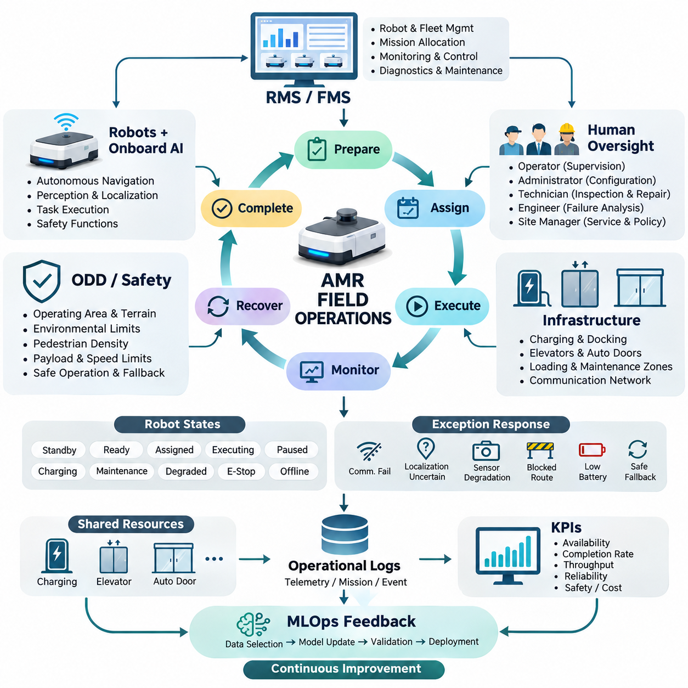
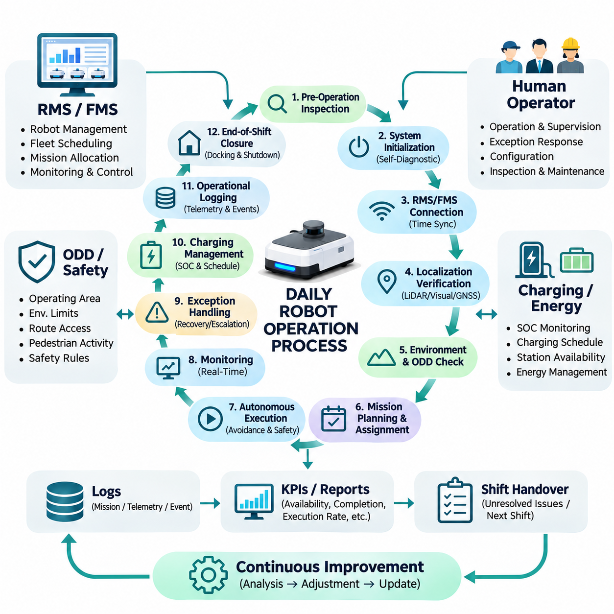
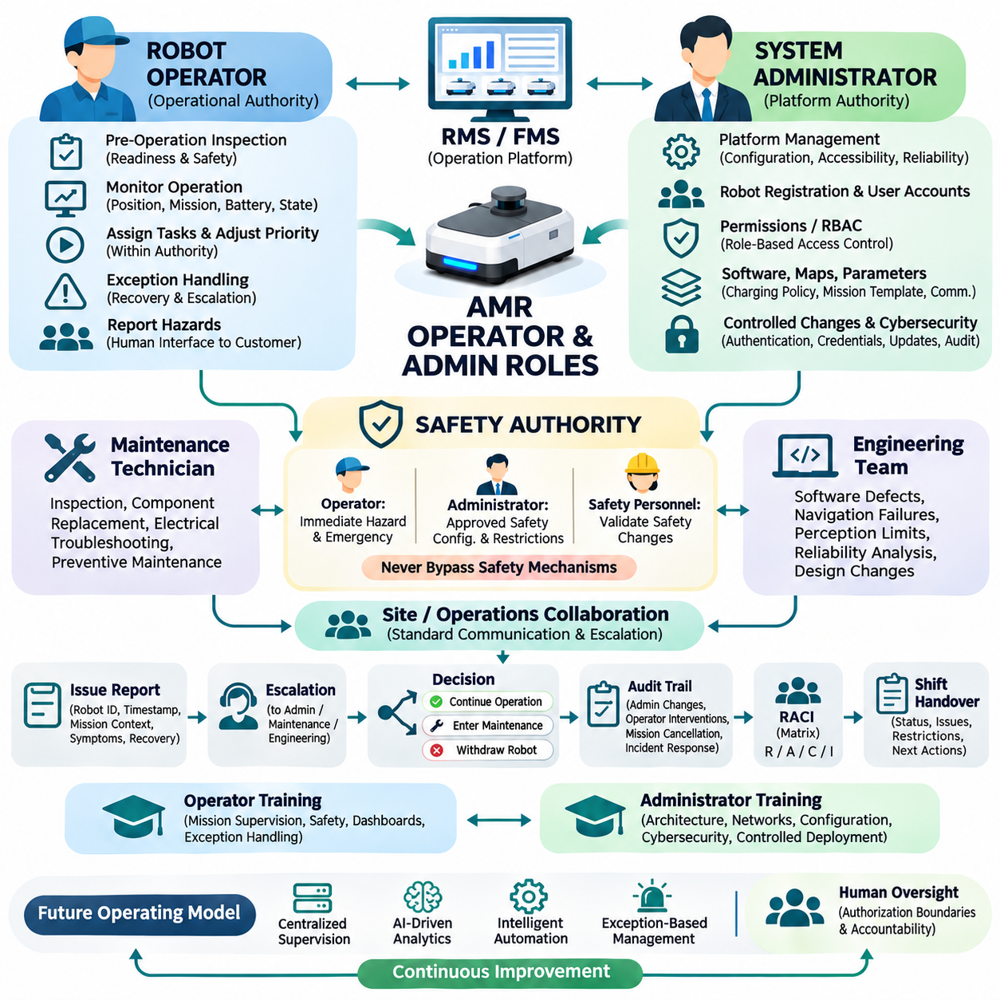
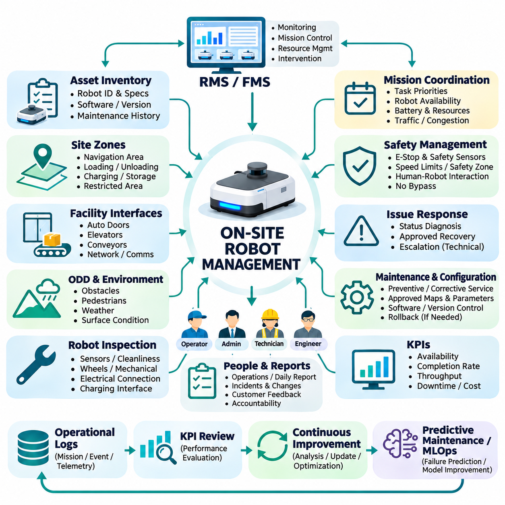
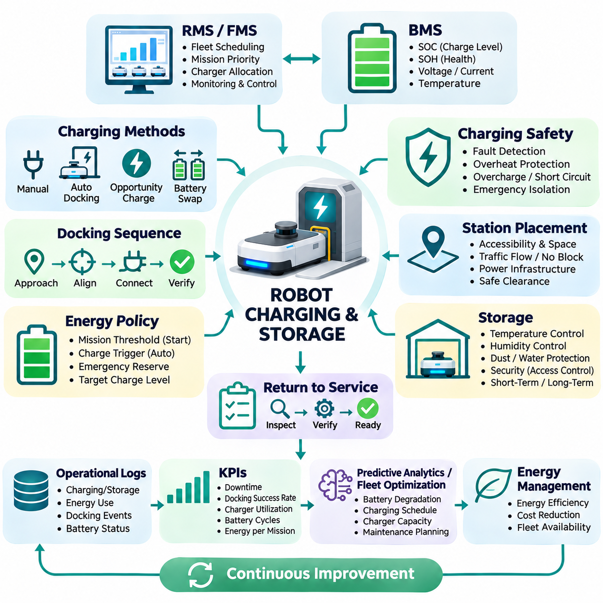
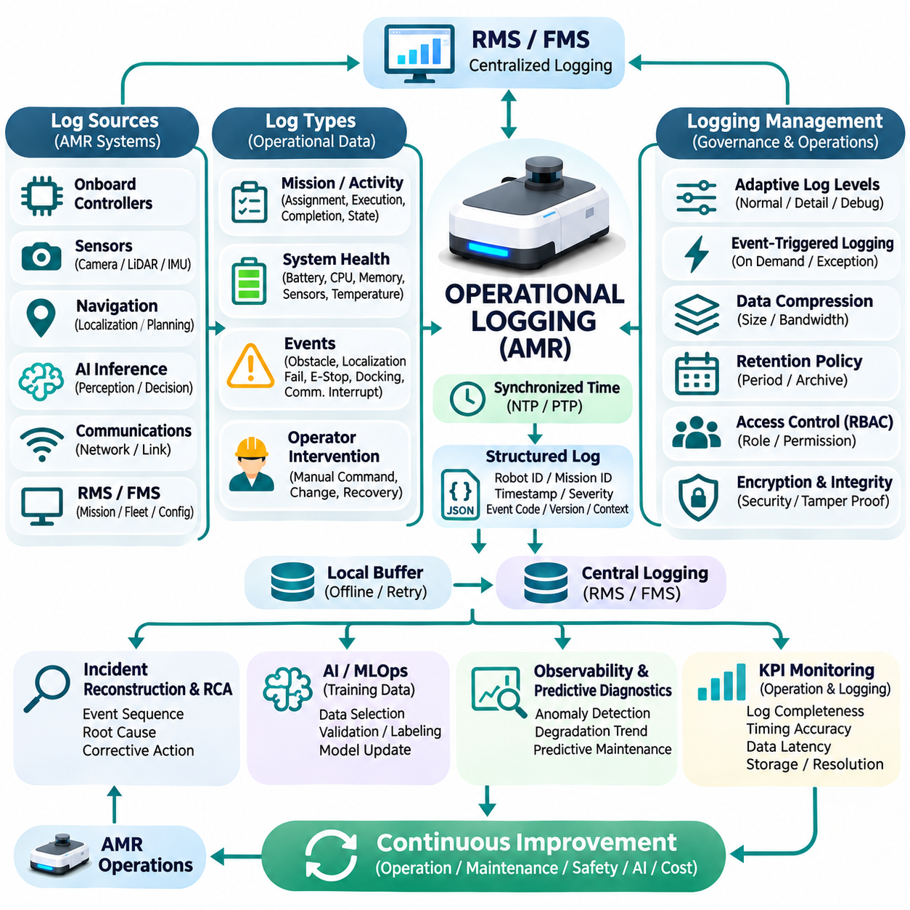
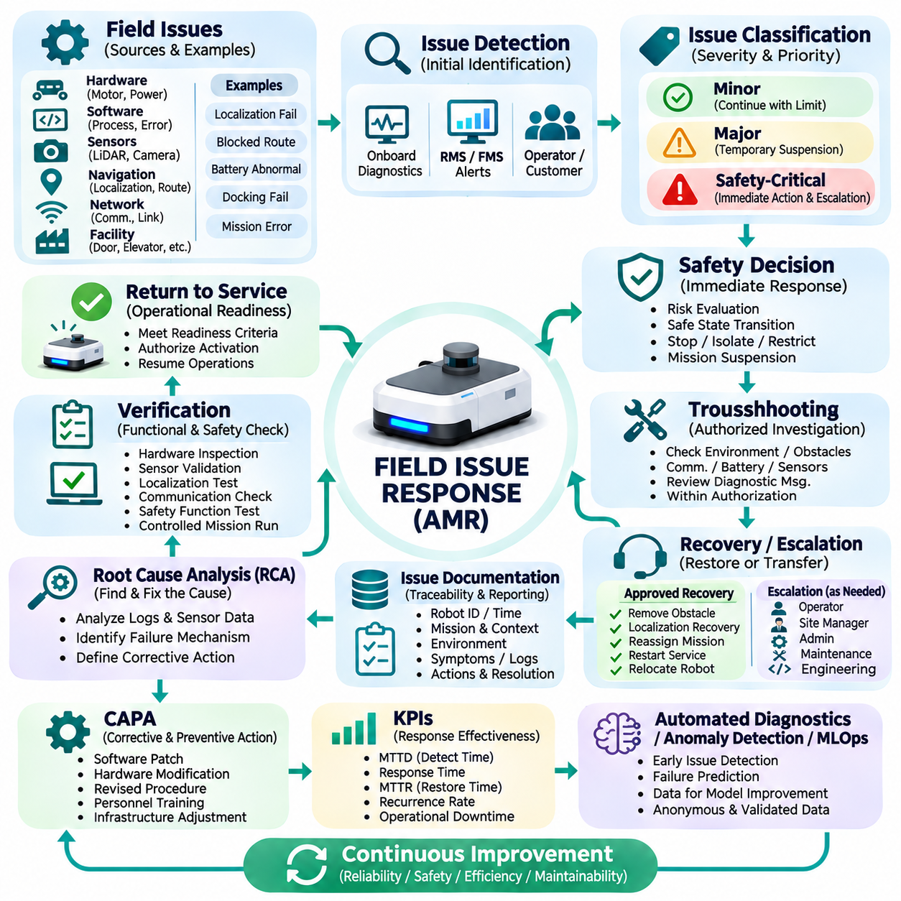
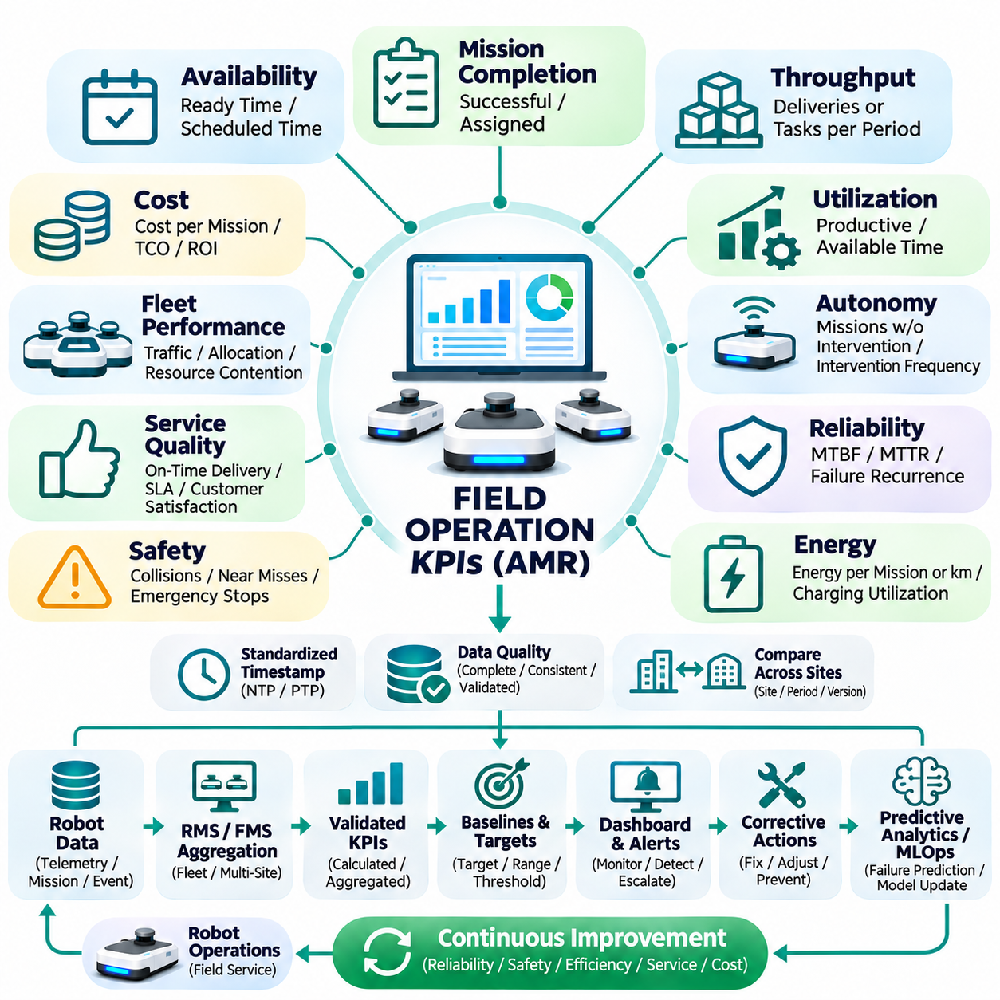

**Volume 08. AMR Operations, Deployment, and MLOps**


# Chapter 02. Field Operations

##  

## 02.1 Field Operation Model

{width="7.268055555555556in" height="7.268055555555556in"}

The field operation model of an Autonomous Mobile Robot (AMR) defines the organizational, technical, and procedural framework through which robotic systems deliver continuous services in real-world environments. Unlike laboratory experiments or prototype demonstrations, field operations require sustained availability, predictable performance, operational safety, and systematic coordination between robots, human operators, and supporting infrastructure.

An effective field operation model integrates physical robot platforms, onboard intelligence, Robot Management Systems (RMS), Fleet Management Systems (FMS), communication infrastructure, and human supervision. These elements establish a coordinated operational ecosystem in which robots execute assigned missions while management systems monitor performance, allocate resources, and respond to unexpected environmental or technical conditions.

Field operations must be designed around the Operational Design Domain (ODD), which defines the environmental and operational conditions under which autonomous robots are permitted to function. These conditions include operating areas, terrain characteristics, environmental limitations, pedestrian density, communication availability, payload restrictions, and maximum operating speeds. Missions outside validated boundaries require appropriate restrictions or intervention.

The operational lifecycle generally consists of preparation, mission assignment, autonomous execution, performance monitoring, exception handling, mission completion, and operational recovery. Before initiating operations, the system verifies robot readiness, battery capacity, sensor functionality, localization accuracy, communication connectivity, and safety mechanisms. Only robots satisfying predefined readiness criteria should receive operational assignments.

Field operation architectures can adopt centralized, decentralized, or hybrid management models. Centralized management assigns missions and coordinates resources through a supervisory management server. Decentralized management enables individual robots to make operational decisions using local intelligence. Hybrid architectures combine centralized mission orchestration with distributed autonomous execution, improving scalability and operational resilience.

The Robot Management System provides a supervisory interface between individual robots and operational personnel. It manages robot registration, configuration, operating states, diagnostic information, software versions, alarms, and maintenance records. The Fleet Management System extends these capabilities by coordinating multiple robots, distributing missions, managing shared resources, and resolving operational conflicts across the deployment environment.

Mission management converts business requirements into executable robotic activities. Manufacturing facilities may request material transportation, hospitals may schedule medical supply deliveries, logistics centers may assign warehouse transportation tasks, and smart cities may initiate autonomous patrol missions. Each mission should define its objectives, priorities, execution constraints, completion criteria, and permissible recovery procedures.

Operational state management establishes consistent behavioral expectations throughout the robot lifecycle. Typical states include standby, ready, assigned, executing, paused, charging, maintenance, degraded operation, emergency stop, and offline. Clearly defined state transitions prevent contradictory commands and enable supervisory systems to determine whether a robot remains available, requires assistance, or must be removed from active service.

Human participation remains an essential component of field operations even when robots possess advanced autonomous capabilities. Operators supervise mission execution and respond to exceptions, administrators manage operational configurations, and maintenance technicians perform physical inspections and repairs. Engineering teams investigate systemic failures, while site managers coordinate customer requirements, operational policies, and service objectives.

Resource management ensures that robots possess sufficient energy, computing capacity, communication bandwidth, and physical access to complete assigned missions. Charging stations, docking facilities, elevators, automatic doors, loading areas, and maintenance zones should be treated as shared operational resources. Their availability must be incorporated into mission scheduling to prevent congestion, unnecessary waiting, and service interruptions.

Operational resilience depends on the ability to recognize abnormal conditions and transition into predefined safe operating states. Communication failures, localization uncertainty, sensor degradation, blocked routes, unexpected obstacles, and insufficient battery capacity require context-dependent responses. Robots should retain essential onboard safety functions independently of remote management infrastructure and external network connectivity.

Field operations also generate valuable engineering information through continuous recording of telemetry, mission histories, environmental observations, operator interventions, and failure events. These records establish a traceable foundation for operational analysis, root cause investigation, predictive maintenance, and AI model improvement. Data collection must respect privacy requirements, cybersecurity policies, and available storage resources.

The integration of field operations with Machine Learning Operations (MLOps) establishes a continuous improvement cycle between deployed robots and engineering environments. Difficult perception scenarios, navigation failures, unusual environmental conditions, and repeated human interventions can reveal limitations in existing AI models. Selected operational data supports model refinement, validation, and controlled deployment without compromising operational stability.

Operational effectiveness should be evaluated through measurable Key Performance Indicators (KPIs), including robot availability, mission completion rate, autonomous execution rate, intervention frequency, energy efficiency, service throughput, and recovery time. These indicators should reflect actual customer workflows rather than isolated technical capabilities, enabling organizations to evaluate service reliability, operational costs, and business value.

A scalable field operation model ultimately transforms individual autonomous robots into coordinated service infrastructure. Standardized procedures, distributed intelligence, reliable management platforms, operational data governance, and continuous engineering feedback enable organizations to expand from limited pilot deployments to large-scale robot fleets. This framework establishes the foundation for sustainable, intelligent, and continuously evolving AMR operations.

자율이동로봇(Autonomous Mobile Robot, AMR)의 현장 운영 모델(Field Operation Model)은 로봇 시스템이 실제 환경에서 지속적인 서비스를 제공하기 위한 조직적, 기술적, 절차적 프레임워크(Framework)를 정의한다. 실험실 실험(Laboratory Experiment)이나 시제품 시연(Prototype Demonstration)과 달리 현장 운영(Field Operations)은 지속적인 가용성(Availability), 예측 가능한 성능(Predictable Performance), 운영 안전성(Operational Safety), 그리고 로봇, 운영자 및 지원 인프라 간의 체계적인 협업을 요구한다.

효과적인 현장 운영 모델은 물리적 로봇 플랫폼(Physical Robot Platform), 온보드 지능(Onboard Intelligence), 로봇 관리 시스템(Robot Management System, RMS), 플릿 관리 시스템(Fleet Management System, FMS), 통신 인프라(Communication Infrastructure), 인간 감독(Human Supervision)을 통합한다. 이러한 요소들은 로봇이 할당된 임무를 수행하는 동안 관리 시스템이 성능을 모니터링하고, 자원을 할당하며, 예상하지 못한 환경적 또는 기술적 상황에 대응하는 통합 운영 생태계(Operational Ecosystem)를 구축한다.

현장 운영은 자율로봇이 작동할 수 있는 환경적 및 운영적 조건을 정의하는 운영 설계 영역(Operational Design Domain, ODD)을 중심으로 설계되어야 한다. 이러한 조건에는 운영 구역(Operating Area), 지형 특성(Terrain Characteristics), 환경적 제한(Environmental Limitations), 보행자 밀도(Pedestrian Density), 통신 가용성(Communication Availability), 적재 제한(Payload Restrictions), 최대 운영 속도(Maximum Operating Speed)가 포함된다. 검증된 운영 범위를 벗어나는 임무에는 적절한 제한 또는 개입(Intervention)이 필요하다.

운영 수명주기(Operational Lifecycle)는 일반적으로 운영 준비(Preparation), 임무 할당(Mission Assignment), 자율 실행(Autonomous Execution), 성능 모니터링(Performance Monitoring), 예외 처리(Exception Handling), 임무 완료(Mission Completion), 운영 복구(Operational Recovery)로 구성된다. 운영을 시작하기 전에 시스템은 로봇의 준비 상태, 배터리 용량, 센서 기능, 위치 추정 정확도(Localization Accuracy), 통신 연결성 및 안전 메커니즘을 검증한다. 사전에 정의된 운영 준비 기준(Operational Readiness Criteria)을 충족하는 로봇에만 임무를 할당해야 한다.

현장 운영 아키텍처(Field Operation Architecture)는 중앙집중형(Centralized), 분산형(Decentralized), 또는 하이브리드(Hybrid) 관리 모델을 채택할 수 있다. 중앙집중형 관리는 상위 관리 서버(Supervisory Management Server)를 통해 임무를 할당하고 자원을 조정한다. 분산형 관리는 개별 로봇이 자체 지능(Local Intelligence)을 활용하여 운영 의사결정을 수행하도록 한다. 하이브리드 아키텍처(Hybrid Architecture)는 중앙집중형 임무 오케스트레이션(Mission Orchestration)과 분산형 자율 실행(Distributed Autonomous Execution)을 결합하여 확장성(Scalability)과 운영 복원력(Operational Resilience)을 향상시킨다.

로봇 관리 시스템(RMS)은 개별 로봇과 운영 인력 사이의 감독 인터페이스(Supervisory Interface)를 제공한다. 로봇 등록(Robot Registration), 구성 설정(Configuration), 운영 상태(Operating State), 진단 정보(Diagnostic Information), 소프트웨어 버전(Software Version), 경보(Alarm), 유지보수 기록(Maintenance Record)을 관리한다. 플릿 관리 시스템(FMS)은 다수의 로봇을 조정하고 임무를 분배하며, 공유 자원(Shared Resource)을 관리하고 배포 환경에서 발생하는 운영 충돌(Operational Conflict)을 해결함으로써 이러한 기능을 확장한다.

임무 관리(Mission Management)는 비즈니스 요구사항(Business Requirements)을 실행 가능한 로봇 활동으로 변환한다. 제조시설에서는 자재 운송(Material Transportation)을 요청하고, 병원에서는 의료용품 배송(Medical Supply Delivery)을 예약하며, 물류센터에서는 창고 운송 작업(Warehouse Transportation Task)을 할당하고, 스마트시티에서는 자율 순찰 임무(Autonomous Patrol Mission)를 시작할 수 있다. 각각의 임무는 목표(Objective), 우선순위(Priority), 실행 제약조건(Execution Constraint), 완료 기준(Completion Criteria), 허용 가능한 복구 절차(Recovery Procedure)를 정의해야 한다.

운영 상태 관리(Operational State Management)는 로봇의 전체 수명주기에 걸쳐 일관된 동작 기준을 확립한다. 대표적인 운영 상태에는 대기(Standby), 준비(Ready), 임무 할당(Assigned), 실행(Executing), 일시 정지(Paused), 충전(Charging), 유지보수(Maintenance), 성능 저하 운전(Degraded Operation), 비상 정지(Emergency Stop), 오프라인(Offline)이 포함된다. 명확하게 정의된 상태 전이(State Transition)는 상충하는 명령을 방지하고, 감독 시스템이 로봇의 가용 여부, 지원 필요성 또는 운영 제외 여부를 판단할 수 있도록 한다.

로봇이 고도화된 자율 기능(Autonomous Capability)을 보유하더라도 인간의 참여(Human Participation)는 현장 운영의 필수 구성요소로 유지된다. 운영자(Operator)는 임무 실행을 감독하고 예외 상황에 대응하며, 관리자(Administrator)는 운영 구성을 관리하고, 유지보수 기술자(Maintenance Technician)는 물리적 검사 및 수리를 수행한다. 엔지니어링 팀(Engineering Team)은 시스템 전반의 장애를 조사하고, 현장 관리자(Site Manager)는 고객 요구사항, 운영 정책(Operational Policy), 서비스 목표(Service Objective)를 조정한다.

자원 관리(Resource Management)는 로봇이 할당된 임무를 완료하는 데 필요한 충분한 에너지, 컴퓨팅 용량(Computing Capacity), 통신 대역폭(Communication Bandwidth), 물리적 접근성(Physical Accessibility)을 확보하도록 한다. 충전 스테이션(Charging Station), 도킹 시설(Docking Facility), 엘리베이터(Elevator), 자동문(Automatic Door), 적재 구역(Loading Area), 유지보수 구역(Maintenance Zone)은 공유 운영 자원(Shared Operational Resource)으로 관리되어야 한다. 혼잡, 불필요한 대기 및 서비스 중단을 방지하기 위해 이러한 자원의 가용성을 임무 스케줄링(Mission Scheduling)에 반영해야 한다.

운영 복원력(Operational Resilience)은 비정상 상태(Abnormal Condition)를 인식하고 사전에 정의된 안전 운영 상태(Safe Operating State)로 전환하는 능력에 의존한다. 통신 장애(Communication Failure), 위치 추정 불확실성(Localization Uncertainty), 센서 성능 저하(Sensor Degradation), 경로 차단(Blocked Route), 예상하지 못한 장애물(Unexpected Obstacle), 배터리 용량 부족 등은 상황에 따른 대응(Context-dependent Response)을 요구한다. 로봇은 원격 관리 인프라(Remote Management Infrastructure)와 외부 네트워크 연결성에 의존하지 않고 필수적인 온보드 안전 기능(Onboard Safety Function)을 유지해야 한다.

현장 운영은 원격 측정 데이터(Telemetry), 임무 이력(Mission History), 환경 관측 정보(Environmental Observation), 운영자 개입(Operator Intervention), 장애 이벤트(Failure Event)를 지속적으로 기록함으로써 가치 있는 엔지니어링 정보를 생성한다. 이러한 기록은 운영 분석(Operational Analysis), 근본 원인 분석(Root Cause Analysis), 예측 유지보수(Predictive Maintenance), 인공지능 모델 개선(AI Model Improvement)을 위한 추적 가능한 기반을 확립한다. 데이터 수집(Data Collection)은 개인정보 보호 요구사항(Privacy Requirements), 사이버보안 정책(Cybersecurity Policy), 가용 저장 자원(Storage Resource)을 고려해야 한다.

현장 운영과 머신러닝 운영(Machine Learning Operations, MLOps)의 통합은 배포된 로봇과 엔지니어링 환경 사이에 지속적인 개선 주기(Continuous Improvement Cycle)를 구축한다. 어려운 인지 시나리오(Challenging Perception Scenario), 자율주행 실패(Navigation Failure), 비정상적인 환경 조건, 반복적인 인간 개입(Human Intervention)은 기존 인공지능 모델의 한계를 드러낼 수 있다. 선별된 운영 데이터(Operational Data)는 운영 안정성(Operational Stability)을 저해하지 않으면서 모델 개선(Model Refinement), 검증(Validation), 통제된 배포(Controlled Deployment)를 지원한다.

운영 효과성(Operational Effectiveness)은 로봇 가용성(Robot Availability), 임무 완료율(Mission Completion Rate), 자율 실행률(Autonomous Execution Rate), 개입 빈도(Intervention Frequency), 에너지 효율(Energy Efficiency), 서비스 처리량(Service Throughput), 복구 시간(Recovery Time) 등의 측정 가능한 핵심 성과 지표(Key Performance Indicator, KPI)를 통해 평가되어야 한다. 이러한 지표는 개별적인 기술 역량보다 실제 고객 업무 흐름(Customer Workflow)을 반영해야 하며, 이를 통해 조직은 서비스 신뢰성(Service Reliability), 운영 비용(Operational Cost), 비즈니스 가치(Business Value)를 평가할 수 있다.

확장 가능한 현장 운영 모델(Scalable Field Operation Model)은 궁극적으로 개별 자율로봇을 상호 조정되는 서비스 인프라(Coordinated Service Infrastructure)로 전환한다. 표준화된 절차(Standardized Procedure), 분산 지능(Distributed Intelligence), 신뢰성 높은 관리 플랫폼(Management Platform), 운영 데이터 거버넌스(Operational Data Governance), 지속적인 엔지니어링 피드백(Continuous Engineering Feedback)은 조직이 제한적인 시범 배포(Pilot Deployment)에서 대규모 로봇 플릿(Large-scale Robot Fleet)으로 확장할 수 있도록 한다. 이러한 프레임워크는 지속 가능하고 지능적이며 끊임없이 진화하는 자율이동로봇 운영(AMR Operations)의 기반을 확립한다.

##  

## 02.2 Daily Robot Operation Process

{width="7.268055555555556in" height="7.268055555555556in"}

The daily robot operation process establishes a standardized workflow for managing Autonomous Mobile Robots (AMRs) throughout their scheduled service periods. It encompasses operational preparation, system initialization, mission execution, continuous monitoring, exception handling, charging, and operational closure. A well-defined process ensures consistent service delivery, operational safety, resource efficiency, and long-term system reliability.

Daily operations begin with a pre-operation inspection to verify the physical and functional readiness of each robot. Operators inspect the mechanical structure, wheels, drive systems, braking mechanisms, electrical connections, sensor surfaces, and emergency stop devices. Battery condition, visible damage, loose components, and environmental contamination should also be evaluated before authorizing autonomous operation.

System initialization involves activating onboard computing platforms, embedded controllers, communication interfaces, perception sensors, and autonomous navigation software. Automated self-diagnostic procedures verify hardware connectivity, software process availability, sensor communication, memory utilization, and system temperature. Initialization failures should prevent the robot from entering an active operational state until resolved.

Following initialization, the robot establishes communication with the Robot Management System (RMS) and Fleet Management System (FMS). The management platform verifies robot identification, network connectivity, software versions, configuration parameters, and operational status. Time synchronization and communication integrity are particularly important for coordinating distributed robots and maintaining accurate operational records.

Localization verification ensures that the robot accurately identifies its position and orientation within the operational environment. Indoor AMRs may utilize LiDAR-based localization, visual landmarks, or predefined reference points, while outdoor robots may incorporate GNSS, RTK, and inertial navigation systems. Localization confidence must satisfy validated thresholds before autonomous mission execution begins.

Environmental readiness assessment confirms that the operating environment remains consistent with the validated Operational Design Domain (ODD). Operators evaluate route accessibility, temporary obstacles, pedestrian activity, floor conditions, weather conditions, and infrastructure availability. Changes affecting operational safety or navigation reliability must be communicated to the management system before missions are assigned.

Mission preparation converts scheduled customer requirements into executable robot tasks. The Fleet Management System evaluates mission priority, robot availability, current location, payload capacity, battery condition, and estimated execution time. Appropriate robots are selected according to operational constraints, while shared infrastructure and charging resources are considered to minimize conflicts and unnecessary delays.

During mission execution, the robot continuously processes environmental information, updates localization estimates, generates navigation trajectories, and controls its motion. Onboard intelligence performs obstacle detection, collision avoidance, behavior planning, and dynamic path adjustment. The management system supervises mission progress without replacing essential onboard control and safety functions.

Continuous operational monitoring provides real-time visibility into robot location, mission status, battery consumption, communication quality, hardware condition, and software performance. Operators utilize dashboards to identify abnormal behavior, delayed missions, and emerging technical problems. Configurable warning thresholds allow early intervention before minor abnormalities develop into significant operational failures.

Exception handling becomes necessary when robots encounter blocked routes, localization uncertainty, communication interruptions, unexpected obstacles, or hardware abnormalities. Depending on the severity and validated recovery capabilities, the robot may automatically replan its route, pause operation, reduce speed, or enter a safe state. Unresolved exceptions should trigger structured escalation to authorized operational personnel.

Battery and charging management must be integrated throughout daily operations rather than treated as an independent activity. The Fleet Management System monitors the State of Charge (SOC), estimated remaining operating time, and charging station availability. Dynamic charging schedules balance mission demand with energy requirements, preventing unexpected battery depletion while maintaining sufficient service capacity.

Operational data collection records mission execution histories, system telemetry, sensor observations, navigation events, energy consumption, and operator interventions. Relevant abnormal events should include synchronized timestamps, robot identification, software versions, and environmental context. These records support operational analysis, failure investigation, predictive maintenance, and future AI model improvements.

At the end of a scheduled operating period, robots complete or safely suspend outstanding missions and return to designated docking, charging, or storage locations. Operators verify mission completion, inspect physical conditions, review unresolved alarms, and confirm charging connectivity. Shutdown or standby procedures should preserve essential operational records and maintain appropriate safety and security functions.

Daily operational reporting consolidates mission completion rates, robot availability, autonomous execution rates, intervention frequency, charging durations, and equipment failures. Shift handover procedures communicate unresolved issues, restricted operating areas, maintenance requirements, and pending missions to incoming personnel. Continuous review of these records strengthens operational consistency, accountability, and service quality.

일일 로봇 운영 프로세스(Daily Robot Operation Process)는 자율이동로봇(Autonomous Mobile Robot, AMR)의 예정된 서비스 기간 동안 로봇을 관리하기 위한 표준화된 업무 흐름(Standardized Workflow)을 확립한다. 이는 운영 준비(Operational Preparation), 시스템 초기화(System Initialization), 임무 실행(Mission Execution), 지속적인 모니터링(Continuous Monitoring), 예외 처리(Exception Handling), 충전(Charging), 운영 종료(Operational Closure)를 포함한다. 체계적으로 정의된 프로세스는 일관된 서비스 제공, 운영 안전성(Operational Safety), 자원 효율성(Resource Efficiency), 장기적인 시스템 신뢰성(System Reliability)을 보장한다.

일일 운영은 각 로봇의 물리적 및 기능적 준비 상태를 검증하기 위한 운영 전 검사(Pre-operation Inspection)로 시작된다. 운영자(Operator)는 기계적 구조(Mechanical Structure), 바퀴(Wheel), 구동 시스템(Drive System), 제동 메커니즘(Braking Mechanism), 전기적 연결(Electrical Connection), 센서 표면(Sensor Surface), 비상 정지 장치(Emergency Stop Device)를 검사한다. 자율 운영을 승인하기 전에 배터리 상태(Battery Condition), 외관 손상(Visible Damage), 부품의 체결 상태, 환경적 오염(Environmental Contamination)도 평가해야 한다.

시스템 초기화(System Initialization)는 온보드 컴퓨팅 플랫폼(Onboard Computing Platform), 임베디드 제어기(Embedded Controller), 통신 인터페이스(Communication Interface), 인지 센서(Perception Sensor), 자율주행 소프트웨어(Autonomous Navigation Software)를 활성화하는 과정이다. 자동화된 자가 진단 절차(Automated Self-diagnostic Procedure)는 하드웨어 연결성, 소프트웨어 프로세스 가용성, 센서 통신, 메모리 사용률(Memory Utilization), 시스템 온도(System Temperature)를 검증한다. 초기화 장애(Initialization Failure)가 발생하면 문제가 해결될 때까지 로봇이 활성 운영 상태(Active Operational State)로 진입하지 못하도록 해야 한다.

초기화 이후 로봇은 로봇 관리 시스템(Robot Management System, RMS) 및 플릿 관리 시스템(Fleet Management System, FMS)과 통신을 수립한다. 관리 플랫폼(Management Platform)은 로봇 식별 정보(Robot Identification), 네트워크 연결성(Network Connectivity), 소프트웨어 버전(Software Version), 구성 매개변수(Configuration Parameter), 운영 상태(Operational Status)를 검증한다. 시간 동기화(Time Synchronization)와 통신 무결성(Communication Integrity)은 분산된 로봇을 조정하고 정확한 운영 기록(Operational Record)을 유지하는 데 특히 중요하다.

위치 추정 검증(Localization Verification)은 로봇이 운영 환경 내에서 자신의 위치(Position)와 방향(Orientation)을 정확하게 식별하도록 보장한다. 실내 자율이동로봇(Indoor AMR)은 라이다 기반 위치 추정(LiDAR-based Localization), 시각적 랜드마크(Visual Landmark), 사전에 정의된 기준점(Reference Point)을 활용할 수 있으며, 실외 로봇(Outdoor Robot)은 위성항법시스템(Global Navigation Satellite System, GNSS), 실시간 이동측위(Real-Time Kinematic, RTK), 관성항법시스템(Inertial Navigation System)을 통합할 수 있다. 자율 임무를 실행하기 전에 위치 추정 신뢰도(Localization Confidence)가 검증된 임계값(Validated Threshold)을 충족해야 한다.

환경 준비 상태 평가(Environmental Readiness Assessment)는 운영 환경이 검증된 운영 설계 영역(Operational Design Domain, ODD)과 일치하는지 확인한다. 운영자는 경로 접근성(Route Accessibility), 임시 장애물(Temporary Obstacle), 보행자 활동(Pedestrian Activity), 바닥 상태(Floor Condition), 기상 조건(Weather Condition), 인프라 가용성(Infrastructure Availability)을 평가한다. 운영 안전성이나 자율주행 신뢰성(Navigation Reliability)에 영향을 미치는 변경 사항은 임무 할당 이전에 관리 시스템으로 전달되어야 한다.

임무 준비(Mission Preparation)는 예정된 고객 요구사항(Customer Requirements)을 실행 가능한 로봇 작업(Robot Task)으로 변환한다. 플릿 관리 시스템(FMS)은 임무 우선순위(Mission Priority), 로봇 가용성(Robot Availability), 현재 위치(Current Location), 적재 용량(Payload Capacity), 배터리 상태(Battery Condition), 예상 실행 시간(Estimated Execution Time)을 평가한다. 운영 제약조건(Operational Constraint)에 따라 적절한 로봇을 선택하며, 운영 충돌과 불필요한 지연을 최소화하기 위해 공유 인프라(Shared Infrastructure)와 충전 자원(Charging Resource)을 고려한다.

임무 실행(Mission Execution) 중 로봇은 환경 정보를 지속적으로 처리하고, 위치 추정값(Localization Estimate)을 갱신하며, 주행 궤적(Navigation Trajectory)을 생성하고, 자신의 움직임을 제어한다. 온보드 지능(Onboard Intelligence)은 장애물 감지(Obstacle Detection), 충돌 회피(Collision Avoidance), 행동 계획(Behavior Planning), 동적 경로 조정(Dynamic Path Adjustment)을 수행한다. 관리 시스템은 필수적인 온보드 제어 기능(Onboard Control Function)과 안전 기능(Safety Function)을 대체하지 않으면서 임무 진행 상황을 감독한다.

지속적인 운영 모니터링(Continuous Operational Monitoring)은 로봇 위치(Robot Location), 임무 상태(Mission Status), 배터리 소비량(Battery Consumption), 통신 품질(Communication Quality), 하드웨어 상태(Hardware Condition), 소프트웨어 성능(Software Performance)에 대한 실시간 가시성(Real-time Visibility)을 제공한다. 운영자는 대시보드(Dashboard)를 활용하여 비정상 동작(Abnormal Behavior), 지연된 임무(Delayed Mission), 새롭게 발생하는 기술적 문제를 식별한다. 설정 가능한 경고 임계값(Configurable Warning Threshold)은 경미한 이상 상태가 심각한 운영 장애(Operational Failure)로 발전하기 전에 조기 개입(Early Intervention)을 가능하게 한다.

예외 처리(Exception Handling)는 로봇이 경로 차단(Blocked Route), 위치 추정 불확실성(Localization Uncertainty), 통신 중단(Communication Interruption), 예상하지 못한 장애물(Unexpected Obstacle), 하드웨어 이상(Hardware Abnormality)에 직면할 때 필요하다. 문제의 심각도(Severity)와 검증된 복구 능력(Validated Recovery Capability)에 따라 로봇은 자동으로 경로를 재계획(Route Replanning)하거나, 운영을 일시 정지하고, 속도를 감소시키거나, 안전 상태(Safe State)로 전환할 수 있다. 해결되지 않은 예외 상황은 권한을 부여받은 운영 인력에게 체계적으로 상향 보고(Structured Escalation)되어야 한다.

배터리 및 충전 관리(Battery and Charging Management)는 독립적인 활동으로 취급하기보다 일일 운영 전반에 걸쳐 통합되어야 한다. 플릿 관리 시스템(FMS)은 배터리 충전 상태(State of Charge, SOC), 예상 잔여 운영 시간(Estimated Remaining Operating Time), 충전 스테이션 가용성(Charging Station Availability)을 모니터링한다. 동적 충전 스케줄링(Dynamic Charging Scheduling)은 임무 수요(Mission Demand)와 에너지 요구사항(Energy Requirements) 사이의 균형을 유지하여 충분한 서비스 처리 능력(Service Capacity)을 확보하면서 예상하지 못한 배터리 방전(Battery Depletion)을 방지한다.

운영 데이터 수집(Operational Data Collection)은 임무 실행 이력(Mission Execution History), 시스템 원격 측정 데이터(System Telemetry), 센서 관측 정보(Sensor Observation), 자율주행 이벤트(Navigation Event), 에너지 소비량(Energy Consumption), 운영자 개입(Operator Intervention)을 기록한다. 관련 이상 이벤트(Abnormal Event)에는 동기화된 타임스탬프(Synchronized Timestamp), 로봇 식별 정보(Robot Identification), 소프트웨어 버전(Software Version), 환경적 맥락(Environmental Context)이 포함되어야 한다. 이러한 기록은 운영 분석(Operational Analysis), 장애 조사(Failure Investigation), 예측 유지보수(Predictive Maintenance), 향후 인공지능 모델 개선(AI Model Improvement)을 지원한다.

예정된 운영 기간이 종료되면 로봇은 남아 있는 임무를 완료하거나 안전하게 중단하고, 지정된 도킹(Docking), 충전(Charging), 보관(Storage) 위치로 복귀한다. 운영자는 임무 완료 여부(Mission Completion)를 검증하고, 물리적 상태(Physical Condition)를 검사하며, 해결되지 않은 경보(Unresolved Alarm)를 검토하고, 충전 연결 상태(Charging Connectivity)를 확인한다. 시스템 종료(Shutdown) 또는 대기 모드(Standby Mode) 전환 절차는 필수적인 운영 기록을 보존하고 적절한 안전 및 보안 기능(Safety and Security Function)을 유지해야 한다.

일일 운영 보고(Daily Operational Reporting)는 임무 완료율(Mission Completion Rate), 로봇 가용성(Robot Availability), 자율 실행률(Autonomous Execution Rate), 개입 빈도(Intervention Frequency), 충전 시간(Charging Duration), 장비 장애(Equipment Failure)를 종합한다. 교대 근무 인수인계 절차(Shift Handover Procedure)는 해결되지 않은 문제, 운영 제한 구역(Restricted Operating Area), 유지보수 요구사항(Maintenance Requirements), 대기 중인 임무(Pending Mission)를 다음 근무 인력에게 전달한다. 이러한 기록에 대한 지속적인 검토(Continuous Review)는 운영 일관성(Operational Consistency), 책임성(Accountability), 서비스 품질(Service Quality)을 강화한다.

##  

## 02.3 Operator and Admin Roles

{width="7.268055555555556in" height="7.268055555555556in"}

The operation of Autonomous Mobile Robots (AMRs) requires a clearly defined organizational structure that separates operational responsibilities, administrative authority, technical support, and safety supervision. Operators and administrators represent two fundamental roles within this structure. Their responsibilities must be coordinated to maintain operational efficiency, system reliability, cybersecurity, and accountability throughout the robot service lifecycle.

Robot operators are primarily responsible for supervising daily robotic activities and ensuring that assigned missions are executed according to established operational procedures. Their responsibilities include verifying robot readiness, initiating and monitoring missions, reviewing operational alerts, and responding to exceptional situations. Operators serve as the primary human interface between autonomous robotic systems and actual customer workflows.

Before daily operations begin, operators perform physical inspections and verify the functional readiness of robotic platforms. They evaluate battery status, sensor conditions, mechanical integrity, communication connectivity, and emergency stop functionality. Any abnormal condition that could compromise operational safety or mission reliability must be reported and resolved according to established procedures before the robot enters active service.

During mission execution, operators utilize the Robot Management System (RMS) and Fleet Management System (FMS) to monitor robot positions, mission progress, battery levels, operating states, and environmental conditions. They may assign approved tasks, modify mission priorities within authorized limits, or temporarily suspend operations. Essential autonomous navigation and safety functions remain under onboard system control.

Exception management represents a critical responsibility of robot operators. When robots encounter blocked routes, localization failures, communication interruptions, or unexpected environmental conditions, operators evaluate available diagnostic information and initiate approved recovery procedures. Problems exceeding their technical competence or authorization must be escalated to administrators, maintenance technicians, or engineering personnel.

System administrators are responsible for maintaining the overall configuration, accessibility, reliability, and governance of robotic operation platforms. Unlike operators who concentrate on daily service execution, administrators manage the underlying operational environment. Their responsibilities include robot registration, user account management, permission configuration, infrastructure integration, and system-level operational policies.

Administrative responsibilities also encompass configuration management across deployed robotic platforms. Administrators maintain approved software versions, navigation maps, operating parameters, charging policies, mission templates, and communication settings. Configuration changes must follow controlled approval procedures to prevent inconsistencies between robots and avoid introducing unvalidated behavior into production environments.

Role-Based Access Control (RBAC) provides a systematic approach to separating operational privileges from administrative authority. Operators should receive only the permissions necessary to execute assigned responsibilities, while administrators receive additional privileges according to their designated functions. Sensitive capabilities, including safety configuration changes and software deployment, require restricted access and appropriate approval.

Safety responsibilities must be distributed according to clearly established authority boundaries. Operators monitor immediate operational hazards and initiate emergency procedures when necessary. Administrators maintain approved safety configurations and operational restrictions, while qualified safety personnel evaluate regulatory compliance and validate safety-related changes. Administrative privileges must never permit unauthorized bypassing of validated safety mechanisms.

Cybersecurity management requires administrators to maintain authentication mechanisms, access policies, credential management, security updates, and audit records. Operators must follow established security procedures, protect authentication credentials, and report suspicious activities. Remote access, configuration modifications, and privileged commands should be recorded to establish accountability and support cybersecurity incident investigations.

Maintenance technicians and engineering personnel provide specialized support beyond routine operational and administrative responsibilities. Maintenance technicians perform mechanical inspections, component replacement, electrical troubleshooting, and preventive maintenance. Engineering teams investigate software defects, navigation failures, perception limitations, and systemic reliability problems that require deeper technical analysis or design modifications.

Effective collaboration between operators and administrators depends on standardized communication and escalation procedures. Operational abnormalities should be documented with robot identification, timestamps, mission context, observed symptoms, and attempted recovery actions. Administrators evaluate recurring issues, coordinate technical support, and determine whether affected robots should remain operational, enter maintenance, or temporarily withdraw from service.

Training and competency management are essential for maintaining consistent operational performance across different personnel and deployment sites. Operators require practical training in mission supervision, safety procedures, dashboard utilization, and exception handling. Administrators require additional knowledge of system architecture, network infrastructure, configuration management, cybersecurity, and controlled software deployment procedures.

Operational accountability is strengthened through clearly assigned responsibilities, structured shift handovers, and comprehensive audit trails. Every significant administrative modification, operator intervention, mission cancellation, and incident response should remain traceable to authorized personnel. Responsibility Assignment Matrices, such as RACI, can clarify accountability and prevent organizational gaps during complex operational events.

As AMR fleets expand, operator and administrator roles increasingly evolve toward centralized supervision, intelligent automation, and exception-based management. Routine monitoring and administrative activities can be partially automated through AI-driven analytics and operational management platforms. Nevertheless, human oversight, appropriate authorization boundaries, and clearly defined accountability remain fundamental requirements for scalable and trustworthy robotic operations.

자율이동로봇(Autonomous Mobile Robot, AMR)의 운영에는 운영 책임(Operational Responsibility), 관리 권한(Administrative Authority), 기술 지원(Technical Support), 안전 감독(Safety Supervision)을 구분하는 명확한 조직 구조(Organizational Structure)가 필요하다. 운영자(Operator)와 관리자(Administrator)는 이러한 구조 내에서 두 가지 핵심 역할을 담당한다. 로봇 서비스 수명주기(Robot Service Lifecycle) 전반에 걸쳐 운영 효율성(Operational Efficiency), 시스템 신뢰성(System Reliability), 사이버보안(Cybersecurity), 책임성(Accountability)을 유지하기 위해 이들의 책임과 역할이 상호 조정되어야 한다.

로봇 운영자(Robot Operator)는 주로 일상적인 로봇 활동을 감독하고 할당된 임무가 정해진 운영 절차(Operational Procedure)에 따라 실행되도록 관리하는 역할을 담당한다. 운영자의 책임에는 로봇 준비 상태(Robot Readiness) 검증, 임무 시작 및 모니터링(Mission Monitoring), 운영 경보(Operational Alert) 검토, 예외 상황(Exceptional Situation) 대응이 포함된다. 운영자는 자율로봇 시스템(Autonomous Robotic System)과 실제 고객 업무 흐름(Customer Workflow)을 연결하는 핵심적인 인간 인터페이스(Human Interface) 역할을 수행한다.

일일 운영이 시작되기 전에 운영자는 물리적 검사(Physical Inspection)를 수행하고 로봇 플랫폼(Robotic Platform)의 기능적 준비 상태(Functional Readiness)를 검증한다. 배터리 상태(Battery Status), 센서 상태(Sensor Condition), 기계적 건전성(Mechanical Integrity), 통신 연결성(Communication Connectivity), 비상 정지 기능(Emergency Stop Functionality)을 평가한다. 운영 안전성(Operational Safety) 또는 임무 신뢰성(Mission Reliability)을 저해할 수 있는 모든 비정상 상태(Abnormal Condition)는 로봇이 실제 서비스에 투입되기 전에 정해진 절차에 따라 보고되고 해결되어야 한다.

임무 실행(Mission Execution) 중 운영자는 로봇 관리 시스템(Robot Management System, RMS)과 플릿 관리 시스템(Fleet Management System, FMS)을 활용하여 로봇 위치(Robot Position), 임무 진행 상황(Mission Progress), 배터리 잔량(Battery Level), 운영 상태(Operating State), 환경 조건(Environmental Condition)을 모니터링한다. 운영자는 승인된 작업을 할당하고, 허용된 권한 범위 내에서 임무 우선순위(Mission Priority)를 변경하거나 운영을 일시적으로 중단할 수 있다. 필수적인 자율주행(Autonomous Navigation) 및 안전 기능(Safety Function)은 온보드 시스템 제어(Onboard System Control)에 의해 유지된다.

예외 관리(Exception Management)는 로봇 운영자의 핵심적인 책임 중 하나이다. 로봇이 경로 차단(Blocked Route), 위치 추정 실패(Localization Failure), 통신 중단(Communication Interruption), 예상하지 못한 환경 조건에 직면하면 운영자는 가용한 진단 정보(Diagnostic Information)를 평가하고 승인된 복구 절차(Recovery Procedure)를 수행한다. 운영자의 기술 역량(Technical Competence) 또는 권한(Authorization)을 초과하는 문제는 관리자, 유지보수 기술자(Maintenance Technician), 엔지니어링 인력(Engineering Personnel)에게 상향 보고(Escalation)되어야 한다.

시스템 관리자(System Administrator)는 로봇 운영 플랫폼(Robot Operation Platform)의 전반적인 구성(Configuration), 접근성(Accessibility), 신뢰성(Reliability), 거버넌스(Governance)를 유지하는 책임을 담당한다. 일상적인 서비스 실행(Service Execution)에 집중하는 운영자와 달리 관리자는 운영 환경(Operational Environment)의 기반을 관리한다. 관리자의 책임에는 로봇 등록(Robot Registration), 사용자 계정 관리(User Account Management), 권한 설정(Permission Configuration), 인프라 통합(Infrastructure Integration), 시스템 수준의 운영 정책(System-level Operational Policy)이 포함된다.

관리자의 책임에는 배포된 로봇 플랫폼 전반에 대한 구성 관리(Configuration Management)도 포함된다. 관리자는 승인된 소프트웨어 버전(Software Version), 주행 지도(Navigation Map), 운영 매개변수(Operating Parameter), 충전 정책(Charging Policy), 임무 템플릿(Mission Template), 통신 설정(Communication Setting)을 유지하고 관리한다. 구성 변경(Configuration Change)은 로봇 간의 불일치(Inconsistency)를 방지하고 실제 운영 환경(Production Environment)에 검증되지 않은 동작이 도입되지 않도록 통제된 승인 절차(Controlled Approval Procedure)를 따라야 한다.

역할 기반 접근 제어(Role-Based Access Control, RBAC)는 운영 권한(Operational Privilege)과 관리 권한(Administrative Authority)을 구분하기 위한 체계적인 접근 방식을 제공한다. 운영자에게는 할당된 책임을 수행하는 데 필요한 최소한의 권한만 부여해야 하며, 관리자에게는 지정된 기능에 따라 추가적인 권한을 부여한다. 안전 구성 변경(Safety Configuration Change), 소프트웨어 배포(Software Deployment)를 포함한 민감한 기능(Sensitive Capability)은 제한된 접근 권한(Restricted Access)과 적절한 승인(Approval)을 요구한다.

안전 책임(Safety Responsibility)은 명확하게 설정된 권한 경계(Authority Boundary)에 따라 분배되어야 한다. 운영자는 즉각적인 운영 위험(Operational Hazard)을 모니터링하고 필요한 경우 비상 대응 절차(Emergency Procedure)를 수행한다. 관리자는 승인된 안전 구성(Safety Configuration)과 운영 제한(Operational Restriction)을 유지하며, 자격을 갖춘 안전 전문 인력(Qualified Safety Personnel)은 규제 준수(Regulatory Compliance)를 평가하고 안전 관련 변경 사항(Safety-related Change)을 검증한다. 관리 권한이 검증된 안전 메커니즘(Safety Mechanism)을 무단으로 우회하도록 허용해서는 안 된다.

사이버보안 관리(Cybersecurity Management)를 위해 관리자는 인증 메커니즘(Authentication Mechanism), 접근 정책(Access Policy), 인증 자격 증명 관리(Credential Management), 보안 업데이트(Security Update), 감사 기록(Audit Record)을 유지해야 한다. 운영자는 정해진 보안 절차(Security Procedure)를 준수하고 인증 자격 증명(Authentication Credential)을 보호하며 의심스러운 활동(Suspicious Activity)을 보고해야 한다. 원격 접근(Remote Access), 구성 변경(Configuration Modification), 특권 명령(Privileged Command)은 책임성을 확립하고 사이버보안 사고 조사(Cybersecurity Incident Investigation)를 지원할 수 있도록 기록되어야 한다.

유지보수 기술자(Maintenance Technician)와 엔지니어링 인력(Engineering Personnel)은 일상적인 운영 및 관리 책임의 범위를 넘어서는 전문적인 기술 지원(Specialized Technical Support)을 제공한다. 유지보수 기술자는 기계적 검사(Mechanical Inspection), 부품 교체(Component Replacement), 전기적 문제 해결(Electrical Troubleshooting), 예방 유지보수(Preventive Maintenance)를 수행한다. 엔지니어링 팀(Engineering Team)은 보다 심층적인 기술 분석(Technical Analysis) 또는 설계 변경(Design Modification)이 필요한 소프트웨어 결함(Software Defect), 자율주행 실패(Navigation Failure), 인지 성능의 한계(Perception Limitation), 시스템 전반의 신뢰성 문제(Systemic Reliability Problem)를 조사한다.

운영자와 관리자 사이의 효과적인 협업(Effective Collaboration)은 표준화된 의사소통 절차(Communication Procedure)와 상향 보고 절차(Escalation Procedure)에 의존한다. 운영 이상 상태(Operational Abnormality)는 로봇 식별 정보(Robot Identification), 타임스탬프(Timestamp), 임무 맥락(Mission Context), 관찰된 증상(Observed Symptom), 시도한 복구 조치(Recovery Action)와 함께 문서화되어야 한다. 관리자는 반복적으로 발생하는 문제(Recurring Issue)를 평가하고 기술 지원을 조정하며, 문제가 발생한 로봇의 운영 지속 여부, 유지보수 상태 전환 여부 또는 일시적인 서비스 제외 여부를 결정한다.

교육 및 역량 관리(Training and Competency Management)는 서로 다른 운영 인력과 배포 현장(Deployment Site)에서 일관된 운영 성능(Operational Performance)을 유지하기 위해 필수적이다. 운영자는 임무 감독(Mission Supervision), 안전 절차(Safety Procedure), 대시보드 활용(Dashboard Utilization), 예외 처리(Exception Handling)에 대한 실무 교육(Practical Training)을 받아야 한다. 관리자는 시스템 아키텍처(System Architecture), 네트워크 인프라(Network Infrastructure), 구성 관리(Configuration Management), 사이버보안(Cybersecurity), 통제된 소프트웨어 배포 절차(Controlled Software Deployment Procedure)에 대한 추가적인 전문 지식을 갖추어야 한다.

운영 책임성(Operational Accountability)은 명확하게 할당된 책임(Assigned Responsibility), 체계적인 교대 근무 인수인계(Structured Shift Handover), 종합적인 감사 추적 기록(Comprehensive Audit Trail)을 통해 강화된다. 모든 주요 관리 설정 변경(Administrative Modification), 운영자 개입(Operator Intervention), 임무 취소(Mission Cancellation), 사고 대응(Incident Response)은 권한을 부여받은 담당자까지 추적할 수 있어야 한다. RACI(Responsible, Accountable, Consulted, Informed)와 같은 책임 할당 매트릭스(Responsibility Assignment Matrix, RAM)는 책임의 소재를 명확하게 정의하고 복잡한 운영 이벤트에서 발생할 수 있는 조직적 책임 공백(Organizational Gap)을 방지할 수 있다.

자율이동로봇 플릿(AMR Fleet)의 규모가 확대됨에 따라 운영자와 관리자의 역할은 점차 중앙집중형 감독(Centralized Supervision), 지능형 자동화(Intelligent Automation), 예외 기반 관리(Exception-based Management)를 중심으로 발전한다. 일상적인 모니터링 및 관리 활동은 인공지능 기반 분석(AI-driven Analytics)과 운영 관리 플랫폼(Operational Management Platform)을 통해 부분적으로 자동화될 수 있다. 그럼에도 불구하고 인간 감독(Human Oversight), 적절한 권한 경계(Authorization Boundary), 명확하게 정의된 책임성(Accountability)은 확장 가능하고 신뢰할 수 있는 로봇 운영(Scalable and Trustworthy Robotic Operations)을 구현하기 위한 근본적인 요구사항으로 유지된다.

##  

## 02.4 On-Site Robot Management

{width="7.268055555555556in" height="7.268055555555556in"}

On-site robot management establishes the operational framework for supervising, maintaining, and coordinating Autonomous Mobile Robots (AMRs) within actual deployment environments. It connects autonomous robotic capabilities with physical infrastructure, human operators, customer workflows, and organizational requirements. Effective on-site management ensures that robotic services remain reliable, safe, and aligned with operational objectives.

Each deployment site should maintain a comprehensive inventory of robotic assets, including robot identification, hardware specifications, software versions, sensor configurations, maintenance histories, and assigned operating areas. Asset management provides visibility into the condition and availability of individual robots. Consistent identification also supports configuration control, troubleshooting, maintenance planning, and lifecycle management.

Operational environments should be organized into clearly defined functional zones, including autonomous navigation areas, loading and unloading stations, charging stations, maintenance areas, storage locations, and restricted access zones. These zones must correspond to validated navigation maps and operational safety policies. Physical changes within the environment should be evaluated before being reflected in robot configurations.

On-site management requires continuous coordination between robotic systems and existing facility infrastructure. Automatic doors, elevators, conveyor systems, loading stations, access control devices, and industrial equipment may participate directly in robot workflows. Infrastructure availability and communication status must be monitored to prevent operational interruptions, resource conflicts, and incomplete mission execution.

The Robot Management System (RMS) provides centralized visibility into individual robot conditions, while the Fleet Management System (FMS) coordinates mission assignments and shared operational resources. On-site personnel use these platforms to monitor robot locations, operating states, mission progress, battery conditions, and system alarms. Management interfaces should support both routine supervision and structured intervention.

Environmental management is particularly important because real-world deployment conditions continuously evolve. Temporary obstacles, relocated equipment, construction activities, pedestrian movement, surface deterioration, and changing weather conditions can influence robot performance. On-site personnel should regularly evaluate whether environmental conditions remain within the validated Operational Design Domain (ODD) of each robot.

Physical robot inspections should complement automated health monitoring and remote diagnostic capabilities. On-site personnel examine sensor contamination, mechanical damage, wheel wear, abnormal vibration, electrical connections, protective covers, and charging interfaces. Inspection frequency should reflect operational intensity, environmental exposure, equipment reliability, and manufacturer recommendations rather than relying exclusively on fixed schedules.

Operational coordination requires balancing customer demands with robot availability, mission priorities, battery capacity, and infrastructure limitations. Site managers should evaluate peak service periods, anticipated workload variations, and maintenance requirements when organizing daily activities. Effective coordination prevents excessive robot utilization, unnecessary idle time, traffic congestion, and competition for shared operational resources.

Safety management must remain an integral component of on-site robot supervision. Personnel should verify that emergency stop devices, protective sensors, warning indicators, speed restrictions, and designated safety zones remain functional. Changes affecting human-robot interaction or operational risks require appropriate assessment and authorization. Productivity objectives must never justify bypassing validated safety mechanisms.

When operational abnormalities occur, on-site personnel provide the initial response by evaluating robot status, environmental conditions, and available diagnostic information. Approved recovery procedures may include clearing obstacles, verifying localization, restarting non-safety-critical services, or relocating disabled robots under controlled conditions. Unresolved or safety-critical failures must be escalated to qualified technical personnel.

Maintenance coordination ensures that robotic assets receive appropriate preventive and corrective services without unnecessarily disrupting customer operations. On-site managers should maintain maintenance schedules, replacement component inventories, service tools, and equipment isolation procedures. Robots undergoing maintenance must be excluded from active mission assignments until required inspections and functional verification have been completed.

Configuration management prevents unauthorized or inconsistent changes across deployed robotic systems. Navigation maps, operational parameters, software packages, AI models, and infrastructure interfaces should remain associated with approved configuration baselines. Site-specific adjustments must be documented, validated, and authorized before implementation. Version tracking enables reliable troubleshooting and controlled rollback when necessary.

On-site communication and documentation establish a traceable connection between customer personnel, robot operators, system administrators, maintenance technicians, and engineering teams. Daily reports should capture operational interruptions, environmental changes, equipment abnormalities, customer feedback, and corrective actions. These records support accountability, incident investigation, operational optimization, and continuous engineering improvement.

The effectiveness of on-site robot management should be evaluated using measurable indicators such as robot availability, mission completion rate, service throughput, intervention frequency, maintenance downtime, and operational cost. Performance trends should be reviewed against customer service requirements and historical operating conditions. Identified inefficiencies should lead to controlled improvements in procedures, scheduling, and resource allocation.

As robotic deployments expand, on-site robot management increasingly evolves toward standardized, data-driven, and intelligent operational frameworks. Remote supervision, predictive maintenance, automated diagnostics, and Machine Learning Operations (MLOps) can reduce routine manual workload. However, physical infrastructure management, local safety supervision, and qualified human intervention remain essential foundations for sustainable AMR operations.

현장 로봇 관리(On-site Robot Management)는 실제 배포 환경(Deployment Environment)에서 자율이동로봇(Autonomous Mobile Robot, AMR)을 감독하고, 유지보수하며, 상호 조정하기 위한 운영 프레임워크(Operational Framework)를 확립한다. 이는 자율로봇의 기능(Autonomous Robotic Capability)을 물리적 인프라(Physical Infrastructure), 운영자(Operator), 고객 업무 흐름(Customer Workflow), 조직적 요구사항(Organizational Requirements)과 연결한다. 효과적인 현장 관리는 로봇 서비스(Robot Service)가 신뢰성과 안전성을 유지하고 운영 목표(Operational Objective)에 부합하도록 보장한다.

각 배포 현장(Deployment Site)은 로봇 식별 정보(Robot Identification), 하드웨어 사양(Hardware Specification), 소프트웨어 버전(Software Version), 센서 구성(Sensor Configuration), 유지보수 이력(Maintenance History), 할당된 운영 구역(Assigned Operating Area)을 포함하는 종합적인 로봇 자산 목록(Robotic Asset Inventory)을 유지해야 한다. 자산 관리(Asset Management)는 개별 로봇의 상태와 가용성(Availability)에 대한 가시성(Visibility)을 제공한다. 일관된 식별 체계(Identification System)는 구성 제어(Configuration Control), 문제 해결(Troubleshooting), 유지보수 계획(Maintenance Planning), 수명주기 관리(Lifecycle Management)를 지원한다.

운영 환경(Operational Environment)은 자율주행 구역(Autonomous Navigation Area), 적재 및 하역 스테이션(Loading and Unloading Station), 충전 스테이션(Charging Station), 유지보수 구역(Maintenance Area), 보관 장소(Storage Location), 접근 제한 구역(Restricted Access Zone)과 같이 명확하게 정의된 기능적 구역(Functional Zone)으로 구성되어야 한다. 이러한 구역은 검증된 주행 지도(Navigation Map) 및 운영 안전 정책(Operational Safety Policy)과 일치해야 한다. 환경 내의 물리적 변경 사항(Physical Change)은 로봇 구성(Robot Configuration)에 반영되기 전에 평가되어야 한다.

현장 관리는 로봇 시스템(Robotic System)과 기존 시설 인프라(Facility Infrastructure) 사이의 지속적인 협업을 요구한다. 자동문(Automatic Door), 엘리베이터(Elevator), 컨베이어 시스템(Conveyor System), 적재 스테이션(Loading Station), 접근 제어 장치(Access Control Device), 산업용 장비(Industrial Equipment)는 로봇 업무 흐름(Robot Workflow)에 직접적으로 참여할 수 있다. 운영 중단(Operational Interruption), 자원 충돌(Resource Conflict), 불완전한 임무 실행(Incomplete Mission Execution)을 방지하기 위해 인프라 가용성(Infrastructure Availability)과 통신 상태(Communication Status)를 지속적으로 모니터링해야 한다.

로봇 관리 시스템(Robot Management System, RMS)은 개별 로봇 상태에 대한 중앙집중형 가시성(Centralized Visibility)을 제공하며, 플릿 관리 시스템(Fleet Management System, FMS)은 임무 할당(Mission Assignment)과 공유 운영 자원(Shared Operational Resource)을 조정한다. 현장 운영 인력(On-site Personnel)은 이러한 플랫폼을 활용하여 로봇 위치(Robot Location), 운영 상태(Operating State), 임무 진행 상황(Mission Progress), 배터리 상태(Battery Condition), 시스템 경보(System Alarm)를 모니터링한다. 관리 인터페이스(Management Interface)는 일상적인 감독(Routine Supervision)과 체계적인 개입(Structured Intervention)을 모두 지원해야 한다.

실제 배포 환경의 조건은 지속적으로 변화하기 때문에 환경 관리(Environmental Management)는 특히 중요하다. 임시 장애물(Temporary Obstacle), 재배치된 장비(Relocated Equipment), 건설 활동(Construction Activity), 보행자 이동(Pedestrian Movement), 지면 상태 악화(Surface Deterioration), 변화하는 기상 조건(Weather Condition)은 로봇 성능(Robot Performance)에 영향을 미칠 수 있다. 현장 운영 인력은 환경 조건이 각 로봇의 검증된 운영 설계 영역(Operational Design Domain, ODD) 내에 유지되는지 정기적으로 평가해야 한다.

로봇의 물리적 검사(Physical Robot Inspection)는 자동화된 상태 모니터링(Automated Health Monitoring)과 원격 진단 기능(Remote Diagnostic Capability)을 보완해야 한다. 현장 운영 인력은 센서 오염(Sensor Contamination), 기계적 손상(Mechanical Damage), 바퀴 마모(Wheel Wear), 비정상 진동(Abnormal Vibration), 전기적 연결(Electrical Connection), 보호 커버(Protective Cover), 충전 인터페이스(Charging Interface)를 검사한다. 검사 빈도(Inspection Frequency)는 고정된 일정에만 의존하기보다 운영 강도(Operational Intensity), 환경 노출(Environmental Exposure), 장비 신뢰성(Equipment Reliability), 제조업체 권장사항(Manufacturer Recommendation)을 반영해야 한다.

운영 조정(Operational Coordination)은 고객 수요(Customer Demand)와 로봇 가용성(Robot Availability), 임무 우선순위(Mission Priority), 배터리 용량(Battery Capacity), 인프라 제약조건(Infrastructure Limitation) 사이의 균형을 유지하는 것을 요구한다. 현장 관리자(Site Manager)는 일일 활동을 계획할 때 최대 서비스 수요 시간대(Peak Service Period), 예상 작업량 변화(Anticipated Workload Variation), 유지보수 요구사항(Maintenance Requirements)을 평가해야 한다. 효과적인 운영 조정은 과도한 로봇 사용(Excessive Robot Utilization), 불필요한 유휴 시간(Idle Time), 교통 혼잡(Traffic Congestion), 공유 운영 자원에 대한 경쟁(Resource Competition)을 방지한다.

안전 관리(Safety Management)는 현장 로봇 감독(On-site Robot Supervision)의 핵심 구성요소로 유지되어야 한다. 운영 인력은 비상 정지 장치(Emergency Stop Device), 보호 센서(Protective Sensor), 경고 표시 장치(Warning Indicator), 속도 제한(Speed Restriction), 지정된 안전 구역(Designated Safety Zone)이 정상적으로 기능하는지 검증해야 한다. 인간-로봇 상호작용(Human-Robot Interaction, HRI) 또는 운영 위험(Operational Risk)에 영향을 미치는 변경 사항은 적절한 평가(Assessment)와 승인(Authorization)을 요구한다. 생산성 목표(Productivity Objective)를 이유로 검증된 안전 메커니즘(Safety Mechanism)을 우회해서는 안 된다.

운영 이상 상태(Operational Abnormality)가 발생하면 현장 운영 인력은 로봇 상태(Robot Status), 환경 조건(Environmental Condition), 가용한 진단 정보(Diagnostic Information)를 평가하여 초기 대응(Initial Response)을 수행한다. 승인된 복구 절차(Approved Recovery Procedure)에는 장애물 제거(Obstacle Clearance), 위치 추정 검증(Localization Verification), 비안전 필수 서비스(Non-safety-critical Service)의 재시작, 통제된 조건에서의 작동 불능 로봇 이동(Relocation of Disabled Robot)이 포함될 수 있다. 해결되지 않은 장애 또는 안전 필수 장애(Safety-critical Failure)는 자격을 갖춘 기술 인력(Qualified Technical Personnel)에게 상향 보고(Escalation)되어야 한다.

유지보수 조정(Maintenance Coordination)은 고객 운영(Customer Operations)을 불필요하게 중단하지 않으면서 로봇 자산(Robotic Asset)이 적절한 예방 유지보수(Preventive Maintenance)와 사후 정비(Corrective Maintenance)를 받을 수 있도록 보장한다. 현장 관리자는 유지보수 일정(Maintenance Schedule), 교체 부품 재고(Replacement Component Inventory), 정비 도구(Service Tool), 장비 격리 절차(Equipment Isolation Procedure)를 관리해야 한다. 유지보수 중인 로봇은 필요한 검사(Inspection)와 기능 검증(Functional Verification)이 완료될 때까지 활성 임무 할당(Active Mission Assignment)에서 제외되어야 한다.

구성 관리(Configuration Management)는 배포된 로봇 시스템 전반에서 승인되지 않았거나 일관성이 없는 변경 사항을 방지한다. 주행 지도(Navigation Map), 운영 매개변수(Operational Parameter), 소프트웨어 패키지(Software Package), 인공지능 모델(AI Model), 인프라 인터페이스(Infrastructure Interface)는 승인된 구성 기준선(Configuration Baseline)과 연계되어 관리되어야 한다. 현장별 조정 사항(Site-specific Adjustment)은 적용되기 전에 문서화(Documentation), 검증(Validation), 승인(Authorization)되어야 한다. 버전 추적(Version Tracking)은 신뢰성 있는 문제 해결과 필요한 경우 통제된 이전 버전 복구(Controlled Rollback)를 가능하게 한다.

현장 의사소통 및 문서화(On-site Communication and Documentation)는 고객 인력(Customer Personnel), 로봇 운영자(Robot Operator), 시스템 관리자(System Administrator), 유지보수 기술자(Maintenance Technician), 엔지니어링 팀(Engineering Team) 사이에 추적 가능한 연결 체계를 확립한다. 일일 보고서(Daily Report)는 운영 중단(Operational Interruption), 환경 변화(Environmental Change), 장비 이상(Equipment Abnormality), 고객 피드백(Customer Feedback), 시정 조치(Corrective Action)를 기록해야 한다. 이러한 기록은 운영 책임성(Accountability), 사고 조사(Incident Investigation), 운영 최적화(Operational Optimization), 지속적인 엔지니어링 개선(Continuous Engineering Improvement)을 지원한다.

현장 로봇 관리의 효과성(Management Effectiveness)은 로봇 가용성(Robot Availability), 임무 완료율(Mission Completion Rate), 서비스 처리량(Service Throughput), 개입 빈도(Intervention Frequency), 유지보수로 인한 가동 중단 시간(Maintenance Downtime), 운영 비용(Operational Cost)과 같은 측정 가능한 지표(Measurable Indicator)를 활용하여 평가되어야 한다. 성능 추세(Performance Trend)는 고객 서비스 요구사항(Customer Service Requirements) 및 과거 운영 조건(Historical Operating Condition)을 기준으로 검토해야 한다. 식별된 비효율성(Inefficiency)은 운영 절차, 스케줄링(Scheduling), 자원 할당(Resource Allocation)에 대한 통제된 개선(Controlled Improvement)으로 이어져야 한다.

로봇 배포(Robotic Deployment)의 규모가 확대됨에 따라 현장 로봇 관리는 점차 표준화되고(Standardized), 데이터 기반(Data-driven)이며, 지능적인 운영 프레임워크(Intelligent Operational Framework)로 발전한다. 원격 감독(Remote Supervision), 예측 유지보수(Predictive Maintenance), 자동화된 진단(Automated Diagnostics), 머신러닝 운영(Machine Learning Operations, MLOps)은 일상적인 수작업 부담(Manual Workload)을 줄일 수 있다. 그러나 물리적 인프라 관리(Physical Infrastructure Management), 현장 안전 감독(Local Safety Supervision), 자격을 갖춘 인력의 개입(Qualified Human Intervention)은 지속 가능한 자율이동로봇 운영(Sustainable AMR Operations)을 위한 필수적인 기반으로 유지된다.

##  

## 02.5 Robot Charging and Storage

{width="7.268055555555556in" height="7.268055555555556in"}

Robot charging and storage management represents a fundamental component of Autonomous Mobile Robot (AMR) field operations. Continuous service availability depends not only on autonomous navigation and mission execution capabilities but also on systematic energy management and appropriate storage conditions. An effective charging and storage strategy minimizes operational interruptions, protects robotic assets, and extends equipment service life.

The charging strategy should reflect the operational characteristics of individual robots, including battery chemistry, battery capacity, power consumption, mission duration, and environmental conditions. Lithium Iron Phosphate (LFP) and other lithium-ion battery technologies require charging procedures compatible with their electrical and thermal characteristics. Charging parameters must remain within manufacturer-approved operating limits.

The Battery Management System (BMS) continuously monitors battery voltage, current, temperature, State of Charge (SOC), and State of Health (SOH). These parameters provide essential information for determining charging requirements, identifying battery degradation, and preventing unsafe operating conditions. Integration with the Robot Management System (RMS) enables centralized battery monitoring and coordinated operational decisions.

Robot charging architectures generally include manual charging, automatic docking-based charging, opportunity charging, and battery swapping. Manual charging requires direct operator participation, while automatic docking enables robots to independently connect to charging stations. Opportunity charging utilizes temporary operational idle periods, whereas battery swapping can reduce charging-related downtime in high-utilization environments.

Automatic charging requires reliable docking mechanisms that integrate localization, precision motion control, electrical interfaces, and charging communication protocols. Robots must accurately approach charging stations, verify physical alignment, establish electrical connections, and confirm charging initiation. Failed docking attempts should trigger controlled recovery procedures without damaging charging contacts or surrounding infrastructure.

Charging station placement should consider operational traffic patterns, electrical infrastructure, robot accessibility, environmental protection, and maintenance requirements. Charging locations must provide sufficient maneuvering space and avoid obstructing pedestrian pathways, emergency exits, and primary transportation routes. Large-scale deployments may require distributed charging infrastructure to minimize nonproductive travel distances.

The Fleet Management System (FMS) should treat charging stations as shared operational resources requiring intelligent scheduling and allocation. Charging decisions must consider mission priorities, remaining battery capacity, estimated energy consumption, station availability, and anticipated workload. Dynamic charging schedules prevent simultaneous battery depletion across multiple robots and maintain adequate operational fleet capacity.

Energy management policies should establish minimum mission initiation thresholds, automatic charging thresholds, emergency battery reserves, and target charging levels. These thresholds must reflect actual energy consumption under different payloads, operating speeds, terrain conditions, and environmental temperatures. Maintaining appropriate energy reserves allows robots to reach charging stations or designated safe locations when unexpected conditions occur.

Charging safety requires coordinated protection against electrical faults, excessive temperatures, overcharging, short circuits, and mechanical connection failures. Charging stations and robotic platforms should incorporate compatible protective mechanisms, fault detection, and emergency isolation capabilities. Damaged batteries, contaminated electrical contacts, and abnormal thermal conditions must be investigated before charging operations resume.

Robot storage areas should provide controlled physical and environmental conditions that protect mechanical, electrical, and electronic components during nonoperational periods. Storage requirements include appropriate temperature, humidity, ventilation, dust protection, water exposure prevention, and physical security. Outdoor AMRs may additionally require sheltered storage facilities to reduce prolonged exposure to adverse environmental conditions.

Short-term and long-term storage require different battery management and equipment preservation procedures. Robots stored for extended periods should maintain manufacturer-recommended battery charge levels and undergo periodic condition inspections. Unnecessary electrical loads should be minimized where appropriate, while essential protection functions remain available according to the system design and approved storage procedures.

Before returning stored robots to active service, operators should inspect battery conditions, mechanical assemblies, sensor surfaces, electrical connections, communication interfaces, and safety mechanisms. Extended storage may also require battery charging, software compatibility verification, and additional functional testing. Robots must satisfy established operational readiness criteria before receiving autonomous mission assignments.

Charging and storage activities should remain traceable through operational records maintained by the RMS and FMS. Relevant information includes charging frequency, charging duration, energy consumption, battery temperature, docking success rates, storage duration, and abnormal events. Historical data enables battery degradation analysis, charging infrastructure optimization, preventive maintenance, and more accurate estimation of operational costs.

The effectiveness of charging and storage management should be evaluated using Key Performance Indicators (KPIs), including charging downtime, docking success rate, charging station utilization, battery cycle count, energy consumption per mission, and robot availability. These indicators help identify infrastructure bottlenecks, inefficient charging schedules, abnormal battery behavior, and opportunities to reduce total cost of ownership.

As AMR fleets expand, charging and storage management increasingly evolves toward intelligent energy orchestration supported by predictive analytics, automated docking, battery health estimation, and dynamic fleet scheduling. Integrating energy management with mission planning and maintenance strategies enables organizations to achieve greater operational autonomy, infrastructure efficiency, battery longevity, and sustainable large-scale robotic service delivery.

로봇 충전 및 보관 관리(Robot Charging and Storage Management)는 자율이동로봇(Autonomous Mobile Robot, AMR)의 현장 운영(Field Operations)을 구성하는 핵심 요소이다. 지속적인 서비스 가용성(Service Availability)은 자율주행(Autonomous Navigation)과 임무 실행 능력(Mission Execution Capability)뿐만 아니라 체계적인 에너지 관리(Energy Management)와 적절한 보관 조건(Storage Condition)에도 의존한다. 효과적인 충전 및 보관 전략(Charging and Storage Strategy)은 운영 중단(Operational Interruption)을 최소화하고, 로봇 자산(Robotic Asset)을 보호하며, 장비의 서비스 수명(Service Life)을 연장한다.

충전 전략(Charging Strategy)은 배터리 화학적 특성(Battery Chemistry), 배터리 용량(Battery Capacity), 전력 소비량(Power Consumption), 임무 수행 시간(Mission Duration), 환경 조건(Environmental Condition)을 포함하는 개별 로봇의 운영 특성(Operational Characteristics)을 반영해야 한다. 리튬인산철(Lithium Iron Phosphate, LFP) 및 기타 리튬이온 배터리(Lithium-ion Battery) 기술은 각각의 전기적 및 열적 특성(Electrical and Thermal Characteristics)에 적합한 충전 절차(Charging Procedure)를 요구한다. 충전 매개변수(Charging Parameter)는 제조업체가 승인한 운영 한계(Operating Limit) 내에서 유지되어야 한다.

배터리 관리 시스템(Battery Management System, BMS)은 배터리 전압(Battery Voltage), 전류(Current), 온도(Temperature), 충전 상태(State of Charge, SOC), 배터리 건전성 상태(State of Health, SOH)를 지속적으로 모니터링한다. 이러한 매개변수는 충전 요구사항(Charging Requirements)을 결정하고, 배터리 성능 저하(Battery Degradation)를 식별하며, 안전하지 않은 운영 상태(Unsafe Operating Condition)를 방지하기 위한 필수 정보를 제공한다. 로봇 관리 시스템(Robot Management System, RMS)과의 통합은 중앙집중형 배터리 모니터링(Centralized Battery Monitoring)과 조정된 운영 의사결정(Operational Decision-making)을 가능하게 한다.

로봇 충전 아키텍처(Robot Charging Architecture)는 일반적으로 수동 충전(Manual Charging), 자동 도킹 기반 충전(Automatic Docking-based Charging), 기회 충전(Opportunity Charging), 배터리 교체(Battery Swapping)를 포함한다. 수동 충전은 운영자(Operator)의 직접적인 참여를 요구하는 반면, 자동 도킹(Automatic Docking)은 로봇이 독립적으로 충전 스테이션(Charging Station)에 연결할 수 있도록 한다. 기회 충전은 일시적인 운영 유휴 시간(Operational Idle Time)을 활용하며, 배터리 교체는 높은 가동률을 요구하는 환경(High-utilization Environment)에서 충전으로 인한 가동 중단 시간(Charging-related Downtime)을 줄일 수 있다.

자동 충전(Automatic Charging)은 위치 추정(Localization), 정밀 모션 제어(Precision Motion Control), 전기적 인터페이스(Electrical Interface), 충전 통신 프로토콜(Charging Communication Protocol)을 통합하는 신뢰성 높은 도킹 메커니즘(Docking Mechanism)을 요구한다. 로봇은 충전 스테이션에 정확하게 접근하고, 물리적 정렬(Physical Alignment)을 검증하며, 전기적 연결(Electrical Connection)을 수립하고, 충전 시작(Charging Initiation)을 확인해야 한다. 도킹 실패(Failed Docking)는 충전 접점(Charging Contact)이나 주변 인프라를 손상시키지 않는 통제된 복구 절차(Controlled Recovery Procedure)를 실행하도록 해야 한다.

충전 스테이션 배치(Charging Station Placement)는 운영 교통 패턴(Operational Traffic Pattern), 전기 인프라(Electrical Infrastructure), 로봇 접근성(Robot Accessibility), 환경 보호(Environmental Protection), 유지보수 요구사항(Maintenance Requirements)을 고려해야 한다. 충전 장소(Charging Location)는 충분한 기동 공간(Maneuvering Space)을 제공해야 하며, 보행자 통로(Pedestrian Pathway), 비상구(Emergency Exit), 주요 운송 경로(Primary Transportation Route)를 방해하지 않아야 한다. 대규모 로봇 배포(Large-scale Deployment)에서는 비생산적 이동 거리(Nonproductive Travel Distance)를 최소화하기 위해 분산형 충전 인프라(Distributed Charging Infrastructure)가 필요할 수 있다.

플릿 관리 시스템(Fleet Management System, FMS)은 충전 스테이션을 지능형 스케줄링(Intelligent Scheduling)과 자원 할당(Resource Allocation)이 필요한 공유 운영 자원(Shared Operational Resource)으로 관리해야 한다. 충전 의사결정(Charging Decision)은 임무 우선순위(Mission Priority), 잔여 배터리 용량(Remaining Battery Capacity), 예상 에너지 소비량(Estimated Energy Consumption), 충전 스테이션 가용성(Station Availability), 예상 작업량(Anticipated Workload)을 고려해야 한다. 동적 충전 스케줄링(Dynamic Charging Scheduling)은 다수 로봇의 동시 배터리 방전(Simultaneous Battery Depletion)을 방지하고 충분한 플릿 운영 능력(Operational Fleet Capacity)을 유지한다.

에너지 관리 정책(Energy Management Policy)은 최소 임무 시작 임계값(Minimum Mission Initiation Threshold), 자동 충전 임계값(Automatic Charging Threshold), 비상 배터리 예비 용량(Emergency Battery Reserve), 목표 충전 수준(Target Charging Level)을 설정해야 한다. 이러한 임계값(Threshold)은 서로 다른 적재 중량(Payload), 운영 속도(Operating Speed), 지형 조건(Terrain Condition), 환경 온도(Environmental Temperature)에서의 실제 에너지 소비량(Actual Energy Consumption)을 반영해야 한다. 적절한 에너지 예비 용량(Energy Reserve)을 유지하면 예상하지 못한 상황이 발생하더라도 로봇이 충전 스테이션 또는 지정된 안전 위치(Designated Safe Location)에 도달할 수 있다.

충전 안전성(Charging Safety)은 전기적 장애(Electrical Fault), 과도한 온도(Excessive Temperature), 과충전(Overcharging), 단락(Short Circuit), 기계적 연결 장애(Mechanical Connection Failure)에 대한 통합적인 보호를 요구한다. 충전 스테이션과 로봇 플랫폼(Robotic Platform)은 상호 호환되는 보호 메커니즘(Protective Mechanism), 장애 감지(Fault Detection), 비상 격리 기능(Emergency Isolation Capability)을 통합해야 한다. 손상된 배터리(Damaged Battery), 오염된 전기 접점(Contaminated Electrical Contact), 비정상적인 열적 상태(Abnormal Thermal Condition)는 충전 운영을 재개하기 전에 조사되어야 한다.

로봇 보관 구역(Robot Storage Area)은 비운영 기간(Nonoperational Period) 동안 기계적, 전기적 및 전자적 구성요소(Mechanical, Electrical, and Electronic Components)를 보호할 수 있는 통제된 물리적 및 환경적 조건(Controlled Physical and Environmental Conditions)을 제공해야 한다. 보관 요구사항(Storage Requirements)에는 적절한 온도(Temperature), 습도(Humidity), 환기(Ventilation), 방진(Dust Protection), 수분 노출 방지(Water Exposure Prevention), 물리적 보안(Physical Security)이 포함된다. 실외 자율이동로봇(Outdoor AMR)은 가혹한 환경 조건(Adverse Environmental Condition)에 장기간 노출되는 것을 줄이기 위해 추가적인 보호형 보관 시설(Sheltered Storage Facility)이 필요할 수 있다.

단기 보관(Short-term Storage)과 장기 보관(Long-term Storage)은 서로 다른 배터리 관리(Battery Management) 및 장비 보존 절차(Equipment Preservation Procedure)를 요구한다. 장기간 보관되는 로봇은 제조업체가 권장하는 배터리 충전 수준(Manufacturer-recommended Battery Charge Level)을 유지하고 정기적인 상태 검사(Periodic Condition Inspection)를 받아야 한다. 필요한 경우 불필요한 전기 부하(Unnecessary Electrical Load)를 최소화하는 동시에, 시스템 설계(System Design)와 승인된 보관 절차(Approved Storage Procedure)에 따라 필수적인 보호 기능(Essential Protection Function)을 유지해야 한다.

보관 중인 로봇을 활성 서비스(Active Service)에 다시 투입하기 전에 운영자는 배터리 상태(Battery Condition), 기계적 조립체(Mechanical Assembly), 센서 표면(Sensor Surface), 전기적 연결(Electrical Connection), 통신 인터페이스(Communication Interface), 안전 메커니즘(Safety Mechanism)을 검사해야 한다. 장기간 보관(Extended Storage) 이후에는 배터리 충전, 소프트웨어 호환성 검증(Software Compatibility Verification), 추가적인 기능 시험(Functional Testing)이 필요할 수 있다. 로봇은 자율 임무 할당(Autonomous Mission Assignment)을 받기 전에 정해진 운영 준비 기준(Operational Readiness Criteria)을 충족해야 한다.

충전 및 보관 활동(Charging and Storage Activity)은 로봇 관리 시스템(RMS)과 플릿 관리 시스템(FMS)에서 유지하는 운영 기록(Operational Record)을 통해 추적할 수 있어야 한다. 관련 정보에는 충전 빈도(Charging Frequency), 충전 시간(Charging Duration), 에너지 소비량(Energy Consumption), 배터리 온도(Battery Temperature), 도킹 성공률(Docking Success Rate), 보관 기간(Storage Duration), 이상 이벤트(Abnormal Event)가 포함된다. 축적된 과거 데이터(Historical Data)는 배터리 성능 저하 분석(Battery Degradation Analysis), 충전 인프라 최적화(Charging Infrastructure Optimization), 예방 유지보수(Preventive Maintenance), 보다 정확한 운영 비용 추정(Operational Cost Estimation)을 가능하게 한다.

충전 및 보관 관리의 효과성(Management Effectiveness)은 충전으로 인한 가동 중단 시간(Charging Downtime), 도킹 성공률(Docking Success Rate), 충전 스테이션 이용률(Charging Station Utilization), 배터리 충·방전 사이클 횟수(Battery Cycle Count), 임무당 에너지 소비량(Energy Consumption per Mission), 로봇 가용성(Robot Availability)을 포함하는 핵심 성과 지표(Key Performance Indicator, KPI)를 활용하여 평가되어야 한다. 이러한 지표는 인프라 병목 현상(Infrastructure Bottleneck), 비효율적인 충전 일정(Inefficient Charging Schedule), 비정상적인 배터리 동작(Abnormal Battery Behavior), 총소유비용(Total Cost of Ownership, TCO)을 절감할 수 있는 기회를 식별하는 데 도움을 준다.

자율이동로봇 플릿(AMR Fleet)의 규모가 확대됨에 따라 충전 및 보관 관리는 예측 분석(Predictive Analytics), 자동화된 도킹(Automated Docking), 배터리 건전성 추정(Battery Health Estimation), 동적 플릿 스케줄링(Dynamic Fleet Scheduling)에 의해 지원되는 지능형 에너지 오케스트레이션(Intelligent Energy Orchestration)으로 발전하고 있다. 에너지 관리(Energy Management)를 임무 계획(Mission Planning) 및 유지보수 전략(Maintenance Strategy)과 통합함으로써 조직은 더욱 높은 운영 자율성(Operational Autonomy), 인프라 효율성(Infrastructure Efficiency), 배터리 수명(Battery Longevity), 지속 가능한 대규모 로봇 서비스 제공(Sustainable Large-scale Robotic Service Delivery)을 실현할 수 있다.

##  

## 02.6 Operational Logging

{width="7.268055555555556in" height="7.268055555555556in"}

Operational logging provides a systematic mechanism for recording, preserving, and analyzing information generated during the field operation of Autonomous Mobile Robots (AMRs). It establishes a traceable history of robot activities, system conditions, operator interventions, and environmental events. Effective operational logging supports service reliability, technical troubleshooting, safety management, and continuous operational improvement.

A comprehensive operational logging framework should capture information from multiple system layers, including onboard controllers, sensor processing modules, autonomous navigation systems, AI inference engines, communication interfaces, and fleet management platforms. Integrating these information sources provides a unified understanding of robotic behavior and enables engineers to investigate relationships between operational events and system performance.

Robot activity logs record mission assignments, mission initiation and completion, navigation routes, task execution results, and operational state transitions. Each record should include a unique robot identifier, mission identifier, timestamp, and execution status. These records enable operators to reconstruct daily activities, evaluate service performance, investigate incomplete missions, and verify compliance with established operational procedures.

System health logs provide information about battery conditions, processor utilization, memory consumption, sensor availability, motor temperatures, communication status, and hardware diagnostic results. Continuous recording of these parameters enables the identification of abnormal operating patterns and progressive equipment degradation. Historical health information also provides a foundation for preventive and predictive maintenance strategies.

Event logging captures specific operational occurrences such as obstacle detection, localization failures, emergency stops, communication interruptions, docking failures, and unexpected mission cancellations. Events should be classified according to their severity, operational impact, and subsystem origin. Consistent event classification allows operators to prioritize responses and enables automated systems to identify critical operational abnormalities.

Accurate timestamp management is essential for establishing reliable relationships between events generated by different robotic subsystems. Network Time Protocol (NTP) and Precision Time Protocol (PTP) can support synchronized logging across distributed computing platforms according to timing requirements. Consistent time references enable event reconstruction, latency analysis, sensor correlation, and systematic investigation of complex operational failures.

Structured logging formats improve the accessibility, consistency, and automated processing of operational information. Log records should incorporate standardized fields such as timestamps, severity levels, subsystem identifiers, event codes, software versions, and contextual information. Machine-readable formats such as JSON enable efficient data aggregation, automated filtering, statistical analysis, and integration with external monitoring platforms.

The Robot Management System (RMS) and Fleet Management System (FMS) should integrate operational logs from individual robots into centralized management environments. Centralized logging enables operators to compare robot performance, identify recurring failures, and monitor operational trends across multiple deployment sites. Local buffering mechanisms should preserve essential records during temporary network interruptions and support subsequent synchronization.

Logging infrastructure must balance information completeness with computing resources, communication bandwidth, and storage capacity. High-frequency sensor measurements and detailed debugging information can generate substantial data volumes during continuous operation. Adaptive logging levels, event-triggered recording, data compression, and retention policies help maintain operational visibility without compromising real-time control performance.

Operator intervention logs establish accountability by recording manual commands, mission modifications, emergency actions, configuration adjustments, and recovery procedures. Each intervention should remain associated with an authorized user, execution timestamp, operational context, and resulting system state. These records support safety investigations, personnel training, procedural compliance, and evaluation of human intervention requirements.

Operational log management must incorporate cybersecurity, data privacy, and information governance requirements. Access to sensitive records should be controlled through authentication, Role-Based Access Control (RBAC), and appropriate encryption mechanisms. Log integrity should be protected against unauthorized modification or deletion, while retention policies must reflect applicable regulations, contractual obligations, and organizational requirements.

Incident investigation relies on the availability of complete and accurately correlated operational records. Engineers should reconstruct event sequences by examining robot states, diagnostic messages, sensor observations, control commands, and operator interventions surrounding an abnormal event. Root Cause Analysis (RCA) transforms recorded operational evidence into corrective actions, engineering improvements, and updated safety procedures.

Operational logging also provides valuable information for Artificial Intelligence (AI) development and Machine Learning Operations (MLOps). Mission failures, perception errors, navigation anomalies, and unusual environmental conditions can identify candidates for targeted dataset collection. Selected records should undergo validation, anonymization, and contextual labeling before being incorporated into model evaluation or continuous learning workflows.

The effectiveness of operational logging should be evaluated using Key Performance Indicators (KPIs), including log collection completeness, synchronization accuracy, event reporting latency, storage utilization, and diagnostic resolution time. Monitoring these indicators helps organizations identify information gaps, improve logging infrastructure, and ensure that operational evidence remains available throughout the robotic service lifecycle.

As AMR deployments expand, operational logging increasingly evolves toward intelligent observability frameworks integrating real-time analytics, automated event correlation, anomaly detection, and predictive diagnostics. Transforming operational records into actionable intelligence enables organizations to improve fleet reliability, reduce troubleshooting costs, strengthen operational governance, and establish continuous feedback between field operations and robotic system development.

운영 로깅(Operational Logging)은 자율이동로봇(Autonomous Mobile Robot, AMR)의 현장 운영(Field Operations) 과정에서 생성되는 정보를 기록하고, 보존하며, 분석하기 위한 체계적인 메커니즘(Mechanism)을 제공한다. 이는 로봇 활동(Robot Activity), 시스템 상태(System Condition), 운영자 개입(Operator Intervention), 환경 이벤트(Environmental Event)에 대한 추적 가능한 이력(Traceable History)을 확립한다. 효과적인 운영 로깅은 서비스 신뢰성(Service Reliability), 기술적 문제 해결(Technical Troubleshooting), 안전 관리(Safety Management), 지속적인 운영 개선(Continuous Operational Improvement)을 지원한다.

종합적인 운영 로깅 프레임워크(Operational Logging Framework)는 온보드 제어기(Onboard Controller), 센서 처리 모듈(Sensor Processing Module), 자율주행 시스템(Autonomous Navigation System), 인공지능 추론 엔진(AI Inference Engine), 통신 인터페이스(Communication Interface), 플릿 관리 플랫폼(Fleet Management Platform)을 포함하는 다중 시스템 계층(Multiple System Layers)의 정보를 수집해야 한다. 이러한 정보 소스(Information Source)의 통합은 로봇 행동(Robotic Behavior)에 대한 통합적인 이해를 제공하고, 엔지니어가 운영 이벤트(Operational Event)와 시스템 성능(System Performance) 사이의 관계를 조사할 수 있도록 한다.

로봇 활동 로그(Robot Activity Log)는 임무 할당(Mission Assignment), 임무 시작 및 완료(Mission Initiation and Completion), 주행 경로(Navigation Route), 작업 실행 결과(Task Execution Result), 운영 상태 전이(Operational State Transition)를 기록한다. 각각의 기록에는 고유 로봇 식별자(Robot Identifier), 임무 식별자(Mission Identifier), 타임스탬프(Timestamp), 실행 상태(Execution Status)가 포함되어야 한다. 이러한 기록은 운영자가 일일 활동(Daily Activity)을 재구성하고, 서비스 성능(Service Performance)을 평가하며, 미완료 임무(Incomplete Mission)를 조사하고, 정해진 운영 절차(Operational Procedure)의 준수 여부를 검증할 수 있도록 한다.

시스템 건전성 로그(System Health Log)는 배터리 상태(Battery Condition), 프로세서 사용률(Processor Utilization), 메모리 사용량(Memory Consumption), 센서 가용성(Sensor Availability), 모터 온도(Motor Temperature), 통신 상태(Communication Status), 하드웨어 진단 결과(Hardware Diagnostic Result)에 대한 정보를 제공한다. 이러한 매개변수를 지속적으로 기록하면 비정상적인 운영 패턴(Abnormal Operating Pattern)과 점진적인 장비 성능 저하(Progressive Equipment Degradation)를 식별할 수 있다. 축적된 시스템 건전성 정보(Historical Health Information)는 예방 유지보수(Preventive Maintenance) 및 예측 유지보수(Predictive Maintenance) 전략의 기반을 제공한다.

이벤트 로깅(Event Logging)은 장애물 감지(Obstacle Detection), 위치 추정 실패(Localization Failure), 비상 정지(Emergency Stop), 통신 중단(Communication Interruption), 도킹 실패(Docking Failure), 예상하지 못한 임무 취소(Unexpected Mission Cancellation)와 같은 특정 운영 이벤트를 기록한다. 이벤트는 심각도(Severity), 운영 영향도(Operational Impact), 발생 서브시스템(Subsystem Origin)에 따라 분류되어야 한다. 일관된 이벤트 분류(Event Classification)는 운영자가 대응 우선순위(Response Priority)를 결정할 수 있도록 하며, 자동화 시스템(Automated System)이 중대한 운영 이상 상태(Critical Operational Abnormality)를 식별할 수 있도록 한다.

정확한 타임스탬프 관리(Timestamp Management)는 서로 다른 로봇 서브시스템(Robotic Subsystem)에서 생성된 이벤트 사이의 신뢰성 있는 관계를 확립하는 데 필수적이다. 네트워크 시간 프로토콜(Network Time Protocol, NTP)과 정밀 시간 프로토콜(Precision Time Protocol, PTP)은 시간 정밀도 요구사항(Timing Requirements)에 따라 분산 컴퓨팅 플랫폼(Distributed Computing Platform) 전반에서 동기화된 로깅(Synchronized Logging)을 지원할 수 있다. 일관된 시간 기준(Time Reference)은 이벤트 재구성(Event Reconstruction), 지연시간 분석(Latency Analysis), 센서 상관관계 분석(Sensor Correlation), 복잡한 운영 장애(Operational Failure)에 대한 체계적인 조사를 가능하게 한다.

구조화된 로깅 형식(Structured Logging Format)은 운영 정보(Operational Information)의 접근성(Accessibility), 일관성(Consistency), 자동화 처리(Automated Processing) 능력을 향상시킨다. 로그 기록(Log Record)은 타임스탬프(Timestamp), 심각도 수준(Severity Level), 서브시스템 식별자(Subsystem Identifier), 이벤트 코드(Event Code), 소프트웨어 버전(Software Version), 맥락 정보(Contextual Information)와 같은 표준화된 필드(Standardized Field)를 포함해야 한다. JSON(JavaScript Object Notation)과 같은 기계 판독 가능 형식(Machine-readable Format)은 효율적인 데이터 집계(Data Aggregation), 자동화된 필터링(Automated Filtering), 통계 분석(Statistical Analysis), 외부 모니터링 플랫폼(External Monitoring Platform)과의 통합을 가능하게 한다.

로봇 관리 시스템(Robot Management System, RMS)과 플릿 관리 시스템(Fleet Management System, FMS)은 개별 로봇에서 생성되는 운영 로그(Operational Log)를 중앙집중형 관리 환경(Centralized Management Environment)으로 통합해야 한다. 중앙집중형 로깅(Centralized Logging)은 운영자가 다수의 배포 현장(Deployment Site)에 걸쳐 로봇 성능을 비교하고, 반복적인 장애(Recurring Failure)를 식별하며, 운영 추세(Operational Trend)를 모니터링할 수 있도록 한다. 로컬 버퍼링 메커니즘(Local Buffering Mechanism)은 일시적인 네트워크 중단(Network Interruption) 동안 필수 기록을 보존하고 이후의 데이터 동기화(Data Synchronization)를 지원해야 한다.

로깅 인프라(Logging Infrastructure)는 정보 완전성(Information Completeness)과 컴퓨팅 자원(Computing Resource), 통신 대역폭(Communication Bandwidth), 저장 용량(Storage Capacity) 사이의 균형을 유지해야 한다. 고주파수 센서 측정값(High-frequency Sensor Measurement)과 상세한 디버깅 정보(Debugging Information)는 지속적인 운영 과정에서 상당한 데이터 용량(Data Volume)을 생성할 수 있다. 적응형 로깅 수준(Adaptive Logging Level), 이벤트 기반 기록(Event-triggered Recording), 데이터 압축(Data Compression), 데이터 보존 정책(Data Retention Policy)은 실시간 제어 성능(Real-time Control Performance)을 저해하지 않으면서 운영 가시성(Operational Visibility)을 유지하도록 지원한다.

운영자 개입 로그(Operator Intervention Log)는 수동 명령(Manual Command), 임무 변경(Mission Modification), 비상 조치(Emergency Action), 구성 조정(Configuration Adjustment), 복구 절차(Recovery Procedure)를 기록함으로써 책임성(Accountability)을 확립한다. 각각의 개입 기록은 권한을 부여받은 사용자(Authorized User), 실행 타임스탬프(Execution Timestamp), 운영 맥락(Operational Context), 조치 이후의 시스템 상태(Resulting System State)와 연계되어야 한다. 이러한 기록은 안전 사고 조사(Safety Investigation), 인력 교육(Personnel Training), 절차 준수(Procedural Compliance), 인간 개입 요구사항(Human Intervention Requirements)에 대한 평가를 지원한다.

운영 로그 관리(Operational Log Management)는 사이버보안(Cybersecurity), 데이터 프라이버시(Data Privacy), 정보 거버넌스(Information Governance) 요구사항을 통합해야 한다. 민감한 기록(Sensitive Record)에 대한 접근은 인증(Authentication), 역할 기반 접근 제어(Role-Based Access Control, RBAC), 적절한 암호화 메커니즘(Encryption Mechanism)을 통해 통제되어야 한다. 로그 무결성(Log Integrity)은 승인되지 않은 변경(Unauthorized Modification)이나 삭제(Deletion)로부터 보호되어야 하며, 데이터 보존 정책(Retention Policy)은 적용 가능한 규제(Applicable Regulation), 계약상 의무(Contractual Obligation), 조직적 요구사항(Organizational Requirements)을 반영해야 한다.

사고 조사(Incident Investigation)는 완전하고 정확하게 상호 연계된 운영 기록(Operational Record)의 가용성에 의존한다. 엔지니어는 비정상 이벤트(Abnormal Event) 전후의 로봇 상태(Robot State), 진단 메시지(Diagnostic Message), 센서 관측값(Sensor Observation), 제어 명령(Control Command), 운영자 개입(Operator Intervention)을 분석하여 이벤트 시퀀스(Event Sequence)를 재구성해야 한다. 근본 원인 분석(Root Cause Analysis, RCA)은 기록된 운영 증거(Operational Evidence)를 시정 조치(Corrective Action), 엔지니어링 개선(Engineering Improvement), 갱신된 안전 절차(Updated Safety Procedure)로 전환한다.

운영 로깅은 인공지능(Artificial Intelligence, AI) 개발과 머신러닝 운영(Machine Learning Operations, MLOps)을 위한 가치 있는 정보도 제공한다. 임무 실패(Mission Failure), 인지 오류(Perception Error), 자율주행 이상(Navigation Anomaly), 비정상적인 환경 조건(Unusual Environmental Condition)은 목적 지향적 데이터셋 수집(Targeted Dataset Collection)의 후보를 식별하는 데 활용될 수 있다. 선별된 기록은 모델 평가(Model Evaluation) 또는 지속적 학습 업무 흐름(Continuous Learning Workflow)에 통합되기 전에 데이터 검증(Data Validation), 익명화(Anonymization), 맥락 기반 라벨링(Contextual Labeling) 과정을 거쳐야 한다.

운영 로깅의 효과성(Operational Logging Effectiveness)은 로그 수집 완전성(Log Collection Completeness), 동기화 정확도(Synchronization Accuracy), 이벤트 보고 지연시간(Event Reporting Latency), 저장공간 사용률(Storage Utilization), 진단 및 문제 해결 시간(Diagnostic Resolution Time)을 포함하는 핵심 성과 지표(Key Performance Indicator, KPI)를 활용하여 평가되어야 한다. 이러한 지표를 모니터링하면 조직은 정보 공백(Information Gap)을 식별하고, 로깅 인프라를 개선하며, 로봇 서비스 수명주기(Robotic Service Lifecycle) 전반에 걸쳐 운영 증거(Operational Evidence)의 가용성을 보장할 수 있다.

자율이동로봇 배포(AMR Deployment)의 규모가 확대됨에 따라 운영 로깅은 실시간 분석(Real-time Analytics), 자동화된 이벤트 상관관계 분석(Automated Event Correlation), 이상 탐지(Anomaly Detection), 예측 진단(Predictive Diagnostics)을 통합하는 지능형 관측 가능성 프레임워크(Intelligent Observability Framework)로 발전하고 있다. 운영 기록을 실행 가능한 지능 정보(Actionable Intelligence)로 전환함으로써 조직은 플릿 신뢰성(Fleet Reliability)을 향상시키고, 문제 해결 비용(Troubleshooting Cost)을 절감하며, 운영 거버넌스(Operational Governance)를 강화하고, 현장 운영(Field Operations)과 로봇 시스템 개발(Robotic System Development) 사이의 지속적인 피드백(Continuous Feedback) 체계를 확립할 수 있다.

##  

## 02.7 Field Issue Response

{width="7.268055555555556in" height="7.268055555555556in"}

Field issue response establishes a systematic approach for identifying, evaluating, resolving, and documenting problems encountered during the operation of Autonomous Mobile Robots (AMRs). Since actual deployment environments continuously change, robotic systems may experience unexpected technical failures, environmental disturbances, or operational conflicts. An effective response framework minimizes service interruptions and maintains operational safety.

Field issues may originate from hardware components, software modules, sensor systems, autonomous navigation algorithms, communication networks, or facility infrastructure. Common examples include localization failures, blocked navigation routes, battery abnormalities, unsuccessful docking attempts, and mission execution errors. Identifying the nature and origin of each issue is essential for selecting appropriate response procedures.

Issue classification provides a structured mechanism for determining response priorities according to severity, operational impact, and potential safety consequences. Minor issues may permit continued operation under approved conditions, while major failures may require temporary suspension of robotic services. Safety-critical issues require immediate protective actions, operational isolation, and escalation to appropriately qualified personnel.

The initial detection of field issues may occur through onboard diagnostic systems, automated monitoring platforms, operator observations, or customer feedback. The Robot Management System (RMS) and Fleet Management System (FMS) should provide timely notifications containing robot identification, event classification, operating status, and relevant diagnostic information. Accurate detection reduces response delays and prevents failures from escalating.

When a field issue is identified, operators should evaluate the immediate operational conditions and determine whether continued robot activity presents unacceptable risks. Robots exhibiting abnormal or potentially hazardous behavior must transition to an appropriate safe state. Mission suspension, controlled stopping, emergency isolation, and restricted operating modes may be implemented according to validated safety procedures and system design.

Initial troubleshooting should follow standardized procedures that enable operators to investigate common field issues without introducing additional operational risks. Operators may examine environmental obstacles, communication status, battery conditions, sensor integrity, and diagnostic messages. Troubleshooting activities must remain within established authorization boundaries and avoid unauthorized modifications to safety-critical system configurations.

Recovery procedures should be defined in advance for frequently encountered operational failures. Approved recovery actions may include obstacle removal, localization recovery, mission reassignment, controlled software service restart, or relocation of an immobilized robot. Recovery attempts should remain limited to validated procedures, and repeated failures should trigger escalation rather than uncontrolled attempts to restore operations.

An effective escalation framework distributes responsibilities among robot operators, site managers, system administrators, maintenance technicians, and engineering teams. Issues exceeding the technical competence or authorization of on-site personnel must be transferred to appropriate specialists. Escalation criteria should consider failure severity, recovery time, recurrence frequency, customer impact, and potential safety consequences.

Remote technical support enables engineering personnel to investigate field issues through secure access to operational logs, diagnostic interfaces, system configurations, and real-time monitoring information. Remote troubleshooting can reduce unnecessary site visits and accelerate service restoration. However, remote interventions must follow cybersecurity policies, access authorization requirements, and established operational safety restrictions.

Field issue documentation should capture robot identification, occurrence time, mission context, environmental conditions, observed symptoms, diagnostic information, attempted recovery actions, and final resolution results. Comprehensive issue records establish traceability and provide valuable information for subsequent technical analysis. Standardized reporting also improves communication between operational personnel and engineering organizations.

Root Cause Analysis (RCA) is essential for addressing recurring or significant field issues that cannot be permanently resolved through routine recovery procedures. Engineering teams should examine operational logs, sensor observations, software behavior, hardware conditions, and environmental factors to identify underlying failure mechanisms. Corrective actions must address fundamental causes rather than merely eliminating visible symptoms.

Following issue resolution, affected robots must undergo appropriate functional verification before returning to active service. Verification may include hardware inspection, sensor validation, localization testing, communication checks, safety function assessment, and controlled mission execution. Service restoration should occur only after authorized personnel confirm that the robot satisfies established operational readiness and safety criteria.

Field issue response should incorporate Corrective and Preventive Action (CAPA) processes to transform operational failures into systematic improvements. Identified problems may result in software patches, hardware modifications, revised operating procedures, additional personnel training, or infrastructure adjustments. Approved corrective actions should be validated, documented, and communicated across relevant deployment sites to prevent recurrence.

Response effectiveness should be evaluated using Key Performance Indicators (KPIs), including Mean Time to Detect (MTTD), Mean Time to Respond, Mean Time to Restore (MTTR), issue recurrence rate, first-time resolution rate, and operational downtime. These indicators enable organizations to evaluate response efficiency, identify technical support bottlenecks, optimize maintenance resources, and improve customer service reliability.

As AMR deployments expand, field issue response increasingly evolves toward intelligent and proactive operational management supported by automated diagnostics, anomaly detection, predictive analytics, and Machine Learning Operations (MLOps). Integrating field issue information with engineering development and continuous learning frameworks establishes a closed-loop improvement process that strengthens fleet reliability, operational resilience, and long-term system maturity.

현장 문제 대응(Field Issue Response)은 자율이동로봇(Autonomous Mobile Robot, AMR)의 운영 과정에서 발생하는 문제를 식별하고, 평가하며, 해결하고, 문서화하기 위한 체계적인 접근 방식(Systematic Approach)을 확립한다. 실제 배포 환경(Deployment Environment)은 지속적으로 변화하기 때문에 로봇 시스템은 예상하지 못한 기술적 장애(Technical Failure), 환경적 교란(Environmental Disturbance), 운영 충돌(Operational Conflict)을 경험할 수 있다. 효과적인 대응 프레임워크(Response Framework)는 서비스 중단(Service Interruption)을 최소화하고 운영 안전성(Operational Safety)을 유지한다.

현장 문제(Field Issue)는 하드웨어 구성요소(Hardware Component), 소프트웨어 모듈(Software Module), 센서 시스템(Sensor System), 자율주행 알고리즘(Autonomous Navigation Algorithm), 통신 네트워크(Communication Network), 시설 인프라(Facility Infrastructure)에서 발생할 수 있다. 대표적인 사례로는 위치 추정 실패(Localization Failure), 주행 경로 차단(Blocked Navigation Route), 배터리 이상(Battery Abnormality), 도킹 실패(Unsuccessful Docking Attempt), 임무 실행 오류(Mission Execution Error)가 있다. 개별 문제의 특성과 발생 원인(Origin)을 식별하는 것은 적절한 대응 절차(Response Procedure)를 선택하기 위해 필수적이다.

문제 분류(Issue Classification)는 심각도(Severity), 운영 영향도(Operational Impact), 잠재적 안전 결과(Potential Safety Consequence)에 따라 대응 우선순위(Response Priority)를 결정하기 위한 체계적인 메커니즘을 제공한다. 경미한 문제(Minor Issue)는 승인된 조건에서 지속적인 운영을 허용할 수 있지만, 중대한 장애(Major Failure)는 로봇 서비스의 일시적인 중단(Temporary Suspension)을 요구할 수 있다. 안전 필수 문제(Safety-critical Issue)는 즉각적인 보호 조치(Protective Action), 운영 격리(Operational Isolation), 적절한 자격을 갖춘 인력에 대한 상향 보고(Escalation)를 요구한다.

현장 문제의 초기 감지(Initial Detection)는 온보드 진단 시스템(Onboard Diagnostic System), 자동화된 모니터링 플랫폼(Automated Monitoring Platform), 운영자 관찰(Operator Observation), 고객 피드백(Customer Feedback)을 통해 이루어질 수 있다. 로봇 관리 시스템(Robot Management System, RMS)과 플릿 관리 시스템(Fleet Management System, FMS)은 로봇 식별 정보(Robot Identification), 이벤트 분류(Event Classification), 운영 상태(Operating Status), 관련 진단 정보(Diagnostic Information)를 포함하는 적시 알림(Timely Notification)을 제공해야 한다. 정확한 감지(Accurate Detection)는 대응 지연(Response Delay)을 줄이고 장애의 확대(Failure Escalation)를 방지한다.

현장 문제가 식별되면 운영자는 즉각적인 운영 조건(Immediate Operational Condition)을 평가하고 로봇의 지속적인 활동이 허용할 수 없는 위험(Unacceptable Risk)을 초래하는지 판단해야 한다. 비정상적이거나 잠재적으로 위험한 행동(Potentially Hazardous Behavior)을 나타내는 로봇은 적절한 안전 상태(Safe State)로 전환되어야 한다. 검증된 안전 절차(Validated Safety Procedure)와 시스템 설계(System Design)에 따라 임무 중단(Mission Suspension), 제어된 정지(Controlled Stopping), 비상 격리(Emergency Isolation), 제한 운영 모드(Restricted Operating Mode)가 적용될 수 있다.

초기 문제 해결(Initial Troubleshooting)은 추가적인 운영 위험(Operational Risk)을 발생시키지 않으면서 일반적인 현장 문제를 조사할 수 있도록 표준화된 절차(Standardized Procedure)를 따라야 한다. 운영자는 환경적 장애물(Environmental Obstacle), 통신 상태(Communication Status), 배터리 상태(Battery Condition), 센서 건전성(Sensor Integrity), 진단 메시지(Diagnostic Message)를 검사할 수 있다. 문제 해결 활동(Troubleshooting Activity)은 정해진 권한 경계(Authorization Boundary) 내에서 수행되어야 하며, 안전 필수 시스템 구성(Safety-critical System Configuration)에 대한 승인되지 않은 변경(Unauthorized Modification)을 방지해야 한다.

복구 절차(Recovery Procedure)는 빈번하게 발생하는 운영 장애(Operational Failure)에 대비하여 사전에 정의되어야 한다. 승인된 복구 조치(Approved Recovery Action)에는 장애물 제거(Obstacle Removal), 위치 추정 복구(Localization Recovery), 임무 재할당(Mission Reassignment), 통제된 소프트웨어 서비스 재시작(Controlled Software Service Restart), 이동 불능 로봇의 재배치(Relocation of Immobilized Robot)가 포함될 수 있다. 복구 시도(Recovery Attempt)는 검증된 절차로 제한되어야 하며, 반복적인 장애(Repeated Failure)가 발생하면 통제되지 않은 운영 복구 시도 대신 상향 보고(Escalation)를 수행해야 한다.

효과적인 상향 보고 프레임워크(Escalation Framework)는 로봇 운영자(Robot Operator), 현장 관리자(Site Manager), 시스템 관리자(System Administrator), 유지보수 기술자(Maintenance Technician), 엔지니어링 팀(Engineering Team) 사이에 책임을 분배한다. 현장 운영 인력(On-site Personnel)의 기술 역량(Technical Competence)이나 권한(Authorization)을 초과하는 문제는 적절한 전문가(Specialist)에게 전달되어야 한다. 상향 보고 기준(Escalation Criteria)은 장애 심각도(Failure Severity), 복구 시간(Recovery Time), 재발 빈도(Recurrence Frequency), 고객 영향도(Customer Impact), 잠재적 안전 결과(Potential Safety Consequence)를 고려해야 한다.

원격 기술 지원(Remote Technical Support)은 엔지니어링 인력이 운영 로그(Operational Log), 진단 인터페이스(Diagnostic Interface), 시스템 구성(System Configuration), 실시간 모니터링 정보(Real-time Monitoring Information)에 대한 안전한 접근(Secure Access)을 통해 현장 문제를 조사할 수 있도록 한다. 원격 문제 해결(Remote Troubleshooting)은 불필요한 현장 방문(Site Visit)을 줄이고 서비스 복구(Service Restoration)를 가속화할 수 있다. 그러나 원격 개입(Remote Intervention)은 사이버보안 정책(Cybersecurity Policy), 접근 권한 요구사항(Access Authorization Requirements), 정해진 운영 안전 제한사항(Operational Safety Restriction)을 준수해야 한다.

현장 문제 문서화(Field Issue Documentation)는 로봇 식별 정보(Robot Identification), 발생 시간(Occurrence Time), 임무 맥락(Mission Context), 환경 조건(Environmental Condition), 관찰된 증상(Observed Symptom), 진단 정보(Diagnostic Information), 시도한 복구 조치(Attempted Recovery Action), 최종 해결 결과(Final Resolution Result)를 기록해야 한다. 종합적인 문제 기록(Comprehensive Issue Record)은 추적성(Traceability)을 확립하고 후속 기술 분석(Technical Analysis)을 위한 가치 있는 정보를 제공한다. 표준화된 보고(Standardized Reporting)는 운영 인력(Operational Personnel)과 엔지니어링 조직(Engineering Organization) 사이의 의사소통(Communication)도 향상시킨다.

근본 원인 분석(Root Cause Analysis, RCA)은 일상적인 복구 절차만으로 영구적으로 해결할 수 없는 반복적이거나 중대한 현장 문제를 해결하기 위해 필수적이다. 엔지니어링 팀은 운영 로그(Operational Log), 센서 관측값(Sensor Observation), 소프트웨어 동작(Software Behavior), 하드웨어 상태(Hardware Condition), 환경적 요인(Environmental Factor)을 분석하여 근본적인 장애 메커니즘(Underlying Failure Mechanism)을 식별해야 한다. 시정 조치(Corrective Action)는 단순히 표면적으로 나타나는 증상(Visible Symptom)을 제거하는 것이 아니라 근본 원인(Fundamental Cause)을 해결해야 한다.

문제가 해결된 이후에는 영향을 받은 로봇이 활성 서비스(Active Service)에 복귀하기 전에 적절한 기능 검증(Functional Verification)을 수행해야 한다. 검증에는 하드웨어 검사(Hardware Inspection), 센서 검증(Sensor Validation), 위치 추정 시험(Localization Testing), 통신 점검(Communication Check), 안전 기능 평가(Safety Function Assessment), 통제된 임무 실행(Controlled Mission Execution)이 포함될 수 있다. 서비스 복구(Service Restoration)는 권한을 부여받은 인력(Authorized Personnel)이 로봇이 정해진 운영 준비 기준(Operational Readiness Criteria)과 안전 기준(Safety Criteria)을 충족한다는 사실을 확인한 이후에만 이루어져야 한다.

현장 문제 대응은 운영 장애를 체계적인 개선(Systematic Improvement)으로 전환하기 위한 시정 및 예방 조치(Corrective and Preventive Action, CAPA) 프로세스를 통합해야 한다. 식별된 문제는 소프트웨어 패치(Software Patch), 하드웨어 변경(Hardware Modification), 개정된 운영 절차(Revised Operating Procedure), 추가적인 인력 교육(Personnel Training), 인프라 조정(Infrastructure Adjustment)으로 이어질 수 있다. 승인된 시정 조치는 문제의 재발(Recurrence)을 방지하기 위해 검증(Validation), 문서화(Documentation)되어야 하며 관련 배포 현장(Deployment Site) 전반에 공유되어야 한다.

대응 효과성(Response Effectiveness)은 평균 감지 시간(Mean Time to Detect, MTTD), 평균 대응 시간(Mean Time to Respond), 평균 복구 시간(Mean Time to Restore, MTTR), 문제 재발률(Issue Recurrence Rate), 최초 대응 해결률(First-time Resolution Rate), 운영 중단 시간(Operational Downtime)을 포함하는 핵심 성과 지표(Key Performance Indicator, KPI)를 활용하여 평가되어야 한다. 이러한 지표는 조직이 대응 효율성(Response Efficiency)을 평가하고, 기술 지원 병목 현상(Technical Support Bottleneck)을 식별하며, 유지보수 자원(Maintenance Resource)을 최적화하고, 고객 서비스 신뢰성(Customer Service Reliability)을 향상시킬 수 있도록 한다.

자율이동로봇 배포(AMR Deployment)의 규모가 확대됨에 따라 현장 문제 대응은 자동화된 진단(Automated Diagnostics), 이상 탐지(Anomaly Detection), 예측 분석(Predictive Analytics), 머신러닝 운영(Machine Learning Operations, MLOps)에 의해 지원되는 지능형 선제적 운영 관리(Intelligent and Proactive Operational Management)로 발전하고 있다. 현장 문제 정보(Field Issue Information)를 엔지니어링 개발(Engineering Development) 및 지속적 학습 프레임워크(Continuous Learning Framework)와 통합함으로써 플릿 신뢰성(Fleet Reliability), 운영 복원력(Operational Resilience), 장기적인 시스템 성숙도(Long-term System Maturity)를 강화하는 폐루프 개선 프로세스(Closed-loop Improvement Process)를 확립할 수 있다.

##  

## 02.8 Field Operation KPIs

{width="7.268055555555556in" height="7.268055555555556in"}

Key Performance Indicators (KPIs) provide a quantitative framework for evaluating the effectiveness, reliability, safety, and economic efficiency of Autonomous Mobile Robot (AMR) field operations. Unlike technical performance indicators measured exclusively during development, operational KPIs reflect actual service conditions and customer requirements. These indicators support objective decision-making and continuous operational improvement.

Robot availability represents one of the most fundamental indicators of operational performance. Availability is calculated by dividing the time during which a robot is ready to perform assigned missions by the total scheduled operating time. Factors affecting availability include hardware failures, software abnormalities, charging requirements, and maintenance activities. High availability indicates effective operational resource management.

Mission completion rate measures the proportion of successfully completed missions relative to the total number of assigned missions within a defined evaluation period. This indicator reflects the combined effectiveness of autonomous navigation, task execution, infrastructure integration, and operational coordination. Failed, canceled, and interrupted missions should be classified separately to identify specific performance limitations.

Operational throughput represents the quantity of productive work completed by individual robots or entire robotic fleets within a specified period. Depending on the application, throughput may be measured through completed deliveries, transported materials, inspected locations, cleaned surface areas, or serviced facilities. Throughput evaluation should consider mission complexity, travel distance, payload, and environmental conditions.

Robot utilization measures the proportion of available operating time dedicated to productive mission execution. Excessively low utilization may indicate inefficient scheduling, insufficient customer demand, or unnecessary idle periods. Conversely, excessively high utilization may increase equipment degradation and reduce maintenance opportunities. Balanced utilization supports sustainable productivity and efficient resource allocation.

Autonomous operation rate measures the proportion of missions completed without direct human intervention. Intervention frequency provides complementary information regarding operator assistance, navigation recovery, manual repositioning, and technical troubleshooting. These indicators are particularly important for evaluating autonomous system maturity, operational scalability, and the personnel requirements associated with large robotic fleets.

Operational reliability should be evaluated using Mean Time Between Failures (MTBF), Mean Time to Repair (MTTR), failure frequency, and recurring issue rates. These indicators provide insight into equipment reliability, maintenance effectiveness, and technical support capabilities. Consistent failure classification and standardized measurement boundaries are necessary for meaningful comparisons across robots and deployment environments.

Energy efficiency indicators evaluate the relationship between electrical energy consumption and productive robotic activities. Relevant measurements include energy consumption per mission, energy consumption per kilometer, charging duration, battery cycle count, and charging station utilization. Monitoring these indicators supports battery lifecycle management, charging infrastructure optimization, and reduction of operational energy costs.

Operational safety indicators should include collision frequency, near-miss events, emergency stop occurrences, safety-related interventions, and violations of established operational restrictions. Safety events should be classified according to severity, exposure, and underlying causes. Safety performance must be evaluated independently from productivity objectives to prevent operational efficiency improvements from introducing unacceptable risks.

Service quality indicators measure the extent to which robotic operations satisfy customer requirements and established Service Level Agreements (SLAs). Representative indicators include on-time mission completion, service response time, delivery accuracy, service interruption frequency, and customer satisfaction. These measurements connect technical robotic performance with the actual business value delivered to customers.

Fleet-level performance indicators evaluate the collective effectiveness of multiple robots operating within shared environments. Traffic congestion, mission allocation efficiency, resource contention, workload distribution, and charging station waiting time provide insight into fleet coordination capabilities. These indicators help determine whether increasing fleet size generates proportional improvements in overall service capacity.

Operational cost indicators establish the economic relationship between robotic resources and delivered services. Cost per mission, energy expenditure, maintenance costs, personnel support costs, and infrastructure expenses contribute to evaluating Total Cost of Ownership (TCO). Comprehensive cost analysis enables organizations to assess Return on Investment (ROI) and identify opportunities for improving long-term operational sustainability.

Reliable KPI measurement requires standardized data definitions, consistent sampling periods, synchronized timestamps, and validated operational records. The Robot Management System (RMS) and Fleet Management System (FMS) should automatically aggregate relevant information from deployed robots. Data quality management must address missing records, duplicate events, inconsistent classifications, and differences between operating environments.

KPI evaluation should establish operational baselines, target values, acceptable performance ranges, and escalation thresholds appropriate to each application. Performance dashboards should support comparisons across individual robots, deployment sites, operating periods, and software versions. Deviations from established targets should initiate structured investigation, corrective actions, and verification of improvement effectiveness.

As AMR deployments expand, field operation KPIs increasingly evolve toward intelligent performance management supported by predictive analytics, automated anomaly detection, and Machine Learning Operations (MLOps). Integrating operational metrics with engineering development and continuous learning establishes a closed-loop improvement framework that strengthens fleet reliability, autonomous capabilities, economic efficiency, and scalable robotic service delivery.

핵심 성과 지표(Key Performance Indicator, KPI)는 자율이동로봇(Autonomous Mobile Robot, AMR) 현장 운영(Field Operations)의 효과성(Effectiveness), 신뢰성(Reliability), 안전성(Safety), 경제적 효율성(Economic Efficiency)을 평가하기 위한 정량적 프레임워크(Quantitative Framework)를 제공한다. 개발 과정에서만 측정되는 기술적 성능 지표(Technical Performance Indicator)와 달리 운영 핵심 성과 지표(Operational KPI)는 실제 서비스 조건(Service Condition)과 고객 요구사항(Customer Requirements)을 반영한다. 이러한 지표는 객관적인 의사결정(Objective Decision-making)과 지속적인 운영 개선(Continuous Operational Improvement)을 지원한다.

로봇 가용성(Robot Availability)은 운영 성능(Operational Performance)을 평가하는 가장 기본적인 지표 중 하나이다. 가용성(Availability)은 로봇이 할당된 임무를 수행할 준비가 되어 있는 시간을 전체 예정 운영 시간(Total Scheduled Operating Time)으로 나누어 계산한다. 가용성에 영향을 미치는 요인에는 하드웨어 장애(Hardware Failure), 소프트웨어 이상(Software Abnormality), 충전 요구사항(Charging Requirements), 유지보수 활동(Maintenance Activity)이 포함된다. 높은 가용성은 효과적인 운영 자원 관리(Operational Resource Management)를 나타낸다.

임무 완료율(Mission Completion Rate)은 정의된 평가 기간(Evaluation Period) 동안 전체 할당 임무 수(Total Assigned Missions)에 대한 성공적으로 완료된 임무 수(Successfully Completed Missions)의 비율을 측정한다. 이 지표는 자율주행(Autonomous Navigation), 작업 실행(Task Execution), 인프라 통합(Infrastructure Integration), 운영 조정(Operational Coordination)의 종합적인 효과성을 반영한다. 실패한 임무(Failed Mission), 취소된 임무(Canceled Mission), 중단된 임무(Interrupted Mission)는 구체적인 성능 한계(Performance Limitation)를 식별하기 위해 각각 구분되어야 한다.

운영 처리량(Operational Throughput)은 지정된 기간 내에 개별 로봇 또는 전체 로봇 플릿(Robotic Fleet)이 완료한 생산적인 작업량(Productive Workload)을 나타낸다. 응용 분야(Application)에 따라 처리량(Throughput)은 완료된 배송 건수(Completed Delivery), 운송된 자재(Transported Material), 검사된 위치(Inspected Location), 청소된 표면적(Cleaned Surface Area), 서비스가 제공된 시설(Serviced Facility)을 통해 측정할 수 있다. 처리량 평가는 임무 복잡도(Mission Complexity), 이동 거리(Travel Distance), 적재 중량(Payload), 환경 조건(Environmental Condition)을 고려해야 한다.

로봇 이용률(Robot Utilization)은 가용 운영 시간(Available Operating Time) 중 생산적인 임무 실행(Productive Mission Execution)에 사용된 시간의 비율을 측정한다. 지나치게 낮은 이용률(Low Utilization)은 비효율적인 스케줄링(Inefficient Scheduling), 불충분한 고객 수요(Insufficient Customer Demand), 불필요한 유휴 시간(Unnecessary Idle Time)을 나타낼 수 있다. 반대로 지나치게 높은 이용률(High Utilization)은 장비 성능 저하(Equipment Degradation)를 가속화하고 유지보수 기회(Maintenance Opportunity)를 감소시킬 수 있다. 균형 잡힌 이용률(Balanced Utilization)은 지속 가능한 생산성(Sustainable Productivity)과 효율적인 자원 할당(Resource Allocation)을 지원한다.

자율 운영율(Autonomous Operation Rate)은 직접적인 인간 개입(Human Intervention) 없이 완료된 임무의 비율을 측정한다. 개입 빈도(Intervention Frequency)는 운영자 지원(Operator Assistance), 자율주행 복구(Navigation Recovery), 수동 위치 재조정(Manual Repositioning), 기술적 문제 해결(Technical Troubleshooting)에 관한 보완적인 정보를 제공한다. 이러한 지표는 자율 시스템 성숙도(Autonomous System Maturity), 운영 확장성(Operational Scalability), 대규모 로봇 플릿(Large Robotic Fleet)의 운영에 필요한 인력 요구사항(Personnel Requirements)을 평가하는 데 특히 중요하다.

운영 신뢰성(Operational Reliability)은 평균 고장 간격(Mean Time Between Failures, MTBF), 평균 수리 시간(Mean Time to Repair, MTTR), 장애 발생 빈도(Failure Frequency), 반복 문제 발생률(Recurring Issue Rate)을 활용하여 평가되어야 한다. 이러한 지표는 장비 신뢰성(Equipment Reliability), 유지보수 효과성(Maintenance Effectiveness), 기술 지원 역량(Technical Support Capability)에 대한 통찰력을 제공한다. 서로 다른 로봇과 배포 환경(Deployment Environment) 사이에서 의미 있는 비교를 수행하기 위해서는 일관된 장애 분류(Failure Classification)와 표준화된 측정 범위(Standardized Measurement Boundary)가 필요하다.

에너지 효율성 지표(Energy Efficiency Indicator)는 전기 에너지 소비량(Electrical Energy Consumption)과 생산적인 로봇 활동(Productive Robotic Activity) 사이의 관계를 평가한다. 관련 측정 항목에는 임무당 에너지 소비량(Energy Consumption per Mission), 킬로미터당 에너지 소비량(Energy Consumption per Kilometer), 충전 시간(Charging Duration), 배터리 충·방전 사이클 횟수(Battery Cycle Count), 충전 스테이션 이용률(Charging Station Utilization)이 포함된다. 이러한 지표의 모니터링은 배터리 수명주기 관리(Battery Lifecycle Management), 충전 인프라 최적화(Charging Infrastructure Optimization), 운영 에너지 비용(Operational Energy Cost) 절감을 지원한다.

운영 안전성 지표(Operational Safety Indicator)는 충돌 발생 빈도(Collision Frequency), 아차 사고(Near-miss Event), 비상 정지 발생 횟수(Emergency Stop Occurrence), 안전 관련 개입(Safety-related Intervention), 정해진 운영 제한사항 위반(Violation of Operational Restriction)을 포함해야 한다. 안전 이벤트(Safety Event)는 심각도(Severity), 위험 노출도(Exposure), 근본 원인(Underlying Cause)에 따라 분류되어야 한다. 운영 효율성 개선(Operational Efficiency Improvement)이 허용할 수 없는 위험(Unacceptable Risk)을 초래하지 않도록 안전 성능(Safety Performance)은 생산성 목표(Productivity Objective)와 독립적으로 평가되어야 한다.

서비스 품질 지표(Service Quality Indicator)는 로봇 운영이 고객 요구사항(Customer Requirements)과 정해진 서비스 수준 협약(Service Level Agreement, SLA)을 어느 정도 충족하는지 측정한다. 대표적인 지표에는 정시 임무 완료(On-time Mission Completion), 서비스 응답 시간(Service Response Time), 배송 정확도(Delivery Accuracy), 서비스 중단 빈도(Service Interruption Frequency), 고객 만족도(Customer Satisfaction)가 포함된다. 이러한 측정 항목은 기술적인 로봇 성능(Technical Robotic Performance)을 고객에게 제공되는 실제 비즈니스 가치(Business Value)와 연결한다.

플릿 수준 성능 지표(Fleet-level Performance Indicator)는 공유 환경(Shared Environment)에서 운영되는 다수 로봇의 집단적 효과성(Collective Effectiveness)을 평가한다. 교통 혼잡(Traffic Congestion), 임무 할당 효율성(Mission Allocation Efficiency), 자원 경합(Resource Contention), 작업량 분배(Workload Distribution), 충전 스테이션 대기 시간(Charging Station Waiting Time)은 플릿 조정 역량(Fleet Coordination Capability)에 대한 통찰력을 제공한다. 이러한 지표는 플릿 규모(Fleet Size)의 증가가 전체 서비스 처리 능력(Overall Service Capacity)의 비례적인 향상으로 이어지는지 판단하는 데 도움을 준다.

운영 비용 지표(Operational Cost Indicator)는 로봇 자원(Robotic Resource)과 제공된 서비스(Delivered Service) 사이의 경제적 관계(Economic Relationship)를 확립한다. 임무당 비용(Cost per Mission), 에너지 지출(Energy Expenditure), 유지보수 비용(Maintenance Cost), 인력 지원 비용(Personnel Support Cost), 인프라 비용(Infrastructure Expense)은 총소유비용(Total Cost of Ownership, TCO)을 평가하는 데 활용된다. 종합적인 비용 분석(Comprehensive Cost Analysis)은 조직이 투자수익률(Return on Investment, ROI)을 평가하고 장기적인 운영 지속가능성(Long-term Operational Sustainability)을 향상시킬 수 있는 기회를 식별하도록 한다.

신뢰성 있는 핵심 성과 지표 측정(Reliable KPI Measurement)은 표준화된 데이터 정의(Standardized Data Definition), 일관된 샘플링 기간(Consistent Sampling Period), 동기화된 타임스탬프(Synchronized Timestamp), 검증된 운영 기록(Validated Operational Record)을 요구한다. 로봇 관리 시스템(Robot Management System, RMS)과 플릿 관리 시스템(Fleet Management System, FMS)은 배포된 로봇으로부터 관련 정보를 자동으로 집계(Data Aggregation)해야 한다. 데이터 품질 관리(Data Quality Management)는 누락된 기록(Missing Record), 중복 이벤트(Duplicate Event), 일관되지 않은 분류(Inconsistent Classification), 운영 환경 간의 차이(Differences between Operating Environments)를 해결해야 한다.

핵심 성과 지표 평가(KPI Evaluation)는 각 응용 분야에 적합한 운영 기준선(Operational Baseline), 목표값(Target Value), 허용 가능한 성능 범위(Acceptable Performance Range), 상향 보고 임계값(Escalation Threshold)을 설정해야 한다. 성능 대시보드(Performance Dashboard)는 개별 로봇, 배포 현장(Deployment Site), 운영 기간(Operating Period), 소프트웨어 버전(Software Version) 사이의 비교를 지원해야 한다. 설정된 목표로부터의 편차(Deviation)는 체계적인 조사(Structured Investigation), 시정 조치(Corrective Action), 개선 효과성 검증(Verification of Improvement Effectiveness)으로 이어져야 한다.

자율이동로봇 배포(AMR Deployment)의 규모가 확대됨에 따라 현장 운영 핵심 성과 지표(Field Operation KPI)는 예측 분석(Predictive Analytics), 자동화된 이상 탐지(Automated Anomaly Detection), 머신러닝 운영(Machine Learning Operations, MLOps)에 의해 지원되는 지능형 성능 관리(Intelligent Performance Management)로 발전하고 있다. 운영 측정 지표(Operational Metric)를 엔지니어링 개발(Engineering Development) 및 지속적 학습(Continuous Learning)과 통합함으로써 플릿 신뢰성(Fleet Reliability), 자율 운영 능력(Autonomous Capability), 경제적 효율성(Economic Efficiency), 확장 가능한 로봇 서비스 제공(Scalable Robotic Service Delivery)을 강화하는 폐루프 개선 프레임워크(Closed-loop Improvement Framework)를 확립할 수 있다.
