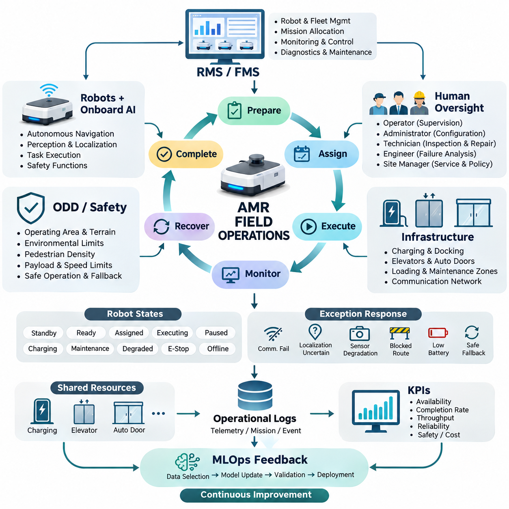
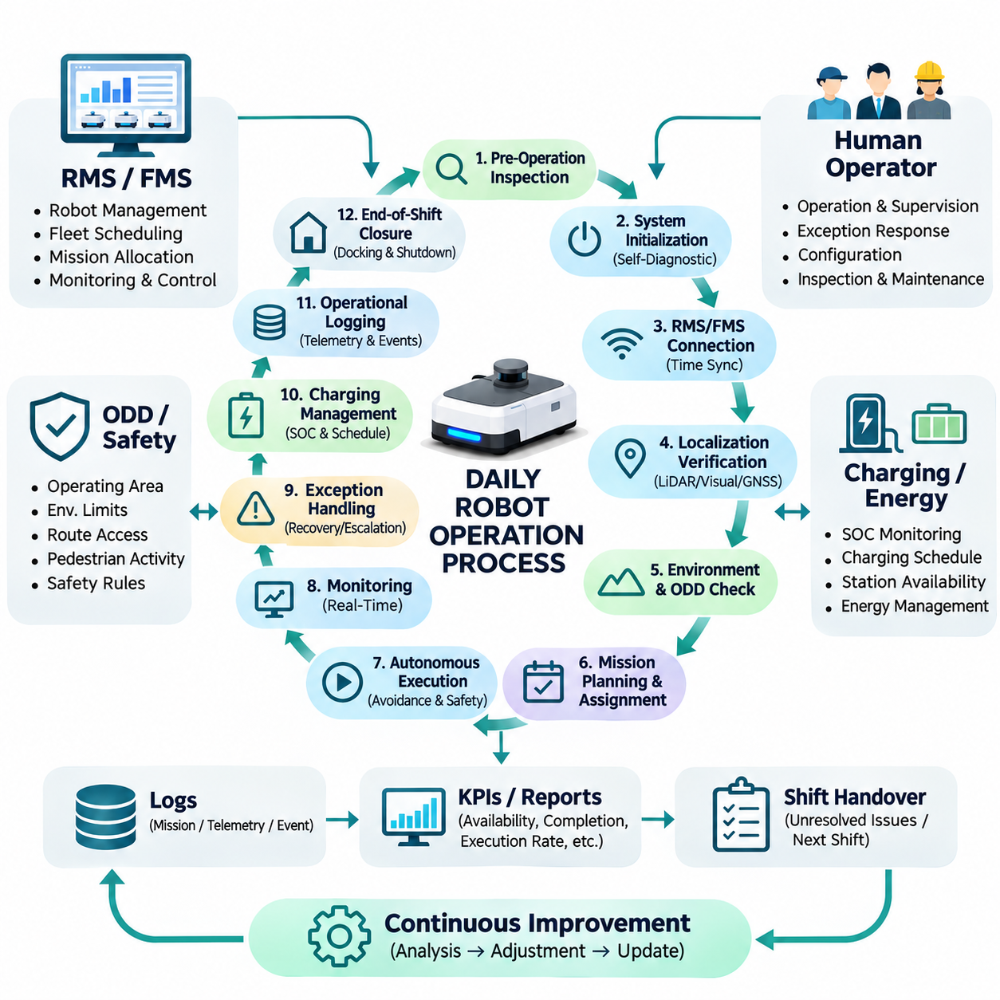
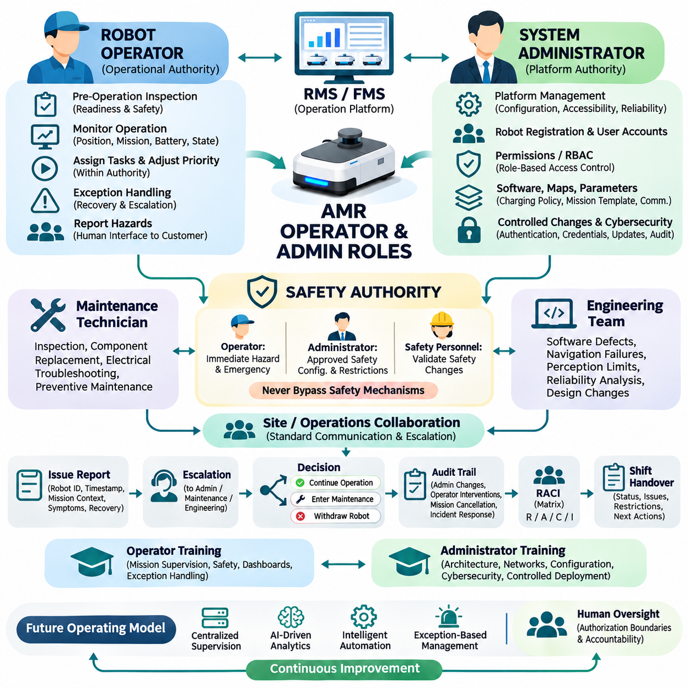
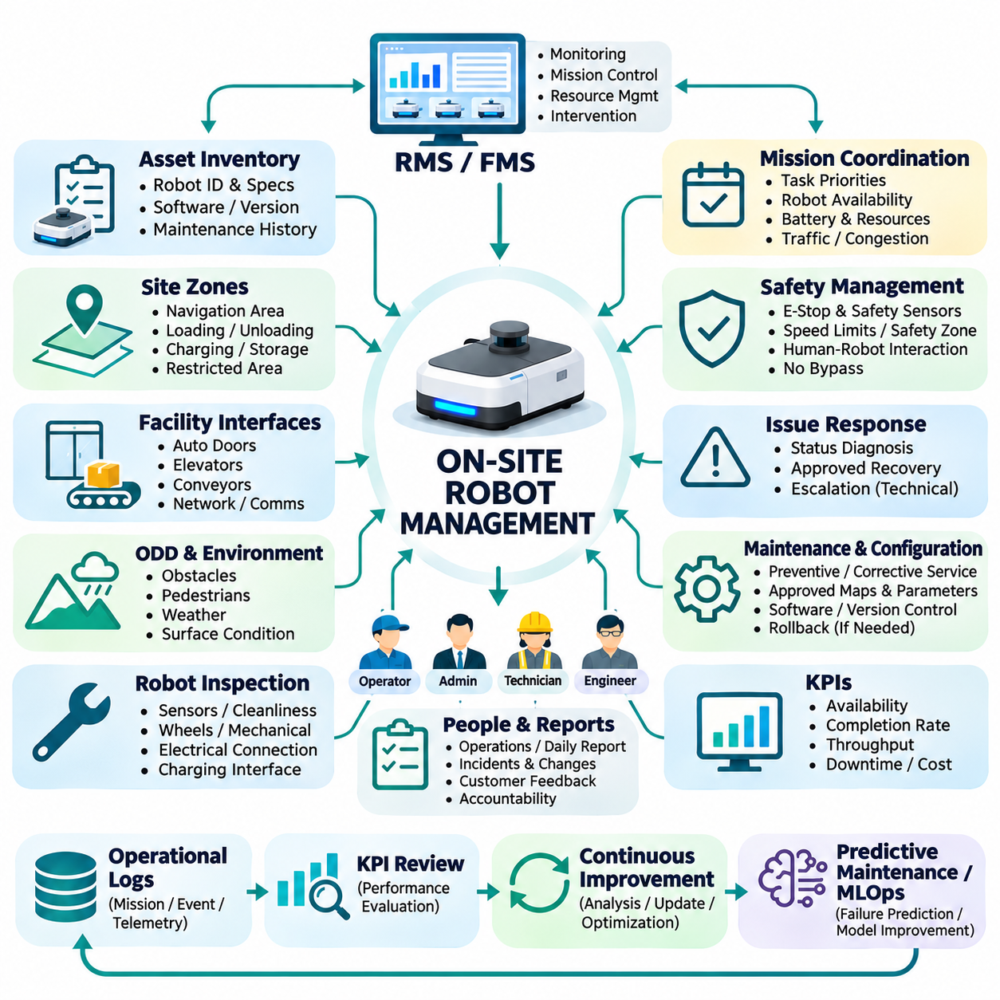
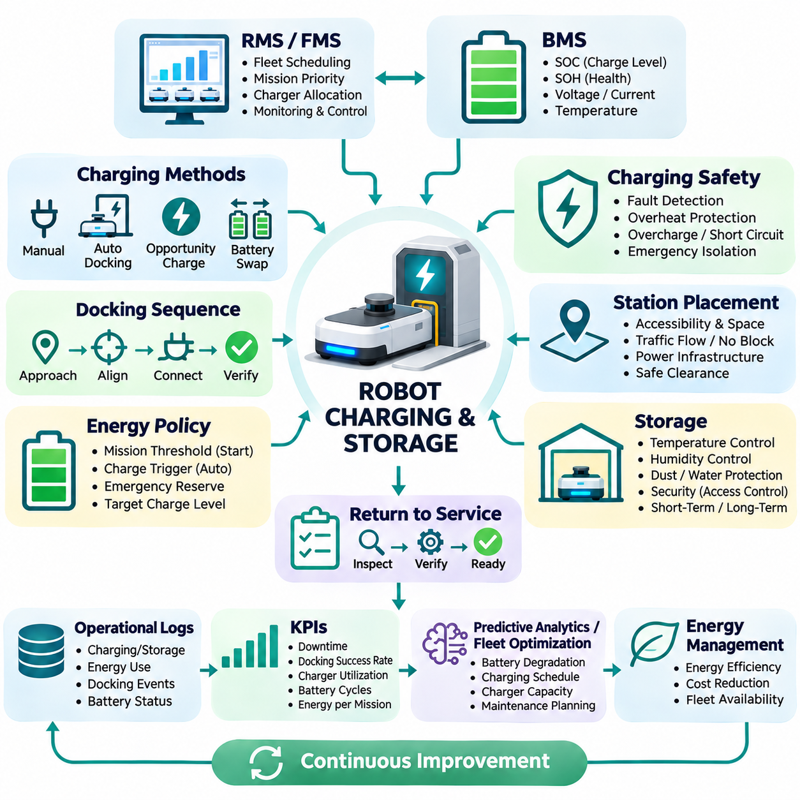
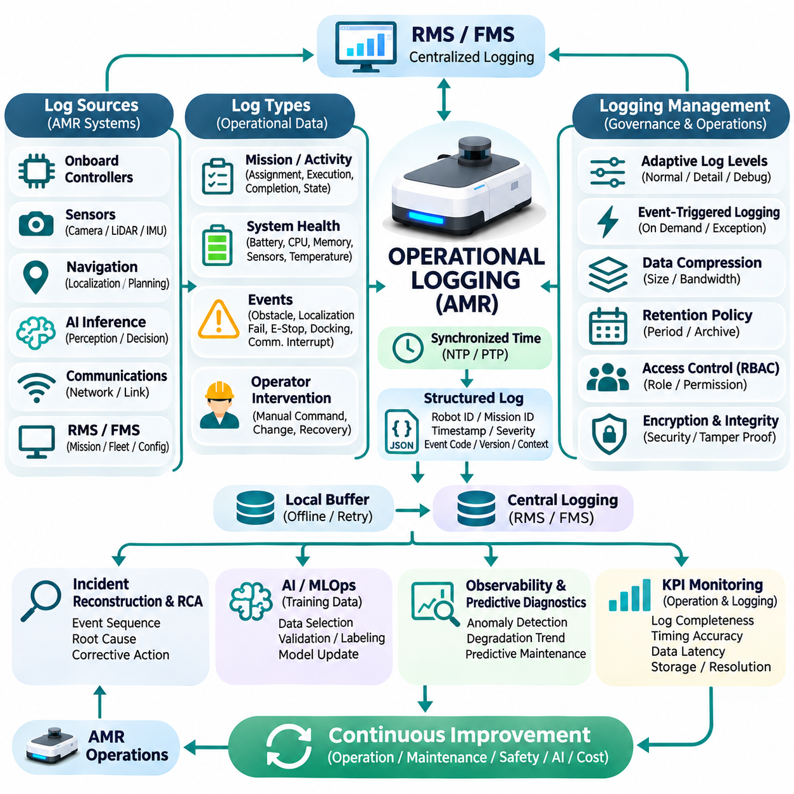
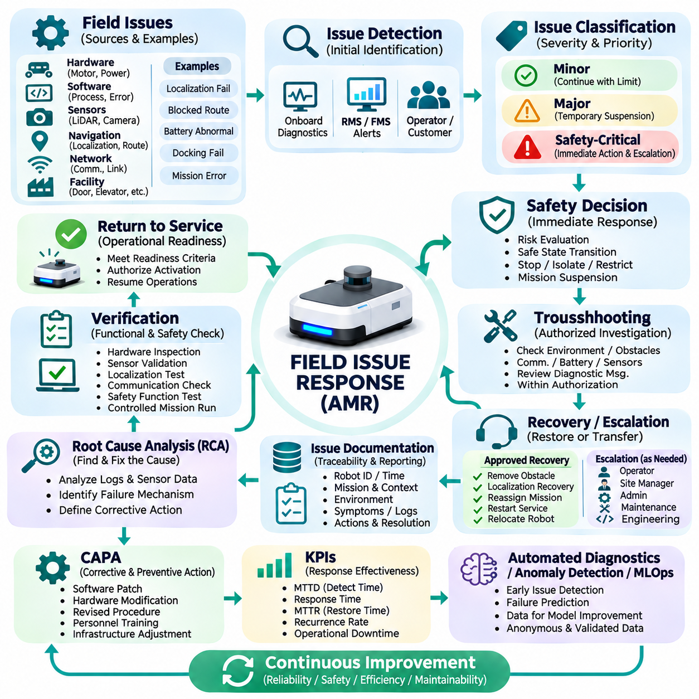
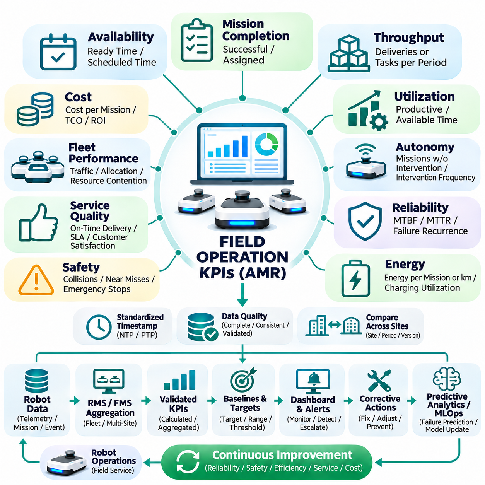

**Volume 08. AMR Operations, Deployment, and MLOps**

# Chapter 02. Field Operations

## 02.1 Field Operation Model

{width="7.268055555555556in" height="7.268055555555556in"}

The field operation model of an Autonomous Mobile Robot (AMR) defines the organizational, technical, and procedural framework through which robotic systems deliver continuous services in real-world environments. Unlike laboratory experiments or prototype demonstrations, field operations require sustained availability, predictable performance, operational safety, and systematic coordination between robots, human operators, and supporting infrastructure.

An effective field operation model integrates physical robot platforms, onboard intelligence, Robot Management Systems (RMS), Fleet Management Systems (FMS), communication infrastructure, and human supervision. These elements establish a coordinated operational ecosystem in which robots execute assigned missions while management systems monitor performance, allocate resources, and respond to unexpected environmental or technical conditions.

Field operations must be designed around the Operational Design Domain (ODD), which defines the environmental and operational conditions under which autonomous robots are permitted to function. These conditions include operating areas, terrain characteristics, environmental limitations, pedestrian density, communication availability, payload restrictions, and maximum operating speeds. Missions outside validated boundaries require appropriate restrictions or intervention.

The operational lifecycle generally consists of preparation, mission assignment, autonomous execution, performance monitoring, exception handling, mission completion, and operational recovery. Before initiating operations, the system verifies robot readiness, battery capacity, sensor functionality, localization accuracy, communication connectivity, and safety mechanisms. Only robots satisfying predefined readiness criteria should receive operational assignments.

Field operation architectures can adopt centralized, decentralized, or hybrid management models. Centralized management assigns missions and coordinates resources through a supervisory management server. Decentralized management enables individual robots to make operational decisions using local intelligence. Hybrid architectures combine centralized mission orchestration with distributed autonomous execution, improving scalability and operational resilience.

The Robot Management System provides a supervisory interface between individual robots and operational personnel. It manages robot registration, configuration, operating states, diagnostic information, software versions, alarms, and maintenance records. The Fleet Management System extends these capabilities by coordinating multiple robots, distributing missions, managing shared resources, and resolving operational conflicts across the deployment environment.

Mission management converts business requirements into executable robotic activities. Manufacturing facilities may request material transportation, hospitals may schedule medical supply deliveries, logistics centers may assign warehouse transportation tasks, and smart cities may initiate autonomous patrol missions. Each mission should define its objectives, priorities, execution constraints, completion criteria, and permissible recovery procedures.

Operational state management establishes consistent behavioral expectations throughout the robot lifecycle. Typical states include standby, ready, assigned, executing, paused, charging, maintenance, degraded operation, emergency stop, and offline. Clearly defined state transitions prevent contradictory commands and enable supervisory systems to determine whether a robot remains available, requires assistance, or must be removed from active service.

Human participation remains an essential component of field operations even when robots possess advanced autonomous capabilities. Operators supervise mission execution and respond to exceptions, administrators manage operational configurations, and maintenance technicians perform physical inspections and repairs. Engineering teams investigate systemic failures, while site managers coordinate customer requirements, operational policies, and service objectives.

Resource management ensures that robots possess sufficient energy, computing capacity, communication bandwidth, and physical access to complete assigned missions. Charging stations, docking facilities, elevators, automatic doors, loading areas, and maintenance zones should be treated as shared operational resources. Their availability must be incorporated into mission scheduling to prevent congestion, unnecessary waiting, and service interruptions.

Operational resilience depends on the ability to recognize abnormal conditions and transition into predefined safe operating states. Communication failures, localization uncertainty, sensor degradation, blocked routes, unexpected obstacles, and insufficient battery capacity require context-dependent responses. Robots should retain essential onboard safety functions independently of remote management infrastructure and external network connectivity.

Field operations also generate valuable engineering information through continuous recording of telemetry, mission histories, environmental observations, operator interventions, and failure events. These records establish a traceable foundation for operational analysis, root cause investigation, predictive maintenance, and AI model improvement. Data collection must respect privacy requirements, cybersecurity policies, and available storage resources.

The integration of field operations with Machine Learning Operations (MLOps) establishes a continuous improvement cycle between deployed robots and engineering environments. Difficult perception scenarios, navigation failures, unusual environmental conditions, and repeated human interventions can reveal limitations in existing AI models. Selected operational data supports model refinement, validation, and controlled deployment without compromising operational stability.

Operational effectiveness should be evaluated through measurable Key Performance Indicators (KPIs), including robot availability, mission completion rate, autonomous execution rate, intervention frequency, energy efficiency, service throughput, and recovery time. These indicators should reflect actual customer workflows rather than isolated technical capabilities, enabling organizations to evaluate service reliability, operational costs, and business value.

A scalable field operation model ultimately transforms individual autonomous robots into coordinated service infrastructure. Standardized procedures, distributed intelligence, reliable management platforms, operational data governance, and continuous engineering feedback enable organizations to expand from limited pilot deployments to large-scale robot fleets. This framework establishes the foundation for sustainable, intelligent, and continuously evolving AMR operations.

## 02.2 Daily Robot Operation Process

{width="7.268055555555556in" height="7.268055555555556in"}

The daily robot operation process establishes a standardized workflow for managing Autonomous Mobile Robots (AMRs) throughout their scheduled service periods. It encompasses operational preparation, system initialization, mission execution, continuous monitoring, exception handling, charging, and operational closure. A well-defined process ensures consistent service delivery, operational safety, resource efficiency, and long-term system reliability.

Daily operations begin with a pre-operation inspection to verify the physical and functional readiness of each robot. Operators inspect the mechanical structure, wheels, drive systems, braking mechanisms, electrical connections, sensor surfaces, and emergency stop devices. Battery condition, visible damage, loose components, and environmental contamination should also be evaluated before authorizing autonomous operation.

System initialization involves activating onboard computing platforms, embedded controllers, communication interfaces, perception sensors, and autonomous navigation software. Automated self-diagnostic procedures verify hardware connectivity, software process availability, sensor communication, memory utilization, and system temperature. Initialization failures should prevent the robot from entering an active operational state until resolved.

Following initialization, the robot establishes communication with the Robot Management System (RMS) and Fleet Management System (FMS). The management platform verifies robot identification, network connectivity, software versions, configuration parameters, and operational status. Time synchronization and communication integrity are particularly important for coordinating distributed robots and maintaining accurate operational records.

Localization verification ensures that the robot accurately identifies its position and orientation within the operational environment. Indoor AMRs may utilize LiDAR-based localization, visual landmarks, or predefined reference points, while outdoor robots may incorporate GNSS, RTK, and inertial navigation systems. Localization confidence must satisfy validated thresholds before autonomous mission execution begins.

Environmental readiness assessment confirms that the operating environment remains consistent with the validated Operational Design Domain (ODD). Operators evaluate route accessibility, temporary obstacles, pedestrian activity, floor conditions, weather conditions, and infrastructure availability. Changes affecting operational safety or navigation reliability must be communicated to the management system before missions are assigned.

Mission preparation converts scheduled customer requirements into executable robot tasks. The Fleet Management System evaluates mission priority, robot availability, current location, payload capacity, battery condition, and estimated execution time. Appropriate robots are selected according to operational constraints, while shared infrastructure and charging resources are considered to minimize conflicts and unnecessary delays.

During mission execution, the robot continuously processes environmental information, updates localization estimates, generates navigation trajectories, and controls its motion. Onboard intelligence performs obstacle detection, collision avoidance, behavior planning, and dynamic path adjustment. The management system supervises mission progress without replacing essential onboard control and safety functions.

Continuous operational monitoring provides real-time visibility into robot location, mission status, battery consumption, communication quality, hardware condition, and software performance. Operators utilize dashboards to identify abnormal behavior, delayed missions, and emerging technical problems. Configurable warning thresholds allow early intervention before minor abnormalities develop into significant operational failures.

Exception handling becomes necessary when robots encounter blocked routes, localization uncertainty, communication interruptions, unexpected obstacles, or hardware abnormalities. Depending on the severity and validated recovery capabilities, the robot may automatically replan its route, pause operation, reduce speed, or enter a safe state. Unresolved exceptions should trigger structured escalation to authorized operational personnel.

Battery and charging management must be integrated throughout daily operations rather than treated as an independent activity. The Fleet Management System monitors the State of Charge (SOC), estimated remaining operating time, and charging station availability. Dynamic charging schedules balance mission demand with energy requirements, preventing unexpected battery depletion while maintaining sufficient service capacity.

Operational data collection records mission execution histories, system telemetry, sensor observations, navigation events, energy consumption, and operator interventions. Relevant abnormal events should include synchronized timestamps, robot identification, software versions, and environmental context. These records support operational analysis, failure investigation, predictive maintenance, and future AI model improvements.

At the end of a scheduled operating period, robots complete or safely suspend outstanding missions and return to designated docking, charging, or storage locations. Operators verify mission completion, inspect physical conditions, review unresolved alarms, and confirm charging connectivity. Shutdown or standby procedures should preserve essential operational records and maintain appropriate safety and security functions.

Daily operational reporting consolidates mission completion rates, robot availability, autonomous execution rates, intervention frequency, charging durations, and equipment failures. Shift handover procedures communicate unresolved issues, restricted operating areas, maintenance requirements, and pending missions to incoming personnel. Continuous review of these records strengthens operational consistency, accountability, and service quality.

## 02.3 Operator and Admin Roles

{width="7.268055555555556in" height="7.268055555555556in"}

The operation of Autonomous Mobile Robots (AMRs) requires a clearly defined organizational structure that separates operational responsibilities, administrative authority, technical support, and safety supervision. Operators and administrators represent two fundamental roles within this structure. Their responsibilities must be coordinated to maintain operational efficiency, system reliability, cybersecurity, and accountability throughout the robot service lifecycle.

Robot operators are primarily responsible for supervising daily robotic activities and ensuring that assigned missions are executed according to established operational procedures. Their responsibilities include verifying robot readiness, initiating and monitoring missions, reviewing operational alerts, and responding to exceptional situations. Operators serve as the primary human interface between autonomous robotic systems and actual customer workflows.

Before daily operations begin, operators perform physical inspections and verify the functional readiness of robotic platforms. They evaluate battery status, sensor conditions, mechanical integrity, communication connectivity, and emergency stop functionality. Any abnormal condition that could compromise operational safety or mission reliability must be reported and resolved according to established procedures before the robot enters active service.

During mission execution, operators utilize the Robot Management System (RMS) and Fleet Management System (FMS) to monitor robot positions, mission progress, battery levels, operating states, and environmental conditions. They may assign approved tasks, modify mission priorities within authorized limits, or temporarily suspend operations. Essential autonomous navigation and safety functions remain under onboard system control.

Exception management represents a critical responsibility of robot operators. When robots encounter blocked routes, localization failures, communication interruptions, or unexpected environmental conditions, operators evaluate available diagnostic information and initiate approved recovery procedures. Problems exceeding their technical competence or authorization must be escalated to administrators, maintenance technicians, or engineering personnel.

System administrators are responsible for maintaining the overall configuration, accessibility, reliability, and governance of robotic operation platforms. Unlike operators who concentrate on daily service execution, administrators manage the underlying operational environment. Their responsibilities include robot registration, user account management, permission configuration, infrastructure integration, and system-level operational policies.

Administrative responsibilities also encompass configuration management across deployed robotic platforms. Administrators maintain approved software versions, navigation maps, operating parameters, charging policies, mission templates, and communication settings. Configuration changes must follow controlled approval procedures to prevent inconsistencies between robots and avoid introducing unvalidated behavior into production environments.

Role-Based Access Control (RBAC) provides a systematic approach to separating operational privileges from administrative authority. Operators should receive only the permissions necessary to execute assigned responsibilities, while administrators receive additional privileges according to their designated functions. Sensitive capabilities, including safety configuration changes and software deployment, require restricted access and appropriate approval.

Safety responsibilities must be distributed according to clearly established authority boundaries. Operators monitor immediate operational hazards and initiate emergency procedures when necessary. Administrators maintain approved safety configurations and operational restrictions, while qualified safety personnel evaluate regulatory compliance and validate safety-related changes. Administrative privileges must never permit unauthorized bypassing of validated safety mechanisms.

Cybersecurity management requires administrators to maintain authentication mechanisms, access policies, credential management, security updates, and audit records. Operators must follow established security procedures, protect authentication credentials, and report suspicious activities. Remote access, configuration modifications, and privileged commands should be recorded to establish accountability and support cybersecurity incident investigations.

Maintenance technicians and engineering personnel provide specialized support beyond routine operational and administrative responsibilities. Maintenance technicians perform mechanical inspections, component replacement, electrical troubleshooting, and preventive maintenance. Engineering teams investigate software defects, navigation failures, perception limitations, and systemic reliability problems that require deeper technical analysis or design modifications.

Effective collaboration between operators and administrators depends on standardized communication and escalation procedures. Operational abnormalities should be documented with robot identification, timestamps, mission context, observed symptoms, and attempted recovery actions. Administrators evaluate recurring issues, coordinate technical support, and determine whether affected robots should remain operational, enter maintenance, or temporarily withdraw from service.

Training and competency management are essential for maintaining consistent operational performance across different personnel and deployment sites. Operators require practical training in mission supervision, safety procedures, dashboard utilization, and exception handling. Administrators require additional knowledge of system architecture, network infrastructure, configuration management, cybersecurity, and controlled software deployment procedures.

Operational accountability is strengthened through clearly assigned responsibilities, structured shift handovers, and comprehensive audit trails. Every significant administrative modification, operator intervention, mission cancellation, and incident response should remain traceable to authorized personnel. Responsibility Assignment Matrices, such as RACI, can clarify accountability and prevent organizational gaps during complex operational events.

As AMR fleets expand, operator and administrator roles increasingly evolve toward centralized supervision, intelligent automation, and exception-based management. Routine monitoring and administrative activities can be partially automated through AI-driven analytics and operational management platforms. Nevertheless, human oversight, appropriate authorization boundaries, and clearly defined accountability remain fundamental requirements for scalable and trustworthy robotic operations.

## 02.4 On-Site Robot Management

{width="7.268055555555556in" height="7.268055555555556in"}

On-site robot management establishes the operational framework for supervising, maintaining, and coordinating Autonomous Mobile Robots (AMRs) within actual deployment environments. It connects autonomous robotic capabilities with physical infrastructure, human operators, customer workflows, and organizational requirements. Effective on-site management ensures that robotic services remain reliable, safe, and aligned with operational objectives.

Each deployment site should maintain a comprehensive inventory of robotic assets, including robot identification, hardware specifications, software versions, sensor configurations, maintenance histories, and assigned operating areas. Asset management provides visibility into the condition and availability of individual robots. Consistent identification also supports configuration control, troubleshooting, maintenance planning, and lifecycle management.

Operational environments should be organized into clearly defined functional zones, including autonomous navigation areas, loading and unloading stations, charging stations, maintenance areas, storage locations, and restricted access zones. These zones must correspond to validated navigation maps and operational safety policies. Physical changes within the environment should be evaluated before being reflected in robot configurations.

On-site management requires continuous coordination between robotic systems and existing facility infrastructure. Automatic doors, elevators, conveyor systems, loading stations, access control devices, and industrial equipment may participate directly in robot workflows. Infrastructure availability and communication status must be monitored to prevent operational interruptions, resource conflicts, and incomplete mission execution.

The Robot Management System (RMS) provides centralized visibility into individual robot conditions, while the Fleet Management System (FMS) coordinates mission assignments and shared operational resources. On-site personnel use these platforms to monitor robot locations, operating states, mission progress, battery conditions, and system alarms. Management interfaces should support both routine supervision and structured intervention.

Environmental management is particularly important because real-world deployment conditions continuously evolve. Temporary obstacles, relocated equipment, construction activities, pedestrian movement, surface deterioration, and changing weather conditions can influence robot performance. On-site personnel should regularly evaluate whether environmental conditions remain within the validated Operational Design Domain (ODD) of each robot.

Physical robot inspections should complement automated health monitoring and remote diagnostic capabilities. On-site personnel examine sensor contamination, mechanical damage, wheel wear, abnormal vibration, electrical connections, protective covers, and charging interfaces. Inspection frequency should reflect operational intensity, environmental exposure, equipment reliability, and manufacturer recommendations rather than relying exclusively on fixed schedules.

Operational coordination requires balancing customer demands with robot availability, mission priorities, battery capacity, and infrastructure limitations. Site managers should evaluate peak service periods, anticipated workload variations, and maintenance requirements when organizing daily activities. Effective coordination prevents excessive robot utilization, unnecessary idle time, traffic congestion, and competition for shared operational resources.

Safety management must remain an integral component of on-site robot supervision. Personnel should verify that emergency stop devices, protective sensors, warning indicators, speed restrictions, and designated safety zones remain functional. Changes affecting human-robot interaction or operational risks require appropriate assessment and authorization. Productivity objectives must never justify bypassing validated safety mechanisms.

When operational abnormalities occur, on-site personnel provide the initial response by evaluating robot status, environmental conditions, and available diagnostic information. Approved recovery procedures may include clearing obstacles, verifying localization, restarting non-safety-critical services, or relocating disabled robots under controlled conditions. Unresolved or safety-critical failures must be escalated to qualified technical personnel.

Maintenance coordination ensures that robotic assets receive appropriate preventive and corrective services without unnecessarily disrupting customer operations. On-site managers should maintain maintenance schedules, replacement component inventories, service tools, and equipment isolation procedures. Robots undergoing maintenance must be excluded from active mission assignments until required inspections and functional verification have been completed.

Configuration management prevents unauthorized or inconsistent changes across deployed robotic systems. Navigation maps, operational parameters, software packages, AI models, and infrastructure interfaces should remain associated with approved configuration baselines. Site-specific adjustments must be documented, validated, and authorized before implementation. Version tracking enables reliable troubleshooting and controlled rollback when necessary.

On-site communication and documentation establish a traceable connection between customer personnel, robot operators, system administrators, maintenance technicians, and engineering teams. Daily reports should capture operational interruptions, environmental changes, equipment abnormalities, customer feedback, and corrective actions. These records support accountability, incident investigation, operational optimization, and continuous engineering improvement.

The effectiveness of on-site robot management should be evaluated using measurable indicators such as robot availability, mission completion rate, service throughput, intervention frequency, maintenance downtime, and operational cost. Performance trends should be reviewed against customer service requirements and historical operating conditions. Identified inefficiencies should lead to controlled improvements in procedures, scheduling, and resource allocation.

As robotic deployments expand, on-site robot management increasingly evolves toward standardized, data-driven, and intelligent operational frameworks. Remote supervision, predictive maintenance, automated diagnostics, and Machine Learning Operations (MLOps) can reduce routine manual workload. However, physical infrastructure management, local safety supervision, and qualified human intervention remain essential foundations for sustainable AMR operations.

## 02.5 Robot Charging and Storage

{width="7.268055555555556in" height="7.268055555555556in"}

Robot charging and storage management represents a fundamental component of Autonomous Mobile Robot (AMR) field operations. Continuous service availability depends not only on autonomous navigation and mission execution capabilities but also on systematic energy management and appropriate storage conditions. An effective charging and storage strategy minimizes operational interruptions, protects robotic assets, and extends equipment service life.

The charging strategy should reflect the operational characteristics of individual robots, including battery chemistry, battery capacity, power consumption, mission duration, and environmental conditions. Lithium Iron Phosphate (LFP) and other lithium-ion battery technologies require charging procedures compatible with their electrical and thermal characteristics. Charging parameters must remain within manufacturer-approved operating limits.

The Battery Management System (BMS) continuously monitors battery voltage, current, temperature, State of Charge (SOC), and State of Health (SOH). These parameters provide essential information for determining charging requirements, identifying battery degradation, and preventing unsafe operating conditions. Integration with the Robot Management System (RMS) enables centralized battery monitoring and coordinated operational decisions.

Robot charging architectures generally include manual charging, automatic docking-based charging, opportunity charging, and battery swapping. Manual charging requires direct operator participation, while automatic docking enables robots to independently connect to charging stations. Opportunity charging utilizes temporary operational idle periods, whereas battery swapping can reduce charging-related downtime in high-utilization environments.

Automatic charging requires reliable docking mechanisms that integrate localization, precision motion control, electrical interfaces, and charging communication protocols. Robots must accurately approach charging stations, verify physical alignment, establish electrical connections, and confirm charging initiation. Failed docking attempts should trigger controlled recovery procedures without damaging charging contacts or surrounding infrastructure.

Charging station placement should consider operational traffic patterns, electrical infrastructure, robot accessibility, environmental protection, and maintenance requirements. Charging locations must provide sufficient maneuvering space and avoid obstructing pedestrian pathways, emergency exits, and primary transportation routes. Large-scale deployments may require distributed charging infrastructure to minimize nonproductive travel distances.

The Fleet Management System (FMS) should treat charging stations as shared operational resources requiring intelligent scheduling and allocation. Charging decisions must consider mission priorities, remaining battery capacity, estimated energy consumption, station availability, and anticipated workload. Dynamic charging schedules prevent simultaneous battery depletion across multiple robots and maintain adequate operational fleet capacity.

Energy management policies should establish minimum mission initiation thresholds, automatic charging thresholds, emergency battery reserves, and target charging levels. These thresholds must reflect actual energy consumption under different payloads, operating speeds, terrain conditions, and environmental temperatures. Maintaining appropriate energy reserves allows robots to reach charging stations or designated safe locations when unexpected conditions occur.

Charging safety requires coordinated protection against electrical faults, excessive temperatures, overcharging, short circuits, and mechanical connection failures. Charging stations and robotic platforms should incorporate compatible protective mechanisms, fault detection, and emergency isolation capabilities. Damaged batteries, contaminated electrical contacts, and abnormal thermal conditions must be investigated before charging operations resume.

Robot storage areas should provide controlled physical and environmental conditions that protect mechanical, electrical, and electronic components during nonoperational periods. Storage requirements include appropriate temperature, humidity, ventilation, dust protection, water exposure prevention, and physical security. Outdoor AMRs may additionally require sheltered storage facilities to reduce prolonged exposure to adverse environmental conditions.

Short-term and long-term storage require different battery management and equipment preservation procedures. Robots stored for extended periods should maintain manufacturer-recommended battery charge levels and undergo periodic condition inspections. Unnecessary electrical loads should be minimized where appropriate, while essential protection functions remain available according to the system design and approved storage procedures.

Before returning stored robots to active service, operators should inspect battery conditions, mechanical assemblies, sensor surfaces, electrical connections, communication interfaces, and safety mechanisms. Extended storage may also require battery charging, software compatibility verification, and additional functional testing. Robots must satisfy established operational readiness criteria before receiving autonomous mission assignments.

Charging and storage activities should remain traceable through operational records maintained by the RMS and FMS. Relevant information includes charging frequency, charging duration, energy consumption, battery temperature, docking success rates, storage duration, and abnormal events. Historical data enables battery degradation analysis, charging infrastructure optimization, preventive maintenance, and more accurate estimation of operational costs.

The effectiveness of charging and storage management should be evaluated using Key Performance Indicators (KPIs), including charging downtime, docking success rate, charging station utilization, battery cycle count, energy consumption per mission, and robot availability. These indicators help identify infrastructure bottlenecks, inefficient charging schedules, abnormal battery behavior, and opportunities to reduce total cost of ownership.

As AMR fleets expand, charging and storage management increasingly evolves toward intelligent energy orchestration supported by predictive analytics, automated docking, battery health estimation, and dynamic fleet scheduling. Integrating energy management with mission planning and maintenance strategies enables organizations to achieve greater operational autonomy, infrastructure efficiency, battery longevity, and sustainable large-scale robotic service delivery.

## 02.6 Operational Logging

{width="7.268055555555556in" height="7.268055555555556in"}

Operational logging provides a systematic mechanism for recording, preserving, and analyzing information generated during the field operation of Autonomous Mobile Robots (AMRs). It establishes a traceable history of robot activities, system conditions, operator interventions, and environmental events. Effective operational logging supports service reliability, technical troubleshooting, safety management, and continuous operational improvement.

A comprehensive operational logging framework should capture information from multiple system layers, including onboard controllers, sensor processing modules, autonomous navigation systems, AI inference engines, communication interfaces, and fleet management platforms. Integrating these information sources provides a unified understanding of robotic behavior and enables engineers to investigate relationships between operational events and system performance.

Robot activity logs record mission assignments, mission initiation and completion, navigation routes, task execution results, and operational state transitions. Each record should include a unique robot identifier, mission identifier, timestamp, and execution status. These records enable operators to reconstruct daily activities, evaluate service performance, investigate incomplete missions, and verify compliance with established operational procedures.

System health logs provide information about battery conditions, processor utilization, memory consumption, sensor availability, motor temperatures, communication status, and hardware diagnostic results. Continuous recording of these parameters enables the identification of abnormal operating patterns and progressive equipment degradation. Historical health information also provides a foundation for preventive and predictive maintenance strategies.

Event logging captures specific operational occurrences such as obstacle detection, localization failures, emergency stops, communication interruptions, docking failures, and unexpected mission cancellations. Events should be classified according to their severity, operational impact, and subsystem origin. Consistent event classification allows operators to prioritize responses and enables automated systems to identify critical operational abnormalities.

Accurate timestamp management is essential for establishing reliable relationships between events generated by different robotic subsystems. Network Time Protocol (NTP) and Precision Time Protocol (PTP) can support synchronized logging across distributed computing platforms according to timing requirements. Consistent time references enable event reconstruction, latency analysis, sensor correlation, and systematic investigation of complex operational failures.

Structured logging formats improve the accessibility, consistency, and automated processing of operational information. Log records should incorporate standardized fields such as timestamps, severity levels, subsystem identifiers, event codes, software versions, and contextual information. Machine-readable formats such as JSON enable efficient data aggregation, automated filtering, statistical analysis, and integration with external monitoring platforms.

The Robot Management System (RMS) and Fleet Management System (FMS) should integrate operational logs from individual robots into centralized management environments. Centralized logging enables operators to compare robot performance, identify recurring failures, and monitor operational trends across multiple deployment sites. Local buffering mechanisms should preserve essential records during temporary network interruptions and support subsequent synchronization.

Logging infrastructure must balance information completeness with computing resources, communication bandwidth, and storage capacity. High-frequency sensor measurements and detailed debugging information can generate substantial data volumes during continuous operation. Adaptive logging levels, event-triggered recording, data compression, and retention policies help maintain operational visibility without compromising real-time control performance.

Operator intervention logs establish accountability by recording manual commands, mission modifications, emergency actions, configuration adjustments, and recovery procedures. Each intervention should remain associated with an authorized user, execution timestamp, operational context, and resulting system state. These records support safety investigations, personnel training, procedural compliance, and evaluation of human intervention requirements.

Operational log management must incorporate cybersecurity, data privacy, and information governance requirements. Access to sensitive records should be controlled through authentication, Role-Based Access Control (RBAC), and appropriate encryption mechanisms. Log integrity should be protected against unauthorized modification or deletion, while retention policies must reflect applicable regulations, contractual obligations, and organizational requirements.

Incident investigation relies on the availability of complete and accurately correlated operational records. Engineers should reconstruct event sequences by examining robot states, diagnostic messages, sensor observations, control commands, and operator interventions surrounding an abnormal event. Root Cause Analysis (RCA) transforms recorded operational evidence into corrective actions, engineering improvements, and updated safety procedures.

Operational logging also provides valuable information for Artificial Intelligence (AI) development and Machine Learning Operations (MLOps). Mission failures, perception errors, navigation anomalies, and unusual environmental conditions can identify candidates for targeted dataset collection. Selected records should undergo validation, anonymization, and contextual labeling before being incorporated into model evaluation or continuous learning workflows.

The effectiveness of operational logging should be evaluated using Key Performance Indicators (KPIs), including log collection completeness, synchronization accuracy, event reporting latency, storage utilization, and diagnostic resolution time. Monitoring these indicators helps organizations identify information gaps, improve logging infrastructure, and ensure that operational evidence remains available throughout the robotic service lifecycle.

As AMR deployments expand, operational logging increasingly evolves toward intelligent observability frameworks integrating real-time analytics, automated event correlation, anomaly detection, and predictive diagnostics. Transforming operational records into actionable intelligence enables organizations to improve fleet reliability, reduce troubleshooting costs, strengthen operational governance, and establish continuous feedback between field operations and robotic system development.

## 02.7 Field Issue Response

{width="7.268055555555556in" height="7.268055555555556in"}

Field issue response establishes a systematic approach for identifying, evaluating, resolving, and documenting problems encountered during the operation of Autonomous Mobile Robots (AMRs). Since actual deployment environments continuously change, robotic systems may experience unexpected technical failures, environmental disturbances, or operational conflicts. An effective response framework minimizes service interruptions and maintains operational safety.

Field issues may originate from hardware components, software modules, sensor systems, autonomous navigation algorithms, communication networks, or facility infrastructure. Common examples include localization failures, blocked navigation routes, battery abnormalities, unsuccessful docking attempts, and mission execution errors. Identifying the nature and origin of each issue is essential for selecting appropriate response procedures.

Issue classification provides a structured mechanism for determining response priorities according to severity, operational impact, and potential safety consequences. Minor issues may permit continued operation under approved conditions, while major failures may require temporary suspension of robotic services. Safety-critical issues require immediate protective actions, operational isolation, and escalation to appropriately qualified personnel.

The initial detection of field issues may occur through onboard diagnostic systems, automated monitoring platforms, operator observations, or customer feedback. The Robot Management System (RMS) and Fleet Management System (FMS) should provide timely notifications containing robot identification, event classification, operating status, and relevant diagnostic information. Accurate detection reduces response delays and prevents failures from escalating.

When a field issue is identified, operators should evaluate the immediate operational conditions and determine whether continued robot activity presents unacceptable risks. Robots exhibiting abnormal or potentially hazardous behavior must transition to an appropriate safe state. Mission suspension, controlled stopping, emergency isolation, and restricted operating modes may be implemented according to validated safety procedures and system design.

Initial troubleshooting should follow standardized procedures that enable operators to investigate common field issues without introducing additional operational risks. Operators may examine environmental obstacles, communication status, battery conditions, sensor integrity, and diagnostic messages. Troubleshooting activities must remain within established authorization boundaries and avoid unauthorized modifications to safety-critical system configurations.

Recovery procedures should be defined in advance for frequently encountered operational failures. Approved recovery actions may include obstacle removal, localization recovery, mission reassignment, controlled software service restart, or relocation of an immobilized robot. Recovery attempts should remain limited to validated procedures, and repeated failures should trigger escalation rather than uncontrolled attempts to restore operations.

An effective escalation framework distributes responsibilities among robot operators, site managers, system administrators, maintenance technicians, and engineering teams. Issues exceeding the technical competence or authorization of on-site personnel must be transferred to appropriate specialists. Escalation criteria should consider failure severity, recovery time, recurrence frequency, customer impact, and potential safety consequences.

Remote technical support enables engineering personnel to investigate field issues through secure access to operational logs, diagnostic interfaces, system configurations, and real-time monitoring information. Remote troubleshooting can reduce unnecessary site visits and accelerate service restoration. However, remote interventions must follow cybersecurity policies, access authorization requirements, and established operational safety restrictions.

Field issue documentation should capture robot identification, occurrence time, mission context, environmental conditions, observed symptoms, diagnostic information, attempted recovery actions, and final resolution results. Comprehensive issue records establish traceability and provide valuable information for subsequent technical analysis. Standardized reporting also improves communication between operational personnel and engineering organizations.

Root Cause Analysis (RCA) is essential for addressing recurring or significant field issues that cannot be permanently resolved through routine recovery procedures. Engineering teams should examine operational logs, sensor observations, software behavior, hardware conditions, and environmental factors to identify underlying failure mechanisms. Corrective actions must address fundamental causes rather than merely eliminating visible symptoms.

Following issue resolution, affected robots must undergo appropriate functional verification before returning to active service. Verification may include hardware inspection, sensor validation, localization testing, communication checks, safety function assessment, and controlled mission execution. Service restoration should occur only after authorized personnel confirm that the robot satisfies established operational readiness and safety criteria.

Field issue response should incorporate Corrective and Preventive Action (CAPA) processes to transform operational failures into systematic improvements. Identified problems may result in software patches, hardware modifications, revised operating procedures, additional personnel training, or infrastructure adjustments. Approved corrective actions should be validated, documented, and communicated across relevant deployment sites to prevent recurrence.

Response effectiveness should be evaluated using Key Performance Indicators (KPIs), including Mean Time to Detect (MTTD), Mean Time to Respond, Mean Time to Restore (MTTR), issue recurrence rate, first-time resolution rate, and operational downtime. These indicators enable organizations to evaluate response efficiency, identify technical support bottlenecks, optimize maintenance resources, and improve customer service reliability.

As AMR deployments expand, field issue response increasingly evolves toward intelligent and proactive operational management supported by automated diagnostics, anomaly detection, predictive analytics, and Machine Learning Operations (MLOps). Integrating field issue information with engineering development and continuous learning frameworks establishes a closed-loop improvement process that strengthens fleet reliability, operational resilience, and long-term system maturity.

## 02.8 Field Operation KPIs

{width="7.268055555555556in" height="7.268055555555556in"}

Key Performance Indicators (KPIs) provide a quantitative framework for evaluating the effectiveness, reliability, safety, and economic efficiency of Autonomous Mobile Robot (AMR) field operations. Unlike technical performance indicators measured exclusively during development, operational KPIs reflect actual service conditions and customer requirements. These indicators support objective decision-making and continuous operational improvement.

Robot availability represents one of the most fundamental indicators of operational performance. Availability is calculated by dividing the time during which a robot is ready to perform assigned missions by the total scheduled operating time. Factors affecting availability include hardware failures, software abnormalities, charging requirements, and maintenance activities. High availability indicates effective operational resource management.

Mission completion rate measures the proportion of successfully completed missions relative to the total number of assigned missions within a defined evaluation period. This indicator reflects the combined effectiveness of autonomous navigation, task execution, infrastructure integration, and operational coordination. Failed, canceled, and interrupted missions should be classified separately to identify specific performance limitations.

Operational throughput represents the quantity of productive work completed by individual robots or entire robotic fleets within a specified period. Depending on the application, throughput may be measured through completed deliveries, transported materials, inspected locations, cleaned surface areas, or serviced facilities. Throughput evaluation should consider mission complexity, travel distance, payload, and environmental conditions.

Robot utilization measures the proportion of available operating time dedicated to productive mission execution. Excessively low utilization may indicate inefficient scheduling, insufficient customer demand, or unnecessary idle periods. Conversely, excessively high utilization may increase equipment degradation and reduce maintenance opportunities. Balanced utilization supports sustainable productivity and efficient resource allocation.

Autonomous operation rate measures the proportion of missions completed without direct human intervention. Intervention frequency provides complementary information regarding operator assistance, navigation recovery, manual repositioning, and technical troubleshooting. These indicators are particularly important for evaluating autonomous system maturity, operational scalability, and the personnel requirements associated with large robotic fleets.

Operational reliability should be evaluated using Mean Time Between Failures (MTBF), Mean Time to Repair (MTTR), failure frequency, and recurring issue rates. These indicators provide insight into equipment reliability, maintenance effectiveness, and technical support capabilities. Consistent failure classification and standardized measurement boundaries are necessary for meaningful comparisons across robots and deployment environments.

Energy efficiency indicators evaluate the relationship between electrical energy consumption and productive robotic activities. Relevant measurements include energy consumption per mission, energy consumption per kilometer, charging duration, battery cycle count, and charging station utilization. Monitoring these indicators supports battery lifecycle management, charging infrastructure optimization, and reduction of operational energy costs.

Operational safety indicators should include collision frequency, near-miss events, emergency stop occurrences, safety-related interventions, and violations of established operational restrictions. Safety events should be classified according to severity, exposure, and underlying causes. Safety performance must be evaluated independently from productivity objectives to prevent operational efficiency improvements from introducing unacceptable risks.

Service quality indicators measure the extent to which robotic operations satisfy customer requirements and established Service Level Agreements (SLAs). Representative indicators include on-time mission completion, service response time, delivery accuracy, service interruption frequency, and customer satisfaction. These measurements connect technical robotic performance with the actual business value delivered to customers.

Fleet-level performance indicators evaluate the collective effectiveness of multiple robots operating within shared environments. Traffic congestion, mission allocation efficiency, resource contention, workload distribution, and charging station waiting time provide insight into fleet coordination capabilities. These indicators help determine whether increasing fleet size generates proportional improvements in overall service capacity.

Operational cost indicators establish the economic relationship between robotic resources and delivered services. Cost per mission, energy expenditure, maintenance costs, personnel support costs, and infrastructure expenses contribute to evaluating Total Cost of Ownership (TCO). Comprehensive cost analysis enables organizations to assess Return on Investment (ROI) and identify opportunities for improving long-term operational sustainability.

Reliable KPI measurement requires standardized data definitions, consistent sampling periods, synchronized timestamps, and validated operational records. The Robot Management System (RMS) and Fleet Management System (FMS) should automatically aggregate relevant information from deployed robots. Data quality management must address missing records, duplicate events, inconsistent classifications, and differences between operating environments.

KPI evaluation should establish operational baselines, target values, acceptable performance ranges, and escalation thresholds appropriate to each application. Performance dashboards should support comparisons across individual robots, deployment sites, operating periods, and software versions. Deviations from established targets should initiate structured investigation, corrective actions, and verification of improvement effectiveness.

As AMR deployments expand, field operation KPIs increasingly evolve toward intelligent performance management supported by predictive analytics, automated anomaly detection, and Machine Learning Operations (MLOps). Integrating operational metrics with engineering development and continuous learning establishes a closed-loop improvement framework that strengthens fleet reliability, autonomous capabilities, economic efficiency, and scalable robotic service delivery.
