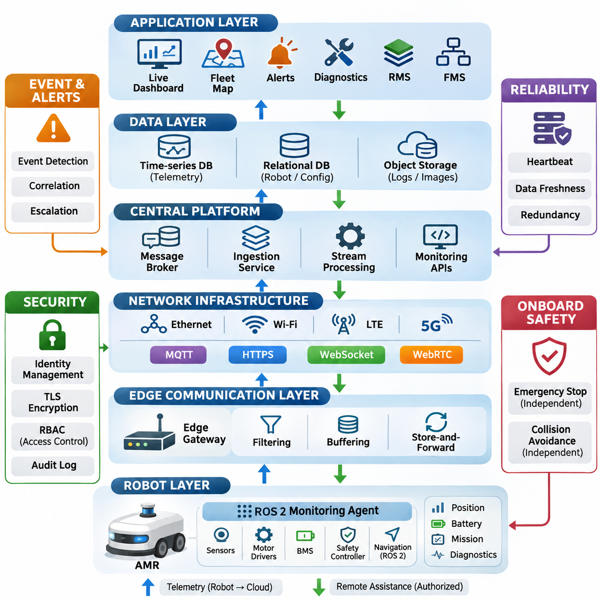
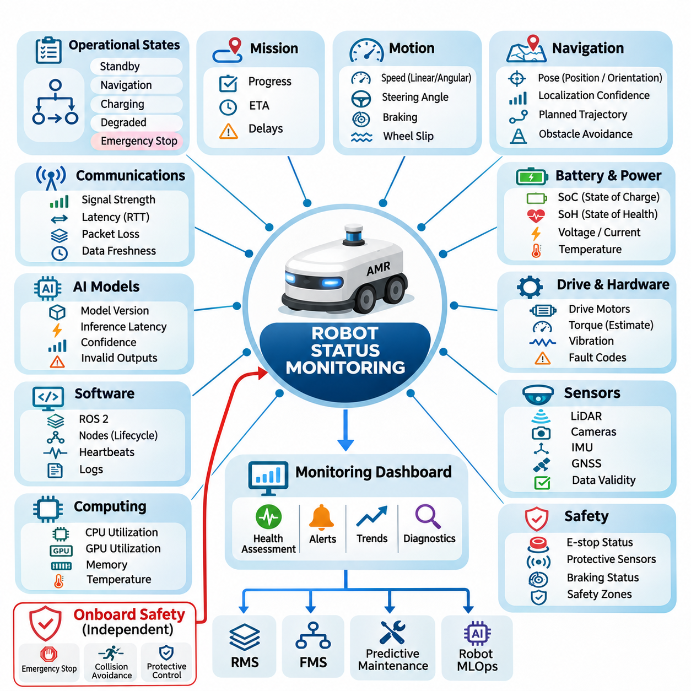
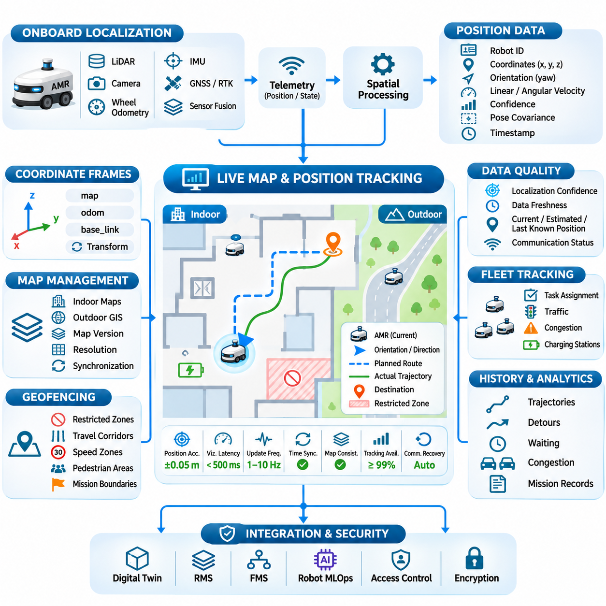
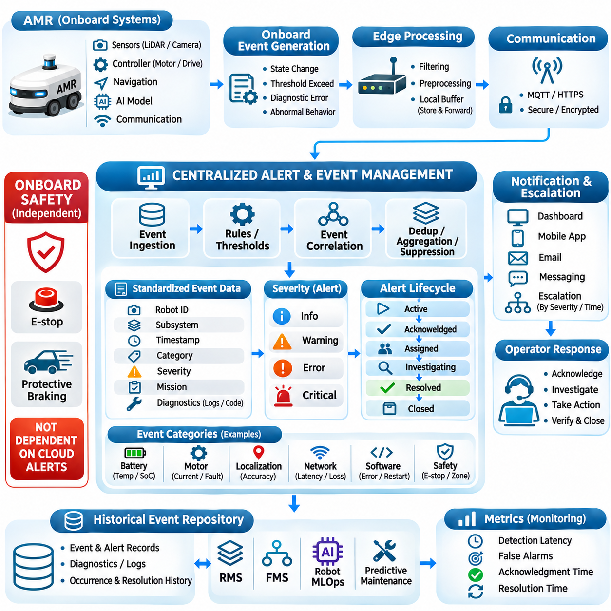
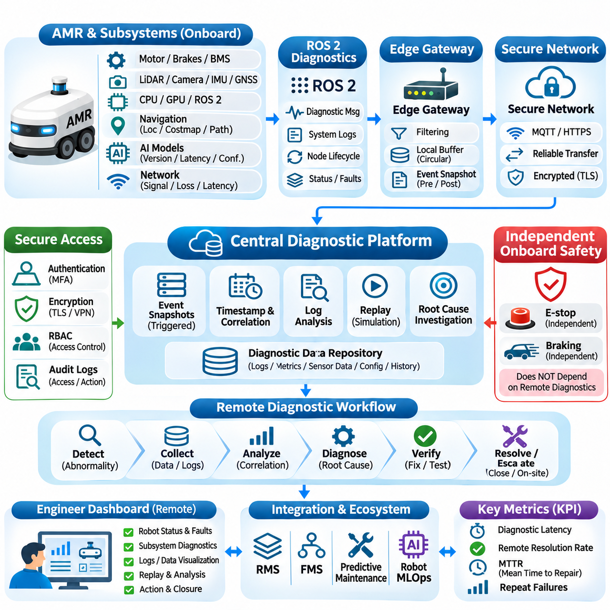
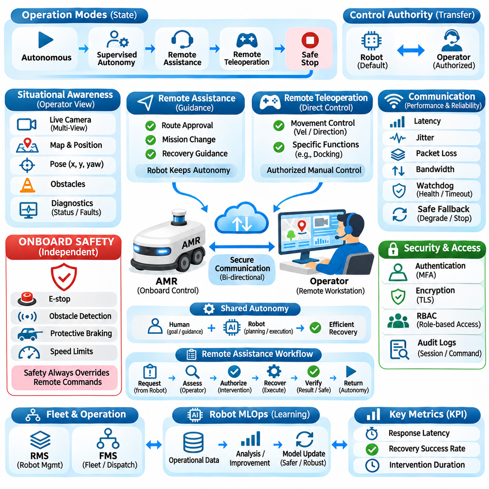
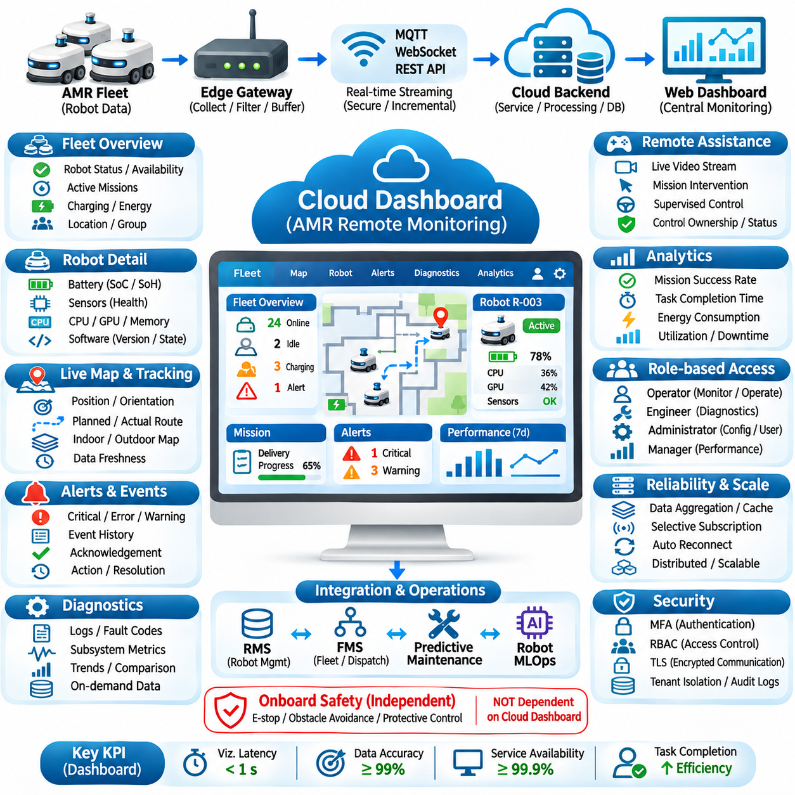
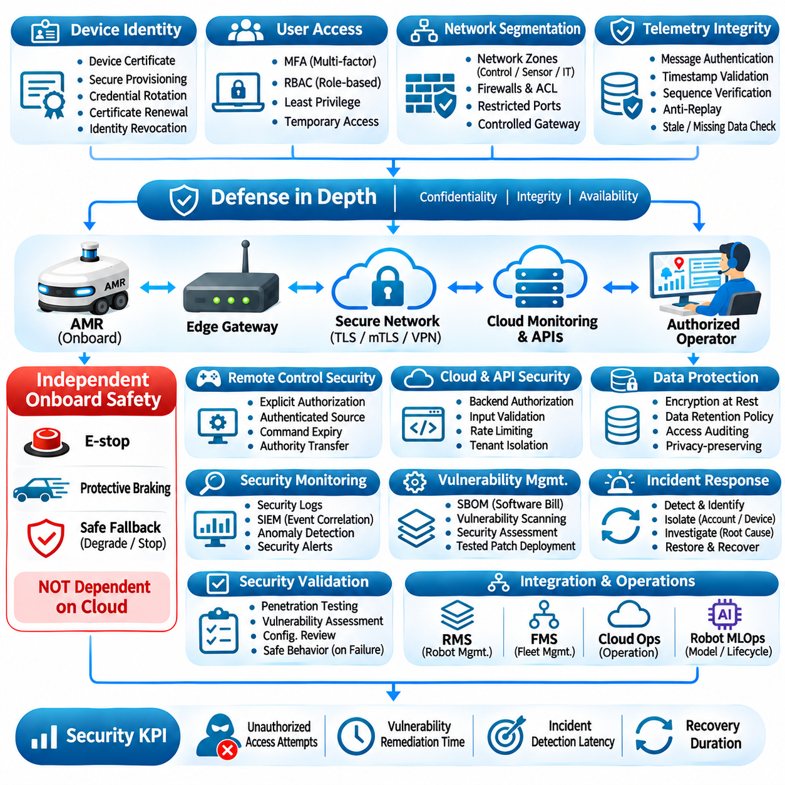

**Volume 08. AMR Operations, Deployment, and MLOps**

# Chapter 03. Remote Monitoring

## 03.1 Remote Monitoring Architecture

{width="7.268055555555556in" height="7.268055555555556in"}

Remote monitoring architecture provides the technological foundation for supervising Autonomous Mobile Robots (AMRs) throughout their operational lifecycle. It enables operators, system administrators, and engineering teams to observe robot behavior, evaluate operational conditions, identify abnormalities, and coordinate appropriate responses without requiring continuous physical presence at deployment sites.

A comprehensive remote monitoring architecture generally consists of the robot layer, edge communication layer, network infrastructure layer, centralized monitoring platform, data management layer, and application layer. These interconnected components establish a distributed monitoring environment that supports real-time operational visibility, centralized supervision, historical analysis, and scalable management across multiple deployment locations.

The robot layer serves as the primary source of operational information. onboard sensors, embedded controllers, motor drivers, Battery Management Systems (BMS), safety controllers, and autonomous navigation software continuously generate monitoring data. This information includes robot position, velocity, battery condition, mission progress, hardware temperature, localization confidence, and software execution status.

An onboard monitoring agent collects and processes information generated by individual robotic subsystems. In ROS 2-based architectures, the agent can subscribe to diagnostic topics, transform data, navigation states, system logs, and custom telemetry messages. It converts heterogeneous information into standardized monitoring messages while performing data filtering, aggregation, timestamping, and local buffering.

The edge communication layer establishes the interface between individual robots and centralized monitoring infrastructure. Edge gateways manage device connectivity, protocol conversion, message prioritization, and temporary data storage. When network connectivity becomes unstable or unavailable, local buffering and store-and-forward mechanisms preserve essential operational records for subsequent transmission after communication is restored.

Network infrastructure connects robotic platforms with remote operation centers through Ethernet, Wi-Fi, private industrial networks, LTE, or 5G communication systems. The appropriate communication technology depends on deployment conditions, geographical coverage, bandwidth requirements, latency tolerance, and cybersecurity policies. Hybrid network configurations can improve communication availability across indoor and outdoor environments.

Communication protocols should be selected according to the characteristics of operational data. MQTT supports lightweight telemetry transmission through publish-subscribe mechanisms, while HTTPS and REST APIs facilitate configuration and service integration. WebSocket connections support continuous dashboard updates, and WebRTC can provide low-latency video streaming for authorized remote assistance.

The centralized monitoring platform receives, validates, processes, and distributes operational information from connected robots. Message brokers, ingestion services, stream-processing engines, and monitoring APIs provide the foundation for handling concurrent data streams. A distributed service architecture allows individual processing components to scale independently according to robot population and communication workload.

Data management infrastructure combines multiple storage technologies according to information characteristics. Time-series databases store telemetry and performance measurements, relational databases maintain robot identities and configuration records, and object storage accommodates diagnostic archives, images, and recorded sensor datasets. Retention policies regulate storage consumption while preserving important operational evidence.

Real-time monitoring applications transform operational information into meaningful representations of robot behavior. Interactive dashboards display robot availability, mission execution, battery conditions, geographical positions, communication quality, and active warnings. Hierarchical visualization allows operators to navigate between global operations, individual deployment sites, robot fleets, and detailed subsystem information.

A standardized robot state model establishes consistent interpretation of operational conditions across heterogeneous platforms. Typical states include idle, autonomous operation, charging, paused, maintenance, degraded operation, emergency stop, and disconnected. State transitions should be associated with timestamps, triggering conditions, and diagnostic context to support reliable supervision and historical reconstruction.

Event-driven monitoring complements periodic telemetry by transmitting significant operational changes as they occur. Safety interventions, navigation failures, communication interruptions, unexpected process termination, and hardware abnormalities generate structured events. An event-processing service evaluates severity, correlates related abnormalities, suppresses redundant notifications, and initiates predefined escalation procedures.

Remote monitoring architecture integrates with the Robot Management System (RMS) and Fleet Management System (FMS). The RMS typically maintains individual robot configuration, diagnostic information, and operational status, while the FMS coordinates collective mission execution and resource utilization. Shared interfaces synchronize monitoring information with task assignments, traffic conditions, charging schedules, and fleet performance.

Remote supervision must remain architecturally separated from safety-critical onboard control. Collision avoidance, emergency stopping, braking, and protective functions should operate independently of cloud connectivity. Remote commands must pass through authorization, command validation, and local safety constraints, ensuring that communication failures or delayed responses cannot compromise essential robotic safety functions.

Scalable and secure monitoring architectures incorporate device authentication, encrypted communication, role-based access control, network segmentation, audit logging, and service redundancy. Heartbeat messages and data freshness indicators distinguish healthy robots from disconnected devices or outdated records. Monitoring availability, telemetry latency, data completeness, and recovery time provide measurable architectural performance indicators. Operational records can also support predictive maintenance and Robot MLOps.

## 03.2 Robot Status Monitoring

{width="7.268055555555556in" height="7.268055555555556in"}

Robot status monitoring is a fundamental component of remote monitoring systems for Autonomous Mobile Robots (AMRs). It provides continuous visibility into the operational condition, mission execution, hardware health, software performance, and communication availability of individual robots. Effective status monitoring enables operators to identify abnormalities before they develop into operational failures or safety-related incidents.

A comprehensive robot status monitoring system integrates information from mechanical, electrical, electronic, software, and artificial intelligence subsystems. Instead of treating the robot as a single operational entity, the monitoring system evaluates multiple interconnected components and their relationships. This multidimensional approach provides a more accurate understanding of robot availability, reliability, and operational readiness.

The robot operational state model defines the primary conditions under which an AMR can exist during its operational lifecycle. Representative states include initialization, standby, autonomous navigation, mission execution, docking, charging, paused operation, manual operation, maintenance, degraded operation, and emergency stop. Each state should have clearly defined transition conditions and associated operational restrictions.

Mission status monitoring evaluates the progress of assigned tasks and their associated execution sequences. Information such as mission identification, task priority, current destination, completed activities, remaining travel distance, estimated completion time, and execution delays provides operational transparency. Unexpected mission interruptions should generate diagnostic information for troubleshooting and operational recovery.

Motion status monitoring continuously evaluates the physical movement of the robotic platform. Representative parameters include linear velocity, angular velocity, acceleration, steering angle, wheel rotational speed, braking status, and commanded versus actual motion. Significant deviations between expected and measured movement may indicate mechanical resistance, actuator malfunction, wheel slippage, or control system abnormalities.

Localization and navigation status monitoring evaluates the reliability of autonomous movement within the operational environment. Monitoring parameters include estimated robot position, orientation, localization confidence, positioning uncertainty, map identification, planned trajectory, and obstacle avoidance status. Localization degradation should trigger appropriate onboard responses according to predefined operational and safety requirements.

Battery and power status monitoring provides essential information about robot endurance and electrical system stability. Battery Management Systems (BMS) typically report State of Charge (SoC), State of Health (SoH), voltage, current, temperature, charging status, and protection events. Estimated remaining operating time and energy consumption trends support mission planning, charging coordination, and operational continuity.

Mechanical and electrical subsystem monitoring focuses on drive motors, steering actuators, braking mechanisms, motor controllers, power distribution modules, and auxiliary equipment. Continuous evaluation of temperature, electrical current, torque estimates, vibration, and fault codes helps identify abnormal operating conditions. Historical measurements provide valuable information for component degradation analysis and preventive maintenance.

Sensor status monitoring determines whether perception and localization devices are operating within acceptable conditions. LiDAR, cameras, radar, ultrasonic sensors, Inertial Measurement Units (IMUs), and GNSS receivers should report device connectivity, measurement frequency, data validity, synchronization status, and diagnostic errors. Sensor degradation must be distinguished from complete sensor failure to support appropriate operational responses.

Computing resource monitoring evaluates the performance and availability of onboard processing infrastructure. CPU utilization, GPU utilization, memory consumption, storage capacity, processor temperature, inference latency, and thermal throttling conditions are important indicators. Excessive resource consumption may reduce perception performance, increase control latency, or interrupt essential applications during mission execution.

Software status monitoring supervises operating systems, middleware, application services, communication processes, and autonomous navigation components. ROS 2-based platforms can utilize diagnostic messages, node lifecycle states, topic publication frequencies, process heartbeats, and system logs. Watchdog mechanisms can identify unexpected process termination, communication failures, or unresponsive software components.

Artificial intelligence status monitoring evaluates the operational behavior of deployed AI models. Relevant information includes model identification, model version, inference frequency, processing latency, confidence distributions, invalid outputs, and runtime errors. These indicators support the detection of performance degradation and provide operational feedback for model validation, regression analysis, and Robot MLOps workflows.

Communication status monitoring evaluates connectivity between individual robots, edge gateways, and centralized operation platforms. Network signal strength, packet loss, round-trip latency, available bandwidth, connection stability, and heartbeat intervals provide measurable communication indicators. The monitoring system must distinguish confirmed robot failures from communication interruptions, stale telemetry, and temporarily unavailable network services.

Safety status monitoring provides visibility into emergency stop activation, protective sensor conditions, safety controller faults, restricted-zone violations, and braking interventions. Safety-related events should receive appropriate transmission priority and retain their original timestamps. However, remote monitoring must never replace independent onboard safety functions or become a prerequisite for executing protective actions.

Robot status information should follow standardized telemetry schemas containing robot identification, subsystem identification, timestamps, measurement units, operational states, severity levels, and data quality indicators. Monitoring frequencies should reflect subsystem dynamics and operational requirements. Event-driven reporting can complement periodic measurements while reducing unnecessary communication and processing overhead.

Centralized monitoring platforms integrate individual subsystem information into comprehensive operational dashboards and robot health assessments. Status aggregation, severity classification, threshold evaluation, and historical trend analysis help operators prioritize critical abnormalities. Data freshness indicators, persistent event records, and contextual diagnostic information prevent misleading interpretations of incomplete or outdated measurements.

Robot status monitoring should ultimately support a transition from reactive troubleshooting toward proactive operational management. Integration with Robot Management Systems (RMS), Fleet Management Systems (FMS), predictive maintenance platforms, and Robot MLOps infrastructure enables continuous operational improvement. Reliable monitoring supports higher robot availability, reduced downtime, improved safety, and scalable fleet operations.

## 03.3 Live Map and Position Tracking

{width="7.268055555555556in" height="7.268055555555556in"}

Live map and position tracking provides real-time spatial visibility into the operation of Autonomous Mobile Robots (AMRs) within their deployment environments. By integrating localization information, digital maps, navigation trajectories, and operational states, remote monitoring platforms enable operators to understand where robots are located, how they are moving, and whether their behavior remains consistent with assigned missions.

The architecture of live map and position tracking typically consists of onboard localization systems, telemetry transmission services, centralized map management infrastructure, spatial data processing services, and visualization applications. These components establish a continuous information flow between physical robotic platforms and digital representations of their operational environments, supporting both individual robot supervision and fleet-level coordination.

Onboard localization systems continuously estimate robot position and orientation using available sensor information. Indoor AMRs commonly utilize LiDAR-based localization, visual localization, wheel odometry, and Inertial Measurement Units (IMUs), while outdoor robots may additionally employ GNSS and Real-Time Kinematic (RTK) positioning. Sensor fusion algorithms combine complementary measurements to improve positioning accuracy and robustness.

Position tracking messages should contain standardized spatial and operational information. Typical parameters include robot identification, position coordinates, orientation, linear velocity, angular velocity, localization confidence, pose covariance, map identification, coordinate frame, and measurement timestamp. Consistent message structures enable centralized monitoring platforms to process information from heterogeneous robotic systems.

Coordinate frame management is essential for maintaining consistency between onboard localization systems and centralized map visualization. ROS 2-based robotic platforms commonly utilize map, odom, and base_link coordinate frames. Appropriate coordinate transformations allow robot positions, sensor observations, navigation trajectories, and environmental information to be represented within a shared spatial reference system.

Indoor monitoring environments generally utilize occupancy grid maps, vector maps, semantic maps, or digital representations of building layouts. These maps identify walls, corridors, doors, elevators, charging stations, restricted areas, and operational destinations. Live robot positions are superimposed onto these spatial representations, enabling operators to evaluate autonomous movement relative to physical infrastructure.

Outdoor monitoring environments may utilize geographical information systems (GIS), satellite imagery, road networks, terrain maps, and high-definition maps. GNSS coordinates are transformed into appropriate geographical or local Cartesian coordinate systems for visualization. Outdoor position tracking must consider environmental conditions such as satellite signal obstruction, multipath interference, terrain complexity, and positioning uncertainty.

Centralized map management services maintain authoritative versions of operational maps across deployment locations. Each map should have a unique identification, version number, coordinate reference, resolution, and associated configuration metadata. Synchronization between onboard maps and centralized visualization systems prevents spatial inconsistencies caused by outdated maps, environmental modifications, or incorrect coordinate transformations.

Real-time position transmission must balance visualization responsiveness, communication bandwidth, and computational efficiency. Position updates can be transmitted periodically or adaptively according to robot velocity, displacement, orientation changes, and operational requirements. Higher update frequencies improve apparent movement continuity, while adaptive transmission reduces unnecessary network traffic when robots remain stationary.

Live map visualization should provide more information than the current location of individual robots. Robot orientation, movement direction, planned routes, executed trajectories, mission destinations, operating modes, and active warnings provide additional operational context. Visual representations should clearly distinguish planned movement from actual movement to support navigation supervision and the identification of unexpected deviations.

Multi-robot position tracking enables operators to supervise the spatial distribution and movement of entire fleets. Centralized monitoring applications can display robot identifiers, task assignments, traffic congestion, occupied intersections, charging station availability, and shared operational resources. This information supports fleet coordination, traffic management, and the investigation of inefficient robot movement patterns.

Geofencing and virtual zone management extend position tracking into spatially aware operational supervision. Restricted areas, designated travel corridors, speed-limited zones, pedestrian areas, and mission boundaries can be represented within digital maps. Position-based events can identify potential boundary violations, while safety-critical restrictions must be enforced locally through appropriately validated onboard mechanisms.

Localization confidence and data freshness should be communicated alongside displayed robot positions. A robot experiencing localization degradation or communication interruption must not appear to be operating normally based solely on its last reported coordinates. Monitoring applications should distinguish current, estimated, uncertain, and last-known positions while presenting relevant timestamps and communication status information.

Historical position records provide valuable information for operational analysis, incident investigation, and navigation optimization. Recorded trajectories can reveal frequently traveled routes, recurring congestion points, unexpected detours, prolonged waiting periods, and inefficient movement patterns. Integration with mission records and diagnostic events supports reconstruction of operating conditions during abnormal situations.

Live map and position tracking can also integrate with digital twin environments, Robot Management Systems (RMS), Fleet Management Systems (FMS), and Robot MLOps infrastructure. Spatial and temporal operational records support simulation-based validation, navigation performance evaluation, and field data analysis. Access control, encrypted communication, and retention policies help protect sensitive location and facility information.

The effectiveness of live map and position tracking should be evaluated through positioning accuracy, visualization latency, update frequency, timestamp synchronization, map consistency, tracking availability, and recovery performance following communication interruptions. Acceptance thresholds depend on application requirements and deployment conditions. Reliable spatial visibility supports operational efficiency, proactive supervision, and scalable fleet management.

## 03.4 Alert and Event Management

{width="7.268055555555556in" height="7.268055555555556in"}

Alert and event management is an essential component of remote monitoring systems for Autonomous Mobile Robots (AMRs). It enables operators and engineering teams to identify abnormal operating conditions, evaluate their severity, coordinate appropriate responses, and maintain operational continuity. Effective alert management transforms large volumes of robot telemetry into actionable information while reducing unnecessary operational interruptions.

An event represents a recorded occurrence or change within a robotic system, while an alert represents a condition requiring attention or intervention. Events may include mission completion, charging initiation, software restart, or operational state transitions. Alerts typically indicate abnormal conditions such as navigation failures, hardware faults, communication interruptions, battery abnormalities, or safety-related incidents.

The architecture of alert and event management generally consists of onboard event generation, edge-level preprocessing, communication infrastructure, centralized event ingestion, rule-processing engines, notification services, and incident management applications. These interconnected components establish a distributed event-processing environment that supports continuous supervision of individual robots and geographically distributed fleets.

Onboard event generation collects information from sensors, embedded controllers, safety systems, autonomous navigation software, artificial intelligence models, and communication services. Events can be generated when predefined thresholds are exceeded, operational states change, diagnostic errors occur, or unexpected behavior is detected. Local event processing allows immediate responses without depending exclusively on centralized infrastructure.

Standardized event messages should contain robot identification, subsystem identification, event identification, occurrence timestamp, event category, severity level, operational state, and diagnostic context. Additional information may include geographical position, mission identification, software version, and associated sensor measurements. Consistent event structures facilitate interoperability, historical analysis, and automated processing.

Event classification establishes a systematic framework for interpreting operational occurrences. Typical categories include informational events, operational warnings, navigation abnormalities, hardware failures, software errors, communication failures, cybersecurity incidents, and safety-related events. Hierarchical classification enables monitoring applications to organize large event populations according to their operational significance.

Alert severity levels determine the urgency of operator attention and the required response. Informational alerts communicate operational changes, warning alerts indicate potential degradation, error alerts identify functional abnormalities, and critical alerts indicate severe operational or safety-related conditions. Severity assignments should reflect failure consequences, operational context, and predefined risk assessment criteria.

Threshold-based alert generation evaluates measurements against predefined operational limits. Battery temperature, motor current, processor utilization, localization uncertainty, communication latency, and inference processing time are representative monitoring parameters. Hysteresis, persistence duration, and adaptive thresholds can reduce repetitive alerts caused by temporary fluctuations or normal environmental variations.

Event correlation combines related events to identify common causes and underlying operational abnormalities. For example, simultaneous navigation errors, sensor communication failures, and increased processing latency may originate from a shared computing resource problem. Correlation engines evaluate temporal relationships, subsystem dependencies, and operational context to improve diagnostic accuracy and reduce redundant notifications.

Alert deduplication, aggregation, and suppression are necessary to prevent excessive notifications during large-scale robot operations. Repeated occurrences of identical faults should be consolidated into persistent alert records containing occurrence counts and relevant timestamps. Suppression policies must distinguish redundant notifications from independent abnormalities and must not conceal unresolved safety-critical conditions.

Alert lifecycle management defines how alerts progress from initial detection to final resolution. Typical lifecycle states include active, acknowledged, assigned, under investigation, resolved, and closed. Operator acknowledgment confirms awareness rather than fault elimination. Each transition should retain timestamps, responsible personnel, diagnostic findings, corrective actions, and verification results for operational accountability.

Notification and escalation mechanisms distribute actionable information to appropriate personnel through monitoring dashboards, mobile applications, email, messaging platforms, or incident management services. Escalation policies should consider alert severity, response deadlines, operating schedules, and personnel responsibilities. Unacknowledged critical alerts may require automatic escalation to designated supervisors or technical support teams.

Communication reliability must be considered when designing distributed alert management systems. Persistent local event storage, prioritized message queues, delivery acknowledgments, unique event identifiers, and retransmission mechanisms help preserve important records during network interruptions. Original occurrence timestamps must remain available to distinguish delayed event delivery from newly occurring operational abnormalities.

Safety-related event management requires a clear separation between remote monitoring and onboard protective functions. Emergency stopping, protective braking, and safety control responses must operate independently of centralized alert-processing services. Remote alerts provide operational awareness and support incident coordination, but notification delivery or operator acknowledgment must never delay required local safety actions.

Historical event repositories support root cause analysis, recurring failure identification, reliability engineering, and predictive maintenance. Integration with Robot Management Systems (RMS), Fleet Management Systems (FMS), and Robot MLOps platforms allows operational incidents to be associated with mission records, hardware configurations, software releases, and AI model versions, supporting continuous improvement across deployed robots.

The effectiveness of alert and event management should be evaluated through detection latency, notification delivery latency, false alarm rates, missed event rates, acknowledgment time, resolution time, and recurring incident frequency. Secure access control, audit logging, and validated escalation procedures strengthen operational governance. Reliable event management ultimately supports proactive supervision, reduced downtime, improved safety, and scalable AMR operations.

## 03.5 Remote Diagnostics

{width="7.268055555555556in" height="7.268055555555556in"}

Remote diagnostics is a fundamental capability of remote monitoring systems for Autonomous Mobile Robots (AMRs). It enables engineering teams and technical support personnel to investigate operational abnormalities, identify potential failure causes, evaluate subsystem conditions, and determine appropriate corrective actions without immediate physical access to the robot. This capability improves service efficiency, operational availability, and maintenance responsiveness.

The architecture of remote diagnostics typically consists of onboard diagnostic agents, subsystem monitoring interfaces, edge communication gateways, centralized diagnostic services, historical data repositories, and technical support applications. These interconnected components establish a distributed diagnostic environment that enables engineers to investigate individual robotic platforms operating across multiple geographical locations.

Onboard diagnostic agents collect information from embedded controllers, motor drivers, safety controllers, battery management systems, perception devices, computing resources, and autonomous navigation software. Diagnostic information includes fault codes, operational measurements, configuration parameters, software execution states, and communication errors. Local preprocessing reduces unnecessary data transmission while preserving essential diagnostic evidence.

Standardized diagnostic interfaces provide consistent access to information generated by heterogeneous robotic subsystems. ROS 2-based platforms can utilize diagnostic messages, diagnostic aggregators, node lifecycle states, service interfaces, and system logs. Each diagnostic record should contain subsystem identification, timestamp, severity level, fault description, and relevant operating parameters to facilitate systematic investigation.

Hardware diagnostics evaluates the operational conditions of mechanical, electrical, and electronic components. Motor current, estimated torque, actuator temperature, wheel encoder measurements, braking status, battery voltage, and power distribution conditions provide important diagnostic indicators. Comparing measured values against expected operating characteristics helps identify component degradation, electrical abnormalities, and mechanical resistance.

Sensor diagnostics investigates the availability, reliability, and measurement quality of perception and localization devices. LiDAR scanning frequency, camera frame rates, radar communication status, GNSS positioning accuracy, IMU measurements, and sensor synchronization errors provide valuable diagnostic information. Engineers can distinguish complete device failures from intermittent communication problems, calibration errors, and environmental interference.

Software diagnostics evaluates operating systems, middleware, application processes, navigation components, and onboard communication services. Process execution status, memory consumption, CPU utilization, GPU utilization, exception messages, and interprocess communication statistics help identify software abnormalities. Remote access to execution logs and system configuration records supports detailed investigation of unexpected application behavior.

Navigation diagnostics focuses on abnormalities associated with localization, mapping, path planning, trajectory generation, and motion control. Engineers can examine localization uncertainty, coordinate transformations, costmaps, planned paths, obstacle detection results, and control commands. Comparing expected navigation behavior with actual robot movement helps identify positioning errors, planning failures, and control inconsistencies.

Artificial intelligence diagnostics evaluates the execution characteristics and operational behavior of deployed AI models. Model versions, inference latency, confidence distributions, input data quality, output anomalies, and accelerator resource consumption provide relevant information. Diagnostic records help distinguish model performance degradation from sensor abnormalities, computational bottlenecks, and software integration problems.

Network diagnostics investigates communication abnormalities between robots, edge gateways, and centralized operation platforms. Signal strength, packet loss, round-trip latency, bandwidth utilization, connection interruptions, and protocol errors provide measurable indicators. Historical connectivity records help determine whether operational failures originate from onboard communication devices, local network infrastructure, or remote services.

Remote diagnostic data acquisition should support periodic monitoring, event-triggered recording, and authorized on-demand collection. Local circular buffers can retain system measurements and sensor observations preceding abnormal events. Diagnostic snapshots preserve relevant conditions before and after failures, allowing engineering teams to reconstruct operational sequences while limiting continuous transmission and storage requirements.

Remote log analysis combines records from multiple subsystems to reconstruct the sequence of events associated with operational abnormalities. Accurate timestamp synchronization, mission identifiers, software version information, and subsystem dependencies improve event correlation. Recorded ROS 2 messages and sensor datasets can also support offline replay, simulation-based reproduction, and detailed root cause analysis.

Remote diagnostic workflows generally progress from abnormality detection to preliminary assessment, evidence collection, failure hypothesis development, root cause investigation, and corrective action verification. Engineering teams should document diagnostic findings and distinguish confirmed causes from preliminary assumptions. Unresolved abnormalities may require escalation to specialized engineers or the dispatch of on-site maintenance personnel.

Authorized remote diagnostic tools may support read-only inspection, controlled diagnostic tests, configuration verification, and approved software service recovery. Diagnostic activities that modify operating conditions must require appropriate authorization and validated execution constraints. Safety-critical operations, including braking and emergency stopping, must remain independent of remote connectivity and diagnostic service availability.

Cybersecurity is an essential consideration because remote diagnostic interfaces provide access to sensitive robotic infrastructure. Device authentication, encrypted communication, role-based access control, temporary session authorization, and comprehensive audit logging help prevent unauthorized access. Diagnostic data collection should also respect facility security requirements, personal information protection, and organizational data retention policies.

Remote diagnostics integrates with Robot Management Systems (RMS), Fleet Management Systems (FMS), predictive maintenance platforms, and Robot MLOps infrastructure. Diagnostic findings can be associated with hardware configurations, maintenance histories, software releases, AI model versions, and mission records. Performance indicators include diagnostic latency, remote resolution rate, mean time to repair, and repeat failure frequency, supporting continuous reliability improvement across deployed fleets.

## 03.6 Remote Control and Assistance

{width="7.268055555555556in" height="7.268055555555556in"}

Remote control and assistance enables authorized operators to support Autonomous Mobile Robots (AMRs) when autonomous execution encounters unexpected environmental conditions, navigation difficulties, or operational abnormalities. Rather than replacing autonomous operation, remote assistance provides a supervised intervention mechanism that helps robots recover from exceptional situations, maintain mission continuity, and reduce the need for on-site technical personnel.

The architecture of remote control and assistance generally consists of onboard control interfaces, remote operation agents, communication gateways, centralized control services, operator workstations, and safety supervision mechanisms. These interconnected components establish a bidirectional communication environment through which operators receive operational information and transmit authorized commands while maintaining clearly defined control boundaries.

Remote assistance and remote control represent different levels of human intervention. Remote assistance allows operators to provide guidance, approve alternative routes, modify mission parameters, or resolve operational uncertainties while the robot retains autonomous execution authority. Remote control involves direct human supervision of robot movement or specific functions, typically when autonomous recovery mechanisms cannot resolve an operational situation.

Remote operation modes should be clearly defined within the robot\'s operational state management architecture. Typical modes include autonomous operation, supervised autonomy, remote assistance, remote teleoperation, local manual control, and safe stop. Transitions between these modes must follow validated state machine logic, ensuring that control authority remains unambiguous and conflicting commands cannot be executed simultaneously.

Remote teleoperation enables authorized operators to control robot movement through velocity commands, directional inputs, waypoint assignments, or other supported interfaces. Operator workstations may utilize joysticks, keyboards, touch interfaces, or dedicated control consoles. Remote commands must be validated by onboard controllers that enforce permitted velocity limits, acceleration constraints, operational boundaries, and collision avoidance requirements.

Situational awareness is essential for effective remote operation. Operators require access to live camera streams, robot position, orientation, navigation maps, obstacle information, communication status, and relevant diagnostic indicators. Combining multiple information sources provides a more comprehensive understanding of the operating environment, particularly when direct visual observation of the physical robot is unavailable.

Communication performance directly influences the reliability and usability of remote control. Network latency, jitter, packet loss, available bandwidth, and command delivery reliability must be continuously evaluated. Adaptive video streaming, prioritized control messages, timestamp validation, and communication watchdogs help maintain predictable operation. Excessive communication degradation should trigger predefined safe fallback behavior.

Shared autonomy combines human guidance with onboard autonomous capabilities to reduce operator workload and improve intervention efficiency. Operators may specify an alternative destination, identify a traversable region, or authorize a recovery maneuver while the robot independently performs trajectory planning and motion execution. This approach preserves local environmental awareness and reduces dependence on continuous remote manual control.

Remote assistance workflows typically begin when an autonomous robot detects an operational condition that exceeds its recovery capabilities. The robot generates an assistance request containing mission information, location, diagnostic records, and relevant environmental observations. An authorized operator evaluates the situation, selects an appropriate intervention, supervises the recovery process, and verifies readiness before returning control to autonomous operation.

Safety supervision must remain independent of remote operation services. Onboard protective functions, including emergency stopping, obstacle detection, protective braking, and applicable speed monitoring, must retain authority over remote commands. Loss of communication, expired commands, invalid control requests, or unexpected operating conditions should initiate a risk-appropriate safe response without relying on remote operator intervention.

Control authority management prevents conflicts between autonomous navigation systems, remote operators, fleet management services, and local control interfaces. Exclusive control sessions, explicit authority transfer, command source identification, session timeouts, and priority rules establish predictable operational behavior. Local emergency controls and independent safety mechanisms must always retain their designated protective authority.

Cybersecurity is particularly important because remote control interfaces enable direct interaction with physical robotic systems. Strong operator authentication, device identity verification, encrypted communication, role-based access control, and protection against command replay are essential design considerations. Remote operation sessions should be logged with operator identities, command histories, authority transitions, and relevant execution results.

Fleet-scale remote assistance requires efficient operator assignment and intervention prioritization. Centralized Robot Management Systems (RMS) and Fleet Management Systems (FMS) can organize assistance requests according to operational urgency, mission importance, robot location, and available support personnel. Automated recovery should remain the preferred initial response, allowing human operators to concentrate on exceptional situations requiring contextual judgment.

Historical remote intervention records provide valuable information for operational improvement and Robot MLOps. Recorded environmental observations, operator decisions, recovery commands, and resulting robot behavior can support failure analysis, simulation-based reproduction, and autonomous recovery policy development. Human intervention data may also contribute to imitation learning and training datasets following appropriate validation and data governance procedures.

Remote control and assistance capabilities should be validated through representative operational scenarios, including navigation blockage, localization degradation, communication interruption, conflicting commands, and unexpected obstacles. Performance indicators include intervention frequency, response latency, remote recovery success rate, average intervention duration, and successful autonomy restoration rate. Continuous improvement should progressively reduce unnecessary human intervention while maintaining operational safety, reliability, and scalable fleet performance.

## 03.7 Cloud Dashboard Design

{width="7.268055555555556in" height="7.268055555555556in"}

Cloud dashboard design is a fundamental aspect of remote monitoring for Autonomous Mobile Robots (AMRs), providing a centralized interface for supervising robot operations across geographically distributed deployment environments. An effective dashboard integrates operational telemetry, robot positions, mission status, diagnostic information, and remote assistance capabilities into a unified environment that supports informed operational decisions.

The architecture of a cloud dashboard typically consists of a web-based frontend, backend application services, Application Programming Interfaces (APIs), real-time communication services, and operational databases. These components interact with Robot Management Systems (RMS), Fleet Management Systems (FMS), and edge gateways to establish a scalable information flow between physical robots and centralized monitoring applications.

Real-time data integration enables cloud dashboards to reflect changing robot conditions with minimal delay. Message brokers, event streaming platforms, WebSocket connections, and REST APIs can support different data transmission requirements. Frequently changing information, such as robot positions and operational states, should utilize efficient incremental updates rather than repeatedly transferring complete operational datasets.

User interface design should prioritize operational awareness, information accessibility, and efficient decision-making. Dashboard components should be organized according to operational importance, allowing operators to identify abnormal conditions without navigating through unnecessary information. Consistent terminology, intuitive navigation, meaningful status indicators, and standardized interaction patterns improve usability across deployment environments.

Fleet overview interfaces provide summarized information concerning deployed robots, active missions, operational availability, charging activities, communication status, and unresolved alerts. Operators should be able to filter information according to deployment location, robot type, operational group, and current operating mode. Hierarchical navigation enables users to transition from fleet-level summaries to individual robot information.

Individual robot dashboards provide detailed visibility into the operational and technical conditions of specific robotic platforms. Representative information includes battery state, mission progress, navigation status, sensor availability, computing resource utilization, software versions, and communication performance. Current measurements should be supplemented with historical trends to support abnormality identification and operational assessment.

Live map integration enables operators to visualize robot positions, movement directions, planned routes, mission destinations, and operational boundaries. Indoor occupancy grid maps, building layouts, and outdoor geographical maps can be displayed according to deployment requirements. Map interfaces should maintain coordinate consistency and distinguish between current positions, uncertain estimates, and previously reported locations.

Alert and event visualization should communicate operational abnormalities according to severity, urgency, and potential consequences. Active alerts, historical events, acknowledgment states, and corrective action records should remain accessible through dedicated interfaces. Filtering, event correlation, and notification prioritization help operators concentrate on significant operational conditions while reducing unnecessary information overload.

Remote diagnostic interfaces should provide authorized engineers with access to subsystem measurements, fault codes, system logs, configuration information, and historical operating conditions. Diagnostic dashboards can incorporate time-series visualization, synchronized event timelines, and comparative performance analysis. On-demand diagnostic data requests should be controlled to minimize interference with active robotic functions.

Remote control and assistance interfaces may provide mission intervention, recovery authorization, live video streaming, and supervised teleoperation capabilities. These functions must clearly communicate control ownership, communication quality, command execution status, and operating constraints. Safety-critical protective functions must remain under validated onboard control rather than depending on cloud dashboard availability.

Operational analytics dashboards transform historical robot data into measurable performance indicators. Mission success rates, task completion times, robot utilization, energy consumption, operational availability, intervention frequency, and downtime provide useful management information. Consistent calculation methods and configurable analysis periods enable meaningful comparisons between robots, deployment locations, and operating conditions.

Role-based dashboard configuration allows different users to access information and functions according to their responsibilities. Operators require real-time operational information, maintenance engineers require detailed diagnostic records, administrators require configuration management capabilities, and management personnel require performance summaries. Access privileges must be enforced by backend services rather than frontend visibility alone.

Cloud dashboard scalability requires efficient management of concurrent users, connected robots, incoming telemetry, and historical data queries. Data aggregation, caching mechanisms, selective subscriptions, asynchronous processing, and distributed application services help maintain responsiveness as fleet sizes increase. Resource consumption should be continuously evaluated against operational demand and infrastructure costs.

Dashboard reliability depends on service availability, communication resilience, accurate timestamp management, and consistent operational state representation. Temporary network interruptions must not cause outdated robot information to appear current. Automatic reconnection, explicit data freshness indicators, service redundancy, and graceful degradation mechanisms support reliable monitoring during infrastructure failures.

Cybersecurity and data protection must be incorporated throughout the cloud dashboard architecture. Secure authentication, encrypted communication, tenant isolation, role-based access control, session expiration, and comprehensive audit logging help protect operational infrastructure. Sensitive information, including facility maps, video streams, robot locations, and diagnostic records, must follow appropriate data governance policies.

Cloud dashboard design should be validated through usability testing, concurrent user testing, telemetry load testing, communication interruption scenarios, and security assessments. Evaluation metrics include visualization latency, interface response time, data accuracy, service availability, and operator task completion efficiency. Continuous dashboard improvement supports scalable AMR operations, proactive supervision, and integration with predictive maintenance and Robot MLOps environments.

## 03.8 Remote Monitoring Security

{width="7.268055555555556in" height="7.268055555555556in"}

Remote monitoring security is a fundamental requirement for Autonomous Mobile Robot (AMR) operations because remote monitoring infrastructure provides access to operational data, robot configurations, diagnostic information, and physical control functions. Security architecture must protect the confidentiality, integrity, and availability of these resources while preventing unauthorized activities that could compromise operational safety and reliability.

The security architecture of remote monitoring systems should adopt a defense-in-depth approach covering onboard robotic platforms, edge gateways, communication networks, cloud infrastructure, application services, and operator interfaces. Each architectural layer should implement independent security mechanisms so that the compromise of an individual component does not automatically expose the entire robotic operation environment.

Device identity and authentication establish the foundation of trusted communication between robots and centralized monitoring platforms. Each robot should possess a unique digital identity associated with cryptographic credentials, device certificates, or protected authentication keys. Secure device provisioning, credential rotation, certificate renewal, and identity revocation prevent unauthorized devices from participating in operational networks.

User authentication and access management ensure that only authorized personnel can access remote monitoring services. Multi-factor authentication, role-based access control, least-privilege principles, and temporary authorization mechanisms reduce unnecessary exposure to sensitive functions. Monitoring, diagnostics, configuration management, and remote control permissions should be differentiated according to operational responsibilities.

Secure communication protects information exchanged between robots, edge gateways, cloud platforms, and remote operator workstations. Transport Layer Security (TLS), mutual TLS authentication, Virtual Private Networks (VPNs), and encrypted application protocols can protect telemetry, diagnostic records, video streams, and control messages. Cryptographic configurations should be periodically reviewed and updated throughout the operational lifecycle.

Network segmentation limits unauthorized communication and reduces the potential propagation of cybersecurity incidents. Robot control networks, sensor networks, facility infrastructure, remote monitoring services, and public internet connections should be logically or physically separated where appropriate. Firewalls, restricted communication ports, network access policies, and controlled gateways establish enforceable trust boundaries.

Telemetry security ensures that operational information received by remote monitoring platforms accurately represents robot conditions. Message authentication, timestamp validation, sequence verification, and replay protection help prevent data manipulation and unauthorized message injection. Monitoring applications should explicitly identify missing, outdated, or unverified information rather than interpreting it as a valid operational state.

Remote control security requires additional protection because unauthorized commands may directly affect physical robot behavior. Control sessions should require explicit authorization, authenticated command sources, command expiration, and validated authority transitions. Independent onboard safety mechanisms must enforce operational constraints and initiate appropriate protective responses regardless of remote command requests.

Cloud dashboard and API security protect centralized monitoring functions against unauthorized access, data exposure, and malicious requests. Backend authorization, input validation, rate limiting, secure session management, and tenant isolation are essential design considerations. Security policies must be enforced at service and data access layers rather than relying exclusively on restrictions implemented within user interfaces.

Operational data protection addresses the secure collection, transmission, storage, processing, and deletion of information generated by deployed robots. Facility maps, camera recordings, geographical positions, mission histories, and diagnostic datasets may contain sensitive information. Encryption at rest, controlled data retention, access auditing, and privacy-preserving processing reduce unnecessary exposure throughout the data lifecycle.

Security monitoring should continuously evaluate authentication activities, network connections, API requests, configuration changes, and remote operation sessions. Centralized security logs and Security Information and Event Management (SIEM) platforms support event correlation and abnormal behavior detection. Suspicious access patterns, repeated authentication failures, and unexpected command activities should generate actionable security alerts.

Vulnerability management maintains the security of robot operating systems, middleware, application services, communication libraries, and cloud infrastructure. Software inventories, Software Bills of Materials (SBOMs), vulnerability scanning, and periodic security assessments help identify potential weaknesses. Security patches should undergo compatibility testing and controlled deployment before being introduced into active robotic environments.

Cybersecurity incident response procedures should define how compromised accounts, devices, communication channels, and monitoring services are identified, isolated, investigated, and restored. Response actions may include credential revocation, session termination, network isolation, and controlled service recovery. Security containment must be coordinated with onboard safety functions to prevent additional physical risks.

Security validation should evaluate authentication mechanisms, authorization boundaries, encrypted communication, unauthorized command rejection, and resistance to representative cyberattack scenarios. Penetration testing, vulnerability assessments, communication interruption tests, and security configuration reviews provide useful verification evidence. Validation should also demonstrate safe robot behavior during monitoring infrastructure failures.

Remote monitoring security should be integrated with Robot Management Systems (RMS), Fleet Management Systems (FMS), cloud operations, and Robot MLOps governance. Security indicators include unauthorized access attempts, vulnerability remediation time, credential compliance, incident detection latency, and recovery duration. Continuous improvement establishes a sustainable security framework supporting reliable and scalable AMR operations.
