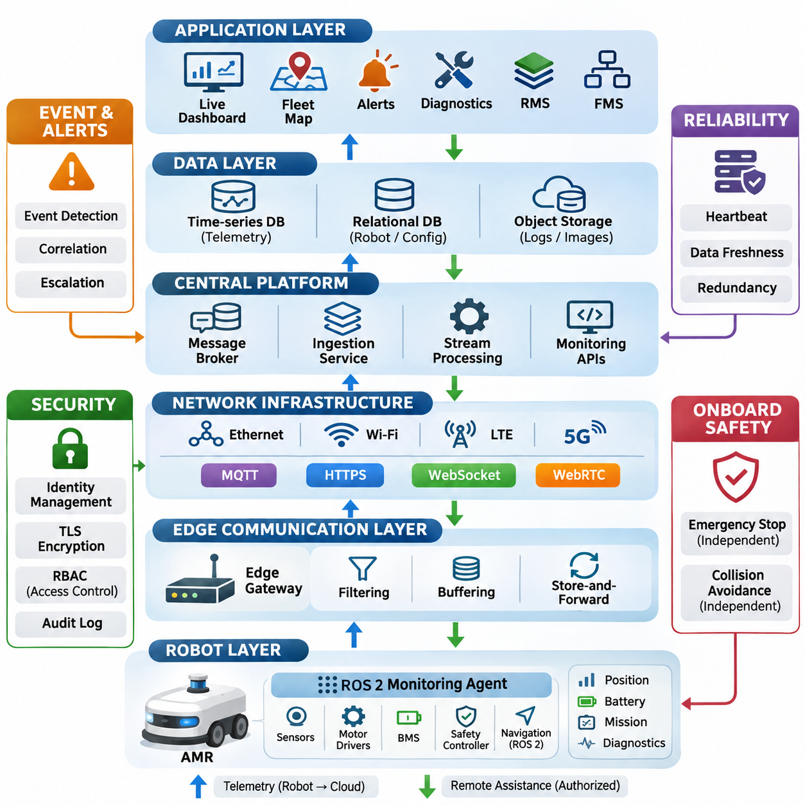
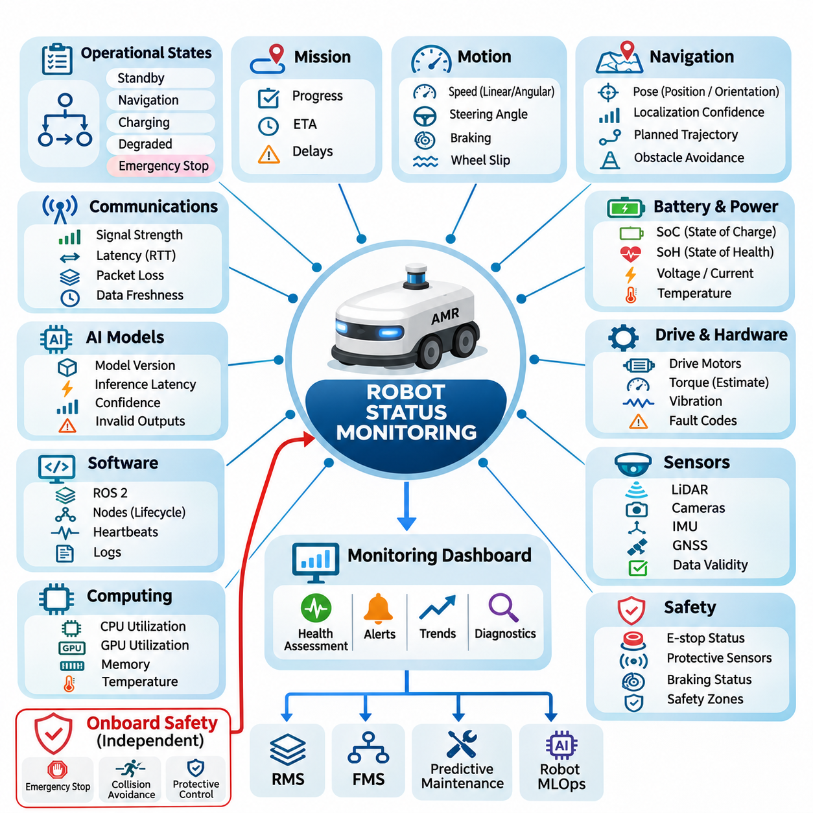
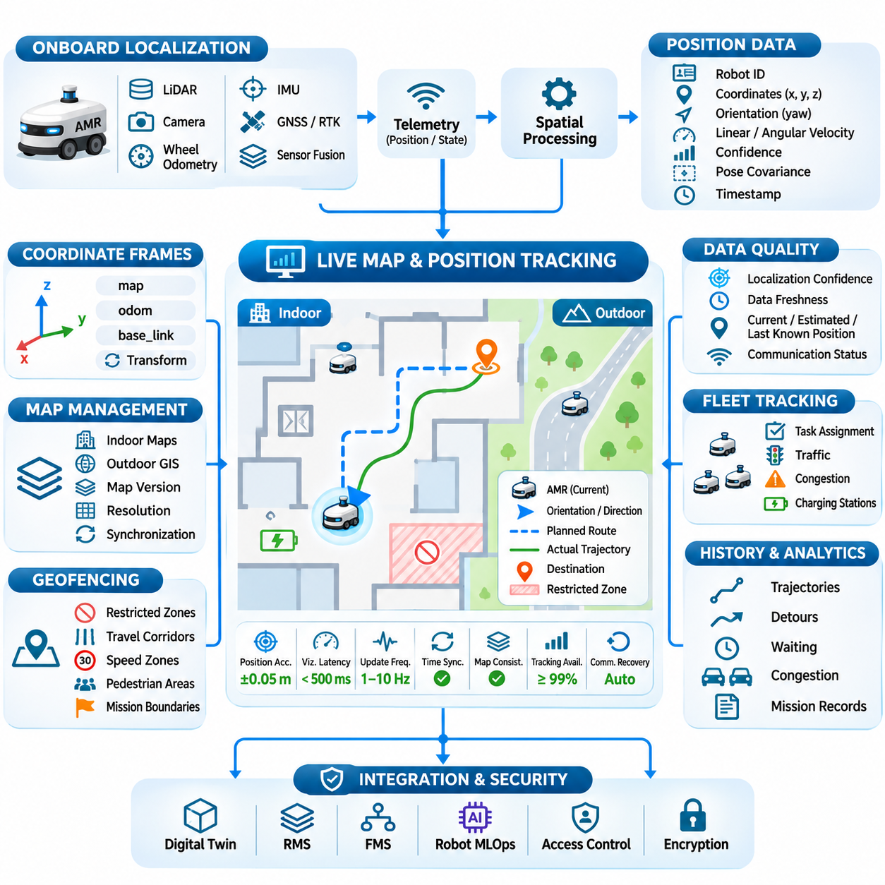
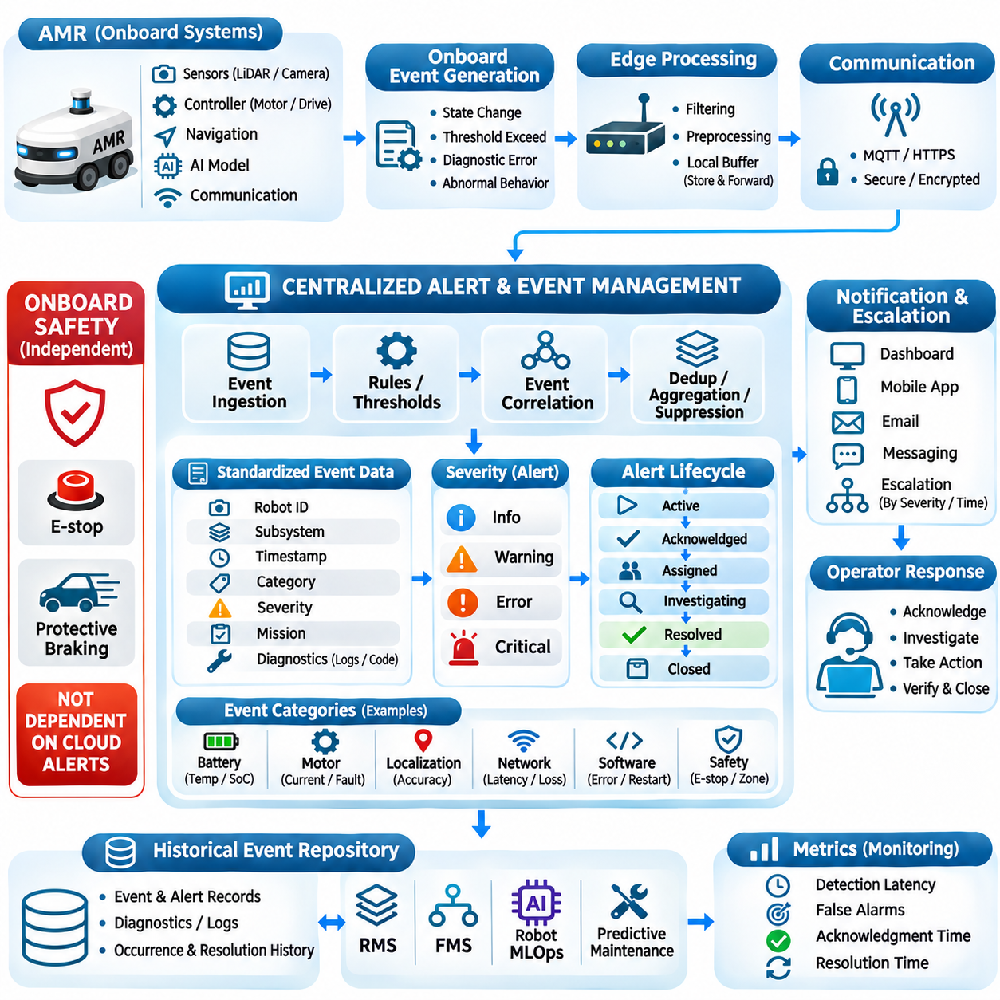
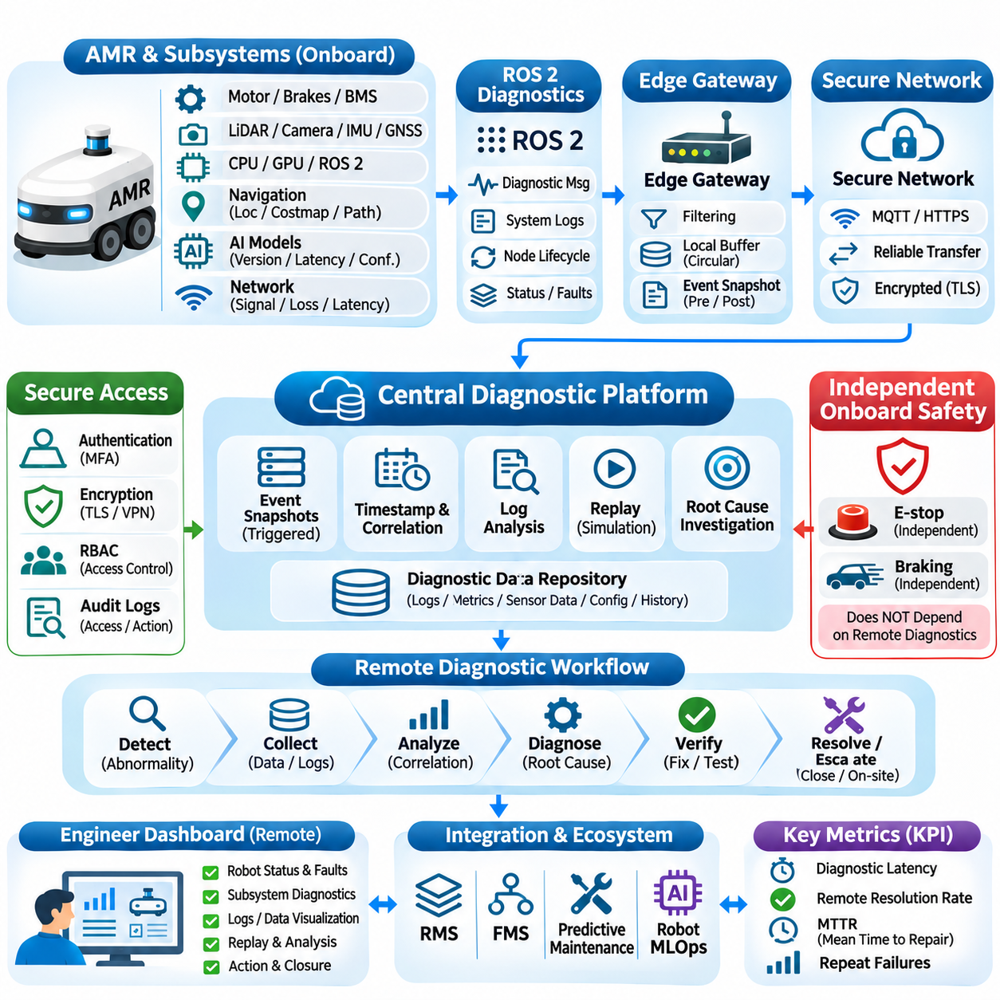
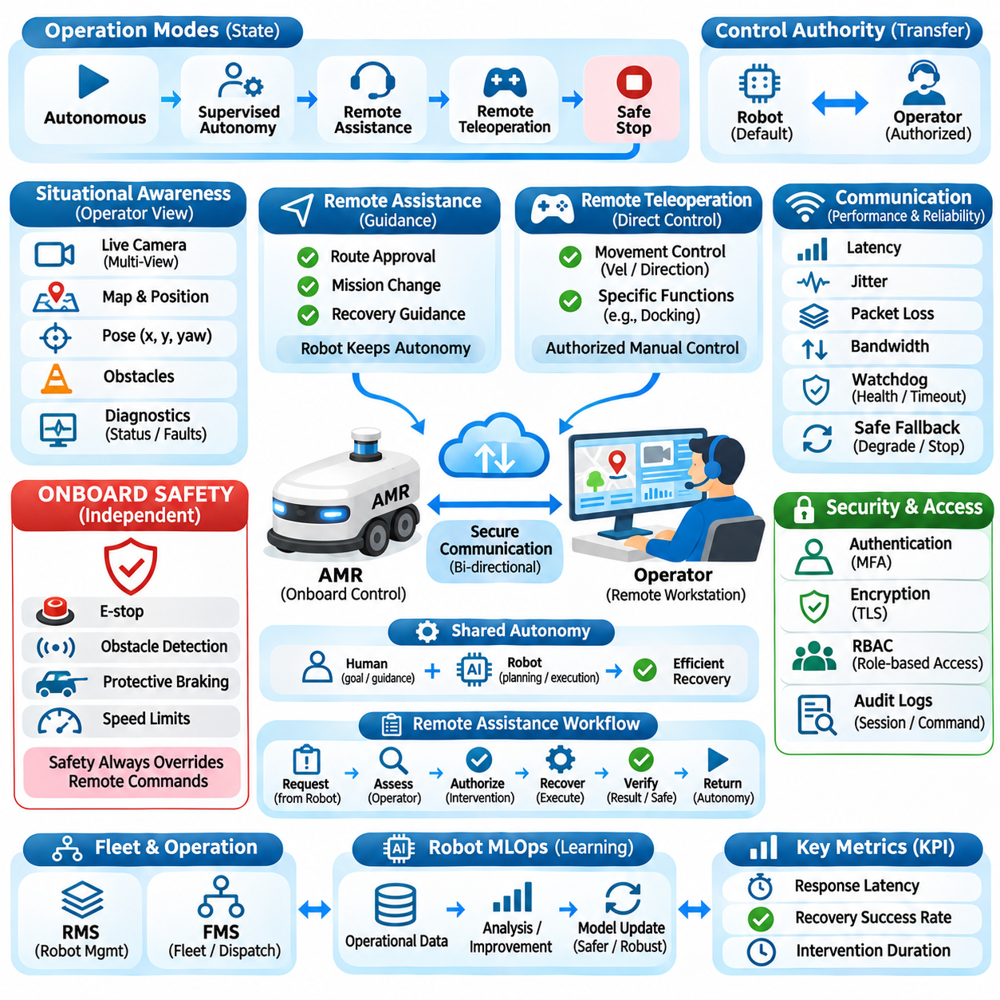
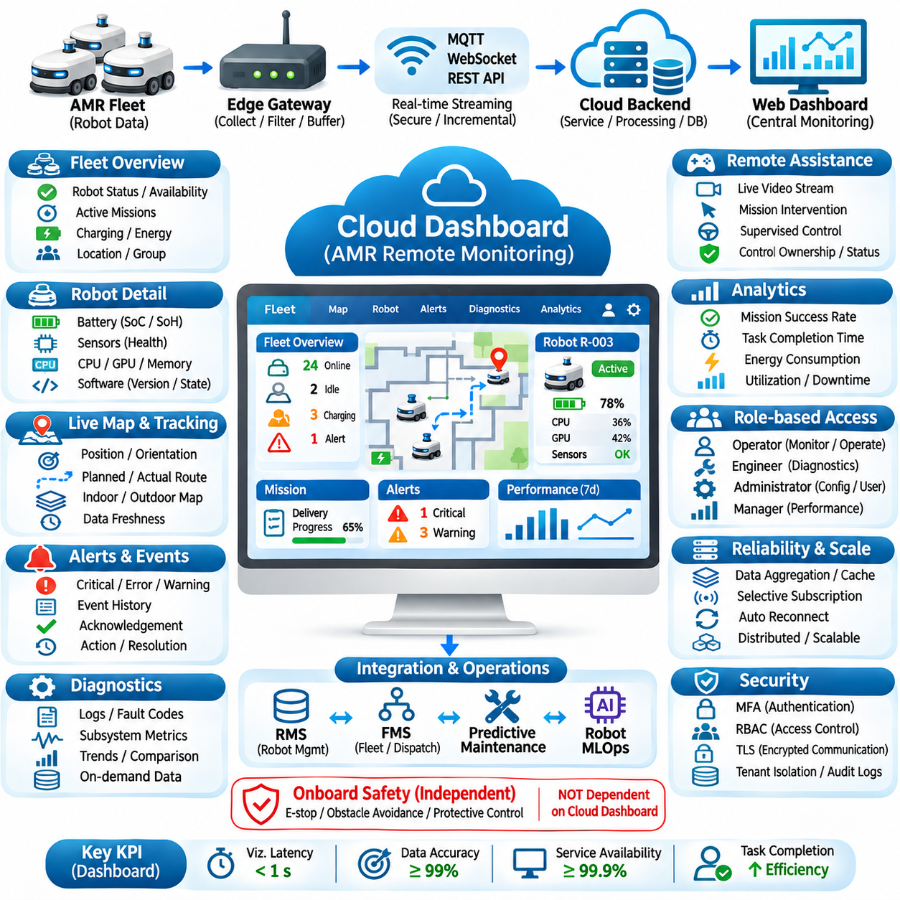
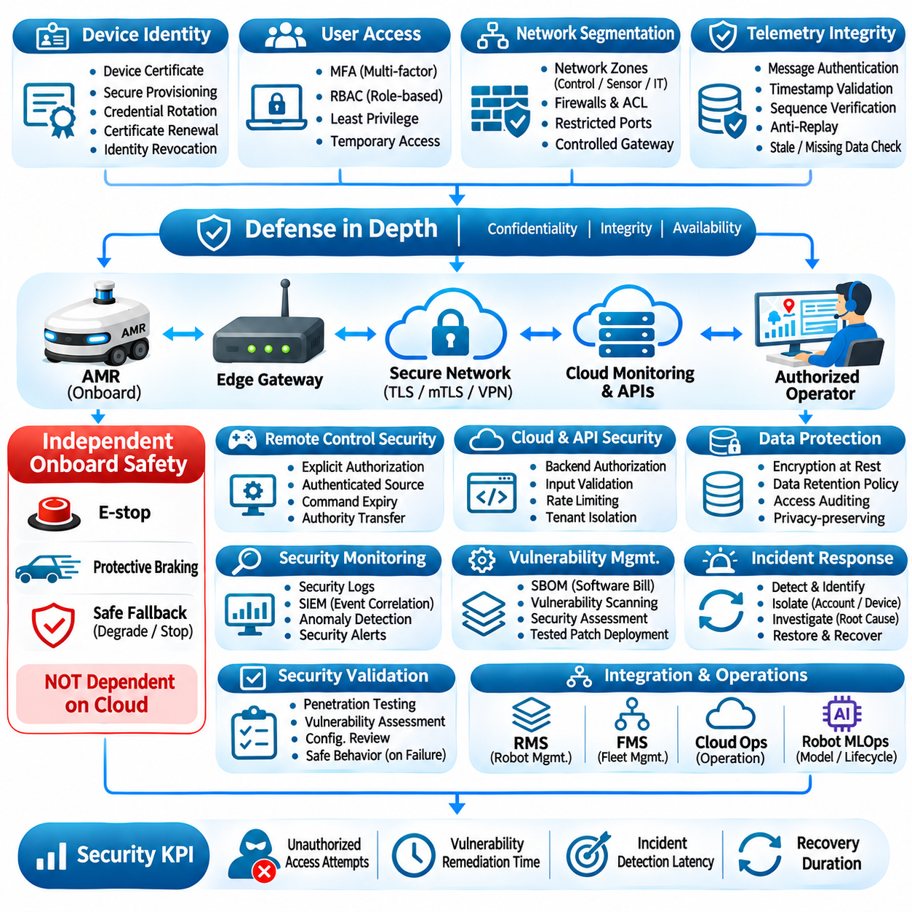

**Volume 08. AMR Operations, Deployment, and MLOps**

# Chapter 03. Remote Monitoring

## 03.1 Remote Monitoring Architecture

{width="7.268055555555556in" height="7.268055555555556in"}

원격 모니터링 아키텍처(Remote Monitoring Architecture)는 자율이동로봇(Autonomous Mobile Robot, AMR)의 전체 운영 수명주기(Operational Lifecycle)를 감독하기 위한 기술적 기반을 제공한다. 운영자(Operator), 시스템 관리자(System Administrator), 엔지니어링 팀(Engineering Team)이 배치 현장에 지속적으로 상주하지 않고도 로봇의 행동을 관찰하고, 운영 상태를 평가하며, 이상 상황을 식별하고, 적절한 대응 조치를 조율할 수 있도록 지원한다.

포괄적인 원격 모니터링 아키텍처(Remote Monitoring Architecture)는 일반적으로 로봇 계층(Robot Layer), 엣지 통신 계층(Edge Communication Layer), 네트워크 인프라 계층(Network Infrastructure Layer), 중앙 집중형 모니터링 플랫폼(Centralized Monitoring Platform), 데이터 관리 계층(Data Management Layer), 애플리케이션 계층(Application Layer)으로 구성된다. 이러한 상호 연결된 구성요소는 실시간 운영 가시성(Real-time Operational Visibility), 중앙 집중형 감독(Centralized Supervision), 이력 분석(Historical Analysis), 다중 배치 현장에 대한 확장 가능한 관리를 지원하는 분산 모니터링 환경(Distributed Monitoring Environment)을 구축한다.

로봇 계층(Robot Layer)은 운영 정보(Operational Information)의 주요 생성원으로 기능한다. 온보드 센서(Onboard Sensor), 임베디드 제어기(Embedded Controller), 모터 드라이버(Motor Driver), 배터리 관리 시스템(Battery Management System, BMS), 안전 제어기(Safety Controller), 자율주행 소프트웨어(Autonomous Navigation Software)는 지속적으로 모니터링 데이터를 생성한다. 이러한 정보에는 로봇 위치, 이동 속도, 배터리 상태, 임무 진행 상황, 하드웨어 온도, 위치 추정 신뢰도(Localization Confidence), 소프트웨어 실행 상태(Software Execution Status)가 포함된다.

온보드 모니터링 에이전트(Onboard Monitoring Agent)는 개별 로봇 하위 시스템(Robot Subsystem)에서 생성되는 정보를 수집하고 처리한다. ROS 2 기반 아키텍처에서는 모니터링 에이전트가 진단 토픽(Diagnostic Topic), 좌표 변환 데이터(Transform Data), 자율주행 상태(Navigation State), 시스템 로그(System Log), 사용자 정의 텔레메트리 메시지(Custom Telemetry Message)를 구독할 수 있다. 또한 이기종 정보를 표준화된 모니터링 메시지로 변환하면서 데이터 필터링(Data Filtering), 집계(Aggregation), 타임스탬프 처리(Timestamping), 로컬 버퍼링(Local Buffering)을 수행한다.

엣지 통신 계층(Edge Communication Layer)은 개별 로봇과 중앙 집중형 모니터링 인프라 사이의 인터페이스(Interface)를 구축한다. 엣지 게이트웨이(Edge Gateway)는 장치 연결성(Device Connectivity), 프로토콜 변환(Protocol Conversion), 메시지 우선순위 지정(Message Prioritization), 임시 데이터 저장(Temporary Data Storage)을 관리한다. 네트워크 연결이 불안정하거나 중단되는 경우에는 로컬 버퍼링(Local Buffering)과 저장 후 전달(Store-and-Forward) 메커니즘을 활용하여 필수 운영 기록을 보존하고, 통신이 복구된 이후 해당 데이터를 전송한다.

네트워크 인프라(Network Infrastructure)는 이더넷(Ethernet), Wi-Fi, 산업용 사설 네트워크(Private Industrial Network), LTE 또는 5G 통신 시스템을 통해 로봇 플랫폼(Robot Platform)과 원격 운영 센터(Remote Operation Center)를 연결한다. 적절한 통신 기술(Communication Technology)은 배치 환경, 지리적 통신 범위(Geographical Coverage), 대역폭 요구사항(Bandwidth Requirement), 지연시간 허용 범위(Latency Tolerance), 사이버보안 정책(Cybersecurity Policy)에 따라 결정된다. 하이브리드 네트워크 구성(Hybrid Network Configuration)은 실내외 환경에서 통신 가용성(Communication Availability)을 향상시킬 수 있다.

통신 프로토콜(Communication Protocol)은 운영 데이터(Operational Data)의 특성에 따라 선정되어야 한다. MQTT는 발행-구독 메커니즘(Publish-Subscribe Mechanism)을 통해 경량 텔레메트리 전송(Lightweight Telemetry Transmission)을 지원하며, HTTPS와 REST API는 구성 관리(Configuration Management)와 서비스 통합(Service Integration)을 지원한다. 웹소켓(WebSocket) 연결은 지속적인 대시보드 업데이트(Dashboard Update)를 지원하며, WebRTC는 권한이 부여된 원격 지원(Remote Assistance)을 위한 저지연 영상 스트리밍(Low-latency Video Streaming)을 제공할 수 있다.

중앙 집중형 모니터링 플랫폼(Centralized Monitoring Platform)은 연결된 로봇으로부터 운영 정보를 수신하고, 검증하며, 처리 및 분배한다. 메시지 브로커(Message Broker), 데이터 수집 서비스(Ingestion Service), 스트림 처리 엔진(Stream-processing Engine), 모니터링 API는 동시에 발생하는 다중 데이터 스트림(Concurrent Data Stream)을 처리하기 위한 기반을 제공한다. 분산 서비스 아키텍처(Distributed Service Architecture)를 적용하면 운영되는 로봇의 수와 통신 작업 부하(Communication Workload)에 따라 개별 처리 구성요소를 독립적으로 확장할 수 있다.

데이터 관리 인프라(Data Management Infrastructure)는 정보의 특성에 따라 다양한 저장 기술(Storage Technology)을 결합한다. 시계열 데이터베이스(Time-series Database)는 텔레메트리 및 성능 측정 데이터를 저장하고, 관계형 데이터베이스(Relational Database)는 로봇 식별 정보와 구성 기록을 관리하며, 객체 저장소(Object Storage)는 진단 아카이브(Diagnostic Archive), 이미지, 기록된 센서 데이터셋(Sensor Dataset)을 저장한다. 데이터 보존 정책(Data Retention Policy)은 중요한 운영 증거(Operational Evidence)를 보존하면서 저장 공간의 사용량을 관리한다.

실시간 모니터링 애플리케이션(Real-time Monitoring Application)은 운영 정보를 로봇의 행동을 이해할 수 있는 유의미한 표현으로 변환한다. 대화형 대시보드(Interactive Dashboard)는 로봇 가용성(Robot Availability), 임무 수행 상태(Mission Execution Status), 배터리 상태(Battery Condition), 지리적 위치(Geographical Position), 통신 품질(Communication Quality), 활성 경고(Active Warning)를 표시한다. 계층적 시각화(Hierarchical Visualization)를 통해 운영자는 전체 운영 현황, 개별 배치 현장, 로봇 플릿(Robot Fleet), 세부 하위 시스템 정보를 단계적으로 탐색할 수 있다.

표준화된 로봇 상태 모델(Standardized Robot State Model)은 이기종 로봇 플랫폼(Heterogeneous Robot Platform) 전반에서 운영 상태를 일관되게 해석하기 위한 기반을 제공한다. 대표적인 상태에는 대기(Idle), 자율운영(Autonomous Operation), 충전(Charging), 일시 정지(Paused), 유지보수(Maintenance), 성능 저하 운영(Degraded Operation), 비상 정지(Emergency Stop), 연결 중단(Disconnected)이 포함된다. 상태 전이(State Transition)는 신뢰성 있는 감독과 과거 상황의 재구성(Historical Reconstruction)을 지원하기 위해 타임스탬프(Timestamp), 발생 조건(Triggering Condition), 진단 컨텍스트(Diagnostic Context)와 연계되어야 한다.

이벤트 기반 모니터링(Event-driven Monitoring)은 중요한 운영 상태 변화가 발생하는 즉시 해당 정보를 전송함으로써 주기적 텔레메트리(Periodic Telemetry)를 보완한다. 안전 개입(Safety Intervention), 자율주행 실패(Navigation Failure), 통신 중단(Communication Interruption), 예기치 않은 프로세스 종료(Unexpected Process Termination), 하드웨어 이상(Hardware Abnormality)은 구조화된 이벤트(Structured Event)를 생성한다. 이벤트 처리 서비스(Event-processing Service)는 심각도(Severity)를 평가하고, 관련 이상 상황의 상관관계를 분석하며, 중복 알림(Redundant Notification)을 억제하고, 사전에 정의된 단계적 대응 절차(Escalation Procedure)를 개시한다.

원격 모니터링 아키텍처(Remote Monitoring Architecture)는 로봇 관리 시스템(Robot Management System, RMS) 및 플릿 관리 시스템(Fleet Management System, FMS)과 통합된다. RMS는 일반적으로 개별 로봇의 구성 정보, 진단 정보, 운영 상태를 관리하며, FMS는 로봇 집단의 임무 수행(Collective Mission Execution)과 자원 활용(Resource Utilization)을 조율한다. 공유 인터페이스(Shared Interface)는 모니터링 정보를 작업 할당(Task Assignment), 교통 상황(Traffic Condition), 충전 일정(Charging Schedule), 플릿 성능(Fleet Performance)과 동기화한다.

원격 감독(Remote Supervision)은 안전 필수 온보드 제어(Safety-critical Onboard Control)와 아키텍처 수준에서 분리되어야 한다. 충돌 회피(Collision Avoidance), 비상 정지(Emergency Stop), 제동(Braking), 보호 기능(Protective Function)은 클라우드 연결성(Cloud Connectivity)과 독립적으로 작동해야 한다. 원격 명령(Remote Command)은 권한 검증(Authorization), 명령 유효성 검증(Command Validation), 로컬 안전 제약조건(Local Safety Constraint)을 거쳐야 하며, 이를 통해 통신 장애나 응답 지연이 로봇의 필수 안전 기능을 저해하지 않도록 보장해야 한다.

확장 가능하고 안전한 모니터링 아키텍처(Scalable and Secure Monitoring Architecture)는 장치 인증(Device Authentication), 암호화 통신(Encrypted Communication), 역할 기반 접근 제어(Role-Based Access Control, RBAC), 네트워크 분할(Network Segmentation), 감사 로그(Audit Logging), 서비스 이중화(Service Redundancy)를 포함한다. 하트비트 메시지(Heartbeat Message)와 데이터 최신성 지표(Data Freshness Indicator)는 정상 로봇과 연결이 중단된 장치 또는 오래된 기록을 구분한다. 모니터링 가용성(Monitoring Availability), 텔레메트리 지연시간(Telemetry Latency), 데이터 완전성(Data Completeness), 복구 시간(Recovery Time)은 측정 가능한 아키텍처 성능 지표(Architectural Performance Indicator)를 제공한다. 또한 운영 기록은 예측 유지보수(Predictive Maintenance)와 로봇 머신러닝 운영(Robot MLOps)을 지원하는 데 활용될 수 있다.

## 03.2 Robot Status Monitoring

{width="7.268055555555556in" height="7.268055555555556in"}

로봇 상태 모니터링(Robot Status Monitoring)은 자율이동로봇(Autonomous Mobile Robot, AMR)을 위한 원격 모니터링 시스템(Remote Monitoring System)의 기본적인 구성요소이다. 개별 로봇의 운영 상태(Operational Condition), 임무 수행(Mission Execution), 하드웨어 건전성(Hardware Health), 소프트웨어 성능(Software Performance), 통신 가용성(Communication Availability)에 대한 지속적인 가시성을 제공한다. 효과적인 상태 모니터링은 운영자가 이상 상황이 운영 장애(Operational Failure) 또는 안전 관련 사고(Safety-related Incident)로 발전하기 전에 이를 식별할 수 있도록 지원한다.

포괄적인 로봇 상태 모니터링 시스템(Robot Status Monitoring System)은 기계적, 전기적, 전자적, 소프트웨어 및 인공지능 하위 시스템(Artificial Intelligence Subsystem)에서 생성되는 정보를 통합한다. 로봇을 단일 운영 개체(Operational Entity)로 취급하는 대신, 모니터링 시스템은 상호 연결된 여러 구성요소와 그 관계를 평가한다. 이러한 다차원적 접근 방식(Multidimensional Approach)은 로봇 가용성(Robot Availability), 신뢰성(Reliability), 운영 준비 상태(Operational Readiness)를 더욱 정확하게 이해할 수 있도록 지원한다.

로봇 운영 상태 모델(Robot Operational State Model)은 자율이동로봇이 전체 운영 수명주기(Operational Lifecycle) 동안 존재할 수 있는 주요 상태를 정의한다. 대표적인 상태에는 초기화(Initialization), 대기(Standby), 자율주행(Autonomous Navigation), 임무 수행(Mission Execution), 도킹(Docking), 충전(Charging), 운영 일시 정지(Paused Operation), 수동 운영(Manual Operation), 유지보수(Maintenance), 성능 저하 운영(Degraded Operation), 비상 정지(Emergency Stop)가 포함된다. 각 상태에는 명확하게 정의된 상태 전이 조건(State Transition Condition)과 관련 운영 제한사항(Operational Restriction)이 존재해야 한다.

임무 상태 모니터링(Mission Status Monitoring)은 할당된 작업과 관련 실행 시퀀스(Execution Sequence)의 진행 상황을 평가한다. 임무 식별 정보(Mission Identification), 작업 우선순위(Task Priority), 현재 목적지(Current Destination), 완료된 활동(Completed Activity), 잔여 이동 거리(Remaining Travel Distance), 예상 완료 시간(Estimated Completion Time), 실행 지연(Execution Delay) 등의 정보는 운영 투명성(Operational Transparency)을 제공한다. 예기치 않은 임무 중단(Mission Interruption)이 발생하면 문제 해결(Troubleshooting)과 운영 복구(Operational Recovery)를 위한 진단 정보(Diagnostic Information)가 생성되어야 한다.

이동 상태 모니터링(Motion Status Monitoring)은 로봇 플랫폼의 물리적 움직임(Physical Movement)을 지속적으로 평가한다. 대표적인 매개변수에는 선속도(Linear Velocity), 각속도(Angular Velocity), 가속도(Acceleration), 조향각(Steering Angle), 바퀴 회전 속도(Wheel Rotational Speed), 제동 상태(Braking Status), 명령된 움직임과 실제 움직임(Commanded versus Actual Motion)이 포함된다. 예상 움직임과 측정된 움직임 사이의 상당한 편차는 기계적 저항(Mechanical Resistance), 구동기 오작동(Actuator Malfunction), 바퀴 미끄러짐(Wheel Slippage), 제어 시스템 이상(Control System Abnormality)을 나타낼 수 있다.

위치 추정 및 자율주행 상태 모니터링(Localization and Navigation Status Monitoring)은 운영 환경 내에서 자율 이동(Autonomous Movement)의 신뢰성을 평가한다. 모니터링 매개변수에는 추정된 로봇 위치(Estimated Robot Position), 방향(Orientation), 위치 추정 신뢰도(Localization Confidence), 위치 추정 불확실성(Positioning Uncertainty), 지도 식별 정보(Map Identification), 계획된 궤적(Planned Trajectory), 장애물 회피 상태(Obstacle Avoidance Status)가 포함된다. 위치 추정 성능 저하(Localization Degradation)가 발생하면 사전에 정의된 운영 및 안전 요구사항에 따라 적절한 온보드 대응(Onboard Response)이 실행되어야 한다.

배터리 및 전력 상태 모니터링(Battery and Power Status Monitoring)은 로봇의 지속 운영 능력(Robot Endurance)과 전기 시스템 안정성(Electrical System Stability)에 대한 필수 정보를 제공한다. 배터리 관리 시스템(Battery Management System, BMS)은 일반적으로 충전 상태(State of Charge, SoC), 건전성 상태(State of Health, SoH), 전압(Voltage), 전류(Current), 온도(Temperature), 충전 상태(Charging Status), 보호 이벤트(Protection Event)를 보고한다. 예상 잔여 운영 시간(Estimated Remaining Operating Time)과 에너지 소비 추세(Energy Consumption Trend)는 임무 계획(Mission Planning), 충전 조율(Charging Coordination), 운영 연속성(Operational Continuity)을 지원한다.

기계 및 전기 하위 시스템 모니터링(Mechanical and Electrical Subsystem Monitoring)은 구동 모터(Drive Motor), 조향 구동기(Steering Actuator), 제동 메커니즘(Braking Mechanism), 모터 제어기(Motor Controller), 전력 분배 모듈(Power Distribution Module), 보조 장비(Auxiliary Equipment)에 중점을 둔다. 온도, 전류, 추정 토크(Torque Estimate), 진동(Vibration), 고장 코드(Fault Code)에 대한 지속적인 평가는 비정상적인 운영 상태를 식별하는 데 도움이 된다. 과거 측정 데이터(Historical Measurement)는 구성요소 열화 분석(Component Degradation Analysis)과 예방 유지보수(Preventive Maintenance)를 위한 유용한 정보를 제공한다.

센서 상태 모니터링(Sensor Status Monitoring)은 인지 및 위치 추정 장치(Perception and Localization Device)가 허용 가능한 조건 내에서 작동하고 있는지를 판단한다. LiDAR, 카메라(Camera), 레이더(Radar), 초음파 센서(Ultrasonic Sensor), 관성 측정 장치(Inertial Measurement Unit, IMU), GNSS 수신기(GNSS Receiver)는 장치 연결성(Device Connectivity), 측정 주파수(Measurement Frequency), 데이터 유효성(Data Validity), 동기화 상태(Synchronization Status), 진단 오류(Diagnostic Error)를 보고해야 한다. 적절한 운영 대응을 지원하기 위해 센서 성능 저하(Sensor Degradation)는 완전한 센서 고장(Complete Sensor Failure)과 구분되어야 한다.

컴퓨팅 자원 모니터링(Computing Resource Monitoring)은 온보드 처리 인프라(Onboard Processing Infrastructure)의 성능과 가용성을 평가한다. CPU 사용률(CPU Utilization), GPU 사용률(GPU Utilization), 메모리 사용량(Memory Consumption), 저장 공간 용량(Storage Capacity), 프로세서 온도(Processor Temperature), 추론 지연시간(Inference Latency), 열에 의한 성능 제한 상태(Thermal Throttling Condition)는 중요한 모니터링 지표이다. 과도한 자원 소비(Resource Consumption)는 임무 수행 중 인지 성능(Perception Performance)을 저하시키거나, 제어 지연시간(Control Latency)을 증가시키고, 필수 애플리케이션(Essential Application)의 실행을 중단시킬 수 있다.

소프트웨어 상태 모니터링(Software Status Monitoring)은 운영체제(Operating System), 미들웨어(Middleware), 애플리케이션 서비스(Application Service), 통신 프로세스(Communication Process), 자율주행 구성요소(Autonomous Navigation Component)를 감독한다. ROS 2 기반 플랫폼에서는 진단 메시지(Diagnostic Message), 노드 수명주기 상태(Node Lifecycle State), 토픽 발행 주파수(Topic Publication Frequency), 프로세스 하트비트(Process Heartbeat), 시스템 로그(System Log)를 활용할 수 있다. 워치독 메커니즘(Watchdog Mechanism)은 예기치 않은 프로세스 종료(Unexpected Process Termination), 통신 장애(Communication Failure), 무응답 소프트웨어 구성요소(Unresponsive Software Component)를 식별할 수 있다.

인공지능 상태 모니터링(Artificial Intelligence Status Monitoring)은 배치된 인공지능 모델(Deployed AI Model)의 운영 행동을 평가한다. 관련 정보에는 모델 식별 정보(Model Identification), 모델 버전(Model Version), 추론 주파수(Inference Frequency), 처리 지연시간(Processing Latency), 신뢰도 분포(Confidence Distribution), 유효하지 않은 출력(Invalid Output), 실행시간 오류(Runtime Error)가 포함된다. 이러한 지표는 성능 저하(Performance Degradation)를 탐지하고, 모델 검증(Model Validation), 회귀 분석(Regression Analysis), 로봇 머신러닝 운영 워크플로(Robot MLOps Workflow)를 위한 운영 피드백(Operational Feedback)을 제공한다.

통신 상태 모니터링(Communication Status Monitoring)은 개별 로봇, 엣지 게이트웨이(Edge Gateway), 중앙 집중형 운영 플랫폼(Centralized Operation Platform) 사이의 연결성을 평가한다. 네트워크 신호 강도(Network Signal Strength), 패킷 손실(Packet Loss), 왕복 지연시간(Round-trip Latency), 가용 대역폭(Available Bandwidth), 연결 안정성(Connection Stability), 하트비트 간격(Heartbeat Interval)은 측정 가능한 통신 지표(Communication Indicator)를 제공한다. 모니터링 시스템은 확인된 로봇 고장(Confirmed Robot Failure)을 통신 중단(Communication Interruption), 최신성이 상실된 텔레메트리(Stale Telemetry), 일시적으로 이용할 수 없는 네트워크 서비스와 구분해야 한다.

안전 상태 모니터링(Safety Status Monitoring)은 비상 정지 활성화(Emergency Stop Activation), 보호 센서 상태(Protective Sensor Condition), 안전 제어기 고장(Safety Controller Fault), 제한 구역 위반(Restricted-zone Violation), 제동 개입(Braking Intervention)에 대한 가시성을 제공한다. 안전 관련 이벤트(Safety-related Event)에는 적절한 전송 우선순위(Transmission Priority)가 부여되어야 하며, 최초 타임스탬프(Original Timestamp)가 유지되어야 한다. 그러나 원격 모니터링은 독립적인 온보드 안전 기능(Onboard Safety Function)을 대체하거나 보호 조치(Protective Action)를 실행하기 위한 전제조건이 되어서는 안 된다.

로봇 상태 정보(Robot Status Information)는 로봇 식별 정보(Robot Identification), 하위 시스템 식별 정보(Subsystem Identification), 타임스탬프(Timestamp), 측정 단위(Measurement Unit), 운영 상태(Operational State), 심각도 수준(Severity Level), 데이터 품질 지표(Data Quality Indicator)를 포함하는 표준화된 텔레메트리 스키마(Standardized Telemetry Schema)를 따라야 한다. 모니터링 주파수(Monitoring Frequency)는 하위 시스템의 동적 특성(Subsystem Dynamics)과 운영 요구사항(Operational Requirement)을 반영해야 한다. 이벤트 기반 보고(Event-driven Reporting)는 불필요한 통신 및 처리 오버헤드(Processing Overhead)를 감소시키면서 주기적 측정(Periodic Measurement)을 보완할 수 있다.

중앙 집중형 모니터링 플랫폼(Centralized Monitoring Platform)은 개별 하위 시스템 정보를 포괄적인 운영 대시보드(Operational Dashboard)와 로봇 건전성 평가(Robot Health Assessment)에 통합한다. 상태 집계(Status Aggregation), 심각도 분류(Severity Classification), 임계값 평가(Threshold Evaluation), 과거 추세 분석(Historical Trend Analysis)은 운영자가 심각한 이상 상황에 우선순위를 부여할 수 있도록 지원한다. 데이터 최신성 지표(Data Freshness Indicator), 영구적으로 보존되는 이벤트 기록(Persistent Event Record), 상황 기반 진단 정보(Contextual Diagnostic Information)는 불완전하거나 오래된 측정 데이터에 대한 잘못된 해석을 방지한다.

로봇 상태 모니터링(Robot Status Monitoring)은 궁극적으로 사후 대응형 문제 해결(Reactive Troubleshooting)에서 사전 대응형 운영 관리(Proactive Operational Management)로의 전환을 지원해야 한다. 로봇 관리 시스템(Robot Management System, RMS), 플릿 관리 시스템(Fleet Management System, FMS), 예측 유지보수 플랫폼(Predictive Maintenance Platform), 로봇 머신러닝 운영 인프라(Robot MLOps Infrastructure)와의 통합은 지속적인 운영 개선(Continuous Operational Improvement)을 가능하게 한다. 신뢰성 높은 모니터링은 로봇 가용성 향상(Increased Robot Availability), 비가동 시간 감소(Reduced Downtime), 안전성 향상(Improved Safety), 확장 가능한 플릿 운영(Scalable Fleet Operations)을 지원한다.

## 03.3 Live Map and Position Tracking

{width="7.268055555555556in" height="7.268055555555556in"}

실시간 지도 및 위치 추적(Live Map and Position Tracking)은 자율이동로봇(Autonomous Mobile Robot, AMR)이 배치된 운영 환경 내에서 실시간 공간 가시성(Real-time Spatial Visibility)을 제공한다. 위치 추정 정보(Localization Information), 디지털 지도(Digital Map), 자율주행 궤적(Navigation Trajectory), 운영 상태(Operational State)를 통합함으로써 원격 모니터링 플랫폼(Remote Monitoring Platform)은 운영자가 로봇의 현재 위치, 이동 방식, 할당된 임무와 실제 행동의 일치 여부를 파악할 수 있도록 지원한다.

실시간 지도 및 위치 추적 아키텍처(Live Map and Position Tracking Architecture)는 일반적으로 온보드 위치 추정 시스템(Onboard Localization System), 텔레메트리 전송 서비스(Telemetry Transmission Service), 중앙 집중형 지도 관리 인프라(Centralized Map Management Infrastructure), 공간 데이터 처리 서비스(Spatial Data Processing Service), 시각화 애플리케이션(Visualization Application)으로 구성된다. 이러한 구성요소는 물리적 로봇 플랫폼과 운영 환경의 디지털 표현(Digital Representation) 사이에 지속적인 정보 흐름(Information Flow)을 구축하여 개별 로봇 감독(Individual Robot Supervision)과 플릿 수준의 조율(Fleet-level Coordination)을 지원한다.

온보드 위치 추정 시스템(Onboard Localization System)은 가용한 센서 정보를 활용하여 로봇의 위치(Position)와 방향(Orientation)을 지속적으로 추정한다. 실내 자율이동로봇(Indoor AMR)은 일반적으로 LiDAR 기반 위치 추정(LiDAR-based Localization), 시각 기반 위치 추정(Visual Localization), 바퀴 오도메트리(Wheel Odometry), 관성 측정 장치(Inertial Measurement Unit, IMU)를 활용하며, 실외 로봇(Outdoor Robot)은 추가적으로 위성항법시스템(Global Navigation Satellite System, GNSS)과 실시간 이동측위(Real-Time Kinematic, RTK)를 활용할 수 있다. 센서 융합 알고리즘(Sensor Fusion Algorithm)은 상호 보완적인 측정값을 결합하여 위치 추정 정확도(Positioning Accuracy)와 강건성(Robustness)을 향상시킨다.

위치 추적 메시지(Position Tracking Message)는 표준화된 공간 및 운영 정보(Standardized Spatial and Operational Information)를 포함해야 한다. 대표적인 매개변수에는 로봇 식별 정보(Robot Identification), 위치 좌표(Position Coordinate), 방향(Orientation), 선속도(Linear Velocity), 각속도(Angular Velocity), 위치 추정 신뢰도(Localization Confidence), 자세 공분산(Pose Covariance), 지도 식별 정보(Map Identification), 좌표계(Coordinate Frame), 측정 타임스탬프(Measurement Timestamp)가 포함된다. 일관된 메시지 구조(Message Structure)는 중앙 집중형 모니터링 플랫폼이 이기종 로봇 시스템(Heterogeneous Robotic System)에서 생성되는 정보를 처리할 수 있도록 지원한다.

좌표계 관리(Coordinate Frame Management)는 온보드 위치 추정 시스템과 중앙 집중형 지도 시각화(Centralized Map Visualization) 사이의 일관성을 유지하는 데 필수적이다. ROS 2 기반 로봇 플랫폼(ROS 2-based Robotic Platform)은 일반적으로 map, odom, base_link 좌표계를 활용한다. 적절한 좌표 변환(Coordinate Transformation)을 통해 로봇 위치(Robot Position), 센서 관측 정보(Sensor Observation), 자율주행 궤적(Navigation Trajectory), 환경 정보(Environmental Information)를 공통 공간 참조 시스템(Shared Spatial Reference System) 내에서 표현할 수 있다.

실내 모니터링 환경(Indoor Monitoring Environment)은 일반적으로 점유 격자 지도(Occupancy Grid Map), 벡터 지도(Vector Map), 의미론적 지도(Semantic Map), 건물 구조의 디지털 표현(Digital Representation of Building Layout)을 활용한다. 이러한 지도는 벽(Wall), 복도(Corridor), 출입문(Door), 엘리베이터(Elevator), 충전 스테이션(Charging Station), 제한 구역(Restricted Area), 운영 목적지(Operational Destination)를 식별한다. 실시간 로봇 위치(Live Robot Position)는 이러한 공간 표현(Spatial Representation) 위에 중첩되어 표시되며, 운영자가 물리적 인프라(Physical Infrastructure)를 기준으로 자율 이동 상태를 평가할 수 있도록 지원한다.

실외 모니터링 환경(Outdoor Monitoring Environment)은 지리정보시스템(Geographic Information System, GIS), 위성 영상(Satellite Imagery), 도로 네트워크(Road Network), 지형 지도(Terrain Map), 고정밀 지도(High-definition Map, HD Map)를 활용할 수 있다. GNSS 좌표는 시각화를 위해 적절한 지리 좌표계(Geographical Coordinate System) 또는 로컬 직교 좌표계(Local Cartesian Coordinate System)로 변환된다. 실외 위치 추적(Outdoor Position Tracking)은 위성 신호 차폐(Satellite Signal Obstruction), 다중경로 간섭(Multipath Interference), 지형 복잡성(Terrain Complexity), 위치 추정 불확실성(Positioning Uncertainty)과 같은 환경 조건을 고려해야 한다.

중앙 집중형 지도 관리 서비스(Centralized Map Management Service)는 여러 배치 현장에서 사용되는 운영 지도(Operational Map)의 공식 버전을 관리한다. 각 지도는 고유 식별 정보(Unique Identification), 버전 번호(Version Number), 좌표 참조 정보(Coordinate Reference), 해상도(Resolution), 관련 구성 메타데이터(Configuration Metadata)를 포함해야 한다. 온보드 지도(Onboard Map)와 중앙 집중형 시각화 시스템(Centralized Visualization System) 사이의 동기화(Synchronization)는 오래된 지도, 환경 변경(Environmental Modification), 잘못된 좌표 변환(Incorrect Coordinate Transformation)으로 인해 발생하는 공간적 불일치(Spatial Inconsistency)를 방지한다.

실시간 위치 전송(Real-time Position Transmission)은 시각화 응답성(Visualization Responsiveness), 통신 대역폭(Communication Bandwidth), 연산 효율성(Computational Efficiency) 사이의 균형을 유지해야 한다. 위치 업데이트(Position Update)는 로봇의 이동 속도(Robot Velocity), 변위(Displacement), 방향 변화(Orientation Change), 운영 요구사항(Operational Requirement)에 따라 주기적 또는 적응적으로 전송될 수 있다. 높은 업데이트 주파수(Update Frequency)는 화면상 움직임의 연속성(Movement Continuity)을 향상시키며, 적응형 전송(Adaptive Transmission)은 로봇이 정지 상태에 있을 때 불필요한 네트워크 트래픽(Network Traffic)을 감소시킨다.

실시간 지도 시각화(Live Map Visualization)는 개별 로봇의 현재 위치 이상의 정보를 제공해야 한다. 로봇 방향(Robot Orientation), 이동 방향(Movement Direction), 계획된 경로(Planned Route), 실제 이동 궤적(Executed Trajectory), 임무 목적지(Mission Destination), 운영 모드(Operating Mode), 활성 경고(Active Warning)는 추가적인 운영 컨텍스트(Operational Context)를 제공한다. 시각적 표현(Visual Representation)은 자율주행 감독(Navigation Supervision)과 예기치 않은 경로 편차(Unexpected Deviation)의 식별을 지원하기 위해 계획된 움직임과 실제 움직임을 명확하게 구분해야 한다.

다중 로봇 위치 추적(Multi-robot Position Tracking)은 운영자가 전체 로봇 플릿(Robot Fleet)의 공간적 분포(Spatial Distribution)와 이동 상태(Movement Status)를 감독할 수 있도록 지원한다. 중앙 집중형 모니터링 애플리케이션(Centralized Monitoring Application)은 로봇 식별자(Robot Identifier), 작업 할당(Task Assignment), 교통 혼잡(Traffic Congestion), 점유된 교차로(Occupied Intersection), 충전 스테이션 가용성(Charging Station Availability), 공유 운영 자원(Shared Operational Resource)을 표시할 수 있다. 이러한 정보는 플릿 조율(Fleet Coordination), 교통 관리(Traffic Management), 비효율적인 로봇 이동 패턴(Inefficient Robot Movement Pattern)의 조사 및 분석을 지원한다.

지오펜싱 및 가상 구역 관리(Geofencing and Virtual Zone Management)는 위치 추적 기능을 공간 인식 기반 운영 감독(Spatially Aware Operational Supervision)으로 확장한다. 제한 구역(Restricted Area), 지정 이동 통로(Designated Travel Corridor), 속도 제한 구역(Speed-limited Zone), 보행자 구역(Pedestrian Area), 임무 경계(Mission Boundary)는 디지털 지도 내에서 표현될 수 있다. 위치 기반 이벤트(Position-based Event)는 잠재적인 경계 위반(Boundary Violation)을 식별할 수 있으며, 안전 필수 제한사항(Safety-critical Restriction)은 적절하게 검증된 온보드 메커니즘(Onboard Mechanism)을 통해 로컬에서 강제 적용되어야 한다.

위치 추정 신뢰도(Localization Confidence)와 데이터 최신성(Data Freshness)은 화면에 표시되는 로봇 위치 정보와 함께 제공되어야 한다. 위치 추정 성능 저하(Localization Degradation) 또는 통신 중단(Communication Interruption)이 발생한 로봇이 마지막으로 보고된 좌표만을 근거로 정상적으로 운영되는 것처럼 표시되어서는 안 된다. 모니터링 애플리케이션은 현재 위치(Current Position), 추정 위치(Estimated Position), 불확실한 위치(Uncertain Position), 마지막으로 확인된 위치(Last-known Position)를 구분하면서 관련 타임스탬프와 통신 상태 정보(Communication Status Information)를 제공해야 한다.

과거 위치 기록(Historical Position Record)은 운영 분석(Operational Analysis), 사고 조사(Incident Investigation), 자율주행 최적화(Navigation Optimization)를 위한 유용한 정보를 제공한다. 기록된 이동 궤적(Recorded Trajectory)은 빈번하게 이용되는 경로(Frequently Traveled Route), 반복적인 혼잡 지점(Recurring Congestion Point), 예기치 않은 우회 경로(Unexpected Detour), 장시간 대기(Prolonged Waiting Period), 비효율적인 이동 패턴(Inefficient Movement Pattern)을 식별할 수 있도록 지원한다. 임무 기록(Mission Record) 및 진단 이벤트(Diagnostic Event)와의 통합은 비정상적인 상황에서 발생한 운영 조건의 재구성(Reconstruction of Operating Conditions)을 지원한다.

실시간 지도 및 위치 추적(Live Map and Position Tracking)은 디지털 트윈 환경(Digital Twin Environment), 로봇 관리 시스템(Robot Management System, RMS), 플릿 관리 시스템(Fleet Management System, FMS), 로봇 머신러닝 운영 인프라(Robot MLOps Infrastructure)와도 통합될 수 있다. 공간적·시간적 운영 기록(Spatial and Temporal Operational Record)은 시뮬레이션 기반 검증(Simulation-based Validation), 자율주행 성능 평가(Navigation Performance Evaluation), 현장 데이터 분석(Field Data Analysis)을 지원한다. 접근 제어(Access Control), 암호화 통신(Encrypted Communication), 데이터 보존 정책(Data Retention Policy)은 민감한 위치 및 시설 정보(Sensitive Location and Facility Information)를 보호하는 데 도움이 된다.

실시간 지도 및 위치 추적의 효과성(Effectiveness)은 위치 추정 정확도(Positioning Accuracy), 시각화 지연시간(Visualization Latency), 업데이트 주파수(Update Frequency), 타임스탬프 동기화(Timestamp Synchronization), 지도 일관성(Map Consistency), 추적 가용성(Tracking Availability), 통신 중단 이후의 복구 성능(Recovery Performance)을 통해 평가되어야 한다. 인수 기준 임계값(Acceptance Threshold)은 애플리케이션 요구사항(Application Requirement)과 배치 환경(Deployment Condition)에 따라 결정된다. 신뢰성 높은 공간 가시성(Reliable Spatial Visibility)은 운영 효율성(Operational Efficiency), 사전 대응형 감독(Proactive Supervision), 확장 가능한 플릿 관리(Scalable Fleet Management)를 지원한다.

## 03.4 Alert and Event Management

{width="7.268055555555556in" height="7.268055555555556in"}

경보 및 이벤트 관리(Alert and Event Management)는 자율이동로봇(Autonomous Mobile Robot, AMR)을 위한 원격 모니터링 시스템(Remote Monitoring System)의 필수적인 구성요소이다. 운영자와 엔지니어링 팀이 비정상적인 운영 상태(Abnormal Operating Condition)를 식별하고, 심각도(Severity)를 평가하며, 적절한 대응 조치를 조율하고, 운영 연속성(Operational Continuity)을 유지할 수 있도록 지원한다. 효과적인 경보 관리(Alert Management)는 대량의 로봇 텔레메트리(Robot Telemetry)를 실행 가능한 정보(Actionable Information)로 변환하면서 불필요한 운영 중단(Operational Interruption)을 감소시킨다.

이벤트(Event)는 로봇 시스템 내부에서 발생하거나 변화한 사항을 기록한 것을 의미하며, 경보(Alert)는 주의 또는 개입이 필요한 상태를 의미한다. 이벤트에는 임무 완료(Mission Completion), 충전 시작(Charging Initiation), 소프트웨어 재시작(Software Restart), 운영 상태 전이(Operational State Transition) 등이 포함될 수 있다. 경보는 일반적으로 자율주행 실패(Navigation Failure), 하드웨어 고장(Hardware Fault), 통신 중단(Communication Interruption), 배터리 이상(Battery Abnormality), 안전 관련 사고(Safety-related Incident)와 같은 비정상적인 상태를 나타낸다.

경보 및 이벤트 관리 아키텍처(Alert and Event Management Architecture)는 일반적으로 온보드 이벤트 생성(Onboard Event Generation), 엣지 수준 전처리(Edge-level Preprocessing), 통신 인프라(Communication Infrastructure), 중앙 집중형 이벤트 수집(Centralized Event Ingestion), 규칙 처리 엔진(Rule-processing Engine), 알림 서비스(Notification Service), 사고 관리 애플리케이션(Incident Management Application)으로 구성된다. 이러한 상호 연결된 구성요소는 개별 로봇과 지리적으로 분산된 로봇 플릿(Geographically Distributed Fleet)의 지속적인 감독을 지원하는 분산 이벤트 처리 환경(Distributed Event-processing Environment)을 구축한다.

온보드 이벤트 생성(Onboard Event Generation)은 센서(Sensor), 임베디드 제어기(Embedded Controller), 안전 시스템(Safety System), 자율주행 소프트웨어(Autonomous Navigation Software), 인공지능 모델(Artificial Intelligence Model), 통신 서비스(Communication Service)로부터 정보를 수집한다. 사전에 정의된 임계값(Predefined Threshold)을 초과하거나, 운영 상태가 변경되거나, 진단 오류(Diagnostic Error)가 발생하거나, 예기치 않은 행동(Unexpected Behavior)이 탐지될 때 이벤트가 생성될 수 있다. 로컬 이벤트 처리(Local Event Processing)는 중앙 집중형 인프라에 전적으로 의존하지 않고 즉각적인 대응을 가능하게 한다.

표준화된 이벤트 메시지(Standardized Event Message)는 로봇 식별 정보(Robot Identification), 하위 시스템 식별 정보(Subsystem Identification), 이벤트 식별 정보(Event Identification), 발생 타임스탬프(Occurrence Timestamp), 이벤트 유형(Event Category), 심각도 수준(Severity Level), 운영 상태(Operational State), 진단 컨텍스트(Diagnostic Context)를 포함해야 한다. 추가 정보에는 지리적 위치(Geographical Position), 임무 식별 정보(Mission Identification), 소프트웨어 버전(Software Version), 관련 센서 측정값(Sensor Measurement)이 포함될 수 있다. 일관된 이벤트 구조(Event Structure)는 상호운용성(Interoperability), 이력 분석(Historical Analysis), 자동화된 처리(Automated Processing)를 촉진한다.

이벤트 분류(Event Classification)는 운영 중 발생하는 사항을 해석하기 위한 체계적인 프레임워크(Systematic Framework)를 구축한다. 대표적인 분류에는 정보성 이벤트(Informational Event), 운영 경고(Operational Warning), 자율주행 이상(Navigation Abnormality), 하드웨어 고장(Hardware Failure), 소프트웨어 오류(Software Error), 통신 장애(Communication Failure), 사이버보안 사고(Cybersecurity Incident), 안전 관련 이벤트(Safety-related Event)가 포함된다. 계층적 분류(Hierarchical Classification)를 통해 모니터링 애플리케이션은 대량의 이벤트를 운영 중요도(Operational Significance)에 따라 체계적으로 구성할 수 있다.

경보 심각도 수준(Alert Severity Level)은 운영자의 주의가 필요한 긴급성(Urgency)과 요구되는 대응 조치(Required Response)를 결정한다. 정보성 경보(Informational Alert)는 운영 상태의 변화를 전달하고, 경고 경보(Warning Alert)는 잠재적인 성능 저하(Potential Degradation)를 나타내며, 오류 경보(Error Alert)는 기능적 이상(Functional Abnormality)을 식별하고, 심각 경보(Critical Alert)는 중대한 운영 또는 안전 관련 상태를 나타낸다. 심각도 할당(Severity Assignment)은 고장으로 인한 결과(Failure Consequence), 운영 컨텍스트(Operational Context), 사전에 정의된 위험 평가 기준(Risk Assessment Criteria)을 반영해야 한다.

임계값 기반 경보 생성(Threshold-based Alert Generation)은 사전에 정의된 운영 한계(Operational Limit)를 기준으로 측정값을 평가한다. 배터리 온도(Battery Temperature), 모터 전류(Motor Current), 프로세서 사용률(Processor Utilization), 위치 추정 불확실성(Localization Uncertainty), 통신 지연시간(Communication Latency), 추론 처리 시간(Inference Processing Time)은 대표적인 모니터링 매개변수(Monitoring Parameter)이다. 히스테리시스(Hysteresis), 지속 시간(Persistence Duration), 적응형 임계값(Adaptive Threshold)은 일시적인 변동(Temporary Fluctuation)이나 정상적인 환경 변화(Environmental Variation)로 인해 발생하는 반복적인 경보(Repetitive Alert)를 감소시킬 수 있다.

이벤트 상관관계 분석(Event Correlation)은 관련 이벤트를 결합하여 공통 원인(Common Cause)과 근본적인 운영 이상(Underlying Operational Abnormality)을 식별한다. 예를 들어 동시에 발생하는 자율주행 오류(Navigation Error), 센서 통신 장애(Sensor Communication Failure), 처리 지연시간 증가(Increased Processing Latency)는 공통 컴퓨팅 자원 문제(Shared Computing Resource Problem)에서 비롯될 수 있다. 상관관계 분석 엔진(Correlation Engine)은 시간적 관계(Temporal Relationship), 하위 시스템 의존성(Subsystem Dependency), 운영 컨텍스트를 평가하여 진단 정확도(Diagnostic Accuracy)를 향상시키고 중복 알림(Redundant Notification)을 감소시킨다.

경보 중복 제거(Alert Deduplication), 집계(Aggregation), 억제(Suppression)는 대규모 로봇 운영(Large-scale Robot Operations) 중 과도한 알림(Excessive Notification)을 방지하기 위해 필요하다. 동일한 고장의 반복적인 발생은 발생 횟수(Occurrence Count)와 관련 타임스탬프를 포함하는 지속적인 경보 기록(Persistent Alert Record)으로 통합되어야 한다. 경보 억제 정책(Alert Suppression Policy)은 중복 알림과 독립적인 이상 상황(Independent Abnormality)을 구분해야 하며, 해결되지 않은 안전 필수 상태(Unresolved Safety-critical Condition)를 은폐해서는 안 된다.

경보 수명주기 관리(Alert Lifecycle Management)는 최초 탐지(Initial Detection)부터 최종 해결(Final Resolution)까지 경보가 진행되는 방식을 정의한다. 대표적인 수명주기 상태(Lifecycle State)에는 활성(Active), 확인(Acknowledged), 담당자 할당(Assigned), 조사 중(Under Investigation), 해결(Resolved), 종료(Closed)가 포함된다. 운영자 확인(Operator Acknowledgment)은 고장이 제거되었음을 의미하는 것이 아니라 해당 상황을 인지했음을 의미한다. 각 상태 전이(State Transition)는 운영 책임성(Operational Accountability)을 확보하기 위해 타임스탬프, 담당 인력(Responsible Personnel), 진단 결과(Diagnostic Finding), 시정 조치(Corrective Action), 검증 결과(Verification Result)를 보존해야 한다.

알림 및 단계적 대응 메커니즘(Notification and Escalation Mechanism)은 모니터링 대시보드(Monitoring Dashboard), 모바일 애플리케이션(Mobile Application), 이메일(Email), 메시징 플랫폼(Messaging Platform), 사고 관리 서비스(Incident Management Service)를 통해 적절한 담당자에게 실행 가능한 정보를 전달한다. 단계적 대응 정책(Escalation Policy)은 경보 심각도(Alert Severity), 대응 기한(Response Deadline), 운영 일정(Operating Schedule), 담당자의 책임(Personnel Responsibility)을 고려해야 한다. 확인되지 않은 심각 경보(Unacknowledged Critical Alert)는 지정된 감독자(Designated Supervisor) 또는 기술 지원팀(Technical Support Team)으로 자동 상향 보고(Automatic Escalation)되어야 할 수 있다.

분산형 경보 관리 시스템(Distributed Alert Management System)을 설계할 때는 통신 신뢰성(Communication Reliability)을 고려해야 한다. 지속적인 로컬 이벤트 저장(Persistent Local Event Storage), 우선순위 기반 메시지 큐(Prioritized Message Queue), 전송 확인(Delivery Acknowledgment), 고유 이벤트 식별자(Unique Event Identifier), 재전송 메커니즘(Retransmission Mechanism)은 네트워크 중단(Network Interruption) 중 중요한 기록을 보존하는 데 도움이 된다. 지연된 이벤트 전송(Delayed Event Delivery)과 새롭게 발생한 운영 이상(Newly Occurring Operational Abnormality)을 구분할 수 있도록 최초 발생 타임스탬프(Original Occurrence Timestamp)가 유지되어야 한다.

안전 관련 이벤트 관리(Safety-related Event Management)는 원격 모니터링(Remote Monitoring)과 온보드 보호 기능(Onboard Protective Function) 사이의 명확한 분리를 요구한다. 비상 정지(Emergency Stopping), 보호 제동(Protective Braking), 안전 제어 대응(Safety Control Response)은 중앙 집중형 경보 처리 서비스(Centralized Alert-processing Service)와 독립적으로 작동해야 한다. 원격 경보(Remote Alert)는 운영 상황 인식(Operational Awareness)을 제공하고 사고 대응 조율(Incident Coordination)을 지원하지만, 알림 전송(Notification Delivery)이나 운영자 확인(Operator Acknowledgment)이 필수적인 로컬 안전 조치(Local Safety Action)를 지연시켜서는 안 된다.

이력 이벤트 저장소(Historical Event Repository)는 근본 원인 분석(Root Cause Analysis, RCA), 반복적인 고장 식별(Recurring Failure Identification), 신뢰성 엔지니어링(Reliability Engineering), 예측 유지보수(Predictive Maintenance)를 지원한다. 로봇 관리 시스템(Robot Management System, RMS), 플릿 관리 시스템(Fleet Management System, FMS), 로봇 머신러닝 운영 플랫폼(Robot MLOps Platform)과의 통합을 통해 운영 사고(Operational Incident)를 임무 기록(Mission Record), 하드웨어 구성(Hardware Configuration), 소프트웨어 릴리스(Software Release), 인공지능 모델 버전(AI Model Version)과 연계할 수 있으며, 배치된 로봇 전반에 걸친 지속적인 개선(Continuous Improvement)을 지원한다.

경보 및 이벤트 관리의 효과성(Effectiveness of Alert and Event Management)은 탐지 지연시간(Detection Latency), 알림 전송 지연시간(Notification Delivery Latency), 오경보율(False Alarm Rate), 이벤트 미탐지율(Missed Event Rate), 확인 시간(Acknowledgment Time), 해결 시간(Resolution Time), 반복 사고 발생 빈도(Recurring Incident Frequency)를 통해 평가되어야 한다. 안전한 접근 제어(Secure Access Control), 감사 로그(Audit Logging), 검증된 단계적 대응 절차(Validated Escalation Procedure)는 운영 거버넌스(Operational Governance)를 강화한다. 신뢰성 높은 이벤트 관리(Reliable Event Management)는 궁극적으로 사전 대응형 감독(Proactive Supervision), 비가동 시간 감소(Reduced Downtime), 안전성 향상(Improved Safety), 확장 가능한 자율이동로봇 운영(Scalable AMR Operations)을 지원한다.

## 03.5 Remote Diagnostics

{width="7.268055555555556in" height="7.268055555555556in"}

원격 진단(Remote Diagnostics)은 자율이동로봇(Autonomous Mobile Robot, AMR)을 위한 원격 모니터링 시스템(Remote Monitoring System)의 핵심 기능이다. 엔지니어링 팀과 기술 지원 인력(Technical Support Personnel)이 로봇에 직접 물리적으로 접근하지 않고도 운영 이상(Operational Abnormality)을 조사하고, 잠재적인 고장 원인(Potential Failure Cause)을 식별하며, 하위 시스템 상태(Subsystem Condition)를 평가하고, 적절한 시정 조치(Corrective Action)를 결정할 수 있도록 지원한다. 이러한 기능은 서비스 효율성(Service Efficiency), 운영 가용성(Operational Availability), 유지보수 대응성(Maintenance Responsiveness)을 향상시킨다.

원격 진단 아키텍처(Remote Diagnostics Architecture)는 일반적으로 온보드 진단 에이전트(Onboard Diagnostic Agent), 하위 시스템 모니터링 인터페이스(Subsystem Monitoring Interface), 엣지 통신 게이트웨이(Edge Communication Gateway), 중앙 집중형 진단 서비스(Centralized Diagnostic Service), 이력 데이터 저장소(Historical Data Repository), 기술 지원 애플리케이션(Technical Support Application)으로 구성된다. 이러한 상호 연결된 구성요소는 엔지니어가 여러 지리적 위치에서 운영되는 개별 로봇 플랫폼을 조사할 수 있도록 지원하는 분산형 진단 환경(Distributed Diagnostic Environment)을 구축한다.

온보드 진단 에이전트(Onboard Diagnostic Agent)는 임베디드 제어기(Embedded Controller), 모터 드라이버(Motor Driver), 안전 제어기(Safety Controller), 배터리 관리 시스템(Battery Management System, BMS), 인식 장치(Perception Device), 컴퓨팅 자원(Computing Resource), 자율주행 소프트웨어(Autonomous Navigation Software)로부터 정보를 수집한다. 진단 정보(Diagnostic Information)에는 고장 코드(Fault Code), 운영 측정값(Operational Measurement), 구성 매개변수(Configuration Parameter), 소프트웨어 실행 상태(Software Execution State), 통신 오류(Communication Error)가 포함된다. 로컬 전처리(Local Preprocessing)는 필수적인 진단 증거(Diagnostic Evidence)를 보존하면서 불필요한 데이터 전송을 감소시킨다.

표준화된 진단 인터페이스(Standardized Diagnostic Interface)는 이기종 로봇 하위 시스템(Heterogeneous Robotic Subsystem)에서 생성되는 정보에 일관되게 접근할 수 있도록 지원한다. ROS 2 기반 플랫폼(ROS 2-based Platform)은 진단 메시지(Diagnostic Message), 진단 집계기(Diagnostic Aggregator), 노드 수명주기 상태(Node Lifecycle State), 서비스 인터페이스(Service Interface), 시스템 로그(System Log)를 활용할 수 있다. 각 진단 기록(Diagnostic Record)은 체계적인 조사(Systematic Investigation)를 지원하기 위해 하위 시스템 식별 정보(Subsystem Identification), 타임스탬프(Timestamp), 심각도 수준(Severity Level), 고장 설명(Fault Description), 관련 운영 매개변수(Operating Parameter)를 포함해야 한다.

하드웨어 진단(Hardware Diagnostics)은 기계적·전기적·전자적 구성요소(Mechanical, Electrical, and Electronic Component)의 운영 상태를 평가한다. 모터 전류(Motor Current), 추정 토크(Estimated Torque), 액추에이터 온도(Actuator Temperature), 바퀴 엔코더 측정값(Wheel Encoder Measurement), 제동 상태(Braking Status), 배터리 전압(Battery Voltage), 전력 분배 상태(Power Distribution Condition)는 중요한 진단 지표(Diagnostic Indicator)를 제공한다. 측정값을 예상 운영 특성(Expected Operating Characteristic)과 비교함으로써 구성요소 열화(Component Degradation), 전기적 이상(Electrical Abnormality), 기계적 저항(Mechanical Resistance)을 식별할 수 있다.

센서 진단(Sensor Diagnostics)은 인식 및 위치 추정 장치(Perception and Localization Device)의 가용성(Availability), 신뢰성(Reliability), 측정 품질(Measurement Quality)을 조사한다. LiDAR 스캐닝 주파수(LiDAR Scanning Frequency), 카메라 프레임률(Camera Frame Rate), 레이더 통신 상태(Radar Communication Status), GNSS 위치 추정 정확도(GNSS Positioning Accuracy), IMU 측정값(IMU Measurement), 센서 동기화 오류(Sensor Synchronization Error)는 유용한 진단 정보를 제공한다. 엔지니어는 장치의 완전한 고장(Complete Device Failure)과 간헐적 통신 문제(Intermittent Communication Problem), 보정 오류(Calibration Error), 환경적 간섭(Environmental Interference)을 구분할 수 있다.

소프트웨어 진단(Software Diagnostics)은 운영체제(Operating System), 미들웨어(Middleware), 애플리케이션 프로세스(Application Process), 자율주행 구성요소(Navigation Component), 온보드 통신 서비스(Onboard Communication Service)를 평가한다. 프로세스 실행 상태(Process Execution Status), 메모리 사용량(Memory Consumption), CPU 사용률(CPU Utilization), GPU 사용률(GPU Utilization), 예외 메시지(Exception Message), 프로세스 간 통신 통계(Interprocess Communication Statistics)는 소프트웨어 이상(Software Abnormality)을 식별하는 데 도움이 된다. 실행 로그(Execution Log)와 시스템 구성 기록(System Configuration Record)에 대한 원격 접근(Remote Access)은 예기치 않은 애플리케이션 동작(Unexpected Application Behavior)의 상세한 조사를 지원한다.

자율주행 진단(Navigation Diagnostics)은 위치 추정(Localization), 지도 생성(Mapping), 경로 계획(Path Planning), 궤적 생성(Trajectory Generation), 모션 제어(Motion Control)와 관련된 이상 현상에 중점을 둔다. 엔지니어는 위치 추정 불확실성(Localization Uncertainty), 좌표 변환(Coordinate Transformation), 비용 지도(Costmap), 계획된 경로(Planned Path), 장애물 탐지 결과(Obstacle Detection Result), 제어 명령(Control Command)을 조사할 수 있다. 예상 자율주행 행동(Expected Navigation Behavior)과 실제 로봇 움직임(Actual Robot Movement)을 비교함으로써 위치 추정 오류(Positioning Error), 경로 계획 실패(Planning Failure), 제어 불일치(Control Inconsistency)를 식별할 수 있다.

인공지능 진단(Artificial Intelligence Diagnostics)은 배치된 인공지능 모델(Deployed AI Model)의 실행 특성(Execution Characteristic)과 운영 행동(Operational Behavior)을 평가한다. 모델 버전(Model Version), 추론 지연시간(Inference Latency), 신뢰도 분포(Confidence Distribution), 입력 데이터 품질(Input Data Quality), 출력 이상(Output Anomaly), 가속기 자원 사용량(Accelerator Resource Consumption)은 관련 진단 정보를 제공한다. 진단 기록은 모델 성능 저하(Model Performance Degradation)를 센서 이상(Sensor Abnormality), 연산 병목현상(Computational Bottleneck), 소프트웨어 통합 문제(Software Integration Problem)와 구분하는 데 도움이 된다.

네트워크 진단(Network Diagnostics)은 로봇, 엣지 게이트웨이(Edge Gateway), 중앙 집중형 운영 플랫폼(Centralized Operation Platform) 사이에서 발생하는 통신 이상(Communication Abnormality)을 조사한다. 신호 강도(Signal Strength), 패킷 손실(Packet Loss), 왕복 지연시간(Round-trip Latency), 대역폭 사용률(Bandwidth Utilization), 연결 중단(Connection Interruption), 프로토콜 오류(Protocol Error)는 측정 가능한 진단 지표를 제공한다. 연결성 이력 기록(Historical Connectivity Record)은 운영 장애(Operational Failure)가 온보드 통신 장치(Onboard Communication Device), 로컬 네트워크 인프라(Local Network Infrastructure), 원격 서비스(Remote Service) 중 어디에서 발생했는지를 판단하는 데 도움이 된다.

원격 진단 데이터 획득(Remote Diagnostic Data Acquisition)은 주기적 모니터링(Periodic Monitoring), 이벤트 트리거 기반 기록(Event-triggered Recording), 승인된 주문형 데이터 수집(Authorized On-demand Collection)을 지원해야 한다. 로컬 순환 버퍼(Local Circular Buffer)는 비정상 이벤트(Abnormal Event)가 발생하기 이전의 시스템 측정값과 센서 관측 정보(Sensor Observation)를 보존할 수 있다. 진단 스냅샷(Diagnostic Snapshot)은 고장 발생 전후의 관련 상태를 보존하여 지속적인 데이터 전송 및 저장 요구사항(Transmission and Storage Requirement)을 제한하면서 엔지니어링 팀이 운영 시퀀스(Operational Sequence)를 재구성할 수 있도록 지원한다.

원격 로그 분석(Remote Log Analysis)은 여러 하위 시스템의 기록을 결합하여 운영 이상과 관련된 이벤트 발생 순서(Event Sequence)를 재구성한다. 정확한 타임스탬프 동기화(Timestamp Synchronization), 임무 식별자(Mission Identifier), 소프트웨어 버전 정보(Software Version Information), 하위 시스템 의존성(Subsystem Dependency)은 이벤트 상관관계 분석(Event Correlation)의 정확성을 향상시킨다. 기록된 ROS 2 메시지(Recorded ROS 2 Message)와 센서 데이터셋(Sensor Dataset)은 오프라인 재생(Offline Replay), 시뮬레이션 기반 재현(Simulation-based Reproduction), 상세한 근본 원인 분석(Root Cause Analysis, RCA)도 지원할 수 있다.

원격 진단 워크플로(Remote Diagnostic Workflow)는 일반적으로 이상 탐지(Abnormality Detection)에서 시작하여 예비 평가(Preliminary Assessment), 증거 수집(Evidence Collection), 고장 가설 수립(Failure Hypothesis Development), 근본 원인 조사(Root Cause Investigation), 시정 조치 검증(Corrective Action Verification)으로 진행된다. 엔지니어링 팀은 진단 결과(Diagnostic Finding)를 문서화하고 확인된 원인(Confirmed Cause)과 예비 가정(Preliminary Assumption)을 구분해야 한다. 해결되지 않은 이상 현상(Unresolved Abnormality)은 전문 엔지니어(Specialized Engineer)에게 상향 보고(Escalation)하거나 현장 유지보수 인력(On-site Maintenance Personnel)을 파견해야 할 수 있다.

승인된 원격 진단 도구(Authorized Remote Diagnostic Tool)는 읽기 전용 검사(Read-only Inspection), 통제된 진단 시험(Controlled Diagnostic Test), 구성 검증(Configuration Verification), 승인된 소프트웨어 서비스 복구(Approved Software Service Recovery)를 지원할 수 있다. 운영 조건(Operating Condition)을 변경하는 진단 활동(Diagnostic Activity)은 적절한 권한 승인(Authorization)과 검증된 실행 제약조건(Validated Execution Constraint)을 요구해야 한다. 제동(Braking)과 비상 정지(Emergency Stopping)를 포함한 안전 필수 운영(Safety-critical Operation)은 원격 연결성(Remote Connectivity)과 진단 서비스 가용성(Diagnostic Service Availability)으로부터 독립적으로 유지되어야 한다.

사이버보안(Cybersecurity)은 원격 진단 인터페이스(Remote Diagnostic Interface)가 민감한 로봇 인프라(Sensitive Robotic Infrastructure)에 대한 접근을 제공하기 때문에 필수적인 고려사항이다. 장치 인증(Device Authentication), 암호화 통신(Encrypted Communication), 역할 기반 접근 제어(Role-based Access Control, RBAC), 임시 세션 권한 승인(Temporary Session Authorization), 포괄적인 감사 로그(Comprehensive Audit Logging)는 비인가 접근(Unauthorized Access)을 방지하는 데 도움이 된다. 진단 데이터 수집(Diagnostic Data Collection)은 시설 보안 요구사항(Facility Security Requirement), 개인정보 보호(Personal Information Protection), 조직의 데이터 보존 정책(Organizational Data Retention Policy)도 준수해야 한다.

원격 진단(Remote Diagnostics)은 로봇 관리 시스템(Robot Management System, RMS), 플릿 관리 시스템(Fleet Management System, FMS), 예측 유지보수 플랫폼(Predictive Maintenance Platform), 로봇 머신러닝 운영 인프라(Robot MLOps Infrastructure)와 통합된다. 진단 결과는 하드웨어 구성(Hardware Configuration), 유지보수 이력(Maintenance History), 소프트웨어 릴리스(Software Release), 인공지능 모델 버전(AI Model Version), 임무 기록(Mission Record)과 연계될 수 있다. 성능 지표(Performance Indicator)에는 진단 지연시간(Diagnostic Latency), 원격 해결률(Remote Resolution Rate), 평균 수리 시간(Mean Time to Repair, MTTR), 반복 고장 발생 빈도(Repeat Failure Frequency)가 포함되며, 배치된 로봇 플릿 전반에 걸친 지속적인 신뢰성 개선(Continuous Reliability Improvement)을 지원한다.

## 03.6 Remote Control and Assistance

{width="7.268055555555556in" height="7.268055555555556in"}

원격 제어 및 지원(Remote Control and Assistance)은 자율이동로봇(Autonomous Mobile Robot, AMR)이 자율적인 임무 수행 과정에서 예기치 않은 환경 조건(Unexpected Environmental Condition), 자율주행 어려움(Navigation Difficulty), 운영 이상(Operational Abnormality)에 직면했을 때 승인된 운영자(Authorized Operator)가 로봇을 지원할 수 있도록 한다. 원격 지원(Remote Assistance)은 자율 운영(Autonomous Operation)을 대체하는 것이 아니라, 예외적인 상황(Exceptional Situation)에서 로봇을 복구하고 임무 연속성(Mission Continuity)을 유지하며 현장 기술 인력(On-site Technical Personnel)에 대한 의존도를 감소시키기 위한 감독형 개입 메커니즘(Supervised Intervention Mechanism)을 제공한다.

원격 제어 및 지원 아키텍처(Remote Control and Assistance Architecture)는 일반적으로 온보드 제어 인터페이스(Onboard Control Interface), 원격 운영 에이전트(Remote Operation Agent), 통신 게이트웨이(Communication Gateway), 중앙 집중형 제어 서비스(Centralized Control Service), 운영자 워크스테이션(Operator Workstation), 안전 감독 메커니즘(Safety Supervision Mechanism)으로 구성된다. 이러한 상호 연결된 구성요소는 명확하게 정의된 제어 경계(Control Boundary)를 유지하면서 운영자가 운영 정보를 수신하고 승인된 명령(Authorized Command)을 전송할 수 있도록 양방향 통신 환경(Bidirectional Communication Environment)을 구축한다.

원격 지원(Remote Assistance)과 원격 제어(Remote Control)는 서로 다른 수준의 인간 개입(Human Intervention)을 나타낸다. 원격 지원은 로봇이 자율 실행 권한(Autonomous Execution Authority)을 유지하면서 운영자가 지침(Guidance)을 제공하고, 대체 경로(Alternative Route)를 승인하며, 임무 매개변수(Mission Parameter)를 변경하거나 운영 불확실성(Operational Uncertainty)을 해소할 수 있도록 한다. 원격 제어는 로봇의 움직임 또는 특정 기능에 대한 직접적인 인간 감독(Direct Human Supervision)을 포함하며, 일반적으로 자율 복구 메커니즘(Autonomous Recovery Mechanism)이 운영 상황을 해결할 수 없을 때 활용된다.

원격 운영 모드(Remote Operation Mode)는 로봇의 운영 상태 관리 아키텍처(Operational State Management Architecture) 내에서 명확하게 정의되어야 한다. 대표적인 모드에는 자율 운영(Autonomous Operation), 감독형 자율성(Supervised Autonomy), 원격 지원(Remote Assistance), 원격 조작(Remote Teleoperation), 로컬 수동 제어(Local Manual Control), 안전 정지(Safe Stop)가 포함된다. 이러한 모드 간의 전이(Mode Transition)는 검증된 상태 머신 로직(Validated State Machine Logic)을 따라야 하며, 제어 권한(Control Authority)을 명확하게 유지하고 상충하는 명령(Conflicting Command)이 동시에 실행되지 않도록 해야 한다.

원격 조작(Remote Teleoperation)은 승인된 운영자가 속도 명령(Velocity Command), 방향 입력(Directional Input), 웨이포인트 할당(Waypoint Assignment), 기타 지원되는 인터페이스를 통해 로봇의 움직임을 제어할 수 있도록 한다. 운영자 워크스테이션(Operator Workstation)은 조이스틱(Joystick), 키보드(Keyboard), 터치 인터페이스(Touch Interface), 전용 제어 콘솔(Dedicated Control Console)을 활용할 수 있다. 원격 명령(Remote Command)은 허용 속도 제한(Permitted Velocity Limit), 가속도 제약조건(Acceleration Constraint), 운영 경계(Operational Boundary), 충돌 회피 요구사항(Collision Avoidance Requirement)을 강제하는 온보드 제어기(Onboard Controller)에 의해 검증되어야 한다.

상황 인식(Situational Awareness)은 효과적인 원격 운영(Remote Operation)을 위해 필수적이다. 운영자는 실시간 카메라 스트림(Live Camera Stream), 로봇 위치(Robot Position), 방향(Orientation), 자율주행 지도(Navigation Map), 장애물 정보(Obstacle Information), 통신 상태(Communication Status), 관련 진단 지표(Diagnostic Indicator)에 접근할 수 있어야 한다. 여러 정보 소스(Information Source)를 결합하면 운영 환경(Operating Environment)에 대한 보다 포괄적인 이해가 가능하며, 특히 물리적 로봇에 대한 직접적인 시각적 관찰(Direct Visual Observation)이 불가능한 상황에서 중요하다.

통신 성능(Communication Performance)은 원격 제어의 신뢰성(Reliability)과 사용성(Usability)에 직접적인 영향을 미친다. 네트워크 지연시간(Network Latency), 지터(Jitter), 패킷 손실(Packet Loss), 가용 대역폭(Available Bandwidth), 명령 전송 신뢰성(Command Delivery Reliability)은 지속적으로 평가되어야 한다. 적응형 영상 스트리밍(Adaptive Video Streaming), 우선순위 기반 제어 메시지(Prioritized Control Message), 타임스탬프 검증(Timestamp Validation), 통신 워치독(Communication Watchdog)은 예측 가능한 운영(Predictable Operation)을 유지하는 데 도움이 된다. 과도한 통신 성능 저하(Communication Degradation)는 사전에 정의된 안전 대체 동작(Safe Fallback Behavior)을 트리거해야 한다.

공유 자율성(Shared Autonomy)은 운영자의 작업 부하(Operator Workload)를 감소시키고 개입 효율성(Intervention Efficiency)을 향상시키기 위해 인간의 지침(Human Guidance)과 온보드 자율 기능(Onboard Autonomous Capability)을 결합한다. 운영자는 대체 목적지(Alternative Destination)를 지정하거나, 통과 가능한 영역(Traversable Region)을 식별하거나, 복구 기동(Recovery Maneuver)을 승인할 수 있으며, 로봇은 독립적으로 궤적 계획(Trajectory Planning)과 모션 실행(Motion Execution)을 수행한다. 이러한 접근방식은 로컬 환경 인식(Local Environmental Awareness)을 유지하면서 지속적인 원격 수동 제어(Remote Manual Control)에 대한 의존도를 감소시킨다.

원격 지원 워크플로(Remote Assistance Workflow)는 일반적으로 자율 로봇(Autonomous Robot)이 자체 복구 능력(Recovery Capability)을 초과하는 운영 상태를 탐지할 때 시작된다. 로봇은 임무 정보(Mission Information), 위치(Location), 진단 기록(Diagnostic Record), 관련 환경 관측 정보(Environmental Observation)를 포함하는 지원 요청(Assistance Request)을 생성한다. 승인된 운영자는 상황을 평가하고, 적절한 개입 방식(Intervention Method)을 선택하며, 복구 프로세스(Recovery Process)를 감독하고, 제어 권한을 자율 운영으로 반환하기 전에 운영 준비 상태(Operational Readiness)를 검증한다.

안전 감독(Safety Supervision)은 원격 운영 서비스(Remote Operation Service)로부터 독립적으로 유지되어야 한다. 비상 정지(Emergency Stopping), 장애물 탐지(Obstacle Detection), 보호 제동(Protective Braking), 해당되는 속도 모니터링(Speed Monitoring)을 포함하는 온보드 보호 기능(Onboard Protective Function)은 원격 명령에 대한 우선 권한을 유지해야 한다. 통신 두절(Loss of Communication), 유효기간이 만료된 명령(Expired Command), 유효하지 않은 제어 요청(Invalid Control Request), 예기치 않은 운영 상태(Unexpected Operating Condition)는 원격 운영자의 개입에 의존하지 않고 위험 수준에 적합한 안전 대응(Risk-appropriate Safe Response)을 개시해야 한다.

제어 권한 관리(Control Authority Management)는 자율주행 시스템(Autonomous Navigation System), 원격 운영자(Remote Operator), 플릿 관리 서비스(Fleet Management Service), 로컬 제어 인터페이스(Local Control Interface) 사이에서 발생하는 충돌을 방지한다. 배타적 제어 세션(Exclusive Control Session), 명시적인 권한 이전(Explicit Authority Transfer), 명령 소스 식별(Command Source Identification), 세션 타임아웃(Session Timeout), 우선순위 규칙(Priority Rule)은 예측 가능한 운영 행동(Predictable Operational Behavior)을 확립한다. 로컬 비상 제어(Local Emergency Control)와 독립적인 안전 메커니즘(Independent Safety Mechanism)은 항상 지정된 보호 권한(Protective Authority)을 유지해야 한다.

사이버보안(Cybersecurity)은 원격 제어 인터페이스(Remote Control Interface)가 물리적 로봇 시스템(Physical Robotic System)과의 직접적인 상호작용을 가능하게 하기 때문에 특히 중요하다. 강력한 운영자 인증(Operator Authentication), 장치 신원 검증(Device Identity Verification), 암호화 통신(Encrypted Communication), 역할 기반 접근 제어(Role-based Access Control, RBAC), 명령 재전송 공격 방지(Command Replay Protection)는 필수적인 설계 고려사항(Design Consideration)이다. 원격 운영 세션(Remote Operation Session)은 운영자 식별 정보(Operator Identity), 명령 이력(Command History), 권한 전이(Authority Transition), 관련 실행 결과(Execution Result)와 함께 기록되어야 한다.

플릿 규모의 원격 지원(Fleet-scale Remote Assistance)은 효율적인 운영자 할당(Operator Assignment)과 개입 우선순위 설정(Intervention Prioritization)을 요구한다. 중앙 집중형 로봇 관리 시스템(Robot Management System, RMS)과 플릿 관리 시스템(Fleet Management System, FMS)은 운영 긴급성(Operational Urgency), 임무 중요도(Mission Importance), 로봇 위치(Robot Location), 가용 지원 인력(Available Support Personnel)에 따라 지원 요청을 체계적으로 관리할 수 있다. 자동 복구(Automated Recovery)는 우선적인 초기 대응 방식으로 유지되어야 하며, 인간 운영자가 상황에 따른 판단(Contextual Judgment)이 필요한 예외적인 상황에 집중할 수 있도록 해야 한다.

과거 원격 개입 기록(Historical Remote Intervention Record)은 운영 개선(Operational Improvement)과 로봇 머신러닝 운영(Robot MLOps)을 위한 유용한 정보를 제공한다. 기록된 환경 관측 정보(Recorded Environmental Observation), 운영자 의사결정(Operator Decision), 복구 명령(Recovery Command), 그에 따른 로봇 행동(Resulting Robot Behavior)은 고장 분석(Failure Analysis), 시뮬레이션 기반 재현(Simulation-based Reproduction), 자율 복구 정책 개발(Autonomous Recovery Policy Development)을 지원할 수 있다. 인간 개입 데이터(Human Intervention Data)는 적절한 검증(Validation)과 데이터 거버넌스 절차(Data Governance Procedure)를 거친 후 모방 학습(Imitation Learning) 및 학습 데이터셋(Training Dataset) 구축에도 활용될 수 있다.

원격 제어 및 지원 기능(Remote Control and Assistance Capability)은 자율주행 경로 차단(Navigation Blockage), 위치 추정 성능 저하(Localization Degradation), 통신 중단(Communication Interruption), 상충하는 명령(Conflicting Command), 예기치 않은 장애물(Unexpected Obstacle)을 포함하는 대표적인 운영 시나리오(Operational Scenario)를 통해 검증되어야 한다. 성능 지표(Performance Indicator)에는 개입 빈도(Intervention Frequency), 대응 지연시간(Response Latency), 원격 복구 성공률(Remote Recovery Success Rate), 평균 개입 시간(Average Intervention Duration), 자율 운영 복원 성공률(Successful Autonomy Restoration Rate)이 포함된다. 지속적인 개선(Continuous Improvement)은 운영 안전성(Operational Safety), 신뢰성(Reliability), 확장 가능한 플릿 성능(Scalable Fleet Performance)을 유지하면서 불필요한 인간 개입(Unnecessary Human Intervention)을 점진적으로 감소시키는 방향으로 이루어져야 한다.

## 03.7 Cloud Dashboard Design

{width="7.268055555555556in" height="7.268055555555556in"}

클라우드 대시보드 설계(Cloud Dashboard Design)는 자율이동로봇(Autonomous Mobile Robot, AMR)을 위한 원격 모니터링(Remote Monitoring)의 핵심 요소로서, 지리적으로 분산된 배치 환경(Geographically Distributed Deployment Environment) 전반에서 로봇 운영을 감독하기 위한 중앙 집중형 인터페이스(Centralized Interface)를 제공한다. 효과적인 대시보드는 운영 텔레메트리(Operational Telemetry), 로봇 위치(Robot Position), 임무 상태(Mission Status), 진단 정보(Diagnostic Information), 원격 지원 기능(Remote Assistance Capability)을 통합된 환경(Unified Environment)으로 구성하여 정보에 기반한 운영 의사결정(Informed Operational Decision-making)을 지원한다.

클라우드 대시보드 아키텍처(Cloud Dashboard Architecture)는 일반적으로 웹 기반 프런트엔드(Web-based Frontend), 백엔드 애플리케이션 서비스(Backend Application Service), 애플리케이션 프로그래밍 인터페이스(Application Programming Interface, API), 실시간 통신 서비스(Real-time Communication Service), 운영 데이터베이스(Operational Database)로 구성된다. 이러한 구성요소는 로봇 관리 시스템(Robot Management System, RMS), 플릿 관리 시스템(Fleet Management System, FMS), 엣지 게이트웨이(Edge Gateway)와 상호작용하여 물리적 로봇과 중앙 집중형 모니터링 애플리케이션 사이에 확장 가능한 정보 흐름(Scalable Information Flow)을 구축한다.

실시간 데이터 통합(Real-time Data Integration)은 클라우드 대시보드가 변화하는 로봇 상태를 최소한의 지연시간(Minimal Latency)으로 반영할 수 있도록 한다. 메시지 브로커(Message Broker), 이벤트 스트리밍 플랫폼(Event Streaming Platform), 웹소켓 연결(WebSocket Connection), REST API는 다양한 데이터 전송 요구사항(Data Transmission Requirement)을 지원할 수 있다. 로봇 위치와 운영 상태(Operational State)처럼 빈번하게 변경되는 정보는 전체 운영 데이터셋(Operational Dataset)을 반복적으로 전송하는 대신 효율적인 증분 업데이트(Incremental Update)를 활용해야 한다.

사용자 인터페이스 설계(User Interface Design)는 운영 상황 인식(Operational Awareness), 정보 접근성(Information Accessibility), 효율적인 의사결정(Efficient Decision-making)을 우선적으로 고려해야 한다. 대시보드 구성요소(Dashboard Component)는 운영 중요도(Operational Importance)에 따라 구성되어야 하며, 운영자가 불필요한 정보를 탐색하지 않고도 비정상적인 상태(Abnormal Condition)를 식별할 수 있도록 해야 한다. 일관된 용어(Consistent Terminology), 직관적인 탐색(Intuitive Navigation), 의미 있는 상태 표시기(Status Indicator), 표준화된 상호작용 패턴(Standardized Interaction Pattern)은 다양한 배치 환경에서의 사용성(Usability)을 향상시킨다.

플릿 개요 인터페이스(Fleet Overview Interface)는 배치된 로봇(Deployed Robot), 활성 임무(Active Mission), 운영 가용성(Operational Availability), 충전 활동(Charging Activity), 통신 상태(Communication Status), 해결되지 않은 경보(Unresolved Alert)에 관한 요약 정보를 제공한다. 운영자는 배치 위치(Deployment Location), 로봇 유형(Robot Type), 운영 그룹(Operational Group), 현재 운영 모드(Current Operating Mode)에 따라 정보를 필터링할 수 있어야 한다. 계층적 탐색(Hierarchical Navigation)은 사용자가 플릿 수준의 요약 정보(Fleet-level Summary)에서 개별 로봇 정보(Individual Robot Information)로 전환할 수 있도록 지원한다.

개별 로봇 대시보드(Individual Robot Dashboard)는 특정 로봇 플랫폼의 운영 및 기술적 상태(Operational and Technical Condition)에 대한 상세한 가시성(Detailed Visibility)을 제공한다. 대표적인 정보에는 배터리 상태(Battery State), 임무 진행 상황(Mission Progress), 자율주행 상태(Navigation Status), 센서 가용성(Sensor Availability), 컴퓨팅 자원 사용률(Computing Resource Utilization), 소프트웨어 버전(Software Version), 통신 성능(Communication Performance)이 포함된다. 현재 측정값(Current Measurement)은 이상 식별(Abnormality Identification)과 운영 평가(Operational Assessment)를 지원하기 위해 과거 추세(Historical Trend) 정보로 보완되어야 한다.

실시간 지도 통합(Live Map Integration)은 운영자가 로봇 위치(Robot Position), 이동 방향(Movement Direction), 계획된 경로(Planned Route), 임무 목적지(Mission Destination), 운영 경계(Operational Boundary)를 시각화할 수 있도록 한다. 배치 요구사항(Deployment Requirement)에 따라 실내 점유 격자 지도(Indoor Occupancy Grid Map), 건물 배치도(Building Layout), 실외 지리 지도(Outdoor Geographical Map)를 표시할 수 있다. 지도 인터페이스(Map Interface)는 좌표 일관성(Coordinate Consistency)을 유지해야 하며, 현재 위치(Current Position), 불확실한 추정 위치(Uncertain Estimate), 이전에 보고된 위치(Previously Reported Location)를 명확하게 구분해야 한다.

경보 및 이벤트 시각화(Alert and Event Visualization)는 운영 이상(Operational Abnormality)을 심각도(Severity), 긴급성(Urgency), 잠재적 결과(Potential Consequence)에 따라 전달해야 한다. 활성 경보(Active Alert), 과거 이벤트(Historical Event), 경보 확인 상태(Acknowledgment State), 시정 조치 기록(Corrective Action Record)은 전용 인터페이스(Dedicated Interface)를 통해 접근할 수 있어야 한다. 필터링(Filtering), 이벤트 상관관계 분석(Event Correlation), 알림 우선순위 설정(Notification Prioritization)은 불필요한 정보 과부하(Information Overload)를 감소시키면서 운영자가 중요한 운영 상태에 집중할 수 있도록 지원한다.

원격 진단 인터페이스(Remote Diagnostic Interface)는 승인된 엔지니어가 하위 시스템 측정값(Subsystem Measurement), 고장 코드(Fault Code), 시스템 로그(System Log), 구성 정보(Configuration Information), 과거 운영 상태(Historical Operating Condition)에 접근할 수 있도록 해야 한다. 진단 대시보드(Diagnostic Dashboard)는 시계열 시각화(Time-series Visualization), 동기화된 이벤트 타임라인(Synchronized Event Timeline), 비교 성능 분석(Comparative Performance Analysis)을 통합할 수 있다. 주문형 진단 데이터 요청(On-demand Diagnostic Data Request)은 현재 실행 중인 로봇 기능에 대한 간섭(Interference)을 최소화하도록 제어되어야 한다.

원격 제어 및 지원 인터페이스(Remote Control and Assistance Interface)는 임무 개입(Mission Intervention), 복구 승인(Recovery Authorization), 실시간 영상 스트리밍(Live Video Streaming), 감독형 원격 조작(Supervised Teleoperation) 기능을 제공할 수 있다. 이러한 기능은 제어 권한의 소유 상태(Control Ownership), 통신 품질(Communication Quality), 명령 실행 상태(Command Execution Status), 운영 제약조건(Operating Constraint)을 명확하게 전달해야 한다. 안전 필수 보호 기능(Safety-critical Protective Function)은 클라우드 대시보드의 가용성에 의존하지 않고 검증된 온보드 제어(Validated Onboard Control)하에서 유지되어야 한다.

운영 분석 대시보드(Operational Analytics Dashboard)는 과거 로봇 데이터(Historical Robot Data)를 측정 가능한 성능 지표(Measurable Performance Indicator)로 변환한다. 임무 성공률(Mission Success Rate), 작업 완료 시간(Task Completion Time), 로봇 활용률(Robot Utilization), 에너지 소비량(Energy Consumption), 운영 가용성(Operational Availability), 개입 빈도(Intervention Frequency), 비가동 시간(Downtime)은 유용한 관리 정보를 제공한다. 일관된 산출 방법(Consistent Calculation Method)과 설정 가능한 분석 기간(Configurable Analysis Period)을 통해 로봇, 배치 위치, 운영 조건 간의 의미 있는 비교가 가능하다.

역할 기반 대시보드 구성(Role-based Dashboard Configuration)은 다양한 사용자가 자신의 책임 범위(Responsibility)에 따라 정보와 기능에 접근할 수 있도록 한다. 운영자(Operator)는 실시간 운영 정보를 필요로 하며, 유지보수 엔지니어(Maintenance Engineer)는 상세한 진단 기록을 필요로 하고, 관리자(Administrator)는 구성 관리 기능(Configuration Management Capability)을 필요로 하며, 경영 관리 인력(Management Personnel)은 성능 요약 정보(Performance Summary)를 필요로 한다. 접근 권한(Access Privilege)은 단순히 프런트엔드의 표시 여부(Frontend Visibility)에 의존하지 않고 백엔드 서비스(Backend Service)를 통해 강제 적용되어야 한다.

클라우드 대시보드 확장성(Cloud Dashboard Scalability)은 동시 접속 사용자(Concurrent User), 연결된 로봇(Connected Robot), 수신 텔레메트리(Incoming Telemetry), 이력 데이터 조회(Historical Data Query)에 대한 효율적인 관리를 요구한다. 데이터 집계(Data Aggregation), 캐싱 메커니즘(Caching Mechanism), 선택적 구독(Selective Subscription), 비동기 처리(Asynchronous Processing), 분산형 애플리케이션 서비스(Distributed Application Service)는 로봇 플릿의 규모가 확대됨에 따라 응답성(Responsiveness)을 유지하는 데 도움이 된다. 자원 소비량(Resource Consumption)은 운영 수요(Operational Demand)와 인프라 비용(Infrastructure Cost)을 기준으로 지속적으로 평가되어야 한다.

대시보드 신뢰성(Dashboard Reliability)은 서비스 가용성(Service Availability), 통신 복원력(Communication Resilience), 정확한 타임스탬프 관리(Timestamp Management), 일관된 운영 상태 표현(Operational State Representation)에 의존한다. 일시적인 네트워크 중단(Temporary Network Interruption)으로 인해 오래된 로봇 정보(Outdated Robot Information)가 현재 정보인 것처럼 표시되어서는 안 된다. 자동 재연결(Automatic Reconnection), 명시적인 데이터 최신성 표시기(Data Freshness Indicator), 서비스 이중화(Service Redundancy), 점진적 기능 저하 메커니즘(Graceful Degradation Mechanism)은 인프라 장애(Infrastructure Failure) 상황에서도 신뢰성 높은 모니터링을 지원한다.

사이버보안(Cybersecurity)과 데이터 보호(Data Protection)는 클라우드 대시보드 아키텍처 전반에 걸쳐 통합되어야 한다. 보안 인증(Secure Authentication), 암호화 통신(Encrypted Communication), 테넌트 격리(Tenant Isolation), 역할 기반 접근 제어(Role-based Access Control, RBAC), 세션 만료(Session Expiration), 포괄적인 감사 로그(Comprehensive Audit Logging)는 운영 인프라(Operational Infrastructure)를 보호하는 데 도움이 된다. 시설 지도(Facility Map), 영상 스트림(Video Stream), 로봇 위치(Robot Location), 진단 기록(Diagnostic Record)을 포함하는 민감한 정보(Sensitive Information)는 적절한 데이터 거버넌스 정책(Data Governance Policy)을 준수해야 한다.

클라우드 대시보드 설계(Cloud Dashboard Design)는 사용성 시험(Usability Testing), 동시 접속 사용자 시험(Concurrent User Testing), 텔레메트리 부하 시험(Telemetry Load Testing), 통신 중단 시나리오(Communication Interruption Scenario), 보안 평가(Security Assessment)를 통해 검증되어야 한다. 평가 지표(Evaluation Metric)에는 시각화 지연시간(Visualization Latency), 인터페이스 응답 시간(Interface Response Time), 데이터 정확도(Data Accuracy), 서비스 가용성(Service Availability), 운영자 작업 완료 효율성(Operator Task Completion Efficiency)이 포함된다. 지속적인 대시보드 개선(Continuous Dashboard Improvement)은 확장 가능한 자율이동로봇 운영(Scalable AMR Operations), 사전 대응형 감독(Proactive Supervision), 예측 유지보수(Predictive Maintenance) 및 로봇 머신러닝 운영 환경(Robot MLOps Environment)과의 통합을 지원한다.

## 03.8 Remote Monitoring Security

{width="7.268055555555556in" height="7.268055555555556in"}

원격 모니터링 보안(Remote Monitoring Security)은 원격 모니터링 인프라(Remote Monitoring Infrastructure)가 운영 데이터(Operational Data), 로봇 구성 정보(Robot Configuration), 진단 정보(Diagnostic Information), 물리적 제어 기능(Physical Control Function)에 대한 접근을 제공하기 때문에 자율이동로봇(Autonomous Mobile Robot, AMR) 운영의 필수 요구사항이다. 보안 아키텍처(Security Architecture)는 이러한 자원의 기밀성(Confidentiality), 무결성(Integrity), 가용성(Availability)을 보호하면서 운영 안전성(Operational Safety)과 신뢰성(Reliability)을 저해할 수 있는 비인가 활동(Unauthorized Activity)을 방지해야 한다.

원격 모니터링 시스템의 보안 아키텍처(Security Architecture)는 온보드 로봇 플랫폼(Onboard Robotic Platform), 엣지 게이트웨이(Edge Gateway), 통신 네트워크(Communication Network), 클라우드 인프라(Cloud Infrastructure), 애플리케이션 서비스(Application Service), 운영자 인터페이스(Operator Interface)를 포괄하는 심층 방어 접근방식(Defense-in-depth Approach)을 채택해야 한다. 각 아키텍처 계층(Architectural Layer)은 개별 구성요소의 보안 침해(Security Compromise)가 전체 로봇 운영 환경(Robotic Operation Environment)의 노출로 직접 이어지지 않도록 독립적인 보안 메커니즘(Independent Security Mechanism)을 구현해야 한다.

장치 신원 및 인증(Device Identity and Authentication)은 로봇과 중앙 집중형 모니터링 플랫폼(Centralized Monitoring Platform) 사이의 신뢰할 수 있는 통신(Trusted Communication)을 위한 기반을 확립한다. 각 로봇은 암호화 자격증명(Cryptographic Credential), 장치 인증서(Device Certificate), 보호된 인증 키(Protected Authentication Key)와 연계된 고유한 디지털 신원(Unique Digital Identity)을 보유해야 한다. 안전한 장치 프로비저닝(Secure Device Provisioning), 자격증명 순환 교체(Credential Rotation), 인증서 갱신(Certificate Renewal), 신원 폐기(Identity Revocation)는 비인가 장치(Unauthorized Device)가 운영 네트워크(Operational Network)에 참여하는 것을 방지한다.

사용자 인증 및 접근 관리(User Authentication and Access Management)는 승인된 인력(Authorized Personnel)만 원격 모니터링 서비스(Remote Monitoring Service)에 접근할 수 있도록 보장한다. 다중 요소 인증(Multi-factor Authentication, MFA), 역할 기반 접근 제어(Role-based Access Control, RBAC), 최소 권한 원칙(Least-privilege Principle), 임시 권한 승인 메커니즘(Temporary Authorization Mechanism)은 민감한 기능(Sensitive Function)에 대한 불필요한 노출을 감소시킨다. 모니터링(Monitoring), 진단(Diagnostics), 구성 관리(Configuration Management), 원격 제어(Remote Control)에 대한 권한은 운영 책임(Operational Responsibility)에 따라 차등적으로 부여되어야 한다.

보안 통신(Secure Communication)은 로봇, 엣지 게이트웨이(Edge Gateway), 클라우드 플랫폼(Cloud Platform), 원격 운영자 워크스테이션(Remote Operator Workstation) 사이에서 교환되는 정보를 보호한다. 전송 계층 보안(Transport Layer Security, TLS), 상호 TLS 인증(Mutual TLS Authentication, mTLS), 가상 사설 네트워크(Virtual Private Network, VPN), 암호화된 애플리케이션 프로토콜(Encrypted Application Protocol)은 텔레메트리(Telemetry), 진단 기록(Diagnostic Record), 영상 스트림(Video Stream), 제어 메시지(Control Message)를 보호할 수 있다. 암호화 구성(Cryptographic Configuration)은 운영 수명주기(Operational Lifecycle) 전반에 걸쳐 주기적으로 검토되고 업데이트되어야 한다.

네트워크 분할(Network Segmentation)은 비인가 통신(Unauthorized Communication)을 제한하고 사이버보안 사고(Cybersecurity Incident)의 잠재적인 확산 가능성을 감소시킨다. 로봇 제어 네트워크(Robot Control Network), 센서 네트워크(Sensor Network), 시설 인프라(Facility Infrastructure), 원격 모니터링 서비스(Remote Monitoring Service), 공용 인터넷 연결(Public Internet Connection)은 필요에 따라 논리적 또는 물리적으로 분리되어야 한다. 방화벽(Firewall), 제한된 통신 포트(Restricted Communication Port), 네트워크 접근 정책(Network Access Policy), 통제된 게이트웨이(Controlled Gateway)는 강제 적용이 가능한 신뢰 경계(Trust Boundary)를 확립한다.

텔레메트리 보안(Telemetry Security)은 원격 모니터링 플랫폼에서 수신한 운영 정보가 실제 로봇 상태(Robot Condition)를 정확하게 표현하도록 보장한다. 메시지 인증(Message Authentication), 타임스탬프 검증(Timestamp Validation), 시퀀스 검증(Sequence Verification), 재전송 공격 방지(Replay Protection)는 데이터 조작(Data Manipulation)과 비인가 메시지 삽입(Unauthorized Message Injection)을 방지하는 데 도움이 된다. 모니터링 애플리케이션(Monitoring Application)은 누락되거나 오래되었거나 검증되지 않은 정보를 유효한 운영 상태(Valid Operational State)로 해석하지 않고 명시적으로 식별해야 한다.

원격 제어 보안(Remote Control Security)은 비인가 명령(Unauthorized Command)이 물리적인 로봇 행동(Physical Robot Behavior)에 직접적인 영향을 미칠 수 있기 때문에 추가적인 보호 메커니즘을 요구한다. 제어 세션(Control Session)은 명시적인 권한 승인(Explicit Authorization), 인증된 명령 소스(Authenticated Command Source), 명령 유효기간 만료(Command Expiration), 검증된 권한 전이(Validated Authority Transition)를 요구해야 한다. 독립적인 온보드 안전 메커니즘(Independent Onboard Safety Mechanism)은 원격 명령 요청(Remote Command Request)과 관계없이 운영 제약조건(Operational Constraint)을 강제하고 적절한 보호 대응(Protective Response)을 개시해야 한다.

클라우드 대시보드 및 API 보안(Cloud Dashboard and API Security)은 중앙 집중형 모니터링 기능(Centralized Monitoring Function)을 비인가 접근(Unauthorized Access), 데이터 노출(Data Exposure), 악의적인 요청(Malicious Request)으로부터 보호한다. 백엔드 권한 승인(Backend Authorization), 입력값 검증(Input Validation), 요청 빈도 제한(Rate Limiting), 보안 세션 관리(Secure Session Management), 테넌트 격리(Tenant Isolation)는 필수적인 설계 고려사항(Design Consideration)이다. 보안 정책(Security Policy)은 사용자 인터페이스(User Interface)에 구현된 제한사항에만 의존하지 않고 서비스 및 데이터 접근 계층(Service and Data Access Layer)에서 강제 적용되어야 한다.

운영 데이터 보호(Operational Data Protection)는 배치된 로봇에서 생성되는 정보의 안전한 수집(Collection), 전송(Transmission), 저장(Storage), 처리(Processing), 삭제(Deletion)를 다룬다. 시설 지도(Facility Map), 카메라 기록(Camera Recording), 지리적 위치(Geographical Position), 임무 이력(Mission History), 진단 데이터셋(Diagnostic Dataset)은 민감한 정보(Sensitive Information)를 포함할 수 있다. 저장 데이터 암호화(Encryption at Rest), 통제된 데이터 보존(Controlled Data Retention), 접근 감사(Access Auditing), 개인정보 보호형 처리(Privacy-preserving Processing)는 데이터 수명주기(Data Lifecycle) 전반에 걸쳐 불필요한 정보 노출을 감소시킨다.

보안 모니터링(Security Monitoring)은 인증 활동(Authentication Activity), 네트워크 연결(Network Connection), API 요청(API Request), 구성 변경(Configuration Change), 원격 운영 세션(Remote Operation Session)을 지속적으로 평가해야 한다. 중앙 집중형 보안 로그(Centralized Security Log)와 보안 정보 및 이벤트 관리(Security Information and Event Management, SIEM) 플랫폼은 이벤트 상관관계 분석(Event Correlation)과 비정상 행동 탐지(Abnormal Behavior Detection)를 지원한다. 의심스러운 접근 패턴(Suspicious Access Pattern), 반복적인 인증 실패(Repeated Authentication Failure), 예기치 않은 명령 활동(Unexpected Command Activity)은 조치 가능한 보안 경보(Actionable Security Alert)를 생성해야 한다.

취약점 관리(Vulnerability Management)는 로봇 운영체제(Robot Operating System), 미들웨어(Middleware), 애플리케이션 서비스(Application Service), 통신 라이브러리(Communication Library), 클라우드 인프라(Cloud Infrastructure)의 보안성을 유지한다. 소프트웨어 인벤토리(Software Inventory), 소프트웨어 자재 명세서(Software Bill of Materials, SBOM), 취약점 스캐닝(Vulnerability Scanning), 주기적인 보안 평가(Periodic Security Assessment)는 잠재적인 취약점을 식별하는 데 도움이 된다. 보안 패치(Security Patch)는 실제 운영 중인 로봇 환경에 적용되기 전에 호환성 시험(Compatibility Testing)과 통제된 배포(Controlled Deployment) 절차를 거쳐야 한다.

사이버보안 사고 대응 절차(Cybersecurity Incident Response Procedure)는 보안이 침해된 계정(Compromised Account), 장치(Device), 통신 채널(Communication Channel), 모니터링 서비스(Monitoring Service)를 어떻게 식별(Identification), 격리(Isolation), 조사(Investigation), 복구(Restoration)할 것인지를 정의해야 한다. 대응 조치(Response Action)에는 자격증명 폐기(Credential Revocation), 세션 종료(Session Termination), 네트워크 격리(Network Isolation), 통제된 서비스 복구(Controlled Service Recovery)가 포함될 수 있다. 보안 사고 확산 억제(Security Containment)는 추가적인 물리적 위험(Physical Risk)을 방지하기 위해 온보드 안전 기능(Onboard Safety Function)과 연계되어야 한다.

보안 검증(Security Validation)은 인증 메커니즘(Authentication Mechanism), 권한 승인 경계(Authorization Boundary), 암호화 통신(Encrypted Communication), 비인가 명령 거부(Unauthorized Command Rejection), 대표적인 사이버 공격 시나리오(Cyberattack Scenario)에 대한 저항성을 평가해야 한다. 침투 시험(Penetration Testing), 취약점 평가(Vulnerability Assessment), 통신 중단 시험(Communication Interruption Test), 보안 구성 검토(Security Configuration Review)는 유용한 검증 증거(Verification Evidence)를 제공한다. 또한 검증 과정은 모니터링 인프라 장애(Monitoring Infrastructure Failure) 상황에서도 로봇이 안전한 행동(Safe Robot Behavior)을 유지한다는 것을 입증해야 한다.

원격 모니터링 보안(Remote Monitoring Security)은 로봇 관리 시스템(Robot Management System, RMS), 플릿 관리 시스템(Fleet Management System, FMS), 클라우드 운영(Cloud Operations), 로봇 머신러닝 운영 거버넌스(Robot MLOps Governance)와 통합되어야 한다. 보안 지표(Security Indicator)에는 비인가 접근 시도(Unauthorized Access Attempt), 취약점 개선 소요 시간(Vulnerability Remediation Time), 자격증명 규정 준수(Credential Compliance), 사고 탐지 지연시간(Incident Detection Latency), 복구 소요 시간(Recovery Duration)이 포함된다. 지속적인 개선(Continuous Improvement)은 신뢰성 높고 확장 가능한 자율이동로봇 운영(Reliable and Scalable AMR Operations)을 지원하는 지속 가능한 보안 프레임워크(Sustainable Security Framework)를 확립한다.
