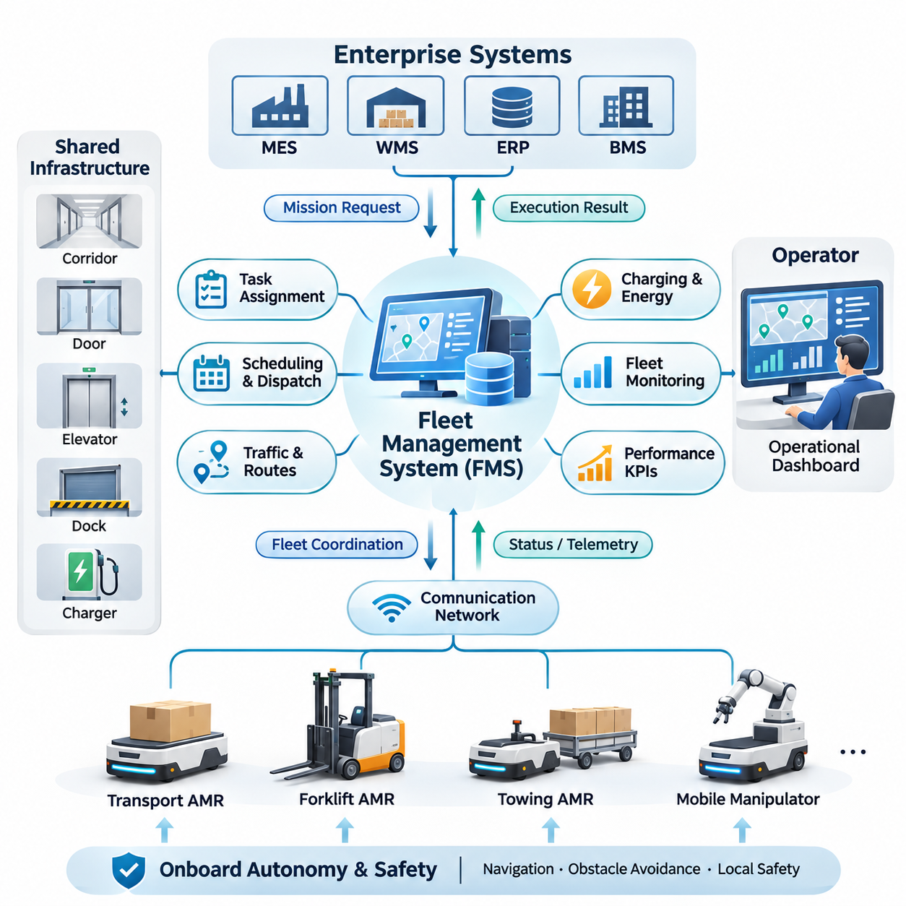
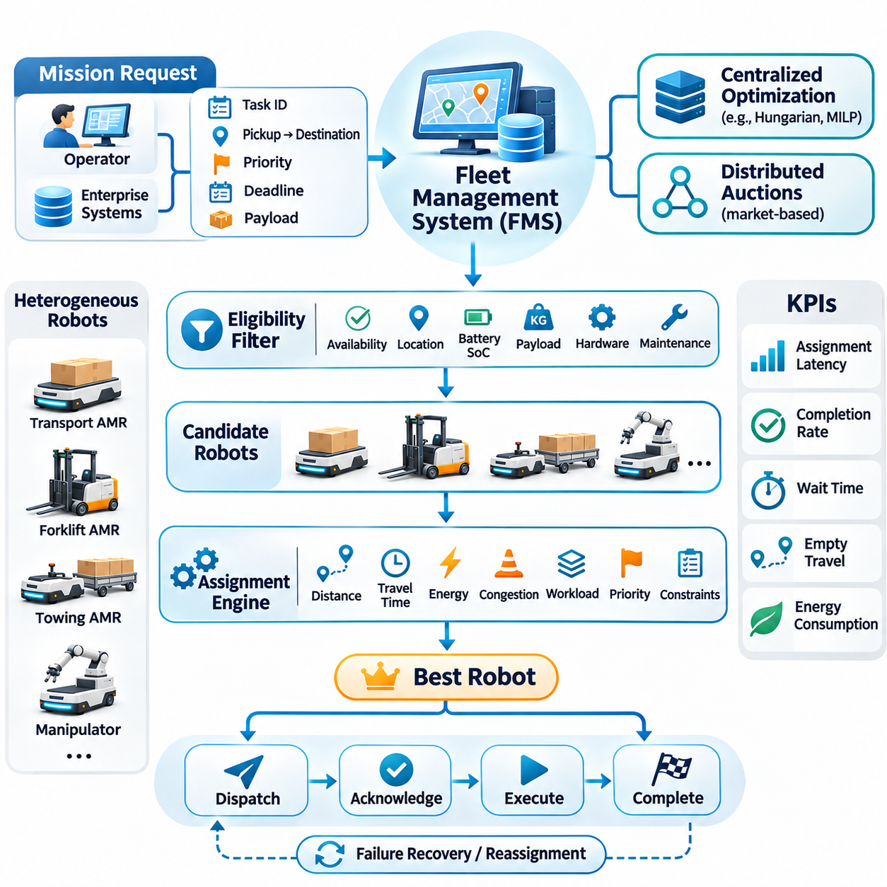
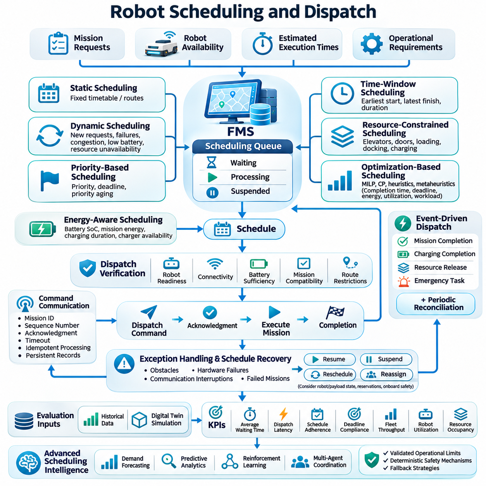
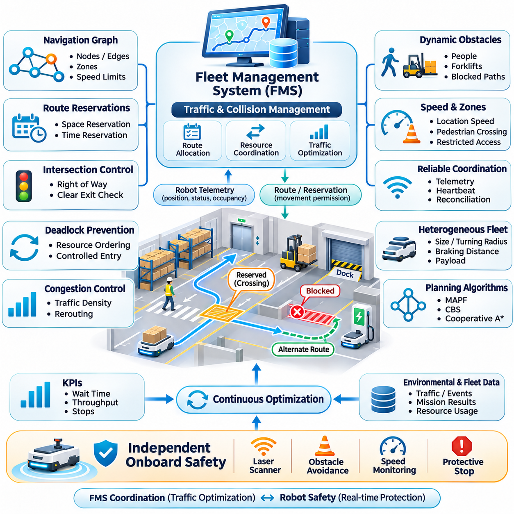
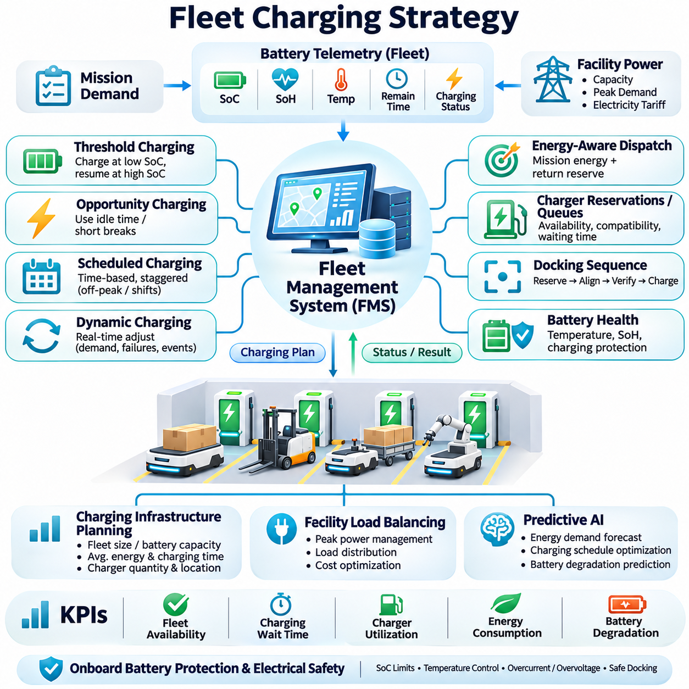
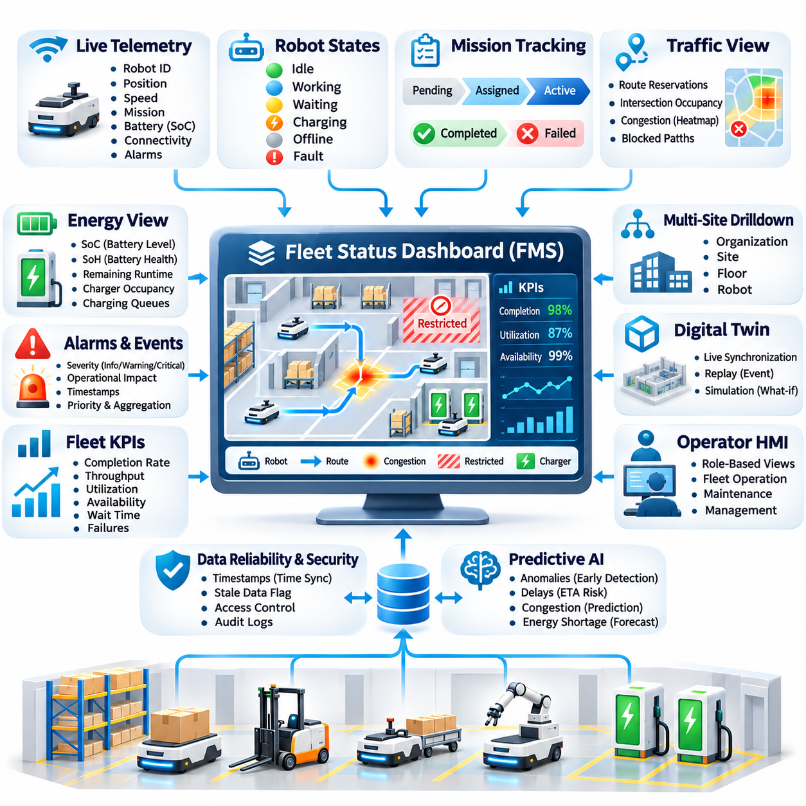
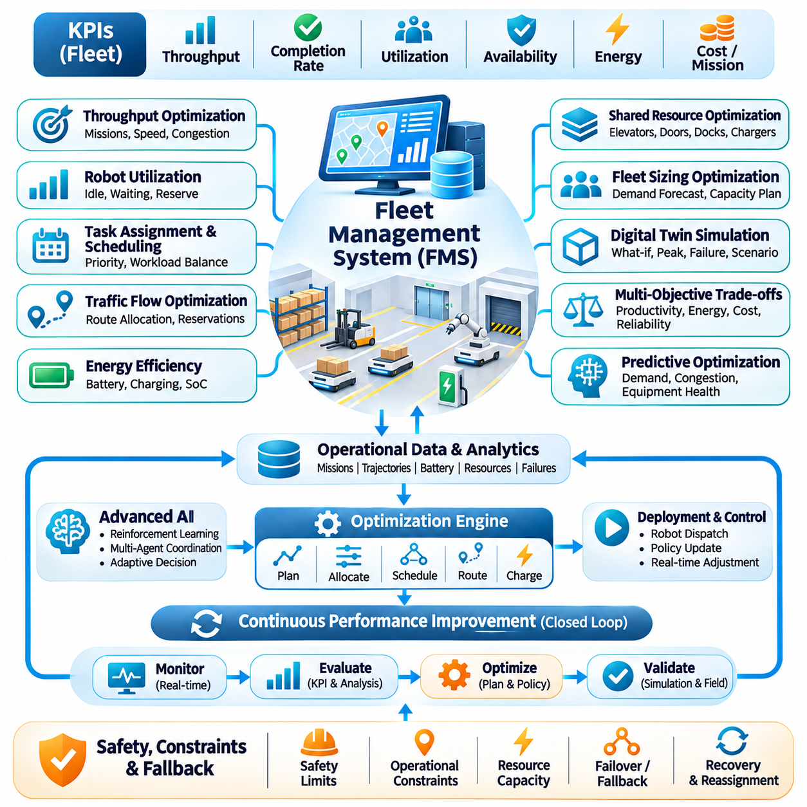
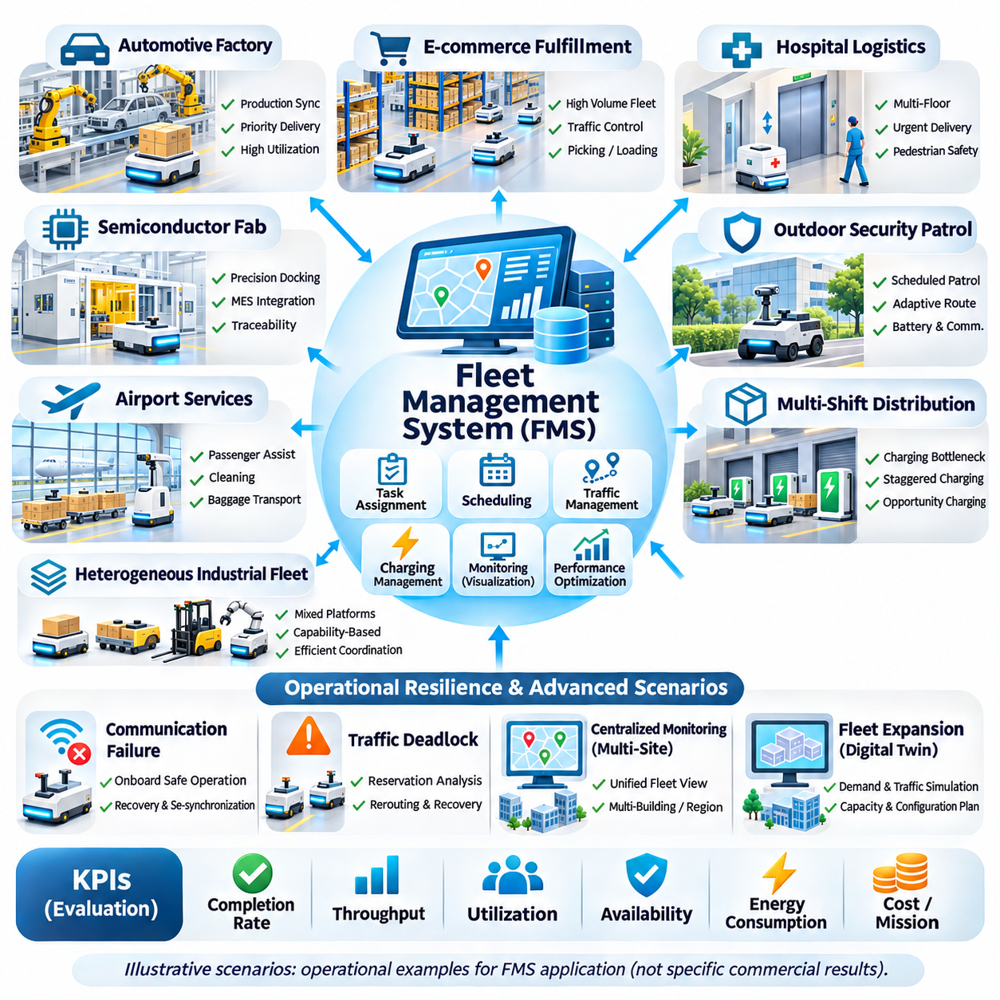

**Volume 08. AMR Operations, Deployment, and MLOps**

# Chapter 04. Fleet Management

## 04.1 Fleet Management Overview

{width="7.268055555555556in" height="7.268055555555556in"}

Fleet management is a fundamental operational capability that enables multiple Autonomous Mobile Robots (AMRs) to function as a coordinated and intelligent system within a shared environment. While an individual AMR performs autonomous navigation, perception, and mission execution, fleet management coordinates the activities of multiple robots to achieve common operational objectives, improve productivity, and maintain system reliability.

A Fleet Management System (FMS) provides centralized or distributed coordination of robot activities across industrial facilities, warehouses, hospitals, commercial buildings, and outdoor environments. Its primary responsibilities include task assignment, robot scheduling, traffic management, charging coordination, resource allocation, and performance optimization. These functions transform independent autonomous robots into an integrated operational infrastructure.

Fleet management differs from individual robot management in its scope and decision-making responsibilities. Individual robot management focuses on the health, configuration, software, and operational status of a specific robot, whereas fleet management considers interactions among multiple robots and shared environmental resources. A Robot Management System (RMS) and an FMS can therefore operate together as complementary management layers.

The operational architecture of fleet management typically consists of autonomous robots, communication networks, fleet management servers, operational databases, monitoring dashboards, and external system interfaces. Each robot periodically transmits information regarding its location, battery condition, mission status, navigation state, and operational availability. The FMS processes this information to maintain awareness of the entire fleet.

Task assignment is one of the most important functions of fleet management. Incoming operational requests are evaluated according to mission priority, robot availability, payload capacity, geographical proximity, battery condition, and equipment compatibility. An effective task assignment mechanism selects the most suitable robot while minimizing unnecessary travel, resource consumption, and operational delays across the fleet.

Robot scheduling and dispatch extend task assignment by determining when missions should begin and how multiple operational requests should be coordinated. Scheduling algorithms consider task dependencies, delivery deadlines, resource availability, and changing environmental conditions. Dynamic scheduling allows the fleet to respond to unexpected events, newly generated missions, equipment failures, and fluctuations in customer demand.

Traffic management becomes increasingly important as the number of robots operating within a shared environment grows. Multiple robots may compete for narrow corridors, intersections, docking stations, elevators, automatic doors, and loading areas. Fleet management coordinates access to these shared resources through route reservations, priority policies, congestion management, and deadlock prevention while preserving onboard collision avoidance.

Fleet-level navigation complements the autonomous navigation capabilities of individual robots. Although each AMR independently performs localization, path planning, and obstacle avoidance, the FMS can coordinate global route allocation and shared resource utilization. This hierarchical approach reduces unnecessary conflicts between robots while allowing local autonomy to respond to dynamic obstacles and environmental uncertainties.

Energy management is another essential component of fleet operations. The FMS continuously monitors battery State of Charge (SoC), charging station availability, estimated mission energy consumption, and robot operating schedules. Intelligent charging strategies coordinate charging activities to prevent simultaneous battery depletion, reduce charging station congestion, and maintain sufficient operational capacity during peak demand.

Fleet status visualization provides operators with comprehensive awareness of robot activities through centralized dashboards. Operational interfaces typically display robot positions, active missions, battery levels, communication status, fault conditions, and charging activities. Historical information and event records allow operators to investigate abnormalities, identify recurring operational problems, and evaluate fleet performance over time.

Fleet management must also support heterogeneous robot platforms with different mechanical configurations, payload capacities, sensor systems, and operational capabilities. Standardized communication interfaces and capability descriptions allow the FMS to coordinate transportation robots, autonomous forklifts, towing AMRs, cleaning robots, and mobile manipulators. Interoperability reduces integration complexity and supports future fleet expansion.

Integration with external enterprise systems enables robot fleets to participate directly in organizational workflows. Manufacturing Execution Systems (MES), Warehouse Management Systems (WMS), Enterprise Resource Planning (ERP), and Building Management Systems (BMS) can generate mission requests and receive execution results. Such integration connects autonomous robot operations with production schedules, inventory management, and facility services.

Operational reliability requires fleet management to incorporate fault detection, mission recovery, communication failure handling, and contingency planning. When a robot becomes unavailable, the FMS can suspend affected missions, reassign tasks, and reorganize operational schedules. Individual robots must retain appropriate local safety functions and enter predefined safe operating states when communication or centralized coordination becomes unavailable.

Fleet performance optimization relies on measurable Key Performance Indicators (KPIs), including mission completion rate, fleet availability, robot utilization, average task completion time, throughput, energy consumption, and operational downtime. Continuous analysis of these indicators helps identify bottlenecks, improve scheduling policies, optimize fleet size, and establish a balance between operational performance and total ownership cost.

As fleet management evolves toward AI-driven and distributed operational intelligence, predictive scheduling, reinforcement learning, digital twins, and multi-agent coordination can further enhance system adaptability. Operational data collected from deployed robots can support continuous learning and MLOps processes, subject to appropriate validation and governance. Fleet management consequently becomes a foundation for scalable, reliable, and increasingly intelligent Physical AI ecosystems.

## 04.2 Fleet Task Assignment

{width="7.268055555555556in" height="7.268055555555556in"}

Fleet task assignment is a core operational function of a Fleet Management System (FMS) that determines which Autonomous Mobile Robot (AMR) should execute a particular mission. Its primary objective is to distribute operational workloads efficiently while satisfying mission requirements, environmental constraints, and robot capabilities. Effective task assignment directly influences fleet productivity, operational reliability, resource utilization, and service quality.

The task assignment process begins when a mission request is generated by an operator, an automated service, or an external enterprise system. Each request typically includes a unique task identifier, pickup and destination locations, mission priority, execution deadline, payload requirements, and operational constraints. The FMS interprets these parameters and converts business-level requests into executable robot missions.

Robot eligibility must be evaluated before selecting a candidate for mission execution. The FMS maintains information about robot availability, current position, battery State of Charge (SoC), payload capacity, hardware configuration, software compatibility, and maintenance conditions. Robots that cannot satisfy mandatory mission requirements are excluded from the candidate pool, ensuring that only operationally suitable platforms are considered.

Distance-based task assignment represents one of the simplest allocation strategies. The FMS calculates the estimated travel distance between available robots and the mission starting location, selecting a robot with the lowest associated transportation cost. However, geographical proximity alone may not produce optimal results when traffic congestion, battery limitations, environmental restrictions, or existing mission commitments are considered.

Cost-based task assignment provides a more comprehensive decision-making mechanism by evaluating multiple operational variables through a weighted objective function. Assignment costs may include estimated travel time, energy consumption, mission execution duration, congestion penalties, and workload imbalance. The weighting factors can be adjusted according to operational priorities, allowing the allocation strategy to reflect specific business objectives.

Priority-based task assignment enables the fleet to accommodate missions with different levels of operational importance. Emergency deliveries, production-critical material transportation, and urgent medical logistics may require preferential allocation of available robots. Mission preemption can also be supported when a higher-priority request arrives, provided that interrupting an existing mission does not introduce safety risks or unacceptable operational disruptions.

Static task assignment allocates missions according to predefined rules, fixed schedules, or predetermined robot responsibilities. This approach is suitable for predictable environments with repetitive transportation requirements and relatively stable workloads. Dynamic task assignment continuously evaluates changing operational conditions and reallocates available resources in response to unexpected requests, robot failures, congestion, or fluctuating demand.

Centralized task assignment relies on a fleet management server that maintains a comprehensive representation of robot states, pending missions, and environmental resources. Optimization algorithms can evaluate multiple assignment combinations to improve overall fleet efficiency. Techniques such as the Hungarian algorithm, mixed-integer linear programming, and constraint programming can support structured allocation problems under defined operational constraints.

Distributed task assignment allows individual robots or local coordination agents to participate directly in mission allocation decisions. Auction-based mechanisms and market-based coordination enable robots to submit bids representing their estimated execution costs and capabilities. Distributed approaches can improve scalability and reduce dependence on centralized computation, although communication consistency and coordination overhead require careful consideration.

Heterogeneous fleet task assignment must account for differences in robot functionality, mechanical configuration, and operational capabilities. Transportation AMRs, autonomous forklifts, towing robots, cleaning robots, and mobile manipulators may operate within the same environment. Capability-based matching ensures that each mission is allocated to a platform equipped with the necessary payload capacity, mobility characteristics, sensors, and task-specific equipment.

Energy-aware task assignment incorporates battery capacity, estimated mission energy consumption, charging station accessibility, and minimum battery reserve requirements into allocation decisions. A robot with insufficient energy to complete a mission and reach an appropriate charging station should not be selected. Integrating energy management with task allocation reduces unexpected battery depletion and supports continuous fleet availability.

Traffic-aware task assignment evaluates the expected influence of mission allocation on shared transportation infrastructure. Assigning multiple robots to missions within the same geographical area may increase congestion around intersections, elevators, loading stations, and narrow corridors. Integrating traffic predictions, route availability, and resource reservation information into assignment decisions improves fleet throughput and reduces unnecessary waiting time.

Reliable task assignment requires consistent mission lifecycle management, including task creation, allocation, acknowledgment, execution, completion, cancellation, and failure recovery. Unique mission identifiers, acknowledgment mechanisms, and persistent operational records help prevent duplicate execution and lost requests. When communication is interrupted or a robot becomes unavailable, reassignment must consider the confirmed physical and logical state of the original mission.

Fleet task assignment performance can be evaluated through Key Performance Indicators (KPIs) such as assignment latency, mission completion rate, average waiting time, deadline compliance, empty travel distance, energy consumption per mission, and workload distribution. Digital twins and historical operational data can support comparative evaluations of allocation strategies before deployment, reducing the risk of introducing inefficient scheduling policies into live operations.

Advanced task assignment increasingly incorporates Artificial Intelligence (AI), reinforcement learning, demand forecasting, and multi-agent optimization. These technologies can improve decision-making under uncertain and dynamically changing operational conditions. AI-based allocation policies should nevertheless operate within validated safety and resource constraints, with appropriate fallback mechanisms, enabling scalable and adaptive fleet intelligence without compromising operational reliability.

## 04.3 Robot Scheduling and Dispatch

{width="7.268055555555556in" height="7.268055555555556in"}

Robot scheduling and dispatch are essential operational functions of a Fleet Management System (FMS) that determine when and how Autonomous Mobile Robots (AMRs) execute assigned missions. While task assignment identifies the most suitable robot for a particular task, scheduling establishes the execution sequence and timing, and dispatch initiates mission execution according to operational priorities, resource availability, and environmental constraints.

The robot scheduling process begins with the collection of pending mission requests, robot availability information, estimated execution times, and operational requirements. The FMS maintains a scheduling queue containing missions that are waiting for execution, currently being processed, or temporarily suspended. Each mission is evaluated according to its priority, deadline, resource dependencies, and expected impact on overall fleet performance.

Static scheduling establishes robot operating sequences according to predefined timetables, fixed routes, or repetitive transportation requirements. This approach is particularly suitable for manufacturing facilities and logistics environments with predictable material flows and stable production schedules. Although static scheduling simplifies operational management, its flexibility is limited when unexpected events or changes in demand occur.

Dynamic scheduling continuously adjusts robot operating plans in response to changing operational conditions. New mission requests, robot failures, traffic congestion, battery depletion, and temporary resource unavailability may require immediate schedule modifications. The FMS evaluates these changes and reorganizes mission execution sequences to maintain operational continuity while minimizing delays and unnecessary resource consumption.

Priority-based scheduling determines mission execution order according to predefined levels of operational importance. Emergency transportation, production-critical material deliveries, and urgent medical logistics may receive higher scheduling priority than routine operations. Priority aging and deadline-aware policies can prevent lower-priority missions from experiencing excessive waiting times while maintaining responsiveness to critical operational requirements.

Time-window scheduling incorporates earliest start times, latest completion times, estimated mission durations, and resource availability periods into scheduling decisions. This approach is particularly important when robot missions must be synchronized with manufacturing processes, loading operations, warehouse activities, or hospital service schedules. Feasibility checks help prevent conflicting reservations and unrealistic execution commitments.

Resource-constrained scheduling considers the limited availability of shared infrastructure, including elevators, automatic doors, loading stations, docking facilities, and charging stations. The FMS coordinates reservation periods and mission execution sequences to prevent multiple robots from requiring the same resource simultaneously. Resource-aware scheduling reduces operational bottlenecks and improves infrastructure utilization across the fleet.

Optimization-based scheduling uses mathematical models to determine efficient mission sequences under multiple operational constraints. Mixed-integer linear programming, constraint programming, heuristic algorithms, and metaheuristic optimization can be applied to different scheduling problems. Objective functions may consider total completion time, deadline compliance, energy consumption, equipment utilization, and workload distribution.

Robot dispatch translates scheduling decisions into executable mission commands transmitted to individual robots. Before dispatching a mission, the FMS verifies robot readiness, communication connectivity, battery sufficiency, mission compatibility, and applicable route restrictions. Dispatch authorization should be issued only when mandatory operational prerequisites are satisfied, reducing the probability of mission rejection or execution failure.

The dispatch communication mechanism must ensure reliable command delivery and consistent mission state synchronization between the FMS and individual robots. Unique mission identifiers, command sequence numbers, acknowledgment messages, and timeout mechanisms support reliable execution tracking. Idempotent command processing and persistent mission records help prevent duplicate dispatch, conflicting commands, and inconsistent operational states.

Event-driven dispatch enables robots to respond rapidly to operational state transitions without relying exclusively on periodic scheduling cycles. Events such as mission completion, charging completion, resource release, or emergency task creation can trigger scheduling and dispatch decisions. Combining event-driven processing with periodic reconciliation improves responsiveness while maintaining consistency across distributed fleet components.

Energy-aware scheduling integrates battery State of Charge (SoC), estimated mission energy requirements, charging duration, and charging station availability into operational planning. Charging activities are treated as scheduled fleet resources rather than isolated maintenance events. Coordinating mission dispatch with charging schedules maintains sufficient operational capacity and reduces the risk of simultaneous robot unavailability during peak demand.

Exception handling and schedule recovery are necessary when robots encounter unexpected obstacles, hardware failures, communication interruptions, or unsuccessful mission execution. The FMS must determine whether affected missions should be resumed, suspended, rescheduled, or reassigned. Recovery decisions must consider confirmed robot and payload states, resource reservations, and onboard safety requirements before issuing new commands.

Scheduling and dispatch performance can be evaluated through Key Performance Indicators (KPIs), including average mission waiting time, dispatch latency, schedule adherence, deadline compliance, fleet throughput, robot utilization, and resource occupancy. Historical operational data and digital twin simulations support the evaluation of alternative scheduling policies under representative workloads, congestion patterns, and abnormal operating conditions.

Advanced robot scheduling increasingly incorporates demand forecasting, predictive analytics, reinforcement learning, and multi-agent coordination to anticipate future workloads and dynamically optimize fleet activities. AI-based scheduling policies must remain subject to validated operational constraints, deterministic safety mechanisms, and reliable fallback strategies. These capabilities establish a foundation for adaptive and scalable Physical AI fleet operations.

## 04.4 Traffic and Collision Management

{width="7.268055555555556in" height="7.268055555555556in"}

Traffic and collision management are essential operational functions of a Fleet Management System (FMS) that enable multiple Autonomous Mobile Robots (AMRs) to operate safely and efficiently within shared environments. As fleet size increases, interactions among robots, humans, vehicles, and infrastructure become more complex. Effective traffic management minimizes congestion, prevents operational conflicts, and maintains predictable mission execution across the fleet.

Fleet traffic management operates at a higher coordination level than the autonomous navigation system of an individual robot. While onboard navigation handles localization, local path planning, and obstacle avoidance, the FMS coordinates robot movement across shared transportation networks. This hierarchical architecture separates fleet-level traffic optimization from real-time motion control and independently implemented robot safety functions.

The operational environment is commonly represented as a navigation graph consisting of nodes, edges, intersections, restricted areas, and shared resources. Each graph element may contain information about traversal direction, speed limits, occupancy restrictions, passage capacity, and robot compatibility. The FMS uses this representation to coordinate route allocation and evaluate potential movement conflicts before authorizing robot entry into shared areas.

Route reservation is a fundamental mechanism for managing traffic among multiple robots. Before entering a designated route segment, intersection, or restricted area, a robot obtains permission from the FMS or an authorized coordination service. Spatial and temporal reservations prevent incompatible robot movements from occupying the same resource simultaneously. Reservation validity must be maintained using reliable position and occupancy information.

Intersection management coordinates robot movements at locations where multiple navigation routes converge. The FMS determines crossing sequences according to mission priority, arrival time, intersection occupancy, and downstream route availability. Traffic control policies may implement virtual traffic signals, right-of-way rules, or exclusive access permissions. Robots should not enter intersections when their intended exit routes are unavailable.

Deadlock prevention is critical in environments containing narrow corridors, limited maneuvering spaces, and shared transportation resources. A deadlock occurs when multiple robots indefinitely wait for resources occupied or reserved by one another. Resource acquisition ordering, controlled zone entry, reservation dependency analysis, and alternative route allocation can reduce deadlock risks. Recovery requires coordinated movement under verified safe conditions.

Congestion management focuses on maintaining efficient robot movement during periods of high operational demand. Excessive robot concentration around loading stations, elevators, intersections, and charging facilities can significantly reduce fleet throughput. The FMS can monitor traffic density, waiting times, and resource occupancy to dynamically redistribute routes, regulate dispatch frequency, and redirect robots toward less congested transportation corridors.

Collision management requires multiple protection layers that address different operational time scales and failure conditions. Fleet-level coordination reduces foreseeable movement conflicts, while onboard perception and collision avoidance respond to immediate environmental changes. Safety-related protective functions, including safety laser scanners, speed monitoring, and protective stopping, must remain effective independently of ordinary fleet coordination commands.

Dynamic obstacle management becomes particularly important in environments shared with pedestrians, workers, forklifts, and other moving equipment. Individual robots detect unexpected obstacles and adjust their motion according to validated navigation and safety policies. Persistent obstacles and blocked routes can be reported to the FMS, enabling fleet-wide route adjustments and temporary restrictions that prevent repeated operational disruptions.

Speed and zone management establish location-dependent operating restrictions based on environmental conditions and risk assessments. High-traffic corridors, pedestrian crossings, hospital patient areas, and loading stations may require reduced robot speeds or restricted access. The FMS distributes operational zone policies, while onboard systems enforce applicable movement limits. Safety-critical restrictions require appropriately validated enforcement mechanisms.

Communication reliability is essential because traffic coordination depends on accurate robot positions, reservation states, and movement permissions. Delayed messages, stale telemetry, network interruptions, and server failures may create inconsistencies in shared resource allocation. Heartbeat monitoring, timestamps, sequence validation, and reservation state reconciliation help maintain consistency. Uncertain occupancy must not be treated as confirmed clearance.

Heterogeneous fleet traffic management must account for differences in robot dimensions, turning radii, braking distances, payload configurations, and maneuvering capabilities. Autonomous forklifts, towing AMRs, transportation robots, and mobile manipulators may require different spatial envelopes and route restrictions. Capability-aware traffic coordination ensures that shared routes remain compatible with each robot\'s physical and operational characteristics.

Traffic management algorithms can incorporate graph-based planning, time-expanded networks, Cooperative A\\\*, Conflict-Based Search (CBS), and Multi-Agent Path Finding (MAPF). These approaches evaluate robot trajectories and potential conflicts across spatial and temporal dimensions. Algorithm selection must consider fleet size, computational complexity, environmental dynamics, and acceptable planning latency while preserving independent safety protection.

Traffic and collision management performance can be evaluated through Key Performance Indicators (KPIs), including average route waiting time, intersection utilization, congestion frequency, deadlock occurrence, protective stop frequency, and fleet throughput. Historical operational data and digital twin simulations enable engineers to evaluate traffic policies under representative workloads, equipment failures, and abnormal operating conditions before field deployment.

Advanced fleet traffic management increasingly incorporates predictive congestion analysis, Artificial Intelligence (AI), reinforcement learning, and distributed multi-agent coordination. These technologies can anticipate traffic bottlenecks and dynamically optimize shared resource utilization. AI-based traffic policies must remain within validated operational constraints and independent safety boundaries, supporting scalable and reliable Physical AI fleet operations.

## 04.5 Fleet Charging Strategy

{width="7.268055555555556in" height="7.268055555555556in"}

Fleet charging strategy is a fundamental operational component of a Fleet Management System (FMS) that ensures the continuous availability of Autonomous Mobile Robots (AMRs). Unlike individual robot charging, fleet charging requires coordinated energy management across multiple robots, charging stations, and operational schedules. Its primary objective is to balance energy replenishment, mission execution, battery lifetime, and fleet productivity.

An effective fleet charging strategy begins with continuous monitoring of battery State of Charge (SoC), State of Health (SoH), battery temperature, charging status, and estimated remaining operating time. The FMS collects energy-related telemetry from each robot and maintains a comprehensive representation of fleet energy availability. This information provides the foundation for charging decisions, mission allocation, and operational planning.

Threshold-based charging represents a conventional approach in which robots initiate charging when their battery SoC reaches a predefined lower threshold and resume operation after reaching an upper threshold. Although this strategy is relatively simple to implement, independent charging decisions may cause multiple robots to become unavailable simultaneously. Fleet-level coordination is therefore necessary to maintain sufficient operational capacity.

Opportunity charging allows robots to replenish their batteries during short periods of operational inactivity, such as waiting for new missions, temporary production interruptions, or scheduled breaks. This approach reduces the requirement for extended charging sessions and can improve overall fleet availability. Charging frequency and duration must nevertheless be managed according to battery chemistry, thermal conditions, and manufacturer recommendations.

Scheduled charging coordinates battery replenishment according to predefined operational schedules, anticipated workloads, and charging infrastructure availability. Robots may be assigned specific charging periods during low-demand operating hours or shift transitions. Staggered charging schedules prevent simultaneous withdrawal of multiple robots from active service and maintain sufficient transportation capacity throughout the operating period.

Dynamic charging management continuously adjusts charging decisions according to real-time fleet conditions. Unexpected mission requests, battery consumption variations, charging station failures, and changes in operational demand may require immediate modifications to existing charging schedules. The FMS dynamically determines which robots should continue operating, initiate charging, or postpone charging within acceptable battery safety limits.

Energy-aware mission allocation integrates estimated energy consumption directly into task assignment and dispatch decisions. Before assigning a mission, the FMS evaluates whether a robot possesses sufficient energy to complete the task, accommodate unexpected delays, and reach an available charging station. Maintaining an appropriate energy reserve reduces the risk of battery depletion and robot immobilization within operational environments.

Charging station management treats charging infrastructure as a shared fleet resource requiring coordinated allocation and reservation. The FMS monitors charger availability, compatibility, occupancy, charging progress, and equipment health. Reservation mechanisms and charging queues prevent resource conflicts, while intelligent station selection considers travel distance, expected waiting time, charging power, and subsequent mission locations.

Charging infrastructure planning must consider fleet size, battery capacity, average mission energy consumption, charging duration, and peak operational demand. An insufficient number of charging stations can create congestion and reduce fleet throughput, whereas excessive infrastructure increases deployment costs. Capacity planning using historical operational data and simulation helps determine appropriate charger quantities and locations.

Battery lifetime management is an important consideration when developing fleet charging policies. Frequent deep discharge, prolonged exposure to extreme SoC levels, excessive charging currents, and elevated battery temperatures may accelerate battery degradation. Charging strategies should incorporate battery-specific operating limits and State of Health information to balance immediate operational productivity against long-term battery replacement costs.

Automatic docking and charging require reliable coordination between the robot, charging station, and FMS. The docking process typically includes station reservation, approach navigation, precision alignment, electrical connection verification, and charging authorization. Charging failures, abnormal electrical conditions, or unsuccessful docking attempts must trigger predefined recovery procedures without bypassing onboard electrical protection mechanisms.

Heterogeneous fleet charging management must accommodate differences in battery chemistry, nominal voltage, charging interfaces, energy capacity, and supported charging rates. Transportation AMRs, autonomous forklifts, towing robots, and outdoor patrol robots may require different charging infrastructure and operating policies. Compatibility-aware charger allocation prevents unsuitable charging assignments and supports reliable operation across diverse platforms.

Facility-level energy management extends fleet charging coordination by considering electrical infrastructure capacity, peak power demand, electricity tariffs, and other equipment loads. Simultaneous high-power charging may exceed available electrical capacity or increase operating costs. Load balancing, power-aware charging schedules, and demand management can distribute energy consumption while maintaining operational readiness.

Fleet charging performance can be evaluated through Key Performance Indicators (KPIs), including charging station utilization, average charging waiting time, fleet energy consumption, charging efficiency, battery degradation rate, and charging-related operational downtime. Historical data and digital twin simulations support the comparison of alternative charging policies under representative workloads and infrastructure failure scenarios.

Advanced fleet charging strategies increasingly incorporate Artificial Intelligence (AI), predictive energy modeling, demand forecasting, and reinforcement learning. These technologies can anticipate future energy requirements, optimize charging schedules, and adapt to changing mission patterns. AI-based charging decisions must remain within validated battery protection limits, supporting sustainable, scalable, and reliable Physical AI fleet operations.

## 04.6 Fleet Status Visualization

{width="7.268055555555556in" height="7.268055555555556in"}

Fleet status visualization is an essential operational function of a Fleet Management System (FMS) that transforms distributed robot telemetry into meaningful information for human operators. As the number of Autonomous Mobile Robots (AMRs) increases, monitoring individual robots becomes increasingly inefficient. Integrated visualization provides comprehensive situational awareness of fleet activities, operational conditions, and resource availability.

A fleet visualization platform collects real-time information from individual robots, charging stations, infrastructure controllers, and mission management services. The collected information typically includes robot identification, geographical position, orientation, movement speed, mission status, battery condition, communication status, and active alarms. These data are consolidated into a unified operational representation of the entire fleet.

Map-based visualization provides a spatial representation of robot activities within the operational environment. Facility layouts, navigation maps, transportation corridors, restricted zones, and infrastructure locations are displayed together with real-time robot positions. Operators can observe movement directions, planned routes, destination locations, and occupied areas to understand spatial relationships and identify potential operational conflicts.

Robot operational states should be represented through standardized visual indicators that enable operators to distinguish between different conditions immediately. Typical states include idle, executing a mission, waiting, charging, docking, paused, offline, and faulted. Consistent color conventions, status symbols, and descriptive labels improve interpretation, while timestamps indicate whether the displayed information remains current and reliable.

Mission status visualization enables operators to monitor the complete lifecycle of transportation and service tasks. Pending missions, assigned robots, active execution stages, estimated completion times, completed missions, and failed tasks can be displayed through integrated operational interfaces. Mission progress indicators and execution histories help operators identify delays, investigate exceptions, and evaluate compliance with operational schedules.

Traffic visualization provides insight into robot movement patterns, shared resource utilization, and transportation network conditions. Route reservations, intersection occupancy, congestion levels, waiting robots, and temporarily blocked passages can be represented dynamically. Traffic density heatmaps and historical movement analysis help operators identify persistent bottlenecks and evaluate the effectiveness of fleet traffic management policies.

Energy status visualization presents battery State of Charge (SoC), State of Health (SoH), estimated remaining operating time, and charging progress for individual robots. Fleet-level energy dashboards summarize the distribution of battery capacity, charging station occupancy, charger availability, and charging queues. These indicators help operators anticipate energy shortages and evaluate whether sufficient robots remain available for upcoming missions.

Alarm and event visualization supports rapid identification of abnormal operational conditions, including hardware failures, communication interruptions, navigation errors, battery abnormalities, and protective stops. Events should be categorized according to severity, operational impact, occurrence time, and affected equipment. Alarm aggregation and prioritization reduce unnecessary information overload and improve operator response efficiency.

Fleet performance dashboards consolidate Key Performance Indicators (KPIs), including mission completion rate, fleet throughput, robot utilization, operational availability, average waiting time, and failure frequency. Real-time indicators provide immediate insight into current operating conditions, while historical trends reveal recurring operational problems. Comparative analysis across robots, facilities, and operating periods supports continuous improvement.

Hierarchical visualization becomes increasingly important as fleet deployments expand across multiple facilities, buildings, floors, and geographical regions. A centralized dashboard can present organization-wide operational conditions, while detailed interfaces provide access to individual sites, robot groups, and equipment. Hierarchical navigation allows operators to move efficiently between strategic fleet monitoring and detailed technical diagnostics.

Digital twin integration extends conventional fleet visualization by establishing a synchronized virtual representation of robots, infrastructure, and operational environments. Digital twins can combine spatial models, real-time telemetry, historical records, and simulation capabilities. Operators can examine operational conditions, replay abnormal events, and evaluate potential changes without directly interfering with physical robot activities.

Human-Machine Interface (HMI) design should emphasize readability, consistency, responsiveness, and efficient information prioritization. Excessive graphical elements, redundant indicators, and uncontrolled alarm notifications may reduce operator awareness. Role-based interfaces can provide different information levels for fleet operators, maintenance engineers, system administrators, and management personnel according to their responsibilities.

Visualization reliability depends on accurate time synchronization, consistent data models, communication integrity, and appropriate telemetry update frequencies. Delayed or missing information must be explicitly identified rather than presented as confirmed operational states. Access control, command authorization, and audit logging are also necessary when visualization platforms provide remote intervention or mission management capabilities.

Advanced fleet visualization increasingly incorporates Artificial Intelligence (AI), predictive analytics, automated anomaly detection, and intelligent operational recommendations. These capabilities can highlight emerging congestion, anticipated mission delays, equipment degradation, and future energy shortages. By integrating real-time situational awareness with predictive operational intelligence, fleet visualization becomes a foundation for scalable Physical AI fleet operations.

## 04.7 Fleet Performance Optimization

{width="7.268055555555556in" height="7.268055555555556in"}

Fleet performance optimization is a systematic approach to improving the operational efficiency, productivity, reliability, and scalability of Autonomous Mobile Robot (AMR) fleets. A Fleet Management System (FMS) integrates mission management, robot scheduling, traffic coordination, energy management, and operational analytics to maximize overall fleet performance while satisfying safety requirements and operational constraints.

Performance optimization begins with the establishment of measurable operational objectives and Key Performance Indicators (KPIs). Typical indicators include fleet throughput, mission completion rate, robot utilization, operational availability, average mission duration, energy consumption, and operating cost per mission. These indicators provide a quantitative foundation for identifying inefficiencies and evaluating optimization strategies.

Fleet throughput optimization focuses on increasing the number of successfully completed missions within a specified operating period. Factors affecting throughput include robot movement speed, mission execution sequences, transportation distances, infrastructure availability, and traffic congestion. Coordinated optimization of these factors can increase operational capacity without necessarily increasing the number of deployed robots.

Robot utilization optimization aims to minimize unnecessary idle time, unproductive movement, excessive waiting, and avoidable operational downtime. The FMS continuously evaluates workload distribution and robot availability to maintain an appropriate balance between active mission execution and operational readiness. Excessively high utilization should be avoided because insufficient reserve capacity can reduce responsiveness to unexpected demand.

Task assignment and scheduling optimization improve fleet performance by selecting suitable robots and efficient mission execution sequences. Distance-based allocation, priority-aware scheduling, workload balancing, and constraint-based optimization can reduce unnecessary travel and mission delays. Dynamic reassignment enables the fleet to respond to changing operational conditions while preserving mission continuity and resource availability.

Traffic flow optimization addresses congestion, intersection conflicts, route inefficiencies, and competition for shared transportation resources. The FMS analyzes robot movement patterns, route occupancy, and waiting times to identify operational bottlenecks. Dynamic route allocation, controlled dispatch frequency, and coordinated resource reservations can improve transportation efficiency without compromising validated safety restrictions.

Energy efficiency optimization considers battery consumption, charging frequency, charging station utilization, and energy requirements associated with individual missions. Energy-aware routing, optimized movement profiles, and coordinated charging schedules can reduce unnecessary energy expenditure. The optimization process must balance immediate fleet productivity with battery lifetime, electrical infrastructure capacity, and long-term operating costs.

Shared resource optimization becomes essential when multiple robots depend on elevators, automatic doors, loading stations, docking facilities, and charging infrastructure. Inefficient resource allocation may create operational bottlenecks even when sufficient robots are available. Reservation mechanisms, predictive resource scheduling, and coordinated access policies improve infrastructure utilization and reduce unnecessary waiting time.

Fleet sizing optimization determines the appropriate number and configuration of robots required to satisfy operational demand. Deploying insufficient robots may result in mission delays, whereas excessive deployment increases capital expenditure, traffic congestion, and maintenance requirements. Historical demand analysis, workload forecasting, and simulation-based capacity planning support economically efficient fleet expansion decisions.

Operational data analytics enables engineers to identify recurring inefficiencies and understand the relationships among multiple performance variables. Mission histories, navigation trajectories, battery telemetry, resource occupancy records, and equipment failure logs provide valuable optimization inputs. Statistical analysis and root cause investigation help distinguish temporary operational disturbances from persistent structural limitations.

Digital twin simulation provides a virtual environment for evaluating alternative fleet configurations, scheduling algorithms, traffic policies, and charging strategies before physical deployment. Engineers can reproduce representative workloads, peak demand conditions, infrastructure failures, and abnormal operational scenarios. Simulation-based optimization reduces experimentation costs and supports evidence-based operational decisions.

Multi-objective optimization addresses competing operational goals that cannot necessarily be maximized simultaneously. Increasing fleet throughput may increase energy consumption, while minimizing operating costs may reduce reserve capacity and operational resilience. Weighted objective functions, Pareto optimization, and constraint-based methods help identify suitable trade-offs among productivity, efficiency, reliability, and economic performance.

Predictive fleet optimization incorporates demand forecasting, estimated mission durations, congestion prediction, and equipment health information into operational planning. Instead of responding exclusively to current conditions, the FMS anticipates future resource requirements and potential disruptions. Proactive adjustments to robot deployment, charging schedules, and mission priorities improve operational resilience and responsiveness.

Continuous performance improvement requires a closed-loop process involving operational monitoring, performance evaluation, optimization, controlled deployment, and subsequent validation. Changes to fleet management policies should be version-controlled and evaluated against established performance baselines. Regression testing, incremental deployment, and rollback mechanisms help prevent optimization initiatives from introducing unexpected operational degradation.

Advanced fleet performance optimization integrates Artificial Intelligence (AI), reinforcement learning, multi-agent coordination, and adaptive decision-making to improve collective operational intelligence. Optimization policies must remain within validated safety boundaries and infrastructure constraints, with reliable fallback mechanisms. These capabilities support the evolution of conventional AMR fleet management toward scalable, adaptive, and economically sustainable Physical AI operations.

## 04.8 Fleet Management Case Studies

{width="7.268055555555556in" height="7.268055555555556in"}

Fleet management case studies demonstrate how Autonomous Mobile Robot (AMR) fleets can be coordinated to address practical operational challenges across diverse industrial and service environments. The following illustrative scenarios examine the application of Fleet Management Systems (FMS) to task assignment, robot scheduling, traffic coordination, charging management, operational visualization, and continuous performance optimization.

In an automotive manufacturing facility, AMRs transport components between warehouses, assembly lines, and production stations. The FMS synchronizes transportation missions with production schedules and prioritizes deliveries to stations experiencing material shortages. Dynamic task assignment and deadline-aware scheduling help minimize production interruptions while maintaining efficient robot utilization and material flow.

In a large e-commerce fulfillment center, hundreds of AMRs may operate simultaneously within shared transportation networks. The primary challenges include fluctuating order volumes, intersection congestion, and competition for picking and loading stations. Graph-based traffic management, dynamic route allocation, and coordinated resource reservations can improve transportation throughput without requiring proportional fleet expansion.

A hospital logistics fleet operates across multiple floors to transport medications, laboratory specimens, medical supplies, and waste materials. The FMS coordinates elevator access, automatic doors, delivery schedules, and mission priorities. Urgent medical transportation receives preferential scheduling, while pedestrian-aware traffic policies and independent onboard safety functions support safe operation in patient-accessible environments.

In a semiconductor manufacturing facility, AMRs transport sensitive materials between controlled production environments. Operational requirements include precise docking, predictable delivery timing, restricted zone access, and comprehensive mission traceability. The FMS coordinates transportation missions with manufacturing execution systems and manages equipment availability while preserving process integrity and operational reliability.

An outdoor security patrol fleet illustrates the importance of energy management and environmental adaptability. Robots perform scheduled patrol missions across industrial complexes, public facilities, and transportation infrastructure. The FMS dynamically adjusts patrol routes, charging schedules, and mission assignments according to battery conditions, environmental changes, communication availability, and detected operational events.

An airport service fleet provides another example of heterogeneous robot coordination. Passenger assistance robots, cleaning robots, and baggage transportation robots may share public corridors and service infrastructure while performing different missions. Capability-aware task assignment, location-dependent speed restrictions, and centralized traffic coordination enable these robots to coexist within a complex operational environment.

In a multi-shift distribution center, charging infrastructure can become a major operational bottleneck when numerous robots require charging simultaneously. Threshold-based charging without fleet-level coordination may reduce available transportation capacity during peak demand. Staggered charging schedules, opportunity charging, and predictive energy management help maintain a sufficient number of operational robots throughout successive shifts.

A heterogeneous industrial fleet may include conventional transportation AMRs, towing robots, autonomous forklifts, and mobile manipulators. Differences in payload capacity, maneuvering characteristics, docking requirements, and charging interfaces introduce additional management complexity. The FMS applies capability-based task allocation and robot-specific operating constraints to coordinate these platforms efficiently.

A fleet communication failure scenario demonstrates the importance of operational resilience. When network connectivity is interrupted, affected robots must follow predefined onboard operating and safety policies. The FMS maintains mission records and resource reservation states, while communication recovery procedures reconcile robot positions, task progress, and resource occupancy before normal coordinated operation resumes.

A traffic deadlock scenario may occur when multiple robots attempt to traverse narrow corridors or access interconnected loading stations. Increasing the number of deployed robots without improving traffic coordination can worsen congestion and reduce overall productivity. Reservation dependency analysis, controlled zone entry, alternative route allocation, and coordinated recovery procedures address these operational limitations.

A centralized fleet monitoring scenario involves robot operations distributed across multiple buildings and geographical locations. Fleet status visualization integrates robot positions, mission progress, battery conditions, infrastructure availability, and active alarms into a unified operational dashboard. Hierarchical visualization and standardized performance indicators enable operators to identify abnormalities and coordinate appropriate responses.

A fleet expansion scenario demonstrates the value of digital twin simulation and quantitative capacity planning. Before deploying additional robots, engineers can simulate increased mission demand, traffic density, charging station utilization, and infrastructure occupancy. Comparative analysis of alternative fleet configurations helps identify whether additional robots, infrastructure improvements, or scheduling optimization offer greater operational benefits.

Cross-industry evaluation of fleet management strategies requires consistent Key Performance Indicators (KPIs), including mission completion rate, transportation throughput, robot utilization, operational availability, energy consumption, and cost per mission. Performance comparisons should account for environmental complexity, workload characteristics, safety constraints, and infrastructure limitations rather than relying exclusively on robot quantities.

These illustrative cases follow the fleet management topics defined in the chapter structure rather than reporting measured results from specific commercial deployments. They demonstrate the importance of integrating centralized coordination, distributed autonomy, independent safety protection, operational analytics, and adaptive optimization to establish scalable, resilient, and economically sustainable Physical AI fleet operations.
