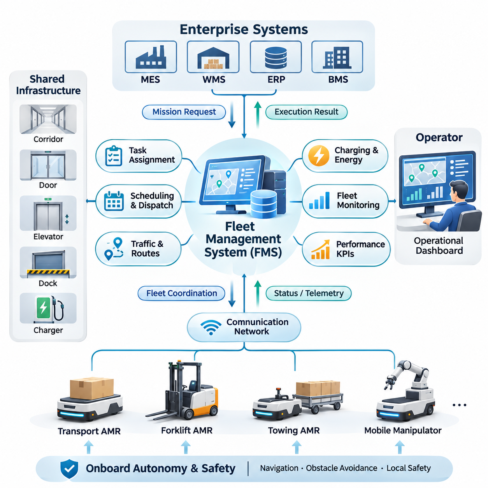
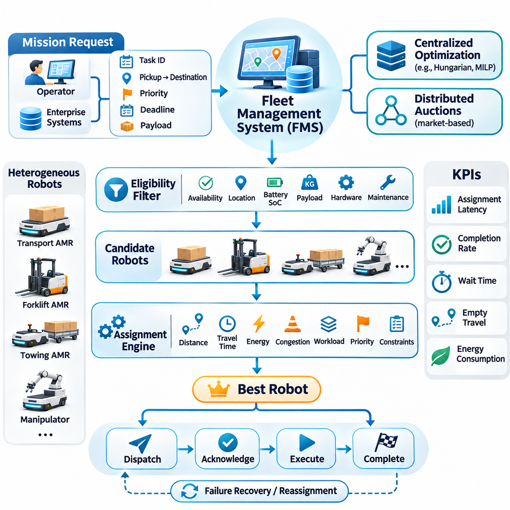
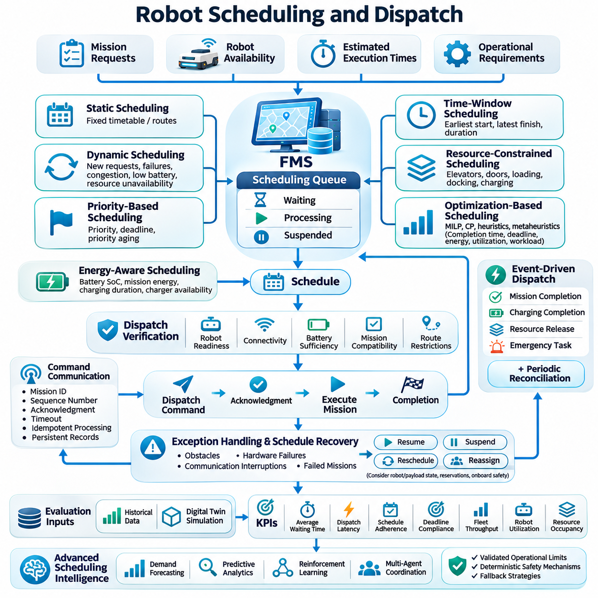
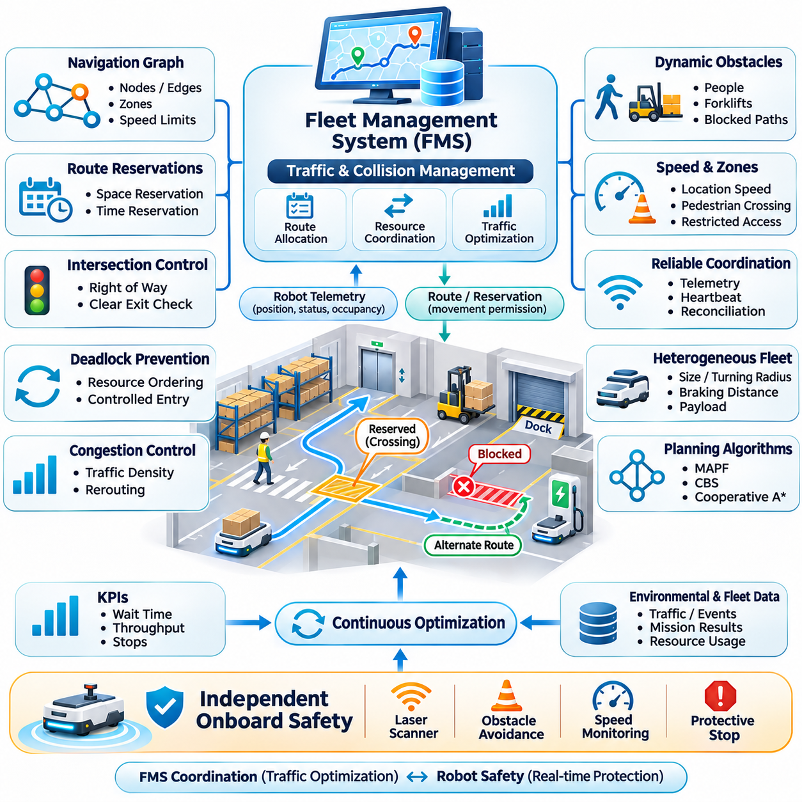
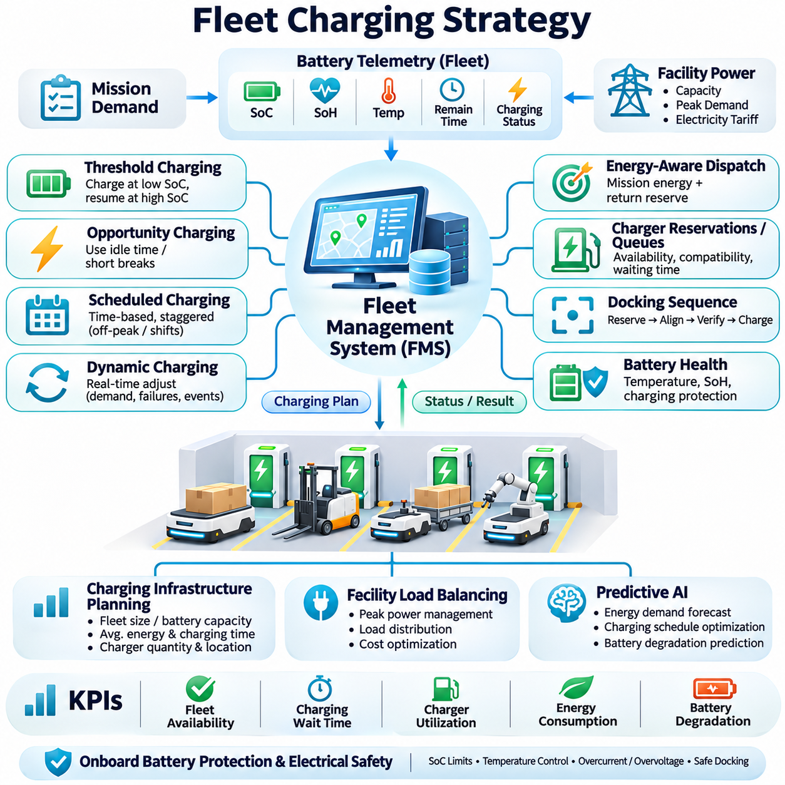
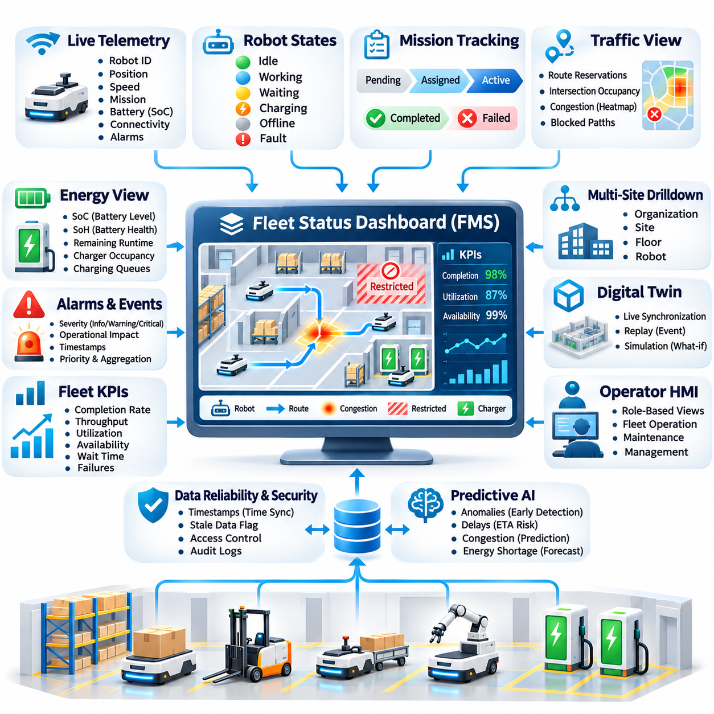
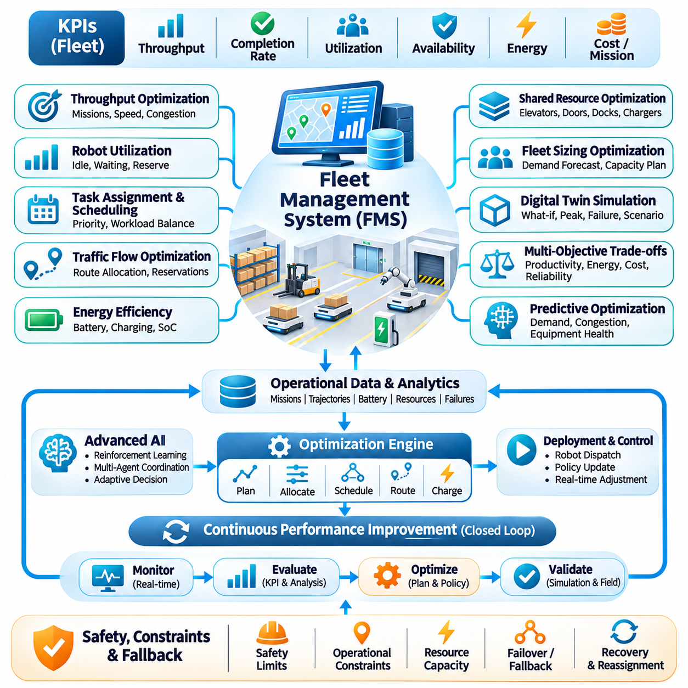
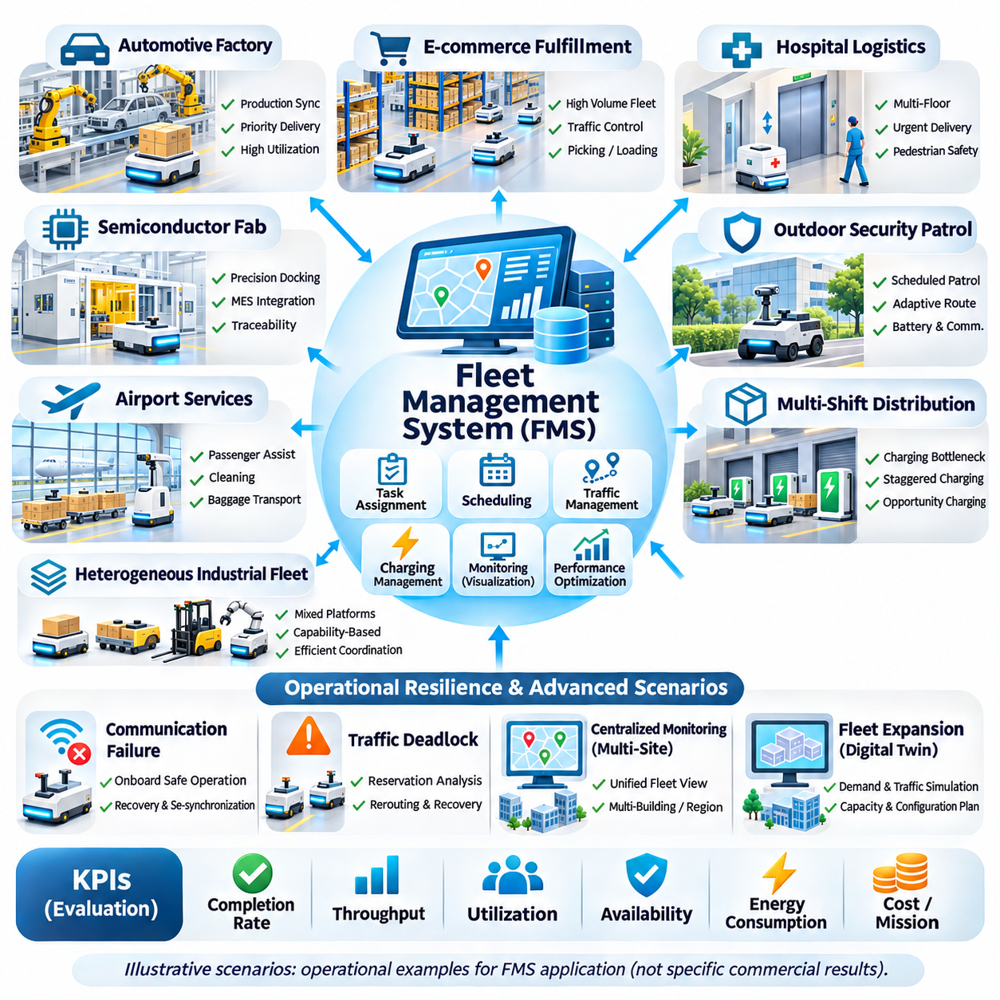

**Volume 08. AMR Operations, Deployment, and MLOps**

# Chapter 04. Fleet Management

## 04.1 Fleet Management Overview

{width="7.268055555555556in" height="7.268055555555556in"}

플릿 관리(Fleet Management)는 여러 자율이동로봇(Autonomous Mobile Robot, AMR)이 공유 환경(Shared Environment) 내에서 협력적이고 지능적인 시스템으로 동작할 수 있도록 하는 핵심 운영 기능이다. 개별 AMR이 자율주행(Autonomous Navigation), 인지(Perception), 임무 수행(Mission Execution)을 담당하는 반면, 플릿 관리는 공통의 운영 목표(Operational Objectives)를 달성하고 생산성(Productivity)을 향상시키며 시스템 신뢰성(System Reliability)을 유지하기 위해 여러 로봇의 활동을 통합적으로 조정한다.

플릿 관리 시스템(Fleet Management System, FMS)은 산업시설, 물류창고, 병원, 상업용 건물 및 실외 환경에서 로봇의 활동을 중앙집중형(Centralized) 또는 분산형(Distributed) 방식으로 조정한다. 주요 기능에는 작업 할당(Task Assignment), 로봇 스케줄링(Robot Scheduling), 교통 관리(Traffic Management), 충전 조정(Charging Coordination), 자원 할당(Resource Allocation), 성능 최적화(Performance Optimization)가 포함된다. 이러한 기능은 독립적인 자율로봇들을 통합 운영 인프라(Integrated Operational Infrastructure)로 발전시킨다.

플릿 관리(Fleet Management)는 관리 범위와 의사결정 책임(Decision-Making Responsibility) 측면에서 개별 로봇 관리(Individual Robot Management)와 차이가 있다. 개별 로봇 관리는 특정 로봇의 건전성(Health), 구성(Configuration), 소프트웨어(Software), 운영 상태(Operational Status)에 집중하는 반면, 플릿 관리는 여러 로봇과 공유 환경 자원 간의 상호작용(Interaction)을 고려한다. 따라서 로봇 관리 시스템(Robot Management System, RMS)과 FMS는 상호보완적인 관리 계층(Management Layer)으로 함께 운영될 수 있다.

플릿 관리의 운영 아키텍처(Operational Architecture)는 일반적으로 자율로봇(Autonomous Robot), 통신 네트워크(Communication Network), 플릿 관리 서버(Fleet Management Server), 운영 데이터베이스(Operational Database), 모니터링 대시보드(Monitoring Dashboard), 외부 시스템 인터페이스(External System Interface)로 구성된다. 각 로봇은 위치, 배터리 상태, 임무 상태, 주행 상태 및 운영 가용성(Operational Availability)에 관한 정보를 주기적으로 전송한다. FMS는 이러한 정보를 처리하여 전체 플릿의 상황 인식(Situational Awareness)을 유지한다.

작업 할당(Task Assignment)은 플릿 관리에서 가장 중요한 기능 중 하나이다. 시스템에 입력되는 운영 요청(Operational Request)은 임무 우선순위(Mission Priority), 로봇 가용성(Robot Availability), 적재 용량(Payload Capacity), 지리적 근접성(Geographical Proximity), 배터리 상태(Battery Condition), 장비 호환성(Equipment Compatibility)을 기준으로 평가된다. 효과적인 작업 할당 메커니즘(Task Assignment Mechanism)은 가장 적합한 로봇을 선택하는 동시에 전체 플릿의 불필요한 이동, 자원 소비 및 운영 지연을 최소화한다.

로봇 스케줄링 및 배차(Robot Scheduling and Dispatch)는 임무가 언제 시작되어야 하는지, 여러 운영 요청을 어떻게 조정해야 하는지를 결정함으로써 작업 할당의 기능을 확장한다. 스케줄링 알고리즘(Scheduling Algorithm)은 작업 의존성(Task Dependency), 배송 기한(Delivery Deadline), 자원 가용성(Resource Availability), 변화하는 환경 조건(Environmental Condition)을 고려한다. 동적 스케줄링(Dynamic Scheduling)은 예상하지 못한 이벤트, 새롭게 생성된 임무, 장비 고장 및 고객 수요의 변동에 플릿이 유연하게 대응할 수 있도록 한다.

교통 관리(Traffic Management)는 공유 환경에서 운영되는 로봇의 수가 증가할수록 더욱 중요해진다. 여러 로봇이 좁은 복도, 교차로, 도킹 스테이션(Docking Station), 엘리베이터, 자동문 및 적재 구역과 같은 자원을 동시에 사용하려 할 수 있다. 플릿 관리 시스템은 경로 예약(Route Reservation), 우선순위 정책(Priority Policy), 혼잡 관리(Congestion Management), 교착 상태 방지(Deadlock Prevention)를 통해 이러한 공유 자원에 대한 접근을 조정하면서 로봇 자체의 충돌 회피(Onboard Collision Avoidance) 기능을 유지한다.

플릿 수준의 자율주행(Fleet-Level Navigation)은 개별 로봇의 자율주행 기능을 보완한다. 각 AMR은 위치 추정(Localization), 경로 계획(Path Planning), 장애물 회피(Obstacle Avoidance)를 독립적으로 수행하지만, FMS는 전역 경로 할당(Global Route Allocation)과 공유 자원 활용(Shared Resource Utilization)을 조정할 수 있다. 이러한 계층적 접근 방식(Hierarchical Approach)은 로봇 간의 불필요한 충돌 가능성을 줄이는 동시에 지역 자율성(Local Autonomy)을 기반으로 동적 장애물(Dynamic Obstacle)과 환경 불확실성(Environmental Uncertainty)에 대응할 수 있도록 한다.

에너지 관리(Energy Management)는 플릿 운영의 또 다른 필수 구성요소이다. FMS는 배터리 충전 상태(State of Charge, SoC), 충전 스테이션 가용성(Charging Station Availability), 예상 임무 에너지 소비량(Estimated Mission Energy Consumption), 로봇 운영 스케줄(Robot Operating Schedule)을 지속적으로 모니터링한다. 지능형 충전 전략(Intelligent Charging Strategy)은 여러 로봇의 배터리가 동시에 방전되는 상황을 방지하고 충전 스테이션의 혼잡을 줄이며, 최대 수요 시간대(Peak Demand Period)에도 충분한 운영 용량(Operational Capacity)을 유지하도록 충전 활동을 조정한다.

플릿 상태 시각화(Fleet Status Visualization)는 중앙집중형 대시보드(Centralized Dashboard)를 통해 운영자가 전체 로봇의 활동을 종합적으로 파악할 수 있도록 한다. 운영 인터페이스(Operational Interface)는 일반적으로 로봇 위치, 수행 중인 임무, 배터리 잔량, 통신 상태, 고장 상태 및 충전 활동을 표시한다. 이력 정보(Historical Information)와 이벤트 기록(Event Record)을 활용하면 운영자는 이상 현상을 조사하고 반복적으로 발생하는 운영 문제를 식별하며 시간의 흐름에 따른 플릿 성능(Fleet Performance)을 평가할 수 있다.

플릿 관리는 서로 다른 기계적 구성(Mechanical Configuration), 적재 용량(Payload Capacity), 센서 시스템(Sensor System), 운영 기능(Operational Capability)을 갖는 이기종 로봇 플랫폼(Heterogeneous Robot Platform)도 지원해야 한다. 표준화된 통신 인터페이스(Standardized Communication Interface)와 기능 명세(Capability Description)를 통해 FMS는 운송 로봇(Transportation Robot), 자율 지게차(Autonomous Forklift), 견인형 AMR(Towing AMR), 청소 로봇(Cleaning Robot), 이동형 매니퓰레이터(Mobile Manipulator)를 통합적으로 조정할 수 있다. 상호운용성(Interoperability)은 시스템 통합 복잡성을 줄이고 향후 플릿 확장(Fleet Expansion)을 지원한다.

외부 기업 시스템(External Enterprise System)과의 통합은 로봇 플릿이 조직의 업무 흐름(Organizational Workflow)에 직접 참여할 수 있도록 한다. 제조 실행 시스템(Manufacturing Execution System, MES), 창고 관리 시스템(Warehouse Management System, WMS), 전사적 자원 관리(Enterprise Resource Planning, ERP), 건물 관리 시스템(Building Management System, BMS)은 임무 요청(Mission Request)을 생성하고 수행 결과(Execution Result)를 수신할 수 있다. 이러한 시스템 통합(System Integration)은 자율로봇 운영을 생산 일정, 재고 관리 및 시설 서비스와 연결한다.

운영 신뢰성(Operational Reliability)을 확보하기 위해 플릿 관리는 고장 감지(Fault Detection), 임무 복구(Mission Recovery), 통신 장애 처리(Communication Failure Handling), 비상 대응 계획(Contingency Planning)을 포함해야 한다. 특정 로봇이 운영 불가능한 상태가 되면 FMS는 영향을 받는 임무를 일시 중단하고 작업을 재할당하며 운영 일정을 재구성할 수 있다. 개별 로봇은 적절한 자체 안전 기능(Local Safety Function)을 유지해야 하며, 통신 또는 중앙집중형 조정 기능을 사용할 수 없는 경우 사전에 정의된 안전 운영 상태(Safe Operating State)로 전환되어야 한다.

플릿 성능 최적화(Fleet Performance Optimization)는 임무 완료율(Mission Completion Rate), 플릿 가용성(Fleet Availability), 로봇 활용률(Robot Utilization), 평균 작업 완료 시간(Average Task Completion Time), 처리량(Throughput), 에너지 소비량(Energy Consumption), 운영 중단 시간(Operational Downtime)과 같은 측정 가능한 핵심 성과 지표(Key Performance Indicator, KPI)를 기반으로 한다. 이러한 지표를 지속적으로 분석하면 운영 병목 현상(Operational Bottleneck)을 식별하고 스케줄링 정책을 개선하며 플릿 규모를 최적화하고 운영 성능과 총소유비용(Total Cost of Ownership, TCO) 사이의 균형을 확보할 수 있다.

플릿 관리가 인공지능 기반의 분산형 운영 지능(AI-Driven and Distributed Operational Intelligence)으로 발전함에 따라 예측 스케줄링(Predictive Scheduling), 강화학습(Reinforcement Learning), 디지털 트윈(Digital Twin), 다중 에이전트 협조(Multi-Agent Coordination)는 시스템 적응성(System Adaptability)을 더욱 향상시킬 수 있다. 현장에 배치된 로봇에서 수집되는 운영 데이터(Operational Data)는 적절한 검증(Validation)과 거버넌스(Governance)를 전제로 지속적 학습(Continuous Learning) 및 머신러닝 운영(Machine Learning Operations, MLOps) 프로세스를 지원할 수 있다. 결과적으로 플릿 관리는 확장성과 신뢰성을 갖추고 지속적으로 지능화되는 피지컬 AI 생태계(Physical AI Ecosystem)를 구축하기 위한 핵심 기반이 된다.

## 04.2 Fleet Task Assignment

{width="7.268055555555556in" height="7.268055555555556in"}

플릿 작업 할당(Fleet Task Assignment)은 특정 임무를 어떤 자율이동로봇(Autonomous Mobile Robot, AMR)이 수행해야 하는지를 결정하는 플릿 관리 시스템(Fleet Management System, FMS)의 핵심 운영 기능이다. 주요 목적은 임무 요구사항(Mission Requirements), 환경적 제약조건(Environmental Constraints), 로봇의 기능적 역량(Robot Capabilities)을 충족하면서 운영 작업 부하(Operational Workload)를 효율적으로 분배하는 것이다. 효과적인 작업 할당은 플릿 생산성(Fleet Productivity), 운영 신뢰성(Operational Reliability), 자원 활용률(Resource Utilization), 서비스 품질(Service Quality)에 직접적인 영향을 미친다.

작업 할당 프로세스(Task Assignment Process)는 운영자(Operator), 자동화 서비스(Automated Service) 또는 외부 기업 시스템(External Enterprise System)에 의해 임무 요청(Mission Request)이 생성되면서 시작된다. 각 요청에는 일반적으로 고유 작업 식별자(Unique Task Identifier), 픽업 및 목적지 위치(Pickup and Destination Locations), 임무 우선순위(Mission Priority), 실행 기한(Execution Deadline), 적재 요구사항(Payload Requirements), 운영 제약조건(Operational Constraints)이 포함된다. FMS는 이러한 매개변수(Parameter)를 해석하여 비즈니스 수준의 요청(Business-Level Request)을 실행 가능한 로봇 임무(Executable Robot Mission)로 변환한다.

임무 수행을 위한 후보 로봇을 선택하기 전에 로봇 적격성(Robot Eligibility)을 평가해야 한다. FMS는 로봇 가용성(Robot Availability), 현재 위치(Current Position), 배터리 충전 상태(State of Charge, SoC), 적재 용량(Payload Capacity), 하드웨어 구성(Hardware Configuration), 소프트웨어 호환성(Software Compatibility), 유지보수 상태(Maintenance Condition)에 관한 정보를 유지한다. 필수 임무 요구사항(Mandatory Mission Requirements)을 충족할 수 없는 로봇은 후보군(Candidate Pool)에서 제외하여 운영에 적합한 플랫폼만 고려되도록 한다.

거리 기반 작업 할당(Distance-Based Task Assignment)은 가장 단순한 작업 할당 전략(Allocation Strategy) 중 하나이다. FMS는 가용 로봇과 임무 시작 위치(Mission Starting Location) 사이의 예상 이동 거리(Estimated Travel Distance)를 계산하고, 관련 운송 비용(Transportation Cost)이 가장 낮은 로봇을 선택한다. 그러나 교통 혼잡(Traffic Congestion), 배터리 제한(Battery Limitations), 환경적 제한사항(Environmental Restrictions), 기존 임무 수행 의무(Existing Mission Commitments)를 고려할 경우 지리적 근접성(Geographical Proximity)만으로는 최적의 결과를 도출하지 못할 수 있다.

비용 기반 작업 할당(Cost-Based Task Assignment)은 가중 목적함수(Weighted Objective Function)를 통해 여러 운영 변수(Operational Variables)를 평가함으로써 더욱 포괄적인 의사결정 메커니즘(Decision-Making Mechanism)을 제공한다. 할당 비용(Assignment Cost)에는 예상 이동 시간(Estimated Travel Time), 에너지 소비량(Energy Consumption), 임무 수행 시간(Mission Execution Duration), 혼잡 페널티(Congestion Penalty), 작업 부하 불균형(Workload Imbalance)이 포함될 수 있다. 가중치(Weighting Factor)는 운영 우선순위(Operational Priority)에 따라 조정할 수 있으므로 작업 할당 전략에 특정 비즈니스 목표(Business Objectives)를 반영할 수 있다.

우선순위 기반 작업 할당(Priority-Based Task Assignment)은 서로 다른 수준의 운영 중요도(Operational Importance)를 갖는 임무에 플릿이 대응할 수 있도록 한다. 긴급 배송(Emergency Delivery), 생산 필수 자재 운송(Production-Critical Material Transportation), 긴급 의료 물류(Urgent Medical Logistics)에는 가용 로봇의 우선 할당(Preferential Allocation)이 필요할 수 있다. 더 높은 우선순위의 요청이 발생하면 임무 선점(Mission Preemption)을 지원할 수도 있지만, 기존 임무의 중단으로 인해 안전 위험(Safety Risk)이나 허용할 수 없는 운영 장애(Operational Disruption)가 발생하지 않아야 한다.

정적 작업 할당(Static Task Assignment)은 사전에 정의된 규칙(Predefined Rules), 고정 스케줄(Fixed Schedule), 사전에 결정된 로봇의 담당 업무(Predetermined Robot Responsibilities)에 따라 임무를 할당한다. 이러한 접근 방식은 반복적인 운송 요구사항과 비교적 안정적인 작업 부하를 갖는 예측 가능한 환경에 적합하다. 동적 작업 할당(Dynamic Task Assignment)은 변화하는 운영 조건을 지속적으로 평가하고 예상하지 못한 요청, 로봇 고장(Robot Failure), 혼잡 및 수요 변동(Demand Fluctuation)에 대응하여 가용 자원(Available Resources)을 재할당한다.

중앙집중형 작업 할당(Centralized Task Assignment)은 로봇 상태(Robot State), 대기 중인 임무(Pending Mission), 환경 자원(Environmental Resources)에 대한 종합적인 정보를 유지하는 플릿 관리 서버(Fleet Management Server)를 기반으로 한다. 최적화 알고리즘(Optimization Algorithm)은 전체 플릿 효율성(Fleet Efficiency)을 향상시키기 위해 여러 작업 할당 조합(Assignment Combination)을 평가할 수 있다. 헝가리안 알고리즘(Hungarian Algorithm), 혼합정수 선형계획법(Mixed-Integer Linear Programming, MILP), 제약조건 프로그래밍(Constraint Programming)과 같은 기술은 정의된 운영 제약조건 아래에서 구조화된 할당 문제(Structured Allocation Problem)를 해결하는 데 활용될 수 있다.

분산형 작업 할당(Distributed Task Assignment)은 개별 로봇 또는 지역 조정 에이전트(Local Coordination Agent)가 임무 할당 의사결정(Mission Allocation Decision)에 직접 참여할 수 있도록 한다. 경매 기반 메커니즘(Auction-Based Mechanism)과 시장 기반 조정(Market-Based Coordination)을 통해 로봇은 예상 실행 비용(Estimated Execution Cost)과 기능적 역량(Capability)을 반영한 입찰 정보(Bid)를 제출할 수 있다. 분산형 접근 방식은 확장성(Scalability)을 향상시키고 중앙집중형 연산(Centralized Computation)에 대한 의존도를 줄일 수 있지만, 통신 일관성(Communication Consistency)과 조정 오버헤드(Coordination Overhead)를 신중하게 고려해야 한다.

이기종 플릿 작업 할당(Heterogeneous Fleet Task Assignment)은 로봇의 기능(Functionality), 기계적 구성(Mechanical Configuration), 운영 능력(Operational Capability)의 차이를 고려해야 한다. 운송용 AMR(Transportation AMR), 자율 지게차(Autonomous Forklift), 견인 로봇(Towing Robot), 청소 로봇(Cleaning Robot), 이동형 매니퓰레이터(Mobile Manipulator)는 동일한 환경에서 함께 운영될 수 있다. 역량 기반 매칭(Capability-Based Matching)은 각 임무가 필요한 적재 용량, 이동 특성(Mobility Characteristics), 센서 및 작업 특화 장비(Task-Specific Equipment)를 갖춘 플랫폼에 할당되도록 한다.

에너지 인식형 작업 할당(Energy-Aware Task Assignment)은 배터리 용량(Battery Capacity), 예상 임무 에너지 소비량(Estimated Mission Energy Consumption), 충전 스테이션 접근성(Charging Station Accessibility), 최소 배터리 예비 용량 요구사항(Minimum Battery Reserve Requirements)을 작업 할당 의사결정에 반영한다. 임무를 완료하고 적절한 충전 스테이션에 도달하기 위한 충분한 에너지를 확보하지 못한 로봇은 선택되지 않아야 한다. 에너지 관리(Energy Management)와 작업 할당을 통합하면 예상하지 못한 배터리 방전(Battery Depletion)을 줄이고 지속적인 플릿 가용성(Fleet Availability)을 확보할 수 있다.

교통 인식형 작업 할당(Traffic-Aware Task Assignment)은 임무 할당이 공유 운송 인프라(Shared Transportation Infrastructure)에 미치는 예상 영향을 평가한다. 동일한 지리적 영역(Geographical Area)의 임무에 여러 로봇을 할당하면 교차로(Intersection), 엘리베이터(Elevator), 적재 스테이션(Loading Station), 좁은 복도(Narrow Corridor) 주변의 혼잡이 증가할 수 있다. 교통 예측(Traffic Prediction), 경로 가용성(Route Availability), 자원 예약 정보(Resource Reservation Information)를 작업 할당 의사결정에 통합하면 플릿 처리량(Fleet Throughput)을 향상시키고 불필요한 대기 시간(Waiting Time)을 줄일 수 있다.

신뢰성 있는 작업 할당을 위해서는 작업 생성(Task Creation), 할당(Allocation), 수신 확인(Acknowledgment), 실행(Execution), 완료(Completion), 취소(Cancellation), 장애 복구(Failure Recovery)를 포함하는 일관된 임무 수명주기 관리(Mission Lifecycle Management)가 필요하다. 고유 임무 식별자(Unique Mission Identifier), 수신 확인 메커니즘(Acknowledgment Mechanism), 영속적 운영 기록(Persistent Operational Record)은 중복 실행(Duplicate Execution)과 요청 유실(Lost Request)을 방지하는 데 도움이 된다. 통신이 중단되거나 로봇이 운영 불가능한 상태가 되면 기존 임무의 확인된 물리적 상태(Physical State)와 논리적 상태(Logical State)를 고려하여 작업을 재할당해야 한다.

플릿 작업 할당 성능(Fleet Task Assignment Performance)은 작업 할당 지연시간(Assignment Latency), 임무 완료율(Mission Completion Rate), 평균 대기 시간(Average Waiting Time), 실행 기한 준수율(Deadline Compliance), 공차 이동 거리(Empty Travel Distance), 임무당 에너지 소비량(Energy Consumption per Mission), 작업 부하 분포(Workload Distribution)와 같은 핵심 성과 지표(Key Performance Indicator, KPI)를 통해 평가할 수 있다. 디지털 트윈(Digital Twin)과 과거 운영 데이터(Historical Operational Data)는 현장 배치 이전에 다양한 할당 전략의 비교 평가(Comparative Evaluation)를 지원하여 비효율적인 스케줄링 정책(Scheduling Policy)이 실제 운영 환경에 도입될 위험을 줄인다.

고도화된 작업 할당(Advanced Task Assignment)은 인공지능(Artificial Intelligence, AI), 강화학습(Reinforcement Learning), 수요 예측(Demand Forecasting), 다중 에이전트 최적화(Multi-Agent Optimization)를 점차 적극적으로 활용하고 있다. 이러한 기술은 불확실하고 동적으로 변화하는 운영 조건에서 의사결정 능력을 향상시킬 수 있다. 그러나 인공지능 기반 할당 정책(AI-Based Allocation Policy)은 검증된 안전 및 자원 제약조건(Safety and Resource Constraints) 내에서 동작해야 하며, 적절한 대체 동작 메커니즘(Fallback Mechanism)을 갖추어야 한다. 이를 통해 운영 신뢰성을 저해하지 않으면서 확장 가능하고 적응적인 플릿 지능(Fleet Intelligence)을 구현할 수 있다.

## 04.3 Robot Scheduling and Dispatch

{width="7.268055555555556in" height="7.268055555555556in"}

로봇 스케줄링 및 배차(Robot Scheduling and Dispatch)는 자율이동로봇(Autonomous Mobile Robot, AMR)이 할당된 임무를 언제, 어떻게 수행할 것인지를 결정하는 플릿 관리 시스템(Fleet Management System, FMS)의 핵심 운영 기능이다. 작업 할당(Task Assignment)이 특정 작업에 가장 적합한 로봇을 식별하는 과정이라면, 스케줄링(Scheduling)은 실행 순서(Execution Sequence)와 실행 시점(Execution Timing)을 결정하고, 배차(Dispatch)는 운영 우선순위(Operational Priority), 자원 가용성(Resource Availability), 환경적 제약조건(Environmental Constraints)에 따라 임무 실행을 개시한다.

로봇 스케줄링 프로세스(Robot Scheduling Process)는 대기 중인 임무 요청(Pending Mission Request), 로봇 가용성 정보(Robot Availability Information), 예상 실행 시간(Estimated Execution Time), 운영 요구사항(Operational Requirements)을 수집하는 것에서 시작된다. FMS는 실행 대기 중이거나 현재 처리 중인 임무, 또는 일시 중단된 임무를 포함하는 스케줄링 대기열(Scheduling Queue)을 유지한다. 각 임무는 우선순위(Priority), 실행 기한(Deadline), 자원 의존성(Resource Dependency), 전체 플릿 성능(Fleet Performance)에 미치는 예상 영향을 기준으로 평가된다.

정적 스케줄링(Static Scheduling)은 사전에 정의된 시간표(Predefined Timetable), 고정 경로(Fixed Route), 반복적인 운송 요구사항(Repetitive Transportation Requirements)에 따라 로봇의 운영 순서를 설정한다. 이러한 접근 방식은 예측 가능한 자재 흐름(Material Flow)과 안정적인 생산 일정(Production Schedule)을 갖는 제조시설(Manufacturing Facility) 및 물류 환경(Logistics Environment)에 특히 적합하다. 정적 스케줄링은 운영 관리(Operational Management)를 단순화하지만 예상하지 못한 이벤트나 수요 변화가 발생할 경우 유연성(Flexibility)이 제한된다.

동적 스케줄링(Dynamic Scheduling)은 변화하는 운영 조건(Operational Conditions)에 대응하여 로봇의 운영 계획(Operation Plan)을 지속적으로 조정한다. 새로운 임무 요청, 로봇 고장(Robot Failure), 교통 혼잡(Traffic Congestion), 배터리 방전(Battery Depletion), 일시적인 자원 사용 불가(Resource Unavailability)는 즉각적인 스케줄 변경을 요구할 수 있다. FMS는 이러한 변화를 평가하고 임무 실행 순서를 재구성하여 운영 지연(Operational Delay)과 불필요한 자원 소비(Resource Consumption)를 최소화하면서 운영 연속성(Operational Continuity)을 유지한다.

우선순위 기반 스케줄링(Priority-Based Scheduling)은 사전에 정의된 운영 중요도(Operational Importance)에 따라 임무 실행 순서를 결정한다. 긴급 운송(Emergency Transportation), 생산 필수 자재 배송(Production-Critical Material Delivery), 긴급 의료 물류(Urgent Medical Logistics)는 일상적인 운영보다 높은 스케줄링 우선순위(Scheduling Priority)를 부여받을 수 있다. 대기 시간에 따른 우선순위 상향(Priority Aging) 및 실행 기한 인식형 정책(Deadline-Aware Policy)은 중요한 운영 요구사항에 대한 대응성(Responsiveness)을 유지하면서 낮은 우선순위의 임무가 과도하게 대기하는 상황을 방지할 수 있다.

시간 창 기반 스케줄링(Time-Window Scheduling)은 가장 빠른 시작 시간(Earliest Start Time), 최종 완료 기한(Latest Completion Time), 예상 임무 수행 시간(Estimated Mission Duration), 자원 가용 시간대(Resource Availability Period)를 스케줄링 의사결정에 반영한다. 이러한 접근 방식은 로봇 임무가 제조 공정(Manufacturing Process), 적재 작업(Loading Operation), 창고 운영(Warehouse Activity), 병원 서비스 일정(Hospital Service Schedule)과 동기화되어야 하는 경우 특히 중요하다. 실행 가능성 검증(Feasibility Check)은 상충하는 예약(Conflicting Reservation)과 현실적으로 이행하기 어려운 실행 약속을 방지하는 데 도움이 된다.

자원 제약 기반 스케줄링(Resource-Constrained Scheduling)은 엘리베이터(Elevator), 자동문(Automatic Door), 적재 스테이션(Loading Station), 도킹 시설(Docking Facility), 충전 스테이션(Charging Station)을 포함하는 공유 인프라(Shared Infrastructure)의 제한된 가용성을 고려한다. FMS는 여러 로봇이 동일한 자원을 동시에 요구하는 상황을 방지하기 위해 자원 예약 시간(Reservation Period)과 임무 실행 순서를 조정한다. 자원 인식형 스케줄링(Resource-Aware Scheduling)은 운영 병목 현상(Operational Bottleneck)을 줄이고 전체 플릿의 인프라 활용률(Infrastructure Utilization)을 향상시킨다.

최적화 기반 스케줄링(Optimization-Based Scheduling)은 수학적 모델(Mathematical Model)을 활용하여 여러 운영 제약조건 아래에서 효율적인 임무 실행 순서를 결정한다. 혼합정수 선형계획법(Mixed-Integer Linear Programming, MILP), 제약조건 프로그래밍(Constraint Programming), 휴리스틱 알고리즘(Heuristic Algorithm), 메타휴리스틱 최적화(Metaheuristic Optimization)는 다양한 스케줄링 문제에 적용될 수 있다. 목적함수(Objective Function)는 전체 완료 시간(Total Completion Time), 실행 기한 준수율(Deadline Compliance), 에너지 소비량(Energy Consumption), 장비 활용률(Equipment Utilization), 작업 부하 분포(Workload Distribution)를 고려할 수 있다.

로봇 배차(Robot Dispatch)는 스케줄링 의사결정(Scheduling Decision)을 개별 로봇에 전송되는 실행 가능한 임무 명령(Executable Mission Command)으로 변환한다. FMS는 임무를 배정하여 실행하기 전에 로봇 준비 상태(Robot Readiness), 통신 연결성(Communication Connectivity), 배터리 용량의 충분성(Battery Sufficiency), 임무 호환성(Mission Compatibility), 적용 가능한 경로 제한사항(Route Restriction)을 검증한다. 배차 승인(Dispatch Authorization)은 필수 운영 사전조건(Operational Prerequisites)이 충족된 경우에만 이루어져야 하며, 이를 통해 임무 거부(Mission Rejection) 또는 실행 실패(Execution Failure)의 가능성을 줄일 수 있다.

배차 통신 메커니즘(Dispatch Communication Mechanism)은 FMS와 개별 로봇 간의 신뢰성 있는 명령 전달(Reliable Command Delivery)과 일관된 임무 상태 동기화(Mission State Synchronization)를 보장해야 한다. 고유 임무 식별자(Unique Mission Identifier), 명령 시퀀스 번호(Command Sequence Number), 수신 확인 메시지(Acknowledgment Message), 타임아웃 메커니즘(Timeout Mechanism)은 신뢰성 있는 실행 추적(Execution Tracking)을 지원한다. 멱등성 명령 처리(Idempotent Command Processing)와 영속적 임무 기록(Persistent Mission Record)은 중복 배차(Duplicate Dispatch), 상충하는 명령(Conflicting Command), 불일치하는 운영 상태(Inconsistent Operational State)를 방지하는 데 도움이 된다.

이벤트 기반 배차(Event-Driven Dispatch)는 주기적 스케줄링 사이클(Periodic Scheduling Cycle)에만 의존하지 않고 로봇이 운영 상태 전이(Operational State Transition)에 신속하게 대응할 수 있도록 한다. 임무 완료(Mission Completion), 충전 완료(Charging Completion), 자원 해제(Resource Release), 긴급 작업 생성(Emergency Task Creation)과 같은 이벤트는 스케줄링 및 배차 의사결정을 촉발할 수 있다. 이벤트 기반 처리(Event-Driven Processing)와 주기적 상태 정합성 확인(Periodic Reconciliation)을 결합하면 분산형 플릿 구성요소(Distributed Fleet Components) 간의 일관성을 유지하면서 운영 대응성을 향상시킬 수 있다.

에너지 인식형 스케줄링(Energy-Aware Scheduling)은 배터리 충전 상태(State of Charge, SoC), 예상 임무 에너지 요구량(Estimated Mission Energy Requirements), 충전 소요 시간(Charging Duration), 충전 스테이션 가용성(Charging Station Availability)을 운영 계획에 통합한다. 충전 활동(Charging Activity)은 독립적인 유지보수 이벤트(Maintenance Event)가 아니라 스케줄링을 통해 관리되는 플릿 자원(Fleet Resource)으로 취급된다. 임무 배차와 충전 스케줄(Charging Schedule)을 조정하면 충분한 운영 용량(Operational Capacity)을 유지하고 최대 수요 시간대(Peak Demand Period)에 여러 로봇이 동시에 운영 불가능한 상태가 되는 위험을 줄일 수 있다.

예외 처리(Exception Handling)와 스케줄 복구(Schedule Recovery)는 로봇이 예상하지 못한 장애물(Unexpected Obstacle), 하드웨어 고장(Hardware Failure), 통신 중단(Communication Interruption), 임무 수행 실패(Mission Execution Failure)에 직면했을 때 필요하다. FMS는 영향을 받은 임무를 재개(Resume), 일시 중단(Suspend), 재스케줄링(Reschedule), 재할당(Reassign)할 것인지를 결정해야 한다. 복구 의사결정(Recovery Decision)은 새로운 명령을 발행하기 전에 확인된 로봇 및 적재물 상태(Robot and Payload State), 자원 예약(Resource Reservation), 로봇 자체의 안전 요구사항(Onboard Safety Requirements)을 고려해야 한다.

스케줄링 및 배차 성능(Scheduling and Dispatch Performance)은 평균 임무 대기 시간(Average Mission Waiting Time), 배차 지연시간(Dispatch Latency), 일정 준수율(Schedule Adherence), 실행 기한 준수율(Deadline Compliance), 플릿 처리량(Fleet Throughput), 로봇 활용률(Robot Utilization), 자원 점유율(Resource Occupancy)과 같은 핵심 성과 지표(Key Performance Indicator, KPI)를 통해 평가할 수 있다. 과거 운영 데이터(Historical Operational Data)와 디지털 트윈 시뮬레이션(Digital Twin Simulation)은 대표적인 작업 부하(Representative Workload), 혼잡 패턴(Congestion Pattern), 비정상 운영 조건(Abnormal Operating Conditions)에서 대안적인 스케줄링 정책(Alternative Scheduling Policy)을 평가할 수 있도록 지원한다.

고도화된 로봇 스케줄링(Advanced Robot Scheduling)은 미래의 작업 부하를 예측하고 플릿 활동을 동적으로 최적화하기 위해 수요 예측(Demand Forecasting), 예측 분석(Predictive Analytics), 강화학습(Reinforcement Learning), 다중 에이전트 협조(Multi-Agent Coordination)를 점차 적극적으로 활용하고 있다. 인공지능 기반 스케줄링 정책(AI-Based Scheduling Policy)은 검증된 운영 제약조건(Validated Operational Constraints), 결정론적 안전 메커니즘(Deterministic Safety Mechanism), 신뢰성 있는 대체 동작 전략(Reliable Fallback Strategy)의 적용을 받아야 한다. 이러한 기능은 적응성과 확장성을 갖춘 피지컬 AI 플릿 운영(Physical AI Fleet Operations)을 구현하기 위한 핵심 기반을 형성한다.

## 04.4 Traffic and Collision Management

{width="7.268055555555556in" height="7.268055555555556in"}

교통 및 충돌 관리(Traffic and Collision Management)는 여러 자율이동로봇(Autonomous Mobile Robot, AMR)이 공유 환경(Shared Environment) 내에서 안전하고 효율적으로 운영될 수 있도록 하는 플릿 관리 시스템(Fleet Management System, FMS)의 핵심 운영 기능이다. 플릿 규모(Fleet Size)가 증가함에 따라 로봇, 사람, 차량 및 인프라 간의 상호작용(Interaction)은 더욱 복잡해진다. 효과적인 교통 관리는 교통 혼잡(Congestion)을 최소화하고 운영 충돌(Operational Conflict)을 방지하며 전체 플릿에서 예측 가능한 임무 수행(Mission Execution)을 유지한다.

플릿 교통 관리(Fleet Traffic Management)는 개별 로봇의 자율주행 시스템(Autonomous Navigation System)보다 상위의 조정 계층(Coordination Layer)에서 동작한다. 로봇 자체의 자율주행 시스템(Onboard Navigation System)이 위치 추정(Localization), 지역 경로 계획(Local Path Planning), 장애물 회피(Obstacle Avoidance)를 담당하는 반면, FMS는 공유 운송 네트워크(Shared Transportation Network) 전반에서 로봇의 이동을 조정한다. 이러한 계층적 아키텍처(Hierarchical Architecture)는 플릿 수준의 교통 최적화(Fleet-Level Traffic Optimization)를 실시간 모션 제어(Real-Time Motion Control) 및 독립적으로 구현된 로봇 안전 기능(Robot Safety Function)과 분리한다.

운영 환경(Operational Environment)은 일반적으로 노드(Node), 에지(Edge), 교차로(Intersection), 제한 구역(Restricted Area), 공유 자원(Shared Resource)으로 구성된 주행 그래프(Navigation Graph)로 표현된다. 각 그래프 요소(Graph Element)에는 이동 방향(Traversal Direction), 속도 제한(Speed Limit), 점유 제한(Occupancy Restriction), 통행 용량(Passage Capacity), 로봇 호환성(Robot Compatibility)에 관한 정보가 포함될 수 있다. FMS는 이러한 표현 방식을 활용하여 경로 할당(Route Allocation)을 조정하고 로봇의 공유 구역 진입을 승인하기 전에 잠재적인 이동 충돌(Movement Conflict)을 평가한다.

경로 예약(Route Reservation)은 여러 로봇 간의 교통을 관리하기 위한 기본적인 메커니즘이다. 로봇은 지정된 경로 구간(Route Segment), 교차로 또는 제한 구역에 진입하기 전에 FMS 또는 승인된 조정 서비스(Authorized Coordination Service)로부터 통행 허가(Permission)를 획득한다. 공간적 및 시간적 예약(Spatial and Temporal Reservation)은 서로 양립할 수 없는 로봇의 이동이 동일한 자원을 동시에 점유하는 상황을 방지한다. 예약 유효성(Reservation Validity)은 신뢰성 있는 위치 정보(Position Information)와 점유 정보(Occupancy Information)를 활용하여 유지되어야 한다.

교차로 관리(Intersection Management)는 여러 주행 경로(Navigation Route)가 합류하는 위치에서 로봇의 이동을 조정한다. FMS는 임무 우선순위(Mission Priority), 도착 시간(Arrival Time), 교차로 점유 상태(Intersection Occupancy), 후속 경로 가용성(Downstream Route Availability)에 따라 통과 순서(Crossing Sequence)를 결정한다. 교통 제어 정책(Traffic Control Policy)은 가상 교통 신호(Virtual Traffic Signal), 통행 우선권 규칙(Right-of-Way Rule), 배타적 접근 권한(Exclusive Access Permission)을 적용할 수 있다. 로봇은 예정된 진출 경로(Exit Route)를 사용할 수 없는 경우 교차로에 진입하지 않아야 한다.

교착 상태 방지(Deadlock Prevention)는 좁은 복도(Narrow Corridor), 제한된 기동 공간(Limited Maneuvering Space), 공유 운송 자원(Shared Transportation Resource)이 존재하는 환경에서 매우 중요하다. 교착 상태(Deadlock)는 여러 로봇이 서로 점유하거나 예약한 자원을 무기한 기다리는 상황에서 발생한다. 자원 획득 순서 제어(Resource Acquisition Ordering), 구역 진입 제어(Controlled Zone Entry), 예약 의존성 분석(Reservation Dependency Analysis), 대체 경로 할당(Alternative Route Allocation)은 교착 상태 발생 위험을 줄일 수 있다. 교착 상태 복구(Deadlock Recovery)는 안전성이 검증된 조건에서 조정된 로봇 이동(Coordinated Movement)을 통해 이루어져야 한다.

혼잡 관리(Congestion Management)는 운영 수요(Operational Demand)가 높은 시간대에도 효율적인 로봇 이동을 유지하는 데 중점을 둔다. 적재 스테이션(Loading Station), 엘리베이터(Elevator), 교차로 및 충전 시설(Charging Facility) 주변에 로봇이 과도하게 집중되면 플릿 처리량(Fleet Throughput)이 크게 감소할 수 있다. FMS는 교통 밀도(Traffic Density), 대기 시간(Waiting Time), 자원 점유 상태(Resource Occupancy)를 모니터링하여 경로를 동적으로 재분배하고 배차 빈도(Dispatch Frequency)를 조절하며 상대적으로 혼잡도가 낮은 운송 통로(Transportation Corridor)로 로봇을 유도할 수 있다.

충돌 관리(Collision Management)는 서로 다른 운영 시간 척도(Operational Time Scale)와 장애 조건(Failure Condition)에 대응하는 다중 보호 계층(Multiple Protection Layers)을 필요로 한다. 플릿 수준의 조정(Fleet-Level Coordination)은 예측 가능한 이동 충돌을 줄이는 반면, 로봇 자체의 인지(Onboard Perception) 및 충돌 회피(Collision Avoidance)는 즉각적인 환경 변화에 대응한다. 안전 레이저 스캐너(Safety Laser Scanner), 속도 모니터링(Speed Monitoring), 보호 정지(Protective Stop)를 포함하는 안전 관련 보호 기능(Safety-Related Protective Function)은 일반적인 플릿 조정 명령(Fleet Coordination Command)과 독립적으로 유효하게 동작해야 한다.

동적 장애물 관리(Dynamic Obstacle Management)는 보행자(Pedestrian), 작업자(Worker), 지게차(Forklift), 기타 이동 장비(Moving Equipment)가 함께 사용하는 환경에서 특히 중요하다. 개별 로봇은 예상하지 못한 장애물(Unexpected Obstacle)을 감지하고 검증된 자율주행 및 안전 정책(Validated Navigation and Safety Policy)에 따라 이동을 조정한다. 지속적으로 존재하는 장애물(Persistent Obstacle)과 차단된 경로(Blocked Route)는 FMS에 보고될 수 있으며, 이를 통해 전체 플릿의 경로 조정(Fleet-Wide Route Adjustment)과 일시적 제한(Temporary Restriction)을 적용하여 반복적인 운영 장애(Operational Disruption)를 방지할 수 있다.

속도 및 구역 관리(Speed and Zone Management)는 환경 조건(Environmental Condition)과 위험성 평가(Risk Assessment)를 기반으로 위치별 운영 제한사항(Location-Dependent Operating Restriction)을 설정한다. 교통량이 많은 통로(High-Traffic Corridor), 보행자 횡단 구역(Pedestrian Crossing), 병원 환자 구역(Hospital Patient Area), 적재 스테이션에서는 로봇의 속도 감소(Reduced Speed) 또는 접근 제한(Restricted Access)이 필요할 수 있다. FMS는 운영 구역 정책(Operational Zone Policy)을 배포하고 로봇 자체의 시스템(Onboard System)은 해당 이동 제한사항(Movement Limit)을 적용한다. 안전 필수 제한사항(Safety-Critical Restriction)은 적절하게 검증된 강제 적용 메커니즘(Validated Enforcement Mechanism)을 필요로 한다.

통신 신뢰성(Communication Reliability)은 교통 조정(Traffic Coordination)이 정확한 로봇 위치(Robot Position), 예약 상태(Reservation State), 이동 허가(Movement Permission)에 의존하기 때문에 매우 중요하다. 메시지 지연(Delayed Message), 최신성이 상실된 원격 측정 데이터(Stale Telemetry), 네트워크 중단(Network Interruption), 서버 장애(Server Failure)는 공유 자원 할당(Shared Resource Allocation)의 불일치를 유발할 수 있다. 하트비트 모니터링(Heartbeat Monitoring), 타임스탬프(Timestamp), 시퀀스 검증(Sequence Validation), 예약 상태 정합성 확인(Reservation State Reconciliation)은 상태 일관성(State Consistency)을 유지하는 데 도움이 된다. 점유 여부가 불확실한 상태(Uncertain Occupancy)를 통행 가능 여부가 확인된 상태(Confirmed Clearance)로 간주해서는 안 된다.

이기종 플릿 교통 관리(Heterogeneous Fleet Traffic Management)는 로봇의 외형 치수(Robot Dimension), 회전 반경(Turning Radius), 제동 거리(Braking Distance), 적재물 구성(Payload Configuration), 기동 능력(Maneuvering Capability)의 차이를 고려해야 한다. 자율 지게차(Autonomous Forklift), 견인형 AMR(Towing AMR), 운송 로봇(Transportation Robot), 이동형 매니퓰레이터(Mobile Manipulator)는 서로 다른 공간 점유 범위(Spatial Envelope)와 경로 제한사항(Route Restriction)을 요구할 수 있다. 로봇 역량 인식형 교통 조정(Capability-Aware Traffic Coordination)은 공유 경로가 각 로봇의 물리적 및 운영 특성(Physical and Operational Characteristics)과 호환되도록 한다.

교통 관리 알고리즘(Traffic Management Algorithm)은 그래프 기반 경로 계획(Graph-Based Planning), 시간 확장 네트워크(Time-Expanded Network), 협력형 A\\\* 알고리즘(Cooperative A\\\*), 충돌 기반 탐색(Conflict-Based Search, CBS), 다중 에이전트 경로 탐색(Multi-Agent Path Finding, MAPF)을 활용할 수 있다. 이러한 접근 방식은 공간적 및 시간적 차원(Spatial and Temporal Dimension)에서 로봇의 이동 궤적(Robot Trajectory)과 잠재적인 충돌(Potential Conflict)을 평가한다. 알고리즘 선정(Algorithm Selection)은 독립적인 안전 보호 기능(Independent Safety Protection)을 유지하면서 플릿 규모, 연산 복잡도(Computational Complexity), 환경의 동적 특성(Environmental Dynamics), 허용 가능한 계획 지연시간(Acceptable Planning Latency)을 고려해야 한다.

교통 및 충돌 관리 성능(Traffic and Collision Management Performance)은 평균 경로 대기 시간(Average Route Waiting Time), 교차로 활용률(Intersection Utilization), 혼잡 발생 빈도(Congestion Frequency), 교착 상태 발생(Deadlock Occurrence), 보호 정지 빈도(Protective Stop Frequency), 플릿 처리량(Fleet Throughput)과 같은 핵심 성과 지표(Key Performance Indicator, KPI)를 통해 평가할 수 있다. 과거 운영 데이터(Historical Operational Data)와 디지털 트윈 시뮬레이션(Digital Twin Simulation)은 엔지니어가 현장 배치(Field Deployment) 이전에 대표적인 작업 부하(Representative Workload), 장비 고장(Equipment Failure), 비정상 운영 조건(Abnormal Operating Conditions)에서 교통 정책(Traffic Policy)을 평가할 수 있도록 지원한다.

고도화된 플릿 교통 관리(Advanced Fleet Traffic Management)는 예측적 혼잡 분석(Predictive Congestion Analysis), 인공지능(Artificial Intelligence, AI), 강화학습(Reinforcement Learning), 분산형 다중 에이전트 협조(Distributed Multi-Agent Coordination)를 점차 적극적으로 활용하고 있다. 이러한 기술은 교통 병목 현상(Traffic Bottleneck)을 사전에 예측하고 공유 자원 활용률(Shared Resource Utilization)을 동적으로 최적화할 수 있다. 인공지능 기반 교통 정책(AI-Based Traffic Policy)은 검증된 운영 제약조건(Validated Operational Constraints)과 독립적인 안전 경계(Independent Safety Boundary) 내에서 동작해야 하며, 이를 통해 확장성과 신뢰성을 갖춘 피지컬 AI 플릿 운영(Physical AI Fleet Operations)을 지원할 수 있다.

## 04.5 Fleet Charging Strategy

{width="7.268055555555556in" height="7.268055555555556in"}

플릿 충전 전략(Fleet Charging Strategy)은 자율이동로봇(Autonomous Mobile Robot, AMR)의 지속적인 가용성(Continuous Availability)을 보장하는 플릿 관리 시스템(Fleet Management System, FMS)의 핵심 운영 구성요소이다. 개별 로봇 충전(Individual Robot Charging)과 달리 플릿 충전은 여러 로봇, 충전 스테이션(Charging Station), 운영 일정(Operational Schedule) 전반에 걸쳐 조정된 에너지 관리(Energy Management)를 필요로 한다. 주요 목적은 에너지 보충(Energy Replenishment), 임무 수행(Mission Execution), 배터리 수명(Battery Lifetime), 플릿 생산성(Fleet Productivity) 간의 균형을 유지하는 것이다.

효과적인 플릿 충전 전략은 배터리 충전 상태(State of Charge, SoC), 배터리 건강 상태(State of Health, SoH), 배터리 온도(Battery Temperature), 충전 상태(Charging Status), 예상 잔여 운영 시간(Estimated Remaining Operating Time)을 지속적으로 모니터링하는 것에서 시작된다. FMS는 각 로봇으로부터 에너지 관련 원격 측정 데이터(Energy-Related Telemetry)를 수집하고 전체 플릿의 에너지 가용성(Fleet Energy Availability)을 종합적으로 파악한다. 이러한 정보는 충전 의사결정(Charging Decision), 임무 할당(Mission Allocation), 운영 계획(Operational Planning)의 기반을 제공한다.

임계값 기반 충전(Threshold-Based Charging)은 로봇의 배터리 충전 상태가 사전에 정의된 하한 임계값(Lower Threshold)에 도달하면 충전을 시작하고, 상한 임계값(Upper Threshold)에 도달하면 운영을 재개하는 전통적인 접근 방식이다. 이러한 전략은 비교적 구현하기 쉽지만 개별 로봇의 독립적인 충전 의사결정(Independent Charging Decision)은 여러 로봇이 동시에 운영 불가능한 상태가 되는 문제를 유발할 수 있다. 따라서 충분한 운영 용량(Operational Capacity)을 유지하기 위해서는 플릿 수준의 조정(Fleet-Level Coordination)이 필요하다.

기회 충전(Opportunity Charging)은 새로운 임무를 기다리는 시간, 일시적인 생산 중단(Temporary Production Interruption), 예정된 휴식 시간(Scheduled Break)과 같이 짧은 비가동 시간(Operational Inactivity) 동안 로봇이 배터리 에너지를 보충할 수 있도록 한다. 이러한 접근 방식은 장시간 충전(Extended Charging Session)의 필요성을 줄이고 전체 플릿 가용성(Fleet Availability)을 향상시킬 수 있다. 다만 충전 빈도(Charging Frequency)와 충전 시간(Charging Duration)은 배터리 화학적 특성(Battery Chemistry), 열적 조건(Thermal Condition), 제조업체 권장사항(Manufacturer Recommendation)에 따라 관리되어야 한다.

계획 충전(Scheduled Charging)은 사전에 정의된 운영 일정(Predefined Operational Schedule), 예상 작업 부하(Anticipated Workload), 충전 인프라 가용성(Charging Infrastructure Availability)에 따라 배터리 에너지 보충을 조정한다. 로봇은 운영 수요가 낮은 시간대(Low-Demand Operating Hours) 또는 교대 근무 전환 시간(Shift Transition)에 특정 충전 시간을 할당받을 수 있다. 분산된 충전 일정(Staggered Charging Schedule)은 여러 로봇이 동시에 운영에서 이탈하는 상황을 방지하고 전체 운영 기간 동안 충분한 운송 용량(Transportation Capacity)을 유지한다.

동적 충전 관리(Dynamic Charging Management)는 실시간 플릿 상태(Real-Time Fleet Condition)에 따라 충전 의사결정을 지속적으로 조정한다. 예상하지 못한 임무 요청(Unexpected Mission Request), 배터리 소비량 변화(Battery Consumption Variation), 충전 스테이션 고장(Charging Station Failure), 운영 수요 변화(Operational Demand Change)는 기존 충전 일정의 즉각적인 수정을 요구할 수 있다. FMS는 허용 가능한 배터리 안전 한계(Battery Safety Limit) 내에서 어떤 로봇이 운영을 지속하고, 충전을 시작하거나, 충전을 연기해야 하는지를 동적으로 결정한다.

에너지 인식형 임무 할당(Energy-Aware Mission Allocation)은 예상 에너지 소비량(Estimated Energy Consumption)을 작업 할당(Task Assignment) 및 배차 의사결정(Dispatch Decision)에 직접 통합한다. FMS는 임무를 할당하기 전에 로봇이 해당 작업을 완료하고 예상하지 못한 지연(Unexpected Delay)에 대응하며 사용 가능한 충전 스테이션까지 이동하기에 충분한 에너지를 보유하고 있는지를 평가한다. 적절한 예비 에너지(Energy Reserve)를 유지하면 운영 환경 내에서 배터리 방전(Battery Depletion)과 로봇 이동 불능(Robot Immobilization)이 발생할 위험을 줄일 수 있다.

충전 스테이션 관리(Charging Station Management)는 충전 인프라(Charging Infrastructure)를 조정된 할당 및 예약(Allocation and Reservation)이 필요한 공유 플릿 자원(Shared Fleet Resource)으로 취급한다. FMS는 충전기 가용성(Charger Availability), 호환성(Compatibility), 점유 상태(Occupancy), 충전 진행 상태(Charging Progress), 장비 건강 상태(Equipment Health)를 모니터링한다. 예약 메커니즘(Reservation Mechanism)과 충전 대기열(Charging Queue)은 자원 충돌(Resource Conflict)을 방지하며, 지능형 충전 스테이션 선정(Intelligent Station Selection)은 이동 거리(Travel Distance), 예상 대기 시간(Expected Waiting Time), 충전 전력(Charging Power), 후속 임무 위치(Subsequent Mission Location)를 고려한다.

충전 인프라 계획(Charging Infrastructure Planning)은 플릿 규모(Fleet Size), 배터리 용량(Battery Capacity), 평균 임무 에너지 소비량(Average Mission Energy Consumption), 충전 소요 시간(Charging Duration), 최대 운영 수요(Peak Operational Demand)를 고려해야 한다. 충전 스테이션의 수가 부족하면 혼잡(Congestion)이 발생하고 플릿 처리량(Fleet Throughput)이 감소할 수 있는 반면, 과도한 인프라 구축은 배치 비용(Deployment Cost)을 증가시킨다. 과거 운영 데이터(Historical Operational Data)와 시뮬레이션(Simulation)을 활용한 용량 계획(Capacity Planning)은 적절한 충전기 수량과 설치 위치를 결정하는 데 도움이 된다.

배터리 수명 관리(Battery Lifetime Management)는 플릿 충전 정책(Fleet Charging Policy)을 개발할 때 중요한 고려사항이다. 빈번한 심방전(Deep Discharge), 극단적인 충전 상태에 대한 장시간 노출(Prolonged Exposure to Extreme SoC Levels), 과도한 충전 전류(Excessive Charging Current), 높은 배터리 온도(Elevated Battery Temperature)는 배터리 열화(Battery Degradation)를 가속할 수 있다. 충전 전략은 단기적인 운영 생산성(Operational Productivity)과 장기적인 배터리 교체 비용(Battery Replacement Cost) 간의 균형을 유지하기 위해 배터리별 운영 한계(Battery-Specific Operating Limit)와 배터리 건강 상태 정보를 반영해야 한다.

자동 도킹 및 충전(Automatic Docking and Charging)은 로봇, 충전 스테이션, FMS 간의 신뢰성 있는 조정(Reliable Coordination)을 필요로 한다. 도킹 프로세스(Docking Process)는 일반적으로 충전 스테이션 예약(Station Reservation), 접근 주행(Approach Navigation), 정밀 정렬(Precision Alignment), 전기적 연결 검증(Electrical Connection Verification), 충전 승인(Charging Authorization)을 포함한다. 충전 실패(Charging Failure), 비정상적인 전기적 상태(Abnormal Electrical Condition), 도킹 실패(Unsuccessful Docking Attempt)가 발생하면 로봇 자체의 전기적 보호 메커니즘(Onboard Electrical Protection Mechanism)을 우회하지 않는 사전 정의된 복구 절차(Predefined Recovery Procedure)가 실행되어야 한다.

이기종 플릿 충전 관리(Heterogeneous Fleet Charging Management)는 배터리 화학적 특성(Battery Chemistry), 공칭 전압(Nominal Voltage), 충전 인터페이스(Charging Interface), 에너지 용량(Energy Capacity), 지원 가능한 충전율(Supported Charging Rate)의 차이를 수용해야 한다. 운송형 AMR(Transportation AMR), 자율 지게차(Autonomous Forklift), 견인형 로봇(Towing Robot), 실외 순찰 로봇(Outdoor Patrol Robot)은 서로 다른 충전 인프라와 운영 정책을 요구할 수 있다. 호환성 인식형 충전기 할당(Compatibility-Aware Charger Allocation)은 부적절한 충전 할당을 방지하고 다양한 로봇 플랫폼(Robot Platform)에서 신뢰성 있는 운영을 지원한다.

시설 수준의 에너지 관리(Facility-Level Energy Management)는 전력 인프라 용량(Electrical Infrastructure Capacity), 최대 전력 수요(Peak Power Demand), 전기요금 체계(Electricity Tariff), 기타 장비의 전력 부하(Equipment Load)를 고려함으로써 플릿 충전 조정의 범위를 확장한다. 여러 로봇의 동시 고전력 충전(Simultaneous High-Power Charging)은 가용 전력 용량을 초과하거나 운영 비용(Operating Cost)을 증가시킬 수 있다. 부하 분산(Load Balancing), 전력 인식형 충전 일정(Power-Aware Charging Schedule), 수요 관리(Demand Management)는 운영 준비 상태(Operational Readiness)를 유지하면서 에너지 소비를 분산할 수 있다.

플릿 충전 성능(Fleet Charging Performance)은 충전 스테이션 활용률(Charging Station Utilization), 평균 충전 대기 시간(Average Charging Waiting Time), 플릿 에너지 소비량(Fleet Energy Consumption), 충전 효율(Charging Efficiency), 배터리 열화율(Battery Degradation Rate), 충전 관련 운영 중단 시간(Charging-Related Operational Downtime)과 같은 핵심 성과 지표(Key Performance Indicator, KPI)를 통해 평가할 수 있다. 과거 데이터(Historical Data)와 디지털 트윈 시뮬레이션(Digital Twin Simulation)은 대표적인 작업 부하(Representative Workload)와 인프라 장애 시나리오(Infrastructure Failure Scenario)에서 대안적인 충전 정책(Alternative Charging Policy)을 비교할 수 있도록 지원한다.

고도화된 플릿 충전 전략(Advanced Fleet Charging Strategy)은 인공지능(Artificial Intelligence, AI), 예측적 에너지 모델링(Predictive Energy Modeling), 수요 예측(Demand Forecasting), 강화학습(Reinforcement Learning)을 점차 적극적으로 활용하고 있다. 이러한 기술은 미래의 에너지 요구량(Future Energy Requirement)을 사전에 예측하고 충전 일정을 최적화하며 변화하는 임무 패턴(Mission Pattern)에 적응할 수 있다. 인공지능 기반 충전 의사결정(AI-Based Charging Decision)은 검증된 배터리 보호 한계(Validated Battery Protection Limit) 내에서 이루어져야 하며, 이를 통해 지속가능성(Sustainability), 확장성(Scalability), 신뢰성(Reliability)을 갖춘 피지컬 AI 플릿 운영(Physical AI Fleet Operations)을 지원할 수 있다.

## 04.6 Fleet Status Visualization

{width="7.268055555555556in" height="7.268055555555556in"}

플릿 상태 시각화(Fleet Status Visualization)는 분산된 로봇의 원격 측정 데이터(Robot Telemetry)를 운영자에게 의미 있는 정보로 변환하는 플릿 관리 시스템(Fleet Management System, FMS)의 핵심 운영 기능이다. 자율이동로봇(Autonomous Mobile Robot, AMR)의 수가 증가함에 따라 개별 로봇을 모니터링하는 방식은 점차 비효율적이 된다. 통합 시각화(Integrated Visualization)는 플릿 활동(Fleet Activity), 운영 조건(Operational Condition), 자원 가용성(Resource Availability)에 대한 종합적인 상황 인식(Situational Awareness)을 제공한다.

플릿 시각화 플랫폼(Fleet Visualization Platform)은 개별 로봇, 충전 스테이션(Charging Station), 인프라 제어기(Infrastructure Controller), 임무 관리 서비스(Mission Management Service)로부터 실시간 정보를 수집한다. 수집되는 정보에는 일반적으로 로봇 식별 정보(Robot Identification), 지리적 위치(Geographical Position), 방향(Orientation), 이동 속도(Movement Speed), 임무 상태(Mission Status), 배터리 상태(Battery Condition), 통신 상태(Communication Status), 활성 경보(Active Alarm)가 포함된다. 이러한 데이터는 전체 플릿에 대한 통합 운영 표현(Unified Operational Representation)으로 통합된다.

지도 기반 시각화(Map-Based Visualization)는 운영 환경(Operational Environment) 내에서 이루어지는 로봇 활동을 공간적으로 표현한다. 시설 배치도(Facility Layout), 주행 지도(Navigation Map), 운송 통로(Transportation Corridor), 제한 구역(Restricted Zone), 인프라 위치(Infrastructure Location)는 실시간 로봇 위치(Real-Time Robot Position)와 함께 표시된다. 운영자는 이동 방향(Movement Direction), 계획 경로(Planned Route), 목적지 위치(Destination Location), 점유 구역(Occupied Area)을 관찰함으로써 공간적 관계(Spatial Relationship)를 이해하고 잠재적인 운영 충돌(Operational Conflict)을 식별할 수 있다.

로봇 운영 상태(Robot Operational State)는 운영자가 서로 다른 상태를 즉각적으로 구분할 수 있도록 표준화된 시각적 지표(Standardized Visual Indicator)를 통해 표현되어야 한다. 대표적인 상태에는 유휴(Idle), 임무 수행(Executing a Mission), 대기(Waiting), 충전(Charging), 도킹(Docking), 일시 정지(Paused), 오프라인(Offline), 고장(Faulted)이 포함된다. 일관된 색상 규칙(Color Convention), 상태 기호(Status Symbol), 설명형 레이블(Descriptive Label)은 정보 해석 능력을 향상시키며, 타임스탬프(Timestamp)는 표시된 정보의 최신성과 신뢰성을 확인할 수 있도록 한다.

임무 상태 시각화(Mission Status Visualization)는 운영자가 운송 및 서비스 작업(Transportation and Service Task)의 전체 생애주기(Lifecycle)를 모니터링할 수 있도록 한다. 대기 중인 임무(Pending Mission), 할당된 로봇(Assigned Robot), 현재 실행 단계(Active Execution Stage), 예상 완료 시간(Estimated Completion Time), 완료된 임무(Completed Mission), 실패한 작업(Failed Task)은 통합 운영 인터페이스(Integrated Operational Interface)를 통해 표시될 수 있다. 임무 진행 지표(Mission Progress Indicator)와 실행 이력(Execution History)은 운영자가 지연을 식별하고 예외 상황(Exception)을 조사하며 운영 일정 준수 여부를 평가하는 데 도움을 준다.

교통 시각화(Traffic Visualization)는 로봇 이동 패턴(Robot Movement Pattern), 공유 자원 활용률(Shared Resource Utilization), 운송 네트워크 상태(Transportation Network Condition)에 대한 통찰력을 제공한다. 경로 예약(Route Reservation), 교차로 점유 상태(Intersection Occupancy), 혼잡 수준(Congestion Level), 대기 중인 로봇(Waiting Robot), 일시적으로 차단된 통로(Temporarily Blocked Passage)는 동적으로 표현될 수 있다. 교통 밀도 히트맵(Traffic Density Heatmap)과 과거 이동 분석(Historical Movement Analysis)은 운영자가 지속적인 병목 현상(Persistent Bottleneck)을 식별하고 플릿 교통 관리 정책(Fleet Traffic Management Policy)의 효과를 평가할 수 있도록 지원한다.

에너지 상태 시각화(Energy Status Visualization)는 개별 로봇의 배터리 충전 상태(State of Charge, SoC), 배터리 건강 상태(State of Health, SoH), 예상 잔여 운영 시간(Estimated Remaining Operating Time), 충전 진행 상태(Charging Progress)를 표시한다. 플릿 수준의 에너지 대시보드(Fleet-Level Energy Dashboard)는 배터리 용량 분포(Battery Capacity Distribution), 충전 스테이션 점유 상태(Charging Station Occupancy), 충전기 가용성(Charger Availability), 충전 대기열(Charging Queue)을 종합적으로 제공한다. 이러한 지표는 운영자가 에너지 부족(Energy Shortage)을 사전에 예측하고 향후 임무를 수행하기에 충분한 로봇이 가용 상태로 유지되고 있는지를 평가하는 데 도움을 준다.

경보 및 이벤트 시각화(Alarm and Event Visualization)는 하드웨어 고장(Hardware Failure), 통신 중단(Communication Interruption), 자율주행 오류(Navigation Error), 배터리 이상(Battery Abnormality), 보호 정지(Protective Stop)를 포함하는 비정상 운영 조건(Abnormal Operational Condition)을 신속하게 식별할 수 있도록 지원한다. 이벤트는 심각도(Severity), 운영 영향도(Operational Impact), 발생 시간(Occurrence Time), 영향을 받는 장비(Affected Equipment)에 따라 분류되어야 한다. 경보 통합(Alarm Aggregation)과 우선순위 지정(Prioritization)은 불필요한 정보 과부하(Information Overload)를 줄이고 운영자의 대응 효율성(Operator Response Efficiency)을 향상시킨다.

플릿 성능 대시보드(Fleet Performance Dashboard)는 임무 완료율(Mission Completion Rate), 플릿 처리량(Fleet Throughput), 로봇 활용률(Robot Utilization), 운영 가용성(Operational Availability), 평균 대기 시간(Average Waiting Time), 고장 발생 빈도(Failure Frequency)와 같은 핵심 성과 지표(Key Performance Indicator, KPI)를 통합한다. 실시간 지표(Real-Time Indicator)는 현재 운영 조건에 대한 즉각적인 정보를 제공하며, 과거 추세(Historical Trend)는 반복적으로 발생하는 운영 문제(Recurring Operational Problem)를 보여준다. 로봇, 시설 및 운영 기간별 비교 분석(Comparative Analysis)은 지속적인 개선(Continuous Improvement)을 지원한다.

계층적 시각화(Hierarchical Visualization)는 플릿 배치(Fleet Deployment)가 여러 시설, 건물, 층 및 지리적 지역으로 확장됨에 따라 더욱 중요해진다. 중앙집중형 대시보드(Centralized Dashboard)는 조직 전체의 운영 상태(Organization-Wide Operational Condition)를 표시할 수 있으며, 상세 인터페이스(Detailed Interface)는 개별 운영 현장(Individual Site), 로봇 그룹(Robot Group), 장비(Equipment)에 대한 접근을 제공한다. 계층적 탐색(Hierarchical Navigation)은 운영자가 전략적 플릿 모니터링(Strategic Fleet Monitoring)과 상세 기술 진단(Detailed Technical Diagnostics) 사이를 효율적으로 이동할 수 있도록 한다.

디지털 트윈 통합(Digital Twin Integration)은 로봇, 인프라 및 운영 환경에 대한 동기화된 가상 표현(Synchronized Virtual Representation)을 구축함으로써 기존의 플릿 시각화 기능을 확장한다. 디지털 트윈(Digital Twin)은 공간 모델(Spatial Model), 실시간 원격 측정 데이터(Real-Time Telemetry), 과거 기록(Historical Record), 시뮬레이션 기능(Simulation Capability)을 결합할 수 있다. 운영자는 실제 로봇 활동(Physical Robot Activity)에 직접적인 영향을 주지 않으면서 운영 조건을 조사하고 비정상 이벤트(Abnormal Event)를 재현하며 잠재적인 변경사항(Potential Change)을 평가할 수 있다.

인간-기계 인터페이스(Human-Machine Interface, HMI) 설계는 가독성(Readability), 일관성(Consistency), 응답성(Responsiveness), 효율적인 정보 우선순위 지정(Information Prioritization)을 중점적으로 고려해야 한다. 과도한 그래픽 요소(Graphical Element), 중복된 지표(Redundant Indicator), 제어되지 않는 경보 알림(Alarm Notification)은 운영자의 상황 인식 능력을 저하시킬 수 있다. 역할 기반 인터페이스(Role-Based Interface)는 플릿 운영자(Fleet Operator), 유지보수 엔지니어(Maintenance Engineer), 시스템 관리자(System Administrator), 경영 관리 담당자(Management Personnel)의 책임에 따라 서로 다른 수준의 정보를 제공할 수 있다.

시각화 신뢰성(Visualization Reliability)은 정확한 시간 동기화(Time Synchronization), 일관된 데이터 모델(Data Model), 통신 무결성(Communication Integrity), 적절한 원격 측정 데이터 갱신 주기(Telemetry Update Frequency)에 의존한다. 지연되거나 누락된 정보(Delayed or Missing Information)는 확인된 운영 상태(Confirmed Operational State)로 표시되는 것이 아니라 명시적으로 식별되어야 한다. 시각화 플랫폼이 원격 개입(Remote Intervention) 또는 임무 관리(Mission Management) 기능을 제공하는 경우에는 접근 제어(Access Control), 명령 권한 승인(Command Authorization), 감사 로그 기록(Audit Logging) 또한 필요하다.

고도화된 플릿 시각화(Advanced Fleet Visualization)는 인공지능(Artificial Intelligence, AI), 예측 분석(Predictive Analytics), 자동 이상 탐지(Automated Anomaly Detection), 지능형 운영 권고(Intelligent Operational Recommendation)를 점차 적극적으로 활용하고 있다. 이러한 기능은 발생하기 시작하는 교통 혼잡(Emerging Congestion), 예상되는 임무 지연(Anticipated Mission Delay), 장비 성능 열화(Equipment Degradation), 미래의 에너지 부족(Future Energy Shortage)을 강조하여 표시할 수 있다. 실시간 상황 인식(Real-Time Situational Awareness)과 예측적 운영 지능(Predictive Operational Intelligence)을 통합함으로써 플릿 시각화는 확장 가능한 피지컬 AI 플릿 운영(Scalable Physical AI Fleet Operations)을 구현하기 위한 핵심 기반이 된다.

## 04.7 Fleet Performance Optimization

{width="7.268055555555556in" height="7.268055555555556in"}

플릿 성능 최적화(Fleet Performance Optimization)는 자율이동로봇(Autonomous Mobile Robot, AMR) 플릿의 운영 효율성(Operational Efficiency), 생산성(Productivity), 신뢰성(Reliability), 확장성(Scalability)을 향상시키기 위한 체계적인 접근 방식이다. 플릿 관리 시스템(Fleet Management System, FMS)은 임무 관리(Mission Management), 로봇 스케줄링(Robot Scheduling), 교통 조정(Traffic Coordination), 에너지 관리(Energy Management), 운영 분석(Operational Analytics)을 통합하여 안전 요구사항(Safety Requirements)과 운영 제약조건(Operational Constraints)을 충족하면서 전체 플릿 성능을 극대화한다.

성능 최적화(Performance Optimization)는 측정 가능한 운영 목표(Operational Objective)와 핵심 성과 지표(Key Performance Indicator, KPI)를 설정하는 것에서 시작된다. 대표적인 지표에는 플릿 처리량(Fleet Throughput), 임무 완료율(Mission Completion Rate), 로봇 활용률(Robot Utilization), 운영 가용성(Operational Availability), 평균 임무 수행 시간(Average Mission Duration), 에너지 소비량(Energy Consumption), 임무당 운영 비용(Operating Cost per Mission)이 포함된다. 이러한 지표는 비효율성(Inefficiency)을 식별하고 최적화 전략(Optimization Strategy)을 평가하기 위한 정량적 기반(Quantitative Foundation)을 제공한다.

플릿 처리량 최적화(Fleet Throughput Optimization)는 특정 운영 기간 내에 성공적으로 완료되는 임무의 수를 증가시키는 데 중점을 둔다. 처리량에 영향을 미치는 요소에는 로봇 이동 속도(Robot Movement Speed), 임무 실행 순서(Mission Execution Sequence), 운송 거리(Transportation Distance), 인프라 가용성(Infrastructure Availability), 교통 혼잡(Traffic Congestion)이 포함된다. 이러한 요소에 대한 통합적인 최적화(Coordinated Optimization)는 배치된 로봇의 수를 반드시 증가시키지 않고도 운영 용량(Operational Capacity)을 향상시킬 수 있다.

로봇 활용률 최적화(Robot Utilization Optimization)는 불필요한 유휴 시간(Idle Time), 비생산적인 이동(Unproductive Movement), 과도한 대기(Excessive Waiting), 방지 가능한 운영 중단 시간(Operational Downtime)을 최소화하는 것을 목표로 한다. FMS는 작업 부하 분포(Workload Distribution)와 로봇 가용성(Robot Availability)을 지속적으로 평가하여 실제 임무 수행(Active Mission Execution)과 운영 준비 상태(Operational Readiness) 간의 적절한 균형을 유지한다. 예비 운영 용량(Reserve Capacity)이 부족하면 예상하지 못한 수요에 대한 대응성(Responsiveness)이 저하될 수 있으므로 과도하게 높은 활용률은 피해야 한다.

작업 할당 및 스케줄링 최적화(Task Assignment and Scheduling Optimization)는 적합한 로봇과 효율적인 임무 실행 순서를 선정함으로써 플릿 성능을 향상시킨다. 거리 기반 할당(Distance-Based Allocation), 우선순위 인식형 스케줄링(Priority-Aware Scheduling), 작업 부하 분산(Workload Balancing), 제약조건 기반 최적화(Constraint-Based Optimization)는 불필요한 이동과 임무 지연(Mission Delay)을 줄일 수 있다. 동적 재할당(Dynamic Reassignment)은 임무 연속성(Mission Continuity)과 자원 가용성(Resource Availability)을 유지하면서 변화하는 운영 조건에 대응할 수 있도록 한다.

교통 흐름 최적화(Traffic Flow Optimization)는 교통 혼잡, 교차로 충돌(Intersection Conflict), 경로 비효율성(Route Inefficiency), 공유 운송 자원(Shared Transportation Resource)에 대한 경쟁 문제를 해결한다. FMS는 로봇 이동 패턴(Robot Movement Pattern), 경로 점유 상태(Route Occupancy), 대기 시간(Waiting Time)을 분석하여 운영 병목 현상(Operational Bottleneck)을 식별한다. 동적 경로 할당(Dynamic Route Allocation), 배차 빈도 제어(Controlled Dispatch Frequency), 조정된 자원 예약(Coordinated Resource Reservation)은 검증된 안전 제한사항(Validated Safety Restriction)을 훼손하지 않으면서 운송 효율성(Transportation Efficiency)을 향상시킬 수 있다.

에너지 효율 최적화(Energy Efficiency Optimization)는 배터리 에너지 소비량(Battery Consumption), 충전 빈도(Charging Frequency), 충전 스테이션 활용률(Charging Station Utilization), 개별 임무와 관련된 에너지 요구량(Energy Requirement)을 고려한다. 에너지 인식형 경로 설정(Energy-Aware Routing), 최적화된 이동 프로파일(Optimized Movement Profile), 조정된 충전 일정(Coordinated Charging Schedule)은 불필요한 에너지 소비를 줄일 수 있다. 최적화 프로세스(Optimization Process)는 단기적인 플릿 생산성(Fleet Productivity)과 배터리 수명(Battery Lifetime), 전력 인프라 용량(Electrical Infrastructure Capacity), 장기 운영 비용(Long-Term Operating Cost) 간의 균형을 유지해야 한다.

공유 자원 최적화(Shared Resource Optimization)는 여러 로봇이 엘리베이터(Elevator), 자동문(Automatic Door), 적재 스테이션(Loading Station), 도킹 시설(Docking Facility), 충전 인프라(Charging Infrastructure)에 의존할 때 필수적이다. 비효율적인 자원 할당(Resource Allocation)은 충분한 수의 로봇이 운영 가능한 상태에서도 운영 병목 현상을 발생시킬 수 있다. 예약 메커니즘(Reservation Mechanism), 예측적 자원 스케줄링(Predictive Resource Scheduling), 조정된 접근 정책(Coordinated Access Policy)은 인프라 활용률(Infrastructure Utilization)을 향상시키고 불필요한 대기 시간을 줄인다.

플릿 규모 최적화(Fleet Sizing Optimization)는 운영 수요(Operational Demand)를 충족하는 데 필요한 적절한 로봇 수량과 구성을 결정한다. 불충분한 로봇 배치는 임무 지연을 유발할 수 있는 반면, 과도한 로봇 배치는 자본적 지출(Capital Expenditure), 교통 혼잡, 유지보수 요구사항(Maintenance Requirements)을 증가시킨다. 과거 수요 분석(Historical Demand Analysis), 작업 부하 예측(Workload Forecasting), 시뮬레이션 기반 용량 계획(Simulation-Based Capacity Planning)은 경제적으로 효율적인 플릿 확장 의사결정(Fleet Expansion Decision)을 지원한다.

운영 데이터 분석(Operational Data Analytics)은 엔지니어가 반복적으로 발생하는 비효율성을 식별하고 여러 성능 변수(Performance Variable) 간의 관계를 이해할 수 있도록 한다. 임무 이력(Mission History), 주행 궤적(Navigation Trajectory), 배터리 원격 측정 데이터(Battery Telemetry), 자원 점유 기록(Resource Occupancy Record), 장비 고장 로그(Equipment Failure Log)는 중요한 최적화 입력 데이터(Optimization Input)를 제공한다. 통계 분석(Statistical Analysis)과 근본 원인 조사(Root Cause Investigation)는 일시적인 운영 장애(Temporary Operational Disturbance)와 지속적인 구조적 한계(Persistent Structural Limitation)를 구분하는 데 도움을 준다.

디지털 트윈 시뮬레이션(Digital Twin Simulation)은 실제 배치(Physical Deployment) 이전에 대안적인 플릿 구성(Fleet Configuration), 스케줄링 알고리즘(Scheduling Algorithm), 교통 정책(Traffic Policy), 충전 전략(Charging Strategy)을 평가하기 위한 가상 환경(Virtual Environment)을 제공한다. 엔지니어는 대표적인 작업 부하(Representative Workload), 최대 수요 조건(Peak Demand Condition), 인프라 장애(Infrastructure Failure), 비정상 운영 시나리오(Abnormal Operational Scenario)를 재현할 수 있다. 시뮬레이션 기반 최적화(Simulation-Based Optimization)는 실험 비용(Experimentation Cost)을 절감하고 증거 기반 운영 의사결정(Evidence-Based Operational Decision)을 지원한다.

다목적 최적화(Multi-Objective Optimization)는 반드시 동시에 극대화할 수 없는 상충하는 운영 목표(Competing Operational Goal)를 다룬다. 플릿 처리량을 증가시키면 에너지 소비량이 증가할 수 있으며, 운영 비용을 최소화하면 예비 운영 용량과 운영 복원력(Operational Resilience)이 감소할 수 있다. 가중치 기반 목적함수(Weighted Objective Function), 파레토 최적화(Pareto Optimization), 제약조건 기반 방법(Constraint-Based Method)은 생산성, 효율성(Efficiency), 신뢰성, 경제적 성과(Economic Performance) 간의 적절한 절충점(Trade-Off)을 식별하는 데 도움을 준다.

예측적 플릿 최적화(Predictive Fleet Optimization)는 수요 예측(Demand Forecasting), 예상 임무 수행 시간(Estimated Mission Duration), 혼잡 예측(Congestion Prediction), 장비 건강 상태 정보(Equipment Health Information)를 운영 계획(Operational Planning)에 통합한다. FMS는 현재 운영 조건에만 대응하는 대신 미래의 자원 요구사항(Future Resource Requirement)과 잠재적인 운영 장애(Potential Disruption)를 사전에 예측한다. 로봇 배치(Robot Deployment), 충전 일정(Charging Schedule), 임무 우선순위(Mission Priority)에 대한 선제적 조정(Proactive Adjustment)은 운영 복원력과 대응성을 향상시킨다.

지속적인 성능 개선(Continuous Performance Improvement)은 운영 모니터링(Operational Monitoring), 성능 평가(Performance Evaluation), 최적화(Optimization), 통제된 배포(Controlled Deployment), 후속 검증(Subsequent Validation)을 포함하는 폐루프 프로세스(Closed-Loop Process)를 필요로 한다. 플릿 관리 정책(Fleet Management Policy)의 변경사항은 버전 관리(Version Control)를 통해 관리되고 사전에 설정된 성능 기준선(Performance Baseline)을 기준으로 평가되어야 한다. 회귀 테스트(Regression Testing), 점진적 배포(Incremental Deployment), 롤백 메커니즘(Rollback Mechanism)은 최적화 활동이 예상하지 못한 운영 성능 저하(Operational Degradation)를 유발하는 상황을 방지하는 데 도움을 준다.

고도화된 플릿 성능 최적화(Advanced Fleet Performance Optimization)는 집단 운영 지능(Collective Operational Intelligence)을 향상시키기 위해 인공지능(Artificial Intelligence, AI), 강화학습(Reinforcement Learning), 다중 에이전트 협조(Multi-Agent Coordination), 적응형 의사결정(Adaptive Decision-Making)을 통합한다. 최적화 정책(Optimization Policy)은 신뢰성 있는 대체 동작 메커니즘(Reliable Fallback Mechanism)을 갖추고 검증된 안전 경계(Validated Safety Boundary)와 인프라 제약조건(Infrastructure Constraints) 내에서 동작해야 한다. 이러한 기능은 기존의 AMR 플릿 관리가 확장성(Scalability), 적응성(Adaptability), 경제적 지속가능성(Economic Sustainability)을 갖춘 피지컬 AI 운영(Physical AI Operations)으로 발전할 수 있도록 지원한다.

## 04.8 Fleet Management Case Studies

{width="7.268055555555556in" height="7.268055555555556in"}

플릿 관리 사례 연구(Fleet Management Case Studies)는 다양한 산업 및 서비스 환경(Industrial and Service Environment)에서 실질적인 운영 과제(Operational Challenge)를 해결하기 위해 자율이동로봇(Autonomous Mobile Robot, AMR) 플릿을 어떻게 조정할 수 있는지를 보여준다. 다음의 예시 시나리오(Illustrative Scenario)는 작업 할당(Task Assignment), 로봇 스케줄링(Robot Scheduling), 교통 조정(Traffic Coordination), 충전 관리(Charging Management), 운영 시각화(Operational Visualization), 지속적인 성능 최적화(Continuous Performance Optimization)에 대한 플릿 관리 시스템(Fleet Management System, FMS)의 적용을 살펴본다.

자동차 제조시설(Automotive Manufacturing Facility)에서 AMR은 창고(Warehouse), 조립 라인(Assembly Line), 생산 스테이션(Production Station) 사이에서 부품을 운송한다. FMS는 운송 임무(Transportation Mission)를 생산 일정(Production Schedule)과 동기화하고 자재 부족(Material Shortage)이 발생하는 생산 스테이션에 대한 배송에 우선순위를 부여한다. 동적 작업 할당(Dynamic Task Assignment)과 실행 기한 인식형 스케줄링(Deadline-Aware Scheduling)은 효율적인 로봇 활용률(Robot Utilization)과 자재 흐름(Material Flow)을 유지하면서 생산 중단(Production Interruption)을 최소화하는 데 도움을 준다.

대규모 전자상거래 주문 처리 센터(Large E-Commerce Fulfillment Center)에서는 수백 대의 AMR이 공유 운송 네트워크(Shared Transportation Network) 내에서 동시에 운영될 수 있다. 주요 과제에는 주문량 변동(Fluctuating Order Volume), 교차로 혼잡(Intersection Congestion), 피킹 및 적재 스테이션(Picking and Loading Station)에 대한 자원 경쟁(Resource Competition)이 포함된다. 그래프 기반 교통 관리(Graph-Based Traffic Management), 동적 경로 할당(Dynamic Route Allocation), 조정된 자원 예약(Coordinated Resource Reservation)은 플릿 규모를 비례적으로 확장하지 않고도 운송 처리량(Transportation Throughput)을 향상시킬 수 있다.

병원 물류 플릿(Hospital Logistics Fleet)은 의약품(Medication), 실험실 검체(Laboratory Specimen), 의료용품(Medical Supply), 폐기물(Waste Material)을 운송하기 위해 여러 층에서 운영된다. FMS는 엘리베이터 접근(Elevator Access), 자동문(Automatic Door), 배송 일정(Delivery Schedule), 임무 우선순위(Mission Priority)를 조정한다. 긴급 의료 운송(Urgent Medical Transportation)에는 우선적인 스케줄링(Preferential Scheduling)이 적용되며, 보행자 인식형 교통 정책(Pedestrian-Aware Traffic Policy)과 독립적인 로봇 자체 안전 기능(Independent Onboard Safety Function)은 환자가 접근할 수 있는 환경(Patient-Accessible Environment)에서 안전한 운영을 지원한다.

반도체 제조시설(Semiconductor Manufacturing Facility)에서 AMR은 통제된 생산 환경(Controlled Production Environment) 사이에서 민감한 자재(Sensitive Material)를 운송한다. 운영 요구사항(Operational Requirements)에는 정밀 도킹(Precise Docking), 예측 가능한 배송 시간(Predictable Delivery Timing), 제한 구역 접근(Restricted Zone Access), 종합적인 임무 추적성(Mission Traceability)이 포함된다. FMS는 운송 임무를 제조 실행 시스템(Manufacturing Execution System, MES)과 연계하여 조정하고 공정 무결성(Process Integrity)과 운영 신뢰성(Operational Reliability)을 유지하면서 장비 가용성(Equipment Availability)을 관리한다.

실외 보안 순찰 플릿(Outdoor Security Patrol Fleet)은 에너지 관리(Energy Management)와 환경 적응성(Environmental Adaptability)의 중요성을 보여준다. 로봇은 산업단지(Industrial Complex), 공공시설(Public Facility), 교통 인프라(Transportation Infrastructure) 전반에서 예정된 순찰 임무(Scheduled Patrol Mission)를 수행한다. FMS는 배터리 상태(Battery Condition), 환경 변화(Environmental Change), 통신 가용성(Communication Availability), 감지된 운영 이벤트(Detected Operational Event)에 따라 순찰 경로(Patrol Route), 충전 일정(Charging Schedule), 임무 할당(Mission Assignment)을 동적으로 조정한다.

공항 서비스 로봇 플릿(Airport Service Robot Fleet)은 이기종 로봇 조정(Heterogeneous Robot Coordination)의 또 다른 사례를 제공한다. 승객 지원 로봇(Passenger Assistance Robot), 청소 로봇(Cleaning Robot), 수하물 운송 로봇(Baggage Transportation Robot)은 서로 다른 임무를 수행하면서 공공 통로(Public Corridor)와 서비스 인프라(Service Infrastructure)를 공유할 수 있다. 역량 인식형 작업 할당(Capability-Aware Task Assignment), 위치별 속도 제한(Location-Dependent Speed Restriction), 중앙집중형 교통 조정(Centralized Traffic Coordination)은 이러한 로봇들이 복잡한 운영 환경(Complex Operational Environment) 내에서 공존할 수 있도록 한다.

다교대 물류센터(Multi-Shift Distribution Center)에서는 다수의 로봇이 동시에 충전을 필요로 할 때 충전 인프라(Charging Infrastructure)가 주요 운영 병목 현상(Operational Bottleneck)이 될 수 있다. 플릿 수준의 조정(Fleet-Level Coordination)이 없는 임계값 기반 충전(Threshold-Based Charging)은 최대 수요 시간대(Peak Demand Period)에 가용 운송 용량(Available Transportation Capacity)을 감소시킬 수 있다. 분산된 충전 일정(Staggered Charging Schedule), 기회 충전(Opportunity Charging), 예측적 에너지 관리(Predictive Energy Management)는 연속적인 교대 근무 기간 동안 충분한 수의 로봇을 운영 가능한 상태로 유지하는 데 도움을 준다.

이기종 산업용 로봇 플릿(Heterogeneous Industrial Robot Fleet)은 일반적인 운송형 AMR(Transportation AMR), 견인형 로봇(Towing Robot), 자율 지게차(Autonomous Forklift), 이동형 매니퓰레이터(Mobile Manipulator)를 포함할 수 있다. 적재 용량(Payload Capacity), 기동 특성(Maneuvering Characteristics), 도킹 요구사항(Docking Requirements), 충전 인터페이스(Charging Interface)의 차이는 추가적인 관리 복잡성(Management Complexity)을 발생시킨다. FMS는 이러한 플랫폼을 효율적으로 조정하기 위해 역량 기반 작업 할당(Capability-Based Task Allocation)과 로봇별 운영 제약조건(Robot-Specific Operating Constraints)을 적용한다.

플릿 통신 장애 시나리오(Fleet Communication Failure Scenario)는 운영 복원력(Operational Resilience)의 중요성을 보여준다. 네트워크 연결성(Network Connectivity)이 중단되면 영향을 받는 로봇은 사전에 정의된 로봇 자체의 운영 및 안전 정책(Onboard Operating and Safety Policy)을 따라야 한다. FMS는 임무 기록(Mission Record)과 자원 예약 상태(Resource Reservation State)를 유지하며, 통신 복구 절차(Communication Recovery Procedure)는 정상적인 통합 운영(Coordinated Operation)이 재개되기 전에 로봇 위치(Robot Position), 작업 진행 상태(Task Progress), 자원 점유 상태(Resource Occupancy)의 정합성을 확인한다.

교통 교착 상태 시나리오(Traffic Deadlock Scenario)는 여러 로봇이 좁은 복도(Narrow Corridor)를 통과하거나 상호 연결된 적재 스테이션(Interconnected Loading Station)에 접근하려 할 때 발생할 수 있다. 교통 조정을 개선하지 않고 배치된 로봇의 수만 증가시키면 혼잡(Congestion)이 악화되고 전체 생산성(Overall Productivity)이 감소할 수 있다. 예약 의존성 분석(Reservation Dependency Analysis), 구역 진입 제어(Controlled Zone Entry), 대체 경로 할당(Alternative Route Allocation), 조정된 복구 절차(Coordinated Recovery Procedure)는 이러한 운영상의 한계(Operational Limitation)를 해결할 수 있다.

중앙집중형 플릿 모니터링 시나리오(Centralized Fleet Monitoring Scenario)는 여러 건물과 지리적 위치에 분산된 로봇 운영(Distributed Robot Operations)을 포함한다. 플릿 상태 시각화(Fleet Status Visualization)는 로봇 위치, 임무 진행 상태(Mission Progress), 배터리 상태, 인프라 가용성(Infrastructure Availability), 활성 경보(Active Alarm)를 통합 운영 대시보드(Unified Operational Dashboard)로 통합한다. 계층적 시각화(Hierarchical Visualization)와 표준화된 성능 지표(Standardized Performance Indicator)는 운영자가 비정상 상태(Abnormality)를 식별하고 적절한 대응 조치(Appropriate Response)를 조정할 수 있도록 한다.

플릿 확장 시나리오(Fleet Expansion Scenario)는 디지털 트윈 시뮬레이션(Digital Twin Simulation)과 정량적 용량 계획(Quantitative Capacity Planning)의 가치를 보여준다. 엔지니어는 추가적인 로봇을 배치하기 전에 증가된 임무 수요(Mission Demand), 교통 밀도(Traffic Density), 충전 스테이션 활용률(Charging Station Utilization), 인프라 점유 상태(Infrastructure Occupancy)를 시뮬레이션할 수 있다. 대안적인 플릿 구성(Alternative Fleet Configuration)에 대한 비교 분석(Comparative Analysis)은 추가 로봇 배치, 인프라 개선(Infrastructure Improvement), 스케줄링 최적화(Scheduling Optimization) 중 어떤 접근 방식이 더 큰 운영상의 이점(Operational Benefit)을 제공하는지를 식별하는 데 도움을 준다.

산업 간 플릿 관리 전략 평가(Cross-Industry Evaluation of Fleet Management Strategies)는 임무 완료율(Mission Completion Rate), 운송 처리량(Transportation Throughput), 로봇 활용률(Robot Utilization), 운영 가용성(Operational Availability), 에너지 소비량(Energy Consumption), 임무당 비용(Cost per Mission)을 포함하는 일관된 핵심 성과 지표(Key Performance Indicator, KPI)를 필요로 한다. 성능 비교(Performance Comparison)는 단순히 로봇 수량에만 의존하는 것이 아니라 환경 복잡성(Environmental Complexity), 작업 부하 특성(Workload Characteristics), 안전 제약조건(Safety Constraints), 인프라 한계(Infrastructure Limitations)를 고려해야 한다.

이러한 예시 사례(Illustrative Case)는 특정 상용 배치(Commercial Deployment)에서 실제로 측정된 결과를 보고하는 것이 아니라 본 장의 구조(Chapter Structure)에 정의된 플릿 관리 주제를 기반으로 구성되었다. 이러한 사례는 중앙집중형 조정(Centralized Coordination), 분산형 자율성(Distributed Autonomy), 독립적인 안전 보호(Independent Safety Protection), 운영 분석(Operational Analytics), 적응형 최적화(Adaptive Optimization)를 통합하여 확장성(Scalability), 복원력(Resilience), 경제적 지속가능성(Economic Sustainability)을 갖춘 피지컬 AI 플릿 운영(Physical AI Fleet Operations)을 구현하는 것의 중요성을 보여준다.
