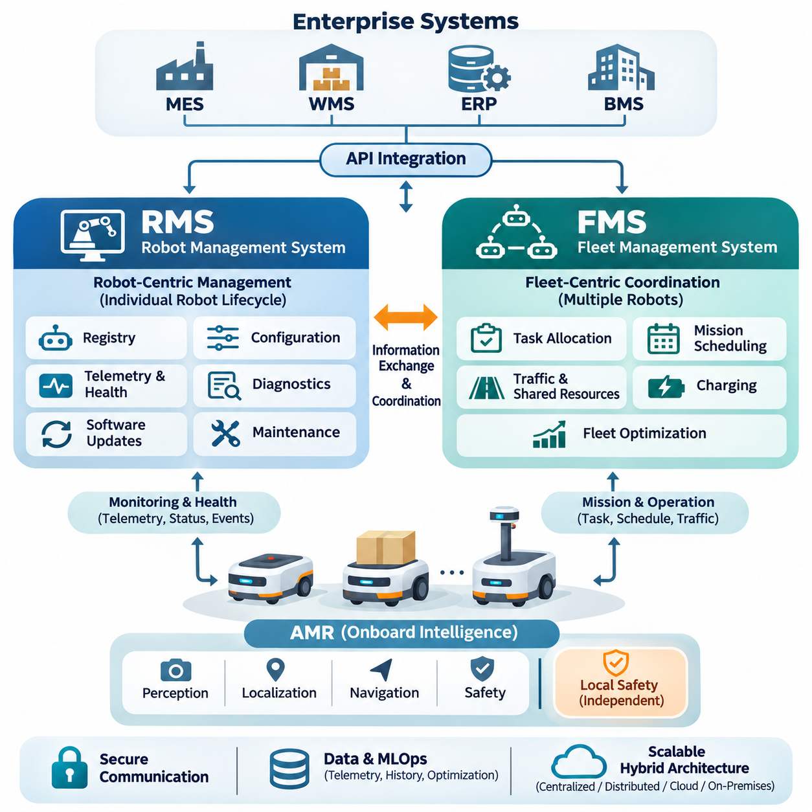
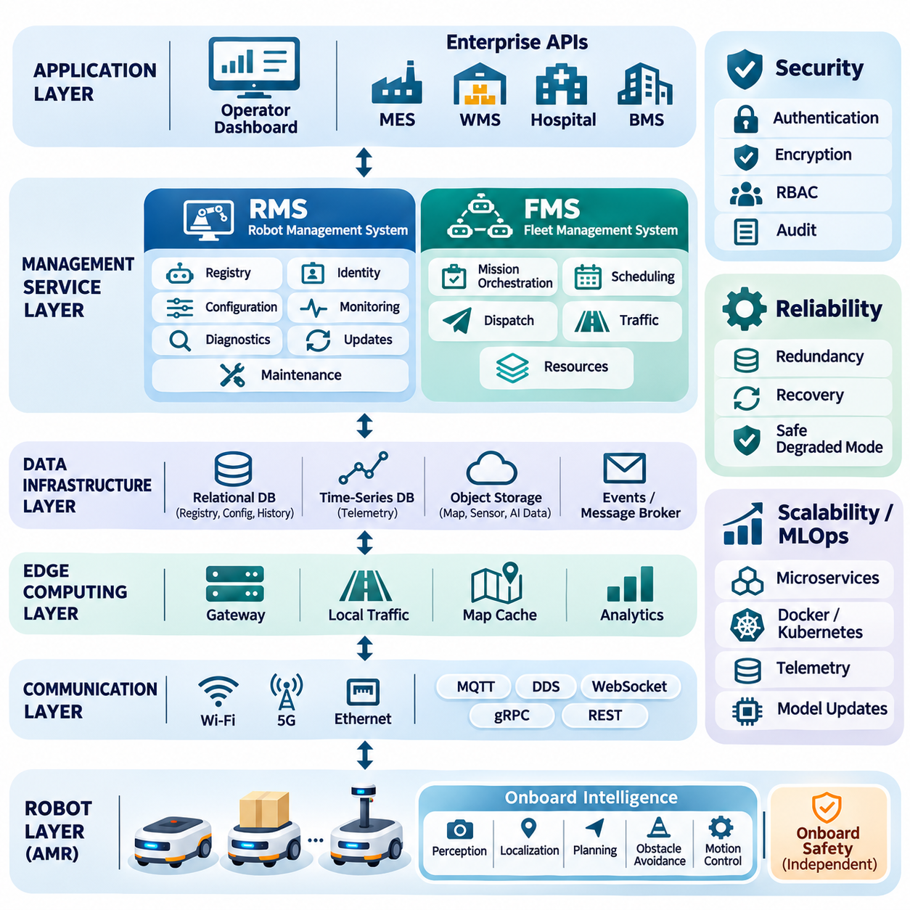
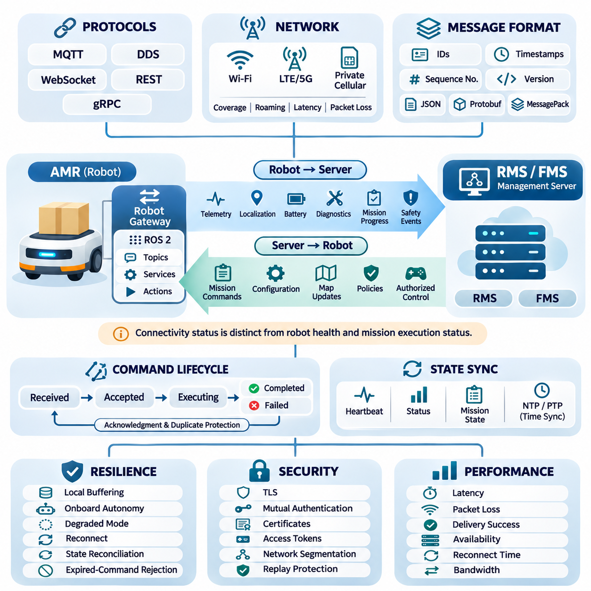
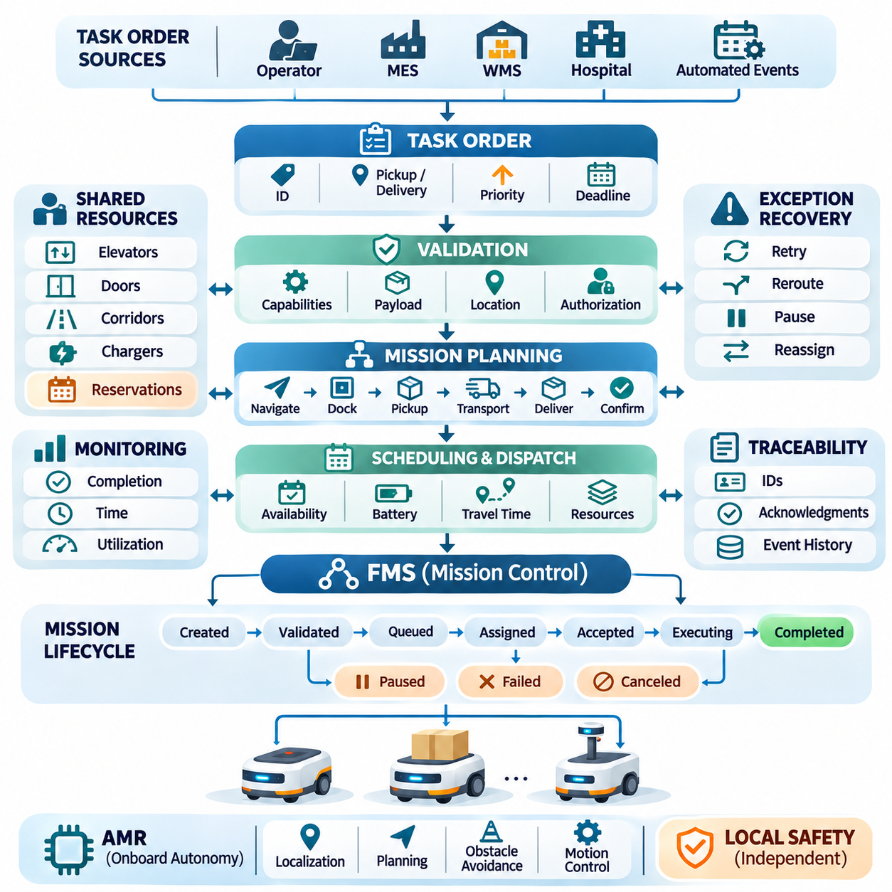
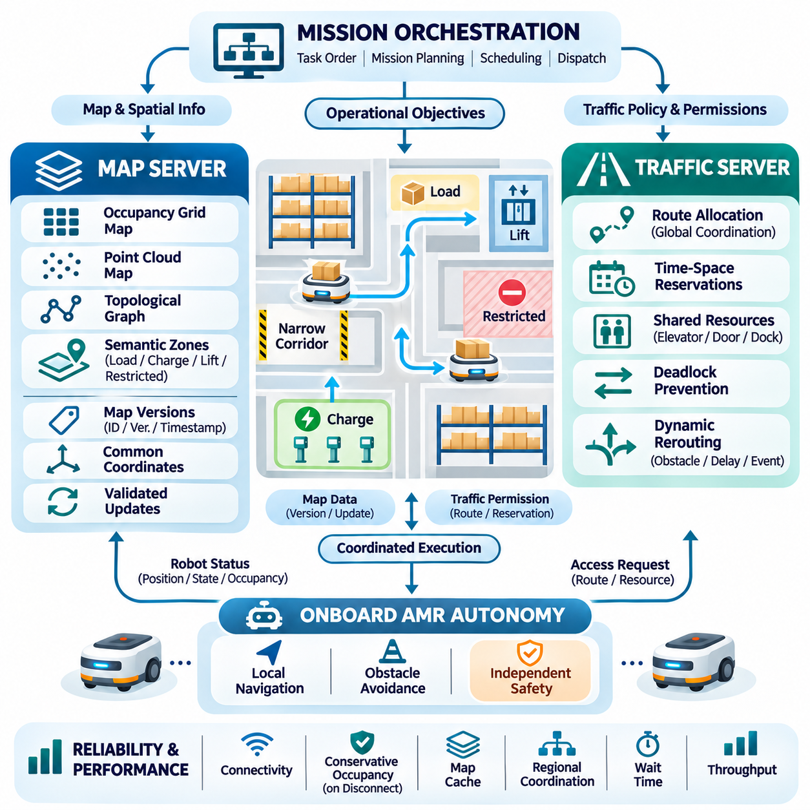
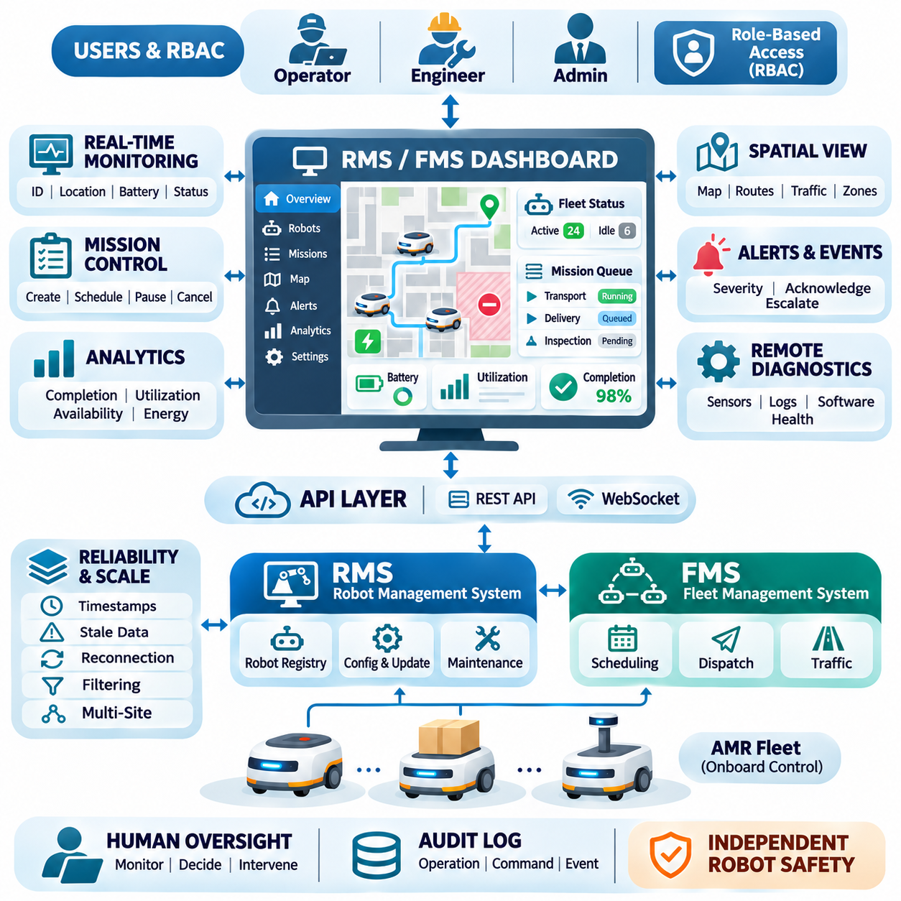
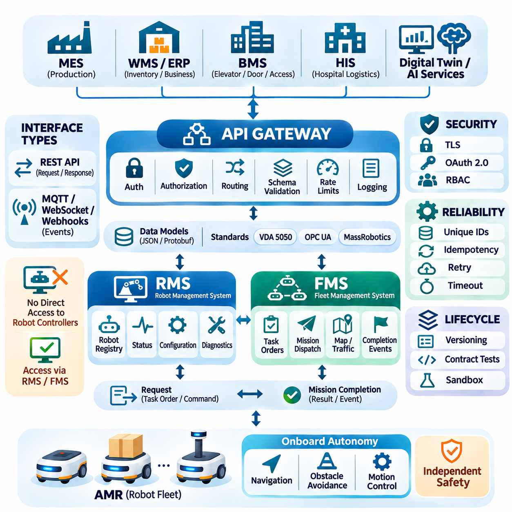
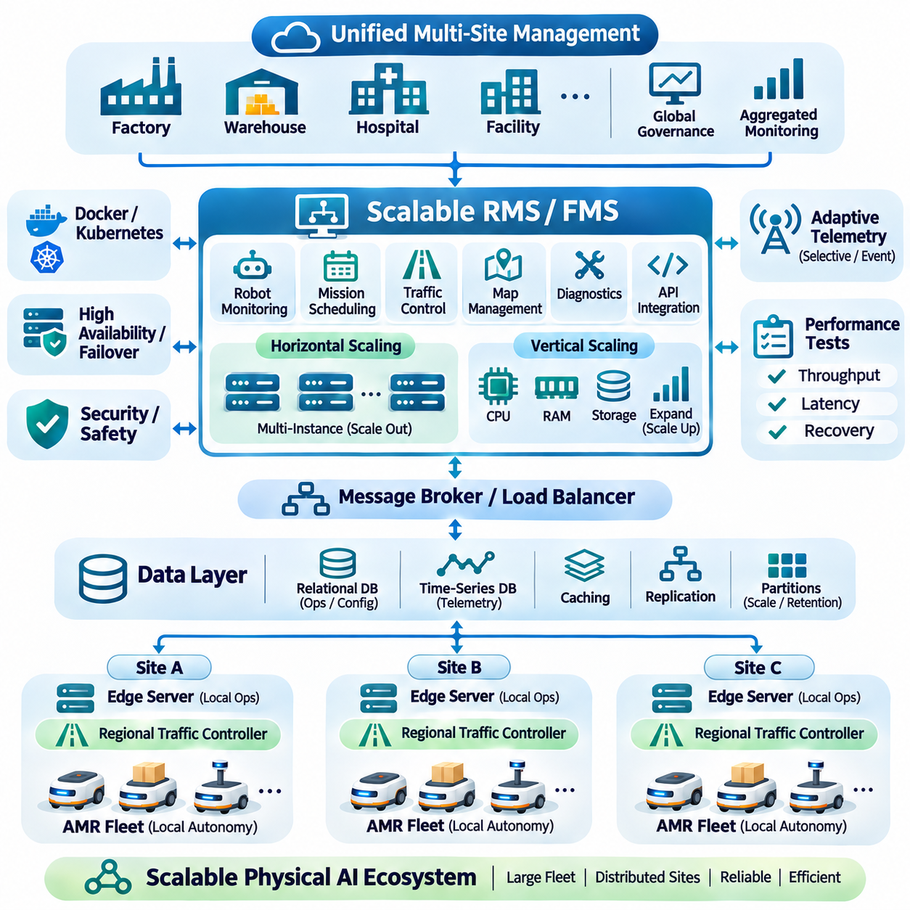

**Volume 08. AMR Operations, Deployment, and MLOps**


# Chapter 05. RMS and FMS Architecture

##  

## 05.1 RMS and FMS Definition

{width="7.268055555555556in" height="7.268055555555556in"}

The Robot Management System (RMS) and Fleet Management System (FMS) are essential software platforms for managing, coordinating, monitoring, and optimizing Autonomous Mobile Robot (AMR) operations. While individual robots possess autonomous navigation, perception, and control capabilities, RMS and FMS provide higher-level operational intelligence that enables robots to function as integrated components of an industrial automation ecosystem.

The Robot Management System primarily focuses on the operational management of individual robots throughout their service lifecycle. Its responsibilities include robot registration, device configuration, operational status monitoring, remote diagnostics, software version management, maintenance scheduling, and remote assistance. RMS establishes a centralized environment through which operators can supervise and maintain distributed robotic assets.

The Fleet Management System primarily focuses on the coordination and optimization of multiple robots operating within shared physical environments. FMS manages task allocation, mission scheduling, traffic coordination, resource utilization, charging priorities, and operational workload distribution. Its fundamental objective is to maximize collective productivity while minimizing operational conflicts, unnecessary movements, and resource consumption.

The distinction between RMS and FMS can be understood through their respective management perspectives. RMS adopts a robot-centric approach, emphasizing the availability, reliability, configuration, and operational health of individual robotic assets. FMS adopts a fleet-centric approach, emphasizing collective task execution, coordinated behavior, and system-wide performance. Both systems complement each other through continuous information exchange.

In practical AMR deployments, RMS maintains a centralized robot registry containing unique identifiers, hardware specifications, software versions, operational capabilities, network information, and maintenance histories. Each registered robot periodically transmits telemetry regarding its battery condition, positioning status, sensor availability, computational resources, and diagnostic events. This information establishes the foundation for operational visibility.

FMS utilizes information collected from individual robots to determine how operational resources should be allocated. When a new transportation, inspection, cleaning, or delivery request is generated, FMS evaluates robot availability, geographical position, remaining battery capacity, mission priority, and equipment compatibility. Based on these conditions, the system selects an appropriate robot and supervises its mission execution.

Another fundamental responsibility of FMS is traffic management within environments where multiple robots share corridors, intersections, elevators, docking stations, and restricted operational zones. The system coordinates access to shared resources through reservation mechanisms, priority policies, and conflict resolution strategies. Individual robots retain responsibility for local obstacle avoidance and safety-related motion control.

The relationship between RMS, FMS, and onboard robot intelligence establishes a hierarchical operational architecture. Onboard computing systems execute perception, localization, navigation, motion control, and immediate environmental responses. RMS provides device-level supervision and lifecycle management, while FMS coordinates higher-level missions and collective operational decisions across the entire robotic fleet.

Communication between robots and management platforms relies on structured data exchange through network interfaces and standardized messaging mechanisms. Robot telemetry, mission commands, acknowledgments, configuration parameters, and operational events are exchanged between distributed components. Communication reliability, message ordering, authentication, and synchronization are important prerequisites for maintaining consistent operational states.

RMS and FMS may be implemented through centralized, distributed, cloud-based, on-premises, or hybrid architectures. Centralized systems simplify global supervision and resource coordination, whereas distributed architectures can improve resilience and local responsiveness. Hybrid architectures combine local operational services with centralized analytics, remote management, and enterprise-level coordination across geographically separated facilities.

Operational safety represents a fundamental requirement for both management systems. RMS monitors safety-related events, equipment faults, and abnormal operating conditions, while FMS coordinates operational restrictions and shared resource access. However, neither conventional RMS nor FMS should replace independently validated onboard safety functions. Robots must maintain appropriate safe behavior even when communication with management servers becomes unavailable.

Integration with external enterprise systems extends the operational capabilities of RMS and FMS beyond individual robotic applications. Manufacturing Execution Systems (MES), Warehouse Management Systems (WMS), Enterprise Resource Planning (ERP), and Building Management Systems (BMS) can generate operational requests and receive execution results. Such integration enables robots to participate directly in automated organizational workflows.

RMS and FMS also establish important foundations for robotic data engineering and Machine Learning Operations (MLOps). Operational telemetry, mission histories, navigation failures, environmental observations, and abnormal events provide valuable information for continuous improvement. These datasets can support predictive maintenance, AI model validation, operational optimization, and controlled deployment of updated software and intelligence capabilities.

As robotic deployments expand from individual machines to hundreds or thousands of interconnected assets, RMS and FMS must accommodate increasing communication volumes, concurrent missions, heterogeneous hardware, and geographically distributed environments. Modular services, scalable infrastructure, standardized interfaces, and fault-tolerant mechanisms become increasingly important for maintaining operational continuity and sustainable system growth.

The functional boundaries between RMS and FMS are not universally standardized, and commercial robotics platforms frequently combine both responsibilities within a unified management environment. Nevertheless, distinguishing individual asset management from collective operational coordination provides a useful architectural foundation. This distinction supports systematic software development, clear responsibility allocation, and long-term platform maintainability.

Ultimately, RMS and FMS transform independently autonomous robots into coordinated, observable, maintainable, and scalable robotic ecosystems. Their integration establishes the operational foundation for industrial automation, intelligent logistics, hospital services, outdoor inspection, and emerging Physical AI applications. As robotic intelligence evolves, these management platforms will increasingly support adaptive fleet coordination, continuous learning, and autonomous operational optimization.

로봇 관리 시스템(Robot Management System, RMS)과 플릿 관리 시스템(Fleet Management System, FMS)은 자율 이동 로봇(Autonomous Mobile Robot, AMR)의 운영을 관리, 조정, 모니터링 및 최적화하기 위한 핵심 소프트웨어 플랫폼(Software Platform)이다. 개별 로봇이 자율 주행(Autonomous Navigation), 인지(Perception), 제어(Control) 기능을 보유하고 있는 반면, RMS와 FMS는 상위 수준의 운영 지능(Operational Intelligence)을 제공하여 로봇이 산업 자동화 생태계(Industrial Automation Ecosystem)의 통합 구성 요소로 기능하도록 지원한다.

로봇 관리 시스템(RMS)은 주로 개별 로봇의 전체 서비스 수명주기(Service Lifecycle)에 걸친 운영 관리(Operational Management)에 중점을 둔다. 주요 기능에는 로봇 등록(Robot Registration), 장치 구성(Device Configuration), 운영 상태 모니터링(Operational Status Monitoring), 원격 진단(Remote Diagnostics), 소프트웨어 버전 관리(Software Version Management), 유지보수 일정 관리(Maintenance Scheduling), 원격 지원(Remote Assistance)이 포함된다. RMS는 운영자가 분산된 로봇 자산(Robotic Assets)을 감독하고 유지관리할 수 있는 중앙 집중형 환경(Centralized Environment)을 구축한다.

플릿 관리 시스템(FMS)은 주로 공유된 물리적 환경(Shared Physical Environment)에서 운영되는 다수의 로봇을 조정하고 최적화하는 데 중점을 둔다. FMS는 작업 할당(Task Allocation), 임무 일정 관리(Mission Scheduling), 교통 조정(Traffic Coordination), 자원 활용(Resource Utilization), 충전 우선순위(Charging Priorities), 운영 작업량 분배(Operational Workload Distribution)를 관리한다. 기본적인 목적은 운영 충돌(Operational Conflicts), 불필요한 이동, 자원 소비를 최소화하면서 전체 생산성(Collective Productivity)을 극대화하는 것이다.

RMS와 FMS의 차이는 각각의 관리 관점(Management Perspective)을 통해 이해할 수 있다. RMS는 로봇 중심 접근 방식(Robot-Centric Approach)을 채택하여 개별 로봇 자산의 가용성(Availability), 신뢰성(Reliability), 구성(Configuration), 운영 건전성(Operational Health)을 강조한다. FMS는 플릿 중심 접근 방식(Fleet-Centric Approach)을 채택하여 집단 작업 수행(Collective Task Execution), 협조 행동(Coordinated Behavior), 시스템 전체 성능(System-Wide Performance)을 강조한다. 두 시스템은 지속적인 정보 교환(Information Exchange)을 통해 상호 보완적으로 기능한다.

실제 AMR 배포(Deployment) 환경에서 RMS는 고유 식별자(Unique Identifier), 하드웨어 사양(Hardware Specifications), 소프트웨어 버전(Software Version), 운영 역량(Operational Capabilities), 네트워크 정보(Network Information), 유지보수 이력(Maintenance History)을 포함하는 중앙 집중형 로봇 등록부(Centralized Robot Registry)를 유지한다. 등록된 각 로봇은 배터리 상태(Battery Condition), 위치 추정 상태(Localization Status), 센서 가용성(Sensor Availability), 연산 자원(Computational Resources), 진단 이벤트(Diagnostic Events)와 관련된 원격 측정 데이터(Telemetry)를 주기적으로 전송한다. 이러한 정보는 운영 가시성(Operational Visibility)의 기반을 구축한다.

FMS는 개별 로봇에서 수집된 정보를 활용하여 운영 자원(Operational Resources)의 할당 방식을 결정한다. 새로운 운송(Transportation), 검사(Inspection), 청소(Cleaning), 배송(Delivery) 요청이 발생하면 FMS는 로봇의 가용성, 지리적 위치(Geographical Position), 잔여 배터리 용량(Remaining Battery Capacity), 임무 우선순위(Mission Priority), 장비 호환성(Equipment Compatibility)을 평가한다. 이러한 조건을 기반으로 적절한 로봇을 선택하고 해당 로봇의 임무 수행(Mission Execution)을 감독한다.

FMS의 또 다른 핵심 책임은 다수의 로봇이 복도(Corridors), 교차로(Intersections), 엘리베이터(Elevators), 도킹 스테이션(Docking Stations), 제한 운영 구역(Restricted Operational Zones)을 공유하는 환경에서의 교통 관리(Traffic Management)이다. 시스템은 예약 메커니즘(Reservation Mechanisms), 우선순위 정책(Priority Policies), 충돌 해결 전략(Conflict Resolution Strategies)을 통해 공유 자원(Shared Resources)에 대한 접근을 조정한다. 개별 로봇은 국소 장애물 회피(Local Obstacle Avoidance)와 안전 관련 모션 제어(Safety-Related Motion Control)에 대한 책임을 지속적으로 유지한다.

RMS, FMS, 로봇 탑재 지능(Onboard Robot Intelligence) 간의 관계는 계층형 운영 아키텍처(Hierarchical Operational Architecture)를 구성한다. 로봇 탑재 연산 시스템(Onboard Computing System)은 인지, 위치 추정(Localization), 자율 주행, 모션 제어(Motion Control), 즉각적인 환경 대응(Environmental Response)을 수행한다. RMS는 장치 수준 감독(Device-Level Supervision)과 수명주기 관리(Lifecycle Management)를 제공하며, FMS는 전체 로봇 플릿(Robot Fleet)에 걸쳐 상위 수준의 임무와 집단 운영 의사결정(Collective Operational Decision-Making)을 조정한다.

로봇과 관리 플랫폼 간의 통신(Communication)은 네트워크 인터페이스(Network Interfaces)와 표준화된 메시징 메커니즘(Standardized Messaging Mechanisms)을 통한 구조화된 데이터 교환(Structured Data Exchange)에 기반한다. 로봇 원격 측정 데이터(Robot Telemetry), 임무 명령(Mission Commands), 수신 확인(Acknowledgments), 구성 매개변수(Configuration Parameters), 운영 이벤트(Operational Events)가 분산 구성 요소(Distributed Components) 간에 교환된다. 통신 신뢰성(Communication Reliability), 메시지 순서(Message Ordering), 인증(Authentication), 동기화(Synchronization)는 일관된 운영 상태(Operational State)를 유지하기 위한 중요한 전제조건이다.

RMS와 FMS는 중앙 집중형(Centralized), 분산형(Distributed), 클라우드 기반(Cloud-Based), 온프레미스(On-Premises), 하이브리드(Hybrid) 아키텍처로 구현될 수 있다. 중앙 집중형 시스템은 전체 시스템 감독(Global Supervision)과 자원 조정(Resource Coordination)을 단순화하는 반면, 분산형 아키텍처는 복원력(Resilience)과 현장 대응성(Local Responsiveness)을 향상시킬 수 있다. 하이브리드 아키텍처(Hybrid Architecture)는 현장 운영 서비스(Local Operational Services)와 중앙 집중형 분석(Centralized Analytics), 원격 관리(Remote Management), 지리적으로 분리된 시설 간의 기업 수준 조정(Enterprise-Level Coordination)을 결합한다.

운영 안전성(Operational Safety)은 두 관리 시스템 모두에서 핵심적인 요구사항이다. RMS는 안전 관련 이벤트(Safety-Related Events), 장비 고장(Equipment Faults), 비정상 운영 조건(Abnormal Operating Conditions)을 모니터링하며, FMS는 운영 제한(Operational Restrictions)과 공유 자원 접근(Shared Resource Access)을 조정한다. 그러나 일반적인 RMS와 FMS는 독립적으로 검증된 로봇 탑재 안전 기능(Onboard Safety Functions)을 대체해서는 안 된다. 로봇은 관리 서버(Management Server)와의 통신이 중단된 상황에서도 적절한 안전 행동(Safe Behavior)을 유지해야 한다.

외부 기업 시스템(External Enterprise Systems)과의 통합은 RMS와 FMS의 운영 역량을 개별 로봇 응용 분야 이상으로 확장한다. 제조 실행 시스템(Manufacturing Execution System, MES), 창고 관리 시스템(Warehouse Management System, WMS), 전사적 자원 관리(Enterprise Resource Planning, ERP), 건물 관리 시스템(Building Management System, BMS)은 운영 요청(Operational Requests)을 생성하고 작업 수행 결과(Execution Results)를 수신할 수 있다. 이러한 시스템 통합(System Integration)을 통해 로봇은 자동화된 조직 업무 흐름(Automated Organizational Workflows)에 직접 참여할 수 있다.

RMS와 FMS는 로봇 데이터 엔지니어링(Robotic Data Engineering)과 기계학습 운영(Machine Learning Operations, MLOps)을 위한 중요한 기반도 구축한다. 운영 원격 측정 데이터(Operational Telemetry), 임무 수행 이력(Mission History), 자율 주행 실패(Navigation Failures), 환경 관측 데이터(Environmental Observations), 비정상 이벤트(Abnormal Events)는 지속적인 개선(Continuous Improvement)을 위한 중요한 정보를 제공한다. 이러한 데이터셋(Datasets)은 예측 유지보수(Predictive Maintenance), 인공지능 모델 검증(AI Model Validation), 운영 최적화(Operational Optimization), 업데이트된 소프트웨어 및 지능 기능의 통제된 배포(Controlled Deployment)를 지원할 수 있다.

로봇 배포 규모가 개별 장비에서 수백 또는 수천 대의 상호 연결된 로봇 자산으로 확대됨에 따라 RMS와 FMS는 증가하는 통신량(Communication Volume), 동시 수행 임무(Concurrent Missions), 이기종 하드웨어(Heterogeneous Hardware), 지리적으로 분산된 환경(Geographically Distributed Environments)을 수용해야 한다. 모듈형 서비스(Modular Services), 확장 가능한 인프라(Scalable Infrastructure), 표준화된 인터페이스(Standardized Interfaces), 결함 허용 메커니즘(Fault-Tolerant Mechanisms)은 운영 연속성(Operational Continuity)과 지속 가능한 시스템 성장(Sustainable System Growth)을 유지하는 데 더욱 중요해진다.

RMS와 FMS 사이의 기능적 경계(Functional Boundaries)는 보편적으로 표준화되어 있지 않으며, 상용 로봇 플랫폼(Commercial Robotics Platform)은 두 시스템의 책임을 단일 통합 관리 환경(Unified Management Environment)으로 결합하는 경우가 많다. 그럼에도 불구하고 개별 자산 관리(Individual Asset Management)와 집단 운영 조정(Collective Operational Coordination)을 구분하는 것은 유용한 아키텍처 기반(Architectural Foundation)을 제공한다. 이러한 구분은 체계적인 소프트웨어 개발(Systematic Software Development), 명확한 책임 할당(Responsibility Allocation), 장기적인 플랫폼 유지보수성(Platform Maintainability)을 지원한다.

궁극적으로 RMS와 FMS는 독립적으로 자율성을 보유한 로봇을 상호 조정 가능하고, 관측 가능하며, 유지관리 및 확장이 가능한 로봇 생태계(Robotic Ecosystem)로 전환한다. 두 시스템의 통합은 산업 자동화(Industrial Automation), 지능형 물류(Intelligent Logistics), 병원 서비스(Hospital Services), 실외 검사(Outdoor Inspection), 새롭게 등장하는 물리적 인공지능(Physical AI) 응용 분야의 운영 기반(Operational Foundation)을 구축한다. 로봇 지능(Robotic Intelligence)이 발전함에 따라 이러한 관리 플랫폼은 적응형 플릿 조정(Adaptive Fleet Coordination), 지속 학습(Continuous Learning), 자율 운영 최적화(Autonomous Operational Optimization)를 더욱 폭넓게 지원하게 될 것이다.

##  

## 05.2 System Architecture

{width="7.268055555555556in" height="7.268055555555556in"}

The system architecture of a Robot Management System (RMS) and Fleet Management System (FMS) establishes the technical foundation for operating, monitoring, coordinating, and maintaining Autonomous Mobile Robots (AMRs) within distributed industrial environments. A well-designed architecture integrates onboard robot intelligence, communication infrastructure, operational management services, enterprise applications, and data processing platforms into a unified operational ecosystem.

A layered architecture provides a systematic approach to separating operational responsibilities and managing system complexity. A representative architecture consists of the robot layer, communication layer, edge computing layer, management service layer, data infrastructure layer, and application layer. Each layer performs specific functions while interacting with adjacent layers through standardized interfaces, enabling independent development, maintenance, and scalability.

The robot layer represents the physical execution environment of the system. Each AMR integrates sensors, actuators, embedded controllers, onboard computing platforms, and autonomous navigation software. Robots independently perform perception, localization, path planning, obstacle avoidance, and motion control. Local execution capabilities allow robots to respond to dynamic environmental conditions without depending on continuous communication with centralized management servers.

The communication layer establishes connectivity between robots, management servers, edge computing devices, and external applications. Wireless technologies such as Wi-Fi, LTE, and 5G support distributed robot operations, while Ethernet provides reliable connections within fixed infrastructure. Communication protocols such as MQTT, DDS, WebSocket, gRPC, and REST APIs can support different requirements for telemetry exchange, event distribution, command transmission, and service integration.

The edge computing layer provides localized processing capabilities between individual robots and centralized management infrastructure. Edge servers may execute data aggregation, communication gateways, local traffic coordination, map distribution, and operational analytics. By processing selected workloads near the physical operating environment, edge computing reduces communication latency, minimizes external network dependency, and improves operational resilience during connectivity disruptions.

The RMS service architecture focuses on managing individual robotic assets throughout their operational lifecycle. Core services include robot registration, identity management, configuration management, status monitoring, remote diagnostics, software deployment, and maintenance history management. These services establish a consistent representation of each robot, allowing operators to identify equipment conditions, evaluate availability, and manage configuration changes across distributed installations.

The FMS service architecture focuses on coordinating collective robot operations through mission management, task scheduling, dispatching, traffic management, and resource allocation. A mission orchestration service converts operational requests into executable assignments, while scheduling services evaluate robot capabilities, availability, location, and energy conditions. Traffic management services coordinate access to shared physical resources and reduce conflicts between concurrent robot missions.

The data infrastructure layer provides persistent storage and processing capabilities for operational information generated throughout the robotic ecosystem. Relational databases can maintain robot registries, user accounts, configuration records, and mission histories. Time-series databases support telemetry and performance monitoring, while object storage accommodates sensor recordings, maps, diagnostic files, and AI training datasets. Data retention policies establish appropriate storage lifecycles.

Event-driven architecture is particularly suitable for distributed robot management because operational conditions continuously change. Robot status updates, mission completion events, battery warnings, communication failures, and safety notifications can be published through message brokers and consumed by relevant services. Asynchronous communication reduces direct service dependencies, supports concurrent processing, and enables additional monitoring or analytical services to subscribe to operational events.

A microservices architecture allows RMS and FMS capabilities to be implemented as independently deployable software components. Robot management, mission orchestration, map management, authentication, notification, and reporting services can operate within separate execution environments. Containerization and orchestration technologies such as Docker and Kubernetes support consistent deployment, resource isolation, service recovery, and horizontal scaling when justified by operational complexity.

The application layer provides interfaces through which operators, administrators, maintenance engineers, and enterprise applications interact with the robotic ecosystem. Web-based dashboards visualize robot locations, mission progress, battery status, traffic conditions, and operational alerts. Application Programming Interfaces (APIs) enable integration with manufacturing, warehouse, hospital, and building management systems while maintaining controlled access to operational functions and data.

Security must be incorporated throughout the architecture rather than implemented as an isolated application feature. Device authentication, encrypted communication, role-based access control, network segmentation, credential management, and audit logging protect distributed robotic assets. Management services must validate command authorization and maintain traceable records of configuration changes. Independently validated onboard safety mechanisms must remain effective during server or network failures.

System reliability depends on redundancy, fault isolation, state synchronization, and recovery mechanisms. Critical management services may employ replicated instances, database backups, persistent message queues, and automated failover procedures. Communication recovery must reconcile robot and server states without duplicating mission execution. Robots should enter predefined safe or degraded operating modes whenever essential coordination services become unavailable.

A scalable RMS and FMS architecture also establishes the foundation for continuous operational improvement and Machine Learning Operations (MLOps). Operational telemetry, mission histories, failure events, and environmental observations can support predictive maintenance, AI model evaluation, and controlled software updates. Ultimately, modular and interoperable architecture enables AMR deployments to evolve into distributed Physical AI ecosystems with coordinated intelligence, operational resilience, and sustainable lifecycle management.

로봇 관리 시스템(Robot Management System, RMS)과 플릿 관리 시스템(Fleet Management System, FMS)의 시스템 아키텍처(System Architecture)는 분산된 산업 환경(Distributed Industrial Environment)에서 자율 이동 로봇(Autonomous Mobile Robot, AMR)을 운영, 모니터링, 조정 및 유지관리하기 위한 기술적 기반(Technical Foundation)을 구축한다. 잘 설계된 아키텍처는 로봇 탑재 지능(Onboard Robot Intelligence), 통신 인프라(Communication Infrastructure), 운영 관리 서비스(Operational Management Services), 기업 응용 프로그램(Enterprise Applications), 데이터 처리 플랫폼(Data Processing Platform)을 하나의 통합 운영 생태계(Unified Operational Ecosystem)로 결합한다.

계층형 아키텍처(Layered Architecture)는 운영 책임(Operational Responsibility)을 분리하고 시스템 복잡성(System Complexity)을 관리하기 위한 체계적인 접근 방식을 제공한다. 대표적인 아키텍처는 로봇 계층(Robot Layer), 통신 계층(Communication Layer), 엣지 컴퓨팅 계층(Edge Computing Layer), 관리 서비스 계층(Management Service Layer), 데이터 인프라 계층(Data Infrastructure Layer), 응용 계층(Application Layer)으로 구성된다. 각 계층은 표준화된 인터페이스(Standardized Interfaces)를 통해 인접 계층과 상호작용하면서 특정 기능을 수행하며, 독립적인 개발(Independent Development), 유지보수(Maintenance), 확장성(Scalability)을 지원한다.

로봇 계층(Robot Layer)은 시스템의 물리적 실행 환경(Physical Execution Environment)을 나타낸다. 각 AMR은 센서(Sensors), 액추에이터(Actuators), 임베디드 제어기(Embedded Controllers), 로봇 탑재 연산 플랫폼(Onboard Computing Platform), 자율 주행 소프트웨어(Autonomous Navigation Software)를 통합한다. 로봇은 인지(Perception), 위치 추정(Localization), 경로 계획(Path Planning), 장애물 회피(Obstacle Avoidance), 모션 제어(Motion Control)를 독립적으로 수행한다. 이러한 로컬 실행 역량(Local Execution Capabilities)을 통해 로봇은 중앙 집중형 관리 서버(Centralized Management Server)와의 지속적인 통신에 의존하지 않고 동적인 환경 조건(Dynamic Environmental Conditions)에 대응할 수 있다.

통신 계층(Communication Layer)은 로봇, 관리 서버(Management Server), 엣지 컴퓨팅 장치(Edge Computing Device), 외부 응용 프로그램(External Applications) 간의 연결성(Connectivity)을 구축한다. Wi-Fi, LTE, 5G와 같은 무선 통신 기술(Wireless Communication Technologies)은 분산 로봇 운영(Distributed Robot Operations)을 지원하며, 이더넷(Ethernet)은 고정형 인프라(Fixed Infrastructure) 내에서 신뢰성 높은 연결을 제공한다. MQTT, DDS, WebSocket, gRPC, REST API와 같은 통신 프로토콜(Communication Protocols)은 원격 측정 데이터 교환(Telemetry Exchange), 이벤트 분배(Event Distribution), 명령 전송(Command Transmission), 서비스 통합(Service Integration)에 대한 다양한 요구사항을 지원할 수 있다.

엣지 컴퓨팅 계층(Edge Computing Layer)은 개별 로봇과 중앙 집중형 관리 인프라(Centralized Management Infrastructure) 사이에서 현지화된 데이터 처리 역량(Localized Processing Capabilities)을 제공한다. 엣지 서버(Edge Server)는 데이터 집계(Data Aggregation), 통신 게이트웨이(Communication Gateway), 현장 교통 조정(Local Traffic Coordination), 지도 배포(Map Distribution), 운영 분석(Operational Analytics)을 수행할 수 있다. 물리적 운영 환경(Physical Operating Environment)에 가까운 위치에서 선택된 작업 부하(Workload)를 처리함으로써 엣지 컴퓨팅은 통신 지연시간(Communication Latency)을 감소시키고, 외부 네트워크 의존성(External Network Dependency)을 최소화하며, 연결 중단(Connectivity Disruption) 상황에서 운영 복원력(Operational Resilience)을 향상시킨다.

RMS 서비스 아키텍처(RMS Service Architecture)는 개별 로봇 자산(Robotic Assets)의 전체 운영 수명주기(Operational Lifecycle)에 걸친 관리에 중점을 둔다. 핵심 서비스에는 로봇 등록(Robot Registration), 식별 관리(Identity Management), 구성 관리(Configuration Management), 상태 모니터링(Status Monitoring), 원격 진단(Remote Diagnostics), 소프트웨어 배포(Software Deployment), 유지보수 이력 관리(Maintenance History Management)가 포함된다. 이러한 서비스는 각 로봇에 대한 일관된 정보 표현(Consistent Representation)을 구축하여 운영자가 분산된 설치 환경(Distributed Installations) 전반에서 장비 상태를 파악하고, 가용성(Availability)을 평가하며, 구성 변경(Configuration Changes)을 관리할 수 있도록 지원한다.

FMS 서비스 아키텍처(FMS Service Architecture)는 임무 관리(Mission Management), 작업 일정 관리(Task Scheduling), 작업 배차(Dispatching), 교통 관리(Traffic Management), 자원 할당(Resource Allocation)을 통한 집단 로봇 운영(Collective Robot Operations)의 조정에 중점을 둔다. 임무 오케스트레이션 서비스(Mission Orchestration Service)는 운영 요청(Operational Requests)을 실행 가능한 작업 할당(Executable Assignments)으로 변환하며, 스케줄링 서비스(Scheduling Service)는 로봇의 역량(Capabilities), 가용성, 위치(Location), 에너지 상태(Energy Conditions)를 평가한다. 교통 관리 서비스(Traffic Management Service)는 공유 물리 자원(Shared Physical Resources)에 대한 접근을 조정하고 동시에 수행되는 로봇 임무(Concurrent Robot Missions) 간의 충돌을 감소시킨다.

데이터 인프라 계층(Data Infrastructure Layer)은 로봇 생태계(Robotic Ecosystem) 전반에서 생성되는 운영 정보(Operational Information)의 영구 저장(Persistent Storage) 및 처리 역량(Processing Capabilities)을 제공한다. 관계형 데이터베이스(Relational Database)는 로봇 등록부(Robot Registry), 사용자 계정(User Accounts), 구성 기록(Configuration Records), 임무 수행 이력(Mission History)을 관리할 수 있다. 시계열 데이터베이스(Time-Series Database)는 원격 측정 데이터(Telemetry)와 성능 모니터링(Performance Monitoring)을 지원하며, 객체 스토리지(Object Storage)는 센서 기록(Sensor Recordings), 지도(Maps), 진단 파일(Diagnostic Files), 인공지능 학습 데이터셋(AI Training Datasets)을 저장한다. 데이터 보존 정책(Data Retention Policy)은 적절한 데이터 저장 수명주기(Storage Lifecycle)를 설정한다.

이벤트 기반 아키텍처(Event-Driven Architecture)는 운영 조건(Operational Conditions)이 지속적으로 변화하기 때문에 분산 로봇 관리(Distributed Robot Management)에 특히 적합하다. 로봇 상태 업데이트(Robot Status Updates), 임무 완료 이벤트(Mission Completion Events), 배터리 경고(Battery Warnings), 통신 장애(Communication Failures), 안전 알림(Safety Notifications)은 메시지 브로커(Message Broker)를 통해 발행(Publish)되고 관련 서비스에서 소비(Consume)될 수 있다. 비동기 통신(Asynchronous Communication)은 서비스 간 직접적인 의존성(Service Dependencies)을 감소시키고, 동시 처리(Concurrent Processing)를 지원하며, 추가적인 모니터링 또는 분석 서비스(Analytical Services)가 운영 이벤트(Operational Events)를 구독(Subscribe)할 수 있도록 한다.

마이크로서비스 아키텍처(Microservices Architecture)는 RMS와 FMS의 기능을 독립적으로 배포 가능한 소프트웨어 구성 요소(Independently Deployable Software Components)로 구현할 수 있도록 한다. 로봇 관리(Robot Management), 임무 오케스트레이션(Mission Orchestration), 지도 관리(Map Management), 인증(Authentication), 알림(Notification), 보고(Reporting) 서비스는 각각 분리된 실행 환경(Execution Environment)에서 운영될 수 있다. Docker와 Kubernetes 같은 컨테이너화(Containerization) 및 오케스트레이션(Orchestration) 기술은 운영 복잡성(Operational Complexity)이 이러한 기술의 도입을 정당화하는 경우 일관된 배포(Consistent Deployment), 자원 격리(Resource Isolation), 서비스 복구(Service Recovery), 수평적 확장(Horizontal Scaling)을 지원한다.

응용 계층(Application Layer)은 운영자(Operators), 관리자(Administrators), 유지보수 엔지니어(Maintenance Engineers), 기업 응용 프로그램(Enterprise Applications)이 로봇 생태계와 상호작용할 수 있는 인터페이스(Interface)를 제공한다. 웹 기반 대시보드(Web-Based Dashboard)는 로봇 위치(Robot Location), 임무 진행 상태(Mission Progress), 배터리 상태(Battery Status), 교통 상황(Traffic Conditions), 운영 경고(Operational Alerts)를 시각화한다. 응용 프로그램 프로그래밍 인터페이스(Application Programming Interface, API)는 운영 기능과 데이터에 대한 통제된 접근(Controlled Access)을 유지하면서 제조, 창고, 병원 및 건물 관리 시스템(Building Management System)과의 통합을 가능하게 한다.

보안(Security)은 독립적인 응용 프로그램 기능으로 구현되는 것이 아니라 전체 아키텍처에 걸쳐 통합되어야 한다. 장치 인증(Device Authentication), 암호화 통신(Encrypted Communication), 역할 기반 접근 제어(Role-Based Access Control, RBAC), 네트워크 분할(Network Segmentation), 인증 자격 증명 관리(Credential Management), 감사 로그(Audit Logging)는 분산된 로봇 자산을 보호한다. 관리 서비스(Management Services)는 명령 권한(Command Authorization)을 검증하고 구성 변경에 대한 추적 가능한 기록(Traceable Records)을 유지해야 한다. 독립적으로 검증된 로봇 탑재 안전 메커니즘(Onboard Safety Mechanisms)은 서버 또는 네트워크 장애 상황에서도 유효하게 작동해야 한다.

시스템 신뢰성(System Reliability)은 이중화(Redundancy), 장애 격리(Fault Isolation), 상태 동기화(State Synchronization), 복구 메커니즘(Recovery Mechanisms)에 의존한다. 핵심 관리 서비스(Critical Management Services)는 복제된 서비스 인스턴스(Replicated Service Instances), 데이터베이스 백업(Database Backup), 영속적 메시지 큐(Persistent Message Queue), 자동 장애 조치 절차(Automated Failover Procedures)를 활용할 수 있다. 통신 복구(Communication Recovery) 과정에서는 임무가 중복 실행되지 않도록 로봇과 서버 간의 상태를 정합화(State Reconciliation)해야 한다. 필수 조정 서비스(Essential Coordination Services)를 사용할 수 없는 경우 로봇은 사전에 정의된 안전 운영 모드(Safe Operating Mode) 또는 성능 저하 운영 모드(Degraded Operating Mode)로 전환해야 한다.

확장 가능한 RMS 및 FMS 아키텍처(Scalable RMS and FMS Architecture)는 지속적인 운영 개선(Continuous Operational Improvement)과 기계학습 운영(Machine Learning Operations, MLOps)을 위한 기반도 구축한다. 운영 원격 측정 데이터(Operational Telemetry), 임무 수행 이력(Mission History), 장애 이벤트(Failure Events), 환경 관측 데이터(Environmental Observations)는 예측 유지보수(Predictive Maintenance), 인공지능 모델 평가(AI Model Evaluation), 통제된 소프트웨어 업데이트(Controlled Software Updates)를 지원할 수 있다. 궁극적으로 모듈형 및 상호운용 가능한 아키텍처(Modular and Interoperable Architecture)는 AMR 배포 환경이 협조 지능(Coordinated Intelligence), 운영 복원력(Operational Resilience), 지속 가능한 수명주기 관리(Sustainable Lifecycle Management)를 갖춘 분산형 물리적 인공지능 생태계(Distributed Physical AI Ecosystem)로 발전할 수 있도록 한다.

##  

## 05.3 Robot-Server Communication

{width="7.268055555555556in" height="7.268055555555556in"}

Robot-server communication represents a fundamental component of Robot Management System (RMS) and Fleet Management System (FMS) architectures. It establishes the communication infrastructure through which Autonomous Mobile Robots (AMRs) exchange operational information, receive mission commands, report execution results, and maintain synchronized system states. Reliable communication enables distributed robotic assets to operate as a coordinated ecosystem.

Robot-server communication generally follows a bidirectional communication model. Robots transmit operational telemetry, localization information, battery conditions, diagnostic messages, mission progress, and safety events to management servers. In the opposite direction, servers distribute mission assignments, configuration parameters, map updates, operational policies, and authorized remote control commands. Each communication direction requires appropriate reliability and latency characteristics.

Communication requirements vary according to the operational characteristics of exchanged information. High-frequency telemetry requires efficient transmission with controlled bandwidth consumption, while mission commands require reliable delivery and execution acknowledgment. Safety-related notifications require prioritized handling, whereas large files such as maps, sensor recordings, and software packages require dedicated transfer mechanisms that avoid disrupting essential communication.

Several communication protocols can support robot-server integration. Message Queuing Telemetry Transport (MQTT) provides lightweight publish-subscribe communication suitable for distributed robotic devices. Data Distribution Service (DDS) supports configurable Quality of Service (QoS) policies, while WebSocket enables persistent bidirectional connections. REST APIs and gRPC provide structured interfaces for service requests, configuration management, and enterprise integration.

Wireless network infrastructure significantly influences communication performance in AMR deployments. Indoor robots typically utilize industrial Wi-Fi networks, while outdoor robots may depend on LTE, 5G, or private cellular infrastructure. Network design must consider coverage, interference, roaming performance, bandwidth availability, packet loss, and communication latency. Multiple communication interfaces can provide redundancy when operational requirements justify additional complexity.

A robot communication gateway provides an abstraction layer between onboard robotic software and external management services. In ROS 2-based systems, the gateway can translate internal topics, service requests, actions, and diagnostic messages into externally accessible communication formats. This approach reduces dependencies between onboard software and server implementations while preventing unnecessary exposure of internal robot communication networks.

Message structures must be standardized to ensure consistent interpretation across distributed components. Each operational message should contain relevant identifiers, timestamps, message types, sequence numbers, protocol versions, and application-specific payloads. Serialization formats such as JSON, Protocol Buffers, and MessagePack offer different advantages regarding readability, processing efficiency, bandwidth consumption, and compatibility with heterogeneous robotic platforms.

Communication state management maintains consistency between robots and management servers. Heartbeat messages periodically indicate device connectivity, while status reports describe operational conditions and mission execution states. When heartbeat messages are missing beyond a configured threshold, the server should classify the robot as disconnected or unreachable. Connectivity status must remain distinct from physical robot health and actual mission execution status.

Reliable mission communication requires more than successful network-level message delivery. Each mission command should include a unique identifier, execution parameters, validity conditions, and acknowledgment requirements. Application-level acknowledgments distinguish command reception, acceptance, execution, completion, and failure. Idempotent command processing and duplicate detection prevent repeated execution when communication retries or server recovery procedures occur.

Time synchronization is essential for correlating distributed operational events and reconstructing robot behavior. Network Time Protocol (NTP) can support general operational timestamp synchronization, while Precision Time Protocol (PTP) may be required for higher-precision applications. Timestamp accuracy supports telemetry analysis, incident investigation, mission sequencing, and multi-robot coordination. Synchronization errors and communication delays should be independently monitored.

Communication interruptions must be treated as expected operational conditions rather than exceptional system failures. Robots should maintain appropriate onboard autonomy, buffer selected operational messages locally, and follow predefined degraded operating policies when server connectivity becomes unavailable. Depending on mission requirements and safety constraints, robots may complete authorized activities, navigate to designated waiting locations, or perform controlled stops.

Communication recovery requires systematic reconciliation of distributed operational states. After reconnection, robots and servers should exchange current mission information, command identifiers, configuration versions, and relevant event histories. Buffered telemetry may be uploaded according to priority and available bandwidth. Expired commands must not be automatically executed, and resource reservations must be revalidated before coordinated operations resume.

Cybersecurity is an integral requirement of robot-server communication architecture. Transport Layer Security (TLS), mutual authentication, device certificates, access tokens, and network segmentation can protect communication channels. Servers must verify robot identities and command authorization, while robots must reject unauthorized or invalid requests. Credential rotation, replay protection, and communication audit records further strengthen operational security.

Communication scalability becomes increasingly important as robotic fleets expand across multiple facilities. Message brokers, asynchronous processing, connection management, telemetry aggregation, and load balancing can distribute communication workloads across server infrastructure. Adaptive reporting frequencies and event-based data transmission reduce unnecessary network traffic. Backpressure mechanisms prevent excessive message accumulation from destabilizing essential management services.

Communication performance should be continuously evaluated using measurable indicators such as end-to-end latency, packet loss, message delivery success rate, connection availability, reconnection time, and bandwidth utilization. Operational testing should reproduce network congestion, access point transitions, server restarts, and extended communication interruptions. Ultimately, robust robot-server communication enables reliable fleet coordination, operational visibility, and scalable Physical AI deployment.

로봇-서버 통신(Robot-Server Communication)은 로봇 관리 시스템(Robot Management System, RMS)과 플릿 관리 시스템(Fleet Management System, FMS) 아키텍처의 핵심 구성 요소이다. 자율 이동 로봇(Autonomous Mobile Robot, AMR)이 운영 정보를 교환하고, 임무 명령(Mission Commands)을 수신하며, 실행 결과(Execution Results)를 보고하고, 동기화된 시스템 상태(Synchronized System States)를 유지하기 위한 통신 인프라(Communication Infrastructure)를 구축한다. 신뢰성 높은 통신을 통해 분산된 로봇 자산(Distributed Robotic Assets)은 상호 조정된 생태계(Coordinated Ecosystem)로 운영될 수 있다.

로봇-서버 통신은 일반적으로 양방향 통신 모델(Bidirectional Communication Model)을 기반으로 한다. 로봇은 운영 원격 측정 데이터(Operational Telemetry), 위치 추정 정보(Localization Information), 배터리 상태(Battery Conditions), 진단 메시지(Diagnostic Messages), 임무 진행 상태(Mission Progress), 안전 이벤트(Safety Events)를 관리 서버(Management Server)에 전송한다. 반대 방향으로 서버는 임무 할당(Mission Assignments), 구성 매개변수(Configuration Parameters), 지도 업데이트(Map Updates), 운영 정책(Operational Policies), 승인된 원격 제어 명령(Authorized Remote Control Commands)을 배포한다. 각각의 통신 방향에는 적절한 신뢰성(Reliability)과 지연시간(Latency) 특성이 요구된다.

통신 요구사항(Communication Requirements)은 교환되는 정보의 운영 특성(Operational Characteristics)에 따라 달라진다. 고주파 원격 측정 데이터(High-Frequency Telemetry)는 대역폭 소비(Bandwidth Consumption)를 제어하면서 효율적으로 전송되어야 하며, 임무 명령은 신뢰성 높은 전달(Reliable Delivery)과 실행 확인(Execution Acknowledgment)을 요구한다. 안전 관련 알림(Safety-Related Notifications)은 우선순위에 따른 처리가 필요하며, 지도, 센서 기록(Sensor Recordings), 소프트웨어 패키지(Software Packages)와 같은 대용량 파일은 필수 통신을 방해하지 않는 전용 전송 메커니즘(Dedicated Transfer Mechanisms)을 필요로 한다.

다양한 통신 프로토콜(Communication Protocols)이 로봇-서버 통합(Robot-Server Integration)을 지원할 수 있다. 메시지 큐잉 원격 측정 전송(Message Queuing Telemetry Transport, MQTT)은 분산 로봇 장치(Distributed Robotic Devices)에 적합한 경량 발행-구독 통신(Lightweight Publish-Subscribe Communication)을 제공한다. 데이터 분배 서비스(Data Distribution Service, DDS)는 구성 가능한 서비스 품질(Quality of Service, QoS) 정책을 지원하며, 웹소켓(WebSocket)은 지속적인 양방향 연결(Persistent Bidirectional Connection)을 가능하게 한다. REST API와 gRPC는 서비스 요청(Service Requests), 구성 관리(Configuration Management), 기업 시스템 통합(Enterprise Integration)을 위한 구조화된 인터페이스를 제공한다.

무선 네트워크 인프라(Wireless Network Infrastructure)는 AMR 배포 환경의 통신 성능(Communication Performance)에 상당한 영향을 미친다. 실내 로봇(Indoor Robots)은 일반적으로 산업용 Wi-Fi 네트워크(Industrial Wi-Fi Networks)를 활용하며, 실외 로봇(Outdoor Robots)은 LTE, 5G 또는 사설 이동통신 인프라(Private Cellular Infrastructure)에 의존할 수 있다. 네트워크 설계(Network Design)는 통신 커버리지(Coverage), 간섭(Interference), 로밍 성능(Roaming Performance), 대역폭 가용성(Bandwidth Availability), 패킷 손실(Packet Loss), 통신 지연시간을 고려해야 한다. 운영 요구사항이 추가적인 복잡성을 정당화하는 경우 다중 통신 인터페이스(Multiple Communication Interfaces)를 통해 통신 이중화(Redundancy)를 구현할 수 있다.

로봇 통신 게이트웨이(Robot Communication Gateway)는 로봇 탑재 소프트웨어(Onboard Robotic Software)와 외부 관리 서비스(External Management Services) 사이에 추상화 계층(Abstraction Layer)을 제공한다. ROS 2 기반 시스템에서 게이트웨이는 내부 토픽(Topics), 서비스 요청(Service Requests), 액션(Actions), 진단 메시지를 외부에서 접근 가능한 통신 형식(Communication Formats)으로 변환할 수 있다. 이러한 접근 방식은 내부 로봇 통신 네트워크(Internal Robot Communication Network)의 불필요한 노출을 방지하면서 로봇 탑재 소프트웨어와 서버 구현(Server Implementation) 간의 의존성(Dependencies)을 감소시킨다.

메시지 구조(Message Structure)는 분산 구성 요소(Distributed Components) 간의 일관된 해석(Consistent Interpretation)을 보장하기 위해 표준화되어야 한다. 각각의 운영 메시지(Operational Message)는 관련 식별자(Identifiers), 타임스탬프(Timestamps), 메시지 유형(Message Types), 시퀀스 번호(Sequence Numbers), 프로토콜 버전(Protocol Versions), 응용 프로그램별 페이로드(Application-Specific Payloads)를 포함해야 한다. JSON, Protocol Buffers, MessagePack과 같은 직렬화 형식(Serialization Formats)은 가독성(Readability), 처리 효율성(Processing Efficiency), 대역폭 소비, 이기종 로봇 플랫폼(Heterogeneous Robotic Platforms)과의 호환성(Compatibility) 측면에서 서로 다른 장점을 제공한다.

통신 상태 관리(Communication State Management)는 로봇과 관리 서버 간의 일관성(Consistency)을 유지한다. 하트비트 메시지(Heartbeat Messages)는 장치 연결 상태(Device Connectivity)를 주기적으로 나타내며, 상태 보고(Status Reports)는 운영 조건(Operational Conditions)과 임무 실행 상태(Mission Execution States)를 설명한다. 설정된 임계값(Configured Threshold)을 초과하여 하트비트 메시지가 수신되지 않는 경우 서버는 해당 로봇을 연결 해제(Disconnected) 또는 접근 불가(Unreachable) 상태로 분류해야 한다. 통신 연결 상태(Connectivity Status)는 물리적 로봇 건전성(Physical Robot Health) 및 실제 임무 수행 상태와 명확하게 구분되어야 한다.

신뢰성 높은 임무 통신(Reliable Mission Communication)은 네트워크 수준의 성공적인 메시지 전달(Network-Level Message Delivery) 이상의 기능을 요구한다. 각각의 임무 명령은 고유 식별자(Unique Identifier), 실행 매개변수(Execution Parameters), 유효성 조건(Validity Conditions), 수신 확인 요구사항(Acknowledgment Requirements)을 포함해야 한다. 응용 계층 확인 응답(Application-Level Acknowledgment)은 명령 수신(Command Reception), 수락(Acceptance), 실행(Execution), 완료(Completion), 실패(Failure)를 구분한다. 멱등성 기반 명령 처리(Idempotent Command Processing)와 중복 감지(Duplicate Detection)는 통신 재시도(Communication Retries) 또는 서버 복구 절차(Server Recovery Procedures)에서 동일한 명령이 반복 실행되는 것을 방지한다.

시간 동기화(Time Synchronization)는 분산 운영 이벤트(Distributed Operational Events) 간의 상관관계를 분석하고 로봇 행동(Robot Behavior)을 재구성하는 데 필수적이다. 네트워크 시간 프로토콜(Network Time Protocol, NTP)은 일반적인 운영 타임스탬프 동기화를 지원하며, 정밀 시간 프로토콜(Precision Time Protocol, PTP)은 더욱 높은 정밀도를 요구하는 응용 분야에 필요할 수 있다. 타임스탬프 정확도(Timestamp Accuracy)는 원격 측정 데이터 분석(Telemetry Analysis), 사고 조사(Incident Investigation), 임무 순서 설정(Mission Sequencing), 다중 로봇 조정(Multi-Robot Coordination)을 지원한다. 동기화 오차(Synchronization Errors)와 통신 지연은 독립적으로 모니터링되어야 한다.

통신 중단(Communication Interruptions)은 예외적인 시스템 장애(System Failures)가 아니라 발생이 예상되는 운영 조건(Expected Operational Conditions)으로 취급되어야 한다. 서버 연결을 사용할 수 없는 경우 로봇은 적절한 탑재 자율성(Onboard Autonomy)을 유지하고, 선택된 운영 메시지를 로컬 버퍼(Local Buffer)에 저장하며, 사전에 정의된 성능 저하 운영 정책(Degraded Operating Policies)을 따라야 한다. 임무 요구사항(Mission Requirements)과 안전 제약조건(Safety Constraints)에 따라 로봇은 승인된 활동을 완료하거나, 지정된 대기 위치(Designated Waiting Locations)로 이동하거나, 제어된 정지(Controlled Stop)를 수행할 수 있다.

통신 복구(Communication Recovery)는 분산 운영 상태(Distributed Operational States)에 대한 체계적인 상태 정합화(State Reconciliation)를 요구한다. 재연결(Reconnection) 이후 로봇과 서버는 현재 임무 정보(Current Mission Information), 명령 식별자(Command Identifiers), 구성 버전(Configuration Versions), 관련 이벤트 이력(Event Histories)을 교환해야 한다. 버퍼에 저장된 원격 측정 데이터(Buffered Telemetry)는 우선순위(Priority)와 가용 대역폭(Available Bandwidth)에 따라 업로드될 수 있다. 유효기간이 만료된 명령(Expired Commands)은 자동으로 실행되어서는 안 되며, 협조 운영(Coordinated Operations)이 재개되기 전에 자원 예약(Resource Reservations)의 유효성을 다시 검증해야 한다.

사이버보안(Cybersecurity)은 로봇-서버 통신 아키텍처의 필수 요구사항이다. 전송 계층 보안(Transport Layer Security, TLS), 상호 인증(Mutual Authentication), 장치 인증서(Device Certificates), 접근 토큰(Access Tokens), 네트워크 분할(Network Segmentation)은 통신 채널(Communication Channels)을 보호할 수 있다. 서버는 로봇의 식별 정보(Robot Identity)와 명령 권한(Command Authorization)을 검증해야 하며, 로봇은 승인되지 않았거나 유효하지 않은 요청을 거부해야 한다. 인증 자격 증명 갱신(Credential Rotation), 재전송 공격 방지(Replay Protection), 통신 감사 기록(Communication Audit Records)은 운영 보안(Operational Security)을 더욱 강화한다.

로봇 플릿이 여러 시설로 확장됨에 따라 통신 확장성(Communication Scalability)은 더욱 중요해진다. 메시지 브로커(Message Brokers), 비동기 처리(Asynchronous Processing), 연결 관리(Connection Management), 원격 측정 데이터 집계(Telemetry Aggregation), 부하 분산(Load Balancing)은 통신 작업 부하(Communication Workloads)를 서버 인프라(Server Infrastructure) 전반에 분산할 수 있다. 적응형 보고 주기(Adaptive Reporting Frequencies)와 이벤트 기반 데이터 전송(Event-Based Data Transmission)은 불필요한 네트워크 트래픽(Network Traffic)을 감소시킨다. 역압력 제어 메커니즘(Backpressure Mechanisms)은 과도한 메시지 축적(Message Accumulation)으로 인해 필수 관리 서비스가 불안정해지는 것을 방지한다.

통신 성능은 종단 간 지연시간(End-to-End Latency), 패킷 손실(Packet Loss), 메시지 전달 성공률(Message Delivery Success Rate), 연결 가용성(Connection Availability), 재연결 시간(Reconnection Time), 대역폭 활용률(Bandwidth Utilization)과 같은 정량화 가능한 지표(Measurable Indicators)를 활용하여 지속적으로 평가되어야 한다. 운영 시험(Operational Testing)은 네트워크 혼잡(Network Congestion), 액세스 포인트 전환(Access Point Transitions), 서버 재시작(Server Restarts), 장시간 통신 중단(Extended Communication Interruptions) 상황을 재현해야 한다. 궁극적으로 견고한 로봇-서버 통신(Robust Robot-Server Communication)은 신뢰성 높은 플릿 조정(Fleet Coordination), 운영 가시성(Operational Visibility), 확장 가능한 물리적 인공지능 배포(Scalable Physical AI Deployment)를 가능하게 한다.

##  

## 05.4 Task Order and Mission Control

{width="7.268055555555556in" height="7.268055555555556in"}

Task order and mission control represent essential functional components of Robot Management System (RMS) and Fleet Management System (FMS) architectures. These components transform operational requests into executable robotic activities, coordinate mission execution, and maintain operational consistency across distributed Autonomous Mobile Robots (AMRs). Their primary objective is to ensure reliable, efficient, traceable, and safe execution of physical tasks.

A task order represents a structured operational request defining what activity must be performed within a robotic environment. Typical task orders include material transportation, medical supply delivery, facility inspection, autonomous patrol, cleaning, and equipment handling. Each task order specifies relevant operational information, including task identifiers, source and destination locations, execution requirements, priority levels, and completion conditions.

A mission represents an executable operational sequence derived from a task order. While a task order describes the desired operational outcome, a mission defines how a robot or group of robots will achieve that outcome. A transportation mission, for example, may include navigation to a pickup location, docking, payload acquisition, transportation, payload delivery, and confirmation of successful completion before returning to an available operating state.

Task orders may originate from human operators, enterprise applications, automated scheduling systems, environmental events, or other robotic systems. Manufacturing Execution Systems (MES), Warehouse Management Systems (WMS), and hospital information systems can generate operational requests through standardized interfaces. The management platform validates incoming requests, assigns unique identifiers, and records their operational requirements.

Task order validation prevents invalid or infeasible requests from entering the mission execution pipeline. Validation procedures evaluate location availability, robot capabilities, payload requirements, environmental restrictions, resource availability, and user authorization. Requests containing incomplete information or conflicting requirements should be rejected or redirected for operator review rather than automatically dispatched to physical robots.

Mission planning converts validated task orders into structured execution sequences. A mission may consist of multiple actions organized through state machines, behavior trees, workflow engines, or directed acyclic graphs. Each action defines execution parameters, prerequisites, expected results, timeout conditions, and exception handling procedures. Modular mission definitions allow reusable operational behaviors to support diverse robotic applications.

Task scheduling determines when individual missions should be executed and how operational resources should be allocated. Scheduling algorithms evaluate mission priority, execution deadlines, robot availability, estimated travel time, battery capacity, and resource dependencies. Dynamic scheduling allows the management system to adjust execution plans when urgent requests, equipment failures, environmental changes, or unexpected delays occur.

Mission dispatching assigns scheduled missions to suitable robots according to their operational capabilities and current conditions. The dispatching service considers robot type, payload capacity, installed equipment, geographical position, software compatibility, and remaining energy. Each assignment must be acknowledged by the selected robot before execution begins, preventing inconsistent task ownership and unnecessary duplication of physical activities.

Mission lifecycle management establishes standardized operational states throughout the execution process. Representative states include created, validated, queued, assigned, accepted, executing, paused, completed, failed, and canceled. State transitions should follow explicitly defined conditions and authorization rules. Maintaining persistent mission states enables management servers to reconstruct execution histories and recover operational workflows after interruptions.

Mission control must preserve a clear separation between centralized coordination and onboard autonomous execution. Management servers determine operational objectives, mission sequences, and coordination constraints, while onboard systems execute localization, path planning, obstacle avoidance, and motion control. Independently validated safety functions must retain authority over robot motion regardless of mission priority or centralized execution commands.

Exception handling is critical because physical environments are inherently dynamic and uncertain. Blocked pathways, docking failures, unavailable elevators, communication interruptions, and unexpected battery depletion can prevent normal mission execution. Recovery strategies may include bounded action retries, alternative route selection, temporary suspension, operator intervention, or reassignment to another robot after confirming the original execution state.

Mission control must also coordinate dependencies involving shared physical resources. Elevators, automatic doors, narrow corridors, charging stations, loading equipment, and inspection areas may require exclusive or scheduled access. Resource reservation mechanisms prevent incompatible operations from occurring simultaneously. Reservation timeouts, ownership verification, and release procedures reduce resource conflicts, deadlocks, and unnecessary operational delays.

Reliable mission execution requires synchronization between management servers and distributed robotic assets. Unique task and mission identifiers, command sequence numbers, execution acknowledgments, and persistent event histories support state reconciliation. Idempotent command processing prevents duplicated physical actions during communication retries. Cancellation and reassignment must account for partially completed operations and payload ownership.

Operational monitoring provides visibility into task order processing and mission execution performance. Relevant indicators include task completion rate, mission execution time, queue waiting time, deadline compliance, robot utilization, energy consumption, and intervention frequency. Historical mission records support bottleneck identification, scheduling optimization, incident investigation, and continuous improvement of operational workflows.

Ultimately, integrated task order and mission control enables distributed robotic assets to execute complex operational workflows through coordinated decision-making. Advanced Physical AI architectures can extend conventional scheduling and mission orchestration with predictive analytics, adaptive planning, and learning-based optimization. Such capabilities must remain governed by validated operational constraints, safety requirements, and traceable execution policies.

작업 주문 및 임무 제어(Task Order and Mission Control)는 로봇 관리 시스템(Robot Management System, RMS)과 플릿 관리 시스템(Fleet Management System, FMS) 아키텍처의 핵심 기능적 구성 요소(Functional Components)이다. 이러한 구성 요소는 운영 요청(Operational Requests)을 실행 가능한 로봇 활동(Executable Robotic Activities)으로 변환하고, 임무 수행(Mission Execution)을 조정하며, 분산된 자율 이동 로봇(Autonomous Mobile Robot, AMR) 전반에 걸쳐 운영 일관성(Operational Consistency)을 유지한다. 주요 목적은 물리적 작업(Physical Tasks)의 신뢰성(Reliability), 효율성(Efficiency), 추적성(Traceability), 안전성(Safety)을 보장하는 것이다.

작업 주문(Task Order)은 로봇 운영 환경(Robotic Environment)에서 수행해야 하는 활동을 정의하는 구조화된 운영 요청(Structured Operational Request)을 의미한다. 대표적인 작업 주문에는 자재 운송(Material Transportation), 의료 물품 배송(Medical Supply Delivery), 시설 검사(Facility Inspection), 자율 순찰(Autonomous Patrol), 청소(Cleaning), 장비 취급(Equipment Handling)이 포함된다. 각각의 작업 주문은 작업 식별자(Task Identifiers), 출발지 및 목적지(Source and Destination Locations), 실행 요구사항(Execution Requirements), 우선순위 수준(Priority Levels), 완료 조건(Completion Conditions)을 포함하는 관련 운영 정보를 명시한다.

임무(Mission)는 작업 주문에서 도출된 실행 가능한 운영 시퀀스(Executable Operational Sequence)를 의미한다. 작업 주문이 요구되는 운영 결과(Operational Outcome)를 설명하는 반면, 임무는 개별 로봇 또는 로봇 집단이 해당 결과를 어떻게 달성할 것인지를 정의한다. 예를 들어 운송 임무(Transportation Mission)는 픽업 위치(Pickup Location)로의 자율 주행(Autonomous Navigation), 도킹(Docking), 적재물 인수(Payload Acquisition), 운송(Transportation), 적재물 인도(Payload Delivery), 성공적인 완료 확인(Completion Confirmation)을 포함하며, 이후 가용 운영 상태(Available Operating State)로 복귀할 수 있다.

작업 주문은 인간 운영자(Human Operators), 기업 응용 프로그램(Enterprise Applications), 자동화된 스케줄링 시스템(Automated Scheduling Systems), 환경 이벤트(Environmental Events) 또는 다른 로봇 시스템(Robotic Systems)에서 생성될 수 있다. 제조 실행 시스템(Manufacturing Execution System, MES), 창고 관리 시스템(Warehouse Management System, WMS), 병원 정보 시스템(Hospital Information System, HIS)은 표준화된 인터페이스(Standardized Interfaces)를 통해 운영 요청을 생성할 수 있다. 관리 플랫폼(Management Platform)은 수신된 요청의 유효성을 검증하고, 고유 식별자(Unique Identifiers)를 할당하며, 해당 운영 요구사항(Operational Requirements)을 기록한다.

작업 주문 검증(Task Order Validation)은 유효하지 않거나 실행 불가능한 요청이 임무 실행 파이프라인(Mission Execution Pipeline)에 진입하는 것을 방지한다. 검증 절차(Validation Procedures)는 위치 가용성(Location Availability), 로봇 역량(Robot Capabilities), 적재물 요구사항(Payload Requirements), 환경적 제한사항(Environmental Restrictions), 자원 가용성(Resource Availability), 사용자 권한(User Authorization)을 평가한다. 불완전한 정보 또는 상충하는 요구사항(Conflicting Requirements)을 포함하는 요청은 실제 로봇에 자동으로 할당하기보다는 거부하거나 운영자 검토(Operator Review)를 위해 전달해야 한다.

임무 계획(Mission Planning)은 검증된 작업 주문을 구조화된 실행 시퀀스(Structured Execution Sequences)로 변환한다. 하나의 임무는 상태 머신(State Machine), 행동 트리(Behavior Tree), 워크플로 엔진(Workflow Engine), 방향성 비순환 그래프(Directed Acyclic Graph, DAG)를 통해 구성된 다수의 액션(Actions)으로 이루어질 수 있다. 각각의 액션은 실행 매개변수(Execution Parameters), 사전 조건(Prerequisites), 예상 결과(Expected Results), 시간 초과 조건(Timeout Conditions), 예외 처리 절차(Exception Handling Procedures)를 정의한다. 모듈형 임무 정의(Modular Mission Definition)를 통해 재사용 가능한 운영 행동(Reusable Operational Behaviors)이 다양한 로봇 응용 분야를 지원할 수 있다.

작업 스케줄링(Task Scheduling)은 개별 임무가 언제 실행되어야 하며 운영 자원(Operational Resources)이 어떻게 할당되어야 하는지를 결정한다. 스케줄링 알고리즘(Scheduling Algorithms)은 임무 우선순위(Mission Priority), 실행 기한(Execution Deadlines), 로봇 가용성(Robot Availability), 예상 이동 시간(Estimated Travel Time), 배터리 용량(Battery Capacity), 자원 의존성(Resource Dependencies)을 평가한다. 동적 스케줄링(Dynamic Scheduling)을 통해 관리 시스템은 긴급 요청(Urgent Requests), 장비 고장(Equipment Failures), 환경 변화(Environmental Changes), 예상하지 못한 지연(Unexpected Delays)이 발생할 때 실행 계획(Execution Plans)을 조정할 수 있다.

임무 배차(Mission Dispatching)는 로봇의 운영 역량(Operational Capabilities)과 현재 상태(Current Conditions)에 따라 스케줄링된 임무를 적합한 로봇에 할당한다. 배차 서비스(Dispatching Service)는 로봇 유형(Robot Type), 적재 용량(Payload Capacity), 탑재 장비(Installed Equipment), 지리적 위치(Geographical Position), 소프트웨어 호환성(Software Compatibility), 잔여 에너지(Remaining Energy)를 고려한다. 각각의 임무 할당(Mission Assignment)은 실행이 시작되기 전에 선택된 로봇으로부터 확인 응답(Acknowledgment)을 받아야 하며, 이를 통해 작업 소유권(Task Ownership)의 불일치와 물리적 활동(Physical Activities)의 불필요한 중복 수행을 방지한다.

임무 수명주기 관리(Mission Lifecycle Management)는 전체 실행 과정에 걸쳐 표준화된 운영 상태(Standardized Operational States)를 정의한다. 대표적인 상태에는 생성(Created), 검증 완료(Validated), 대기열 등록(Queued), 할당(Assigned), 수락(Accepted), 실행 중(Executing), 일시 정지(Paused), 완료(Completed), 실패(Failed), 취소(Canceled)가 포함된다. 상태 전이(State Transitions)는 명시적으로 정의된 조건과 권한 규칙(Authorization Rules)을 따라야 한다. 영속적인 임무 상태(Persistent Mission States)를 유지함으로써 관리 서버는 실행 이력(Execution History)을 재구성하고 운영 중단 이후 운영 워크플로(Operational Workflows)를 복구할 수 있다.

임무 제어(Mission Control)는 중앙 집중형 조정(Centralized Coordination)과 로봇 탑재 자율 실행(Onboard Autonomous Execution) 사이의 명확한 분리를 유지해야 한다. 관리 서버(Management Servers)는 운영 목표(Operational Objectives), 임무 시퀀스(Mission Sequences), 조정 제약조건(Coordination Constraints)을 결정하며, 로봇 탑재 시스템(Onboard Systems)은 위치 추정(Localization), 경로 계획(Path Planning), 장애물 회피(Obstacle Avoidance), 모션 제어(Motion Control)를 수행한다. 독립적으로 검증된 안전 기능(Independently Validated Safety Functions)은 임무 우선순위 또는 중앙 집중형 실행 명령(Centralized Execution Commands)과 관계없이 로봇 모션에 대한 제어 권한(Control Authority)을 유지해야 한다.

물리적 환경(Physical Environment)은 본질적으로 동적이며 불확실하기 때문에 예외 처리(Exception Handling)가 매우 중요하다. 통로 차단(Blocked Pathways), 도킹 실패(Docking Failures), 엘리베이터 사용 불가(Unavailable Elevators), 통신 중단(Communication Interruptions), 예상하지 못한 배터리 고갈(Unexpected Battery Depletion)은 정상적인 임무 수행을 방해할 수 있다. 복구 전략(Recovery Strategies)에는 제한된 액션 재시도(Bounded Action Retries), 대체 경로 선택(Alternative Route Selection), 임시 중단(Temporary Suspension), 운영자 개입(Operator Intervention), 기존 실행 상태(Original Execution State)를 확인한 이후 다른 로봇으로 임무를 재할당(Reassignment)하는 방식이 포함될 수 있다.

임무 제어는 공유 물리 자원(Shared Physical Resources)과 관련된 의존성(Dependencies)도 조정해야 한다. 엘리베이터(Elevators), 자동문(Automatic Doors), 좁은 복도(Narrow Corridors), 충전 스테이션(Charging Stations), 적재 장비(Loading Equipment), 검사 구역(Inspection Areas)은 독점적 접근(Exclusive Access) 또는 일정 기반 접근(Scheduled Access)을 요구할 수 있다. 자원 예약 메커니즘(Resource Reservation Mechanisms)은 상호 양립할 수 없는 작업이 동시에 수행되는 것을 방지한다. 예약 시간 초과(Reservation Timeouts), 소유권 검증(Ownership Verification), 자원 해제 절차(Release Procedures)는 자원 충돌(Resource Conflicts), 교착 상태(Deadlocks), 불필요한 운영 지연(Operational Delays)을 감소시킨다.

신뢰성 높은 임무 수행(Reliable Mission Execution)은 관리 서버와 분산 로봇 자산(Distributed Robotic Assets) 간의 동기화(Synchronization)를 요구한다. 고유 작업 및 임무 식별자(Unique Task and Mission Identifiers), 명령 시퀀스 번호(Command Sequence Numbers), 실행 확인 응답(Execution Acknowledgments), 영속적 이벤트 이력(Persistent Event Histories)은 상태 정합화(State Reconciliation)를 지원한다. 멱등성 기반 명령 처리(Idempotent Command Processing)는 통신 재시도(Communication Retries) 과정에서 물리적 작업이 중복 실행되는 것을 방지한다. 임무 취소(Cancellation)와 재할당(Reassignment)은 부분적으로 완료된 작업(Partially Completed Operations)과 적재물 소유권(Payload Ownership)을 고려해야 한다.

운영 모니터링(Operational Monitoring)은 작업 주문 처리(Task Order Processing)와 임무 실행 성능(Mission Execution Performance)에 대한 가시성(Visibility)을 제공한다. 관련 지표에는 작업 완료율(Task Completion Rate), 임무 실행 시간(Mission Execution Time), 대기열 대기 시간(Queue Waiting Time), 실행 기한 준수율(Deadline Compliance), 로봇 활용률(Robot Utilization), 에너지 소비량(Energy Consumption), 개입 빈도(Intervention Frequency)가 포함된다. 과거 임무 기록(Historical Mission Records)은 병목 현상 식별(Bottleneck Identification), 스케줄링 최적화(Scheduling Optimization), 사고 조사(Incident Investigation), 운영 워크플로의 지속적인 개선(Continuous Improvement)을 지원한다.

궁극적으로 통합된 작업 주문 및 임무 제어(Integrated Task Order and Mission Control)는 분산된 로봇 자산이 협조적 의사결정(Coordinated Decision-Making)을 통해 복잡한 운영 워크플로(Complex Operational Workflows)를 수행할 수 있도록 한다. 고도화된 물리적 인공지능 아키텍처(Advanced Physical AI Architecture)는 예측 분석(Predictive Analytics), 적응형 계획(Adaptive Planning), 학습 기반 최적화(Learning-Based Optimization)를 통해 기존의 스케줄링과 임무 오케스트레이션(Mission Orchestration) 기능을 확장할 수 있다. 이러한 역량은 검증된 운영 제약조건(Validated Operational Constraints), 안전 요구사항(Safety Requirements), 추적 가능한 실행 정책(Traceable Execution Policies)에 의해 지속적으로 관리되고 통제되어야 한다.

##  

## 05.5 Map and Traffic Server

{width="7.268055555555556in" height="7.268055555555556in"}

The map and traffic server represents a fundamental infrastructure component of Robot Management System (RMS) and Fleet Management System (FMS) architectures. It provides centralized spatial information management and coordinated traffic control for Autonomous Mobile Robots (AMRs) operating within shared physical environments. Its primary objective is to maintain consistent environmental representations, efficient robot movements, and reliable access to shared operational resources.

The map server manages spatial information required for autonomous navigation and fleet coordination. Depending on operational requirements, map representations may include occupancy grid maps, point cloud maps, topological maps, semantic maps, and high-definition maps. These representations describe environmental geometry, navigable areas, fixed obstacles, transportation routes, and operationally significant locations within industrial facilities or outdoor environments.

Map management extends beyond storing geometrical information about physical environments. Operational maps must incorporate semantic information describing loading stations, charging locations, docking positions, elevators, automatic doors, inspection areas, restricted zones, and emergency access routes. These semantic elements enable management services to associate physical locations with operational functions and translate mission requirements into spatial objectives.

Map version management ensures consistency between robots and centralized management infrastructure. Each map should be associated with a unique identifier, version number, creation timestamp, coordinate reference system, and deployment status. When environmental modifications require map updates, the server must distribute validated map versions through controlled deployment procedures and verify compatibility before allowing robots to resume affected missions.

Coordinate system management is essential for integrating spatial information across heterogeneous robotic platforms. Robots may utilize different local coordinate frames, localization technologies, or map resolutions. The map server establishes common spatial references and transformation relationships, enabling consistent interpretation of robot positions, navigation objectives, and shared operational zones across multiple robots, buildings, floors, and geographically distributed facilities.

The traffic server coordinates robot movements within shared environments to minimize congestion, conflicting routes, and operational delays. Unlike onboard navigation systems that respond to immediate environmental conditions, the traffic server maintains a broader representation of fleet movements and resource occupancy. This global operational perspective enables coordinated route allocation and proactive management of potential traffic conflicts.

Graph-based environmental representations are frequently employed for fleet-level traffic management. Navigable locations are represented as nodes, while transportation routes connecting these locations are represented as edges. Additional attributes may describe travel distance, speed restrictions, directional constraints, robot compatibility, and resource capacity. Such representations support route optimization and traffic coordination without replacing onboard navigation capabilities.

Traffic reservation mechanisms regulate access to shared transportation routes and operational resources. Robots may request permission to enter designated road segments, intersections, narrow corridors, elevators, or docking areas. The traffic server evaluates resource availability and conflicting reservations before granting access. Reservation ownership, validity periods, and confirmed release conditions help maintain consistent resource allocation across distributed robots.

Time-space coordination extends conventional spatial route planning by considering when individual robots are expected to occupy specific locations. By combining estimated arrival times, robot velocities, route dependencies, and resource reservations, the traffic server can identify potential movement conflicts before they occur. Dynamic reservation updates accommodate unexpected delays, local obstacle avoidance, and variations in actual mission execution times.

Deadlock prevention is particularly important in environments containing narrow passages, restricted maneuvering areas, and competing robot movements. A deadlock occurs when multiple robots cannot proceed because each depends on resources occupied or reserved by another. Traffic management strategies may employ resource ordering, dependency analysis, designated waiting locations, controlled backtracking, and dynamic route reassignment to prevent or resolve such situations.

Dynamic traffic management enables the fleet to respond to changing operational conditions. Temporary obstacles, maintenance activities, human congestion, unavailable elevators, and unexpected robot failures may require immediate modification of traffic policies. The server can update route availability, establish temporary exclusion zones, adjust traffic priorities, and redistribute robot movements while maintaining consistent operational constraints across affected missions.

Communication reliability directly influences map and traffic server performance. Robots must periodically report their positions, movement states, route progress, and resource occupancy. When communication becomes unavailable, the traffic server must treat uncertain resource occupancy conservatively rather than assume that affected routes are clear. Robots must follow predefined degraded operating policies and retain independently validated onboard safety functions.

Integration between map servers, traffic servers, and mission orchestration services establishes a coordinated operational architecture. Mission services generate transportation objectives, map services provide spatial references, and traffic services determine coordinated movement permissions. Onboard robot intelligence subsequently executes authorized navigation activities while responding to local environmental conditions. Clear functional boundaries improve maintainability, operational reliability, and interoperability.

Scalability and performance evaluation become increasingly important as fleet sizes and operating environments expand. Distributed map caching, regional traffic coordination, incremental map updates, and efficient reservation algorithms can reduce computational and communication overhead. Performance indicators include intersection waiting time, route utilization, congestion frequency, deadlock occurrence, mission delays, and overall transportation throughput.

Ultimately, integrated map and traffic servers establish the spatial coordination foundation for scalable AMR operations. Their capabilities can be extended through digital twins, predictive traffic analytics, multi-agent optimization, and learning-based congestion management. Within emerging Physical AI ecosystems, these technologies can support adaptive spatial intelligence and collective robot coordination while preserving validated operational constraints, safety requirements, and reliable mission execution.

지도 및 교통 서버(Map and Traffic Server)는 로봇 관리 시스템(Robot Management System, RMS)과 플릿 관리 시스템(Fleet Management System, FMS) 아키텍처의 핵심 인프라 구성 요소(Infrastructure Component)이다. 공유된 물리적 환경(Shared Physical Environment)에서 운영되는 자율 이동 로봇(Autonomous Mobile Robot, AMR)을 위한 중앙 집중형 공간 정보 관리(Centralized Spatial Information Management)와 협조적 교통 제어(Coordinated Traffic Control)를 제공한다. 주요 목적은 일관된 환경 표현(Environmental Representation), 효율적인 로봇 이동(Robot Movement), 공유 운영 자원(Shared Operational Resources)에 대한 신뢰성 높은 접근을 유지하는 것이다.

지도 서버(Map Server)는 자율 주행(Autonomous Navigation)과 플릿 조정(Fleet Coordination)에 필요한 공간 정보(Spatial Information)를 관리한다. 운영 요구사항(Operational Requirements)에 따라 지도 표현(Map Representation)은 점유 격자 지도(Occupancy Grid Map), 포인트 클라우드 지도(Point Cloud Map), 위상 지도(Topological Map), 의미론적 지도(Semantic Map), 고정밀 지도(High-Definition Map, HD Map)를 포함할 수 있다. 이러한 표현은 산업 시설(Industrial Facilities) 또는 실외 환경(Outdoor Environments) 내의 환경 기하 구조(Environmental Geometry), 주행 가능 영역(Navigable Areas), 고정 장애물(Fixed Obstacles), 운송 경로(Transportation Routes), 운영상 중요한 위치(Operationally Significant Locations)를 설명한다.

지도 관리(Map Management)는 물리적 환경에 대한 기하학적 정보(Geometrical Information)를 저장하는 것 이상의 기능을 제공한다. 운영 지도(Operational Map)는 적재 스테이션(Loading Stations), 충전 위치(Charging Locations), 도킹 위치(Docking Positions), 엘리베이터(Elevators), 자동문(Automatic Doors), 검사 구역(Inspection Areas), 제한 구역(Restricted Zones), 비상 접근 경로(Emergency Access Routes)를 설명하는 의미론적 정보(Semantic Information)를 포함해야 한다. 이러한 의미론적 요소(Semantic Elements)를 통해 관리 서비스(Management Services)는 물리적 위치(Physical Locations)를 운영 기능(Operational Functions)과 연결하고 임무 요구사항(Mission Requirements)을 공간적 목표(Spatial Objectives)로 변환할 수 있다.

지도 버전 관리(Map Version Management)는 로봇과 중앙 집중형 관리 인프라(Centralized Management Infrastructure) 간의 일관성(Consistency)을 보장한다. 각각의 지도는 고유 식별자(Unique Identifier), 버전 번호(Version Number), 생성 타임스탬프(Creation Timestamp), 좌표 참조 시스템(Coordinate Reference System), 배포 상태(Deployment Status)와 연결되어야 한다. 환경 변경(Environmental Modifications)으로 인해 지도 업데이트(Map Updates)가 필요한 경우 서버는 통제된 배포 절차(Controlled Deployment Procedures)를 통해 검증된 지도 버전(Validated Map Versions)을 배포하고, 로봇이 영향을 받는 임무를 재개하기 전에 호환성(Compatibility)을 검증해야 한다.

좌표계 관리(Coordinate System Management)는 이기종 로봇 플랫폼(Heterogeneous Robotic Platforms) 전반에 걸쳐 공간 정보를 통합하는 데 필수적이다. 로봇은 서로 다른 로컬 좌표계(Local Coordinate Frames), 위치 추정 기술(Localization Technologies), 지도 해상도(Map Resolutions)를 사용할 수 있다. 지도 서버는 공통 공간 참조(Common Spatial References)와 좌표 변환 관계(Transformation Relationships)를 구축하여 다수의 로봇, 건물, 층 및 지리적으로 분산된 시설(Geographically Distributed Facilities) 전반에서 로봇 위치(Robot Positions), 자율 주행 목표(Navigation Objectives), 공유 운영 구역(Shared Operational Zones)을 일관되게 해석할 수 있도록 한다.

교통 서버(Traffic Server)는 공유 환경에서 로봇의 이동을 조정하여 교통 혼잡(Congestion), 경로 충돌(Conflicting Routes), 운영 지연(Operational Delays)을 최소화한다. 즉각적인 환경 조건(Environmental Conditions)에 대응하는 로봇 탑재 자율 주행 시스템(Onboard Navigation System)과 달리 교통 서버는 플릿 이동(Fleet Movements)과 자원 점유 상태(Resource Occupancy)에 대한 보다 광범위한 정보를 유지한다. 이러한 전역 운영 관점(Global Operational Perspective)은 협조적 경로 할당(Coordinated Route Allocation)과 잠재적인 교통 충돌(Potential Traffic Conflicts)에 대한 선제적 관리(Proactive Management)를 가능하게 한다.

그래프 기반 환경 표현(Graph-Based Environmental Representation)은 플릿 수준 교통 관리(Fleet-Level Traffic Management)에서 빈번하게 활용된다. 주행 가능한 위치(Navigable Locations)는 노드(Nodes)로 표현되며, 이러한 위치를 연결하는 운송 경로는 에지(Edges)로 표현된다. 추가적인 속성(Attributes)은 이동 거리(Travel Distance), 속도 제한(Speed Restrictions), 방향 제약조건(Directional Constraints), 로봇 호환성(Robot Compatibility), 자원 수용 용량(Resource Capacity)을 설명할 수 있다. 이러한 표현 방식은 로봇 탑재 자율 주행 기능(Onboard Navigation Capabilities)을 대체하지 않으면서 경로 최적화(Route Optimization)와 교통 조정(Traffic Coordination)을 지원한다.

교통 예약 메커니즘(Traffic Reservation Mechanisms)은 공유 운송 경로(Shared Transportation Routes)와 운영 자원(Operational Resources)에 대한 접근을 통제한다. 로봇은 지정된 도로 구간(Road Segments), 교차로(Intersections), 좁은 복도(Narrow Corridors), 엘리베이터, 도킹 구역(Docking Areas)에 진입하기 위한 권한(Permission)을 요청할 수 있다. 교통 서버는 접근을 승인하기 전에 자원 가용성(Resource Availability)과 상충하는 예약(Conflicting Reservations)을 평가한다. 예약 소유권(Reservation Ownership), 유효기간(Validity Periods), 확인된 자원 해제 조건(Confirmed Release Conditions)은 분산된 로봇 전반에서 일관된 자원 할당(Resource Allocation)을 유지하도록 지원한다.

시공간 조정(Time-Space Coordination)은 개별 로봇이 특정 위치를 점유할 것으로 예상되는 시간을 고려함으로써 기존의 공간 경로 계획(Spatial Route Planning)을 확장한다. 예상 도착 시간(Estimated Arrival Times), 로봇 속도(Robot Velocities), 경로 의존성(Route Dependencies), 자원 예약(Resource Reservations)을 결합함으로써 교통 서버는 잠재적인 이동 충돌(Movement Conflicts)이 발생하기 전에 이를 식별할 수 있다. 동적 예약 업데이트(Dynamic Reservation Updates)는 예상하지 못한 지연(Unexpected Delays), 국소 장애물 회피(Local Obstacle Avoidance), 실제 임무 실행 시간(Actual Mission Execution Times)의 변동에 대응한다.

교착 상태 방지(Deadlock Prevention)는 좁은 통로(Narrow Passages), 제한된 기동 구역(Restricted Maneuvering Areas), 상충하는 로봇 이동(Competing Robot Movements)이 존재하는 환경에서 특히 중요하다. 교착 상태(Deadlock)는 여러 로봇이 각각 다른 로봇에 의해 점유되거나 예약된 자원에 의존하기 때문에 더 이상 진행할 수 없는 상황에서 발생한다. 교통 관리 전략(Traffic Management Strategies)은 이러한 상황을 방지하거나 해결하기 위해 자원 접근 순서 설정(Resource Ordering), 의존성 분석(Dependency Analysis), 지정 대기 위치(Designated Waiting Locations), 통제된 후진 이동(Controlled Backtracking), 동적 경로 재할당(Dynamic Route Reassignment)을 활용할 수 있다.

동적 교통 관리(Dynamic Traffic Management)는 로봇 플릿이 변화하는 운영 조건(Changing Operational Conditions)에 대응할 수 있도록 한다. 임시 장애물(Temporary Obstacles), 유지보수 활동(Maintenance Activities), 보행자 혼잡(Human Congestion), 엘리베이터 사용 불가(Unavailable Elevators), 예상하지 못한 로봇 고장(Unexpected Robot Failures)은 교통 정책(Traffic Policies)의 즉각적인 변경을 요구할 수 있다. 서버는 영향을 받는 임무 전반에서 일관된 운영 제약조건(Operational Constraints)을 유지하면서 경로 가용성(Route Availability)을 업데이트하고, 임시 접근 금지 구역(Temporary Exclusion Zones)을 설정하며, 교통 우선순위(Traffic Priorities)를 조정하고 로봇 이동을 재분배할 수 있다.

통신 신뢰성(Communication Reliability)은 지도 및 교통 서버의 성능에 직접적인 영향을 미친다. 로봇은 자신의 위치(Positions), 이동 상태(Movement States), 경로 진행 상황(Route Progress), 자원 점유 상태(Resource Occupancy)를 주기적으로 보고해야 한다. 통신 연결을 사용할 수 없는 경우 교통 서버는 영향을 받는 경로가 비어 있다고 가정하기보다는 불확실한 자원 점유 상태(Uncertain Resource Occupancy)를 보수적으로 처리해야 한다. 로봇은 사전에 정의된 성능 저하 운영 정책(Degraded Operating Policies)을 준수하고 독립적으로 검증된 로봇 탑재 안전 기능(Independently Validated Onboard Safety Functions)을 유지해야 한다.

지도 서버, 교통 서버, 임무 오케스트레이션 서비스(Mission Orchestration Services) 간의 통합은 협조적 운영 아키텍처(Coordinated Operational Architecture)를 구축한다. 임무 서비스(Mission Services)는 운송 목표(Transportation Objectives)를 생성하고, 지도 서비스(Map Services)는 공간 참조 정보(Spatial References)를 제공하며, 교통 서비스(Traffic Services)는 협조적 이동 권한(Coordinated Movement Permissions)을 결정한다. 이후 로봇 탑재 지능(Onboard Robot Intelligence)은 현장 환경 조건(Local Environmental Conditions)에 대응하면서 승인된 자율 주행 활동(Authorized Navigation Activities)을 수행한다. 명확한 기능적 경계(Functional Boundaries)는 유지보수성(Maintainability), 운영 신뢰성(Operational Reliability), 상호운용성(Interoperability)을 향상시킨다.

로봇 플릿의 규모(Fleet Size)와 운영 환경(Operating Environment)이 확대됨에 따라 확장성(Scalability)과 성능 평가(Performance Evaluation)는 더욱 중요해진다. 분산 지도 캐싱(Distributed Map Caching), 지역별 교통 조정(Regional Traffic Coordination), 증분 지도 업데이트(Incremental Map Updates), 효율적인 예약 알고리즘(Reservation Algorithms)은 연산 및 통신 오버헤드(Computational and Communication Overhead)를 감소시킬 수 있다. 성능 지표(Performance Indicators)에는 교차로 대기 시간(Intersection Waiting Time), 경로 활용률(Route Utilization), 교통 혼잡 발생 빈도(Congestion Frequency), 교착 상태 발생(Deadlock Occurrence), 임무 지연(Mission Delays), 전체 운송 처리량(Overall Transportation Throughput)이 포함된다.

궁극적으로 통합 지도 및 교통 서버(Integrated Map and Traffic Server)는 확장 가능한 AMR 운영(Scalable AMR Operations)을 위한 공간 조정 기반(Spatial Coordination Foundation)을 구축한다. 이러한 역량은 디지털 트윈(Digital Twin), 예측 교통 분석(Predictive Traffic Analytics), 다중 에이전트 최적화(Multi-Agent Optimization), 학습 기반 교통 혼잡 관리(Learning-Based Congestion Management)를 통해 확장될 수 있다. 새롭게 등장하는 물리적 인공지능 생태계(Physical AI Ecosystem)에서 이러한 기술은 검증된 운영 제약조건(Validated Operational Constraints), 안전 요구사항(Safety Requirements), 신뢰성 높은 임무 수행(Reliable Mission Execution)을 유지하면서 적응형 공간 지능(Adaptive Spatial Intelligence)과 집단 로봇 조정(Collective Robot Coordination)을 지원할 수 있다.

##  

## 05.6 Dashboard and User Interface

{width="7.268055555555556in" height="7.268055555555556in"}

The dashboard and user interface represent essential components of Robot Management System (RMS) and Fleet Management System (FMS) architectures. They provide the primary interaction environment through which operators, administrators, maintenance engineers, and enterprise users monitor and manage Autonomous Mobile Robots (AMRs). A well-designed interface transforms complex distributed robotic operations into accessible and actionable information.

A representative dashboard architecture integrates real-time monitoring, mission management, spatial visualization, operational analytics, system configuration, and incident management. Each functional module presents information appropriate to specific operational responsibilities. Modular interface design allows organizations to customize the operating environment according to facility characteristics, deployment scale, robot capabilities, and user requirements.

Real-time robot monitoring provides continuous visibility into the operational states of individual robotic assets. Typical information includes robot identifiers, connectivity status, current positions, navigation states, battery levels, assigned missions, operating modes, and diagnostic conditions. Consistent visual representations allow operators to identify unavailable robots, abnormal behavior, and emerging operational problems without inspecting individual devices.

Spatial visualization integrates environmental maps with live robot positions and operational information. The dashboard may display navigation routes, mission destinations, traffic reservations, charging stations, restricted zones, and detected obstacles. Multi-floor and multi-site visualization capabilities allow operators to monitor distributed robotic deployments while maintaining awareness of spatial relationships and shared resource occupancy.

Mission management interfaces enable authorized users to create, schedule, modify, prioritize, suspend, and cancel operational requests. Each mission should provide visibility into its execution state, assigned robot, destination, estimated completion time, and historical events. Operator interventions must follow defined authorization procedures and execution constraints to prevent conflicting commands or unintended physical activities.

Fleet visualization provides an aggregated representation of collective robot performance and resource availability. Operators can evaluate active robot counts, mission queues, charging requirements, traffic congestion, and equipment utilization across multiple operational areas. Filtering and grouping capabilities support efficient supervision of heterogeneous robotic platforms with different payload capacities, functional capabilities, and deployment locations.

Alarm and event management interfaces enable operators to recognize and respond to abnormal operational conditions. Alerts may include communication failures, navigation errors, docking failures, battery warnings, sensor abnormalities, and safety-related events. Alert classification, severity levels, acknowledgment procedures, and escalation policies help operators distinguish critical incidents from routine notifications and reduce alarm fatigue.

Operational analytics transforms accumulated robotic data into meaningful performance indicators for management and engineering teams. Dashboard metrics may include mission completion rates, average execution times, robot utilization, system availability, energy consumption, and maintenance frequency. Historical trends and comparative analysis support bottleneck identification, resource optimization, operational planning, and continuous performance improvement.

Remote diagnostic interfaces provide maintenance personnel with access to robot health information and relevant operational records. Diagnostic functions may visualize sensor conditions, actuator temperatures, computing resource utilization, software versions, communication performance, and fault histories. Controlled access to system logs and diagnostic reports helps engineers investigate failures without requiring immediate physical access to every robot.

User interface architecture typically separates presentation components from backend management services through standardized Application Programming Interfaces (APIs). REST APIs can support configuration and historical data retrieval, while WebSocket or similar technologies enable continuous operational updates. This separation allows interface components and management services to evolve independently while maintaining consistent operational data models.

Human-Machine Interface (HMI) design must prioritize operational clarity, usability, and situational awareness. Consistent terminology, accessible color schemes, intuitive navigation, and appropriate information density reduce cognitive workload. Critical warnings should remain visually distinguishable without relying exclusively on color. Frequently used functions should be accessible while potentially hazardous commands require deliberate user confirmation.

Role-Based Access Control (RBAC) ensures that users can access only information and operational functions appropriate to their responsibilities. Operators may manage routine missions, maintenance engineers may access diagnostic services, and administrators may configure system policies. Authentication, session management, permission verification, and audit logging establish accountability and reduce unauthorized manipulation of robotic operations.

Dashboard reliability becomes particularly important when management interfaces are used for supervising large robotic fleets. Cached information, connectivity indicators, timestamps, and automatic reconnection mechanisms help users interpret changing communication conditions. Outdated information must be clearly identified, and unavailable communication channels must not be presented as evidence of normal robot operation or successful command execution.

Scalable dashboard design supports deployments ranging from individual robots to geographically distributed fleets containing hundreds or thousands of robotic assets. Data aggregation, selective subscriptions, incremental updates, server-side filtering, and adaptive refresh rates reduce unnecessary computational and network workloads. Responsive interfaces can accommodate control room displays, desktop workstations, tablets, and authorized mobile devices.

Ultimately, dashboard and user interface capabilities establish the human supervision layer of distributed Physical AI ecosystems. Advanced interfaces may incorporate digital twins, predictive analytics, intelligent incident assistance, natural language interaction, and AI-supported operational recommendations. These capabilities should complement autonomous robot intelligence while preserving human oversight, command accountability, operational transparency, and independently validated safety mechanisms.

대시보드 및 사용자 인터페이스(Dashboard and User Interface)는 로봇 관리 시스템(Robot Management System, RMS)과 플릿 관리 시스템(Fleet Management System, FMS) 아키텍처의 핵심 구성 요소이다. 운영자(Operators), 시스템 관리자(Administrators), 유지보수 엔지니어(Maintenance Engineers), 기업 사용자(Enterprise Users)가 자율 이동 로봇(Autonomous Mobile Robot, AMR)을 모니터링하고 관리할 수 있는 주요 상호작용 환경(Interaction Environment)을 제공한다. 잘 설계된 인터페이스는 복잡한 분산 로봇 운영(Distributed Robotic Operations)을 접근 가능하고 실행 가능한 정보(Actionable Information)로 변환한다.

대표적인 대시보드 아키텍처(Dashboard Architecture)는 실시간 모니터링(Real-Time Monitoring), 임무 관리(Mission Management), 공간 시각화(Spatial Visualization), 운영 분석(Operational Analytics), 시스템 구성(System Configuration), 사고 관리(Incident Management)를 통합한다. 각각의 기능 모듈(Functional Module)은 특정 운영 책임(Operational Responsibilities)에 적합한 정보를 제공한다. 모듈형 인터페이스 설계(Modular Interface Design)를 통해 조직은 시설 특성(Facility Characteristics), 배포 규모(Deployment Scale), 로봇 역량(Robot Capabilities), 사용자 요구사항(User Requirements)에 따라 운영 환경을 맞춤형으로 구성할 수 있다.

실시간 로봇 모니터링(Real-Time Robot Monitoring)은 개별 로봇 자산(Robotic Assets)의 운영 상태(Operational States)에 대한 지속적인 가시성(Visibility)을 제공한다. 대표적인 정보에는 로봇 식별자(Robot Identifiers), 연결 상태(Connectivity Status), 현재 위치(Current Positions), 자율 주행 상태(Navigation States), 배터리 잔량(Battery Levels), 할당된 임무(Assigned Missions), 운영 모드(Operating Modes), 진단 상태(Diagnostic Conditions)가 포함된다. 일관된 시각적 표현(Visual Representations)을 통해 운영자는 개별 장치를 직접 점검하지 않고도 사용 불가능한 로봇(Unavailable Robots), 비정상 행동(Abnormal Behavior), 새롭게 발생하는 운영 문제(Operational Problems)를 식별할 수 있다.

공간 시각화(Spatial Visualization)는 환경 지도(Environmental Maps)를 실시간 로봇 위치(Live Robot Positions) 및 운영 정보(Operational Information)와 통합한다. 대시보드는 자율 주행 경로(Navigation Routes), 임무 목적지(Mission Destinations), 교통 예약(Traffic Reservations), 충전 스테이션(Charging Stations), 제한 구역(Restricted Zones), 감지된 장애물(Detected Obstacles)을 표시할 수 있다. 다층 및 다중 사업장 시각화(Multi-Floor and Multi-Site Visualization) 기능을 통해 운영자는 공간적 관계(Spatial Relationships)와 공유 자원 점유 상태(Shared Resource Occupancy)에 대한 상황 인식을 유지하면서 분산된 로봇 배포 환경(Distributed Robotic Deployments)을 모니터링할 수 있다.

임무 관리 인터페이스(Mission Management Interface)는 권한을 부여받은 사용자(Authorized Users)가 운영 요청(Operational Requests)을 생성하고, 스케줄링하며, 수정하고, 우선순위를 지정하고, 일시 중단하거나 취소할 수 있도록 한다. 각각의 임무는 실행 상태(Execution State), 할당된 로봇(Assigned Robot), 목적지(Destination), 예상 완료 시간(Estimated Completion Time), 과거 이벤트(Historical Events)에 대한 가시성을 제공해야 한다. 운영자 개입(Operator Interventions)은 상충하는 명령(Conflicting Commands)이나 의도하지 않은 물리적 활동(Unintended Physical Activities)을 방지하기 위해 정의된 권한 부여 절차(Authorization Procedures)와 실행 제약조건(Execution Constraints)을 따라야 한다.

플릿 시각화(Fleet Visualization)는 집단 로봇 성능(Collective Robot Performance)과 자원 가용성(Resource Availability)에 대한 집계된 표현(Aggregated Representation)을 제공한다. 운영자는 다수의 운영 구역(Operational Areas)에 걸쳐 활성 로봇 수(Active Robot Counts), 임무 대기열(Mission Queues), 충전 요구사항(Charging Requirements), 교통 혼잡(Traffic Congestion), 장비 활용률(Equipment Utilization)을 평가할 수 있다. 필터링(Filtering)과 그룹화(Grouping) 기능은 서로 다른 적재 용량(Payload Capacities), 기능적 역량(Functional Capabilities), 배포 위치(Deployment Locations)를 가진 이기종 로봇 플랫폼(Heterogeneous Robotic Platforms)의 효율적인 감독을 지원한다.

경보 및 이벤트 관리 인터페이스(Alarm and Event Management Interface)는 운영자가 비정상적인 운영 조건(Abnormal Operational Conditions)을 인식하고 대응할 수 있도록 한다. 경보(Alerts)에는 통신 장애(Communication Failures), 자율 주행 오류(Navigation Errors), 도킹 실패(Docking Failures), 배터리 경고(Battery Warnings), 센서 이상(Sensor Abnormalities), 안전 관련 이벤트(Safety-Related Events)가 포함될 수 있다. 경보 분류(Alert Classification), 심각도 수준(Severity Levels), 확인 응답 절차(Acknowledgment Procedures), 단계적 대응 정책(Escalation Policies)은 운영자가 중대한 사고(Critical Incidents)와 일상적인 알림(Routine Notifications)을 구분하고 경보 피로도(Alarm Fatigue)를 감소시키도록 지원한다.

운영 분석(Operational Analytics)은 축적된 로봇 데이터(Accumulated Robotic Data)를 관리 및 엔지니어링 조직에 유의미한 성능 지표(Performance Indicators)로 변환한다. 대시보드 지표(Dashboard Metrics)에는 임무 완료율(Mission Completion Rates), 평균 실행 시간(Average Execution Times), 로봇 활용률(Robot Utilization), 시스템 가용성(System Availability), 에너지 소비량(Energy Consumption), 유지보수 빈도(Maintenance Frequency)가 포함될 수 있다. 과거 추세(Historical Trends)와 비교 분석(Comparative Analysis)은 병목 현상 식별(Bottleneck Identification), 자원 최적화(Resource Optimization), 운영 계획(Operational Planning), 지속적인 성능 개선(Continuous Performance Improvement)을 지원한다.

원격 진단 인터페이스(Remote Diagnostic Interface)는 유지보수 담당자(Maintenance Personnel)가 로봇 건전성 정보(Robot Health Information)와 관련 운영 기록(Operational Records)에 접근할 수 있도록 한다. 진단 기능(Diagnostic Functions)은 센서 상태(Sensor Conditions), 액추에이터 온도(Actuator Temperatures), 컴퓨팅 자원 활용률(Computing Resource Utilization), 소프트웨어 버전(Software Versions), 통신 성능(Communication Performance), 고장 이력(Fault Histories)을 시각화할 수 있다. 시스템 로그(System Logs)와 진단 보고서(Diagnostic Reports)에 대한 통제된 접근(Controlled Access)은 엔지니어가 모든 로봇에 즉각적으로 물리적 접근을 하지 않고도 장애를 조사할 수 있도록 지원한다.

사용자 인터페이스 아키텍처(User Interface Architecture)는 일반적으로 표준화된 응용 프로그램 프로그래밍 인터페이스(Application Programming Interface, API)를 통해 표현 계층 구성 요소(Presentation Components)와 백엔드 관리 서비스(Backend Management Services)를 분리한다. REST API는 구성 관리(Configuration Management)와 과거 데이터 조회(Historical Data Retrieval)를 지원할 수 있으며, 웹소켓(WebSocket) 또는 유사한 기술은 지속적인 운영 정보 업데이트(Continuous Operational Updates)를 가능하게 한다. 이러한 분리 구조는 일관된 운영 데이터 모델(Operational Data Models)을 유지하면서 인터페이스 구성 요소와 관리 서비스가 독립적으로 발전할 수 있도록 한다.

인간-기계 인터페이스(Human-Machine Interface, HMI) 설계는 운영 명확성(Operational Clarity), 사용성(Usability), 상황 인식(Situational Awareness)을 우선적으로 고려해야 한다. 일관된 용어(Consistent Terminology), 접근성을 고려한 색상 체계(Accessible Color Schemes), 직관적인 화면 탐색(Intuitive Navigation), 적절한 정보 밀도(Information Density)는 인지적 작업 부하(Cognitive Workload)를 감소시킨다. 중대한 경고(Critical Warnings)는 색상에만 의존하지 않고도 시각적으로 명확하게 구분되어야 한다. 자주 사용되는 기능은 쉽게 접근할 수 있어야 하며, 잠재적으로 위험한 명령(Potentially Hazardous Commands)은 사용자의 명시적인 확인(User Confirmation)을 요구해야 한다.

역할 기반 접근 제어(Role-Based Access Control, RBAC)는 사용자가 자신의 책임과 권한에 적합한 정보 및 운영 기능에만 접근할 수 있도록 보장한다. 운영자는 일상적인 임무(Routine Missions)를 관리하고, 유지보수 엔지니어는 진단 서비스(Diagnostic Services)에 접근하며, 시스템 관리자는 시스템 정책(System Policies)을 구성할 수 있다. 사용자 인증(Authentication), 세션 관리(Session Management), 권한 검증(Permission Verification), 감사 로그(Audit Logging)는 책임 추적성(Accountability)을 확보하고 로봇 운영에 대한 승인되지 않은 조작(Unauthorized Manipulation)을 감소시킨다.

대시보드 신뢰성(Dashboard Reliability)은 대규모 로봇 플릿(Large Robotic Fleets)을 감독하기 위해 관리 인터페이스(Management Interfaces)를 사용할 때 특히 중요해진다. 캐시된 정보(Cached Information), 연결 상태 표시기(Connectivity Indicators), 타임스탬프(Timestamps), 자동 재연결 메커니즘(Automatic Reconnection Mechanisms)은 사용자가 변화하는 통신 조건(Communication Conditions)을 해석할 수 있도록 지원한다. 최신 상태가 아닌 정보(Outdated Information)는 명확하게 표시되어야 하며, 통신 채널(Communication Channels)을 사용할 수 없는 상태가 정상적인 로봇 운영이나 성공적인 명령 실행(Command Execution)의 증거로 표현되어서는 안 된다.

확장 가능한 대시보드 설계(Scalable Dashboard Design)는 개별 로봇부터 수백 또는 수천 대의 로봇 자산을 포함하는 지리적으로 분산된 플릿(Geographically Distributed Fleets)에 이르기까지 다양한 배포 규모를 지원한다. 데이터 집계(Data Aggregation), 선택적 구독(Selective Subscriptions), 증분 업데이트(Incremental Updates), 서버 측 필터링(Server-Side Filtering), 적응형 갱신 주기(Adaptive Refresh Rates)는 불필요한 연산 및 네트워크 작업 부하(Computational and Network Workloads)를 감소시킨다. 반응형 인터페이스(Responsive Interfaces)는 관제실 디스플레이(Control Room Displays), 데스크톱 워크스테이션(Desktop Workstations), 태블릿(Tablets), 승인된 모바일 장치(Authorized Mobile Devices)를 지원할 수 있다.

궁극적으로 대시보드 및 사용자 인터페이스 역량(Dashboard and User Interface Capabilities)은 분산 물리적 인공지능 생태계(Distributed Physical AI Ecosystem)의 인간 감독 계층(Human Supervision Layer)을 구축한다. 고도화된 인터페이스(Advanced Interfaces)는 디지털 트윈(Digital Twin), 예측 분석(Predictive Analytics), 지능형 사고 대응 지원(Intelligent Incident Assistance), 자연어 상호작용(Natural Language Interaction), 인공지능 기반 운영 권고(AI-Supported Operational Recommendations)를 통합할 수 있다. 이러한 역량은 인간의 감독(Human Oversight), 명령 책임 추적성(Command Accountability), 운영 투명성(Operational Transparency), 독립적으로 검증된 안전 메커니즘(Independently Validated Safety Mechanisms)을 유지하면서 자율 로봇 지능(Autonomous Robot Intelligence)을 보완해야 한다.

##  

## 05.7 API and External System Integration

{width="7.268055555555556in" height="7.268055555555556in"}

Application Programming Interfaces (APIs) and external system integration establish the interoperability foundation of Robot Management System (RMS) and Fleet Management System (FMS) architectures. They enable Autonomous Mobile Robots (AMRs) to participate in enterprise workflows, exchange operational information, receive authorized task requests, and coordinate activities with external infrastructure, industrial equipment, and business applications.

A representative integration architecture separates internal robotic services from external applications through standardized interfaces. External systems interact with management platforms rather than directly accessing individual robot controllers. This architectural separation reduces system dependencies, protects internal implementation details, and enables independent development and maintenance of robotic and enterprise software components.

RESTful APIs provide a widely adopted mechanism for exchanging structured information between management platforms and external applications. Typical API functions include robot registration, status retrieval, task order creation, mission cancellation, map information retrieval, and operational history access. HTTP methods, standardized response codes, and consistent resource definitions support predictable communication across heterogeneous software environments.

Asynchronous communication complements conventional request-response interfaces when operational events occur continuously. Message brokers, MQTT, WebSocket connections, and webhook notifications can distribute mission completion events, robot status changes, diagnostic warnings, and resource availability updates. Event-driven integration reduces unnecessary polling and enables external applications to respond dynamically to changing robotic operations.

Standardized data models are essential for maintaining semantic consistency across integrated systems. Task orders, robot descriptions, mission states, location identifiers, timestamps, and resource information must follow clearly defined schemas. JSON, Protocol Buffers, and other serialization formats support structured data exchange, while schema validation prevents incomplete or incompatible information from entering operational workflows.

Integration with Manufacturing Execution Systems (MES) enables robotic operations to participate directly in industrial production processes. Manufacturing applications can generate material transportation requests according to production schedules, assembly requirements, and workstation conditions. The FMS converts these requests into executable missions and reports completion results, supporting synchronized production and material supply activities.

Warehouse Management System (WMS) and Enterprise Resource Planning (ERP) integration connects robotic transportation with inventory management, order fulfillment, procurement, and enterprise resource allocation. External applications specify required material movements, while the FMS determines suitable robot assignments and execution sequences. Confirmed delivery events support inventory reconciliation and traceable logistics operations.

Building Management System (BMS) integration enables robots to interact with elevators, automatic doors, access control systems, and facility infrastructure. Standardized interfaces or dedicated gateways translate robot requests into facility-specific commands. Resource availability, access authorization, operation confirmation, and exception handling must be coordinated to prevent incompatible physical activities and operational disruptions.

Hospital Information System (HIS) integration allows AMRs to participate in medical supply delivery, specimen transportation, pharmaceutical distribution, and other hospital logistics workflows. Integration interfaces must maintain appropriate data confidentiality, operational priorities, delivery traceability, and access restrictions. Only information necessary for robotic mission execution should be exchanged between clinical and robot management systems.

Industrial interoperability standards can reduce integration complexity across heterogeneous robotic fleets and automation equipment. VDA 5050 defines interfaces between mobile robots and fleet control systems, while OPC Unified Architecture (OPC UA) supports structured industrial information exchange. MassRobotics AMR interoperability specifications provide shared operational information models. Their applicability depends on deployment requirements and supported capabilities.

An API gateway provides a centralized entry point for external applications accessing distributed management services. Gateway functions may include authentication, authorization, request routing, schema validation, rate limiting, protocol conversion, and communication logging. This architecture simplifies external connectivity while protecting internal services from excessive workloads, unauthorized requests, and unnecessary direct exposure.

API security must be incorporated throughout the integration lifecycle. Transport Layer Security (TLS), mutual authentication, OAuth 2.0, access tokens, and role-based permissions can protect communication channels and operational resources. External requests must be validated against authorized capabilities, mission restrictions, and operational policies. Independently validated robot safety functions must remain authoritative over physical execution.

Integration reliability requires systematic handling of communication failures, duplicated requests, delayed responses, and inconsistent system states. Unique transaction identifiers, idempotency mechanisms, bounded retries, timeout policies, and persistent event records support reliable processing. External applications must distinguish request acceptance from physical mission completion to prevent premature business transactions or duplicate robotic activities.

API lifecycle management ensures long-term compatibility as robotic platforms and enterprise applications evolve. Interface documentation, version management, backward compatibility, automated contract testing, and controlled deprecation policies reduce integration risks. Simulation environments and sandbox interfaces allow external developers to validate operational workflows before connecting applications to production robotic infrastructure.

Ultimately, API and external system integration transforms isolated robotic deployments into interconnected Physical AI ecosystems. Standardized interfaces can connect robotic fleets with digital twins, data platforms, AI inference services, and intelligent orchestration systems. Modular, secure, and scalable integration architectures establish the foundation for cross-domain automation, collective intelligence, and continuous operational improvement.

응용 프로그램 프로그래밍 인터페이스(Application Programming Interface, API)와 외부 시스템 통합(External System Integration)은 로봇 관리 시스템(Robot Management System, RMS)과 플릿 관리 시스템(Fleet Management System, FMS) 아키텍처의 상호운용성 기반(Interoperability Foundation)을 구축한다. 이를 통해 자율 이동 로봇(Autonomous Mobile Robot, AMR)은 기업 워크플로(Enterprise Workflows)에 참여하고, 운영 정보(Operational Information)를 교환하며, 승인된 작업 요청(Authorized Task Requests)을 수신하고, 외부 인프라(External Infrastructure), 산업용 장비(Industrial Equipment), 비즈니스 응용 프로그램(Business Applications)과 활동을 조정할 수 있다.

대표적인 통합 아키텍처(Integration Architecture)는 표준화된 인터페이스(Standardized Interfaces)를 통해 내부 로봇 서비스(Internal Robotic Services)와 외부 응용 프로그램(External Applications)을 분리한다. 외부 시스템은 개별 로봇 제어기(Individual Robot Controllers)에 직접 접근하는 대신 관리 플랫폼(Management Platform)과 상호작용한다. 이러한 아키텍처 분리(Architectural Separation)는 시스템 의존성(System Dependencies)을 감소시키고, 내부 구현 세부사항(Internal Implementation Details)을 보호하며, 로봇 및 기업 소프트웨어 구성 요소(Software Components)의 독립적인 개발(Independent Development)과 유지보수(Maintenance)를 가능하게 한다.

RESTful API는 관리 플랫폼과 외부 응용 프로그램 사이에서 구조화된 정보(Structured Information)를 교환하기 위해 널리 채택되는 메커니즘이다. 대표적인 API 기능에는 로봇 등록(Robot Registration), 상태 조회(Status Retrieval), 작업 주문 생성(Task Order Creation), 임무 취소(Mission Cancellation), 지도 정보 조회(Map Information Retrieval), 운영 이력 접근(Operational History Access)이 포함된다. HTTP 메서드(HTTP Methods), 표준화된 응답 코드(Standardized Response Codes), 일관된 자원 정의(Consistent Resource Definitions)는 이기종 소프트웨어 환경(Heterogeneous Software Environments) 전반에서 예측 가능한 통신(Predictable Communication)을 지원한다.

비동기 통신(Asynchronous Communication)은 운영 이벤트(Operational Events)가 지속적으로 발생하는 환경에서 기존의 요청-응답 인터페이스(Request-Response Interface)를 보완한다. 메시지 브로커(Message Brokers), MQTT, 웹소켓 연결(WebSocket Connections), 웹훅 알림(Webhook Notifications)은 임무 완료 이벤트(Mission Completion Events), 로봇 상태 변화(Robot Status Changes), 진단 경고(Diagnostic Warnings), 자원 가용성 업데이트(Resource Availability Updates)를 배포할 수 있다. 이벤트 기반 통합(Event-Driven Integration)은 불필요한 폴링(Polling)을 감소시키고 외부 응용 프로그램이 변화하는 로봇 운영에 동적으로 대응할 수 있도록 한다.

표준화된 데이터 모델(Standardized Data Models)은 통합 시스템(Integrated Systems) 전반에서 의미론적 일관성(Semantic Consistency)을 유지하는 데 필수적이다. 작업 주문(Task Orders), 로봇 설명 정보(Robot Descriptions), 임무 상태(Mission States), 위치 식별자(Location Identifiers), 타임스탬프(Timestamps), 자원 정보(Resource Information)는 명확하게 정의된 스키마(Schemas)를 따라야 한다. JSON, Protocol Buffers 및 기타 직렬화 형식(Serialization Formats)은 구조화된 데이터 교환(Structured Data Exchange)을 지원하며, 스키마 검증(Schema Validation)은 불완전하거나 호환되지 않는 정보가 운영 워크플로(Operational Workflows)에 진입하는 것을 방지한다.

제조 실행 시스템(Manufacturing Execution System, MES)과의 통합은 로봇 운영이 산업 생산 프로세스(Industrial Production Processes)에 직접 참여할 수 있도록 한다. 제조 응용 프로그램(Manufacturing Applications)은 생산 일정(Production Schedules), 조립 요구사항(Assembly Requirements), 작업 스테이션 상태(Workstation Conditions)에 따라 자재 운송 요청(Material Transportation Requests)을 생성할 수 있다. FMS는 이러한 요청을 실행 가능한 임무(Executable Missions)로 변환하고 완료 결과(Completion Results)를 보고함으로써 동기화된 생산 및 자재 공급 활동(Synchronized Production and Material Supply Activities)을 지원한다.

창고 관리 시스템(Warehouse Management System, WMS)과 전사적 자원 관리(Enterprise Resource Planning, ERP) 시스템의 통합은 로봇 운송(Robotic Transportation)을 재고 관리(Inventory Management), 주문 이행(Order Fulfillment), 조달(Procurement), 기업 자원 할당(Enterprise Resource Allocation)과 연결한다. 외부 응용 프로그램은 필요한 자재 이동(Material Movements)을 명시하며, FMS는 적합한 로봇 할당(Robot Assignments)과 실행 시퀀스(Execution Sequences)를 결정한다. 확인된 배송 이벤트(Confirmed Delivery Events)는 재고 정합화(Inventory Reconciliation)와 추적 가능한 물류 운영(Traceable Logistics Operations)을 지원한다.

빌딩 관리 시스템(Building Management System, BMS)과의 통합은 로봇이 엘리베이터(Elevators), 자동문(Automatic Doors), 출입 통제 시스템(Access Control Systems), 시설 인프라(Facility Infrastructure)와 상호작용할 수 있도록 한다. 표준화된 인터페이스 또는 전용 게이트웨이(Dedicated Gateways)는 로봇 요청(Robot Requests)을 시설별 제어 명령(Facility-Specific Commands)으로 변환한다. 상호 양립할 수 없는 물리적 활동(Incompatible Physical Activities)과 운영 중단(Operational Disruptions)을 방지하기 위해 자원 가용성(Resource Availability), 접근 권한(Access Authorization), 동작 확인(Operation Confirmation), 예외 처리(Exception Handling)가 상호 조정되어야 한다.

병원 정보 시스템(Hospital Information System, HIS)과의 통합은 AMR이 의료 물품 배송(Medical Supply Delivery), 검체 운송(Specimen Transportation), 의약품 배포(Pharmaceutical Distribution), 기타 병원 물류 워크플로(Hospital Logistics Workflows)에 참여할 수 있도록 한다. 통합 인터페이스(Integration Interfaces)는 적절한 데이터 기밀성(Data Confidentiality), 운영 우선순위(Operational Priorities), 배송 추적성(Delivery Traceability), 접근 제한(Access Restrictions)을 유지해야 한다. 임상 시스템(Clinical Systems)과 로봇 관리 시스템 사이에서는 로봇 임무 수행(Robotic Mission Execution)에 필요한 정보만 교환되어야 한다.

산업 상호운용성 표준(Industrial Interoperability Standards)은 이기종 로봇 플릿(Heterogeneous Robotic Fleets)과 자동화 장비(Automation Equipment) 전반의 통합 복잡성(Integration Complexity)을 감소시킬 수 있다. VDA 5050은 이동 로봇(Mobile Robots)과 플릿 제어 시스템(Fleet Control Systems) 사이의 인터페이스를 정의하며, OPC 통합 아키텍처(OPC Unified Architecture, OPC UA)는 구조화된 산업 정보 교환(Structured Industrial Information Exchange)을 지원한다. MassRobotics AMR 상호운용성 사양(MassRobotics AMR Interoperability Specifications)은 공유 운영 정보 모델(Shared Operational Information Models)을 제공한다. 이러한 표준의 적용 가능성(Applicability)은 배포 요구사항(Deployment Requirements)과 지원되는 기능(Supported Capabilities)에 따라 달라진다.

API 게이트웨이(API Gateway)는 외부 응용 프로그램이 분산 관리 서비스(Distributed Management Services)에 접근하기 위한 중앙 집중형 진입점(Centralized Entry Point)을 제공한다. 게이트웨이 기능(Gateway Functions)에는 인증(Authentication), 권한 부여(Authorization), 요청 라우팅(Request Routing), 스키마 검증(Schema Validation), 요청 빈도 제한(Rate Limiting), 프로토콜 변환(Protocol Conversion), 통신 로깅(Communication Logging)이 포함될 수 있다. 이러한 아키텍처는 외부 연결성(External Connectivity)을 단순화하면서 과도한 작업 부하(Excessive Workloads), 승인되지 않은 요청(Unauthorized Requests), 불필요한 직접 노출(Direct Exposure)로부터 내부 서비스를 보호한다.

API 보안(API Security)은 전체 통합 수명주기(Integration Lifecycle)에 걸쳐 적용되어야 한다. 전송 계층 보안(Transport Layer Security, TLS), 상호 인증(Mutual Authentication), OAuth 2.0, 접근 토큰(Access Tokens), 역할 기반 권한(Role-Based Permissions)은 통신 채널(Communication Channels)과 운영 자원(Operational Resources)을 보호할 수 있다. 외부 요청(External Requests)은 승인된 기능 범위(Authorized Capabilities), 임무 제한사항(Mission Restrictions), 운영 정책(Operational Policies)을 기준으로 검증되어야 한다. 독립적으로 검증된 로봇 안전 기능(Independently Validated Robot Safety Functions)은 물리적 실행(Physical Execution)에 대한 최우선 제어 권한을 유지해야 한다.

통합 신뢰성(Integration Reliability)은 통신 장애(Communication Failures), 중복 요청(Duplicated Requests), 지연된 응답(Delayed Responses), 일관되지 않은 시스템 상태(Inconsistent System States)에 대한 체계적인 처리를 요구한다. 고유 트랜잭션 식별자(Unique Transaction Identifiers), 멱등성 메커니즘(Idempotency Mechanisms), 제한된 재시도(Bounded Retries), 시간 초과 정책(Timeout Policies), 영속적 이벤트 기록(Persistent Event Records)은 신뢰성 높은 처리를 지원한다. 외부 응용 프로그램은 성급한 비즈니스 트랜잭션(Business Transactions)이나 중복된 로봇 활동(Duplicate Robotic Activities)을 방지하기 위해 요청 수락(Request Acceptance)과 물리적 임무 완료(Physical Mission Completion)를 명확하게 구분해야 한다.

API 수명주기 관리(API Lifecycle Management)는 로봇 플랫폼(Robotic Platforms)과 기업 응용 프로그램이 발전함에 따라 장기적인 호환성(Long-Term Compatibility)을 보장한다. 인터페이스 문서화(Interface Documentation), 버전 관리(Version Management), 하위 호환성(Backward Compatibility), 자동화된 계약 테스트(Automated Contract Testing), 통제된 지원 종료 정책(Controlled Deprecation Policies)은 통합 위험(Integration Risks)을 감소시킨다. 시뮬레이션 환경(Simulation Environments)과 샌드박스 인터페이스(Sandbox Interfaces)는 외부 개발자(External Developers)가 응용 프로그램을 실제 운영 로봇 인프라(Production Robotic Infrastructure)에 연결하기 전에 운영 워크플로를 검증할 수 있도록 한다.

궁극적으로 API 및 외부 시스템 통합(API and External System Integration)은 고립된 로봇 배포 환경(Isolated Robotic Deployments)을 상호 연결된 물리적 인공지능 생태계(Interconnected Physical AI Ecosystems)로 전환한다. 표준화된 인터페이스는 로봇 플릿(Robotic Fleets)을 디지털 트윈(Digital Twins), 데이터 플랫폼(Data Platforms), 인공지능 추론 서비스(AI Inference Services), 지능형 오케스트레이션 시스템(Intelligent Orchestration Systems)과 연결할 수 있다. 모듈형의 안전하고 확장 가능한 통합 아키텍처(Modular, Secure, and Scalable Integration Architectures)는 교차 영역 자동화(Cross-Domain Automation), 집단 지능(Collective Intelligence), 지속적인 운영 개선(Continuous Operational Improvement)을 위한 기반을 구축한다.

##  

## 05.8 RMS/FMS Scalability

{width="7.268055555555556in" height="7.268055555555556in"}

Robot Management System (RMS) and Fleet Management System (FMS) scalability refers to the ability of management infrastructure to accommodate increasing numbers of Autonomous Mobile Robots (AMRs), operational environments, mission requests, and data workloads without unacceptable performance degradation. A scalable architecture must maintain operational reliability, communication efficiency, resource coordination, and consistent management capabilities as deployments expand.

Scalability requirements extend beyond the number of connected robots. Increasing fleet sizes generate additional telemetry, mission assignments, traffic reservations, diagnostic events, software updates, and enterprise integration requests. Environmental complexity, robot heterogeneity, operational density, and geographic distribution also influence system workloads. Capacity planning must therefore consider multiple dimensions of operational growth.

Vertical scaling increases the computational capacity of individual servers by expanding processor performance, memory, storage, and network bandwidth. Although this approach simplifies infrastructure management during early deployments, individual servers eventually encounter physical and economic limitations. Horizontal scaling distributes workloads across multiple server instances, providing greater flexibility, fault tolerance, and long-term expansion capabilities.

A modular service architecture supports independent scaling of RMS and FMS capabilities. Robot monitoring, mission scheduling, traffic coordination, map management, diagnostic processing, and external integration can be implemented as separate services. Each service can receive computational resources according to its workload characteristics, reducing unnecessary infrastructure expansion and preventing individual processing bottlenecks from affecting the entire system.

Distributed communication infrastructure becomes increasingly important as robot populations expand. Message brokers, asynchronous communication mechanisms, load balancers, and connection management services distribute communication workloads across multiple processing nodes. Selective telemetry subscriptions, adaptive reporting frequencies, and event-driven communication reduce network congestion while maintaining access to essential operational information.

Database scalability requires appropriate separation of operational records, telemetry streams, configuration information, and historical datasets. Relational databases can manage transactional information, while time-series databases support continuous telemetry ingestion and analysis. Database partitioning, replication, indexing, caching, and data retention policies improve processing efficiency and accommodate increasing storage requirements.

Mission scheduling scalability depends on the computational complexity of allocating tasks across expanding robotic fleets. Centralized scheduling may become inefficient when thousands of mission requests compete for limited operational resources. Hierarchical scheduling, regional task allocation, incremental optimization, and distributed decision-making can reduce processing overhead while maintaining mission priorities and operational constraints.

Traffic management presents significant scalability challenges because potential interactions increase as more robots operate within shared physical environments. Regional traffic controllers, hierarchical route planning, distributed reservation mechanisms, and congestion prediction can reduce coordination complexity. Global management services must maintain consistent resource ownership and coordination policies across independently managed operational regions.

Edge computing provides localized processing capabilities that reduce dependency on centralized management infrastructure. Regional edge servers can perform telemetry aggregation, map caching, communication management, local mission coordination, and operational analytics. This distributed architecture reduces communication latency and enables predefined local operations to continue during temporary disruption of cloud or central server connectivity.

Multi-site management enables organizations to operate geographically distributed robotic deployments through a unified management environment. Each facility may maintain independent operational maps, resource configurations, mission queues, and traffic management policies. Centralized services provide aggregated performance monitoring, configuration governance, software distribution, and enterprise-level coordination without requiring centralized execution of every local operation.

High availability and fault tolerance must be maintained as management infrastructure becomes increasingly distributed. Redundant service instances, replicated databases, persistent message queues, health monitoring, and automated failover mechanisms reduce dependence on individual components. Recovery procedures must preserve mission ownership, resource reservations, and execution states to prevent inconsistent decisions or duplicated physical activities.

Containerization and orchestration technologies provide practical mechanisms for managing scalable software infrastructure. Docker containers establish consistent execution environments, while Kubernetes can support service deployment, workload distribution, resource management, automated recovery, and horizontal scaling. Deployment complexity should remain proportional to operational requirements, infrastructure capabilities, and engineering maintenance resources.

Scalability testing must reproduce representative fleet sizes, communication patterns, mission frequencies, and environmental constraints. Performance indicators include concurrent robot connections, message processing throughput, mission scheduling latency, traffic reservation response time, database utilization, and recovery duration. Stress testing and simulated robot populations help identify infrastructure limitations before large-scale physical deployments.

Ultimately, scalable RMS and FMS architectures establish the operational foundation for distributed Physical AI ecosystems. Hierarchical orchestration, federated management, edge intelligence, and multi-agent optimization can extend fleet coordination toward collective intelligence. Such expansion must preserve validated safety constraints, cybersecurity, operational transparency, and reliable local autonomy throughout the robotic system lifecycle.

로봇 관리 시스템(Robot Management System, RMS)과 플릿 관리 시스템(Fleet Management System, FMS)의 확장성(Scalability)은 허용할 수 없는 성능 저하(Performance Degradation) 없이 증가하는 자율 이동 로봇(Autonomous Mobile Robot, AMR)의 수, 운영 환경(Operational Environments), 임무 요청(Mission Requests), 데이터 작업 부하(Data Workloads)를 수용할 수 있는 관리 인프라(Management Infrastructure)의 역량을 의미한다. 확장 가능한 아키텍처(Scalable Architecture)는 배포 규모가 확대됨에 따라 운영 신뢰성(Operational Reliability), 통신 효율성(Communication Efficiency), 자원 조정(Resource Coordination), 일관된 관리 역량(Management Capabilities)을 유지해야 한다.

확장성 요구사항(Scalability Requirements)은 연결된 로봇의 수를 넘어 다양한 요소를 포함한다. 로봇 플릿 규모(Fleet Size)가 증가하면 추가적인 원격 측정 데이터(Telemetry), 임무 할당(Mission Assignments), 교통 예약(Traffic Reservations), 진단 이벤트(Diagnostic Events), 소프트웨어 업데이트(Software Updates), 기업 시스템 통합 요청(Enterprise Integration Requests)이 발생한다. 환경 복잡성(Environmental Complexity), 로봇 이기종성(Robot Heterogeneity), 운영 밀도(Operational Density), 지리적 분산(Geographic Distribution) 역시 시스템 작업 부하(System Workloads)에 영향을 미친다. 따라서 용량 계획(Capacity Planning)은 운영 규모 증가의 다양한 측면을 고려해야 한다.

수직적 확장(Vertical Scaling)은 프로세서 성능(Processor Performance), 메모리(Memory), 스토리지(Storage), 네트워크 대역폭(Network Bandwidth)을 확장함으로써 개별 서버의 연산 용량(Computational Capacity)을 증가시킨다. 이러한 접근 방식은 초기 배포 단계(Early Deployment Stage)에서 인프라 관리(Infrastructure Management)를 단순화하지만, 개별 서버는 궁극적으로 물리적 및 경제적 한계(Physical and Economic Limitations)에 직면하게 된다. 수평적 확장(Horizontal Scaling)은 여러 서버 인스턴스(Server Instances)에 작업 부하를 분산하여 더욱 높은 유연성(Flexibility), 장애 허용성(Fault Tolerance), 장기적인 확장 역량(Long-Term Expansion Capabilities)을 제공한다.

모듈형 서비스 아키텍처(Modular Service Architecture)는 RMS 및 FMS 기능의 독립적인 확장(Independent Scaling)을 지원한다. 로봇 모니터링(Robot Monitoring), 임무 스케줄링(Mission Scheduling), 교통 조정(Traffic Coordination), 지도 관리(Map Management), 진단 처리(Diagnostic Processing), 외부 시스템 통합(External Integration)은 개별 서비스(Separate Services)로 구현될 수 있다. 각각의 서비스는 자신의 작업 부하 특성(Workload Characteristics)에 따라 컴퓨팅 자원(Computational Resources)을 할당받을 수 있으며, 이를 통해 불필요한 인프라 확장(Infrastructure Expansion)을 감소시키고 개별 처리 병목 현상(Processing Bottlenecks)이 전체 시스템에 영향을 미치는 것을 방지할 수 있다.

분산 통신 인프라(Distributed Communication Infrastructure)는 운영 로봇의 수가 증가함에 따라 더욱 중요해진다. 메시지 브로커(Message Brokers), 비동기 통신 메커니즘(Asynchronous Communication Mechanisms), 부하 분산기(Load Balancers), 연결 관리 서비스(Connection Management Services)는 통신 작업 부하(Communication Workloads)를 다수의 처리 노드(Processing Nodes)에 분산한다. 선택적 원격 측정 데이터 구독(Selective Telemetry Subscriptions), 적응형 보고 주기(Adaptive Reporting Frequencies), 이벤트 기반 통신(Event-Driven Communication)은 필수 운영 정보(Essential Operational Information)에 대한 접근성을 유지하면서 네트워크 혼잡(Network Congestion)을 감소시킨다.

데이터베이스 확장성(Database Scalability)은 운영 기록(Operational Records), 원격 측정 데이터 스트림(Telemetry Streams), 구성 정보(Configuration Information), 이력 데이터세트(Historical Datasets)의 적절한 분리를 요구한다. 관계형 데이터베이스(Relational Database)는 트랜잭션 정보(Transactional Information)를 관리할 수 있으며, 시계열 데이터베이스(Time-Series Database)는 지속적인 원격 측정 데이터 수집(Telemetry Ingestion)과 분석(Analysis)을 지원한다. 데이터베이스 분할(Database Partitioning), 복제(Replication), 인덱싱(Indexing), 캐싱(Caching), 데이터 보존 정책(Data Retention Policies)은 처리 효율성(Processing Efficiency)을 향상시키고 증가하는 저장 용량 요구사항(Storage Requirements)을 수용할 수 있도록 한다.

임무 스케줄링 확장성(Mission Scheduling Scalability)은 확대되는 로봇 플릿 전반에 작업을 할당하는 과정에서 발생하는 연산 복잡성(Computational Complexity)에 의존한다. 수천 개의 임무 요청이 제한된 운영 자원(Limited Operational Resources)을 확보하기 위해 경쟁하는 경우 중앙 집중형 스케줄링(Centralized Scheduling)은 비효율적으로 변할 수 있다. 계층적 스케줄링(Hierarchical Scheduling), 지역별 작업 할당(Regional Task Allocation), 증분 최적화(Incremental Optimization), 분산 의사결정(Distributed Decision-Making)은 임무 우선순위(Mission Priorities)와 운영 제약조건(Operational Constraints)을 유지하면서 처리 오버헤드(Processing Overhead)를 감소시킬 수 있다.

교통 관리(Traffic Management)는 공유 물리적 환경(Shared Physical Environments)에서 운영되는 로봇의 수가 증가할수록 잠재적인 상호작용(Potential Interactions)이 증가하기 때문에 상당한 확장성 과제(Scalability Challenges)를 제기한다. 지역별 교통 제어기(Regional Traffic Controllers), 계층적 경로 계획(Hierarchical Route Planning), 분산 예약 메커니즘(Distributed Reservation Mechanisms), 교통 혼잡 예측(Congestion Prediction)은 조정 복잡성(Coordination Complexity)을 감소시킬 수 있다. 전역 관리 서비스(Global Management Services)는 독립적으로 관리되는 운영 구역(Operational Regions) 전반에 걸쳐 일관된 자원 소유권(Resource Ownership)과 조정 정책(Coordination Policies)을 유지해야 한다.

엣지 컴퓨팅(Edge Computing)은 중앙 집중형 관리 인프라(Centralized Management Infrastructure)에 대한 의존성을 감소시키는 지역화된 처리 역량(Localized Processing Capabilities)을 제공한다. 지역별 엣지 서버(Regional Edge Servers)는 원격 측정 데이터 집계(Telemetry Aggregation), 지도 캐싱(Map Caching), 통신 관리(Communication Management), 지역 임무 조정(Local Mission Coordination), 운영 분석(Operational Analytics)을 수행할 수 있다. 이러한 분산 아키텍처(Distributed Architecture)는 통신 지연시간(Communication Latency)을 감소시키고 클라우드 또는 중앙 서버 연결(Central Server Connectivity)이 일시적으로 중단되는 동안에도 사전에 정의된 지역 운영(Predefined Local Operations)을 지속할 수 있도록 한다.

다중 사업장 관리(Multi-Site Management)는 조직이 통합 관리 환경(Unified Management Environment)을 통해 지리적으로 분산된 로봇 배포 환경(Geographically Distributed Robotic Deployments)을 운영할 수 있도록 한다. 각각의 시설은 독립적인 운영 지도(Operational Maps), 자원 구성(Resource Configurations), 임무 대기열(Mission Queues), 교통 관리 정책(Traffic Management Policies)을 유지할 수 있다. 중앙 집중형 서비스(Centralized Services)는 모든 지역 운영을 중앙에서 직접 실행하지 않고도 통합 성능 모니터링(Aggregated Performance Monitoring), 구성 거버넌스(Configuration Governance), 소프트웨어 배포(Software Distribution), 기업 수준 조정(Enterprise-Level Coordination)을 제공한다.

관리 인프라가 점차 분산됨에 따라 고가용성(High Availability)과 장애 허용성(Fault Tolerance)이 유지되어야 한다. 이중화된 서비스 인스턴스(Redundant Service Instances), 복제된 데이터베이스(Replicated Databases), 영속적 메시지 대기열(Persistent Message Queues), 시스템 건전성 모니터링(Health Monitoring), 자동 장애 조치 메커니즘(Automated Failover Mechanisms)은 개별 구성 요소에 대한 의존성을 감소시킨다. 복구 절차(Recovery Procedures)는 일관되지 않은 의사결정(Inconsistent Decisions)이나 중복된 물리적 활동(Duplicated Physical Activities)을 방지하기 위해 임무 소유권(Mission Ownership), 자원 예약(Resource Reservations), 실행 상태(Execution States)를 보존해야 한다.

컨테이너화 및 오케스트레이션 기술(Containerization and Orchestration Technologies)은 확장 가능한 소프트웨어 인프라(Scalable Software Infrastructure)를 관리하기 위한 실용적인 메커니즘을 제공한다. 도커 컨테이너(Docker Containers)는 일관된 실행 환경(Consistent Execution Environments)을 구축하며, 쿠버네티스(Kubernetes)는 서비스 배포(Service Deployment), 작업 부하 분산(Workload Distribution), 자원 관리(Resource Management), 자동화된 복구(Automated Recovery), 수평적 확장(Horizontal Scaling)을 지원할 수 있다. 배포 복잡성(Deployment Complexity)은 운영 요구사항(Operational Requirements), 인프라 역량(Infrastructure Capabilities), 엔지니어링 유지보수 자원(Engineering Maintenance Resources)에 비례하는 적절한 수준으로 유지되어야 한다.

확장성 시험(Scalability Testing)은 대표적인 플릿 규모(Fleet Sizes), 통신 패턴(Communication Patterns), 임무 발생 빈도(Mission Frequencies), 환경 제약조건(Environmental Constraints)을 재현해야 한다. 성능 지표(Performance Indicators)에는 동시 로봇 연결 수(Concurrent Robot Connections), 메시지 처리량(Message Processing Throughput), 임무 스케줄링 지연시간(Mission Scheduling Latency), 교통 예약 응답 시간(Traffic Reservation Response Time), 데이터베이스 활용률(Database Utilization), 복구 소요 시간(Recovery Duration)이 포함된다. 스트레스 테스트(Stress Testing)와 시뮬레이션 기반 로봇 집단(Simulated Robot Populations)은 대규모 물리적 배포(Large-Scale Physical Deployments) 이전에 인프라의 한계(Infrastructure Limitations)를 식별할 수 있도록 지원한다.

궁극적으로 확장 가능한 RMS 및 FMS 아키텍처(Scalable RMS and FMS Architectures)는 분산 물리적 인공지능 생태계(Distributed Physical AI Ecosystems)를 위한 운영 기반(Operational Foundation)을 구축한다. 계층적 오케스트레이션(Hierarchical Orchestration), 연합형 관리(Federated Management), 엣지 지능(Edge Intelligence), 다중 에이전트 최적화(Multi-Agent Optimization)는 기존의 플릿 조정(Fleet Coordination)을 집단 지능(Collective Intelligence)으로 발전시킬 수 있다. 이러한 확장은 전체 로봇 시스템 수명주기(Robotic System Lifecycle)에 걸쳐 검증된 안전 제약조건(Validated Safety Constraints), 사이버보안(Cybersecurity), 운영 투명성(Operational Transparency), 신뢰성 높은 지역 자율성(Reliable Local Autonomy)을 지속적으로 유지해야 한다.
