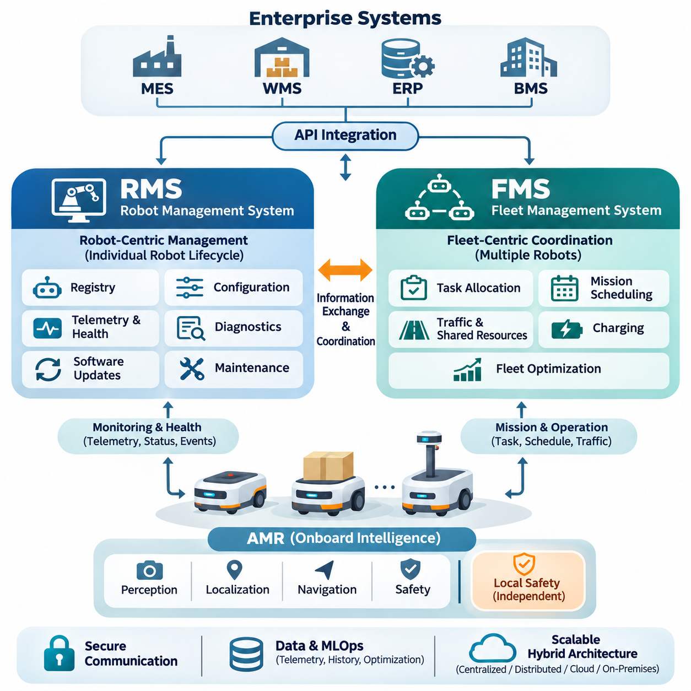
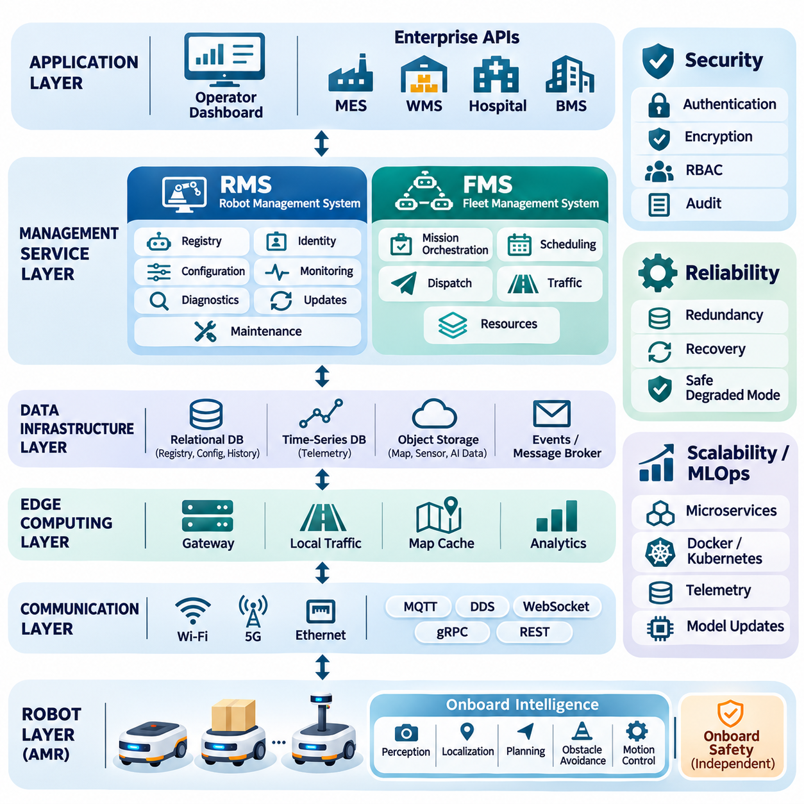
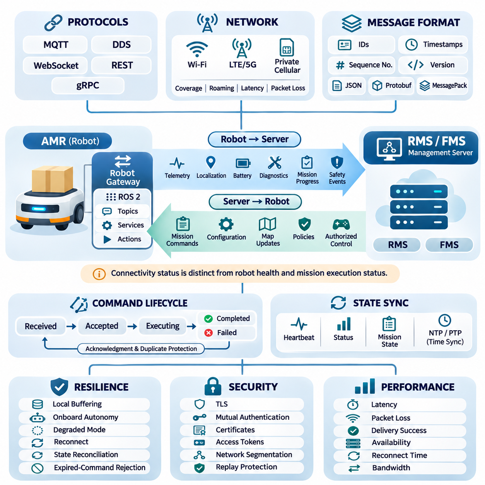
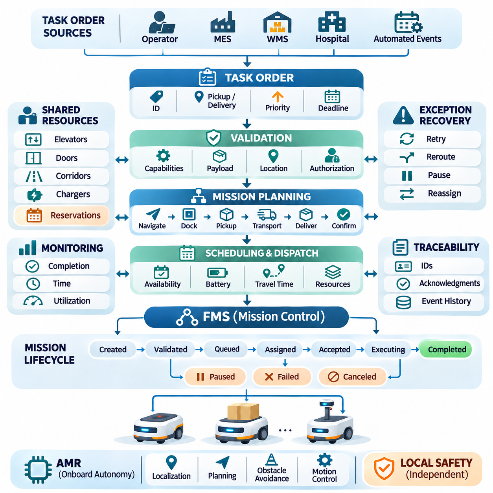
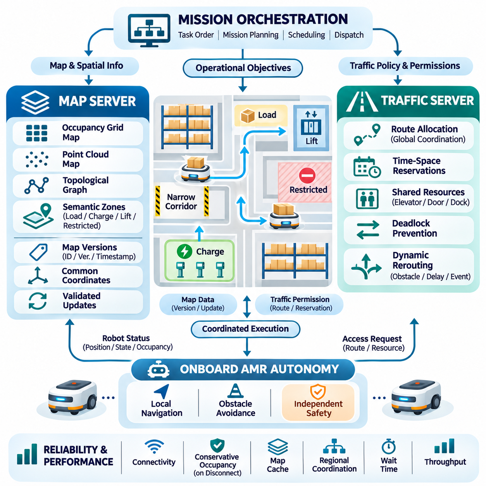
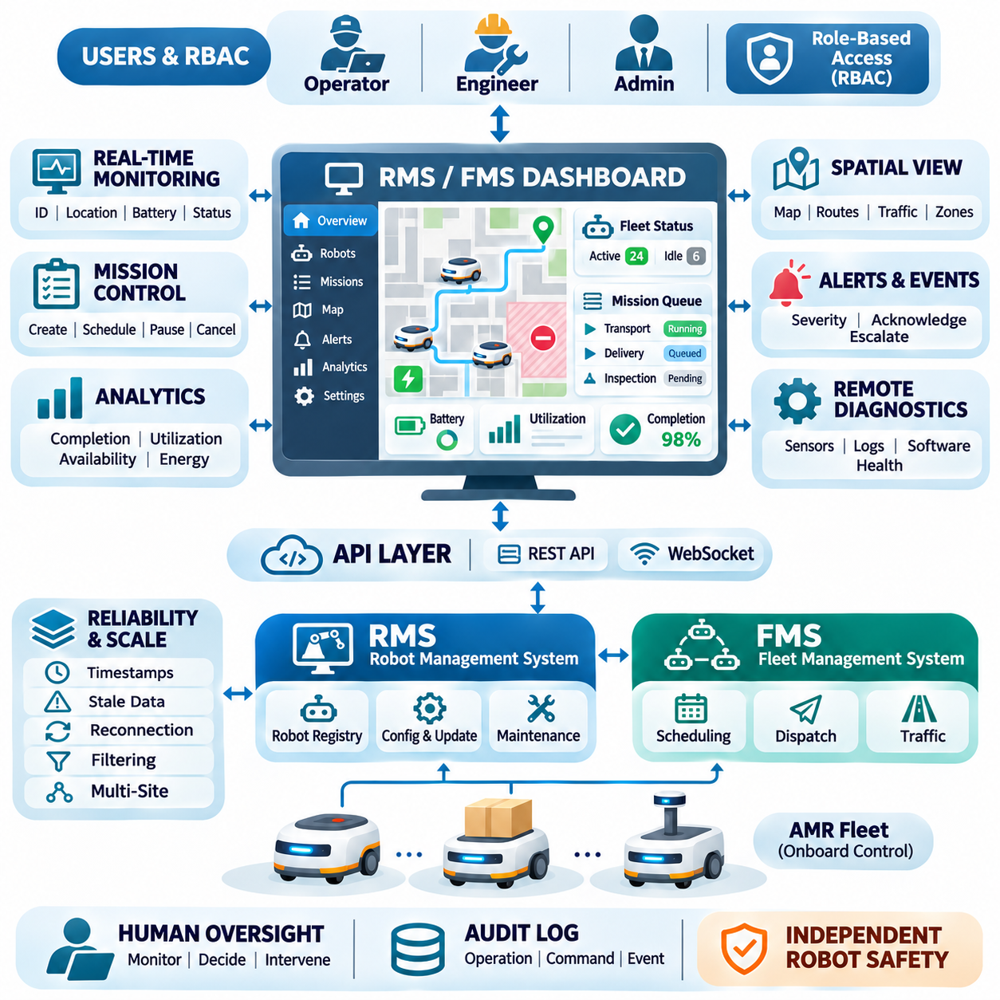
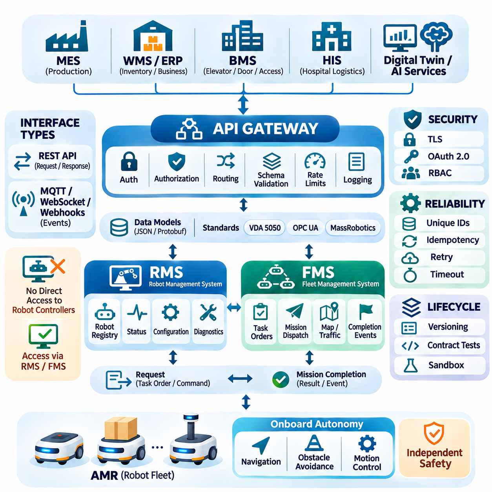
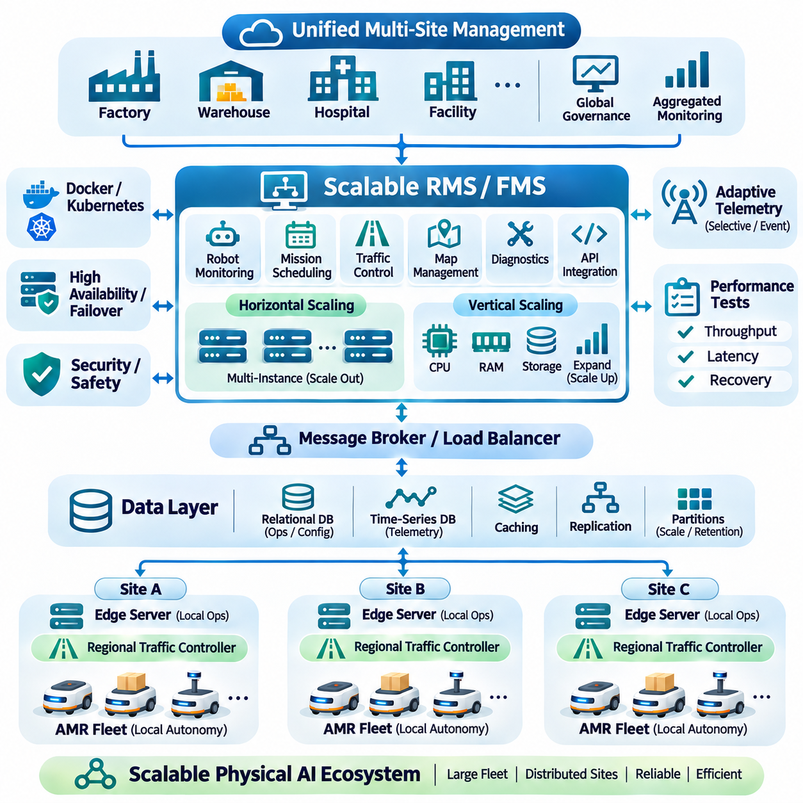

**Volume 08. AMR Operations, Deployment, and MLOps**

# Chapter 05. RMS and FMS Architecture

## 05.1 RMS and FMS Definition

{width="7.268055555555556in" height="7.268055555555556in"}

The Robot Management System (RMS) and Fleet Management System (FMS) are essential software platforms for managing, coordinating, monitoring, and optimizing Autonomous Mobile Robot (AMR) operations. While individual robots possess autonomous navigation, perception, and control capabilities, RMS and FMS provide higher-level operational intelligence that enables robots to function as integrated components of an industrial automation ecosystem.

The Robot Management System primarily focuses on the operational management of individual robots throughout their service lifecycle. Its responsibilities include robot registration, device configuration, operational status monitoring, remote diagnostics, software version management, maintenance scheduling, and remote assistance. RMS establishes a centralized environment through which operators can supervise and maintain distributed robotic assets.

The Fleet Management System primarily focuses on the coordination and optimization of multiple robots operating within shared physical environments. FMS manages task allocation, mission scheduling, traffic coordination, resource utilization, charging priorities, and operational workload distribution. Its fundamental objective is to maximize collective productivity while minimizing operational conflicts, unnecessary movements, and resource consumption.

The distinction between RMS and FMS can be understood through their respective management perspectives. RMS adopts a robot-centric approach, emphasizing the availability, reliability, configuration, and operational health of individual robotic assets. FMS adopts a fleet-centric approach, emphasizing collective task execution, coordinated behavior, and system-wide performance. Both systems complement each other through continuous information exchange.

In practical AMR deployments, RMS maintains a centralized robot registry containing unique identifiers, hardware specifications, software versions, operational capabilities, network information, and maintenance histories. Each registered robot periodically transmits telemetry regarding its battery condition, positioning status, sensor availability, computational resources, and diagnostic events. This information establishes the foundation for operational visibility.

FMS utilizes information collected from individual robots to determine how operational resources should be allocated. When a new transportation, inspection, cleaning, or delivery request is generated, FMS evaluates robot availability, geographical position, remaining battery capacity, mission priority, and equipment compatibility. Based on these conditions, the system selects an appropriate robot and supervises its mission execution.

Another fundamental responsibility of FMS is traffic management within environments where multiple robots share corridors, intersections, elevators, docking stations, and restricted operational zones. The system coordinates access to shared resources through reservation mechanisms, priority policies, and conflict resolution strategies. Individual robots retain responsibility for local obstacle avoidance and safety-related motion control.

The relationship between RMS, FMS, and onboard robot intelligence establishes a hierarchical operational architecture. Onboard computing systems execute perception, localization, navigation, motion control, and immediate environmental responses. RMS provides device-level supervision and lifecycle management, while FMS coordinates higher-level missions and collective operational decisions across the entire robotic fleet.

Communication between robots and management platforms relies on structured data exchange through network interfaces and standardized messaging mechanisms. Robot telemetry, mission commands, acknowledgments, configuration parameters, and operational events are exchanged between distributed components. Communication reliability, message ordering, authentication, and synchronization are important prerequisites for maintaining consistent operational states.

RMS and FMS may be implemented through centralized, distributed, cloud-based, on-premises, or hybrid architectures. Centralized systems simplify global supervision and resource coordination, whereas distributed architectures can improve resilience and local responsiveness. Hybrid architectures combine local operational services with centralized analytics, remote management, and enterprise-level coordination across geographically separated facilities.

Operational safety represents a fundamental requirement for both management systems. RMS monitors safety-related events, equipment faults, and abnormal operating conditions, while FMS coordinates operational restrictions and shared resource access. However, neither conventional RMS nor FMS should replace independently validated onboard safety functions. Robots must maintain appropriate safe behavior even when communication with management servers becomes unavailable.

Integration with external enterprise systems extends the operational capabilities of RMS and FMS beyond individual robotic applications. Manufacturing Execution Systems (MES), Warehouse Management Systems (WMS), Enterprise Resource Planning (ERP), and Building Management Systems (BMS) can generate operational requests and receive execution results. Such integration enables robots to participate directly in automated organizational workflows.

RMS and FMS also establish important foundations for robotic data engineering and Machine Learning Operations (MLOps). Operational telemetry, mission histories, navigation failures, environmental observations, and abnormal events provide valuable information for continuous improvement. These datasets can support predictive maintenance, AI model validation, operational optimization, and controlled deployment of updated software and intelligence capabilities.

As robotic deployments expand from individual machines to hundreds or thousands of interconnected assets, RMS and FMS must accommodate increasing communication volumes, concurrent missions, heterogeneous hardware, and geographically distributed environments. Modular services, scalable infrastructure, standardized interfaces, and fault-tolerant mechanisms become increasingly important for maintaining operational continuity and sustainable system growth.

The functional boundaries between RMS and FMS are not universally standardized, and commercial robotics platforms frequently combine both responsibilities within a unified management environment. Nevertheless, distinguishing individual asset management from collective operational coordination provides a useful architectural foundation. This distinction supports systematic software development, clear responsibility allocation, and long-term platform maintainability.

Ultimately, RMS and FMS transform independently autonomous robots into coordinated, observable, maintainable, and scalable robotic ecosystems. Their integration establishes the operational foundation for industrial automation, intelligent logistics, hospital services, outdoor inspection, and emerging Physical AI applications. As robotic intelligence evolves, these management platforms will increasingly support adaptive fleet coordination, continuous learning, and autonomous operational optimization.

## 05.2 System Architecture

{width="7.268055555555556in" height="7.268055555555556in"}

The system architecture of a Robot Management System (RMS) and Fleet Management System (FMS) establishes the technical foundation for operating, monitoring, coordinating, and maintaining Autonomous Mobile Robots (AMRs) within distributed industrial environments. A well-designed architecture integrates onboard robot intelligence, communication infrastructure, operational management services, enterprise applications, and data processing platforms into a unified operational ecosystem.

A layered architecture provides a systematic approach to separating operational responsibilities and managing system complexity. A representative architecture consists of the robot layer, communication layer, edge computing layer, management service layer, data infrastructure layer, and application layer. Each layer performs specific functions while interacting with adjacent layers through standardized interfaces, enabling independent development, maintenance, and scalability.

The robot layer represents the physical execution environment of the system. Each AMR integrates sensors, actuators, embedded controllers, onboard computing platforms, and autonomous navigation software. Robots independently perform perception, localization, path planning, obstacle avoidance, and motion control. Local execution capabilities allow robots to respond to dynamic environmental conditions without depending on continuous communication with centralized management servers.

The communication layer establishes connectivity between robots, management servers, edge computing devices, and external applications. Wireless technologies such as Wi-Fi, LTE, and 5G support distributed robot operations, while Ethernet provides reliable connections within fixed infrastructure. Communication protocols such as MQTT, DDS, WebSocket, gRPC, and REST APIs can support different requirements for telemetry exchange, event distribution, command transmission, and service integration.

The edge computing layer provides localized processing capabilities between individual robots and centralized management infrastructure. Edge servers may execute data aggregation, communication gateways, local traffic coordination, map distribution, and operational analytics. By processing selected workloads near the physical operating environment, edge computing reduces communication latency, minimizes external network dependency, and improves operational resilience during connectivity disruptions.

The RMS service architecture focuses on managing individual robotic assets throughout their operational lifecycle. Core services include robot registration, identity management, configuration management, status monitoring, remote diagnostics, software deployment, and maintenance history management. These services establish a consistent representation of each robot, allowing operators to identify equipment conditions, evaluate availability, and manage configuration changes across distributed installations.

The FMS service architecture focuses on coordinating collective robot operations through mission management, task scheduling, dispatching, traffic management, and resource allocation. A mission orchestration service converts operational requests into executable assignments, while scheduling services evaluate robot capabilities, availability, location, and energy conditions. Traffic management services coordinate access to shared physical resources and reduce conflicts between concurrent robot missions.

The data infrastructure layer provides persistent storage and processing capabilities for operational information generated throughout the robotic ecosystem. Relational databases can maintain robot registries, user accounts, configuration records, and mission histories. Time-series databases support telemetry and performance monitoring, while object storage accommodates sensor recordings, maps, diagnostic files, and AI training datasets. Data retention policies establish appropriate storage lifecycles.

Event-driven architecture is particularly suitable for distributed robot management because operational conditions continuously change. Robot status updates, mission completion events, battery warnings, communication failures, and safety notifications can be published through message brokers and consumed by relevant services. Asynchronous communication reduces direct service dependencies, supports concurrent processing, and enables additional monitoring or analytical services to subscribe to operational events.

A microservices architecture allows RMS and FMS capabilities to be implemented as independently deployable software components. Robot management, mission orchestration, map management, authentication, notification, and reporting services can operate within separate execution environments. Containerization and orchestration technologies such as Docker and Kubernetes support consistent deployment, resource isolation, service recovery, and horizontal scaling when justified by operational complexity.

The application layer provides interfaces through which operators, administrators, maintenance engineers, and enterprise applications interact with the robotic ecosystem. Web-based dashboards visualize robot locations, mission progress, battery status, traffic conditions, and operational alerts. Application Programming Interfaces (APIs) enable integration with manufacturing, warehouse, hospital, and building management systems while maintaining controlled access to operational functions and data.

Security must be incorporated throughout the architecture rather than implemented as an isolated application feature. Device authentication, encrypted communication, role-based access control, network segmentation, credential management, and audit logging protect distributed robotic assets. Management services must validate command authorization and maintain traceable records of configuration changes. Independently validated onboard safety mechanisms must remain effective during server or network failures.

System reliability depends on redundancy, fault isolation, state synchronization, and recovery mechanisms. Critical management services may employ replicated instances, database backups, persistent message queues, and automated failover procedures. Communication recovery must reconcile robot and server states without duplicating mission execution. Robots should enter predefined safe or degraded operating modes whenever essential coordination services become unavailable.

A scalable RMS and FMS architecture also establishes the foundation for continuous operational improvement and Machine Learning Operations (MLOps). Operational telemetry, mission histories, failure events, and environmental observations can support predictive maintenance, AI model evaluation, and controlled software updates. Ultimately, modular and interoperable architecture enables AMR deployments to evolve into distributed Physical AI ecosystems with coordinated intelligence, operational resilience, and sustainable lifecycle management.

## 05.3 Robot-Server Communication

{width="7.268055555555556in" height="7.268055555555556in"}

Robot-server communication represents a fundamental component of Robot Management System (RMS) and Fleet Management System (FMS) architectures. It establishes the communication infrastructure through which Autonomous Mobile Robots (AMRs) exchange operational information, receive mission commands, report execution results, and maintain synchronized system states. Reliable communication enables distributed robotic assets to operate as a coordinated ecosystem.

Robot-server communication generally follows a bidirectional communication model. Robots transmit operational telemetry, localization information, battery conditions, diagnostic messages, mission progress, and safety events to management servers. In the opposite direction, servers distribute mission assignments, configuration parameters, map updates, operational policies, and authorized remote control commands. Each communication direction requires appropriate reliability and latency characteristics.

Communication requirements vary according to the operational characteristics of exchanged information. High-frequency telemetry requires efficient transmission with controlled bandwidth consumption, while mission commands require reliable delivery and execution acknowledgment. Safety-related notifications require prioritized handling, whereas large files such as maps, sensor recordings, and software packages require dedicated transfer mechanisms that avoid disrupting essential communication.

Several communication protocols can support robot-server integration. Message Queuing Telemetry Transport (MQTT) provides lightweight publish-subscribe communication suitable for distributed robotic devices. Data Distribution Service (DDS) supports configurable Quality of Service (QoS) policies, while WebSocket enables persistent bidirectional connections. REST APIs and gRPC provide structured interfaces for service requests, configuration management, and enterprise integration.

Wireless network infrastructure significantly influences communication performance in AMR deployments. Indoor robots typically utilize industrial Wi-Fi networks, while outdoor robots may depend on LTE, 5G, or private cellular infrastructure. Network design must consider coverage, interference, roaming performance, bandwidth availability, packet loss, and communication latency. Multiple communication interfaces can provide redundancy when operational requirements justify additional complexity.

A robot communication gateway provides an abstraction layer between onboard robotic software and external management services. In ROS 2-based systems, the gateway can translate internal topics, service requests, actions, and diagnostic messages into externally accessible communication formats. This approach reduces dependencies between onboard software and server implementations while preventing unnecessary exposure of internal robot communication networks.

Message structures must be standardized to ensure consistent interpretation across distributed components. Each operational message should contain relevant identifiers, timestamps, message types, sequence numbers, protocol versions, and application-specific payloads. Serialization formats such as JSON, Protocol Buffers, and MessagePack offer different advantages regarding readability, processing efficiency, bandwidth consumption, and compatibility with heterogeneous robotic platforms.

Communication state management maintains consistency between robots and management servers. Heartbeat messages periodically indicate device connectivity, while status reports describe operational conditions and mission execution states. When heartbeat messages are missing beyond a configured threshold, the server should classify the robot as disconnected or unreachable. Connectivity status must remain distinct from physical robot health and actual mission execution status.

Reliable mission communication requires more than successful network-level message delivery. Each mission command should include a unique identifier, execution parameters, validity conditions, and acknowledgment requirements. Application-level acknowledgments distinguish command reception, acceptance, execution, completion, and failure. Idempotent command processing and duplicate detection prevent repeated execution when communication retries or server recovery procedures occur.

Time synchronization is essential for correlating distributed operational events and reconstructing robot behavior. Network Time Protocol (NTP) can support general operational timestamp synchronization, while Precision Time Protocol (PTP) may be required for higher-precision applications. Timestamp accuracy supports telemetry analysis, incident investigation, mission sequencing, and multi-robot coordination. Synchronization errors and communication delays should be independently monitored.

Communication interruptions must be treated as expected operational conditions rather than exceptional system failures. Robots should maintain appropriate onboard autonomy, buffer selected operational messages locally, and follow predefined degraded operating policies when server connectivity becomes unavailable. Depending on mission requirements and safety constraints, robots may complete authorized activities, navigate to designated waiting locations, or perform controlled stops.

Communication recovery requires systematic reconciliation of distributed operational states. After reconnection, robots and servers should exchange current mission information, command identifiers, configuration versions, and relevant event histories. Buffered telemetry may be uploaded according to priority and available bandwidth. Expired commands must not be automatically executed, and resource reservations must be revalidated before coordinated operations resume.

Cybersecurity is an integral requirement of robot-server communication architecture. Transport Layer Security (TLS), mutual authentication, device certificates, access tokens, and network segmentation can protect communication channels. Servers must verify robot identities and command authorization, while robots must reject unauthorized or invalid requests. Credential rotation, replay protection, and communication audit records further strengthen operational security.

Communication scalability becomes increasingly important as robotic fleets expand across multiple facilities. Message brokers, asynchronous processing, connection management, telemetry aggregation, and load balancing can distribute communication workloads across server infrastructure. Adaptive reporting frequencies and event-based data transmission reduce unnecessary network traffic. Backpressure mechanisms prevent excessive message accumulation from destabilizing essential management services.

Communication performance should be continuously evaluated using measurable indicators such as end-to-end latency, packet loss, message delivery success rate, connection availability, reconnection time, and bandwidth utilization. Operational testing should reproduce network congestion, access point transitions, server restarts, and extended communication interruptions. Ultimately, robust robot-server communication enables reliable fleet coordination, operational visibility, and scalable Physical AI deployment.

## 05.4 Task Order and Mission Control

{width="7.268055555555556in" height="7.268055555555556in"}

Task order and mission control represent essential functional components of Robot Management System (RMS) and Fleet Management System (FMS) architectures. These components transform operational requests into executable robotic activities, coordinate mission execution, and maintain operational consistency across distributed Autonomous Mobile Robots (AMRs). Their primary objective is to ensure reliable, efficient, traceable, and safe execution of physical tasks.

A task order represents a structured operational request defining what activity must be performed within a robotic environment. Typical task orders include material transportation, medical supply delivery, facility inspection, autonomous patrol, cleaning, and equipment handling. Each task order specifies relevant operational information, including task identifiers, source and destination locations, execution requirements, priority levels, and completion conditions.

A mission represents an executable operational sequence derived from a task order. While a task order describes the desired operational outcome, a mission defines how a robot or group of robots will achieve that outcome. A transportation mission, for example, may include navigation to a pickup location, docking, payload acquisition, transportation, payload delivery, and confirmation of successful completion before returning to an available operating state.

Task orders may originate from human operators, enterprise applications, automated scheduling systems, environmental events, or other robotic systems. Manufacturing Execution Systems (MES), Warehouse Management Systems (WMS), and hospital information systems can generate operational requests through standardized interfaces. The management platform validates incoming requests, assigns unique identifiers, and records their operational requirements.

Task order validation prevents invalid or infeasible requests from entering the mission execution pipeline. Validation procedures evaluate location availability, robot capabilities, payload requirements, environmental restrictions, resource availability, and user authorization. Requests containing incomplete information or conflicting requirements should be rejected or redirected for operator review rather than automatically dispatched to physical robots.

Mission planning converts validated task orders into structured execution sequences. A mission may consist of multiple actions organized through state machines, behavior trees, workflow engines, or directed acyclic graphs. Each action defines execution parameters, prerequisites, expected results, timeout conditions, and exception handling procedures. Modular mission definitions allow reusable operational behaviors to support diverse robotic applications.

Task scheduling determines when individual missions should be executed and how operational resources should be allocated. Scheduling algorithms evaluate mission priority, execution deadlines, robot availability, estimated travel time, battery capacity, and resource dependencies. Dynamic scheduling allows the management system to adjust execution plans when urgent requests, equipment failures, environmental changes, or unexpected delays occur.

Mission dispatching assigns scheduled missions to suitable robots according to their operational capabilities and current conditions. The dispatching service considers robot type, payload capacity, installed equipment, geographical position, software compatibility, and remaining energy. Each assignment must be acknowledged by the selected robot before execution begins, preventing inconsistent task ownership and unnecessary duplication of physical activities.

Mission lifecycle management establishes standardized operational states throughout the execution process. Representative states include created, validated, queued, assigned, accepted, executing, paused, completed, failed, and canceled. State transitions should follow explicitly defined conditions and authorization rules. Maintaining persistent mission states enables management servers to reconstruct execution histories and recover operational workflows after interruptions.

Mission control must preserve a clear separation between centralized coordination and onboard autonomous execution. Management servers determine operational objectives, mission sequences, and coordination constraints, while onboard systems execute localization, path planning, obstacle avoidance, and motion control. Independently validated safety functions must retain authority over robot motion regardless of mission priority or centralized execution commands.

Exception handling is critical because physical environments are inherently dynamic and uncertain. Blocked pathways, docking failures, unavailable elevators, communication interruptions, and unexpected battery depletion can prevent normal mission execution. Recovery strategies may include bounded action retries, alternative route selection, temporary suspension, operator intervention, or reassignment to another robot after confirming the original execution state.

Mission control must also coordinate dependencies involving shared physical resources. Elevators, automatic doors, narrow corridors, charging stations, loading equipment, and inspection areas may require exclusive or scheduled access. Resource reservation mechanisms prevent incompatible operations from occurring simultaneously. Reservation timeouts, ownership verification, and release procedures reduce resource conflicts, deadlocks, and unnecessary operational delays.

Reliable mission execution requires synchronization between management servers and distributed robotic assets. Unique task and mission identifiers, command sequence numbers, execution acknowledgments, and persistent event histories support state reconciliation. Idempotent command processing prevents duplicated physical actions during communication retries. Cancellation and reassignment must account for partially completed operations and payload ownership.

Operational monitoring provides visibility into task order processing and mission execution performance. Relevant indicators include task completion rate, mission execution time, queue waiting time, deadline compliance, robot utilization, energy consumption, and intervention frequency. Historical mission records support bottleneck identification, scheduling optimization, incident investigation, and continuous improvement of operational workflows.

Ultimately, integrated task order and mission control enables distributed robotic assets to execute complex operational workflows through coordinated decision-making. Advanced Physical AI architectures can extend conventional scheduling and mission orchestration with predictive analytics, adaptive planning, and learning-based optimization. Such capabilities must remain governed by validated operational constraints, safety requirements, and traceable execution policies.

## 05.5 Map and Traffic Server

{width="7.268055555555556in" height="7.268055555555556in"}

The map and traffic server represents a fundamental infrastructure component of Robot Management System (RMS) and Fleet Management System (FMS) architectures. It provides centralized spatial information management and coordinated traffic control for Autonomous Mobile Robots (AMRs) operating within shared physical environments. Its primary objective is to maintain consistent environmental representations, efficient robot movements, and reliable access to shared operational resources.

The map server manages spatial information required for autonomous navigation and fleet coordination. Depending on operational requirements, map representations may include occupancy grid maps, point cloud maps, topological maps, semantic maps, and high-definition maps. These representations describe environmental geometry, navigable areas, fixed obstacles, transportation routes, and operationally significant locations within industrial facilities or outdoor environments.

Map management extends beyond storing geometrical information about physical environments. Operational maps must incorporate semantic information describing loading stations, charging locations, docking positions, elevators, automatic doors, inspection areas, restricted zones, and emergency access routes. These semantic elements enable management services to associate physical locations with operational functions and translate mission requirements into spatial objectives.

Map version management ensures consistency between robots and centralized management infrastructure. Each map should be associated with a unique identifier, version number, creation timestamp, coordinate reference system, and deployment status. When environmental modifications require map updates, the server must distribute validated map versions through controlled deployment procedures and verify compatibility before allowing robots to resume affected missions.

Coordinate system management is essential for integrating spatial information across heterogeneous robotic platforms. Robots may utilize different local coordinate frames, localization technologies, or map resolutions. The map server establishes common spatial references and transformation relationships, enabling consistent interpretation of robot positions, navigation objectives, and shared operational zones across multiple robots, buildings, floors, and geographically distributed facilities.

The traffic server coordinates robot movements within shared environments to minimize congestion, conflicting routes, and operational delays. Unlike onboard navigation systems that respond to immediate environmental conditions, the traffic server maintains a broader representation of fleet movements and resource occupancy. This global operational perspective enables coordinated route allocation and proactive management of potential traffic conflicts.

Graph-based environmental representations are frequently employed for fleet-level traffic management. Navigable locations are represented as nodes, while transportation routes connecting these locations are represented as edges. Additional attributes may describe travel distance, speed restrictions, directional constraints, robot compatibility, and resource capacity. Such representations support route optimization and traffic coordination without replacing onboard navigation capabilities.

Traffic reservation mechanisms regulate access to shared transportation routes and operational resources. Robots may request permission to enter designated road segments, intersections, narrow corridors, elevators, or docking areas. The traffic server evaluates resource availability and conflicting reservations before granting access. Reservation ownership, validity periods, and confirmed release conditions help maintain consistent resource allocation across distributed robots.

Time-space coordination extends conventional spatial route planning by considering when individual robots are expected to occupy specific locations. By combining estimated arrival times, robot velocities, route dependencies, and resource reservations, the traffic server can identify potential movement conflicts before they occur. Dynamic reservation updates accommodate unexpected delays, local obstacle avoidance, and variations in actual mission execution times.

Deadlock prevention is particularly important in environments containing narrow passages, restricted maneuvering areas, and competing robot movements. A deadlock occurs when multiple robots cannot proceed because each depends on resources occupied or reserved by another. Traffic management strategies may employ resource ordering, dependency analysis, designated waiting locations, controlled backtracking, and dynamic route reassignment to prevent or resolve such situations.

Dynamic traffic management enables the fleet to respond to changing operational conditions. Temporary obstacles, maintenance activities, human congestion, unavailable elevators, and unexpected robot failures may require immediate modification of traffic policies. The server can update route availability, establish temporary exclusion zones, adjust traffic priorities, and redistribute robot movements while maintaining consistent operational constraints across affected missions.

Communication reliability directly influences map and traffic server performance. Robots must periodically report their positions, movement states, route progress, and resource occupancy. When communication becomes unavailable, the traffic server must treat uncertain resource occupancy conservatively rather than assume that affected routes are clear. Robots must follow predefined degraded operating policies and retain independently validated onboard safety functions.

Integration between map servers, traffic servers, and mission orchestration services establishes a coordinated operational architecture. Mission services generate transportation objectives, map services provide spatial references, and traffic services determine coordinated movement permissions. Onboard robot intelligence subsequently executes authorized navigation activities while responding to local environmental conditions. Clear functional boundaries improve maintainability, operational reliability, and interoperability.

Scalability and performance evaluation become increasingly important as fleet sizes and operating environments expand. Distributed map caching, regional traffic coordination, incremental map updates, and efficient reservation algorithms can reduce computational and communication overhead. Performance indicators include intersection waiting time, route utilization, congestion frequency, deadlock occurrence, mission delays, and overall transportation throughput.

Ultimately, integrated map and traffic servers establish the spatial coordination foundation for scalable AMR operations. Their capabilities can be extended through digital twins, predictive traffic analytics, multi-agent optimization, and learning-based congestion management. Within emerging Physical AI ecosystems, these technologies can support adaptive spatial intelligence and collective robot coordination while preserving validated operational constraints, safety requirements, and reliable mission execution.

## 05.6 Dashboard and User Interface

{width="7.268055555555556in" height="7.268055555555556in"}

The dashboard and user interface represent essential components of Robot Management System (RMS) and Fleet Management System (FMS) architectures. They provide the primary interaction environment through which operators, administrators, maintenance engineers, and enterprise users monitor and manage Autonomous Mobile Robots (AMRs). A well-designed interface transforms complex distributed robotic operations into accessible and actionable information.

A representative dashboard architecture integrates real-time monitoring, mission management, spatial visualization, operational analytics, system configuration, and incident management. Each functional module presents information appropriate to specific operational responsibilities. Modular interface design allows organizations to customize the operating environment according to facility characteristics, deployment scale, robot capabilities, and user requirements.

Real-time robot monitoring provides continuous visibility into the operational states of individual robotic assets. Typical information includes robot identifiers, connectivity status, current positions, navigation states, battery levels, assigned missions, operating modes, and diagnostic conditions. Consistent visual representations allow operators to identify unavailable robots, abnormal behavior, and emerging operational problems without inspecting individual devices.

Spatial visualization integrates environmental maps with live robot positions and operational information. The dashboard may display navigation routes, mission destinations, traffic reservations, charging stations, restricted zones, and detected obstacles. Multi-floor and multi-site visualization capabilities allow operators to monitor distributed robotic deployments while maintaining awareness of spatial relationships and shared resource occupancy.

Mission management interfaces enable authorized users to create, schedule, modify, prioritize, suspend, and cancel operational requests. Each mission should provide visibility into its execution state, assigned robot, destination, estimated completion time, and historical events. Operator interventions must follow defined authorization procedures and execution constraints to prevent conflicting commands or unintended physical activities.

Fleet visualization provides an aggregated representation of collective robot performance and resource availability. Operators can evaluate active robot counts, mission queues, charging requirements, traffic congestion, and equipment utilization across multiple operational areas. Filtering and grouping capabilities support efficient supervision of heterogeneous robotic platforms with different payload capacities, functional capabilities, and deployment locations.

Alarm and event management interfaces enable operators to recognize and respond to abnormal operational conditions. Alerts may include communication failures, navigation errors, docking failures, battery warnings, sensor abnormalities, and safety-related events. Alert classification, severity levels, acknowledgment procedures, and escalation policies help operators distinguish critical incidents from routine notifications and reduce alarm fatigue.

Operational analytics transforms accumulated robotic data into meaningful performance indicators for management and engineering teams. Dashboard metrics may include mission completion rates, average execution times, robot utilization, system availability, energy consumption, and maintenance frequency. Historical trends and comparative analysis support bottleneck identification, resource optimization, operational planning, and continuous performance improvement.

Remote diagnostic interfaces provide maintenance personnel with access to robot health information and relevant operational records. Diagnostic functions may visualize sensor conditions, actuator temperatures, computing resource utilization, software versions, communication performance, and fault histories. Controlled access to system logs and diagnostic reports helps engineers investigate failures without requiring immediate physical access to every robot.

User interface architecture typically separates presentation components from backend management services through standardized Application Programming Interfaces (APIs). REST APIs can support configuration and historical data retrieval, while WebSocket or similar technologies enable continuous operational updates. This separation allows interface components and management services to evolve independently while maintaining consistent operational data models.

Human-Machine Interface (HMI) design must prioritize operational clarity, usability, and situational awareness. Consistent terminology, accessible color schemes, intuitive navigation, and appropriate information density reduce cognitive workload. Critical warnings should remain visually distinguishable without relying exclusively on color. Frequently used functions should be accessible while potentially hazardous commands require deliberate user confirmation.

Role-Based Access Control (RBAC) ensures that users can access only information and operational functions appropriate to their responsibilities. Operators may manage routine missions, maintenance engineers may access diagnostic services, and administrators may configure system policies. Authentication, session management, permission verification, and audit logging establish accountability and reduce unauthorized manipulation of robotic operations.

Dashboard reliability becomes particularly important when management interfaces are used for supervising large robotic fleets. Cached information, connectivity indicators, timestamps, and automatic reconnection mechanisms help users interpret changing communication conditions. Outdated information must be clearly identified, and unavailable communication channels must not be presented as evidence of normal robot operation or successful command execution.

Scalable dashboard design supports deployments ranging from individual robots to geographically distributed fleets containing hundreds or thousands of robotic assets. Data aggregation, selective subscriptions, incremental updates, server-side filtering, and adaptive refresh rates reduce unnecessary computational and network workloads. Responsive interfaces can accommodate control room displays, desktop workstations, tablets, and authorized mobile devices.

Ultimately, dashboard and user interface capabilities establish the human supervision layer of distributed Physical AI ecosystems. Advanced interfaces may incorporate digital twins, predictive analytics, intelligent incident assistance, natural language interaction, and AI-supported operational recommendations. These capabilities should complement autonomous robot intelligence while preserving human oversight, command accountability, operational transparency, and independently validated safety mechanisms.

## 05.7 API and External System Integration

{width="7.268055555555556in" height="7.268055555555556in"}

Application Programming Interfaces (APIs) and external system integration establish the interoperability foundation of Robot Management System (RMS) and Fleet Management System (FMS) architectures. They enable Autonomous Mobile Robots (AMRs) to participate in enterprise workflows, exchange operational information, receive authorized task requests, and coordinate activities with external infrastructure, industrial equipment, and business applications.

A representative integration architecture separates internal robotic services from external applications through standardized interfaces. External systems interact with management platforms rather than directly accessing individual robot controllers. This architectural separation reduces system dependencies, protects internal implementation details, and enables independent development and maintenance of robotic and enterprise software components.

RESTful APIs provide a widely adopted mechanism for exchanging structured information between management platforms and external applications. Typical API functions include robot registration, status retrieval, task order creation, mission cancellation, map information retrieval, and operational history access. HTTP methods, standardized response codes, and consistent resource definitions support predictable communication across heterogeneous software environments.

Asynchronous communication complements conventional request-response interfaces when operational events occur continuously. Message brokers, MQTT, WebSocket connections, and webhook notifications can distribute mission completion events, robot status changes, diagnostic warnings, and resource availability updates. Event-driven integration reduces unnecessary polling and enables external applications to respond dynamically to changing robotic operations.

Standardized data models are essential for maintaining semantic consistency across integrated systems. Task orders, robot descriptions, mission states, location identifiers, timestamps, and resource information must follow clearly defined schemas. JSON, Protocol Buffers, and other serialization formats support structured data exchange, while schema validation prevents incomplete or incompatible information from entering operational workflows.

Integration with Manufacturing Execution Systems (MES) enables robotic operations to participate directly in industrial production processes. Manufacturing applications can generate material transportation requests according to production schedules, assembly requirements, and workstation conditions. The FMS converts these requests into executable missions and reports completion results, supporting synchronized production and material supply activities.

Warehouse Management System (WMS) and Enterprise Resource Planning (ERP) integration connects robotic transportation with inventory management, order fulfillment, procurement, and enterprise resource allocation. External applications specify required material movements, while the FMS determines suitable robot assignments and execution sequences. Confirmed delivery events support inventory reconciliation and traceable logistics operations.

Building Management System (BMS) integration enables robots to interact with elevators, automatic doors, access control systems, and facility infrastructure. Standardized interfaces or dedicated gateways translate robot requests into facility-specific commands. Resource availability, access authorization, operation confirmation, and exception handling must be coordinated to prevent incompatible physical activities and operational disruptions.

Hospital Information System (HIS) integration allows AMRs to participate in medical supply delivery, specimen transportation, pharmaceutical distribution, and other hospital logistics workflows. Integration interfaces must maintain appropriate data confidentiality, operational priorities, delivery traceability, and access restrictions. Only information necessary for robotic mission execution should be exchanged between clinical and robot management systems.

Industrial interoperability standards can reduce integration complexity across heterogeneous robotic fleets and automation equipment. VDA 5050 defines interfaces between mobile robots and fleet control systems, while OPC Unified Architecture (OPC UA) supports structured industrial information exchange. MassRobotics AMR interoperability specifications provide shared operational information models. Their applicability depends on deployment requirements and supported capabilities.

An API gateway provides a centralized entry point for external applications accessing distributed management services. Gateway functions may include authentication, authorization, request routing, schema validation, rate limiting, protocol conversion, and communication logging. This architecture simplifies external connectivity while protecting internal services from excessive workloads, unauthorized requests, and unnecessary direct exposure.

API security must be incorporated throughout the integration lifecycle. Transport Layer Security (TLS), mutual authentication, OAuth 2.0, access tokens, and role-based permissions can protect communication channels and operational resources. External requests must be validated against authorized capabilities, mission restrictions, and operational policies. Independently validated robot safety functions must remain authoritative over physical execution.

Integration reliability requires systematic handling of communication failures, duplicated requests, delayed responses, and inconsistent system states. Unique transaction identifiers, idempotency mechanisms, bounded retries, timeout policies, and persistent event records support reliable processing. External applications must distinguish request acceptance from physical mission completion to prevent premature business transactions or duplicate robotic activities.

API lifecycle management ensures long-term compatibility as robotic platforms and enterprise applications evolve. Interface documentation, version management, backward compatibility, automated contract testing, and controlled deprecation policies reduce integration risks. Simulation environments and sandbox interfaces allow external developers to validate operational workflows before connecting applications to production robotic infrastructure.

Ultimately, API and external system integration transforms isolated robotic deployments into interconnected Physical AI ecosystems. Standardized interfaces can connect robotic fleets with digital twins, data platforms, AI inference services, and intelligent orchestration systems. Modular, secure, and scalable integration architectures establish the foundation for cross-domain automation, collective intelligence, and continuous operational improvement.

## 05.8 RMS/FMS Scalability

{width="7.268055555555556in" height="7.268055555555556in"}

Robot Management System (RMS) and Fleet Management System (FMS) scalability refers to the ability of management infrastructure to accommodate increasing numbers of Autonomous Mobile Robots (AMRs), operational environments, mission requests, and data workloads without unacceptable performance degradation. A scalable architecture must maintain operational reliability, communication efficiency, resource coordination, and consistent management capabilities as deployments expand.

Scalability requirements extend beyond the number of connected robots. Increasing fleet sizes generate additional telemetry, mission assignments, traffic reservations, diagnostic events, software updates, and enterprise integration requests. Environmental complexity, robot heterogeneity, operational density, and geographic distribution also influence system workloads. Capacity planning must therefore consider multiple dimensions of operational growth.

Vertical scaling increases the computational capacity of individual servers by expanding processor performance, memory, storage, and network bandwidth. Although this approach simplifies infrastructure management during early deployments, individual servers eventually encounter physical and economic limitations. Horizontal scaling distributes workloads across multiple server instances, providing greater flexibility, fault tolerance, and long-term expansion capabilities.

A modular service architecture supports independent scaling of RMS and FMS capabilities. Robot monitoring, mission scheduling, traffic coordination, map management, diagnostic processing, and external integration can be implemented as separate services. Each service can receive computational resources according to its workload characteristics, reducing unnecessary infrastructure expansion and preventing individual processing bottlenecks from affecting the entire system.

Distributed communication infrastructure becomes increasingly important as robot populations expand. Message brokers, asynchronous communication mechanisms, load balancers, and connection management services distribute communication workloads across multiple processing nodes. Selective telemetry subscriptions, adaptive reporting frequencies, and event-driven communication reduce network congestion while maintaining access to essential operational information.

Database scalability requires appropriate separation of operational records, telemetry streams, configuration information, and historical datasets. Relational databases can manage transactional information, while time-series databases support continuous telemetry ingestion and analysis. Database partitioning, replication, indexing, caching, and data retention policies improve processing efficiency and accommodate increasing storage requirements.

Mission scheduling scalability depends on the computational complexity of allocating tasks across expanding robotic fleets. Centralized scheduling may become inefficient when thousands of mission requests compete for limited operational resources. Hierarchical scheduling, regional task allocation, incremental optimization, and distributed decision-making can reduce processing overhead while maintaining mission priorities and operational constraints.

Traffic management presents significant scalability challenges because potential interactions increase as more robots operate within shared physical environments. Regional traffic controllers, hierarchical route planning, distributed reservation mechanisms, and congestion prediction can reduce coordination complexity. Global management services must maintain consistent resource ownership and coordination policies across independently managed operational regions.

Edge computing provides localized processing capabilities that reduce dependency on centralized management infrastructure. Regional edge servers can perform telemetry aggregation, map caching, communication management, local mission coordination, and operational analytics. This distributed architecture reduces communication latency and enables predefined local operations to continue during temporary disruption of cloud or central server connectivity.

Multi-site management enables organizations to operate geographically distributed robotic deployments through a unified management environment. Each facility may maintain independent operational maps, resource configurations, mission queues, and traffic management policies. Centralized services provide aggregated performance monitoring, configuration governance, software distribution, and enterprise-level coordination without requiring centralized execution of every local operation.

High availability and fault tolerance must be maintained as management infrastructure becomes increasingly distributed. Redundant service instances, replicated databases, persistent message queues, health monitoring, and automated failover mechanisms reduce dependence on individual components. Recovery procedures must preserve mission ownership, resource reservations, and execution states to prevent inconsistent decisions or duplicated physical activities.

Containerization and orchestration technologies provide practical mechanisms for managing scalable software infrastructure. Docker containers establish consistent execution environments, while Kubernetes can support service deployment, workload distribution, resource management, automated recovery, and horizontal scaling. Deployment complexity should remain proportional to operational requirements, infrastructure capabilities, and engineering maintenance resources.

Scalability testing must reproduce representative fleet sizes, communication patterns, mission frequencies, and environmental constraints. Performance indicators include concurrent robot connections, message processing throughput, mission scheduling latency, traffic reservation response time, database utilization, and recovery duration. Stress testing and simulated robot populations help identify infrastructure limitations before large-scale physical deployments.

Ultimately, scalable RMS and FMS architectures establish the operational foundation for distributed Physical AI ecosystems. Hierarchical orchestration, federated management, edge intelligence, and multi-agent optimization can extend fleet coordination toward collective intelligence. Such expansion must preserve validated safety constraints, cybersecurity, operational transparency, and reliable local autonomy throughout the robotic system lifecycle.
