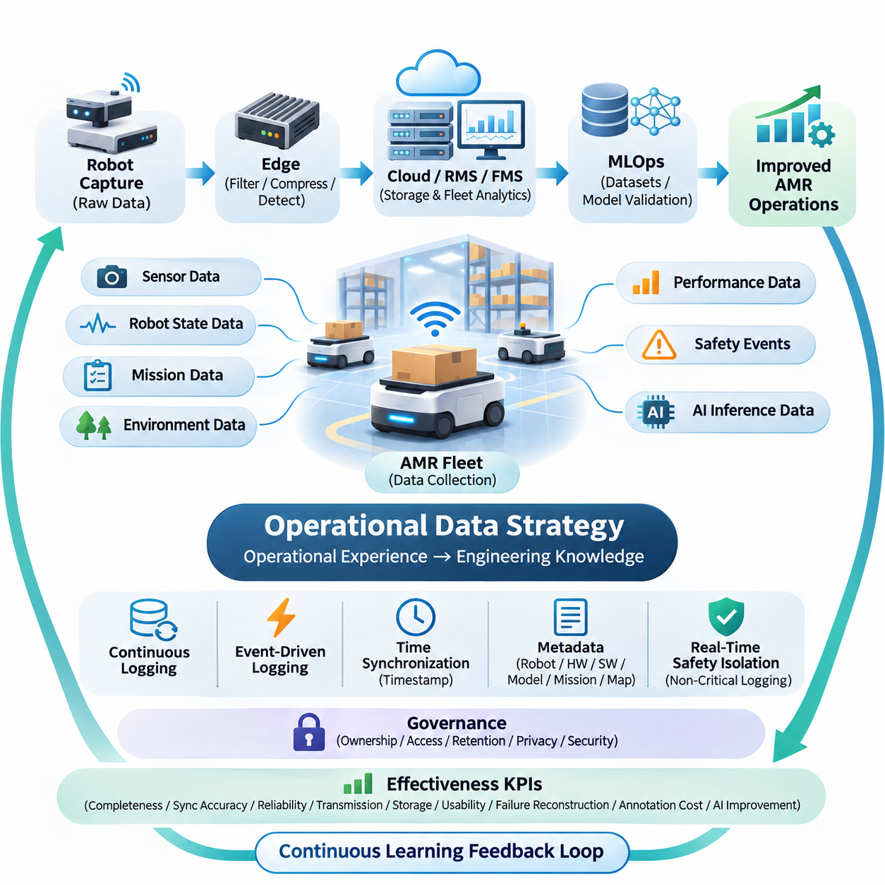
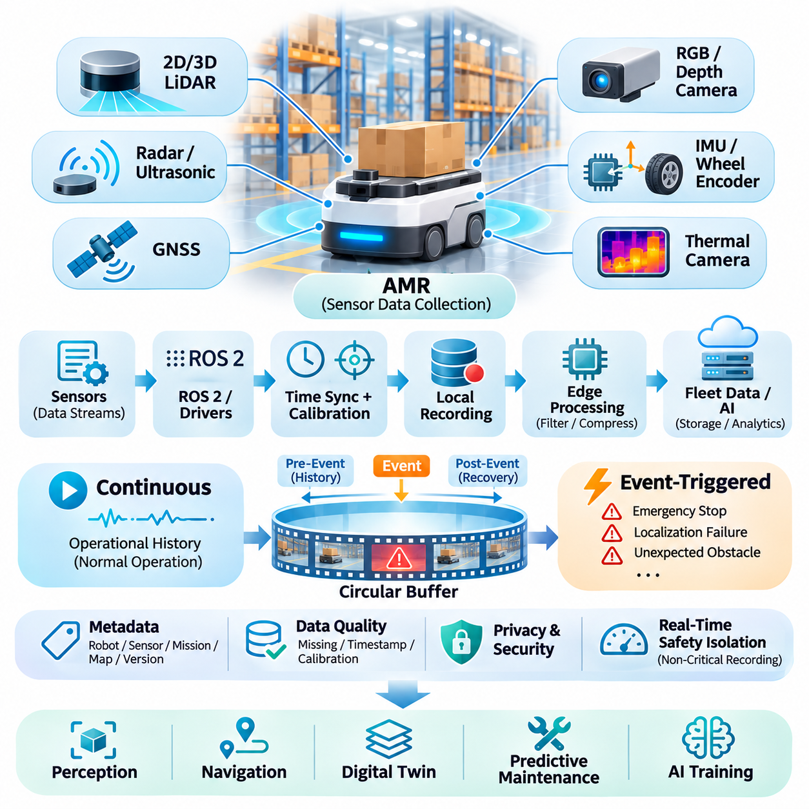
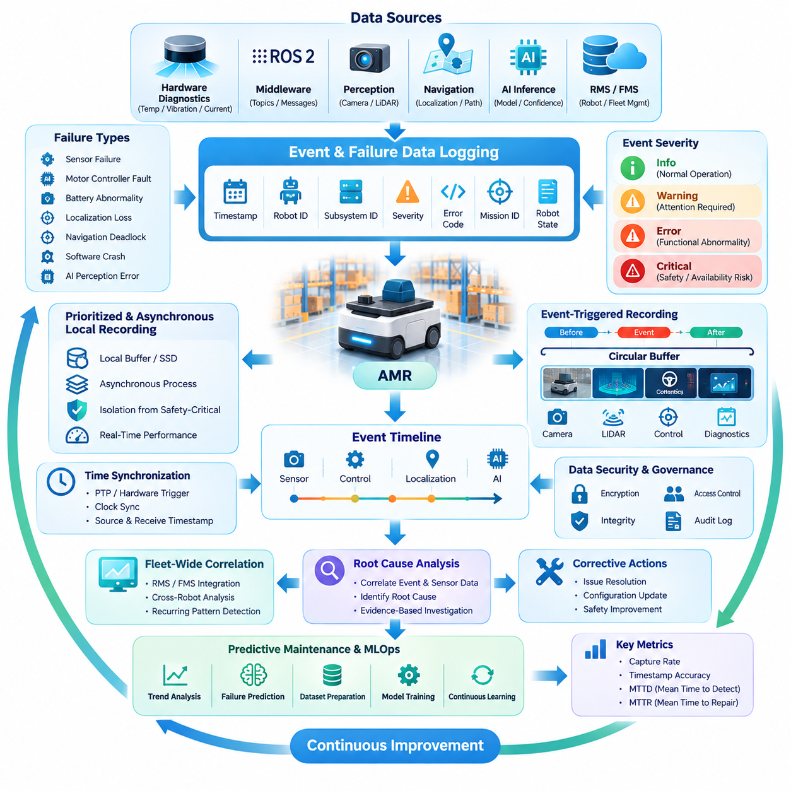
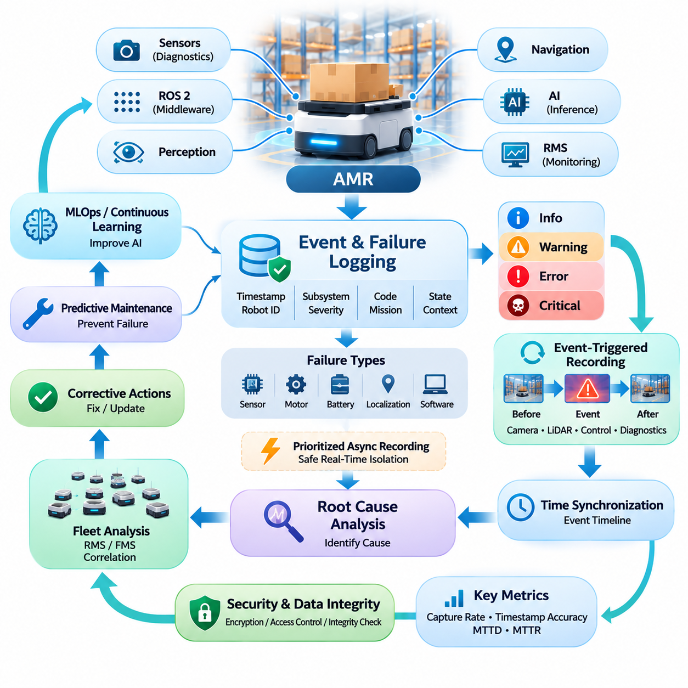
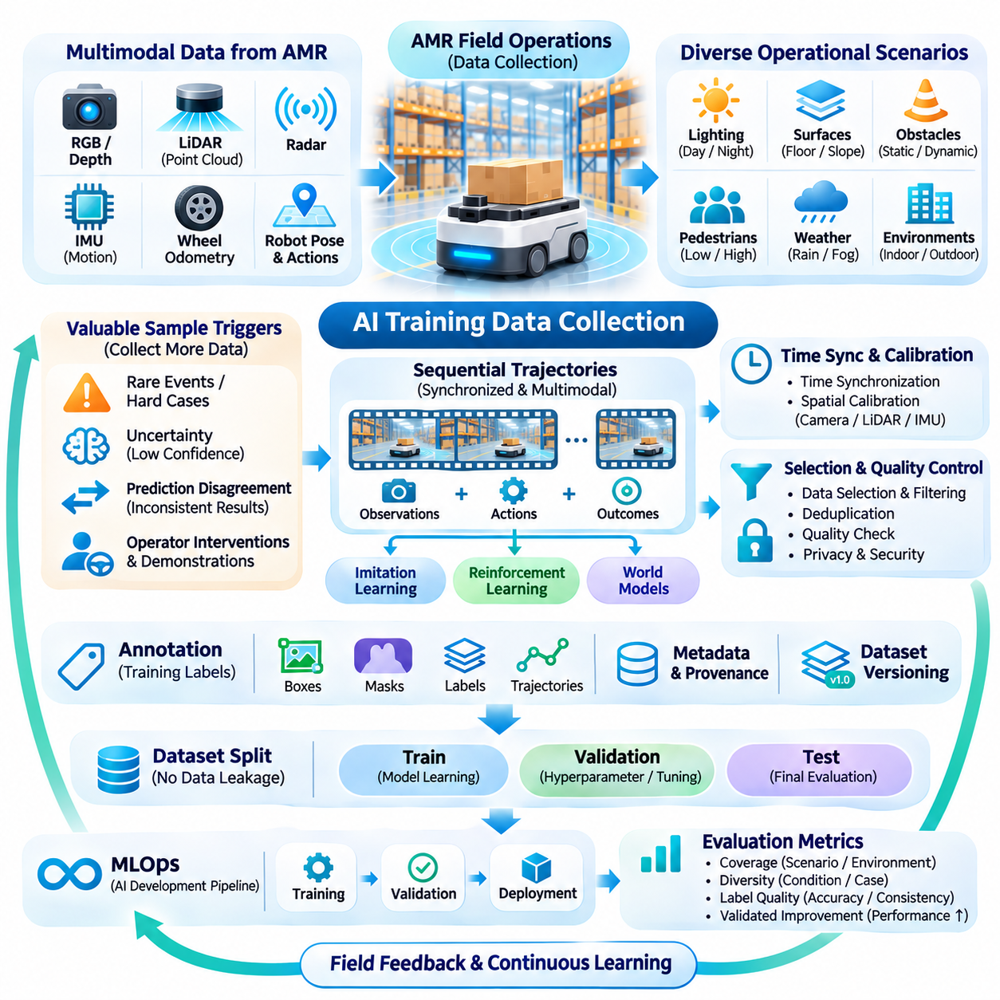
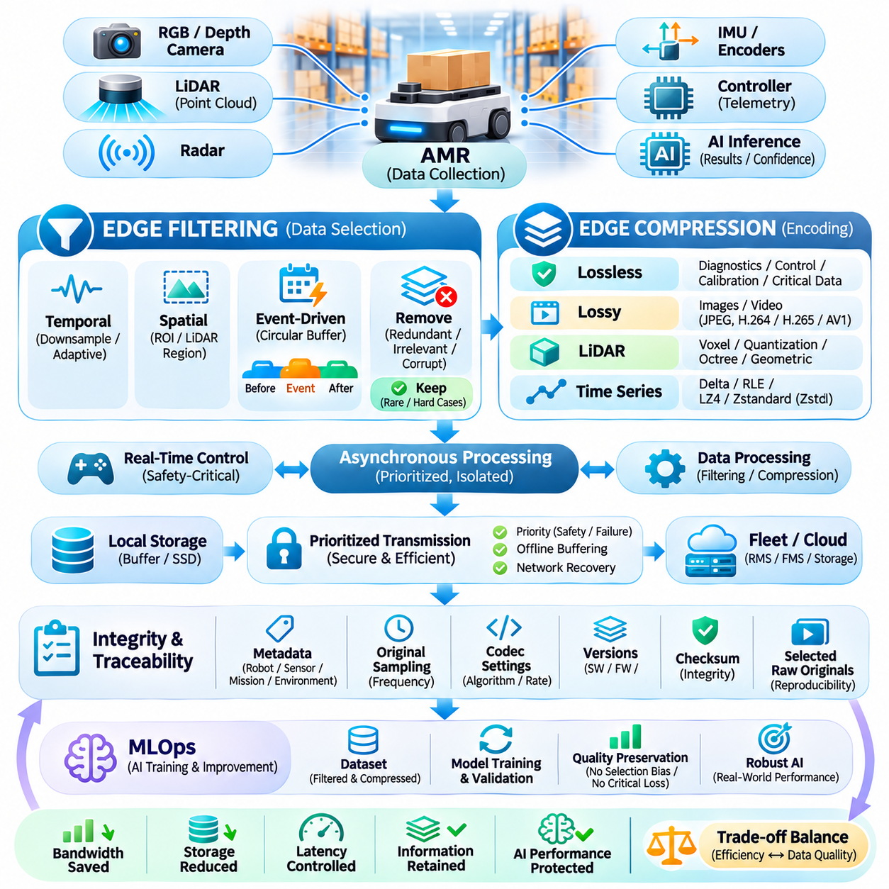
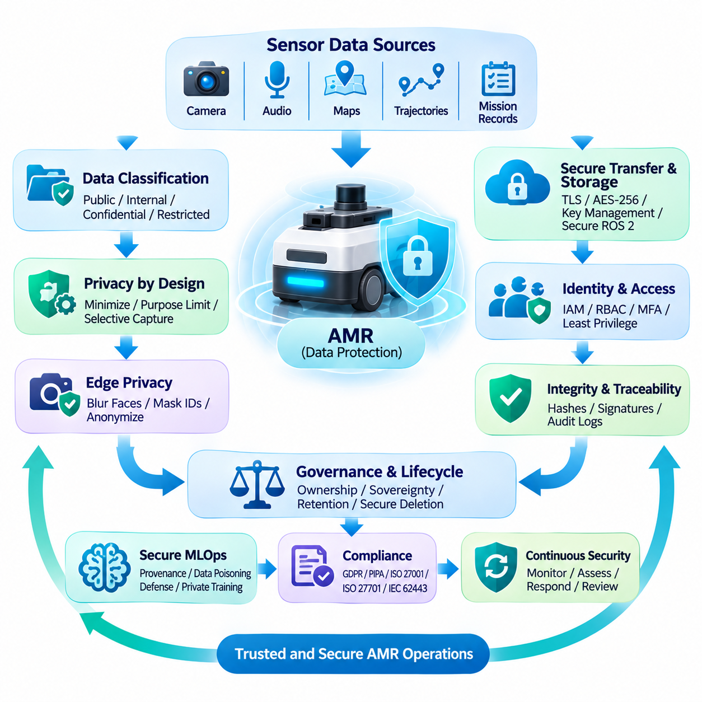
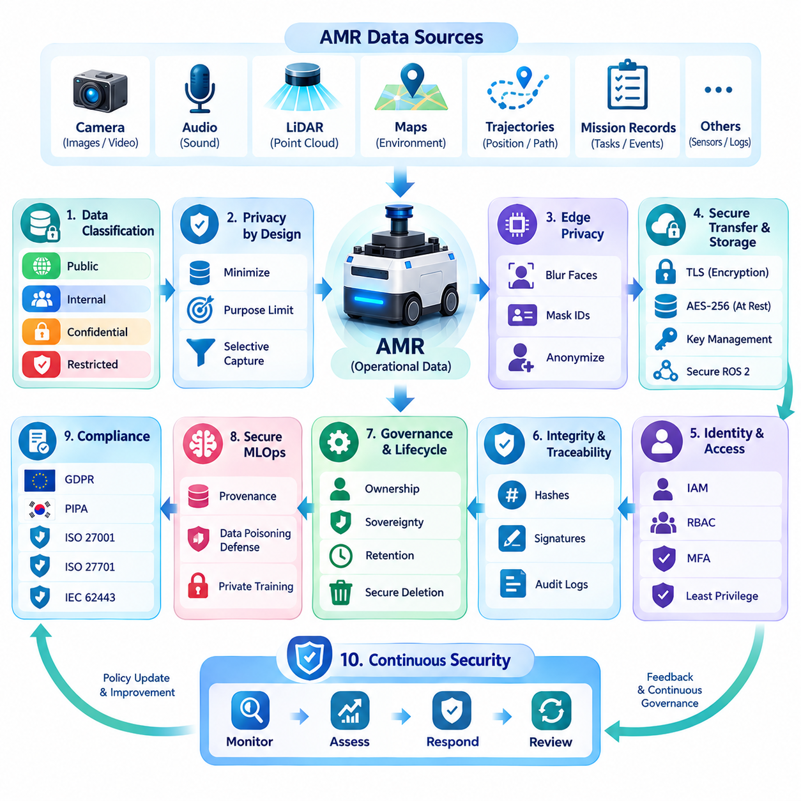
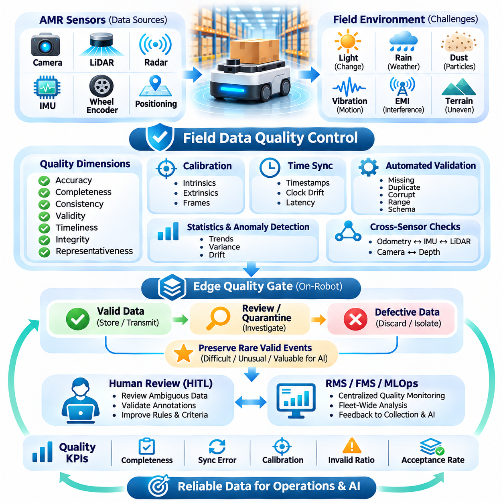
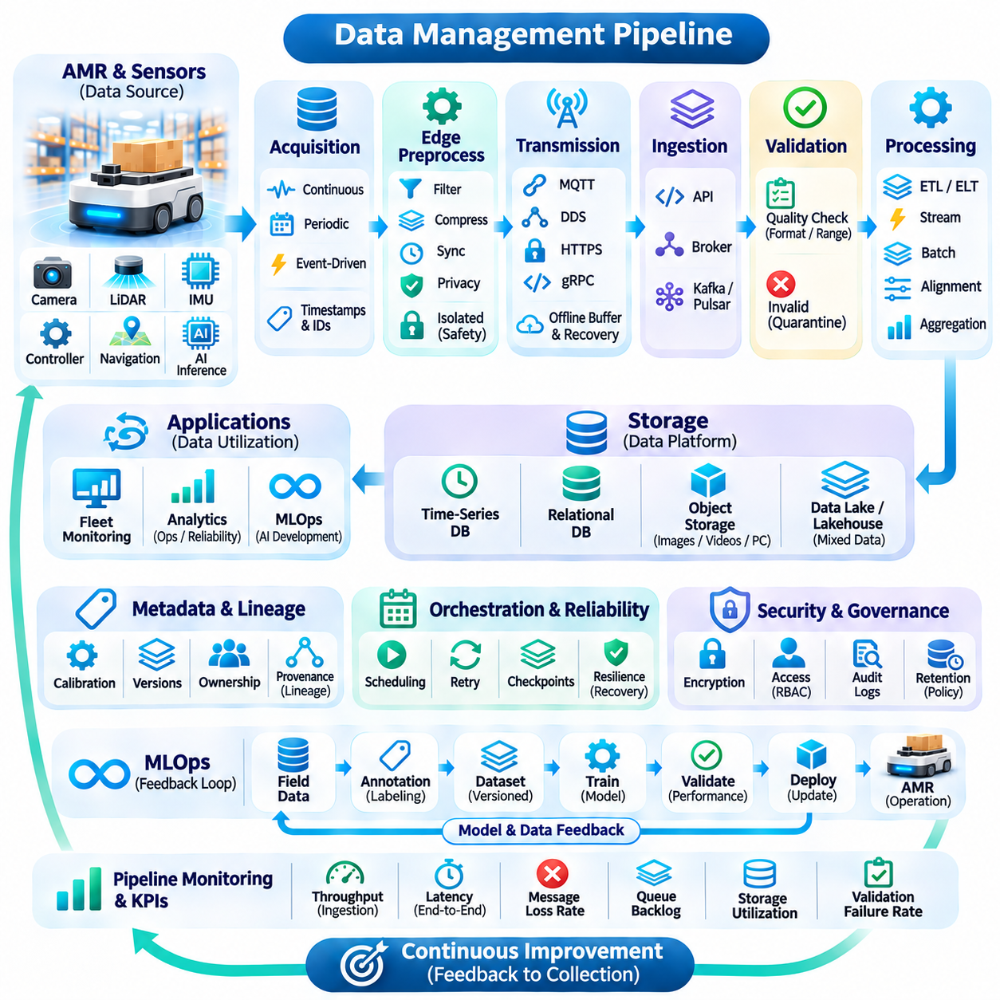

**Volume 08. AMR Operations, Deployment, and MLOps**

# Chapter 06. Data Collection in Operation

## 06.1 Operational Data Strategy

{width="7.268055555555556in" height="7.268055555555556in"}

An operational data strategy is a systematic framework for collecting, processing, storing, managing, and utilizing data generated by Autonomous Mobile Robots (AMRs) during real-world operations. Its primary objective is to transform operational experience into valuable engineering knowledge that supports operational efficiency, system reliability, safety improvement, predictive maintenance, and continuous development of robotic intelligence.

Unlike conventional industrial automation equipment, AMRs continuously interact with dynamic physical environments. Every navigation task, obstacle avoidance maneuver, docking operation, sensor observation, and human interaction produces information about robot behavior. An effective operational data strategy treats deployed robots as distributed data acquisition platforms capable of generating valuable resources throughout their operational lifecycles.

Operational data can be classified into sensor data, robot state data, mission data, environmental data, system performance data, safety events, and AI inference data. Each category serves different engineering and operational objectives. Sensor data supports perception development, while mission data enables fleet optimization. Hardware telemetry supports predictive maintenance, and safety-related records provide evidence for incident investigation.

The data collection strategy should begin with clearly defined business and engineering objectives. Collecting every available data stream without a specific purpose creates unnecessary storage requirements, network congestion, and computational overhead. Organizations should identify critical data sources, collection frequencies, retention periods, and processing requirements according to the expected operational and engineering value.

A hierarchical data collection architecture can distribute responsibilities across robot-level, edge-level, and cloud-level infrastructure. Robot-level systems capture raw sensor measurements and internal states. Edge computing systems perform preprocessing, filtering, compression, and event detection. Centralized servers or cloud platforms provide long-term storage, fleet-wide analytics, dataset management, and integration with machine learning infrastructure.

Continuous data collection and event-driven data collection should operate together. Continuous collection provides operational histories and statistical information about normal robot behavior. Event-driven collection captures detailed information surrounding abnormal conditions such as localization failures, emergency stops, unexpected obstacles, communication interruptions, and AI inference errors, reducing unnecessary data transmission and storage consumption.

Temporal synchronization is essential for establishing meaningful relationships between heterogeneous operational data streams. Camera images, LiDAR measurements, inertial data, motor commands, localization estimates, and AI inference results should be associated with consistent timestamps. Accurate synchronization enables engineers to reconstruct operational scenarios, investigate causal relationships, and generate reliable multimodal datasets for robotic learning.

Operational context should accompany collected data through standardized metadata. Robot identifiers, hardware configurations, software versions, AI model versions, calibration parameters, environmental conditions, mission identifiers, and map versions provide essential information for interpreting observations. Comprehensive metadata also enables traceability when comparing operational performance across different robots, deployment sites, and software releases.

Integration with Robot Management Systems (RMS) and Fleet Management Systems (FMS) enables centralized operational data coordination. These platforms can associate individual robot observations with mission execution, traffic conditions, charging activities, operator interventions, and fleet performance indicators. Fleet-level aggregation helps identify recurring operational patterns that may remain undetected when individual robots are analyzed independently.

Data collection must not compromise the real-time performance or functional safety of AMRs. Logging processes, data compression, and network transmission should be isolated from time-critical perception, navigation, and motion control functions. Local buffering and asynchronous transmission mechanisms allow robots to maintain stable operation during communication interruptions while preserving prioritized operational records for subsequent analysis.

Operational data provides an essential foundation for Machine Learning Operations (MLOps) and continuous learning. Representative observations, difficult scenarios, perception errors, and unexpected environmental interactions can be selected for annotation and dataset development. These datasets support model retraining, performance benchmarking, regression testing, and controlled deployment of improved AI models following appropriate validation.

Data governance should define ownership, access permissions, retention policies, privacy protection, and security requirements throughout the operational data lifecycle. Sensitive information collected in hospitals, factories, logistics facilities, and public environments requires appropriate anonymization, encryption, and access control. Data sovereignty and customer-specific restrictions should determine whether information remains on-premises or is transferred externally.

The effectiveness of an operational data strategy should be evaluated through measurable indicators such as data completeness, synchronization accuracy, collection reliability, transmission efficiency, storage utilization, and dataset usability. Additional indicators may include failure reconstruction success rates, annotation costs, and measurable improvements achieved through data-driven engineering activities and subsequent model updates.

Ultimately, operational data strategy establishes a closed-loop relationship between physical robot deployment and continuous system development. Field observations become engineering knowledge, engineering knowledge supports validated system improvements, and improved systems generate new operational experiences. This feedback architecture enables AMR fleets to evolve toward increasingly reliable, adaptive, scalable, and collectively intelligent Physical AI systems.

The attached chapter structure defines the thematic scope of this section, including sensor data collection, event logging, AI training datasets, filtering, privacy, quality control, and data management pipelines. The technical explanations presented here expand that outline using general robotics engineering principles rather than deployment-specific requirements or experimentally validated results.

## 06.2 Sensor Data Collection

{width="7.268055555555556in" height="7.268055555555556in"}

Sensor data collection is a fundamental component of Autonomous Mobile Robot (AMR) operations, providing the information required to understand physical environments, monitor robot behavior, evaluate system performance, and improve autonomous capabilities. During real-world operations, AMRs continuously generate heterogeneous sensor data that can be transformed into valuable engineering resources for operational analysis and artificial intelligence development.

AMRs typically incorporate multiple sensing technologies, including 2D LiDAR, 3D LiDAR, RGB cameras, depth cameras, thermal cameras, radar, ultrasonic sensors, Inertial Measurement Units (IMUs), wheel encoders, and Global Navigation Satellite Systems (GNSS). Each sensor provides different information about the robot and its surrounding environment. Combining these observations enables comprehensive analysis of robot behavior under diverse operational conditions.

Sensor data collection requirements should be established according to operational objectives, environmental characteristics, robot configurations, and engineering priorities. Navigation improvement may require LiDAR scans, localization estimates, and odometry measurements, while perception development may require synchronized camera images and point clouds. Hardware diagnostics may prioritize vibration, temperature, electrical current, and mechanical movement measurements.

A distributed sensor data acquisition architecture generally consists of sensor interfaces, device drivers, communication middleware, timestamp management, local recording services, and centralized data management infrastructure. Within ROS 2 environments, sensor measurements are commonly distributed through dedicated topics using standardized message formats. Recording services subscribe to selected topics according to predefined operational data collection policies.

Different sensors generate data at significantly different sampling frequencies and bandwidths. Cameras may produce images at 15 to 60 frames per second, while IMUs commonly operate at frequencies ranging from 100 to 1,000 Hz. LiDAR systems, radar sensors, and wheel encoders have different acquisition characteristics. Sampling configurations should balance measurement accuracy, temporal resolution, computational overhead, and available storage capacity.

Accurate time synchronization is essential when collecting heterogeneous sensor data. Hardware triggering, Precision Time Protocol (PTP), GNSS-based timing, and software timestamp synchronization can establish consistent temporal relationships between sensor measurements. Synchronization errors may introduce spatial inconsistencies, inaccurate motion estimation, and unreliable sensor fusion results, particularly when robots operate in dynamic environments.

Sensor calibration information must be preserved together with collected measurements. Intrinsic calibration parameters describe individual sensor characteristics, while extrinsic calibration parameters define spatial relationships between sensors and robot coordinate systems. Calibration versions, coordinate transformations, mounting configurations, and sensor identifiers should remain traceable to ensure accurate data interpretation and reproducible engineering analysis.

Continuous recording provides comprehensive operational histories but may generate substantial data volumes, particularly when multiple high-resolution cameras and 3D LiDAR sensors operate simultaneously. Selective recording strategies can reduce resource consumption through adaptive sampling, periodic acquisition, spatial selection, and event-driven recording. Collection policies should preserve informative observations without unnecessarily duplicating routine operational data.

Event-triggered sensor recording is particularly valuable for investigating abnormal robot behavior. Localization failures, unexpected obstacles, emergency stops, excessive vibration, perception uncertainty, and operator interventions can initiate high-resolution recording. Circular buffers enable the system to preserve sensor measurements immediately before an event, while subsequent recording captures recovery behavior and the resulting operational consequences.

Local data acquisition systems must maintain reliable recording capabilities even when wireless communication becomes unstable or unavailable. High-speed solid-state drives, bounded memory buffers, asynchronous recording processes, and prioritized storage allocation support uninterrupted data acquisition. Recording services should be isolated from safety-critical and real-time control functions to prevent excessive resource utilization from degrading autonomous operation.

Edge computing platforms can preprocess collected sensor data before transferring it to centralized infrastructure. Image resizing, point cloud downsampling, region-of-interest extraction, noise filtering, and compression can reduce communication bandwidth and storage requirements. However, preprocessing must preserve information relevant to engineering objectives, especially when original sensor measurements are required for calibration, failure reconstruction, or AI training.

Sensor data collection across multiple AMRs requires standardized data formats, naming conventions, metadata structures, and acquisition configurations. Robot identifiers, sensor identifiers, firmware versions, timestamps, mission identifiers, map versions, and environmental conditions should accompany recorded measurements. Standardization enables consistent fleet-wide analysis and simplifies data integration across different robot platforms and deployment locations.

Sensor data quality should be evaluated during both acquisition and post-processing. Missing measurements, corrupted files, duplicated frames, timestamp discontinuities, incorrect calibration parameters, and sensor saturation can reduce dataset reliability. Automated quality verification mechanisms should identify abnormal data patterns, generate diagnostic notifications, and prevent unsuitable measurements from entering downstream engineering and machine learning workflows.

Collected sensor data may contain sensitive information, including human faces, vehicle registration numbers, confidential industrial facilities, and private conversations. Data collection policies must incorporate privacy protection, access control, encryption, retention management, and data minimization. Depending on regulatory requirements and customer agreements, sensitive sensor measurements may need to be processed and anonymized within authorized on-premises infrastructure.

Ultimately, sensor data collection establishes the observational foundation for data-driven AMR development and continuous learning. Real-world measurements support perception model improvement, navigation optimization, digital twin development, predictive maintenance, and operational safety analysis. The acquisition methods and sampling frequencies described here are general engineering examples rather than mandatory specifications defined by the attached chapter structure.

## 06.3 Event and Failure Data Logging

{width="7.268055555555556in" height="7.268055555555556in"}

{width="7.268055555555556in" height="7.268055555555556in"}

Event and failure data logging is an essential component of Autonomous Mobile Robot (AMR) operations that enables organizations to systematically capture, preserve, analyze, and investigate abnormal operational conditions. Unlike conventional operational monitoring, event and failure logging focuses on collecting contextual information associated with specific incidents, unexpected behaviors, system faults, and deviations from expected operational performance.

An operational event represents a significant change in robot behavior, system state, environmental conditions, or mission execution. Events may include mission completion, obstacle detection, localization instability, communication interruption, charging failure, operator intervention, or emergency stop activation. Not every event constitutes a system failure, but each may provide valuable information for understanding operational characteristics and identifying potential risks.

A failure occurs when a robot component, software function, communication interface, or autonomous capability cannot perform its intended function within specified requirements. Typical AMR failures include sensor malfunction, motor controller faults, battery abnormalities, localization loss, navigation deadlocks, software process crashes, and AI perception errors. Systematic failure classification enables consistent investigation across different robot platforms and deployment environments.

Event and failure logging architecture should integrate hardware diagnostics, embedded controllers, ROS 2 middleware, perception modules, navigation software, AI inference engines, and Robot Management Systems (RMS). Individual subsystems generate structured diagnostic messages that are collected through distributed logging services. Centralized aggregation enables engineers to reconstruct relationships between hardware conditions, software execution, and overall robot behavior.

Structured event records should contain unique event identifiers, timestamps, robot identifiers, subsystem identifiers, event categories, severity levels, error codes, mission identifiers, and relevant operational states. Additional contextual information may include robot position, velocity, battery status, environmental conditions, software versions, and AI model versions. Standardized schemas improve traceability, automated analysis, and interoperability across large robot fleets.

Event severity classification helps operational teams prioritize incidents according to their potential consequences. Informational events describe normal operational transitions, while warning events identify conditions that may require attention. Error events indicate functional abnormalities, and critical events represent conditions that may threaten operational safety or system availability. Severity definitions should reflect application-specific requirements and documented risk assessments.

Event-triggered recording enables detailed data collection without continuously storing every high-bandwidth sensor stream. Circular buffers can preserve historical measurements immediately preceding an incident, while configurable post-event recording captures subsequent robot behavior. Camera images, LiDAR scans, actuator commands, localization estimates, and diagnostic messages can therefore be synchronized into comprehensive incident datasets.

Failure reconstruction requires accurate temporal relationships between events generated by different hardware and software components. Timestamp synchronization using Precision Time Protocol (PTP), hardware triggering, or appropriate clock synchronization mechanisms enables engineers to establish reliable event sequences. Recording both source timestamps and reception timestamps can help distinguish actual system behavior from communication delays and processing latency.

Root Cause Analysis (RCA) uses recorded event sequences to distinguish observable symptoms from underlying failure mechanisms. For example, a navigation failure may originate from sensor degradation, incorrect calibration, localization uncertainty, excessive computational load, or an unexpected environmental condition. Correlating diagnostic records with sensor observations and control commands enables evidence-based investigation rather than assumptions based solely on error codes.

Integration with Robot Management Systems (RMS) and Fleet Management Systems (FMS) enables centralized event monitoring and fleet-wide failure analysis. Repeated abnormalities across multiple robots may reveal common software defects, hardware weaknesses, environmental challenges, or infrastructure limitations. Fleet-level correlation supports identification of systemic problems that are difficult to recognize through isolated robot-level investigations.

Event and failure data should also support predictive maintenance and hardware reliability engineering. Historical records concerning motor temperature, electrical current, vibration, battery degradation, communication errors, and intermittent sensor faults can reveal abnormal trends preceding component failures. Combining diagnostic histories with maintenance records supports condition-based maintenance and the development of appropriately validated failure prediction models.

AI-related event logging requires additional information about model behavior, including inference confidence, model versions, input characteristics, processing latency, and discrepancies between predicted and verified outcomes. Difficult perception scenarios, unexpected object classifications, and operator corrections can become candidates for AI training datasets. These records connect operational failure analysis with Machine Learning Operations (MLOps) and continuous learning.

Reliable logging infrastructure must preserve critical diagnostic information without interfering with real-time control or safety-critical functions. Asynchronous logging, bounded memory buffers, prioritized storage allocation, persistent local recording, and controlled network transmission help maintain operational stability. Under resource constraints, logging policies should prioritize safety events and essential diagnostic records over routine informational messages.

Event and failure records may contain sensitive environmental observations, operator information, customer infrastructure details, and proprietary system configurations. Appropriate encryption, role-based access control, integrity verification, retention policies, and audit trails should protect these records throughout their lifecycle. Safety-related incident records may require additional preservation controls according to applicable regulations and contractual obligations.

The effectiveness of event and failure logging should be evaluated using measurable indicators such as event capture completeness, timestamp accuracy, diagnostic coverage, failure reconstruction success rate, Mean Time to Detect (MTTD), and Mean Time to Repair (MTTR). Ultimately, systematic logging establishes a feedback mechanism for improving operational safety, reliability, maintainability, and autonomous intelligence. The methods described here extend the attached chapter outline using general robotics engineering principles rather than deployment-specific specifications.

## 06.4 AI Training Data Collection

{width="7.268055555555556in" height="7.268055555555556in"}

AI training data collection is a fundamental process for improving the intelligence, adaptability, and operational reliability of Autonomous Mobile Robots (AMRs). Unlike conventional datasets collected under controlled laboratory conditions, operational training data captures the complexity and variability of real-world physical environments. These observations provide the foundation for developing, validating, and continuously improving robotic artificial intelligence systems.

The primary objective of AI training data collection is to acquire representative information that enables machine learning models to understand environmental conditions, recognize objects, predict dynamic behaviors, and generate appropriate robotic actions. Training data requirements should be established according to specific AI development objectives, operational design domains, model architectures, and expected performance improvements.

AMRs generate diverse multimodal data during normal operations, including RGB images, depth images, LiDAR point clouds, radar measurements, inertial measurements, wheel odometry, localization estimates, and actuator commands. Additional information may include semantic maps, mission objectives, environmental conditions, and human interactions. Combining these heterogeneous observations enables the development of comprehensive datasets for embodied intelligence and Physical AI applications.

Training data collection should cover a broad range of operational scenarios rather than concentrating exclusively on normal robot behavior. Environmental diversity may include different lighting conditions, weather patterns, floor surfaces, obstacle configurations, pedestrian densities, and infrastructure layouts. Representative datasets should capture variations encountered across deployment locations, robot configurations, operating speeds, and mission characteristics.

Rare events and difficult operational scenarios are particularly valuable for improving AI model robustness. Examples include partially occluded pedestrians, reflective surfaces, unexpected obstacles, localization failures, unusual object appearances, and ambiguous environmental conditions. Event-triggered recording and hard case mining mechanisms can identify these situations and preserve relevant sensor measurements for subsequent investigation and model development.

Uncertainty-based data collection enables robots to identify observations for which deployed AI models demonstrate limited confidence or inconsistent predictions. Model confidence scores, prediction disagreements, out-of-distribution detection, and discrepancies between expected and observed outcomes can serve as collection triggers. These mechanisms support active learning by prioritizing informative samples that may contribute to subsequent model improvement.

Human demonstrations and operator interventions provide valuable training resources for imitation learning and behavior optimization. Manual driving trajectories, obstacle avoidance decisions, docking corrections, task execution sequences, and recovery behaviors can be recorded together with environmental observations. Such demonstrations enable robotic systems to learn from experienced operators, provided that collected behavior is evaluated for safety, consistency, and suitability.

Training datasets for reinforcement learning and world models require sequential observations that preserve relationships between robot states, actions, environmental transitions, and outcomes. Recorded trajectories should include synchronized sensor observations, control commands, mission objectives, rewards where applicable, and termination conditions. These sequences support learning of physical dynamics, action consequences, and long-horizon decision-making capabilities.

Temporal synchronization and spatial calibration are critical for collecting reliable multimodal training data. Camera images, LiDAR measurements, robot poses, actuator commands, and environmental observations must maintain consistent temporal and spatial relationships. Calibration parameters, coordinate transformations, timestamp accuracy, and synchronization status should be preserved to ensure that collected datasets represent physically meaningful relationships.

Data selection and preprocessing are necessary to manage the substantial information generated by operational AMR fleets. Duplicate observations, corrupted measurements, excessively redundant sequences, and irrelevant information can be identified through automated filtering mechanisms. However, selection policies must preserve rare events and representative normal behavior to avoid introducing excessive dataset bias or reducing environmental coverage.

Collected training data must be appropriately annotated according to the requirements of target learning algorithms. Object bounding boxes, segmentation masks, semantic labels, traversability classifications, robot trajectories, and task outcomes represent common annotation categories. Human annotation, automated labeling, pseudo-labeling, and self-supervised learning techniques can reduce preparation costs while supporting scalable dataset development.

Dataset management infrastructure should maintain comprehensive metadata, data provenance, version histories, annotation records, and collection conditions. Robot identifiers, sensor configurations, software versions, AI model versions, and deployment locations enable traceability between operational observations and subsequent training activities. Dataset versioning also supports reproducible experiments, model comparisons, regression testing, and controlled model release processes.

Training, validation, and testing datasets should be separated carefully to prevent data leakage and misleading performance evaluations. Highly correlated observations from the same mission, location, or recording sequence should not be randomly distributed across dataset partitions without appropriate precautions. Independent evaluation datasets representing previously unseen operational conditions provide stronger evidence of AI model generalization and deployment readiness.

AI training data collection must comply with privacy, cybersecurity, data ownership, and customer confidentiality requirements. Personal information, confidential industrial processes, and sensitive environmental observations should be protected through data minimization, anonymization, encryption, and controlled access. On-premises processing and federated learning may support organizations that must retain operational data within authorized infrastructure.

Ultimately, AI training data collection establishes the foundation of a closed-loop learning architecture connecting AMR field operations with Machine Learning Operations (MLOps). Collection effectiveness should be measured through scenario coverage, dataset diversity, annotation quality, and validated model improvements. The approaches described here expand the attached chapter outline through general robotics and machine learning engineering principles rather than deployment-specific requirements.

## 06.5 Data Filtering and Compression

{width="7.268055555555556in" height="7.268055555555556in"}

Data filtering and compression are essential processes for managing the large volumes of information generated by Autonomous Mobile Robots (AMRs) during continuous field operations. These processes reduce unnecessary data transmission, storage consumption, and computational overhead while preserving information required for operational monitoring, failure analysis, predictive maintenance, and artificial intelligence development.

Modern AMRs generate heterogeneous data streams from RGB cameras, depth cameras, LiDAR sensors, radar systems, inertial measurement units, wheel encoders, embedded controllers, and AI inference engines. Continuous recording of these streams at their original sampling rates can produce substantial data volumes. As robot fleets expand, unoptimized data collection can create significant infrastructure costs and operational scalability limitations.

Data filtering is the process of identifying and removing redundant, irrelevant, corrupted, or low-value information according to predefined engineering and operational objectives. Filtering mechanisms may operate at sensor, message, frame, event, or dataset levels. Effective filtering strategies distinguish valuable operational observations from unnecessary information without compromising the integrity or representative characteristics of collected datasets.

Temporal filtering reduces data volumes by selecting measurements according to specific sampling intervals, frequency requirements, or changes in operational conditions. High-frequency sensor streams can be downsampled when their original temporal resolution is unnecessary for a particular application. Adaptive sampling enables robots to increase recording frequencies during complex scenarios and decrease them during stable or repetitive operations.

Spatial filtering selectively retains information associated with relevant physical regions or environmental features. Camera images can be processed through Region of Interest (ROI) extraction, while LiDAR point clouds can be filtered according to distance, height, geometric boundaries, or operational relevance. Such techniques reduce data volumes while preserving spatial information required for perception, navigation, and environmental understanding.

Event-based filtering prioritizes information associated with significant operational events, unusual environmental conditions, and abnormal robot behavior. Localization failures, emergency stops, unexpected obstacles, operator interventions, and AI inference uncertainty can trigger detailed data preservation. Circular buffers and configurable recording intervals help retain contextual information immediately before and after important events.

Data compression reduces the storage size and transmission bandwidth of collected information through efficient encoding techniques. Lossless compression preserves the complete original information and is particularly suitable for diagnostic records, control commands, calibration parameters, and critical sensor measurements. Lossy compression achieves higher compression ratios by removing information considered less important for intended applications.

Image and video compression are especially important because camera systems frequently represent the largest source of operational data. Formats and codecs such as PNG, JPEG, H.264, H.265, and AV1 provide different combinations of image quality, compression efficiency, and computational complexity. Compression settings should be selected according to perception requirements, available hardware acceleration, and acceptable information loss.

LiDAR point cloud compression can employ voxel-based downsampling, coordinate quantization, octree representations, delta encoding, and specialized geometric compression algorithms. These techniques reduce redundant spatial measurements and improve storage efficiency. However, excessive simplification may remove small obstacles, geometric boundaries, or surface characteristics required for localization, traversability estimation, and three-dimensional perception.

Time-series data generated by embedded controllers, battery management systems, motor drivers, and diagnostic services can be compressed through delta encoding, run-length encoding, dictionary compression, and general-purpose compression algorithms such as LZ4 and Zstandard. Selecting appropriate methods requires consideration of compression ratio, encoding latency, decompression performance, numerical precision, and available computational resources.

Edge computing platforms play an important role in performing data filtering and compression close to the original data sources. Embedded CPUs, GPUs, and dedicated hardware encoders can preprocess sensor measurements before transmitting them to centralized infrastructure. Asynchronous processing and resource allocation mechanisms should prevent preprocessing workloads from interfering with real-time navigation, motion control, or safety-critical functions.

Filtering and compression policies should dynamically respond to available communication bandwidth, local storage capacity, mission priorities, and robot operating conditions. During network interruptions, compressed records can be retained locally and transferred when connectivity becomes available. Priority-based transmission enables critical safety events and diagnostic information to receive preferential treatment over routine operational recordings.

Data integrity and traceability must be maintained throughout filtering, compression, storage, and decompression processes. Metadata should identify filtering parameters, compression algorithms, encoding configurations, original sampling frequencies, and software versions. Checksums and automated integrity verification help detect data corruption, while retaining selected original recordings supports reproducible engineering analysis and independent verification.

Machine Learning Operations (MLOps) requires particular attention to the influence of filtering and compression on AI training dataset quality. Aggressive filtering may eliminate rare scenarios, introduce selection bias, or reduce environmental diversity. Excessive lossy compression may introduce visual artifacts and distort sensor characteristics. Dataset preparation policies should therefore evaluate their impact on model accuracy, robustness, and generalization.

Ultimately, data filtering and compression effectiveness should be measured through data reduction ratios, bandwidth utilization, processing latency, storage efficiency, information preservation, and downstream AI performance. A balanced strategy enables scalable and cost-efficient AMR fleet operations without sacrificing engineering value. The methods described here extend the attached chapter outline using general engineering principles rather than mandatory deployment specifications.

## 06.6 Data Privacy and Security

{width="7.268055555555556in" height="7.268055555555556in"}

{width="7.268055555555556in" height="7.268055555555556in"}

Data privacy and security are fundamental requirements for collecting, processing, transmitting, and storing operational information generated by Autonomous Mobile Robots (AMRs). As autonomous robots increasingly operate in industrial facilities, hospitals, logistics centers, and public environments, their data collection capabilities introduce significant responsibilities concerning personal information, customer confidentiality, intellectual property, and cybersecurity.

Operational data generated by AMRs may contain sensitive information beyond conventional robot telemetry. Camera images, audio recordings, environmental maps, localization trajectories, mission histories, and human interaction records may reveal personal identities, workplace activities, industrial processes, and restricted infrastructure. Organizations must identify potential privacy and security risks associated with each category of collected information.

Data classification establishes the foundation for implementing appropriate information protection policies. Operational information can be categorized as public, internal, confidential, or highly restricted according to its sensitivity, business value, and potential consequences of unauthorized disclosure. Classification policies should determine collection permissions, storage locations, transmission requirements, access privileges, and retention periods.

Privacy by Design should be incorporated into AMR data collection architecture from the earliest development stages. Rather than implementing privacy protection after deployment, engineers should establish data minimization, purpose limitation, and controlled processing as fundamental system requirements. Robots should collect only the information necessary for authorized operational, maintenance, safety, and artificial intelligence development objectives.

Personal information protection requires particular attention when AMRs operate in environments involving patients, employees, customers, or members of the public. Facial features, vehicle registration numbers, identification documents, conversations, and medical information may be captured unintentionally. Anonymization, pseudonymization, image masking, facial blurring, and selective recording can reduce privacy risks when appropriately implemented and validated.

Edge-based privacy protection enables sensitive information to be processed directly within the robot before external transmission. Embedded AI models can identify and obscure personal information, extract relevant environmental features, or convert raw observations into anonymous statistical representations. Local preprocessing reduces unnecessary exposure of sensitive information while supporting bandwidth optimization and distributed data governance.

Data encryption is essential for protecting operational information both at rest and in transit. Encryption technologies such as AES-256 can protect stored datasets, while Transport Layer Security (TLS) can secure network communications between robots, edge servers, and cloud infrastructure. Cryptographic key management, secure credential storage, periodic key rotation, and certificate lifecycle management are necessary supporting mechanisms.

Identity and Access Management (IAM) ensures that operational data can be accessed only by appropriately authenticated and authorized entities. Role-Based Access Control (RBAC), Attribute-Based Access Control (ABAC), Multi-Factor Authentication (MFA), and the principle of least privilege provide mechanisms for limiting unnecessary access. Individual robots should also possess managed device identities and independently revocable authentication credentials.

Secure data communication between AMRs, Robot Management Systems (RMS), Fleet Management Systems (FMS), and centralized data platforms requires multiple layers of protection. Network segmentation, mutual authentication, secure communication protocols, and appropriately configured firewalls can reduce unauthorized access risks. ROS 2 security mechanisms based on DDS Security can additionally protect distributed robotic communication.

Data integrity ensures that operational records remain accurate, complete, and protected against unauthorized manipulation throughout their lifecycle. Cryptographic hashes, digital signatures, authenticated encryption, and tamper-evident logging mechanisms support verification of recorded information. Preserving reliable event timestamps, data provenance, and modification histories is particularly important for safety investigations and failure analysis.

Data ownership and data sovereignty become increasingly important as AMR fleets operate across different organizations, geographical regions, and regulatory jurisdictions. Agreements should define the rights and responsibilities associated with operational datasets, AI training resources, derived information, and intellectual property. On-premises infrastructure and private cloud architectures can support requirements for localized data storage and controlled processing.

Data retention and secure disposal policies should define how long different categories of operational information are preserved. Routine sensor recordings, safety incident records, maintenance histories, and AI training datasets may require different retention periods. Automated lifecycle management, secure deletion, backup expiration, and appropriate preservation exceptions help balance operational requirements with privacy obligations.

Machine Learning Operations (MLOps) introduces additional security and privacy considerations because operational datasets may be reused for AI model development. Unauthorized dataset modification, data poisoning, sensitive information leakage, and model memorization can undermine system reliability. Dataset provenance verification, controlled training environments, privacy-preserving learning, and dataset access auditing help mitigate these risks.

Operational data protection policies should consider applicable regulatory frameworks, including the General Data Protection Regulation (GDPR), South Korea\'s Personal Information Protection Act (PIPA), and relevant industry-specific requirements. Standards such as ISO/IEC 27001, ISO/IEC 27701, and IEC 62443 provide complementary guidance for information security, privacy management, and industrial cybersecurity where applicable.

Ultimately, data privacy and security must operate as continuous engineering and governance processes supported by security monitoring, vulnerability assessments, access audits, incident response, and periodic compliance reviews. Effective protection enables trustworthy and scalable AMR operations while supporting continuous AI development. These practices expand the attached chapter outline using general engineering principles rather than deployment-specific requirements.

## 06.7 Field Data Quality Control

{width="7.268055555555556in" height="7.268055555555556in"}

Field data quality control is an essential engineering process for ensuring the accuracy, completeness, consistency, and reliability of information collected during Autonomous Mobile Robot (AMR) operations. Unlike laboratory environments with controlled experimental conditions, field environments introduce unpredictable disturbances, sensor degradation, communication interruptions, and operational variations that may compromise data quality.

The primary objective of field data quality control is to ensure that collected information remains suitable for operational monitoring, failure analysis, predictive maintenance, and artificial intelligence development. Quality requirements should be established according to the intended application, sensor characteristics, operational design domain, system architecture, and downstream data processing requirements.

Data quality assessment typically considers multiple dimensions, including accuracy, completeness, consistency, validity, timeliness, integrity, and representativeness. Accuracy indicates how closely measurements correspond to actual physical conditions, while completeness evaluates whether required information has been captured. Consistency and validity ensure that collected records conform to established formats and engineering constraints.

Sensor data quality control requires continuous monitoring of camera systems, LiDAR sensors, radar devices, inertial measurement units, wheel encoders, and positioning systems. Sensor measurements may become unreliable because of contamination, vibration, environmental interference, hardware degradation, or incorrect configuration. Automated diagnostic mechanisms should identify abnormal measurements and evaluate sensor operating conditions.

Calibration verification is particularly important for maintaining the spatial accuracy of multimodal robotic datasets. Changes in sensor mounting positions, mechanical deformation, thermal expansion, and operational vibration may introduce calibration errors. Periodic verification of intrinsic parameters, extrinsic transformations, and coordinate frame relationships helps preserve consistency between physical measurements and digital representations.

Temporal synchronization represents another critical dimension of field data quality. Sensor measurements, actuator commands, localization estimates, and operational events must be associated with accurate timestamps. Synchronization errors, clock drift, communication latency, and message delivery delays can distort relationships between observations and actions, reducing the reliability of sensor fusion and subsequent engineering analysis.

Automated data validation mechanisms should identify missing records, duplicated messages, corrupted files, invalid numerical values, unexpected sampling frequencies, and inconsistent metadata. Schema validation, range checking, statistical analysis, and sequence verification can detect common quality problems. Validation rules should reflect the physical characteristics and operational constraints of individual robotic subsystems.

Statistical quality monitoring enables the detection of gradual changes in sensor behavior and operational data characteristics. Distribution analysis, moving averages, variance estimation, correlation analysis, and anomaly detection can reveal deviations from established reference conditions. Persistent statistical abnormalities may indicate sensor degradation, configuration changes, environmental disturbances, or emerging hardware failures.

Cross-sensor consistency verification provides additional mechanisms for identifying unreliable measurements. For example, wheel odometry can be compared with inertial measurements and LiDAR-based localization estimates to identify unexpected motion discrepancies. Camera observations and depth measurements can also be evaluated jointly to detect geometric inconsistencies, sensor interference, or synchronization problems.

Environmental conditions must be considered when evaluating field data quality because measurements can vary significantly across deployment scenarios. Lighting changes, rainfall, fog, dust, reflective surfaces, electromagnetic interference, and uneven terrain may affect sensor performance. Environmental metadata helps distinguish genuine operational abnormalities from expected variations associated with physical operating conditions.

Edge-based quality control enables AMRs to evaluate collected information before transmitting it to centralized infrastructure. Embedded processing systems can identify invalid measurements, assign quality scores, flag suspicious observations, and isolate corrupted records. Early detection reduces unnecessary communication and storage consumption while preserving valuable information for subsequent investigation.

Field data quality control should distinguish genuinely defective measurements from unusual but valid operational observations. Automatically removing every statistical anomaly may eliminate rare events and difficult scenarios that are particularly valuable for AI development. Suspicious records should therefore be classified, quarantined, or reviewed according to their potential engineering significance rather than immediately discarded.

Human-in-the-Loop (HITL) verification complements automated quality assessment by enabling engineers and trained operators to review ambiguous observations, investigate abnormal measurements, and validate annotation accuracy. Human feedback can improve quality assessment algorithms and refine acceptance criteria. Review decisions should be documented to maintain traceability and consistency across dataset preparation activities.

Integration with Robot Management Systems (RMS), Fleet Management Systems (FMS), and Machine Learning Operations (MLOps) enables centralized quality monitoring across distributed robot fleets. Quality indicators should accompany dataset metadata, collection histories, sensor configurations, and preprocessing records. Fleet-wide analysis helps identify recurring data quality problems and supports systematic corrective actions.

Ultimately, field data quality control should be evaluated using measurable indicators such as data completeness rate, synchronization error, calibration accuracy, invalid sample ratio, and dataset acceptance rate. Continuous quality improvement establishes a reliable foundation for scalable AMR operations and AI learning pipelines. These methods extend the attached chapter outline using general robotics and data engineering principles rather than deployment-specific acceptance criteria.

## 06.8 Data Management Pipeline

{width="7.268055555555556in" height="7.268055555555556in"}

A data management pipeline provides a structured framework for collecting, transferring, processing, storing, and utilizing information generated during Autonomous Mobile Robot (AMR) operations. It integrates distributed robotic systems with centralized data infrastructure to transform raw operational observations into reliable information assets supporting operational monitoring, engineering analysis, and continuous artificial intelligence development.

The data management pipeline encompasses the entire data lifecycle, beginning with information generation at individual robots and continuing through data acquisition, preprocessing, transmission, ingestion, validation, storage, and consumption. Each processing stage should provide clearly defined interfaces, responsibilities, and quality requirements to ensure consistency and traceability across distributed robotic environments.

The data acquisition layer collects heterogeneous information from cameras, LiDAR sensors, inertial measurement units, embedded controllers, navigation systems, and AI inference engines. Data collection mechanisms should support continuous recording, periodic sampling, and event-driven acquisition. Standardized timestamps, sensor identifiers, robot identifiers, and operational metadata establish the foundation for subsequent processing.

The edge preprocessing layer performs initial data filtering, compression, synchronization, validation, and privacy protection directly within robotic systems or nearby computing platforms. Processing information close to its original source reduces communication bandwidth consumption and centralized computational workloads. Preprocessing operations must remain isolated from safety-critical functions and real-time motion control.

The data transmission layer connects individual AMRs with edge servers, Robot Management Systems (RMS), Fleet Management Systems (FMS), and cloud infrastructure. Communication technologies such as MQTT, DDS, HTTPS, and gRPC can support different data exchange requirements. Reliable transmission mechanisms should accommodate network interruptions, bandwidth limitations, message prioritization, and connectivity recovery.

The data ingestion layer receives operational information from distributed robotic systems and prepares incoming records for centralized processing. Message brokers, streaming platforms, application programming interfaces, and ingestion services provide scalable integration mechanisms. Technologies such as Apache Kafka and Apache Pulsar can support asynchronous communication, distributed event processing, and high-volume data ingestion.

The data validation layer evaluates incoming records according to established quality requirements and operational constraints. Automated validation mechanisms should identify corrupted files, missing measurements, duplicated messages, inconsistent timestamps, invalid numerical values, and incomplete metadata. Records that fail validation should be flagged or quarantined for further investigation without interrupting essential operational services.

The data processing layer transforms validated operational information into structured and application-specific representations. Extract, Transform, Load (ETL) and Extract, Load, Transform (ELT) workflows can support data normalization, format conversion, temporal alignment, feature extraction, and statistical aggregation. Stream processing and batch processing provide complementary capabilities for real-time and historical analysis.

The data storage layer should employ storage technologies appropriate for different information categories and access patterns. Time-series databases support telemetry and historical performance analysis, relational databases manage structured operational records, and object storage accommodates large images, videos, and point clouds. Data lakes and lakehouse architectures can provide scalable foundations for heterogeneous datasets.

Metadata management and data cataloging enable engineers to discover, interpret, and reuse information across complex robotic data ecosystems. Metadata should describe sensor configurations, software versions, calibration parameters, collection conditions, processing histories, and data ownership. Dataset versioning and data lineage mechanisms establish reproducibility and traceability throughout the data management pipeline.

Pipeline orchestration coordinates dependencies, execution schedules, resource allocation, and failure recovery across distributed processing stages. Workflow management platforms such as Apache Airflow, Prefect, and Dagster can automate recurring data processing activities. Idempotent execution, checkpointing, retry mechanisms, and dead-letter queues help maintain reliability when individual processing tasks encounter failures.

Data governance must be integrated throughout the pipeline to maintain information security, privacy protection, regulatory compliance, and controlled accessibility. Encryption, authentication, authorization, audit logging, and retention policies should apply across edge, on-premises, and cloud infrastructure. Data ownership and usage permissions must remain traceable when operational information is shared or reused.

Integration with Machine Learning Operations (MLOps) transforms operational data management into a continuous AI development feedback loop. Selected field observations can be transferred into annotation, dataset preparation, model training, validation, and deployment workflows. Dataset quality evaluation, version control, and approval mechanisms help ensure that AI model improvements are based on reliable and representative information.

Pipeline monitoring and observability enable engineering teams to evaluate the operational health and performance of distributed data infrastructure. Key indicators include ingestion throughput, processing latency, message loss rate, queue backlog, storage utilization, and data validation failure rate. Automated alerts and capacity management mechanisms support early detection of infrastructure bottlenecks and processing abnormalities.

Ultimately, an effective data management pipeline establishes a scalable foundation connecting AMR field operations, centralized intelligence, and continuous learning systems. Reliable data lifecycle management enables organizations to convert distributed robotic experiences into reusable engineering knowledge and actionable intelligence. These architectural methods extend the attached chapter outline using general data engineering principles rather than deployment-specific specifications.
