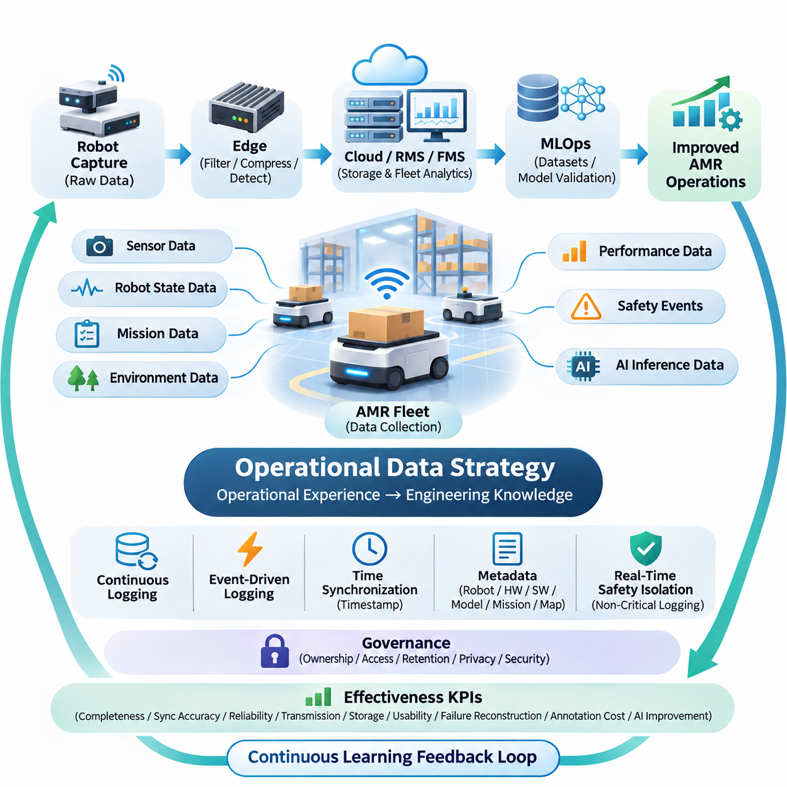
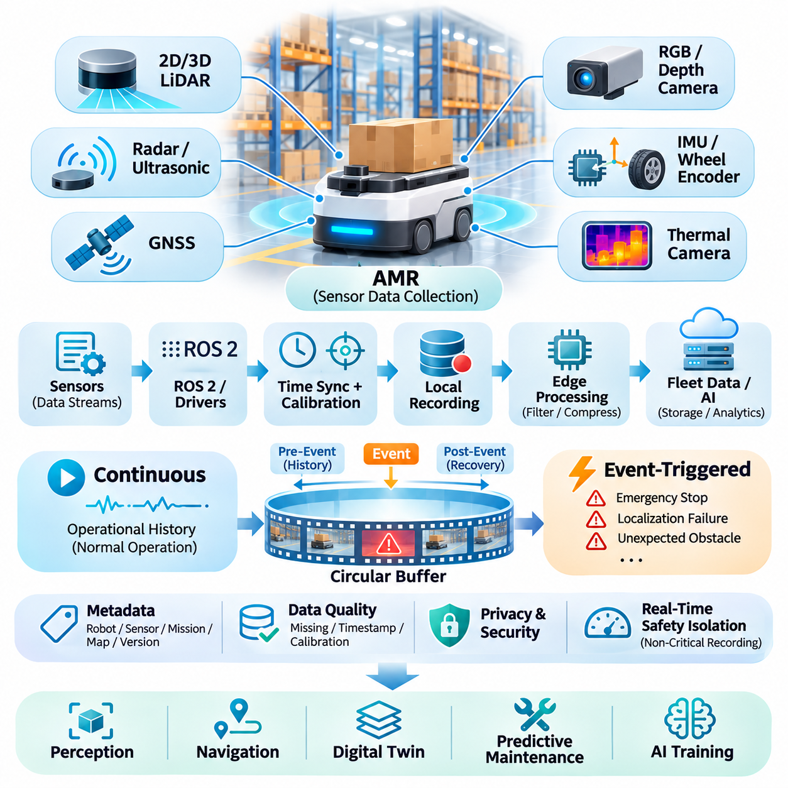
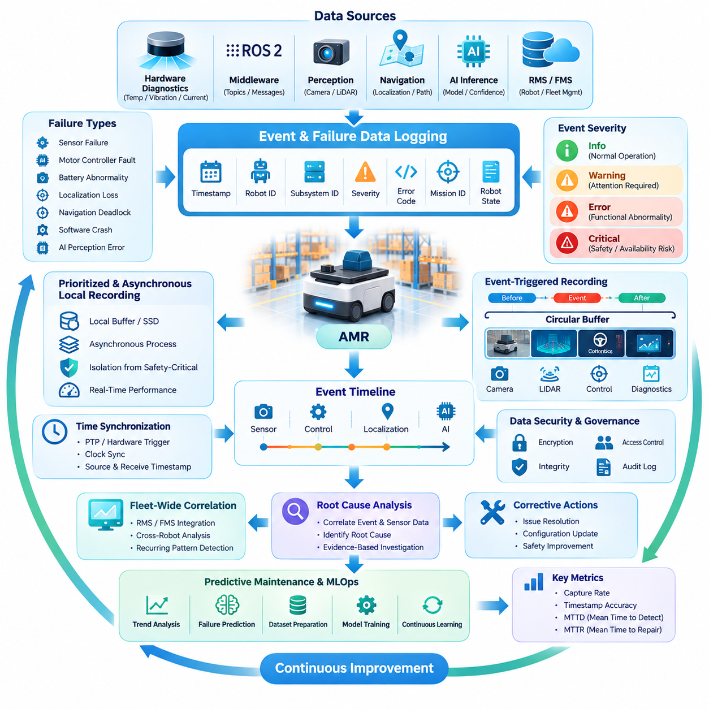
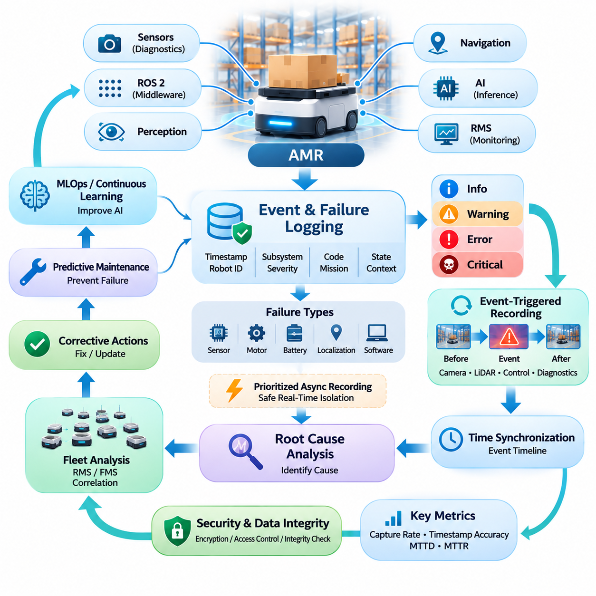
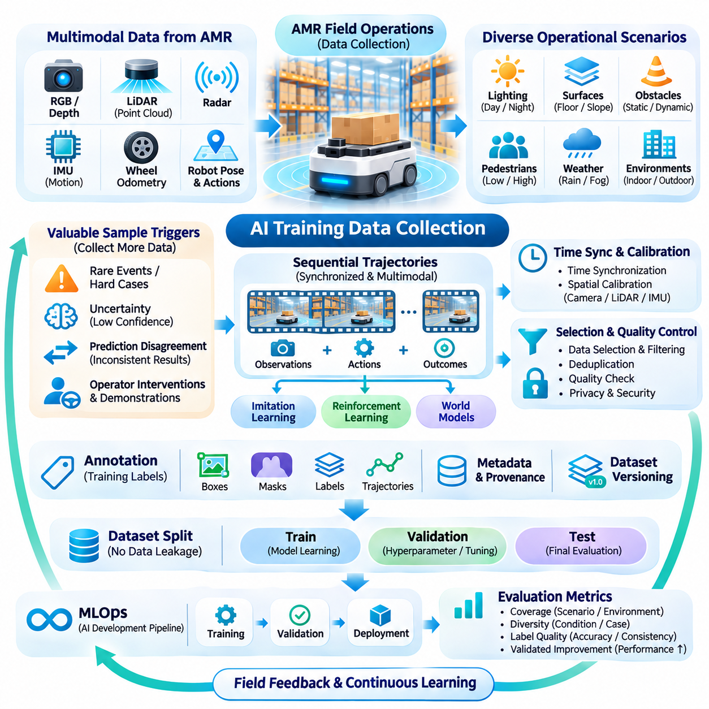
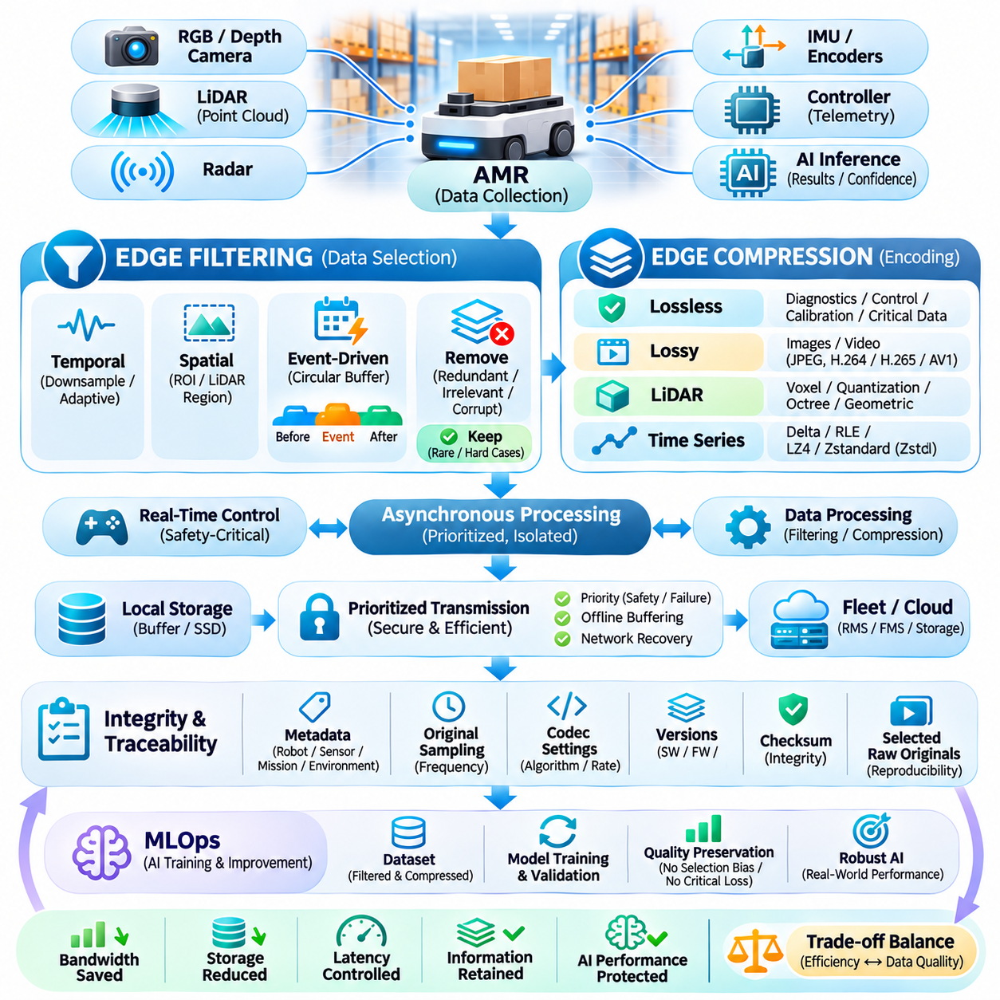
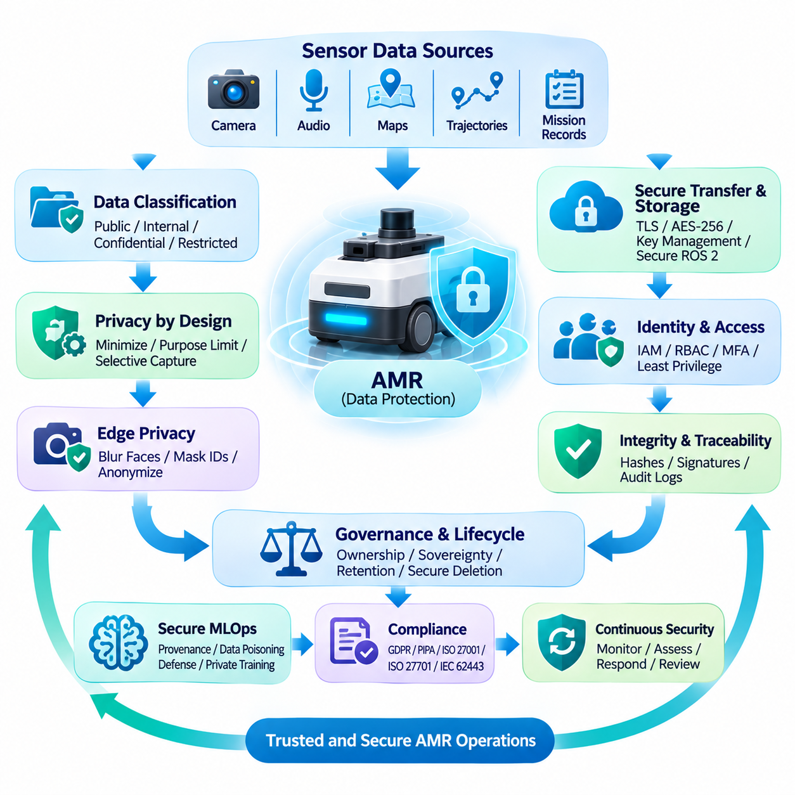
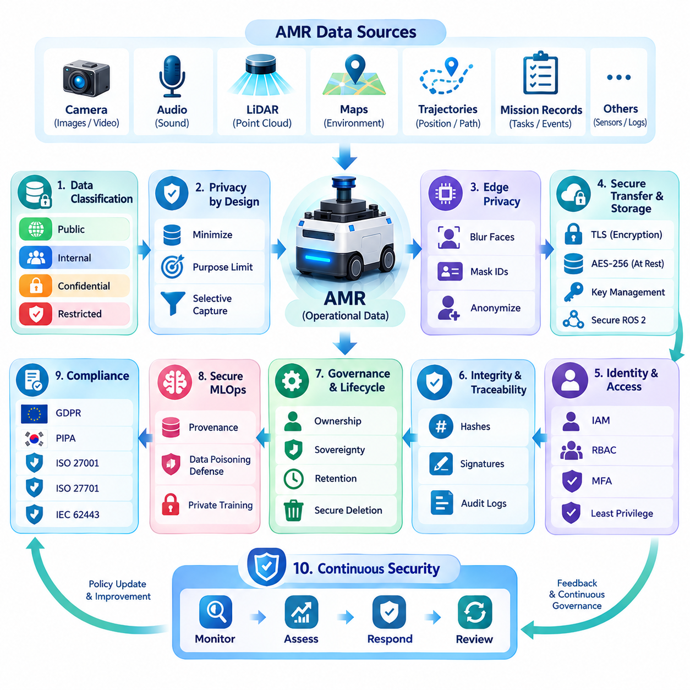
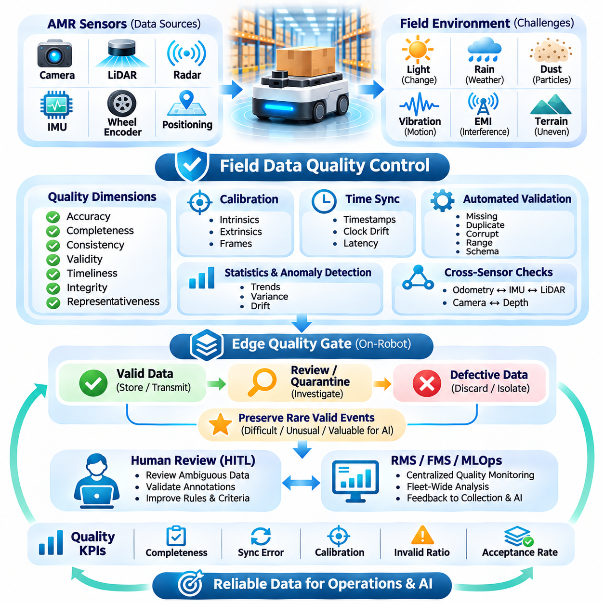
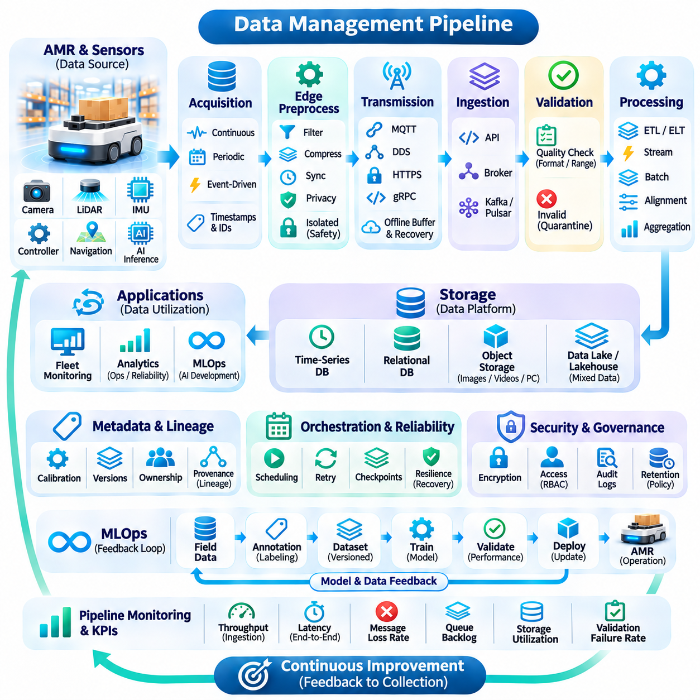

**Volume 08. AMR Operations, Deployment, and MLOps**

# Chapter 06. Data Collection in Operation

## 06.1 Operational Data Strategy

{width="7.268055555555556in" height="7.268055555555556in"}

운영 데이터 전략(Operational Data Strategy)은 자율이동로봇(Autonomous Mobile Robot, AMR)이 실제 운영 환경에서 생성하는 데이터를 수집(Collection), 처리(Processing), 저장(Storage), 관리(Management) 및 활용(Utilization)하기 위한 체계적인 프레임워크(Framework)이다. 주요 목적은 운영 경험을 가치 있는 엔지니어링 지식(Engineering Knowledge)으로 전환하여 운영 효율성(Operational Efficiency), 시스템 신뢰성(System Reliability), 안전성 향상(Safety Improvement), 예측 유지보수(Predictive Maintenance) 및 로봇 지능(Robotic Intelligence)의 지속적인 발전을 지원하는 것이다.

기존의 산업 자동화 장비(Industrial Automation Equipment)와 달리 AMR은 동적인 물리적 환경(Dynamic Physical Environment)과 지속적으로 상호작용한다. 모든 자율주행 작업(Navigation Task), 장애물 회피 동작(Obstacle Avoidance Maneuver), 도킹 작업(Docking Operation), 센서 관측(Sensor Observation) 및 인간과의 상호작용(Human Interaction)은 로봇의 행동에 관한 정보를 생성한다. 효과적인 운영 데이터 전략은 배치된 로봇을 전체 운영 수명주기(Operational Lifecycle)에 걸쳐 가치 있는 데이터 자원을 생성할 수 있는 분산형 데이터 수집 플랫폼(Distributed Data Acquisition Platform)으로 간주한다.

운영 데이터(Operational Data)는 센서 데이터(Sensor Data), 로봇 상태 데이터(Robot State Data), 임무 데이터(Mission Data), 환경 데이터(Environmental Data), 시스템 성능 데이터(System Performance Data), 안전 이벤트(Safety Event) 및 AI 추론 데이터(AI Inference Data)로 분류할 수 있다. 각 데이터 유형은 서로 다른 엔지니어링 및 운영 목적에 활용된다. 센서 데이터는 인지 시스템 개발(Perception Development)을 지원하며, 임무 데이터는 로봇 편대 최적화(Fleet Optimization)를 가능하게 한다. 하드웨어 원격 측정 데이터(Hardware Telemetry)는 예측 유지보수를 지원하고, 안전 관련 기록은 사고 조사(Incident Investigation)를 위한 근거를 제공한다.

데이터 수집 전략(Data Collection Strategy)은 명확하게 정의된 비즈니스 및 엔지니어링 목표에서 시작해야 한다. 특정 목적 없이 수집 가능한 모든 데이터 스트림(Data Stream)을 수집하면 불필요한 저장 공간 요구사항(Storage Requirements), 네트워크 혼잡(Network Congestion) 및 연산 부하(Computational Overhead)가 발생한다. 조직은 예상되는 운영 및 엔지니어링 가치에 따라 핵심 데이터 소스(Critical Data Source), 수집 주기(Collection Frequency), 보존 기간(Retention Period) 및 처리 요구사항(Processing Requirements)을 정의해야 한다.

계층형 데이터 수집 아키텍처(Hierarchical Data Collection Architecture)는 로봇 수준(Robot Level), 엣지 수준(Edge Level) 및 클라우드 수준(Cloud Level)의 인프라에 역할과 책임을 분산할 수 있다. 로봇 수준의 시스템은 원시 센서 측정값(Raw Sensor Measurement)과 내부 상태(Internal State)를 수집한다. 엣지 컴퓨팅 시스템(Edge Computing System)은 전처리(Preprocessing), 필터링(Filtering), 압축(Compression) 및 이벤트 감지(Event Detection)를 수행한다. 중앙 집중형 서버(Centralized Server) 또는 클라우드 플랫폼(Cloud Platform)은 장기 저장(Long-Term Storage), 로봇 편대 전체의 데이터 분석(Fleet-Wide Analytics), 데이터셋 관리(Dataset Management) 및 머신러닝 인프라(Machine Learning Infrastructure)와의 통합을 제공한다.

지속적 데이터 수집(Continuous Data Collection)과 이벤트 기반 데이터 수집(Event-Driven Data Collection)은 상호 보완적으로 운영되어야 한다. 지속적 데이터 수집은 정상적인 로봇 행동에 관한 운영 이력(Operational History)과 통계 정보(Statistical Information)를 제공한다. 이벤트 기반 데이터 수집은 위치 추정 실패(Localization Failure), 비상 정지(Emergency Stop), 예상하지 못한 장애물(Unexpected Obstacle), 통신 중단(Communication Interruption) 및 AI 추론 오류(AI Inference Error)와 같은 비정상 상황의 전후 데이터를 상세하게 수집함으로써 불필요한 데이터 전송 및 저장 공간 소비를 줄인다.

시간 동기화(Temporal Synchronization)는 서로 다른 운영 데이터 스트림 간의 의미 있는 관계를 확립하는 데 필수적이다. 카메라 영상(Camera Image), LiDAR 측정값(LiDAR Measurement), 관성 데이터(Inertial Data), 모터 제어 명령(Motor Command), 위치 추정값(Localization Estimate) 및 AI 추론 결과(AI Inference Result)는 일관된 타임스탬프(Timestamp)를 기반으로 연결되어야 한다. 정확한 시간 동기화는 엔지니어가 운영 시나리오(Operational Scenario)를 재구성하고, 인과관계(Causal Relationship)를 분석하며, 로봇 학습(Robotic Learning)을 위한 신뢰성 높은 멀티모달 데이터셋(Multimodal Dataset)을 생성할 수 있도록 한다.

운영 컨텍스트(Operational Context)는 표준화된 메타데이터(Standardized Metadata)를 통해 수집된 데이터와 함께 관리되어야 한다. 로봇 식별자(Robot Identifier), 하드웨어 구성(Hardware Configuration), 소프트웨어 버전(Software Version), AI 모델 버전(AI Model Version), 캘리브레이션 파라미터(Calibration Parameter), 환경 조건(Environmental Condition), 임무 식별자(Mission Identifier) 및 지도 버전(Map Version)은 관측 데이터를 해석하는 데 필수적인 정보를 제공한다. 포괄적인 메타데이터는 서로 다른 로봇, 배치 현장(Deployment Site) 및 소프트웨어 릴리스(Software Release) 간의 운영 성능을 비교할 때 추적성(Traceability)을 확보할 수 있도록 한다.

로봇 관리 시스템(Robot Management System, RMS) 및 로봇 편대 관리 시스템(Fleet Management System, FMS)과의 통합은 중앙 집중형 운영 데이터 조정(Centralized Operational Data Coordination)을 가능하게 한다. 이러한 플랫폼은 개별 로봇의 관측 데이터를 임무 수행(Mission Execution), 교통 상황(Traffic Condition), 충전 활동(Charging Activity), 운영자 개입(Operator Intervention) 및 로봇 편대 성능 지표(Fleet Performance Indicator)와 연결할 수 있다. 로봇 편대 수준의 데이터 집계(Fleet-Level Aggregation)는 개별 로봇을 독립적으로 분석할 때 발견하기 어려운 반복적인 운영 패턴(Operational Pattern)을 식별하는 데 도움이 된다.

데이터 수집은 AMR의 실시간 성능(Real-Time Performance)이나 기능 안전성(Functional Safety)을 저해해서는 안 된다. 데이터 로깅 프로세스(Data Logging Process), 데이터 압축(Data Compression) 및 네트워크 전송(Network Transmission)은 시간 제약이 중요한 인지(Perception), 자율주행(Navigation) 및 모션 제어(Motion Control) 기능으로부터 분리되어야 한다. 로컬 버퍼링(Local Buffering)과 비동기 전송 메커니즘(Asynchronous Transmission Mechanism)은 통신이 중단되는 상황에서도 로봇이 안정적인 운영을 유지하면서 우선순위가 높은 운영 기록을 보존하여 후속 분석에 활용할 수 있도록 한다.

운영 데이터는 머신러닝 운영(Machine Learning Operations, MLOps)과 지속적 학습(Continuous Learning)을 위한 핵심 기반을 제공한다. 대표적인 관측 데이터(Representative Observation), 난해 시나리오(Difficult Scenario), 인지 오류(Perception Error) 및 예상하지 못한 환경적 상호작용(Environmental Interaction)은 데이터 어노테이션(Data Annotation)과 데이터셋 개발(Dataset Development)을 위한 대상으로 선정될 수 있다. 이러한 데이터셋은 모델 재학습(Model Retraining), 성능 벤치마킹(Performance Benchmarking), 회귀 테스트(Regression Testing) 및 적절한 검증을 거친 개선된 AI 모델의 통제된 배포(Controlled Deployment)를 지원한다.

데이터 거버넌스(Data Governance)는 전체 운영 데이터 수명주기(Operational Data Lifecycle)에 걸쳐 데이터 소유권(Data Ownership), 접근 권한(Access Permission), 보존 정책(Retention Policy), 개인정보 보호(Privacy Protection) 및 보안 요구사항(Security Requirements)을 정의해야 한다. 병원, 공장, 물류 시설 및 공공 환경에서 수집되는 민감 정보(Sensitive Information)는 적절한 익명화(Anonymization), 암호화(Encryption) 및 접근 제어(Access Control)가 필요하다. 데이터 주권(Data Sovereignty)과 고객별 제한사항(Customer-Specific Restriction)에 따라 데이터를 온프레미스(On-Premises) 환경에 유지할 것인지 또는 외부로 전송할 것인지를 결정해야 한다.

운영 데이터 전략의 효과성은 데이터 완전성(Data Completeness), 시간 동기화 정확도(Synchronization Accuracy), 수집 신뢰성(Collection Reliability), 전송 효율성(Transmission Efficiency), 저장 공간 활용률(Storage Utilization) 및 데이터셋 활용성(Dataset Usability)과 같은 정량적으로 측정 가능한 지표를 통해 평가해야 한다. 추가적인 평가 지표에는 장애 상황 재구성 성공률(Failure Reconstruction Success Rate), 데이터 어노테이션 비용(Annotation Cost), 데이터 기반 엔지니어링 활동(Data-Driven Engineering Activity) 및 후속 모델 업데이트(Model Update)를 통해 달성한 측정 가능한 개선 효과가 포함될 수 있다.

궁극적으로 운영 데이터 전략은 물리적 로봇 배치(Physical Robot Deployment)와 지속적 시스템 개발(Continuous System Development) 사이에 폐루프 관계(Closed-Loop Relationship)를 구축한다. 현장 관측 데이터(Field Observation)는 엔지니어링 지식으로 전환되고, 엔지니어링 지식은 검증된 시스템 개선(System Improvement)을 지원하며, 개선된 시스템은 새로운 운영 경험(Operational Experience)을 생성한다. 이러한 피드백 아키텍처(Feedback Architecture)는 AMR 편대가 더욱 높은 신뢰성(Reliability), 적응성(Adaptability), 확장성(Scalability) 및 집단 지능(Collective Intelligence)을 갖춘 피지컬 AI 시스템(Physical AI System)으로 발전할 수 있도록 한다.

첨부된 장 구성(Chapter Structure)은 센서 데이터 수집(Sensor Data Collection), 이벤트 로깅(Event Logging), AI 학습 데이터셋(AI Training Dataset), 필터링(Filtering), 개인정보 보호(Privacy Protection), 품질 관리(Quality Control) 및 데이터 관리 파이프라인(Data Management Pipeline)을 포함하는 본 절의 주제 범위를 정의한다. 본문에서 제시한 기술적 설명은 특정 배치 환경의 요구사항이나 실험적으로 검증된 결과가 아니라 일반적인 로봇공학 엔지니어링 원칙(Robotics Engineering Principle)을 기반으로 해당 구성을 확장한 것이다.

## 06.2 Sensor Data Collection

{width="7.268055555555556in" height="7.268055555555556in"}

센서 데이터 수집(Sensor Data Collection)은 자율이동로봇(Autonomous Mobile Robot, AMR) 운영의 핵심 구성 요소로서 물리적 환경(Physical Environment)을 이해하고, 로봇 행동(Robot Behavior)을 모니터링하며, 시스템 성능(System Performance)을 평가하고, 자율 기능(Autonomous Capability)을 향상하는 데 필요한 정보를 제공한다. 실제 운영 과정에서 AMR은 다양한 이종 센서 데이터(Heterogeneous Sensor Data)를 지속적으로 생성하며, 이러한 데이터는 운영 분석(Operational Analysis)과 인공지능 개발(Artificial Intelligence Development)을 위한 가치 있는 엔지니어링 자원(Engineering Resource)으로 전환될 수 있다.

AMR은 일반적으로 2차원 라이다(2D LiDAR), 3차원 라이다(3D LiDAR), RGB 카메라(RGB Camera), 깊이 카메라(Depth Camera), 열화상 카메라(Thermal Camera), 레이더(Radar), 초음파 센서(Ultrasonic Sensor), 관성측정장치(Inertial Measurement Unit, IMU), 휠 인코더(Wheel Encoder) 및 글로벌 위성항법시스템(Global Navigation Satellite System, GNSS)을 포함하는 다양한 센싱 기술(Sensing Technology)을 통합한다. 각 센서는 로봇 자체와 주변 환경에 관한 서로 다른 정보를 제공한다. 이러한 관측 데이터를 결합함으로써 다양한 운영 조건에서 로봇 행동을 종합적으로 분석할 수 있다.

센서 데이터 수집 요구사항(Sensor Data Collection Requirements)은 운영 목표(Operational Objective), 환경 특성(Environmental Characteristics), 로봇 구성(Robot Configuration) 및 엔지니어링 우선순위(Engineering Priority)에 따라 수립되어야 한다. 자율주행 성능 개선(Navigation Improvement)에는 LiDAR 스캔(LiDAR Scan), 위치 추정값(Localization Estimate) 및 오도메트리 측정값(Odometry Measurement)이 필요할 수 있으며, 인지 시스템 개발(Perception Development)에는 동기화된 카메라 영상(Camera Image)과 포인트 클라우드(Point Cloud)가 필요할 수 있다. 하드웨어 진단(Hardware Diagnostics)은 진동(Vibration), 온도(Temperature), 전류(Electrical Current) 및 기계적 움직임(Mechanical Movement)의 측정을 우선시할 수 있다.

분산형 센서 데이터 수집 아키텍처(Distributed Sensor Data Acquisition Architecture)는 일반적으로 센서 인터페이스(Sensor Interface), 디바이스 드라이버(Device Driver), 통신 미들웨어(Communication Middleware), 타임스탬프 관리(Timestamp Management), 로컬 기록 서비스(Local Recording Service) 및 중앙 집중형 데이터 관리 인프라(Centralized Data Management Infrastructure)로 구성된다. ROS 2 환경에서 센서 측정값은 일반적으로 표준화된 메시지 형식(Standardized Message Format)을 사용하는 전용 토픽(Dedicated Topic)을 통해 전달된다. 데이터 기록 서비스는 사전에 정의된 운영 데이터 수집 정책(Operational Data Collection Policy)에 따라 선택된 토픽을 구독(Subscribe)한다.

서로 다른 센서는 상당히 상이한 샘플링 주파수(Sampling Frequency)와 대역폭(Bandwidth)으로 데이터를 생성한다. 카메라는 초당 15\\\~60프레임(Frames Per Second, FPS)의 영상을 생성할 수 있으며, 관성측정장치(IMU)는 일반적으로 100\\\~1,000Hz의 주파수 범위에서 작동한다. LiDAR 시스템, 레이더 센서 및 휠 인코더 역시 서로 다른 데이터 수집 특성(Acquisition Characteristics)을 가진다. 샘플링 구성(Sampling Configuration)은 측정 정확도(Measurement Accuracy), 시간 해상도(Temporal Resolution), 연산 부하(Computational Overhead) 및 가용 저장 용량(Available Storage Capacity) 사이의 균형을 고려해야 한다.

정확한 시간 동기화(Time Synchronization)는 이종 센서 데이터(Heterogeneous Sensor Data)를 수집할 때 필수적이다. 하드웨어 트리거링(Hardware Triggering), 정밀 시간 프로토콜(Precision Time Protocol, PTP), GNSS 기반 타이밍(GNSS-Based Timing) 및 소프트웨어 타임스탬프 동기화(Software Timestamp Synchronization)는 센서 측정값 사이에 일관된 시간적 관계(Temporal Relationship)를 형성할 수 있다. 동기화 오류(Synchronization Error)는 공간적 불일치(Spatial Inconsistency), 부정확한 움직임 추정(Motion Estimation) 및 신뢰성이 낮은 센서 융합 결과(Sensor Fusion Result)를 발생시킬 수 있으며, 특히 로봇이 동적인 환경에서 작동할 때 이러한 문제가 더욱 중요해진다.

센서 캘리브레이션 정보(Sensor Calibration Information)는 수집된 측정값과 함께 보존되어야 한다. 내부 캘리브레이션 파라미터(Intrinsic Calibration Parameter)는 개별 센서의 특성을 설명하며, 외부 캘리브레이션 파라미터(Extrinsic Calibration Parameter)는 센서와 로봇 좌표계(Robot Coordinate System) 사이의 공간적 관계(Spatial Relationship)를 정의한다. 캘리브레이션 버전(Calibration Version), 좌표 변환(Coordinate Transformation), 장착 구성(Mounting Configuration) 및 센서 식별자(Sensor Identifier)는 정확한 데이터 해석(Data Interpretation)과 재현 가능한 엔지니어링 분석(Reproducible Engineering Analysis)을 보장할 수 있도록 추적 가능하게 관리되어야 한다.

지속적 데이터 기록(Continuous Recording)은 포괄적인 운영 이력(Operational History)을 제공하지만, 특히 여러 대의 고해상도 카메라(High-Resolution Camera)와 3D LiDAR 센서가 동시에 작동할 경우 상당한 데이터 용량(Data Volume)을 발생시킬 수 있다. 선택적 데이터 기록 전략(Selective Recording Strategy)은 적응형 샘플링(Adaptive Sampling), 주기적 데이터 수집(Periodic Acquisition), 공간적 선택(Spatial Selection) 및 이벤트 기반 데이터 기록(Event-Driven Recording)을 통해 자원 소비(Resource Consumption)를 줄일 수 있다. 데이터 수집 정책은 일상적인 운영 데이터를 불필요하게 중복 저장하지 않으면서 정보 가치가 높은 관측 데이터를 보존해야 한다.

이벤트 트리거 기반 센서 기록(Event-Triggered Sensor Recording)은 비정상적인 로봇 행동(Abnormal Robot Behavior)을 조사하는 데 특히 유용하다. 위치 추정 실패(Localization Failure), 예상하지 못한 장애물(Unexpected Obstacle), 비상 정지(Emergency Stop), 과도한 진동(Excessive Vibration), 인지 불확실성(Perception Uncertainty) 및 운영자 개입(Operator Intervention)은 고해상도 데이터 기록(High-Resolution Recording)을 시작하는 트리거(Trigger)로 활용될 수 있다. 순환 버퍼(Circular Buffer)는 이벤트 발생 직전의 센서 측정값을 보존할 수 있도록 하며, 이후의 데이터 기록은 복구 행동(Recovery Behavior)과 그에 따른 운영 결과(Operational Consequence)를 수집한다.

로컬 데이터 수집 시스템(Local Data Acquisition System)은 무선 통신(Wireless Communication)이 불안정해지거나 사용할 수 없는 상황에서도 신뢰성 높은 데이터 기록 기능(Recording Capability)을 유지해야 한다. 고속 솔리드 스테이트 드라이브(High-Speed Solid-State Drive, SSD), 용량이 제한된 메모리 버퍼(Bounded Memory Buffer), 비동기 기록 프로세스(Asynchronous Recording Process) 및 우선순위 기반 저장 공간 할당(Prioritized Storage Allocation)은 중단 없는 데이터 수집을 지원한다. 과도한 자원 사용(Resource Utilization)이 자율 운영 성능을 저하시키지 않도록 데이터 기록 서비스는 안전 필수 기능(Safety-Critical Function)과 실시간 제어 기능(Real-Time Control Function)으로부터 분리되어야 한다.

엣지 컴퓨팅 플랫폼(Edge Computing Platform)은 수집된 센서 데이터를 중앙 집중형 인프라(Centralized Infrastructure)로 전송하기 전에 전처리(Preprocessing)를 수행할 수 있다. 이미지 크기 조정(Image Resizing), 포인트 클라우드 다운샘플링(Point Cloud Downsampling), 관심 영역 추출(Region-of-Interest Extraction, ROI), 노이즈 필터링(Noise Filtering) 및 데이터 압축(Data Compression)은 통신 대역폭(Communication Bandwidth)과 저장 공간 요구사항(Storage Requirements)을 줄일 수 있다. 그러나 전처리 과정은 엔지니어링 목표와 관련된 정보를 보존해야 하며, 특히 캘리브레이션(Calibration), 장애 상황 재구성(Failure Reconstruction) 또는 AI 학습(AI Training)을 위해 원본 센서 측정값(Original Sensor Measurement)이 필요한 경우 이러한 정보의 보존이 중요하다.

여러 AMR에 걸친 센서 데이터 수집에는 표준화된 데이터 형식(Standardized Data Format), 명명 규칙(Naming Convention), 메타데이터 구조(Metadata Structure) 및 데이터 수집 구성(Acquisition Configuration)이 필요하다. 로봇 식별자(Robot Identifier), 센서 식별자(Sensor Identifier), 펌웨어 버전(Firmware Version), 타임스탬프(Timestamp), 임무 식별자(Mission Identifier), 지도 버전(Map Version) 및 환경 조건(Environmental Condition)은 기록된 측정값과 함께 관리되어야 한다. 표준화(Standardization)는 로봇 편대 전체에 대한 일관된 데이터 분석(Fleet-Wide Analysis)을 가능하게 하고, 서로 다른 로봇 플랫폼(Robot Platform)과 배치 장소(Deployment Location) 사이의 데이터 통합(Data Integration)을 단순화한다.

센서 데이터 품질(Sensor Data Quality)은 데이터 수집(Acquisition)과 후처리(Post-Processing) 과정에서 모두 평가되어야 한다. 측정값 누락(Missing Measurement), 손상된 파일(Corrupted File), 중복 프레임(Duplicated Frame), 타임스탬프 불연속성(Timestamp Discontinuity), 잘못된 캘리브레이션 파라미터(Incorrect Calibration Parameter) 및 센서 포화(Sensor Saturation)는 데이터셋 신뢰성(Dataset Reliability)을 저하시킬 수 있다. 자동화된 품질 검증 메커니즘(Automated Quality Verification Mechanism)은 비정상적인 데이터 패턴(Abnormal Data Pattern)을 식별하고, 진단 알림(Diagnostic Notification)을 생성하며, 부적합한 측정값이 후속 엔지니어링 및 머신러닝 워크플로우(Machine Learning Workflow)에 유입되는 것을 방지해야 한다.

수집된 센서 데이터에는 사람의 얼굴(Human Face), 차량 등록번호(Vehicle Registration Number), 기밀 산업 시설(Confidential Industrial Facility) 및 사적인 대화(Private Conversation)를 포함하는 민감 정보(Sensitive Information)가 포함될 수 있다. 데이터 수집 정책(Data Collection Policy)은 개인정보 보호(Privacy Protection), 접근 제어(Access Control), 암호화(Encryption), 데이터 보존 관리(Retention Management) 및 데이터 최소화(Data Minimization)를 포함해야 한다. 규제 요구사항(Regulatory Requirements)과 고객 계약(Customer Agreement)에 따라 민감한 센서 측정값은 승인된 온프레미스 인프라(On-Premises Infrastructure) 내부에서 처리되고 익명화(Anonymization)되어야 할 수 있다.

궁극적으로 센서 데이터 수집은 데이터 기반 AMR 개발(Data-Driven AMR Development)과 지속적 학습(Continuous Learning)을 위한 관측 기반(Observational Foundation)을 구축한다. 실제 환경에서 수집된 측정값(Real-World Measurement)은 인지 모델 개선(Perception Model Improvement), 자율주행 최적화(Navigation Optimization), 디지털 트윈 개발(Digital Twin Development), 예측 유지보수(Predictive Maintenance) 및 운영 안전성 분석(Operational Safety Analysis)을 지원한다. 본문에서 설명한 데이터 수집 방법(Acquisition Method)과 샘플링 주파수(Sampling Frequency)는 첨부된 장 구성에서 정의한 필수 사양(Mandatory Specification)이 아니라 일반적인 엔지니어링 사례(General Engineering Example)에 해당한다.

## 06.3 Event and Failure Data Logging

{width="7.268055555555556in" height="7.268055555555556in"}

{width="7.268055555555556in" height="7.268055555555556in"}

이벤트 및 장애 데이터 로깅(Event and Failure Data Logging)은 자율이동로봇(Autonomous Mobile Robot, AMR) 운영의 핵심 구성 요소로서 조직이 비정상적인 운영 상태(Abnormal Operational Condition)를 체계적으로 수집(Capture), 보존(Preservation), 분석(Analysis) 및 조사(Investigation)할 수 있도록 한다. 일반적인 운영 모니터링(Operational Monitoring)과 달리 이벤트 및 장애 데이터 로깅은 특정 사고(Incident), 예상하지 못한 행동(Unexpected Behavior), 시스템 결함(System Fault) 및 예상 운영 성능(Operational Performance)으로부터의 편차와 관련된 상황 정보(Contextual Information)를 수집하는 데 중점을 둔다.

운영 이벤트(Operational Event)는 로봇 행동(Robot Behavior), 시스템 상태(System State), 환경 조건(Environmental Condition) 또는 임무 수행(Mission Execution)에서 발생하는 중요한 변화를 의미한다. 이벤트에는 임무 완료(Mission Completion), 장애물 감지(Obstacle Detection), 위치 추정 불안정성(Localization Instability), 통신 중단(Communication Interruption), 충전 실패(Charging Failure), 운영자 개입(Operator Intervention) 또는 비상 정지 활성화(Emergency Stop Activation)가 포함될 수 있다. 모든 이벤트가 시스템 장애(System Failure)에 해당하는 것은 아니지만, 각각의 이벤트는 운영 특성(Operational Characteristics)을 이해하고 잠재적 위험(Potential Risk)을 식별하는 데 가치 있는 정보를 제공할 수 있다.

장애(Failure)는 로봇 구성 요소(Robot Component), 소프트웨어 기능(Software Function), 통신 인터페이스(Communication Interface) 또는 자율 기능(Autonomous Capability)이 지정된 요구사항 내에서 의도된 기능을 수행하지 못할 때 발생한다. 대표적인 AMR 장애에는 센서 오작동(Sensor Malfunction), 모터 제어기 결함(Motor Controller Fault), 배터리 이상(Battery Abnormality), 위치 추정 상실(Localization Loss), 자율주행 교착 상태(Navigation Deadlock), 소프트웨어 프로세스 충돌(Software Process Crash) 및 AI 인지 오류(AI Perception Error)가 포함된다. 체계적인 장애 분류(Failure Classification)는 서로 다른 로봇 플랫폼과 배치 환경에서 일관된 장애 조사를 가능하게 한다.

이벤트 및 장애 로깅 아키텍처(Event and Failure Logging Architecture)는 하드웨어 진단(Hardware Diagnostics), 임베디드 제어기(Embedded Controller), ROS 2 미들웨어(ROS 2 Middleware), 인지 모듈(Perception Module), 자율주행 소프트웨어(Navigation Software), AI 추론 엔진(AI Inference Engine) 및 로봇 관리 시스템(Robot Management System, RMS)을 통합해야 한다. 개별 서브시스템(Subsystem)은 구조화된 진단 메시지(Structured Diagnostic Message)를 생성하며, 이러한 메시지는 분산형 로깅 서비스(Distributed Logging Service)를 통해 수집된다. 중앙 집중형 데이터 집계(Centralized Aggregation)는 엔지니어가 하드웨어 상태, 소프트웨어 실행 및 전체 로봇 행동 사이의 관계를 재구성할 수 있도록 한다.

구조화된 이벤트 기록(Structured Event Record)에는 고유 이벤트 식별자(Unique Event Identifier), 타임스탬프(Timestamp), 로봇 식별자(Robot Identifier), 서브시스템 식별자(Subsystem Identifier), 이벤트 유형(Event Category), 심각도 수준(Severity Level), 오류 코드(Error Code), 임무 식별자(Mission Identifier) 및 관련 운영 상태(Operational State)가 포함되어야 한다. 추가적인 상황 정보에는 로봇 위치(Robot Position), 속도(Velocity), 배터리 상태(Battery Status), 환경 조건, 소프트웨어 버전(Software Version) 및 AI 모델 버전(AI Model Version)이 포함될 수 있다. 표준화된 스키마(Standardized Schema)는 대규모 로봇 편대에서 추적성(Traceability), 자동화된 분석(Automated Analysis) 및 상호운용성(Interoperability)을 향상한다.

이벤트 심각도 분류(Event Severity Classification)는 운영팀이 잠재적 결과(Potential Consequence)에 따라 사고의 우선순위를 결정하도록 지원한다. 정보성 이벤트(Informational Event)는 정상적인 운영 상태 전이(Operational Transition)를 설명하며, 경고 이벤트(Warning Event)는 주의가 필요할 수 있는 상태를 식별한다. 오류 이벤트(Error Event)는 기능적 이상(Functional Abnormality)을 나타내며, 치명적 이벤트(Critical Event)는 운영 안전성(Operational Safety) 또는 시스템 가용성(System Availability)을 위협할 수 있는 상태를 의미한다. 심각도 정의(Severity Definition)는 애플리케이션별 요구사항(Application-Specific Requirements)과 문서화된 위험 평가(Risk Assessment)를 반영해야 한다.

이벤트 트리거 기반 기록(Event-Triggered Recording)은 높은 대역폭을 사용하는 모든 센서 데이터 스트림(Sensor Data Stream)을 지속적으로 저장하지 않으면서 상세한 데이터 수집을 가능하게 한다. 순환 버퍼(Circular Buffer)는 사고 발생 직전의 과거 측정값(Historical Measurement)을 보존할 수 있으며, 설정 가능한 이벤트 이후 기록(Post-Event Recording)은 후속 로봇 행동을 수집한다. 따라서 카메라 영상(Camera Image), LiDAR 스캔(LiDAR Scan), 액추에이터 제어 명령(Actuator Command), 위치 추정값(Localization Estimate) 및 진단 메시지(Diagnostic Message)를 동기화하여 포괄적인 사고 데이터셋(Incident Dataset)을 구성할 수 있다.

장애 상황 재구성(Failure Reconstruction)에는 서로 다른 하드웨어 및 소프트웨어 구성 요소에서 생성된 이벤트 사이의 정확한 시간적 관계(Temporal Relationship)가 필요하다. 정밀 시간 프로토콜(Precision Time Protocol, PTP), 하드웨어 트리거링(Hardware Triggering) 또는 적절한 클럭 동기화 메커니즘(Clock Synchronization Mechanism)을 활용한 타임스탬프 동기화(Timestamp Synchronization)는 엔지니어가 신뢰성 높은 이벤트 발생 순서(Event Sequence)를 확립할 수 있도록 한다. 데이터 소스 타임스탬프(Source Timestamp)와 수신 타임스탬프(Reception Timestamp)를 모두 기록하면 실제 시스템 행동을 통신 지연(Communication Delay) 및 처리 지연(Processing Latency)과 구분하는 데 도움이 된다.

근본 원인 분석(Root Cause Analysis, RCA)은 기록된 이벤트 발생 순서를 활용하여 관측 가능한 증상(Observable Symptom)과 근본적인 장애 발생 메커니즘(Underlying Failure Mechanism)을 구분한다. 예를 들어 자율주행 장애(Navigation Failure)는 센서 성능 저하(Sensor Degradation), 잘못된 캘리브레이션(Incorrect Calibration), 위치 추정 불확실성(Localization Uncertainty), 과도한 연산 부하(Excessive Computational Load) 또는 예상하지 못한 환경 조건에서 비롯될 수 있다. 진단 기록(Diagnostic Record)을 센서 관측 데이터(Sensor Observation) 및 제어 명령(Control Command)과 연계하여 분석하면 오류 코드에만 의존하는 추정이 아니라 증거 기반 조사(Evidence-Based Investigation)를 수행할 수 있다.

로봇 관리 시스템(Robot Management System, RMS) 및 로봇 편대 관리 시스템(Fleet Management System, FMS)과의 통합은 중앙 집중형 이벤트 모니터링(Centralized Event Monitoring)과 로봇 편대 전체의 장애 분석(Fleet-Wide Failure Analysis)을 가능하게 한다. 여러 로봇에서 반복적으로 발생하는 이상 상태(Abnormality)는 공통 소프트웨어 결함(Common Software Defect), 하드웨어 취약점(Hardware Weakness), 환경적 문제(Environmental Challenge) 또는 인프라 제약사항(Infrastructure Limitation)을 드러낼 수 있다. 로봇 편대 수준의 상관관계 분석(Fleet-Level Correlation)은 개별 로봇 수준의 독립적인 조사에서 발견하기 어려운 시스템 전반의 문제(Systemic Problem)를 식별할 수 있도록 지원한다.

이벤트 및 장애 데이터는 예측 유지보수(Predictive Maintenance)와 하드웨어 신뢰성 엔지니어링(Hardware Reliability Engineering)에도 활용되어야 한다. 모터 온도(Motor Temperature), 전류(Electrical Current), 진동(Vibration), 배터리 열화(Battery Degradation), 통신 오류(Communication Error) 및 간헐적 센서 결함(Intermittent Sensor Fault)에 관한 과거 기록은 구성 요소 장애(Component Failure)가 발생하기 이전의 비정상적인 추세(Abnormal Trend)를 드러낼 수 있다. 진단 이력(Diagnostic History)과 유지보수 기록(Maintenance Record)을 결합하면 상태 기반 유지보수(Condition-Based Maintenance)와 적절한 검증을 거친 장애 예측 모델(Failure Prediction Model)의 개발을 지원할 수 있다.

AI 관련 이벤트 로깅(AI-Related Event Logging)에는 추론 신뢰도(Inference Confidence), 모델 버전(Model Version), 입력 데이터 특성(Input Characteristics), 처리 지연(Processing Latency) 및 예측 결과(Predicted Outcome)와 검증된 실제 결과(Verified Outcome) 사이의 불일치 등 모델 행동(Model Behavior)에 관한 추가적인 정보가 필요하다. 난해한 인지 시나리오(Difficult Perception Scenario), 예상하지 못한 객체 분류(Unexpected Object Classification) 및 운영자 교정(Operator Correction)은 AI 학습 데이터셋(AI Training Dataset)의 후보 데이터가 될 수 있다. 이러한 기록은 운영 장애 분석(Operational Failure Analysis)을 머신러닝 운영(Machine Learning Operations, MLOps) 및 지속적 학습(Continuous Learning)과 연결한다.

신뢰성 높은 로깅 인프라(Reliable Logging Infrastructure)는 실시간 제어(Real-Time Control) 또는 안전 필수 기능(Safety-Critical Function)을 방해하지 않으면서 핵심 진단 정보(Critical Diagnostic Information)를 보존해야 한다. 비동기 로깅(Asynchronous Logging), 용량이 제한된 메모리 버퍼(Bounded Memory Buffer), 우선순위 기반 저장 공간 할당(Prioritized Storage Allocation), 영속적 로컬 기록(Persistent Local Recording) 및 통제된 네트워크 전송(Controlled Network Transmission)은 운영 안정성(Operational Stability)을 유지하는 데 도움이 된다. 시스템 자원이 제한된 상황에서 로깅 정책(Logging Policy)은 일상적인 정보성 메시지(Routine Informational Message)보다 안전 이벤트(Safety Event)와 필수 진단 기록(Essential Diagnostic Record)에 우선순위를 부여해야 한다.

이벤트 및 장애 기록에는 민감한 환경 관측 정보(Sensitive Environmental Observation), 운영자 정보(Operator Information), 고객 인프라 세부 정보(Customer Infrastructure Details) 및 독점적 시스템 구성 정보(Proprietary System Configuration)가 포함될 수 있다. 적절한 암호화(Encryption), 역할 기반 접근 제어(Role-Based Access Control, RBAC), 무결성 검증(Integrity Verification), 데이터 보존 정책(Retention Policy) 및 감사 추적 기록(Audit Trail)을 통해 전체 데이터 수명주기(Data Lifecycle)에 걸쳐 이러한 기록을 보호해야 한다. 안전 관련 사고 기록(Safety-Related Incident Record)은 적용되는 규제(Regulation) 및 계약상 의무(Contractual Obligation)에 따라 추가적인 데이터 보존 관리(Preservation Control)가 필요할 수 있다.

이벤트 및 장애 로깅의 효과성은 이벤트 수집 완전성(Event Capture Completeness), 타임스탬프 정확도(Timestamp Accuracy), 진단 커버리지(Diagnostic Coverage), 장애 상황 재구성 성공률(Failure Reconstruction Success Rate), 평균 감지 시간(Mean Time to Detect, MTTD) 및 평균 수리 시간(Mean Time to Repair, MTTR)과 같은 정량적으로 측정 가능한 지표를 통해 평가해야 한다. 궁극적으로 체계적인 로깅(Systematic Logging)은 운영 안전성(Operational Safety), 신뢰성(Reliability), 유지보수성(Maintainability) 및 자율 지능(Autonomous Intelligence)을 향상하기 위한 피드백 메커니즘(Feedback Mechanism)을 구축한다. 본문에서 설명한 방법은 특정 배치 환경의 사양(Deployment-Specific Specification)이 아니라 일반적인 로봇공학 엔지니어링 원칙(Robotics Engineering Principle)을 기반으로 첨부된 장 구성을 확장한 것이다.

## 06.4 AI Training Data Collection

{width="7.268055555555556in" height="7.268055555555556in"}

AI 학습 데이터 수집(AI Training Data Collection)은 자율이동로봇(Autonomous Mobile Robot, AMR)의 지능(Intelligence), 적응성(Adaptability) 및 운영 신뢰성(Operational Reliability)을 향상하기 위한 핵심 프로세스이다. 통제된 실험실 환경에서 수집되는 기존 데이터셋(Conventional Dataset)과 달리 운영 과정에서 획득한 학습 데이터(Operational Training Data)는 실제 물리적 환경(Real-World Physical Environment)의 복잡성(Complexity)과 가변성(Variability)을 반영한다. 이러한 관측 데이터는 로봇 인공지능 시스템(Robotic Artificial Intelligence System)을 개발하고, 검증하며, 지속적으로 개선하기 위한 기반을 제공한다.

AI 학습 데이터 수집의 주요 목적은 머신러닝 모델(Machine Learning Model)이 환경 조건(Environmental Condition)을 이해하고, 객체를 인식(Object Recognition)하며, 동적 행동(Dynamic Behavior)을 예측하고, 적절한 로봇 행동(Robotic Action)을 생성할 수 있도록 대표성 있는 정보(Representative Information)를 확보하는 것이다. 학습 데이터 요구사항(Training Data Requirements)은 구체적인 AI 개발 목표(AI Development Objective), 운영 설계 영역(Operational Design Domain, ODD), 모델 아키텍처(Model Architecture) 및 예상 성능 개선(Expected Performance Improvement)에 따라 수립되어야 한다.

AMR은 정상적인 운영 과정에서 RGB 영상(RGB Image), 깊이 영상(Depth Image), LiDAR 포인트 클라우드(LiDAR Point Cloud), 레이더 측정값(Radar Measurement), 관성 측정값(Inertial Measurement), 휠 오도메트리(Wheel Odometry), 위치 추정값(Localization Estimate) 및 액추에이터 제어 명령(Actuator Command)을 포함하는 다양한 멀티모달 데이터(Multimodal Data)를 생성한다. 추가적인 정보에는 의미론적 지도(Semantic Map), 임무 목표(Mission Objective), 환경 조건 및 인간과의 상호작용(Human Interaction)이 포함될 수 있다. 이러한 이종 관측 데이터(Heterogeneous Observation)를 결합함으로써 체화 지능(Embodied Intelligence)과 피지컬 AI(Physical AI) 애플리케이션을 위한 포괄적인 데이터셋을 개발할 수 있다.

학습 데이터 수집은 정상적인 로봇 행동(Normal Robot Behavior)에만 집중하기보다는 광범위한 운영 시나리오(Operational Scenario)를 포괄해야 한다. 환경적 다양성(Environmental Diversity)에는 서로 다른 조명 조건(Lighting Condition), 기상 패턴(Weather Pattern), 바닥 표면(Floor Surface), 장애물 배치(Obstacle Configuration), 보행자 밀도(Pedestrian Density) 및 인프라 배치(Infrastructure Layout)가 포함될 수 있다. 대표성 있는 데이터셋(Representative Dataset)은 다양한 배치 장소(Deployment Location), 로봇 구성(Robot Configuration), 운영 속도(Operating Speed) 및 임무 특성(Mission Characteristics)에서 발생하는 변화를 반영해야 한다.

희귀 이벤트(Rare Event)와 난해한 운영 시나리오(Difficult Operational Scenario)는 AI 모델 강건성(AI Model Robustness)을 향상하는 데 특히 가치가 높다. 대표적인 사례로는 부분적으로 가려진 보행자(Partially Occluded Pedestrian), 반사 표면(Reflective Surface), 예상하지 못한 장애물(Unexpected Obstacle), 위치 추정 실패(Localization Failure), 비정상적인 객체 외형(Unusual Object Appearance) 및 모호한 환경 조건(Ambiguous Environmental Condition)이 있다. 이벤트 트리거 기반 기록(Event-Triggered Recording)과 난해 사례 마이닝(Hard Case Mining) 메커니즘은 이러한 상황을 식별하고 후속 조사 및 모델 개발에 필요한 센서 측정값을 보존할 수 있다.

불확실성 기반 데이터 수집(Uncertainty-Based Data Collection)은 배치된 AI 모델이 낮은 신뢰도(Limited Confidence) 또는 일관되지 않은 예측(Inconsistent Prediction)을 나타내는 관측 데이터를 로봇이 식별할 수 있도록 한다. 모델 신뢰도 점수(Model Confidence Score), 예측 불일치(Prediction Disagreement), 분포 외 데이터 감지(Out-of-Distribution Detection, OOD) 및 예상 결과(Expected Outcome)와 관측 결과(Observed Outcome) 사이의 불일치는 데이터 수집 트리거(Collection Trigger)로 활용될 수 있다. 이러한 메커니즘은 후속 모델 개선에 기여할 수 있는 정보 가치가 높은 샘플(Informative Sample)에 우선순위를 부여함으로써 능동 학습(Active Learning)을 지원한다.

인간 시연(Human Demonstration)과 운영자 개입(Operator Intervention)은 모방학습(Imitation Learning) 및 행동 최적화(Behavior Optimization)를 위한 가치 있는 학습 자원을 제공한다. 수동 주행 궤적(Manual Driving Trajectory), 장애물 회피 의사결정(Obstacle Avoidance Decision), 도킹 교정(Docking Correction), 작업 수행 시퀀스(Task Execution Sequence) 및 복구 행동(Recovery Behavior)은 환경 관측 데이터(Environmental Observation)와 함께 기록될 수 있다. 이러한 시연 데이터는 수집된 행동의 안전성(Safety), 일관성(Consistency) 및 적합성(Suitability)이 평가된다는 전제하에 로봇 시스템이 숙련된 운영자로부터 학습할 수 있도록 한다.

강화학습(Reinforcement Learning, RL)과 월드 모델(World Model)을 위한 학습 데이터셋은 로봇 상태(Robot State), 행동(Action), 환경 상태 전이(Environmental Transition) 및 결과(Outcome) 사이의 관계를 보존하는 순차적 관측 데이터(Sequential Observation)를 필요로 한다. 기록된 궤적(Recorded Trajectory)에는 동기화된 센서 관측 데이터(Synchronized Sensor Observation), 제어 명령(Control Command), 임무 목표, 해당되는 경우 보상(Reward), 그리고 종료 조건(Termination Condition)이 포함되어야 한다. 이러한 시퀀스는 물리적 동역학(Physical Dynamics), 행동의 결과(Action Consequence) 및 장기적 의사결정 능력(Long-Horizon Decision-Making Capability)의 학습을 지원한다.

시간 동기화(Temporal Synchronization)와 공간 캘리브레이션(Spatial Calibration)은 신뢰성 높은 멀티모달 학습 데이터(Multimodal Training Data)를 수집하는 데 매우 중요하다. 카메라 영상(Camera Image), LiDAR 측정값(LiDAR Measurement), 로봇 자세(Robot Pose), 액추에이터 제어 명령 및 환경 관측 데이터는 일관된 시간적 관계(Temporal Relationship)와 공간적 관계(Spatial Relationship)를 유지해야 한다. 수집된 데이터셋이 물리적으로 의미 있는 관계(Physically Meaningful Relationship)를 표현할 수 있도록 캘리브레이션 파라미터(Calibration Parameter), 좌표 변환(Coordinate Transformation), 타임스탬프 정확도(Timestamp Accuracy) 및 동기화 상태(Synchronization Status)를 보존해야 한다.

데이터 선택(Data Selection)과 전처리(Preprocessing)는 운영 중인 AMR 편대가 생성하는 방대한 정보를 관리하는 데 필요하다. 중복 관측 데이터(Duplicate Observation), 손상된 측정값(Corrupted Measurement), 과도하게 중복된 시퀀스(Excessively Redundant Sequence) 및 관련성이 낮은 정보(Irrelevant Information)는 자동화된 필터링 메커니즘(Automated Filtering Mechanism)을 통해 식별할 수 있다. 그러나 데이터 선택 정책(Data Selection Policy)은 과도한 데이터셋 편향(Dataset Bias)이 발생하거나 환경 커버리지(Environmental Coverage)가 감소하는 것을 방지하기 위해 희귀 이벤트와 대표성 있는 정상 행동을 보존해야 한다.

수집된 학습 데이터는 대상 학습 알고리즘(Target Learning Algorithm)의 요구사항에 따라 적절하게 어노테이션(Annotation)되어야 한다. 객체 경계 상자(Object Bounding Box), 세그멘테이션 마스크(Segmentation Mask), 의미론적 라벨(Semantic Label), 주행 가능성 분류(Traversability Classification), 로봇 궤적(Robot Trajectory) 및 작업 결과(Task Outcome)는 일반적인 어노테이션 유형(Annotation Category)에 해당한다. 인간 기반 어노테이션(Human Annotation), 자동 라벨링(Automated Labeling), 의사 라벨링(Pseudo-Labeling) 및 자기지도학습(Self-Supervised Learning) 기술은 확장 가능한 데이터셋 개발(Scalable Dataset Development)을 지원하면서 데이터 준비 비용(Data Preparation Cost)을 절감할 수 있다.

데이터셋 관리 인프라(Dataset Management Infrastructure)는 포괄적인 메타데이터(Metadata), 데이터 출처 및 이력(Data Provenance), 버전 이력(Version History), 어노테이션 기록(Annotation Record) 및 데이터 수집 조건(Collection Condition)을 유지해야 한다. 로봇 식별자(Robot Identifier), 센서 구성(Sensor Configuration), 소프트웨어 버전(Software Version), AI 모델 버전(AI Model Version) 및 배치 장소는 운영 관측 데이터와 후속 학습 활동(Training Activity) 사이의 추적성(Traceability)을 확보할 수 있도록 한다. 데이터셋 버전 관리(Dataset Versioning)는 재현 가능한 실험(Reproducible Experiment), 모델 비교(Model Comparison), 회귀 테스트(Regression Testing) 및 통제된 모델 릴리스 프로세스(Controlled Model Release Process)도 지원한다.

학습 데이터셋(Training Dataset), 검증 데이터셋(Validation Dataset) 및 테스트 데이터셋(Test Dataset)은 데이터 누출(Data Leakage)과 왜곡된 성능 평가(Misleading Performance Evaluation)를 방지하기 위해 신중하게 분리되어야 한다. 동일한 임무, 장소 또는 기록 시퀀스(Recording Sequence)에서 획득한 높은 상관관계의 관측 데이터(Highly Correlated Observation)는 적절한 예방 조치 없이 서로 다른 데이터셋 분할 영역(Dataset Partition)에 무작위로 배분되어서는 안 된다. 이전에 관측되지 않은 운영 조건(Previously Unseen Operational Condition)을 반영하는 독립적인 평가 데이터셋(Independent Evaluation Dataset)은 AI 모델의 일반화 성능(Generalization Performance)과 배치 준비도(Deployment Readiness)에 관한 더욱 신뢰성 높은 근거를 제공한다.

AI 학습 데이터 수집은 개인정보 보호(Privacy Protection), 사이버보안(Cybersecurity), 데이터 소유권(Data Ownership) 및 고객 기밀 유지(Customer Confidentiality) 요구사항을 준수해야 한다. 개인정보(Personal Information), 기밀 산업 프로세스(Confidential Industrial Process) 및 민감한 환경 관측 데이터(Sensitive Environmental Observation)는 데이터 최소화(Data Minimization), 익명화(Anonymization), 암호화(Encryption) 및 통제된 접근(Controlled Access)을 통해 보호되어야 한다. 온프레미스 데이터 처리(On-Premises Processing)와 연합학습(Federated Learning)은 승인된 인프라(Authorized Infrastructure) 내부에 운영 데이터를 유지해야 하는 조직을 지원할 수 있다.

궁극적으로 AI 학습 데이터 수집은 AMR 현장 운영(Field Operations)과 머신러닝 운영(Machine Learning Operations, MLOps)을 연결하는 폐루프 학습 아키텍처(Closed-Loop Learning Architecture)의 기반을 구축한다. 데이터 수집의 효과성(Collection Effectiveness)은 시나리오 커버리지(Scenario Coverage), 데이터셋 다양성(Dataset Diversity), 어노테이션 품질(Annotation Quality) 및 검증된 모델 개선 효과(Validated Model Improvement)를 통해 측정되어야 한다. 본문에서 설명한 접근 방식은 특정 배치 환경의 요구사항(Deployment-Specific Requirements)이 아니라 일반적인 로봇공학 및 머신러닝 엔지니어링 원칙(Robotics and Machine Learning Engineering Principle)을 기반으로 첨부된 장 구성을 확장한 것이다.

## 06.5 Data Filtering and Compression

{width="7.268055555555556in" height="7.268055555555556in"}

데이터 필터링 및 압축(Data Filtering and Compression)은 자율이동로봇(Autonomous Mobile Robot, AMR)이 지속적인 현장 운영(Field Operations) 과정에서 생성하는 대규모 정보를 관리하기 위한 핵심 프로세스이다. 이러한 프로세스는 운영 모니터링(Operational Monitoring), 장애 분석(Failure Analysis), 예측 유지보수(Predictive Maintenance) 및 인공지능 개발(Artificial Intelligence Development)에 필요한 정보를 보존하면서 불필요한 데이터 전송(Data Transmission), 저장 공간 소비(Storage Consumption) 및 연산 오버헤드(Computational Overhead)를 감소시킨다.

현대의 AMR은 RGB 카메라(RGB Camera), 깊이 카메라(Depth Camera), LiDAR 센서(LiDAR Sensor), 레이더 시스템(Radar System), 관성 측정 장치(Inertial Measurement Unit, IMU), 휠 인코더(Wheel Encoder), 임베디드 제어기(Embedded Controller) 및 AI 추론 엔진(AI Inference Engine)으로부터 다양한 이종 데이터 스트림(Heterogeneous Data Stream)을 생성한다. 이러한 데이터 스트림을 원래의 샘플링 주파수(Sampling Rate)로 지속적으로 기록하면 상당한 데이터 용량(Data Volume)이 발생할 수 있다. 로봇 편대(Robot Fleet)가 확장됨에 따라 최적화되지 않은 데이터 수집은 상당한 인프라 비용(Infrastructure Cost)과 운영 확장성 제약(Operational Scalability Limitation)을 초래할 수 있다.

데이터 필터링(Data Filtering)은 사전에 정의된 엔지니어링 및 운영 목표(Engineering and Operational Objective)에 따라 중복 정보(Redundant Information), 관련성이 낮은 정보(Irrelevant Information), 손상된 정보(Corrupted Information) 또는 가치가 낮은 정보(Low-Value Information)를 식별하고 제거하는 프로세스이다. 필터링 메커니즘(Filtering Mechanism)은 센서(Sensor), 메시지(Message), 프레임(Frame), 이벤트(Event) 또는 데이터셋(Dataset) 수준에서 동작할 수 있다. 효과적인 필터링 전략(Filtering Strategy)은 수집된 데이터셋의 무결성(Integrity)이나 대표성(Representativeness)을 저하시키지 않으면서 가치 있는 운영 관측 데이터와 불필요한 정보를 구분한다.

시간적 필터링(Temporal Filtering)은 특정 샘플링 간격(Sampling Interval), 주파수 요구사항(Frequency Requirement) 또는 운영 조건(Operational Condition)의 변화에 따라 측정값을 선택함으로써 데이터 용량을 감소시킨다. 특정 애플리케이션에서 원래의 시간 해상도(Temporal Resolution)가 필요하지 않은 경우 고주파 센서 데이터 스트림(High-Frequency Sensor Data Stream)을 다운샘플링(Downsampling)할 수 있다. 적응형 샘플링(Adaptive Sampling)은 복잡한 시나리오에서 데이터 기록 주파수(Recording Frequency)를 증가시키고, 안정적이거나 반복적인 운영 과정에서는 이를 감소시킬 수 있도록 한다.

공간적 필터링(Spatial Filtering)은 관련된 물리적 영역(Physical Region) 또는 환경적 특징(Environmental Feature)과 연관된 정보를 선택적으로 보존한다. 카메라 영상(Camera Image)은 관심 영역 추출(Region of Interest Extraction, ROI Extraction)을 통해 처리할 수 있으며, LiDAR 포인트 클라우드(LiDAR Point Cloud)는 거리(Distance), 높이(Height), 기하학적 경계(Geometric Boundary) 또는 운영 관련성(Operational Relevance)에 따라 필터링할 수 있다. 이러한 기술은 인지(Perception), 자율주행(Navigation) 및 환경 이해(Environmental Understanding)에 필요한 공간 정보(Spatial Information)를 보존하면서 데이터 용량을 감소시킨다.

이벤트 기반 필터링(Event-Based Filtering)은 중요한 운영 이벤트(Significant Operational Event), 비정상적인 환경 조건(Unusual Environmental Condition) 및 비정상적인 로봇 행동(Abnormal Robot Behavior)과 관련된 정보에 우선순위를 부여한다. 위치 추정 실패(Localization Failure), 비상 정지(Emergency Stop), 예상하지 못한 장애물(Unexpected Obstacle), 운영자 개입(Operator Intervention) 및 AI 추론 불확실성(AI Inference Uncertainty)은 상세한 데이터 보존(Data Preservation)을 위한 트리거(Trigger)로 활용될 수 있다. 순환 버퍼(Circular Buffer)와 설정 가능한 기록 시간 구간(Configurable Recording Interval)은 중요한 이벤트 발생 직전과 직후의 상황 정보(Contextual Information)를 보존하는 데 도움이 된다.

데이터 압축(Data Compression)은 효율적인 부호화 기술(Encoding Technique)을 통해 수집된 정보의 저장 용량(Storage Size)과 전송 대역폭(Transmission Bandwidth)을 감소시킨다. 무손실 압축(Lossless Compression)은 원본 정보를 완전하게 보존하며, 진단 기록(Diagnostic Record), 제어 명령(Control Command), 캘리브레이션 파라미터(Calibration Parameter) 및 핵심 센서 측정값(Critical Sensor Measurement)에 특히 적합하다. 손실 압축(Lossy Compression)은 대상 애플리케이션에서 상대적으로 중요도가 낮다고 판단되는 정보를 제거함으로써 더욱 높은 압축률(Compression Ratio)을 달성한다.

이미지 및 영상 압축(Image and Video Compression)은 카메라 시스템(Camera System)이 운영 데이터의 가장 큰 생성원인 경우가 많기 때문에 특히 중요하다. PNG, JPEG, H.264, H.265 및 AV1과 같은 데이터 형식(Format)과 코덱(Codec)은 영상 품질(Image Quality), 압축 효율성(Compression Efficiency) 및 연산 복잡도(Computational Complexity)의 서로 다른 조합을 제공한다. 압축 설정(Compression Configuration)은 인지 요구사항(Perception Requirement), 활용 가능한 하드웨어 가속(Hardware Acceleration) 기능 및 허용 가능한 정보 손실(Acceptable Information Loss)을 고려하여 선택해야 한다.

LiDAR 포인트 클라우드 압축(LiDAR Point Cloud Compression)은 복셀 기반 다운샘플링(Voxel-Based Downsampling), 좌표 양자화(Coordinate Quantization), 옥트리 표현(Octree Representation), 델타 부호화(Delta Encoding) 및 특화된 기하학적 압축 알고리즘(Geometric Compression Algorithm)을 활용할 수 있다. 이러한 기술은 중복된 공간 측정값(Redundant Spatial Measurement)을 감소시키고 저장 효율성(Storage Efficiency)을 향상한다. 그러나 과도한 단순화(Excessive Simplification)는 위치 추정(Localization), 주행 가능성 추정(Traversability Estimation) 및 3차원 인지(Three-Dimensional Perception)에 필요한 작은 장애물(Small Obstacle), 기하학적 경계 또는 표면 특성(Surface Characteristics)을 제거할 수 있다.

임베디드 제어기, 배터리 관리 시스템(Battery Management System, BMS), 모터 드라이버(Motor Driver) 및 진단 서비스(Diagnostic Service)에서 생성되는 시계열 데이터(Time-Series Data)는 델타 부호화(Delta Encoding), 런 길이 부호화(Run-Length Encoding, RLE), 사전 기반 압축(Dictionary Compression) 및 LZ4와 Zstandard 같은 범용 압축 알고리즘(General-Purpose Compression Algorithm)을 통해 압축할 수 있다. 적절한 압축 방법을 선택하기 위해서는 압축률, 부호화 지연(Encoding Latency), 압축 해제 성능(Decompression Performance), 수치 정밀도(Numerical Precision) 및 가용 연산 자원(Available Computational Resource)을 고려해야 한다.

엣지 컴퓨팅 플랫폼(Edge Computing Platform)은 원본 데이터 생성원(Original Data Source)과 가까운 위치에서 데이터 필터링 및 압축을 수행하는 데 중요한 역할을 한다. 임베디드 CPU(Embedded CPU), GPU 및 전용 하드웨어 인코더(Dedicated Hardware Encoder)는 센서 측정값을 중앙 집중형 인프라(Centralized Infrastructure)로 전송하기 이전에 전처리(Preprocessing)할 수 있다. 비동기 처리(Asynchronous Processing)와 자원 할당 메커니즘(Resource Allocation Mechanism)은 전처리 작업 부하(Preprocessing Workload)가 실시간 자율주행(Real-Time Navigation), 모션 제어(Motion Control) 또는 안전 필수 기능(Safety-Critical Function)을 방해하지 않도록 해야 한다.

필터링 및 압축 정책(Filtering and Compression Policy)은 가용 통신 대역폭(Available Communication Bandwidth), 로컬 저장 용량(Local Storage Capacity), 임무 우선순위(Mission Priority) 및 로봇 운영 조건(Robot Operating Condition)에 동적으로 대응해야 한다. 네트워크 연결이 중단되는 동안에는 압축된 기록(Compressed Record)을 로컬에 보존하고 연결이 복구되면 전송할 수 있다. 우선순위 기반 전송(Priority-Based Transmission)은 핵심 안전 이벤트(Critical Safety Event)와 진단 정보(Diagnostic Information)가 일상적인 운영 기록(Routine Operational Recording)보다 우선적으로 처리될 수 있도록 한다.

데이터 무결성(Data Integrity)과 추적성(Traceability)은 필터링, 압축, 저장(Storage) 및 압축 해제(Decompression)의 전체 프로세스에서 유지되어야 한다. 메타데이터(Metadata)는 필터링 파라미터(Filtering Parameter), 압축 알고리즘(Compression Algorithm), 부호화 구성(Encoding Configuration), 원본 샘플링 주파수(Original Sampling Frequency) 및 소프트웨어 버전(Software Version)을 식별할 수 있어야 한다. 체크섬(Checksum)과 자동화된 무결성 검증(Automated Integrity Verification)은 데이터 손상(Data Corruption)을 감지하는 데 도움이 되며, 선택된 원본 기록(Original Recording)을 보존하는 것은 재현 가능한 엔지니어링 분석(Reproducible Engineering Analysis)과 독립적인 검증(Independent Verification)을 지원한다.

머신러닝 운영(Machine Learning Operations, MLOps)에서는 필터링과 압축이 AI 학습 데이터셋 품질(AI Training Dataset Quality)에 미치는 영향에 특히 주의를 기울여야 한다. 과도한 필터링(Aggressive Filtering)은 희귀 시나리오(Rare Scenario)를 제거하거나 선택 편향(Selection Bias)을 유발하고 환경적 다양성(Environmental Diversity)을 감소시킬 수 있다. 과도한 손실 압축(Excessive Lossy Compression)은 시각적 왜곡 현상(Visual Artifact)을 유발하고 센서 특성(Sensor Characteristics)을 왜곡할 수 있다. 따라서 데이터셋 준비 정책(Dataset Preparation Policy)은 모델 정확도(Model Accuracy), 강건성(Robustness) 및 일반화 성능(Generalization Performance)에 미치는 영향을 평가해야 한다.

궁극적으로 데이터 필터링 및 압축의 효과성(Effectiveness)은 데이터 감소율(Data Reduction Ratio), 대역폭 활용률(Bandwidth Utilization), 처리 지연(Processing Latency), 저장 효율성(Storage Efficiency), 정보 보존(Information Preservation) 및 후속 AI 성능(Downstream AI Performance)을 통해 측정되어야 한다. 균형 잡힌 전략(Balanced Strategy)은 엔지니어링 가치(Engineering Value)를 저하시키지 않으면서 확장 가능하고 비용 효율적인 AMR 편대 운영(Scalable and Cost-Efficient AMR Fleet Operations)을 가능하게 한다. 본문에서 설명한 방법은 의무적인 배치 사양(Mandatory Deployment Specification)이 아니라 일반적인 엔지니어링 원칙(General Engineering Principle)을 기반으로 첨부된 장 구성을 확장한 것이다.

## 06.6 Data Privacy and Security

{width="7.268055555555556in" height="7.268055555555556in"}

{width="7.268055555555556in" height="7.268055555555556in"}

데이터 개인정보 보호 및 보안(Data Privacy and Security)은 자율이동로봇(Autonomous Mobile Robot, AMR)이 생성하는 운영 정보(Operational Information)를 수집(Collection), 처리(Processing), 전송(Transmission) 및 저장(Storage)하기 위한 핵심 요구사항이다. 자율로봇(Autonomous Robot)이 산업 시설(Industrial Facility), 병원(Hospital), 물류센터(Logistics Center) 및 공공 환경(Public Environment)에서 점차 확대 운영됨에 따라 로봇의 데이터 수집 능력은 개인정보(Personal Information), 고객 기밀 유지(Customer Confidentiality), 지식재산권(Intellectual Property) 및 사이버보안(Cybersecurity)에 관한 중요한 책임을 수반한다.

AMR이 생성하는 운영 데이터(Operational Data)에는 일반적인 로봇 텔레메트리(Robot Telemetry)를 넘어서는 민감 정보(Sensitive Information)가 포함될 수 있다. 카메라 영상(Camera Image), 오디오 기록(Audio Recording), 환경 지도(Environmental Map), 위치 추정 궤적(Localization Trajectory), 임무 이력(Mission History) 및 인간 상호작용 기록(Human Interaction Record)은 개인의 신원(Personal Identity), 작업장 활동(Workplace Activity), 산업 프로세스(Industrial Process) 및 접근 제한 인프라(Restricted Infrastructure)를 노출할 수 있다. 조직은 수집되는 각각의 정보 유형과 관련된 잠재적인 개인정보 보호 및 보안 위험(Privacy and Security Risk)을 식별해야 한다.

데이터 분류(Data Classification)는 적절한 정보 보호 정책(Information Protection Policy)을 구현하기 위한 기반을 구축한다. 운영 정보는 민감도(Sensitivity), 비즈니스 가치(Business Value) 및 무단 공개(Unauthorized Disclosure)로 인해 발생할 수 있는 잠재적 결과에 따라 공개 정보(Public), 내부 정보(Internal), 기밀 정보(Confidential) 또는 고도 접근 제한 정보(Highly Restricted)로 분류할 수 있다. 데이터 분류 정책(Classification Policy)은 수집 권한(Collection Permission), 저장 위치(Storage Location), 전송 요구사항(Transmission Requirement), 접근 권한(Access Privilege) 및 데이터 보존 기간(Retention Period)을 결정해야 한다.

설계 단계부터의 개인정보 보호(Privacy by Design, PbD)는 초기 개발 단계부터 AMR 데이터 수집 아키텍처(Data Collection Architecture)에 통합되어야 한다. 로봇 배치(Deployment) 이후에 개인정보 보호 기능을 구현하기보다는 엔지니어가 데이터 최소화(Data Minimization), 목적 제한(Purpose Limitation) 및 통제된 데이터 처리(Controlled Processing)를 기본적인 시스템 요구사항(System Requirement)으로 수립해야 한다. 로봇은 승인된 운영(Operation), 유지보수(Maintenance), 안전(Safety) 및 인공지능 개발(Artificial Intelligence Development) 목표를 달성하는 데 필요한 정보만 수집해야 한다.

AMR이 환자(Patient), 직원(Employee), 고객(Customer) 또는 일반 시민(Member of the Public)이 존재하는 환경에서 운영될 때는 개인정보 보호(Personal Information Protection)에 특별한 주의를 기울여야 한다. 얼굴 특징(Facial Feature), 차량 등록번호(Vehicle Registration Number), 신분증(Identification Document), 대화(Conversation) 및 의료 정보(Medical Information)가 의도하지 않게 수집될 수 있다. 익명화(Anonymization), 가명화(Pseudonymization), 이미지 마스킹(Image Masking), 얼굴 흐림 처리(Facial Blurring) 및 선택적 기록(Selective Recording)은 적절하게 구현되고 검증될 경우 개인정보 침해 위험(Privacy Risk)을 감소시킬 수 있다.

엣지 기반 개인정보 보호(Edge-Based Privacy Protection)는 민감 정보가 외부로 전송되기 이전에 로봇 내부에서 직접 처리될 수 있도록 한다. 임베디드 AI 모델(Embedded AI Model)은 개인정보를 식별하고 비식별 처리하거나, 관련 환경 특징(Environmental Feature)을 추출하거나, 원본 관측 데이터(Raw Observation)를 익명화된 통계적 표현(Anonymous Statistical Representation)으로 변환할 수 있다. 로컬 전처리(Local Preprocessing)는 민감 정보의 불필요한 노출을 감소시키는 동시에 대역폭 최적화(Bandwidth Optimization) 및 분산형 데이터 거버넌스(Distributed Data Governance)를 지원한다.

데이터 암호화(Data Encryption)는 저장 상태 데이터(Data at Rest)와 전송 중인 데이터(Data in Transit)를 모두 보호하기 위한 필수 요소이다. AES-256과 같은 암호화 기술(Encryption Technology)은 저장된 데이터셋(Stored Dataset)을 보호할 수 있으며, 전송 계층 보안(Transport Layer Security, TLS)은 로봇, 엣지 서버(Edge Server) 및 클라우드 인프라(Cloud Infrastructure) 사이의 네트워크 통신(Network Communication)을 보호할 수 있다. 암호화 키 관리(Cryptographic Key Management), 안전한 인증 정보 저장(Secure Credential Storage), 주기적인 키 교체(Periodic Key Rotation) 및 인증서 수명주기 관리(Certificate Lifecycle Management)는 이를 지원하기 위한 필수적인 메커니즘이다.

신원 및 접근 관리(Identity and Access Management, IAM)는 적절한 인증(Authentication)과 권한 부여(Authorization)를 거친 개체만 운영 데이터에 접근할 수 있도록 보장한다. 역할 기반 접근 제어(Role-Based Access Control, RBAC), 속성 기반 접근 제어(Attribute-Based Access Control, ABAC), 다중 요소 인증(Multi-Factor Authentication, MFA) 및 최소 권한 원칙(Principle of Least Privilege)은 불필요한 접근을 제한하기 위한 메커니즘을 제공한다. 개별 로봇 역시 체계적으로 관리되는 장치 식별 정보(Managed Device Identity)와 독립적으로 폐기할 수 있는 인증 자격 증명(Independently Revocable Authentication Credential)을 보유해야 한다.

AMR, 로봇 관리 시스템(Robot Management System, RMS), 로봇 편대 관리 시스템(Fleet Management System, FMS) 및 중앙 집중형 데이터 플랫폼(Centralized Data Platform) 사이의 안전한 데이터 통신(Secure Data Communication)에는 다계층 보호(Multi-Layer Protection)가 필요하다. 네트워크 분할(Network Segmentation), 상호 인증(Mutual Authentication), 보안 통신 프로토콜(Secure Communication Protocol) 및 적절하게 구성된 방화벽(Firewall)은 무단 접근 위험(Unauthorized Access Risk)을 감소시킬 수 있다. DDS 보안(DDS Security)을 기반으로 하는 ROS 2 보안 메커니즘(ROS 2 Security Mechanism)은 분산형 로봇 통신(Distributed Robotic Communication)을 추가적으로 보호할 수 있다.

데이터 무결성(Data Integrity)은 전체 데이터 수명주기(Data Lifecycle)에 걸쳐 운영 기록(Operational Record)이 정확성(Accuracy)과 완전성(Completeness)을 유지하고 무단 조작(Unauthorized Manipulation)으로부터 보호되도록 보장한다. 암호학적 해시(Cryptographic Hash), 디지털 서명(Digital Signature), 인증된 암호화(Authenticated Encryption) 및 변조 탐지형 로깅 메커니즘(Tamper-Evident Logging Mechanism)은 기록된 정보의 검증(Verification)을 지원한다. 신뢰성 높은 이벤트 타임스탬프(Event Timestamp), 데이터 출처 및 이력(Data Provenance), 수정 이력(Modification History)을 보존하는 것은 안전 사고 조사(Safety Investigation)와 장애 분석(Failure Analysis)에 특히 중요하다.

데이터 소유권(Data Ownership)과 데이터 주권(Data Sovereignty)은 AMR 편대가 서로 다른 조직(Organization), 지리적 지역(Geographical Region) 및 규제 관할권(Regulatory Jurisdiction)에 걸쳐 운영됨에 따라 점차 중요해지고 있다. 관련 계약 및 협약(Agreement)은 운영 데이터셋(Operational Dataset), AI 학습 자원(AI Training Resource), 파생 정보(Derived Information) 및 지식재산권과 관련된 권리와 책임(Rights and Responsibilities)을 정의해야 한다. 온프레미스 인프라(On-Premises Infrastructure)와 프라이빗 클라우드 아키텍처(Private Cloud Architecture)는 지역 내 데이터 저장(Localized Data Storage) 및 통제된 데이터 처리 요구사항을 지원할 수 있다.

데이터 보존 및 안전한 폐기 정책(Data Retention and Secure Disposal Policy)은 서로 다른 유형의 운영 정보가 얼마 동안 보존되어야 하는지를 정의해야 한다. 일상적인 센서 기록(Routine Sensor Recording), 안전 사고 기록(Safety Incident Record), 유지보수 이력(Maintenance History) 및 AI 학습 데이터셋(AI Training Dataset)은 서로 다른 데이터 보존 기간을 필요로 할 수 있다. 자동화된 수명주기 관리(Automated Lifecycle Management), 안전한 데이터 삭제(Secure Deletion), 백업 보존 기간 만료(Backup Expiration) 및 적절한 데이터 보존 예외(Preservation Exception)는 운영 요구사항과 개인정보 보호 의무(Privacy Obligation) 사이의 균형을 유지하는 데 도움이 된다.

머신러닝 운영(Machine Learning Operations, MLOps)은 운영 데이터셋이 AI 모델 개발(AI Model Development)에 재사용될 수 있기 때문에 추가적인 보안 및 개인정보 보호 고려사항(Security and Privacy Consideration)을 발생시킨다. 무단 데이터셋 수정(Unauthorized Dataset Modification), 데이터 오염 공격(Data Poisoning), 민감 정보 유출(Sensitive Information Leakage) 및 모델의 학습 데이터 암기(Model Memorization)는 시스템 신뢰성(System Reliability)을 저하시킬 수 있다. 데이터셋 출처 및 이력 검증(Dataset Provenance Verification), 통제된 학습 환경(Controlled Training Environment), 개인정보 보호형 학습(Privacy-Preserving Learning) 및 데이터셋 접근 감사(Dataset Access Auditing)는 이러한 위험을 완화하는 데 도움이 된다.

운영 데이터 보호 정책(Operational Data Protection Policy)은 유럽연합의 일반 개인정보 보호법(General Data Protection Regulation, GDPR), 대한민국의 개인정보 보호법(Personal Information Protection Act, PIPA) 및 관련 산업별 요구사항(Industry-Specific Requirement)을 포함하여 적용 가능한 규제 체계(Regulatory Framework)를 고려해야 한다. ISO/IEC 27001, ISO/IEC 27701 및 IEC 62443과 같은 국제표준(International Standard)은 적용 가능한 영역에서 정보보안(Information Security), 개인정보 보호 관리(Privacy Management) 및 산업 사이버보안(Industrial Cybersecurity)을 위한 상호 보완적인 지침을 제공한다.

궁극적으로 데이터 개인정보 보호 및 보안은 보안 모니터링(Security Monitoring), 취약점 평가(Vulnerability Assessment), 접근 감사(Access Audit), 사고 대응(Incident Response) 및 주기적인 규제 준수 검토(Periodic Compliance Review)를 기반으로 하는 지속적인 엔지니어링 및 거버넌스 프로세스(Continuous Engineering and Governance Process)로 운영되어야 한다. 효과적인 데이터 보호(Effective Data Protection)는 지속적인 AI 개발(Continuous AI Development)을 지원하면서 신뢰할 수 있고 확장 가능한 AMR 운영(Trustworthy and Scalable AMR Operations)을 가능하게 한다. 본문에서 설명한 방법은 특정 배치 환경의 요구사항(Deployment-Specific Requirement)이 아니라 일반적인 엔지니어링 원칙(General Engineering Principle)을 기반으로 첨부된 장 구성을 확장한 것이다.

## 06.7 Field Data Quality Control

{width="7.268055555555556in" height="7.268055555555556in"}

현장 데이터 품질 관리(Field Data Quality Control)는 자율이동로봇(Autonomous Mobile Robot, AMR)의 운영 과정에서 수집되는 정보의 정확성(Accuracy), 완전성(Completeness), 일관성(Consistency) 및 신뢰성(Reliability)을 보장하기 위한 핵심 엔지니어링 프로세스이다. 통제된 실험 조건(Controlled Experimental Condition)을 갖춘 실험실 환경(Laboratory Environment)과 달리 현장 환경(Field Environment)에서는 예측 불가능한 외란(Unpredictable Disturbance), 센서 성능 저하(Sensor Degradation), 통신 중단(Communication Interruption) 및 운영 조건의 변화(Operational Variation)가 발생하여 데이터 품질(Data Quality)을 저하시킬 수 있다.

현장 데이터 품질 관리의 주요 목적은 수집된 정보가 운영 모니터링(Operational Monitoring), 장애 분석(Failure Analysis), 예측 유지보수(Predictive Maintenance) 및 인공지능 개발(Artificial Intelligence Development)에 적합한 상태를 유지하도록 보장하는 것이다. 데이터 품질 요구사항(Data Quality Requirements)은 대상 애플리케이션(Intended Application), 센서 특성(Sensor Characteristics), 운영 설계 영역(Operational Design Domain, ODD), 시스템 아키텍처(System Architecture) 및 후속 데이터 처리 요구사항(Downstream Data Processing Requirements)에 따라 수립되어야 한다.

데이터 품질 평가(Data Quality Assessment)는 일반적으로 정확성(Accuracy), 완전성(Completeness), 일관성(Consistency), 유효성(Validity), 적시성(Timeliness), 무결성(Integrity) 및 대표성(Representativeness)을 포함하는 여러 품질 측면(Quality Dimension)을 고려한다. 정확성은 측정값(Measurement)이 실제 물리적 조건(Actual Physical Condition)과 얼마나 일치하는지를 나타내며, 완전성은 필요한 정보가 모두 수집되었는지를 평가한다. 일관성과 유효성은 수집된 기록이 사전에 수립된 데이터 형식(Data Format)과 엔지니어링 제약조건(Engineering Constraint)을 준수하도록 보장한다.

센서 데이터 품질 관리(Sensor Data Quality Control)에는 카메라 시스템(Camera System), LiDAR 센서(LiDAR Sensor), 레이더 장치(Radar Device), 관성 측정 장치(Inertial Measurement Unit, IMU), 휠 인코더(Wheel Encoder) 및 위치 측정 시스템(Positioning System)에 대한 지속적인 모니터링(Continuous Monitoring)이 필요하다. 센서 측정값은 오염(Contamination), 진동(Vibration), 환경적 간섭(Environmental Interference), 하드웨어 열화(Hardware Degradation) 또는 잘못된 구성(Incorrect Configuration)으로 인해 신뢰성이 저하될 수 있다. 자동화된 진단 메커니즘(Automated Diagnostic Mechanism)은 비정상적인 측정값을 식별하고 센서 동작 상태(Sensor Operating Condition)를 평가해야 한다.

캘리브레이션 검증(Calibration Verification)은 멀티모달 로봇 데이터셋(Multimodal Robotic Dataset)의 공간적 정확성(Spatial Accuracy)을 유지하는 데 특히 중요하다. 센서 장착 위치(Sensor Mounting Position)의 변화, 기계적 변형(Mechanical Deformation), 열팽창(Thermal Expansion) 및 운영 중 발생하는 진동(Operational Vibration)은 캘리브레이션 오차(Calibration Error)를 유발할 수 있다. 내부 파라미터(Intrinsic Parameter), 외부 좌표 변환(Extrinsic Transformation) 및 좌표계 관계(Coordinate Frame Relationship)에 대한 주기적인 검증(Periodic Verification)은 물리적 측정값(Physical Measurement)과 디지털 표현(Digital Representation) 사이의 일관성을 유지하는 데 도움이 된다.

시간 동기화(Temporal Synchronization)는 현장 데이터 품질의 또 다른 핵심 측면이다. 센서 측정값(Sensor Measurement), 액추에이터 제어 명령(Actuator Command), 위치 추정값(Localization Estimate) 및 운영 이벤트(Operational Event)는 정확한 타임스탬프(Timestamp)와 연계되어야 한다. 동기화 오차(Synchronization Error), 클럭 드리프트(Clock Drift), 통신 지연(Communication Latency) 및 메시지 전달 지연(Message Delivery Delay)은 관측 데이터(Observation)와 행동(Action) 사이의 관계를 왜곡하여 센서 융합(Sensor Fusion) 및 후속 엔지니어링 분석(Engineering Analysis)의 신뢰성을 저하시킬 수 있다.

자동화된 데이터 검증 메커니즘(Automated Data Validation Mechanism)은 누락된 기록(Missing Record), 중복 메시지(Duplicated Message), 손상된 파일(Corrupted File), 유효하지 않은 수치(Invalid Numerical Value), 예상 범위를 벗어난 샘플링 주파수(Unexpected Sampling Frequency) 및 일관되지 않은 메타데이터(Inconsistent Metadata)를 식별해야 한다. 스키마 검증(Schema Validation), 범위 검사(Range Checking), 통계적 분석(Statistical Analysis) 및 시퀀스 검증(Sequence Verification)은 일반적인 데이터 품질 문제를 감지할 수 있다. 데이터 검증 규칙(Validation Rule)은 개별 로봇 서브시스템(Robotic Subsystem)의 물리적 특성(Physical Characteristics)과 운영 제약조건(Operational Constraint)을 반영해야 한다.

통계적 품질 모니터링(Statistical Quality Monitoring)은 센서 동작(Sensor Behavior)과 운영 데이터 특성(Operational Data Characteristics)의 점진적인 변화를 감지할 수 있도록 한다. 분포 분석(Distribution Analysis), 이동 평균(Moving Average), 분산 추정(Variance Estimation), 상관관계 분석(Correlation Analysis) 및 이상 탐지(Anomaly Detection)는 사전에 수립된 기준 조건(Reference Condition)으로부터의 편차(Deviation)를 식별할 수 있다. 지속적으로 발생하는 통계적 이상(Statistical Abnormality)은 센서 성능 저하, 구성 변경(Configuration Change), 환경적 외란(Environmental Disturbance) 또는 발생 초기 단계의 하드웨어 장애(Emerging Hardware Failure)를 나타낼 수 있다.

센서 간 일관성 검증(Cross-Sensor Consistency Verification)은 신뢰성이 낮은 측정값을 식별하기 위한 추가적인 메커니즘을 제공한다. 예를 들어 휠 오도메트리(Wheel Odometry)를 관성 측정값(Inertial Measurement) 및 LiDAR 기반 위치 추정값(LiDAR-Based Localization Estimate)과 비교하여 예상하지 못한 움직임의 불일치(Motion Discrepancy)를 식별할 수 있다. 카메라 관측 데이터(Camera Observation)와 깊이 측정값(Depth Measurement)을 함께 평가함으로써 기하학적 불일치(Geometric Inconsistency), 센서 간섭(Sensor Interference) 또는 동기화 문제(Synchronization Problem)를 감지할 수도 있다.

현장 데이터 품질을 평가할 때는 배치 시나리오(Deployment Scenario)에 따라 측정값이 크게 달라질 수 있으므로 환경 조건(Environmental Condition)을 고려해야 한다. 조명 변화(Lighting Change), 강우(Rainfall), 안개(Fog), 먼지(Dust), 반사 표면(Reflective Surface), 전자기 간섭(Electromagnetic Interference, EMI) 및 불균일한 지형(Uneven Terrain)은 센서 성능(Sensor Performance)에 영향을 미칠 수 있다. 환경 메타데이터(Environmental Metadata)는 실제 운영 이상(Operational Abnormality)과 물리적 운영 조건(Physical Operating Condition)에 따라 발생하는 예상 가능한 변화(Expected Variation)를 구분하는 데 도움이 된다.

엣지 기반 품질 관리(Edge-Based Quality Control)는 AMR이 수집된 정보를 중앙 집중형 인프라(Centralized Infrastructure)로 전송하기 이전에 평가할 수 있도록 한다. 임베디드 처리 시스템(Embedded Processing System)은 유효하지 않은 측정값을 식별하고, 품질 점수(Quality Score)를 할당하며, 의심스러운 관측 데이터(Suspicious Observation)를 표시하고, 손상된 기록(Corrupted Record)을 격리할 수 있다. 조기 감지(Early Detection)는 후속 조사(Subsequent Investigation)에 필요한 가치 있는 정보를 보존하면서 불필요한 통신 자원(Communication Resource) 및 저장 공간(Storage Space)의 소비를 감소시킨다.

현장 데이터 품질 관리는 실제로 결함이 있는 측정값(Defective Measurement)과 비정상적으로 보이지만 유효한 운영 관측 데이터(Unusual but Valid Operational Observation)를 구분해야 한다. 모든 통계적 이상(Statistical Anomaly)을 자동으로 제거하면 AI 개발에 특히 가치가 높은 희귀 이벤트(Rare Event)와 난해한 시나리오(Difficult Scenario)가 제거될 수 있다. 따라서 의심스러운 기록은 즉시 폐기하기보다는 잠재적인 엔지니어링 중요도(Engineering Significance)에 따라 분류(Classification), 격리(Quarantine) 또는 검토(Review)되어야 한다.

인간 참여형 검증(Human-in-the-Loop Verification, HITL Verification)은 엔지니어와 숙련된 운영자가 모호한 관측 데이터(Ambiguous Observation)를 검토하고, 비정상적인 측정값을 조사하며, 어노테이션 정확도(Annotation Accuracy)를 검증할 수 있도록 함으로써 자동화된 품질 평가(Automated Quality Assessment)를 보완한다. 인간 피드백(Human Feedback)은 품질 평가 알고리즘(Quality Assessment Algorithm)을 개선하고 데이터 수용 기준(Acceptance Criteria)을 정교화할 수 있다. 데이터셋 준비 활동(Dataset Preparation Activity) 전반에서 추적성(Traceability)과 일관성을 유지하기 위해 검토 결과(Review Decision)는 문서화되어야 한다.

로봇 관리 시스템(Robot Management System, RMS), 로봇 편대 관리 시스템(Fleet Management System, FMS) 및 머신러닝 운영(Machine Learning Operations, MLOps)과의 통합은 분산된 로봇 편대(Distributed Robot Fleet) 전반에 걸쳐 중앙 집중형 품질 모니터링(Centralized Quality Monitoring)을 가능하게 한다. 품질 지표(Quality Indicator)는 데이터셋 메타데이터(Dataset Metadata), 데이터 수집 이력(Collection History), 센서 구성(Sensor Configuration) 및 전처리 기록(Preprocessing Record)과 함께 관리되어야 한다. 로봇 편대 전체 분석(Fleet-Wide Analysis)은 반복적으로 발생하는 데이터 품질 문제(Recurring Data Quality Problem)를 식별하고 체계적인 시정 조치(Systematic Corrective Action)를 지원한다.

궁극적으로 현장 데이터 품질 관리는 데이터 완전성 비율(Data Completeness Rate), 동기화 오차(Synchronization Error), 캘리브레이션 정확도(Calibration Accuracy), 유효하지 않은 샘플 비율(Invalid Sample Ratio) 및 데이터셋 수용률(Dataset Acceptance Rate)과 같은 정량적으로 측정 가능한 지표를 통해 평가되어야 한다. 지속적인 품질 개선(Continuous Quality Improvement)은 확장 가능한 AMR 운영(Scalable AMR Operations)과 AI 학습 파이프라인(AI Learning Pipeline)을 위한 신뢰성 높은 기반을 구축한다. 본문에서 설명한 방법은 특정 배치 환경의 수용 기준(Deployment-Specific Acceptance Criteria)이 아니라 일반적인 로봇공학 및 데이터 엔지니어링 원칙(Robotics and Data Engineering Principle)을 기반으로 첨부된 장 구성을 확장한 것이다.

## 06.8 Data Management Pipeline

{width="7.268055555555556in" height="7.268055555555556in"}

데이터 관리 파이프라인(Data Management Pipeline)은 자율이동로봇(Autonomous Mobile Robot, AMR)의 운영 과정에서 생성되는 정보를 수집(Collection), 전송(Transfer), 처리(Processing), 저장(Storage) 및 활용(Utilization)하기 위한 구조화된 프레임워크(Structured Framework)를 제공한다. 데이터 관리 파이프라인은 분산형 로봇 시스템(Distributed Robotic System)과 중앙 집중형 데이터 인프라(Centralized Data Infrastructure)를 통합하여 원본 운영 관측 데이터(Raw Operational Observation)를 운영 모니터링(Operational Monitoring), 엔지니어링 분석(Engineering Analysis) 및 지속적인 인공지능 개발(Continuous Artificial Intelligence Development)을 지원하는 신뢰성 높은 정보 자산(Information Asset)으로 변환한다.

데이터 관리 파이프라인은 개별 로봇에서의 정보 생성(Information Generation)으로 시작하여 데이터 획득(Data Acquisition), 전처리(Preprocessing), 전송(Transmission), 수집 및 적재(Data Ingestion), 검증(Validation), 저장(Storage) 및 활용(Consumption)으로 이어지는 전체 데이터 수명주기(Data Lifecycle)를 포괄한다. 각각의 처리 단계(Processing Stage)는 분산형 로봇 환경(Distributed Robotic Environment) 전반에서 일관성(Consistency)과 추적성(Traceability)을 보장하기 위해 명확하게 정의된 인터페이스(Interface), 책임(Responsibility) 및 품질 요구사항(Quality Requirement)을 제공해야 한다.

데이터 획득 계층(Data Acquisition Layer)은 카메라(Camera), LiDAR 센서(LiDAR Sensor), 관성 측정 장치(Inertial Measurement Unit, IMU), 임베디드 제어기(Embedded Controller), 자율주행 시스템(Navigation System) 및 AI 추론 엔진(AI Inference Engine)으로부터 이종 정보(Heterogeneous Information)를 수집한다. 데이터 수집 메커니즘(Data Collection Mechanism)은 연속 기록(Continuous Recording), 주기적 샘플링(Periodic Sampling) 및 이벤트 기반 획득(Event-Driven Acquisition)을 지원해야 한다. 표준화된 타임스탬프(Standardized Timestamp), 센서 식별자(Sensor Identifier), 로봇 식별자(Robot Identifier) 및 운영 메타데이터(Operational Metadata)는 후속 데이터 처리(Subsequent Processing)를 위한 기반을 구축한다.

엣지 전처리 계층(Edge Preprocessing Layer)은 로봇 시스템 내부 또는 인접한 컴퓨팅 플랫폼(Computing Platform)에서 초기 데이터 필터링(Data Filtering), 압축(Compression), 동기화(Synchronization), 검증(Validation) 및 개인정보 보호(Privacy Protection)를 직접 수행한다. 원본 데이터 생성원(Original Data Source)과 가까운 위치에서 정보를 처리하면 통신 대역폭 소비(Communication Bandwidth Consumption)와 중앙 집중형 연산 작업 부하(Centralized Computational Workload)를 감소시킬 수 있다. 전처리 작업(Preprocessing Operation)은 안전 필수 기능(Safety-Critical Function) 및 실시간 모션 제어(Real-Time Motion Control)로부터 분리되어야 한다.

데이터 전송 계층(Data Transmission Layer)은 개별 AMR을 엣지 서버(Edge Server), 로봇 관리 시스템(Robot Management System, RMS), 로봇 편대 관리 시스템(Fleet Management System, FMS) 및 클라우드 인프라(Cloud Infrastructure)와 연결한다. MQTT, DDS, HTTPS 및 gRPC와 같은 통신 기술(Communication Technology)은 다양한 데이터 교환 요구사항(Data Exchange Requirement)을 지원할 수 있다. 신뢰성 높은 전송 메커니즘(Reliable Transmission Mechanism)은 네트워크 연결 중단(Network Interruption), 대역폭 제한(Bandwidth Limitation), 메시지 우선순위 지정(Message Prioritization) 및 연결 복구(Connectivity Recovery)에 대응할 수 있어야 한다.

데이터 수집 및 적재 계층(Data Ingestion Layer)은 분산형 로봇 시스템으로부터 운영 정보(Operational Information)를 수신하고 중앙 집중형 처리(Centralized Processing)를 위해 유입된 기록(Incoming Record)을 준비한다. 메시지 브로커(Message Broker), 스트리밍 플랫폼(Streaming Platform), 애플리케이션 프로그래밍 인터페이스(Application Programming Interface, API) 및 데이터 수집 서비스(Ingestion Service)는 확장 가능한 통합 메커니즘(Scalable Integration Mechanism)을 제공한다. Apache Kafka 및 Apache Pulsar와 같은 기술은 비동기 통신(Asynchronous Communication), 분산형 이벤트 처리(Distributed Event Processing) 및 대용량 데이터 수집 및 적재(High-Volume Data Ingestion)를 지원할 수 있다.

데이터 검증 계층(Data Validation Layer)은 사전에 수립된 품질 요구사항(Quality Requirement)과 운영 제약조건(Operational Constraint)에 따라 유입되는 데이터 기록을 평가한다. 자동화된 데이터 검증 메커니즘(Automated Validation Mechanism)은 손상된 파일(Corrupted File), 누락된 측정값(Missing Measurement), 중복 메시지(Duplicated Message), 일관되지 않은 타임스탬프(Inconsistent Timestamp), 유효하지 않은 수치(Invalid Numerical Value) 및 불완전한 메타데이터(Incomplete Metadata)를 식별해야 한다. 데이터 검증에 실패한 기록은 필수 운영 서비스(Essential Operational Service)를 중단하지 않으면서 추가 조사를 위해 표시(Flagging)하거나 격리(Quarantine)해야 한다.

데이터 처리 계층(Data Processing Layer)은 검증된 운영 정보를 구조화된 표현(Structured Representation) 및 애플리케이션별 표현(Application-Specific Representation)으로 변환한다. 추출·변환·적재(Extract, Transform, Load, ETL) 및 추출·적재·변환(Extract, Load, Transform, ELT) 워크플로우(Workflow)는 데이터 정규화(Data Normalization), 데이터 형식 변환(Format Conversion), 시간 정렬(Temporal Alignment), 특징 추출(Feature Extraction) 및 통계적 집계(Statistical Aggregation)를 지원할 수 있다. 스트림 처리(Stream Processing)와 배치 처리(Batch Processing)는 실시간 분석(Real-Time Analysis)과 과거 데이터 분석(Historical Analysis)을 위한 상호 보완적인 기능을 제공한다.

데이터 저장 계층(Data Storage Layer)은 서로 다른 정보 유형(Information Category)과 데이터 접근 패턴(Data Access Pattern)에 적합한 저장 기술(Storage Technology)을 활용해야 한다. 시계열 데이터베이스(Time-Series Database)는 텔레메트리(Telemetry)와 과거 성능 분석(Historical Performance Analysis)을 지원하며, 관계형 데이터베이스(Relational Database)는 구조화된 운영 기록(Structured Operational Record)을 관리하고, 객체 스토리지(Object Storage)는 대용량 이미지(Image), 영상(Video) 및 포인트 클라우드(Point Cloud)를 저장한다. 데이터 레이크(Data Lake)와 데이터 레이크하우스 아키텍처(Data Lakehouse Architecture)는 이종 데이터셋(Heterogeneous Dataset)을 관리하기 위한 확장 가능한 기반을 제공할 수 있다.

메타데이터 관리(Metadata Management)와 데이터 카탈로그 구축(Data Cataloging)은 엔지니어가 복잡한 로봇 데이터 생태계(Robotic Data Ecosystem) 전반에서 정보를 탐색(Discovery), 해석(Interpretation) 및 재사용(Reuse)할 수 있도록 한다. 메타데이터는 센서 구성(Sensor Configuration), 소프트웨어 버전(Software Version), 캘리브레이션 파라미터(Calibration Parameter), 데이터 수집 조건(Collection Condition), 처리 이력(Processing History) 및 데이터 소유권(Data Ownership)을 설명해야 한다. 데이터셋 버전 관리(Dataset Versioning)와 데이터 계보 관리(Data Lineage) 메커니즘은 전체 데이터 관리 파이프라인에서 재현성(Reproducibility)과 추적성(Traceability)을 확보한다.

파이프라인 오케스트레이션(Pipeline Orchestration)은 분산형 데이터 처리 단계 전반에서 작업 의존성(Dependency), 실행 일정(Execution Schedule), 자원 할당(Resource Allocation) 및 장애 복구(Failure Recovery)를 조율한다. Apache Airflow, Prefect 및 Dagster와 같은 워크플로우 관리 플랫폼(Workflow Management Platform)은 반복적인 데이터 처리 작업(Recurring Data Processing Activity)을 자동화할 수 있다. 멱등성 실행(Idempotent Execution), 체크포인트 설정(Checkpointing), 재시도 메커니즘(Retry Mechanism) 및 데드 레터 큐(Dead-Letter Queue, DLQ)는 개별 데이터 처리 작업에서 장애가 발생할 경우에도 파이프라인의 신뢰성을 유지하는 데 도움이 된다.

데이터 거버넌스(Data Governance)는 정보보안(Information Security), 개인정보 보호(Privacy Protection), 규제 준수(Regulatory Compliance) 및 통제된 데이터 접근(Controlled Accessibility)을 유지하기 위해 전체 파이프라인에 통합되어야 한다. 암호화(Encryption), 인증(Authentication), 권한 부여(Authorization), 감사 로깅(Audit Logging) 및 데이터 보존 정책(Retention Policy)은 엣지(Edge), 온프레미스(On-Premises) 및 클라우드 인프라 전반에 적용되어야 한다. 운영 정보가 공유(Sharing)되거나 재사용될 때에도 데이터 소유권과 데이터 사용 권한(Usage Permission)에 대한 추적성이 유지되어야 한다.

머신러닝 운영(Machine Learning Operations, MLOps)과의 통합은 운영 데이터 관리(Operational Data Management)를 지속적인 AI 개발 피드백 루프(Continuous AI Development Feedback Loop)로 전환한다. 선별된 현장 관측 데이터(Selected Field Observation)는 어노테이션(Annotation), 데이터셋 준비(Dataset Preparation), 모델 학습(Model Training), 검증(Validation) 및 배치(Deployment) 워크플로우로 전달될 수 있다. 데이터셋 품질 평가(Dataset Quality Evaluation), 버전 관리(Version Control) 및 승인 메커니즘(Approval Mechanism)은 AI 모델 개선(AI Model Improvement)이 신뢰성과 대표성(Representativeness)을 갖춘 정보를 기반으로 이루어지도록 지원한다.

파이프라인 모니터링(Pipeline Monitoring)과 관측 가능성(Observability)은 엔지니어링 팀(Engineering Team)이 분산형 데이터 인프라(Distributed Data Infrastructure)의 운영 건전성(Operational Health)과 성능(Performance)을 평가할 수 있도록 한다. 주요 지표(Key Indicator)에는 데이터 수집 및 적재 처리량(Ingestion Throughput), 처리 지연(Processing Latency), 메시지 손실률(Message Loss Rate), 대기열 적체량(Queue Backlog), 저장 공간 활용률(Storage Utilization) 및 데이터 검증 실패율(Data Validation Failure Rate)이 포함된다. 자동화된 경보(Automated Alert)와 용량 관리 메커니즘(Capacity Management Mechanism)은 인프라 병목 현상(Infrastructure Bottleneck)과 데이터 처리 이상(Processing Abnormality)을 조기에 감지할 수 있도록 지원한다.

궁극적으로 효과적인 데이터 관리 파이프라인은 AMR 현장 운영(AMR Field Operations), 중앙 집중형 지능(Centralized Intelligence) 및 지속 학습 시스템(Continuous Learning System)을 연결하는 확장 가능한 기반(Scalable Foundation)을 구축한다. 신뢰성 높은 데이터 수명주기 관리(Reliable Data Lifecycle Management)는 조직이 분산된 로봇의 운영 경험(Distributed Robotic Experience)을 재사용 가능한 엔지니어링 지식(Reusable Engineering Knowledge)과 실행 가능한 지능 정보(Actionable Intelligence)로 전환할 수 있도록 한다. 본문에서 설명한 아키텍처 구현 방법(Architectural Method)은 특정 배치 환경의 사양(Deployment-Specific Specification)이 아니라 일반적인 데이터 엔지니어링 원칙(General Data Engineering Principle)을 기반으로 첨부된 장 구성을 확장한 것이다.
