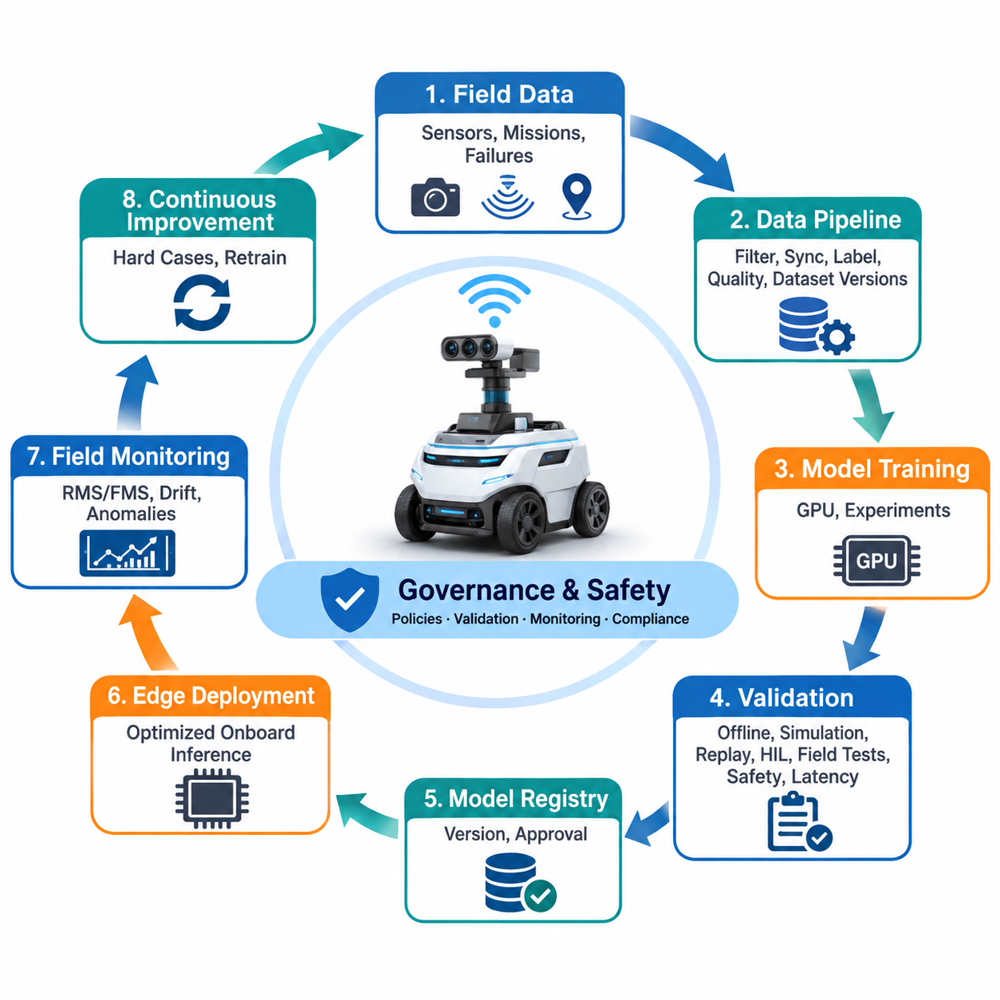
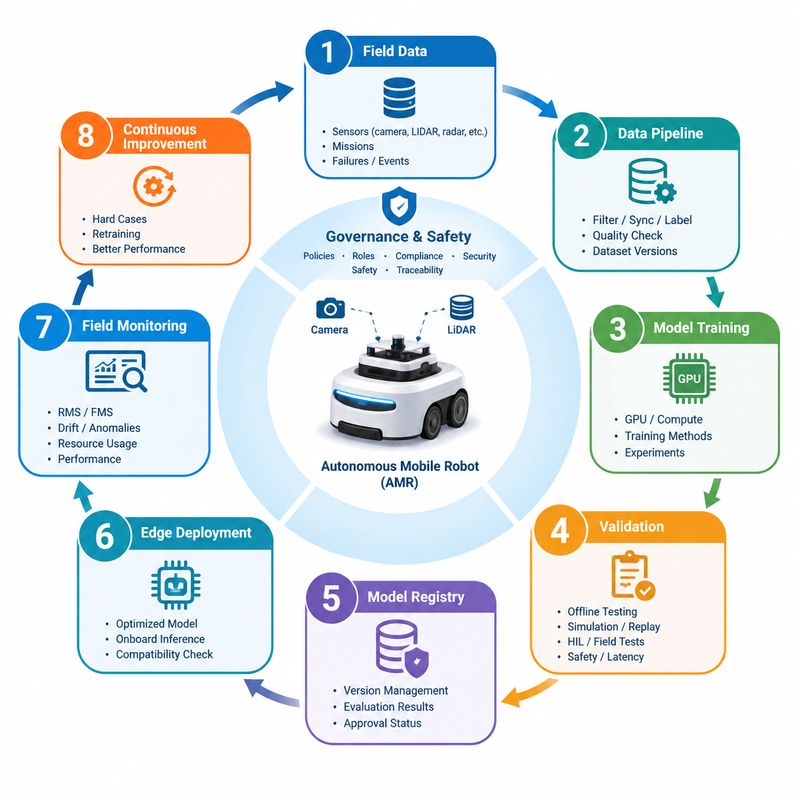
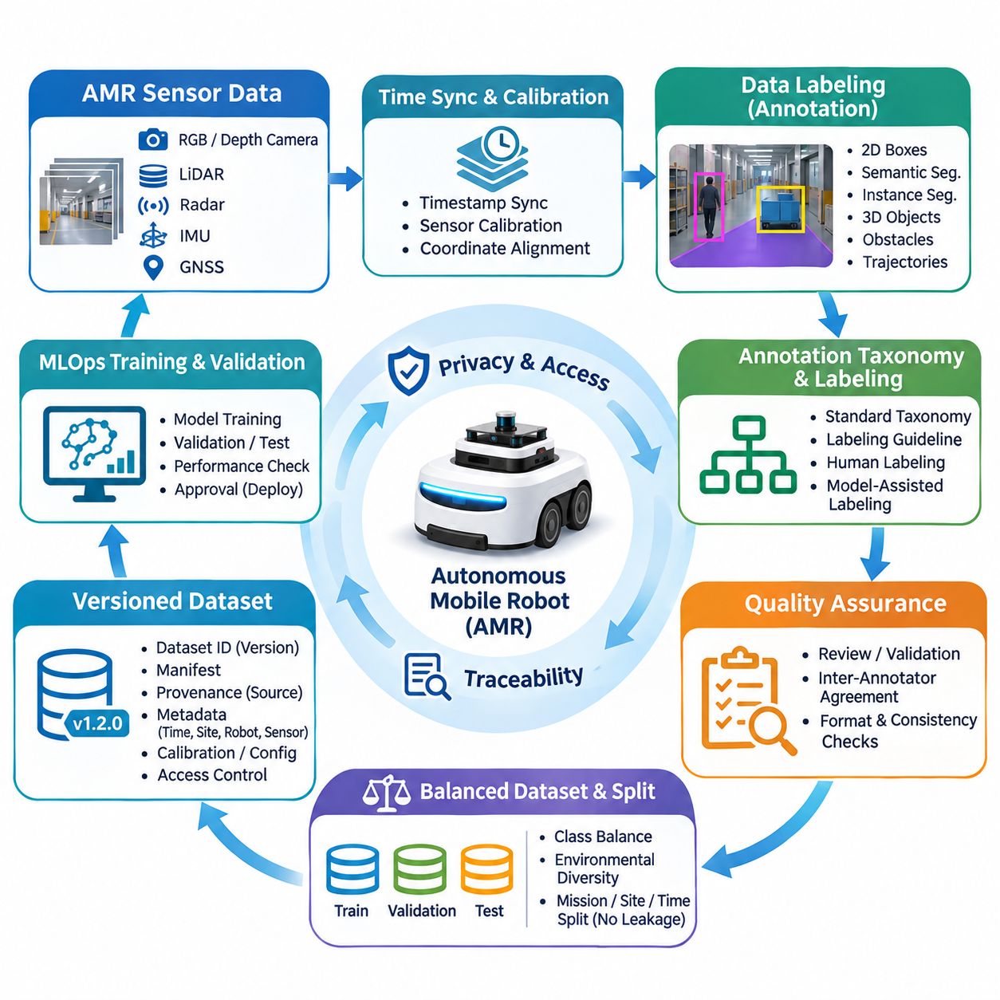
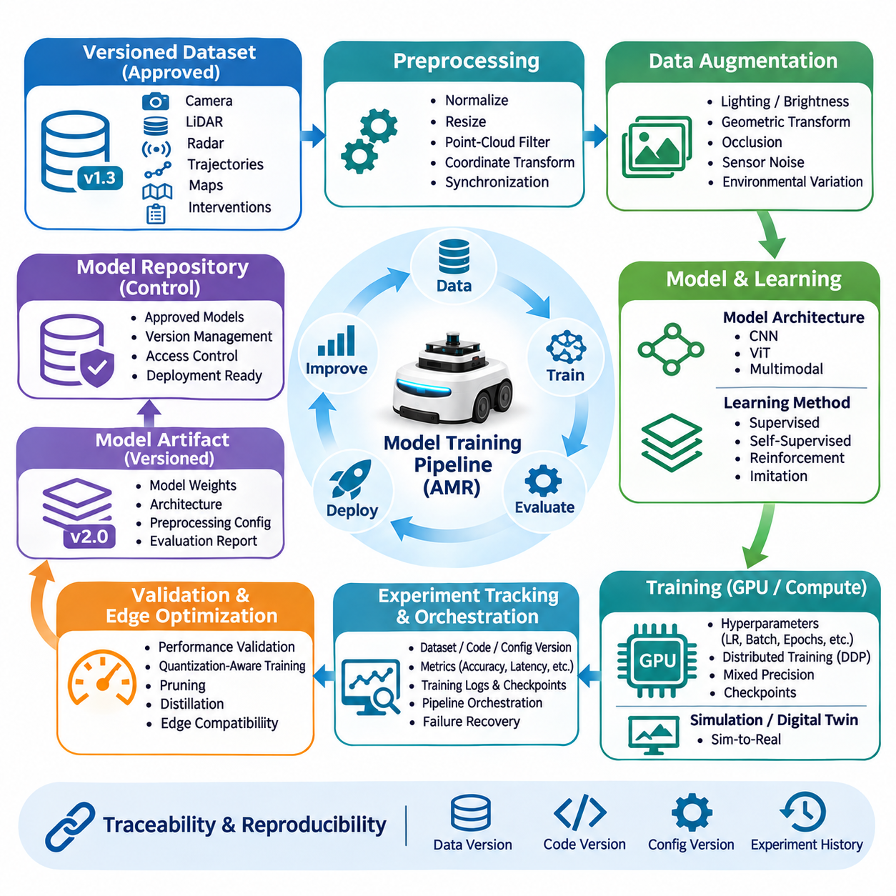
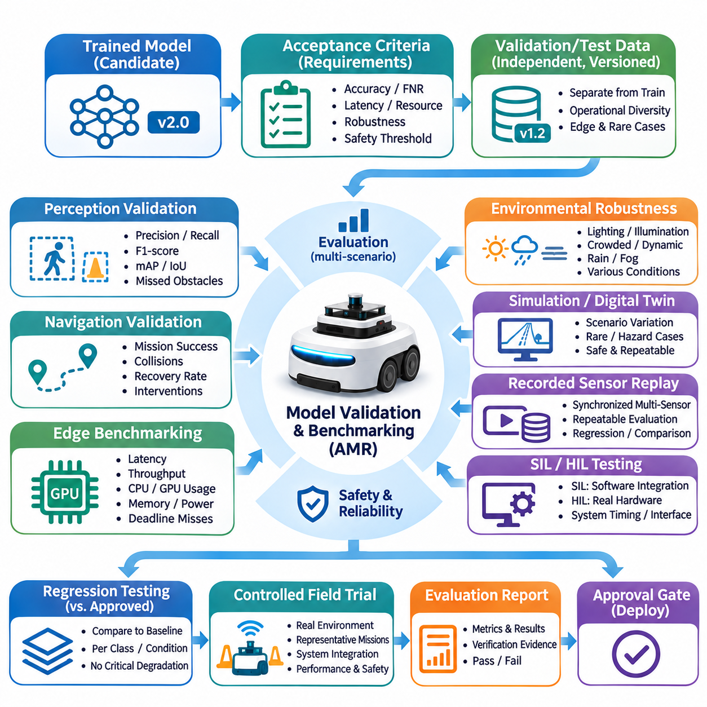
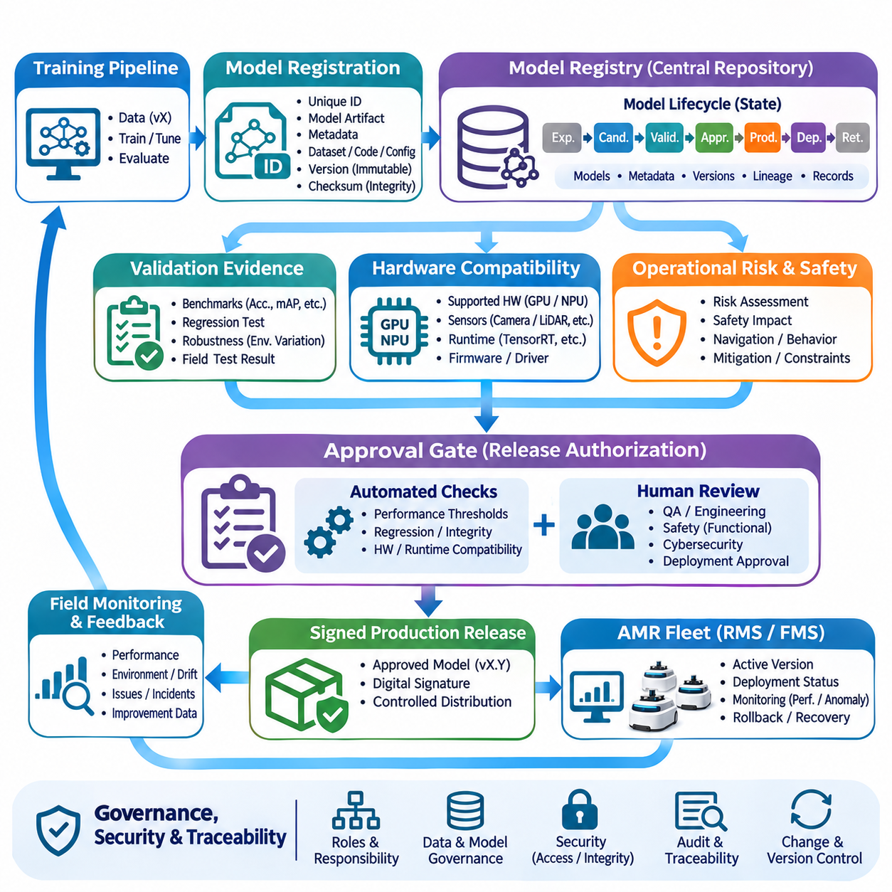
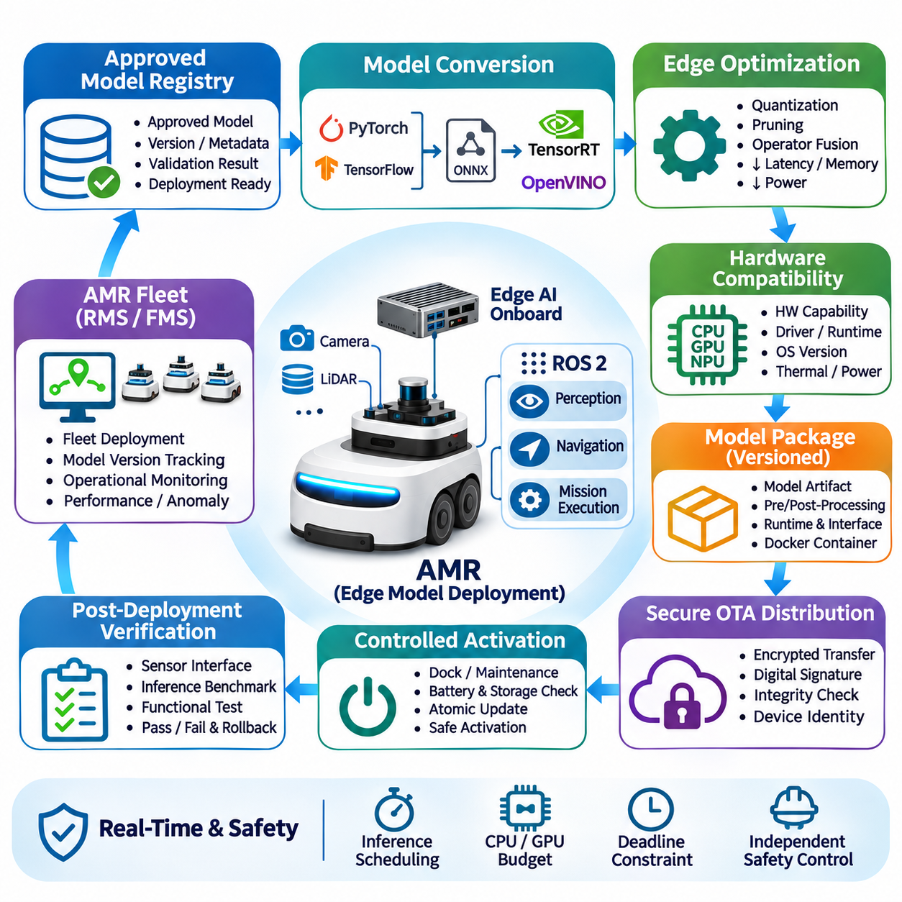
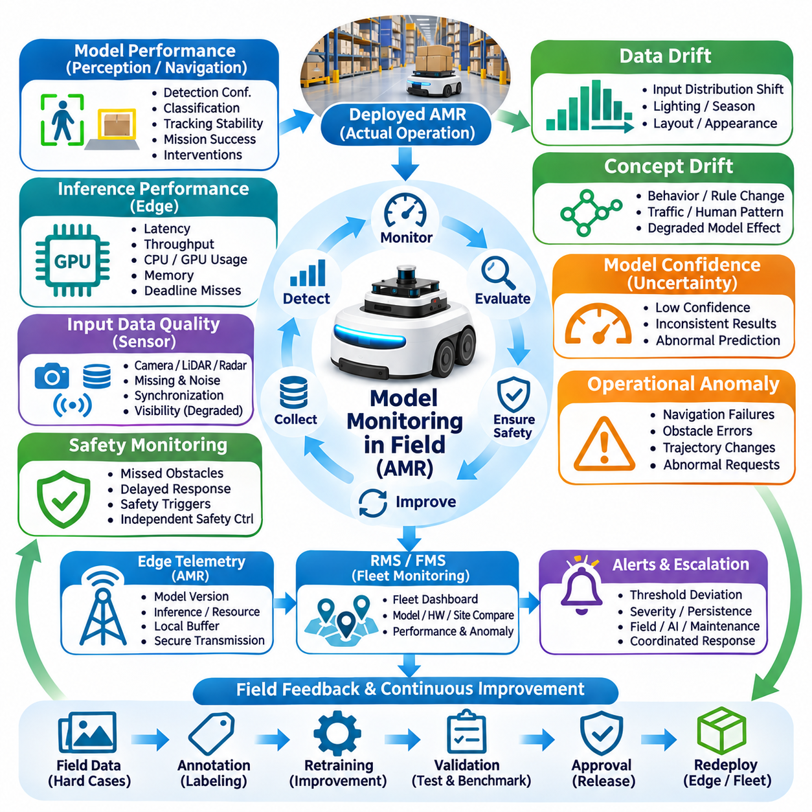
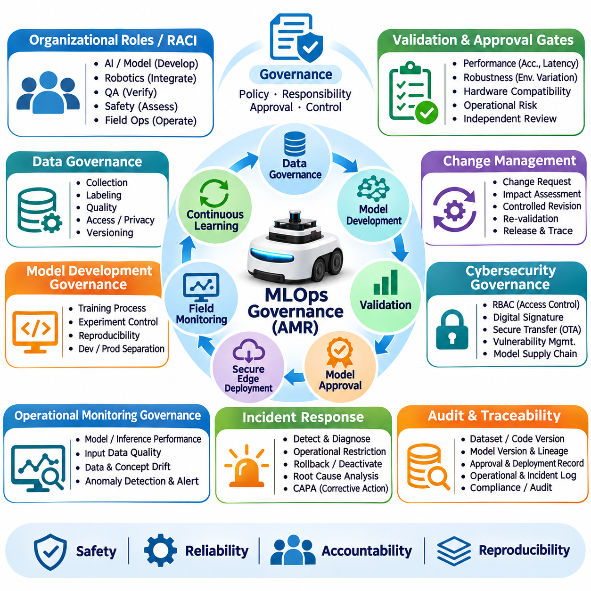

**Volume 08. AMR Operations, Deployment, and MLOps**


# Chapter 07. Robot MLOps

##  

## 07.1 MLOps for Robotics Overview

{width="7.268055555555556in" height="7.268055555555556in"}

{width="7.268055555555556in" height="7.268055555555556in"}

Machine Learning Operations (MLOps) for robotics is an engineering discipline that integrates artificial intelligence development, data management, model training, validation, deployment, and operational monitoring throughout the lifecycle of autonomous robotic systems. For Autonomous Mobile Robots (AMRs), MLOps establishes a systematic framework for maintaining and continuously improving AI capabilities under real-world operating conditions.

Unlike conventional software applications, robotic systems interact directly with physical environments that are dynamic, uncertain, and continuously changing. Variations in lighting, weather, human movement, obstacles, surface conditions, and sensor characteristics can significantly affect AI model performance. Robotics MLOps addresses these challenges by connecting field operations with structured AI development and validation processes.

Traditional machine learning development primarily focuses on achieving high model accuracy using predefined datasets. Robotics MLOps extends this approach by considering operational reliability, inference latency, computational efficiency, environmental adaptability, and functional safety. An AI model must demonstrate not only statistical accuracy but also consistent performance within the physical and computational constraints of the robot.

The robotics MLOps lifecycle begins with operational data collection. AMRs continuously generate information through cameras, LiDAR, radar, inertial sensors, navigation systems, motor controllers, and internal diagnostic modules. These data sources provide valuable information about environmental conditions, robot behavior, mission execution, perception failures, and unexpected events encountered during autonomous operations.

Collected operational data must be processed through structured data management pipelines. Data filtering, synchronization, normalization, annotation, and quality verification are essential for transforming raw sensor information into reliable training datasets. Metadata describing robot configuration, sensor characteristics, environmental conditions, software versions, and mission context supports traceability and reproducibility.

Dataset versioning is a fundamental component of robotics MLOps. Every dataset used for model development should have a unique identifier, documented origin, annotation history, and quality assessment record. Dataset versioning enables engineering teams to reproduce experimental results, identify the causes of performance differences, and maintain consistent relationships between training data and deployed AI models.

Model training pipelines automate the transformation of validated datasets into deployable machine learning models. Depending on the application, training may involve supervised learning, self-supervised learning, reinforcement learning, imitation learning, or foundation model fine-tuning. Training infrastructure may utilize centralized GPU servers, on-premises computing clusters, or cloud-based distributed computing environments.

Experiment management provides systematic control over model development activities. Training parameters, neural network architectures, optimization algorithms, dataset versions, software dependencies, random seeds, and evaluation results should be recorded for each experiment. This information enables engineering teams to compare candidate models objectively and reproduce successful development outcomes when necessary.

Model validation evaluates whether newly developed AI models satisfy predefined technical and operational requirements. Validation should include offline dataset testing, simulation-based evaluation, recorded sensor data replay, hardware-in-the-loop testing, and controlled field experiments. Particular attention must be given to rare events, unexpected obstacles, environmental variations, and safety-critical operating scenarios.

Robotics benchmarking extends beyond conventional machine learning accuracy metrics. Performance indicators include detection precision, recall, false-negative rates, inference latency, memory consumption, processing throughput, energy efficiency, mission completion rates, and operator intervention frequency. These measurements help determine whether an AI model is suitable for deployment on a specific robotic hardware platform.

A centralized model registry manages trained and validated AI models throughout their operational lifecycles. Each registered model should include version information, training dataset references, evaluation results, hardware compatibility, deployment restrictions, and approval status. Formal approval procedures prevent experimental or insufficiently validated models from being introduced into production robotic environments.

Edge model deployment transfers approved AI models to onboard robotic computing platforms. Resource limitations require careful optimization through techniques such as quantization, pruning, knowledge distillation, and hardware-specific inference acceleration. Deployment must also verify compatibility with operating systems, middleware, GPU drivers, inference engines, sensor configurations, and existing robot control software.

Field model monitoring provides continuous visibility into the behavior of deployed AI systems. Robot Management Systems (RMS) and Fleet Management Systems (FMS) can integrate model version tracking, inference statistics, anomaly detection, computational resource utilization, and operational performance indicators. Monitoring enables early identification of degraded model performance and emerging environmental challenges.

Data drift and concept drift represent significant challenges for long-term autonomous robot operation. Changes in environmental conditions can alter sensor input distributions, while changes in operating scenarios may affect the relationship between observed information and expected behavior. MLOps must detect these changes and initiate structured investigation, dataset improvement, retraining, and subsequent validation when required.

Continuous improvement establishes a closed-loop relationship between field operations and AI development. Difficult operating scenarios, perception failures, and human interventions become valuable sources of training information. However, newly trained models should not automatically replace production models without regression testing, operational risk assessment, controlled deployment, and formal authorization.

Ultimately, robotics MLOps transforms AI development from an isolated engineering activity into a continuous operational capability. By integrating data labeling, dataset versioning, automated training, benchmarking, model registration, edge deployment, field monitoring, and governance, organizations can establish scalable and reliable AI-enabled robotic fleets while maintaining operational safety, accountability, and systematic performance improvement.

로봇공학을 위한 기계학습 운영(Machine Learning Operations, MLOps)은 자율 로봇 시스템(Autonomous Robotic Systems)의 전체 수명주기(Lifecycle)에 걸쳐 인공지능 개발, 데이터 관리, 모델 학습, 검증, 배포 및 운영 모니터링을 통합하는 공학적 분야이다. 자율이동로봇(Autonomous Mobile Robot, AMR)에서 MLOps는 실제 운영 환경에서 인공지능 역량을 유지하고 지속적으로 개선하기 위한 체계적인 프레임워크(Framework)를 구축한다.

기존의 소프트웨어 애플리케이션(Software Application)과 달리 로봇 시스템은 동적이고 불확실하며 지속적으로 변화하는 물리적 환경(Physical Environment)과 직접적으로 상호작용한다. 조명, 날씨, 사람의 움직임, 장애물, 노면 상태 및 센서 특성의 변화는 인공지능 모델의 성능에 상당한 영향을 미칠 수 있다. 로봇 MLOps는 현장 운영(Field Operations)을 체계적인 인공지능 개발 및 검증 프로세스와 연결함으로써 이러한 문제를 해결한다.

전통적인 기계학습 개발(Machine Learning Development)은 주로 사전에 정의된 데이터셋(Dataset)을 활용하여 높은 모델 정확도(Model Accuracy)를 달성하는 데 중점을 둔다. 로봇 MLOps는 이러한 접근방식을 운영 신뢰성(Operational Reliability), 추론 지연시간(Inference Latency), 연산 효율성(Computational Efficiency), 환경 적응성(Environmental Adaptability) 및 기능 안전성(Functional Safety)까지 확장한다. 인공지능 모델은 통계적 정확성뿐만 아니라 로봇의 물리적 및 연산적 제약조건 내에서도 일관된 성능을 입증해야 한다.

로봇 MLOps의 수명주기는 운영 데이터 수집(Operational Data Collection)에서 시작된다. AMR은 카메라(Camera), 라이다(LiDAR), 레이더(Radar), 관성 센서(Inertial Sensor), 자율주행 시스템(Navigation System), 모터 제어기(Motor Controller) 및 내부 진단 모듈(Internal Diagnostic Module)을 통해 지속적으로 데이터를 생성한다. 이러한 데이터는 환경 조건, 로봇 행동, 임무 수행, 인지 실패 및 자율 운영 과정에서 발생하는 예기치 못한 사건에 관한 중요한 정보를 제공한다.

수집된 운영 데이터는 체계적인 데이터 관리 파이프라인(Data Management Pipeline)을 통해 처리되어야 한다. 데이터 필터링(Data Filtering), 동기화(Synchronization), 정규화(Normalization), 주석 작업(Annotation) 및 품질 검증(Quality Verification)은 원시 센서 데이터를 신뢰할 수 있는 학습 데이터셋(Training Dataset)으로 변환하는 데 필수적이다. 로봇 구성, 센서 특성, 환경 조건, 소프트웨어 버전 및 임무 맥락을 설명하는 메타데이터(Metadata)는 추적성(Traceability)과 재현성(Reproducibility)을 지원한다.

데이터셋 버전 관리(Dataset Versioning)는 로봇 MLOps의 핵심 구성요소이다. 모델 개발에 사용되는 모든 데이터셋에는 고유 식별자(Unique Identifier), 문서화된 데이터 출처(Data Origin), 주석 작업 이력(Annotation History) 및 품질 평가 기록(Quality Assessment Record)이 포함되어야 한다. 데이터셋 버전 관리는 엔지니어링 팀이 실험 결과를 재현하고 성능 차이의 원인을 식별하며 학습 데이터와 배포된 인공지능 모델 간의 일관된 관계를 유지할 수 있도록 한다.

모델 학습 파이프라인(Model Training Pipeline)은 검증된 데이터셋을 배포 가능한 기계학습 모델로 변환하는 과정을 자동화한다. 적용 분야에 따라 지도학습(Supervised Learning), 자기지도학습(Self-Supervised Learning), 강화학습(Reinforcement Learning), 모방학습(Imitation Learning) 또는 파운데이션 모델 미세조정(Foundation Model Fine-Tuning)이 활용될 수 있다. 학습 인프라(Training Infrastructure)는 중앙집중형 GPU 서버, 온프레미스 연산 클러스터(On-Premises Computing Cluster) 또는 클라우드 기반 분산 컴퓨팅 환경(Cloud-Based Distributed Computing Environment)을 활용할 수 있다.

실험 관리(Experiment Management)는 모델 개발 활동에 대한 체계적인 통제 체계를 제공한다. 각 실험에 대해 학습 매개변수(Training Parameters), 신경망 아키텍처(Neural Network Architecture), 최적화 알고리즘(Optimization Algorithm), 데이터셋 버전, 소프트웨어 의존성(Software Dependencies), 난수 시드(Random Seed) 및 평가 결과(Evaluation Results)를 기록해야 한다. 이러한 정보는 엔지니어링 팀이 후보 모델(Candidate Model)을 객관적으로 비교하고 필요한 경우 성공적인 개발 결과를 재현할 수 있도록 한다.

모델 검증(Model Validation)은 새롭게 개발된 인공지능 모델이 사전에 정의된 기술적 및 운영적 요구사항을 충족하는지를 평가한다. 검증에는 오프라인 데이터셋 시험(Offline Dataset Testing), 시뮬레이션 기반 평가(Simulation-Based Evaluation), 기록된 센서 데이터 재생(Recorded Sensor Data Replay), 하드웨어 연동 시험(Hardware-in-the-Loop Testing) 및 통제된 현장 실험(Controlled Field Experiment)이 포함되어야 한다. 특히 희귀 사건(Rare Event), 예기치 못한 장애물, 환경 변화 및 안전 필수 운영 시나리오(Safety-Critical Operating Scenario)에 주의를 기울여야 한다.

로봇 벤치마킹(Robotics Benchmarking)은 기존의 기계학습 정확도 지표를 넘어서는 평가 체계를 포함한다. 주요 성능지표에는 검출 정밀도(Detection Precision), 재현율(Recall), 위음성률(False-Negative Rate), 추론 지연시간(Inference Latency), 메모리 사용량(Memory Consumption), 처리량(Processing Throughput), 에너지 효율성(Energy Efficiency), 임무 완료율(Mission Completion Rate) 및 운영자 개입 빈도(Operator Intervention Frequency)가 포함된다. 이러한 측정 결과는 인공지능 모델이 특정 로봇 하드웨어 플랫폼에 배포하기에 적합한지를 판단하는 데 활용된다.

중앙집중형 모델 등록소(Centralized Model Registry)는 학습 및 검증이 완료된 인공지능 모델의 전체 운영 수명주기를 관리한다. 등록된 각 모델에는 버전 정보(Version Information), 학습 데이터셋 참조 정보(Training Dataset Reference), 평가 결과, 하드웨어 호환성(Hardware Compatibility), 배포 제한사항(Deployment Restrictions) 및 승인 상태(Approval Status)가 포함되어야 한다. 공식적인 승인 절차(Formal Approval Procedure)는 실험 단계에 있거나 충분히 검증되지 않은 모델이 실제 로봇 운영 환경에 도입되는 것을 방지한다.

엣지 모델 배포(Edge Model Deployment)는 승인된 인공지능 모델을 로봇에 탑재된 연산 플랫폼(Onboard Computing Platform)으로 전송하는 과정이다. 제한된 연산 자원을 고려하여 양자화(Quantization), 가지치기(Pruning), 지식 증류(Knowledge Distillation) 및 하드웨어 특화 추론 가속(Hardware-Specific Inference Acceleration)과 같은 기술을 활용한 최적화가 필요하다. 또한 배포 과정에서는 운영체제, 미들웨어(Middleware), GPU 드라이버, 추론 엔진(Inference Engine), 센서 구성 및 기존 로봇 제어 소프트웨어와의 호환성을 검증해야 한다.

현장 모델 모니터링(Field Model Monitoring)은 배포된 인공지능 시스템의 동작에 대한 지속적인 가시성(Visibility)을 제공한다. 로봇 관리 시스템(Robot Management System, RMS)과 로봇 관제 시스템(Fleet Management System, FMS)은 모델 버전 추적(Model Version Tracking), 추론 통계(Inference Statistics), 이상 탐지(Anomaly Detection), 연산 자원 활용도(Computational Resource Utilization) 및 운영 성능지표를 통합할 수 있다. 이러한 모니터링을 통해 모델 성능 저하와 새롭게 발생하는 환경적 문제를 조기에 식별할 수 있다.

데이터 드리프트(Data Drift)와 개념 드리프트(Concept Drift)는 자율 로봇의 장기 운영에서 중요한 문제로 작용한다. 환경 조건의 변화는 센서 입력 데이터의 분포(Input Data Distribution)를 변화시킬 수 있으며, 운영 시나리오의 변화는 관측된 정보와 기대 행동(Expected Behavior) 간의 관계에 영향을 미칠 수 있다. MLOps는 이러한 변화를 탐지하고 필요한 경우 체계적인 원인 조사, 데이터셋 개선(Dataset Improvement), 재학습(Retraining) 및 후속 검증(Subsequent Validation)을 수행해야 한다.

지속적 개선(Continuous Improvement)은 현장 운영과 인공지능 개발 사이에 폐루프 관계(Closed-Loop Relationship)를 구축한다. 어려운 운영 시나리오(Hard Operational Scenario), 인지 실패(Perception Failure) 및 사람의 개입(Human Intervention)은 중요한 학습 정보의 원천이 된다. 그러나 신규 학습 모델은 회귀 시험(Regression Testing), 운영 위험 평가(Operational Risk Assessment), 통제된 배포(Controlled Deployment) 및 공식적인 승인(Formal Authorization)을 거치지 않고 기존 운영 모델을 자동으로 대체해서는 안 된다.

궁극적으로 로봇 MLOps는 인공지능 개발을 독립적인 엔지니어링 활동에서 지속적인 운영 역량(Continuous Operational Capability)으로 전환한다. 데이터 라벨링(Data Labeling), 데이터셋 버전 관리(Dataset Versioning), 자동화된 학습(Automated Training), 벤치마킹(Benchmarking), 모델 등록(Model Registration), 엣지 배포(Edge Deployment), 현장 모니터링(Field Monitoring) 및 거버넌스(Governance)를 통합함으로써 조직은 운영 안전성(Operational Safety), 책임성(Accountability) 및 체계적인 성능 개선을 유지하면서 확장 가능하고 신뢰성 높은 인공지능 기반 로봇 플릿(AI-Enabled Robot Fleet)을 구축할 수 있다.

##  

## 07.2 Data Labeling and Dataset Versioning

{width="7.268055555555556in" height="7.268055555555556in"}

Data labeling and dataset versioning are fundamental components of Machine Learning Operations (MLOps) for Autonomous Mobile Robots (AMRs). They establish a systematic framework for transforming raw operational data into reliable, traceable, and reusable training datasets. The quality and consistency of these datasets directly influence the accuracy, robustness, environmental adaptability, and operational reliability of robotic artificial intelligence systems.

Autonomous robots generate heterogeneous data through RGB cameras, depth cameras, LiDAR, radar, inertial measurement units, GNSS receivers, and internal diagnostic systems. Unlike conventional machine learning datasets, robotic datasets frequently contain synchronized multimodal information representing physical interactions, environmental conditions, spatial relationships, and temporal sequences. These characteristics require specialized data preparation and annotation processes.

Data labeling is the process of assigning meaningful information to raw data so that machine learning algorithms can identify relevant patterns and relationships. In robotic perception, labeling may include object classification, bounding box annotation, semantic segmentation, instance segmentation, three-dimensional object detection, and obstacle identification. Navigation datasets may also contain traversability information, trajectory labels, and environmental risk classifications.

Annotation requirements should be defined according to the operational objectives of the robot. A hospital AMR may require detailed labeling of patients, medical equipment, wheelchairs, and movable obstacles, whereas an outdoor patrol robot may require annotations for pedestrians, vehicles, road boundaries, hazardous objects, and terrain conditions. Application-specific labeling improves the relevance of training datasets to actual deployment environments.

A standardized annotation taxonomy establishes consistent definitions for object categories, environmental attributes, behavioral characteristics, and exceptional conditions. Annotation guidelines should specify classification boundaries, occlusion handling, minimum object visibility, ambiguous cases, and labeling accuracy requirements. Without standardized definitions, different annotators may introduce inconsistencies that negatively affect model training and evaluation.

Multimodal data labeling requires accurate spatial and temporal alignment between different sensor measurements. Camera images, LiDAR point clouds, radar detections, and robot positioning data must be associated with compatible timestamps and coordinate reference systems. Incorrect synchronization or sensor calibration can introduce systematic labeling errors, reducing the effectiveness of sensor fusion models and compromising downstream robotic perception.

Manual annotation remains important for complex scenarios requiring human interpretation and contextual understanding. However, large-scale robotic datasets can create substantial labeling costs and processing delays. Semi-automated annotation, model-assisted labeling, active learning, and foundation model-based annotation can improve productivity by generating preliminary labels that are subsequently reviewed and corrected by qualified human annotators.

Data quality assurance verifies the accuracy, completeness, and consistency of annotated datasets before they enter model training pipelines. Quality control mechanisms may include independent annotation reviews, inter-annotator agreement analysis, automated format validation, statistical distribution checks, and targeted inspection of safety-critical scenarios. Annotation errors should be documented, corrected, and incorporated into revised labeling guidelines.

Dataset balancing ensures that training information adequately represents the range of conditions encountered during autonomous robot operations. Excessive representation of routine operating scenarios may reduce model sensitivity to rare but important events. Dataset composition should therefore consider environmental diversity, object distributions, lighting conditions, weather variations, human behavior, operational locations, and exceptional events.

Dataset versioning establishes formal configuration management for machine learning data assets. Each dataset release should have a unique version identifier associated with its source information, annotation specifications, preprocessing configuration, and modification history. Version control enables engineering teams to reproduce training experiments, investigate performance differences, and maintain traceability between deployed models and their original training data.

A dataset version should include metadata describing collection dates, geographical or operational environments, robot identifiers, sensor configurations, calibration parameters, firmware versions, and applicable data usage restrictions. Metadata management provides essential context for interpreting model performance and determining whether particular datasets are compatible with different robotic platforms or deployment environments.

Large-scale robotics datasets require storage architectures capable of managing substantial volumes of multimodal information. Object storage, distributed file systems, on-premises storage infrastructure, and cloud-based data repositories can support scalable dataset management. Versioning mechanisms should minimize unnecessary duplication through content-addressed storage, immutable data references, dataset manifests, and incremental updates.

Training, validation, and test datasets must be separated carefully to prevent data leakage and misleading performance evaluations. Sequential frames recorded during the same mission may contain nearly identical information, making random frame-level partitioning inappropriate. Dataset partitioning should consider recording sessions, robot missions, deployment sites, environmental conditions, and temporal boundaries to support meaningful generalization assessments.

Dataset governance defines ownership, access permissions, approval responsibilities, retention policies, and privacy protection requirements. Operational data collected in hospitals, factories, logistics facilities, and public environments may contain confidential information or personally identifiable information. Appropriate anonymization, encryption, access control, and audit mechanisms are necessary to maintain regulatory compliance and protect organizational data assets.

Integration with MLOps pipelines enables approved dataset versions to trigger controlled model training and evaluation workflows. Newly collected field data, corrected annotations, and additional edge cases can be incorporated into successive dataset releases. Ultimately, systematic data labeling and dataset versioning establish the foundation for reproducible AI development, continuous learning, operational accountability, and scalable robotic intelligence.

데이터 라벨링(Data Labeling)과 데이터셋 버전 관리(Dataset Versioning)는 자율이동로봇(Autonomous Mobile Robot, AMR)을 위한 기계학습 운영(Machine Learning Operations, MLOps)의 핵심 구성요소이다. 이러한 기술은 원시 운영 데이터(Raw Operational Data)를 신뢰할 수 있고 추적 가능하며 재사용 가능한 학습 데이터셋(Training Dataset)으로 변환하기 위한 체계적인 프레임워크(Framework)를 구축한다. 데이터셋의 품질과 일관성은 로봇 인공지능 시스템의 정확도(Accuracy), 강건성(Robustness), 환경 적응성(Environmental Adaptability) 및 운영 신뢰성(Operational Reliability)에 직접적인 영향을 미친다.

자율 로봇은 RGB 카메라(RGB Camera), 깊이 카메라(Depth Camera), 라이다(LiDAR), 레이더(Radar), 관성측정장치(Inertial Measurement Unit, IMU), 위성항법시스템 수신기(GNSS Receiver) 및 내부 진단 시스템(Internal Diagnostic System)을 통해 이기종 데이터(Heterogeneous Data)를 생성한다. 기존의 기계학습 데이터셋과 달리 로봇 데이터셋은 물리적 상호작용(Physical Interaction), 환경 조건, 공간적 관계(Spatial Relationship) 및 시간적 시퀀스(Temporal Sequence)를 표현하는 동기화된 다중모달 정보(Multimodal Information)를 포함하는 경우가 많다. 이러한 특성으로 인해 전문화된 데이터 준비 및 주석 처리 프로세스가 필요하다.

데이터 라벨링은 기계학습 알고리즘(Machine Learning Algorithm)이 관련 패턴과 관계를 식별할 수 있도록 원시 데이터에 의미 있는 정보를 부여하는 과정이다. 로봇 인지(Robot Perception)에서 라벨링은 객체 분류(Object Classification), 경계 상자 주석(Bounding Box Annotation), 의미론적 분할(Semantic Segmentation), 인스턴스 분할(Instance Segmentation), 3차원 객체 검출(3D Object Detection) 및 장애물 식별(Obstacle Identification)을 포함할 수 있다. 자율주행 데이터셋에는 주행 가능성 정보(Traversability Information), 궤적 라벨(Trajectory Label) 및 환경 위험 분류(Environmental Risk Classification)도 포함될 수 있다.

주석 처리 요구사항(Annotation Requirements)은 로봇의 운영 목적(Operational Objectives)에 따라 정의되어야 한다. 병원 AMR은 환자, 의료장비, 휠체어 및 이동 가능한 장애물에 대한 상세한 라벨링이 필요할 수 있는 반면, 실외 순찰 로봇(Outdoor Patrol Robot)은 보행자, 차량, 도로 경계, 위험 물체 및 지형 조건에 대한 주석 처리가 필요할 수 있다. 응용 분야별 라벨링(Application-Specific Labeling)은 실제 배포 환경(Deployment Environment)에 대한 학습 데이터셋의 적합성을 향상시킨다.

표준화된 주석 분류체계(Standardized Annotation Taxonomy)는 객체 범주(Object Category), 환경 속성(Environmental Attribute), 행동 특성(Behavioral Characteristics) 및 예외 조건(Exceptional Conditions)에 대한 일관된 정의를 제공한다. 주석 처리 지침(Annotation Guidelines)은 분류 경계(Classification Boundary), 가려짐 처리(Occlusion Handling), 최소 객체 가시성(Minimum Object Visibility), 모호한 사례(Ambiguous Case) 및 라벨링 정확도 요구사항을 명시해야 한다. 표준화된 정의가 없으면 작업자마다 서로 다른 기준을 적용하여 모델 학습과 평가에 부정적인 영향을 미치는 불일치가 발생할 수 있다.

다중모달 데이터 라벨링(Multimodal Data Labeling)은 서로 다른 센서 측정값 사이의 정확한 공간적 및 시간적 정렬(Spatial and Temporal Alignment)을 요구한다. 카메라 영상(Camera Image), 라이다 포인트 클라우드(LiDAR Point Cloud), 레이더 검출 정보(Radar Detection) 및 로봇 위치 데이터(Robot Positioning Data)는 호환 가능한 타임스탬프(Timestamp)와 좌표 참조 시스템(Coordinate Reference System)을 기반으로 연계되어야 한다. 부정확한 동기화(Synchronization) 또는 센서 보정(Sensor Calibration)은 체계적인 라벨링 오류를 발생시켜 센서 융합 모델(Sensor Fusion Model)의 효과를 감소시키고 후속 로봇 인지 성능을 저하시킬 수 있다.

수동 주석 작업(Manual Annotation)은 사람의 해석과 맥락적 이해(Contextual Understanding)가 필요한 복잡한 시나리오에서 여전히 중요하다. 그러나 대규모 로봇 데이터셋은 상당한 라벨링 비용과 처리 지연을 발생시킬 수 있다. 반자동 주석 처리(Semi-Automated Annotation), 모델 지원 라벨링(Model-Assisted Labeling), 능동학습(Active Learning) 및 파운데이션 모델 기반 주석 처리(Foundation Model-Based Annotation)는 초기 라벨을 자동으로 생성하고 전문 작업자가 이를 검토하고 수정하도록 함으로써 작업 생산성(Productivity)을 향상시킬 수 있다.

데이터 품질 보증(Data Quality Assurance)은 주석 처리가 완료된 데이터셋이 모델 학습 파이프라인(Model Training Pipeline)에 투입되기 전에 정확성(Accuracy), 완전성(Completeness) 및 일관성(Consistency)을 검증하는 과정이다. 품질 관리 메커니즘(Quality Control Mechanism)에는 독립적인 주석 검토(Independent Annotation Review), 작업자 간 일치도 분석(Inter-Annotator Agreement Analysis), 자동화된 형식 검증(Automated Format Validation), 통계적 분포 검사(Statistical Distribution Check) 및 안전 필수 시나리오(Safety-Critical Scenario)에 대한 집중 검사가 포함될 수 있다. 주석 오류는 문서화하고 수정하며 개정된 라벨링 지침에 반영해야 한다.

데이터셋 균형화(Dataset Balancing)는 학습 정보가 자율 로봇 운영 중에 발생하는 다양한 조건을 충분히 대표하도록 보장하는 과정이다. 일상적인 운영 시나리오가 지나치게 많이 포함되면 드물지만 중요한 사건에 대한 모델 민감도(Model Sensitivity)가 감소할 수 있다. 따라서 데이터셋 구성(Dataset Composition)은 환경 다양성(Environmental Diversity), 객체 분포(Object Distribution), 조명 조건(Lighting Conditions), 날씨 변화(Weather Variation), 사람의 행동(Human Behavior), 운영 장소(Operational Location) 및 예외 사건(Exceptional Event)을 종합적으로 고려해야 한다.

데이터셋 버전 관리는 기계학습 데이터 자산(Machine Learning Data Asset)에 대한 공식적인 형상 관리(Configuration Management) 체계를 구축한다. 각각의 데이터셋 릴리스(Dataset Release)는 원본 데이터 정보(Source Information), 주석 처리 사양(Annotation Specification), 전처리 구성(Preprocessing Configuration) 및 변경 이력(Modification History)과 연계된 고유한 버전 식별자(Version Identifier)를 가져야 한다. 버전 관리(Version Control)는 엔지니어링 팀이 학습 실험을 재현하고 성능 차이의 원인을 조사하며 배포된 모델과 원본 학습 데이터 사이의 추적성(Traceability)을 유지할 수 있도록 한다.

데이터셋 버전에는 데이터 수집 날짜(Collection Date), 지리적 또는 운영 환경(Geographical or Operational Environment), 로봇 식별자(Robot Identifier), 센서 구성(Sensor Configuration), 보정 매개변수(Calibration Parameter), 펌웨어 버전(Firmware Version) 및 적용 가능한 데이터 사용 제한사항(Data Usage Restrictions)을 설명하는 메타데이터(Metadata)가 포함되어야 한다. 메타데이터 관리(Metadata Management)는 모델 성능을 해석하고 특정 데이터셋이 서로 다른 로봇 플랫폼 또는 배포 환경과 호환되는지를 판단하기 위한 필수적인 맥락 정보를 제공한다.

대규모 로봇 데이터셋은 방대한 양의 다중모달 정보를 관리할 수 있는 저장소 아키텍처(Storage Architecture)를 필요로 한다. 객체 스토리지(Object Storage), 분산 파일 시스템(Distributed File System), 온프레미스 저장 인프라(On-Premises Storage Infrastructure) 및 클라우드 기반 데이터 저장소(Cloud-Based Data Repository)는 확장 가능한 데이터셋 관리(Scalable Dataset Management)를 지원할 수 있다. 버전 관리 메커니즘은 콘텐츠 주소 지정 저장소(Content-Addressed Storage), 불변 데이터 참조(Immutable Data Reference), 데이터셋 매니페스트(Dataset Manifest) 및 증분 업데이트(Incremental Update)를 활용하여 불필요한 데이터 중복을 최소화해야 한다.

학습 데이터셋(Training Dataset), 검증 데이터셋(Validation Dataset) 및 시험 데이터셋(Test Dataset)은 데이터 누출(Data Leakage)과 왜곡된 성능 평가를 방지하기 위해 신중하게 분리되어야 한다. 동일한 임무에서 기록된 연속 프레임(Sequential Frame)은 거의 동일한 정보를 포함할 수 있으므로 무작위 프레임 단위 분할(Random Frame-Level Partitioning)은 적절하지 않을 수 있다. 데이터셋 분할(Dataset Partitioning)은 의미 있는 일반화 성능 평가(Generalization Assessment)를 지원하기 위해 기록 세션(Recording Session), 로봇 임무(Robot Mission), 배포 현장(Deployment Site), 환경 조건 및 시간적 경계(Temporal Boundary)를 고려해야 한다.

데이터셋 거버넌스(Dataset Governance)는 데이터 소유권(Data Ownership), 접근 권한(Access Permission), 승인 책임(Approval Responsibility), 데이터 보존 정책(Data Retention Policy) 및 개인정보 보호 요구사항(Privacy Protection Requirements)을 정의한다. 병원, 공장, 물류 시설 및 공공 환경에서 수집된 운영 데이터에는 기밀 정보(Confidential Information) 또는 개인 식별 정보(Personally Identifiable Information, PII)가 포함될 수 있다. 규제 준수(Regulatory Compliance)를 유지하고 조직의 데이터 자산을 보호하기 위해 적절한 익명화(Anonymization), 암호화(Encryption), 접근 제어(Access Control) 및 감사 메커니즘(Audit Mechanism)이 필요하다.

MLOps 파이프라인(MLOps Pipeline)과의 통합은 승인된 데이터셋 버전을 기반으로 통제된 모델 학습 및 평가 워크플로(Controlled Model Training and Evaluation Workflow)를 시작할 수 있도록 한다. 새롭게 수집된 현장 데이터(Field Data), 수정된 주석 정보(Corrected Annotation) 및 추가적인 예외 사례(Edge Case)는 후속 데이터셋 릴리스에 반영될 수 있다. 궁극적으로 체계적인 데이터 라벨링과 데이터셋 버전 관리는 재현 가능한 인공지능 개발(Reproducible AI Development), 지속학습(Continuous Learning), 운영 책임성(Operational Accountability) 및 확장 가능한 로봇 지능(Scalable Robotic Intelligence)을 구현하기 위한 기반을 구축한다.

##  

## 07.3 Model Training Pipeline

{width="7.268055555555556in" height="7.268055555555556in"}

A model training pipeline is a structured and automated engineering workflow that transforms validated datasets into deployable machine learning models. Within Machine Learning Operations (MLOps) for Autonomous Mobile Robots (AMRs), the training pipeline connects data management, algorithm development, computational infrastructure, experiment tracking, model evaluation, and artifact generation into a reproducible development environment.

Unlike conventional machine learning applications, robotic AI models must satisfy requirements associated with physical interaction, environmental uncertainty, real-time processing, and operational safety. The training pipeline should therefore consider not only prediction accuracy but also computational efficiency, inference latency, robustness against environmental variations, and compatibility with embedded robotic computing platforms.

The model training process begins with the selection of approved dataset versions. Training datasets may include camera images, LiDAR point clouds, radar measurements, robot trajectories, semantic maps, environmental observations, and human intervention records. Dataset selection should reflect the intended operational environment, robotic platform configuration, application requirements, and predefined model performance objectives.

Data preprocessing transforms heterogeneous sensor information into consistent representations suitable for machine learning algorithms. Typical preprocessing operations include normalization, image resizing, point cloud filtering, coordinate transformation, temporal synchronization, feature extraction, and annotation conversion. Preprocessing configurations must be version-controlled because changes in data representation can significantly influence training results.

Data augmentation improves model generalization by introducing controlled variations into existing training samples. Image augmentation may include brightness adjustment, geometric transformation, motion blur, and simulated environmental degradation. Robotic datasets may additionally incorporate sensor noise, partial occlusion, missing measurements, and variations in object positions while preserving physically meaningful relationships between sensor modalities.

Model architecture selection depends on the intended robotic application and available computational resources. Convolutional Neural Networks (CNNs), Vision Transformers (ViTs), recurrent architectures, multimodal neural networks, and foundation models may support perception, navigation, scene understanding, and autonomous decision-making. Architecture selection should balance model complexity, operational performance, and deployment constraints.

Different learning methodologies can be incorporated into a unified robotics training pipeline. Supervised learning utilizes annotated datasets, while self-supervised learning extracts representations from unlabeled observations. Reinforcement learning optimizes robotic policies through environmental interactions and reward signals, whereas imitation learning develops behavioral capabilities from human demonstrations or previously recorded robot trajectories.

Training configuration management establishes consistent definitions for hyperparameters, learning rates, batch sizes, optimization algorithms, loss functions, training epochs, and random seeds. Configuration files should be maintained under version control and associated with individual training experiments. This approach supports reproducibility, systematic parameter optimization, and objective comparison between alternative model architectures.

Computational infrastructure is responsible for executing machine learning workloads efficiently and reliably. Robotics training pipelines may operate on dedicated GPU workstations, on-premises GPU clusters, or cloud-based distributed computing environments. Distributed Data Parallel (DDP), mixed-precision training, gradient accumulation, and checkpointing can improve resource utilization and support the development of increasingly complex AI models.

Simulation environments and digital twins provide additional training capabilities for robotic AI systems. Synthetic datasets can represent hazardous conditions, rare operational scenarios, diverse environments, and complex physical interactions that are difficult to reproduce in actual field operations. Domain randomization and simulation-to-reality transfer techniques help reduce discrepancies between simulated experiences and real-world robotic behavior.

Experiment tracking provides systematic visibility into the entire model training process. Each experiment should record dataset versions, source code revisions, training configurations, hardware environments, software dependencies, loss curves, evaluation metrics, and generated model artifacts. Centralized experiment management enables engineering teams to investigate training failures, compare development alternatives, and reproduce previous results.

Automated training workflows can be implemented using pipeline orchestration platforms that manage task dependencies, computational resource allocation, execution scheduling, and failure recovery. Training jobs may be triggered by approved dataset releases, source code modifications, scheduled development cycles, or verified field performance degradation. Automation reduces manual intervention while maintaining controlled execution and auditability.

Intermediate model checkpoints preserve training progress and enable recovery from computational failures or interrupted execution. Checkpoints may also support comparative evaluation of models generated at different training stages. Regular monitoring of training loss, validation loss, convergence behavior, gradient stability, and overfitting indicators helps engineering teams identify ineffective training configurations before excessive resources are consumed.

Model optimization prepares trained neural networks for subsequent deployment on robotic edge computing platforms. Techniques such as quantization-aware training, network pruning, knowledge distillation, and architecture optimization can reduce computational complexity and memory requirements. Optimized models must undergo additional evaluation to identify potential degradation in accuracy, numerical stability, or operational behavior.

Training pipeline outputs should include model weights, architecture definitions, preprocessing configurations, experiment records, dataset references, and preliminary evaluation reports. Generated artifacts must be uniquely identifiable and transferred to a controlled model repository. Ultimately, a reliable model training pipeline establishes the foundation for reproducible AI development, systematic model validation, controlled deployment, and continuous improvement across autonomous robotic fleets.

모델 학습 파이프라인(Model Training Pipeline)은 검증된 데이터셋을 배포 가능한 기계학습 모델(Machine Learning Model)로 변환하는 체계적이고 자동화된 엔지니어링 워크플로(Engineering Workflow)이다. 자율이동로봇(Autonomous Mobile Robot, AMR)을 위한 기계학습 운영(Machine Learning Operations, MLOps)에서 학습 파이프라인은 데이터 관리(Data Management), 알고리즘 개발(Algorithm Development), 연산 인프라(Computational Infrastructure), 실험 추적(Experiment Tracking), 모델 평가(Model Evaluation) 및 산출물 생성(Artifact Generation)을 재현 가능한 개발 환경으로 통합한다.

기존의 기계학습 응용 분야와 달리 로봇 인공지능 모델은 물리적 상호작용(Physical Interaction), 환경적 불확실성(Environmental Uncertainty), 실시간 처리(Real-Time Processing) 및 운영 안전성(Operational Safety)과 관련된 요구사항을 충족해야 한다. 따라서 학습 파이프라인은 예측 정확도(Prediction Accuracy)뿐만 아니라 연산 효율성(Computational Efficiency), 추론 지연시간(Inference Latency), 환경 변화에 대한 강건성(Robustness) 및 임베디드 로봇 연산 플랫폼(Embedded Robotic Computing Platform)과의 호환성도 고려해야 한다.

모델 학습 프로세스(Model Training Process)는 승인된 데이터셋 버전(Dataset Version)을 선택하는 단계에서 시작된다. 학습 데이터셋(Training Dataset)에는 카메라 영상(Camera Image), 라이다 포인트 클라우드(LiDAR Point Cloud), 레이더 측정값(Radar Measurement), 로봇 궤적(Robot Trajectory), 의미론적 지도(Semantic Map), 환경 관측 정보(Environmental Observation) 및 사람의 개입 기록(Human Intervention Record)이 포함될 수 있다. 데이터셋 선택은 목표 운영 환경, 로봇 플랫폼 구성, 응용 분야의 요구사항 및 사전에 정의된 모델 성능 목표를 반영해야 한다.

데이터 전처리(Data Preprocessing)는 이기종 센서 정보(Heterogeneous Sensor Information)를 기계학습 알고리즘에 적합한 일관된 표현(Representation)으로 변환하는 과정이다. 일반적인 전처리 작업에는 정규화(Normalization), 영상 크기 조정(Image Resizing), 포인트 클라우드 필터링(Point Cloud Filtering), 좌표 변환(Coordinate Transformation), 시간 동기화(Temporal Synchronization), 특징 추출(Feature Extraction) 및 주석 정보 변환(Annotation Conversion)이 포함된다. 데이터 표현 방식의 변경은 학습 결과에 상당한 영향을 미칠 수 있으므로 전처리 구성은 반드시 버전 관리(Version Control)되어야 한다.

데이터 증강(Data Augmentation)은 기존 학습 샘플에 통제된 변화를 적용하여 모델의 일반화 성능(Generalization Performance)을 향상시킨다. 영상 증강(Image Augmentation)에는 밝기 조정(Brightness Adjustment), 기하학적 변환(Geometric Transformation), 모션 블러(Motion Blur) 및 모의 환경 열화(Simulated Environmental Degradation)가 포함될 수 있다. 로봇 데이터셋에는 센서 모달리티 간의 물리적으로 의미 있는 관계를 유지하면서 센서 잡음(Sensor Noise), 부분 가려짐(Partial Occlusion), 측정값 누락(Missing Measurement) 및 객체 위치 변화도 추가적으로 반영할 수 있다.

모델 아키텍처 선택(Model Architecture Selection)은 목표 로봇 응용 분야와 사용 가능한 연산 자원(Computational Resources)에 따라 결정된다. 합성곱 신경망(Convolutional Neural Network, CNN), 비전 트랜스포머(Vision Transformer, ViT), 순환형 아키텍처(Recurrent Architecture), 다중모달 신경망(Multimodal Neural Network) 및 파운데이션 모델(Foundation Model)은 인지(Perception), 자율주행(Navigation), 장면 이해(Scene Understanding) 및 자율 의사결정(Autonomous Decision-Making)을 지원할 수 있다. 아키텍처 선택은 모델 복잡도(Model Complexity), 운영 성능(Operational Performance) 및 배포 제약조건(Deployment Constraints) 사이의 균형을 고려해야 한다.

다양한 학습 방법론(Learning Methodology)은 통합된 로봇 학습 파이프라인(Unified Robotics Training Pipeline)에 포함될 수 있다. 지도학습(Supervised Learning)은 주석 처리된 데이터셋을 활용하는 반면, 자기지도학습(Self-Supervised Learning)은 라벨링되지 않은 관측 데이터에서 특징 표현을 추출한다. 강화학습(Reinforcement Learning)은 환경과의 상호작용 및 보상 신호(Reward Signal)를 통해 로봇 정책(Robot Policy)을 최적화하며, 모방학습(Imitation Learning)은 사람의 시연(Human Demonstration) 또는 이전에 기록된 로봇 궤적을 기반으로 행동 역량(Behavioral Capability)을 개발한다.

학습 구성 관리(Training Configuration Management)는 하이퍼파라미터(Hyperparameter), 학습률(Learning Rate), 배치 크기(Batch Size), 최적화 알고리즘(Optimization Algorithm), 손실 함수(Loss Function), 학습 에포크(Training Epoch) 및 난수 시드(Random Seed)에 대한 일관된 정의를 수립한다. 구성 파일(Configuration File)은 버전 관리 체계에서 유지되어야 하며 개별 학습 실험(Training Experiment)과 연계되어야 한다. 이러한 접근방식은 재현성(Reproducibility), 체계적인 매개변수 최적화(Parameter Optimization) 및 다양한 모델 아키텍처 간의 객관적인 비교를 지원한다.

연산 인프라(Computational Infrastructure)는 기계학습 워크로드(Machine Learning Workload)를 효율적이고 안정적으로 실행하는 역할을 담당한다. 로봇 학습 파이프라인은 전용 GPU 워크스테이션(Dedicated GPU Workstation), 온프레미스 GPU 클러스터(On-Premises GPU Cluster) 또는 클라우드 기반 분산 컴퓨팅 환경(Cloud-Based Distributed Computing Environment)에서 운영될 수 있다. 분산 데이터 병렬 처리(Distributed Data Parallel, DDP), 혼합 정밀도 학습(Mixed-Precision Training), 그래디언트 누적(Gradient Accumulation) 및 체크포인트 저장(Checkpointing)은 연산 자원 활용도를 향상시키고 점차 복잡해지는 인공지능 모델의 개발을 지원할 수 있다.

시뮬레이션 환경(Simulation Environment)과 디지털 트윈(Digital Twin)은 로봇 인공지능 시스템에 추가적인 학습 역량을 제공한다. 합성 데이터셋(Synthetic Dataset)은 실제 현장 운영에서 재현하기 어려운 위험 조건(Hazardous Conditions), 희귀 운영 시나리오(Rare Operational Scenario), 다양한 환경 및 복잡한 물리적 상호작용을 표현할 수 있다. 도메인 무작위화(Domain Randomization)와 시뮬레이션-현실 전이(Simulation-to-Reality Transfer, Sim-to-Real) 기술은 시뮬레이션에서 획득한 경험과 실제 환경에서의 로봇 행동 사이의 차이를 줄이는 데 기여한다.

실험 추적(Experiment Tracking)은 전체 모델 학습 프로세스에 대한 체계적인 가시성(Visibility)을 제공한다. 각 실험에서는 데이터셋 버전, 소스코드 개정 이력(Source Code Revision), 학습 구성(Training Configuration), 하드웨어 환경(Hardware Environment), 소프트웨어 의존성(Software Dependencies), 손실 곡선(Loss Curve), 평가 지표(Evaluation Metrics) 및 생성된 모델 산출물(Model Artifact)을 기록해야 한다. 중앙집중형 실험 관리(Centralized Experiment Management)는 엔지니어링 팀이 학습 실패의 원인을 조사하고 다양한 개발 대안을 비교하며 이전 실험 결과를 재현할 수 있도록 한다.

자동화된 학습 워크플로(Automated Training Workflow)는 작업 의존성(Task Dependencies), 연산 자원 할당(Computational Resource Allocation), 실행 스케줄링(Execution Scheduling) 및 장애 복구(Failure Recovery)를 관리하는 파이프라인 오케스트레이션 플랫폼(Pipeline Orchestration Platform)을 활용하여 구현할 수 있다. 학습 작업(Training Job)은 승인된 데이터셋 릴리스, 소스코드 변경, 예정된 개발 주기 또는 검증된 현장 성능 저하(Field Performance Degradation)에 의해 시작될 수 있다. 자동화(Automation)는 통제된 실행과 감사 가능성(Auditability)을 유지하면서 수동 개입(Manual Intervention)을 감소시킨다.

중간 모델 체크포인트(Intermediate Model Checkpoint)는 학습 진행 상태(Training Progress)를 보존하고 연산 장애나 실행 중단이 발생했을 때 복구할 수 있도록 한다. 체크포인트는 서로 다른 학습 단계에서 생성된 모델의 비교 평가(Comparative Evaluation)에도 활용될 수 있다. 학습 손실(Training Loss), 검증 손실(Validation Loss), 수렴 특성(Convergence Behavior), 그래디언트 안정성(Gradient Stability) 및 과적합 지표(Overfitting Indicator)에 대한 정기적인 모니터링은 과도한 연산 자원이 소비되기 전에 엔지니어링 팀이 비효율적인 학습 구성을 식별할 수 있도록 지원한다.

모델 최적화(Model Optimization)는 학습된 신경망을 로봇 엣지 컴퓨팅 플랫폼(Robotic Edge Computing Platform)에 배포할 수 있도록 준비하는 과정이다. 양자화 인식 학습(Quantization-Aware Training, QAT), 신경망 가지치기(Network Pruning), 지식 증류(Knowledge Distillation) 및 아키텍처 최적화(Architecture Optimization)와 같은 기술은 연산 복잡도(Computational Complexity)와 메모리 요구량(Memory Requirements)을 감소시킬 수 있다. 최적화된 모델은 정확도, 수치적 안정성(Numerical Stability) 또는 운영 행동(Operational Behavior)의 잠재적 저하를 식별하기 위한 추가적인 평가를 거쳐야 한다.

학습 파이프라인의 출력 산출물(Training Pipeline Outputs)에는 모델 가중치(Model Weights), 아키텍처 정의(Architecture Definition), 전처리 구성(Preprocessing Configuration), 실험 기록(Experiment Record), 데이터셋 참조 정보(Dataset Reference) 및 예비 평가 보고서(Preliminary Evaluation Report)가 포함되어야 한다. 생성된 산출물은 고유하게 식별할 수 있어야 하며 통제된 모델 저장소(Controlled Model Repository)로 이전되어야 한다. 궁극적으로 신뢰성 높은 모델 학습 파이프라인은 자율 로봇 플릿(Autonomous Robotic Fleet) 전반에 걸쳐 재현 가능한 인공지능 개발(Reproducible AI Development), 체계적인 모델 검증(Systematic Model Validation), 통제된 배포(Controlled Deployment) 및 지속적 개선(Continuous Improvement)을 실현하기 위한 기반을 구축한다.

##  

## 07.4 Model Validation and Benchmarking

{width="7.268055555555556in" height="7.268055555555556in"}

Model validation and benchmarking are essential components of Machine Learning Operations (MLOps) for Autonomous Mobile Robots (AMRs). They establish a systematic engineering framework for determining whether trained artificial intelligence models satisfy predefined technical, operational, and safety requirements. These processes provide objective evidence that candidate models are suitable for integration into production robotic systems.

Unlike conventional machine learning applications, robotic AI models operate within physical environments where prediction errors can directly influence robot behavior and operational safety. Model validation must therefore extend beyond statistical accuracy to include environmental robustness, inference latency, computational resource consumption, behavioral consistency, and compatibility with autonomous navigation and robot control systems.

The validation process begins with the definition of measurable acceptance criteria derived from system requirements and operational objectives. These criteria should specify acceptable detection accuracy, false-negative rates, processing latency, resource utilization, and environmental operating conditions. Safety-critical applications require additional acceptance thresholds based on hazard analysis and the consequences of incorrect model predictions.

Independent validation and test datasets are necessary for obtaining reliable assessments of model performance. These datasets must remain separate from training data and represent realistic operating conditions, environmental diversity, and exceptional scenarios. Dataset versioning and documented evaluation configurations ensure that benchmarking results remain reproducible and comparable across different model versions and robotic platforms.

Perception model validation evaluates the ability of artificial intelligence systems to identify and interpret relevant environmental information. Common evaluation metrics include precision, recall, F1-score, mean Average Precision (mAP), and Intersection over Union (IoU). Particular attention should be given to missed detections of pedestrians, vehicles, obstacles, and other objects that may influence autonomous robot safety.

Navigation and decision-making models require evaluation at both algorithmic and system levels. Relevant performance indicators include mission completion rates, collision frequency, trajectory deviation, obstacle avoidance success, navigation recovery rates, and human intervention frequency. These measurements establish whether improved machine learning performance produces meaningful improvements in overall autonomous robotic behavior.

Computational benchmarking evaluates model performance on representative edge computing platforms. Inference latency, processing throughput, GPU utilization, CPU utilization, memory consumption, and electrical power consumption should be measured under realistic workloads. Average latency alone is insufficient because occasional processing delays and missed execution deadlines may compromise time-sensitive robotic functions.

Environmental robustness testing determines whether AI models maintain acceptable performance under changing operating conditions. Indoor AMRs may encounter reflective surfaces, crowded passages, variable illumination, and dynamically relocated equipment. Outdoor AMRs must additionally address rain, fog, shadows, direct sunlight, uneven terrain, and varying sensor visibility. These conditions should be represented in structured validation scenarios.

Simulation-based validation enables systematic evaluation of scenarios that are difficult, expensive, or dangerous to reproduce in physical environments. Digital twins and physics-based simulation platforms can generate controlled variations in environmental conditions, object movements, sensor characteristics, and robot behavior. Simulation results should nevertheless be complemented by physical testing because simulated environments cannot fully reproduce real-world uncertainty.

Recorded sensor data replay provides a repeatable mechanism for comparing multiple model versions against identical operational conditions. Synchronized camera images, LiDAR point clouds, radar measurements, robot trajectories, and event logs can be replayed through candidate perception and decision-making pipelines. This approach supports regression testing, failure analysis, and objective comparison without requiring repeated physical data collection.

Software-in-the-Loop (SIL) and Hardware-in-the-Loop (HIL) testing evaluate AI models within progressively more realistic system configurations. SIL testing verifies interactions between machine learning models and robot software components, whereas HIL testing incorporates actual computing hardware, communication interfaces, and representative execution timing. Both methods help identify integration problems before controlled field deployment.

Model regression testing determines whether newly trained or optimized models introduce performance degradation relative to previously approved production models. Benchmarking should compare overall performance as well as results for individual object categories, environmental conditions, deployment sites, and safety-critical scenarios. Improvements in aggregate accuracy must not conceal unacceptable degradation in important operational capabilities.

Controlled field validation evaluates candidate models under actual operating conditions before large-scale deployment. Representative robots should execute predefined missions within supervised environments while collecting detailed performance and diagnostic information. Field testing should assess interactions between AI models, sensor systems, navigation algorithms, robot controllers, and independent safety mechanisms.

Benchmarking results should be documented through standardized evaluation reports containing model identifiers, dataset versions, hardware configurations, test conditions, acceptance criteria, measured results, and identified limitations. Failed acceptance criteria must trigger further investigation, corrective actions, or model rejection. Successful validation provides the technical evidence required for model registration and formal deployment approval.

Ultimately, model validation and benchmarking establish a controlled engineering boundary between experimental AI development and production robot operations. By integrating statistical evaluation, computational benchmarking, environmental testing, simulation, regression analysis, and field validation, organizations can improve robotic intelligence while maintaining operational reliability, traceability, functional safety, and consistent performance across autonomous robotic fleets.

모델 검증(Model Validation)과 벤치마킹(Benchmarking)은 자율이동로봇(Autonomous Mobile Robot, AMR)을 위한 기계학습 운영(Machine Learning Operations, MLOps)의 필수 구성요소이다. 이러한 프로세스는 학습된 인공지능 모델이 사전에 정의된 기술적, 운영적 및 안전 요구사항을 충족하는지를 판단하기 위한 체계적인 엔지니어링 프레임워크(Engineering Framework)를 구축한다. 또한 후보 모델(Candidate Model)이 실제 운영 로봇 시스템(Production Robotic System)에 통합되기에 적합한지를 판단할 수 있는 객관적인 증거(Objective Evidence)를 제공한다.

기존의 기계학습 응용 분야와 달리 로봇 인공지능 모델은 예측 오류(Prediction Error)가 로봇 행동(Robot Behavior)과 운영 안전성(Operational Safety)에 직접적인 영향을 미칠 수 있는 물리적 환경(Physical Environment)에서 동작한다. 따라서 모델 검증은 통계적 정확도(Statistical Accuracy)를 넘어 환경적 강건성(Environmental Robustness), 추론 지연시간(Inference Latency), 연산 자원 소비량(Computational Resource Consumption), 행동 일관성(Behavioral Consistency) 및 자율주행 시스템과 로봇 제어 시스템 간의 호환성(Compatibility)까지 포함해야 한다.

검증 프로세스(Validation Process)는 시스템 요구사항(System Requirements)과 운영 목표(Operational Objectives)에서 도출된 측정 가능한 수용 기준(Acceptance Criteria)을 정의하는 단계에서 시작된다. 이러한 기준은 허용 가능한 검출 정확도(Detection Accuracy), 위음성률(False-Negative Rate), 처리 지연시간(Processing Latency), 자원 활용도(Resource Utilization) 및 환경적 운영 조건(Environmental Operating Conditions)을 명시해야 한다. 안전 필수 응용 분야(Safety-Critical Application)는 위험원 분석(Hazard Analysis)과 잘못된 모델 예측으로 발생할 수 있는 결과를 기반으로 추가적인 수용 임계값(Acceptance Threshold)을 요구한다.

독립적인 검증 데이터셋(Validation Dataset)과 시험 데이터셋(Test Dataset)은 모델 성능을 신뢰성 있게 평가하기 위해 필요하다. 이러한 데이터셋은 학습 데이터(Training Data)와 분리되어야 하며 실제 운영 조건, 환경적 다양성(Environmental Diversity) 및 예외 시나리오(Exceptional Scenario)를 대표해야 한다. 데이터셋 버전 관리(Dataset Versioning)와 문서화된 평가 구성(Evaluation Configuration)은 서로 다른 모델 버전 및 로봇 플랫폼에서 벤치마킹 결과의 재현성(Reproducibility)과 비교 가능성(Comparability)을 보장한다.

인지 모델 검증(Perception Model Validation)은 인공지능 시스템이 관련 환경 정보를 식별하고 해석할 수 있는 능력을 평가한다. 일반적인 평가 지표(Evaluation Metrics)에는 정밀도(Precision), 재현율(Recall), F1 점수(F1-Score), 평균 정밀도의 평균(mean Average Precision, mAP) 및 교집합 대 합집합 비율(Intersection over Union, IoU)이 포함된다. 특히 자율 로봇의 안전에 영향을 미칠 수 있는 보행자, 차량, 장애물 및 기타 객체에 대한 미검출(Missed Detection)에 각별한 주의를 기울여야 한다.

자율주행 및 의사결정 모델(Navigation and Decision-Making Model)은 알고리즘 수준(Algorithm Level)과 시스템 수준(System Level)에서 모두 평가되어야 한다. 관련 성능지표(Performance Indicator)에는 임무 완료율(Mission Completion Rate), 충돌 빈도(Collision Frequency), 궤적 편차(Trajectory Deviation), 장애물 회피 성공률(Obstacle Avoidance Success Rate), 자율주행 복구율(Navigation Recovery Rate) 및 사람의 개입 빈도(Human Intervention Frequency)가 포함된다. 이러한 측정 결과는 향상된 기계학습 성능이 전체 자율 로봇 행동의 실질적인 개선으로 이어지는지를 판단하는 데 활용된다.

연산 성능 벤치마킹(Computational Benchmarking)은 대표적인 엣지 컴퓨팅 플랫폼(Edge Computing Platform)에서 모델 성능을 평가한다. 추론 지연시간(Inference Latency), 처리량(Processing Throughput), GPU 활용도(GPU Utilization), CPU 활용도(CPU Utilization), 메모리 사용량(Memory Consumption) 및 전력 소비량(Electrical Power Consumption)은 실제와 유사한 워크로드(Workload)에서 측정되어야 한다. 간헐적인 처리 지연이나 실행 기한 초과(Missed Execution Deadline)가 시간 민감형 로봇 기능(Time-Sensitive Robotic Function)을 저해할 수 있으므로 평균 지연시간(Average Latency)만으로는 충분하지 않다.

환경적 강건성 시험(Environmental Robustness Testing)은 변화하는 운영 조건에서 인공지능 모델이 허용 가능한 성능을 유지하는지를 판단한다. 실내 AMR(Indoor AMR)은 반사 표면(Reflective Surface), 혼잡한 통로(Crowded Passage), 가변적인 조명(Variable Illumination) 및 위치가 동적으로 변경되는 장비에 직면할 수 있다. 실외 AMR(Outdoor AMR)은 추가적으로 비, 안개, 그림자, 직사광선, 불균일한 지형(Uneven Terrain) 및 변화하는 센서 가시성(Sensor Visibility)에 대응해야 한다. 이러한 조건은 체계적인 검증 시나리오(Validation Scenario)에 반영되어야 한다.

시뮬레이션 기반 검증(Simulation-Based Validation)은 물리적 환경에서 재현하기 어렵거나 비용이 많이 들거나 위험한 시나리오를 체계적으로 평가할 수 있도록 한다. 디지털 트윈(Digital Twin)과 물리 기반 시뮬레이션 플랫폼(Physics-Based Simulation Platform)은 환경 조건, 객체 움직임(Object Movement), 센서 특성(Sensor Characteristics) 및 로봇 행동에 통제된 변화를 생성할 수 있다. 그러나 시뮬레이션 환경은 실제 환경의 불확실성(Real-World Uncertainty)을 완전히 재현할 수 없으므로 시뮬레이션 결과는 반드시 물리적 시험(Physical Testing)을 통해 보완되어야 한다.

기록된 센서 데이터 재생(Recorded Sensor Data Replay)은 동일한 운영 조건에서 여러 모델 버전을 비교할 수 있는 반복 가능한 메커니즘(Repeatable Mechanism)을 제공한다. 동기화된 카메라 영상(Camera Image), 라이다 포인트 클라우드(LiDAR Point Cloud), 레이더 측정값(Radar Measurement), 로봇 궤적(Robot Trajectory) 및 이벤트 로그(Event Log)는 후보 인지 및 의사결정 파이프라인(Candidate Perception and Decision-Making Pipeline)을 통해 재생될 수 있다. 이러한 접근방식은 반복적인 물리적 데이터 수집 없이 회귀 시험(Regression Testing), 장애 분석(Failure Analysis) 및 객관적인 비교(Objective Comparison)를 지원한다.

소프트웨어 연동 시험(Software-in-the-Loop, SIL)과 하드웨어 연동 시험(Hardware-in-the-Loop, HIL)은 점진적으로 실제 환경에 가까워지는 시스템 구성(System Configuration)에서 인공지능 모델을 평가한다. SIL 시험은 기계학습 모델과 로봇 소프트웨어 구성요소(Robot Software Component) 간의 상호작용을 검증하는 반면, HIL 시험은 실제 연산 하드웨어(Computing Hardware), 통신 인터페이스(Communication Interface) 및 실제 실행 조건을 대표하는 타이밍(Execution Timing)을 포함한다. 두 가지 방법 모두 통제된 현장 배포(Controlled Field Deployment) 이전에 시스템 통합 문제(Integration Problem)를 식별하는 데 기여한다.

모델 회귀 시험(Model Regression Testing)은 새롭게 학습되거나 최적화된 모델이 이전에 승인된 운영 모델(Production Model)과 비교하여 성능 저하(Performance Degradation)를 발생시키는지를 판단한다. 벤치마킹은 전체 성능뿐만 아니라 개별 객체 범주(Object Category), 환경 조건, 배포 현장(Deployment Site) 및 안전 필수 시나리오(Safety-Critical Scenario)에 대한 결과도 비교해야 한다. 종합 정확도(Aggregate Accuracy)의 향상이 중요한 운영 역량(Operational Capability)에서 발생한 허용 불가능한 성능 저하를 은폐해서는 안 된다.

통제된 현장 검증(Controlled Field Validation)은 대규모 배포(Large-Scale Deployment) 이전에 실제 운영 조건에서 후보 모델을 평가하는 과정이다. 대표적인 로봇은 감독이 이루어지는 환경(Supervised Environment)에서 사전에 정의된 임무를 수행하면서 상세한 성능 정보(Performance Information)와 진단 정보(Diagnostic Information)를 수집해야 한다. 현장 시험(Field Testing)은 인공지능 모델, 센서 시스템(Sensor System), 자율주행 알고리즘(Navigation Algorithm), 로봇 제어기(Robot Controller) 및 독립적인 안전 메커니즘(Independent Safety Mechanism) 간의 상호작용을 평가해야 한다.

벤치마킹 결과(Benchmarking Results)는 모델 식별자(Model Identifier), 데이터셋 버전(Dataset Version), 하드웨어 구성(Hardware Configuration), 시험 조건(Test Conditions), 수용 기준(Acceptance Criteria), 측정 결과(Measured Results) 및 식별된 제한사항(Identified Limitations)을 포함하는 표준화된 평가 보고서(Standardized Evaluation Report)를 통해 문서화되어야 한다. 수용 기준을 충족하지 못한 경우 추가적인 원인 조사, 시정조치(Corrective Action) 또는 모델 승인 거부(Model Rejection)가 이루어져야 한다. 성공적인 검증은 모델 등록(Model Registration)과 공식적인 배포 승인(Formal Deployment Approval)에 필요한 기술적 증거(Technical Evidence)를 제공한다.

궁극적으로 모델 검증과 벤치마킹은 실험적 인공지능 개발(Experimental AI Development)과 실제 로봇 운영(Production Robot Operations) 사이에 통제된 엔지니어링 경계(Controlled Engineering Boundary)를 구축한다. 통계적 평가(Statistical Evaluation), 연산 성능 벤치마킹(Computational Benchmarking), 환경 시험(Environmental Testing), 시뮬레이션(Simulation), 회귀 분석(Regression Analysis) 및 현장 검증(Field Validation)을 통합함으로써 조직은 자율 로봇 플릿(Autonomous Robotic Fleet) 전반에 걸쳐 운영 신뢰성(Operational Reliability), 추적성(Traceability), 기능 안전성(Functional Safety) 및 일관된 성능(Consistent Performance)을 유지하면서 로봇 지능(Robotic Intelligence)을 향상시킬 수 있다.

##  

## 07.5 Model Registry and Approval

{width="7.268055555555556in" height="7.268055555555556in"}

A model registry is a centralized management system that maintains machine learning models, associated metadata, validation results, and deployment approval records throughout their operational lifecycles. Within Machine Learning Operations (MLOps) for Autonomous Mobile Robots (AMRs), the model registry establishes a controlled engineering environment connecting model development, validation, deployment, monitoring, and governance.

Unlike conventional software repositories, a model registry manages not only executable artifacts but also the experimental and operational context associated with artificial intelligence models. Each registered model should maintain traceable relationships with training datasets, neural network architectures, preprocessing configurations, software dependencies, evaluation results, and supported robotic hardware platforms.

Model registration begins after the completion of a training pipeline and preliminary performance evaluation. Generated model artifacts are transferred to a controlled repository and assigned unique identifiers. Registration does not automatically authorize operational deployment, because candidate models must undergo additional technical validation, compatibility assessment, operational risk evaluation, and formal approval procedures.

Model versioning provides systematic configuration management for artificial intelligence assets. Each model version should be associated with its training dataset version, source code revision, training configuration, optimization parameters, and creation date. Immutable version identifiers and cryptographic checksums help maintain artifact integrity and prevent unauthorized modifications to previously validated models.

Model metadata provides essential information for understanding the characteristics and limitations of registered artificial intelligence models. Typical metadata includes model architecture, input and output specifications, supported sensor modalities, computational requirements, inference runtime, intended applications, known limitations, and environmental restrictions. This information supports deployment decisions and long-term maintenance.

The model registry should maintain clearly defined lifecycle states representing the maturity and operational authorization of individual models. Typical states include experimental, candidate, validated, approved, production, deprecated, and retired. State transitions must follow documented engineering procedures, ensuring that insufficiently evaluated models cannot enter production environments through uncontrolled deployment activities.

Model validation records provide the technical evidence required for deployment approval. These records should contain benchmark results, acceptance criteria, regression test outcomes, environmental robustness assessments, computational performance measurements, and field validation results. Identified limitations and unresolved defects must remain visible throughout the approval process and subsequent operational activities.

Hardware compatibility management is particularly important because AMR fleets may incorporate heterogeneous computing architectures and sensor configurations. A model optimized for a dedicated GPU platform may not operate correctly on an embedded accelerator with different memory or numerical precision characteristics. Registry records should identify supported hardware, inference engines, firmware versions, and runtime dependencies.

Operational risk assessment determines the potential consequences of deploying a new artificial intelligence model within a physical robotic system. Perception errors, incorrect environmental interpretations, delayed inference, and unexpected behavioral responses may influence navigation reliability and operational safety. Approval requirements should therefore reflect the criticality of the model and its interactions with independent safety mechanisms.

Formal approval workflows establish responsibility and accountability across AI development, robotics engineering, quality assurance, functional safety, cybersecurity, and field operations teams. Approval authority should be assigned according to organizational responsibilities and model criticality. Separation between model development and final deployment authorization reduces the risk of introducing insufficiently validated changes into production.

Automated approval gates can verify whether candidate models satisfy predefined technical and operational requirements. These mechanisms may evaluate benchmark thresholds, regression test results, artifact integrity, cybersecurity requirements, and hardware compatibility. However, automated verification should not replace qualified human review when model changes introduce significant operational risks or affect safety-critical robotic functions.

Model promotion transfers an approved model from a development or staging environment into an authorized production release. Promotion should preserve the relationship between the validated artifact and the deployed artifact, preventing unverified modifications after approval. Digitally signed release packages, controlled distribution channels, and deployment authorization records strengthen release integrity and traceability.

Integration with Robot Management Systems (RMS) and Fleet Management Systems (FMS) enables centralized tracking of deployed model versions across autonomous robotic fleets. Each robot should report its active model configuration, deployment history, compatibility status, and available recovery versions. This information supports fleet-wide configuration management, targeted distribution, incident investigation, and controlled rollback.

Model security and governance protect artificial intelligence assets against unauthorized access, modification, replacement, and distribution. Role-based access control, encryption, digital signatures, audit logging, and software supply chain verification should be incorporated into registry operations. Model approval records must remain accessible to authorized personnel while protecting proprietary algorithms and sensitive information.

Model retirement and rollback management ensure that obsolete, incompatible, or degraded models are systematically removed from active operation. Previously approved models should remain available within defined retention periods to support recovery and historical investigation. Ultimately, a reliable model registry and approval framework establishes traceability, operational accountability, controlled deployment, and sustainable AI lifecycle management across AMR fleets.

모델 레지스트리(Model Registry)는 기계학습 모델(Machine Learning Model), 관련 메타데이터(Metadata), 검증 결과(Validation Results) 및 배포 승인 기록(Deployment Approval Records)을 전체 운영 수명주기(Operational Lifecycle)에 걸쳐 유지하는 중앙집중형 관리 시스템(Centralized Management System)이다. 자율이동로봇(Autonomous Mobile Robot, AMR)을 위한 기계학습 운영(Machine Learning Operations, MLOps)에서 모델 레지스트리는 모델 개발(Model Development), 검증(Validation), 배포(Deployment), 모니터링(Monitoring) 및 거버넌스(Governance)를 연결하는 통제된 엔지니어링 환경(Controlled Engineering Environment)을 구축한다.

기존의 소프트웨어 저장소(Software Repository)와 달리 모델 레지스트리는 실행 가능한 산출물(Executable Artifact)뿐만 아니라 인공지능 모델과 관련된 실험적 및 운영적 맥락(Experimental and Operational Context)도 관리한다. 등록된 각 모델은 학습 데이터셋(Training Dataset), 신경망 아키텍처(Neural Network Architecture), 전처리 구성(Preprocessing Configuration), 소프트웨어 의존성(Software Dependencies), 평가 결과(Evaluation Results) 및 지원되는 로봇 하드웨어 플랫폼(Robotic Hardware Platform)과의 추적 가능한 연관관계를 유지해야 한다.

모델 등록(Model Registration)은 학습 파이프라인(Training Pipeline)과 예비 성능 평가(Preliminary Performance Evaluation)가 완료된 이후 시작된다. 생성된 모델 산출물(Model Artifact)은 통제된 저장소(Controlled Repository)로 이전되며 고유 식별자(Unique Identifier)가 할당된다. 후보 모델(Candidate Model)은 추가적인 기술 검증(Technical Validation), 호환성 평가(Compatibility Assessment), 운영 위험 평가(Operational Risk Evaluation) 및 공식 승인 절차(Formal Approval Procedure)를 거쳐야 하므로 모델 등록 자체가 운영 배포를 자동으로 승인하는 것은 아니다.

모델 버전 관리(Model Versioning)는 인공지능 자산(AI Asset)에 대한 체계적인 구성 관리(Configuration Management)를 제공한다. 각 모델 버전은 학습 데이터셋 버전(Training Dataset Version), 소스코드 개정 이력(Source Code Revision), 학습 구성(Training Configuration), 최적화 매개변수(Optimization Parameters) 및 생성 일자(Creation Date)와 연계되어야 한다. 변경 불가능한 버전 식별자(Immutable Version Identifier)와 암호학적 체크섬(Cryptographic Checksum)은 산출물 무결성(Artifact Integrity)을 유지하고 이전에 검증된 모델의 무단 변경(Unauthorized Modification)을 방지하는 데 기여한다.

모델 메타데이터(Model Metadata)는 등록된 인공지능 모델의 특성과 제한사항을 이해하기 위한 필수 정보를 제공한다. 일반적인 메타데이터에는 모델 아키텍처(Model Architecture), 입력 및 출력 사양(Input and Output Specifications), 지원되는 센서 모달리티(Sensor Modalities), 연산 요구사항(Computational Requirements), 추론 실행 환경(Inference Runtime), 목표 응용 분야(Intended Application), 알려진 제한사항(Known Limitations) 및 환경적 제약조건(Environmental Restrictions)이 포함된다. 이러한 정보는 배포 의사결정(Deployment Decision)과 장기 유지보수(Long-Term Maintenance)를 지원한다.

모델 레지스트리는 개별 모델의 성숙도(Maturity)와 운영 승인 여부(Operational Authorization)를 나타내는 명확하게 정의된 수명주기 상태(Lifecycle State)를 유지해야 한다. 일반적인 상태에는 실험(Experimental), 후보(Candidate), 검증 완료(Validated), 승인 완료(Approved), 운영(Production), 사용 중단 예정(Deprecated) 및 폐기(Retired)가 포함된다. 상태 전이(State Transition)는 문서화된 엔지니어링 절차(Engineering Procedure)를 따라야 하며, 충분히 평가되지 않은 모델이 통제되지 않은 배포 활동을 통해 실제 운영 환경에 진입하지 못하도록 해야 한다.

모델 검증 기록(Model Validation Record)은 배포 승인에 필요한 기술적 증거(Technical Evidence)를 제공한다. 이러한 기록에는 벤치마크 결과(Benchmark Results), 수용 기준(Acceptance Criteria), 회귀 시험 결과(Regression Test Outcomes), 환경적 강건성 평가(Environmental Robustness Assessment), 연산 성능 측정(Computational Performance Measurement) 및 현장 검증 결과(Field Validation Results)가 포함되어야 한다. 식별된 제한사항과 미해결 결함(Unresolved Defects)은 승인 프로세스와 이후의 운영 활동 전반에서 지속적으로 확인할 수 있어야 한다.

하드웨어 호환성 관리(Hardware Compatibility Management)는 AMR 플릿이 이기종 연산 아키텍처(Heterogeneous Computing Architecture)와 다양한 센서 구성(Sensor Configuration)을 포함할 수 있으므로 특히 중요하다. 전용 GPU 플랫폼에 최적화된 모델은 서로 다른 메모리 또는 수치 정밀도(Numerical Precision) 특성을 가진 임베디드 가속기(Embedded Accelerator)에서 정상적으로 동작하지 않을 수 있다. 레지스트리 기록에는 지원되는 하드웨어, 추론 엔진(Inference Engine), 펌웨어 버전(Firmware Version) 및 실행 환경 의존성(Runtime Dependencies)이 명시되어야 한다.

운영 위험 평가(Operational Risk Assessment)는 새로운 인공지능 모델을 물리적 로봇 시스템(Physical Robotic System)에 배포할 때 발생할 수 있는 잠재적 결과를 판단한다. 인지 오류(Perception Error), 잘못된 환경 해석(Incorrect Environmental Interpretation), 추론 지연(Delayed Inference) 및 예기치 않은 행동 반응(Unexpected Behavioral Response)은 자율주행 신뢰성(Navigation Reliability)과 운영 안전성(Operational Safety)에 영향을 미칠 수 있다. 따라서 승인 요구사항은 모델의 중요도(Model Criticality)와 독립적인 안전 메커니즘(Independent Safety Mechanism)과의 상호작용을 반영해야 한다.

공식 승인 워크플로(Formal Approval Workflow)는 인공지능 개발(AI Development), 로봇 엔지니어링(Robotics Engineering), 품질 보증(Quality Assurance), 기능 안전(Functional Safety), 사이버보안(Cybersecurity) 및 현장 운영(Field Operations) 팀 전반에 걸쳐 책임(Responsibility)과 책무(Accountability)를 확립한다. 승인 권한(Approval Authority)은 조직의 역할 및 책임과 모델의 중요도에 따라 할당되어야 한다. 모델 개발과 최종 배포 승인(Final Deployment Authorization)을 분리함으로써 충분히 검증되지 않은 변경사항이 운영 환경에 도입될 위험을 감소시킬 수 있다.

자동화된 승인 게이트(Automated Approval Gate)는 후보 모델이 사전에 정의된 기술적 및 운영적 요구사항을 충족하는지를 검증할 수 있다. 이러한 메커니즘은 벤치마크 임계값(Benchmark Threshold), 회귀 시험 결과(Regression Test Results), 산출물 무결성(Artifact Integrity), 사이버보안 요구사항(Cybersecurity Requirements) 및 하드웨어 호환성(Hardware Compatibility)을 평가할 수 있다. 그러나 모델 변경이 중대한 운영 위험을 초래하거나 안전 필수 로봇 기능(Safety-Critical Robotic Function)에 영향을 미치는 경우 자동화된 검증(Automated Verification)이 자격을 갖춘 전문가의 검토(Qualified Human Review)를 대체해서는 안 된다.

모델 승격(Model Promotion)은 승인된 모델을 개발 환경(Development Environment) 또는 스테이징 환경(Staging Environment)에서 공식적으로 승인된 운영 릴리스(Authorized Production Release)로 이전하는 과정이다. 모델 승격은 검증된 산출물(Validated Artifact)과 배포된 산출물(Deployed Artifact) 사이의 연관관계를 유지하여 승인 이후 검증되지 않은 변경이 발생하지 않도록 해야 한다. 디지털 서명된 릴리스 패키지(Digitally Signed Release Package), 통제된 배포 채널(Controlled Distribution Channel) 및 배포 승인 기록(Deployment Authorization Record)은 릴리스 무결성(Release Integrity)과 추적성(Traceability)을 강화한다.

로봇 관리 시스템(Robot Management System, RMS) 및 플릿 관리 시스템(Fleet Management System, FMS)과의 통합은 자율 로봇 플릿(Autonomous Robotic Fleet) 전반에 배포된 모델 버전을 중앙집중적으로 추적할 수 있도록 한다. 각 로봇은 활성 모델 구성(Active Model Configuration), 배포 이력(Deployment History), 호환성 상태(Compatibility Status) 및 사용 가능한 복구 버전(Recovery Version)을 보고해야 한다. 이러한 정보는 플릿 전체의 구성 관리(Fleet-Wide Configuration Management), 대상 지정 배포(Targeted Distribution), 사고 조사(Incident Investigation) 및 통제된 롤백(Controlled Rollback)을 지원한다.

모델 보안 및 거버넌스(Model Security and Governance)는 인공지능 자산을 무단 접근(Unauthorized Access), 변경(Modification), 교체(Replacement) 및 배포(Distribution)로부터 보호한다. 역할 기반 접근 제어(Role-Based Access Control, RBAC), 암호화(Encryption), 디지털 서명(Digital Signature), 감사 로그 기록(Audit Logging) 및 소프트웨어 공급망 검증(Software Supply Chain Verification)은 레지스트리 운영에 통합되어야 한다. 모델 승인 기록(Model Approval Record)은 독점 알고리즘(Proprietary Algorithm)과 민감 정보(Sensitive Information)를 보호하면서 권한을 부여받은 담당자가 접근할 수 있도록 유지되어야 한다.

모델 폐기 및 롤백 관리(Model Retirement and Rollback Management)는 노후화되었거나 호환되지 않거나 성능이 저하된 모델을 실제 운영 환경에서 체계적으로 제거할 수 있도록 한다. 이전에 승인된 모델은 복구(Recovery) 및 과거 이력 조사(Historical Investigation)를 지원하기 위해 정의된 보존 기간(Retention Period) 동안 사용 가능한 상태로 유지되어야 한다. 궁극적으로 신뢰성 높은 모델 레지스트리 및 승인 프레임워크(Model Registry and Approval Framework)는 AMR 플릿 전반에 걸쳐 추적성(Traceability), 운영 책무성(Operational Accountability), 통제된 배포(Controlled Deployment) 및 지속 가능한 인공지능 수명주기 관리(Sustainable AI Lifecycle Management)를 확립한다.

##  

## 07.6 Edge Model Deployment

{width="7.268055555555556in" height="7.268055555555556in"}

Edge model deployment is the engineering process of transferring validated and approved artificial intelligence models from centralized development environments to robotic edge computing platforms. Within Machine Learning Operations (MLOps) for Autonomous Mobile Robots (AMRs), edge deployment connects model development, computational optimization, software integration, operational execution, and field performance monitoring.

Unlike cloud-based artificial intelligence systems, AMRs must execute critical perception, navigation, and decision-making functions directly within their onboard computing environments. Local inference reduces communication latency, minimizes network dependency, and supports autonomous operation under unstable connectivity conditions. Edge deployment must therefore satisfy strict computational, environmental, and operational requirements.

The deployment process begins with the selection of an approved model version from the model registry. Deployment configurations should identify target robotic platforms, supported sensor interfaces, computational architectures, inference engines, software dependencies, and operational restrictions. Only models that satisfy predefined validation and approval requirements should be authorized for production deployment.

Model conversion transforms trained neural networks into executable representations compatible with target edge computing platforms. Models developed using PyTorch or TensorFlow may be exported through the Open Neural Network Exchange (ONNX) format and optimized using inference frameworks such as TensorRT or OpenVINO. Converted models must be evaluated to verify numerical consistency and acceptable inference accuracy.

Model optimization is essential for achieving efficient execution within limited computational resources. Quantization, network pruning, operator fusion, memory optimization, and hardware acceleration can reduce inference latency, memory consumption, and electrical power requirements. The selected optimization strategy must preserve the accuracy and behavioral characteristics required for reliable autonomous robotic operation.

Edge hardware compatibility must be systematically evaluated because robotic fleets may incorporate different Central Processing Units (CPUs), Graphics Processing Units (GPUs), Neural Processing Units (NPUs), and specialized accelerators. Deployment configurations should consider hardware capabilities, supported numerical precision, available memory, operating system versions, device drivers, and thermal management characteristics.

Model packaging establishes a standardized distribution format containing executable model artifacts, preprocessing and postprocessing configurations, runtime dependencies, interface definitions, and version metadata. Containerization technologies such as Docker can improve deployment consistency across supported robotic platforms. Each package should remain traceable to its approved model version and corresponding validation records.

Integration with the robotic software architecture enables deployed models to interact with sensor acquisition, localization, perception, navigation, and mission execution components. In Robot Operating System 2 (ROS 2) environments, inference services may operate as dedicated nodes communicating through standardized interfaces. Message compatibility, timestamp synchronization, and coordinate frame consistency must be maintained.

Real-time inference management ensures that artificial intelligence workloads operate within predefined execution deadlines. Inference scheduling, asynchronous processing, GPU resource allocation, and memory buffer management should minimize unpredictable processing delays. Computationally intensive AI applications must not interfere with time-critical motor control, emergency response functions, or independent safety systems.

Resource management becomes increasingly important when multiple artificial intelligence models execute simultaneously on a robotic edge platform. Object detection, semantic segmentation, sensor fusion, and behavioral prediction may compete for shared computational resources. Deployment configurations should establish workload priorities, memory budgets, power limits, and thermal constraints to maintain stable performance under sustained workloads.

Secure model distribution protects approved artificial intelligence artifacts during transmission and installation. Over-the-Air (OTA) deployment mechanisms should incorporate encrypted communication, digital signatures, cryptographic integrity verification, and authenticated device identities. Edge devices must reject unauthorized or corrupted model packages and prevent incompatible software from entering active operation.

Deployment activation should occur under controlled operational conditions, preferably when the robot is stationary, docked, or undergoing scheduled maintenance. Predeployment checks should verify battery capacity, available storage, hardware compatibility, and software readiness. Atomic activation mechanisms and recoverable installation procedures help prevent incomplete updates from disrupting essential robotic functions.

Postdeployment verification determines whether installed models execute correctly within their intended edge environments. Initialization tests, sensor interface checks, inference benchmarks, memory utilization measurements, and controlled functional tests should be performed before operational authorization. Failed verification must prevent mission resumption and trigger predefined recovery procedures or restoration of a compatible approved version.

Integration with Robot Management Systems (RMS) and Fleet Management Systems (FMS) enables centralized coordination of edge model deployment across heterogeneous robotic fleets. Management platforms should maintain active model inventories, deployment histories, device compatibility records, and installation status. Subsequent field monitoring provides feedback on inference performance, resource consumption, and operational anomalies.

Ultimately, edge model deployment establishes the operational connection between centralized AI development and distributed physical intelligence. By integrating approved model artifacts, hardware-specific optimization, secure distribution, real-time execution management, and controlled activation, organizations can maintain reliable autonomous capabilities while supporting scalable AI lifecycle management across industrial AMR fleets.

엣지 모델 배포(Edge Model Deployment)는 검증 및 승인된 인공지능 모델을 중앙집중형 개발 환경(Centralized Development Environment)에서 로봇 엣지 컴퓨팅 플랫폼(Robotic Edge Computing Platform)으로 이전하는 엔지니어링 프로세스이다. 자율이동로봇(Autonomous Mobile Robot, AMR)을 위한 기계학습 운영(Machine Learning Operations, MLOps)에서 엣지 배포는 모델 개발(Model Development), 연산 최적화(Computational Optimization), 소프트웨어 통합(Software Integration), 운영 실행(Operational Execution) 및 현장 성능 모니터링(Field Performance Monitoring)을 연결한다.

클라우드 기반 인공지능 시스템(Cloud-Based AI System)과 달리 AMR은 핵심적인 인지(Perception), 자율주행(Navigation) 및 의사결정(Decision-Making) 기능을 자체 탑재 연산 환경(Onboard Computing Environment)에서 직접 실행해야 한다. 로컬 추론(Local Inference)은 통신 지연시간(Communication Latency)을 감소시키고 네트워크 의존성(Network Dependency)을 최소화하며 불안정한 연결 조건에서도 자율 운영(Autonomous Operation)을 지원한다. 따라서 엣지 배포는 엄격한 연산적, 환경적 및 운영적 요구사항을 충족해야 한다.

배포 프로세스(Deployment Process)는 모델 레지스트리(Model Registry)에서 승인된 모델 버전(Approved Model Version)을 선택하는 단계에서 시작된다. 배포 구성(Deployment Configuration)은 목표 로봇 플랫폼(Target Robotic Platform), 지원되는 센서 인터페이스(Sensor Interface), 연산 아키텍처(Computational Architecture), 추론 엔진(Inference Engine), 소프트웨어 의존성(Software Dependencies) 및 운영 제약조건(Operational Restrictions)을 명시해야 한다. 사전에 정의된 검증 및 승인 요구사항을 충족하는 모델만 실제 운영 배포(Production Deployment)를 승인받아야 한다.

모델 변환(Model Conversion)은 학습된 신경망(Trained Neural Network)을 목표 엣지 컴퓨팅 플랫폼과 호환되는 실행 가능한 표현(Executable Representation)으로 변환하는 과정이다. PyTorch 또는 TensorFlow를 사용하여 개발된 모델은 개방형 신경망 교환 형식(Open Neural Network Exchange, ONNX)으로 내보낼 수 있으며 TensorRT 또는 OpenVINO와 같은 추론 프레임워크(Inference Framework)를 활용하여 최적화할 수 있다. 변환된 모델은 수치적 일관성(Numerical Consistency)과 허용 가능한 추론 정확도(Inference Accuracy)를 검증하기 위한 평가를 거쳐야 한다.

모델 최적화(Model Optimization)는 제한된 연산 자원(Computational Resources) 내에서 효율적인 실행을 달성하기 위해 필수적이다. 양자화(Quantization), 신경망 가지치기(Network Pruning), 연산자 융합(Operator Fusion), 메모리 최적화(Memory Optimization) 및 하드웨어 가속(Hardware Acceleration)은 추론 지연시간(Inference Latency), 메모리 사용량(Memory Consumption) 및 전력 요구량(Electrical Power Requirements)을 감소시킬 수 있다. 선택된 최적화 전략(Optimization Strategy)은 신뢰성 높은 자율 로봇 운영에 필요한 정확도와 행동 특성(Behavioral Characteristics)을 유지해야 한다.

로봇 플릿(Robotic Fleet)은 서로 다른 중앙처리장치(Central Processing Unit, CPU), 그래픽처리장치(Graphics Processing Unit, GPU), 신경망처리장치(Neural Processing Unit, NPU) 및 특수 목적 가속기(Specialized Accelerator)를 포함할 수 있으므로 엣지 하드웨어 호환성(Edge Hardware Compatibility)을 체계적으로 평가해야 한다. 배포 구성은 하드웨어 역량(Hardware Capability), 지원되는 수치 정밀도(Numerical Precision), 가용 메모리(Available Memory), 운영체제 버전(Operating System Version), 장치 드라이버(Device Driver) 및 열관리 특성(Thermal Management Characteristics)을 고려해야 한다.

모델 패키징(Model Packaging)은 실행 가능한 모델 산출물(Executable Model Artifact), 전처리 및 후처리 구성(Preprocessing and Postprocessing Configuration), 실행 환경 의존성(Runtime Dependencies), 인터페이스 정의(Interface Definition) 및 버전 메타데이터(Version Metadata)를 포함하는 표준화된 배포 형식(Standardized Distribution Format)을 구축한다. Docker와 같은 컨테이너화 기술(Containerization Technology)은 지원되는 로봇 플랫폼 전반에서 배포 일관성(Deployment Consistency)을 향상시킬 수 있다. 각 패키지는 승인된 모델 버전 및 해당 검증 기록(Validation Records)과의 추적성을 유지해야 한다.

로봇 소프트웨어 아키텍처(Robotic Software Architecture)와의 통합은 배포된 모델이 센서 데이터 획득(Sensor Acquisition), 위치추정(Localization), 인지(Perception), 자율주행(Navigation) 및 임무 실행(Mission Execution) 구성요소와 상호작용할 수 있도록 한다. 로봇 운영체제 2(Robot Operating System 2, ROS 2) 환경에서 추론 서비스(Inference Service)는 표준화된 인터페이스를 통해 통신하는 전용 노드(Dedicated Node)로 동작할 수 있다. 메시지 호환성(Message Compatibility), 타임스탬프 동기화(Timestamp Synchronization) 및 좌표계 일관성(Coordinate Frame Consistency)이 유지되어야 한다.

실시간 추론 관리(Real-Time Inference Management)는 인공지능 워크로드(AI Workload)가 사전에 정의된 실행 기한(Execution Deadline) 내에서 동작하도록 보장하는 과정이다. 추론 스케줄링(Inference Scheduling), 비동기 처리(Asynchronous Processing), GPU 자원 할당(GPU Resource Allocation) 및 메모리 버퍼 관리(Memory Buffer Management)는 예측하기 어려운 처리 지연(Processing Delay)을 최소화해야 한다. 연산 집약적인 인공지능 응용 프로그램(Computationally Intensive AI Application)은 시간 민감형 모터 제어(Time-Critical Motor Control), 비상 대응 기능(Emergency Response Function) 또는 독립적인 안전 시스템(Independent Safety System)의 동작을 방해해서는 안 된다.

다수의 인공지능 모델이 로봇 엣지 플랫폼에서 동시에 실행될 경우 자원 관리(Resource Management)의 중요성은 더욱 증가한다. 객체 검출(Object Detection), 의미론적 분할(Semantic Segmentation), 센서 융합(Sensor Fusion) 및 행동 예측(Behavioral Prediction)은 공유 연산 자원(Shared Computational Resources)을 두고 경쟁할 수 있다. 배포 구성은 지속적인 워크로드(Sustained Workload)에서도 안정적인 성능을 유지하기 위해 작업 우선순위(Workload Priority), 메모리 할당 한도(Memory Budget), 전력 제한(Power Limit) 및 열적 제약조건(Thermal Constraints)을 설정해야 한다.

보안 모델 배포(Secure Model Distribution)는 승인된 인공지능 산출물을 전송 및 설치 과정에서 보호한다. 무선 원격 배포(Over-the-Air Deployment, OTA) 메커니즘에는 암호화 통신(Encrypted Communication), 디지털 서명(Digital Signature), 암호학적 무결성 검증(Cryptographic Integrity Verification) 및 인증된 장치 식별정보(Authenticated Device Identity)가 포함되어야 한다. 엣지 장치(Edge Device)는 승인되지 않았거나 손상된 모델 패키지를 거부하고 호환되지 않는 소프트웨어가 실제 운영 환경에 진입하지 못하도록 해야 한다.

배포 활성화(Deployment Activation)는 통제된 운영 조건(Controlled Operational Conditions)에서 수행되어야 하며, 가급적 로봇이 정지 상태(Stationary State), 도킹 상태(Docked State) 또는 예정된 유지보수(Scheduled Maintenance) 상태에 있을 때 이루어져야 한다. 배포 전 점검(Predeployment Check)은 배터리 용량(Battery Capacity), 가용 저장공간(Available Storage), 하드웨어 호환성(Hardware Compatibility) 및 소프트웨어 준비 상태(Software Readiness)를 검증해야 한다. 원자적 활성화 메커니즘(Atomic Activation Mechanism)과 복구 가능한 설치 절차(Recoverable Installation Procedure)는 불완전한 업데이트가 필수 로봇 기능을 방해하지 않도록 한다.

배포 후 검증(Postdeployment Verification)은 설치된 모델이 목표 엣지 환경에서 정상적으로 실행되는지를 판단하는 과정이다. 운영 승인(Operational Authorization) 이전에 초기화 시험(Initialization Test), 센서 인터페이스 점검(Sensor Interface Check), 추론 벤치마크(Inference Benchmark), 메모리 활용도 측정(Memory Utilization Measurement) 및 통제된 기능 시험(Controlled Functional Test)이 수행되어야 한다. 검증에 실패한 경우 임무 재개(Mission Resumption)를 차단하고 사전에 정의된 복구 절차(Recovery Procedure)를 실행하거나 호환되는 승인 모델 버전으로 복원해야 한다.

로봇 관리 시스템(Robot Management System, RMS) 및 플릿 관리 시스템(Fleet Management System, FMS)과의 통합은 이기종 로봇 플릿(Heterogeneous Robotic Fleet) 전반에 걸쳐 엣지 모델 배포를 중앙집중적으로 조정할 수 있도록 한다. 관리 플랫폼(Management Platform)은 활성 모델 목록(Active Model Inventory), 배포 이력(Deployment History), 장치 호환성 기록(Device Compatibility Record) 및 설치 상태(Installation Status)를 유지해야 한다. 이후 수행되는 현장 모니터링(Field Monitoring)은 추론 성능(Inference Performance), 자원 소비량(Resource Consumption) 및 운영 이상 현상(Operational Anomaly)에 대한 피드백을 제공한다.

궁극적으로 엣지 모델 배포는 중앙집중형 인공지능 개발(Centralized AI Development)과 분산형 물리적 지능(Distributed Physical Intelligence) 사이의 운영적 연결관계(Operational Connection)를 확립한다. 승인된 모델 산출물(Approved Model Artifact), 하드웨어 특화 최적화(Hardware-Specific Optimization), 보안 배포(Secure Distribution), 실시간 실행 관리(Real-Time Execution Management) 및 통제된 활성화(Controlled Activation)를 통합함으로써 조직은 산업용 AMR 플릿(Industrial AMR Fleet) 전반에서 신뢰성 높은 자율 역량(Autonomous Capability)을 유지하는 동시에 확장 가능한 인공지능 수명주기 관리(Scalable AI Lifecycle Management)를 실현할 수 있다.

##  

## 07.7 Model Monitoring in Field

{width="7.268055555555556in" height="7.268055555555556in"}

Field model monitoring is the continuous observation and evaluation of deployed artificial intelligence models under actual robotic operating conditions. Within Machine Learning Operations (MLOps) for Autonomous Mobile Robots (AMRs), field monitoring connects edge model deployment with operational performance assessment, anomaly detection, failure analysis, data collection, and continuous model improvement.

Unlike laboratory validation, field operations expose robotic AI models to unpredictable environmental conditions, dynamic objects, sensor degradation, and changing operational requirements. Models that demonstrate acceptable performance during controlled testing may experience significant degradation after deployment. Continuous monitoring is therefore essential for maintaining operational reliability, autonomous capabilities, and safety.

Model performance monitoring evaluates the effectiveness of deployed artificial intelligence models through application-specific performance indicators. Perception models may be assessed using detection confidence, object classification consistency, tracking stability, and estimated detection accuracy. Navigation and decision-making models may additionally be evaluated through mission completion rates, recovery events, and human intervention frequency.

Inference performance monitoring focuses on the computational behavior of deployed models within robotic edge computing environments. Important indicators include inference latency, processing throughput, GPU utilization, CPU utilization, memory consumption, and execution deadline violations. Monitoring should capture average performance, percentile-based latency measurements, and abnormal fluctuations under sustained operational workloads.

Input data monitoring evaluates the characteristics and quality of sensor information supplied to deployed artificial intelligence models. Camera images, LiDAR point clouds, radar measurements, and other sensor inputs should be examined for missing information, excessive noise, synchronization errors, degraded visibility, and abnormal statistical distributions. Poor input quality can significantly reduce model reliability even when the deployed model remains unchanged.

Data drift occurs when the statistical characteristics of operational input data gradually or abruptly diverge from those of the original training datasets. Changes in lighting conditions, seasonal environments, facility layouts, object appearances, and sensor configurations may introduce significant distribution shifts. Statistical monitoring and feature distribution analysis can help identify emerging discrepancies before substantial operational degradation occurs.

Concept drift describes changes in the relationship between input observations and their expected predictions or outcomes. In robotic applications, changing traffic patterns, human behavior, operational rules, and environmental interactions may reduce the effectiveness of previously learned models. Detecting concept drift generally requires verified operational outcomes, updated annotations, or other reliable sources of feedback.

Model confidence monitoring provides additional information about uncertainty in artificial intelligence predictions. Low-confidence detections, inconsistent classifications, abnormal prediction distributions, and disagreements between independent perception models may indicate unfamiliar environmental conditions. However, confidence scores alone cannot establish prediction correctness, because poorly calibrated models may produce confidently incorrect results.

Operational anomaly detection identifies unusual patterns in model outputs, inference behavior, and interactions with other robotic subsystems. Repeated navigation failures, inconsistent obstacle predictions, unexpected trajectory changes, and abnormal intervention requests may indicate degraded AI performance. Anomaly detection mechanisms should correlate model-related events with sensor conditions, software logs, and robot operating states.

Safety-related monitoring examines whether deployed model behavior remains within predefined operational boundaries. Missed obstacle detections, delayed environmental responses, unexpected motion recommendations, and frequent activation of independent safety mechanisms should receive particular attention. Monitoring results must support timely operational intervention without replacing validated safety controllers or emergency stopping functions.

Edge telemetry collection provides the technical foundation for continuous model monitoring across distributed robotic platforms. Each robot should periodically report its active model version, inference statistics, computational resource utilization, environmental context, and detected anomalies. Telemetry systems should incorporate local buffering, data prioritization, compression, and secure transmission to accommodate intermittent network connectivity.

Centralized monitoring platforms integrated with Robot Management Systems (RMS) and Fleet Management Systems (FMS) enable comparative analysis across autonomous robotic fleets. Monitoring dashboards should support comparisons between model versions, hardware configurations, deployment locations, environmental conditions, and operational missions. Such comparisons help distinguish isolated robot failures from systematic model degradation.

Automated alerting mechanisms should identify significant deviations from validated performance baselines and predefined operational thresholds. Alerts may be classified according to severity, persistence, affected robotic functions, and potential safety consequences. Escalation procedures should coordinate responses among field operators, AI engineers, maintenance personnel, and safety managers while minimizing unnecessary notifications.

Field monitoring establishes an important feedback mechanism for continuous learning and controlled model improvement. Operational failures, unusual environmental observations, low-confidence predictions, and human intervention events can be selected for additional data collection and annotation. These datasets support subsequent training and regression testing, but newly trained models must undergo formal validation and approval before deployment.

Ultimately, field model monitoring establishes a continuous connection between deployed robotic intelligence and centralized MLOps infrastructure. By integrating performance measurements, data quality assessment, drift detection, anomaly analysis, safety observation, and operational feedback, organizations can maintain traceable AI performance, reduce operational risks, and establish sustainable improvement processes across autonomous robotic fleets.

현장 모델 모니터링(Field Model Monitoring)은 실제 로봇 운영 조건에서 배포된 인공지능 모델을 지속적으로 관찰하고 평가하는 과정이다. 자율이동로봇(Autonomous Mobile Robot, AMR)을 위한 기계학습 운영(Machine Learning Operations, MLOps)에서 현장 모니터링은 엣지 모델 배포(Edge Model Deployment), 운영 성능 평가(Operational Performance Assessment), 이상 탐지(Anomaly Detection), 장애 분석(Failure Analysis), 데이터 수집(Data Collection) 및 지속적인 모델 개선(Continuous Model Improvement)을 연결한다.

실험실 검증(Laboratory Validation)과 달리 현장 운영(Field Operations)은 로봇 인공지능 모델을 예측하기 어려운 환경 조건, 동적 객체(Dynamic Object), 센서 성능 저하(Sensor Degradation) 및 변화하는 운영 요구사항(Operational Requirements)에 노출시킨다. 통제된 시험(Controlled Testing)에서 허용 가능한 성능을 나타낸 모델도 배포 이후 상당한 성능 저하(Performance Degradation)를 경험할 수 있다. 따라서 지속적인 모니터링(Continuous Monitoring)은 운영 신뢰성(Operational Reliability), 자율 역량(Autonomous Capability) 및 안전성(Safety)을 유지하기 위해 필수적이다.

모델 성능 모니터링(Model Performance Monitoring)은 응용 분야별 성능지표(Application-Specific Performance Indicator)를 통해 배포된 인공지능 모델의 효과성을 평가한다. 인지 모델(Perception Model)은 검출 신뢰도(Detection Confidence), 객체 분류 일관성(Object Classification Consistency), 추적 안정성(Tracking Stability) 및 추정 검출 정확도(Estimated Detection Accuracy)를 활용하여 평가할 수 있다. 자율주행 및 의사결정 모델(Navigation and Decision-Making Model)은 추가적으로 임무 완료율(Mission Completion Rate), 복구 이벤트(Recovery Event) 및 사람의 개입 빈도(Human Intervention Frequency)를 통해 평가할 수 있다.

추론 성능 모니터링(Inference Performance Monitoring)은 로봇 엣지 컴퓨팅 환경(Robotic Edge Computing Environment)에서 배포된 모델의 연산 동작 특성(Computational Behavior)에 중점을 둔다. 주요 지표에는 추론 지연시간(Inference Latency), 처리량(Processing Throughput), GPU 활용도(GPU Utilization), CPU 활용도(CPU Utilization), 메모리 사용량(Memory Consumption) 및 실행 기한 위반(Execution Deadline Violation)이 포함된다. 모니터링은 지속적인 운영 워크로드(Sustained Operational Workload)에서 평균 성능(Average Performance), 백분위수 기반 지연시간 측정(Percentile-Based Latency Measurement) 및 비정상적인 변동(Abnormal Fluctuation)을 기록해야 한다.

입력 데이터 모니터링(Input Data Monitoring)은 배포된 인공지능 모델에 공급되는 센서 정보의 특성과 품질을 평가한다. 카메라 영상(Camera Image), 라이다 포인트 클라우드(LiDAR Point Cloud), 레이더 측정값(Radar Measurement) 및 기타 센서 입력(Sensor Input)은 정보 누락(Missing Information), 과도한 잡음(Excessive Noise), 동기화 오류(Synchronization Error), 가시성 저하(Degraded Visibility) 및 비정상적인 통계적 분포(Abnormal Statistical Distribution)에 대해 검사되어야 한다. 입력 데이터 품질(Input Data Quality)이 낮으면 배포된 모델 자체가 변경되지 않더라도 모델 신뢰성(Model Reliability)이 크게 저하될 수 있다.

데이터 드리프트(Data Drift)는 운영 입력 데이터(Operational Input Data)의 통계적 특성(Statistical Characteristics)이 기존 학습 데이터셋(Original Training Dataset)의 특성으로부터 점진적 또는 급격하게 벗어날 때 발생한다. 조명 조건(Lighting Conditions), 계절적 환경(Seasonal Environment), 시설 배치(Facility Layout), 객체 외형(Object Appearance) 및 센서 구성(Sensor Configuration)의 변화는 상당한 분포 변화(Distribution Shift)를 유발할 수 있다. 통계적 모니터링(Statistical Monitoring)과 특징 분포 분석(Feature Distribution Analysis)은 심각한 운영 성능 저하가 발생하기 전에 새롭게 나타나는 불일치를 식별하는 데 기여한다.

개념 드리프트(Concept Drift)는 입력 관측값(Input Observation)과 이에 대응하는 기대 예측값(Expected Prediction) 또는 결과(Outcome) 사이의 관계가 변화하는 현상을 의미한다. 로봇 응용 분야에서는 변화하는 교통 패턴(Traffic Pattern), 사람의 행동(Human Behavior), 운영 규칙(Operational Rule) 및 환경적 상호작용(Environmental Interaction)으로 인해 이전에 학습된 모델의 효과성이 감소할 수 있다. 개념 드리프트를 탐지하기 위해서는 일반적으로 검증된 운영 결과(Verified Operational Outcome), 갱신된 주석 정보(Updated Annotation) 또는 기타 신뢰할 수 있는 피드백 정보원(Feedback Source)이 필요하다.

모델 신뢰도 모니터링(Model Confidence Monitoring)은 인공지능 예측의 불확실성(Uncertainty)에 대한 추가적인 정보를 제공한다. 낮은 신뢰도의 검출(Low-Confidence Detection), 일관되지 않은 분류(Inconsistent Classification), 비정상적인 예측 분포(Abnormal Prediction Distribution) 및 독립적인 인지 모델(Independent Perception Model) 간의 예측 불일치는 학습 과정에서 충분히 경험하지 못한 환경 조건을 나타낼 수 있다. 그러나 신뢰도가 적절하게 보정되지 않은 모델(Poorly Calibrated Model)은 높은 신뢰도로 잘못된 결과를 생성할 수 있으므로 신뢰도 점수(Confidence Score)만으로 예측의 정확성을 판단할 수는 없다.

운영 이상 탐지(Operational Anomaly Detection)는 모델 출력(Model Output), 추론 동작(Inference Behavior) 및 다른 로봇 하위 시스템(Robotic Subsystem)과의 상호작용에서 비정상적인 패턴(Unusual Pattern)을 식별한다. 반복적인 자율주행 실패(Navigation Failure), 일관되지 않은 장애물 예측(Obstacle Prediction), 예기치 않은 궤적 변화(Trajectory Change) 및 비정상적인 개입 요청(Intervention Request)은 인공지능 성능 저하를 나타낼 수 있다. 이상 탐지 메커니즘(Anomaly Detection Mechanism)은 모델 관련 이벤트(Model-Related Event)를 센서 상태(Sensor Condition), 소프트웨어 로그(Software Log) 및 로봇 운영 상태(Robot Operating State)와 연계하여 분석해야 한다.

안전 관련 모니터링(Safety-Related Monitoring)은 배포된 모델의 동작이 사전에 정의된 운영 경계(Operational Boundary) 내에서 유지되는지를 검사한다. 장애물 미검출(Missed Obstacle Detection), 지연된 환경 대응(Delayed Environmental Response), 예기치 않은 이동 권고(Unexpected Motion Recommendation) 및 독립적인 안전 메커니즘(Independent Safety Mechanism)의 빈번한 활성화에는 특별한 주의를 기울여야 한다. 모니터링 결과는 적시에 이루어지는 운영 개입(Operational Intervention)을 지원해야 하지만 검증된 안전 제어기(Validated Safety Controller) 또는 비상 정지 기능(Emergency Stopping Function)을 대체해서는 안 된다.

엣지 원격측정 데이터 수집(Edge Telemetry Collection)은 분산형 로봇 플랫폼(Distributed Robotic Platform) 전반에서 지속적인 모델 모니터링을 수행하기 위한 기술적 기반(Technical Foundation)을 제공한다. 각 로봇은 활성 모델 버전(Active Model Version), 추론 통계(Inference Statistics), 연산 자원 활용도(Computational Resource Utilization), 환경적 맥락(Environmental Context) 및 탐지된 이상 현상(Detected Anomaly)을 주기적으로 보고해야 한다. 원격측정 시스템(Telemetry System)은 간헐적인 네트워크 연결(Intermittent Network Connectivity)에 대응하기 위해 로컬 버퍼링(Local Buffering), 데이터 우선순위 지정(Data Prioritization), 압축(Compression) 및 보안 전송(Secure Transmission)을 포함해야 한다.

로봇 관리 시스템(Robot Management System, RMS) 및 플릿 관리 시스템(Fleet Management System, FMS)과 통합된 중앙집중형 모니터링 플랫폼(Centralized Monitoring Platform)은 자율 로봇 플릿(Autonomous Robotic Fleet) 전반에 걸쳐 비교 분석(Comparative Analysis)을 수행할 수 있도록 한다. 모니터링 대시보드(Monitoring Dashboard)는 모델 버전, 하드웨어 구성(Hardware Configuration), 배포 위치(Deployment Location), 환경 조건(Environmental Conditions) 및 운영 임무(Operational Mission) 간의 비교를 지원해야 한다. 이러한 비교는 개별 로봇의 장애(Isolated Robot Failure)와 체계적인 모델 성능 저하(Systematic Model Degradation)를 구분하는 데 기여한다.

자동화된 경보 메커니즘(Automated Alerting Mechanism)은 검증된 성능 기준선(Validated Performance Baseline)과 사전에 정의된 운영 임계값(Operational Threshold)으로부터의 중대한 편차(Significant Deviation)를 식별해야 한다. 경보(Alert)는 심각도(Severity), 지속성(Persistence), 영향을 받는 로봇 기능(Affected Robotic Function) 및 잠재적인 안전 관련 결과(Potential Safety Consequence)에 따라 분류할 수 있다. 단계적 대응 절차(Escalation Procedure)는 불필요한 알림(Unnecessary Notification)을 최소화하면서 현장 운영자(Field Operator), 인공지능 엔지니어(AI Engineer), 유지보수 담당자(Maintenance Personnel) 및 안전 관리자(Safety Manager) 간의 대응 활동을 조정해야 한다.

현장 모니터링은 지속학습(Continuous Learning)과 통제된 모델 개선(Controlled Model Improvement)을 위한 중요한 피드백 메커니즘(Feedback Mechanism)을 구축한다. 운영 실패(Operational Failure), 비정상적인 환경 관측 정보(Unusual Environmental Observation), 낮은 신뢰도의 예측(Low-Confidence Prediction) 및 사람의 개입 이벤트(Human Intervention Event)는 추가적인 데이터 수집과 라벨링(Annotation)을 위한 대상으로 선택될 수 있다. 이러한 데이터셋은 후속 학습(Subsequent Training)과 회귀 시험(Regression Testing)을 지원하지만 새롭게 학습된 모델은 배포 이전에 반드시 공식적인 검증(Formal Validation) 및 승인(Approval) 절차를 거쳐야 한다.

궁극적으로 현장 모델 모니터링은 배포된 로봇 지능(Deployed Robotic Intelligence)과 중앙집중형 MLOps 인프라(Centralized MLOps Infrastructure) 사이의 지속적인 연결관계(Continuous Connection)를 확립한다. 성능 측정(Performance Measurement), 데이터 품질 평가(Data Quality Assessment), 드리프트 탐지(Drift Detection), 이상 분석(Anomaly Analysis), 안전 관찰(Safety Observation) 및 운영 피드백(Operational Feedback)을 통합함으로써 조직은 추적 가능한 인공지능 성능(Traceable AI Performance)을 유지하고 운영 위험(Operational Risk)을 감소시키며 자율 로봇 플릿 전반에 걸쳐 지속 가능한 개선 프로세스(Sustainable Improvement Process)를 구축할 수 있다.

##  

## 07.8 MLOps Governance Process

{width="7.268055555555556in" height="7.268055555555556in"}

MLOps governance is a structured management and engineering framework that establishes policies, responsibilities, decision-making procedures, and operational controls for artificial intelligence throughout its lifecycle. Within Machine Learning Operations (MLOps) for Autonomous Mobile Robots (AMRs), governance integrates data management, model training, validation, approval, edge deployment, and field monitoring into an accountable operational process.

Unlike conventional machine learning governance, robotic MLOps governance must address the consequences of artificial intelligence decisions within physical environments. Incorrect perception, unexpected autonomous behavior, delayed inference, and uncontrolled model changes can directly affect operational reliability and human safety. Governance must therefore integrate artificial intelligence management with robotics engineering, functional safety, and cybersecurity.

Organizational governance establishes clearly defined responsibilities across AI development, robotics software engineering, infrastructure management, quality assurance, field operations, and safety management teams. Each stakeholder should understand their authority, approval responsibilities, and operational obligations. A Responsibility Assignment Matrix, such as RACI, can support systematic coordination and prevent accountability gaps throughout the model lifecycle.

Data governance establishes policies for collecting, storing, processing, labeling, accessing, and distributing operational datasets. Training data must satisfy predefined quality requirements, privacy restrictions, security policies, and applicable regulatory obligations. Dataset ownership, collection provenance, annotation standards, retention periods, and version histories should be systematically documented to maintain transparency and reproducibility.

Model development governance ensures that training activities follow approved engineering procedures and reproducible experimental practices. Training configurations, algorithm architectures, computational environments, source code revisions, and dataset versions must remain traceable. Experimental models should be clearly separated from validated production models to prevent unauthorized transitions from research environments into operational robotic systems.

Validation governance establishes mandatory evaluation requirements before artificial intelligence models become eligible for deployment. These requirements should include statistical performance assessment, computational benchmarking, environmental robustness testing, regression analysis, and controlled field validation. Acceptance criteria must reflect application requirements, operational constraints, and the potential consequences of model-related failures.

Model approval governance defines formal authorization procedures for transitioning candidate models into production environments. Approval decisions should consider validation results, hardware compatibility, cybersecurity assessments, operational risks, and unresolved limitations. Models affecting safety-critical robotic functions require appropriate system-level safety assessments and independent review before deployment authorization.

Deployment governance controls how approved artificial intelligence models are distributed, installed, activated, and maintained across autonomous robotic fleets. Deployment policies should define target device eligibility, supported configurations, release schedules, maintenance windows, verification requirements, and recovery conditions. Unauthorized model packages and unverified configuration changes must be prevented from entering production environments.

Operational monitoring governance establishes requirements for continuously observing deployed model performance, inference behavior, input data quality, and environmental changes. Monitoring thresholds should be derived from validated performance baselines and operational risk assessments. Significant deviations, data drift, recurring failures, and safety-related anomalies must trigger documented investigation and appropriate escalation procedures.

Change management governance ensures that modifications to artificial intelligence models, datasets, inference engines, preprocessing algorithms, and runtime configurations undergo controlled evaluation. Each change request should document its technical justification, affected components, expected benefits, potential risks, and required validation activities. Approved changes must remain traceable throughout deployment and subsequent field operations.

Cybersecurity governance protects MLOps infrastructure, training datasets, model registries, deployment pipelines, and distributed edge devices against unauthorized access and malicious modifications. Role-based access control, cryptographic verification, secure communication, vulnerability management, and audit logging should be integrated throughout the model lifecycle. Software and model supply chain risks must also be systematically assessed.

Auditability and traceability are fundamental requirements for accountable robotic MLOps governance. Organizations should maintain comprehensive records of dataset modifications, training experiments, validation results, approval decisions, deployment activities, operational incidents, and corrective actions. These records support internal audits, incident investigations, regulatory assessments, and verification of compliance with organizational policies.

Incident governance defines coordinated response procedures when deployed models demonstrate unacceptable performance, unexpected behavior, or potential safety risks. Depending on incident severity, responses may include operational restrictions, model deactivation, controlled rollback, or suspension of affected robotic missions. Incident investigations should identify root causes and establish corrective and preventive actions to reduce recurrence.

Continuous learning governance ensures that operational feedback contributes to systematic model improvement without introducing uncontrolled changes into production environments. Field data collection, hard-case mining, annotation, retraining, and incremental model optimization must follow approved engineering procedures. Newly trained models must satisfy established regression testing, validation, and approval requirements before operational deployment.

Ultimately, MLOps governance establishes an organizational and technical foundation for sustainable artificial intelligence lifecycle management across autonomous robotic fleets. By integrating accountability, data governance, model approval, deployment control, cybersecurity, operational monitoring, and continuous improvement, organizations can develop increasingly capable robotic intelligence while maintaining safety, reliability, reproducibility, and operational trust.

MLOps 거버넌스(MLOps Governance)는 인공지능의 전체 수명주기(Lifecycle)에 걸쳐 정책(Policy), 책임(Responsibility), 의사결정 절차(Decision-Making Procedure) 및 운영 통제(Operational Control)를 확립하는 체계적인 관리 및 엔지니어링 프레임워크(Management and Engineering Framework)이다. 자율이동로봇(Autonomous Mobile Robot, AMR)을 위한 기계학습 운영(Machine Learning Operations, MLOps)에서 거버넌스는 데이터 관리(Data Management), 모델 학습(Model Training), 검증(Validation), 승인(Approval), 엣지 배포(Edge Deployment) 및 현장 모니터링(Field Monitoring)을 책무성이 확보된 운영 프로세스(Accountable Operational Process)로 통합한다.

기존의 기계학습 거버넌스(Machine Learning Governance)와 달리 로봇 MLOps 거버넌스(Robotic MLOps Governance)는 물리적 환경(Physical Environment)에서 인공지능의 의사결정이 초래하는 결과를 고려해야 한다. 잘못된 인지(Incorrect Perception), 예기치 않은 자율 행동(Unexpected Autonomous Behavior), 추론 지연(Delayed Inference) 및 통제되지 않은 모델 변경(Uncontrolled Model Change)은 운영 신뢰성(Operational Reliability)과 인간의 안전(Human Safety)에 직접적인 영향을 미칠 수 있다. 따라서 거버넌스는 인공지능 관리(AI Management)를 로봇 엔지니어링(Robotics Engineering), 기능 안전(Functional Safety) 및 사이버보안(Cybersecurity)과 통합해야 한다.

조직 거버넌스(Organizational Governance)는 인공지능 개발(AI Development), 로봇 소프트웨어 엔지니어링(Robotics Software Engineering), 인프라 관리(Infrastructure Management), 품질 보증(Quality Assurance), 현장 운영(Field Operations) 및 안전 관리(Safety Management) 팀 전반에 걸쳐 명확하게 정의된 책임을 확립한다. 각 이해관계자(Stakeholder)는 자신의 권한(Authority), 승인 책임(Approval Responsibility) 및 운영 의무(Operational Obligation)를 이해해야 한다. RACI와 같은 책임 할당 매트릭스(Responsibility Assignment Matrix)는 모델 수명주기 전반에서 체계적인 협업을 지원하고 책임 공백(Accountability Gap)이 발생하는 것을 방지할 수 있다.

데이터 거버넌스(Data Governance)는 운영 데이터셋(Operational Dataset)의 수집, 저장, 처리, 라벨링(Labeling), 접근 및 배포에 관한 정책을 수립한다. 학습 데이터(Training Data)는 사전에 정의된 품질 요구사항(Quality Requirements), 개인정보 보호 제약조건(Privacy Restrictions), 보안 정책(Security Policy) 및 적용 가능한 규제 의무(Regulatory Obligation)를 충족해야 한다. 데이터셋 소유권(Dataset Ownership), 수집 출처 및 이력(Collection Provenance), 주석 표준(Annotation Standard), 보존 기간(Retention Period) 및 버전 이력(Version History)은 투명성(Transparency)과 재현성(Reproducibility)을 유지하기 위해 체계적으로 문서화되어야 한다.

모델 개발 거버넌스(Model Development Governance)는 학습 활동(Training Activity)이 승인된 엔지니어링 절차(Approved Engineering Procedure)와 재현 가능한 실험 방식(Reproducible Experimental Practice)을 따르도록 보장한다. 학습 구성(Training Configuration), 알고리즘 아키텍처(Algorithm Architecture), 연산 환경(Computational Environment), 소스코드 개정 이력(Source Code Revision) 및 데이터셋 버전(Dataset Version)은 추적 가능한 상태로 유지되어야 한다. 연구 환경(Research Environment)에서 실제 로봇 운영 시스템(Operational Robotic System)으로의 무단 전환을 방지하기 위해 실험 모델(Experimental Model)과 검증된 운영 모델(Validated Production Model)은 명확하게 분리되어야 한다.

검증 거버넌스(Validation Governance)는 인공지능 모델이 배포 자격(Deployment Eligibility)을 획득하기 전에 충족해야 하는 필수 평가 요구사항(Mandatory Evaluation Requirements)을 수립한다. 이러한 요구사항에는 통계적 성능 평가(Statistical Performance Assessment), 연산 성능 벤치마킹(Computational Benchmarking), 환경적 강건성 시험(Environmental Robustness Testing), 회귀 분석(Regression Analysis) 및 통제된 현장 검증(Controlled Field Validation)이 포함되어야 한다. 수용 기준(Acceptance Criteria)은 응용 분야의 요구사항, 운영 제약조건(Operational Constraints) 및 모델 관련 장애(Model-Related Failure)가 초래할 수 있는 잠재적 결과를 반영해야 한다.

모델 승인 거버넌스(Model Approval Governance)는 후보 모델(Candidate Model)을 실제 운영 환경(Production Environment)으로 전환하기 위한 공식 승인 절차(Formal Authorization Procedure)를 정의한다. 승인 의사결정(Approval Decision)은 검증 결과(Validation Results), 하드웨어 호환성(Hardware Compatibility), 사이버보안 평가(Cybersecurity Assessment), 운영 위험(Operational Risk) 및 미해결 제한사항(Unresolved Limitations)을 고려해야 한다. 안전 필수 로봇 기능(Safety-Critical Robotic Function)에 영향을 미치는 모델은 배포 승인(Deployment Authorization) 이전에 적절한 시스템 수준 안전 평가(System-Level Safety Assessment)와 독립적인 검토(Independent Review)를 거쳐야 한다.

배포 거버넌스(Deployment Governance)는 승인된 인공지능 모델이 자율 로봇 플릿(Autonomous Robotic Fleet) 전반에 걸쳐 배포, 설치, 활성화 및 유지관리되는 방식을 통제한다. 배포 정책(Deployment Policy)은 대상 장치의 적격성(Target Device Eligibility), 지원되는 구성(Supported Configuration), 릴리스 일정(Release Schedule), 유지보수 시간대(Maintenance Window), 검증 요구사항(Verification Requirements) 및 복구 조건(Recovery Conditions)을 정의해야 한다. 승인되지 않은 모델 패키지(Unauthorized Model Package)와 검증되지 않은 구성 변경(Unverified Configuration Change)이 실제 운영 환경에 도입되지 않도록 방지해야 한다.

운영 모니터링 거버넌스(Operational Monitoring Governance)는 배포된 모델의 성능(Model Performance), 추론 동작(Inference Behavior), 입력 데이터 품질(Input Data Quality) 및 환경 변화(Environmental Change)를 지속적으로 관찰하기 위한 요구사항을 수립한다. 모니터링 임계값(Monitoring Threshold)은 검증된 성능 기준선(Validated Performance Baseline)과 운영 위험 평가(Operational Risk Assessment)를 기반으로 도출되어야 한다. 중대한 편차(Significant Deviation), 데이터 드리프트(Data Drift), 반복적인 장애(Recurring Failure) 및 안전 관련 이상 현상(Safety-Related Anomaly)이 발생하면 문서화된 원인 조사와 적절한 단계적 대응 절차(Escalation Procedure)가 실행되어야 한다.

변경 관리 거버넌스(Change Management Governance)는 인공지능 모델, 데이터셋, 추론 엔진(Inference Engine), 전처리 알고리즘(Preprocessing Algorithm) 및 실행 환경 구성(Runtime Configuration)에 대한 변경사항이 통제된 평가(Controlled Evaluation)를 거치도록 보장한다. 각 변경 요청(Change Request)은 기술적 타당성(Technical Justification), 영향을 받는 구성요소(Affected Component), 기대 효과(Expected Benefits), 잠재적 위험(Potential Risks) 및 필요한 검증 활동(Required Validation Activities)을 문서화해야 한다. 승인된 변경사항(Approved Change)은 배포 및 이후의 현장 운영 전반에서 추적 가능한 상태로 유지되어야 한다.

사이버보안 거버넌스(Cybersecurity Governance)는 MLOps 인프라(MLOps Infrastructure), 학습 데이터셋, 모델 레지스트리(Model Registry), 배포 파이프라인(Deployment Pipeline) 및 분산형 엣지 장치(Distributed Edge Device)를 무단 접근(Unauthorized Access)과 악의적인 변경(Malicious Modification)으로부터 보호한다. 역할 기반 접근 제어(Role-Based Access Control, RBAC), 암호학적 검증(Cryptographic Verification), 보안 통신(Secure Communication), 취약점 관리(Vulnerability Management) 및 감사 로그 기록(Audit Logging)은 모델 수명주기 전반에 걸쳐 통합되어야 한다. 소프트웨어 및 모델 공급망 위험(Software and Model Supply Chain Risk)도 체계적으로 평가되어야 한다.

감사 가능성(Auditability)과 추적성(Traceability)은 책무성이 확보된 로봇 MLOps 거버넌스(Accountable Robotic MLOps Governance)를 위한 기본적인 요구사항이다. 조직은 데이터셋 변경(Dataset Modification), 학습 실험(Training Experiment), 검증 결과, 승인 의사결정, 배포 활동(Deployment Activity), 운영 사고(Operational Incident) 및 시정조치(Corrective Action)에 대한 포괄적인 기록을 유지해야 한다. 이러한 기록은 내부 감사(Internal Audit), 사고 조사(Incident Investigation), 규제 평가(Regulatory Assessment) 및 조직 정책 준수 여부에 대한 검증(Compliance Verification)을 지원한다.

사고 대응 거버넌스(Incident Governance)는 배포된 모델이 허용 불가능한 성능(Unacceptable Performance), 예기치 않은 행동(Unexpected Behavior) 또는 잠재적인 안전 위험(Potential Safety Risk)을 나타낼 때 적용되는 통합 대응 절차(Coordinated Response Procedure)를 정의한다. 사고 심각도(Incident Severity)에 따라 대응 활동에는 운영 제한(Operational Restriction), 모델 비활성화(Model Deactivation), 통제된 롤백(Controlled Rollback) 또는 영향을 받는 로봇 임무의 중단(Mission Suspension)이 포함될 수 있다. 사고 조사는 근본 원인(Root Cause)을 식별하고 재발 가능성을 감소시키기 위한 시정 및 예방조치(Corrective and Preventive Action, CAPA)를 수립해야 한다.

지속학습 거버넌스(Continuous Learning Governance)는 운영 피드백(Operational Feedback)이 실제 운영 환경에 통제되지 않은 변경을 유발하지 않으면서 체계적인 모델 개선(Systematic Model Improvement)에 기여하도록 보장한다. 현장 데이터 수집(Field Data Collection), 난해 사례 마이닝(Hard-Case Mining), 라벨링(Annotation), 재학습(Retraining) 및 점진적 모델 최적화(Incremental Model Optimization)는 승인된 엔지니어링 절차를 따라야 한다. 새롭게 학습된 모델은 실제 운영 배포(Operational Deployment) 이전에 수립된 회귀 시험(Regression Testing), 검증 및 승인 요구사항을 충족해야 한다.

궁극적으로 MLOps 거버넌스는 자율 로봇 플릿 전반에 걸쳐 지속 가능한 인공지능 수명주기 관리(Sustainable AI Lifecycle Management)를 실현하기 위한 조직적 및 기술적 기반(Organizational and Technical Foundation)을 구축한다. 책무성(Accountability), 데이터 거버넌스(Data Governance), 모델 승인(Model Approval), 배포 통제(Deployment Control), 사이버보안(Cybersecurity), 운영 모니터링(Operational Monitoring) 및 지속적 개선(Continuous Improvement)을 통합함으로써 조직은 안전성(Safety), 신뢰성(Reliability), 재현성(Reproducibility) 및 운영 신뢰(Operational Trust)를 유지하면서 더욱 고도화된 로봇 지능(Robotic Intelligence)을 개발할 수 있다.
