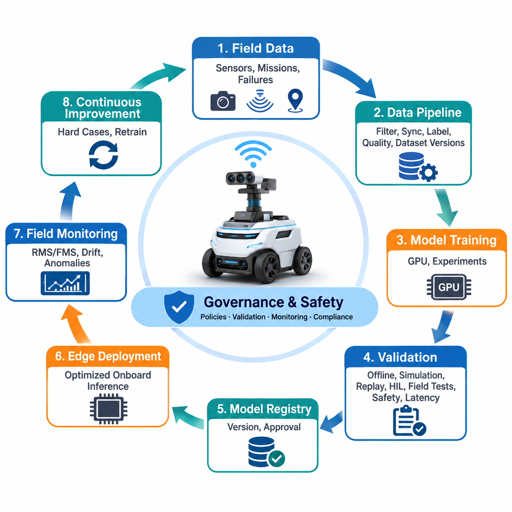
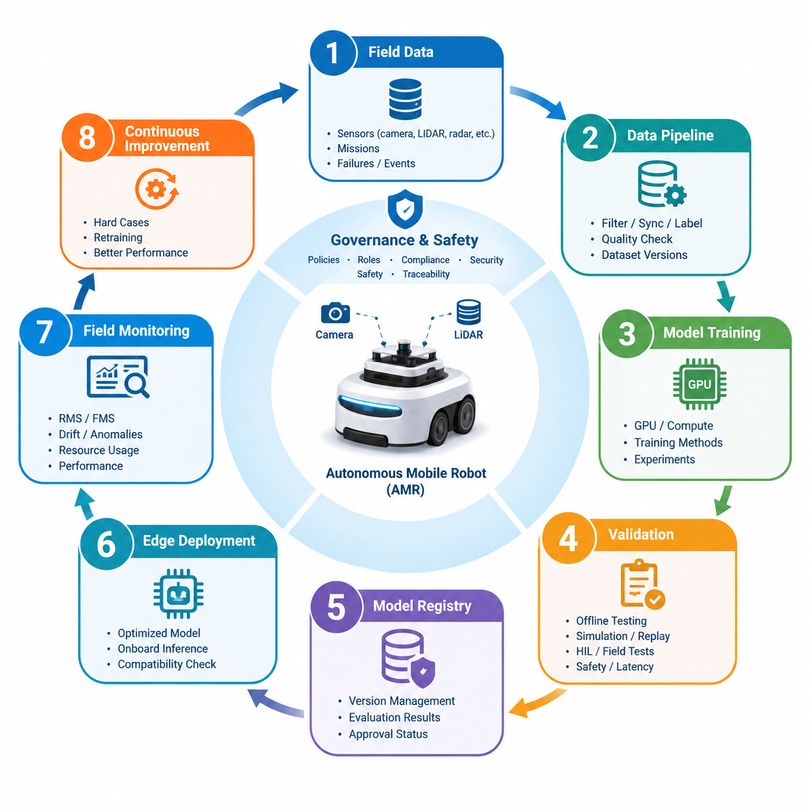
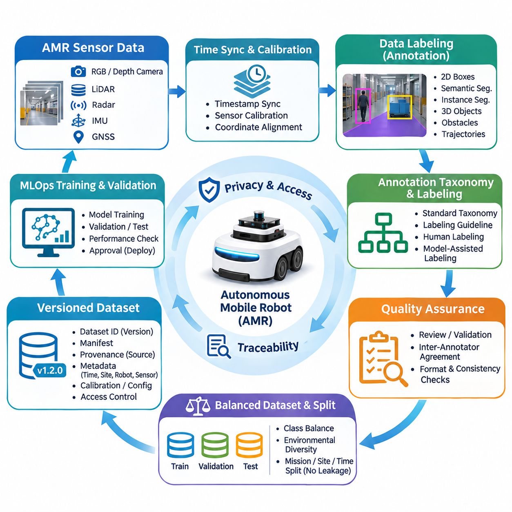
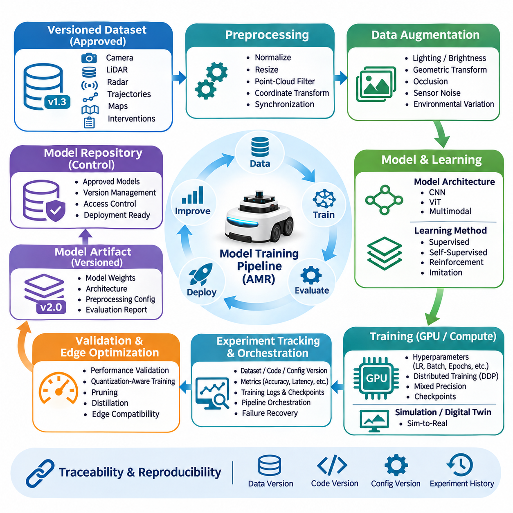
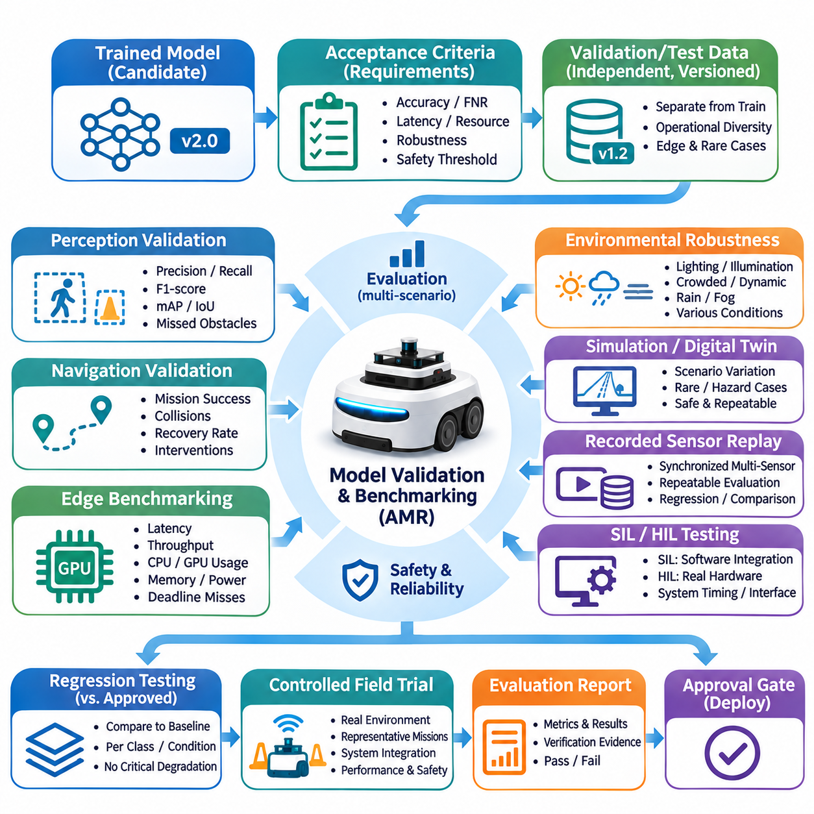
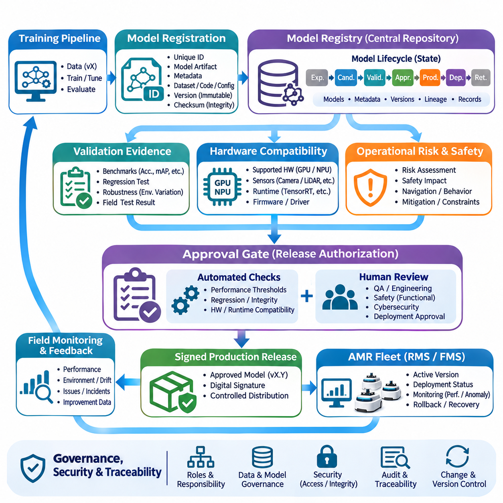
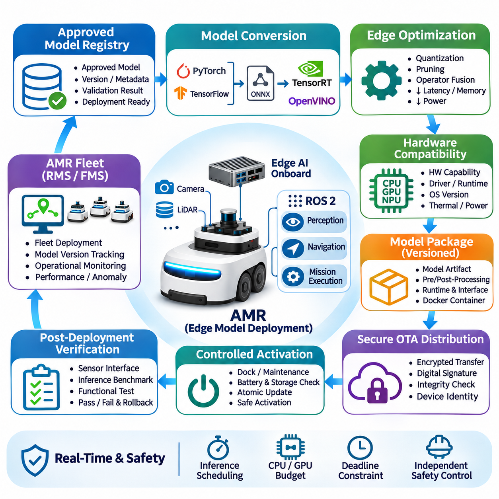
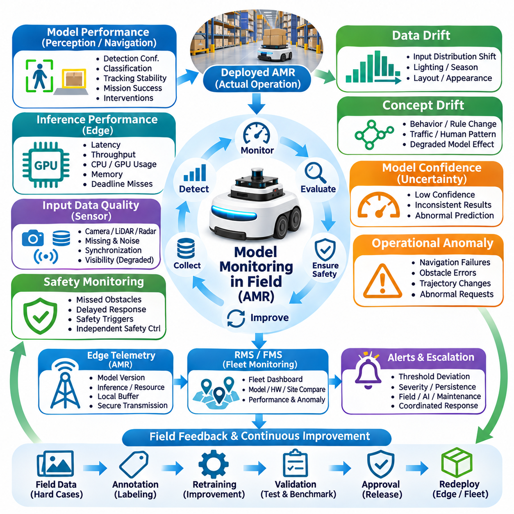
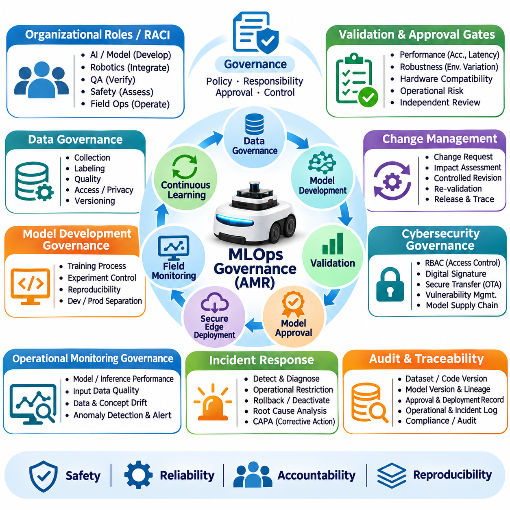

**Volume 08. AMR Operations, Deployment, and MLOps**

# Chapter 07. Robot MLOps

## 07.1 MLOps for Robotics Overview

{width="7.268055555555556in" height="7.268055555555556in"}

{width="7.268055555555556in" height="7.268055555555556in"}

Machine Learning Operations (MLOps) for robotics is an engineering discipline that integrates artificial intelligence development, data management, model training, validation, deployment, and operational monitoring throughout the lifecycle of autonomous robotic systems. For Autonomous Mobile Robots (AMRs), MLOps establishes a systematic framework for maintaining and continuously improving AI capabilities under real-world operating conditions.

Unlike conventional software applications, robotic systems interact directly with physical environments that are dynamic, uncertain, and continuously changing. Variations in lighting, weather, human movement, obstacles, surface conditions, and sensor characteristics can significantly affect AI model performance. Robotics MLOps addresses these challenges by connecting field operations with structured AI development and validation processes.

Traditional machine learning development primarily focuses on achieving high model accuracy using predefined datasets. Robotics MLOps extends this approach by considering operational reliability, inference latency, computational efficiency, environmental adaptability, and functional safety. An AI model must demonstrate not only statistical accuracy but also consistent performance within the physical and computational constraints of the robot.

The robotics MLOps lifecycle begins with operational data collection. AMRs continuously generate information through cameras, LiDAR, radar, inertial sensors, navigation systems, motor controllers, and internal diagnostic modules. These data sources provide valuable information about environmental conditions, robot behavior, mission execution, perception failures, and unexpected events encountered during autonomous operations.

Collected operational data must be processed through structured data management pipelines. Data filtering, synchronization, normalization, annotation, and quality verification are essential for transforming raw sensor information into reliable training datasets. Metadata describing robot configuration, sensor characteristics, environmental conditions, software versions, and mission context supports traceability and reproducibility.

Dataset versioning is a fundamental component of robotics MLOps. Every dataset used for model development should have a unique identifier, documented origin, annotation history, and quality assessment record. Dataset versioning enables engineering teams to reproduce experimental results, identify the causes of performance differences, and maintain consistent relationships between training data and deployed AI models.

Model training pipelines automate the transformation of validated datasets into deployable machine learning models. Depending on the application, training may involve supervised learning, self-supervised learning, reinforcement learning, imitation learning, or foundation model fine-tuning. Training infrastructure may utilize centralized GPU servers, on-premises computing clusters, or cloud-based distributed computing environments.

Experiment management provides systematic control over model development activities. Training parameters, neural network architectures, optimization algorithms, dataset versions, software dependencies, random seeds, and evaluation results should be recorded for each experiment. This information enables engineering teams to compare candidate models objectively and reproduce successful development outcomes when necessary.

Model validation evaluates whether newly developed AI models satisfy predefined technical and operational requirements. Validation should include offline dataset testing, simulation-based evaluation, recorded sensor data replay, hardware-in-the-loop testing, and controlled field experiments. Particular attention must be given to rare events, unexpected obstacles, environmental variations, and safety-critical operating scenarios.

Robotics benchmarking extends beyond conventional machine learning accuracy metrics. Performance indicators include detection precision, recall, false-negative rates, inference latency, memory consumption, processing throughput, energy efficiency, mission completion rates, and operator intervention frequency. These measurements help determine whether an AI model is suitable for deployment on a specific robotic hardware platform.

A centralized model registry manages trained and validated AI models throughout their operational lifecycles. Each registered model should include version information, training dataset references, evaluation results, hardware compatibility, deployment restrictions, and approval status. Formal approval procedures prevent experimental or insufficiently validated models from being introduced into production robotic environments.

Edge model deployment transfers approved AI models to onboard robotic computing platforms. Resource limitations require careful optimization through techniques such as quantization, pruning, knowledge distillation, and hardware-specific inference acceleration. Deployment must also verify compatibility with operating systems, middleware, GPU drivers, inference engines, sensor configurations, and existing robot control software.

Field model monitoring provides continuous visibility into the behavior of deployed AI systems. Robot Management Systems (RMS) and Fleet Management Systems (FMS) can integrate model version tracking, inference statistics, anomaly detection, computational resource utilization, and operational performance indicators. Monitoring enables early identification of degraded model performance and emerging environmental challenges.

Data drift and concept drift represent significant challenges for long-term autonomous robot operation. Changes in environmental conditions can alter sensor input distributions, while changes in operating scenarios may affect the relationship between observed information and expected behavior. MLOps must detect these changes and initiate structured investigation, dataset improvement, retraining, and subsequent validation when required.

Continuous improvement establishes a closed-loop relationship between field operations and AI development. Difficult operating scenarios, perception failures, and human interventions become valuable sources of training information. However, newly trained models should not automatically replace production models without regression testing, operational risk assessment, controlled deployment, and formal authorization.

Ultimately, robotics MLOps transforms AI development from an isolated engineering activity into a continuous operational capability. By integrating data labeling, dataset versioning, automated training, benchmarking, model registration, edge deployment, field monitoring, and governance, organizations can establish scalable and reliable AI-enabled robotic fleets while maintaining operational safety, accountability, and systematic performance improvement.

## 07.2 Data Labeling and Dataset Versioning

{width="7.268055555555556in" height="7.268055555555556in"}

Data labeling and dataset versioning are fundamental components of Machine Learning Operations (MLOps) for Autonomous Mobile Robots (AMRs). They establish a systematic framework for transforming raw operational data into reliable, traceable, and reusable training datasets. The quality and consistency of these datasets directly influence the accuracy, robustness, environmental adaptability, and operational reliability of robotic artificial intelligence systems.

Autonomous robots generate heterogeneous data through RGB cameras, depth cameras, LiDAR, radar, inertial measurement units, GNSS receivers, and internal diagnostic systems. Unlike conventional machine learning datasets, robotic datasets frequently contain synchronized multimodal information representing physical interactions, environmental conditions, spatial relationships, and temporal sequences. These characteristics require specialized data preparation and annotation processes.

Data labeling is the process of assigning meaningful information to raw data so that machine learning algorithms can identify relevant patterns and relationships. In robotic perception, labeling may include object classification, bounding box annotation, semantic segmentation, instance segmentation, three-dimensional object detection, and obstacle identification. Navigation datasets may also contain traversability information, trajectory labels, and environmental risk classifications.

Annotation requirements should be defined according to the operational objectives of the robot. A hospital AMR may require detailed labeling of patients, medical equipment, wheelchairs, and movable obstacles, whereas an outdoor patrol robot may require annotations for pedestrians, vehicles, road boundaries, hazardous objects, and terrain conditions. Application-specific labeling improves the relevance of training datasets to actual deployment environments.

A standardized annotation taxonomy establishes consistent definitions for object categories, environmental attributes, behavioral characteristics, and exceptional conditions. Annotation guidelines should specify classification boundaries, occlusion handling, minimum object visibility, ambiguous cases, and labeling accuracy requirements. Without standardized definitions, different annotators may introduce inconsistencies that negatively affect model training and evaluation.

Multimodal data labeling requires accurate spatial and temporal alignment between different sensor measurements. Camera images, LiDAR point clouds, radar detections, and robot positioning data must be associated with compatible timestamps and coordinate reference systems. Incorrect synchronization or sensor calibration can introduce systematic labeling errors, reducing the effectiveness of sensor fusion models and compromising downstream robotic perception.

Manual annotation remains important for complex scenarios requiring human interpretation and contextual understanding. However, large-scale robotic datasets can create substantial labeling costs and processing delays. Semi-automated annotation, model-assisted labeling, active learning, and foundation model-based annotation can improve productivity by generating preliminary labels that are subsequently reviewed and corrected by qualified human annotators.

Data quality assurance verifies the accuracy, completeness, and consistency of annotated datasets before they enter model training pipelines. Quality control mechanisms may include independent annotation reviews, inter-annotator agreement analysis, automated format validation, statistical distribution checks, and targeted inspection of safety-critical scenarios. Annotation errors should be documented, corrected, and incorporated into revised labeling guidelines.

Dataset balancing ensures that training information adequately represents the range of conditions encountered during autonomous robot operations. Excessive representation of routine operating scenarios may reduce model sensitivity to rare but important events. Dataset composition should therefore consider environmental diversity, object distributions, lighting conditions, weather variations, human behavior, operational locations, and exceptional events.

Dataset versioning establishes formal configuration management for machine learning data assets. Each dataset release should have a unique version identifier associated with its source information, annotation specifications, preprocessing configuration, and modification history. Version control enables engineering teams to reproduce training experiments, investigate performance differences, and maintain traceability between deployed models and their original training data.

A dataset version should include metadata describing collection dates, geographical or operational environments, robot identifiers, sensor configurations, calibration parameters, firmware versions, and applicable data usage restrictions. Metadata management provides essential context for interpreting model performance and determining whether particular datasets are compatible with different robotic platforms or deployment environments.

Large-scale robotics datasets require storage architectures capable of managing substantial volumes of multimodal information. Object storage, distributed file systems, on-premises storage infrastructure, and cloud-based data repositories can support scalable dataset management. Versioning mechanisms should minimize unnecessary duplication through content-addressed storage, immutable data references, dataset manifests, and incremental updates.

Training, validation, and test datasets must be separated carefully to prevent data leakage and misleading performance evaluations. Sequential frames recorded during the same mission may contain nearly identical information, making random frame-level partitioning inappropriate. Dataset partitioning should consider recording sessions, robot missions, deployment sites, environmental conditions, and temporal boundaries to support meaningful generalization assessments.

Dataset governance defines ownership, access permissions, approval responsibilities, retention policies, and privacy protection requirements. Operational data collected in hospitals, factories, logistics facilities, and public environments may contain confidential information or personally identifiable information. Appropriate anonymization, encryption, access control, and audit mechanisms are necessary to maintain regulatory compliance and protect organizational data assets.

Integration with MLOps pipelines enables approved dataset versions to trigger controlled model training and evaluation workflows. Newly collected field data, corrected annotations, and additional edge cases can be incorporated into successive dataset releases. Ultimately, systematic data labeling and dataset versioning establish the foundation for reproducible AI development, continuous learning, operational accountability, and scalable robotic intelligence.

## 07.3 Model Training Pipeline

{width="7.268055555555556in" height="7.268055555555556in"}

A model training pipeline is a structured and automated engineering workflow that transforms validated datasets into deployable machine learning models. Within Machine Learning Operations (MLOps) for Autonomous Mobile Robots (AMRs), the training pipeline connects data management, algorithm development, computational infrastructure, experiment tracking, model evaluation, and artifact generation into a reproducible development environment.

Unlike conventional machine learning applications, robotic AI models must satisfy requirements associated with physical interaction, environmental uncertainty, real-time processing, and operational safety. The training pipeline should therefore consider not only prediction accuracy but also computational efficiency, inference latency, robustness against environmental variations, and compatibility with embedded robotic computing platforms.

The model training process begins with the selection of approved dataset versions. Training datasets may include camera images, LiDAR point clouds, radar measurements, robot trajectories, semantic maps, environmental observations, and human intervention records. Dataset selection should reflect the intended operational environment, robotic platform configuration, application requirements, and predefined model performance objectives.

Data preprocessing transforms heterogeneous sensor information into consistent representations suitable for machine learning algorithms. Typical preprocessing operations include normalization, image resizing, point cloud filtering, coordinate transformation, temporal synchronization, feature extraction, and annotation conversion. Preprocessing configurations must be version-controlled because changes in data representation can significantly influence training results.

Data augmentation improves model generalization by introducing controlled variations into existing training samples. Image augmentation may include brightness adjustment, geometric transformation, motion blur, and simulated environmental degradation. Robotic datasets may additionally incorporate sensor noise, partial occlusion, missing measurements, and variations in object positions while preserving physically meaningful relationships between sensor modalities.

Model architecture selection depends on the intended robotic application and available computational resources. Convolutional Neural Networks (CNNs), Vision Transformers (ViTs), recurrent architectures, multimodal neural networks, and foundation models may support perception, navigation, scene understanding, and autonomous decision-making. Architecture selection should balance model complexity, operational performance, and deployment constraints.

Different learning methodologies can be incorporated into a unified robotics training pipeline. Supervised learning utilizes annotated datasets, while self-supervised learning extracts representations from unlabeled observations. Reinforcement learning optimizes robotic policies through environmental interactions and reward signals, whereas imitation learning develops behavioral capabilities from human demonstrations or previously recorded robot trajectories.

Training configuration management establishes consistent definitions for hyperparameters, learning rates, batch sizes, optimization algorithms, loss functions, training epochs, and random seeds. Configuration files should be maintained under version control and associated with individual training experiments. This approach supports reproducibility, systematic parameter optimization, and objective comparison between alternative model architectures.

Computational infrastructure is responsible for executing machine learning workloads efficiently and reliably. Robotics training pipelines may operate on dedicated GPU workstations, on-premises GPU clusters, or cloud-based distributed computing environments. Distributed Data Parallel (DDP), mixed-precision training, gradient accumulation, and checkpointing can improve resource utilization and support the development of increasingly complex AI models.

Simulation environments and digital twins provide additional training capabilities for robotic AI systems. Synthetic datasets can represent hazardous conditions, rare operational scenarios, diverse environments, and complex physical interactions that are difficult to reproduce in actual field operations. Domain randomization and simulation-to-reality transfer techniques help reduce discrepancies between simulated experiences and real-world robotic behavior.

Experiment tracking provides systematic visibility into the entire model training process. Each experiment should record dataset versions, source code revisions, training configurations, hardware environments, software dependencies, loss curves, evaluation metrics, and generated model artifacts. Centralized experiment management enables engineering teams to investigate training failures, compare development alternatives, and reproduce previous results.

Automated training workflows can be implemented using pipeline orchestration platforms that manage task dependencies, computational resource allocation, execution scheduling, and failure recovery. Training jobs may be triggered by approved dataset releases, source code modifications, scheduled development cycles, or verified field performance degradation. Automation reduces manual intervention while maintaining controlled execution and auditability.

Intermediate model checkpoints preserve training progress and enable recovery from computational failures or interrupted execution. Checkpoints may also support comparative evaluation of models generated at different training stages. Regular monitoring of training loss, validation loss, convergence behavior, gradient stability, and overfitting indicators helps engineering teams identify ineffective training configurations before excessive resources are consumed.

Model optimization prepares trained neural networks for subsequent deployment on robotic edge computing platforms. Techniques such as quantization-aware training, network pruning, knowledge distillation, and architecture optimization can reduce computational complexity and memory requirements. Optimized models must undergo additional evaluation to identify potential degradation in accuracy, numerical stability, or operational behavior.

Training pipeline outputs should include model weights, architecture definitions, preprocessing configurations, experiment records, dataset references, and preliminary evaluation reports. Generated artifacts must be uniquely identifiable and transferred to a controlled model repository. Ultimately, a reliable model training pipeline establishes the foundation for reproducible AI development, systematic model validation, controlled deployment, and continuous improvement across autonomous robotic fleets.

## 07.4 Model Validation and Benchmarking

{width="7.268055555555556in" height="7.268055555555556in"}

Model validation and benchmarking are essential components of Machine Learning Operations (MLOps) for Autonomous Mobile Robots (AMRs). They establish a systematic engineering framework for determining whether trained artificial intelligence models satisfy predefined technical, operational, and safety requirements. These processes provide objective evidence that candidate models are suitable for integration into production robotic systems.

Unlike conventional machine learning applications, robotic AI models operate within physical environments where prediction errors can directly influence robot behavior and operational safety. Model validation must therefore extend beyond statistical accuracy to include environmental robustness, inference latency, computational resource consumption, behavioral consistency, and compatibility with autonomous navigation and robot control systems.

The validation process begins with the definition of measurable acceptance criteria derived from system requirements and operational objectives. These criteria should specify acceptable detection accuracy, false-negative rates, processing latency, resource utilization, and environmental operating conditions. Safety-critical applications require additional acceptance thresholds based on hazard analysis and the consequences of incorrect model predictions.

Independent validation and test datasets are necessary for obtaining reliable assessments of model performance. These datasets must remain separate from training data and represent realistic operating conditions, environmental diversity, and exceptional scenarios. Dataset versioning and documented evaluation configurations ensure that benchmarking results remain reproducible and comparable across different model versions and robotic platforms.

Perception model validation evaluates the ability of artificial intelligence systems to identify and interpret relevant environmental information. Common evaluation metrics include precision, recall, F1-score, mean Average Precision (mAP), and Intersection over Union (IoU). Particular attention should be given to missed detections of pedestrians, vehicles, obstacles, and other objects that may influence autonomous robot safety.

Navigation and decision-making models require evaluation at both algorithmic and system levels. Relevant performance indicators include mission completion rates, collision frequency, trajectory deviation, obstacle avoidance success, navigation recovery rates, and human intervention frequency. These measurements establish whether improved machine learning performance produces meaningful improvements in overall autonomous robotic behavior.

Computational benchmarking evaluates model performance on representative edge computing platforms. Inference latency, processing throughput, GPU utilization, CPU utilization, memory consumption, and electrical power consumption should be measured under realistic workloads. Average latency alone is insufficient because occasional processing delays and missed execution deadlines may compromise time-sensitive robotic functions.

Environmental robustness testing determines whether AI models maintain acceptable performance under changing operating conditions. Indoor AMRs may encounter reflective surfaces, crowded passages, variable illumination, and dynamically relocated equipment. Outdoor AMRs must additionally address rain, fog, shadows, direct sunlight, uneven terrain, and varying sensor visibility. These conditions should be represented in structured validation scenarios.

Simulation-based validation enables systematic evaluation of scenarios that are difficult, expensive, or dangerous to reproduce in physical environments. Digital twins and physics-based simulation platforms can generate controlled variations in environmental conditions, object movements, sensor characteristics, and robot behavior. Simulation results should nevertheless be complemented by physical testing because simulated environments cannot fully reproduce real-world uncertainty.

Recorded sensor data replay provides a repeatable mechanism for comparing multiple model versions against identical operational conditions. Synchronized camera images, LiDAR point clouds, radar measurements, robot trajectories, and event logs can be replayed through candidate perception and decision-making pipelines. This approach supports regression testing, failure analysis, and objective comparison without requiring repeated physical data collection.

Software-in-the-Loop (SIL) and Hardware-in-the-Loop (HIL) testing evaluate AI models within progressively more realistic system configurations. SIL testing verifies interactions between machine learning models and robot software components, whereas HIL testing incorporates actual computing hardware, communication interfaces, and representative execution timing. Both methods help identify integration problems before controlled field deployment.

Model regression testing determines whether newly trained or optimized models introduce performance degradation relative to previously approved production models. Benchmarking should compare overall performance as well as results for individual object categories, environmental conditions, deployment sites, and safety-critical scenarios. Improvements in aggregate accuracy must not conceal unacceptable degradation in important operational capabilities.

Controlled field validation evaluates candidate models under actual operating conditions before large-scale deployment. Representative robots should execute predefined missions within supervised environments while collecting detailed performance and diagnostic information. Field testing should assess interactions between AI models, sensor systems, navigation algorithms, robot controllers, and independent safety mechanisms.

Benchmarking results should be documented through standardized evaluation reports containing model identifiers, dataset versions, hardware configurations, test conditions, acceptance criteria, measured results, and identified limitations. Failed acceptance criteria must trigger further investigation, corrective actions, or model rejection. Successful validation provides the technical evidence required for model registration and formal deployment approval.

Ultimately, model validation and benchmarking establish a controlled engineering boundary between experimental AI development and production robot operations. By integrating statistical evaluation, computational benchmarking, environmental testing, simulation, regression analysis, and field validation, organizations can improve robotic intelligence while maintaining operational reliability, traceability, functional safety, and consistent performance across autonomous robotic fleets.

## 07.5 Model Registry and Approval

{width="7.268055555555556in" height="7.268055555555556in"}

A model registry is a centralized management system that maintains machine learning models, associated metadata, validation results, and deployment approval records throughout their operational lifecycles. Within Machine Learning Operations (MLOps) for Autonomous Mobile Robots (AMRs), the model registry establishes a controlled engineering environment connecting model development, validation, deployment, monitoring, and governance.

Unlike conventional software repositories, a model registry manages not only executable artifacts but also the experimental and operational context associated with artificial intelligence models. Each registered model should maintain traceable relationships with training datasets, neural network architectures, preprocessing configurations, software dependencies, evaluation results, and supported robotic hardware platforms.

Model registration begins after the completion of a training pipeline and preliminary performance evaluation. Generated model artifacts are transferred to a controlled repository and assigned unique identifiers. Registration does not automatically authorize operational deployment, because candidate models must undergo additional technical validation, compatibility assessment, operational risk evaluation, and formal approval procedures.

Model versioning provides systematic configuration management for artificial intelligence assets. Each model version should be associated with its training dataset version, source code revision, training configuration, optimization parameters, and creation date. Immutable version identifiers and cryptographic checksums help maintain artifact integrity and prevent unauthorized modifications to previously validated models.

Model metadata provides essential information for understanding the characteristics and limitations of registered artificial intelligence models. Typical metadata includes model architecture, input and output specifications, supported sensor modalities, computational requirements, inference runtime, intended applications, known limitations, and environmental restrictions. This information supports deployment decisions and long-term maintenance.

The model registry should maintain clearly defined lifecycle states representing the maturity and operational authorization of individual models. Typical states include experimental, candidate, validated, approved, production, deprecated, and retired. State transitions must follow documented engineering procedures, ensuring that insufficiently evaluated models cannot enter production environments through uncontrolled deployment activities.

Model validation records provide the technical evidence required for deployment approval. These records should contain benchmark results, acceptance criteria, regression test outcomes, environmental robustness assessments, computational performance measurements, and field validation results. Identified limitations and unresolved defects must remain visible throughout the approval process and subsequent operational activities.

Hardware compatibility management is particularly important because AMR fleets may incorporate heterogeneous computing architectures and sensor configurations. A model optimized for a dedicated GPU platform may not operate correctly on an embedded accelerator with different memory or numerical precision characteristics. Registry records should identify supported hardware, inference engines, firmware versions, and runtime dependencies.

Operational risk assessment determines the potential consequences of deploying a new artificial intelligence model within a physical robotic system. Perception errors, incorrect environmental interpretations, delayed inference, and unexpected behavioral responses may influence navigation reliability and operational safety. Approval requirements should therefore reflect the criticality of the model and its interactions with independent safety mechanisms.

Formal approval workflows establish responsibility and accountability across AI development, robotics engineering, quality assurance, functional safety, cybersecurity, and field operations teams. Approval authority should be assigned according to organizational responsibilities and model criticality. Separation between model development and final deployment authorization reduces the risk of introducing insufficiently validated changes into production.

Automated approval gates can verify whether candidate models satisfy predefined technical and operational requirements. These mechanisms may evaluate benchmark thresholds, regression test results, artifact integrity, cybersecurity requirements, and hardware compatibility. However, automated verification should not replace qualified human review when model changes introduce significant operational risks or affect safety-critical robotic functions.

Model promotion transfers an approved model from a development or staging environment into an authorized production release. Promotion should preserve the relationship between the validated artifact and the deployed artifact, preventing unverified modifications after approval. Digitally signed release packages, controlled distribution channels, and deployment authorization records strengthen release integrity and traceability.

Integration with Robot Management Systems (RMS) and Fleet Management Systems (FMS) enables centralized tracking of deployed model versions across autonomous robotic fleets. Each robot should report its active model configuration, deployment history, compatibility status, and available recovery versions. This information supports fleet-wide configuration management, targeted distribution, incident investigation, and controlled rollback.

Model security and governance protect artificial intelligence assets against unauthorized access, modification, replacement, and distribution. Role-based access control, encryption, digital signatures, audit logging, and software supply chain verification should be incorporated into registry operations. Model approval records must remain accessible to authorized personnel while protecting proprietary algorithms and sensitive information.

Model retirement and rollback management ensure that obsolete, incompatible, or degraded models are systematically removed from active operation. Previously approved models should remain available within defined retention periods to support recovery and historical investigation. Ultimately, a reliable model registry and approval framework establishes traceability, operational accountability, controlled deployment, and sustainable AI lifecycle management across AMR fleets.

## 07.6 Edge Model Deployment

{width="7.268055555555556in" height="7.268055555555556in"}

Edge model deployment is the engineering process of transferring validated and approved artificial intelligence models from centralized development environments to robotic edge computing platforms. Within Machine Learning Operations (MLOps) for Autonomous Mobile Robots (AMRs), edge deployment connects model development, computational optimization, software integration, operational execution, and field performance monitoring.

Unlike cloud-based artificial intelligence systems, AMRs must execute critical perception, navigation, and decision-making functions directly within their onboard computing environments. Local inference reduces communication latency, minimizes network dependency, and supports autonomous operation under unstable connectivity conditions. Edge deployment must therefore satisfy strict computational, environmental, and operational requirements.

The deployment process begins with the selection of an approved model version from the model registry. Deployment configurations should identify target robotic platforms, supported sensor interfaces, computational architectures, inference engines, software dependencies, and operational restrictions. Only models that satisfy predefined validation and approval requirements should be authorized for production deployment.

Model conversion transforms trained neural networks into executable representations compatible with target edge computing platforms. Models developed using PyTorch or TensorFlow may be exported through the Open Neural Network Exchange (ONNX) format and optimized using inference frameworks such as TensorRT or OpenVINO. Converted models must be evaluated to verify numerical consistency and acceptable inference accuracy.

Model optimization is essential for achieving efficient execution within limited computational resources. Quantization, network pruning, operator fusion, memory optimization, and hardware acceleration can reduce inference latency, memory consumption, and electrical power requirements. The selected optimization strategy must preserve the accuracy and behavioral characteristics required for reliable autonomous robotic operation.

Edge hardware compatibility must be systematically evaluated because robotic fleets may incorporate different Central Processing Units (CPUs), Graphics Processing Units (GPUs), Neural Processing Units (NPUs), and specialized accelerators. Deployment configurations should consider hardware capabilities, supported numerical precision, available memory, operating system versions, device drivers, and thermal management characteristics.

Model packaging establishes a standardized distribution format containing executable model artifacts, preprocessing and postprocessing configurations, runtime dependencies, interface definitions, and version metadata. Containerization technologies such as Docker can improve deployment consistency across supported robotic platforms. Each package should remain traceable to its approved model version and corresponding validation records.

Integration with the robotic software architecture enables deployed models to interact with sensor acquisition, localization, perception, navigation, and mission execution components. In Robot Operating System 2 (ROS 2) environments, inference services may operate as dedicated nodes communicating through standardized interfaces. Message compatibility, timestamp synchronization, and coordinate frame consistency must be maintained.

Real-time inference management ensures that artificial intelligence workloads operate within predefined execution deadlines. Inference scheduling, asynchronous processing, GPU resource allocation, and memory buffer management should minimize unpredictable processing delays. Computationally intensive AI applications must not interfere with time-critical motor control, emergency response functions, or independent safety systems.

Resource management becomes increasingly important when multiple artificial intelligence models execute simultaneously on a robotic edge platform. Object detection, semantic segmentation, sensor fusion, and behavioral prediction may compete for shared computational resources. Deployment configurations should establish workload priorities, memory budgets, power limits, and thermal constraints to maintain stable performance under sustained workloads.

Secure model distribution protects approved artificial intelligence artifacts during transmission and installation. Over-the-Air (OTA) deployment mechanisms should incorporate encrypted communication, digital signatures, cryptographic integrity verification, and authenticated device identities. Edge devices must reject unauthorized or corrupted model packages and prevent incompatible software from entering active operation.

Deployment activation should occur under controlled operational conditions, preferably when the robot is stationary, docked, or undergoing scheduled maintenance. Predeployment checks should verify battery capacity, available storage, hardware compatibility, and software readiness. Atomic activation mechanisms and recoverable installation procedures help prevent incomplete updates from disrupting essential robotic functions.

Postdeployment verification determines whether installed models execute correctly within their intended edge environments. Initialization tests, sensor interface checks, inference benchmarks, memory utilization measurements, and controlled functional tests should be performed before operational authorization. Failed verification must prevent mission resumption and trigger predefined recovery procedures or restoration of a compatible approved version.

Integration with Robot Management Systems (RMS) and Fleet Management Systems (FMS) enables centralized coordination of edge model deployment across heterogeneous robotic fleets. Management platforms should maintain active model inventories, deployment histories, device compatibility records, and installation status. Subsequent field monitoring provides feedback on inference performance, resource consumption, and operational anomalies.

Ultimately, edge model deployment establishes the operational connection between centralized AI development and distributed physical intelligence. By integrating approved model artifacts, hardware-specific optimization, secure distribution, real-time execution management, and controlled activation, organizations can maintain reliable autonomous capabilities while supporting scalable AI lifecycle management across industrial AMR fleets.

## 07.7 Model Monitoring in Field

{width="7.268055555555556in" height="7.268055555555556in"}

Field model monitoring is the continuous observation and evaluation of deployed artificial intelligence models under actual robotic operating conditions. Within Machine Learning Operations (MLOps) for Autonomous Mobile Robots (AMRs), field monitoring connects edge model deployment with operational performance assessment, anomaly detection, failure analysis, data collection, and continuous model improvement.

Unlike laboratory validation, field operations expose robotic AI models to unpredictable environmental conditions, dynamic objects, sensor degradation, and changing operational requirements. Models that demonstrate acceptable performance during controlled testing may experience significant degradation after deployment. Continuous monitoring is therefore essential for maintaining operational reliability, autonomous capabilities, and safety.

Model performance monitoring evaluates the effectiveness of deployed artificial intelligence models through application-specific performance indicators. Perception models may be assessed using detection confidence, object classification consistency, tracking stability, and estimated detection accuracy. Navigation and decision-making models may additionally be evaluated through mission completion rates, recovery events, and human intervention frequency.

Inference performance monitoring focuses on the computational behavior of deployed models within robotic edge computing environments. Important indicators include inference latency, processing throughput, GPU utilization, CPU utilization, memory consumption, and execution deadline violations. Monitoring should capture average performance, percentile-based latency measurements, and abnormal fluctuations under sustained operational workloads.

Input data monitoring evaluates the characteristics and quality of sensor information supplied to deployed artificial intelligence models. Camera images, LiDAR point clouds, radar measurements, and other sensor inputs should be examined for missing information, excessive noise, synchronization errors, degraded visibility, and abnormal statistical distributions. Poor input quality can significantly reduce model reliability even when the deployed model remains unchanged.

Data drift occurs when the statistical characteristics of operational input data gradually or abruptly diverge from those of the original training datasets. Changes in lighting conditions, seasonal environments, facility layouts, object appearances, and sensor configurations may introduce significant distribution shifts. Statistical monitoring and feature distribution analysis can help identify emerging discrepancies before substantial operational degradation occurs.

Concept drift describes changes in the relationship between input observations and their expected predictions or outcomes. In robotic applications, changing traffic patterns, human behavior, operational rules, and environmental interactions may reduce the effectiveness of previously learned models. Detecting concept drift generally requires verified operational outcomes, updated annotations, or other reliable sources of feedback.

Model confidence monitoring provides additional information about uncertainty in artificial intelligence predictions. Low-confidence detections, inconsistent classifications, abnormal prediction distributions, and disagreements between independent perception models may indicate unfamiliar environmental conditions. However, confidence scores alone cannot establish prediction correctness, because poorly calibrated models may produce confidently incorrect results.

Operational anomaly detection identifies unusual patterns in model outputs, inference behavior, and interactions with other robotic subsystems. Repeated navigation failures, inconsistent obstacle predictions, unexpected trajectory changes, and abnormal intervention requests may indicate degraded AI performance. Anomaly detection mechanisms should correlate model-related events with sensor conditions, software logs, and robot operating states.

Safety-related monitoring examines whether deployed model behavior remains within predefined operational boundaries. Missed obstacle detections, delayed environmental responses, unexpected motion recommendations, and frequent activation of independent safety mechanisms should receive particular attention. Monitoring results must support timely operational intervention without replacing validated safety controllers or emergency stopping functions.

Edge telemetry collection provides the technical foundation for continuous model monitoring across distributed robotic platforms. Each robot should periodically report its active model version, inference statistics, computational resource utilization, environmental context, and detected anomalies. Telemetry systems should incorporate local buffering, data prioritization, compression, and secure transmission to accommodate intermittent network connectivity.

Centralized monitoring platforms integrated with Robot Management Systems (RMS) and Fleet Management Systems (FMS) enable comparative analysis across autonomous robotic fleets. Monitoring dashboards should support comparisons between model versions, hardware configurations, deployment locations, environmental conditions, and operational missions. Such comparisons help distinguish isolated robot failures from systematic model degradation.

Automated alerting mechanisms should identify significant deviations from validated performance baselines and predefined operational thresholds. Alerts may be classified according to severity, persistence, affected robotic functions, and potential safety consequences. Escalation procedures should coordinate responses among field operators, AI engineers, maintenance personnel, and safety managers while minimizing unnecessary notifications.

Field monitoring establishes an important feedback mechanism for continuous learning and controlled model improvement. Operational failures, unusual environmental observations, low-confidence predictions, and human intervention events can be selected for additional data collection and annotation. These datasets support subsequent training and regression testing, but newly trained models must undergo formal validation and approval before deployment.

Ultimately, field model monitoring establishes a continuous connection between deployed robotic intelligence and centralized MLOps infrastructure. By integrating performance measurements, data quality assessment, drift detection, anomaly analysis, safety observation, and operational feedback, organizations can maintain traceable AI performance, reduce operational risks, and establish sustainable improvement processes across autonomous robotic fleets.

## 07.8 MLOps Governance Process

{width="7.268055555555556in" height="7.268055555555556in"}

MLOps governance is a structured management and engineering framework that establishes policies, responsibilities, decision-making procedures, and operational controls for artificial intelligence throughout its lifecycle. Within Machine Learning Operations (MLOps) for Autonomous Mobile Robots (AMRs), governance integrates data management, model training, validation, approval, edge deployment, and field monitoring into an accountable operational process.

Unlike conventional machine learning governance, robotic MLOps governance must address the consequences of artificial intelligence decisions within physical environments. Incorrect perception, unexpected autonomous behavior, delayed inference, and uncontrolled model changes can directly affect operational reliability and human safety. Governance must therefore integrate artificial intelligence management with robotics engineering, functional safety, and cybersecurity.

Organizational governance establishes clearly defined responsibilities across AI development, robotics software engineering, infrastructure management, quality assurance, field operations, and safety management teams. Each stakeholder should understand their authority, approval responsibilities, and operational obligations. A Responsibility Assignment Matrix, such as RACI, can support systematic coordination and prevent accountability gaps throughout the model lifecycle.

Data governance establishes policies for collecting, storing, processing, labeling, accessing, and distributing operational datasets. Training data must satisfy predefined quality requirements, privacy restrictions, security policies, and applicable regulatory obligations. Dataset ownership, collection provenance, annotation standards, retention periods, and version histories should be systematically documented to maintain transparency and reproducibility.

Model development governance ensures that training activities follow approved engineering procedures and reproducible experimental practices. Training configurations, algorithm architectures, computational environments, source code revisions, and dataset versions must remain traceable. Experimental models should be clearly separated from validated production models to prevent unauthorized transitions from research environments into operational robotic systems.

Validation governance establishes mandatory evaluation requirements before artificial intelligence models become eligible for deployment. These requirements should include statistical performance assessment, computational benchmarking, environmental robustness testing, regression analysis, and controlled field validation. Acceptance criteria must reflect application requirements, operational constraints, and the potential consequences of model-related failures.

Model approval governance defines formal authorization procedures for transitioning candidate models into production environments. Approval decisions should consider validation results, hardware compatibility, cybersecurity assessments, operational risks, and unresolved limitations. Models affecting safety-critical robotic functions require appropriate system-level safety assessments and independent review before deployment authorization.

Deployment governance controls how approved artificial intelligence models are distributed, installed, activated, and maintained across autonomous robotic fleets. Deployment policies should define target device eligibility, supported configurations, release schedules, maintenance windows, verification requirements, and recovery conditions. Unauthorized model packages and unverified configuration changes must be prevented from entering production environments.

Operational monitoring governance establishes requirements for continuously observing deployed model performance, inference behavior, input data quality, and environmental changes. Monitoring thresholds should be derived from validated performance baselines and operational risk assessments. Significant deviations, data drift, recurring failures, and safety-related anomalies must trigger documented investigation and appropriate escalation procedures.

Change management governance ensures that modifications to artificial intelligence models, datasets, inference engines, preprocessing algorithms, and runtime configurations undergo controlled evaluation. Each change request should document its technical justification, affected components, expected benefits, potential risks, and required validation activities. Approved changes must remain traceable throughout deployment and subsequent field operations.

Cybersecurity governance protects MLOps infrastructure, training datasets, model registries, deployment pipelines, and distributed edge devices against unauthorized access and malicious modifications. Role-based access control, cryptographic verification, secure communication, vulnerability management, and audit logging should be integrated throughout the model lifecycle. Software and model supply chain risks must also be systematically assessed.

Auditability and traceability are fundamental requirements for accountable robotic MLOps governance. Organizations should maintain comprehensive records of dataset modifications, training experiments, validation results, approval decisions, deployment activities, operational incidents, and corrective actions. These records support internal audits, incident investigations, regulatory assessments, and verification of compliance with organizational policies.

Incident governance defines coordinated response procedures when deployed models demonstrate unacceptable performance, unexpected behavior, or potential safety risks. Depending on incident severity, responses may include operational restrictions, model deactivation, controlled rollback, or suspension of affected robotic missions. Incident investigations should identify root causes and establish corrective and preventive actions to reduce recurrence.

Continuous learning governance ensures that operational feedback contributes to systematic model improvement without introducing uncontrolled changes into production environments. Field data collection, hard-case mining, annotation, retraining, and incremental model optimization must follow approved engineering procedures. Newly trained models must satisfy established regression testing, validation, and approval requirements before operational deployment.

Ultimately, MLOps governance establishes an organizational and technical foundation for sustainable artificial intelligence lifecycle management across autonomous robotic fleets. By integrating accountability, data governance, model approval, deployment control, cybersecurity, operational monitoring, and continuous improvement, organizations can develop increasingly capable robotic intelligence while maintaining safety, reliability, reproducibility, and operational trust.
