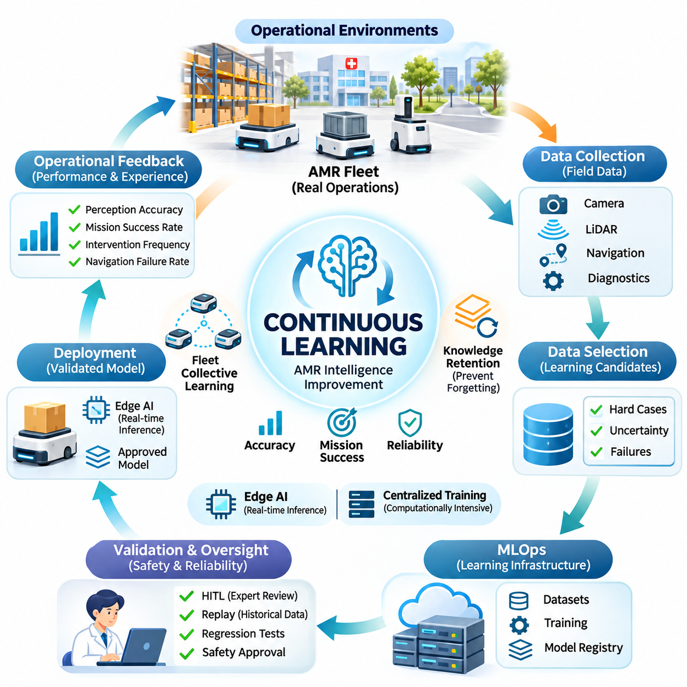
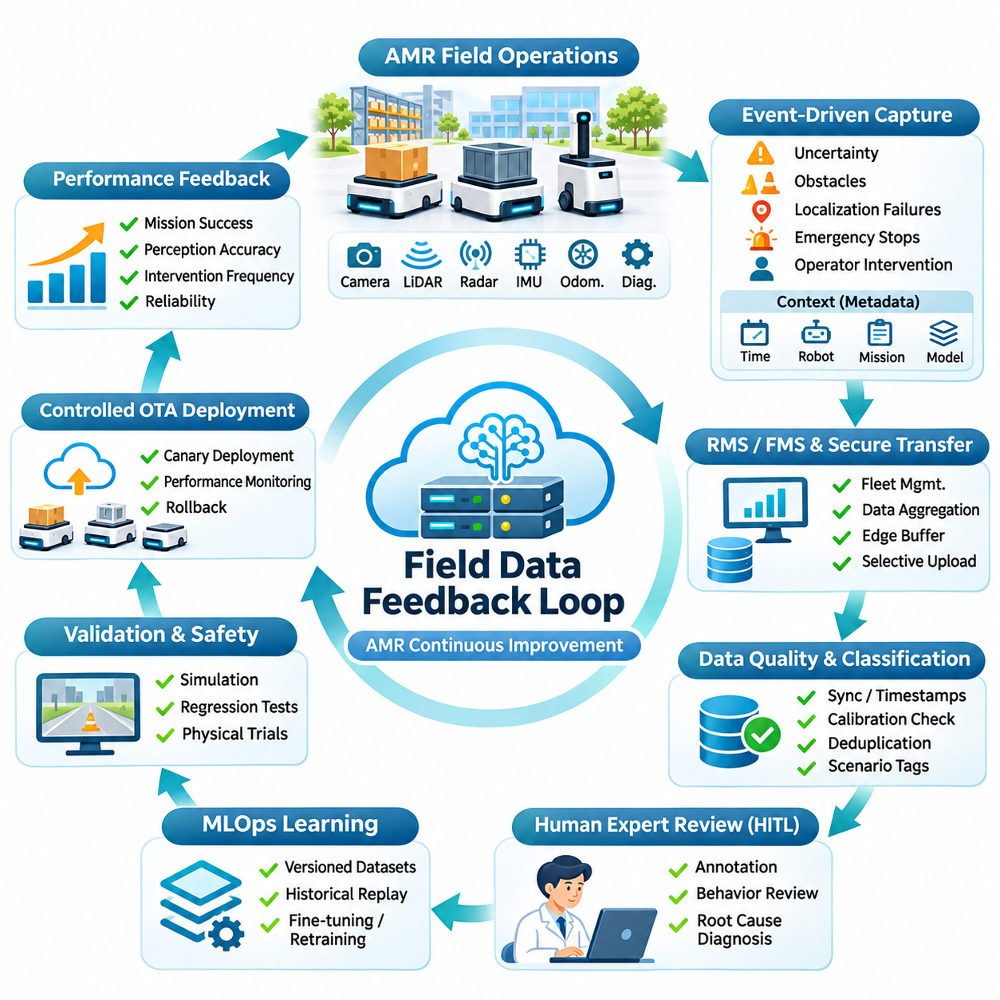
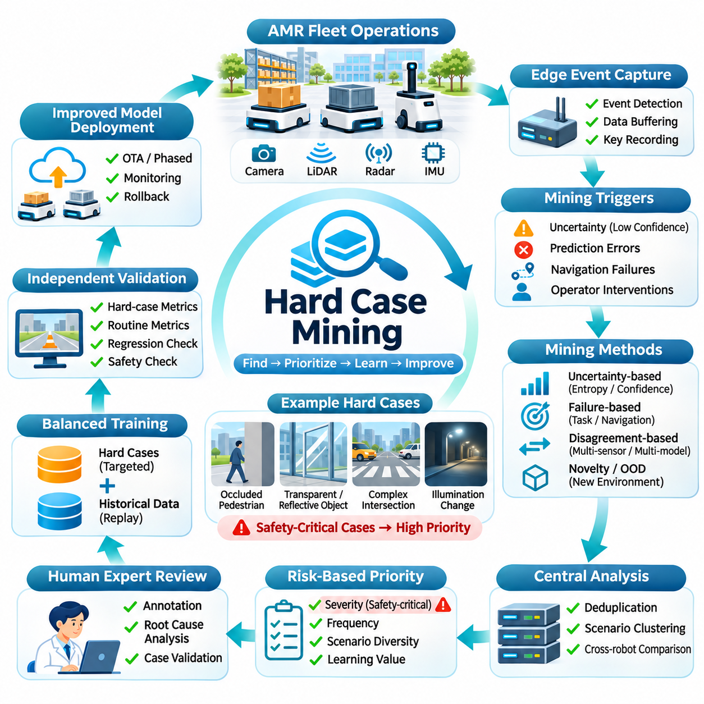
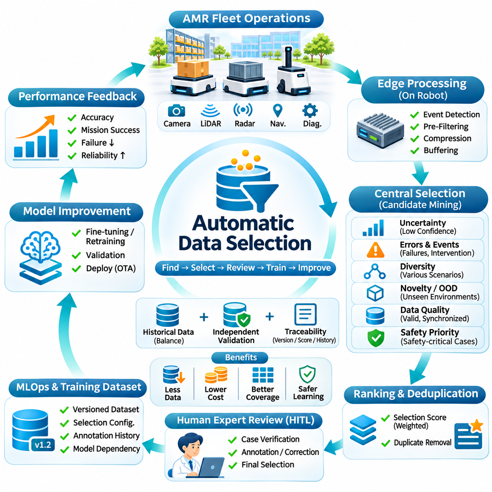
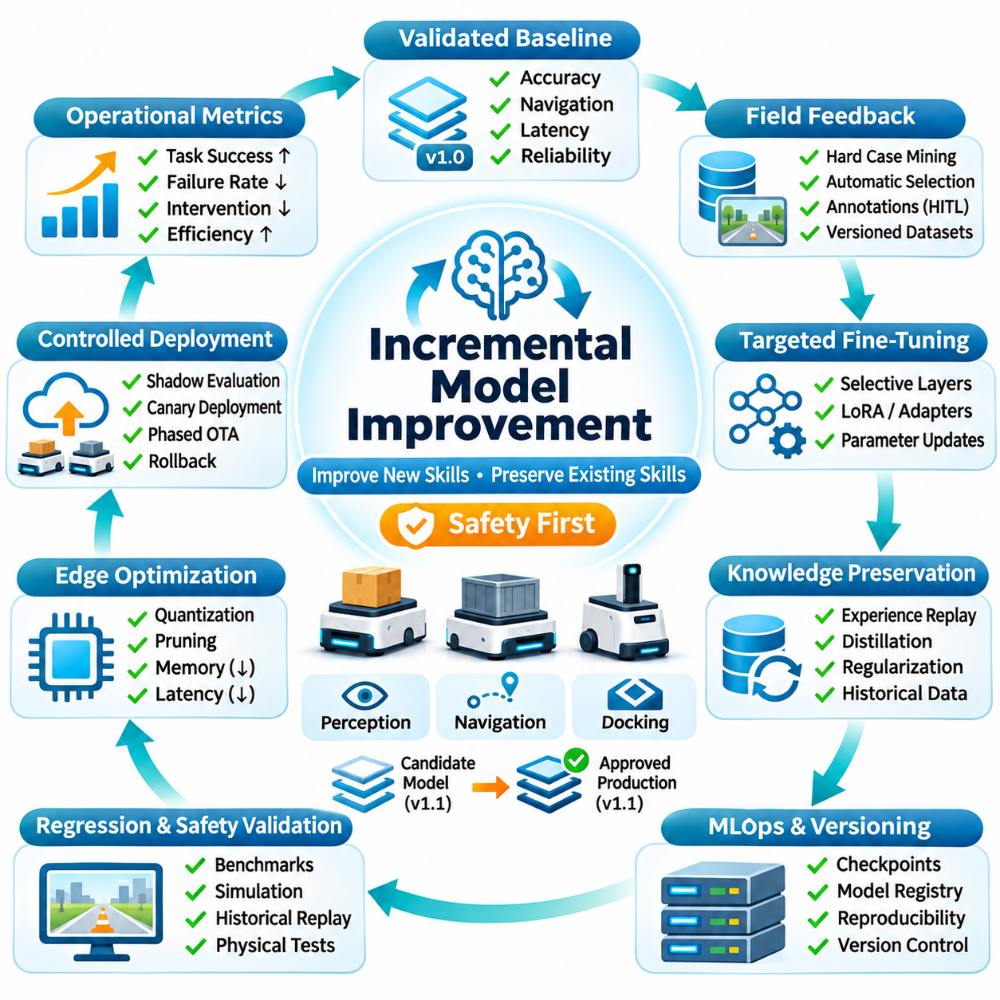
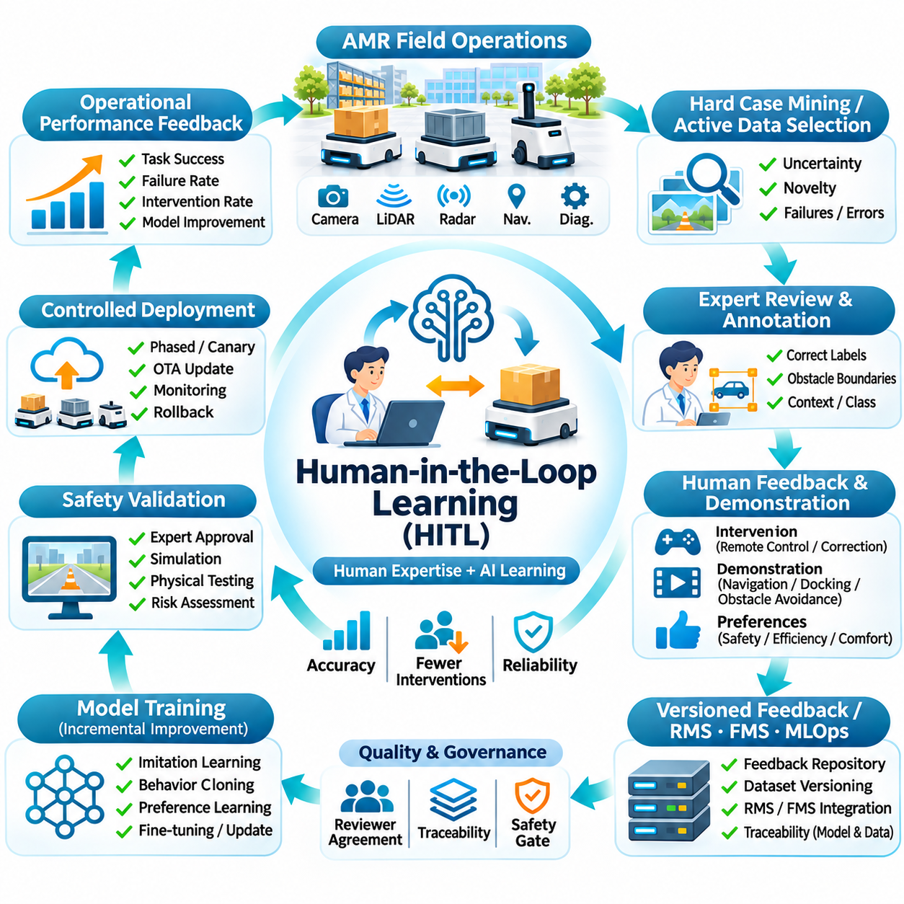
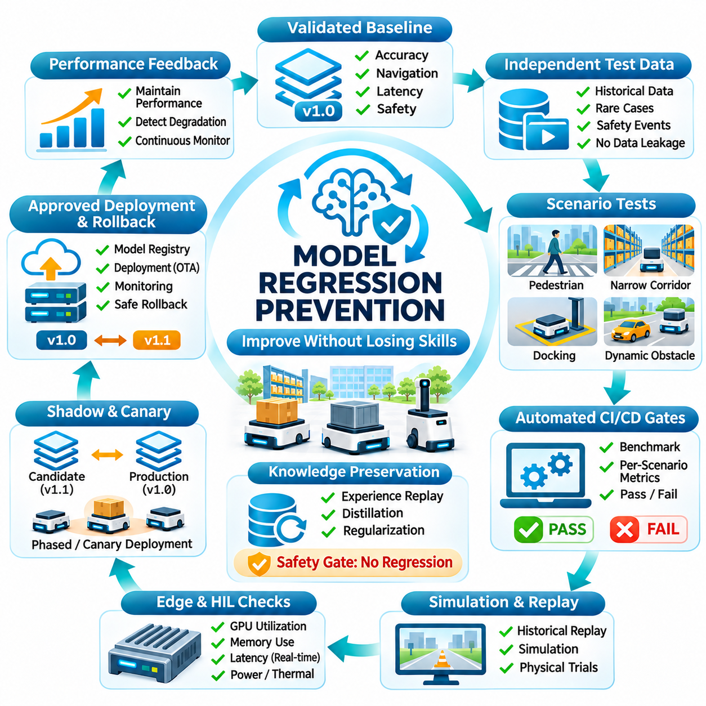
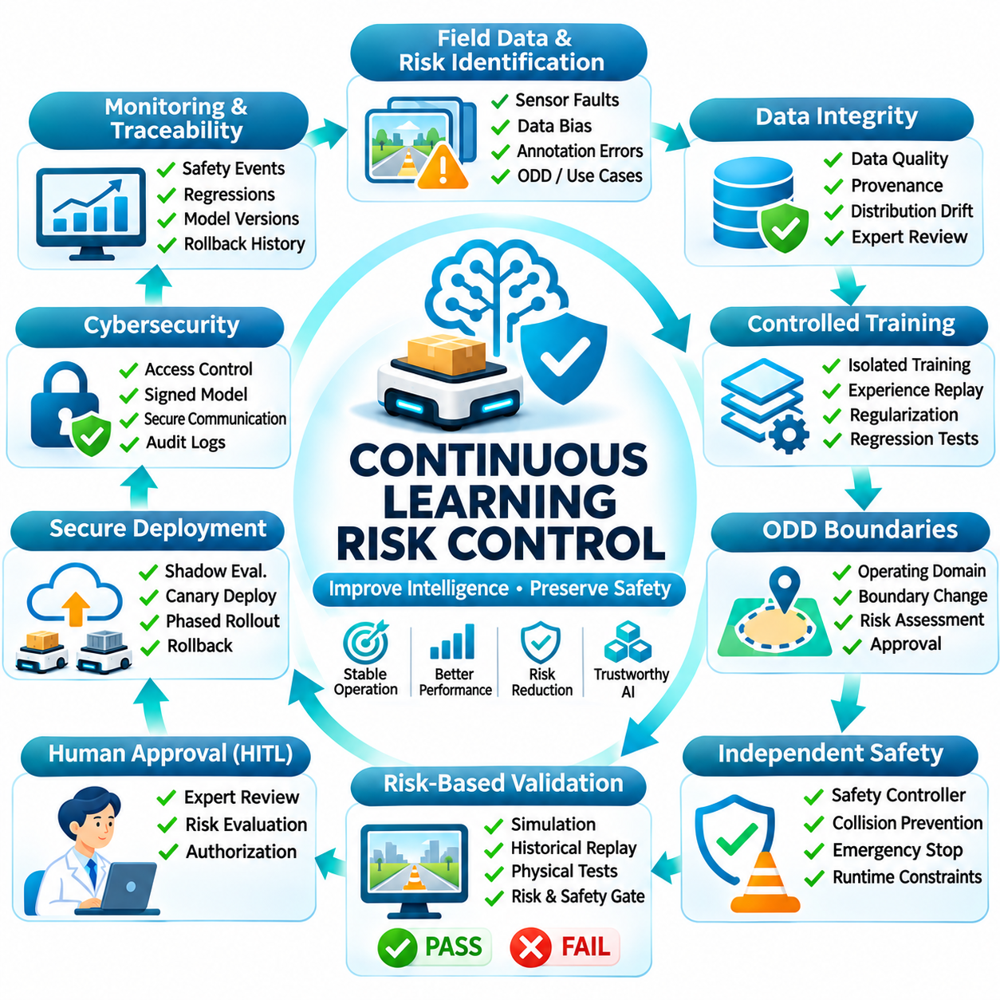

**Volume 08. AMR Operations, Deployment, and MLOps**


# Chapter 08. Continuous Learning

##  

## 08.1 Continuous Learning Concept

{width="7.268055555555556in" height="7.268055555555556in"}

Continuous Learning is an engineering approach that enables Autonomous Mobile Robots (AMRs) to improve their intelligence, adaptability, and operational performance throughout their service lifecycle. Unlike conventional robotic systems that depend on fixed algorithms and predefined behaviors, continuously learning robots utilize operational experience, environmental observations, and performance feedback to systematically improve their artificial intelligence capabilities.

The fundamental concept of Continuous Learning is based on the recognition that real-world operating environments are dynamic and continuously evolving. Industrial facilities, hospitals, warehouses, and outdoor environments frequently experience changes in infrastructure, human activities, traffic patterns, lighting conditions, and operational requirements. AI models developed during initial engineering stages cannot fully represent every possible operational scenario.

Continuous Learning transforms robot deployment from the final stage of product development into the beginning of an ongoing intelligence improvement process. Every operational mission provides opportunities to acquire additional knowledge about environmental conditions, navigation challenges, perception failures, and human interactions. Operational experience becomes a valuable engineering resource for improving subsequent generations of robotic intelligence.

The Continuous Learning architecture establishes a closed-loop relationship between physical robot operations and AI development infrastructure. Robots collect operational data through cameras, LiDAR, radar, inertial sensors, navigation systems, and internal diagnostic interfaces. Selected information is transferred to centralized learning infrastructure, where it is processed, evaluated, and potentially incorporated into new training datasets.

An important principle of Continuous Learning is that data quantity does not necessarily determine learning effectiveness. Large volumes of repetitive operational data may contribute relatively little to model improvement. Instead, learning systems should prioritize informative observations, unusual environmental conditions, prediction errors, unexpected obstacles, navigation failures, and situations involving significant uncertainty in AI-generated decisions.

Continuous Learning can be implemented through different learning strategies, including periodic retraining, incremental learning, continual learning, active learning, and controlled online adaptation. Periodic retraining produces updated models using accumulated datasets, while incremental learning incorporates newly acquired knowledge into existing models. Active learning prioritizes informative samples that require additional evaluation or human annotation.

The integration of Continuous Learning with Machine Learning Operations (MLOps) provides the engineering infrastructure required to manage evolving AI capabilities. Dataset versioning, automated training pipelines, model registries, performance benchmarking, approval workflows, and deployment management establish a traceable learning environment. Each model improvement must be associated with identifiable training data, configurations, evaluation results, and software dependencies.

A fundamental technical challenge is maintaining previously acquired knowledge while incorporating new operational experience. AI models may experience catastrophic forgetting when optimization focuses excessively on recently collected datasets. Experience replay, representative historical datasets, knowledge distillation, and regularization techniques help preserve established capabilities while supporting adaptation to newly encountered operational conditions.

Continuous Learning also enables collective intelligence across distributed robot fleets. Individual robots encounter different environmental conditions and operational challenges, generating complementary experiences. A centralized learning infrastructure can aggregate selected information from multiple robots, improve shared AI models, and distribute validated intelligence improvements to compatible robots operating across different locations.

The relationship between Edge AI and centralized learning infrastructure is particularly important. Edge computing platforms perform real-time perception, navigation, and autonomous decision-making, while cloud or on-premises computing infrastructure generally performs computationally intensive training and validation. This separation allows deployed robots to maintain predictable operational behavior without introducing uncontrolled model modifications during active missions.

Human-in-the-Loop (HITL) learning provides an additional mechanism for improving robotic intelligence through expert knowledge and operational feedback. Field operators, technicians, safety engineers, and AI developers contribute by reviewing uncertain predictions, correcting annotations, identifying inappropriate behaviors, and evaluating exceptional situations. Human supervision remains particularly important when learning involves safety-critical operational decisions.

Safety and reliability must remain fundamental constraints throughout the Continuous Learning lifecycle. Newly trained models should not automatically replace validated production models solely because they demonstrate improved aggregate performance. Simulation, historical data replay, regression testing, controlled field trials, and formal approval processes are necessary to verify that learning improvements do not introduce unacceptable operational risks.

The effectiveness of Continuous Learning should be evaluated using measurable engineering and operational indicators. Relevant metrics include perception accuracy, mission completion rates, operator intervention frequency, navigation failure rates, environmental adaptability, and model inference latency. Learning effectiveness should also consider computational resource consumption, dataset acquisition costs, deployment stability, and long-term operational reliability.

Ultimately, Continuous Learning establishes the foundation for evolving Physical AI systems in which operational experience becomes a continuous source of intelligence improvement. By integrating field data acquisition, automated learning pipelines, collective fleet knowledge, human supervision, and controlled model deployment, AMR platforms can progressively expand their capabilities while maintaining engineering discipline, operational safety, and lifecycle sustainability.

지속적 학습(Continuous Learning)은 자율이동로봇(AMR, Autonomous Mobile Robot)이 전체 서비스 수명주기(Service Lifecycle)에 걸쳐 지능(Intelligence), 적응성(Adaptability), 운영 성능(Operational Performance)을 지속적으로 향상시킬 수 있도록 하는 공학적 접근 방식(Engineering Approach)이다. 고정된 알고리즘(Fixed Algorithm)과 사전에 정의된 행동(Predefined Behavior)에 의존하는 기존 로봇 시스템과 달리, 지속적 학습 로봇은 운영 경험(Operational Experience), 환경 관측(Environmental Observation), 성능 피드백(Performance Feedback)을 활용하여 인공지능(AI) 역량을 체계적으로 향상시킨다.

지속적 학습의 기본 개념은 실제 운영 환경(Real-world Operating Environment)이 동적이며 지속적으로 변화한다는 인식에 기반한다. 산업 시설(Industrial Facility), 병원(Hospital), 물류 창고(Warehouse), 실외 환경(Outdoor Environment)에서는 인프라, 인간의 활동, 교통 패턴(Traffic Pattern), 조명 조건(Lighting Condition), 운영 요구사항(Operational Requirement)이 빈번하게 변화한다. 초기 엔지니어링 단계에서 개발된 AI 모델은 발생 가능한 모든 운영 시나리오(Operational Scenario)를 완전하게 반영할 수 없다.

지속적 학습은 로봇 배포(Robot Deployment)를 제품 개발(Product Development)의 최종 단계에서 지속적인 지능 개선 프로세스(Intelligence Improvement Process)의 시작 단계로 전환한다. 모든 운영 임무(Operational Mission)는 환경 조건(Environmental Condition), 자율주행 문제(Navigation Challenge), 인지 실패(Perception Failure), 인간과의 상호작용(Human Interaction)에 대한 추가적인 지식을 획득할 기회를 제공한다. 운영 경험은 차세대 로봇 지능(Robotic Intelligence)을 향상시키기 위한 중요한 엔지니어링 자원(Engineering Resource)이 된다.

지속적 학습 아키텍처(Continuous Learning Architecture)는 물리적 로봇 운영(Physical Robot Operation)과 AI 개발 인프라(AI Development Infrastructure) 사이에 폐루프 관계(Closed-loop Relationship)를 구축한다. 로봇은 카메라(Camera), 라이다(LiDAR), 레이더(Radar), 관성 센서(Inertial Sensor), 자율주행 시스템(Navigation System), 내부 진단 인터페이스(Internal Diagnostic Interface)를 통해 운영 데이터를 수집한다. 선별된 정보는 중앙집중형 학습 인프라(Centralized Learning Infrastructure)로 전송되어 처리 및 평가되며, 새로운 학습 데이터셋(Training Dataset)에 반영될 수 있다.

지속적 학습의 중요한 원칙은 데이터의 양(Data Quantity)이 반드시 학습 효과(Learning Effectiveness)를 결정하지는 않는다는 것이다. 대규모의 반복적인 운영 데이터(Operational Data)는 모델 개선(Model Improvement)에 상대적으로 적은 기여를 할 수 있다. 따라서 학습 시스템(Learning System)은 정보 가치가 높은 관측 데이터, 비정상적인 환경 조건, 예측 오류(Prediction Error), 예상하지 못한 장애물, 자율주행 실패(Navigation Failure), AI 기반 의사결정에서 높은 불확실성(Uncertainty)이 발생하는 상황을 우선적으로 고려해야 한다.

지속적 학습은 주기적 재학습(Periodic Retraining), 점진적 학습(Incremental Learning), 연속 학습(Continual Learning), 능동 학습(Active Learning), 통제된 온라인 적응(Controlled Online Adaptation) 등 다양한 학습 전략(Learning Strategy)을 통해 구현할 수 있다. 주기적 재학습은 축적된 데이터셋을 활용하여 갱신된 모델을 생성하며, 점진적 학습은 새롭게 획득한 지식을 기존 모델에 통합한다. 능동 학습은 추가적인 평가나 인간의 데이터 주석(Human Annotation)이 필요한 정보 가치가 높은 데이터 샘플(Data Sample)을 우선적으로 선별한다.

지속적 학습과 머신러닝 운영(MLOps, Machine Learning Operations)의 통합은 지속적으로 발전하는 AI 역량을 관리하기 위한 엔지니어링 인프라를 제공한다. 데이터셋 버전 관리(Dataset Versioning), 자동화된 학습 파이프라인(Automated Training Pipeline), 모델 레지스트리(Model Registry), 성능 벤치마킹(Performance Benchmarking), 승인 워크플로(Approval Workflow), 배포 관리(Deployment Management)를 통해 추적 가능한 학습 환경(Traceable Learning Environment)을 구축한다. 각각의 모델 개선은 식별 가능한 학습 데이터, 구성 설정(Configuration), 평가 결과(Evaluation Result), 소프트웨어 의존성(Software Dependency)과 연결되어야 한다.

근본적인 기술적 과제(Technical Challenge)는 새로운 운영 경험을 반영하면서 기존에 획득한 지식을 유지하는 것이다. AI 모델의 최적화(Optimization)가 최근에 수집된 데이터셋에 지나치게 집중되면 재앙적 망각(Catastrophic Forgetting)이 발생할 수 있다. 경험 재생(Experience Replay), 대표성 있는 과거 데이터셋(Representative Historical Dataset), 지식 증류(Knowledge Distillation), 정규화 기법(Regularization Technique)은 기존에 확보된 역량을 보존하면서 새롭게 직면한 운영 조건에 대한 적응을 지원한다.

지속적 학습은 분산형 로봇 플릿(Distributed Robot Fleet) 전체에 걸쳐 집단 지능(Collective Intelligence)을 구현할 수 있도록 한다. 개별 로봇은 서로 다른 환경 조건과 운영 문제에 직면하면서 상호 보완적인 경험(Complementary Experience)을 생성한다. 중앙집중형 학습 인프라는 여러 로봇에서 선별된 정보를 통합하고, 공통 AI 모델(Shared AI Model)을 개선하며, 검증된 지능 개선 결과를 서로 다른 지역에서 운영되는 호환 가능한 로봇에 배포할 수 있다.

엣지 AI(Edge AI)와 중앙집중형 학습 인프라 사이의 관계는 특히 중요하다. 엣지 컴퓨팅 플랫폼(Edge Computing Platform)은 실시간 인지(Real-time Perception), 자율주행(Navigation), 자율적 의사결정(Autonomous Decision-making)을 수행하는 반면, 클라우드(Cloud) 또는 온프레미스(On-Premises) 컴퓨팅 인프라는 일반적으로 높은 연산 성능이 요구되는 학습 및 검증(Training and Validation)을 수행한다. 이러한 기능 분리(Functional Separation)를 통해 배포된 로봇은 실제 임무 수행 중 통제되지 않은 모델 변경 없이 예측 가능한 운영 행동(Predictable Operational Behavior)을 유지할 수 있다.

인간 참여형 학습(HITL, Human-in-the-Loop Learning)은 전문가의 지식(Expert Knowledge)과 운영 피드백을 통해 로봇 지능을 향상시키는 추가적인 메커니즘(Mechanism)을 제공한다. 현장 운영자(Field Operator), 기술자(Technician), 안전 엔지니어(Safety Engineer), AI 개발자는 불확실한 예측 결과의 검토, 데이터 주석 수정, 부적절한 행동의 식별, 예외 상황(Exceptional Situation)의 평가 등을 통해 학습에 기여한다. 특히 안전 필수 운영 의사결정(Safety-critical Operational Decision)이 학습에 포함되는 경우 인간의 감독(Human Supervision)은 매우 중요하다.

안전성(Safety)과 신뢰성(Reliability)은 지속적 학습의 전체 수명주기에 걸쳐 기본적인 제약조건(Constraint)으로 유지되어야 한다. 새롭게 학습된 모델이 전체적인 성능(Aggregate Performance)에서 향상된 결과를 나타낸다는 이유만으로 검증된 운영 모델(Production Model)을 자동으로 대체해서는 안 된다. 시뮬레이션(Simulation), 과거 데이터 재생(Historical Data Replay), 회귀 테스트(Regression Testing), 통제된 현장 시험(Controlled Field Trial), 공식 승인 프로세스(Formal Approval Process)를 통해 학습 개선이 허용할 수 없는 운영 위험(Operational Risk)을 발생시키지 않는지 검증해야 한다.

지속적 학습의 효과는 측정 가능한 엔지니어링 및 운영 지표(Engineering and Operational Metrics)를 활용하여 평가해야 한다. 주요 지표에는 인지 정확도(Perception Accuracy), 임무 완료율(Mission Completion Rate), 운영자 개입 빈도(Operator Intervention Frequency), 자율주행 실패율(Navigation Failure Rate), 환경 적응성(Environmental Adaptability), 모델 추론 지연시간(Model Inference Latency)이 포함된다. 또한 학습 효과를 평가할 때는 컴퓨팅 자원 소비량(Computational Resource Consumption), 데이터셋 획득 비용(Dataset Acquisition Cost), 배포 안정성(Deployment Stability), 장기 운영 신뢰성(Long-term Operational Reliability)도 고려해야 한다.

궁극적으로 지속적 학습은 운영 경험이 지속적인 지능 개선의 원천이 되는 진화형 물리적 AI 시스템(Physical AI System)의 기반을 구축한다. 현장 데이터 획득(Field Data Acquisition), 자동화된 학습 파이프라인(Automated Learning Pipeline), 집단 플릿 지식(Collective Fleet Knowledge), 인간의 감독(Human Supervision), 통제된 모델 배포(Controlled Model Deployment)를 통합함으로써 AMR 플랫폼은 체계적인 엔지니어링 원칙(Engineering Discipline), 운영 안전성(Operational Safety), 수명주기 지속가능성(Lifecycle Sustainability)을 유지하면서 점진적으로 자체 역량을 확장할 수 있다.

##  

## 08.2 Field Data Feedback Loop

{width="7.268055555555556in" height="7.268055555555556in"}

The Field Data Feedback Loop is a fundamental mechanism that connects the operational experience of Autonomous Mobile Robots (AMRs) with the continuous improvement of artificial intelligence and autonomous capabilities. It establishes a systematic engineering process through which information collected during real-world robot operations is transformed into actionable knowledge for improving perception, navigation, decision-making, and overall operational reliability.

The feedback loop begins with the acquisition of operational data from deployed robots. AMRs continuously generate information through cameras, LiDAR, radar, inertial measurement units, wheel encoders, localization systems, motion controllers, and internal diagnostic interfaces. These data sources provide comprehensive observations of environmental conditions, robot behavior, task execution results, and interactions with humans and surrounding infrastructure.

Effective field data collection requires contextual information that describes the circumstances under which particular observations were recorded. Robot identification, timestamps, geographic positions, mission identifiers, environmental conditions, software versions, AI model versions, and hardware configurations should be associated with recorded data. This contextual information enables engineers to reconstruct operational situations and identify potential causes of unexpected behavior.

Event-driven data collection is particularly important because continuously recording and transmitting all sensor information can create excessive storage, communication, and computational requirements. Robots should identify significant operational events, including perception uncertainty, localization degradation, unexpected obstacles, emergency stops, navigation failures, and operator interventions. Selected data segments surrounding these events can support detailed engineering analysis.

The Robot Management System (RMS) and Fleet Management System (FMS) provide important interfaces between distributed robotic platforms and centralized learning infrastructure. These systems aggregate operational telemetry, mission results, diagnostic information, and event notifications from multiple robots. Integration with dedicated data acquisition services allows engineering teams to identify recurring operational problems and coordinate systematic collection of relevant training samples.

Field data transmission must be designed according to available network bandwidth, operational priorities, and security requirements. High-volume sensor recordings may be temporarily stored on edge computing platforms and uploaded during charging periods or scheduled maintenance windows. Compression, selective transmission, local buffering, and resumable upload mechanisms help maintain reliable data acquisition without interfering with mission-critical communication.

Data quality management represents an essential stage of the feedback loop. Raw operational recordings may contain corrupted files, missing sensor messages, inaccurate timestamps, calibration errors, duplicated observations, or incomplete environmental information. Automated validation procedures should detect these problems before the data enters downstream processing pipelines. Reliable time synchronization and consistent data formats are particularly important for multisensor learning.

After initial validation, field data must be organized according to its engineering relevance and potential learning value. Data processing pipelines can classify observations by environmental conditions, operational scenarios, failure categories, robot configurations, and model uncertainty. This classification supports systematic dataset construction and enables engineering teams to retrieve representative examples of specific operational challenges encountered during deployment.

Human feedback provides additional information that cannot always be obtained directly from automated monitoring systems. Field operators and maintenance personnel can document unexpected robot behavior, incorrect object classifications, inefficient navigation decisions, and mission execution difficulties. Human-in-the-Loop (HITL) interfaces allow domain experts to review recorded scenarios, correct annotations, and distinguish AI limitations from hardware or infrastructure problems.

The processed field data becomes an input to Machine Learning Operations (MLOps) pipelines, where selected samples are incorporated into version-controlled training datasets. Newly acquired observations should be combined with representative historical data to preserve previously established capabilities. Depending on identified operational deficiencies, engineering teams may initiate targeted fine-tuning, incremental learning, or comprehensive model retraining.

Updated AI models must undergo systematic validation before they are returned to operational environments. Historical data replay, simulation, benchmark datasets, regression testing, and controlled physical experiments provide complementary methods for evaluating model behavior. Validation should determine whether the identified field problems have been adequately addressed without degrading previously validated performance or violating established safety requirements.

Once approved, updated models can be distributed to compatible robotic platforms through controlled Over-the-Air (OTA) deployment mechanisms. Phased deployment and canary testing allow limited groups of robots to evaluate improvements under actual operating conditions before fleet-wide adoption. Model version tracking, compatibility verification, continuous monitoring, and rollback capabilities are necessary to maintain operational stability throughout this process.

The feedback loop is completed when the operational performance of updated models is measured and compared with previous baselines. Mission completion rates, perception accuracy, localization reliability, intervention frequency, navigation efficiency, and safety-related events provide measurable evidence of learning effectiveness. Engineers should distinguish genuine model improvements from performance changes caused by different operating conditions or mission distributions.

Ultimately, the Field Data Feedback Loop transforms distributed AMR fleets into continuously evolving Physical AI systems. By establishing a recurring cycle of observation, data acquisition, quality validation, knowledge extraction, model training, performance verification, and controlled deployment, robotics organizations can systematically convert real-world operational experience into collective intelligence while maintaining safety, traceability, and long-term reliability.

현장 데이터 피드백 루프(Field Data Feedback Loop)는 자율이동로봇(AMR, Autonomous Mobile Robot)의 운영 경험(Operational Experience)을 인공지능 및 자율화 역량(Autonomous Capability)의 지속적인 개선과 연결하는 핵심 메커니즘(Mechanism)이다. 실제 로봇 운영 과정에서 수집된 정보를 인지(Perception), 자율주행(Navigation), 의사결정(Decision-making), 전반적인 운영 신뢰성(Operational Reliability)을 향상시키기 위한 실행 가능한 지식(Actionable Knowledge)으로 전환하는 체계적인 엔지니어링 프로세스(Engineering Process)를 구축한다.

피드백 루프(Feedback Loop)는 현장에 배포된 로봇으로부터 운영 데이터(Operational Data)를 획득하는 과정에서 시작된다. AMR은 카메라(Camera), 라이다(LiDAR), 레이더(Radar), 관성 측정 장치(IMU, Inertial Measurement Unit), 휠 엔코더(Wheel Encoder), 위치 추정 시스템(Localization System), 모션 제어기(Motion Controller), 내부 진단 인터페이스(Internal Diagnostic Interface)를 통해 지속적으로 정보를 생성한다. 이러한 데이터 소스(Data Source)는 환경 조건, 로봇 행동, 작업 수행 결과, 인간 및 주변 인프라와의 상호작용에 대한 종합적인 관측 정보를 제공한다.

효과적인 현장 데이터 수집(Field Data Collection)을 위해서는 특정 관측 정보가 기록된 상황을 설명하는 맥락 정보(Contextual Information)가 필요하다. 로봇 식별 정보(Robot Identification), 타임스탬프(Timestamp), 지리적 위치(Geographic Position), 임무 식별자(Mission Identifier), 환경 조건(Environmental Condition), 소프트웨어 버전(Software Version), AI 모델 버전(AI Model Version), 하드웨어 구성(Hardware Configuration)이 기록된 데이터와 연계되어야 한다. 이러한 맥락 정보를 통해 엔지니어는 운영 상황을 재구성하고 예상하지 못한 행동의 잠재적 원인을 식별할 수 있다.

이벤트 기반 데이터 수집(Event-driven Data Collection)은 모든 센서 정보를 지속적으로 기록하고 전송할 경우 과도한 저장공간, 통신 및 컴퓨팅 자원 요구사항이 발생할 수 있기 때문에 특히 중요하다. 로봇은 인지 불확실성(Perception Uncertainty), 위치 추정 성능 저하(Localization Degradation), 예상하지 못한 장애물(Unexpected Obstacle), 비상 정지(Emergency Stop), 자율주행 실패(Navigation Failure), 운영자 개입(Operator Intervention) 등의 주요 운영 이벤트(Operational Event)를 식별해야 한다. 이러한 이벤트 발생 전후에 선별된 데이터 구간(Data Segment)은 상세한 엔지니어링 분석을 지원할 수 있다.

로봇 관리 시스템(RMS, Robot Management System)과 플릿 관리 시스템(FMS, Fleet Management System)은 분산형 로봇 플랫폼(Distributed Robotic Platform)과 중앙집중형 학습 인프라(Centralized Learning Infrastructure)를 연결하는 중요한 인터페이스를 제공한다. 이러한 시스템은 여러 로봇에서 생성되는 운영 원격 측정 데이터(Operational Telemetry), 임무 수행 결과(Mission Result), 진단 정보(Diagnostic Information), 이벤트 알림(Event Notification)을 통합한다. 전용 데이터 획득 서비스(Data Acquisition Service)와의 통합을 통해 엔지니어링 팀은 반복적으로 발생하는 운영 문제를 식별하고 관련 학습 샘플(Training Sample)의 체계적인 수집을 조율할 수 있다.

현장 데이터 전송(Field Data Transmission)은 가용 네트워크 대역폭(Network Bandwidth), 운영 우선순위(Operational Priority), 보안 요구사항(Security Requirement)을 고려하여 설계되어야 한다. 대용량 센서 기록 데이터(High-volume Sensor Recording)는 엣지 컴퓨팅 플랫폼(Edge Computing Platform)에 임시 저장한 후 충전 시간이나 예정된 유지보수 시간에 업로드할 수 있다. 데이터 압축(Compression), 선택적 전송(Selective Transmission), 로컬 버퍼링(Local Buffering), 재개 가능한 업로드 메커니즘(Resumable Upload Mechanism)은 임무 필수 통신(Mission-critical Communication)을 방해하지 않으면서 안정적인 데이터 획득을 지원한다.

데이터 품질 관리(Data Quality Management)는 피드백 루프의 필수적인 단계이다. 원시 운영 기록 데이터(Raw Operational Recording)에는 손상된 파일(Corrupted File), 누락된 센서 메시지(Missing Sensor Message), 부정확한 타임스탬프, 보정 오류(Calibration Error), 중복 관측(Duplicated Observation), 불완전한 환경 정보가 포함될 수 있다. 자동화된 검증 절차(Automated Validation Procedure)를 통해 데이터가 후속 처리 파이프라인(Downstream Processing Pipeline)에 진입하기 전에 이러한 문제를 검출해야 한다. 신뢰할 수 있는 시간 동기화(Time Synchronization)와 일관된 데이터 형식(Data Format)은 다중 센서 학습(Multisensor Learning)에서 특히 중요하다.

초기 검증(Initial Validation)이 완료된 이후에는 현장 데이터를 엔지니어링 관련성(Engineering Relevance)과 잠재적 학습 가치(Learning Value)에 따라 체계적으로 구성해야 한다. 데이터 처리 파이프라인(Data Processing Pipeline)은 환경 조건, 운영 시나리오(Operational Scenario), 실패 유형(Failure Category), 로봇 구성(Robot Configuration), 모델 불확실성(Model Uncertainty)에 따라 관측 정보를 분류할 수 있다. 이러한 분류(Classification)는 체계적인 데이터셋 구축(Dataset Construction)을 지원하며, 엔지니어링 팀이 현장 배포 과정에서 경험한 특정 운영 문제의 대표적인 사례를 검색할 수 있도록 한다.

인간 피드백(Human Feedback)은 자동화된 모니터링 시스템(Automated Monitoring System)만으로는 항상 직접 획득할 수 없는 추가적인 정보를 제공한다. 현장 운영자(Field Operator)와 유지보수 담당자(Maintenance Personnel)는 예상하지 못한 로봇 행동, 잘못된 객체 분류(Object Classification), 비효율적인 자율주행 의사결정(Navigation Decision), 임무 수행 과정의 문제를 문서화할 수 있다. 인간 참여형 인터페이스(HITL, Human-in-the-Loop Interface)를 통해 분야별 전문가(Domain Expert)는 기록된 시나리오를 검토하고 데이터 주석(Annotation)을 수정하며, AI의 한계와 하드웨어 또는 인프라 문제를 구분할 수 있다.

처리된 현장 데이터는 머신러닝 운영(MLOps, Machine Learning Operations) 파이프라인의 입력으로 활용되며, 선별된 데이터 샘플은 버전 관리 기반 학습 데이터셋(Version-controlled Training Dataset)에 통합된다. 새롭게 획득한 관측 데이터는 이전에 확보된 역량을 보존하기 위해 대표성 있는 과거 데이터(Representative Historical Data)와 결합되어야 한다. 식별된 운영상의 취약점(Operational Deficiency)에 따라 엔지니어링 팀은 목적 지향적 미세조정(Targeted Fine-tuning), 점진적 학습(Incremental Learning), 종합적인 모델 재학습(Comprehensive Model Retraining)을 수행할 수 있다.

갱신된 AI 모델(Updated AI Model)은 실제 운영 환경에 다시 적용되기 전에 체계적인 검증(Systematic Validation)을 거쳐야 한다. 과거 데이터 재생(Historical Data Replay), 시뮬레이션(Simulation), 벤치마크 데이터셋(Benchmark Dataset), 회귀 테스트(Regression Testing), 통제된 물리적 실험(Controlled Physical Experiment)은 모델 행동(Model Behavior)을 평가하기 위한 상호 보완적인 방법을 제공한다. 검증 과정에서는 기존에 검증된 성능을 저하시키거나 확립된 안전 요구사항(Safety Requirement)을 위반하지 않으면서 식별된 현장 문제가 적절하게 해결되었는지 확인해야 한다.

승인이 완료된 모델은 통제된 무선 업데이트(OTA, Over-the-Air) 배포 메커니즘을 통해 호환 가능한 로봇 플랫폼에 배포할 수 있다. 단계적 배포(Phased Deployment)와 카나리 테스트(Canary Testing)를 활용하면 전체 플릿에 적용하기 전에 제한된 로봇 그룹을 대상으로 실제 운영 환경에서 개선 효과를 평가할 수 있다. 모델 버전 추적(Model Version Tracking), 호환성 검증(Compatibility Verification), 지속적 모니터링(Continuous Monitoring), 롤백 기능(Rollback Capability)은 이러한 프로세스 전반에 걸쳐 운영 안정성(Operational Stability)을 유지하는 데 필수적이다.

피드백 루프는 갱신된 모델의 운영 성능을 측정하고 기존 기준선(Baseline)과 비교함으로써 완성된다. 임무 완료율(Mission Completion Rate), 인지 정확도(Perception Accuracy), 위치 추정 신뢰성(Localization Reliability), 운영자 개입 빈도(Intervention Frequency), 자율주행 효율성(Navigation Efficiency), 안전 관련 이벤트(Safety-related Event)는 학습 효과(Learning Effectiveness)를 측정할 수 있는 정량적 근거를 제공한다. 엔지니어는 실제 모델 개선에 따른 성능 향상과 서로 다른 운영 조건 또는 임무 분포(Mission Distribution)로 인해 발생한 성능 변화를 구분해야 한다.

궁극적으로 현장 데이터 피드백 루프는 분산형 AMR 플릿을 지속적으로 진화하는 물리적 AI 시스템(Physical AI System)으로 전환한다. 관측(Observation), 데이터 획득(Data Acquisition), 품질 검증(Quality Validation), 지식 추출(Knowledge Extraction), 모델 학습(Model Training), 성능 검증(Performance Verification), 통제된 배포(Controlled Deployment)로 구성된 반복적인 순환 구조(Recurring Cycle)를 구축함으로써 로봇 개발 및 운영 조직은 안전성(Safety), 추적성(Traceability), 장기 신뢰성(Long-term Reliability)을 유지하면서 실제 운영 경험을 집단 지능(Collective Intelligence)으로 체계적으로 전환할 수 있다.

##  

## 08.3 Hard Case Mining

{width="7.268055555555556in" height="7.268055555555556in"}

Hard Case Mining is a systematic learning methodology that identifies and prioritizes challenging operational scenarios that expose weaknesses in the artificial intelligence models of Autonomous Mobile Robots (AMRs). Rather than treating all collected operational data as equally valuable, Hard Case Mining concentrates engineering and computational resources on observations that reveal prediction errors, insufficient generalization, uncertain decisions, and unexpected robot behaviors.

The fundamental motivation for Hard Case Mining originates from the imbalance between routine operational experience and exceptional situations. During normal operations, autonomous robots repeatedly encounter familiar environments, predictable obstacles, and established navigation patterns. Although these observations contribute to maintaining baseline capabilities, their additional learning value may gradually decrease as AI models become increasingly proficient at handling them.

Hard cases represent operational scenarios in which existing AI models demonstrate inadequate performance or encounter environmental conditions that differ significantly from their original training distributions. Examples include partially occluded pedestrians, transparent obstacles, reflective surfaces, unusual object geometries, unexpected vehicle movements, severe illumination changes, complex intersection scenarios, and unfamiliar terrain characteristics.

Hard Case Mining begins with the definition of measurable conditions that indicate potential learning deficiencies. Low prediction confidence, inconsistent object tracking, unexpected localization errors, excessive trajectory corrections, repeated obstacle avoidance failures, and frequent operator interventions can serve as mining triggers. These indicators should be configured according to the operational characteristics and performance requirements of each robotic platform.

Uncertainty-based mining is an important technique for identifying observations that existing AI models cannot interpret reliably. Prediction entropy, confidence distributions, ensemble disagreement, and uncertainty estimation can provide quantitative indicators of ambiguous situations. However, high-confidence incorrect predictions must also be considered because confidence-based selection alone may fail to identify significant model weaknesses.

Failure-based mining identifies operational scenarios associated with unsuccessful task execution or unexpected robotic behavior. Navigation failures, unsuccessful docking attempts, mission interruptions, localization loss, and emergency stop events provide valuable opportunities for investigating system limitations. Root cause analysis remains necessary because these failures may originate from hardware defects, infrastructure problems, or software integration issues rather than AI deficiencies.

Disagreement-based mining compares observations generated by different sensors, algorithms, or AI models operating under identical conditions. Significant discrepancies between camera-based object detection and LiDAR-based obstacle recognition may indicate challenging perception scenarios. Similarly, inconsistencies between production models and experimental shadow models can reveal potential opportunities for improving prediction accuracy and environmental understanding.

Novelty detection provides another mechanism for identifying operational experiences that are insufficiently represented within existing training datasets. Feature embeddings, similarity measurements, clustering algorithms, and out-of-distribution detection techniques can identify previously unseen environmental characteristics. These observations are particularly important when AMRs are deployed across facilities with different infrastructures, workflows, and operating conditions.

The Hard Case Mining architecture should integrate edge-level event detection with centralized data processing infrastructure. Edge computing platforms can identify candidate events and preserve relevant sensor recordings before and after each occurrence. Centralized infrastructure can subsequently perform more computationally intensive analysis, cross-robot comparisons, duplicate removal, scenario classification, and learning priority estimation.

Hard case prioritization should consider multiple engineering factors, including operational severity, occurrence frequency, model uncertainty, scenario diversity, and potential improvement value. Rare safety-critical situations may require higher priority than frequently occurring but operationally insignificant prediction errors. A structured scoring mechanism helps allocate limited annotation, storage, training, and validation resources according to measurable engineering objectives.

Human-in-the-Loop (HITL) processes remain essential for determining whether automatically identified observations represent meaningful hard cases. Domain experts can review recorded sensor information, correct inaccurate annotations, investigate contextual conditions, and distinguish systematic model deficiencies from isolated anomalies. Expert evaluation also helps prevent incorrectly classified observations from introducing misleading information into future training datasets.

Selected hard cases should be incorporated into version-controlled training datasets while maintaining an appropriate balance with representative historical observations. Excessive emphasis on difficult or exceptional samples can distort the underlying data distribution and reduce performance during routine operations. Balanced sampling, experience replay, targeted data augmentation, and controlled fine-tuning help improve difficult-case performance without compromising established capabilities.

Validation of hard case improvements requires independent evaluation datasets that represent both challenging scenarios and conventional operating conditions. Engineers should measure changes in detection accuracy, false-negative rates, navigation success, intervention frequency, and safety-related performance indicators. Evaluation samples must remain separate from training datasets to prevent data leakage and unrealistic estimates of model generalization.

Hard Case Mining becomes increasingly valuable when integrated across distributed AMR fleets. Operational difficulties encountered by individual robots can be aggregated into shared learning repositories, allowing engineering teams to identify common weaknesses and site-specific challenges. Ultimately, systematic mining, prioritization, supervised evaluation, and controlled model improvement transform exceptional operational experiences into reusable knowledge that strengthens collective Physical AI intelligence.

난제 사례 발굴(Hard Case Mining)은 자율이동로봇(AMR, Autonomous Mobile Robot)의 인공지능 모델(AI Model)이 가진 취약점을 드러내는 어려운 운영 시나리오(Challenging Operational Scenario)를 식별하고 우선순위를 부여하는 체계적인 학습 방법론(Learning Methodology)이다. 수집된 모든 운영 데이터를 동일한 가치로 평가하는 대신, 난제 사례 발굴은 예측 오류(Prediction Error), 불충분한 일반화(Insufficient Generalization), 불확실한 의사결정(Uncertain Decision), 예상하지 못한 로봇 행동(Unexpected Robot Behavior)을 드러내는 관측 데이터에 엔지니어링 및 컴퓨팅 자원을 집중한다.

난제 사례 발굴의 근본적인 동기는 일상적인 운영 경험(Routine Operational Experience)과 예외 상황(Exceptional Situation) 사이의 불균형(Imbalance)에서 비롯된다. 정상적인 운영 과정에서 자율이동로봇은 익숙한 환경, 예측 가능한 장애물, 확립된 자율주행 패턴(Navigation Pattern)을 반복적으로 경험한다. 이러한 관측 데이터는 기준 성능(Baseline Capability)을 유지하는 데 기여하지만, AI 모델이 해당 상황을 처리하는 능력이 향상됨에 따라 추가적인 학습 가치(Learning Value)는 점진적으로 감소할 수 있다.

난제 사례(Hard Case)는 기존 AI 모델이 불충분한 성능을 나타내거나 초기 학습 데이터 분포(Original Training Distribution)와 상당히 다른 환경 조건에 직면하는 운영 시나리오를 의미한다. 대표적인 사례로는 부분적으로 가려진 보행자(Partially Occluded Pedestrian), 투명 장애물(Transparent Obstacle), 반사 표면(Reflective Surface), 비정형 객체 형상(Unusual Object Geometry), 예상하지 못한 차량 움직임(Unexpected Vehicle Movement), 급격한 조도 변화(Severe Illumination Change), 복잡한 교차로 상황(Complex Intersection Scenario), 익숙하지 않은 지형 특성(Unfamiliar Terrain Characteristic) 등이 있다.

난제 사례 발굴은 잠재적인 학습 취약점(Learning Deficiency)을 나타내는 측정 가능한 조건(Measurable Condition)을 정의하는 과정에서 시작된다. 낮은 예측 신뢰도(Low Prediction Confidence), 불일치하는 객체 추적(Inconsistent Object Tracking), 예상하지 못한 위치 추정 오류(Localization Error), 과도한 궤적 보정(Trajectory Correction), 반복적인 장애물 회피 실패(Obstacle Avoidance Failure), 빈번한 운영자 개입(Operator Intervention)은 데이터 발굴 트리거(Mining Trigger)로 활용될 수 있다. 이러한 지표는 각 로봇 플랫폼의 운영 특성(Operational Characteristic)과 성능 요구사항(Performance Requirement)에 따라 설정되어야 한다.

불확실성 기반 발굴(Uncertainty-based Mining)은 기존 AI 모델이 신뢰성 있게 해석할 수 없는 관측 데이터를 식별하는 중요한 기법이다. 예측 엔트로피(Prediction Entropy), 신뢰도 분포(Confidence Distribution), 앙상블 불일치(Ensemble Disagreement), 불확실성 추정(Uncertainty Estimation)은 모호한 상황(Ambiguous Situation)에 대한 정량적 지표(Quantitative Indicator)를 제공할 수 있다. 그러나 신뢰도 기반 선택(Confidence-based Selection)만으로는 중요한 모델 취약점을 식별하지 못할 수 있으므로, 높은 신뢰도를 나타내면서도 잘못된 예측(High-confidence Incorrect Prediction)을 수행하는 사례도 고려해야 한다.

실패 기반 발굴(Failure-based Mining)은 작업 수행 실패(Unsuccessful Task Execution) 또는 예상하지 못한 로봇 행동과 관련된 운영 시나리오를 식별한다. 자율주행 실패(Navigation Failure), 도킹 실패(Docking Failure), 임무 중단(Mission Interruption), 위치 추정 상실(Localization Loss), 비상 정지 이벤트(Emergency Stop Event)는 시스템의 한계(System Limitation)를 조사할 수 있는 중요한 기회를 제공한다. 이러한 실패는 AI의 취약점뿐만 아니라 하드웨어 결함(Hardware Defect), 인프라 문제(Infrastructure Problem), 소프트웨어 통합 문제(Software Integration Issue)에서 발생할 수 있으므로 근본 원인 분석(RCA, Root Cause Analysis)이 반드시 필요하다.

불일치 기반 발굴(Disagreement-based Mining)은 동일한 조건에서 작동하는 서로 다른 센서, 알고리즘 또는 AI 모델이 생성한 관측 결과를 비교한다. 카메라 기반 객체 검출(Camera-based Object Detection)과 라이다 기반 장애물 인식(LiDAR-based Obstacle Recognition) 사이의 상당한 차이는 어려운 인지 시나리오(Challenging Perception Scenario)를 나타낼 수 있다. 마찬가지로 실제 운영 모델(Production Model)과 실험용 섀도 모델(Experimental Shadow Model) 사이의 불일치는 예측 정확도(Prediction Accuracy)와 환경 이해(Environmental Understanding)를 향상시킬 수 있는 잠재적인 기회를 제공한다.

신규성 검출(Novelty Detection)은 기존 학습 데이터셋(Training Dataset)에 충분히 반영되지 않은 운영 경험을 식별하기 위한 또 다른 메커니즘(Mechanism)을 제공한다. 특징 임베딩(Feature Embedding), 유사도 측정(Similarity Measurement), 군집화 알고리즘(Clustering Algorithm), 분포 외 데이터 검출(OOD Detection, Out-of-Distribution Detection) 기법을 활용하면 이전에 관측되지 않았던 환경 특성(Environmental Characteristic)을 식별할 수 있다. 이러한 관측 데이터는 AMR이 서로 다른 인프라, 업무 흐름(Workflow), 운영 조건(Operating Condition)을 가진 시설에 배포될 때 특히 중요하다.

난제 사례 발굴 아키텍처(Hard Case Mining Architecture)는 엣지 수준 이벤트 검출(Edge-level Event Detection)과 중앙집중형 데이터 처리 인프라(Centralized Data Processing Infrastructure)를 통합해야 한다. 엣지 컴퓨팅 플랫폼(Edge Computing Platform)은 후보 이벤트(Candidate Event)를 식별하고 각 이벤트 발생 전후의 관련 센서 기록 데이터를 보존할 수 있다. 이후 중앙집중형 인프라는 높은 연산 성능이 요구되는 분석(Computationally Intensive Analysis), 로봇 간 비교(Cross-robot Comparison), 중복 제거(Duplicate Removal), 시나리오 분류(Scenario Classification), 학습 우선순위 추정(Learning Priority Estimation)을 수행할 수 있다.

난제 사례 우선순위 설정(Hard Case Prioritization)은 운영 심각도(Operational Severity), 발생 빈도(Occurrence Frequency), 모델 불확실성(Model Uncertainty), 시나리오 다양성(Scenario Diversity), 잠재적 개선 가치(Potential Improvement Value)를 포함하는 다양한 엔지니어링 요소를 고려해야 한다. 드물게 발생하는 안전 필수 상황(Safety-critical Situation)은 빈번하게 발생하지만 운영상 영향이 미미한 예측 오류보다 높은 우선순위를 요구할 수 있다. 체계적인 점수 산정 메커니즘(Structured Scoring Mechanism)은 제한된 데이터 주석(Annotation), 저장공간(Storage), 학습(Training), 검증(Validation) 자원을 측정 가능한 엔지니어링 목표에 따라 배분할 수 있도록 지원한다.

인간 참여형 프로세스(HITL, Human-in-the-Loop Process)는 자동으로 식별된 관측 데이터가 실질적인 학습 가치를 가진 난제 사례인지를 판단하는 데 필수적이다. 분야별 전문가(Domain Expert)는 기록된 센서 정보를 검토하고, 부정확한 데이터 주석을 수정하며, 맥락적 조건(Contextual Condition)을 조사하고, 구조적인 모델 취약점(Systematic Model Deficiency)과 개별적인 이상 현상(Isolated Anomaly)을 구분할 수 있다. 전문가 평가(Expert Evaluation)는 잘못 분류된 관측 데이터가 향후 학습 데이터셋에 부정확하거나 오해를 유발하는 정보를 유입시키는 것을 방지하는 데에도 기여한다.

선별된 난제 사례는 대표성 있는 과거 관측 데이터(Representative Historical Observation)와 적절한 균형을 유지하면서 버전 관리 기반 학습 데이터셋(Version-controlled Training Dataset)에 통합되어야 한다. 어렵거나 예외적인 데이터 샘플에 지나치게 집중하면 기초 데이터 분포(Underlying Data Distribution)가 왜곡되고 일상적인 운영 성능이 저하될 수 있다. 균형 샘플링(Balanced Sampling), 경험 재생(Experience Replay), 목적 지향적 데이터 증강(Targeted Data Augmentation), 통제된 미세조정(Controlled Fine-tuning)은 기존에 확보된 역량을 저하시키지 않으면서 난제 사례 대응 성능(Difficult-case Performance)을 향상시키는 데 기여한다.

난제 사례 개선에 대한 검증(Validation)은 어려운 시나리오와 일반적인 운영 조건을 모두 대표하는 독립적인 평가 데이터셋(Independent Evaluation Dataset)을 필요로 한다. 엔지니어는 검출 정확도(Detection Accuracy), 미검출률(False-negative Rate), 자율주행 성공률(Navigation Success Rate), 개입 빈도(Intervention Frequency), 안전 관련 성능 지표(Safety-related Performance Indicator)의 변화를 측정해야 한다. 데이터 누출(Data Leakage)과 비현실적인 모델 일반화 성능(Model Generalization Performance) 평가를 방지하기 위해 평가용 데이터 샘플(Evaluation Sample)은 학습 데이터셋과 분리되어야 한다.

난제 사례 발굴은 분산형 AMR 플릿(Distributed AMR Fleet) 전체에 통합될 때 더욱 높은 가치를 제공한다. 개별 로봇이 경험한 운영상의 어려움은 공유 학습 저장소(Shared Learning Repository)에 통합될 수 있으며, 이를 통해 엔지니어링 팀은 공통적인 취약점(Common Weakness)과 현장별 특수 문제(Site-specific Challenge)를 식별할 수 있다. 궁극적으로 체계적인 데이터 발굴(Systematic Mining), 우선순위 설정(Prioritization), 감독 기반 평가(Supervised Evaluation), 통제된 모델 개선(Controlled Model Improvement)은 예외적인 운영 경험을 재사용 가능한 지식(Reusable Knowledge)으로 전환하여 집단 물리적 AI 지능(Collective Physical AI Intelligence)을 강화한다.

##  

## 08.4 Automatic Data Selection

{width="7.268055555555556in" height="7.268055555555556in"}

Automatic Data Selection is a systematic engineering process that identifies, evaluates, and selects valuable operational data for improving the artificial intelligence capabilities of Autonomous Mobile Robots (AMRs). Rather than incorporating every recorded observation into training datasets, automated selection mechanisms prioritize information that contributes to model accuracy, environmental adaptability, operational reliability, and computational efficiency.

The primary motivation for Automatic Data Selection is the continuously increasing volume of data generated by distributed robotic platforms. Cameras, LiDAR, radar, localization systems, motion controllers, and diagnostic interfaces produce substantial amounts of information during routine operations. Processing and storing every observation would impose significant storage, communication, annotation, and computational requirements on learning infrastructure.

Automatic Data Selection requires clearly defined criteria for determining the potential learning value of individual observations. Relevant factors include model uncertainty, prediction errors, environmental novelty, scenario diversity, operational severity, and similarity to existing training samples. These selection criteria should reflect specific engineering objectives and measurable deficiencies identified within deployed AI models.

Event-based selection provides an efficient mechanism for capturing operational data associated with significant robotic behaviors. Emergency stops, unexpected obstacles, localization degradation, unsuccessful docking attempts, navigation failures, and operator interventions can trigger automatic recording. Sensor observations collected before and after these events provide contextual information for subsequent investigation and model improvement.

Uncertainty-based selection identifies observations for which AI models demonstrate insufficient prediction confidence or inconsistent decision-making. Prediction entropy, probabilistic confidence scores, ensemble disagreement, and uncertainty estimation techniques can support automated sample ranking. However, selection mechanisms should also incorporate independent validation signals to identify confidently incorrect predictions that uncertainty measurements may overlook.

Diversity-based selection ensures that training datasets contain representative examples of different operational environments and scenarios. Feature embeddings, clustering algorithms, similarity measurements, and representative sampling techniques can identify groups of related observations. Selecting representative samples from these groups reduces redundancy while preserving environmental variations, object characteristics, and operational conditions relevant to model generalization.

Novelty-based selection focuses on operational observations that differ significantly from previously acquired training data. Out-of-distribution detection, feature-space distance measurements, and statistical distribution analysis can identify unfamiliar objects, environmental structures, and robot interactions. These mechanisms become particularly valuable when AMRs are deployed in new facilities or encounter seasonal and infrastructure changes.

Automatic Data Selection must incorporate data quality assessment to prevent unsuitable observations from entering training pipelines. Corrupted recordings, missing sensor messages, inaccurate timestamps, excessive motion blur, and calibration inconsistencies can reduce learning effectiveness. Automated quality filters should distinguish technically defective recordings from challenging but valid observations that may provide important learning opportunities.

A distributed selection architecture enables computational responsibilities to be divided between edge computing platforms and centralized learning infrastructure. Edge-level processing can perform lightweight event detection, preliminary filtering, compression, and temporary buffering. Centralized infrastructure can execute advanced feature extraction, cross-fleet comparisons, duplicate detection, and comprehensive evaluation of candidate training samples.

Automatic sample prioritization can be implemented through scoring mechanisms that combine multiple indicators of learning value. Selection scores may incorporate uncertainty, novelty, diversity, data quality, safety relevance, and estimated annotation costs. Weighting factors should be adjusted according to engineering priorities, enabling the learning system to allocate available resources efficiently while preserving coverage of critical operational scenarios.

Human-in-the-Loop (HITL) processes complement automated selection by providing expert evaluation of ambiguous or safety-critical observations. Domain experts can investigate automatically selected samples, verify operational context, correct inaccurate classifications, and approve their inclusion in training datasets. Feedback from human reviewers can subsequently support improvements to the selection algorithms and reduce unnecessary annotation workloads.

Integration with Machine Learning Operations (MLOps) ensures that automatically selected data remains traceable throughout the learning lifecycle. Dataset versioning, selection algorithm configurations, sample scores, annotation histories, and model dependencies should be systematically recorded. Representative historical data and independent validation datasets must also be preserved to prevent selection bias, catastrophic forgetting, and data leakage.

The effectiveness of Automatic Data Selection should be evaluated through both computational and operational performance indicators. Relevant measurements include data reduction ratios, annotation cost savings, duplicate removal rates, scenario coverage, training efficiency, and improvements in model performance. Selection mechanisms should also be assessed for unintended biases that might exclude rare but safety-critical events or underrepresented operating environments.

Ultimately, Automatic Data Selection establishes a scalable foundation for data-centric Physical AI and continuous learning across distributed AMR fleets. By integrating intelligent filtering, uncertainty estimation, diversity preservation, novelty detection, expert supervision, and traceable dataset management, robotics organizations can transform large volumes of operational observations into high-value learning resources while maintaining safety, reliability, and lifecycle efficiency.

자동 데이터 선택(Automatic Data Selection)은 자율이동로봇(AMR, Autonomous Mobile Robot)의 인공지능 역량을 향상시키기 위해 가치 있는 운영 데이터(Operational Data)를 식별하고, 평가하며, 선별하는 체계적인 엔지니어링 프로세스(Engineering Process)이다. 기록된 모든 관측 데이터를 학습 데이터셋(Training Dataset)에 포함하는 대신, 자동화된 선택 메커니즘(Automated Selection Mechanism)은 모델 정확도(Model Accuracy), 환경 적응성(Environmental Adaptability), 운영 신뢰성(Operational Reliability), 컴퓨팅 효율성(Computational Efficiency) 향상에 기여하는 정보를 우선적으로 선별한다.

자동 데이터 선택의 주요 필요성은 분산형 로봇 플랫폼(Distributed Robotic Platform)에서 생성되는 데이터의 양이 지속적으로 증가한다는 점에서 비롯된다. 카메라(Camera), 라이다(LiDAR), 레이더(Radar), 위치 추정 시스템(Localization System), 모션 제어기(Motion Controller), 진단 인터페이스(Diagnostic Interface)는 일상적인 운영 과정에서 상당한 양의 정보를 생성한다. 모든 관측 데이터를 처리하고 저장하는 것은 학습 인프라(Learning Infrastructure)에 상당한 저장공간, 통신, 데이터 주석(Annotation), 컴퓨팅 자원 요구사항을 발생시킨다.

자동 데이터 선택은 개별 관측 데이터의 잠재적 학습 가치(Potential Learning Value)를 결정하기 위해 명확하게 정의된 기준(Criteria)을 필요로 한다. 주요 고려 요소에는 모델 불확실성(Model Uncertainty), 예측 오류(Prediction Error), 환경 신규성(Environmental Novelty), 시나리오 다양성(Scenario Diversity), 운영 심각도(Operational Severity), 기존 학습 샘플(Training Sample)과의 유사도(Similarity)가 포함된다. 이러한 선택 기준(Selection Criteria)은 구체적인 엔지니어링 목표(Engineering Objective)와 배포된 AI 모델에서 식별된 측정 가능한 취약점을 반영해야 한다.

이벤트 기반 선택(Event-based Selection)은 주요 로봇 행동과 관련된 운영 데이터를 획득하기 위한 효율적인 메커니즘을 제공한다. 비상 정지(Emergency Stop), 예상하지 못한 장애물(Unexpected Obstacle), 위치 추정 성능 저하(Localization Degradation), 도킹 실패(Docking Failure), 자율주행 실패(Navigation Failure), 운영자 개입(Operator Intervention)은 자동 기록(Automatic Recording)을 실행하는 트리거(Trigger)로 활용될 수 있다. 이러한 이벤트 발생 전후에 수집된 센서 관측 데이터(Sensor Observation)는 후속 조사와 모델 개선(Model Improvement)을 위한 맥락 정보(Contextual Information)를 제공한다.

불확실성 기반 선택(Uncertainty-based Selection)은 AI 모델이 불충분한 예측 신뢰도(Prediction Confidence)를 나타내거나 일관되지 않은 의사결정(Inconsistent Decision-making)을 수행한 관측 데이터를 식별한다. 예측 엔트로피(Prediction Entropy), 확률적 신뢰도 점수(Probabilistic Confidence Score), 앙상블 불일치(Ensemble Disagreement), 불확실성 추정(Uncertainty Estimation) 기법은 자동화된 샘플 순위 결정(Automated Sample Ranking)을 지원할 수 있다. 그러나 불확실성 측정에서 간과될 수 있는 높은 신뢰도의 잘못된 예측(Confidently Incorrect Prediction)을 식별하기 위해 독립적인 검증 신호(Independent Validation Signal)도 선택 메커니즘에 통합해야 한다.

다양성 기반 선택(Diversity-based Selection)은 학습 데이터셋에 서로 다른 운영 환경과 시나리오를 대표하는 사례가 포함되도록 보장한다. 특징 임베딩(Feature Embedding), 군집화 알고리즘(Clustering Algorithm), 유사도 측정(Similarity Measurement), 대표 샘플링(Representative Sampling) 기법을 활용하여 서로 관련된 관측 데이터 그룹을 식별할 수 있다. 이러한 그룹에서 대표 샘플(Representative Sample)을 선택하면 모델 일반화(Model Generalization)에 필요한 환경 변화(Environmental Variation), 객체 특성(Object Characteristic), 운영 조건(Operating Condition)을 보존하면서 데이터 중복성(Data Redundancy)을 줄일 수 있다.

신규성 기반 선택(Novelty-based Selection)은 이전에 획득한 학습 데이터와 상당한 차이를 나타내는 운영 관측 데이터에 집중한다. 분포 외 데이터 검출(OOD Detection, Out-of-Distribution Detection), 특징 공간 거리 측정(Feature-space Distance Measurement), 통계적 분포 분석(Statistical Distribution Analysis)을 활용하여 익숙하지 않은 객체, 환경 구조(Environmental Structure), 로봇 상호작용(Robot Interaction)을 식별할 수 있다. 이러한 메커니즘은 AMR이 새로운 시설에 배포되거나 계절적 변화(Seasonal Change) 및 인프라 변화(Infrastructure Change)에 직면할 때 특히 높은 가치를 제공한다.

자동 데이터 선택은 부적합한 관측 데이터가 학습 파이프라인(Training Pipeline)에 유입되는 것을 방지하기 위해 데이터 품질 평가(Data Quality Assessment)를 포함해야 한다. 손상된 기록 데이터(Corrupted Recording), 누락된 센서 메시지(Missing Sensor Message), 부정확한 타임스탬프(Timestamp), 과도한 모션 블러(Motion Blur), 센서 보정 불일치(Calibration Inconsistency)는 학습 효과(Learning Effectiveness)를 저하시킬 수 있다. 자동화된 품질 필터(Automated Quality Filter)는 기술적으로 결함이 있는 기록 데이터와 중요한 학습 기회를 제공할 수 있는 어렵지만 유효한 관측 데이터를 구분해야 한다.

분산형 선택 아키텍처(Distributed Selection Architecture)는 엣지 컴퓨팅 플랫폼(Edge Computing Platform)과 중앙집중형 학습 인프라(Centralized Learning Infrastructure) 사이에 컴퓨팅 역할을 분담할 수 있도록 한다. 엣지 수준 처리(Edge-level Processing)는 경량 이벤트 검출(Lightweight Event Detection), 사전 필터링(Preliminary Filtering), 데이터 압축(Compression), 임시 버퍼링(Temporary Buffering)을 수행할 수 있다. 중앙집중형 인프라는 고급 특징 추출(Advanced Feature Extraction), 플릿 간 비교(Cross-fleet Comparison), 중복 검출(Duplicate Detection), 후보 학습 샘플(Candidate Training Sample)에 대한 종합적인 평가를 수행할 수 있다.

자동 샘플 우선순위 설정(Automatic Sample Prioritization)은 학습 가치를 나타내는 다양한 지표를 결합하는 점수 산정 메커니즘(Scoring Mechanism)을 통해 구현할 수 있다. 선택 점수(Selection Score)에는 불확실성(Uncertainty), 신규성(Novelty), 다양성(Diversity), 데이터 품질(Data Quality), 안전 관련성(Safety Relevance), 예상 데이터 주석 비용(Estimated Annotation Cost)이 반영될 수 있다. 가중치(Weighting Factor)는 엔지니어링 우선순위에 따라 조정되어야 하며, 이를 통해 학습 시스템은 주요 운영 시나리오의 포괄성(Scenario Coverage)을 유지하면서 가용 자원을 효율적으로 배분할 수 있다.

인간 참여형 프로세스(HITL, Human-in-the-Loop Process)는 모호하거나 안전 필수적인 관측 데이터에 대한 전문가 평가(Expert Evaluation)를 제공함으로써 자동화된 선택 프로세스를 보완한다. 분야별 전문가(Domain Expert)는 자동으로 선택된 데이터 샘플을 조사하고, 운영 맥락(Operational Context)을 검증하며, 부정확한 분류(Classification)를 수정하고, 학습 데이터셋에 포함할지 여부를 승인할 수 있다. 이후 인간 검토자(Human Reviewer)의 피드백은 선택 알고리즘(Selection Algorithm)의 개선을 지원하고 불필요한 데이터 주석 작업량(Annotation Workload)을 감소시키는 데 활용될 수 있다.

머신러닝 운영(MLOps, Machine Learning Operations)과의 통합은 자동으로 선택된 데이터가 전체 학습 수명주기(Learning Lifecycle)에 걸쳐 추적 가능하도록 보장한다. 데이터셋 버전 관리(Dataset Versioning), 선택 알고리즘 구성(Selection Algorithm Configuration), 샘플 점수(Sample Score), 데이터 주석 이력(Annotation History), 모델 의존성(Model Dependency)은 체계적으로 기록되어야 한다. 또한 선택 편향(Selection Bias), 재앙적 망각(Catastrophic Forgetting), 데이터 누출(Data Leakage)을 방지하기 위해 대표성 있는 과거 데이터(Representative Historical Data)와 독립적인 검증 데이터셋(Independent Validation Dataset)을 보존해야 한다.

자동 데이터 선택의 효과는 컴퓨팅 및 운영 성능 지표(Computational and Operational Performance Indicator)를 활용하여 평가해야 한다. 주요 측정 지표에는 데이터 감소율(Data Reduction Ratio), 데이터 주석 비용 절감(Annotation Cost Saving), 중복 제거율(Duplicate Removal Rate), 시나리오 포괄성(Scenario Coverage), 학습 효율성(Training Efficiency), 모델 성능 개선(Model Performance Improvement)이 포함된다. 또한 선택 메커니즘은 드물게 발생하지만 안전에 중요한 이벤트(Safety-critical Event) 또는 충분히 반영되지 않은 운영 환경(Underrepresented Operating Environment)을 배제할 수 있는 의도하지 않은 편향(Unintended Bias)에 대해서도 평가되어야 한다.

궁극적으로 자동 데이터 선택은 분산형 AMR 플릿(Distributed AMR Fleet) 전체에 걸쳐 데이터 중심 물리적 AI(Data-centric Physical AI)와 지속적 학습(Continuous Learning)을 구현하기 위한 확장 가능한 기반(Scalable Foundation)을 구축한다. 지능형 필터링(Intelligent Filtering), 불확실성 추정(Uncertainty Estimation), 다양성 보존(Diversity Preservation), 신규성 검출(Novelty Detection), 전문가 감독(Expert Supervision), 추적 가능한 데이터셋 관리(Traceable Dataset Management)를 통합함으로써 로봇 개발 및 운영 조직은 안전성(Safety), 신뢰성(Reliability), 수명주기 효율성(Lifecycle Efficiency)을 유지하면서 대규모 운영 관측 데이터를 고부가가치 학습 자원(High-value Learning Resource)으로 전환할 수 있다.

##  

## 08.5 Incremental Model Improvement

{width="7.268055555555556in" height="7.268055555555556in"}

Incremental Model Improvement is an engineering methodology that enables Autonomous Mobile Robots (AMRs) to progressively enhance their artificial intelligence capabilities through successive model refinements. Instead of repeatedly developing AI models from the beginning, this approach incorporates newly acquired operational knowledge into existing models while preserving established capabilities, reducing development costs, and maintaining operational stability.

The fundamental objective of Incremental Model Improvement is to establish a sustainable relationship between operational experience and AI evolution. As robots encounter changing environments, unfamiliar objects, complex navigation scenarios, and unexpected human interactions, newly acquired observations reveal opportunities for improvement. These experiences become inputs to structured learning processes that progressively address identified model limitations.

Incremental improvement begins with the establishment of a validated baseline model that represents the current production capabilities of the robotic system. This baseline provides reference measurements for perception accuracy, navigation performance, inference latency, resource consumption, and operational reliability. Subsequent model versions must demonstrate measurable improvements against these references without introducing unacceptable performance degradation.

Field data acquired through operational feedback loops provides the foundation for successive learning iterations. Hard Case Mining and Automatic Data Selection identify observations with significant learning value, including prediction errors, environmental novelty, and insufficient model confidence. Selected observations are processed, annotated, and integrated into version-controlled datasets that support targeted improvements addressing specific operational deficiencies.

Fine-tuning is a commonly used technique for Incremental Model Improvement because it allows existing neural networks to adapt to newly acquired training data without complete retraining. Depending on the intended improvement, engineers may update selected network layers, individual prediction heads, or broader model parameters. Learning rates and optimization strategies must be carefully configured to balance adaptation with knowledge preservation.

Parameter-efficient fine-tuning methods provide additional opportunities to reduce computational requirements during incremental learning. Techniques such as Low-Rank Adaptation (LoRA), adapter modules, and selective parameter updates allow specific model capabilities to evolve while retaining most pretrained parameters. These approaches can be particularly useful when adapting large foundation models, vision-language models, and multimodal robotic intelligence systems.

Catastrophic forgetting represents a major technical challenge in incremental learning because newly acquired knowledge can unintentionally overwrite previously established capabilities. Experience replay, knowledge distillation, parameter regularization, and representative historical datasets help mitigate this problem. Training strategies should maintain an appropriate balance between newly encountered operational scenarios and previously validated environmental conditions.

Incremental improvements should be coordinated across different components of the AMR intelligence architecture. Perception models, obstacle recognition algorithms, semantic understanding systems, traversability estimators, and learning-based navigation policies may require independent improvement cycles. Modular model architectures enable targeted refinements while reducing unnecessary modifications to unrelated components and established system interfaces.

The selection of improvement objectives should reflect operational priorities rather than isolated machine learning metrics. Reducing pedestrian detection failures, improving docking reliability, recognizing previously unfamiliar obstacles, and decreasing unnecessary operator interventions can provide measurable operational benefits. Engineering teams should translate identified deficiencies into specific learning objectives and define corresponding acceptance criteria.

Integration with Machine Learning Operations (MLOps) establishes the infrastructure required to manage successive model generations. Training datasets, model checkpoints, hyperparameters, software dependencies, evaluation results, and approval histories must remain traceable. Automated training pipelines and model registries enable reproducible experiments, systematic version comparisons, and controlled progression from experimental models to approved production candidates.

Validation of incremental improvements requires comprehensive evaluation across both newly targeted scenarios and previously established operating conditions. Historical data replay, independent benchmark datasets, simulation environments, and controlled physical experiments provide complementary verification methods. Improvements in specific capabilities must not conceal reductions in overall performance, safety-related behavior, or generalization across environments.

Incrementally improved models must also satisfy the computational constraints of deployed edge computing platforms. Increases in model complexity, memory consumption, inference latency, and thermal load can negatively affect real-time robotic operations. Model compression, quantization, pruning, and hardware-aware optimization may be necessary to ensure that intelligence improvements remain compatible with available processing resources and operational timing requirements.

Controlled deployment completes each incremental improvement cycle by introducing validated models into selected robotic platforms. Shadow evaluation, canary deployment, phased rollout, continuous monitoring, and rollback mechanisms help reduce operational risks. Independent safety functions and runtime protection mechanisms must remain effective throughout model transitions, preventing unvalidated learning outcomes from directly compromising physical robot behavior.

Ultimately, Incremental Model Improvement enables distributed AMR fleets to evolve through successive generations of validated Physical AI capabilities. By integrating operational feedback, targeted learning, knowledge preservation, model optimization, systematic validation, and controlled deployment, robotics organizations can progressively accumulate collective intelligence while maintaining safety, engineering traceability, computational efficiency, and long-term operational reliability.

점진적 모델 개선(Incremental Model Improvement)은 자율이동로봇(AMR, Autonomous Mobile Robot)이 연속적인 모델 개선(Model Refinement)을 통해 인공지능 역량을 점진적으로 향상시킬 수 있도록 하는 엔지니어링 방법론(Engineering Methodology)이다. 이러한 접근 방식은 AI 모델을 처음부터 반복적으로 개발하는 대신, 기존에 확보된 역량을 보존하면서 새롭게 획득한 운영 지식(Operational Knowledge)을 기존 모델에 통합함으로써 개발 비용(Development Cost)을 절감하고 운영 안정성(Operational Stability)을 유지한다.

점진적 모델 개선의 근본적인 목적은 운영 경험(Operational Experience)과 인공지능 진화(AI Evolution) 사이에 지속 가능한 관계를 구축하는 것이다. 로봇이 변화하는 환경, 익숙하지 않은 객체, 복잡한 자율주행 시나리오(Navigation Scenario), 예상하지 못한 인간과의 상호작용(Human Interaction)을 경험함에 따라 새롭게 획득한 관측 데이터는 개선 기회(Improvement Opportunity)를 제공한다. 이러한 경험은 식별된 모델의 한계(Model Limitation)를 점진적으로 해결하는 구조화된 학습 프로세스(Structured Learning Process)의 입력으로 활용된다.

점진적 개선은 로봇 시스템의 현재 운영 역량(Production Capability)을 대표하는 검증된 기준 모델(Validated Baseline Model)을 구축하는 과정에서 시작된다. 이러한 기준 모델은 인지 정확도(Perception Accuracy), 자율주행 성능(Navigation Performance), 추론 지연시간(Inference Latency), 자원 소비량(Resource Consumption), 운영 신뢰성(Operational Reliability)에 대한 기준 측정값(Reference Measurement)을 제공한다. 이후 개발되는 모델 버전(Model Version)은 허용할 수 없는 성능 저하(Performance Degradation)를 발생시키지 않으면서 이러한 기준 대비 측정 가능한 개선 효과를 입증해야 한다.

운영 피드백 루프(Operational Feedback Loop)를 통해 획득한 현장 데이터(Field Data)는 연속적인 학습 반복 과정(Learning Iteration)의 기반을 제공한다. 난제 사례 발굴(Hard Case Mining)과 자동 데이터 선택(Automatic Data Selection)은 예측 오류(Prediction Error), 환경 신규성(Environmental Novelty), 불충분한 모델 신뢰도(Insufficient Model Confidence)를 포함하는 높은 학습 가치(Learning Value)의 관측 데이터를 식별한다. 선별된 관측 데이터는 처리 및 데이터 주석(Annotation) 과정을 거쳐 버전 관리 기반 데이터셋(Version-controlled Dataset)에 통합되며, 특정 운영 취약점을 해결하기 위한 목적 지향적 개선(Targeted Improvement)을 지원한다.

미세조정(Fine-tuning)은 전체 재학습(Complete Retraining)을 수행하지 않고 기존 인공신경망(Neural Network)이 새롭게 획득한 학습 데이터에 적응할 수 있도록 하므로 점진적 모델 개선에서 일반적으로 사용되는 기법이다. 개선 목적에 따라 엔지니어는 선택된 신경망 계층(Network Layer), 개별 예측 헤드(Prediction Head), 또는 보다 광범위한 모델 매개변수(Model Parameter)를 업데이트할 수 있다. 새로운 지식에 대한 적응(Adaptation)과 기존 지식 보존(Knowledge Preservation) 사이의 균형을 유지하기 위해 학습률(Learning Rate)과 최적화 전략(Optimization Strategy)을 신중하게 설정해야 한다.

매개변수 효율적 미세조정(PEFT, Parameter-efficient Fine-tuning) 기법은 점진적 학습 과정에서 컴퓨팅 자원 요구량을 줄일 수 있는 추가적인 기회를 제공한다. 저랭크 적응(LoRA, Low-Rank Adaptation), 어댑터 모듈(Adapter Module), 선택적 매개변수 업데이트(Selective Parameter Update)와 같은 기법은 사전학습된 매개변수(Pretrained Parameter)의 대부분을 유지하면서 특정 모델 역량을 발전시킬 수 있도록 한다. 이러한 접근 방식은 대규모 기반 모델(Foundation Model), 시각-언어 모델(VLM, Vision-Language Model), 다중 모달 로봇 지능 시스템(Multimodal Robotic Intelligence System)을 적응시키는 과정에서 특히 유용하다.

재앙적 망각(Catastrophic Forgetting)은 새롭게 획득한 지식이 이전에 확보된 역량을 의도하지 않게 덮어쓸 수 있기 때문에 점진적 학습(Incremental Learning)에서 주요 기술적 과제로 여겨진다. 경험 재생(Experience Replay), 지식 증류(Knowledge Distillation), 매개변수 정규화(Parameter Regularization), 대표성 있는 과거 데이터셋(Representative Historical Dataset)은 이러한 문제를 완화하는 데 기여한다. 학습 전략(Training Strategy)은 새롭게 경험한 운영 시나리오와 이전에 검증된 환경 조건(Validated Environmental Condition) 사이에서 적절한 균형을 유지해야 한다.

점진적 개선은 AMR 지능 아키텍처(AMR Intelligence Architecture)를 구성하는 다양한 요소에 걸쳐 조정되어야 한다. 인지 모델(Perception Model), 장애물 인식 알고리즘(Obstacle Recognition Algorithm), 의미론적 이해 시스템(Semantic Understanding System), 주행 가능성 추정기(Traversability Estimator), 학습 기반 자율주행 정책(Learning-based Navigation Policy)은 독립적인 개선 주기(Improvement Cycle)를 필요로 할 수 있다. 모듈형 모델 아키텍처(Modular Model Architecture)는 관련성이 낮은 구성요소와 기존 시스템 인터페이스(System Interface)에 대한 불필요한 변경을 줄이면서 목적 지향적 모델 개선을 가능하게 한다.

개선 목표(Improvement Objective)의 선정은 개별적인 머신러닝 성능 지표(Machine Learning Metric)보다 운영 우선순위(Operational Priority)를 반영해야 한다. 보행자 검출 실패(Pedestrian Detection Failure) 감소, 도킹 신뢰성(Docking Reliability) 향상, 기존에 익숙하지 않았던 장애물의 인식, 불필요한 운영자 개입(Operator Intervention) 감소는 측정 가능한 운영상의 이점을 제공할 수 있다. 엔지니어링 팀은 식별된 취약점을 구체적인 학습 목표(Learning Objective)로 전환하고 이에 대응하는 인수 기준(Acceptance Criteria)을 정의해야 한다.

머신러닝 운영(MLOps, Machine Learning Operations)과의 통합은 연속적인 모델 세대(Model Generation)를 관리하는 데 필요한 인프라를 구축한다. 학습 데이터셋(Training Dataset), 모델 체크포인트(Model Checkpoint), 하이퍼파라미터(Hyperparameter), 소프트웨어 의존성(Software Dependency), 평가 결과(Evaluation Result), 승인 이력(Approval History)은 지속적으로 추적 가능해야 한다. 자동화된 학습 파이프라인(Automated Training Pipeline)과 모델 레지스트리(Model Registry)는 재현 가능한 실험(Reproducible Experiment), 체계적인 버전 비교(Version Comparison), 실험용 모델에서 승인된 운영 배포 후보 모델(Approved Production Candidate)로의 통제된 전환을 가능하게 한다.

점진적 개선에 대한 검증(Validation)은 새롭게 개선 대상으로 선정된 시나리오와 이전에 확립된 운영 조건 모두에 대한 종합적인 평가(Comprehensive Evaluation)를 필요로 한다. 과거 데이터 재생(Historical Data Replay), 독립적인 벤치마크 데이터셋(Independent Benchmark Dataset), 시뮬레이션 환경(Simulation Environment), 통제된 물리적 실험(Controlled Physical Experiment)은 상호 보완적인 검증 방법(Verification Method)을 제공한다. 특정 역량의 개선이 전체 성능(Overall Performance), 안전 관련 행동(Safety-related Behavior), 다양한 환경에 대한 일반화 능력(Generalization Capability)의 저하를 은폐해서는 안 된다.

점진적으로 개선된 모델은 배포된 엣지 컴퓨팅 플랫폼(Edge Computing Platform)의 컴퓨팅 제약조건(Computational Constraint)도 충족해야 한다. 모델 복잡도(Model Complexity), 메모리 소비량(Memory Consumption), 추론 지연시간(Inference Latency), 열부하(Thermal Load)의 증가는 실시간 로봇 운영(Real-time Robotic Operation)에 부정적인 영향을 미칠 수 있다. 인공지능 역량의 개선이 가용 연산 자원(Processing Resource) 및 운영 시간 요구사항(Operational Timing Requirement)과 호환되도록 하기 위해 모델 압축(Model Compression), 양자화(Quantization), 가지치기(Pruning), 하드웨어 인지형 최적화(Hardware-aware Optimization)가 필요할 수 있다.

통제된 배포(Controlled Deployment)는 검증된 모델을 선별된 로봇 플랫폼에 적용함으로써 각각의 점진적 개선 주기(Incremental Improvement Cycle)를 완성한다. 섀도 평가(Shadow Evaluation), 카나리 배포(Canary Deployment), 단계적 배포(Phased Rollout), 지속적 모니터링(Continuous Monitoring), 롤백 메커니즘(Rollback Mechanism)은 운영 위험(Operational Risk)을 감소시키는 데 기여한다. 검증되지 않은 학습 결과가 로봇의 물리적 행동(Physical Robot Behavior)을 직접적으로 저해하지 않도록 독립적인 안전 기능(Independent Safety Function)과 런타임 보호 메커니즘(Runtime Protection Mechanism)은 모델 전환(Model Transition) 과정 전체에서 유효하게 유지되어야 한다.

궁극적으로 점진적 모델 개선은 분산형 AMR 플릿(Distributed AMR Fleet)이 연속적으로 검증된 물리적 AI 역량(Physical AI Capability)의 세대별 발전을 통해 진화할 수 있도록 한다. 운영 피드백(Operational Feedback), 목적 지향적 학습(Targeted Learning), 지식 보존(Knowledge Preservation), 모델 최적화(Model Optimization), 체계적인 검증(Systematic Validation), 통제된 배포(Controlled Deployment)를 통합함으로써 로봇 개발 및 운영 조직은 안전성(Safety), 엔지니어링 추적성(Engineering Traceability), 컴퓨팅 효율성(Computational Efficiency), 장기적인 운영 신뢰성(Long-term Operational Reliability)을 유지하면서 집단 지능(Collective Intelligence)을 점진적으로 축적할 수 있다.

##  

## 08.6 Human-in-the-Loop Learning

{width="7.268055555555556in" height="7.268055555555556in"}

Human-in-the-Loop Learning (HITL Learning) is a collaborative learning methodology that integrates human expertise, operational feedback, and artificial intelligence within the continuous improvement lifecycle of Autonomous Mobile Robots (AMRs). Rather than relying exclusively on automated learning mechanisms, this approach establishes structured human participation in data interpretation, knowledge acquisition, model refinement, and operational validation.

The fundamental motivation for Human-in-the-Loop Learning originates from the limitations of autonomous learning systems in understanding complex physical environments. AI models may encounter ambiguous observations, unfamiliar objects, exceptional operating conditions, and situations requiring contextual judgment. Human expertise provides complementary intelligence that helps resolve uncertainties and identify appropriate behavioral responses.

Human participation begins with the identification of operational situations that require expert evaluation. Hard Case Mining and Automatic Data Selection mechanisms can identify observations associated with prediction uncertainty, unexpected robot behavior, navigation failures, and operator interventions. These observations are presented to qualified personnel through dedicated review interfaces for interpretation, classification, and corrective feedback.

Human-assisted data annotation represents a fundamental component of HITL Learning. Domain experts can identify objects, correct semantic classifications, define obstacle boundaries, annotate environmental conditions, and evaluate robot interactions. High-quality annotations provide reliable supervisory information that enables AI models to improve perception accuracy, environmental understanding, and decision-making capabilities.

Active Learning provides an efficient mechanism for determining which operational observations should receive human attention. Instead of requesting annotations for every collected sample, AI systems can prioritize observations according to uncertainty, novelty, diversity, and potential learning value. This selective interaction reduces annotation workloads while directing human expertise toward the most informative and challenging operational scenarios.

Human feedback can also be acquired through direct interaction with deployed robotic systems. Remote control, manual trajectory correction, mission reassignment, and operator-assisted recovery provide valuable information about unexpected operational conditions. These interventions should be recorded together with synchronized sensor observations, robot states, environmental context, and the actions performed by human operators.

Learning from Demonstration (LfD) extends human participation beyond conventional data annotation by enabling robots to learn from demonstrated behaviors. Human operators can demonstrate appropriate navigation strategies, docking procedures, obstacle avoidance maneuvers, and task execution sequences. Imitation learning and behavior cloning techniques can transform these demonstrations into trainable policies for specific robotic applications.

Human preference learning provides additional opportunities for improving robotic decision-making in situations where multiple technically valid actions are available. Experts can compare alternative trajectories, evaluate mission execution strategies, and rank candidate behaviors according to operational efficiency, safety, and human comfort. These preferences can support reward model development and preference-based policy optimization.

The quality and consistency of human feedback must be systematically managed throughout the learning lifecycle. Different operators may interpret identical scenarios differently or provide inconsistent behavioral corrections. Standardized annotation guidelines, reviewer qualification requirements, multiple-reviewer verification, and disagreement resolution procedures help establish reliable supervisory signals and reduce human-induced learning bias.

Human-in-the-Loop Learning requires dedicated software infrastructure that connects field operations with centralized learning environments. Integration with Robot Management Systems (RMS), Fleet Management Systems (FMS), annotation platforms, and Machine Learning Operations (MLOps) pipelines enables systematic management of feedback requests, expert review workflows, dataset revisions, and subsequent model improvement activities.

Human feedback should be maintained within version-controlled learning repositories to ensure engineering traceability and reproducibility. Each feedback record should include the original observation, associated model version, operational context, reviewer information, corrective decision, and approval status. These records establish an auditable relationship between human expertise, training datasets, model modifications, and observed performance improvements.

Safety governance is particularly important when human-generated feedback influences physical robot behavior. Operator demonstrations and corrective actions must not automatically be interpreted as valid training objectives because they may contain unsafe maneuvers or procedural violations. Independent safety requirements, expert approval procedures, simulation-based validation, and controlled physical testing must precede production deployment.

The effectiveness of HITL Learning should be evaluated through measurable learning and operational performance indicators. Annotation accuracy, reviewer agreement, feedback processing time, human intervention frequency, model improvement rates, and operational failure reduction provide quantitative evaluation criteria. Successful learning should progressively reduce unnecessary human involvement without weakening essential supervisory and safety functions.

Ultimately, Human-in-the-Loop Learning establishes a sustainable relationship between human intelligence and distributed Physical AI systems. By integrating expert knowledge, active learning, corrective feedback, behavioral demonstrations, preference learning, and controlled model validation, robotics organizations can progressively transform human operational experience into collective robotic intelligence while maintaining safety, accountability, and long-term operational reliability.

인간 참여형 학습(HITL Learning, Human-in-the-Loop Learning)은 자율이동로봇(AMR, Autonomous Mobile Robot)의 지속적 개선 수명주기(Continuous Improvement Lifecycle)에 인간의 전문 지식(Human Expertise), 운영 피드백(Operational Feedback), 인공지능(Artificial Intelligence)을 통합하는 협력적 학습 방법론(Collaborative Learning Methodology)이다. 자동화된 학습 메커니즘에만 의존하는 대신, 이러한 접근 방식은 데이터 해석(Data Interpretation), 지식 획득(Knowledge Acquisition), 모델 개선(Model Refinement), 운영 검증(Operational Validation) 과정에 구조화된 인간 참여(Structured Human Participation)를 확립한다.

인간 참여형 학습의 근본적인 필요성은 복잡한 물리적 환경(Physical Environment)을 이해하는 자율 학습 시스템(Autonomous Learning System)의 한계에서 비롯된다. AI 모델은 모호한 관측 데이터(Ambiguous Observation), 익숙하지 않은 객체(Unfamiliar Object), 예외적인 운영 조건(Exceptional Operating Condition), 맥락적 판단(Contextual Judgment)이 필요한 상황에 직면할 수 있다. 인간의 전문 지식은 이러한 불확실성(Uncertainty)을 해소하고 적절한 행동 대응(Behavioral Response)을 식별할 수 있도록 상호 보완적인 지능(Complementary Intelligence)을 제공한다.

인간의 참여는 전문가 평가(Expert Evaluation)가 필요한 운영 상황을 식별하는 과정에서 시작된다. 난제 사례 발굴(Hard Case Mining)과 자동 데이터 선택(Automatic Data Selection) 메커니즘은 예측 불확실성(Prediction Uncertainty), 예상하지 못한 로봇 행동(Unexpected Robot Behavior), 자율주행 실패(Navigation Failure), 운영자 개입(Operator Intervention)과 관련된 관측 데이터를 식별할 수 있다. 이러한 관측 데이터는 전용 검토 인터페이스(Dedicated Review Interface)를 통해 자격을 갖춘 담당자에게 전달되어 해석(Interpretation), 분류(Classification), 교정 피드백(Corrective Feedback) 과정을 거친다.

인간 지원형 데이터 주석(Human-assisted Data Annotation)은 인간 참여형 학습의 핵심 구성요소이다. 분야별 전문가(Domain Expert)는 객체를 식별하고, 의미론적 분류(Semantic Classification)를 수정하며, 장애물 경계(Obstacle Boundary)를 정의하고, 환경 조건(Environmental Condition)에 대한 주석을 생성하며, 로봇 상호작용(Robot Interaction)을 평가할 수 있다. 고품질 데이터 주석(High-quality Annotation)은 AI 모델이 인지 정확도(Perception Accuracy), 환경 이해(Environmental Understanding), 의사결정 역량(Decision-making Capability)을 향상시킬 수 있도록 신뢰성 있는 지도 학습 정보(Supervisory Information)를 제공한다.

능동 학습(Active Learning)은 어떤 운영 관측 데이터에 인간의 검토가 필요한지를 결정하기 위한 효율적인 메커니즘을 제공한다. 수집된 모든 데이터 샘플에 대한 주석 작업을 요청하는 대신, AI 시스템은 불확실성(Uncertainty), 신규성(Novelty), 다양성(Diversity), 잠재적 학습 가치(Potential Learning Value)에 따라 관측 데이터의 우선순위를 결정할 수 있다. 이러한 선택적 상호작용(Selective Interaction)은 데이터 주석 작업량(Annotation Workload)을 감소시키면서 인간의 전문 지식을 가장 높은 정보 가치를 가지는 어려운 운영 시나리오에 집중할 수 있도록 한다.

인간 피드백(Human Feedback)은 배포된 로봇 시스템과의 직접적인 상호작용(Direct Interaction)을 통해서도 획득할 수 있다. 원격 제어(Remote Control), 수동 궤적 보정(Manual Trajectory Correction), 임무 재할당(Mission Reassignment), 운영자 지원형 복구(Operator-assisted Recovery)는 예상하지 못한 운영 조건에 대한 가치 있는 정보를 제공한다. 이러한 개입은 시간 동기화된 센서 관측 데이터(Synchronized Sensor Observation), 로봇 상태(Robot State), 환경 맥락(Environmental Context), 인간 운영자가 수행한 행동(Action)과 함께 기록되어야 한다.

시연 기반 학습(LfD, Learning from Demonstration)은 로봇이 인간이 시연한 행동으로부터 학습할 수 있도록 함으로써 기존의 데이터 주석을 넘어 인간의 참여 범위를 확장한다. 인간 운영자는 적절한 자율주행 전략(Navigation Strategy), 도킹 절차(Docking Procedure), 장애물 회피 기동(Obstacle Avoidance Maneuver), 작업 수행 시퀀스(Task Execution Sequence)를 시연할 수 있다. 모방 학습(Imitation Learning)과 행동 복제(Behavior Cloning) 기법은 이러한 시연 데이터를 특정 로봇 응용 분야에 적합한 학습 가능한 정책(Trainable Policy)으로 전환할 수 있다.

인간 선호도 학습(Human Preference Learning)은 기술적으로 유효한 여러 행동이 존재하는 상황에서 로봇의 의사결정 능력을 향상시킬 수 있는 추가적인 기회를 제공한다. 전문가는 대안 궤적(Alternative Trajectory)을 비교하고, 임무 수행 전략(Mission Execution Strategy)을 평가하며, 운영 효율성(Operational Efficiency), 안전성(Safety), 인간의 편안함(Human Comfort)에 따라 후보 행동(Candidate Behavior)의 순위를 결정할 수 있다. 이러한 선호도(Preference)는 보상 모델 개발(Reward Model Development)과 선호도 기반 정책 최적화(Preference-based Policy Optimization)를 지원할 수 있다.

인간 피드백의 품질(Quality)과 일관성(Consistency)은 전체 학습 수명주기(Learning Lifecycle)에 걸쳐 체계적으로 관리되어야 한다. 서로 다른 운영자는 동일한 시나리오를 다르게 해석하거나 일관되지 않은 행동 교정(Behavioral Correction)을 제공할 수 있다. 표준화된 데이터 주석 지침(Standardized Annotation Guideline), 검토자 자격 요구사항(Reviewer Qualification Requirement), 다중 검토자 검증(Multiple-reviewer Verification), 의견 불일치 해결 절차(Disagreement Resolution Procedure)는 신뢰성 있는 지도 학습 신호(Supervisory Signal)를 구축하고 인간에 의해 발생하는 학습 편향(Human-induced Learning Bias)을 감소시키는 데 기여한다.

인간 참여형 학습은 현장 운영(Field Operations)과 중앙집중형 학습 환경(Centralized Learning Environment)을 연결하는 전용 소프트웨어 인프라(Dedicated Software Infrastructure)를 필요로 한다. 로봇 관리 시스템(RMS, Robot Management System), 플릿 관리 시스템(FMS, Fleet Management System), 데이터 주석 플랫폼(Annotation Platform), 머신러닝 운영 파이프라인(MLOps Pipeline, Machine Learning Operations Pipeline)과의 통합은 피드백 요청(Feedback Request), 전문가 검토 업무 흐름(Expert Review Workflow), 데이터셋 개정(Dataset Revision), 후속 모델 개선 활동(Model Improvement Activity)을 체계적으로 관리할 수 있도록 한다.

인간 피드백은 엔지니어링 추적성(Engineering Traceability)과 재현성(Reproducibility)을 확보하기 위해 버전 관리 기반 학습 저장소(Version-controlled Learning Repository)에서 관리되어야 한다. 각각의 피드백 기록(Feedback Record)에는 원본 관측 데이터(Original Observation), 관련 모델 버전(Model Version), 운영 맥락(Operational Context), 검토자 정보(Reviewer Information), 교정 결정(Corrective Decision), 승인 상태(Approval Status)가 포함되어야 한다. 이러한 기록은 인간의 전문 지식, 학습 데이터셋(Training Dataset), 모델 변경(Model Modification), 관측된 성능 개선(Observed Performance Improvement) 사이에 감사 가능한 관계(Auditable Relationship)를 확립한다.

인간이 생성한 피드백이 로봇의 물리적 행동(Physical Robot Behavior)에 영향을 미치는 경우 안전 거버넌스(Safety Governance)는 특히 중요하다. 운영자의 시연(Operator Demonstration)과 교정 행동(Corrective Action)은 안전하지 않은 기동(Unsafe Maneuver)이나 절차 위반(Procedural Violation)을 포함할 수 있으므로 자동으로 유효한 학습 목표(Valid Training Objective)로 해석되어서는 안 된다. 실제 운영 환경에 배포하기에 앞서 독립적인 안전 요구사항(Independent Safety Requirement)을 충족하고, 전문가 승인 절차(Expert Approval Procedure), 시뮬레이션 기반 검증(Simulation-based Validation), 통제된 물리적 시험(Controlled Physical Testing)을 수행해야 한다.

인간 참여형 학습의 효과는 측정 가능한 학습 및 운영 성능 지표(Learning and Operational Performance Indicator)를 통해 평가되어야 한다. 데이터 주석 정확도(Annotation Accuracy), 검토자 간 합의도(Reviewer Agreement), 피드백 처리 시간(Feedback Processing Time), 인간 개입 빈도(Human Intervention Frequency), 모델 개선율(Model Improvement Rate), 운영 실패 감소(Operational Failure Reduction)는 정량적 평가 기준(Quantitative Evaluation Criteria)을 제공한다. 성공적인 학습은 필수적인 감독 기능(Supervisory Function)과 안전 기능(Safety Function)을 약화시키지 않으면서 불필요한 인간의 개입을 점진적으로 감소시켜야 한다.

궁극적으로 인간 참여형 학습은 인간 지능(Human Intelligence)과 분산형 물리적 AI 시스템(Distributed Physical AI System) 사이에 지속 가능한 관계(Sustainable Relationship)를 구축한다. 전문가 지식(Expert Knowledge), 능동 학습(Active Learning), 교정 피드백(Corrective Feedback), 행동 시연(Behavioral Demonstration), 선호도 학습(Preference Learning), 통제된 모델 검증(Controlled Model Validation)을 통합함으로써 로봇 개발 및 운영 조직은 안전성(Safety), 책무성(Accountability), 장기적인 운영 신뢰성(Long-term Operational Reliability)을 유지하면서 인간의 운영 경험(Human Operational Experience)을 집단 로봇 지능(Collective Robotic Intelligence)으로 점진적으로 전환할 수 있다.

##  

## 08.7 Model Regression Prevention

{width="7.268055555555556in" height="7.268055555555556in"}

Model Regression Prevention is an essential engineering discipline that ensures successive artificial intelligence model updates do not degrade previously established capabilities of Autonomous Mobile Robots (AMRs). Within continuous learning environments, newly trained models must demonstrate measurable improvements while preserving existing performance, operational reliability, computational efficiency, and safety-related behavior across representative operating conditions.

Model regression occurs when modifications to an AI model improve selected capabilities but unintentionally reduce performance in other operational scenarios. Such degradation may result from changes in training data distributions, optimization strategies, model architectures, preprocessing algorithms, or software dependencies. Even relatively minor parameter modifications can produce significant behavioral differences when robotic systems encounter complex physical environments.

Catastrophic forgetting represents a fundamental cause of model regression during incremental learning. When existing neural networks are trained predominantly on newly acquired observations, previously learned representations may become weakened or overwritten. Experience replay, knowledge distillation, parameter regularization, and balanced historical data sampling provide complementary mechanisms for preserving established knowledge while supporting adaptation to new operational requirements.

Regression prevention begins with establishing a validated baseline model and a comprehensive collection of reference performance measurements. These references should include perception accuracy, obstacle detection reliability, navigation success rates, localization stability, inference latency, and resource consumption. Baseline measurements must remain traceable to specific model versions, hardware configurations, software environments, and operating conditions.

Regression testing requires dedicated evaluation datasets that represent both conventional operating conditions and challenging operational scenarios. Historical observations, previously resolved failure cases, rare environmental conditions, and safety-critical events should be systematically preserved within independent regression datasets. These datasets must remain isolated from training pipelines to prevent data leakage and misleading performance evaluations.

Scenario-based regression testing extends conventional model evaluation by examining robotic behavior within representative operational situations. Examples include pedestrian interactions, narrow corridor navigation, dynamic obstacle avoidance, docking procedures, crowded intersections, and degraded environmental visibility. Each scenario should incorporate measurable acceptance criteria that reflect functional requirements and established operational safety constraints.

Automated regression testing should be integrated into Machine Learning Operations (MLOps) pipelines to evaluate every candidate model before deployment approval. Continuous Integration and Continuous Delivery (CI/CD) mechanisms can execute standardized evaluation procedures, compare performance against approved baselines, and identify unacceptable deviations. Failed regression tests should prevent automatic promotion of candidate models into production environments.

Model comparison must consider performance distributions across individual operating scenarios rather than relying exclusively on aggregated accuracy measurements. An improvement in average detection performance may conceal significant degradation in recognizing pedestrians, transparent obstacles, or unfamiliar environmental structures. Scenario-specific metrics and statistical confidence intervals help identify localized regressions that aggregate performance indicators may overlook.

Simulation and historical data replay provide scalable mechanisms for evaluating model regression without immediately exposing physical robots to operational risks. Previously recorded sensor streams can be processed by candidate models under controlled conditions, while simulation environments enable systematic reproduction of complex interactions. Physical testing remains necessary to verify behaviors affected by closed-loop dynamics and real-world uncertainties.

Regression prevention must also address computational performance and compatibility with deployed edge computing platforms. Updated models may introduce increased inference latency, GPU utilization, memory consumption, power demand, or thermal loads despite improvements in prediction accuracy. Hardware-in-the-Loop (HIL) testing and sustained workload benchmarking help verify compliance with real-time processing requirements and available hardware resources.

Shadow evaluation enables candidate AI models to process real-world operational observations without directly controlling physical robot behavior. Predictions generated by candidate models can be compared with those of approved production models to identify behavioral discrepancies and potential regressions. Subsequent canary deployment within selected robotic platforms provides additional evidence before broader fleet-wide adoption.

Model version management and rollback capabilities provide essential protection against regressions that remain undetected during predeployment validation. Approved model artifacts, configuration parameters, software dependencies, and compatibility information should be maintained within controlled model registries. When operational monitoring identifies unacceptable degradation, affected robots must transition safely to a previously validated and compatible model version.

Regression prevention requires clearly defined governance procedures and measurable model acceptance thresholds. Engineering teams should establish allowable performance deviations, mandatory safety constraints, computational resource limits, and deployment approval responsibilities. Improvements in operational efficiency or prediction accuracy must not compensate for violations of mandatory safety requirements or unacceptable degradation in critical robotic functions.

Ultimately, Model Regression Prevention establishes a foundation for trustworthy continuous learning across distributed AMR fleets. By integrating knowledge preservation, independent regression datasets, automated testing, scenario-based validation, hardware verification, controlled deployment, and rollback mechanisms, robotics organizations can progressively enhance Physical AI capabilities without sacrificing previously validated knowledge, operational safety, or long-term system reliability.

모델 회귀 방지(Model Regression Prevention)는 연속적인 인공지능 모델 업데이트(AI Model Update)가 자율이동로봇(AMR, Autonomous Mobile Robot)의 기존에 확보된 역량을 저하시키지 않도록 보장하는 필수적인 엔지니어링 분야(Engineering Discipline)이다. 지속적 학습 환경(Continuous Learning Environment)에서 새롭게 학습된 모델은 대표적인 운영 조건(Operating Condition) 전반에 걸쳐 기존 성능(Existing Performance), 운영 신뢰성(Operational Reliability), 컴퓨팅 효율성(Computational Efficiency), 안전 관련 행동(Safety-related Behavior)을 유지하면서 측정 가능한 개선 효과(Measurable Improvement)를 입증해야 한다.

모델 회귀(Model Regression)는 AI 모델에 대한 변경이 특정 역량을 향상시키는 동시에 다른 운영 시나리오(Operational Scenario)에서 의도하지 않은 성능 저하(Performance Degradation)를 발생시킬 때 나타난다. 이러한 성능 저하는 학습 데이터 분포(Training Data Distribution), 최적화 전략(Optimization Strategy), 모델 아키텍처(Model Architecture), 전처리 알고리즘(Preprocessing Algorithm), 소프트웨어 의존성(Software Dependency)의 변화로 인해 발생할 수 있다. 비교적 작은 매개변수 변경(Parameter Modification)이라도 로봇 시스템이 복잡한 물리적 환경(Physical Environment)에 직면할 때 상당한 행동 차이(Behavioral Difference)를 발생시킬 수 있다.

재앙적 망각(Catastrophic Forgetting)은 점진적 학습(Incremental Learning) 과정에서 모델 회귀를 발생시키는 근본적인 원인 중 하나이다. 기존 인공신경망(Neural Network)이 새롭게 획득한 관측 데이터를 중심으로 학습될 경우 이전에 학습된 표현(Learned Representation)이 약화되거나 덮어쓰일 수 있다. 경험 재생(Experience Replay), 지식 증류(Knowledge Distillation), 매개변수 정규화(Parameter Regularization), 균형 잡힌 과거 데이터 샘플링(Balanced Historical Data Sampling)은 새로운 운영 요구사항에 대한 적응(Adaptation)을 지원하면서 기존 지식(Established Knowledge)을 보존하기 위한 상호 보완적인 메커니즘을 제공한다.

모델 회귀 방지는 검증된 기준 모델(Validated Baseline Model)과 종합적인 기준 성능 측정값(Reference Performance Measurement)을 구축하는 과정에서 시작된다. 이러한 기준에는 인지 정확도(Perception Accuracy), 장애물 검출 신뢰성(Obstacle Detection Reliability), 자율주행 성공률(Navigation Success Rate), 위치 추정 안정성(Localization Stability), 추론 지연시간(Inference Latency), 자원 소비량(Resource Consumption)이 포함되어야 한다. 기준 성능 측정값은 특정 모델 버전(Model Version), 하드웨어 구성(Hardware Configuration), 소프트웨어 환경(Software Environment), 운영 조건과 연계하여 추적 가능하도록 유지되어야 한다.

회귀 시험(Regression Testing)은 일반적인 운영 조건과 어려운 운영 시나리오를 모두 대표하는 전용 평가 데이터셋(Dedicated Evaluation Dataset)을 필요로 한다. 과거 관측 데이터(Historical Observation), 이전에 해결된 실패 사례(Previously Resolved Failure Case), 희귀 환경 조건(Rare Environmental Condition), 안전 필수 이벤트(Safety-critical Event)는 독립적인 회귀 시험 데이터셋(Independent Regression Dataset)에 체계적으로 보존되어야 한다. 이러한 데이터셋은 데이터 누출(Data Leakage)과 실제 성능을 왜곡하는 평가 결과(Misleading Performance Evaluation)를 방지하기 위해 학습 파이프라인(Training Pipeline)으로부터 분리되어야 한다.

시나리오 기반 회귀 시험(Scenario-based Regression Testing)은 대표적인 운영 상황에서 로봇의 행동을 조사함으로써 기존의 모델 평가(Model Evaluation) 범위를 확장한다. 대표적인 사례에는 보행자 상호작용(Pedestrian Interaction), 좁은 통로 자율주행(Narrow Corridor Navigation), 동적 장애물 회피(Dynamic Obstacle Avoidance), 도킹 절차(Docking Procedure), 혼잡한 교차로(Crowded Intersection), 저하된 환경 가시성(Degraded Environmental Visibility)이 포함된다. 각각의 시나리오는 기능적 요구사항(Functional Requirement)과 기존에 확립된 운영 안전 제약조건(Operational Safety Constraint)을 반영하는 측정 가능한 인수 기준(Acceptance Criteria)을 포함해야 한다.

자동화된 회귀 시험(Automated Regression Testing)은 배포 승인(Deployment Approval)에 앞서 모든 후보 모델(Candidate Model)을 평가할 수 있도록 머신러닝 운영 파이프라인(MLOps Pipeline, Machine Learning Operations Pipeline)에 통합되어야 한다. 지속적 통합 및 지속적 제공(CI/CD, Continuous Integration and Continuous Delivery) 메커니즘은 표준화된 평가 절차(Standardized Evaluation Procedure)를 실행하고, 승인된 기준 모델(Approved Baseline)과 성능을 비교하며, 허용할 수 없는 성능 편차(Unacceptable Deviation)를 식별할 수 있다. 회귀 시험에 실패한 후보 모델은 실제 운영 환경(Production Environment)으로 자동 승격되지 않도록 차단해야 한다.

모델 비교(Model Comparison)는 종합 정확도 측정값(Aggregated Accuracy Measurement)에만 의존하는 대신 개별 운영 시나리오에 따른 성능 분포(Performance Distribution)를 고려해야 한다. 평균 검출 성능(Average Detection Performance)의 향상은 보행자, 투명 장애물(Transparent Obstacle), 익숙하지 않은 환경 구조(Unfamiliar Environmental Structure)에 대한 인식 성능의 심각한 저하를 은폐할 수 있다. 시나리오별 성능 지표(Scenario-specific Metric)와 통계적 신뢰구간(Statistical Confidence Interval)은 종합 성능 지표(Aggregate Performance Indicator)에서 간과될 수 있는 국소적 성능 회귀(Localized Regression)를 식별하는 데 기여한다.

시뮬레이션(Simulation)과 과거 데이터 재생(Historical Data Replay)은 물리적 로봇을 운영 위험(Operational Risk)에 즉각적으로 노출하지 않으면서 모델 회귀를 평가할 수 있는 확장 가능한 메커니즘(Scalable Mechanism)을 제공한다. 이전에 기록된 센서 스트림(Sensor Stream)은 통제된 조건(Controlled Condition)에서 후보 모델을 통해 처리될 수 있으며, 시뮬레이션 환경(Simulation Environment)은 복잡한 상호작용(Complex Interaction)을 체계적으로 재현할 수 있도록 한다. 폐루프 동역학(Closed-loop Dynamics)과 실제 환경의 불확실성(Real-world Uncertainty)에 영향을 받는 로봇 행동을 검증하기 위해서는 물리적 시험(Physical Testing)이 여전히 필요하다.

모델 회귀 방지는 컴퓨팅 성능(Computational Performance)과 배포된 엣지 컴퓨팅 플랫폼(Edge Computing Platform)에 대한 호환성(Compatibility)도 고려해야 한다. 업데이트된 모델은 예측 정확도(Prediction Accuracy)가 향상되더라도 추론 지연시간(Inference Latency), GPU 사용률(GPU Utilization), 메모리 소비량(Memory Consumption), 전력 요구량(Power Demand), 열부하(Thermal Load)를 증가시킬 수 있다. 하드웨어 인 더 루프 시험(HIL Testing, Hardware-in-the-Loop Testing)과 지속적 작업부하 벤치마킹(Sustained Workload Benchmarking)은 실시간 처리 요구사항(Real-time Processing Requirement)과 가용 하드웨어 자원(Hardware Resource)의 제약조건을 충족하는지 검증하는 데 기여한다.

섀도 평가(Shadow Evaluation)는 후보 AI 모델이 물리적 로봇의 행동을 직접 제어하지 않으면서 실제 운영 환경에서 획득한 관측 데이터를 처리할 수 있도록 한다. 후보 모델에서 생성된 예측 결과(Prediction Result)는 승인된 운영 모델(Approved Production Model)의 예측 결과와 비교하여 행동 불일치(Behavioral Discrepancy)와 잠재적 모델 회귀(Potential Regression)를 식별할 수 있다. 이후 선별된 로봇 플랫폼에 대한 카나리 배포(Canary Deployment)는 전체 플릿에 확대 적용(Fleet-wide Adoption)하기에 앞서 추가적인 검증 근거를 제공한다.

모델 버전 관리(Model Version Management)와 롤백 기능(Rollback Capability)은 배포 전 검증(Predeployment Validation) 과정에서 발견되지 않은 모델 회귀에 대한 필수적인 보호 수단(Protection Mechanism)을 제공한다. 승인된 모델 산출물(Approved Model Artifact), 구성 매개변수(Configuration Parameter), 소프트웨어 의존성(Software Dependency), 호환성 정보(Compatibility Information)는 통제된 모델 레지스트리(Controlled Model Registry)에서 관리되어야 한다. 운영 모니터링(Operational Monitoring)을 통해 허용할 수 없는 성능 저하가 식별되면 영향을 받은 로봇은 이전에 검증되었으며 호환성이 확보된 모델 버전으로 안전하게 전환되어야 한다.

모델 회귀 방지는 명확하게 정의된 거버넌스 절차(Governance Procedure)와 측정 가능한 모델 인수 임계값(Model Acceptance Threshold)을 필요로 한다. 엔지니어링 팀은 허용 가능한 성능 편차(Allowable Performance Deviation), 필수 안전 제약조건(Mandatory Safety Constraint), 컴퓨팅 자원 한계(Computational Resource Limit), 배포 승인 책임(Deployment Approval Responsibility)을 수립해야 한다. 운영 효율성(Operational Efficiency)이나 예측 정확도의 향상이 필수 안전 요구사항(Mandatory Safety Requirement)의 위반 또는 핵심 로봇 기능(Critical Robotic Function)의 허용할 수 없는 성능 저하를 상쇄하는 근거가 되어서는 안 된다.

궁극적으로 모델 회귀 방지는 분산형 AMR 플릿(Distributed AMR Fleet) 전체에 걸쳐 신뢰할 수 있는 지속적 학습(Trustworthy Continuous Learning)을 구현하기 위한 기반을 구축한다. 지식 보존(Knowledge Preservation), 독립적인 회귀 시험 데이터셋(Independent Regression Dataset), 자동화된 시험(Automated Testing), 시나리오 기반 검증(Scenario-based Validation), 하드웨어 검증(Hardware Verification), 통제된 배포(Controlled Deployment), 롤백 메커니즘(Rollback Mechanism)을 통합함으로써 로봇 개발 및 운영 조직은 이전에 검증된 지식(Previously Validated Knowledge), 운영 안전성(Operational Safety), 장기적인 시스템 신뢰성(Long-term System Reliability)을 희생하지 않으면서 물리적 AI 역량(Physical AI Capability)을 점진적으로 향상시킬 수 있다.

##  

## 08.8 Continuous Learning Risk Control

{width="7.268055555555556in" height="7.268055555555556in"}

Continuous Learning Risk Control is a systematic engineering discipline that ensures the progressive evolution of artificial intelligence capabilities within Autonomous Mobile Robots (AMRs) does not introduce unacceptable operational, technical, or safety-related risks. Continuous learning must therefore be governed by controlled processes that balance intelligence improvement with operational stability, engineering accountability, and predictable physical behavior.

The fundamental challenge of continuous learning in robotics originates from the relationship between AI model evolution and physical system behavior. Unlike conventional information processing systems, AMRs interact directly with humans, equipment, infrastructure, and dynamic environments. Unexpected changes in perception, environmental interpretation, or decision-making capabilities may consequently create physical hazards and disrupt established operational workflows.

Risk identification should begin with a comprehensive assessment of the continuous learning lifecycle, extending from field data acquisition to production deployment. Potential risk sources include inaccurate observations, biased datasets, incorrect annotations, inappropriate learning objectives, catastrophic forgetting, model regression, software incompatibility, unauthorized modifications, and insufficient validation of newly acquired capabilities.

Data-related risk control requires systematic monitoring of the information entering continuous learning pipelines. Automatically selected observations may contain sensor abnormalities, corrupted recordings, misleading contextual information, or unrepresentative operational scenarios. Data quality verification, dataset provenance tracking, distribution monitoring, and expert review help prevent unreliable information from negatively influencing subsequent model generations.

Learning-related risk control focuses on preventing undesirable changes in model behavior during incremental training and fine-tuning. Excessive adaptation to recent observations can reduce generalization capabilities, introduce selection bias, and weaken previously validated knowledge. Balanced dataset construction, experience replay, regularization, controlled optimization, and model regression testing provide complementary mechanisms for mitigating these risks.

Continuous learning architectures should establish clear separation between operational inference and experimental model training. Production robots should execute approved model versions, while candidate models are developed and evaluated within isolated learning environments. Autonomous parameter updates must not directly influence safety-critical robotic behavior without appropriate verification, authorization, and deployment controls.

The Operational Design Domain (ODD) provides an important framework for defining the environmental and operational boundaries within which AI models are permitted to function. Continuous learning may improve performance within established boundaries or support future operational expansion. However, extending these boundaries requires additional risk assessment, representative evaluation scenarios, and formal approval before expanded capabilities are activated.

Independent safety architectures represent an essential protection mechanism against unexpected learning-related behavior. Safety controllers, protective field monitoring, collision prevention functions, emergency stop systems, and runtime safety constraints should remain effective regardless of AI model updates. Improvements in learned intelligence must never bypass validated safety mechanisms or alter mandatory protection parameters without appropriate authorization.

Risk-based model validation should evaluate candidate models according to the severity and likelihood of potential operational failures. Safety-critical capabilities require more stringent acceptance criteria than improvements associated primarily with operational convenience or efficiency. Simulation, historical data replay, scenario-based testing, hardware verification, and controlled physical experiments provide complementary evidence for deployment decisions.

Human-in-the-Loop (HITL) governance establishes an additional layer of accountability throughout the continuous learning lifecycle. Qualified engineers and domain experts should review significant dataset changes, learning objectives, model evaluation results, and identified operational risks. Approval responsibilities and escalation procedures must be clearly defined to prevent unverified learning outcomes from entering production environments.

Controlled model deployment reduces the operational consequences of unexpected model behavior by limiting the initial exposure of newly approved capabilities. Shadow evaluation, canary deployment, phased rollout, and continuous performance monitoring enable engineering teams to identify emerging problems before fleet-wide adoption. Deployment procedures should incorporate predefined suspension criteria, safe-state transitions, and validated rollback mechanisms.

Cybersecurity risk control is particularly important because continuous learning introduces additional interfaces between robotic platforms, data repositories, training infrastructure, and model distribution systems. Data poisoning, unauthorized model replacement, malicious annotations, and compromised software dependencies can undermine robotic intelligence. Access control, cryptographic verification, secure communication, and audit logging help mitigate these threats.

Continuous learning governance should maintain comprehensive traceability across datasets, model versions, training configurations, validation results, identified risks, approval decisions, and deployment histories. Operational risk indicators, including regression frequency, unexpected interventions, safety-related events, rollback rates, and abnormal model behavior, should be continuously evaluated to determine whether established risk controls remain effective.

Ultimately, Continuous Learning Risk Control establishes the governance and engineering foundation required for trustworthy Physical AI evolution across distributed AMR fleets. By integrating data integrity, knowledge preservation, independent safety mechanisms, controlled training, systematic validation, cybersecurity, human supervision, and reversible deployment, robotics organizations can progressively accumulate collective intelligence without compromising operational safety, accountability, or long-term system reliability.

지속적 학습 위험 통제(Continuous Learning Risk Control)는 자율이동로봇(AMR, Autonomous Mobile Robot)의 인공지능 역량(AI Capability)이 점진적으로 발전하는 과정에서 허용할 수 없는 운영 위험(Operational Risk), 기술적 위험(Technical Risk), 안전 관련 위험(Safety-related Risk)이 발생하지 않도록 보장하는 체계적인 엔지니어링 분야(Engineering Discipline)이다. 따라서 지속적 학습(Continuous Learning)은 지능 개선(Intelligence Improvement)과 운영 안정성(Operational Stability), 엔지니어링 책무성(Engineering Accountability), 예측 가능한 물리적 행동(Predictable Physical Behavior) 사이의 균형을 유지하는 통제된 프로세스(Controlled Process)를 통해 관리되어야 한다.

로봇 분야에서 지속적 학습의 근본적인 과제는 AI 모델 진화(AI Model Evolution)와 물리적 시스템 행동(Physical System Behavior) 사이의 관계에서 비롯된다. 기존의 정보 처리 시스템(Information Processing System)과 달리 AMR은 인간, 장비, 인프라(Infrastructure), 동적 환경(Dynamic Environment)과 직접적으로 상호작용한다. 따라서 인지(Perception), 환경 해석(Environmental Interpretation), 의사결정 역량(Decision-making Capability)에서 발생하는 예상하지 못한 변화는 물리적 위험요인(Physical Hazard)을 발생시키고 기존에 확립된 운영 업무 흐름(Operational Workflow)을 방해할 수 있다.

위험 식별(Risk Identification)은 현장 데이터 획득(Field Data Acquisition)부터 실제 운영 환경 배포(Production Deployment)에 이르는 지속적 학습 수명주기(Continuous Learning Lifecycle)에 대한 종합적인 평가(Comprehensive Assessment)에서 시작되어야 한다. 잠재적인 위험요인(Potential Risk Source)에는 부정확한 관측 데이터(Inaccurate Observation), 편향된 데이터셋(Biased Dataset), 잘못된 데이터 주석(Incorrect Annotation), 부적절한 학습 목표(Inappropriate Learning Objective), 재앙적 망각(Catastrophic Forgetting), 모델 회귀(Model Regression), 소프트웨어 비호환성(Software Incompatibility), 비인가 변경(Unauthorized Modification), 새롭게 획득한 역량에 대한 불충분한 검증(Insufficient Validation)이 포함된다.

데이터 관련 위험 통제(Data-related Risk Control)는 지속적 학습 파이프라인(Continuous Learning Pipeline)에 유입되는 정보에 대한 체계적인 모니터링(Systematic Monitoring)을 필요로 한다. 자동으로 선택된 관측 데이터에는 센서 이상(Sensor Abnormality), 손상된 기록 데이터(Corrupted Recording), 오해를 유발하는 맥락 정보(Misleading Contextual Information), 대표성이 부족한 운영 시나리오(Unrepresentative Operational Scenario)가 포함될 수 있다. 데이터 품질 검증(Data Quality Verification), 데이터셋 출처 추적(Dataset Provenance Tracking), 분포 모니터링(Distribution Monitoring), 전문가 검토(Expert Review)는 신뢰할 수 없는 정보가 후속 모델 세대(Model Generation)에 부정적인 영향을 미치는 것을 방지하는 데 기여한다.

학습 관련 위험 통제(Learning-related Risk Control)는 점진적 학습(Incremental Learning)과 미세조정(Fine-tuning) 과정에서 발생할 수 있는 바람직하지 않은 모델 행동(Model Behavior)의 변화를 방지하는 데 집중한다. 최근에 획득한 관측 데이터에 대한 과도한 적응(Excessive Adaptation)은 일반화 역량(Generalization Capability)을 저하시키고, 선택 편향(Selection Bias)을 발생시키며, 이전에 검증된 지식(Previously Validated Knowledge)을 약화시킬 수 있다. 균형 잡힌 데이터셋 구축(Balanced Dataset Construction), 경험 재생(Experience Replay), 정규화(Regularization), 통제된 최적화(Controlled Optimization), 모델 회귀 시험(Model Regression Testing)은 이러한 위험을 완화하기 위한 상호 보완적인 메커니즘을 제공한다.

지속적 학습 아키텍처(Continuous Learning Architecture)는 운영 추론(Operational Inference)과 실험적 모델 학습(Experimental Model Training) 사이의 명확한 분리(Separation)를 확립해야 한다. 실제 운영 로봇(Production Robot)은 승인된 모델 버전(Approved Model Version)을 실행해야 하며, 후보 모델(Candidate Model)은 격리된 학습 환경(Isolated Learning Environment)에서 개발되고 평가되어야 한다. 자율적인 매개변수 업데이트(Autonomous Parameter Update)는 적절한 검증(Verification), 승인(Authorization), 배포 통제(Deployment Control) 없이 안전 필수 로봇 행동(Safety-critical Robotic Behavior)에 직접적인 영향을 미쳐서는 안 된다.

운영 설계 영역(ODD, Operational Design Domain)은 AI 모델이 동작하도록 허용된 환경적 및 운영적 경계(Environmental and Operational Boundary)를 정의하기 위한 중요한 프레임워크(Framework)를 제공한다. 지속적 학습은 기존에 확립된 경계 내에서 성능을 향상시키거나 향후 운영 영역 확장(Operational Expansion)을 지원할 수 있다. 그러나 이러한 경계를 확장하기 위해서는 확대된 역량을 활성화하기에 앞서 추가적인 위험 평가(Risk Assessment), 대표성 있는 평가 시나리오(Representative Evaluation Scenario), 공식적인 승인(Formal Approval)이 필요하다.

독립적인 안전 아키텍처(Independent Safety Architecture)는 예상하지 못한 학습 관련 행동(Learning-related Behavior)에 대응하기 위한 필수적인 보호 메커니즘(Protection Mechanism)이다. 안전 제어기(Safety Controller), 보호 영역 모니터링(Protective Field Monitoring), 충돌 방지 기능(Collision Prevention Function), 비상 정지 시스템(Emergency Stop System), 런타임 안전 제약조건(Runtime Safety Constraint)은 AI 모델 업데이트와 관계없이 유효하게 유지되어야 한다. 학습된 지능(Learned Intelligence)의 향상이 검증된 안전 메커니즘(Validated Safety Mechanism)을 우회하거나 적절한 승인 없이 필수 보호 매개변수(Mandatory Protection Parameter)를 변경하도록 허용해서는 안 된다.

위험 기반 모델 검증(Risk-based Model Validation)은 잠재적인 운영 실패(Operational Failure)의 심각도(Severity)와 발생 가능성(Likelihood)에 따라 후보 모델을 평가해야 한다. 안전 필수 역량(Safety-critical Capability)은 주로 운영 편의성(Operational Convenience)이나 효율성(Efficiency)과 관련된 개선 사항보다 더욱 엄격한 인수 기준(Acceptance Criteria)을 요구한다. 시뮬레이션(Simulation), 과거 데이터 재생(Historical Data Replay), 시나리오 기반 시험(Scenario-based Testing), 하드웨어 검증(Hardware Verification), 통제된 물리적 실험(Controlled Physical Experiment)은 배포 의사결정(Deployment Decision)을 위한 상호 보완적인 검증 근거를 제공한다.

인간 참여형 거버넌스(HITL Governance, Human-in-the-Loop Governance)는 전체 지속적 학습 수명주기에 걸쳐 추가적인 책무성 계층(Accountability Layer)을 확립한다. 자격을 갖춘 엔지니어(Qualified Engineer)와 분야별 전문가(Domain Expert)는 주요 데이터셋 변경(Dataset Change), 학습 목표(Learning Objective), 모델 평가 결과(Model Evaluation Result), 식별된 운영 위험(Identified Operational Risk)을 검토해야 한다. 검증되지 않은 학습 결과(Unverified Learning Outcome)가 실제 운영 환경에 유입되는 것을 방지하기 위해 승인 책임(Approval Responsibility)과 상위 대응 절차(Escalation Procedure)를 명확하게 정의해야 한다.

통제된 모델 배포(Controlled Model Deployment)는 새롭게 승인된 역량이 적용되는 초기 범위(Initial Exposure)를 제한함으로써 예상하지 못한 모델 행동이 초래하는 운영상의 영향을 감소시킨다. 섀도 평가(Shadow Evaluation), 카나리 배포(Canary Deployment), 단계적 배포(Phased Rollout), 지속적 성능 모니터링(Continuous Performance Monitoring)은 엔지니어링 팀이 전체 플릿 확대 적용(Fleet-wide Adoption)에 앞서 새롭게 발생하는 문제를 식별할 수 있도록 한다. 배포 절차(Deployment Procedure)에는 사전에 정의된 배포 중단 기준(Predefined Suspension Criteria), 안전 상태 전환(Safe-state Transition), 검증된 롤백 메커니즘(Validated Rollback Mechanism)이 포함되어야 한다.

사이버보안 위험 통제(Cybersecurity Risk Control)는 지속적 학습이 로봇 플랫폼(Robotic Platform), 데이터 저장소(Data Repository), 학습 인프라(Training Infrastructure), 모델 배포 시스템(Model Distribution System) 사이에 추가적인 인터페이스(Interface)를 도입하기 때문에 특히 중요하다. 데이터 오염 공격(Data Poisoning), 비인가 모델 교체(Unauthorized Model Replacement), 악의적인 데이터 주석(Malicious Annotation), 침해된 소프트웨어 의존성(Compromised Software Dependency)은 로봇 지능(Robotic Intelligence)의 신뢰성을 훼손할 수 있다. 접근 제어(Access Control), 암호학적 검증(Cryptographic Verification), 보안 통신(Secure Communication), 감사 로그 기록(Audit Logging)은 이러한 위협을 완화하는 데 기여한다.

지속적 학습 거버넌스(Continuous Learning Governance)는 데이터셋(Dataset), 모델 버전(Model Version), 학습 구성(Training Configuration), 검증 결과(Validation Result), 식별된 위험(Identified Risk), 승인 결정(Approval Decision), 배포 이력(Deployment History) 전반에 걸쳐 종합적인 추적성(Comprehensive Traceability)을 유지해야 한다. 모델 회귀 발생 빈도(Regression Frequency), 예상하지 못한 개입(Unexpected Intervention), 안전 관련 이벤트(Safety-related Event), 롤백 발생률(Rollback Rate), 비정상적인 모델 행동(Abnormal Model Behavior)을 포함하는 운영 위험 지표(Operational Risk Indicator)는 기존에 확립된 위험 통제 수단(Risk Control)이 지속적으로 유효한지를 판단하기 위해 지속적으로 평가되어야 한다.

궁극적으로 지속적 학습 위험 통제는 분산형 AMR 플릿(Distributed AMR Fleet) 전체에 걸쳐 신뢰할 수 있는 물리적 AI 진화(Trustworthy Physical AI Evolution)를 구현하기 위한 거버넌스 및 엔지니어링 기반(Governance and Engineering Foundation)을 확립한다. 데이터 무결성(Data Integrity), 지식 보존(Knowledge Preservation), 독립적인 안전 메커니즘(Independent Safety Mechanism), 통제된 학습(Controlled Training), 체계적인 검증(Systematic Validation), 사이버보안(Cybersecurity), 인간 감독(Human Supervision), 복원 가능한 배포(Reversible Deployment)를 통합함으로써 로봇 개발 및 운영 조직은 운영 안전성(Operational Safety), 책무성(Accountability), 장기적인 시스템 신뢰성(Long-term System Reliability)을 저해하지 않으면서 집단 지능(Collective Intelligence)을 점진적으로 축적할 수 있다.
