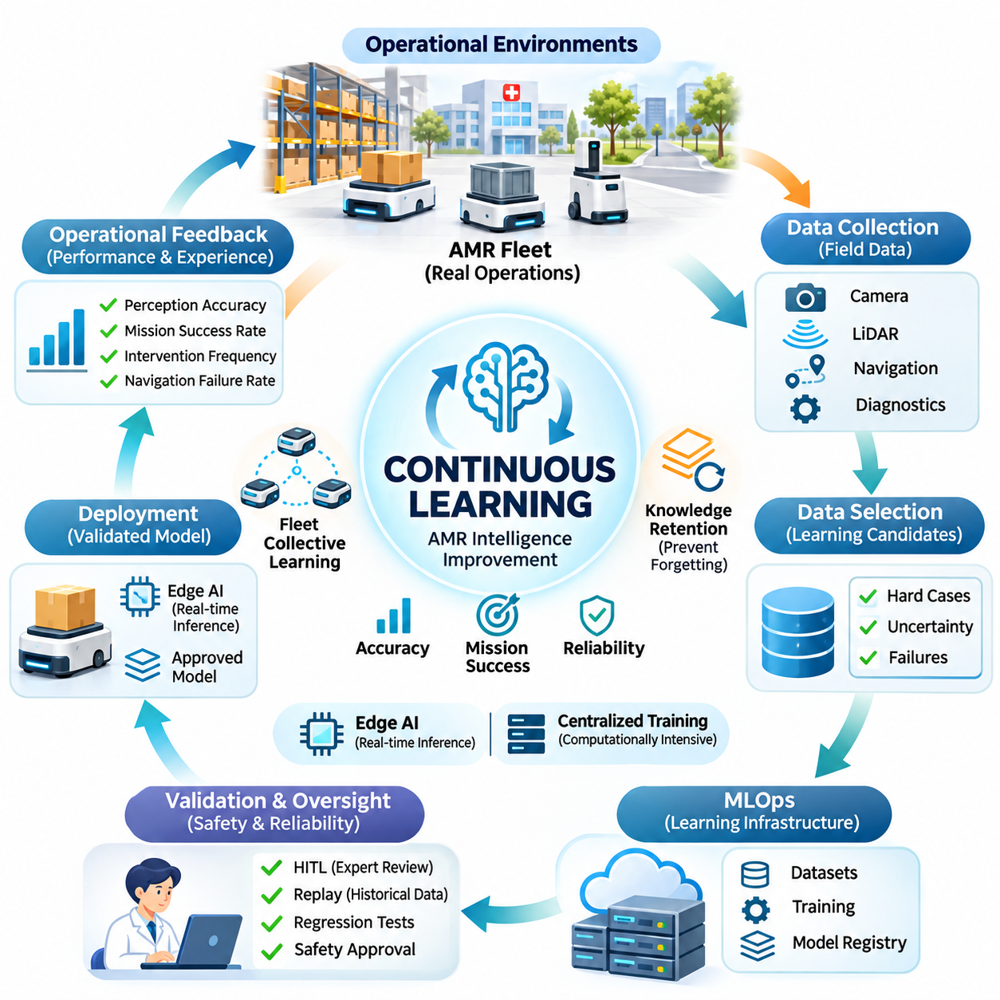
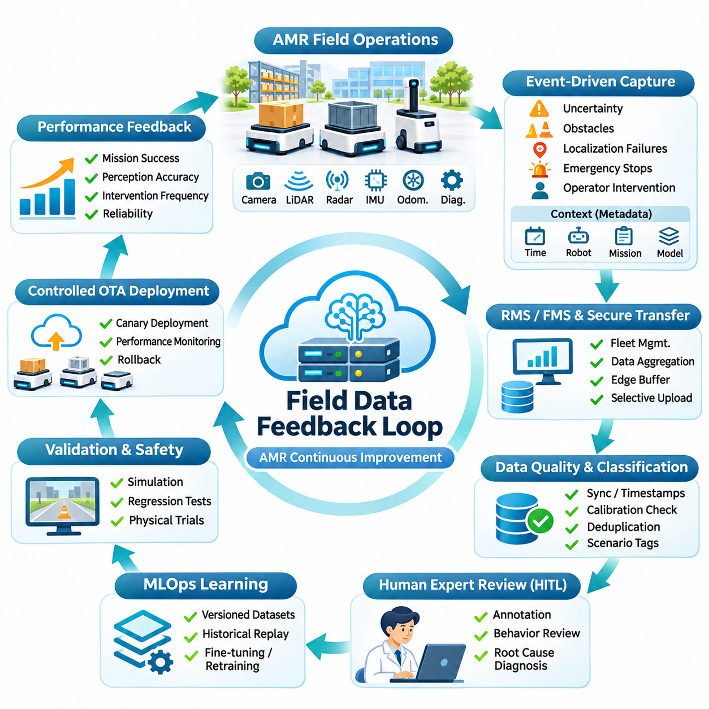
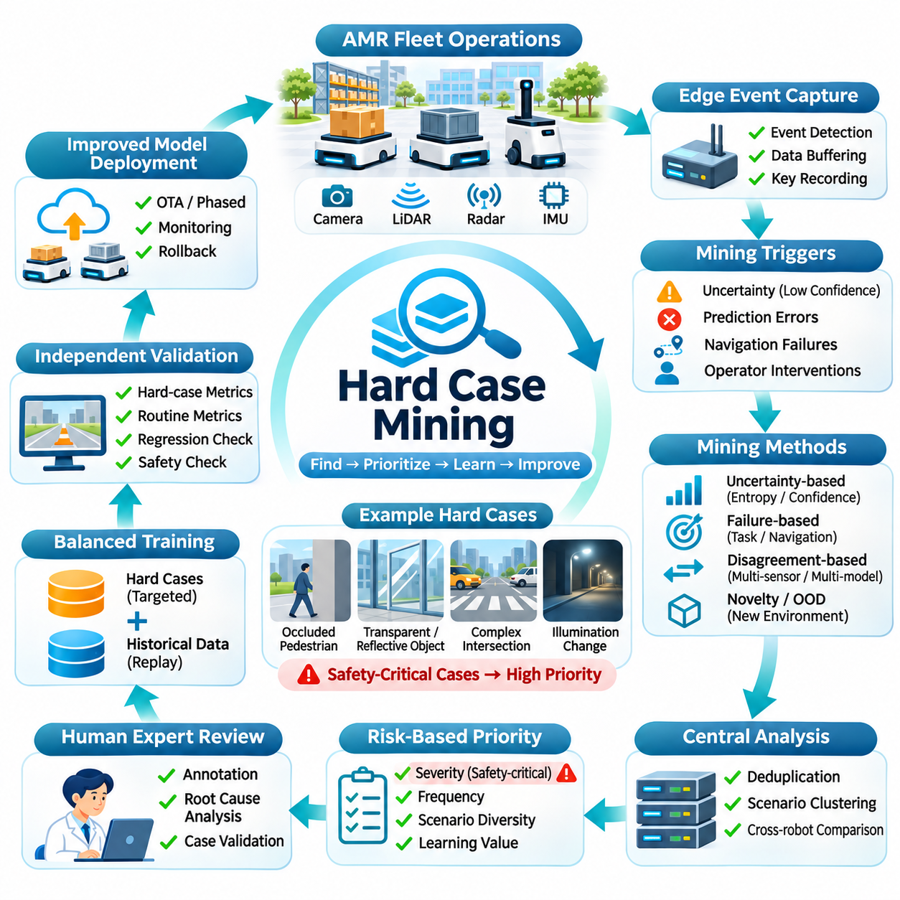
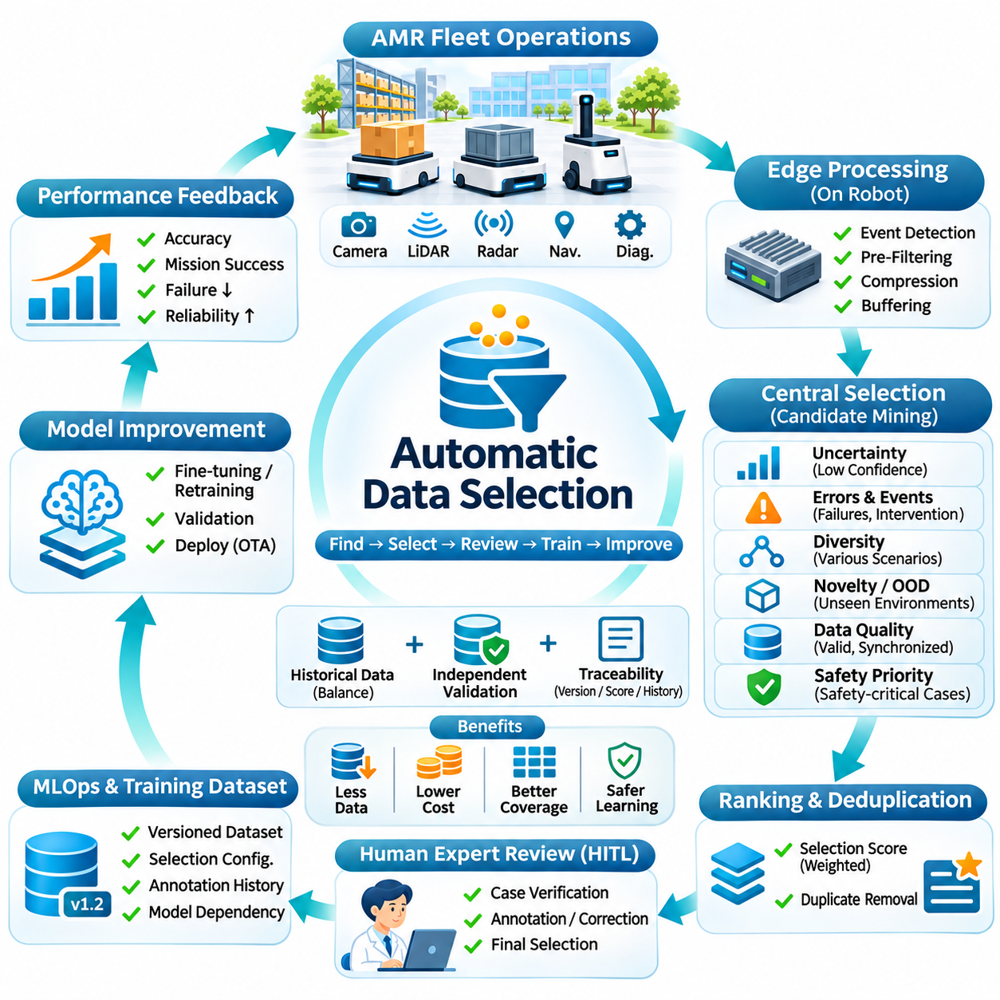
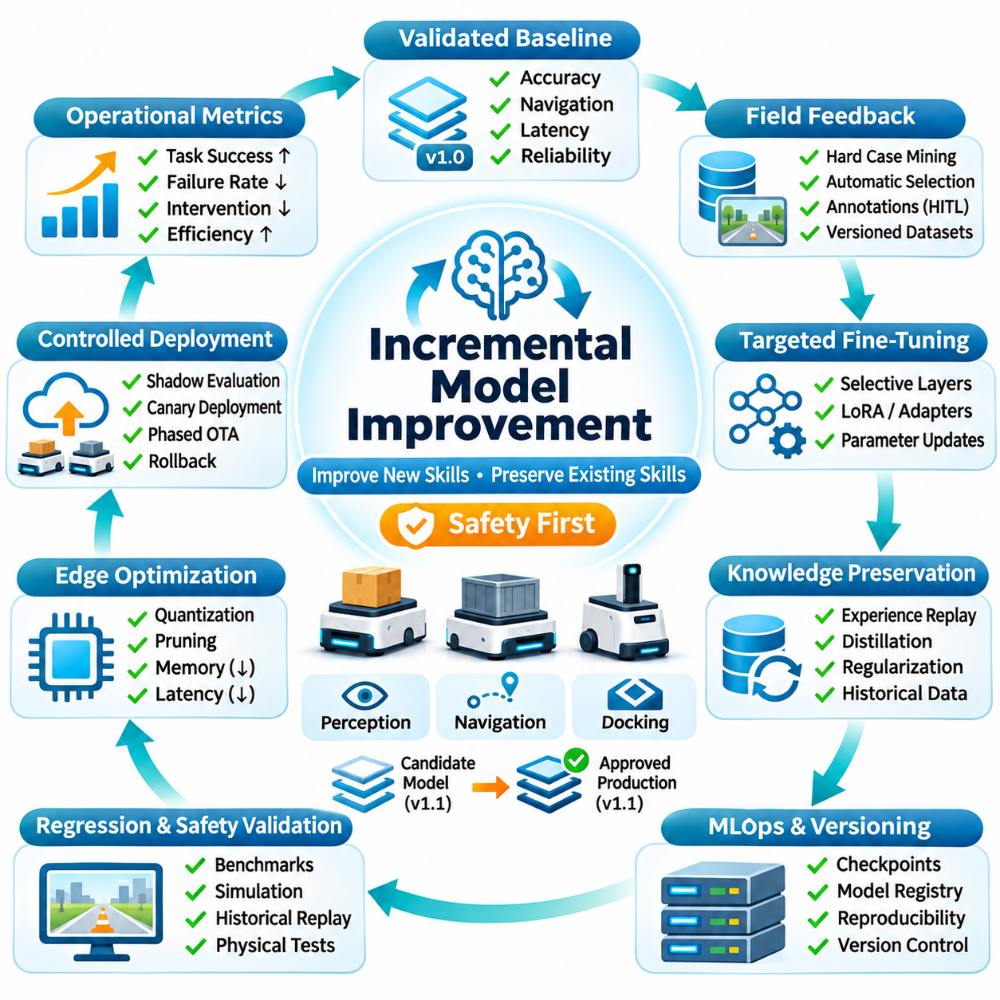
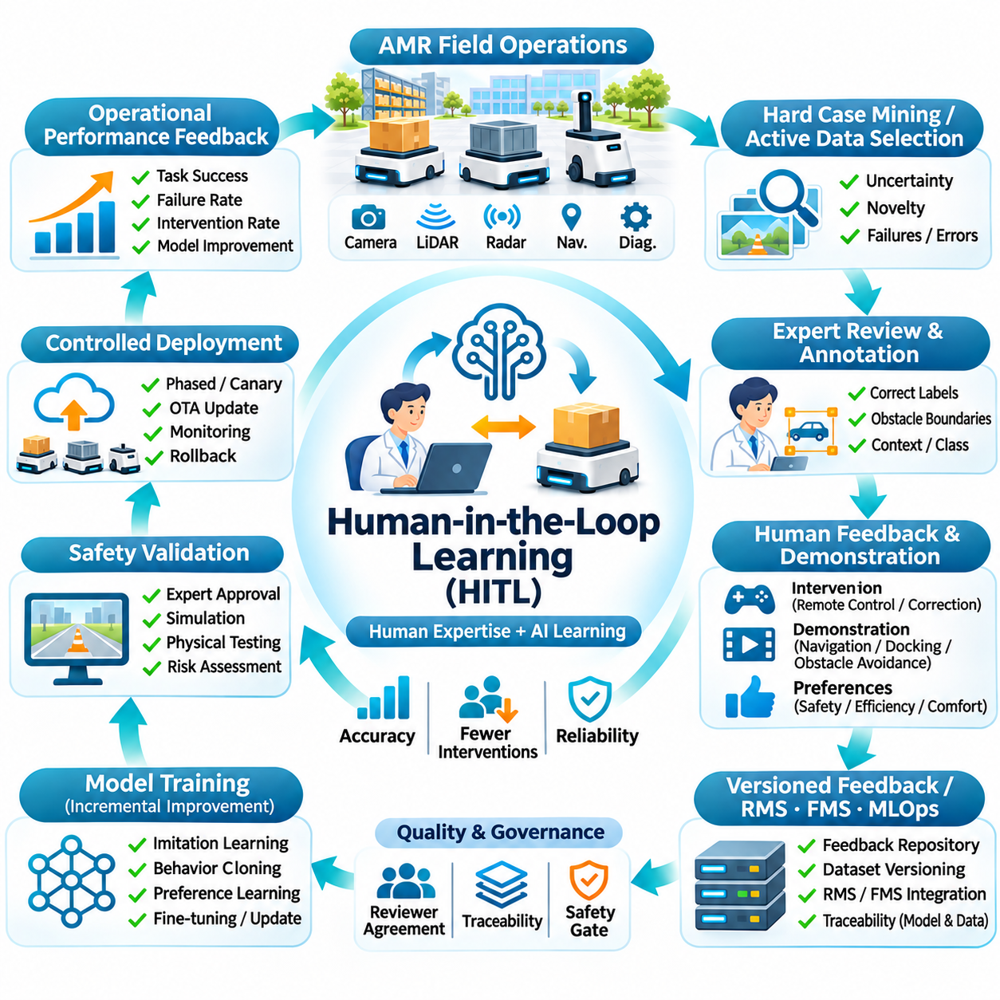
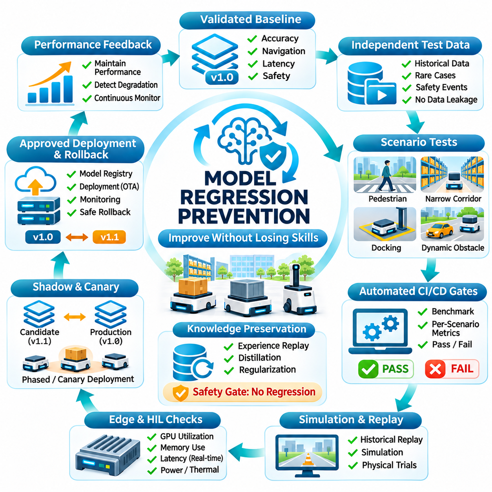
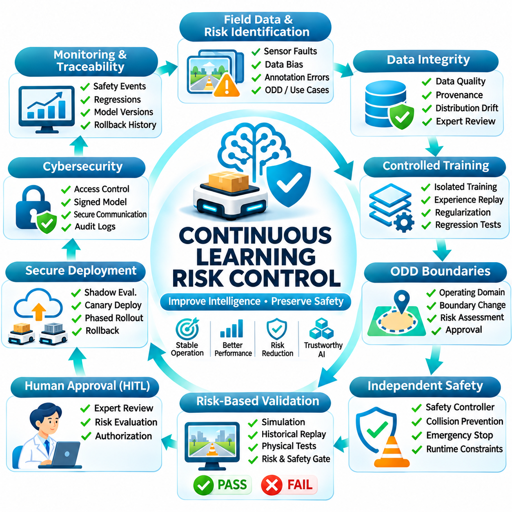

**Volume 08. AMR Operations, Deployment, and MLOps**

# Chapter 08. Continuous Learning

## 08.1 Continuous Learning Concept

{width="7.268055555555556in" height="7.268055555555556in"}

Continuous Learning is an engineering approach that enables Autonomous Mobile Robots (AMRs) to improve their intelligence, adaptability, and operational performance throughout their service lifecycle. Unlike conventional robotic systems that depend on fixed algorithms and predefined behaviors, continuously learning robots utilize operational experience, environmental observations, and performance feedback to systematically improve their artificial intelligence capabilities.

The fundamental concept of Continuous Learning is based on the recognition that real-world operating environments are dynamic and continuously evolving. Industrial facilities, hospitals, warehouses, and outdoor environments frequently experience changes in infrastructure, human activities, traffic patterns, lighting conditions, and operational requirements. AI models developed during initial engineering stages cannot fully represent every possible operational scenario.

Continuous Learning transforms robot deployment from the final stage of product development into the beginning of an ongoing intelligence improvement process. Every operational mission provides opportunities to acquire additional knowledge about environmental conditions, navigation challenges, perception failures, and human interactions. Operational experience becomes a valuable engineering resource for improving subsequent generations of robotic intelligence.

The Continuous Learning architecture establishes a closed-loop relationship between physical robot operations and AI development infrastructure. Robots collect operational data through cameras, LiDAR, radar, inertial sensors, navigation systems, and internal diagnostic interfaces. Selected information is transferred to centralized learning infrastructure, where it is processed, evaluated, and potentially incorporated into new training datasets.

An important principle of Continuous Learning is that data quantity does not necessarily determine learning effectiveness. Large volumes of repetitive operational data may contribute relatively little to model improvement. Instead, learning systems should prioritize informative observations, unusual environmental conditions, prediction errors, unexpected obstacles, navigation failures, and situations involving significant uncertainty in AI-generated decisions.

Continuous Learning can be implemented through different learning strategies, including periodic retraining, incremental learning, continual learning, active learning, and controlled online adaptation. Periodic retraining produces updated models using accumulated datasets, while incremental learning incorporates newly acquired knowledge into existing models. Active learning prioritizes informative samples that require additional evaluation or human annotation.

The integration of Continuous Learning with Machine Learning Operations (MLOps) provides the engineering infrastructure required to manage evolving AI capabilities. Dataset versioning, automated training pipelines, model registries, performance benchmarking, approval workflows, and deployment management establish a traceable learning environment. Each model improvement must be associated with identifiable training data, configurations, evaluation results, and software dependencies.

A fundamental technical challenge is maintaining previously acquired knowledge while incorporating new operational experience. AI models may experience catastrophic forgetting when optimization focuses excessively on recently collected datasets. Experience replay, representative historical datasets, knowledge distillation, and regularization techniques help preserve established capabilities while supporting adaptation to newly encountered operational conditions.

Continuous Learning also enables collective intelligence across distributed robot fleets. Individual robots encounter different environmental conditions and operational challenges, generating complementary experiences. A centralized learning infrastructure can aggregate selected information from multiple robots, improve shared AI models, and distribute validated intelligence improvements to compatible robots operating across different locations.

The relationship between Edge AI and centralized learning infrastructure is particularly important. Edge computing platforms perform real-time perception, navigation, and autonomous decision-making, while cloud or on-premises computing infrastructure generally performs computationally intensive training and validation. This separation allows deployed robots to maintain predictable operational behavior without introducing uncontrolled model modifications during active missions.

Human-in-the-Loop (HITL) learning provides an additional mechanism for improving robotic intelligence through expert knowledge and operational feedback. Field operators, technicians, safety engineers, and AI developers contribute by reviewing uncertain predictions, correcting annotations, identifying inappropriate behaviors, and evaluating exceptional situations. Human supervision remains particularly important when learning involves safety-critical operational decisions.

Safety and reliability must remain fundamental constraints throughout the Continuous Learning lifecycle. Newly trained models should not automatically replace validated production models solely because they demonstrate improved aggregate performance. Simulation, historical data replay, regression testing, controlled field trials, and formal approval processes are necessary to verify that learning improvements do not introduce unacceptable operational risks.

The effectiveness of Continuous Learning should be evaluated using measurable engineering and operational indicators. Relevant metrics include perception accuracy, mission completion rates, operator intervention frequency, navigation failure rates, environmental adaptability, and model inference latency. Learning effectiveness should also consider computational resource consumption, dataset acquisition costs, deployment stability, and long-term operational reliability.

Ultimately, Continuous Learning establishes the foundation for evolving Physical AI systems in which operational experience becomes a continuous source of intelligence improvement. By integrating field data acquisition, automated learning pipelines, collective fleet knowledge, human supervision, and controlled model deployment, AMR platforms can progressively expand their capabilities while maintaining engineering discipline, operational safety, and lifecycle sustainability.

## 08.2 Field Data Feedback Loop

{width="7.268055555555556in" height="7.268055555555556in"}

The Field Data Feedback Loop is a fundamental mechanism that connects the operational experience of Autonomous Mobile Robots (AMRs) with the continuous improvement of artificial intelligence and autonomous capabilities. It establishes a systematic engineering process through which information collected during real-world robot operations is transformed into actionable knowledge for improving perception, navigation, decision-making, and overall operational reliability.

The feedback loop begins with the acquisition of operational data from deployed robots. AMRs continuously generate information through cameras, LiDAR, radar, inertial measurement units, wheel encoders, localization systems, motion controllers, and internal diagnostic interfaces. These data sources provide comprehensive observations of environmental conditions, robot behavior, task execution results, and interactions with humans and surrounding infrastructure.

Effective field data collection requires contextual information that describes the circumstances under which particular observations were recorded. Robot identification, timestamps, geographic positions, mission identifiers, environmental conditions, software versions, AI model versions, and hardware configurations should be associated with recorded data. This contextual information enables engineers to reconstruct operational situations and identify potential causes of unexpected behavior.

Event-driven data collection is particularly important because continuously recording and transmitting all sensor information can create excessive storage, communication, and computational requirements. Robots should identify significant operational events, including perception uncertainty, localization degradation, unexpected obstacles, emergency stops, navigation failures, and operator interventions. Selected data segments surrounding these events can support detailed engineering analysis.

The Robot Management System (RMS) and Fleet Management System (FMS) provide important interfaces between distributed robotic platforms and centralized learning infrastructure. These systems aggregate operational telemetry, mission results, diagnostic information, and event notifications from multiple robots. Integration with dedicated data acquisition services allows engineering teams to identify recurring operational problems and coordinate systematic collection of relevant training samples.

Field data transmission must be designed according to available network bandwidth, operational priorities, and security requirements. High-volume sensor recordings may be temporarily stored on edge computing platforms and uploaded during charging periods or scheduled maintenance windows. Compression, selective transmission, local buffering, and resumable upload mechanisms help maintain reliable data acquisition without interfering with mission-critical communication.

Data quality management represents an essential stage of the feedback loop. Raw operational recordings may contain corrupted files, missing sensor messages, inaccurate timestamps, calibration errors, duplicated observations, or incomplete environmental information. Automated validation procedures should detect these problems before the data enters downstream processing pipelines. Reliable time synchronization and consistent data formats are particularly important for multisensor learning.

After initial validation, field data must be organized according to its engineering relevance and potential learning value. Data processing pipelines can classify observations by environmental conditions, operational scenarios, failure categories, robot configurations, and model uncertainty. This classification supports systematic dataset construction and enables engineering teams to retrieve representative examples of specific operational challenges encountered during deployment.

Human feedback provides additional information that cannot always be obtained directly from automated monitoring systems. Field operators and maintenance personnel can document unexpected robot behavior, incorrect object classifications, inefficient navigation decisions, and mission execution difficulties. Human-in-the-Loop (HITL) interfaces allow domain experts to review recorded scenarios, correct annotations, and distinguish AI limitations from hardware or infrastructure problems.

The processed field data becomes an input to Machine Learning Operations (MLOps) pipelines, where selected samples are incorporated into version-controlled training datasets. Newly acquired observations should be combined with representative historical data to preserve previously established capabilities. Depending on identified operational deficiencies, engineering teams may initiate targeted fine-tuning, incremental learning, or comprehensive model retraining.

Updated AI models must undergo systematic validation before they are returned to operational environments. Historical data replay, simulation, benchmark datasets, regression testing, and controlled physical experiments provide complementary methods for evaluating model behavior. Validation should determine whether the identified field problems have been adequately addressed without degrading previously validated performance or violating established safety requirements.

Once approved, updated models can be distributed to compatible robotic platforms through controlled Over-the-Air (OTA) deployment mechanisms. Phased deployment and canary testing allow limited groups of robots to evaluate improvements under actual operating conditions before fleet-wide adoption. Model version tracking, compatibility verification, continuous monitoring, and rollback capabilities are necessary to maintain operational stability throughout this process.

The feedback loop is completed when the operational performance of updated models is measured and compared with previous baselines. Mission completion rates, perception accuracy, localization reliability, intervention frequency, navigation efficiency, and safety-related events provide measurable evidence of learning effectiveness. Engineers should distinguish genuine model improvements from performance changes caused by different operating conditions or mission distributions.

Ultimately, the Field Data Feedback Loop transforms distributed AMR fleets into continuously evolving Physical AI systems. By establishing a recurring cycle of observation, data acquisition, quality validation, knowledge extraction, model training, performance verification, and controlled deployment, robotics organizations can systematically convert real-world operational experience into collective intelligence while maintaining safety, traceability, and long-term reliability.

## 08.3 Hard Case Mining

{width="7.268055555555556in" height="7.268055555555556in"}

Hard Case Mining is a systematic learning methodology that identifies and prioritizes challenging operational scenarios that expose weaknesses in the artificial intelligence models of Autonomous Mobile Robots (AMRs). Rather than treating all collected operational data as equally valuable, Hard Case Mining concentrates engineering and computational resources on observations that reveal prediction errors, insufficient generalization, uncertain decisions, and unexpected robot behaviors.

The fundamental motivation for Hard Case Mining originates from the imbalance between routine operational experience and exceptional situations. During normal operations, autonomous robots repeatedly encounter familiar environments, predictable obstacles, and established navigation patterns. Although these observations contribute to maintaining baseline capabilities, their additional learning value may gradually decrease as AI models become increasingly proficient at handling them.

Hard cases represent operational scenarios in which existing AI models demonstrate inadequate performance or encounter environmental conditions that differ significantly from their original training distributions. Examples include partially occluded pedestrians, transparent obstacles, reflective surfaces, unusual object geometries, unexpected vehicle movements, severe illumination changes, complex intersection scenarios, and unfamiliar terrain characteristics.

Hard Case Mining begins with the definition of measurable conditions that indicate potential learning deficiencies. Low prediction confidence, inconsistent object tracking, unexpected localization errors, excessive trajectory corrections, repeated obstacle avoidance failures, and frequent operator interventions can serve as mining triggers. These indicators should be configured according to the operational characteristics and performance requirements of each robotic platform.

Uncertainty-based mining is an important technique for identifying observations that existing AI models cannot interpret reliably. Prediction entropy, confidence distributions, ensemble disagreement, and uncertainty estimation can provide quantitative indicators of ambiguous situations. However, high-confidence incorrect predictions must also be considered because confidence-based selection alone may fail to identify significant model weaknesses.

Failure-based mining identifies operational scenarios associated with unsuccessful task execution or unexpected robotic behavior. Navigation failures, unsuccessful docking attempts, mission interruptions, localization loss, and emergency stop events provide valuable opportunities for investigating system limitations. Root cause analysis remains necessary because these failures may originate from hardware defects, infrastructure problems, or software integration issues rather than AI deficiencies.

Disagreement-based mining compares observations generated by different sensors, algorithms, or AI models operating under identical conditions. Significant discrepancies between camera-based object detection and LiDAR-based obstacle recognition may indicate challenging perception scenarios. Similarly, inconsistencies between production models and experimental shadow models can reveal potential opportunities for improving prediction accuracy and environmental understanding.

Novelty detection provides another mechanism for identifying operational experiences that are insufficiently represented within existing training datasets. Feature embeddings, similarity measurements, clustering algorithms, and out-of-distribution detection techniques can identify previously unseen environmental characteristics. These observations are particularly important when AMRs are deployed across facilities with different infrastructures, workflows, and operating conditions.

The Hard Case Mining architecture should integrate edge-level event detection with centralized data processing infrastructure. Edge computing platforms can identify candidate events and preserve relevant sensor recordings before and after each occurrence. Centralized infrastructure can subsequently perform more computationally intensive analysis, cross-robot comparisons, duplicate removal, scenario classification, and learning priority estimation.

Hard case prioritization should consider multiple engineering factors, including operational severity, occurrence frequency, model uncertainty, scenario diversity, and potential improvement value. Rare safety-critical situations may require higher priority than frequently occurring but operationally insignificant prediction errors. A structured scoring mechanism helps allocate limited annotation, storage, training, and validation resources according to measurable engineering objectives.

Human-in-the-Loop (HITL) processes remain essential for determining whether automatically identified observations represent meaningful hard cases. Domain experts can review recorded sensor information, correct inaccurate annotations, investigate contextual conditions, and distinguish systematic model deficiencies from isolated anomalies. Expert evaluation also helps prevent incorrectly classified observations from introducing misleading information into future training datasets.

Selected hard cases should be incorporated into version-controlled training datasets while maintaining an appropriate balance with representative historical observations. Excessive emphasis on difficult or exceptional samples can distort the underlying data distribution and reduce performance during routine operations. Balanced sampling, experience replay, targeted data augmentation, and controlled fine-tuning help improve difficult-case performance without compromising established capabilities.

Validation of hard case improvements requires independent evaluation datasets that represent both challenging scenarios and conventional operating conditions. Engineers should measure changes in detection accuracy, false-negative rates, navigation success, intervention frequency, and safety-related performance indicators. Evaluation samples must remain separate from training datasets to prevent data leakage and unrealistic estimates of model generalization.

Hard Case Mining becomes increasingly valuable when integrated across distributed AMR fleets. Operational difficulties encountered by individual robots can be aggregated into shared learning repositories, allowing engineering teams to identify common weaknesses and site-specific challenges. Ultimately, systematic mining, prioritization, supervised evaluation, and controlled model improvement transform exceptional operational experiences into reusable knowledge that strengthens collective Physical AI intelligence.

## 08.4 Automatic Data Selection

{width="7.268055555555556in" height="7.268055555555556in"}

Automatic Data Selection is a systematic engineering process that identifies, evaluates, and selects valuable operational data for improving the artificial intelligence capabilities of Autonomous Mobile Robots (AMRs). Rather than incorporating every recorded observation into training datasets, automated selection mechanisms prioritize information that contributes to model accuracy, environmental adaptability, operational reliability, and computational efficiency.

The primary motivation for Automatic Data Selection is the continuously increasing volume of data generated by distributed robotic platforms. Cameras, LiDAR, radar, localization systems, motion controllers, and diagnostic interfaces produce substantial amounts of information during routine operations. Processing and storing every observation would impose significant storage, communication, annotation, and computational requirements on learning infrastructure.

Automatic Data Selection requires clearly defined criteria for determining the potential learning value of individual observations. Relevant factors include model uncertainty, prediction errors, environmental novelty, scenario diversity, operational severity, and similarity to existing training samples. These selection criteria should reflect specific engineering objectives and measurable deficiencies identified within deployed AI models.

Event-based selection provides an efficient mechanism for capturing operational data associated with significant robotic behaviors. Emergency stops, unexpected obstacles, localization degradation, unsuccessful docking attempts, navigation failures, and operator interventions can trigger automatic recording. Sensor observations collected before and after these events provide contextual information for subsequent investigation and model improvement.

Uncertainty-based selection identifies observations for which AI models demonstrate insufficient prediction confidence or inconsistent decision-making. Prediction entropy, probabilistic confidence scores, ensemble disagreement, and uncertainty estimation techniques can support automated sample ranking. However, selection mechanisms should also incorporate independent validation signals to identify confidently incorrect predictions that uncertainty measurements may overlook.

Diversity-based selection ensures that training datasets contain representative examples of different operational environments and scenarios. Feature embeddings, clustering algorithms, similarity measurements, and representative sampling techniques can identify groups of related observations. Selecting representative samples from these groups reduces redundancy while preserving environmental variations, object characteristics, and operational conditions relevant to model generalization.

Novelty-based selection focuses on operational observations that differ significantly from previously acquired training data. Out-of-distribution detection, feature-space distance measurements, and statistical distribution analysis can identify unfamiliar objects, environmental structures, and robot interactions. These mechanisms become particularly valuable when AMRs are deployed in new facilities or encounter seasonal and infrastructure changes.

Automatic Data Selection must incorporate data quality assessment to prevent unsuitable observations from entering training pipelines. Corrupted recordings, missing sensor messages, inaccurate timestamps, excessive motion blur, and calibration inconsistencies can reduce learning effectiveness. Automated quality filters should distinguish technically defective recordings from challenging but valid observations that may provide important learning opportunities.

A distributed selection architecture enables computational responsibilities to be divided between edge computing platforms and centralized learning infrastructure. Edge-level processing can perform lightweight event detection, preliminary filtering, compression, and temporary buffering. Centralized infrastructure can execute advanced feature extraction, cross-fleet comparisons, duplicate detection, and comprehensive evaluation of candidate training samples.

Automatic sample prioritization can be implemented through scoring mechanisms that combine multiple indicators of learning value. Selection scores may incorporate uncertainty, novelty, diversity, data quality, safety relevance, and estimated annotation costs. Weighting factors should be adjusted according to engineering priorities, enabling the learning system to allocate available resources efficiently while preserving coverage of critical operational scenarios.

Human-in-the-Loop (HITL) processes complement automated selection by providing expert evaluation of ambiguous or safety-critical observations. Domain experts can investigate automatically selected samples, verify operational context, correct inaccurate classifications, and approve their inclusion in training datasets. Feedback from human reviewers can subsequently support improvements to the selection algorithms and reduce unnecessary annotation workloads.

Integration with Machine Learning Operations (MLOps) ensures that automatically selected data remains traceable throughout the learning lifecycle. Dataset versioning, selection algorithm configurations, sample scores, annotation histories, and model dependencies should be systematically recorded. Representative historical data and independent validation datasets must also be preserved to prevent selection bias, catastrophic forgetting, and data leakage.

The effectiveness of Automatic Data Selection should be evaluated through both computational and operational performance indicators. Relevant measurements include data reduction ratios, annotation cost savings, duplicate removal rates, scenario coverage, training efficiency, and improvements in model performance. Selection mechanisms should also be assessed for unintended biases that might exclude rare but safety-critical events or underrepresented operating environments.

Ultimately, Automatic Data Selection establishes a scalable foundation for data-centric Physical AI and continuous learning across distributed AMR fleets. By integrating intelligent filtering, uncertainty estimation, diversity preservation, novelty detection, expert supervision, and traceable dataset management, robotics organizations can transform large volumes of operational observations into high-value learning resources while maintaining safety, reliability, and lifecycle efficiency.

## 08.5 Incremental Model Improvement

{width="7.268055555555556in" height="7.268055555555556in"}

Incremental Model Improvement is an engineering methodology that enables Autonomous Mobile Robots (AMRs) to progressively enhance their artificial intelligence capabilities through successive model refinements. Instead of repeatedly developing AI models from the beginning, this approach incorporates newly acquired operational knowledge into existing models while preserving established capabilities, reducing development costs, and maintaining operational stability.

The fundamental objective of Incremental Model Improvement is to establish a sustainable relationship between operational experience and AI evolution. As robots encounter changing environments, unfamiliar objects, complex navigation scenarios, and unexpected human interactions, newly acquired observations reveal opportunities for improvement. These experiences become inputs to structured learning processes that progressively address identified model limitations.

Incremental improvement begins with the establishment of a validated baseline model that represents the current production capabilities of the robotic system. This baseline provides reference measurements for perception accuracy, navigation performance, inference latency, resource consumption, and operational reliability. Subsequent model versions must demonstrate measurable improvements against these references without introducing unacceptable performance degradation.

Field data acquired through operational feedback loops provides the foundation for successive learning iterations. Hard Case Mining and Automatic Data Selection identify observations with significant learning value, including prediction errors, environmental novelty, and insufficient model confidence. Selected observations are processed, annotated, and integrated into version-controlled datasets that support targeted improvements addressing specific operational deficiencies.

Fine-tuning is a commonly used technique for Incremental Model Improvement because it allows existing neural networks to adapt to newly acquired training data without complete retraining. Depending on the intended improvement, engineers may update selected network layers, individual prediction heads, or broader model parameters. Learning rates and optimization strategies must be carefully configured to balance adaptation with knowledge preservation.

Parameter-efficient fine-tuning methods provide additional opportunities to reduce computational requirements during incremental learning. Techniques such as Low-Rank Adaptation (LoRA), adapter modules, and selective parameter updates allow specific model capabilities to evolve while retaining most pretrained parameters. These approaches can be particularly useful when adapting large foundation models, vision-language models, and multimodal robotic intelligence systems.

Catastrophic forgetting represents a major technical challenge in incremental learning because newly acquired knowledge can unintentionally overwrite previously established capabilities. Experience replay, knowledge distillation, parameter regularization, and representative historical datasets help mitigate this problem. Training strategies should maintain an appropriate balance between newly encountered operational scenarios and previously validated environmental conditions.

Incremental improvements should be coordinated across different components of the AMR intelligence architecture. Perception models, obstacle recognition algorithms, semantic understanding systems, traversability estimators, and learning-based navigation policies may require independent improvement cycles. Modular model architectures enable targeted refinements while reducing unnecessary modifications to unrelated components and established system interfaces.

The selection of improvement objectives should reflect operational priorities rather than isolated machine learning metrics. Reducing pedestrian detection failures, improving docking reliability, recognizing previously unfamiliar obstacles, and decreasing unnecessary operator interventions can provide measurable operational benefits. Engineering teams should translate identified deficiencies into specific learning objectives and define corresponding acceptance criteria.

Integration with Machine Learning Operations (MLOps) establishes the infrastructure required to manage successive model generations. Training datasets, model checkpoints, hyperparameters, software dependencies, evaluation results, and approval histories must remain traceable. Automated training pipelines and model registries enable reproducible experiments, systematic version comparisons, and controlled progression from experimental models to approved production candidates.

Validation of incremental improvements requires comprehensive evaluation across both newly targeted scenarios and previously established operating conditions. Historical data replay, independent benchmark datasets, simulation environments, and controlled physical experiments provide complementary verification methods. Improvements in specific capabilities must not conceal reductions in overall performance, safety-related behavior, or generalization across environments.

Incrementally improved models must also satisfy the computational constraints of deployed edge computing platforms. Increases in model complexity, memory consumption, inference latency, and thermal load can negatively affect real-time robotic operations. Model compression, quantization, pruning, and hardware-aware optimization may be necessary to ensure that intelligence improvements remain compatible with available processing resources and operational timing requirements.

Controlled deployment completes each incremental improvement cycle by introducing validated models into selected robotic platforms. Shadow evaluation, canary deployment, phased rollout, continuous monitoring, and rollback mechanisms help reduce operational risks. Independent safety functions and runtime protection mechanisms must remain effective throughout model transitions, preventing unvalidated learning outcomes from directly compromising physical robot behavior.

Ultimately, Incremental Model Improvement enables distributed AMR fleets to evolve through successive generations of validated Physical AI capabilities. By integrating operational feedback, targeted learning, knowledge preservation, model optimization, systematic validation, and controlled deployment, robotics organizations can progressively accumulate collective intelligence while maintaining safety, engineering traceability, computational efficiency, and long-term operational reliability.

## 08.6 Human-in-the-Loop Learning

{width="7.268055555555556in" height="7.268055555555556in"}

Human-in-the-Loop Learning (HITL Learning) is a collaborative learning methodology that integrates human expertise, operational feedback, and artificial intelligence within the continuous improvement lifecycle of Autonomous Mobile Robots (AMRs). Rather than relying exclusively on automated learning mechanisms, this approach establishes structured human participation in data interpretation, knowledge acquisition, model refinement, and operational validation.

The fundamental motivation for Human-in-the-Loop Learning originates from the limitations of autonomous learning systems in understanding complex physical environments. AI models may encounter ambiguous observations, unfamiliar objects, exceptional operating conditions, and situations requiring contextual judgment. Human expertise provides complementary intelligence that helps resolve uncertainties and identify appropriate behavioral responses.

Human participation begins with the identification of operational situations that require expert evaluation. Hard Case Mining and Automatic Data Selection mechanisms can identify observations associated with prediction uncertainty, unexpected robot behavior, navigation failures, and operator interventions. These observations are presented to qualified personnel through dedicated review interfaces for interpretation, classification, and corrective feedback.

Human-assisted data annotation represents a fundamental component of HITL Learning. Domain experts can identify objects, correct semantic classifications, define obstacle boundaries, annotate environmental conditions, and evaluate robot interactions. High-quality annotations provide reliable supervisory information that enables AI models to improve perception accuracy, environmental understanding, and decision-making capabilities.

Active Learning provides an efficient mechanism for determining which operational observations should receive human attention. Instead of requesting annotations for every collected sample, AI systems can prioritize observations according to uncertainty, novelty, diversity, and potential learning value. This selective interaction reduces annotation workloads while directing human expertise toward the most informative and challenging operational scenarios.

Human feedback can also be acquired through direct interaction with deployed robotic systems. Remote control, manual trajectory correction, mission reassignment, and operator-assisted recovery provide valuable information about unexpected operational conditions. These interventions should be recorded together with synchronized sensor observations, robot states, environmental context, and the actions performed by human operators.

Learning from Demonstration (LfD) extends human participation beyond conventional data annotation by enabling robots to learn from demonstrated behaviors. Human operators can demonstrate appropriate navigation strategies, docking procedures, obstacle avoidance maneuvers, and task execution sequences. Imitation learning and behavior cloning techniques can transform these demonstrations into trainable policies for specific robotic applications.

Human preference learning provides additional opportunities for improving robotic decision-making in situations where multiple technically valid actions are available. Experts can compare alternative trajectories, evaluate mission execution strategies, and rank candidate behaviors according to operational efficiency, safety, and human comfort. These preferences can support reward model development and preference-based policy optimization.

The quality and consistency of human feedback must be systematically managed throughout the learning lifecycle. Different operators may interpret identical scenarios differently or provide inconsistent behavioral corrections. Standardized annotation guidelines, reviewer qualification requirements, multiple-reviewer verification, and disagreement resolution procedures help establish reliable supervisory signals and reduce human-induced learning bias.

Human-in-the-Loop Learning requires dedicated software infrastructure that connects field operations with centralized learning environments. Integration with Robot Management Systems (RMS), Fleet Management Systems (FMS), annotation platforms, and Machine Learning Operations (MLOps) pipelines enables systematic management of feedback requests, expert review workflows, dataset revisions, and subsequent model improvement activities.

Human feedback should be maintained within version-controlled learning repositories to ensure engineering traceability and reproducibility. Each feedback record should include the original observation, associated model version, operational context, reviewer information, corrective decision, and approval status. These records establish an auditable relationship between human expertise, training datasets, model modifications, and observed performance improvements.

Safety governance is particularly important when human-generated feedback influences physical robot behavior. Operator demonstrations and corrective actions must not automatically be interpreted as valid training objectives because they may contain unsafe maneuvers or procedural violations. Independent safety requirements, expert approval procedures, simulation-based validation, and controlled physical testing must precede production deployment.

The effectiveness of HITL Learning should be evaluated through measurable learning and operational performance indicators. Annotation accuracy, reviewer agreement, feedback processing time, human intervention frequency, model improvement rates, and operational failure reduction provide quantitative evaluation criteria. Successful learning should progressively reduce unnecessary human involvement without weakening essential supervisory and safety functions.

Ultimately, Human-in-the-Loop Learning establishes a sustainable relationship between human intelligence and distributed Physical AI systems. By integrating expert knowledge, active learning, corrective feedback, behavioral demonstrations, preference learning, and controlled model validation, robotics organizations can progressively transform human operational experience into collective robotic intelligence while maintaining safety, accountability, and long-term operational reliability.

## 08.7 Model Regression Prevention

{width="7.268055555555556in" height="7.268055555555556in"}

Model Regression Prevention is an essential engineering discipline that ensures successive artificial intelligence model updates do not degrade previously established capabilities of Autonomous Mobile Robots (AMRs). Within continuous learning environments, newly trained models must demonstrate measurable improvements while preserving existing performance, operational reliability, computational efficiency, and safety-related behavior across representative operating conditions.

Model regression occurs when modifications to an AI model improve selected capabilities but unintentionally reduce performance in other operational scenarios. Such degradation may result from changes in training data distributions, optimization strategies, model architectures, preprocessing algorithms, or software dependencies. Even relatively minor parameter modifications can produce significant behavioral differences when robotic systems encounter complex physical environments.

Catastrophic forgetting represents a fundamental cause of model regression during incremental learning. When existing neural networks are trained predominantly on newly acquired observations, previously learned representations may become weakened or overwritten. Experience replay, knowledge distillation, parameter regularization, and balanced historical data sampling provide complementary mechanisms for preserving established knowledge while supporting adaptation to new operational requirements.

Regression prevention begins with establishing a validated baseline model and a comprehensive collection of reference performance measurements. These references should include perception accuracy, obstacle detection reliability, navigation success rates, localization stability, inference latency, and resource consumption. Baseline measurements must remain traceable to specific model versions, hardware configurations, software environments, and operating conditions.

Regression testing requires dedicated evaluation datasets that represent both conventional operating conditions and challenging operational scenarios. Historical observations, previously resolved failure cases, rare environmental conditions, and safety-critical events should be systematically preserved within independent regression datasets. These datasets must remain isolated from training pipelines to prevent data leakage and misleading performance evaluations.

Scenario-based regression testing extends conventional model evaluation by examining robotic behavior within representative operational situations. Examples include pedestrian interactions, narrow corridor navigation, dynamic obstacle avoidance, docking procedures, crowded intersections, and degraded environmental visibility. Each scenario should incorporate measurable acceptance criteria that reflect functional requirements and established operational safety constraints.

Automated regression testing should be integrated into Machine Learning Operations (MLOps) pipelines to evaluate every candidate model before deployment approval. Continuous Integration and Continuous Delivery (CI/CD) mechanisms can execute standardized evaluation procedures, compare performance against approved baselines, and identify unacceptable deviations. Failed regression tests should prevent automatic promotion of candidate models into production environments.

Model comparison must consider performance distributions across individual operating scenarios rather than relying exclusively on aggregated accuracy measurements. An improvement in average detection performance may conceal significant degradation in recognizing pedestrians, transparent obstacles, or unfamiliar environmental structures. Scenario-specific metrics and statistical confidence intervals help identify localized regressions that aggregate performance indicators may overlook.

Simulation and historical data replay provide scalable mechanisms for evaluating model regression without immediately exposing physical robots to operational risks. Previously recorded sensor streams can be processed by candidate models under controlled conditions, while simulation environments enable systematic reproduction of complex interactions. Physical testing remains necessary to verify behaviors affected by closed-loop dynamics and real-world uncertainties.

Regression prevention must also address computational performance and compatibility with deployed edge computing platforms. Updated models may introduce increased inference latency, GPU utilization, memory consumption, power demand, or thermal loads despite improvements in prediction accuracy. Hardware-in-the-Loop (HIL) testing and sustained workload benchmarking help verify compliance with real-time processing requirements and available hardware resources.

Shadow evaluation enables candidate AI models to process real-world operational observations without directly controlling physical robot behavior. Predictions generated by candidate models can be compared with those of approved production models to identify behavioral discrepancies and potential regressions. Subsequent canary deployment within selected robotic platforms provides additional evidence before broader fleet-wide adoption.

Model version management and rollback capabilities provide essential protection against regressions that remain undetected during predeployment validation. Approved model artifacts, configuration parameters, software dependencies, and compatibility information should be maintained within controlled model registries. When operational monitoring identifies unacceptable degradation, affected robots must transition safely to a previously validated and compatible model version.

Regression prevention requires clearly defined governance procedures and measurable model acceptance thresholds. Engineering teams should establish allowable performance deviations, mandatory safety constraints, computational resource limits, and deployment approval responsibilities. Improvements in operational efficiency or prediction accuracy must not compensate for violations of mandatory safety requirements or unacceptable degradation in critical robotic functions.

Ultimately, Model Regression Prevention establishes a foundation for trustworthy continuous learning across distributed AMR fleets. By integrating knowledge preservation, independent regression datasets, automated testing, scenario-based validation, hardware verification, controlled deployment, and rollback mechanisms, robotics organizations can progressively enhance Physical AI capabilities without sacrificing previously validated knowledge, operational safety, or long-term system reliability.

## 08.8 Continuous Learning Risk Control

{width="7.268055555555556in" height="7.268055555555556in"}

Continuous Learning Risk Control is a systematic engineering discipline that ensures the progressive evolution of artificial intelligence capabilities within Autonomous Mobile Robots (AMRs) does not introduce unacceptable operational, technical, or safety-related risks. Continuous learning must therefore be governed by controlled processes that balance intelligence improvement with operational stability, engineering accountability, and predictable physical behavior.

The fundamental challenge of continuous learning in robotics originates from the relationship between AI model evolution and physical system behavior. Unlike conventional information processing systems, AMRs interact directly with humans, equipment, infrastructure, and dynamic environments. Unexpected changes in perception, environmental interpretation, or decision-making capabilities may consequently create physical hazards and disrupt established operational workflows.

Risk identification should begin with a comprehensive assessment of the continuous learning lifecycle, extending from field data acquisition to production deployment. Potential risk sources include inaccurate observations, biased datasets, incorrect annotations, inappropriate learning objectives, catastrophic forgetting, model regression, software incompatibility, unauthorized modifications, and insufficient validation of newly acquired capabilities.

Data-related risk control requires systematic monitoring of the information entering continuous learning pipelines. Automatically selected observations may contain sensor abnormalities, corrupted recordings, misleading contextual information, or unrepresentative operational scenarios. Data quality verification, dataset provenance tracking, distribution monitoring, and expert review help prevent unreliable information from negatively influencing subsequent model generations.

Learning-related risk control focuses on preventing undesirable changes in model behavior during incremental training and fine-tuning. Excessive adaptation to recent observations can reduce generalization capabilities, introduce selection bias, and weaken previously validated knowledge. Balanced dataset construction, experience replay, regularization, controlled optimization, and model regression testing provide complementary mechanisms for mitigating these risks.

Continuous learning architectures should establish clear separation between operational inference and experimental model training. Production robots should execute approved model versions, while candidate models are developed and evaluated within isolated learning environments. Autonomous parameter updates must not directly influence safety-critical robotic behavior without appropriate verification, authorization, and deployment controls.

The Operational Design Domain (ODD) provides an important framework for defining the environmental and operational boundaries within which AI models are permitted to function. Continuous learning may improve performance within established boundaries or support future operational expansion. However, extending these boundaries requires additional risk assessment, representative evaluation scenarios, and formal approval before expanded capabilities are activated.

Independent safety architectures represent an essential protection mechanism against unexpected learning-related behavior. Safety controllers, protective field monitoring, collision prevention functions, emergency stop systems, and runtime safety constraints should remain effective regardless of AI model updates. Improvements in learned intelligence must never bypass validated safety mechanisms or alter mandatory protection parameters without appropriate authorization.

Risk-based model validation should evaluate candidate models according to the severity and likelihood of potential operational failures. Safety-critical capabilities require more stringent acceptance criteria than improvements associated primarily with operational convenience or efficiency. Simulation, historical data replay, scenario-based testing, hardware verification, and controlled physical experiments provide complementary evidence for deployment decisions.

Human-in-the-Loop (HITL) governance establishes an additional layer of accountability throughout the continuous learning lifecycle. Qualified engineers and domain experts should review significant dataset changes, learning objectives, model evaluation results, and identified operational risks. Approval responsibilities and escalation procedures must be clearly defined to prevent unverified learning outcomes from entering production environments.

Controlled model deployment reduces the operational consequences of unexpected model behavior by limiting the initial exposure of newly approved capabilities. Shadow evaluation, canary deployment, phased rollout, and continuous performance monitoring enable engineering teams to identify emerging problems before fleet-wide adoption. Deployment procedures should incorporate predefined suspension criteria, safe-state transitions, and validated rollback mechanisms.

Cybersecurity risk control is particularly important because continuous learning introduces additional interfaces between robotic platforms, data repositories, training infrastructure, and model distribution systems. Data poisoning, unauthorized model replacement, malicious annotations, and compromised software dependencies can undermine robotic intelligence. Access control, cryptographic verification, secure communication, and audit logging help mitigate these threats.

Continuous learning governance should maintain comprehensive traceability across datasets, model versions, training configurations, validation results, identified risks, approval decisions, and deployment histories. Operational risk indicators, including regression frequency, unexpected interventions, safety-related events, rollback rates, and abnormal model behavior, should be continuously evaluated to determine whether established risk controls remain effective.

Ultimately, Continuous Learning Risk Control establishes the governance and engineering foundation required for trustworthy Physical AI evolution across distributed AMR fleets. By integrating data integrity, knowledge preservation, independent safety mechanisms, controlled training, systematic validation, cybersecurity, human supervision, and reversible deployment, robotics organizations can progressively accumulate collective intelligence without compromising operational safety, accountability, or long-term system reliability.
