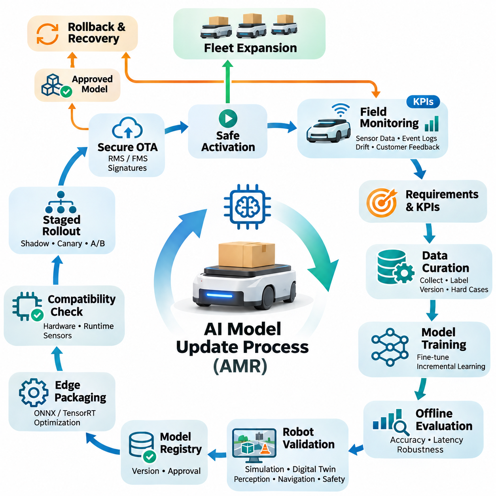
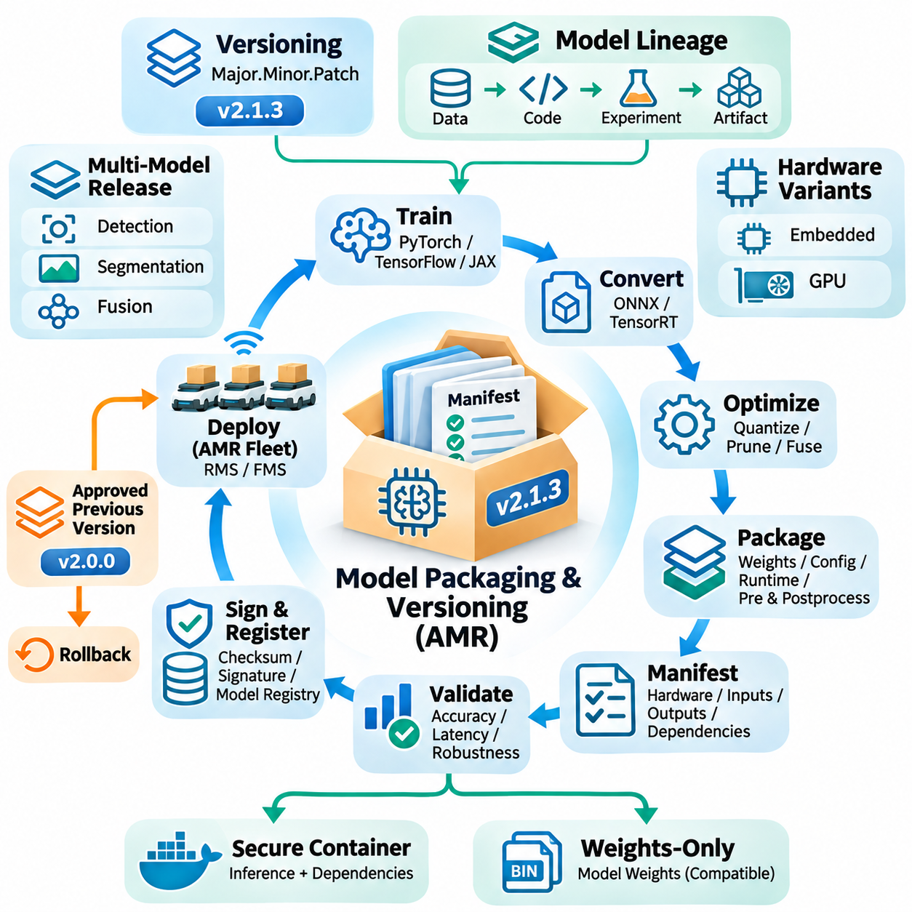
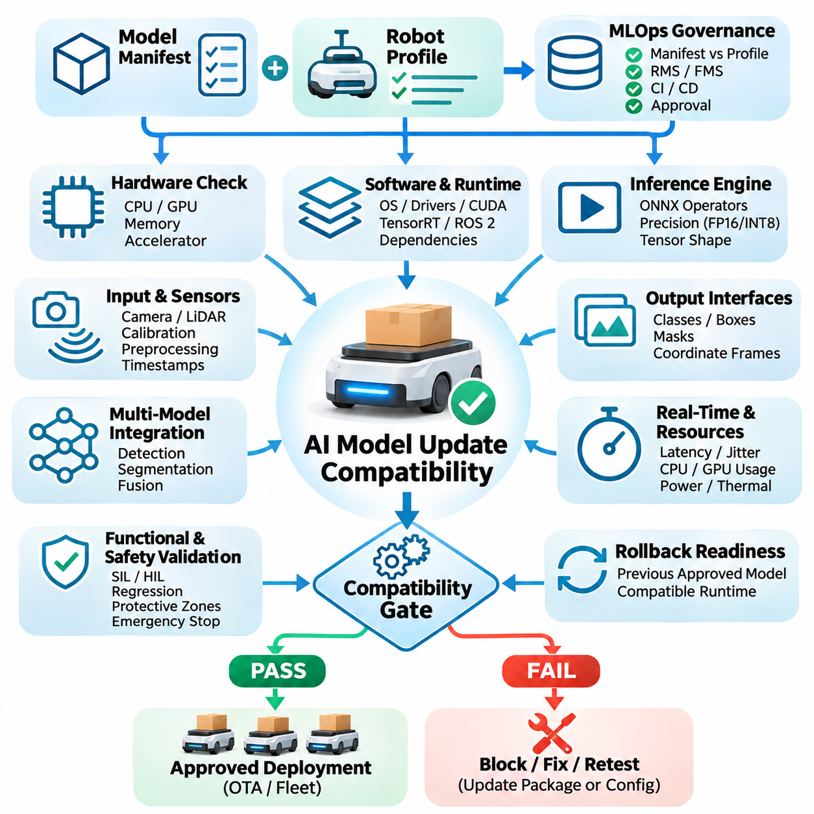
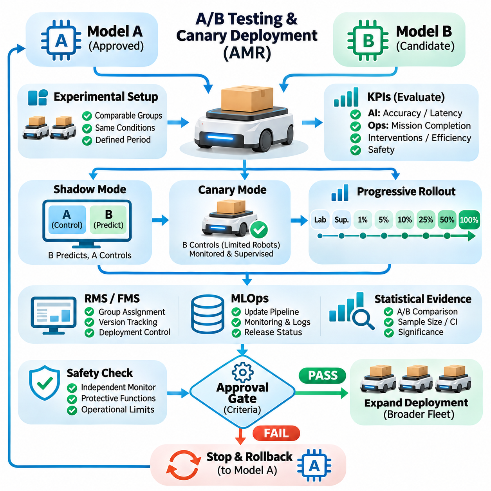
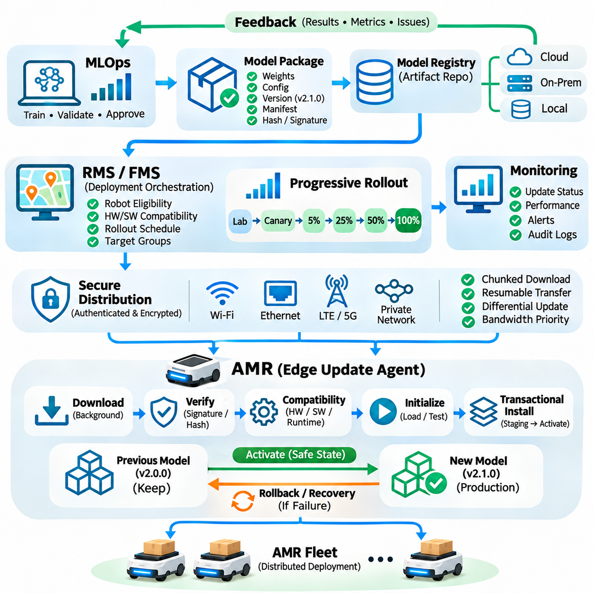
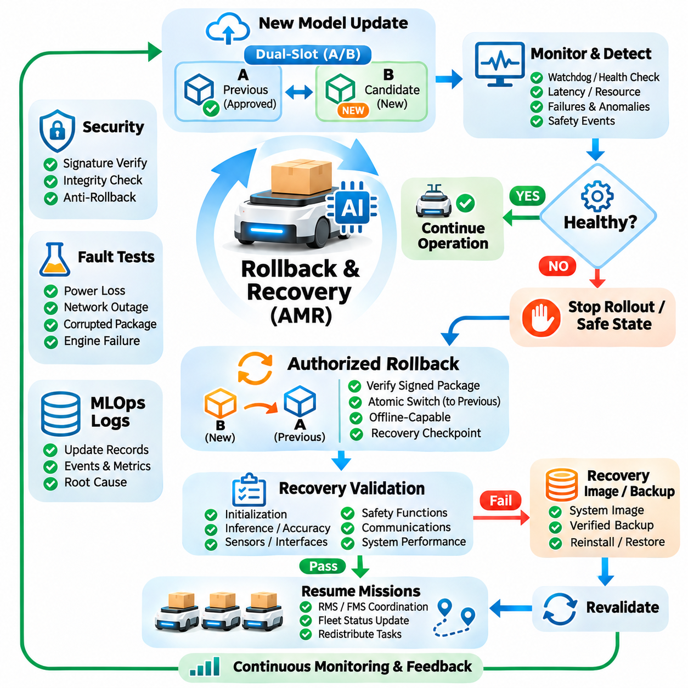
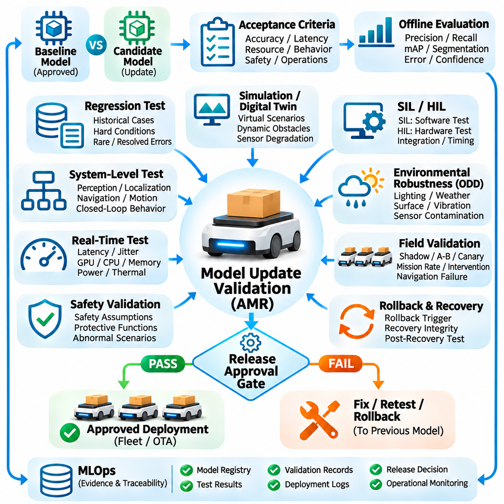
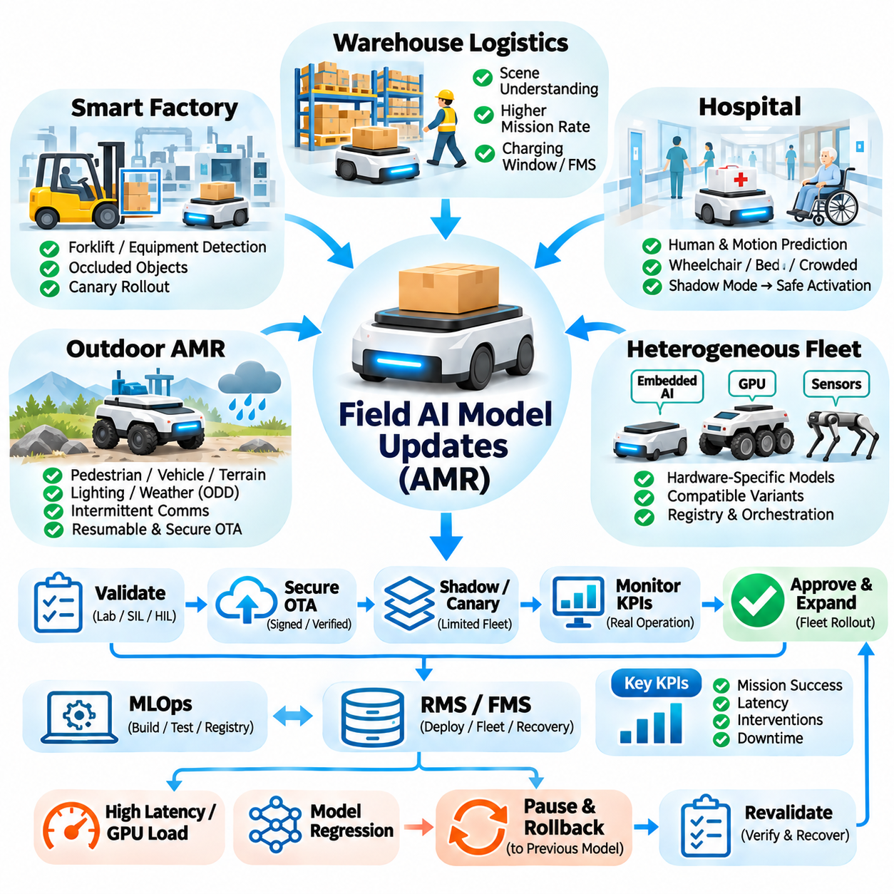

**Volume 08. AMR Operations, Deployment, and MLOps**


# Chapter 09. AI Model Update

##  

## 09.1 AI Model Update Process

{width="7.268055555555556in" height="7.268055555555556in"}

The AI model update process is a fundamental component of Autonomous Mobile Robot (AMR) operations that enables deployed robotic systems to improve their intelligence, adaptability, accuracy, and operational reliability throughout their lifecycle. Unlike conventional software updates, AI model updates require systematic management of training data, model performance, hardware compatibility, operational risks, and deployment readiness.

An effective AI model update process integrates Machine Learning Operations (MLOps), continuous learning, edge computing, and fleet management into a unified operational framework. The objective is to establish a controlled lifecycle in which newly developed AI models can be introduced into production environments without compromising robot safety, system stability, mission continuity, or customer service quality.

The update process begins with the identification of improvement requirements through continuous operational monitoring. Robots generate large volumes of sensor data, inference results, navigation records, environmental observations, and operational event logs. Analysis of these data enables engineering teams to identify performance degradation, perception errors, environmental changes, and previously unrecognized operational scenarios.

AI model update requirements may originate from data drift, model drift, customer feedback, new operational environments, additional object categories, or changes in hardware configurations. For example, an AMR operating in a logistics facility may require an updated perception model to recognize newly introduced transportation equipment, packaging materials, or dynamic obstacles that were not represented in the original training dataset.

Once update requirements have been identified, engineering teams establish measurable improvement objectives and acceptance criteria. These objectives may include higher object detection accuracy, reduced false-positive rates, improved inference latency, lower computational resource consumption, and increased mission completion rates. Each objective should be associated with baseline performance and clearly defined validation procedures.

The next stage involves collecting, selecting, filtering, and labeling relevant operational data. Data engineering pipelines should prioritize challenging scenarios, rare events, environmental diversity, and representative failure cases. Dataset versioning ensures that the relationship between training data, model architecture, training configuration, and experimental results remains traceable throughout the development lifecycle.

Model redevelopment may involve complete retraining, incremental learning, transfer learning, fine-tuning, or knowledge distillation, depending on the characteristics of the identified improvement requirements. Engineering teams must balance the acquisition of new capabilities against the preservation of existing knowledge. Particular attention should be given to catastrophic forgetting, overfitting, and unintended behavioral changes.

Newly trained models undergo offline evaluation using independent validation datasets and standardized benchmarking procedures. Evaluation should consider task-specific accuracy, precision, recall, robustness, inference latency, GPU utilization, memory consumption, and energy efficiency. Performance improvements must be demonstrated across representative operating conditions rather than relying exclusively on aggregated accuracy metrics.

Robot-specific validation is particularly important because AI inference directly influences physical behavior. A perception model may achieve higher detection accuracy while introducing excessive processing latency that negatively affects obstacle avoidance. Therefore, model validation must evaluate interactions among perception, localization, navigation, behavior planning, motion control, and independent functional safety mechanisms.

Simulation and digital twin environments provide an additional validation layer before physical deployment. Candidate models can be exposed to virtual environments containing dynamic obstacles, sensor degradation, unusual lighting, communication interruptions, and abnormal operating conditions. Recorded field data can also be replayed to compare candidate model outputs against existing production models under reproducible conditions.

Following technical validation, the candidate model is registered in a centralized model registry. Each registered model should contain a unique version identifier, training dataset references, model architecture information, evaluation results, runtime dependencies, supported hardware configurations, approval status, and deployment restrictions. This information establishes traceability and supports controlled release management.

Model packaging prepares the approved AI model for execution within the target edge computing environment. Depending on the robot architecture, models may be converted into optimized formats such as ONNX or TensorRT engines. Quantization, computational graph optimization, and hardware-specific acceleration may be applied, provided that their impact on model accuracy, numerical stability, and operational performance has been validated.

Before distribution, compatibility verification confirms that the model is compatible with the target robot\'s processor architecture, GPU resources, operating system, inference runtime, sensor configuration, and software interfaces. Compatibility checks must also address input preprocessing, output interpretation, coordinate systems, sensor calibration, and real-time processing requirements to prevent integration failures.

The approved update should initially be deployed to a limited number of representative robots through a controlled release strategy. Shadow deployment allows the candidate model to generate inference results without controlling physical robot behavior, while canary deployment introduces the approved model into a restricted production environment. A/B testing may then support comparisons with the existing production model.

Over-the-Air (OTA) infrastructure enables secure distribution of AI model packages across geographically distributed robot fleets. The Robot Management System (RMS) and Fleet Management System (FMS) coordinate deployment schedules, device eligibility, mission availability, and update status. Digital signatures, integrity verification, authenticated communication, and access control protect the distribution process.

Model activation should occur only when the robot reaches an approved operational state, such as a maintenance window, designated parking location, or completed mission. The update mechanism should support transactional installation, interrupted transfer recovery, initialization checks, and preservation of the previous verified model. Unvalidated model replacement during active autonomous operation should be avoided.

Post-deployment monitoring evaluates actual field performance against established operational baselines and acceptance thresholds. Relevant indicators include perception failure rates, inference latency, navigation interruptions, emergency stops, operator interventions, mission completion rates, and resource consumption. Abnormal trends should trigger investigation, suspension of further deployment, or controlled recovery.

Rollback and recovery mechanisms are essential for maintaining operational continuity when unexpected model behavior occurs. The system should retain a compatible, previously approved model and provide mechanisms for restoring its configuration. Periodic recovery testing verifies that model restoration can be completed reliably without introducing inconsistent software states or compromising independent safety functions.

After successful field validation, the update can be progressively expanded across eligible robots, customer sites, and operational environments. Deployment records, approval decisions, performance comparisons, and field observations should be preserved for auditing and future engineering activities. This closed-loop process transforms AI model updates into a sustainable mechanism for continuous intelligence improvement across AMR fleets.

AI 모델 업데이트 프로세스(AI Model Update Process)는 배포된 로봇 시스템이 전체 수명주기(Lifecycle)에 걸쳐 지능(Intelligence), 적응성(Adaptability), 정확도(Accuracy) 및 운영 신뢰성(Operational Reliability)을 지속적으로 향상할 수 있도록 하는 자율이동로봇(Autonomous Mobile Robot, AMR) 운영의 핵심 구성 요소이다. 기존의 소프트웨어 업데이트(Software Update)와 달리 AI 모델 업데이트는 학습 데이터(Training Data), 모델 성능(Model Performance), 하드웨어 호환성(Hardware Compatibility), 운영 위험(Operational Risk) 및 배포 준비 상태(Deployment Readiness)에 대한 체계적인 관리를 요구한다.

효과적인 AI 모델 업데이트 프로세스는 머신러닝 운영(Machine Learning Operations, MLOps), 지속적 학습(Continuous Learning), 엣지 컴퓨팅(Edge Computing) 및 로봇 군집 관리(Fleet Management)를 통합된 운영 프레임워크(Operational Framework)로 구성한다. 주요 목적은 로봇 안전성(Robot Safety), 시스템 안정성(System Stability), 임무 연속성(Mission Continuity) 또는 고객 서비스 품질(Customer Service Quality)을 저해하지 않으면서 새롭게 개발된 AI 모델을 실제 운영 환경(Production Environment)에 도입할 수 있는 통제된 수명주기를 구축하는 것이다.

업데이트 프로세스는 지속적인 운영 모니터링(Operational Monitoring)을 통해 개선 요구사항(Improvement Requirements)을 식별하는 단계에서 시작된다. 로봇은 대량의 센서 데이터(Sensor Data), 추론 결과(Inference Results), 자율주행 기록(Navigation Records), 환경 관측 정보(Environmental Observations) 및 운영 이벤트 로그(Operational Event Logs)를 생성한다. 이러한 데이터를 분석함으로써 엔지니어링 팀은 성능 저하(Performance Degradation), 인식 오류(Perception Errors), 환경 변화(Environmental Changes) 및 이전에 인식되지 않았던 운영 시나리오(Operational Scenarios)를 식별할 수 있다.

AI 모델 업데이트 요구사항은 데이터 변동(Data Drift), 모델 변동(Model Drift), 고객 피드백(Customer Feedback), 새로운 운영 환경(New Operational Environments), 추가적인 객체 분류(Object Categories) 또는 하드웨어 구성(Hardware Configuration)의 변화로부터 발생할 수 있다. 예를 들어 물류시설(Logistics Facility)에서 운영되는 AMR은 기존 학습 데이터셋(Training Dataset)에 포함되지 않았던 신규 운송 장비, 포장재 또는 동적 장애물(Dynamic Obstacles)을 인식하기 위해 업데이트된 인식 모델(Perception Model)을 필요로 할 수 있다.

업데이트 요구사항이 식별되면 엔지니어링 팀은 측정 가능한 개선 목표(Improvement Objectives)와 인수 기준(Acceptance Criteria)을 수립한다. 이러한 목표에는 객체 검출 정확도(Object Detection Accuracy) 향상, 오탐률(False-Positive Rate) 감소, 추론 지연시간(Inference Latency) 개선, 컴퓨팅 자원 소비(Computational Resource Consumption) 감소 및 임무 완료율(Mission Completion Rate) 향상 등이 포함될 수 있다. 각각의 목표는 기준 성능(Baseline Performance) 및 명확하게 정의된 검증 절차(Validation Procedures)와 연계되어야 한다.

다음 단계에서는 관련 운영 데이터(Operational Data)를 수집(Collection), 선별(Selection), 필터링(Filtering) 및 라벨링(Labeling)한다. 데이터 엔지니어링 파이프라인(Data Engineering Pipeline)은 처리하기 어려운 시나리오(Challenging Scenarios), 희귀 이벤트(Rare Events), 환경적 다양성(Environmental Diversity) 및 대표적인 실패 사례(Failure Cases)를 우선적으로 고려해야 한다. 데이터셋 버전 관리(Dataset Versioning)는 학습 데이터, 모델 아키텍처(Model Architecture), 학습 구성(Training Configuration) 및 실험 결과(Experimental Results) 간의 관계가 전체 개발 수명주기에서 추적 가능하도록 보장한다.

모델 재개발(Model Redevelopment)은 식별된 개선 요구사항의 특성에 따라 전체 재학습(Complete Retraining), 점진적 학습(Incremental Learning), 전이 학습(Transfer Learning), 미세 조정(Fine-Tuning) 또는 지식 증류(Knowledge Distillation)를 통해 수행될 수 있다. 엔지니어링 팀은 새로운 기능의 확보와 기존 지식의 보존(Knowledge Preservation) 사이에서 균형을 유지해야 한다. 특히 파국적 망각(Catastrophic Forgetting), 과적합(Overfitting) 및 의도하지 않은 행동 변화(Unintended Behavioral Changes)에 각별한 주의를 기울여야 한다.

새롭게 학습된 모델은 독립적인 검증 데이터셋(Validation Dataset)과 표준화된 벤치마킹 절차(Standardized Benchmarking Procedures)를 활용하여 오프라인 평가(Offline Evaluation)를 수행한다. 평가 항목에는 작업별 정확도(Task-Specific Accuracy), 정밀도(Precision), 재현율(Recall), 강건성(Robustness), 추론 지연시간(Inference Latency), GPU 사용률(GPU Utilization), 메모리 소비량(Memory Consumption) 및 에너지 효율성(Energy Efficiency)이 포함되어야 한다. 성능 개선은 단순히 종합 정확도 지표(Aggregated Accuracy Metrics)에 의존하기보다 대표적인 운영 조건에서 입증되어야 한다.

AI 추론(AI Inference)은 로봇의 물리적 행동(Physical Behavior)에 직접적인 영향을 미치므로 로봇 특화 검증(Robot-Specific Validation)은 특히 중요하다. 인식 모델이 더 높은 검출 정확도(Detection Accuracy)를 달성하더라도 과도한 처리 지연시간(Processing Latency)이 발생하여 장애물 회피(Obstacle Avoidance)에 부정적인 영향을 미칠 수 있다. 따라서 모델 검증은 인식(Perception), 위치 추정(Localization), 자율주행(Navigation), 행동 계획(Behavior Planning), 모션 제어(Motion Control) 및 독립적인 기능 안전 메커니즘(Functional Safety Mechanisms) 간의 상호작용을 평가해야 한다.

시뮬레이션(Simulation) 및 디지털 트윈(Digital Twin) 환경은 실제 배포 이전에 추가적인 검증 계층(Validation Layer)을 제공한다. 후보 모델(Candidate Model)은 동적 장애물(Dynamic Obstacles), 센서 성능 저하(Sensor Degradation), 비정상적인 조명(Unusual Lighting), 통신 중단(Communication Interruptions) 및 비정상 운영 조건(Abnormal Operating Conditions)을 포함하는 가상 환경(Virtual Environment)에서 평가될 수 있다. 기록된 현장 데이터(Field Data)를 재생(Data Replay)하여 재현 가능한 조건에서 후보 모델과 기존 운영 모델(Production Model)의 출력 결과를 비교할 수도 있다.

기술적 검증(Technical Validation)이 완료되면 후보 모델은 중앙집중형 모델 레지스트리(Centralized Model Registry)에 등록된다. 등록된 각각의 모델에는 고유 버전 식별자(Unique Version Identifier), 학습 데이터셋 참조 정보, 모델 아키텍처 정보, 평가 결과(Evaluation Results), 실행환경 의존성(Runtime Dependencies), 지원 하드웨어 구성, 승인 상태(Approval Status) 및 배포 제한사항(Deployment Restrictions)이 포함되어야 한다. 이러한 정보는 추적성(Traceability)을 확보하고 통제된 릴리스 관리(Controlled Release Management)를 지원한다.

모델 패키징(Model Packaging)은 승인된 AI 모델이 대상 엣지 컴퓨팅 환경(Target Edge Computing Environment)에서 실행될 수 있도록 준비하는 과정이다. 로봇 아키텍처에 따라 모델은 ONNX 또는 TensorRT 엔진(TensorRT Engine)과 같은 최적화된 형식으로 변환될 수 있다. 모델 정확도(Model Accuracy), 수치적 안정성(Numerical Stability) 및 운영 성능(Operational Performance)에 미치는 영향이 검증된 경우 양자화(Quantization), 연산 그래프 최적화(Computational Graph Optimization) 및 하드웨어 특화 가속(Hardware-Specific Acceleration)을 적용할 수 있다.

모델 배포 이전에는 호환성 검증(Compatibility Verification)을 통해 해당 모델이 대상 로봇의 프로세서 아키텍처(Processor Architecture), GPU 자원(GPU Resources), 운영체제(Operating System), 추론 실행환경(Inference Runtime), 센서 구성(Sensor Configuration) 및 소프트웨어 인터페이스(Software Interfaces)와 호환되는지 확인해야 한다. 또한 시스템 통합 실패(Integration Failure)를 방지하기 위해 입력 전처리(Input Preprocessing), 출력 해석(Output Interpretation), 좌표계(Coordinate Systems), 센서 보정(Sensor Calibration) 및 실시간 처리 요구사항(Real-Time Processing Requirements)도 검증해야 한다.

승인된 업데이트는 통제된 릴리스 전략(Controlled Release Strategy)을 통해 제한된 수의 대표 로봇에 우선적으로 배포되어야 한다. 섀도 배포(Shadow Deployment)는 후보 모델이 로봇의 물리적 행동을 제어하지 않으면서 추론 결과를 생성할 수 있도록 하며, 카나리 배포(Canary Deployment)는 승인된 모델을 제한된 실제 운영 환경에 도입하는 방식이다. 이후 A/B 테스트(A/B Testing)를 활용하여 기존 운영 모델과 새로운 모델 간의 성능 비교를 수행할 수 있다.

무선 업데이트(Over-the-Air, OTA) 인프라는 지리적으로 분산된 로봇 군집(Robot Fleet)에 AI 모델 패키지를 안전하게 배포할 수 있도록 지원한다. 로봇 관리 시스템(Robot Management System, RMS)과 군집 관리 시스템(Fleet Management System, FMS)은 배포 일정(Deployment Schedule), 장치별 업데이트 적격성(Device Eligibility), 임무 수행 가능 상태(Mission Availability) 및 업데이트 상태(Update Status)를 조정한다. 디지털 서명(Digital Signature), 무결성 검증(Integrity Verification), 인증된 통신(Authenticated Communication) 및 접근 제어(Access Control)는 모델 배포 프로세스를 보호한다.

모델 활성화(Model Activation)는 로봇이 유지보수 시간대(Maintenance Window), 지정된 주차 위치(Designated Parking Location) 또는 임무 완료 상태(Completed Mission)와 같은 승인된 운영 상태에 도달했을 때만 수행되어야 한다. 업데이트 메커니즘(Update Mechanism)은 트랜잭션 기반 설치(Transactional Installation), 전송 중단 복구(Interrupted Transfer Recovery), 초기화 검사(Initialization Checks) 및 기존 검증 모델의 보존을 지원해야 한다. 자율운영(Autonomous Operation)이 진행되는 동안 검증되지 않은 모델로 교체하는 행위는 방지해야 한다.

배포 후 모니터링(Post-Deployment Monitoring)은 사전에 수립된 운영 기준 성능(Operational Baseline) 및 인수 임계값(Acceptance Thresholds)을 기반으로 실제 현장 성능(Field Performance)을 평가한다. 주요 지표에는 인식 실패율(Perception Failure Rate), 추론 지연시간, 자율주행 중단(Navigation Interruptions), 비상 정지(Emergency Stop), 운영자 개입(Operator Intervention), 임무 완료율 및 자원 소비량(Resource Consumption)이 포함된다. 비정상적인 성능 추세(Abnormal Trends)가 발견되면 원인 조사, 추가 배포 중단 또는 통제된 복구(Controlled Recovery)가 수행되어야 한다.

롤백 및 복구 메커니즘(Rollback and Recovery Mechanisms)은 예상하지 못한 모델 동작이 발생했을 때 운영 연속성(Operational Continuity)을 유지하기 위한 필수 요소이다. 시스템은 호환성이 확보된 이전 승인 모델을 유지하고 해당 모델의 구성을 복원할 수 있는 메커니즘을 제공해야 한다. 주기적인 복구 시험(Periodic Recovery Testing)을 통해 소프트웨어 상태 불일치(Inconsistent Software States)를 유발하거나 독립적인 안전 기능(Independent Safety Functions)을 저해하지 않으면서 모델 복원(Model Restoration)이 안정적으로 완료될 수 있는지 검증해야 한다.

현장 검증(Field Validation)이 성공적으로 완료되면 업데이트는 배포 적격성이 확보된 로봇, 고객 사업장(Customer Sites) 및 다양한 운영 환경으로 점진적으로 확대될 수 있다. 배포 기록(Deployment Records), 승인 결정(Approval Decisions), 성능 비교(Performance Comparisons) 및 현장 관측 결과(Field Observations)는 감사(Audit)와 향후 엔지니어링 활동을 위해 체계적으로 보존되어야 한다. 이러한 폐루프 프로세스(Closed-Loop Process)는 AI 모델 업데이트를 전체 AMR 군집의 지속적인 지능 향상(Continuous Intelligence Improvement)을 실현하는 지속 가능한 운영 메커니즘(Sustainable Operational Mechanism)으로 발전시킨다.

##  

## 09.2 Model Packaging and Versioning

{width="7.268055555555556in" height="7.268055555555556in"}

Model packaging and versioning are essential components of the AI model update process for Autonomous Mobile Robots (AMRs). They establish a standardized framework for preparing, identifying, distributing, executing, and maintaining AI models throughout the operational lifecycle. Effective packaging and version management ensure that AI models remain reproducible, traceable, compatible, and reliable across distributed robotic platforms.

Model packaging is the process of transforming a trained AI model into a deployable software artifact that can operate within a target computing environment. A complete model package typically contains model weights, network architecture, configuration files, preprocessing and postprocessing functions, runtime dependencies, and deployment metadata. These components collectively define the expected execution behavior of the model.

In AMR systems, AI models may support object detection, semantic segmentation, obstacle recognition, terrain classification, anomaly detection, localization, and autonomous decision-making. Each model may have different computational requirements, input formats, output structures, and execution frequencies. Model packaging must accommodate these characteristics while maintaining standardized integration interfaces with the robot software architecture.

During the development stage, AI models are commonly implemented using machine learning frameworks such as PyTorch, TensorFlow, or JAX. However, models developed within training environments are not necessarily optimized for production execution. Model conversion transforms trained models into deployment-oriented representations such as Open Neural Network Exchange (ONNX), TensorRT engines, or other hardware-specific inference formats.

Model optimization is frequently performed during the packaging process to improve inference efficiency and reduce computational resource requirements. Techniques such as quantization, pruning, operator fusion, graph optimization, and hardware acceleration can reduce memory consumption and inference latency. Nevertheless, optimized models must undergo additional validation because numerical transformations may affect prediction accuracy and robustness.

Hardware-specific packaging is particularly important for heterogeneous AMR fleets operating with different processors and AI accelerators. Entry-level robots may utilize embedded computing platforms, while advanced robots may incorporate multiple high-performance GPUs. Packaging strategies should support hardware-specific model variants without compromising consistency in functional requirements, software interfaces, and validated operational behavior.

Model packages should include a structured manifest describing their contents and deployment requirements. The manifest typically specifies the model identifier, version number, supported hardware, inference runtime, input dimensions, output schema, computational precision, memory requirements, and dependency versions. This metadata enables automated deployment systems to evaluate model eligibility before installation and activation.

Model versioning establishes a systematic mechanism for identifying and tracking individual AI model releases. Each model version should be associated with its architecture, training dataset, source code revision, hyperparameters, optimization settings, and validation results. Immutable version identifiers prevent accidental replacement of approved artifacts and allow engineering teams to reproduce historical configurations when investigating operational failures.

Semantic versioning can provide a practical foundation for AI model release management. Major versions may represent significant architectural or interface changes, minor versions may introduce additional capabilities or measurable performance improvements, and patch versions may address limited defects. However, every release must undergo appropriate validation because even a small change in model weights can significantly influence physical robot behavior.

A centralized model registry provides the infrastructure required to manage AI model packages and their associated versions. Model registries maintain artifact locations, development histories, evaluation metrics, approval records, deployment restrictions, and lifecycle status. Platforms such as MLflow or enterprise artifact repositories can support integration between model development pipelines, validation environments, and production deployment infrastructure.

Model lineage management establishes relationships among training datasets, source code, experimental configurations, trained weights, optimized artifacts, and deployed versions. This traceability enables engineers to determine precisely how a particular model was developed and which operational robots are currently executing it. Dataset hashes, source control commit identifiers, artifact checksums, and experiment tracking records strengthen reproducibility.

Security must be incorporated into the model packaging and versioning framework. AI model packages should be protected through cryptographic checksums, digital signatures, authenticated repositories, and role-based access control. Dependency inventories and software bills of materials can support vulnerability management. Robots must verify package authenticity and integrity before installation to prevent unauthorized model substitution or manipulation.

Containerization provides an effective approach to packaging inference services together with their software dependencies. Docker containers can encapsulate inference runtimes, supporting libraries, model artifacts, and execution configurations within standardized environments. Alternatively, frequently updated model weights may be distributed independently from container images when their compatibility with the existing inference service has been verified.

Version management must extend beyond individual AI models to encompass complete multi-model configurations. An AMR may simultaneously execute object detection, semantic segmentation, depth estimation, sensor fusion, and behavior prediction models. A system-level release manifest should identify compatible combinations of model versions, preprocessing modules, sensor configurations, and software components to prevent inconsistent operational behavior.

The Robot Management System (RMS) and Fleet Management System (FMS) should maintain visibility into the model versions installed and actively executing on individual robots. Deployment records should distinguish downloaded, installed, validated, active, and previously approved model versions. This information supports controlled fleet updates, configuration auditing, operational troubleshooting, and systematic recovery when a newly deployed model exhibits unexpected behavior.

A well-designed packaging architecture should preserve previous approved model packages and their corresponding runtime configurations. Retaining these artifacts enables reliable rollback when deployment failures, compatibility problems, or performance degradation occur. Ultimately, standardized model packaging and versioning establish the technical foundation for secure AI distribution, continuous learning, reproducible engineering, and sustainable intelligence improvement across industrial AMR fleets.

모델 패키징 및 버전 관리(Model Packaging and Versioning)는 자율이동로봇(Autonomous Mobile Robot, AMR)의 AI 모델 업데이트 프로세스(AI Model Update Process)를 구성하는 핵심 요소이다. 이는 전체 운영 수명주기(Operational Lifecycle)에 걸쳐 AI 모델을 준비, 식별, 배포, 실행 및 유지보수하기 위한 표준화된 프레임워크(Standardized Framework)를 구축한다. 효과적인 패키징 및 버전 관리는 분산된 로봇 플랫폼(Distributed Robotic Platforms)에서 AI 모델의 재현성(Reproducibility), 추적성(Traceability), 호환성(Compatibility) 및 신뢰성(Reliability)을 보장한다.

모델 패키징(Model Packaging)은 학습된 AI 모델(Trained AI Model)을 대상 컴퓨팅 환경(Target Computing Environment)에서 작동할 수 있는 배포 가능한 소프트웨어 산출물(Deployable Software Artifact)로 변환하는 과정이다. 완전한 모델 패키지(Model Package)는 일반적으로 모델 가중치(Model Weights), 신경망 아키텍처(Network Architecture), 구성 파일(Configuration Files), 전처리 및 후처리 함수(Preprocessing and Postprocessing Functions), 실행환경 의존성(Runtime Dependencies) 및 배포 메타데이터(Deployment Metadata)를 포함한다. 이러한 구성 요소는 모델의 예상 실행 동작(Expected Execution Behavior)을 종합적으로 정의한다.

AMR 시스템에서 AI 모델은 객체 검출(Object Detection), 의미론적 분할(Semantic Segmentation), 장애물 인식(Obstacle Recognition), 지형 분류(Terrain Classification), 이상 탐지(Anomaly Detection), 위치 추정(Localization) 및 자율 의사결정(Autonomous Decision-Making)을 지원할 수 있다. 각각의 모델은 서로 다른 연산 요구사항(Computational Requirements), 입력 형식(Input Formats), 출력 구조(Output Structures) 및 실행 주기(Execution Frequency)를 가질 수 있다. 모델 패키징은 이러한 특성을 수용하면서 로봇 소프트웨어 아키텍처(Robot Software Architecture)와 표준화된 통합 인터페이스(Standardized Integration Interfaces)를 유지해야 한다.

개발 단계(Development Stage)에서 AI 모델은 일반적으로 PyTorch, TensorFlow 또는 JAX와 같은 머신러닝 프레임워크(Machine Learning Framework)를 활용하여 구현된다. 그러나 학습 환경(Training Environment)에서 개발된 모델이 반드시 실제 운영 환경(Production Environment)에서의 실행에 최적화되어 있는 것은 아니다. 모델 변환(Model Conversion)은 학습된 모델을 개방형 신경망 교환 형식(Open Neural Network Exchange, ONNX), TensorRT 엔진(TensorRT Engine) 또는 기타 하드웨어 특화 추론 형식(Hardware-Specific Inference Format)과 같은 배포 지향적 표현 형식(Deployment-Oriented Representation)으로 변환한다.

모델 최적화(Model Optimization)는 추론 효율성(Inference Efficiency)을 향상하고 컴퓨팅 자원 요구량(Computational Resource Requirements)을 감소시키기 위해 패키징 과정에서 빈번하게 수행된다. 양자화(Quantization), 가지치기(Pruning), 연산자 융합(Operator Fusion), 그래프 최적화(Graph Optimization) 및 하드웨어 가속(Hardware Acceleration)과 같은 기술은 메모리 소비량(Memory Consumption)과 추론 지연시간(Inference Latency)을 감소시킬 수 있다. 그러나 수치적 변환(Numerical Transformation)이 예측 정확도(Prediction Accuracy)와 강건성(Robustness)에 영향을 미칠 수 있으므로 최적화된 모델은 추가적인 검증을 거쳐야 한다.

하드웨어 특화 패키징(Hardware-Specific Packaging)은 서로 다른 프로세서(Processor)와 AI 가속기(AI Accelerator)를 기반으로 운영되는 이기종 AMR 군집(Heterogeneous AMR Fleet)에서 특히 중요하다. 보급형 로봇(Entry-Level Robot)은 임베디드 컴퓨팅 플랫폼(Embedded Computing Platform)을 활용할 수 있으며, 고성능 로봇(Advanced Robot)은 다수의 고성능 GPU(High-Performance GPU)를 탑재할 수 있다. 패키징 전략(Packaging Strategy)은 기능 요구사항(Functional Requirements), 소프트웨어 인터페이스(Software Interfaces) 및 검증된 운영 동작(Validated Operational Behavior)의 일관성을 저해하지 않으면서 하드웨어별 모델 변형(Hardware-Specific Model Variants)을 지원해야 한다.

모델 패키지에는 구성 요소와 배포 요구사항(Deployment Requirements)을 설명하는 구조화된 매니페스트(Structured Manifest)가 포함되어야 한다. 매니페스트는 일반적으로 모델 식별자(Model Identifier), 버전 번호(Version Number), 지원 하드웨어(Supported Hardware), 추론 실행환경(Inference Runtime), 입력 차원(Input Dimensions), 출력 스키마(Output Schema), 연산 정밀도(Computational Precision), 메모리 요구사항(Memory Requirements) 및 의존성 버전(Dependency Versions)을 명시한다. 이러한 메타데이터(Metadata)는 자동화된 배포 시스템(Automated Deployment System)이 설치 및 활성화 이전에 모델의 배포 적격성(Model Eligibility)을 평가할 수 있도록 지원한다.

모델 버전 관리(Model Versioning)는 개별 AI 모델 릴리스(Model Release)를 식별하고 추적하기 위한 체계적인 메커니즘을 구축한다. 각각의 모델 버전은 모델 아키텍처(Model Architecture), 학습 데이터셋(Training Dataset), 소스코드 리비전(Source Code Revision), 하이퍼파라미터(Hyperparameters), 최적화 설정(Optimization Settings) 및 검증 결과(Validation Results)와 연계되어야 한다. 불변 버전 식별자(Immutable Version Identifier)는 승인된 산출물(Approved Artifact)이 의도하지 않게 교체되는 것을 방지하며, 엔지니어링 팀이 운영 장애(Operational Failure)를 조사할 때 과거 시스템 구성(Historical Configuration)을 재현할 수 있도록 지원한다.

의미론적 버전 관리(Semantic Versioning)는 AI 모델 릴리스 관리(Model Release Management)를 위한 실용적인 기반을 제공할 수 있다. 주 버전(Major Version)은 주요 아키텍처 또는 인터페이스 변경을 나타낼 수 있으며, 부 버전(Minor Version)은 추가적인 기능이나 측정 가능한 성능 개선을 나타낼 수 있다. 패치 버전(Patch Version)은 제한적인 결함(Defect)을 수정하는 데 활용될 수 있다. 그러나 모델 가중치의 작은 변화도 로봇의 물리적 동작(Physical Robot Behavior)에 상당한 영향을 미칠 수 있으므로 모든 릴리스는 적절한 검증 과정을 거쳐야 한다.

중앙집중형 모델 레지스트리(Centralized Model Registry)는 AI 모델 패키지와 관련 버전을 관리하는 데 필요한 인프라(Infrastructure)를 제공한다. 모델 레지스트리는 산출물 저장 위치(Artifact Location), 개발 이력(Development History), 평가 지표(Evaluation Metrics), 승인 기록(Approval Records), 배포 제한사항(Deployment Restrictions) 및 수명주기 상태(Lifecycle Status)를 관리한다. MLflow 또는 기업용 산출물 저장소(Enterprise Artifact Repository)와 같은 플랫폼은 모델 개발 파이프라인(Model Development Pipeline), 검증 환경(Validation Environment) 및 운영 배포 인프라(Production Deployment Infrastructure) 간의 통합을 지원할 수 있다.

모델 계보 관리(Model Lineage Management)는 학습 데이터셋, 소스코드(Source Code), 실험 구성(Experimental Configuration), 학습된 가중치(Trained Weights), 최적화된 산출물(Optimized Artifact) 및 배포된 버전(Deployed Version) 사이의 관계를 구축한다. 이러한 추적성은 엔지니어가 특정 모델이 어떠한 과정을 통해 개발되었으며 현재 어떤 운영 로봇에서 실행되고 있는지를 정확하게 파악할 수 있도록 지원한다. 데이터셋 해시(Dataset Hash), 소스 버전 관리 커밋 식별자(Source Control Commit Identifier), 산출물 체크섬(Artifact Checksum) 및 실험 추적 기록(Experiment Tracking Records)은 재현성을 강화한다.

보안(Security)은 모델 패키징 및 버전 관리 프레임워크에 반드시 통합되어야 한다. AI 모델 패키지는 암호학적 체크섬(Cryptographic Checksum), 디지털 서명(Digital Signature), 인증된 저장소(Authenticated Repository) 및 역할 기반 접근 제어(Role-Based Access Control, RBAC)를 통해 보호되어야 한다. 의존성 목록(Dependency Inventory)과 소프트웨어 구성 명세서(Software Bill of Materials, SBOM)는 취약점 관리(Vulnerability Management)를 지원할 수 있다. 로봇은 승인되지 않은 모델 교체(Unauthorized Model Substitution) 또는 조작(Manipulation)을 방지하기 위해 설치 이전에 패키지의 진위성(Authenticity)과 무결성(Integrity)을 검증해야 한다.

컨테이너화(Containerization)는 추론 서비스(Inference Service)를 관련 소프트웨어 의존성과 함께 패키징하는 효과적인 접근방식을 제공한다. Docker 컨테이너(Docker Container)는 추론 실행환경(Inference Runtime), 지원 라이브러리(Supporting Libraries), 모델 산출물(Model Artifacts) 및 실행 구성(Execution Configuration)을 표준화된 환경(Standardized Environment) 내에 캡슐화(Encapsulation)할 수 있다. 또는 빈번하게 업데이트되는 모델 가중치의 경우 기존 추론 서비스와의 호환성이 검증되었다면 컨테이너 이미지(Container Image)와 독립적으로 배포할 수 있다.

버전 관리는 개별 AI 모델을 넘어 전체 다중 모델 구성(Multi-Model Configuration)을 포괄하도록 확장되어야 한다. 하나의 AMR은 객체 검출(Object Detection), 의미론적 분할(Semantic Segmentation), 깊이 추정(Depth Estimation), 센서 융합(Sensor Fusion) 및 행동 예측(Behavior Prediction) 모델을 동시에 실행할 수 있다. 시스템 수준 릴리스 매니페스트(System-Level Release Manifest)는 운영 동작의 불일치(Inconsistent Operational Behavior)를 방지하기 위해 상호 호환되는 모델 버전, 전처리 모듈(Preprocessing Modules), 센서 구성(Sensor Configuration) 및 소프트웨어 구성 요소(Software Components)의 조합을 명시해야 한다.

로봇 관리 시스템(Robot Management System, RMS)과 군집 관리 시스템(Fleet Management System, FMS)은 개별 로봇에 설치되어 실제로 실행되고 있는 모델 버전에 대한 가시성(Visibility)을 유지해야 한다. 배포 기록(Deployment Records)은 다운로드된 모델(Downloaded Model), 설치된 모델(Installed Model), 검증된 모델(Validated Model), 활성 모델(Active Model) 및 이전에 승인된 모델(Previously Approved Model)의 버전을 구분해야 한다. 이러한 정보는 통제된 군집 업데이트(Controlled Fleet Update), 구성 감사(Configuration Auditing), 운영 문제 해결(Operational Troubleshooting) 및 새롭게 배포된 모델에서 예상치 못한 동작이 발생했을 때의 체계적인 복구(Systematic Recovery)를 지원한다.

효과적으로 설계된 패키징 아키텍처(Packaging Architecture)는 이전에 승인된 모델 패키지와 해당 실행환경 구성(Runtime Configuration)을 보존해야 한다. 이러한 산출물을 유지하면 배포 실패(Deployment Failure), 호환성 문제(Compatibility Issues) 또는 성능 저하(Performance Degradation)가 발생했을 때 신뢰성 있는 롤백(Reliable Rollback)을 수행할 수 있다. 궁극적으로 표준화된 모델 패키징 및 버전 관리는 산업용 AMR 군집(Industrial AMR Fleet) 전반에 걸쳐 안전한 AI 배포(Secure AI Distribution), 지속적 학습(Continuous Learning), 재현 가능한 엔지니어링(Reproducible Engineering) 및 지속 가능한 지능 향상(Sustainable Intelligence Improvement)을 실현하기 위한 기술적 기반(Technical Foundation)을 구축한다.

##  

## 09.3 Update Compatibility Check

{width="7.268055555555556in" height="7.268055555555556in"}

Update compatibility checking is a critical process in the AI model update lifecycle of Autonomous Mobile Robots (AMRs). Its primary objective is to verify that a newly developed AI model can operate correctly within the existing hardware, software, sensor, communication, and operational architecture of the target robot. Compatibility verification minimizes deployment failures, unexpected physical behavior, and interruptions to production services.

Unlike conventional software components, AI models depend on multiple interconnected execution environments, including computational hardware, inference engines, numerical precision, sensor configurations, and data processing pipelines. A model that demonstrates excellent performance during development may fail in an operational environment if these dependencies are not properly satisfied. Compatibility must therefore be evaluated at the system level.

The compatibility checking process begins with identifying the target robot configuration and comparing it against the requirements specified in the model package manifest. This comparison should include processor architecture, GPU specifications, available memory, operating system versions, inference runtimes, software dependencies, and supported communication interfaces. Automated verification reduces configuration errors and improves deployment reliability.

Hardware compatibility verification evaluates whether the target computing platform provides the resources and acceleration capabilities required by the candidate model. Heterogeneous AMR fleets may incorporate embedded processors, edge AI accelerators, or high-performance GPUs. Differences in computational architecture, supported numerical precision, memory bandwidth, and accelerator capabilities must be evaluated before approving deployment.

Software compatibility checking verifies the relationship between the candidate AI model and the existing robot software environment. Operating system versions, GPU drivers, CUDA libraries, TensorRT versions, Python environments, ROS 2 distributions, and container dependencies may influence model execution. Incompatible software dependencies can cause initialization failures, unsupported operations, numerical inconsistencies, or unexpected runtime errors.

Inference engine compatibility is particularly important when deploying optimized AI models. Models exported into ONNX, TensorRT, or hardware-specific execution formats may contain operators that are unsupported by particular runtime versions or accelerator architectures. Verification should confirm operator availability, tensor dimensions, dynamic input handling, numerical precision, serialization compatibility, and successful model initialization.

Input interface compatibility ensures that the candidate model receives data in the expected format. Image resolution, color encoding, tensor layout, normalization parameters, point cloud attributes, sensor sampling frequencies, and timestamp conventions must remain consistent with the model requirements. Even minor differences in preprocessing configurations can significantly degrade inference accuracy without generating explicit software errors.

Output interface compatibility verifies that model predictions can be correctly interpreted by downstream robotic software components. Bounding boxes, object classifications, confidence scores, segmentation masks, coordinate transformations, and prediction structures must conform to established interface specifications. Changes in output schema or class identifiers may negatively affect navigation, obstacle avoidance, behavior planning, and mission execution.

Sensor compatibility checking evaluates whether the candidate model is appropriate for the physical sensing configuration of the target robot. Different camera lenses, LiDAR resolutions, radar characteristics, depth sensing technologies, and sensor mounting positions may produce substantially different input distributions. Sensor calibration parameters, intrinsic and extrinsic properties, and coordinate reference frames must also be verified.

Temporal compatibility is another fundamental requirement in real-time robotic systems. AI models must satisfy the timing constraints established by perception pipelines, localization processes, navigation algorithms, and motion control systems. Increased inference latency, processing jitter, or asynchronous data delivery may reduce environmental awareness and adversely affect dynamic obstacle avoidance, even when prediction accuracy improves.

Computational resource compatibility evaluates the impact of the updated model on overall system performance. GPU utilization, CPU load, memory allocation, storage requirements, power consumption, and thermal behavior should be measured under representative operating conditions. Resource verification must consider concurrent execution with other robotic workloads rather than evaluating the candidate model as an isolated computational component.

Multi-model compatibility becomes increasingly important as modern AMRs incorporate several interconnected AI models. Object detection, semantic segmentation, depth estimation, terrain recognition, sensor fusion, and behavior prediction may collectively influence autonomous decisions. Updating an individual model must not introduce incompatible data representations, synchronization problems, conflicting predictions, or excessive competition for shared computing resources.

Functional compatibility verification evaluates whether the updated model continues to satisfy established robot capabilities and operational requirements. Recorded field data, simulation environments, Software-in-the-Loop (SIL), and Hardware-in-the-Loop (HIL) testing can expose integration problems before production deployment. Regression testing should confirm that previously supported scenarios remain functional after introducing the candidate model.

Safety compatibility verification determines whether the update affects established safety assumptions, risk controls, and operational boundaries. AI model changes must not compromise independent safety functions, emergency stopping mechanisms, protective zones, or speed restrictions. Updates that influence safety-related behavior require appropriate risk assessment, system-level validation, and additional approval or conformity assessment where applicable.

Automated compatibility checking should be integrated into the Machine Learning Operations (MLOps) and Continuous Integration and Continuous Deployment (CI/CD) pipelines. Model manifests, hardware profiles, dependency inventories, interface definitions, and validation results enable rule-based predeployment verification. The Robot Management System (RMS) and Fleet Management System (FMS) should prevent unauthorized or incompatible model installations.

Compatibility verification should also address recovery requirements by confirming that previously approved models remain executable after an update. Changes to runtime libraries, configuration schemas, storage formats, or supporting software may prevent successful rollback. Ultimately, documented compatibility matrices, automated deployment gates, and controlled approval procedures establish a reliable foundation for scalable and secure AI model updates across industrial AMR fleets.

업데이트 호환성 검사(Update Compatibility Check)는 자율이동로봇(Autonomous Mobile Robot, AMR)의 AI 모델 업데이트 수명주기(AI Model Update Lifecycle)에서 핵심적인 프로세스이다. 주요 목적은 새롭게 개발된 AI 모델이 대상 로봇의 기존 하드웨어(Hardware), 소프트웨어(Software), 센서(Sensor), 통신(Communication) 및 운영 아키텍처(Operational Architecture) 내에서 정상적으로 작동할 수 있는지 검증하는 것이다. 호환성 검증(Compatibility Verification)은 배포 실패(Deployment Failure), 예상하지 못한 물리적 동작(Unexpected Physical Behavior) 및 운영 서비스 중단(Production Service Interruption)을 최소화한다.

기존의 소프트웨어 구성 요소(Software Components)와 달리 AI 모델은 연산 하드웨어(Computational Hardware), 추론 엔진(Inference Engine), 수치 정밀도(Numerical Precision), 센서 구성(Sensor Configuration) 및 데이터 처리 파이프라인(Data Processing Pipeline)을 포함하는 다수의 상호 연결된 실행환경(Execution Environment)에 의존한다. 개발 단계에서 우수한 성능을 입증한 모델이라도 이러한 의존성(Dependencies)이 적절하게 충족되지 않으면 실제 운영 환경에서 실패할 수 있다. 따라서 호환성은 시스템 수준(System Level)에서 평가되어야 한다.

호환성 검사 프로세스(Compatibility Checking Process)는 대상 로봇의 구성(Target Robot Configuration)을 식별하고 모델 패키지 매니페스트(Model Package Manifest)에 명시된 요구사항과 비교하는 단계에서 시작된다. 이러한 비교에는 프로세서 아키텍처(Processor Architecture), GPU 사양(GPU Specifications), 가용 메모리(Available Memory), 운영체제 버전(Operating System Version), 추론 실행환경(Inference Runtime), 소프트웨어 의존성(Software Dependencies) 및 지원 통신 인터페이스(Supported Communication Interfaces)가 포함되어야 한다. 자동화된 검증(Automated Verification)은 구성 오류(Configuration Error)를 감소시키고 배포 신뢰성(Deployment Reliability)을 향상한다.

하드웨어 호환성 검증(Hardware Compatibility Verification)은 대상 컴퓨팅 플랫폼(Target Computing Platform)이 후보 모델(Candidate Model)에 필요한 자원과 가속 기능(Acceleration Capabilities)을 제공하는지 평가한다. 이기종 AMR 군집(Heterogeneous AMR Fleet)은 임베디드 프로세서(Embedded Processor), 엣지 AI 가속기(Edge AI Accelerator) 또는 고성능 GPU(High-Performance GPU)를 탑재할 수 있다. 배포 승인(Deployment Approval) 이전에 연산 아키텍처(Computational Architecture), 지원 수치 정밀도(Supported Numerical Precision), 메모리 대역폭(Memory Bandwidth) 및 가속기 성능(Accelerator Capabilities)의 차이를 평가해야 한다.

소프트웨어 호환성 검사(Software Compatibility Check)는 후보 AI 모델과 기존 로봇 소프트웨어 환경(Robot Software Environment) 간의 관계를 검증한다. 운영체제 버전(Operating System Version), GPU 드라이버(GPU Driver), CUDA 라이브러리(CUDA Library), TensorRT 버전(TensorRT Version), Python 실행환경(Python Environment), ROS 2 배포판(ROS 2 Distribution) 및 컨테이너 의존성(Container Dependencies)은 모델 실행(Model Execution)에 영향을 미칠 수 있다. 호환되지 않는 소프트웨어 의존성은 초기화 실패(Initialization Failure), 지원되지 않는 연산(Unsupported Operations), 수치적 불일치(Numerical Inconsistency) 또는 예상하지 못한 실행 오류(Runtime Error)를 유발할 수 있다.

추론 엔진 호환성(Inference Engine Compatibility)은 최적화된 AI 모델(Optimized AI Model)을 배포할 때 특히 중요하다. ONNX, TensorRT 또는 하드웨어 특화 실행 형식(Hardware-Specific Execution Format)으로 변환된 모델에는 특정 실행환경 버전이나 가속기 아키텍처(Accelerator Architecture)에서 지원되지 않는 연산자(Operator)가 포함될 수 있다. 검증 과정에서는 연산자 지원 여부(Operator Availability), 텐서 차원(Tensor Dimensions), 동적 입력 처리(Dynamic Input Handling), 수치 정밀도(Numerical Precision), 직렬화 호환성(Serialization Compatibility) 및 정상적인 모델 초기화(Model Initialization)를 확인해야 한다.

입력 인터페이스 호환성(Input Interface Compatibility)은 후보 모델이 예상된 형식으로 데이터를 수신하도록 보장한다. 이미지 해상도(Image Resolution), 색상 인코딩(Color Encoding), 텐서 레이아웃(Tensor Layout), 정규화 매개변수(Normalization Parameters), 포인트 클라우드 속성(Point Cloud Attributes), 센서 샘플링 주파수(Sensor Sampling Frequency) 및 타임스탬프 규약(Timestamp Convention)은 모델 요구사항(Model Requirements)과 일관성을 유지해야 한다. 전처리 구성(Preprocessing Configuration)의 사소한 차이도 명시적인 소프트웨어 오류(Software Error)를 발생시키지 않으면서 추론 정확도(Inference Accuracy)를 크게 저하시킬 수 있다.

출력 인터페이스 호환성(Output Interface Compatibility)은 모델의 예측 결과(Model Predictions)가 후속 로봇 소프트웨어 구성 요소(Downstream Robotic Software Components)에 의해 올바르게 해석될 수 있는지 검증한다. 경계 상자(Bounding Box), 객체 분류(Object Classification), 신뢰도 점수(Confidence Score), 분할 마스크(Segmentation Mask), 좌표 변환(Coordinate Transformation) 및 예측 구조(Prediction Structure)는 기존 인터페이스 사양(Interface Specifications)을 준수해야 한다. 출력 스키마(Output Schema) 또는 클래스 식별자(Class Identifier)의 변경은 자율주행(Navigation), 장애물 회피(Obstacle Avoidance), 행동 계획(Behavior Planning) 및 임무 수행(Mission Execution)에 부정적인 영향을 미칠 수 있다.

센서 호환성 검사(Sensor Compatibility Check)는 후보 모델이 대상 로봇의 물리적 센서 구성(Physical Sensing Configuration)에 적합한지 평가한다. 서로 다른 카메라 렌즈(Camera Lens), LiDAR 해상도(LiDAR Resolution), 레이더 특성(Radar Characteristics), 깊이 감지 기술(Depth Sensing Technology) 및 센서 장착 위치(Sensor Mounting Position)는 상당히 다른 입력 데이터 분포(Input Data Distribution)를 생성할 수 있다. 센서 보정 매개변수(Sensor Calibration Parameters), 내부 및 외부 특성(Intrinsic and Extrinsic Properties), 좌표 기준 프레임(Coordinate Reference Frame) 역시 검증되어야 한다.

시간적 호환성(Temporal Compatibility)은 실시간 로봇 시스템(Real-Time Robotic System)의 또 다른 핵심 요구사항이다. AI 모델은 인식 파이프라인(Perception Pipeline), 위치 추정 프로세스(Localization Process), 자율주행 알고리즘(Navigation Algorithm) 및 모션 제어 시스템(Motion Control System)이 설정한 시간 제약조건(Timing Constraints)을 충족해야 한다. 예측 정확도(Prediction Accuracy)가 향상되더라도 추론 지연시간(Inference Latency)의 증가, 처리 지터(Processing Jitter) 또는 비동기 데이터 전달(Asynchronous Data Delivery)은 환경 인지 능력(Environmental Awareness)을 저하시키고 동적 장애물 회피(Dynamic Obstacle Avoidance)에 부정적인 영향을 미칠 수 있다.

컴퓨팅 자원 호환성(Computational Resource Compatibility)은 업데이트된 모델이 전체 시스템 성능(Overall System Performance)에 미치는 영향을 평가한다. GPU 사용률(GPU Utilization), CPU 부하(CPU Load), 메모리 할당(Memory Allocation), 저장공간 요구사항(Storage Requirements), 전력 소비량(Power Consumption) 및 열적 거동(Thermal Behavior)은 대표적인 운영 조건(Representative Operating Conditions)에서 측정되어야 한다. 자원 검증(Resource Verification)은 후보 모델을 독립적인 연산 구성 요소로 평가하는 것이 아니라 다른 로봇 작업부하(Robotic Workloads)와의 동시 실행(Concurrent Execution)을 고려해야 한다.

다중 모델 호환성(Multi-Model Compatibility)은 현대적인 AMR이 여러 개의 상호 연결된 AI 모델을 통합함에 따라 더욱 중요해지고 있다. 객체 검출(Object Detection), 의미론적 분할(Semantic Segmentation), 깊이 추정(Depth Estimation), 지형 인식(Terrain Recognition), 센서 융합(Sensor Fusion) 및 행동 예측(Behavior Prediction)은 자율 의사결정(Autonomous Decision-Making)에 종합적인 영향을 미칠 수 있다. 개별 모델의 업데이트는 호환되지 않는 데이터 표현(Data Representation), 동기화 문제(Synchronization Issues), 상충하는 예측 결과(Conflicting Predictions) 또는 공유 컴퓨팅 자원(Shared Computing Resources)에 대한 과도한 경쟁을 유발해서는 안 된다.

기능적 호환성 검증(Functional Compatibility Verification)은 업데이트된 모델이 기존에 정의된 로봇 기능(Robot Capabilities)과 운영 요구사항(Operational Requirements)을 지속적으로 충족하는지 평가한다. 기록된 현장 데이터(Recorded Field Data), 시뮬레이션 환경(Simulation Environment), 소프트웨어 인 더 루프(Software-in-the-Loop, SIL) 및 하드웨어 인 더 루프(Hardware-in-the-Loop, HIL) 시험은 실제 운영 환경에 배포하기 전에 시스템 통합 문제(Integration Issues)를 발견할 수 있도록 지원한다. 회귀 시험(Regression Testing)은 후보 모델이 도입된 이후에도 기존에 지원되었던 시나리오가 정상적으로 작동하는지 확인해야 한다.

안전 호환성 검증(Safety Compatibility Verification)은 업데이트가 기존의 안전 가정(Safety Assumptions), 위험 통제(Risk Controls) 및 운영 경계조건(Operational Boundaries)에 영향을 미치는지 판단한다. AI 모델의 변경은 독립적인 안전 기능(Independent Safety Functions), 비상 정지 메커니즘(Emergency Stopping Mechanisms), 보호 영역(Protective Zones) 또는 속도 제한(Speed Restrictions)을 저해해서는 안 된다. 안전 관련 동작(Safety-Related Behavior)에 영향을 미치는 업데이트는 적절한 위험 평가(Risk Assessment), 시스템 수준 검증(System-Level Validation) 및 해당되는 경우 추가 승인(Additional Approval)이나 적합성 평가(Conformity Assessment)를 요구한다.

자동화된 호환성 검사(Automated Compatibility Check)는 머신러닝 운영(Machine Learning Operations, MLOps) 및 지속적 통합과 지속적 배포(Continuous Integration and Continuous Deployment, CI/CD) 파이프라인에 통합되어야 한다. 모델 매니페스트(Model Manifest), 하드웨어 프로파일(Hardware Profile), 의존성 목록(Dependency Inventory), 인터페이스 정의(Interface Definition) 및 검증 결과(Validation Results)는 규칙 기반 사전 배포 검증(Rule-Based Predeployment Verification)을 가능하게 한다. 로봇 관리 시스템(Robot Management System, RMS)과 군집 관리 시스템(Fleet Management System, FMS)은 승인되지 않았거나 호환되지 않는 모델의 설치를 방지해야 한다.

호환성 검증은 업데이트 이후에도 이전에 승인된 모델이 정상적으로 실행될 수 있는지 확인함으로써 복구 요구사항(Recovery Requirements)을 충족해야 한다. 실행환경 라이브러리(Runtime Libraries), 구성 스키마(Configuration Schema), 저장 형식(Storage Format) 또는 지원 소프트웨어(Supporting Software)의 변경은 성공적인 롤백(Rollback)을 방해할 수 있다. 궁극적으로 문서화된 호환성 매트릭스(Compatibility Matrix), 자동화된 배포 승인 게이트(Automated Deployment Gate) 및 통제된 승인 절차(Controlled Approval Procedures)는 산업용 AMR 군집(Industrial AMR Fleet) 전반에 걸쳐 확장 가능하고 안전한 AI 모델 업데이트(Scalable and Secure AI Model Update)를 실현하기 위한 신뢰성 있는 기반을 구축한다.

##  

## 09.4 A/B Testing and Canary Deployment

{width="7.268055555555556in" height="7.268055555555556in"}

A/B testing and canary deployment are controlled release strategies that enable Autonomous Mobile Robot (AMR) systems to introduce updated AI models while minimizing operational risks. These approaches provide a systematic framework for evaluating model performance under actual operating conditions before expanding deployment across an entire robot fleet. Their primary objective is to balance continuous intelligence improvement with operational stability and safety.

A/B testing is an experimental methodology that compares two model versions under comparable operating conditions. Model A typically represents the existing approved production model, while Model B represents a candidate model containing newly developed capabilities or performance improvements. By comparing their operational outcomes, engineering teams can determine whether the candidate model provides measurable advantages without introducing unacceptable regressions.

In AMR operations, A/B testing differs from conventional web-based software experimentation because AI predictions can directly influence physical robot behavior. Changes in object detection, terrain classification, obstacle recognition, or behavior prediction may affect navigation decisions and mission execution. Therefore, robotic A/B testing must incorporate controlled experimental environments, independent safety mechanisms, and predefined operational boundaries.

The experimental design should establish representative robot groups, evaluation periods, environmental conditions, performance indicators, and acceptance criteria. Robots assigned to different groups should have comparable hardware configurations, sensor capabilities, software environments, and mission profiles. Differences in workload, environmental complexity, and operating conditions must be controlled or accounted for to reduce experimental bias.

Performance evaluation should incorporate both AI-specific metrics and system-level operational indicators. AI-specific metrics may include detection accuracy, precision, recall, confidence calibration, and inference latency. Operational indicators may include mission completion rates, navigation interruptions, operator interventions, false obstacle detections, energy consumption, and task execution efficiency. Safety-related indicators must be evaluated independently.

Shadow deployment provides a preliminary evaluation mechanism before allowing a candidate model to influence physical robot behavior. During shadow operation, the existing production model remains responsible for operational decisions, while the candidate model processes equivalent sensor inputs and generates independent predictions. Differences between model outputs are recorded and analyzed without granting the candidate model control authority.

Shadow testing is particularly valuable for identifying unexpected prediction differences, inference bottlenecks, and behavioral inconsistencies. However, it cannot fully reproduce the closed-loop interactions between AI decisions, robot movement, and environmental responses. Concurrent model execution may also increase computational resource consumption, making resource isolation and performance monitoring important requirements for reliable shadow evaluation.

Canary deployment introduces an approved candidate model into a restricted subset of operational robots before authorizing broader distribution. The selected robots function as early indicators of potential deployment problems, allowing engineering teams to evaluate actual operational behavior while limiting the impact of unexpected failures. Unlike shadow deployment, canary deployment permits the candidate model to influence operational decisions within approved constraints.

Canary robot selection should consider hardware diversity, sensor configurations, mission characteristics, environmental complexity, and operational criticality. Initial deployments should prioritize controlled, lower-risk environments with appropriate supervision and recovery capabilities. As supporting evidence accumulates, additional robot configurations and more demanding operational scenarios may be introduced through successive deployment stages.

A progressive rollout strategy expands the candidate model deployment according to predefined approval gates. An illustrative deployment sequence may begin with a laboratory robot, followed by a supervised field robot and deployment to 1%, 5%, 10%, 25%, 50%, and eventually 100% of eligible robots. Actual deployment proportions and observation periods should be determined according to fleet size, operational risk, and validation requirements.

The Robot Management System (RMS) and Fleet Management System (FMS) play central roles in coordinating A/B testing and canary deployment. These systems should manage experimental group assignments, model version tracking, deployment eligibility, update schedules, operational telemetry, and release status. Centralized management enables engineering teams to maintain visibility into active experiments across geographically distributed robot fleets.

Statistical evaluation is necessary to distinguish genuine performance improvements from random operational variation. Experimental analysis should consider sample size, mission frequency, environmental diversity, confidence intervals, and correlations among repeated robot observations. Rare but safety-critical events require dedicated validation scenarios because their absence during a limited experiment does not establish operational safety.

Automated deployment gates should evaluate candidate model performance against predefined acceptance thresholds before authorizing further rollout. Excessive inference latency, increased navigation failures, unexpected resource consumption, or deteriorating operational indicators should prevent deployment expansion. Critical safety violations should trigger immediate containment procedures rather than waiting for statistical confirmation of performance degradation.

Rollback mechanisms must remain available throughout the experimental deployment lifecycle. Each participating robot should retain access to a compatible, previously approved model and its associated runtime configuration. When abnormal behavior is detected, the deployment system should suspend further distribution, initiate an appropriate safe operational state, and restore the verified model through a controlled recovery procedure.

A/B testing and canary deployment should be integrated into the Machine Learning Operations (MLOps) framework through automated experiment tracking, model registry integration, deployment orchestration, and continuous monitoring. Experiment records should preserve model versions, robot configurations, evaluation datasets, operational conditions, performance results, approval decisions, and recovery events to support engineering traceability and governance.

Successful experimental deployment concludes with formal review and approval for broader production adoption. Engineering teams should document demonstrated improvements, remaining limitations, operational risks, and applicable deployment restrictions. Ultimately, A/B testing and canary deployment establish an evidence-based AI release process that supports continuous learning, controlled innovation, and reliable intelligence improvement across industrial AMR fleets.

A/B 테스트(A/B Testing)와 카나리 배포(Canary Deployment)는 자율이동로봇(Autonomous Mobile Robot, AMR) 시스템이 운영 위험(Operational Risk)을 최소화하면서 업데이트된 AI 모델을 도입할 수 있도록 하는 통제된 릴리스 전략(Controlled Release Strategy)이다. 이러한 접근방식은 전체 로봇 군집(Robot Fleet)으로 배포를 확대하기 전에 실제 운영 조건(Actual Operating Conditions)에서 모델 성능(Model Performance)을 평가하기 위한 체계적인 프레임워크를 제공한다. 주요 목적은 지속적인 지능 향상(Continuous Intelligence Improvement)과 운영 안정성(Operational Stability) 및 안전성(Safety) 사이의 균형을 확보하는 것이다.

A/B 테스트(A/B Testing)는 비교 가능한 운영 조건(Comparable Operating Conditions)에서 두 가지 모델 버전(Model Version)을 비교하는 실험 방법론(Experimental Methodology)이다. 모델 A(Model A)는 일반적으로 기존에 승인된 운영 모델(Approved Production Model)을 나타내며, 모델 B(Model B)는 새롭게 개발된 기능이나 성능 개선사항(Performance Improvements)을 포함하는 후보 모델(Candidate Model)을 나타낸다. 운영 결과(Operational Outcomes)를 비교함으로써 엔지니어링 팀은 후보 모델이 허용할 수 없는 성능 퇴행(Regression)을 유발하지 않으면서 측정 가능한 이점을 제공하는지 판단할 수 있다.

AMR 운영에서 A/B 테스트는 AI 예측(AI Prediction)이 로봇의 물리적 동작(Physical Robot Behavior)에 직접적인 영향을 미칠 수 있다는 점에서 기존 웹 기반 소프트웨어 실험(Web-Based Software Experimentation)과 차이가 있다. 객체 검출(Object Detection), 지형 분류(Terrain Classification), 장애물 인식(Obstacle Recognition) 또는 행동 예측(Behavior Prediction)의 변화는 자율주행 의사결정(Navigation Decision)과 임무 수행(Mission Execution)에 영향을 미칠 수 있다. 따라서 로봇 A/B 테스트는 통제된 실험 환경(Controlled Experimental Environment), 독립적인 안전 메커니즘(Independent Safety Mechanisms) 및 사전에 정의된 운영 경계조건(Predefined Operational Boundaries)을 포함해야 한다.

실험 설계(Experimental Design)는 대표 로봇 그룹(Representative Robot Groups), 평가 기간(Evaluation Period), 환경 조건(Environmental Conditions), 성능 지표(Performance Indicators) 및 인수 기준(Acceptance Criteria)을 수립해야 한다. 서로 다른 그룹에 할당된 로봇은 비교 가능한 하드웨어 구성(Hardware Configuration), 센서 성능(Sensor Capabilities), 소프트웨어 환경(Software Environment) 및 임무 프로파일(Mission Profile)을 갖추어야 한다. 실험 편향(Experimental Bias)을 감소시키기 위해 작업부하(Workload), 환경 복잡도(Environmental Complexity) 및 운영 조건의 차이를 통제하거나 분석 과정에서 고려해야 한다.

성능 평가(Performance Evaluation)는 AI 특화 지표(AI-Specific Metrics)와 시스템 수준 운영 지표(System-Level Operational Indicators)를 모두 포함해야 한다. AI 특화 지표에는 검출 정확도(Detection Accuracy), 정밀도(Precision), 재현율(Recall), 신뢰도 보정(Confidence Calibration) 및 추론 지연시간(Inference Latency)이 포함될 수 있다. 운영 지표에는 임무 완료율(Mission Completion Rate), 자율주행 중단(Navigation Interruptions), 운영자 개입(Operator Intervention), 장애물 오탐(False Obstacle Detection), 에너지 소비량(Energy Consumption) 및 작업 수행 효율성(Task Execution Efficiency)이 포함될 수 있다. 안전 관련 지표(Safety-Related Indicators)는 독립적으로 평가되어야 한다.

섀도 배포(Shadow Deployment)는 후보 모델이 로봇의 물리적 동작에 영향을 미치도록 허용하기 전에 수행하는 예비 평가 메커니즘(Preliminary Evaluation Mechanism)을 제공한다. 섀도 운영(Shadow Operation) 중에는 기존 운영 모델(Production Model)이 운영 의사결정(Operational Decision)을 계속 담당하는 동안 후보 모델은 동일한 조건의 센서 입력(Sensor Input)을 처리하고 독립적인 예측 결과(Independent Predictions)를 생성한다. 후보 모델에 제어 권한(Control Authority)을 부여하지 않은 상태에서 모델 출력(Model Output) 간의 차이를 기록하고 분석한다.

섀도 테스트(Shadow Testing)는 예상하지 못한 예측 결과의 차이(Unexpected Prediction Differences), 추론 병목현상(Inference Bottlenecks) 및 행동 불일치(Behavioral Inconsistencies)를 식별하는 데 특히 유용하다. 그러나 AI 의사결정(AI Decision), 로봇 움직임(Robot Movement) 및 환경 반응(Environmental Response) 사이의 폐루프 상호작용(Closed-Loop Interaction)을 완전히 재현할 수는 없다. 또한 다중 모델의 동시 실행(Concurrent Model Execution)은 컴퓨팅 자원 소비량(Computational Resource Consumption)을 증가시킬 수 있으므로 신뢰성 있는 섀도 평가(Shadow Evaluation)를 위해 자원 격리(Resource Isolation)와 성능 모니터링(Performance Monitoring)이 중요하다.

카나리 배포(Canary Deployment)는 광범위한 모델 배포를 승인하기 전에 승인된 후보 모델을 제한된 일부 운영 로봇에 도입하는 방식이다. 선정된 로봇은 잠재적인 배포 문제(Deployment Issues)를 조기에 발견하기 위한 지표(Early Indicator) 역할을 수행하며, 엔지니어링 팀이 예상하지 못한 장애의 영향 범위를 제한하면서 실제 운영 동작(Actual Operational Behavior)을 평가할 수 있도록 지원한다. 섀도 배포와 달리 카나리 배포는 승인된 제약조건(Approved Constraints) 내에서 후보 모델이 운영 의사결정에 영향을 미치는 것을 허용한다.

카나리 로봇 선정(Canary Robot Selection)은 하드웨어 다양성(Hardware Diversity), 센서 구성(Sensor Configuration), 임무 특성(Mission Characteristics), 환경 복잡도(Environmental Complexity) 및 운영 중요도(Operational Criticality)를 고려해야 한다. 초기 배포(Initial Deployment)는 적절한 감독(Supervision)과 복구 기능(Recovery Capabilities)이 확보된 통제 가능한 저위험 환경(Lower-Risk Environment)을 우선적으로 고려해야 한다. 검증을 뒷받침하는 증거(Supporting Evidence)가 축적됨에 따라 후속 배포 단계(Successive Deployment Stages)를 통해 추가적인 로봇 구성과 더욱 까다로운 운영 시나리오(Operational Scenarios)를 도입할 수 있다.

점진적 배포 전략(Progressive Rollout Strategy)은 사전에 정의된 승인 게이트(Predefined Approval Gates)에 따라 후보 모델의 배포 범위를 확대한다. 예시적인 배포 순서(Deployment Sequence)는 실험실 로봇(Laboratory Robot)에서 시작하여 감독하에 운영되는 현장 로봇(Supervised Field Robot)을 거친 후, 배포 적격성이 확보된 로봇의 1%, 5%, 10%, 25%, 50% 및 최종적으로 100%까지 확대하는 방식으로 구성될 수 있다. 실제 배포 비율(Deployment Proportion)과 관찰 기간(Observation Period)은 로봇 군집 규모(Fleet Size), 운영 위험(Operational Risk) 및 검증 요구사항(Validation Requirements)에 따라 결정되어야 한다.

로봇 관리 시스템(Robot Management System, RMS)과 군집 관리 시스템(Fleet Management System, FMS)은 A/B 테스트와 카나리 배포를 조정하는 데 핵심적인 역할을 수행한다. 이러한 시스템은 실험 그룹 할당(Experimental Group Assignment), 모델 버전 추적(Model Version Tracking), 배포 적격성(Deployment Eligibility), 업데이트 일정(Update Schedule), 운영 원격측정 데이터(Operational Telemetry) 및 릴리스 상태(Release Status)를 관리해야 한다. 중앙집중형 관리(Centralized Management)는 엔지니어링 팀이 지리적으로 분산된 로봇 군집에서 진행 중인 실험에 대한 가시성(Visibility)을 유지할 수 있도록 지원한다.

통계적 평가(Statistical Evaluation)는 실제 성능 개선(Genuine Performance Improvement)과 무작위적인 운영 변동(Random Operational Variation)을 구분하기 위해 필요하다. 실험 분석(Experimental Analysis)은 표본 크기(Sample Size), 임무 수행 빈도(Mission Frequency), 환경적 다양성(Environmental Diversity), 신뢰구간(Confidence Interval) 및 반복적인 로봇 관측 사이의 상관관계(Correlation)를 고려해야 한다. 발생 빈도가 낮지만 안전에 중대한 영향을 미치는 이벤트(Rare but Safety-Critical Events)는 제한된 실험 기간에 발생하지 않았다는 사실만으로 운영 안전성(Operational Safety)을 입증할 수 없으므로 전용 검증 시나리오(Dedicated Validation Scenarios)를 요구한다.

자동화된 배포 게이트(Automated Deployment Gates)는 추가적인 배포 확대를 승인하기 전에 사전에 정의된 인수 임계값(Predefined Acceptance Thresholds)을 기준으로 후보 모델의 성능을 평가해야 한다. 과도한 추론 지연시간(Excessive Inference Latency), 자율주행 실패(Navigation Failure)의 증가, 예상하지 못한 자원 소비량(Resource Consumption) 또는 운영 지표의 악화는 배포 확대(Deployment Expansion)를 차단해야 한다. 중대한 안전 위반(Critical Safety Violation)이 발생하면 성능 저하에 대한 통계적 확인(Statistical Confirmation)을 기다리지 않고 즉각적인 확산 방지 및 격리 절차(Immediate Containment Procedures)를 수행해야 한다.

롤백 메커니즘(Rollback Mechanism)은 전체 실험적 배포 수명주기(Experimental Deployment Lifecycle)에 걸쳐 사용 가능한 상태로 유지되어야 한다. 실험에 참여하는 각각의 로봇은 호환성이 확보된 이전 승인 모델(Previously Approved Model)과 관련 실행환경 구성(Runtime Configuration)에 접근할 수 있어야 한다. 비정상적인 동작(Abnormal Behavior)이 감지되면 배포 시스템(Deployment System)은 추가적인 배포를 중단하고 적절한 안전 운영 상태(Safe Operational State)로 전환하며 통제된 복구 절차(Controlled Recovery Procedure)를 통해 검증된 모델(Verified Model)을 복원해야 한다.

A/B 테스트와 카나리 배포는 자동화된 실험 추적(Automated Experiment Tracking), 모델 레지스트리 통합(Model Registry Integration), 배포 오케스트레이션(Deployment Orchestration) 및 지속적 모니터링(Continuous Monitoring)을 통해 머신러닝 운영(Machine Learning Operations, MLOps) 프레임워크에 통합되어야 한다. 실험 기록(Experiment Records)은 엔지니어링 추적성(Engineering Traceability)과 거버넌스(Governance)를 지원하기 위해 모델 버전, 로봇 구성, 평가 데이터셋(Evaluation Dataset), 운영 조건, 성능 평가 결과(Performance Results), 승인 결정(Approval Decisions) 및 복구 이벤트(Recovery Events)를 체계적으로 보존해야 한다.

성공적인 실험적 배포(Experimental Deployment)는 보다 광범위한 실제 운영 환경 도입(Production Adoption)을 위한 공식 검토(Formal Review) 및 승인(Approval)을 통해 완료된다. 엔지니어링 팀은 입증된 성능 개선사항(Demonstrated Improvements), 잔존 한계사항(Remaining Limitations), 운영 위험(Operational Risk) 및 적용 가능한 배포 제한사항(Deployment Restrictions)을 문서화해야 한다. 궁극적으로 A/B 테스트와 카나리 배포는 산업용 AMR 군집(Industrial AMR Fleet) 전반에 걸쳐 지속적 학습(Continuous Learning), 통제된 혁신(Controlled Innovation) 및 신뢰성 있는 지능 향상(Reliable Intelligence Improvement)을 지원하는 증거 기반 AI 릴리스 프로세스(Evidence-Based AI Release Process)를 구축한다.

##  

## 09.5 OTA Model Distribution

{width="7.268055555555556in" height="7.268055555555556in"}

Over-the-Air (OTA) model distribution is a fundamental infrastructure component that enables Autonomous Mobile Robots (AMRs) to receive updated AI models remotely without requiring physical access to individual robots. It supports continuous intelligence improvement across geographically distributed robot fleets while reducing maintenance costs, deployment time, operational interruptions, and dependence on on-site engineering personnel.

An OTA model distribution architecture typically integrates a centralized model registry, artifact repository, deployment orchestration server, communication infrastructure, and edge-side update agent. These components collectively establish a controlled distribution pipeline between Machine Learning Operations (MLOps) environments and operational robots, enabling systematic management of AI model releases throughout their lifecycle.

The distribution process begins with the registration of an approved AI model package within a centralized artifact repository. Each package should contain the model weights, deployment configuration, compatibility requirements, version information, integrity verification data, and associated metadata. Only models that have completed the required validation and approval procedures should become eligible for production distribution.

The Robot Management System (RMS) and Fleet Management System (FMS) coordinate OTA distribution by maintaining information about individual robot configurations, installed model versions, operational status, hardware capabilities, and communication availability. This centralized visibility enables deployment orchestration systems to identify eligible robots and establish appropriate distribution schedules according to operational requirements.

OTA distribution must support heterogeneous AMR fleets operating with different computing platforms, sensor configurations, and inference environments. Hardware-specific model packages may be required for embedded processors, edge AI accelerators, and high-performance GPU systems. Automated compatibility checking ensures that each robot receives an approved model variant suitable for its hardware and software configuration.

Communication infrastructure represents a critical element of reliable OTA model distribution. Robots may communicate through industrial Ethernet, Wi-Fi, LTE, 5G, or dedicated private networks. Since network availability, bandwidth, latency, and connection stability may vary considerably across deployment environments, the distribution architecture must accommodate intermittent connectivity and changing communication conditions.

Efficient package transfer mechanisms are particularly important when distributing large AI models containing hundreds of megabytes or several gigabytes of parameters. Compression, chunk-based downloading, incremental updates, differential distribution, and resumable transfers can reduce network utilization. Differential updates must verify the existing base artifact and the integrity of the reconstructed model package before installation.

Bandwidth management should prevent OTA activities from interfering with operational communication between robots and centralized management systems. Distribution services may implement download rate limits, traffic prioritization, staggered transfer schedules, and local caching mechanisms. Critical communication supporting robot supervision, mission coordination, and operational alerts should receive higher priority than background model transfers.

Security is a fundamental requirement throughout the OTA distribution lifecycle. Model packages should be digitally signed by authorized release systems and transferred through authenticated and encrypted communication channels. Cryptographic hashes, certificate management, device authentication, and role-based access control help prevent unauthorized model distribution, package manipulation, and malicious software substitution.

The edge-side update agent is responsible for receiving deployment instructions, downloading model artifacts, verifying package integrity, checking compatibility, and managing installation. The agent should maintain persistent update state information to support recovery after communication interruptions, software failures, or unexpected power loss. Unauthorized or incomplete packages must never become eligible for model activation.

Model downloading and activation should be treated as separate operational stages. A robot may download an approved model package while performing normal missions, provided that resource consumption remains within acceptable limits. Activation should occur only during an authorized maintenance window or verified safe operational state, after confirming that the update will not interfere with mission execution or safety functions.

Transactional installation mechanisms improve OTA reliability by preventing partially installed models from entering production operation. New model packages should be placed in isolated staging areas and subjected to integrity checks, dependency verification, initialization tests, and resource availability checks. The existing production model should remain available until the updated model has completed the required activation procedures.

Progressive distribution strategies enable engineering teams to manage deployment risks across large robot fleets. Initial distribution may target laboratory robots, supervised field robots, or designated canary groups. Subsequent expansion should depend on predefined approval gates, operational observations, and performance evaluations. Deployment orchestration must support pausing or terminating distribution whenever unexpected problems occur.

Real-time distribution monitoring should provide visibility into each robot\'s update status, including pending instructions, download progress, verification results, installation status, activation results, and failure conditions. Centralized dashboards and automated alerts enable operations teams to identify distribution bottlenecks, disconnected devices, incompatible configurations, and recurring update failures across multiple customer sites.

Rollback and recovery capabilities must be incorporated into the OTA architecture from the initial design stage. Robots should retain previously approved model packages and compatible runtime configurations whenever storage resources permit. If activation failures or operational degradation occur, the update system should support controlled restoration of the verified model without requiring continuous connectivity to the central server.

OTA model distribution must also support different infrastructure environments, including public cloud platforms, private cloud systems, and on-premises deployment architectures. Local artifact repositories and regional distribution servers can reduce external network dependency while supporting data sovereignty, cybersecurity policies, and customer-specific operational requirements. Restricted facilities may require isolated distribution networks.

Comprehensive distribution records should preserve model identifiers, package checksums, target robot configurations, deployment timestamps, authorization records, installation results, activation status, and recovery events. Integration with MLOps and operational monitoring infrastructure establishes end-to-end traceability. Ultimately, secure and scalable OTA model distribution enables sustainable intelligence improvement across industrial AMR fleets.

무선 업데이트 기반 모델 배포(Over-the-Air Model Distribution, OTA Model Distribution)는 자율이동로봇(Autonomous Mobile Robot, AMR)이 개별 로봇에 물리적으로 접근하지 않고도 업데이트된 AI 모델을 원격으로 수신할 수 있도록 하는 핵심 인프라 구성 요소(Infrastructure Component)이다. 이는 지리적으로 분산된 로봇 군집(Robot Fleet) 전반의 지속적인 지능 향상(Continuous Intelligence Improvement)을 지원하는 동시에 유지보수 비용(Maintenance Cost), 배포 시간(Deployment Time), 운영 중단(Operational Interruption) 및 현장 엔지니어링 인력(On-Site Engineering Personnel)에 대한 의존성을 감소시킨다.

OTA 모델 배포 아키텍처(OTA Model Distribution Architecture)는 일반적으로 중앙집중형 모델 레지스트리(Centralized Model Registry), 아티팩트 저장소(Artifact Repository), 배포 오케스트레이션 서버(Deployment Orchestration Server), 통신 인프라(Communication Infrastructure) 및 엣지 측 업데이트 에이전트(Edge-Side Update Agent)를 통합한다. 이러한 구성 요소는 머신러닝 운영(Machine Learning Operations, MLOps) 환경과 운영 로봇(Operational Robot) 사이에 통제된 배포 파이프라인(Controlled Distribution Pipeline)을 구축하여 전체 수명주기(Lifecycle)에 걸쳐 AI 모델 릴리스(Model Release)를 체계적으로 관리할 수 있도록 지원한다.

배포 프로세스(Distribution Process)는 승인된 AI 모델 패키지(Approved AI Model Package)를 중앙집중형 아티팩트 저장소(Centralized Artifact Repository)에 등록하는 단계에서 시작된다. 각각의 패키지는 모델 가중치(Model Weights), 배포 구성(Deployment Configuration), 호환성 요구사항(Compatibility Requirements), 버전 정보(Version Information), 무결성 검증 데이터(Integrity Verification Data) 및 관련 메타데이터(Metadata)를 포함해야 한다. 필수 검증 및 승인 절차(Validation and Approval Procedures)를 완료한 모델만 실제 운영 환경 배포(Production Distribution)에 대한 적격성을 확보해야 한다.

로봇 관리 시스템(Robot Management System, RMS)과 군집 관리 시스템(Fleet Management System, FMS)은 개별 로봇 구성(Individual Robot Configuration), 설치된 모델 버전(Installed Model Version), 운영 상태(Operational Status), 하드웨어 성능(Hardware Capabilities) 및 통신 가용성(Communication Availability)에 관한 정보를 유지함으로써 OTA 배포를 조정한다. 이러한 중앙집중형 가시성(Centralized Visibility)은 배포 오케스트레이션 시스템(Deployment Orchestration System)이 배포 적격 로봇(Eligible Robot)을 식별하고 운영 요구사항(Operational Requirements)에 따라 적절한 배포 일정(Distribution Schedule)을 수립할 수 있도록 지원한다.

OTA 배포는 서로 다른 컴퓨팅 플랫폼(Computing Platform), 센서 구성(Sensor Configuration) 및 추론 환경(Inference Environment)에서 작동하는 이기종 AMR 군집(Heterogeneous AMR Fleet)을 지원해야 한다. 임베디드 프로세서(Embedded Processor), 엣지 AI 가속기(Edge AI Accelerator) 및 고성능 GPU 시스템(High-Performance GPU System)을 위해 하드웨어 특화 모델 패키지(Hardware-Specific Model Package)가 필요할 수 있다. 자동화된 호환성 검사(Automated Compatibility Check)는 각각의 로봇이 자체 하드웨어 및 소프트웨어 구성에 적합한 승인된 모델 변형(Approved Model Variant)을 수신하도록 보장한다.

통신 인프라(Communication Infrastructure)는 신뢰성 있는 OTA 모델 배포를 구성하는 핵심 요소이다. 로봇은 산업용 이더넷(Industrial Ethernet), Wi-Fi, LTE, 5G 또는 전용 사설 네트워크(Dedicated Private Network)를 통해 통신할 수 있다. 네트워크 가용성(Network Availability), 대역폭(Bandwidth), 지연시간(Latency) 및 연결 안정성(Connection Stability)은 배포 환경에 따라 상당한 차이를 나타낼 수 있으므로 배포 아키텍처(Distribution Architecture)는 간헐적 연결(Intermittent Connectivity)과 변화하는 통신 조건(Communication Conditions)에 대응할 수 있어야 한다.

효율적인 패키지 전송 메커니즘(Efficient Package Transfer Mechanism)은 수백 메가바이트 또는 수 기가바이트 규모의 매개변수(Parameters)를 포함하는 대규모 AI 모델(Large AI Model)을 배포할 때 특히 중요하다. 압축(Compression), 청크 기반 다운로드(Chunk-Based Downloading), 증분 업데이트(Incremental Update), 차등 배포(Differential Distribution) 및 재개 가능한 전송(Resumable Transfer)은 네트워크 사용량(Network Utilization)을 감소시킬 수 있다. 차등 업데이트(Differential Update)는 설치 이전에 기존 기준 아티팩트(Base Artifact)와 재구성된 모델 패키지(Reconstructed Model Package)의 무결성(Integrity)을 검증해야 한다.

대역폭 관리(Bandwidth Management)는 OTA 작업이 로봇과 중앙집중형 관리 시스템(Centralized Management System) 사이의 운영 통신(Operational Communication)을 방해하지 않도록 해야 한다. 배포 서비스(Distribution Service)는 다운로드 속도 제한(Download Rate Limit), 트래픽 우선순위 지정(Traffic Prioritization), 분산 전송 일정(Staggered Transfer Schedule) 및 로컬 캐싱 메커니즘(Local Caching Mechanism)을 구현할 수 있다. 로봇 감독(Robot Supervision), 임무 조정(Mission Coordination) 및 운영 경보(Operational Alert)를 지원하는 핵심 통신(Critical Communication)은 백그라운드 모델 전송(Background Model Transfer)보다 높은 우선순위를 부여받아야 한다.

보안(Security)은 전체 OTA 배포 수명주기(OTA Distribution Lifecycle)에 걸쳐 적용되어야 하는 기본 요구사항이다. 모델 패키지는 권한이 부여된 릴리스 시스템(Authorized Release System)에 의해 디지털 서명(Digital Signature)되어야 하며, 인증 및 암호화된 통신 채널(Authenticated and Encrypted Communication Channel)을 통해 전송되어야 한다. 암호학적 해시(Cryptographic Hash), 인증서 관리(Certificate Management), 장치 인증(Device Authentication) 및 역할 기반 접근 제어(Role-Based Access Control, RBAC)는 승인되지 않은 모델 배포(Unauthorized Model Distribution), 패키지 변조(Package Manipulation) 및 악성 소프트웨어 대체(Malicious Software Substitution)를 방지하는 데 기여한다.

엣지 측 업데이트 에이전트(Edge-Side Update Agent)는 배포 명령(Deployment Instruction)의 수신, 모델 아티팩트(Model Artifact)의 다운로드, 패키지 무결성(Package Integrity) 검증, 호환성 검사(Compatibility Check) 및 설치 관리(Installation Management)를 담당한다. 에이전트는 통신 중단(Communication Interruption), 소프트웨어 장애(Software Failure) 또는 예상하지 못한 전원 손실(Unexpected Power Loss) 이후의 복구(Recovery)를 지원하기 위해 영속적 업데이트 상태 정보(Persistent Update State Information)를 유지해야 한다. 승인되지 않았거나 불완전한 패키지(Incomplete Package)는 어떠한 경우에도 모델 활성화(Model Activation) 대상이 되어서는 안 된다.

모델 다운로드(Model Download)와 활성화(Activation)는 서로 분리된 운영 단계(Operational Stage)로 취급되어야 한다. 로봇은 자원 소비량(Resource Consumption)이 허용 가능한 범위 내에서 유지되는 경우 정상적인 임무(Normal Mission)를 수행하면서 승인된 모델 패키지를 다운로드할 수 있다. 활성화는 업데이트가 임무 수행(Mission Execution)이나 안전 기능(Safety Function)을 방해하지 않는다는 사실을 확인한 이후, 승인된 유지보수 시간대(Authorized Maintenance Window) 또는 검증된 안전 운영 상태(Verified Safe Operational State)에서만 수행되어야 한다.

트랜잭션 기반 설치 메커니즘(Transactional Installation Mechanism)은 부분적으로 설치된 모델(Partially Installed Model)이 실제 운영 환경에 진입하는 것을 방지함으로써 OTA 신뢰성(OTA Reliability)을 향상한다. 새로운 모델 패키지는 격리된 준비 영역(Isolated Staging Area)에 배치되어야 하며, 무결성 검사(Integrity Check), 의존성 검증(Dependency Verification), 초기화 시험(Initialization Test) 및 자원 가용성 검사(Resource Availability Check)를 수행해야 한다. 업데이트된 모델이 필수 활성화 절차(Activation Procedure)를 완료할 때까지 기존 운영 모델(Production Model)은 사용 가능한 상태로 유지되어야 한다.

점진적 배포 전략(Progressive Distribution Strategy)은 엔지니어링 팀이 대규모 로봇 군집(Large-Scale Robot Fleet) 전반의 배포 위험(Deployment Risk)을 관리할 수 있도록 지원한다. 초기 배포(Initial Distribution)는 실험실 로봇(Laboratory Robot), 감독하에 운영되는 현장 로봇(Supervised Field Robot) 또는 지정된 카나리 그룹(Designated Canary Group)을 대상으로 수행할 수 있다. 후속 배포 확대(Subsequent Expansion)는 사전에 정의된 승인 게이트(Predefined Approval Gates), 운영 관찰(Operational Observation) 및 성능 평가(Performance Evaluation)를 기반으로 결정되어야 한다. 배포 오케스트레이션(Deployment Orchestration)은 예상하지 못한 문제가 발생할 경우 배포를 일시 중지하거나 종료할 수 있어야 한다.

실시간 배포 모니터링(Real-Time Distribution Monitoring)은 대기 중인 명령(Pending Instruction), 다운로드 진행률(Download Progress), 검증 결과(Verification Result), 설치 상태(Installation Status), 활성화 결과(Activation Result) 및 장애 조건(Failure Condition)을 포함하여 개별 로봇의 업데이트 상태(Update Status)에 대한 가시성을 제공해야 한다. 중앙집중형 대시보드(Centralized Dashboard)와 자동화된 경보(Automated Alert)는 운영팀(Operations Team)이 여러 고객 현장(Customer Site)에 걸쳐 발생하는 배포 병목현상(Distribution Bottleneck), 연결이 끊어진 장치(Disconnected Device), 호환되지 않는 구성(Incompatible Configuration) 및 반복적인 업데이트 실패(Recurring Update Failure)를 식별할 수 있도록 지원한다.

롤백 및 복구 기능(Rollback and Recovery Capabilities)은 초기 설계 단계(Initial Design Stage)부터 OTA 아키텍처에 통합되어야 한다. 로봇은 저장 자원(Storage Resources)이 허용하는 범위에서 이전에 승인된 모델 패키지(Previously Approved Model Package)와 호환 가능한 실행환경 구성(Compatible Runtime Configuration)을 보존해야 한다. 활성화 실패(Activation Failure) 또는 운영 성능 저하(Operational Degradation)가 발생하면 업데이트 시스템(Update System)은 중앙 서버(Central Server)와의 지속적인 연결(Continuous Connectivity) 없이도 검증된 모델을 통제된 방식으로 복원(Controlled Restoration)할 수 있어야 한다.

OTA 모델 배포는 퍼블릭 클라우드 플랫폼(Public Cloud Platform), 프라이빗 클라우드 시스템(Private Cloud System) 및 온프레미스 배포 아키텍처(On-Premises Deployment Architecture)를 포함하는 다양한 인프라 환경(Infrastructure Environment)을 지원해야 한다. 로컬 아티팩트 저장소(Local Artifact Repository)와 지역별 배포 서버(Regional Distribution Server)는 데이터 주권(Data Sovereignty), 사이버보안 정책(Cybersecurity Policy) 및 고객별 운영 요구사항(Customer-Specific Operational Requirements)을 지원하는 동시에 외부 네트워크 의존성(External Network Dependency)을 감소시킬 수 있다. 접근이 제한된 시설(Restricted Facility)은 격리된 배포 네트워크(Isolated Distribution Network)를 요구할 수 있다.

포괄적인 배포 기록(Comprehensive Distribution Records)은 모델 식별자(Model Identifier), 패키지 체크섬(Package Checksum), 대상 로봇 구성(Target Robot Configuration), 배포 타임스탬프(Deployment Timestamp), 권한 승인 기록(Authorization Record), 설치 결과(Installation Result), 활성화 상태(Activation Status) 및 복구 이벤트(Recovery Event)를 보존해야 한다. MLOps 및 운영 모니터링 인프라(Operational Monitoring Infrastructure)와의 통합은 종단 간 추적성(End-to-End Traceability)을 확립한다. 궁극적으로 안전하고 확장 가능한 OTA 모델 배포(Secure and Scalable OTA Model Distribution)는 산업용 AMR 군집(Industrial AMR Fleet) 전반에 걸쳐 지속 가능한 지능 향상(Sustainable Intelligence Improvement)을 실현한다.

##  

## 09.6 Rollback and Recovery

{width="7.268055555555556in" height="7.268055555555556in"}

Rollback and recovery are essential mechanisms for maintaining the operational reliability of Autonomous Mobile Robots (AMRs) following unsuccessful AI model updates. Their primary objective is to restore a verified operational configuration when a newly deployed model introduces functional failures, performance degradation, compatibility problems, or safety-related abnormalities. These mechanisms minimize downtime and prevent the propagation of operational failures.

Rollback refers to the controlled restoration of a previously approved AI model and its associated execution environment. Recovery encompasses a broader range of activities, including failure detection, system stabilization, configuration restoration, functional verification, and operational reintegration. Together, these processes establish a fault-tolerant update architecture capable of supporting continuous AI model improvement.

Rollback readiness must be established before initiating any production model update. The existing model weights, inference configuration, preprocessing parameters, software dependencies, and relevant calibration settings should be preserved as a verified recovery package. Maintaining model weights alone may be insufficient because changes in supporting software or configuration parameters can prevent successful restoration.

A dual-slot deployment architecture provides an effective mechanism for implementing reliable model rollback. One slot contains the currently approved production model, while the alternative slot accommodates the candidate model. After installation and verification, the system can switch the active model reference without overwriting the previous version. This architecture reduces recovery time and protects against incomplete installations.

Rollback triggers should be defined according to measurable operational criteria. Typical triggers include model initialization failures, inference timeout events, excessive computational resource consumption, abnormal prediction distributions, increased navigation failures, and unexpected operator interventions. Safety-critical abnormalities must initiate immediate protective actions independently of conventional performance evaluation thresholds.

Automated rollback mechanisms continuously evaluate the operational health of newly deployed AI models. Watchdog processes, runtime health checks, diagnostic services, and performance monitoring agents can detect predefined failure conditions. When a critical threshold is exceeded, the update management system should suspend further deployment and initiate an authorized recovery sequence without depending on continuous external connectivity.

Safe operational state management is particularly important during rollback execution. Unlike conventional software services, AMRs interact directly with physical environments, equipment, and human operators. Before restoring a model, the robot must enter an appropriate safe state, suspend autonomous decision-making where necessary, and maintain independent safety functions throughout the recovery process.

Transactional recovery procedures ensure that model restoration remains consistent even when unexpected interruptions occur. Atomic configuration switching, persistent recovery records, versioned directories, and verified installation checkpoints can prevent inconsistent system states. If power loss occurs during rollback, the robot should resume the recovery procedure or restart using a verified operational configuration.

The Robot Management System (RMS) and Fleet Management System (FMS) should coordinate rollback activities across distributed robot fleets. Centralized management enables operators to identify affected robots, suspend pending updates, isolate problematic model versions, redistribute unfinished missions, and monitor recovery progress. Fleet-level rollback policies should account for hardware diversity and operational dependencies.

Recovery validation must confirm that restoring the previous model has successfully reestablished the expected system behavior. Verification should include model initialization, inference correctness, sensor interface compatibility, communication availability, computational resource consumption, and essential safety functions. Successful model loading alone does not demonstrate that the robot is ready to resume autonomous operation.

Recovery architectures must also address situations in which conventional rollback is unsuccessful. Corrupted storage devices, damaged runtime environments, incompatible configuration changes, or unavailable recovery packages may require alternative restoration procedures. A protected recovery partition, verified system image, or locally accessible backup can support more comprehensive system recovery.

Security controls must prevent rollback functionality from becoming an unauthorized pathway for installing vulnerable or compromised AI models. Recovery packages should undergo digital signature verification, integrity checking, and authorization validation. Anti-rollback policies should distinguish legitimate restoration of approved model versions from malicious downgrade attempts that exploit previously identified security vulnerabilities.

Rollback and recovery capabilities should be regularly evaluated through controlled fault injection and failure simulation. Representative test scenarios include corrupted model packages, interrupted downloads, insufficient storage, inference engine failures, network disconnections, and unexpected power loss. Recovery Time Objective (RTO), restoration success rate, and operational downtime provide useful reliability indicators.

Every rollback event should generate diagnostic records describing the affected model version, robot configuration, failure conditions, operational context, recovery actions, and validation results. Integration with Machine Learning Operations (MLOps) enables engineering teams to perform root cause analysis, prevent repeated failures, and improve future model acceptance criteria and deployment policies.

The engineering practices described here expand the chapter outline into a practical recovery framework rather than prescribe a platform-specific implementation. Actual recovery thresholds, authorization policies, and restoration procedures should reflect system architecture and operational risk. Ultimately, reliable rollback and recovery enable continuous AI model improvement without compromising industrial AMR safety, availability, and operational continuity.

롤백 및 복구(Rollback and Recovery)는 AI 모델 업데이트 실패 이후 자율이동로봇(Autonomous Mobile Robot, AMR)의 운영 신뢰성(Operational Reliability)을 유지하기 위한 필수적인 메커니즘이다. 주요 목적은 새롭게 배포된 모델이 기능적 장애(Functional Failure), 성능 저하(Performance Degradation), 호환성 문제(Compatibility Problem) 또는 안전 관련 이상 현상(Safety-Related Abnormality)을 유발할 경우 검증된 운영 구성(Verified Operational Configuration)을 복원하는 것이다. 이러한 메커니즘은 운영 중단 시간(Downtime)을 최소화하고 운영 장애(Operational Failure)의 확산을 방지한다.

롤백(Rollback)은 이전에 승인된 AI 모델과 관련 실행환경(Execution Environment)을 통제된 방식으로 복원하는 것을 의미한다. 복구(Recovery)는 장애 감지(Failure Detection), 시스템 안정화(System Stabilization), 구성 복원(Configuration Restoration), 기능 검증(Functional Verification) 및 운영 재통합(Operational Reintegration)을 포함하는 보다 광범위한 활동을 의미한다. 이러한 프로세스는 지속적인 AI 모델 개선(Continuous AI Model Improvement)을 지원할 수 있는 결함 허용 업데이트 아키텍처(Fault-Tolerant Update Architecture)를 구축한다.

롤백 준비 상태(Rollback Readiness)는 실제 운영 환경의 모델 업데이트(Production Model Update)를 시작하기 전에 확보되어야 한다. 기존 모델 가중치(Model Weights), 추론 구성(Inference Configuration), 전처리 매개변수(Preprocessing Parameters), 소프트웨어 의존성(Software Dependencies) 및 관련 센서 보정 설정(Calibration Settings)은 검증된 복구 패키지(Verified Recovery Package)로 보존되어야 한다. 지원 소프트웨어(Supporting Software) 또는 구성 매개변수(Configuration Parameters)의 변경이 성공적인 복원을 방해할 수 있으므로 모델 가중치만을 유지하는 것은 충분하지 않을 수 있다.

이중 슬롯 배포 아키텍처(Dual-Slot Deployment Architecture)는 신뢰성 있는 모델 롤백(Model Rollback)을 구현하기 위한 효과적인 메커니즘을 제공한다. 하나의 슬롯(Slot)은 현재 승인된 운영 모델(Approved Production Model)을 포함하며, 다른 슬롯은 후보 모델(Candidate Model)을 수용한다. 설치 및 검증(Installation and Verification) 이후 시스템은 이전 버전을 덮어쓰지 않고 활성 모델 참조(Active Model Reference)를 전환할 수 있다. 이러한 아키텍처는 복구 시간(Recovery Time)을 단축하고 불완전한 설치(Incomplete Installation)로부터 시스템을 보호한다.

롤백 트리거(Rollback Trigger)는 측정 가능한 운영 기준(Measurable Operational Criteria)에 따라 정의되어야 한다. 대표적인 트리거에는 모델 초기화 실패(Model Initialization Failure), 추론 시간 초과 이벤트(Inference Timeout Event), 과도한 컴퓨팅 자원 소비(Excessive Computational Resource Consumption), 비정상적인 예측 분포(Abnormal Prediction Distribution), 자율주행 실패(Navigation Failure)의 증가 및 예상하지 못한 운영자 개입(Unexpected Operator Intervention)이 포함된다. 안전에 중대한 영향을 미치는 이상 현상(Safety-Critical Abnormality)은 기존 성능 평가 임계값(Performance Evaluation Threshold)과 독립적으로 즉각적인 보호 조치(Immediate Protective Action)를 시작해야 한다.

자동화된 롤백 메커니즘(Automated Rollback Mechanism)은 새롭게 배포된 AI 모델의 운영 건전성(Operational Health)을 지속적으로 평가한다. 워치독 프로세스(Watchdog Process), 실행환경 건전성 검사(Runtime Health Check), 진단 서비스(Diagnostic Service) 및 성능 모니터링 에이전트(Performance Monitoring Agent)는 사전에 정의된 장애 조건(Predefined Failure Conditions)을 감지할 수 있다. 임계값(Critical Threshold)이 초과되면 업데이트 관리 시스템(Update Management System)은 추가 배포를 중단하고 지속적인 외부 연결(Continuous External Connectivity)에 의존하지 않고 승인된 복구 시퀀스(Authorized Recovery Sequence)를 시작해야 한다.

안전 운영 상태 관리(Safe Operational State Management)는 롤백 실행(Rollback Execution) 과정에서 특히 중요하다. 기존 소프트웨어 서비스(Conventional Software Service)와 달리 AMR은 물리적 환경(Physical Environment), 설비(Equipment) 및 인간 운영자(Human Operator)와 직접적으로 상호작용한다. 모델을 복원하기 전에 로봇은 적절한 안전 상태(Safe State)로 전환하고 필요한 경우 자율 의사결정(Autonomous Decision-Making)을 중단하며 전체 복구 프로세스(Recovery Process)에 걸쳐 독립적인 안전 기능(Independent Safety Function)을 유지해야 한다.

트랜잭션 기반 복구 절차(Transactional Recovery Procedure)는 예상하지 못한 중단(Unexpected Interruption)이 발생하더라도 모델 복원(Model Restoration)의 일관성을 유지하도록 보장한다. 원자적 구성 전환(Atomic Configuration Switching), 영속적 복구 기록(Persistent Recovery Record), 버전 관리 디렉터리(Versioned Directory) 및 검증된 설치 체크포인트(Verified Installation Checkpoint)는 일관되지 않은 시스템 상태(Inconsistent System State)를 방지할 수 있다. 롤백 과정에서 전원 손실(Power Loss)이 발생하면 로봇은 복구 절차를 재개하거나 검증된 운영 구성을 사용하여 재시작해야 한다.

로봇 관리 시스템(Robot Management System, RMS)과 군집 관리 시스템(Fleet Management System, FMS)은 분산된 로봇 군집(Distributed Robot Fleet) 전반의 롤백 활동(Rollback Activity)을 조정해야 한다. 중앙집중형 관리(Centralized Management)는 운영자가 영향을 받은 로봇을 식별하고, 대기 중인 업데이트(Pending Update)를 중단하며, 문제가 발생한 모델 버전을 격리하고, 완료되지 않은 임무(Unfinished Mission)를 재분배하며, 복구 진행 상황(Recovery Progress)을 모니터링할 수 있도록 지원한다. 군집 수준 롤백 정책(Fleet-Level Rollback Policy)은 하드웨어 다양성(Hardware Diversity)과 운영 의존성(Operational Dependencies)을 고려해야 한다.

복구 검증(Recovery Validation)은 이전 모델의 복원이 기대되는 시스템 동작(Expected System Behavior)을 성공적으로 재확립하였는지 확인해야 한다. 검증 과정에는 모델 초기화(Model Initialization), 추론 정확성(Inference Correctness), 센서 인터페이스 호환성(Sensor Interface Compatibility), 통신 가용성(Communication Availability), 컴퓨팅 자원 소비량(Computational Resource Consumption) 및 필수 안전 기능(Essential Safety Function)이 포함되어야 한다. 성공적인 모델 로딩(Successful Model Loading)만으로는 로봇이 자율 운영(Autonomous Operation)을 재개할 준비가 완료되었음을 입증할 수 없다.

복구 아키텍처(Recovery Architecture)는 기존의 롤백 방식이 실패하는 상황에도 대응할 수 있어야 한다. 손상된 저장장치(Corrupted Storage Device), 손상된 실행환경(Damaged Runtime Environment), 호환되지 않는 구성 변경(Incompatible Configuration Change) 또는 사용할 수 없는 복구 패키지(Unavailable Recovery Package)는 대체 복원 절차(Alternative Restoration Procedure)를 요구할 수 있다. 보호된 복구 파티션(Protected Recovery Partition), 검증된 시스템 이미지(Verified System Image) 또는 로컬에서 접근 가능한 백업(Locally Accessible Backup)은 보다 포괄적인 시스템 복구(Comprehensive System Recovery)를 지원할 수 있다.

보안 통제(Security Control)는 롤백 기능(Rollback Functionality)이 취약하거나 침해된 AI 모델(Vulnerable or Compromised AI Model)을 설치하기 위한 무단 경로(Unauthorized Pathway)로 악용되는 것을 방지해야 한다. 복구 패키지는 디지털 서명 검증(Digital Signature Verification), 무결성 검사(Integrity Check) 및 권한 검증(Authorization Validation)을 거쳐야 한다. 롤백 방지 정책(Anti-Rollback Policy)은 승인된 모델 버전의 정당한 복원(Legitimate Restoration)과 기존에 식별된 보안 취약점(Security Vulnerability)을 악용하려는 악의적인 다운그레이드 시도(Malicious Downgrade Attempt)를 구분해야 한다.

롤백 및 복구 기능(Rollback and Recovery Capabilities)은 통제된 결함 주입(Controlled Fault Injection)과 장애 시뮬레이션(Failure Simulation)을 통해 정기적으로 평가되어야 한다. 대표적인 시험 시나리오(Test Scenario)에는 손상된 모델 패키지(Corrupted Model Package), 다운로드 중단(Interrupted Download), 저장공간 부족(Insufficient Storage), 추론 엔진 장애(Inference Engine Failure), 네트워크 연결 중단(Network Disconnection) 및 예상하지 못한 전원 손실(Unexpected Power Loss)이 포함된다. 복구 시간 목표(Recovery Time Objective, RTO), 복원 성공률(Restoration Success Rate) 및 운영 중단 시간(Operational Downtime)은 유용한 신뢰성 지표(Reliability Indicator)를 제공한다.

모든 롤백 이벤트(Rollback Event)는 영향을 받은 모델 버전(Model Version), 로봇 구성(Robot Configuration), 장애 조건(Failure Condition), 운영 맥락(Operational Context), 복구 조치(Recovery Action) 및 검증 결과(Validation Result)를 설명하는 진단 기록(Diagnostic Record)을 생성해야 한다. 머신러닝 운영(Machine Learning Operations, MLOps)과의 통합은 엔지니어링 팀이 근본 원인 분석(Root Cause Analysis)을 수행하고 반복적인 장애(Repeated Failure)를 방지하며 향후 모델 인수 기준(Model Acceptance Criteria)과 배포 정책(Deployment Policy)을 개선할 수 있도록 지원한다.

여기에서 설명한 엔지니어링 적용 방안(Engineering Practices)은 특정 플랫폼에 종속된 구현 방식(Platform-Specific Implementation)을 규정하기보다는 해당 장의 개요를 실용적인 복구 프레임워크(Practical Recovery Framework)로 확장한 것이다. 실제 복구 임계값(Recovery Threshold), 권한 승인 정책(Authorization Policy) 및 복원 절차(Restoration Procedure)는 시스템 아키텍처(System Architecture)와 운영 위험(Operational Risk)을 반영해야 한다. 궁극적으로 신뢰성 있는 롤백 및 복구(Reliable Rollback and Recovery)는 산업용 AMR의 안전성(Safety), 가용성(Availability) 및 운영 연속성(Operational Continuity)을 저해하지 않으면서 지속적인 AI 모델 개선(Continuous AI Model Improvement)을 실현한다.

##  

## 09.7 Model Update Validation

{width="7.268055555555556in" height="7.268055555555556in"}

Model update validation is a systematic engineering process that verifies whether an updated AI model satisfies the functional, performance, safety, and operational requirements of an Autonomous Mobile Robot (AMR). Unlike standalone model evaluation, update validation examines the behavior of the complete robotic system after model integration, ensuring that intelligence improvements do not compromise previously established operational capabilities.

The validation process should begin with clearly defined acceptance criteria derived from system requirements, operational constraints, and identified deployment risks. These criteria should specify acceptable prediction accuracy, inference latency, computational resource consumption, functional behavior, and safety performance. Validation requirements must be established before testing to ensure objective and reproducible release decisions.

Baseline comparison is a fundamental element of model update validation. The existing approved production model serves as the reference against which the candidate model is evaluated. Both models should be tested using equivalent datasets, hardware configurations, software environments, and operational scenarios. Performance improvements must be demonstrated without introducing unacceptable degradation in previously validated capabilities.

Offline model validation evaluates the candidate model using representative datasets collected from laboratory experiments, simulation environments, and actual robot operations. Depending on the model\'s intended function, evaluation metrics may include precision, recall, mean Average Precision (mAP), segmentation accuracy, prediction error, and confidence calibration. Independent test datasets help reduce evaluation bias and data leakage.

Regression testing verifies that an updated model continues to handle previously supported operating scenarios. Historical failure cases, difficult environmental conditions, uncommon object configurations, and previously resolved prediction errors should be incorporated into regression datasets. This process reduces the risk of catastrophic forgetting and prevents newly introduced improvements from degrading established model capabilities.

Simulation-based validation enables engineering teams to evaluate updated AI models across diverse operating conditions without exposing physical robots to unnecessary risks. Digital twins and robotic simulation platforms can reproduce dynamic obstacles, sensor degradation, environmental variability, and complex navigation scenarios. However, simulation results must be supplemented by physical testing to address the simulation-to-reality gap.

Software-in-the-Loop (SIL) and Hardware-in-the-Loop (HIL) testing provide intermediate validation stages between offline evaluation and actual field deployment. SIL verifies interactions between the candidate model and the robot software architecture, while HIL evaluates execution on representative hardware. These approaches help identify integration failures, timing inconsistencies, and computational resource limitations.

System-level functional validation examines how the updated AI model influences perception, localization, navigation, motion planning, and mission execution. Improvements in individual prediction metrics do not necessarily produce better overall robot behavior. Validation must therefore examine closed-loop interactions between AI outputs, decision-making components, physical robot movements, and environmental responses.

Real-time performance validation determines whether the updated model satisfies established computational and temporal requirements. Inference latency, processing jitter, GPU utilization, CPU load, memory consumption, power consumption, and thermal behavior should be measured under representative workloads. Average performance alone is insufficient when unexpected processing delays can affect time-sensitive robotic functions.

Safety validation must verify that model updates do not invalidate established safety assumptions, protective mechanisms, or operational boundaries. Test scenarios should include unexpected pedestrian movements, obstacle detection failures, sensor interruptions, and abnormal environmental conditions. Independent safety functions must remain effective even when the AI model generates inaccurate, delayed, or unavailable predictions.

Environmental robustness validation evaluates model behavior under variations in lighting, weather, surface conditions, sensor contamination, vibration, and environmental complexity. The selected conditions should reflect the robot\'s defined Operational Design Domain (ODD). Testing should also verify that the system responds appropriately when environmental conditions exceed validated operating limits or model confidence becomes unreliable.

Field validation introduces the updated model into controlled operational environments after laboratory and system-level verification. Shadow deployment, A/B testing, and canary deployment provide complementary mechanisms for assessing real-world performance while limiting operational exposure. Field results should include mission completion rates, operator interventions, navigation failures, and observed behavioral abnormalities.

Update recovery validation confirms that the robot can safely restore a previously approved model when installation, activation, or operational failures occur. Controlled failure scenarios should verify rollback triggers, recovery package integrity, configuration restoration, and post-recovery functionality. Recovery capabilities must remain available during communication interruptions and unexpected power loss.

Automated validation pipelines should integrate model registries, test datasets, simulation environments, hardware benchmarks, and operational monitoring systems within the Machine Learning Operations (MLOps) framework. Validation records should preserve model identifiers, test configurations, acceptance thresholds, execution results, detected failures, and approval decisions to establish engineering traceability and reproducibility.

Final release approval should be based on documented validation evidence and an assessment of remaining operational risks. The chapter\'s validation framework represents a general engineering approach, with specific thresholds and test coverage determined by each robot platform and deployment environment. Ultimately, systematic model update validation supports reliable intelligence improvement, operational continuity, and sustainable AMR fleet evolution.

모델 업데이트 검증(Model Update Validation)은 업데이트된 AI 모델이 자율이동로봇(Autonomous Mobile Robot, AMR)의 기능적 요구사항(Functional Requirements), 성능 요구사항(Performance Requirements), 안전 요구사항(Safety Requirements) 및 운영 요구사항(Operational Requirements)을 충족하는지 확인하는 체계적인 엔지니어링 프로세스(Systematic Engineering Process)이다. 독립적인 모델 평가(Standalone Model Evaluation)와 달리 업데이트 검증은 모델 통합(Model Integration) 이후 전체 로봇 시스템(Robotic System)의 동작을 평가하여 지능 향상(Intelligence Improvement)이 이전에 확립된 운영 역량(Operational Capabilities)을 저해하지 않도록 보장한다.

검증 프로세스(Validation Process)는 시스템 요구사항(System Requirements), 운영 제약조건(Operational Constraints) 및 식별된 배포 위험(Deployment Risks)을 기반으로 명확하게 정의된 인수 기준(Acceptance Criteria)을 수립하는 단계에서 시작되어야 한다. 이러한 기준은 허용 가능한 예측 정확도(Prediction Accuracy), 추론 지연시간(Inference Latency), 컴퓨팅 자원 소비량(Computational Resource Consumption), 기능적 동작(Functional Behavior) 및 안전 성능(Safety Performance)을 명시해야 한다. 객관적이고 재현 가능한 릴리스 의사결정(Release Decision)을 보장하기 위해 검증 요구사항(Validation Requirements)은 시험 이전에 수립되어야 한다.

기준 모델 비교(Baseline Comparison)는 모델 업데이트 검증의 핵심 요소이다. 기존에 승인된 운영 모델(Approved Production Model)은 후보 모델(Candidate Model)을 평가하기 위한 기준으로 사용된다. 두 모델은 동일한 조건의 데이터세트(Dataset), 하드웨어 구성(Hardware Configuration), 소프트웨어 환경(Software Environment) 및 운영 시나리오(Operational Scenario)를 사용하여 시험되어야 한다. 성능 향상(Performance Improvement)은 이전에 검증된 역량(Previously Validated Capabilities)에 허용할 수 없는 성능 저하(Performance Degradation)를 유발하지 않는다는 것을 입증하면서 달성되어야 한다.

오프라인 모델 검증(Offline Model Validation)은 실험실 시험(Laboratory Experiment), 시뮬레이션 환경(Simulation Environment) 및 실제 로봇 운영(Actual Robot Operation)에서 수집된 대표 데이터세트(Representative Dataset)를 사용하여 후보 모델을 평가한다. 모델의 목적 기능(Intended Function)에 따라 평가 지표(Evaluation Metrics)는 정밀도(Precision), 재현율(Recall), 평균 정밀도 평균(mean Average Precision, mAP), 분할 정확도(Segmentation Accuracy), 예측 오차(Prediction Error) 및 신뢰도 보정(Confidence Calibration)을 포함할 수 있다. 독립적인 시험 데이터세트(Independent Test Dataset)는 평가 편향(Evaluation Bias)과 데이터 누출(Data Leakage)을 감소시키는 데 기여한다.

회귀 시험(Regression Testing)은 업데이트된 모델이 이전에 지원하던 운영 시나리오(Operating Scenario)를 지속적으로 처리할 수 있는지 검증한다. 과거 장애 사례(Historical Failure Cases), 까다로운 환경 조건(Difficult Environmental Conditions), 일반적이지 않은 객체 구성(Uncommon Object Configuration) 및 이전에 해결된 예측 오류(Previously Resolved Prediction Error)는 회귀 데이터세트(Regression Dataset)에 포함되어야 한다. 이러한 프로세스는 파국적 망각(Catastrophic Forgetting)의 위험을 감소시키고 새롭게 도입된 개선 사항이 기존 모델 역량(Established Model Capabilities)을 저하시키는 것을 방지한다.

시뮬레이션 기반 검증(Simulation-Based Validation)은 엔지니어링 팀(Engineering Team)이 실제 로봇을 불필요한 위험에 노출하지 않고 다양한 운영 조건(Operating Conditions)에서 업데이트된 AI 모델을 평가할 수 있도록 지원한다. 디지털 트윈(Digital Twin)과 로봇 시뮬레이션 플랫폼(Robotic Simulation Platform)은 동적 장애물(Dynamic Obstacle), 센서 성능 저하(Sensor Degradation), 환경 변동성(Environmental Variability) 및 복잡한 자율주행 시나리오(Complex Navigation Scenario)를 재현할 수 있다. 그러나 시뮬레이션과 현실 간의 격차(Simulation-to-Reality Gap)를 해결하기 위해 시뮬레이션 결과는 실제 물리적 시험(Physical Testing)을 통해 보완되어야 한다.

소프트웨어 루프 내 시험(Software-in-the-Loop, SIL)과 하드웨어 루프 내 시험(Hardware-in-the-Loop, HIL)은 오프라인 평가(Offline Evaluation)와 실제 현장 배포(Actual Field Deployment) 사이의 중간 검증 단계(Intermediate Validation Stage)를 제공한다. SIL은 후보 모델과 로봇 소프트웨어 아키텍처(Robot Software Architecture) 사이의 상호작용(Interaction)을 검증하는 반면, HIL은 대표 하드웨어(Representative Hardware)에서의 실행(Execution)을 평가한다. 이러한 접근 방식은 통합 장애(Integration Failure), 타이밍 불일치(Timing Inconsistency) 및 컴퓨팅 자원 한계(Computational Resource Limitation)를 식별하는 데 기여한다.

시스템 수준 기능 검증(System-Level Functional Validation)은 업데이트된 AI 모델이 인지(Perception), 위치 추정(Localization), 자율주행(Navigation), 모션 계획(Motion Planning) 및 임무 수행(Mission Execution)에 어떠한 영향을 미치는지 평가한다. 개별 예측 지표(Individual Prediction Metrics)의 개선이 반드시 전체 로봇 동작(Overall Robot Behavior)의 향상으로 이어지는 것은 아니다. 따라서 검증 과정에서는 AI 출력(AI Output), 의사결정 구성 요소(Decision-Making Component), 물리적 로봇 움직임(Physical Robot Movement) 및 환경 반응(Environmental Response) 사이의 폐루프 상호작용(Closed-Loop Interaction)을 평가해야 한다.

실시간 성능 검증(Real-Time Performance Validation)은 업데이트된 모델이 사전에 확립된 컴퓨팅 요구사항(Computational Requirements)과 시간적 요구사항(Temporal Requirements)을 충족하는지 확인한다. 추론 지연시간(Inference Latency), 처리 지터(Processing Jitter), GPU 사용률(GPU Utilization), CPU 부하(CPU Load), 메모리 소비량(Memory Consumption), 전력 소비량(Power Consumption) 및 열적 특성(Thermal Behavior)은 대표적인 작업 부하(Representative Workload) 조건에서 측정되어야 한다. 예상하지 못한 처리 지연(Processing Delay)이 시간 민감형 로봇 기능(Time-Sensitive Robotic Function)에 영향을 미칠 수 있는 경우 평균 성능(Average Performance)만으로는 충분하지 않다.

안전 검증(Safety Validation)은 모델 업데이트가 기존에 확립된 안전 가정(Safety Assumption), 보호 메커니즘(Protective Mechanism) 또는 운영 경계(Operational Boundary)를 무효화하지 않는다는 사실을 확인해야 한다. 시험 시나리오(Test Scenario)에는 예상하지 못한 보행자 움직임(Unexpected Pedestrian Movement), 장애물 검출 실패(Obstacle Detection Failure), 센서 중단(Sensor Interruption) 및 비정상적인 환경 조건(Abnormal Environmental Conditions)이 포함되어야 한다. AI 모델이 부정확하거나 지연된 예측(Inaccurate or Delayed Prediction)을 생성하거나 예측 결과를 제공하지 못하는 경우에도 독립적인 안전 기능(Independent Safety Function)은 유효하게 유지되어야 한다.

환경 강건성 검증(Environmental Robustness Validation)은 조명(Lighting), 기상 조건(Weather), 노면 상태(Surface Conditions), 센서 오염(Sensor Contamination), 진동(Vibration) 및 환경 복잡성(Environmental Complexity)의 변화에 따른 모델 동작(Model Behavior)을 평가한다. 선택된 환경 조건은 로봇에 정의된 운영 설계 영역(Operational Design Domain, ODD)을 반영해야 한다. 또한 환경 조건이 검증된 운영 한계(Validated Operating Limits)를 초과하거나 모델 신뢰도(Model Confidence)가 신뢰할 수 없는 수준에 도달할 때 시스템이 적절하게 대응하는지도 검증해야 한다.

현장 검증(Field Validation)은 실험실 및 시스템 수준 검증(Laboratory and System-Level Verification) 이후 업데이트된 모델을 통제된 운영 환경(Controlled Operational Environment)에 도입하는 과정이다. 섀도 배포(Shadow Deployment), A/B 시험(A/B Testing) 및 카나리 배포(Canary Deployment)는 운영 위험에 대한 노출(Operational Exposure)을 제한하면서 실제 환경 성능(Real-World Performance)을 평가하기 위한 상호 보완적인 메커니즘을 제공한다. 현장 검증 결과(Field Validation Results)에는 임무 완료율(Mission Completion Rate), 운영자 개입(Operator Intervention), 자율주행 실패(Navigation Failure) 및 관찰된 행동 이상 현상(Observed Behavioral Abnormality)이 포함되어야 한다.

업데이트 복구 검증(Update Recovery Validation)은 설치 장애(Installation Failure), 활성화 장애(Activation Failure) 또는 운영 장애(Operational Failure)가 발생할 경우 로봇이 이전에 승인된 모델(Previously Approved Model)을 안전하게 복원할 수 있는지 확인한다. 통제된 장애 시나리오(Controlled Failure Scenario)는 롤백 트리거(Rollback Trigger), 복구 패키지 무결성(Recovery Package Integrity), 구성 복원(Configuration Restoration) 및 복구 이후 기능성(Post-Recovery Functionality)을 검증해야 한다. 복구 역량(Recovery Capabilities)은 통신 중단(Communication Interruption) 및 예상하지 못한 전원 손실(Unexpected Power Loss) 상황에서도 사용 가능한 상태로 유지되어야 한다.

자동화된 검증 파이프라인(Automated Validation Pipeline)은 머신러닝 운영(Machine Learning Operations, MLOps) 프레임워크 내에서 모델 레지스트리(Model Registry), 시험 데이터세트(Test Dataset), 시뮬레이션 환경(Simulation Environment), 하드웨어 벤치마크(Hardware Benchmark) 및 운영 모니터링 시스템(Operational Monitoring System)을 통합해야 한다. 검증 기록(Validation Record)은 엔지니어링 추적성(Engineering Traceability)과 재현성(Reproducibility)을 확립하기 위해 모델 식별자(Model Identifier), 시험 구성(Test Configuration), 인수 임계값(Acceptance Threshold), 실행 결과(Execution Result), 감지된 장애(Detected Failure) 및 승인 결정(Approval Decision)을 보존해야 한다.

최종 릴리스 승인(Final Release Approval)은 문서화된 검증 증거(Documented Validation Evidence)와 잔여 운영 위험(Remaining Operational Risks)에 대한 평가를 기반으로 이루어져야 한다. 본 장의 검증 프레임워크(Validation Framework)는 일반적인 엔지니어링 접근 방식(General Engineering Approach)을 나타내며, 구체적인 임계값(Threshold)과 시험 범위(Test Coverage)는 각각의 로봇 플랫폼(Robot Platform) 및 배포 환경(Deployment Environment)에 따라 결정된다. 궁극적으로 체계적인 모델 업데이트 검증(Systematic Model Update Validation)은 신뢰성 있는 지능 향상(Reliable Intelligence Improvement), 운영 연속성(Operational Continuity) 및 지속 가능한 AMR 군집 진화(Sustainable AMR Fleet Evolution)를 지원한다.

##  

## 09.8 Field Update Case Studies

{width="7.268055555555556in" height="7.268055555555556in"}

Field update case studies illustrate how AI model updates can be managed in operational Autonomous Mobile Robot (AMR) environments. They connect model development, validation, Over-the-Air (OTA) distribution, deployment monitoring, and recovery procedures with practical engineering requirements. The following illustrative scenarios represent common industrial challenges rather than documented results from specific commercial deployments.

In a smart factory scenario, an AMR fleet performs material transportation between production lines and automated storage systems. An updated object detection model is developed to improve recognition of forklifts, industrial equipment, and partially obstructed objects. Before deployment, the candidate model is evaluated using historical sensor data collected under representative factory operating conditions and production schedules.

The updated perception model is initially deployed to a limited number of AMRs through a canary deployment strategy. Engineering teams monitor detection accuracy, navigation interruptions, inference latency, and unnecessary protective stops. If the candidate model satisfies predefined acceptance criteria without degrading existing capabilities, the deployment scope can gradually expand to additional robots across the production facility.

In a warehouse logistics scenario, AMRs frequently encounter densely arranged pallets, moving workers, and continuously changing storage configurations. An updated scene understanding model may improve obstacle classification and environmental interpretation. Field validation should examine whether these improvements translate into higher mission completion rates, fewer unnecessary detours, and more efficient traffic coordination.

Warehouse operations often impose strict availability requirements because large numbers of robots continuously support material handling processes. Coordinating model updates with fleet charging schedules and periods of reduced operational demand can minimize service interruptions. The Fleet Management System (FMS) should temporarily exclude updating robots from task allocation while maintaining sufficient fleet capacity.

In a hospital deployment scenario, AMRs transport medical supplies, laboratory samples, and other materials through environments shared with patients and healthcare personnel. An updated human detection and motion prediction model may improve awareness of pedestrian behavior. Validation should emphasize vulnerable pedestrians, wheelchairs, medical beds, crowded corridors, and unpredictable human movements.

Hospital AMR model updates require particularly conservative activation procedures because operational failures may directly affect healthcare workflows. Updated models should initially operate in shadow mode, generating predictions without influencing robot movement. Following successful evaluation and supervised field testing, authorized activation can proceed while independent protective safety mechanisms remain fully operational.

Outdoor AMRs present additional challenges because environmental conditions vary significantly across locations and operating periods. An updated perception model may improve recognition of pedestrians, vehicles, road boundaries, and terrain characteristics under changing illumination or weather conditions. Validation datasets should represent the environmental variability expected within the robot\'s Operational Design Domain (ODD).

In geographically distributed outdoor deployments, intermittent wireless connectivity can interrupt OTA model distribution. Resumable downloading, local artifact storage, cryptographic verification, and transactional installation mechanisms enable robots to receive updates without depending on uninterrupted communication. Model activation should remain prohibited until package verification and operational readiness checks are complete.

A heterogeneous fleet scenario demonstrates the importance of hardware-specific model compatibility. Robots equipped with embedded AI accelerators, different GPU generations, or distinct sensor configurations may require separate deployment artifacts derived from the same trained model. The model registry and deployment orchestration system must maintain explicit relationships between model versions and supported execution environments.

A representative failure scenario occurs when an updated perception model improves offline detection accuracy but requires substantially more GPU memory and processing time. During field operation, increased computational demand may interfere with localization and navigation processes. Runtime monitoring should detect excessive inference latency and resource contention, triggering deployment suspension and appropriate recovery procedures.

Another illustrative scenario involves model regression following incremental learning with newly collected operational data. Although the updated model performs better in recent environmental conditions, it may become less effective at recognizing previously supported objects. Regression testing, historical dataset replay, and continuous field monitoring help identify these failures and prevent their propagation across operational fleets.

When a deployed model exhibits unacceptable behavior, the edge-side update agent should coordinate a controlled rollback to the last approved operational configuration. The Robot Management System (RMS) and FMS should identify affected robots, suspend further distribution, and reorganize pending missions. Restored robots must complete post-recovery validation before returning to normal autonomous operation.

Comparative evaluation across field update scenarios should incorporate technical and operational Key Performance Indicators (KPIs). Relevant indicators include update success rate, deployment duration, rollback frequency, recovery time, inference latency, mission completion rate, operator intervention frequency, and operational downtime. These measurements help distinguish genuine system-level improvements from isolated model accuracy gains.

Field update case studies demonstrate that successful AI model evolution depends on coordinated engineering governance rather than model performance alone. Integrating validated deployment packages, progressive rollout strategies, secure OTA infrastructure, operational monitoring, and reliable recovery mechanisms within Machine Learning Operations (MLOps) establishes a sustainable foundation for continuous AMR fleet intelligence improvement.

현장 업데이트 사례 연구(Field Update Case Studies)는 실제 운영 중인 자율이동로봇(Autonomous Mobile Robot, AMR) 환경에서 AI 모델 업데이트(AI Model Update)를 어떻게 관리할 수 있는지 보여준다. 이는 모델 개발(Model Development), 검증(Validation), 무선 업데이트 기반 배포(Over-the-Air Distribution, OTA Distribution), 배포 모니터링(Deployment Monitoring) 및 복구 절차(Recovery Procedure)를 실질적인 엔지니어링 요구사항(Practical Engineering Requirements)과 연결한다. 다음의 예시 시나리오(Illustrative Scenario)는 특정 상용 배포(Commercial Deployment)의 문서화된 결과가 아니라 일반적인 산업 현장의 기술적 과제(Industrial Challenges)를 나타낸다.

스마트 팩토리 시나리오(Smart Factory Scenario)에서 AMR 군집(AMR Fleet)은 생산라인(Production Line)과 자동화 저장 시스템(Automated Storage System) 사이의 자재 운송(Material Transportation)을 수행한다. 지게차(Forklift), 산업용 설비(Industrial Equipment) 및 부분적으로 가려진 객체(Partially Obstructed Object)의 인식 성능을 향상하기 위해 업데이트된 객체 검출 모델(Object Detection Model)이 개발된다. 배포 이전에 후보 모델(Candidate Model)은 대표적인 공장 운영 조건(Factory Operating Conditions)과 생산 일정(Production Schedule)에서 수집된 과거 센서 데이터(Historical Sensor Data)를 사용하여 평가된다.

업데이트된 인지 모델(Updated Perception Model)은 카나리 배포 전략(Canary Deployment Strategy)을 통해 제한된 수의 AMR에 초기 배포된다. 엔지니어링 팀(Engineering Team)은 검출 정확도(Detection Accuracy), 자율주행 중단(Navigation Interruption), 추론 지연시간(Inference Latency) 및 불필요한 보호 정지(Unnecessary Protective Stop)를 모니터링한다. 후보 모델이 기존 역량(Existing Capabilities)을 저하시키지 않으면서 사전에 정의된 인수 기준(Predefined Acceptance Criteria)을 충족하면 배포 범위(Deployment Scope)를 생산시설(Production Facility) 전반의 추가 로봇으로 점진적으로 확대할 수 있다.

창고 물류 시나리오(Warehouse Logistics Scenario)에서 AMR은 밀집하여 배치된 팔레트(Densely Arranged Pallet), 이동 중인 작업자(Moving Worker) 및 지속적으로 변화하는 저장시설 구성(Storage Configuration)을 빈번하게 마주한다. 업데이트된 장면 이해 모델(Scene Understanding Model)은 장애물 분류(Obstacle Classification)와 환경 해석(Environmental Interpretation)을 향상할 수 있다. 현장 검증(Field Validation)은 이러한 개선 사항이 더 높은 임무 완료율(Mission Completion Rate), 불필요한 우회 경로(Unnecessary Detour)의 감소 및 보다 효율적인 교통 조정(Traffic Coordination)으로 이어지는지 평가해야 한다.

창고 운영(Warehouse Operation)은 다수의 로봇이 지속적으로 자재 취급 프로세스(Material Handling Process)를 지원하기 때문에 엄격한 가용성 요구사항(Availability Requirements)을 부과하는 경우가 많다. 모델 업데이트를 군집 충전 일정(Fleet Charging Schedule) 및 운영 수요 감소 시간대(Periods of Reduced Operational Demand)와 연계하면 서비스 중단(Service Interruption)을 최소화할 수 있다. 군집 관리 시스템(Fleet Management System, FMS)은 충분한 군집 운영 용량(Fleet Capacity)을 유지하면서 업데이트 중인 로봇을 작업 할당(Task Allocation) 대상에서 일시적으로 제외해야 한다.

병원 배포 시나리오(Hospital Deployment Scenario)에서 AMR은 환자(Patient) 및 의료진(Healthcare Personnel)과 공유하는 환경에서 의료용품(Medical Supplies), 실험실 검체(Laboratory Samples) 및 기타 물품을 운송한다. 업데이트된 사람 검출 및 움직임 예측 모델(Human Detection and Motion Prediction Model)은 보행자 행동(Pedestrian Behavior)에 대한 인지 능력을 향상할 수 있다. 검증 과정은 취약 보행자(Vulnerable Pedestrian), 휠체어(Wheelchair), 의료용 침대(Medical Bed), 혼잡한 복도(Crowded Corridor) 및 예측하기 어려운 인간의 움직임(Unpredictable Human Movement)에 중점을 두어야 한다.

병원 AMR의 모델 업데이트는 운영 장애(Operational Failure)가 의료 업무 흐름(Healthcare Workflow)에 직접적인 영향을 미칠 수 있으므로 특히 보수적인 활성화 절차(Conservative Activation Procedure)를 요구한다. 업데이트된 모델은 초기 단계에서 로봇의 움직임에 영향을 미치지 않고 예측 결과를 생성하는 섀도 모드(Shadow Mode)로 작동해야 한다. 성공적인 평가(Evaluation)와 감독하의 현장 시험(Supervised Field Testing)을 완료한 이후 독립적인 보호 안전 메커니즘(Independent Protective Safety Mechanism)이 정상적으로 작동하는 상태에서 승인된 활성화(Authorized Activation)를 진행할 수 있다.

실외 자율이동로봇(Outdoor AMR)은 위치와 운영 기간에 따라 환경 조건(Environmental Conditions)이 상당히 달라지기 때문에 추가적인 기술적 과제(Technical Challenges)를 제시한다. 업데이트된 인지 모델(Perception Model)은 변화하는 조명(Illumination) 또는 기상 조건(Weather Conditions)에서 보행자(Pedestrian), 차량(Vehicle), 도로 경계(Road Boundary) 및 지형 특성(Terrain Characteristics)의 인식 성능을 향상할 수 있다. 검증 데이터세트(Validation Dataset)는 로봇의 운영 설계 영역(Operational Design Domain, ODD) 내에서 예상되는 환경 변동성(Environmental Variability)을 대표해야 한다.

지리적으로 분산된 실외 배포(Geographically Distributed Outdoor Deployment)에서는 간헐적인 무선 연결(Intermittent Wireless Connectivity)이 OTA 모델 배포(OTA Model Distribution)를 중단시킬 수 있다. 재개 가능한 다운로드(Resumable Downloading), 로컬 아티팩트 저장소(Local Artifact Storage), 암호학적 검증(Cryptographic Verification) 및 트랜잭션 기반 설치 메커니즘(Transactional Installation Mechanism)은 로봇이 중단 없는 통신(Uninterrupted Communication)에 의존하지 않고 업데이트를 수신할 수 있도록 지원한다. 모델 활성화(Model Activation)는 패키지 검증(Package Verification)과 운영 준비 상태 검사(Operational Readiness Check)가 완료될 때까지 금지되어야 한다.

이기종 군집 시나리오(Heterogeneous Fleet Scenario)는 하드웨어별 모델 호환성(Hardware-Specific Model Compatibility)의 중요성을 보여준다. 임베디드 AI 가속기(Embedded AI Accelerator), 서로 다른 GPU 세대(GPU Generation) 또는 상이한 센서 구성(Sensor Configuration)을 갖춘 로봇은 동일한 학습 모델(Trained Model)에서 파생된 별도의 배포 아티팩트(Deployment Artifact)를 요구할 수 있다. 모델 레지스트리(Model Registry)와 배포 오케스트레이션 시스템(Deployment Orchestration System)은 모델 버전(Model Version)과 지원되는 실행환경(Supported Execution Environment) 사이의 명시적인 관계(Explicit Relationship)를 유지해야 한다.

대표적인 장애 시나리오(Representative Failure Scenario)는 업데이트된 인지 모델이 오프라인 검출 정확도(Offline Detection Accuracy)를 향상시키지만 상당히 많은 GPU 메모리(GPU Memory)와 처리 시간(Processing Time)을 요구하는 경우에 발생한다. 현장 운영(Field Operation) 중 증가한 컴퓨팅 요구량(Computational Demand)은 위치 추정(Localization) 및 자율주행 프로세스(Navigation Process)를 방해할 수 있다. 실행환경 모니터링(Runtime Monitoring)은 과도한 추론 지연시간(Excessive Inference Latency)과 자원 경합(Resource Contention)을 감지하여 배포 중단(Deployment Suspension) 및 적절한 복구 절차(Recovery Procedure)를 시작해야 한다.

또 다른 예시 시나리오(Illustrative Scenario)는 새롭게 수집된 운영 데이터(Operational Data)를 활용한 증분 학습(Incremental Learning) 이후 발생하는 모델 회귀(Model Regression)와 관련된다. 업데이트된 모델은 최근의 환경 조건에서 더 우수한 성능을 나타내지만 이전에 지원하던 객체(Previously Supported Object)의 인식에서는 효과가 감소할 수 있다. 회귀 시험(Regression Testing), 과거 데이터세트 재생(Historical Dataset Replay) 및 지속적인 현장 모니터링(Continuous Field Monitoring)은 이러한 장애를 식별하고 운영 중인 로봇 군집(Operational Robot Fleet) 전반으로 확산되는 것을 방지하는 데 기여한다.

배포된 모델(Deployed Model)이 허용할 수 없는 동작(Unacceptable Behavior)을 나타내는 경우 엣지 측 업데이트 에이전트(Edge-Side Update Agent)는 마지막으로 승인된 운영 구성(Last Approved Operational Configuration)으로 통제된 롤백(Controlled Rollback)을 조정해야 한다. 로봇 관리 시스템(Robot Management System, RMS)과 FMS는 영향을 받은 로봇을 식별하고 추가 배포를 중단하며 대기 중인 임무(Pending Mission)를 재조정해야 한다. 복원된 로봇(Restored Robot)은 정상적인 자율 운영(Normal Autonomous Operation)으로 복귀하기 전에 복구 이후 검증(Post-Recovery Validation)을 완료해야 한다.

현장 업데이트 시나리오 전반의 비교 평가(Comparative Evaluation)는 기술적 및 운영적 핵심 성과 지표(Key Performance Indicators, KPIs)를 포함해야 한다. 관련 지표에는 업데이트 성공률(Update Success Rate), 배포 소요 시간(Deployment Duration), 롤백 발생 빈도(Rollback Frequency), 복구 시간(Recovery Time), 추론 지연시간(Inference Latency), 임무 완료율(Mission Completion Rate), 운영자 개입 빈도(Operator Intervention Frequency) 및 운영 중단 시간(Operational Downtime)이 포함된다. 이러한 측정 결과는 실질적인 시스템 수준 개선(System-Level Improvement)과 개별적인 모델 정확도 향상(Model Accuracy Gain)을 구분하는 데 기여한다.

현장 업데이트 사례 연구(Field Update Case Studies)는 성공적인 AI 모델 진화(AI Model Evolution)가 단순한 모델 성능(Model Performance)이 아니라 체계적으로 조정된 엔지니어링 거버넌스(Coordinated Engineering Governance)에 의존한다는 사실을 보여준다. 머신러닝 운영(Machine Learning Operations, MLOps) 프레임워크 내에서 검증된 배포 패키지(Validated Deployment Package), 점진적 배포 전략(Progressive Rollout Strategy), 안전한 OTA 인프라(Secure OTA Infrastructure), 운영 모니터링(Operational Monitoring) 및 신뢰성 있는 복구 메커니즘(Reliable Recovery Mechanism)을 통합하는 것은 지속적인 AMR 군집 지능 향상(Continuous AMR Fleet Intelligence Improvement)을 위한 지속 가능한 기반(Sustainable Foundation)을 확립한다.
