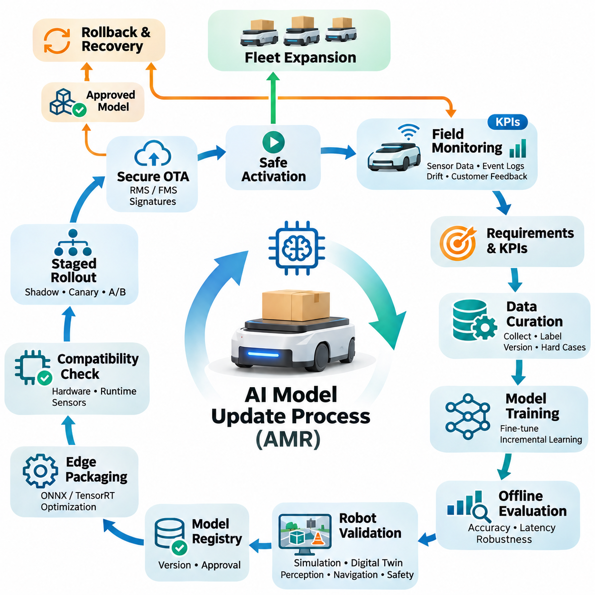
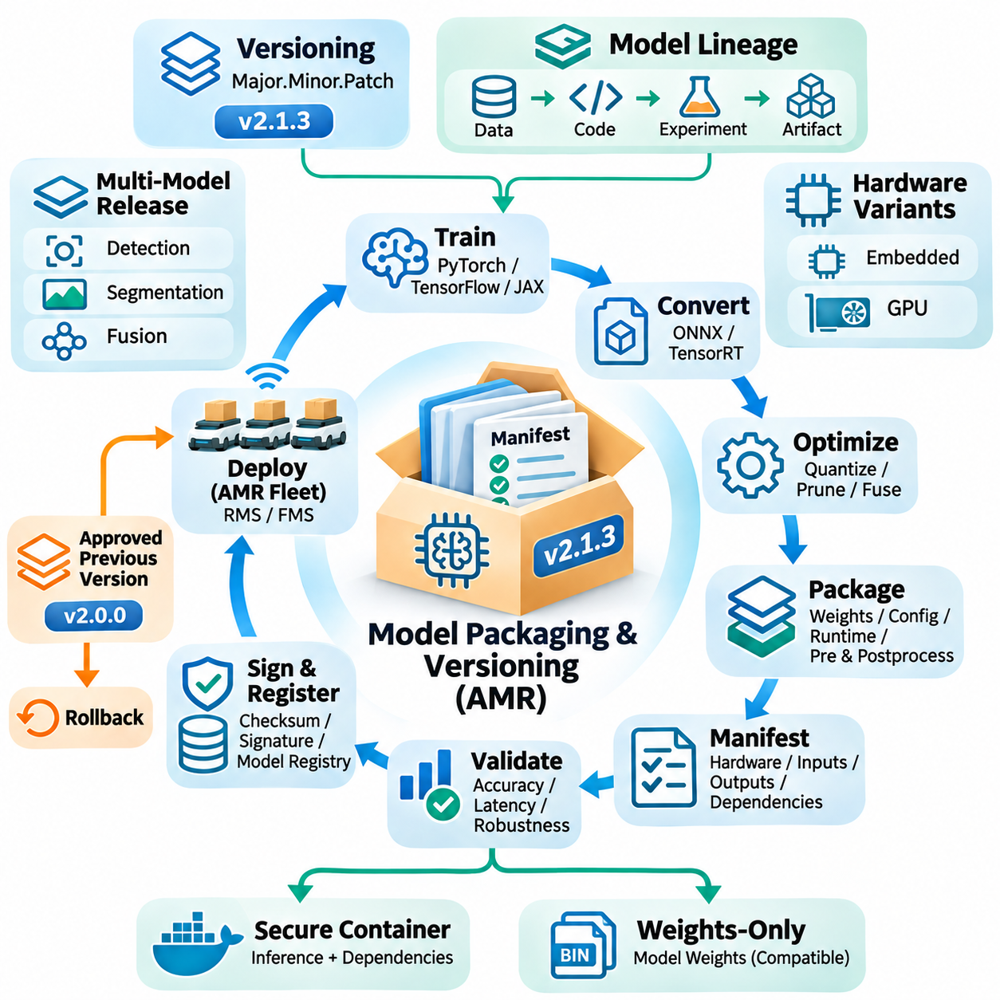
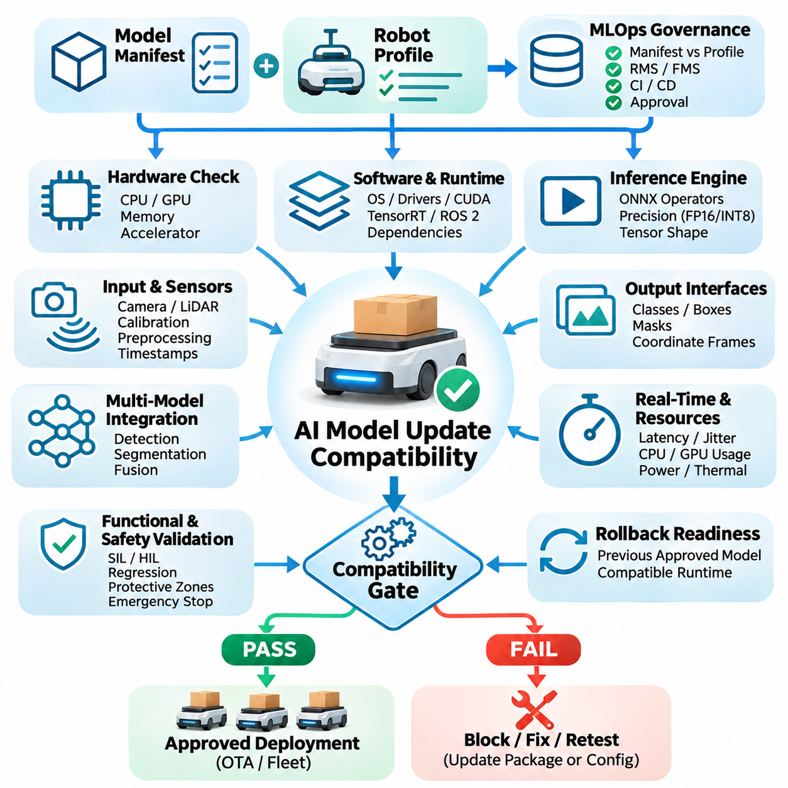
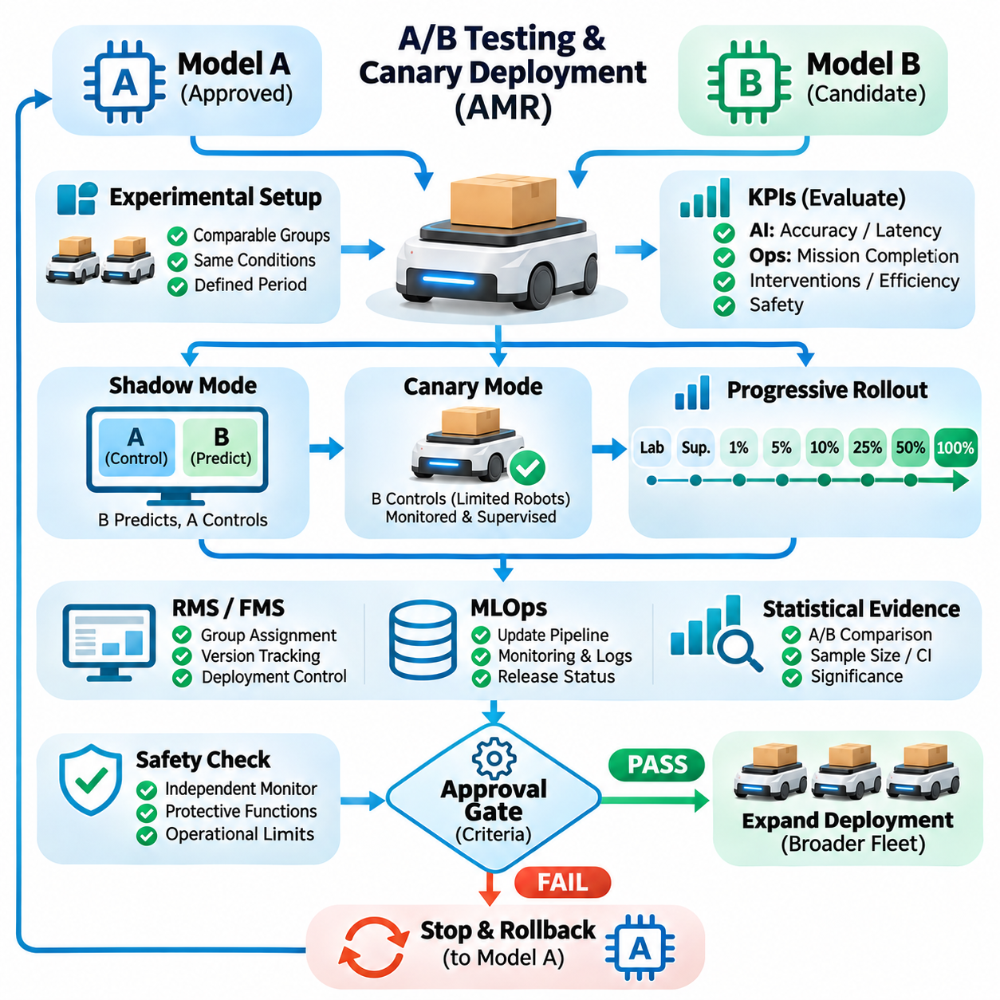
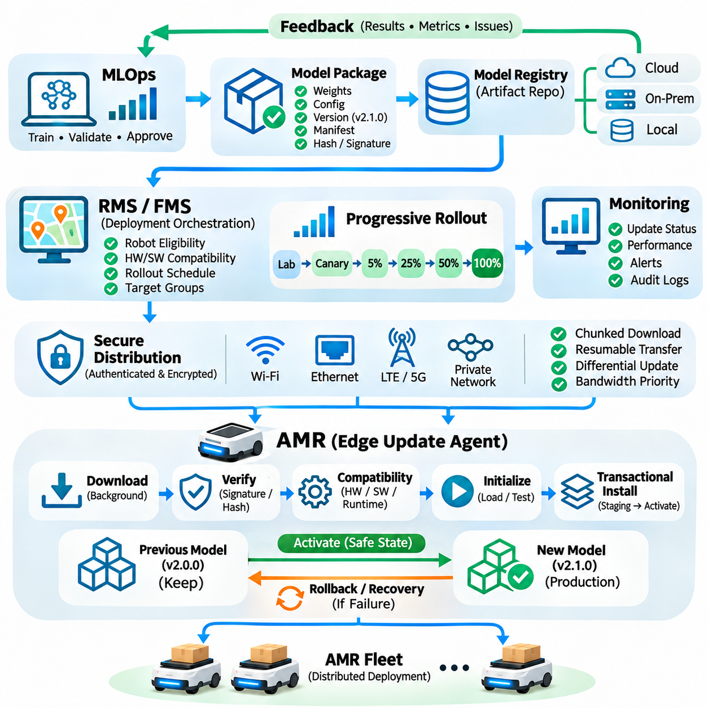
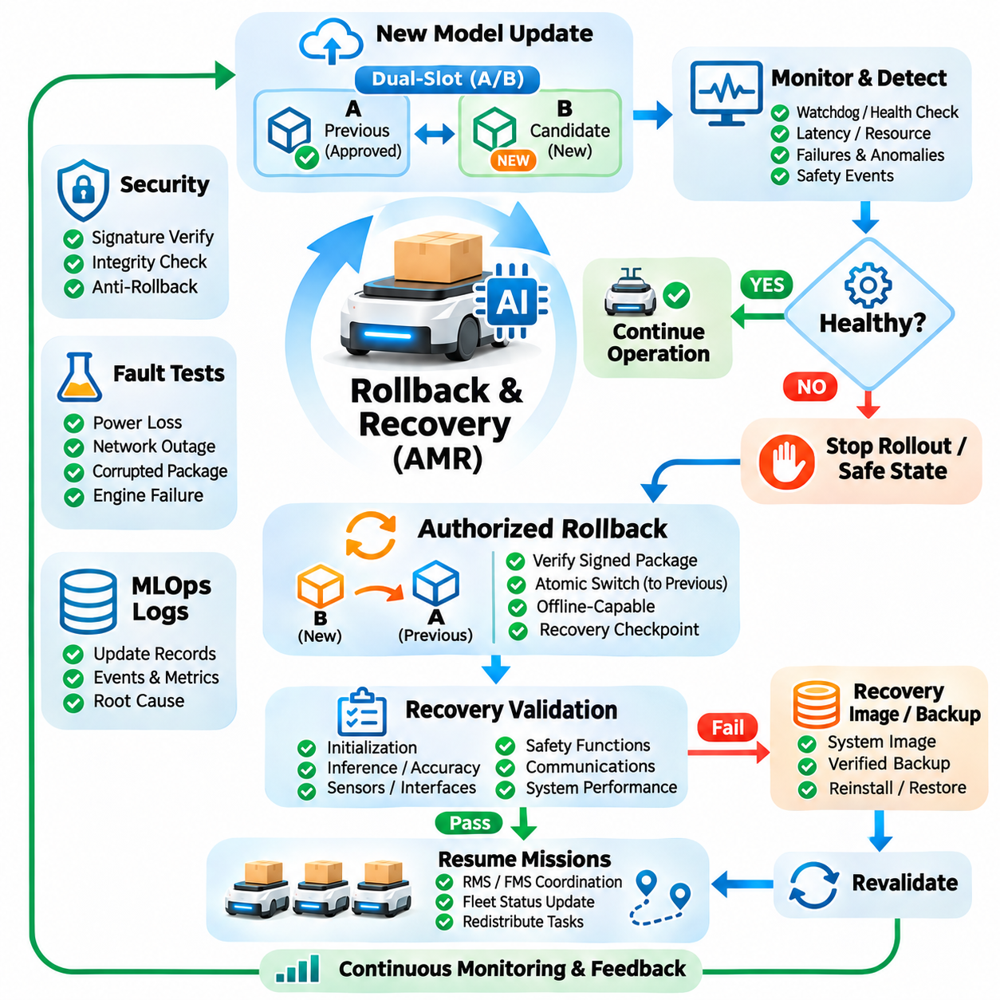
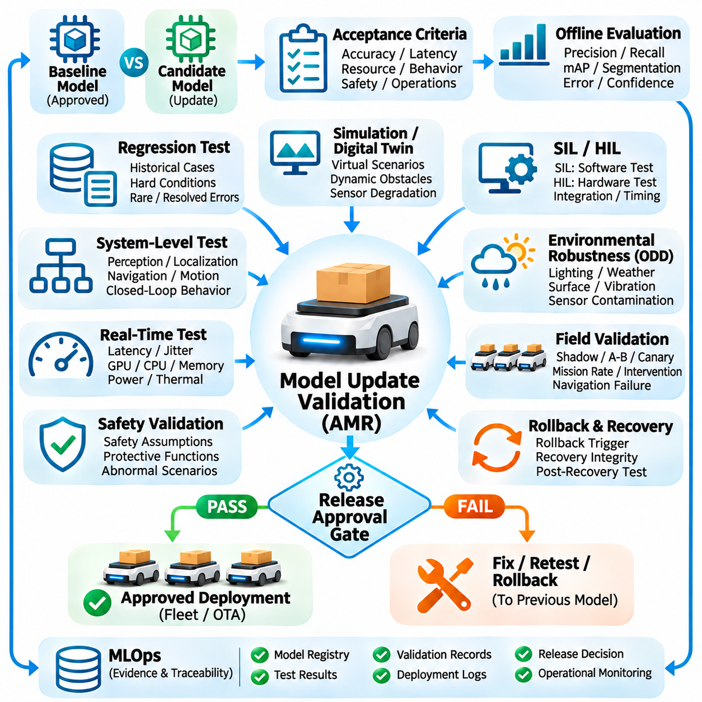
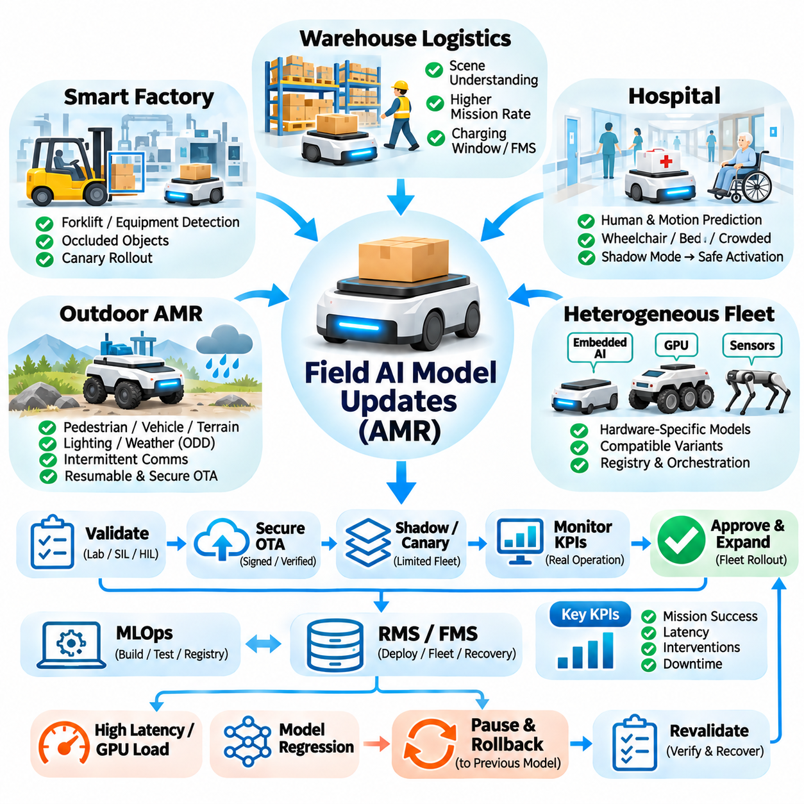

**Volume 08. AMR Operations, Deployment, and MLOps**

# Chapter 09. AI Model Update

## 09.1 AI Model Update Process

{width="7.268055555555556in" height="7.268055555555556in"}

The AI model update process is a fundamental component of Autonomous Mobile Robot (AMR) operations that enables deployed robotic systems to improve their intelligence, adaptability, accuracy, and operational reliability throughout their lifecycle. Unlike conventional software updates, AI model updates require systematic management of training data, model performance, hardware compatibility, operational risks, and deployment readiness.

An effective AI model update process integrates Machine Learning Operations (MLOps), continuous learning, edge computing, and fleet management into a unified operational framework. The objective is to establish a controlled lifecycle in which newly developed AI models can be introduced into production environments without compromising robot safety, system stability, mission continuity, or customer service quality.

The update process begins with the identification of improvement requirements through continuous operational monitoring. Robots generate large volumes of sensor data, inference results, navigation records, environmental observations, and operational event logs. Analysis of these data enables engineering teams to identify performance degradation, perception errors, environmental changes, and previously unrecognized operational scenarios.

AI model update requirements may originate from data drift, model drift, customer feedback, new operational environments, additional object categories, or changes in hardware configurations. For example, an AMR operating in a logistics facility may require an updated perception model to recognize newly introduced transportation equipment, packaging materials, or dynamic obstacles that were not represented in the original training dataset.

Once update requirements have been identified, engineering teams establish measurable improvement objectives and acceptance criteria. These objectives may include higher object detection accuracy, reduced false-positive rates, improved inference latency, lower computational resource consumption, and increased mission completion rates. Each objective should be associated with baseline performance and clearly defined validation procedures.

The next stage involves collecting, selecting, filtering, and labeling relevant operational data. Data engineering pipelines should prioritize challenging scenarios, rare events, environmental diversity, and representative failure cases. Dataset versioning ensures that the relationship between training data, model architecture, training configuration, and experimental results remains traceable throughout the development lifecycle.

Model redevelopment may involve complete retraining, incremental learning, transfer learning, fine-tuning, or knowledge distillation, depending on the characteristics of the identified improvement requirements. Engineering teams must balance the acquisition of new capabilities against the preservation of existing knowledge. Particular attention should be given to catastrophic forgetting, overfitting, and unintended behavioral changes.

Newly trained models undergo offline evaluation using independent validation datasets and standardized benchmarking procedures. Evaluation should consider task-specific accuracy, precision, recall, robustness, inference latency, GPU utilization, memory consumption, and energy efficiency. Performance improvements must be demonstrated across representative operating conditions rather than relying exclusively on aggregated accuracy metrics.

Robot-specific validation is particularly important because AI inference directly influences physical behavior. A perception model may achieve higher detection accuracy while introducing excessive processing latency that negatively affects obstacle avoidance. Therefore, model validation must evaluate interactions among perception, localization, navigation, behavior planning, motion control, and independent functional safety mechanisms.

Simulation and digital twin environments provide an additional validation layer before physical deployment. Candidate models can be exposed to virtual environments containing dynamic obstacles, sensor degradation, unusual lighting, communication interruptions, and abnormal operating conditions. Recorded field data can also be replayed to compare candidate model outputs against existing production models under reproducible conditions.

Following technical validation, the candidate model is registered in a centralized model registry. Each registered model should contain a unique version identifier, training dataset references, model architecture information, evaluation results, runtime dependencies, supported hardware configurations, approval status, and deployment restrictions. This information establishes traceability and supports controlled release management.

Model packaging prepares the approved AI model for execution within the target edge computing environment. Depending on the robot architecture, models may be converted into optimized formats such as ONNX or TensorRT engines. Quantization, computational graph optimization, and hardware-specific acceleration may be applied, provided that their impact on model accuracy, numerical stability, and operational performance has been validated.

Before distribution, compatibility verification confirms that the model is compatible with the target robot\'s processor architecture, GPU resources, operating system, inference runtime, sensor configuration, and software interfaces. Compatibility checks must also address input preprocessing, output interpretation, coordinate systems, sensor calibration, and real-time processing requirements to prevent integration failures.

The approved update should initially be deployed to a limited number of representative robots through a controlled release strategy. Shadow deployment allows the candidate model to generate inference results without controlling physical robot behavior, while canary deployment introduces the approved model into a restricted production environment. A/B testing may then support comparisons with the existing production model.

Over-the-Air (OTA) infrastructure enables secure distribution of AI model packages across geographically distributed robot fleets. The Robot Management System (RMS) and Fleet Management System (FMS) coordinate deployment schedules, device eligibility, mission availability, and update status. Digital signatures, integrity verification, authenticated communication, and access control protect the distribution process.

Model activation should occur only when the robot reaches an approved operational state, such as a maintenance window, designated parking location, or completed mission. The update mechanism should support transactional installation, interrupted transfer recovery, initialization checks, and preservation of the previous verified model. Unvalidated model replacement during active autonomous operation should be avoided.

Post-deployment monitoring evaluates actual field performance against established operational baselines and acceptance thresholds. Relevant indicators include perception failure rates, inference latency, navigation interruptions, emergency stops, operator interventions, mission completion rates, and resource consumption. Abnormal trends should trigger investigation, suspension of further deployment, or controlled recovery.

Rollback and recovery mechanisms are essential for maintaining operational continuity when unexpected model behavior occurs. The system should retain a compatible, previously approved model and provide mechanisms for restoring its configuration. Periodic recovery testing verifies that model restoration can be completed reliably without introducing inconsistent software states or compromising independent safety functions.

After successful field validation, the update can be progressively expanded across eligible robots, customer sites, and operational environments. Deployment records, approval decisions, performance comparisons, and field observations should be preserved for auditing and future engineering activities. This closed-loop process transforms AI model updates into a sustainable mechanism for continuous intelligence improvement across AMR fleets.

## 09.2 Model Packaging and Versioning

{width="7.268055555555556in" height="7.268055555555556in"}

Model packaging and versioning are essential components of the AI model update process for Autonomous Mobile Robots (AMRs). They establish a standardized framework for preparing, identifying, distributing, executing, and maintaining AI models throughout the operational lifecycle. Effective packaging and version management ensure that AI models remain reproducible, traceable, compatible, and reliable across distributed robotic platforms.

Model packaging is the process of transforming a trained AI model into a deployable software artifact that can operate within a target computing environment. A complete model package typically contains model weights, network architecture, configuration files, preprocessing and postprocessing functions, runtime dependencies, and deployment metadata. These components collectively define the expected execution behavior of the model.

In AMR systems, AI models may support object detection, semantic segmentation, obstacle recognition, terrain classification, anomaly detection, localization, and autonomous decision-making. Each model may have different computational requirements, input formats, output structures, and execution frequencies. Model packaging must accommodate these characteristics while maintaining standardized integration interfaces with the robot software architecture.

During the development stage, AI models are commonly implemented using machine learning frameworks such as PyTorch, TensorFlow, or JAX. However, models developed within training environments are not necessarily optimized for production execution. Model conversion transforms trained models into deployment-oriented representations such as Open Neural Network Exchange (ONNX), TensorRT engines, or other hardware-specific inference formats.

Model optimization is frequently performed during the packaging process to improve inference efficiency and reduce computational resource requirements. Techniques such as quantization, pruning, operator fusion, graph optimization, and hardware acceleration can reduce memory consumption and inference latency. Nevertheless, optimized models must undergo additional validation because numerical transformations may affect prediction accuracy and robustness.

Hardware-specific packaging is particularly important for heterogeneous AMR fleets operating with different processors and AI accelerators. Entry-level robots may utilize embedded computing platforms, while advanced robots may incorporate multiple high-performance GPUs. Packaging strategies should support hardware-specific model variants without compromising consistency in functional requirements, software interfaces, and validated operational behavior.

Model packages should include a structured manifest describing their contents and deployment requirements. The manifest typically specifies the model identifier, version number, supported hardware, inference runtime, input dimensions, output schema, computational precision, memory requirements, and dependency versions. This metadata enables automated deployment systems to evaluate model eligibility before installation and activation.

Model versioning establishes a systematic mechanism for identifying and tracking individual AI model releases. Each model version should be associated with its architecture, training dataset, source code revision, hyperparameters, optimization settings, and validation results. Immutable version identifiers prevent accidental replacement of approved artifacts and allow engineering teams to reproduce historical configurations when investigating operational failures.

Semantic versioning can provide a practical foundation for AI model release management. Major versions may represent significant architectural or interface changes, minor versions may introduce additional capabilities or measurable performance improvements, and patch versions may address limited defects. However, every release must undergo appropriate validation because even a small change in model weights can significantly influence physical robot behavior.

A centralized model registry provides the infrastructure required to manage AI model packages and their associated versions. Model registries maintain artifact locations, development histories, evaluation metrics, approval records, deployment restrictions, and lifecycle status. Platforms such as MLflow or enterprise artifact repositories can support integration between model development pipelines, validation environments, and production deployment infrastructure.

Model lineage management establishes relationships among training datasets, source code, experimental configurations, trained weights, optimized artifacts, and deployed versions. This traceability enables engineers to determine precisely how a particular model was developed and which operational robots are currently executing it. Dataset hashes, source control commit identifiers, artifact checksums, and experiment tracking records strengthen reproducibility.

Security must be incorporated into the model packaging and versioning framework. AI model packages should be protected through cryptographic checksums, digital signatures, authenticated repositories, and role-based access control. Dependency inventories and software bills of materials can support vulnerability management. Robots must verify package authenticity and integrity before installation to prevent unauthorized model substitution or manipulation.

Containerization provides an effective approach to packaging inference services together with their software dependencies. Docker containers can encapsulate inference runtimes, supporting libraries, model artifacts, and execution configurations within standardized environments. Alternatively, frequently updated model weights may be distributed independently from container images when their compatibility with the existing inference service has been verified.

Version management must extend beyond individual AI models to encompass complete multi-model configurations. An AMR may simultaneously execute object detection, semantic segmentation, depth estimation, sensor fusion, and behavior prediction models. A system-level release manifest should identify compatible combinations of model versions, preprocessing modules, sensor configurations, and software components to prevent inconsistent operational behavior.

The Robot Management System (RMS) and Fleet Management System (FMS) should maintain visibility into the model versions installed and actively executing on individual robots. Deployment records should distinguish downloaded, installed, validated, active, and previously approved model versions. This information supports controlled fleet updates, configuration auditing, operational troubleshooting, and systematic recovery when a newly deployed model exhibits unexpected behavior.

A well-designed packaging architecture should preserve previous approved model packages and their corresponding runtime configurations. Retaining these artifacts enables reliable rollback when deployment failures, compatibility problems, or performance degradation occur. Ultimately, standardized model packaging and versioning establish the technical foundation for secure AI distribution, continuous learning, reproducible engineering, and sustainable intelligence improvement across industrial AMR fleets.

## 09.3 Update Compatibility Check

{width="7.268055555555556in" height="7.268055555555556in"}

Update compatibility checking is a critical process in the AI model update lifecycle of Autonomous Mobile Robots (AMRs). Its primary objective is to verify that a newly developed AI model can operate correctly within the existing hardware, software, sensor, communication, and operational architecture of the target robot. Compatibility verification minimizes deployment failures, unexpected physical behavior, and interruptions to production services.

Unlike conventional software components, AI models depend on multiple interconnected execution environments, including computational hardware, inference engines, numerical precision, sensor configurations, and data processing pipelines. A model that demonstrates excellent performance during development may fail in an operational environment if these dependencies are not properly satisfied. Compatibility must therefore be evaluated at the system level.

The compatibility checking process begins with identifying the target robot configuration and comparing it against the requirements specified in the model package manifest. This comparison should include processor architecture, GPU specifications, available memory, operating system versions, inference runtimes, software dependencies, and supported communication interfaces. Automated verification reduces configuration errors and improves deployment reliability.

Hardware compatibility verification evaluates whether the target computing platform provides the resources and acceleration capabilities required by the candidate model. Heterogeneous AMR fleets may incorporate embedded processors, edge AI accelerators, or high-performance GPUs. Differences in computational architecture, supported numerical precision, memory bandwidth, and accelerator capabilities must be evaluated before approving deployment.

Software compatibility checking verifies the relationship between the candidate AI model and the existing robot software environment. Operating system versions, GPU drivers, CUDA libraries, TensorRT versions, Python environments, ROS 2 distributions, and container dependencies may influence model execution. Incompatible software dependencies can cause initialization failures, unsupported operations, numerical inconsistencies, or unexpected runtime errors.

Inference engine compatibility is particularly important when deploying optimized AI models. Models exported into ONNX, TensorRT, or hardware-specific execution formats may contain operators that are unsupported by particular runtime versions or accelerator architectures. Verification should confirm operator availability, tensor dimensions, dynamic input handling, numerical precision, serialization compatibility, and successful model initialization.

Input interface compatibility ensures that the candidate model receives data in the expected format. Image resolution, color encoding, tensor layout, normalization parameters, point cloud attributes, sensor sampling frequencies, and timestamp conventions must remain consistent with the model requirements. Even minor differences in preprocessing configurations can significantly degrade inference accuracy without generating explicit software errors.

Output interface compatibility verifies that model predictions can be correctly interpreted by downstream robotic software components. Bounding boxes, object classifications, confidence scores, segmentation masks, coordinate transformations, and prediction structures must conform to established interface specifications. Changes in output schema or class identifiers may negatively affect navigation, obstacle avoidance, behavior planning, and mission execution.

Sensor compatibility checking evaluates whether the candidate model is appropriate for the physical sensing configuration of the target robot. Different camera lenses, LiDAR resolutions, radar characteristics, depth sensing technologies, and sensor mounting positions may produce substantially different input distributions. Sensor calibration parameters, intrinsic and extrinsic properties, and coordinate reference frames must also be verified.

Temporal compatibility is another fundamental requirement in real-time robotic systems. AI models must satisfy the timing constraints established by perception pipelines, localization processes, navigation algorithms, and motion control systems. Increased inference latency, processing jitter, or asynchronous data delivery may reduce environmental awareness and adversely affect dynamic obstacle avoidance, even when prediction accuracy improves.

Computational resource compatibility evaluates the impact of the updated model on overall system performance. GPU utilization, CPU load, memory allocation, storage requirements, power consumption, and thermal behavior should be measured under representative operating conditions. Resource verification must consider concurrent execution with other robotic workloads rather than evaluating the candidate model as an isolated computational component.

Multi-model compatibility becomes increasingly important as modern AMRs incorporate several interconnected AI models. Object detection, semantic segmentation, depth estimation, terrain recognition, sensor fusion, and behavior prediction may collectively influence autonomous decisions. Updating an individual model must not introduce incompatible data representations, synchronization problems, conflicting predictions, or excessive competition for shared computing resources.

Functional compatibility verification evaluates whether the updated model continues to satisfy established robot capabilities and operational requirements. Recorded field data, simulation environments, Software-in-the-Loop (SIL), and Hardware-in-the-Loop (HIL) testing can expose integration problems before production deployment. Regression testing should confirm that previously supported scenarios remain functional after introducing the candidate model.

Safety compatibility verification determines whether the update affects established safety assumptions, risk controls, and operational boundaries. AI model changes must not compromise independent safety functions, emergency stopping mechanisms, protective zones, or speed restrictions. Updates that influence safety-related behavior require appropriate risk assessment, system-level validation, and additional approval or conformity assessment where applicable.

Automated compatibility checking should be integrated into the Machine Learning Operations (MLOps) and Continuous Integration and Continuous Deployment (CI/CD) pipelines. Model manifests, hardware profiles, dependency inventories, interface definitions, and validation results enable rule-based predeployment verification. The Robot Management System (RMS) and Fleet Management System (FMS) should prevent unauthorized or incompatible model installations.

Compatibility verification should also address recovery requirements by confirming that previously approved models remain executable after an update. Changes to runtime libraries, configuration schemas, storage formats, or supporting software may prevent successful rollback. Ultimately, documented compatibility matrices, automated deployment gates, and controlled approval procedures establish a reliable foundation for scalable and secure AI model updates across industrial AMR fleets.

## 09.4 A/B Testing and Canary Deployment

{width="7.268055555555556in" height="7.268055555555556in"}

A/B testing and canary deployment are controlled release strategies that enable Autonomous Mobile Robot (AMR) systems to introduce updated AI models while minimizing operational risks. These approaches provide a systematic framework for evaluating model performance under actual operating conditions before expanding deployment across an entire robot fleet. Their primary objective is to balance continuous intelligence improvement with operational stability and safety.

A/B testing is an experimental methodology that compares two model versions under comparable operating conditions. Model A typically represents the existing approved production model, while Model B represents a candidate model containing newly developed capabilities or performance improvements. By comparing their operational outcomes, engineering teams can determine whether the candidate model provides measurable advantages without introducing unacceptable regressions.

In AMR operations, A/B testing differs from conventional web-based software experimentation because AI predictions can directly influence physical robot behavior. Changes in object detection, terrain classification, obstacle recognition, or behavior prediction may affect navigation decisions and mission execution. Therefore, robotic A/B testing must incorporate controlled experimental environments, independent safety mechanisms, and predefined operational boundaries.

The experimental design should establish representative robot groups, evaluation periods, environmental conditions, performance indicators, and acceptance criteria. Robots assigned to different groups should have comparable hardware configurations, sensor capabilities, software environments, and mission profiles. Differences in workload, environmental complexity, and operating conditions must be controlled or accounted for to reduce experimental bias.

Performance evaluation should incorporate both AI-specific metrics and system-level operational indicators. AI-specific metrics may include detection accuracy, precision, recall, confidence calibration, and inference latency. Operational indicators may include mission completion rates, navigation interruptions, operator interventions, false obstacle detections, energy consumption, and task execution efficiency. Safety-related indicators must be evaluated independently.

Shadow deployment provides a preliminary evaluation mechanism before allowing a candidate model to influence physical robot behavior. During shadow operation, the existing production model remains responsible for operational decisions, while the candidate model processes equivalent sensor inputs and generates independent predictions. Differences between model outputs are recorded and analyzed without granting the candidate model control authority.

Shadow testing is particularly valuable for identifying unexpected prediction differences, inference bottlenecks, and behavioral inconsistencies. However, it cannot fully reproduce the closed-loop interactions between AI decisions, robot movement, and environmental responses. Concurrent model execution may also increase computational resource consumption, making resource isolation and performance monitoring important requirements for reliable shadow evaluation.

Canary deployment introduces an approved candidate model into a restricted subset of operational robots before authorizing broader distribution. The selected robots function as early indicators of potential deployment problems, allowing engineering teams to evaluate actual operational behavior while limiting the impact of unexpected failures. Unlike shadow deployment, canary deployment permits the candidate model to influence operational decisions within approved constraints.

Canary robot selection should consider hardware diversity, sensor configurations, mission characteristics, environmental complexity, and operational criticality. Initial deployments should prioritize controlled, lower-risk environments with appropriate supervision and recovery capabilities. As supporting evidence accumulates, additional robot configurations and more demanding operational scenarios may be introduced through successive deployment stages.

A progressive rollout strategy expands the candidate model deployment according to predefined approval gates. An illustrative deployment sequence may begin with a laboratory robot, followed by a supervised field robot and deployment to 1%, 5%, 10%, 25%, 50%, and eventually 100% of eligible robots. Actual deployment proportions and observation periods should be determined according to fleet size, operational risk, and validation requirements.

The Robot Management System (RMS) and Fleet Management System (FMS) play central roles in coordinating A/B testing and canary deployment. These systems should manage experimental group assignments, model version tracking, deployment eligibility, update schedules, operational telemetry, and release status. Centralized management enables engineering teams to maintain visibility into active experiments across geographically distributed robot fleets.

Statistical evaluation is necessary to distinguish genuine performance improvements from random operational variation. Experimental analysis should consider sample size, mission frequency, environmental diversity, confidence intervals, and correlations among repeated robot observations. Rare but safety-critical events require dedicated validation scenarios because their absence during a limited experiment does not establish operational safety.

Automated deployment gates should evaluate candidate model performance against predefined acceptance thresholds before authorizing further rollout. Excessive inference latency, increased navigation failures, unexpected resource consumption, or deteriorating operational indicators should prevent deployment expansion. Critical safety violations should trigger immediate containment procedures rather than waiting for statistical confirmation of performance degradation.

Rollback mechanisms must remain available throughout the experimental deployment lifecycle. Each participating robot should retain access to a compatible, previously approved model and its associated runtime configuration. When abnormal behavior is detected, the deployment system should suspend further distribution, initiate an appropriate safe operational state, and restore the verified model through a controlled recovery procedure.

A/B testing and canary deployment should be integrated into the Machine Learning Operations (MLOps) framework through automated experiment tracking, model registry integration, deployment orchestration, and continuous monitoring. Experiment records should preserve model versions, robot configurations, evaluation datasets, operational conditions, performance results, approval decisions, and recovery events to support engineering traceability and governance.

Successful experimental deployment concludes with formal review and approval for broader production adoption. Engineering teams should document demonstrated improvements, remaining limitations, operational risks, and applicable deployment restrictions. Ultimately, A/B testing and canary deployment establish an evidence-based AI release process that supports continuous learning, controlled innovation, and reliable intelligence improvement across industrial AMR fleets.

## 09.5 OTA Model Distribution

{width="7.268055555555556in" height="7.268055555555556in"}

Over-the-Air (OTA) model distribution is a fundamental infrastructure component that enables Autonomous Mobile Robots (AMRs) to receive updated AI models remotely without requiring physical access to individual robots. It supports continuous intelligence improvement across geographically distributed robot fleets while reducing maintenance costs, deployment time, operational interruptions, and dependence on on-site engineering personnel.

An OTA model distribution architecture typically integrates a centralized model registry, artifact repository, deployment orchestration server, communication infrastructure, and edge-side update agent. These components collectively establish a controlled distribution pipeline between Machine Learning Operations (MLOps) environments and operational robots, enabling systematic management of AI model releases throughout their lifecycle.

The distribution process begins with the registration of an approved AI model package within a centralized artifact repository. Each package should contain the model weights, deployment configuration, compatibility requirements, version information, integrity verification data, and associated metadata. Only models that have completed the required validation and approval procedures should become eligible for production distribution.

The Robot Management System (RMS) and Fleet Management System (FMS) coordinate OTA distribution by maintaining information about individual robot configurations, installed model versions, operational status, hardware capabilities, and communication availability. This centralized visibility enables deployment orchestration systems to identify eligible robots and establish appropriate distribution schedules according to operational requirements.

OTA distribution must support heterogeneous AMR fleets operating with different computing platforms, sensor configurations, and inference environments. Hardware-specific model packages may be required for embedded processors, edge AI accelerators, and high-performance GPU systems. Automated compatibility checking ensures that each robot receives an approved model variant suitable for its hardware and software configuration.

Communication infrastructure represents a critical element of reliable OTA model distribution. Robots may communicate through industrial Ethernet, Wi-Fi, LTE, 5G, or dedicated private networks. Since network availability, bandwidth, latency, and connection stability may vary considerably across deployment environments, the distribution architecture must accommodate intermittent connectivity and changing communication conditions.

Efficient package transfer mechanisms are particularly important when distributing large AI models containing hundreds of megabytes or several gigabytes of parameters. Compression, chunk-based downloading, incremental updates, differential distribution, and resumable transfers can reduce network utilization. Differential updates must verify the existing base artifact and the integrity of the reconstructed model package before installation.

Bandwidth management should prevent OTA activities from interfering with operational communication between robots and centralized management systems. Distribution services may implement download rate limits, traffic prioritization, staggered transfer schedules, and local caching mechanisms. Critical communication supporting robot supervision, mission coordination, and operational alerts should receive higher priority than background model transfers.

Security is a fundamental requirement throughout the OTA distribution lifecycle. Model packages should be digitally signed by authorized release systems and transferred through authenticated and encrypted communication channels. Cryptographic hashes, certificate management, device authentication, and role-based access control help prevent unauthorized model distribution, package manipulation, and malicious software substitution.

The edge-side update agent is responsible for receiving deployment instructions, downloading model artifacts, verifying package integrity, checking compatibility, and managing installation. The agent should maintain persistent update state information to support recovery after communication interruptions, software failures, or unexpected power loss. Unauthorized or incomplete packages must never become eligible for model activation.

Model downloading and activation should be treated as separate operational stages. A robot may download an approved model package while performing normal missions, provided that resource consumption remains within acceptable limits. Activation should occur only during an authorized maintenance window or verified safe operational state, after confirming that the update will not interfere with mission execution or safety functions.

Transactional installation mechanisms improve OTA reliability by preventing partially installed models from entering production operation. New model packages should be placed in isolated staging areas and subjected to integrity checks, dependency verification, initialization tests, and resource availability checks. The existing production model should remain available until the updated model has completed the required activation procedures.

Progressive distribution strategies enable engineering teams to manage deployment risks across large robot fleets. Initial distribution may target laboratory robots, supervised field robots, or designated canary groups. Subsequent expansion should depend on predefined approval gates, operational observations, and performance evaluations. Deployment orchestration must support pausing or terminating distribution whenever unexpected problems occur.

Real-time distribution monitoring should provide visibility into each robot\'s update status, including pending instructions, download progress, verification results, installation status, activation results, and failure conditions. Centralized dashboards and automated alerts enable operations teams to identify distribution bottlenecks, disconnected devices, incompatible configurations, and recurring update failures across multiple customer sites.

Rollback and recovery capabilities must be incorporated into the OTA architecture from the initial design stage. Robots should retain previously approved model packages and compatible runtime configurations whenever storage resources permit. If activation failures or operational degradation occur, the update system should support controlled restoration of the verified model without requiring continuous connectivity to the central server.

OTA model distribution must also support different infrastructure environments, including public cloud platforms, private cloud systems, and on-premises deployment architectures. Local artifact repositories and regional distribution servers can reduce external network dependency while supporting data sovereignty, cybersecurity policies, and customer-specific operational requirements. Restricted facilities may require isolated distribution networks.

Comprehensive distribution records should preserve model identifiers, package checksums, target robot configurations, deployment timestamps, authorization records, installation results, activation status, and recovery events. Integration with MLOps and operational monitoring infrastructure establishes end-to-end traceability. Ultimately, secure and scalable OTA model distribution enables sustainable intelligence improvement across industrial AMR fleets.

## 09.6 Rollback and Recovery

{width="7.268055555555556in" height="7.268055555555556in"}

Rollback and recovery are essential mechanisms for maintaining the operational reliability of Autonomous Mobile Robots (AMRs) following unsuccessful AI model updates. Their primary objective is to restore a verified operational configuration when a newly deployed model introduces functional failures, performance degradation, compatibility problems, or safety-related abnormalities. These mechanisms minimize downtime and prevent the propagation of operational failures.

Rollback refers to the controlled restoration of a previously approved AI model and its associated execution environment. Recovery encompasses a broader range of activities, including failure detection, system stabilization, configuration restoration, functional verification, and operational reintegration. Together, these processes establish a fault-tolerant update architecture capable of supporting continuous AI model improvement.

Rollback readiness must be established before initiating any production model update. The existing model weights, inference configuration, preprocessing parameters, software dependencies, and relevant calibration settings should be preserved as a verified recovery package. Maintaining model weights alone may be insufficient because changes in supporting software or configuration parameters can prevent successful restoration.

A dual-slot deployment architecture provides an effective mechanism for implementing reliable model rollback. One slot contains the currently approved production model, while the alternative slot accommodates the candidate model. After installation and verification, the system can switch the active model reference without overwriting the previous version. This architecture reduces recovery time and protects against incomplete installations.

Rollback triggers should be defined according to measurable operational criteria. Typical triggers include model initialization failures, inference timeout events, excessive computational resource consumption, abnormal prediction distributions, increased navigation failures, and unexpected operator interventions. Safety-critical abnormalities must initiate immediate protective actions independently of conventional performance evaluation thresholds.

Automated rollback mechanisms continuously evaluate the operational health of newly deployed AI models. Watchdog processes, runtime health checks, diagnostic services, and performance monitoring agents can detect predefined failure conditions. When a critical threshold is exceeded, the update management system should suspend further deployment and initiate an authorized recovery sequence without depending on continuous external connectivity.

Safe operational state management is particularly important during rollback execution. Unlike conventional software services, AMRs interact directly with physical environments, equipment, and human operators. Before restoring a model, the robot must enter an appropriate safe state, suspend autonomous decision-making where necessary, and maintain independent safety functions throughout the recovery process.

Transactional recovery procedures ensure that model restoration remains consistent even when unexpected interruptions occur. Atomic configuration switching, persistent recovery records, versioned directories, and verified installation checkpoints can prevent inconsistent system states. If power loss occurs during rollback, the robot should resume the recovery procedure or restart using a verified operational configuration.

The Robot Management System (RMS) and Fleet Management System (FMS) should coordinate rollback activities across distributed robot fleets. Centralized management enables operators to identify affected robots, suspend pending updates, isolate problematic model versions, redistribute unfinished missions, and monitor recovery progress. Fleet-level rollback policies should account for hardware diversity and operational dependencies.

Recovery validation must confirm that restoring the previous model has successfully reestablished the expected system behavior. Verification should include model initialization, inference correctness, sensor interface compatibility, communication availability, computational resource consumption, and essential safety functions. Successful model loading alone does not demonstrate that the robot is ready to resume autonomous operation.

Recovery architectures must also address situations in which conventional rollback is unsuccessful. Corrupted storage devices, damaged runtime environments, incompatible configuration changes, or unavailable recovery packages may require alternative restoration procedures. A protected recovery partition, verified system image, or locally accessible backup can support more comprehensive system recovery.

Security controls must prevent rollback functionality from becoming an unauthorized pathway for installing vulnerable or compromised AI models. Recovery packages should undergo digital signature verification, integrity checking, and authorization validation. Anti-rollback policies should distinguish legitimate restoration of approved model versions from malicious downgrade attempts that exploit previously identified security vulnerabilities.

Rollback and recovery capabilities should be regularly evaluated through controlled fault injection and failure simulation. Representative test scenarios include corrupted model packages, interrupted downloads, insufficient storage, inference engine failures, network disconnections, and unexpected power loss. Recovery Time Objective (RTO), restoration success rate, and operational downtime provide useful reliability indicators.

Every rollback event should generate diagnostic records describing the affected model version, robot configuration, failure conditions, operational context, recovery actions, and validation results. Integration with Machine Learning Operations (MLOps) enables engineering teams to perform root cause analysis, prevent repeated failures, and improve future model acceptance criteria and deployment policies.

The engineering practices described here expand the chapter outline into a practical recovery framework rather than prescribe a platform-specific implementation. Actual recovery thresholds, authorization policies, and restoration procedures should reflect system architecture and operational risk. Ultimately, reliable rollback and recovery enable continuous AI model improvement without compromising industrial AMR safety, availability, and operational continuity.

## 09.7 Model Update Validation

{width="7.268055555555556in" height="7.268055555555556in"}

Model update validation is a systematic engineering process that verifies whether an updated AI model satisfies the functional, performance, safety, and operational requirements of an Autonomous Mobile Robot (AMR). Unlike standalone model evaluation, update validation examines the behavior of the complete robotic system after model integration, ensuring that intelligence improvements do not compromise previously established operational capabilities.

The validation process should begin with clearly defined acceptance criteria derived from system requirements, operational constraints, and identified deployment risks. These criteria should specify acceptable prediction accuracy, inference latency, computational resource consumption, functional behavior, and safety performance. Validation requirements must be established before testing to ensure objective and reproducible release decisions.

Baseline comparison is a fundamental element of model update validation. The existing approved production model serves as the reference against which the candidate model is evaluated. Both models should be tested using equivalent datasets, hardware configurations, software environments, and operational scenarios. Performance improvements must be demonstrated without introducing unacceptable degradation in previously validated capabilities.

Offline model validation evaluates the candidate model using representative datasets collected from laboratory experiments, simulation environments, and actual robot operations. Depending on the model\'s intended function, evaluation metrics may include precision, recall, mean Average Precision (mAP), segmentation accuracy, prediction error, and confidence calibration. Independent test datasets help reduce evaluation bias and data leakage.

Regression testing verifies that an updated model continues to handle previously supported operating scenarios. Historical failure cases, difficult environmental conditions, uncommon object configurations, and previously resolved prediction errors should be incorporated into regression datasets. This process reduces the risk of catastrophic forgetting and prevents newly introduced improvements from degrading established model capabilities.

Simulation-based validation enables engineering teams to evaluate updated AI models across diverse operating conditions without exposing physical robots to unnecessary risks. Digital twins and robotic simulation platforms can reproduce dynamic obstacles, sensor degradation, environmental variability, and complex navigation scenarios. However, simulation results must be supplemented by physical testing to address the simulation-to-reality gap.

Software-in-the-Loop (SIL) and Hardware-in-the-Loop (HIL) testing provide intermediate validation stages between offline evaluation and actual field deployment. SIL verifies interactions between the candidate model and the robot software architecture, while HIL evaluates execution on representative hardware. These approaches help identify integration failures, timing inconsistencies, and computational resource limitations.

System-level functional validation examines how the updated AI model influences perception, localization, navigation, motion planning, and mission execution. Improvements in individual prediction metrics do not necessarily produce better overall robot behavior. Validation must therefore examine closed-loop interactions between AI outputs, decision-making components, physical robot movements, and environmental responses.

Real-time performance validation determines whether the updated model satisfies established computational and temporal requirements. Inference latency, processing jitter, GPU utilization, CPU load, memory consumption, power consumption, and thermal behavior should be measured under representative workloads. Average performance alone is insufficient when unexpected processing delays can affect time-sensitive robotic functions.

Safety validation must verify that model updates do not invalidate established safety assumptions, protective mechanisms, or operational boundaries. Test scenarios should include unexpected pedestrian movements, obstacle detection failures, sensor interruptions, and abnormal environmental conditions. Independent safety functions must remain effective even when the AI model generates inaccurate, delayed, or unavailable predictions.

Environmental robustness validation evaluates model behavior under variations in lighting, weather, surface conditions, sensor contamination, vibration, and environmental complexity. The selected conditions should reflect the robot\'s defined Operational Design Domain (ODD). Testing should also verify that the system responds appropriately when environmental conditions exceed validated operating limits or model confidence becomes unreliable.

Field validation introduces the updated model into controlled operational environments after laboratory and system-level verification. Shadow deployment, A/B testing, and canary deployment provide complementary mechanisms for assessing real-world performance while limiting operational exposure. Field results should include mission completion rates, operator interventions, navigation failures, and observed behavioral abnormalities.

Update recovery validation confirms that the robot can safely restore a previously approved model when installation, activation, or operational failures occur. Controlled failure scenarios should verify rollback triggers, recovery package integrity, configuration restoration, and post-recovery functionality. Recovery capabilities must remain available during communication interruptions and unexpected power loss.

Automated validation pipelines should integrate model registries, test datasets, simulation environments, hardware benchmarks, and operational monitoring systems within the Machine Learning Operations (MLOps) framework. Validation records should preserve model identifiers, test configurations, acceptance thresholds, execution results, detected failures, and approval decisions to establish engineering traceability and reproducibility.

Final release approval should be based on documented validation evidence and an assessment of remaining operational risks. The chapter\'s validation framework represents a general engineering approach, with specific thresholds and test coverage determined by each robot platform and deployment environment. Ultimately, systematic model update validation supports reliable intelligence improvement, operational continuity, and sustainable AMR fleet evolution.

## 09.8 Field Update Case Studies

{width="7.268055555555556in" height="7.268055555555556in"}

Field update case studies illustrate how AI model updates can be managed in operational Autonomous Mobile Robot (AMR) environments. They connect model development, validation, Over-the-Air (OTA) distribution, deployment monitoring, and recovery procedures with practical engineering requirements. The following illustrative scenarios represent common industrial challenges rather than documented results from specific commercial deployments.

In a smart factory scenario, an AMR fleet performs material transportation between production lines and automated storage systems. An updated object detection model is developed to improve recognition of forklifts, industrial equipment, and partially obstructed objects. Before deployment, the candidate model is evaluated using historical sensor data collected under representative factory operating conditions and production schedules.

The updated perception model is initially deployed to a limited number of AMRs through a canary deployment strategy. Engineering teams monitor detection accuracy, navigation interruptions, inference latency, and unnecessary protective stops. If the candidate model satisfies predefined acceptance criteria without degrading existing capabilities, the deployment scope can gradually expand to additional robots across the production facility.

In a warehouse logistics scenario, AMRs frequently encounter densely arranged pallets, moving workers, and continuously changing storage configurations. An updated scene understanding model may improve obstacle classification and environmental interpretation. Field validation should examine whether these improvements translate into higher mission completion rates, fewer unnecessary detours, and more efficient traffic coordination.

Warehouse operations often impose strict availability requirements because large numbers of robots continuously support material handling processes. Coordinating model updates with fleet charging schedules and periods of reduced operational demand can minimize service interruptions. The Fleet Management System (FMS) should temporarily exclude updating robots from task allocation while maintaining sufficient fleet capacity.

In a hospital deployment scenario, AMRs transport medical supplies, laboratory samples, and other materials through environments shared with patients and healthcare personnel. An updated human detection and motion prediction model may improve awareness of pedestrian behavior. Validation should emphasize vulnerable pedestrians, wheelchairs, medical beds, crowded corridors, and unpredictable human movements.

Hospital AMR model updates require particularly conservative activation procedures because operational failures may directly affect healthcare workflows. Updated models should initially operate in shadow mode, generating predictions without influencing robot movement. Following successful evaluation and supervised field testing, authorized activation can proceed while independent protective safety mechanisms remain fully operational.

Outdoor AMRs present additional challenges because environmental conditions vary significantly across locations and operating periods. An updated perception model may improve recognition of pedestrians, vehicles, road boundaries, and terrain characteristics under changing illumination or weather conditions. Validation datasets should represent the environmental variability expected within the robot\'s Operational Design Domain (ODD).

In geographically distributed outdoor deployments, intermittent wireless connectivity can interrupt OTA model distribution. Resumable downloading, local artifact storage, cryptographic verification, and transactional installation mechanisms enable robots to receive updates without depending on uninterrupted communication. Model activation should remain prohibited until package verification and operational readiness checks are complete.

A heterogeneous fleet scenario demonstrates the importance of hardware-specific model compatibility. Robots equipped with embedded AI accelerators, different GPU generations, or distinct sensor configurations may require separate deployment artifacts derived from the same trained model. The model registry and deployment orchestration system must maintain explicit relationships between model versions and supported execution environments.

A representative failure scenario occurs when an updated perception model improves offline detection accuracy but requires substantially more GPU memory and processing time. During field operation, increased computational demand may interfere with localization and navigation processes. Runtime monitoring should detect excessive inference latency and resource contention, triggering deployment suspension and appropriate recovery procedures.

Another illustrative scenario involves model regression following incremental learning with newly collected operational data. Although the updated model performs better in recent environmental conditions, it may become less effective at recognizing previously supported objects. Regression testing, historical dataset replay, and continuous field monitoring help identify these failures and prevent their propagation across operational fleets.

When a deployed model exhibits unacceptable behavior, the edge-side update agent should coordinate a controlled rollback to the last approved operational configuration. The Robot Management System (RMS) and FMS should identify affected robots, suspend further distribution, and reorganize pending missions. Restored robots must complete post-recovery validation before returning to normal autonomous operation.

Comparative evaluation across field update scenarios should incorporate technical and operational Key Performance Indicators (KPIs). Relevant indicators include update success rate, deployment duration, rollback frequency, recovery time, inference latency, mission completion rate, operator intervention frequency, and operational downtime. These measurements help distinguish genuine system-level improvements from isolated model accuracy gains.

Field update case studies demonstrate that successful AI model evolution depends on coordinated engineering governance rather than model performance alone. Integrating validated deployment packages, progressive rollout strategies, secure OTA infrastructure, operational monitoring, and reliable recovery mechanisms within Machine Learning Operations (MLOps) establishes a sustainable foundation for continuous AMR fleet intelligence improvement.
