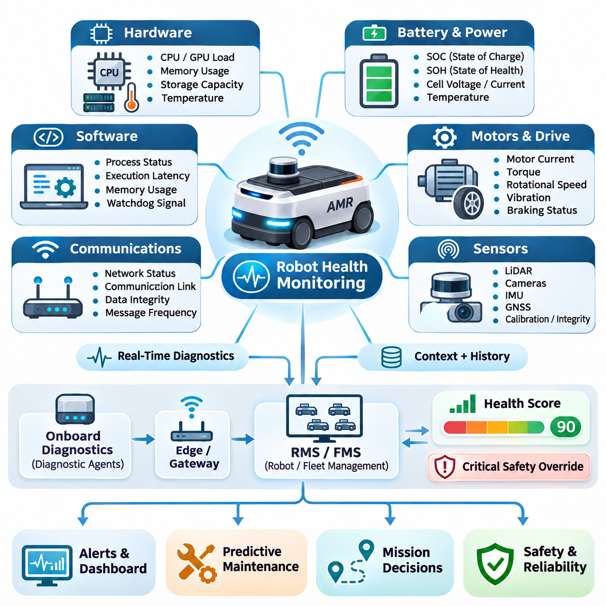
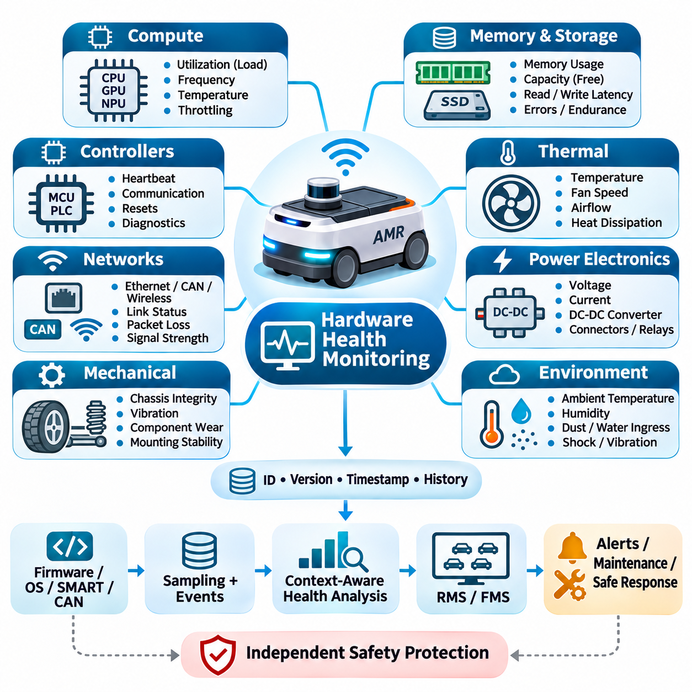
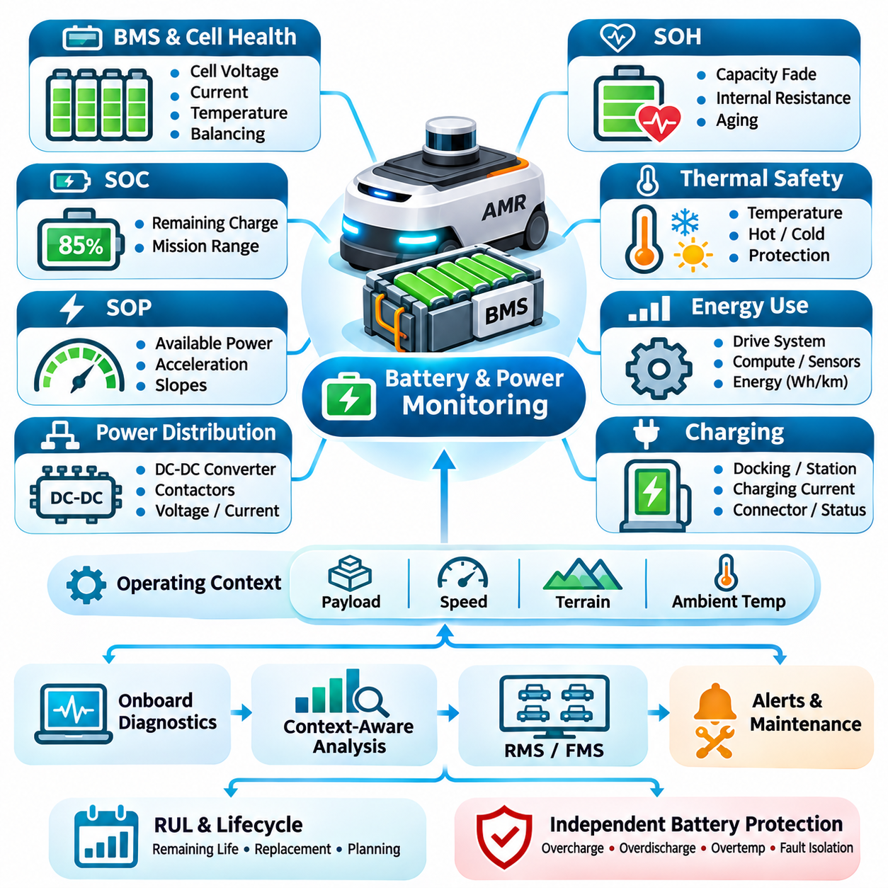
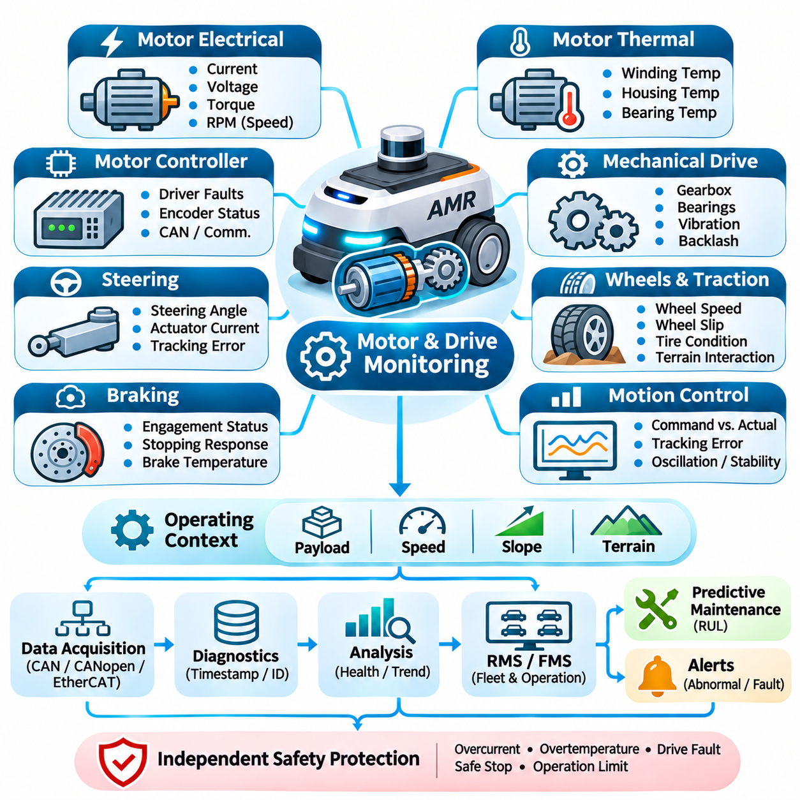
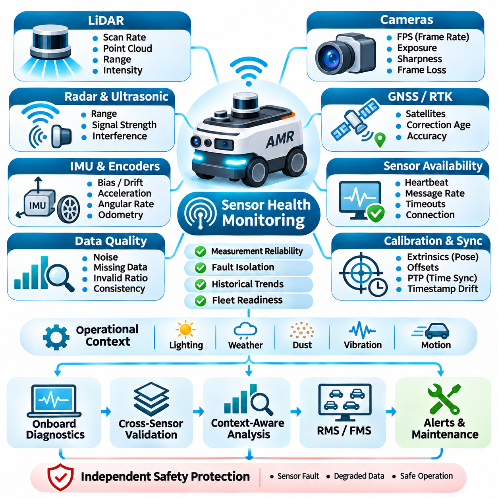
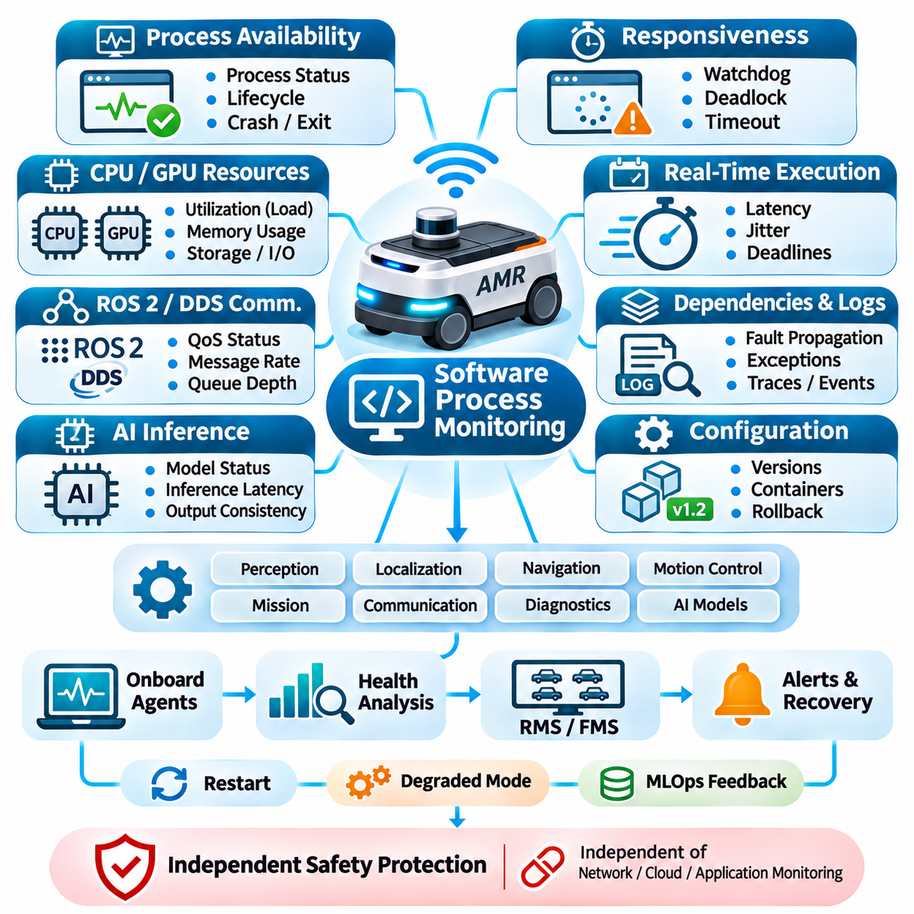
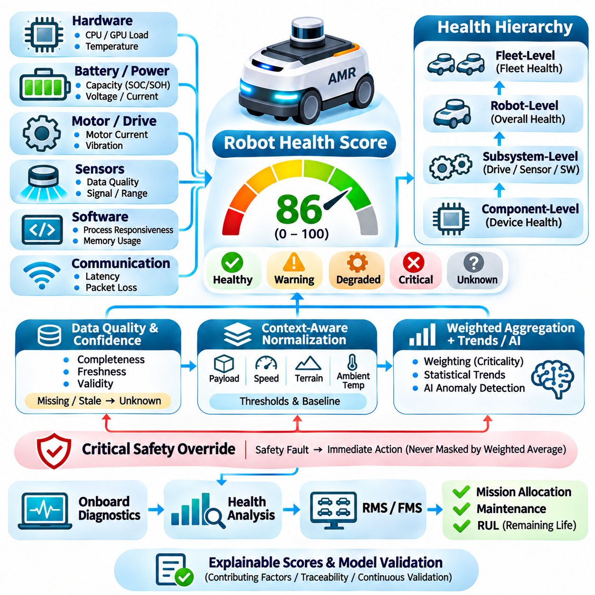
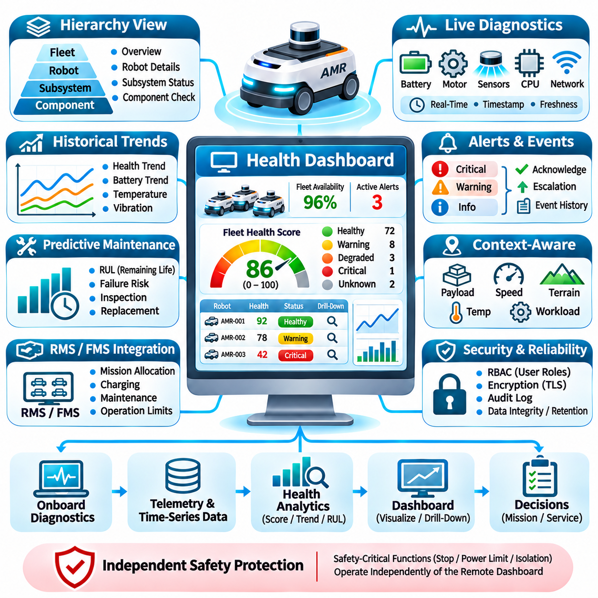

**Volume 08. AMR Operations, Deployment, and MLOps**


# Chapter 10. Robot Health Monitoring

##  

## 10.1 Robot Health Monitoring Overview

{width="7.268055555555556in" height="7.268055555555556in"}

Robot health monitoring is a fundamental operational capability that continuously evaluates the physical, electrical, computational, and software conditions of Autonomous Mobile Robots (AMRs). Its primary objective is to maintain operational reliability, availability, safety, and performance throughout the robot lifecycle. By identifying abnormal conditions before they develop into critical failures, health monitoring supports stable and sustainable autonomous robot operations.

Unlike conventional robot status monitoring, which primarily determines whether a robot is operating, idle, charging, or experiencing an error, health monitoring evaluates the underlying condition of individual components and integrated subsystems. A robot may successfully execute its assigned mission while experiencing gradual battery degradation, increasing motor temperatures, sensor instability, or computational resource exhaustion.

A comprehensive robot health monitoring architecture integrates mechanical systems, electrical systems, power management, drive systems, perception sensors, embedded controllers, communication interfaces, and application software. Each subsystem generates diagnostic information that can be collected, processed, and correlated to determine the overall operational condition of the robot and identify potential dependencies between failures.

Hardware status monitoring evaluates the physical and computational infrastructure of the robot. Important parameters include processor temperature, GPU utilization, memory consumption, storage capacity, cooling fan performance, controller communication status, and electrical connection integrity. Continuous observation of these parameters helps identify hardware degradation, thermal instability, and resource-related operational limitations.

Battery and power monitoring is particularly important because energy availability directly determines mission duration and operational continuity. The Battery Management System (BMS) provides information regarding State of Charge (SOC), State of Health (SOH), cell voltage, current, temperature, charging cycles, and cell imbalance. These measurements support energy management, battery protection, and long-term degradation assessment.

Motor and drive monitoring evaluates the operational condition of propulsion motors, motor drivers, steering actuators, braking systems, gearboxes, and wheel assemblies. Parameters such as motor current, torque, rotational speed, temperature, vibration, and tracking error provide valuable diagnostic information. Abnormal relationships between these measurements may indicate mechanical resistance, component wear, or control instability.

Sensor health monitoring ensures that the perception and localization systems receive reliable environmental information. LiDAR, RGB cameras, depth cameras, radar, ultrasonic sensors, GNSS receivers, and Inertial Measurement Units (IMUs) must be evaluated for communication continuity, measurement frequency, data integrity, calibration stability, and environmental interference that could compromise autonomous navigation.

Software process monitoring evaluates the execution condition of operating systems, middleware, communication nodes, control applications, navigation algorithms, and artificial intelligence inference pipelines. Process availability, execution latency, message frequency, memory consumption, exception frequency, and watchdog signals provide essential information for detecting software instability before mission execution is interrupted.

A distributed health monitoring architecture typically combines onboard diagnostic agents, edge computing resources, communication gateways, and centralized monitoring servers. Onboard monitoring enables immediate fault detection and local protective responses, while centralized infrastructure provides historical analysis, cross-robot comparison, remote diagnostics, and integrated health management across geographically distributed robot fleets.

The Robot Management System (RMS) and Fleet Management System (FMS) integrate health information into operational decision-making processes. Robots experiencing performance degradation may be assigned less demanding missions, redirected toward maintenance stations, or temporarily excluded from task allocation. Health-aware fleet management improves resource utilization while reducing unexpected interruptions and secondary operational risks.

A Health Score Model converts heterogeneous diagnostic measurements into standardized indicators representing component, subsystem, and overall robot conditions. These indicators may incorporate threshold violations, historical degradation trends, component criticality, measurement confidence, and operational context. However, critical safety faults must remain independently actionable and must not be concealed by favorable aggregate health scores.

Health monitoring requires reliable data acquisition and contextual interpretation. Measurements should be associated with synchronized timestamps, robot identifiers, component identifiers, software versions, operating conditions, and mission characteristics. Comparing measurements collected under similar payload, speed, environmental temperature, and terrain conditions helps distinguish genuine degradation from normal operational variations.

Health-related events should be classified according to severity, persistence, operational impact, and required intervention. Informational events support historical analysis, warning events indicate developing abnormalities, and critical events require immediate investigation or predefined protective responses. Validated thresholds, hysteresis, and event filtering help prevent excessive notifications without suppressing safety-critical conditions.

A health dashboard provides operators and maintenance engineers with an integrated representation of robot and fleet conditions. Real-time component status, historical trends, active warnings, diagnostic records, and maintenance requirements enable efficient operational assessment. Dashboard design should support navigation from fleet-level summaries to individual robots, subsystems, components, and underlying diagnostic measurements.

Robot health monitoring also establishes the operational foundation for predictive maintenance, failure analysis, and continuous engineering improvement. Historical diagnostic data can support anomaly detection, degradation modeling, Remaining Useful Life (RUL) estimation, and maintenance scheduling. Ultimately, effective health monitoring transforms AMR operations from reactive failure management toward proactive, data-driven lifecycle management.

로봇 건전성 모니터링(Robot Health Monitoring)은 자율이동로봇(Autonomous Mobile Robot, AMR)의 물리적, 전기적, 컴퓨팅 및 소프트웨어 상태를 지속적으로 평가하는 핵심 운영 기능이다. 주요 목적은 로봇의 전체 수명주기(Lifecycle)에 걸쳐 운영 신뢰성(Operational Reliability), 가용성(Availability), 안전성(Safety), 성능(Performance)을 유지하는 것이다. 비정상적인 상태가 심각한 고장으로 발전하기 전에 이를 식별함으로써 안정적이고 지속 가능한 자율로봇 운영을 지원한다.

기존의 로봇 상태 모니터링(Robot Status Monitoring)이 주로 로봇의 운행, 대기, 충전 또는 오류 발생 여부를 확인하는 것과 달리, 건전성 모니터링(Health Monitoring)은 개별 구성요소(Component)와 통합 하위 시스템(Integrated Subsystem)의 근본적인 상태를 평가한다. 로봇이 할당된 임무를 성공적으로 수행하고 있더라도 배터리 열화(Battery Degradation), 모터 온도 상승, 센서 불안정성(Sensor Instability), 컴퓨팅 자원 고갈(Computational Resource Exhaustion)이 점진적으로 발생하고 있을 수 있다.

종합적인 로봇 건전성 모니터링 아키텍처(Robot Health Monitoring Architecture)는 기계 시스템(Mechanical System), 전기 시스템(Electrical System), 전력 관리(Power Management), 구동 시스템(Drive System), 인지 센서(Perception Sensor), 임베디드 제어기(Embedded Controller), 통신 인터페이스(Communication Interface), 응용 소프트웨어(Application Software)를 통합한다. 각 하위 시스템에서 생성되는 진단 정보(Diagnostic Information)를 수집, 처리 및 상관관계 분석함으로써 로봇의 전체 운영 상태를 판단하고 고장 간의 잠재적인 의존관계(Dependency)를 식별할 수 있다.

하드웨어 상태 모니터링(Hardware Status Monitoring)은 로봇의 물리적 인프라(Physical Infrastructure)와 컴퓨팅 인프라(Computing Infrastructure)를 평가한다. 주요 측정 변수에는 프로세서 온도(Processor Temperature), GPU 사용률(GPU Utilization), 메모리 사용량(Memory Consumption), 저장장치 용량(Storage Capacity), 냉각 팬 성능(Cooling Fan Performance), 제어기 통신 상태(Controller Communication Status), 전기적 연결 무결성(Electrical Connection Integrity)이 포함된다. 이러한 변수에 대한 지속적인 관찰은 하드웨어 열화, 열적 불안정성(Thermal Instability), 자원 부족에 따른 운영상의 제약을 식별하는 데 도움이 된다.

배터리 및 전력 모니터링(Battery and Power Monitoring)은 에너지 가용성(Energy Availability)이 임무 수행 시간과 운영 연속성(Operational Continuity)을 직접적으로 결정하기 때문에 특히 중요하다. 배터리 관리 시스템(Battery Management System, BMS)은 충전 상태(State of Charge, SOC), 건전성 상태(State of Health, SOH), 셀 전압(Cell Voltage), 전류(Current), 온도(Temperature), 충전 사이클(Charging Cycle), 셀 불균형(Cell Imbalance)에 관한 정보를 제공한다. 이러한 측정값은 에너지 관리, 배터리 보호(Battery Protection), 장기적인 열화 평가(Degradation Assessment)를 지원한다.

모터 및 구동 시스템 모니터링(Motor and Drive Monitoring)은 추진 모터(Propulsion Motor), 모터 드라이버(Motor Driver), 조향 액추에이터(Steering Actuator), 제동 시스템(Braking System), 기어박스(Gearbox), 휠 어셈블리(Wheel Assembly)의 운영 상태를 평가한다. 모터 전류(Motor Current), 토크(Torque), 회전 속도(Rotational Speed), 온도, 진동(Vibration), 추종 오차(Tracking Error) 등의 변수는 중요한 진단 정보를 제공한다. 이러한 측정값 사이의 비정상적인 상관관계는 기계적 저항(Mechanical Resistance), 구성요소 마모(Component Wear), 제어 불안정성(Control Instability)을 나타낼 수 있다.

센서 건전성 모니터링(Sensor Health Monitoring)은 인지 시스템(Perception System)과 위치추정 시스템(Localization System)이 신뢰할 수 있는 환경 정보를 수신하도록 보장한다. 라이다(LiDAR), RGB 카메라(RGB Camera), 깊이 카메라(Depth Camera), 레이더(Radar), 초음파 센서(Ultrasonic Sensor), 위성항법 수신기(GNSS Receiver), 관성측정장치(Inertial Measurement Unit, IMU)에 대해 통신 연속성(Communication Continuity), 측정 주파수(Measurement Frequency), 데이터 무결성(Data Integrity), 교정 안정성(Calibration Stability), 자율주행을 저해할 수 있는 환경적 간섭(Environmental Interference)을 평가해야 한다.

소프트웨어 프로세스 모니터링(Software Process Monitoring)은 운영체제(Operating System), 미들웨어(Middleware), 통신 노드(Communication Node), 제어 애플리케이션(Control Application), 자율주행 알고리즘(Navigation Algorithm), 인공지능 추론 파이프라인(AI Inference Pipeline)의 실행 상태를 평가한다. 프로세스 가용성(Process Availability), 실행 지연시간(Execution Latency), 메시지 주파수(Message Frequency), 메모리 사용량, 예외 발생 빈도(Exception Frequency), 워치독 신호(Watchdog Signal)는 임무 수행이 중단되기 전에 소프트웨어 불안정성을 감지하기 위한 핵심 정보를 제공한다.

분산형 건전성 모니터링 아키텍처(Distributed Health Monitoring Architecture)는 일반적으로 온보드 진단 에이전트(Onboard Diagnostic Agent), 엣지 컴퓨팅 자원(Edge Computing Resource), 통신 게이트웨이(Communication Gateway), 중앙집중형 모니터링 서버(Centralized Monitoring Server)를 결합한다. 온보드 모니터링(Onboard Monitoring)은 즉각적인 고장 감지(Fault Detection)와 로컬 보호 대응(Local Protective Response)을 가능하게 하며, 중앙집중형 인프라는 이력 분석(Historical Analysis), 로봇 간 비교(Cross-Robot Comparison), 원격 진단(Remote Diagnostics), 지리적으로 분산된 로봇 군집의 통합 건전성 관리를 제공한다.

로봇 관리 시스템(Robot Management System, RMS)과 군집 관리 시스템(Fleet Management System, FMS)은 건전성 정보를 운영 의사결정 프로세스(Operational Decision-Making Process)에 통합한다. 성능 저하(Performance Degradation)가 발생한 로봇에는 상대적으로 부하가 낮은 임무를 할당하거나 유지보수 스테이션(Maintenance Station)으로 이동하도록 지시할 수 있으며, 일시적으로 작업 할당(Task Allocation) 대상에서 제외할 수도 있다. 건전성 기반 군집 관리(Health-Aware Fleet Management)는 예상치 못한 운영 중단과 이차적인 운영 위험을 감소시키면서 자원 활용률(Resource Utilization)을 향상시킨다.

건전성 점수 모델(Health Score Model)은 서로 다른 특성을 가진 진단 측정값을 구성요소, 하위 시스템 및 로봇 전체의 상태를 나타내는 표준화된 지표(Standardized Indicator)로 변환한다. 이러한 지표에는 임계값 위반(Threshold Violation), 과거 열화 추세(Historical Degradation Trend), 구성요소 중요도(Component Criticality), 측정 신뢰도(Measurement Confidence), 운영 맥락(Operational Context)이 반영될 수 있다. 그러나 안전에 중대한 영향을 미치는 고장(Critical Safety Fault)은 독립적인 대응 대상으로 유지되어야 하며, 양호한 종합 건전성 점수(Aggregate Health Score)에 의해 가려져서는 안 된다.

건전성 모니터링에는 신뢰할 수 있는 데이터 수집(Data Acquisition)과 맥락 기반 해석(Contextual Interpretation)이 필요하다. 측정값은 동기화된 타임스탬프(Synchronized Timestamp), 로봇 식별자(Robot Identifier), 구성요소 식별자(Component Identifier), 소프트웨어 버전(Software Version), 운영 조건(Operating Condition), 임무 특성(Mission Characteristic)과 연계되어야 한다. 유사한 적재하중(Payload), 주행 속도, 환경 온도(Ambient Temperature), 지형 조건(Terrain Condition)에서 수집된 측정값을 비교함으로써 실제 열화와 정상적인 운영 변동(Normal Operational Variation)을 구분할 수 있다.

건전성 관련 이벤트(Health-Related Event)는 심각도(Severity), 지속성(Persistence), 운영 영향(Operational Impact), 필요한 개입 수준(Required Intervention)에 따라 분류되어야 한다. 정보성 이벤트(Informational Event)는 이력 분석을 지원하고, 경고 이벤트(Warning Event)는 진행 중인 비정상 상태를 나타내며, 심각한 이벤트(Critical Event)는 즉각적인 조사 또는 사전에 정의된 보호 대응(Predefined Protective Response)을 요구한다. 검증된 임계값(Validated Threshold), 히스테리시스(Hysteresis), 이벤트 필터링(Event Filtering)은 안전에 중대한 영향을 미치는 상태를 누락하지 않으면서 과도한 알림 발생을 방지하는 데 도움이 된다.

건전성 대시보드(Health Dashboard)는 운영자(Operator)와 유지보수 엔지니어(Maintenance Engineer)에게 개별 로봇 및 로봇 군집 전체의 상태를 통합적으로 시각화하여 제공한다. 실시간 구성요소 상태(Real-Time Component Status), 과거 추세(Historical Trend), 활성 경고(Active Warning), 진단 기록(Diagnostic Record), 유지보수 요구사항(Maintenance Requirement)을 통해 효율적인 운영 상태 평가가 가능하다. 대시보드 설계(Dashboard Design)는 군집 수준의 요약 정보(Fleet-Level Summary)에서 개별 로봇, 하위 시스템, 구성요소 및 세부 진단 측정값까지 단계적으로 탐색할 수 있도록 지원해야 한다.

로봇 건전성 모니터링은 예측 유지보수(Predictive Maintenance), 고장 분석(Failure Analysis), 지속적인 엔지니어링 개선(Continuous Engineering Improvement)을 위한 운영 기반을 구축한다. 축적된 진단 데이터(Historical Diagnostic Data)는 이상 탐지(Anomaly Detection), 열화 모델링(Degradation Modeling), 잔여 유효 수명(Remaining Useful Life, RUL) 추정, 유지보수 일정 계획(Maintenance Scheduling)을 지원할 수 있다. 궁극적으로 효과적인 건전성 모니터링은 AMR 운영을 사후 대응형 고장 관리(Reactive Failure Management)에서 선제적이고 데이터 기반의 수명주기 관리(Proactive Data-Driven Lifecycle Management) 체계로 전환한다.

##  

## 10.2 Hardware Status Monitoring

{width="7.268055555555556in" height="7.268055555555556in"}

Hardware status monitoring is an essential component of Autonomous Mobile Robot (AMR) health management that continuously evaluates the operational condition of physical components, embedded computing platforms, electrical interfaces, and supporting infrastructure. Its primary objective is to detect hardware abnormalities, prevent unexpected system failures, maintain operational availability, and extend the effective service life of robotic assets.

An AMR hardware monitoring architecture must consider the robot as an integrated electromechanical and computational system rather than a collection of independent devices. Mechanical structures, embedded controllers, computing modules, communication interfaces, power distribution units, and thermal management systems interact continuously. A failure within one hardware subsystem may consequently affect the stability and performance of other subsystems.

Computing hardware monitoring evaluates the operating condition of Central Processing Units (CPUs), Graphics Processing Units (GPUs), Neural Processing Units (NPUs), and embedded computing platforms. Important diagnostic parameters include processor utilization, operating frequency, temperature, memory bandwidth, power consumption, and thermal throttling. Persistent resource saturation may indicate insufficient computing capacity or abnormal computational workloads.

Memory and storage monitoring ensures that sufficient computational resources remain available for autonomous navigation, perception, artificial intelligence inference, and operational data recording. Memory utilization, allocation failures, storage capacity, read and write latency, Solid-State Drive (SSD) temperature, storage endurance, and device error counters provide important indicators of hardware reliability and potential resource exhaustion.

Thermal management monitoring evaluates the ability of the robot to maintain hardware components within their specified operating temperature ranges. Temperature sensors installed around processors, power electronics, embedded controllers, and electrical enclosures provide continuous thermal measurements. Cooling fan speed, airflow conditions, heat dissipation efficiency, and temperature gradients help identify cooling degradation and environmental stress.

Electrical hardware monitoring evaluates the stability and integrity of the robot\'s power distribution infrastructure. Voltage regulators, DC-DC converters, circuit protection devices, power distribution boards, electrical relays, and connectors must operate within defined electrical limits. Unexpected voltage fluctuations, excessive current consumption, intermittent power interruptions, and abnormal electrical temperatures may indicate developing hardware faults.

Embedded controller monitoring focuses on Microcontroller Units (MCUs), Programmable Logic Controllers (PLCs), input and output modules, and dedicated real-time control devices. Controller heartbeat signals, watchdog events, communication timeouts, internal diagnostic registers, and reset counters provide essential information about controller stability. Repeated unexpected resets may indicate electrical interference, firmware defects, or hardware degradation.

Communication hardware monitoring evaluates the physical and operational integrity of Ethernet interfaces, Controller Area Network (CAN) transceivers, serial communication modules, wireless communication devices, and internal network switches. Link availability, transmission error counters, packet loss, signal strength, and connection interruptions help identify damaged cables, unstable connectors, electromagnetic interference, and communication hardware failures.

Mechanical hardware monitoring considers structural integrity, chassis vibration, enclosure conditions, mounting stability, connector retention, and mechanical component wear. Accelerometers, strain sensors, temperature sensors, and periodic physical inspections can provide complementary diagnostic information. Changes in vibration characteristics may indicate structural looseness, mechanical imbalance, bearing degradation, or abnormal interaction between mechanical assemblies.

Environmental monitoring provides additional context for interpreting hardware conditions during field operations. Ambient temperature, humidity, dust exposure, water ingress, shock, and vibration can significantly influence hardware reliability. Indoor and outdoor AMRs require monitoring configurations adapted to their operating environments, enclosure protection ratings, mission profiles, and expected environmental exposure throughout their operational lifecycle.

Hardware diagnostic data can be acquired through embedded firmware, operating system interfaces, device drivers, industrial communication protocols, and dedicated monitoring agents. Technologies such as Intelligent Platform Management Interface (IPMI), Self-Monitoring, Analysis and Reporting Technology (SMART), CAN diagnostics, and manufacturer-specific application programming interfaces provide access to different hardware-level measurements and diagnostic information.

A robust monitoring architecture combines periodic measurements with event-driven diagnostic mechanisms. Routine measurements establish normal operating baselines and long-term performance trends, while event-driven mechanisms capture sudden hardware abnormalities, communication failures, thermal protection events, and unexpected device resets. Sampling frequencies should reflect component criticality, diagnostic requirements, and available computing resources.

Hardware health evaluation should incorporate operating context rather than rely exclusively on fixed thresholds. Processor temperature, electrical consumption, vibration intensity, and communication performance naturally vary according to mission complexity, environmental conditions, and payload characteristics. Context-aware thresholds, statistical baselines, and historical comparisons improve abnormality detection while reducing unnecessary maintenance interventions.

Integration with the Robot Management System (RMS) and Fleet Management System (FMS) enables centralized hardware visibility across distributed robot fleets. Hardware diagnostic records should include robot identifiers, component serial numbers, hardware revisions, firmware versions, timestamps, and maintenance histories. This information supports remote troubleshooting, component traceability, fleet-level comparisons, and systematic reliability improvement.

Hardware monitoring results must support clearly defined operational responses, including maintenance notifications, workload reduction, mission reassignment, and controlled shutdown where appropriate. Safety-critical protection must remain independent of centralized monitoring services. Ultimately, hardware status monitoring establishes a foundation for predictive maintenance, lifecycle optimization, reduced downtime, and reliable large-scale AMR deployment.

하드웨어 상태 모니터링(Hardware Status Monitoring)은 물리적 구성요소(Physical Component), 임베디드 컴퓨팅 플랫폼(Embedded Computing Platform), 전기적 인터페이스(Electrical Interface), 지원 인프라(Supporting Infrastructure)의 운영 상태를 지속적으로 평가하는 자율이동로봇(Autonomous Mobile Robot, AMR) 건전성 관리(Health Management)의 핵심 요소이다. 주요 목적은 하드웨어 이상(Hardware Abnormality)을 감지하고, 예기치 못한 시스템 고장(System Failure)을 예방하며, 운영 가용성(Operational Availability)을 유지하고, 로봇 자산(Robotic Asset)의 유효 사용 수명(Effective Service Life)을 연장하는 것이다.

AMR 하드웨어 모니터링 아키텍처(Hardware Monitoring Architecture)는 로봇을 독립적인 장치들의 집합이 아니라 통합된 전기기계 및 컴퓨팅 시스템(Integrated Electromechanical and Computational System)으로 고려해야 한다. 기계적 구조물(Mechanical Structure), 임베디드 제어기(Embedded Controller), 컴퓨팅 모듈(Computing Module), 통신 인터페이스(Communication Interface), 전력 분배 장치(Power Distribution Unit), 열 관리 시스템(Thermal Management System)은 지속적으로 상호작용한다. 따라서 하나의 하드웨어 하위 시스템(Hardware Subsystem)에서 발생한 고장은 다른 하위 시스템의 안정성과 성능에 영향을 미칠 수 있다.

컴퓨팅 하드웨어 모니터링(Computing Hardware Monitoring)은 중앙처리장치(Central Processing Unit, CPU), 그래픽처리장치(Graphics Processing Unit, GPU), 신경망처리장치(Neural Processing Unit, NPU), 임베디드 컴퓨팅 플랫폼의 운영 상태를 평가한다. 주요 진단 변수(Diagnostic Parameter)에는 프로세서 사용률(Processor Utilization), 동작 주파수(Operating Frequency), 온도(Temperature), 메모리 대역폭(Memory Bandwidth), 전력 소비량(Power Consumption), 열적 성능 제한(Thermal Throttling)이 포함된다. 지속적인 자원 포화(Resource Saturation)는 불충분한 컴퓨팅 용량(Computing Capacity) 또는 비정상적인 연산 부하(Computational Workload)를 나타낼 수 있다.

메모리 및 저장장치 모니터링(Memory and Storage Monitoring)은 자율주행(Autonomous Navigation), 인지(Perception), 인공지능 추론(AI Inference), 운영 데이터 기록(Operational Data Recording)에 필요한 충분한 컴퓨팅 자원을 확보하도록 보장한다. 메모리 사용률(Memory Utilization), 메모리 할당 실패(Allocation Failure), 저장장치 용량(Storage Capacity), 읽기 및 쓰기 지연시간(Read and Write Latency), 솔리드 스테이트 드라이브(Solid-State Drive, SSD) 온도, 저장장치 내구성(Storage Endurance), 장치 오류 카운터(Device Error Counter)는 하드웨어 신뢰성(Hardware Reliability)과 잠재적인 자원 고갈(Resource Exhaustion)을 평가하는 중요한 지표이다.

열 관리 모니터링(Thermal Management Monitoring)은 로봇의 하드웨어 구성요소를 규정된 동작 온도 범위(Operating Temperature Range) 내에서 유지할 수 있는 능력을 평가한다. 프로세서, 전력전자 장치(Power Electronics), 임베디드 제어기, 전기 인클로저(Electrical Enclosure) 주변에 설치된 온도 센서(Temperature Sensor)는 지속적인 열 측정값(Thermal Measurement)을 제공한다. 냉각 팬 회전 속도(Cooling Fan Speed), 공기 흐름 상태(Airflow Condition), 방열 효율(Heat Dissipation Efficiency), 온도 구배(Temperature Gradient)는 냉각 성능 저하(Cooling Degradation)와 환경적 스트레스(Environmental Stress)를 식별하는 데 도움이 된다.

전기 하드웨어 모니터링(Electrical Hardware Monitoring)은 로봇의 전력 분배 인프라(Power Distribution Infrastructure)의 안정성과 무결성(Integrity)을 평가한다. 전압 조정기(Voltage Regulator), 직류-직류 변환기(DC-DC Converter), 회로 보호 장치(Circuit Protection Device), 전력 분배 보드(Power Distribution Board), 전기 릴레이(Electrical Relay), 커넥터(Connector)는 정의된 전기적 한계(Electrical Limit) 내에서 동작해야 한다. 예기치 못한 전압 변동(Voltage Fluctuation), 과도한 전류 소비(Excessive Current Consumption), 간헐적인 전력 공급 중단(Intermittent Power Interruption), 전기 장치의 비정상적인 온도는 진행 중인 하드웨어 고장을 나타낼 수 있다.

임베디드 제어기 모니터링(Embedded Controller Monitoring)은 마이크로컨트롤러 장치(Microcontroller Unit, MCU), 프로그래머블 로직 제어기(Programmable Logic Controller, PLC), 입출력 모듈(Input and Output Module), 전용 실시간 제어 장치(Dedicated Real-Time Control Device)에 중점을 둔다. 제어기 하트비트 신호(Controller Heartbeat Signal), 워치독 이벤트(Watchdog Event), 통신 시간 초과(Communication Timeout), 내부 진단 레지스터(Internal Diagnostic Register), 리셋 카운터(Reset Counter)는 제어기 안정성(Controller Stability)에 관한 핵심 정보를 제공한다. 반복적으로 발생하는 예기치 못한 리셋은 전기적 간섭(Electrical Interference), 펌웨어 결함(Firmware Defect), 하드웨어 열화(Hardware Degradation)를 나타낼 수 있다.

통신 하드웨어 모니터링(Communication Hardware Monitoring)은 이더넷 인터페이스(Ethernet Interface), 제어기 영역 네트워크(Controller Area Network, CAN) 트랜시버, 직렬 통신 모듈(Serial Communication Module), 무선 통신 장치(Wireless Communication Device), 내부 네트워크 스위치(Internal Network Switch)의 물리적 및 운영상 무결성을 평가한다. 링크 가용성(Link Availability), 전송 오류 카운터(Transmission Error Counter), 패킷 손실(Packet Loss), 신호 강도(Signal Strength), 연결 중단(Connection Interruption)은 손상된 케이블, 불안정한 커넥터, 전자기 간섭(Electromagnetic Interference, EMI), 통신 하드웨어 고장을 식별하는 데 도움이 된다.

기계 하드웨어 모니터링(Mechanical Hardware Monitoring)은 구조적 무결성(Structural Integrity), 섀시 진동(Chassis Vibration), 인클로저 상태(Enclosure Condition), 장착 안정성(Mounting Stability), 커넥터 체결 유지 상태(Connector Retention), 기계 구성요소 마모(Mechanical Component Wear)를 고려한다. 가속도계(Accelerometer), 변형률 센서(Strain Sensor), 온도 센서, 정기적인 물리적 검사(Periodic Physical Inspection)는 상호 보완적인 진단 정보를 제공할 수 있다. 진동 특성(Vibration Characteristic)의 변화는 구조적 풀림(Structural Looseness), 기계적 불균형(Mechanical Imbalance), 베어링 열화(Bearing Degradation), 기계 어셈블리 간의 비정상적인 상호작용을 나타낼 수 있다.

환경 모니터링(Environmental Monitoring)은 현장 운영(Field Operation) 중 하드웨어 상태를 해석하기 위한 추가적인 맥락 정보를 제공한다. 주변 온도(Ambient Temperature), 습도(Humidity), 분진 노출(Dust Exposure), 수분 침투(Water Ingress), 충격(Shock), 진동(Vibration)은 하드웨어 신뢰성에 상당한 영향을 미칠 수 있다. 실내 및 실외 AMR은 각각의 운영 환경(Operating Environment), 인클로저 보호 등급(Enclosure Protection Rating), 임무 프로파일(Mission Profile), 전체 운영 수명주기(Operational Lifecycle)에 걸쳐 예상되는 환경 노출(Environmental Exposure)에 적합한 모니터링 구성을 필요로 한다.

하드웨어 진단 데이터(Hardware Diagnostic Data)는 임베디드 펌웨어(Embedded Firmware), 운영체제 인터페이스(Operating System Interface), 장치 드라이버(Device Driver), 산업용 통신 프로토콜(Industrial Communication Protocol), 전용 모니터링 에이전트(Dedicated Monitoring Agent)를 통해 수집할 수 있다. 지능형 플랫폼 관리 인터페이스(Intelligent Platform Management Interface, IPMI), 자체 모니터링·분석·보고 기술(Self-Monitoring, Analysis and Reporting Technology, SMART), CAN 진단(CAN Diagnostics), 제조사별 응용 프로그래밍 인터페이스(Manufacturer-Specific Application Programming Interface, API) 등의 기술은 다양한 하드웨어 수준의 측정값과 진단 정보에 접근할 수 있도록 지원한다.

견고한 모니터링 아키텍처(Robust Monitoring Architecture)는 주기적 측정(Periodic Measurement)과 이벤트 기반 진단 메커니즘(Event-Driven Diagnostic Mechanism)을 결합한다. 일상적인 측정은 정상 운영 기준선(Normal Operating Baseline)과 장기적인 성능 추세(Long-Term Performance Trend)를 구축하며, 이벤트 기반 메커니즘은 갑작스러운 하드웨어 이상, 통신 장애(Communication Failure), 열 보호 이벤트(Thermal Protection Event), 예기치 못한 장치 리셋(Device Reset)을 포착한다. 샘플링 주파수(Sampling Frequency)는 구성요소 중요도(Component Criticality), 진단 요구사항(Diagnostic Requirement), 가용 컴퓨팅 자원(Available Computing Resource)을 반영하여 결정해야 한다.

하드웨어 건전성 평가(Hardware Health Evaluation)는 고정 임계값(Fixed Threshold)에만 의존하지 않고 운영 맥락(Operating Context)을 반영해야 한다. 프로세서 온도, 전력 소비량, 진동 강도(Vibration Intensity), 통신 성능(Communication Performance)은 임무 복잡도(Mission Complexity), 환경 조건(Environmental Condition), 적재하중 특성(Payload Characteristic)에 따라 자연스럽게 변화한다. 맥락 인식형 임계값(Context-Aware Threshold), 통계적 기준선(Statistical Baseline), 과거 데이터 비교(Historical Comparison)는 불필요한 유지보수 개입(Maintenance Intervention)을 줄이면서 이상 탐지(Abnormality Detection)의 성능을 향상시킨다.

로봇 관리 시스템(Robot Management System, RMS) 및 군집 관리 시스템(Fleet Management System, FMS)과의 통합은 분산된 로봇 군집(Distributed Robot Fleet) 전체의 하드웨어 상태에 대한 중앙집중형 가시성(Centralized Hardware Visibility)을 확보할 수 있도록 한다. 하드웨어 진단 기록(Hardware Diagnostic Record)에는 로봇 식별자(Robot Identifier), 구성요소 일련번호(Component Serial Number), 하드웨어 개정 버전(Hardware Revision), 펌웨어 버전(Firmware Version), 타임스탬프(Timestamp), 유지보수 이력(Maintenance History)이 포함되어야 한다. 이러한 정보는 원격 문제 해결(Remote Troubleshooting), 구성요소 추적성(Component Traceability), 군집 수준 비교(Fleet-Level Comparison), 체계적인 신뢰성 개선(Systematic Reliability Improvement)을 지원한다.

하드웨어 모니터링 결과는 유지보수 알림(Maintenance Notification), 작업 부하 감소(Workload Reduction), 임무 재할당(Mission Reassignment), 필요한 경우 제어된 시스템 종료(Controlled Shutdown)를 포함하여 명확하게 정의된 운영 대응(Operational Response)을 지원해야 한다. 안전 필수 보호 기능(Safety-Critical Protection)은 중앙집중형 모니터링 서비스(Centralized Monitoring Service)로부터 독립적으로 유지되어야 한다. 궁극적으로 하드웨어 상태 모니터링은 예측 유지보수(Predictive Maintenance), 수명주기 최적화(Lifecycle Optimization), 운영 중단 시간 감소(Downtime Reduction), 신뢰성 높은 대규모 AMR 배치(Large-Scale AMR Deployment)를 위한 기반을 구축한다.

##  

## 10.3 Battery and Power Monitoring

{width="7.268055555555556in" height="7.268055555555556in"}

Battery and power monitoring is a critical element of Autonomous Mobile Robot (AMR) health management that continuously evaluates energy availability, battery condition, electrical stability, and power consumption throughout robot operations. Its primary objective is to ensure reliable mission execution, prevent unexpected power interruptions, protect electrical components, and optimize energy utilization throughout the operational lifecycle.

The Battery Management System (BMS) serves as the primary source of battery diagnostic information and protective functions. It continuously monitors individual cell voltages, battery pack voltage, charging and discharging currents, cell temperatures, and electrical protection conditions. Integration between the BMS and onboard robot controllers enables coordinated energy management, fault detection, and appropriate operational responses.

State of Charge (SOC) represents the estimated remaining electrical charge relative to the available battery capacity. Accurate SOC estimation is essential for mission planning, charging scheduling, and operational availability. Estimation methods may combine Coulomb counting, Open Circuit Voltage (OCV) measurements, equivalent circuit models, and adaptive filtering techniques to compensate for measurement uncertainty and changing battery conditions.

State of Health (SOH) represents the degradation of battery performance relative to its initial or specified condition. Battery capacity reduction, internal resistance growth, charging efficiency, and historical operating conditions provide important information for SOH estimation. Continuous assessment enables maintenance engineers to identify deteriorating battery packs, evaluate replacement requirements, and reduce unexpected energy-related failures.

State of Power (SOP) describes the battery\'s capability to deliver or absorb electrical power under current operating conditions. Available power depends on battery temperature, SOC, internal resistance, cell voltage limits, and degradation characteristics. Monitoring SOP is particularly important for heavy-duty AMRs that experience significant transient power demands during acceleration, slope climbing, steering, and payload transportation.

Cell-level monitoring identifies voltage imbalance, abnormal temperature distribution, and potential degradation within individual battery cells. Excessive differences between cell voltages may reduce usable battery capacity and increase operational risks. Cell balancing mechanisms help maintain consistent charging conditions, while historical cell-level measurements support early identification of abnormal cells and emerging battery pack failures.

Battery thermal monitoring evaluates temperature distribution across battery cells, modules, electrical terminals, and surrounding enclosures. Excessive temperatures accelerate battery degradation and may introduce significant safety hazards. Low temperatures can reduce available capacity and charging capability. Temperature thresholds and protective responses must reflect battery chemistry, manufacturer specifications, and validated operating limits.

Power distribution monitoring evaluates the electrical condition of power distribution units, DC-DC converters, voltage regulators, contactors, circuit breakers, and electrical protection devices. Input and output voltages, current consumption, conversion efficiency, and component temperatures provide essential diagnostic information. Abnormal voltage fluctuations or electrical losses may indicate connector degradation or power conversion failures.

Energy consumption monitoring analyzes electrical power usage across propulsion systems, embedded controllers, computing platforms, perception sensors, communication modules, and auxiliary equipment. Subsystem-level measurements help identify inefficient components and unexpected energy consumption patterns. Energy consumption per unit distance, mission, operating hour, or transported payload supports systematic operational efficiency assessment.

Charging system monitoring evaluates charging station availability, charging voltage, current profiles, charging duration, connector conditions, and communication between the robot and charging infrastructure. Abnormal charging interruptions, excessive connector temperatures, and reduced charging efficiency may indicate developing infrastructure or battery faults. Reliable charging diagnostics support autonomous docking and continuous fleet operations.

Battery monitoring must incorporate operational context because energy consumption and battery performance vary significantly with payload, travel speed, acceleration, terrain conditions, ambient temperature, and computational workload. Context-aware energy models enable more accurate mission range estimation and distinguish genuine battery degradation from temporary variations associated with demanding operating environments.

Integration with the Robot Management System (RMS) and Fleet Management System (FMS) enables centralized battery and power management across distributed robot fleets. Real-time SOC, SOH, available power, estimated remaining operating time, and charging requirements can influence mission allocation and charging schedules. Health-aware scheduling prevents unsuitable task assignments and improves overall fleet availability.

Battery and power diagnostic events should be classified according to severity, persistence, and operational impact. Low energy warnings, cell imbalance, abnormal current consumption, undervoltage, overvoltage, and excessive temperature require predefined response policies. Depending on the detected condition, appropriate responses may include mission reassignment, power limitation, controlled stopping, charging requests, or electrical isolation.

Historical battery and power data provide a foundation for predictive maintenance, battery degradation analysis, and lifecycle optimization. Charging cycles, cumulative energy throughput, depth of discharge, temperature exposure, internal resistance trends, and capacity measurements support Remaining Useful Life (RUL) estimation. Maintenance decisions can therefore incorporate actual usage conditions rather than depend exclusively on fixed replacement intervals.

A reliable battery and power monitoring architecture combines onboard protection mechanisms, real-time diagnostic agents, centralized health dashboards, and historical data analytics. Safety-critical battery protection must remain functional independently of network connectivity and cloud services. Ultimately, comprehensive energy monitoring improves robot availability, operational safety, battery longevity, fleet productivity, and total cost of ownership.

배터리 및 전력 모니터링(Battery and Power Monitoring)은 로봇 운영 전반에 걸쳐 에너지 가용성(Energy Availability), 배터리 상태(Battery Condition), 전기적 안정성(Electrical Stability), 전력 소비량(Power Consumption)을 지속적으로 평가하는 자율이동로봇(Autonomous Mobile Robot, AMR) 건전성 관리(Health Management)의 핵심 요소이다. 주요 목적은 신뢰성 높은 임무 수행(Mission Execution)을 보장하고, 예기치 못한 전력 공급 중단(Power Interruption)을 예방하며, 전기적 구성요소(Electrical Component)를 보호하고, 전체 운영 수명주기(Operational Lifecycle)에 걸쳐 에너지 활용(Energy Utilization)을 최적화하는 것이다.

배터리 관리 시스템(Battery Management System, BMS)은 배터리 진단 정보(Battery Diagnostic Information)와 보호 기능(Protection Function)을 제공하는 핵심 시스템이다. 개별 셀 전압(Cell Voltage), 배터리 팩 전압(Battery Pack Voltage), 충전 및 방전 전류(Charging and Discharging Current), 셀 온도(Cell Temperature), 전기적 보호 상태(Electrical Protection Condition)를 지속적으로 모니터링한다. BMS와 온보드 로봇 제어기(Onboard Robot Controller)의 통합은 상호 연계된 에너지 관리(Energy Management), 고장 감지(Fault Detection), 적절한 운영 대응(Operational Response)을 가능하게 한다.

충전 상태(State of Charge, SOC)는 사용 가능한 배터리 용량(Battery Capacity) 대비 추정된 잔여 전하량(Remaining Electrical Charge)을 나타낸다. 정확한 SOC 추정(SOC Estimation)은 임무 계획(Mission Planning), 충전 일정 관리(Charging Scheduling), 운영 가용성(Operational Availability)을 확보하는 데 필수적이다. 추정 방법에는 측정 불확실성(Measurement Uncertainty)과 변화하는 배터리 상태를 보상하기 위해 쿨롱 계수법(Coulomb Counting), 개방회로 전압(Open Circuit Voltage, OCV) 측정, 등가회로 모델(Equivalent Circuit Model), 적응형 필터링 기법(Adaptive Filtering Technique)을 결합할 수 있다.

건전성 상태(State of Health, SOH)는 초기 상태 또는 규정된 상태 대비 배터리 성능의 열화(Degradation)를 나타낸다. 배터리 용량 감소(Battery Capacity Reduction), 내부 저항 증가(Internal Resistance Growth), 충전 효율(Charging Efficiency), 과거 운영 조건(Historical Operating Condition)은 SOH 추정을 위한 중요한 정보를 제공한다. 지속적인 평가를 통해 유지보수 엔지니어(Maintenance Engineer)는 열화가 진행되는 배터리 팩을 식별하고, 교체 요구사항(Replacement Requirement)을 평가하며, 예기치 못한 에너지 관련 고장(Energy-Related Failure)을 줄일 수 있다.

출력 상태(State of Power, SOP)는 현재 운영 조건에서 배터리가 전력을 공급하거나 흡수할 수 있는 능력을 나타낸다. 가용 전력(Available Power)은 배터리 온도, SOC, 내부 저항(Internal Resistance), 셀 전압 한계(Cell Voltage Limit), 열화 특성(Degradation Characteristic)에 따라 달라진다. SOP 모니터링은 가속(Acceleration), 경사로 등판(Slope Climbing), 조향(Steering), 적재물 운송(Payload Transportation) 과정에서 상당한 과도 전력 요구(Transient Power Demand)가 발생하는 고하중 자율이동로봇(Heavy-Duty AMR)에서 특히 중요하다.

셀 수준 모니터링(Cell-Level Monitoring)은 개별 배터리 셀 내부의 전압 불균형(Voltage Imbalance), 비정상적인 온도 분포(Abnormal Temperature Distribution), 잠재적인 열화를 식별한다. 셀 간의 과도한 전압 차이(Voltage Difference)는 사용 가능한 배터리 용량(Usable Battery Capacity)을 감소시키고 운영 위험(Operational Risk)을 증가시킬 수 있다. 셀 밸런싱 메커니즘(Cell Balancing Mechanism)은 일관된 충전 상태를 유지하는 데 도움이 되며, 축적된 셀 수준 측정값(Historical Cell-Level Measurement)은 비정상적인 셀과 초기 단계의 배터리 팩 고장(Battery Pack Failure)을 조기에 식별하도록 지원한다.

배터리 열 모니터링(Battery Thermal Monitoring)은 배터리 셀, 모듈(Module), 전기 단자(Electrical Terminal), 주변 인클로저(Enclosure) 전반의 온도 분포(Temperature Distribution)를 평가한다. 과도한 온도 상승은 배터리 열화를 가속하고 심각한 안전 위험(Safety Hazard)을 초래할 수 있다. 낮은 온도는 가용 용량(Available Capacity)과 충전 능력(Charging Capability)을 감소시킬 수 있다. 온도 임계값(Temperature Threshold)과 보호 대응(Protective Response)은 배터리 화학 특성(Battery Chemistry), 제조사 사양(Manufacturer Specification), 검증된 운영 한계(Validated Operating Limit)를 반영해야 한다.

전력 분배 모니터링(Power Distribution Monitoring)은 전력 분배 장치(Power Distribution Unit, PDU), 직류-직류 변환기(DC-DC Converter), 전압 조정기(Voltage Regulator), 전자 접촉기(Contactor), 회로 차단기(Circuit Breaker), 전기 보호 장치(Electrical Protection Device)의 전기적 상태를 평가한다. 입출력 전압(Input and Output Voltage), 전류 소비량(Current Consumption), 전력 변환 효율(Power Conversion Efficiency), 구성요소 온도(Component Temperature)는 핵심적인 진단 정보를 제공한다. 비정상적인 전압 변동(Voltage Fluctuation)이나 전력 손실(Electrical Loss)은 커넥터 열화(Connector Degradation) 또는 전력 변환 고장(Power Conversion Failure)을 나타낼 수 있다.

에너지 소비 모니터링(Energy Consumption Monitoring)은 추진 시스템(Propulsion System), 임베디드 제어기(Embedded Controller), 컴퓨팅 플랫폼(Computing Platform), 인지 센서(Perception Sensor), 통신 모듈(Communication Module), 보조 장비(Auxiliary Equipment) 전반의 전력 사용량을 분석한다. 하위 시스템 수준의 측정(Subsystem-Level Measurement)은 비효율적인 구성요소와 예기치 못한 에너지 소비 패턴(Energy Consumption Pattern)을 식별하는 데 도움이 된다. 단위 주행 거리, 임무, 운영 시간 또는 운송 적재하중당 에너지 소비량은 체계적인 운영 효율성 평가(Operational Efficiency Assessment)를 지원한다.

충전 시스템 모니터링(Charging System Monitoring)은 충전 스테이션 가용성(Charging Station Availability), 충전 전압(Charging Voltage), 전류 프로파일(Current Profile), 충전 소요 시간(Charging Duration), 커넥터 상태(Connector Condition), 로봇과 충전 인프라(Charging Infrastructure) 간의 통신 상태를 평가한다. 비정상적인 충전 중단(Charging Interruption), 과도한 커넥터 온도, 충전 효율 저하는 충전 인프라 또는 배터리에서 진행 중인 고장을 나타낼 수 있다. 신뢰성 높은 충전 진단(Charging Diagnostics)은 자율 도킹(Autonomous Docking)과 지속적인 로봇 군집 운영(Continuous Fleet Operation)을 지원한다.

배터리 모니터링은 에너지 소비량과 배터리 성능이 적재하중(Payload), 주행 속도(Travel Speed), 가속도(Acceleration), 지형 조건(Terrain Condition), 주변 온도(Ambient Temperature), 연산 부하(Computational Workload)에 따라 크게 달라지기 때문에 운영 맥락(Operational Context)을 반드시 반영해야 한다. 맥락 인식형 에너지 모델(Context-Aware Energy Model)은 더욱 정확한 임무 수행 가능 거리 추정(Mission Range Estimation)을 가능하게 하며, 실제 배터리 열화와 높은 부하를 요구하는 운영 환경에서 발생하는 일시적인 성능 변동(Temporary Performance Variation)을 구분할 수 있도록 한다.

로봇 관리 시스템(Robot Management System, RMS) 및 군집 관리 시스템(Fleet Management System, FMS)과의 통합은 분산된 로봇 군집(Distributed Robot Fleet) 전체에 대한 중앙집중형 배터리 및 전력 관리(Centralized Battery and Power Management)를 가능하게 한다. 실시간 SOC, SOH, 가용 전력, 추정 잔여 운영 시간(Estimated Remaining Operating Time), 충전 요구사항(Charging Requirement)은 임무 할당(Mission Allocation)과 충전 일정(Charging Schedule)에 영향을 미칠 수 있다. 건전성 기반 일정 관리(Health-Aware Scheduling)는 부적절한 작업 할당(Task Assignment)을 방지하고 전체 로봇 군집의 가용성(Fleet Availability)을 향상시킨다.

배터리 및 전력 진단 이벤트(Battery and Power Diagnostic Event)는 심각도(Severity), 지속성(Persistence), 운영 영향(Operational Impact)에 따라 분류되어야 한다. 에너지 부족 경고(Low Energy Warning), 셀 불균형(Cell Imbalance), 비정상적인 전류 소비(Abnormal Current Consumption), 저전압(Undervoltage), 과전압(Overvoltage), 과도한 온도 상승에 대해서는 사전에 정의된 대응 정책(Predefined Response Policy)이 필요하다. 감지된 상태에 따라 임무 재할당(Mission Reassignment), 전력 제한(Power Limitation), 제어된 정지(Controlled Stopping), 충전 요청(Charging Request), 전기적 격리(Electrical Isolation) 등의 적절한 대응을 수행할 수 있다.

축적된 배터리 및 전력 데이터(Historical Battery and Power Data)는 예측 유지보수(Predictive Maintenance), 배터리 열화 분석(Battery Degradation Analysis), 수명주기 최적화(Lifecycle Optimization)를 위한 기반을 제공한다. 충전 사이클(Charging Cycle), 누적 에너지 처리량(Cumulative Energy Throughput), 방전 심도(Depth of Discharge, DOD), 온도 노출(Temperature Exposure), 내부 저항 추세(Internal Resistance Trend), 용량 측정값(Capacity Measurement)은 잔여 유효 수명(Remaining Useful Life, RUL) 추정을 지원한다. 따라서 유지보수 의사결정(Maintenance Decision-Making)은 고정된 교체 주기(Fixed Replacement Interval)에만 의존하지 않고 실제 사용 조건(Actual Usage Condition)을 반영할 수 있다.

신뢰성 높은 배터리 및 전력 모니터링 아키텍처(Battery and Power Monitoring Architecture)는 온보드 보호 메커니즘(Onboard Protection Mechanism), 실시간 진단 에이전트(Real-Time Diagnostic Agent), 중앙집중형 건전성 대시보드(Centralized Health Dashboard), 과거 데이터 분석(Historical Data Analytics)을 결합한다. 안전 필수 배터리 보호 기능(Safety-Critical Battery Protection)은 네트워크 연결성(Network Connectivity)과 클라우드 서비스(Cloud Service)로부터 독립적으로 동작해야 한다. 궁극적으로 종합적인 에너지 모니터링(Comprehensive Energy Monitoring)은 로봇 가용성(Robot Availability), 운영 안전성(Operational Safety), 배터리 수명(Battery Longevity), 로봇 군집 생산성(Fleet Productivity), 총소유비용(Total Cost of Ownership, TCO)을 개선한다.

##  

## 10.4 Motor and Drive Monitoring

{width="7.268055555555556in" height="7.268055555555556in"}

Motor and drive monitoring is a fundamental component of Autonomous Mobile Robot (AMR) health management that continuously evaluates the operational condition of propulsion motors, motor controllers, steering actuators, transmission mechanisms, braking systems, and wheel assemblies. Its primary objective is to maintain reliable mobility, detect emerging mechanical and electrical abnormalities, and prevent unexpected failures during autonomous mission execution.

An AMR drive system consists of interconnected electrical, mechanical, and control subsystems that convert electrical energy into controlled motion. Differential drive, steering drive, omnidirectional drive, and multi-wheel drive platforms exhibit different operational characteristics and failure mechanisms. Monitoring architectures must therefore reflect the specific drivetrain configuration, mechanical structure, payload capacity, and intended operating environment.

Motor electrical monitoring evaluates operating parameters such as phase current, supply voltage, electrical power consumption, motor torque, rotational speed, and winding resistance where measurable. Excessive current consumption under comparable operating conditions may indicate increased mechanical resistance, bearing degradation, electrical abnormalities, or drivetrain inefficiency. Continuous electrical measurements support early fault identification.

Motor thermal monitoring evaluates winding temperature, motor housing temperature, bearing temperature, and the thermal condition of motor drivers. Sustained operation at elevated temperatures may accelerate insulation degradation, reduce component lifetime, and trigger protective functions. Temperature measurements should be interpreted in relation to ambient temperature, mechanical loading, operating duration, and cooling system performance.

Motor controller monitoring focuses on the operational condition of motor drivers, inverters, and embedded motion control devices. Diagnostic information includes overcurrent events, voltage abnormalities, semiconductor temperatures, communication timeouts, encoder errors, and controller fault codes. Repeated protection events or unexpected controller resets may indicate underlying electrical instability, hardware degradation, or inappropriate control parameters.

Mechanical drivetrain monitoring evaluates gearboxes, reduction mechanisms, drive shafts, bearings, couplings, and wheel assemblies. Vibration characteristics, acoustic signatures, mechanical backlash, rotational resistance, and temperature variations provide valuable diagnostic information. Changes in these measurements may indicate lubrication deterioration, gear wear, bearing damage, shaft misalignment, or structural looseness within the drivetrain.

Wheel and traction monitoring evaluates wheel rotational speed, tire condition, wheel slip, rolling resistance, and ground interaction characteristics. Differences between commanded motion, wheel encoder measurements, and independently estimated robot movement may indicate insufficient traction or mechanical abnormalities. Outdoor AMRs require particular attention to terrain variability, tire deformation, surface contamination, and uneven wheel loading.

Steering system monitoring is particularly important for steer-drive, Ackermann steering, and multi-axle robotic platforms. Steering angle, actuator current, angular velocity, position tracking error, mechanical backlash, and end-stop conditions provide essential diagnostic information. Persistent discrepancies between commanded and measured steering angles may indicate actuator degradation, encoder misalignment, or abnormal mechanical resistance.

Braking system monitoring evaluates brake actuator status, engagement and release behavior, braking response time, stopping distance, and thermal conditions. Electromagnetic brakes, mechanical friction brakes, and regenerative braking systems require different diagnostic parameters. Abnormal braking behavior must trigger predefined protective responses because braking capability directly influences operational and functional safety.

Motion control performance monitoring evaluates the relationship between commanded and measured velocity, acceleration, torque, steering angle, and trajectory execution. Persistent tracking errors, excessive oscillations, unstable acceleration, and unexpected stopping behavior may indicate mechanical degradation or control instability. Correlating motion control data with hardware diagnostics improves fault isolation and operational reliability.

Context-aware drive monitoring is necessary because motor current, torque, temperature, vibration, and energy consumption naturally vary with payload, travel speed, acceleration, slope, and terrain conditions. Establishing operating baselines for comparable mission profiles enables more accurate abnormality detection. Contextual analysis helps distinguish genuine drivetrain degradation from temporary increases in mechanical loading during demanding missions.

Drive diagnostic information can be collected through motor controller interfaces, Controller Area Network (CAN), CANopen, EtherCAT, industrial Ethernet, and dedicated onboard monitoring agents. High-frequency measurements support transient fault analysis, while aggregated diagnostic records support long-term degradation assessment. Synchronized timestamps and component identifiers enable correlation between electrical, mechanical, and motion control events.

Integration with the Robot Management System (RMS) and Fleet Management System (FMS) enables centralized drivetrain health assessment across distributed robot fleets. Detected abnormalities may influence mission allocation, permissible payload, maximum operating speed, and maintenance scheduling. Robots exhibiting degraded mobility should operate only within validated limits or be removed from service when continued operation becomes unsafe.

Historical motor and drive measurements establish a foundation for predictive maintenance and component lifetime estimation. Cumulative operating hours, traveled distance, torque exposure, thermal cycles, vibration trends, and recorded overload events support degradation modeling and Remaining Useful Life (RUL) estimation. Such information enables maintenance strategies based on actual component usage rather than fixed service intervals alone.

A comprehensive motor and drive monitoring architecture combines onboard diagnostics, independent safety protection, context-aware anomaly detection, centralized health visualization, and historical data analytics. Critical protective functions must remain operational independently of network connectivity and cloud services. Effective drivetrain monitoring ultimately improves mobility reliability, operational safety, energy efficiency, component longevity, and fleet availability.

모터 및 구동 시스템 모니터링(Motor and Drive Monitoring)은 추진 모터(Propulsion Motor), 모터 제어기(Motor Controller), 조향 액추에이터(Steering Actuator), 동력 전달 메커니즘(Transmission Mechanism), 제동 시스템(Braking System), 휠 어셈블리(Wheel Assembly)의 운영 상태를 지속적으로 평가하는 자율이동로봇(Autonomous Mobile Robot, AMR) 건전성 관리(Health Management)의 핵심 요소이다. 주요 목적은 신뢰성 높은 이동성(Mobility)을 유지하고, 초기 단계의 기계적 및 전기적 이상(Mechanical and Electrical Abnormality)을 감지하며, 자율 임무 수행(Autonomous Mission Execution) 중 예기치 못한 고장을 예방하는 것이다.

AMR 구동 시스템(Drive System)은 전기 에너지(Electrical Energy)를 제어된 운동(Controlled Motion)으로 변환하는 상호 연결된 전기적, 기계적 및 제어 하위 시스템(Control Subsystem)으로 구성된다. 차동 구동(Differential Drive), 조향 구동(Steering Drive), 전방향 구동(Omnidirectional Drive), 다륜 구동(Multi-Wheel Drive) 플랫폼은 서로 다른 운영 특성(Operational Characteristic)과 고장 메커니즘(Failure Mechanism)을 가진다. 따라서 모니터링 아키텍처(Monitoring Architecture)는 특정 구동계 구성(Drivetrain Configuration), 기계적 구조(Mechanical Structure), 적재 용량(Payload Capacity), 목표 운영 환경(Operating Environment)을 반영해야 한다.

모터 전기적 모니터링(Motor Electrical Monitoring)은 상전류(Phase Current), 공급 전압(Supply Voltage), 전력 소비량(Electrical Power Consumption), 모터 토크(Motor Torque), 회전 속도(Rotational Speed), 측정 가능한 경우 권선 저항(Winding Resistance) 등의 운영 변수를 평가한다. 유사한 운영 조건에서 발생하는 과도한 전류 소비(Excessive Current Consumption)는 기계적 저항(Mechanical Resistance)의 증가, 베어링 열화(Bearing Degradation), 전기적 이상(Electrical Abnormality), 구동계 비효율성(Drivetrain Inefficiency)을 나타낼 수 있다. 지속적인 전기적 측정(Electrical Measurement)은 조기 고장 식별(Early Fault Identification)을 지원한다.

모터 열 모니터링(Motor Thermal Monitoring)은 권선 온도(Winding Temperature), 모터 하우징 온도(Motor Housing Temperature), 베어링 온도(Bearing Temperature), 모터 드라이버(Motor Driver)의 열적 상태(Thermal Condition)를 평가한다. 높은 온도에서의 지속적인 작동은 절연 열화(Insulation Degradation)를 가속하고, 구성요소 수명(Component Lifetime)을 감소시키며, 보호 기능(Protection Function)을 활성화할 수 있다. 온도 측정값(Temperature Measurement)은 주변 온도(Ambient Temperature), 기계적 부하(Mechanical Loading), 운영 지속 시간(Operating Duration), 냉각 시스템 성능(Cooling System Performance)과 연계하여 해석해야 한다.

모터 제어기 모니터링(Motor Controller Monitoring)은 모터 드라이버, 인버터(Inverter), 임베디드 모션 제어 장치(Embedded Motion Control Device)의 운영 상태에 중점을 둔다. 진단 정보(Diagnostic Information)에는 과전류 이벤트(Overcurrent Event), 전압 이상(Voltage Abnormality), 반도체 온도(Semiconductor Temperature), 통신 시간 초과(Communication Timeout), 엔코더 오류(Encoder Error), 제어기 고장 코드(Controller Fault Code)가 포함된다. 반복적인 보호 이벤트(Protection Event) 또는 예기치 못한 제어기 리셋(Controller Reset)은 근본적인 전기적 불안정성(Electrical Instability), 하드웨어 열화(Hardware Degradation), 부적절한 제어 변수(Control Parameter)를 나타낼 수 있다.

기계적 구동계 모니터링(Mechanical Drivetrain Monitoring)은 기어박스(Gearbox), 감속 메커니즘(Reduction Mechanism), 구동축(Drive Shaft), 베어링(Bearing), 커플링(Coupling), 휠 어셈블리를 평가한다. 진동 특성(Vibration Characteristic), 음향 특성(Acoustic Signature), 기계적 백래시(Mechanical Backlash), 회전 저항(Rotational Resistance), 온도 변화(Temperature Variation)는 중요한 진단 정보를 제공한다. 이러한 측정값의 변화는 구동계 내부의 윤활 성능 저하(Lubrication Deterioration), 기어 마모(Gear Wear), 베어링 손상(Bearing Damage), 축 정렬 불량(Shaft Misalignment), 구조적 풀림(Structural Looseness)을 나타낼 수 있다.

휠 및 접지력 모니터링(Wheel and Traction Monitoring)은 휠 회전 속도(Wheel Rotational Speed), 타이어 상태(Tire Condition), 휠 슬립(Wheel Slip), 구름 저항(Rolling Resistance), 지면 상호작용 특성(Ground Interaction Characteristic)을 평가한다. 명령된 운동(Commanded Motion), 휠 엔코더 측정값(Wheel Encoder Measurement), 독립적으로 추정된 로봇의 이동량(Estimated Robot Movement) 간의 차이는 불충분한 접지력(Traction) 또는 기계적 이상을 나타낼 수 있다. 실외 AMR에서는 지형 변동성(Terrain Variability), 타이어 변형(Tire Deformation), 노면 오염(Surface Contamination), 불균일한 휠 하중(Uneven Wheel Loading)에 특별한 주의를 기울여야 한다.

조향 시스템 모니터링(Steering System Monitoring)은 조향 구동(Steer-Drive), 애커먼 조향(Ackermann Steering), 다축 로봇 플랫폼(Multi-Axle Robotic Platform)에서 특히 중요하다. 조향각(Steering Angle), 액추에이터 전류(Actuator Current), 각속도(Angular Velocity), 위치 추종 오차(Position Tracking Error), 기계적 백래시, 기계적 작동 한계 상태(End-Stop Condition)는 핵심적인 진단 정보를 제공한다. 명령 조향각(Commanded Steering Angle)과 측정 조향각(Measured Steering Angle) 사이의 지속적인 불일치는 액추에이터 열화(Actuator Degradation), 엔코더 정렬 불량(Encoder Misalignment), 비정상적인 기계적 저항을 나타낼 수 있다.

제동 시스템 모니터링(Braking System Monitoring)은 브레이크 액추에이터 상태(Brake Actuator Status), 제동 체결 및 해제 동작(Engagement and Release Behavior), 제동 응답 시간(Braking Response Time), 정지 거리(Stopping Distance), 열적 상태를 평가한다. 전자기 브레이크(Electromagnetic Brake), 기계식 마찰 브레이크(Mechanical Friction Brake), 회생 제동 시스템(Regenerative Braking System)은 서로 다른 진단 변수(Diagnostic Parameter)를 필요로 한다. 제동 능력(Braking Capability)은 운영 안전성(Operational Safety)과 기능 안전성(Functional Safety)에 직접적인 영향을 미치므로 비정상적인 제동 동작(Abnormal Braking Behavior)이 발생하면 사전에 정의된 보호 대응(Predefined Protective Response)이 실행되어야 한다.

모션 제어 성능 모니터링(Motion Control Performance Monitoring)은 명령값과 측정값 사이의 속도(Velocity), 가속도(Acceleration), 토크(Torque), 조향각, 궤적 실행(Trajectory Execution)에 관한 상관관계를 평가한다. 지속적인 추종 오차(Tracking Error), 과도한 진동성 움직임(Excessive Oscillation), 불안정한 가속(Unstable Acceleration), 예기치 못한 정지 동작(Unexpected Stopping Behavior)은 기계적 열화(Mechanical Degradation) 또는 제어 불안정성(Control Instability)을 나타낼 수 있다. 모션 제어 데이터(Motion Control Data)와 하드웨어 진단(Hardware Diagnostics)의 상관관계 분석은 고장 분리(Fault Isolation)와 운영 신뢰성(Operational Reliability)을 향상시킨다.

맥락 인식형 구동 시스템 모니터링(Context-Aware Drive Monitoring)은 모터 전류(Motor Current), 토크, 온도, 진동(Vibration), 에너지 소비량(Energy Consumption)이 적재하중(Payload), 주행 속도(Travel Speed), 가속도, 경사도(Slope), 지형 조건(Terrain Condition)에 따라 자연스럽게 변화하기 때문에 필요하다. 유사한 임무 프로파일(Mission Profile)에 대한 운영 기준선(Operating Baseline)을 구축함으로써 더욱 정확한 이상 탐지(Abnormality Detection)가 가능하다. 맥락 기반 분석(Contextual Analysis)은 실제 구동계 열화(Drivetrain Degradation)와 높은 부하를 요구하는 임무 수행 중 발생하는 일시적인 기계적 부하 증가를 구분하는 데 도움이 된다.

구동 시스템 진단 정보(Drive Diagnostic Information)는 모터 제어기 인터페이스(Motor Controller Interface), 제어기 영역 네트워크(Controller Area Network, CAN), CANopen, 이더캣(EtherCAT), 산업용 이더넷(Industrial Ethernet), 전용 온보드 모니터링 에이전트(Dedicated Onboard Monitoring Agent)를 통해 수집할 수 있다. 고주파 측정(High-Frequency Measurement)은 과도 상태 고장 분석(Transient Fault Analysis)을 지원하며, 집계된 진단 기록(Aggregated Diagnostic Record)은 장기적인 열화 평가(Long-Term Degradation Assessment)를 지원한다. 동기화된 타임스탬프(Synchronized Timestamp)와 구성요소 식별자(Component Identifier)는 전기적, 기계적 및 모션 제어 이벤트 간의 상관관계 분석을 가능하게 한다.

로봇 관리 시스템(Robot Management System, RMS) 및 군집 관리 시스템(Fleet Management System, FMS)과의 통합은 분산된 로봇 군집(Distributed Robot Fleet) 전체에 대한 중앙집중형 구동계 건전성 평가(Centralized Drivetrain Health Assessment)를 가능하게 한다. 감지된 이상 상태는 임무 할당(Mission Allocation), 허용 적재하중(Permissible Payload), 최대 운영 속도(Maximum Operating Speed), 유지보수 일정 관리(Maintenance Scheduling)에 영향을 미칠 수 있다. 이동 성능 저하(Degraded Mobility)가 발생한 로봇은 검증된 운영 한계(Validated Operating Limit) 내에서만 작동해야 하며, 지속적인 운영이 안전하지 않은 경우에는 운영 대상에서 제외되어야 한다.

축적된 모터 및 구동 시스템 측정값(Historical Motor and Drive Measurement)은 예측 유지보수(Predictive Maintenance)와 구성요소 수명 추정(Component Lifetime Estimation)을 위한 기반을 구축한다. 누적 운영 시간(Cumulative Operating Hours), 누적 주행 거리(Traveled Distance), 토크 부하 이력(Torque Exposure), 열 사이클(Thermal Cycle), 진동 추세(Vibration Trend), 기록된 과부하 이벤트(Overload Event)는 열화 모델링(Degradation Modeling)과 잔여 유효 수명(Remaining Useful Life, RUL) 추정을 지원한다. 이러한 정보는 고정된 정비 주기(Fixed Service Interval)에만 의존하지 않고 실제 구성요소 사용량(Actual Component Usage)을 기반으로 유지보수 전략(Maintenance Strategy)을 수립할 수 있도록 한다.

종합적인 모터 및 구동 시스템 모니터링 아키텍처(Motor and Drive Monitoring Architecture)는 온보드 진단(Onboard Diagnostics), 독립적인 안전 보호(Independent Safety Protection), 맥락 인식형 이상 탐지(Context-Aware Anomaly Detection), 중앙집중형 건전성 시각화(Centralized Health Visualization), 과거 데이터 분석(Historical Data Analytics)을 결합한다. 핵심 보호 기능(Critical Protective Function)은 네트워크 연결성(Network Connectivity)과 클라우드 서비스(Cloud Service)로부터 독립적으로 작동할 수 있어야 한다. 궁극적으로 효과적인 구동계 모니터링(Drivetrain Monitoring)은 이동 신뢰성(Mobility Reliability), 운영 안전성, 에너지 효율성(Energy Efficiency), 구성요소 수명(Component Longevity), 로봇 군집 가용성(Fleet Availability)을 향상시킨다.

##  

## 10.5 Sensor Status Monitoring

{width="7.268055555555556in" height="7.268055555555556in"}

Sensor status monitoring is an essential component of Autonomous Mobile Robot (AMR) health management that continuously evaluates the availability, accuracy, reliability, and operational integrity of sensors. Its primary objective is to ensure that perception, localization, navigation, and motion control systems receive dependable information while detecting sensor abnormalities before they compromise operational performance or safety.

An AMR typically integrates heterogeneous sensors, including two-dimensional and three-dimensional LiDAR, RGB cameras, depth cameras, radar, ultrasonic sensors, Global Navigation Satellite System (GNSS) receivers, Inertial Measurement Units (IMUs), and wheel encoders. Each sensor technology exhibits distinct measurement characteristics, environmental sensitivities, communication requirements, and potential failure mechanisms.

Sensor availability monitoring evaluates whether individual sensors remain connected, initialized, and capable of delivering measurement data within expected operating intervals. Heartbeat signals, message frequency, communication timeouts, device connection status, and diagnostic error codes provide essential information. Missing measurements or unexpected interruptions may indicate hardware failures, communication instability, or software interface problems.

Sensor data quality monitoring evaluates the reliability and consistency of measurements generated during robot operations. Important indicators include measurement noise, invalid data ratios, missing samples, signal intensity, measurement saturation, and unexpected statistical distributions. A sensor may remain operational while producing degraded measurements that negatively affect downstream perception and localization algorithms.

LiDAR status monitoring evaluates scanning frequency, point cloud density, measurement range, reflected signal intensity, invalid measurement ratios, and internal device temperature. Optical contamination, mechanical damage, environmental interference, and communication abnormalities can reduce measurement quality. Continuous monitoring helps identify degradation that may compromise obstacle detection, environmental mapping, or localization accuracy.

Camera status monitoring evaluates image acquisition frequency, exposure conditions, image brightness, contrast, sharpness, frame loss, and communication latency. RGB, depth, and thermal cameras require different diagnostic parameters according to their sensing principles. Lens contamination, unfavorable illumination, optical misalignment, and excessive device temperatures may reduce perception performance without causing complete sensor failure.

Radar and ultrasonic sensor monitoring evaluates measurement continuity, detection range, signal strength, interference levels, invalid measurements, and communication status. Radar measurements may be influenced by electromagnetic interference and multipath reflections, whereas ultrasonic measurements can be affected by environmental temperature and surface characteristics. Contextual analysis helps distinguish sensor degradation from environmental limitations.

GNSS and Real-Time Kinematic (RTK) status monitoring evaluates satellite availability, signal quality, positioning uncertainty, correction data age, solution status, and communication continuity. Outdoor autonomous robots must distinguish reliable positioning from degraded or unavailable satellite navigation conditions. Monitoring GNSS integrity supports appropriate transitions to alternative localization methods when satellite measurements become unreliable.

IMU and wheel encoder monitoring evaluates acceleration, angular velocity, sensor bias, measurement noise, rotational displacement, and timestamp consistency. Unexpected measurement drift, discontinuities, and discrepancies between inertial and odometry estimates may indicate calibration errors, mechanical abnormalities, or sensor degradation. Cross-sensor validation improves fault detection and supports reliable motion estimation.

Sensor calibration monitoring evaluates the stability of intrinsic parameters, extrinsic transformations, measurement offsets, and sensor mounting configurations. Mechanical vibration, physical impacts, thermal expansion, and component replacement may alter previously established calibration relationships. Periodic calibration verification and residual analysis help identify gradual misalignment before it significantly affects integrated perception performance.

Time synchronization monitoring ensures that measurements generated by different sensors remain temporally aligned within application-specific tolerances. Timestamp offsets, clock drift, communication latency, jitter, and synchronization failures can introduce errors into sensor fusion and autonomous navigation. Technologies such as Precision Time Protocol (PTP) and hardware triggering support temporal consistency across distributed sensing devices.

Multi-sensor consistency monitoring compares measurements obtained from independent sensing technologies to identify conflicting environmental or motion information. Differences between LiDAR-based localization, visual odometry, GNSS positioning, inertial measurements, and wheel odometry may reveal emerging sensor faults. Residual analysis and uncertainty estimation support fault isolation while accounting for legitimate measurement differences.

Sensor monitoring must incorporate environmental and operational context because measurement quality naturally varies with illumination, weather, dust, vibration, terrain, and robot motion. Context-aware thresholds and statistical baselines help distinguish temporary sensing limitations from persistent hardware degradation. Such analysis reduces unnecessary maintenance interventions and improves the reliability of diagnostic decisions.

Integration with the Robot Management System (RMS) and Fleet Management System (FMS) enables centralized sensor health assessment, historical trend analysis, and maintenance coordination across distributed robot fleets. Sensor identifiers, calibration versions, diagnostic events, and operating conditions should remain traceable. Detected abnormalities may influence mission allocation, operating restrictions, or maintenance requirements.

A comprehensive sensor status monitoring architecture combines onboard diagnostics, data quality assessment, cross-sensor validation, context-aware anomaly detection, and centralized health analytics. Safety-critical sensor faults require independent, validated protective responses. Historical diagnostic information also supports predictive maintenance, ultimately improving perception reliability, operational safety, and long-term fleet availability.

센서 상태 모니터링(Sensor Status Monitoring)은 센서의 가용성(Availability), 정확도(Accuracy), 신뢰성(Reliability), 운영 무결성(Operational Integrity)을 지속적으로 평가하는 자율이동로봇(Autonomous Mobile Robot, AMR) 건전성 관리(Health Management)의 필수 요소이다. 주요 목적은 인지(Perception), 위치 추정(Localization), 내비게이션(Navigation), 모션 제어(Motion Control) 시스템에 신뢰할 수 있는 정보를 제공하는 동시에 센서 이상(Sensor Abnormality)이 운영 성능(Operational Performance)이나 안전성(Safety)을 저하시키기 전에 이를 감지하는 것이다.

AMR은 일반적으로 2차원 및 3차원 라이다(2D and 3D LiDAR), RGB 카메라(RGB Camera), 깊이 카메라(Depth Camera), 레이더(Radar), 초음파 센서(Ultrasonic Sensor), 글로벌 위성 항법 시스템(Global Navigation Satellite System, GNSS) 수신기, 관성 측정 장치(Inertial Measurement Unit, IMU), 휠 엔코더(Wheel Encoder)를 포함하는 이종 센서(Heterogeneous Sensor)를 통합한다. 각각의 센서 기술은 서로 다른 측정 특성(Measurement Characteristic), 환경 민감도(Environmental Sensitivity), 통신 요구사항(Communication Requirement), 잠재적인 고장 메커니즘(Failure Mechanism)을 가진다.

센서 가용성 모니터링(Sensor Availability Monitoring)은 개별 센서가 연결 상태(Connection Status)와 초기화 상태(Initialization Status)를 유지하며 예상된 운영 주기(Operating Interval) 내에서 측정 데이터(Measurement Data)를 제공할 수 있는지를 평가한다. 하트비트 신호(Heartbeat Signal), 메시지 주파수(Message Frequency), 통신 시간 초과(Communication Timeout), 장치 연결 상태(Device Connection Status), 진단 오류 코드(Diagnostic Error Code)는 핵심적인 정보를 제공한다. 측정값 누락(Missing Measurement)이나 예기치 못한 중단(Unexpected Interruption)은 하드웨어 고장(Hardware Failure), 통신 불안정성(Communication Instability), 소프트웨어 인터페이스 문제(Software Interface Problem)를 나타낼 수 있다.

센서 데이터 품질 모니터링(Sensor Data Quality Monitoring)은 로봇 운영 중 생성되는 측정값의 신뢰성(Reliability)과 일관성(Consistency)을 평가한다. 주요 지표에는 측정 노이즈(Measurement Noise), 유효하지 않은 데이터 비율(Invalid Data Ratio), 누락된 샘플(Missing Sample), 신호 강도(Signal Intensity), 측정 포화(Measurement Saturation), 예상 범위를 벗어난 통계적 분포(Statistical Distribution)가 포함된다. 센서가 정상적인 작동 상태를 유지하더라도 품질이 저하된 측정값(Degraded Measurement)을 생성하여 후속 인지 및 위치 추정 알고리즘(Downstream Perception and Localization Algorithm)에 부정적인 영향을 미칠 수 있다.

라이다 상태 모니터링(LiDAR Status Monitoring)은 스캐닝 주파수(Scanning Frequency), 포인트 클라우드 밀도(Point Cloud Density), 측정 범위(Measurement Range), 반사 신호 강도(Reflected Signal Intensity), 유효하지 않은 측정값의 비율(Invalid Measurement Ratio), 장치 내부 온도(Internal Device Temperature)를 평가한다. 광학계 오염(Optical Contamination), 기계적 손상(Mechanical Damage), 환경적 간섭(Environmental Interference), 통신 이상(Communication Abnormality)은 측정 품질(Measurement Quality)을 저하시킬 수 있다. 지속적인 모니터링은 장애물 탐지(Obstacle Detection), 환경 매핑(Environmental Mapping), 위치 추정 정확도(Localization Accuracy)를 저하시킬 수 있는 열화를 식별하는 데 도움이 된다.

카메라 상태 모니터링(Camera Status Monitoring)은 영상 획득 주파수(Image Acquisition Frequency), 노출 조건(Exposure Condition), 영상 밝기(Image Brightness), 대비(Contrast), 선명도(Sharpness), 프레임 손실(Frame Loss), 통신 지연시간(Communication Latency)을 평가한다. RGB 카메라, 깊이 카메라, 열화상 카메라(Thermal Camera)는 각각의 센싱 원리(Sensing Principle)에 따라 서로 다른 진단 변수(Diagnostic Parameter)를 필요로 한다. 렌즈 오염(Lens Contamination), 불리한 조명 조건(Unfavorable Illumination), 광학적 정렬 불량(Optical Misalignment), 과도한 장치 온도는 센서의 완전한 고장(Complete Sensor Failure)을 일으키지 않더라도 인지 성능(Perception Performance)을 저하시킬 수 있다.

레이더 및 초음파 센서 모니터링(Radar and Ultrasonic Sensor Monitoring)은 측정 연속성(Measurement Continuity), 탐지 범위(Detection Range), 신호 강도(Signal Strength), 간섭 수준(Interference Level), 유효하지 않은 측정값(Invalid Measurement), 통신 상태(Communication Status)를 평가한다. 레이더 측정값은 전자기 간섭(Electromagnetic Interference)과 다중 경로 반사(Multipath Reflection)의 영향을 받을 수 있으며, 초음파 측정값은 환경 온도(Environmental Temperature)와 표면 특성(Surface Characteristic)의 영향을 받을 수 있다. 맥락 기반 분석(Contextual Analysis)은 센서 열화(Sensor Degradation)와 환경적 한계(Environmental Limitation)를 구분하는 데 도움이 된다.

GNSS 및 실시간 이동측위(Real-Time Kinematic, RTK) 상태 모니터링은 위성 가용성(Satellite Availability), 신호 품질(Signal Quality), 측위 불확실성(Positioning Uncertainty), 보정 데이터 경과 시간(Correction Data Age), 측위 해 상태(Solution Status), 통신 연속성(Communication Continuity)을 평가한다. 실외 자율이동로봇(Outdoor Autonomous Robot)은 신뢰할 수 있는 측위 상태와 성능이 저하되거나 사용할 수 없는 위성 항법 상태(Satellite Navigation Condition)를 구분해야 한다. GNSS 무결성(GNSS Integrity) 모니터링은 위성 측정값의 신뢰성이 저하되는 경우 대체 위치 추정 방법(Alternative Localization Method)으로 적절하게 전환할 수 있도록 지원한다.

IMU 및 휠 엔코더 모니터링(IMU and Wheel Encoder Monitoring)은 가속도(Acceleration), 각속도(Angular Velocity), 센서 바이어스(Sensor Bias), 측정 노이즈(Measurement Noise), 회전 변위(Rotational Displacement), 타임스탬프 일관성(Timestamp Consistency)을 평가한다. 예기치 못한 측정 드리프트(Measurement Drift), 불연속성(Discontinuity), 관성 기반 추정값(Inertial Estimate)과 오도메트리 추정값(Odometry Estimate) 사이의 불일치는 캘리브레이션 오류(Calibration Error), 기계적 이상(Mechanical Abnormality), 센서 열화를 나타낼 수 있다. 센서 간 교차 검증(Cross-Sensor Validation)은 고장 감지(Fault Detection) 성능을 향상시키고 신뢰성 높은 운동 추정(Motion Estimation)을 지원한다.

센서 캘리브레이션 모니터링(Sensor Calibration Monitoring)은 내부 파라미터(Intrinsic Parameter), 외부 좌표 변환(Extrinsic Transformation), 측정 오프셋(Measurement Offset), 센서 장착 구성(Sensor Mounting Configuration)의 안정성을 평가한다. 기계적 진동(Mechanical Vibration), 물리적 충격(Physical Impact), 열팽창(Thermal Expansion), 구성요소 교체(Component Replacement)는 기존에 설정된 캘리브레이션 관계(Calibration Relationship)를 변화시킬 수 있다. 주기적인 캘리브레이션 검증(Calibration Verification)과 잔차 분석(Residual Analysis)은 점진적인 정렬 불량(Misalignment)이 통합 인지 성능(Integrated Perception Performance)에 심각한 영향을 미치기 전에 이를 식별하는 데 도움이 된다.

시간 동기화 모니터링(Time Synchronization Monitoring)은 서로 다른 센서에서 생성된 측정값이 응용 분야별 허용 오차(Application-Specific Tolerance) 내에서 시간적으로 정렬되도록 보장한다. 타임스탬프 오프셋(Timestamp Offset), 클록 드리프트(Clock Drift), 통신 지연시간(Communication Latency), 지터(Jitter), 동기화 실패(Synchronization Failure)는 센서 융합(Sensor Fusion)과 자율 내비게이션(Autonomous Navigation) 과정에서 오류를 발생시킬 수 있다. 정밀 시간 프로토콜(Precision Time Protocol, PTP)과 하드웨어 트리거링(Hardware Triggering) 등의 기술은 분산된 센싱 장치(Distributed Sensing Device) 간의 시간적 일관성(Temporal Consistency)을 지원한다.

다중 센서 일관성 모니터링(Multi-Sensor Consistency Monitoring)은 독립적인 센싱 기술(Sensing Technology)에서 획득한 측정값을 비교하여 상충하는 환경 정보(Environmental Information) 또는 운동 정보(Motion Information)를 식별한다. 라이다 기반 위치 추정(LiDAR-Based Localization), 비주얼 오도메트리(Visual Odometry), GNSS 측위(GNSS Positioning), 관성 측정(Inertial Measurement), 휠 오도메트리(Wheel Odometry) 사이의 차이는 초기 단계의 센서 고장(Emerging Sensor Fault)을 나타낼 수 있다. 잔차 분석(Residual Analysis)과 불확실성 추정(Uncertainty Estimation)은 정상적으로 발생할 수 있는 측정값의 차이를 고려하면서 고장 분리(Fault Isolation)를 지원한다.

센서 모니터링은 측정 품질이 조명(Illumination), 기상 조건(Weather Condition), 먼지(Dust), 진동(Vibration), 지형(Terrain), 로봇 운동(Robot Motion)에 따라 자연스럽게 변화하기 때문에 환경적 및 운영적 맥락(Environmental and Operational Context)을 반드시 반영해야 한다. 맥락 인식형 임계값(Context-Aware Threshold)과 통계적 기준선(Statistical Baseline)은 일시적인 센싱 한계(Temporary Sensing Limitation)와 지속적인 하드웨어 열화(Persistent Hardware Degradation)를 구분하는 데 도움이 된다. 이러한 분석은 불필요한 유지보수 개입(Maintenance Intervention)을 줄이고 진단 의사결정(Diagnostic Decision-Making)의 신뢰성을 향상시킨다.

로봇 관리 시스템(Robot Management System, RMS) 및 군집 관리 시스템(Fleet Management System, FMS)과의 통합은 분산된 로봇 군집(Distributed Robot Fleet) 전체에 대한 중앙집중형 센서 건전성 평가(Centralized Sensor Health Assessment), 과거 추세 분석(Historical Trend Analysis), 유지보수 조정(Maintenance Coordination)을 가능하게 한다. 센서 식별자(Sensor Identifier), 캘리브레이션 버전(Calibration Version), 진단 이벤트(Diagnostic Event), 운영 조건(Operating Condition)은 추적성(Traceability)이 유지되어야 한다. 감지된 이상 상태는 임무 할당(Mission Allocation), 운영 제한(Operating Restriction), 유지보수 요구사항(Maintenance Requirement)에 영향을 미칠 수 있다.

종합적인 센서 상태 모니터링 아키텍처(Sensor Status Monitoring Architecture)는 온보드 진단(Onboard Diagnostics), 데이터 품질 평가(Data Quality Assessment), 센서 간 교차 검증(Cross-Sensor Validation), 맥락 인식형 이상 탐지(Context-Aware Anomaly Detection), 중앙집중형 건전성 분석(Centralized Health Analytics)을 결합한다. 안전 필수 센서 고장(Safety-Critical Sensor Fault)에 대해서는 독립적이고 검증된 보호 대응(Validated Protective Response)이 필요하다. 축적된 진단 정보(Historical Diagnostic Information)는 예측 유지보수(Predictive Maintenance)를 지원하며, 궁극적으로 인지 신뢰성(Perception Reliability), 운영 안전성(Operational Safety), 장기적인 로봇 군집 가용성(Long-Term Fleet Availability)을 향상시킨다.

##  

## 10.6 Software Process Monitoring

{width="7.268055555555556in" height="7.268055555555556in"}

Software process monitoring is a fundamental component of Autonomous Mobile Robot (AMR) health management that continuously evaluates the availability, execution integrity, responsiveness, and resource utilization of onboard software components. Its primary objective is to maintain reliable software execution, identify abnormal process behavior, prevent cascading system failures, and ensure stable autonomous operations throughout the robot lifecycle.

An AMR software architecture typically consists of perception, localization, mapping, navigation, motion planning, motion control, mission management, communication, and diagnostic processes. These software components operate within interconnected execution environments with different computational and timing requirements. Monitoring architectures must therefore reflect process dependencies, execution priorities, and functional criticality.

Process availability monitoring determines whether essential software processes remain active, initialized, and capable of performing their assigned functions. Process identifiers, heartbeat signals, lifecycle states, startup status, exit codes, and unexpected termination events provide important diagnostic information. Continuous availability assessment enables early identification of software crashes, initialization failures, and unresponsive processes.

Process responsiveness monitoring evaluates whether software components respond to requests and deliver computational outputs within expected time intervals. A running process does not necessarily indicate correct functional behavior because deadlocks, infinite loops, blocked threads, and resource starvation may prevent normal execution. Watchdog mechanisms and periodic health checks help detect these hidden execution abnormalities.

Computational resource monitoring evaluates Central Processing Unit (CPU) utilization, Graphics Processing Unit (GPU) utilization, memory consumption, storage activity, and network bandwidth associated with individual software processes. Sustained resource saturation may increase execution latency and reduce system responsiveness. Process-level resource measurements support identification of computational bottlenecks and inefficient software behavior.

Memory monitoring focuses on dynamic memory allocation, resident memory consumption, memory fragmentation, allocation failures, and unexpected memory growth. Memory leaks may gradually degrade software performance and eventually cause process termination or system instability. Historical memory utilization trends help identify persistent abnormalities that may remain undetected during short-duration functional testing.

Real-time execution monitoring evaluates task execution duration, scheduling latency, execution frequency, deadline violations, and timing jitter. Motion control, sensor processing, and safety-related software components may require deterministic execution within validated timing constraints. Continuous timing assessment helps identify scheduling conflicts, excessive computational workloads, and violations of critical execution requirements.

Middleware communication monitoring evaluates data exchange between distributed software components through message-oriented communication architectures such as Robot Operating System 2 (ROS 2) and Data Distribution Service (DDS). Message publication frequency, subscription availability, communication latency, queue depth, packet loss, and Quality of Service (QoS) compatibility provide essential indicators of communication health.

Process dependency monitoring evaluates functional relationships between software components and their supporting services. Failures within perception, localization, or communication processes may propagate into navigation, motion planning, and mission execution. Dependency-aware monitoring enables more accurate root cause identification and helps prevent inappropriate recovery actions that could further destabilize interconnected software components.

Software exception and log monitoring collects runtime exceptions, warning messages, error codes, stack traces, assertion failures, and abnormal termination records. Structured logging with synchronized timestamps, severity classifications, and process identifiers enables systematic correlation of software events. Repeated exceptions or increasing warning frequencies may reveal emerging defects before complete functional failures occur.

AI inference process monitoring evaluates model availability, inference latency, execution frequency, accelerator utilization, input tensor validity, and output consistency. Perception models and learned control policies may experience execution abnormalities caused by resource constraints, incompatible runtime environments, or invalid input data. Monitoring must distinguish inference execution failures from degradation in predictive model performance.

Software configuration monitoring maintains visibility into deployed software versions, container images, runtime dependencies, configuration parameters, firmware compatibility, and AI model versions. Unauthorized changes or inconsistent configurations may introduce unexpected behavior across otherwise identical robot platforms. Configuration traceability supports reproducible diagnostics, controlled software updates, and reliable rollback operations.

Automated process recovery mechanisms may include controlled process restarts, service reinitialization, dependency reconstruction, workload redistribution, and transitions into degraded operating modes. Recovery policies must consider process criticality, restart frequency, and current robot operating conditions. Repeated recovery failures should trigger escalation rather than unlimited restart attempts that could introduce additional operational risks.

Integration with the Robot Management System (RMS) and Fleet Management System (FMS) enables centralized software health assessment across distributed robot fleets. Process availability, resource consumption, execution latency, diagnostic events, and recovery histories support maintenance coordination and fleet-level anomaly detection. Historical software telemetry also provides valuable feedback for continuous improvement and robotic MLOps.

A comprehensive software process monitoring architecture combines onboard diagnostic agents, independent watchdog mechanisms, structured event logging, statistical anomaly detection, and centralized health analytics. Safety-critical protective functions must remain independent of ordinary application monitoring and cloud connectivity. Effective process monitoring ultimately improves software reliability, operational continuity, maintainability, and fleet availability.

소프트웨어 프로세스 모니터링(Software Process Monitoring)은 온보드 소프트웨어 구성요소(Onboard Software Component)의 가용성(Availability), 실행 무결성(Execution Integrity), 응답성(Responsiveness), 자원 활용률(Resource Utilization)을 지속적으로 평가하는 자율이동로봇(Autonomous Mobile Robot, AMR) 건전성 관리(Health Management)의 핵심 요소이다. 주요 목적은 신뢰성 높은 소프트웨어 실행(Software Execution)을 유지하고, 비정상적인 프로세스 동작(Abnormal Process Behavior)을 식별하며, 연쇄적인 시스템 고장(Cascading System Failure)을 예방하고, 로봇의 전체 수명주기(Robot Lifecycle)에 걸쳐 안정적인 자율 운영(Autonomous Operation)을 보장하는 것이다.

AMR 소프트웨어 아키텍처(Software Architecture)는 일반적으로 인지(Perception), 위치 추정(Localization), 매핑(Mapping), 내비게이션(Navigation), 모션 계획(Motion Planning), 모션 제어(Motion Control), 임무 관리(Mission Management), 통신(Communication), 진단(Diagnostics) 프로세스로 구성된다. 이러한 소프트웨어 구성요소는 서로 다른 연산 요구사항(Computational Requirement)과 시간 요구사항(Timing Requirement)을 가지는 상호 연결된 실행 환경(Execution Environment)에서 작동한다. 따라서 모니터링 아키텍처(Monitoring Architecture)는 프로세스 의존성(Process Dependency), 실행 우선순위(Execution Priority), 기능적 중요도(Functional Criticality)를 반영해야 한다.

프로세스 가용성 모니터링(Process Availability Monitoring)은 필수 소프트웨어 프로세스가 활성 상태(Active State)와 초기화 상태(Initialization State)를 유지하며 할당된 기능(Assigned Function)을 수행할 수 있는지를 판단한다. 프로세스 식별자(Process Identifier), 하트비트 신호(Heartbeat Signal), 수명주기 상태(Lifecycle State), 시작 상태(Startup Status), 종료 코드(Exit Code), 예기치 못한 종료 이벤트(Unexpected Termination Event)는 중요한 진단 정보를 제공한다. 지속적인 가용성 평가(Availability Assessment)는 소프트웨어 충돌(Software Crash), 초기화 실패(Initialization Failure), 응답 불능 프로세스(Unresponsive Process)를 조기에 식별할 수 있도록 한다.

프로세스 응답성 모니터링(Process Responsiveness Monitoring)은 소프트웨어 구성요소가 요청에 응답하고 예상된 시간 간격(Time Interval) 내에 연산 결과(Computational Output)를 제공하는지를 평가한다. 교착 상태(Deadlock), 무한 루프(Infinite Loop), 차단된 스레드(Blocked Thread), 자원 기아 상태(Resource Starvation)는 정상적인 실행을 방해할 수 있기 때문에 프로세스가 실행 중이라는 사실이 반드시 올바른 기능적 동작(Functional Behavior)을 의미하는 것은 아니다. 워치독 메커니즘(Watchdog Mechanism)과 주기적인 건전성 검사(Periodic Health Check)는 이러한 잠재적인 실행 이상(Execution Abnormality)을 감지하는 데 도움이 된다.

연산 자원 모니터링(Computational Resource Monitoring)은 개별 소프트웨어 프로세스와 관련된 중앙처리장치(Central Processing Unit, CPU) 활용률, 그래픽처리장치(Graphics Processing Unit, GPU) 활용률, 메모리 소비량(Memory Consumption), 저장장치 활동(Storage Activity), 네트워크 대역폭(Network Bandwidth)을 평가한다. 지속적인 자원 포화(Resource Saturation)는 실행 지연시간(Execution Latency)을 증가시키고 시스템 응답성(System Responsiveness)을 저하시킬 수 있다. 프로세스 수준의 자원 측정(Process-Level Resource Measurement)은 연산 병목현상(Computational Bottleneck)과 비효율적인 소프트웨어 동작(Inefficient Software Behavior)을 식별하도록 지원한다.

메모리 모니터링(Memory Monitoring)은 동적 메모리 할당(Dynamic Memory Allocation), 상주 메모리 사용량(Resident Memory Consumption), 메모리 단편화(Memory Fragmentation), 할당 실패(Allocation Failure), 예기치 못한 메모리 사용량 증가(Unexpected Memory Growth)에 중점을 둔다. 메모리 누수(Memory Leak)는 소프트웨어 성능(Software Performance)을 점진적으로 저하시키고, 궁극적으로 프로세스 종료(Process Termination) 또는 시스템 불안정성(System Instability)을 초래할 수 있다. 축적된 메모리 활용률 추세(Historical Memory Utilization Trend)는 단시간 기능 시험(Short-Duration Functional Testing)에서 감지되지 않을 수 있는 지속적인 이상 상태(Persistent Abnormality)를 식별하는 데 도움이 된다.

실시간 실행 모니터링(Real-Time Execution Monitoring)은 작업 실행 시간(Task Execution Duration), 스케줄링 지연시간(Scheduling Latency), 실행 주파수(Execution Frequency), 마감시간 위반(Deadline Violation), 시간 지터(Timing Jitter)를 평가한다. 모션 제어, 센서 처리(Sensor Processing), 안전 관련 소프트웨어 구성요소(Safety-Related Software Component)는 검증된 시간 제약조건(Validated Timing Constraint) 내에서 결정론적 실행(Deterministic Execution)을 요구할 수 있다. 지속적인 시간 특성 평가(Timing Assessment)는 스케줄링 충돌(Scheduling Conflict), 과도한 연산 부하(Excessive Computational Workload), 핵심 실행 요구사항(Critical Execution Requirement)의 위반을 식별하는 데 도움이 된다.

미들웨어 통신 모니터링(Middleware Communication Monitoring)은 로봇 운영체제 2(Robot Operating System 2, ROS 2)와 데이터 분배 서비스(Data Distribution Service, DDS) 등의 메시지 지향 통신 아키텍처(Message-Oriented Communication Architecture)를 통해 분산된 소프트웨어 구성요소(Distributed Software Component) 간에 이루어지는 데이터 교환(Data Exchange)을 평가한다. 메시지 발행 주파수(Message Publication Frequency), 구독 가용성(Subscription Availability), 통신 지연시간(Communication Latency), 큐 깊이(Queue Depth), 패킷 손실(Packet Loss), 서비스 품질(Quality of Service, QoS) 호환성은 통신 건전성(Communication Health)을 평가하는 핵심 지표를 제공한다.

프로세스 의존성 모니터링(Process Dependency Monitoring)은 소프트웨어 구성요소와 이를 지원하는 서비스(Supporting Service) 사이의 기능적 관계(Functional Relationship)를 평가한다. 인지, 위치 추정 또는 통신 프로세스에서 발생한 고장은 내비게이션, 모션 계획, 임무 수행(Mission Execution)으로 전파될 수 있다. 의존성 인식형 모니터링(Dependency-Aware Monitoring)은 더욱 정확한 근본 원인 식별(Root Cause Identification)을 가능하게 하며, 상호 연결된 소프트웨어 구성요소의 안정성을 추가로 저하시킬 수 있는 부적절한 복구 조치(Inappropriate Recovery Action)를 방지하는 데 도움이 된다.

소프트웨어 예외 및 로그 모니터링(Software Exception and Log Monitoring)은 런타임 예외(Runtime Exception), 경고 메시지(Warning Message), 오류 코드(Error Code), 스택 추적 정보(Stack Trace), 어설션 실패(Assertion Failure), 비정상 종료 기록(Abnormal Termination Record)을 수집한다. 동기화된 타임스탬프(Synchronized Timestamp), 심각도 분류(Severity Classification), 프로세스 식별자를 포함하는 구조화된 로깅(Structured Logging)은 소프트웨어 이벤트(Software Event) 간의 체계적인 상관관계 분석을 가능하게 한다. 반복적인 예외 발생 또는 증가하는 경고 발생 빈도(Warning Frequency)는 완전한 기능 고장(Complete Functional Failure)이 발생하기 전에 초기 단계의 결함(Emerging Defect)을 나타낼 수 있다.

AI 추론 프로세스 모니터링(AI Inference Process Monitoring)은 모델 가용성(Model Availability), 추론 지연시간(Inference Latency), 실행 주파수, 가속기 활용률(Accelerator Utilization), 입력 텐서 유효성(Input Tensor Validity), 출력 일관성(Output Consistency)을 평가한다. 인지 모델(Perception Model)과 학습된 제어 정책(Learned Control Policy)은 자원 제약조건(Resource Constraint), 호환되지 않는 런타임 환경(Incompatible Runtime Environment), 유효하지 않은 입력 데이터(Invalid Input Data)로 인해 실행 이상이 발생할 수 있다. 모니터링은 추론 실행 실패(Inference Execution Failure)와 예측 모델 성능 저하(Predictive Model Performance Degradation)를 구분해야 한다.

소프트웨어 구성 모니터링(Software Configuration Monitoring)은 배포된 소프트웨어 버전(Deployed Software Version), 컨테이너 이미지(Container Image), 런타임 의존성(Runtime Dependency), 구성 파라미터(Configuration Parameter), 펌웨어 호환성(Firmware Compatibility), AI 모델 버전(AI Model Version)에 대한 가시성(Visibility)을 유지한다. 승인되지 않은 변경(Unauthorized Change)이나 일관되지 않은 구성(Inconsistent Configuration)은 동일한 로봇 플랫폼에서도 예기치 못한 동작(Unexpected Behavior)을 발생시킬 수 있다. 구성 추적성(Configuration Traceability)은 재현 가능한 진단(Reproducible Diagnostics), 통제된 소프트웨어 업데이트(Controlled Software Update), 신뢰성 높은 롤백 작업(Rollback Operation)을 지원한다.

자동화된 프로세스 복구 메커니즘(Automated Process Recovery Mechanism)에는 제어된 프로세스 재시작(Controlled Process Restart), 서비스 재초기화(Service Reinitialization), 의존성 재구성(Dependency Reconstruction), 작업 부하 재분배(Workload Redistribution), 성능 저하 운영 모드(Degraded Operating Mode)로의 전환이 포함될 수 있다. 복구 정책(Recovery Policy)은 프로세스 중요도(Process Criticality), 재시작 빈도(Restart Frequency), 현재 로봇의 운영 조건(Operating Condition)을 고려해야 한다. 반복적인 복구 실패(Recovery Failure)가 발생하는 경우 추가적인 운영 위험(Operational Risk)을 초래할 수 있는 무제한 재시작 시도 대신 상위 대응 절차(Escalation)를 실행해야 한다.

로봇 관리 시스템(Robot Management System, RMS) 및 군집 관리 시스템(Fleet Management System, FMS)과의 통합은 분산된 로봇 군집(Distributed Robot Fleet) 전체에 대한 중앙집중형 소프트웨어 건전성 평가(Centralized Software Health Assessment)를 가능하게 한다. 프로세스 가용성, 자원 소비량(Resource Consumption), 실행 지연시간, 진단 이벤트(Diagnostic Event), 복구 이력(Recovery History)은 유지보수 조정(Maintenance Coordination)과 군집 수준의 이상 탐지(Fleet-Level Anomaly Detection)를 지원한다. 축적된 소프트웨어 텔레메트리 데이터(Historical Software Telemetry)는 지속적인 개선(Continuous Improvement)과 로봇 기계학습 운영(Robotic MLOps)을 위한 중요한 피드백(Feedback)도 제공한다.

종합적인 소프트웨어 프로세스 모니터링 아키텍처(Software Process Monitoring Architecture)는 온보드 진단 에이전트(Onboard Diagnostic Agent), 독립적인 워치독 메커니즘(Independent Watchdog Mechanism), 구조화된 이벤트 로깅(Structured Event Logging), 통계적 이상 탐지(Statistical Anomaly Detection), 중앙집중형 건전성 분석(Centralized Health Analytics)을 결합한다. 안전 필수 보호 기능(Safety-Critical Protective Function)은 일반적인 응용 프로그램 모니터링(Application Monitoring)과 클라우드 연결성(Cloud Connectivity)으로부터 독립적으로 작동해야 한다. 궁극적으로 효과적인 프로세스 모니터링은 소프트웨어 신뢰성(Software Reliability), 운영 연속성(Operational Continuity), 유지보수성(Maintainability), 로봇 군집 가용성(Fleet Availability)을 향상시킨다.

##  

## 10.7 Health Score Model

{width="7.268055555555556in" height="7.268055555555556in"}

A health score model is a fundamental component of Autonomous Mobile Robot (AMR) health management that transforms heterogeneous diagnostic measurements into quantitative indicators of robot condition. Its primary objective is to provide a standardized representation of operational health, facilitate early detection of component degradation, and support intelligent decisions regarding mission allocation, maintenance, and fleet availability.

Robot health cannot be adequately represented by individual diagnostic measurements because operational reliability depends on interactions between multiple subsystems. A comprehensive health score model integrates hardware condition, battery performance, power distribution stability, drivetrain integrity, sensor reliability, software execution status, and communication availability into a unified assessment framework.

A hierarchical health score architecture organizes diagnostic information into component-level, subsystem-level, robot-level, and fleet-level indicators. Individual component scores represent the condition of specific devices, while subsystem scores aggregate related functional components. Robot-level scores provide an overall operational assessment, and fleet-level indicators reveal broader degradation patterns across distributed robotic platforms.

Health indicator selection establishes the measurable parameters required to evaluate each component and subsystem. Battery capacity, internal resistance, motor current, operating temperature, vibration intensity, sensor measurement quality, process responsiveness, and communication latency represent typical diagnostic inputs. Selected indicators must demonstrate meaningful relationships with component condition, functional performance, and operational reliability.

Data normalization converts heterogeneous diagnostic measurements into comparable numerical representations. A standardized health score may range from 0 to 100, where higher values indicate healthier operating conditions. Normalization functions should reflect acceptable operating ranges, warning thresholds, critical limits, and nonlinear degradation characteristics rather than applying identical mathematical transformations to every diagnostic parameter.

Threshold-based health scoring evaluates diagnostic measurements against predefined operational limits derived from manufacturer specifications, engineering requirements, experimental validation, and historical operating data. Measurements approaching warning thresholds receive progressively reduced scores. Adaptive thresholds may improve diagnostic accuracy by accounting for environmental conditions, mechanical loading, and component characteristics.

Weighted health score aggregation assigns different levels of importance to individual diagnostic indicators and subsystem conditions. Weighting factors should reflect functional criticality, failure consequences, subsystem dependencies, and operational requirements. However, weighted averaging alone may conceal critical component failures, requiring additional constraints that prevent healthy subsystems from compensating for safety-critical abnormalities.

Statistical health score models establish normal operating baselines using historical diagnostic measurements collected under representative conditions. Statistical distributions, standard deviations, moving averages, and residual analysis enable quantitative evaluation of deviations from expected behavior. Such approaches are particularly useful for identifying gradual degradation that remains within conventional diagnostic thresholds.

Artificial Intelligence (AI) and machine learning techniques enable health score models to identify complex relationships between multidimensional diagnostic measurements. Autoencoders, Isolation Forest algorithms, probabilistic models, and temporal neural networks can support anomaly detection and degradation assessment. Model outputs must be calibrated and validated before being incorporated into operational health scores or automated decision-making.

Context-aware health score models incorporate payload, operating speed, environmental temperature, terrain conditions, mission characteristics, and computational workload. Increased motor current during slope climbing or elevated processor utilization during intensive perception tasks does not necessarily represent degradation. Contextual normalization improves diagnostic accuracy and reduces unnecessary maintenance interventions.

Temporal health assessment evaluates both instantaneous component conditions and long-term degradation trajectories. Moving averages, trend estimation, cumulative stress indicators, and time-series analysis help distinguish temporary abnormalities from persistent deterioration. Rapid score reductions may indicate emerging failures, whereas gradual declines may reveal aging mechanisms that require predictive maintenance.

Health score reliability depends on the availability, quality, freshness, and completeness of diagnostic data. Missing measurements, communication interruptions, invalid sensor readings, and outdated diagnostic records must not automatically produce healthy scores. Separate confidence indicators and data quality assessments help operators understand the reliability of estimated health conditions and identify uncertain diagnostic results.

Health classifications translate numerical scores into interpretable operational states such as Healthy, Warning, Degraded, Critical, and Unknown. Classification boundaries must be validated for each robotic platform and subsystem. Independent safety constraints must override aggregate health scores whenever critical faults are detected, ensuring that numerical assessments never substitute for validated functional safety mechanisms.

Integration with the Robot Management System (RMS) and Fleet Management System (FMS) enables health-aware mission allocation, operational restrictions, charging coordination, and maintenance prioritization. Robots exhibiting deteriorating health may receive less demanding missions or be scheduled for inspection. Historical health score trajectories also support predictive maintenance and Remaining Useful Life (RUL) estimation.

A comprehensive health score architecture combines standardized diagnostic indicators, hierarchical aggregation, context-aware normalization, statistical analysis, AI-based anomaly detection, and independent safety constraints. Continuous validation, model version management, and explainable scoring mechanisms improve diagnostic transparency. Effective health score models ultimately enhance robot reliability, maintenance efficiency, and long-term fleet availability.

건전성 점수 모델(Health Score Model)은 이종 진단 측정값(Heterogeneous Diagnostic Measurement)을 로봇 상태에 대한 정량적 지표(Quantitative Indicator)로 변환하는 자율이동로봇(Autonomous Mobile Robot, AMR) 건전성 관리(Health Management)의 핵심 요소이다. 주요 목적은 운영 건전성(Operational Health)에 대한 표준화된 표현(Standardized Representation)을 제공하고, 구성요소 열화(Component Degradation)의 조기 감지(Early Detection)를 촉진하며, 임무 할당(Mission Allocation), 유지보수(Maintenance), 로봇 군집 가용성(Fleet Availability)에 관한 지능적인 의사결정(Intelligent Decision-Making)을 지원하는 것이다.

로봇 건전성(Robot Health)은 운영 신뢰성(Operational Reliability)이 여러 하위 시스템(Subsystem) 사이의 상호작용(Interaction)에 의존하기 때문에 개별 진단 측정값만으로 충분히 표현할 수 없다. 종합적인 건전성 점수 모델은 하드웨어 상태(Hardware Condition), 배터리 성능(Battery Performance), 전력 분배 안정성(Power Distribution Stability), 구동계 무결성(Drivetrain Integrity), 센서 신뢰성(Sensor Reliability), 소프트웨어 실행 상태(Software Execution Status), 통신 가용성(Communication Availability)을 하나의 통합 평가 프레임워크(Unified Assessment Framework)로 결합한다.

계층적 건전성 점수 아키텍처(Hierarchical Health Score Architecture)는 진단 정보를 구성요소 수준(Component-Level), 하위 시스템 수준(Subsystem-Level), 로봇 수준(Robot-Level), 군집 수준(Fleet-Level)의 지표로 구성한다. 개별 구성요소 점수(Component Score)는 특정 장치의 상태를 나타내며, 하위 시스템 점수(Subsystem Score)는 관련된 기능적 구성요소(Functional Component)를 집계한다. 로봇 수준 점수(Robot-Level Score)는 전체적인 운영 평가(Operational Assessment)를 제공하며, 군집 수준 지표(Fleet-Level Indicator)는 분산된 로봇 플랫폼(Distributed Robotic Platform) 전반의 광범위한 열화 패턴(Degradation Pattern)을 식별한다.

건전성 지표 선정(Health Indicator Selection)은 각각의 구성요소와 하위 시스템을 평가하는 데 필요한 측정 가능한 파라미터(Measurable Parameter)를 정의한다. 배터리 용량(Battery Capacity), 내부 저항(Internal Resistance), 모터 전류(Motor Current), 운영 온도(Operating Temperature), 진동 강도(Vibration Intensity), 센서 측정 품질(Sensor Measurement Quality), 프로세스 응답성(Process Responsiveness), 통신 지연시간(Communication Latency)은 대표적인 진단 입력값(Diagnostic Input)이다. 선정된 지표는 구성요소 상태(Component Condition), 기능적 성능(Functional Performance), 운영 신뢰성과 유의미한 상관관계를 가져야 한다.

데이터 정규화(Data Normalization)는 이종 진단 측정값을 상호 비교 가능한 수치적 표현(Numerical Representation)으로 변환한다. 표준화된 건전성 점수(Standardized Health Score)는 0부터 100까지의 범위로 표현할 수 있으며, 높은 점수는 더욱 양호한 운영 상태(Operating Condition)를 나타낸다. 정규화 함수(Normalization Function)는 모든 진단 파라미터(Diagnostic Parameter)에 동일한 수학적 변환(Mathematical Transformation)을 적용하는 대신 허용 운영 범위(Acceptable Operating Range), 경고 임계값(Warning Threshold), 위험 한계(Critical Limit), 비선형 열화 특성(Nonlinear Degradation Characteristic)을 반영해야 한다.

임계값 기반 건전성 점수 산정(Threshold-Based Health Scoring)은 제조사 사양(Manufacturer Specification), 엔지니어링 요구사항(Engineering Requirement), 실험적 검증(Experimental Validation), 과거 운영 데이터(Historical Operating Data)를 기반으로 사전에 정의된 운영 한계(Predefined Operational Limit)에 따라 진단 측정값을 평가한다. 경고 임계값에 접근하는 측정값에는 점진적으로 낮은 점수가 부여된다. 적응형 임계값(Adaptive Threshold)은 환경 조건(Environmental Condition), 기계적 부하(Mechanical Loading), 구성요소 특성(Component Characteristic)을 고려함으로써 진단 정확도(Diagnostic Accuracy)를 향상시킬 수 있다.

가중치 기반 건전성 점수 집계(Weighted Health Score Aggregation)는 개별 진단 지표(Diagnostic Indicator)와 하위 시스템 상태에 서로 다른 중요도를 부여한다. 가중치 계수(Weighting Factor)는 기능적 중요도(Functional Criticality), 고장 결과(Failure Consequence), 하위 시스템 의존성(Subsystem Dependency), 운영 요구사항(Operational Requirement)을 반영해야 한다. 그러나 가중평균(Weighted Averaging)에만 의존하면 치명적인 구성요소 고장(Critical Component Failure)이 은폐될 수 있으므로 정상적인 하위 시스템의 점수가 안전 필수 이상 상태(Safety-Critical Abnormality)를 상쇄하지 못하도록 추가적인 제약조건(Constraint)을 적용해야 한다.

통계적 건전성 점수 모델(Statistical Health Score Model)은 대표적인 운영 조건(Representative Operating Condition)에서 수집된 과거 진단 측정값(Historical Diagnostic Measurement)을 활용하여 정상 운영 기준선(Normal Operating Baseline)을 구축한다. 통계적 분포(Statistical Distribution), 표준편차(Standard Deviation), 이동평균(Moving Average), 잔차 분석(Residual Analysis)은 예상 동작(Expected Behavior)으로부터의 편차(Deviation)를 정량적으로 평가할 수 있도록 한다. 이러한 접근법은 기존 진단 임계값(Conventional Diagnostic Threshold) 범위 내에서 진행되는 점진적인 열화(Gradual Degradation)를 식별하는 데 특히 유용하다.

인공지능(Artificial Intelligence, AI)과 기계학습(Machine Learning) 기법은 건전성 점수 모델이 다차원 진단 측정값(Multidimensional Diagnostic Measurement) 사이의 복잡한 상관관계를 식별할 수 있도록 한다. 오토인코더(Autoencoder), 고립 포레스트 알고리즘(Isolation Forest Algorithm), 확률적 모델(Probabilistic Model), 시간적 신경망(Temporal Neural Network)은 이상 탐지(Anomaly Detection)와 열화 평가(Degradation Assessment)를 지원할 수 있다. 모델 출력값(Model Output)은 운영 건전성 점수(Operational Health Score) 또는 자동화된 의사결정(Automated Decision-Making)에 통합되기 전에 보정(Calibration) 및 검증(Validation)되어야 한다.

맥락 인식형 건전성 점수 모델(Context-Aware Health Score Model)은 적재하중(Payload), 운영 속도(Operating Speed), 환경 온도(Environmental Temperature), 지형 조건(Terrain Condition), 임무 특성(Mission Characteristic), 연산 부하(Computational Workload)를 반영한다. 경사로 등판(Slope Climbing) 중 증가하는 모터 전류나 집중적인 인지 작업(Intensive Perception Task) 중 상승하는 프로세서 활용률(Processor Utilization)이 반드시 구성요소의 열화를 의미하는 것은 아니다. 맥락 기반 정규화(Contextual Normalization)는 진단 정확도를 향상시키고 불필요한 유지보수 개입(Maintenance Intervention)을 감소시킨다.

시간 기반 건전성 평가(Temporal Health Assessment)는 순간적인 구성요소 상태(Instantaneous Component Condition)와 장기적인 열화 추이(Long-Term Degradation Trajectory)를 모두 평가한다. 이동평균, 추세 추정(Trend Estimation), 누적 스트레스 지표(Cumulative Stress Indicator), 시계열 분석(Time-Series Analysis)은 일시적인 이상 상태(Temporary Abnormality)와 지속적인 성능 저하(Persistent Deterioration)를 구분하는 데 도움이 된다. 건전성 점수의 급격한 감소(Rapid Score Reduction)는 초기 단계의 고장(Emerging Failure)을 나타낼 수 있으며, 점진적인 감소(Gradual Decline)는 예측 유지보수(Predictive Maintenance)가 필요한 노화 메커니즘(Aging Mechanism)을 나타낼 수 있다.

건전성 점수 신뢰성(Health Score Reliability)은 진단 데이터(Diagnostic Data)의 가용성(Availability), 품질(Quality), 최신성(Freshness), 완전성(Completeness)에 의존한다. 측정값 누락(Missing Measurement), 통신 중단(Communication Interruption), 유효하지 않은 센서 측정값(Invalid Sensor Reading), 오래된 진단 기록(Outdated Diagnostic Record)이 자동으로 정상 건전성 점수(Healthy Score)를 생성해서는 안 된다. 별도의 신뢰도 지표(Confidence Indicator)와 데이터 품질 평가(Data Quality Assessment)는 운영자가 추정된 건전성 상태(Estimated Health Condition)의 신뢰성을 이해하고 불확실한 진단 결과(Uncertain Diagnostic Result)를 식별하는 데 도움이 된다.

건전성 분류(Health Classification)는 수치적 점수(Numerical Score)를 정상(Healthy), 경고(Warning), 성능 저하(Degraded), 위험(Critical), 알 수 없음(Unknown)과 같이 해석 가능한 운영 상태(Interpretable Operational State)로 변환한다. 분류 경계값(Classification Boundary)은 각각의 로봇 플랫폼과 하위 시스템에 대해 검증되어야 한다. 치명적인 고장(Critical Fault)이 감지되는 경우 독립적인 안전 제약조건(Independent Safety Constraint)이 통합 건전성 점수(Aggregate Health Score)보다 항상 우선해야 하며, 수치적 평가(Numerical Assessment)가 검증된 기능 안전 메커니즘(Validated Functional Safety Mechanism)을 대체하지 않도록 보장해야 한다.

로봇 관리 시스템(Robot Management System, RMS) 및 군집 관리 시스템(Fleet Management System, FMS)과의 통합은 건전성 인식형 임무 할당(Health-Aware Mission Allocation), 운영 제한(Operational Restriction), 충전 조정(Charging Coordination), 유지보수 우선순위 결정(Maintenance Prioritization)을 가능하게 한다. 건전성 저하(Deteriorating Health)가 발생하는 로봇에는 상대적으로 부하가 적은 임무를 할당하거나 점검 일정(Inspection Schedule)을 수립할 수 있다. 축적된 건전성 점수 추이(Historical Health Score Trajectory)는 예측 유지보수와 잔여 유효 수명(Remaining Useful Life, RUL) 추정도 지원한다.

종합적인 건전성 점수 아키텍처(Health Score Architecture)는 표준화된 진단 지표(Standardized Diagnostic Indicator), 계층적 집계(Hierarchical Aggregation), 맥락 인식형 정규화(Context-Aware Normalization), 통계적 분석(Statistical Analysis), AI 기반 이상 탐지(AI-Based Anomaly Detection), 독립적인 안전 제약조건을 결합한다. 지속적인 검증(Continuous Validation), 모델 버전 관리(Model Version Management), 설명 가능한 점수 산정 메커니즘(Explainable Scoring Mechanism)은 진단 투명성(Diagnostic Transparency)을 향상시킨다. 궁극적으로 효과적인 건전성 점수 모델은 로봇 신뢰성(Robot Reliability), 유지보수 효율성(Maintenance Efficiency), 장기적인 로봇 군집 가용성(Long-Term Fleet Availability)을 향상시킨다.

##  

## 10.8 Health Dashboard Design

{width="7.268055555555556in" height="7.268055555555556in"}

A health dashboard is an essential component of Autonomous Mobile Robot (AMR) health management that transforms distributed diagnostic information into accessible and actionable operational insights. Its primary objective is to provide operators, maintenance engineers, and fleet managers with a comprehensive understanding of robot conditions, emerging abnormalities, maintenance requirements, and overall operational readiness.

Health dashboard design should follow a hierarchical visualization architecture that organizes information at fleet, robot, subsystem, and component levels. Fleet-level views provide an overview of operational readiness and health distribution, while robot-level views present individual robot conditions. Subsystem and component views enable detailed diagnostic investigation and systematic identification of potential failure sources.

The fleet health overview presents the distribution of healthy, warning, degraded, critical, and unknown robot conditions across an operational environment. Key indicators include fleet availability, average health score, active diagnostic alerts, robots requiring maintenance, and unavailable robots. This overview enables fleet managers to identify operational risks and prioritize maintenance resources without examining individual robot records.

Individual robot health dashboards integrate diagnostic information from hardware, battery and power systems, motors and drivetrain assemblies, sensors, software processes, and communication interfaces. Overall health scores should be accompanied by subsystem-level assessments and relevant diagnostic measurements. Such organization enables operators to identify which components contribute to deteriorating robot health conditions.

Real-time diagnostic visualization presents continuously updated measurements such as battery charge, motor current, operating temperature, sensor availability, processor utilization, memory consumption, and communication latency. Update frequencies should reflect the operational significance and timing requirements of each parameter. Data timestamps and freshness indicators help distinguish current measurements from delayed or unavailable information.

Historical trend visualization provides insight into gradual degradation, recurring abnormalities, and long-term changes in robot performance. Time-series charts may represent battery capacity reduction, motor temperature fluctuations, vibration intensity, sensor error rates, software resource consumption, and health score trajectories. Adjustable observation periods support both immediate fault investigation and long-term maintenance planning.

Health score visualization translates quantitative diagnostic assessments into easily interpretable operational indicators. Numerical scores, status labels, progress indicators, and consistent visual conventions help operators understand component and subsystem conditions. Health scores should also display relevant confidence levels and contributing factors to prevent misleading interpretations of aggregated or uncertain diagnostic results.

Alarm and event visualization organizes diagnostic abnormalities according to severity, persistence, occurrence time, and operational impact. Critical faults require prominent presentation, while lower-priority warnings should remain accessible without overwhelming operators. Event filtering, duplicate suppression, acknowledgment tracking, and escalation mechanisms help reduce alarm fatigue and improve operational response efficiency.

Diagnostic drill-down capabilities enable operators to navigate from fleet-level observations to individual robot conditions, subsystem assessments, and detailed component measurements. Relevant fault codes, software logs, historical events, and operating conditions should remain accessible within the diagnostic workflow. Correlated information improves root cause identification and reduces the time required for maintenance investigation.

Predictive maintenance visualization integrates historical degradation indicators, estimated failure risks, Remaining Useful Life (RUL), and recommended inspection intervals into the health dashboard. Predictions should include uncertainty information and relevant supporting measurements. Maintenance engineers can use these insights to prioritize inspections, coordinate component replacements, and reduce unexpected operational interruptions.

Context-aware dashboard design incorporates mission status, payload, travel speed, environmental temperature, terrain conditions, and computational workload when presenting diagnostic measurements. Comparing current values with context-specific operating baselines helps distinguish normal operational variations from genuine abnormalities. Contextual information improves diagnostic interpretation and reduces unnecessary maintenance interventions.

Integration with the Robot Management System (RMS) and Fleet Management System (FMS) enables health dashboards to connect diagnostic conditions with mission allocation, charging requirements, operational restrictions, and maintenance workflows. Health information should remain consistent across management platforms. Authorized users may initiate maintenance requests or operational interventions through controlled and traceable interfaces.

Dashboard data architecture combines onboard diagnostic agents, telemetry communication channels, event processing services, time-series databases, and visualization interfaces. Scalable data pipelines must accommodate increasing robot populations and heterogeneous diagnostic sampling frequencies. Aggregation, caching, and configurable retention policies help maintain dashboard responsiveness while preserving essential historical information.

Dashboard reliability and security require role-based access control, authenticated communication, encrypted data transmission, audit logging, and appropriate data access restrictions. Communication interruptions and stale diagnostic information must be displayed explicitly rather than interpreted as healthy conditions. Safety-critical protective mechanisms must remain independent of dashboard availability and remote communication infrastructure.

A comprehensive health dashboard architecture combines hierarchical visualization, real-time diagnostics, historical trend analysis, explainable health scoring, alert management, and predictive maintenance insights. Dashboard effectiveness should be validated through realistic operational scenarios and operator usability assessments. Effective dashboard design ultimately improves diagnostic transparency, maintenance efficiency, operational safety, and long-term fleet availability.

건전성 대시보드(Health Dashboard)는 분산된 진단 정보(Distributed Diagnostic Information)를 접근 가능하고 실행 가능한 운영 통찰력(Actionable Operational Insight)으로 변환하는 자율이동로봇(Autonomous Mobile Robot, AMR) 건전성 관리(Health Management)의 필수 요소이다. 주요 목적은 운영자(Operator), 유지보수 엔지니어(Maintenance Engineer), 군집 관리자(Fleet Manager)에게 로봇 상태(Robot Condition), 초기 단계의 이상 상태(Emerging Abnormality), 유지보수 요구사항(Maintenance Requirement), 전체적인 운영 준비 상태(Operational Readiness)에 대한 종합적인 이해를 제공하는 것이다.

건전성 대시보드 설계(Health Dashboard Design)는 정보를 군집 수준(Fleet-Level), 로봇 수준(Robot-Level), 하위 시스템 수준(Subsystem-Level), 구성요소 수준(Component-Level)으로 구성하는 계층적 시각화 아키텍처(Hierarchical Visualization Architecture)를 따라야 한다. 군집 수준 화면(Fleet-Level View)은 운영 준비 상태와 건전성 분포(Health Distribution)에 대한 전체적인 개요를 제공하며, 로봇 수준 화면(Robot-Level View)은 개별 로봇의 상태를 표시한다. 하위 시스템 및 구성요소 수준 화면은 상세한 진단 조사(Diagnostic Investigation)와 잠재적 고장 원인(Potential Failure Source)의 체계적인 식별을 가능하게 한다.

군집 건전성 개요(Fleet Health Overview)는 운영 환경(Operational Environment) 전반에 걸쳐 정상(Healthy), 경고(Warning), 성능 저하(Degraded), 위험(Critical), 알 수 없음(Unknown) 상태에 해당하는 로봇의 분포를 표시한다. 주요 지표(Key Indicator)에는 군집 가용성(Fleet Availability), 평균 건전성 점수(Average Health Score), 활성 진단 경보(Active Diagnostic Alert), 유지보수가 필요한 로봇, 운영 불가능 로봇(Unavailable Robot)이 포함된다. 이러한 개요는 군집 관리자가 개별 로봇 기록(Robot Record)을 확인하지 않고도 운영 위험(Operational Risk)을 식별하고 유지보수 자원(Maintenance Resource)의 우선순위를 결정할 수 있도록 한다.

개별 로봇 건전성 대시보드(Individual Robot Health Dashboard)는 하드웨어(Hardware), 배터리 및 전력 시스템(Battery and Power System), 모터 및 구동계 어셈블리(Motor and Drivetrain Assembly), 센서(Sensor), 소프트웨어 프로세스(Software Process), 통신 인터페이스(Communication Interface)의 진단 정보를 통합한다. 전체 건전성 점수(Overall Health Score)는 하위 시스템 수준 평가(Subsystem-Level Assessment) 및 관련 진단 측정값(Diagnostic Measurement)과 함께 제공되어야 한다. 이러한 정보 구성은 운영자가 로봇 건전성 저하(Deteriorating Robot Health Condition)에 영향을 미치는 구성요소를 식별할 수 있도록 한다.

실시간 진단 시각화(Real-Time Diagnostic Visualization)는 배터리 충전 상태(Battery Charge), 모터 전류(Motor Current), 운영 온도(Operating Temperature), 센서 가용성(Sensor Availability), 프로세서 활용률(Processor Utilization), 메모리 소비량(Memory Consumption), 통신 지연시간(Communication Latency)과 같이 지속적으로 갱신되는 측정값을 표시한다. 갱신 주기(Update Frequency)는 각 파라미터(Parameter)의 운영 중요도(Operational Significance)와 시간 요구사항(Timing Requirement)을 반영해야 한다. 데이터 타임스탬프(Data Timestamp)와 최신성 지표(Freshness Indicator)는 현재 측정값(Current Measurement)을 지연되거나 사용할 수 없는 정보와 구분하는 데 도움이 된다.

과거 추세 시각화(Historical Trend Visualization)는 점진적인 열화(Gradual Degradation), 반복적으로 발생하는 이상 상태(Recurring Abnormality), 로봇 성능(Robot Performance)의 장기적인 변화에 대한 통찰력을 제공한다. 시계열 차트(Time-Series Chart)는 배터리 용량 감소(Battery Capacity Reduction), 모터 온도 변동(Motor Temperature Fluctuation), 진동 강도(Vibration Intensity), 센서 오류율(Sensor Error Rate), 소프트웨어 자원 소비량(Software Resource Consumption), 건전성 점수 추이(Health Score Trajectory)를 표현할 수 있다. 조정 가능한 관측 기간(Adjustable Observation Period)은 즉각적인 고장 조사(Immediate Fault Investigation)와 장기적인 유지보수 계획(Long-Term Maintenance Planning)을 모두 지원한다.

건전성 점수 시각화(Health Score Visualization)는 정량적 진단 평가(Quantitative Diagnostic Assessment)를 쉽게 해석할 수 있는 운영 지표(Operational Indicator)로 변환한다. 수치적 점수(Numerical Score), 상태 레이블(Status Label), 진행 상태 표시기(Progress Indicator), 일관된 시각적 표현 규칙(Consistent Visual Convention)은 운영자가 구성요소와 하위 시스템의 상태를 이해하는 데 도움이 된다. 건전성 점수는 집계되거나 불확실한 진단 결과(Aggregated or Uncertain Diagnostic Result)에 대한 잘못된 해석을 방지하기 위해 관련 신뢰도 수준(Confidence Level)과 점수 산정 기여 요인(Contributing Factor)도 함께 표시해야 한다.

경보 및 이벤트 시각화(Alarm and Event Visualization)는 진단 이상 상태(Diagnostic Abnormality)를 심각도(Severity), 지속성(Persistence), 발생 시간(Occurrence Time), 운영 영향(Operational Impact)에 따라 구성한다. 치명적인 고장(Critical Fault)은 명확하게 강조하여 표시해야 하며, 우선순위가 낮은 경고(Lower-Priority Warning)는 운영자에게 과도한 정보 부담을 주지 않으면서 접근 가능해야 한다. 이벤트 필터링(Event Filtering), 중복 경보 억제(Duplicate Suppression), 경보 확인 추적(Acknowledgment Tracking), 상위 대응 메커니즘(Escalation Mechanism)은 경보 피로도(Alarm Fatigue)를 감소시키고 운영 대응 효율성(Operational Response Efficiency)을 향상시키는 데 도움이 된다.

진단 상세 탐색 기능(Diagnostic Drill-Down Capability)은 운영자가 군집 수준의 관측 정보(Fleet-Level Observation)에서 개별 로봇 상태, 하위 시스템 평가, 상세한 구성요소 측정값으로 단계적으로 접근할 수 있도록 한다. 관련 고장 코드(Fault Code), 소프트웨어 로그(Software Log), 과거 이벤트(Historical Event), 운영 조건(Operating Condition)은 진단 워크플로(Diagnostic Workflow) 내에서 지속적으로 접근 가능해야 한다. 상호 연관된 정보(Correlated Information)는 근본 원인 식별(Root Cause Identification)을 향상시키고 유지보수 조사(Maintenance Investigation)에 필요한 시간을 단축한다.

예측 유지보수 시각화(Predictive Maintenance Visualization)는 과거 열화 지표(Historical Degradation Indicator), 추정 고장 위험(Estimated Failure Risk), 잔여 유효 수명(Remaining Useful Life, RUL), 권장 점검 주기(Recommended Inspection Interval)를 건전성 대시보드에 통합한다. 예측 결과(Prediction Result)는 불확실성 정보(Uncertainty Information)와 관련 근거 측정값(Supporting Measurement)을 포함해야 한다. 유지보수 엔지니어는 이러한 통찰력을 활용하여 점검 우선순위(Inspection Priority)를 결정하고, 구성요소 교체(Component Replacement)를 조정하며, 예기치 못한 운영 중단(Unexpected Operational Interruption)을 감소시킬 수 있다.

맥락 인식형 대시보드 설계(Context-Aware Dashboard Design)는 진단 측정값을 표시할 때 임무 상태(Mission Status), 적재하중(Payload), 주행 속도(Travel Speed), 환경 온도(Environmental Temperature), 지형 조건(Terrain Condition), 연산 부하(Computational Workload)를 반영한다. 현재 측정값(Current Value)을 맥락별 운영 기준선(Context-Specific Operating Baseline)과 비교함으로써 정상적인 운영 변동(Normal Operational Variation)과 실제 이상 상태(Genuine Abnormality)를 구분할 수 있다. 맥락 정보(Contextual Information)는 진단 해석(Diagnostic Interpretation)의 정확성을 향상시키고 불필요한 유지보수 개입(Maintenance Intervention)을 감소시킨다.

로봇 관리 시스템(Robot Management System, RMS) 및 군집 관리 시스템(Fleet Management System, FMS)과의 통합은 건전성 대시보드가 진단 상태(Diagnostic Condition)를 임무 할당(Mission Allocation), 충전 요구사항(Charging Requirement), 운영 제한(Operational Restriction), 유지보수 워크플로(Maintenance Workflow)와 연계할 수 있도록 한다. 건전성 정보(Health Information)는 서로 다른 관리 플랫폼(Management Platform)에서도 일관성을 유지해야 한다. 권한이 부여된 사용자(Authorized User)는 통제되고 추적 가능한 인터페이스(Controlled and Traceable Interface)를 통해 유지보수 요청(Maintenance Request) 또는 운영 개입(Operational Intervention)을 시작할 수 있다.

대시보드 데이터 아키텍처(Dashboard Data Architecture)는 온보드 진단 에이전트(Onboard Diagnostic Agent), 텔레메트리 통신 채널(Telemetry Communication Channel), 이벤트 처리 서비스(Event Processing Service), 시계열 데이터베이스(Time-Series Database), 시각화 인터페이스(Visualization Interface)를 결합한다. 확장 가능한 데이터 파이프라인(Scalable Data Pipeline)은 증가하는 로봇 수와 다양한 진단 샘플링 주파수(Diagnostic Sampling Frequency)를 수용할 수 있어야 한다. 데이터 집계(Aggregation), 캐싱(Caching), 설정 가능한 데이터 보존 정책(Configurable Retention Policy)은 필수적인 과거 정보(Historical Information)를 보존하면서 대시보드 응답성(Dashboard Responsiveness)을 유지하는 데 도움이 된다.

대시보드 신뢰성 및 보안(Dashboard Reliability and Security)은 역할 기반 접근 제어(Role-Based Access Control, RBAC), 인증된 통신(Authenticated Communication), 암호화된 데이터 전송(Encrypted Data Transmission), 감사 로깅(Audit Logging), 적절한 데이터 접근 제한(Data Access Restriction)을 필요로 한다. 통신 중단(Communication Interruption)과 최신성이 상실된 진단 정보(Stale Diagnostic Information)는 정상 상태로 해석되지 않도록 명시적으로 표시되어야 한다. 안전 필수 보호 메커니즘(Safety-Critical Protective Mechanism)은 대시보드 가용성(Dashboard Availability)과 원격 통신 인프라(Remote Communication Infrastructure)로부터 독립적으로 작동해야 한다.

종합적인 건전성 대시보드 아키텍처(Health Dashboard Architecture)는 계층적 시각화(Hierarchical Visualization), 실시간 진단(Real-Time Diagnostics), 과거 추세 분석(Historical Trend Analysis), 설명 가능한 건전성 점수 산정(Explainable Health Scoring), 경보 관리(Alert Management), 예측 유지보수 통찰력(Predictive Maintenance Insight)을 결합한다. 대시보드 효과성(Dashboard Effectiveness)은 현실적인 운영 시나리오(Realistic Operational Scenario)와 운영자 사용성 평가(Operator Usability Assessment)를 통해 검증되어야 한다. 궁극적으로 효과적인 대시보드 설계는 진단 투명성(Diagnostic Transparency), 유지보수 효율성(Maintenance Efficiency), 운영 안전성(Operational Safety), 장기적인 로봇 군집 가용성(Long-Term Fleet Availability)을 향상시킨다.
