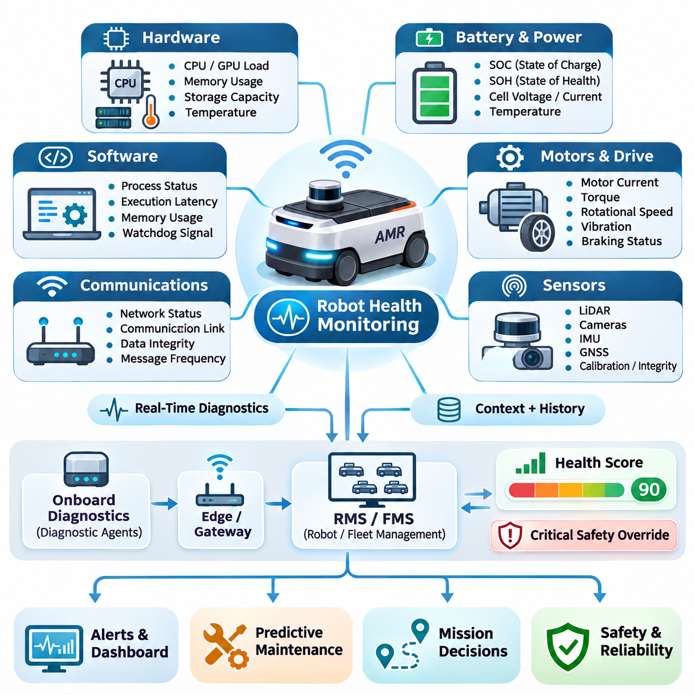
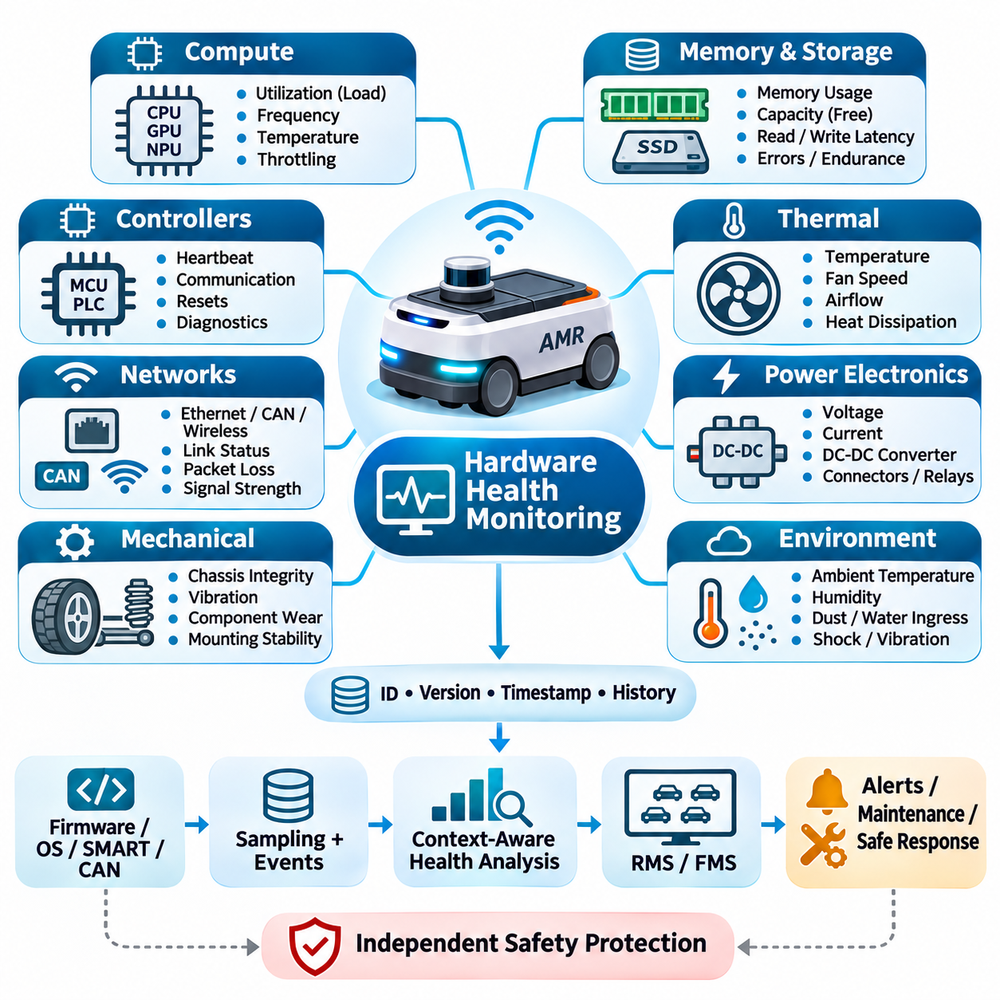
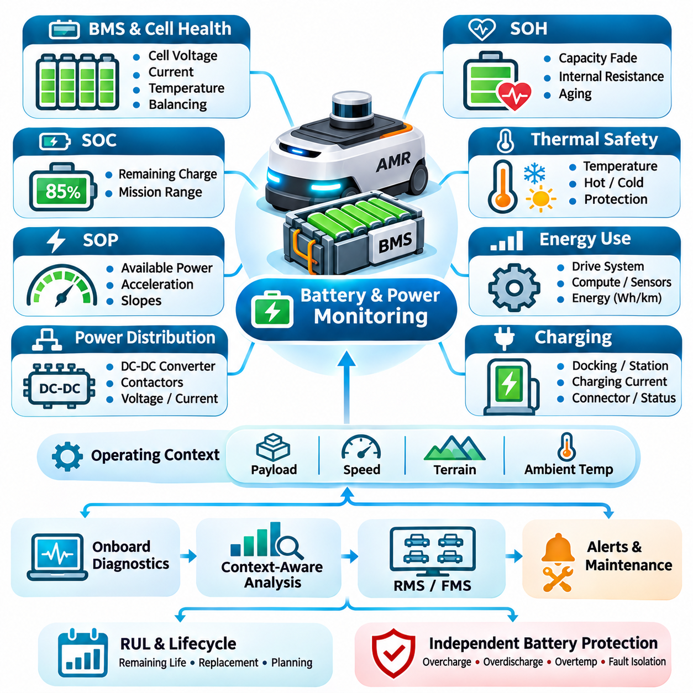
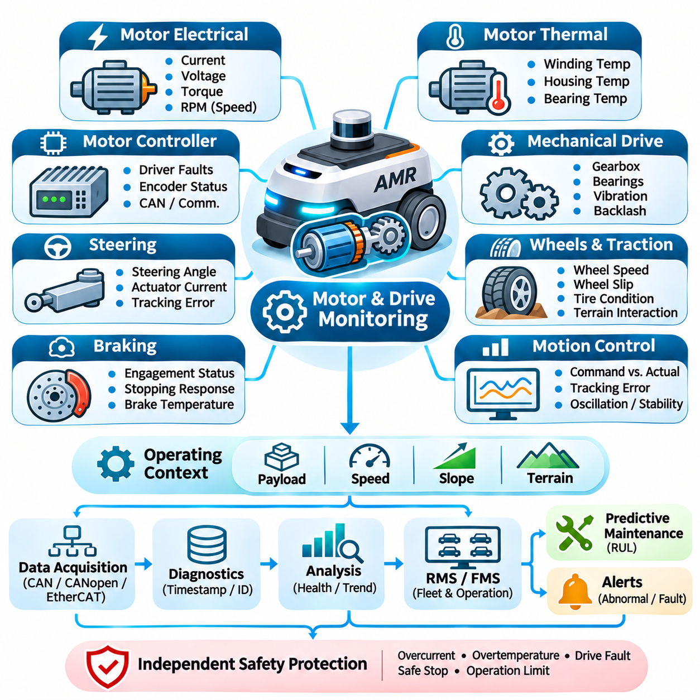
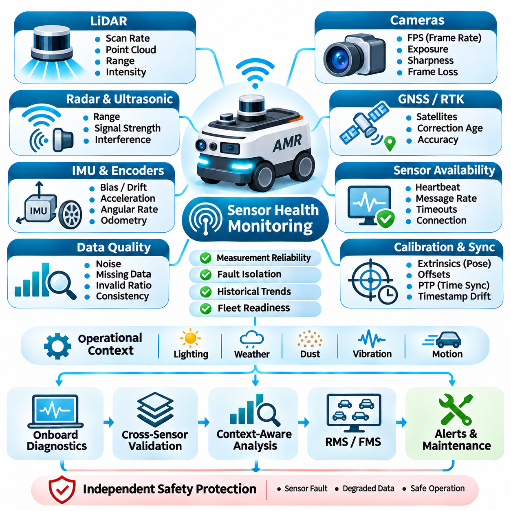
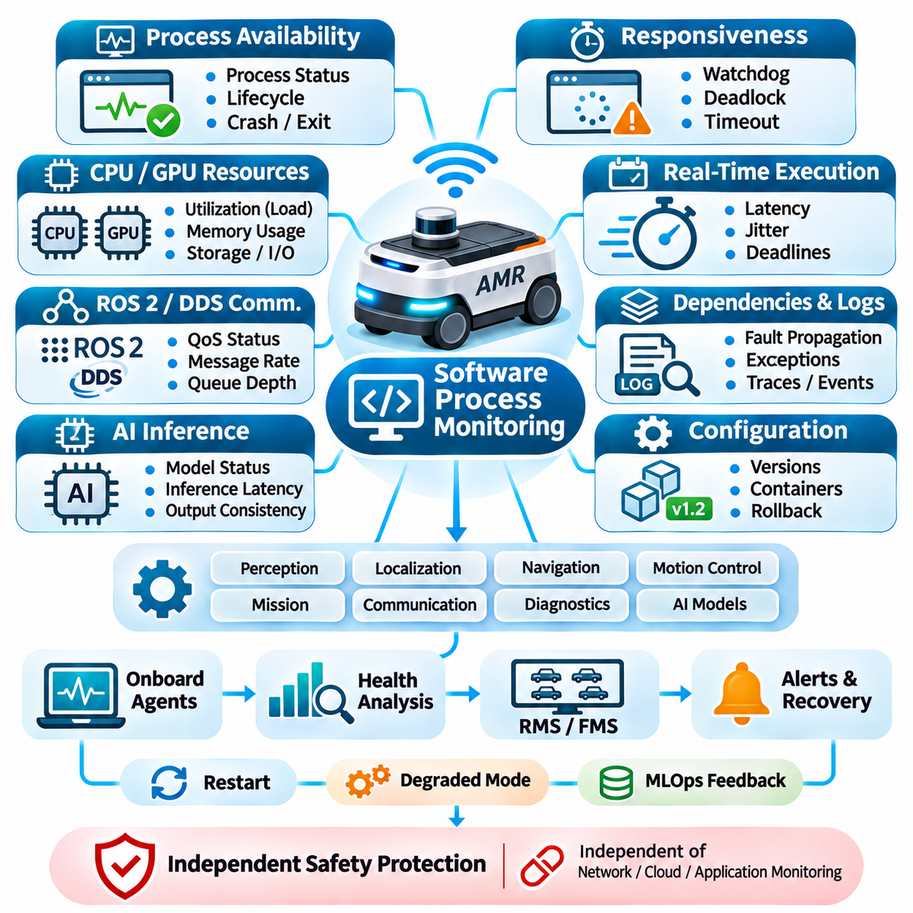
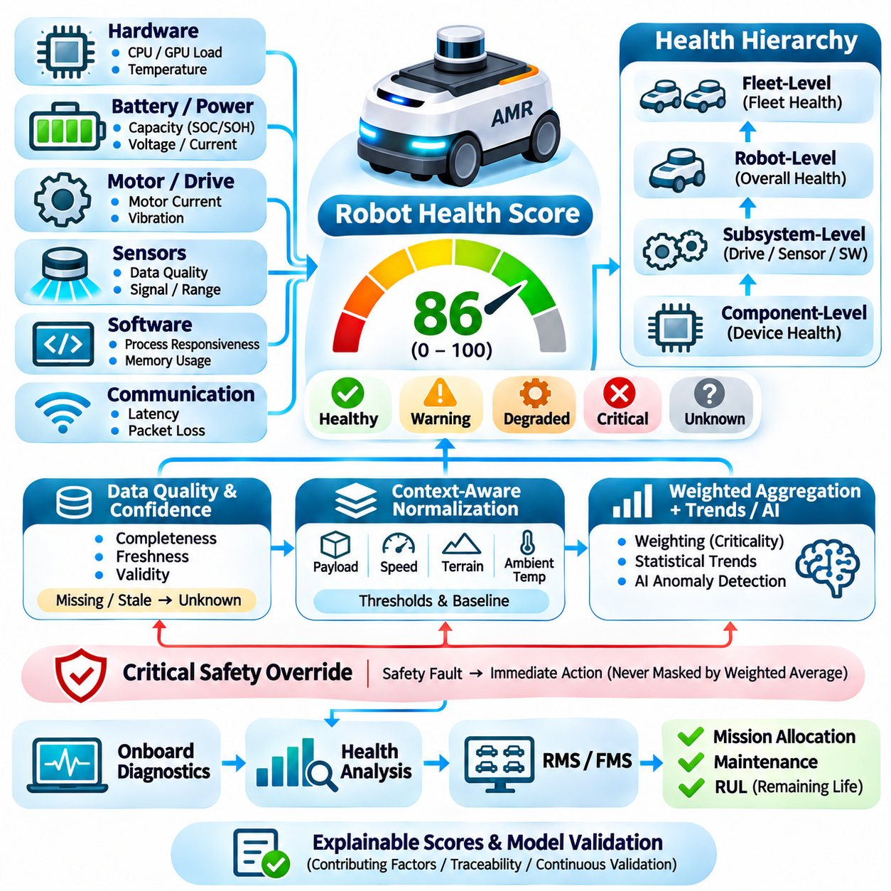
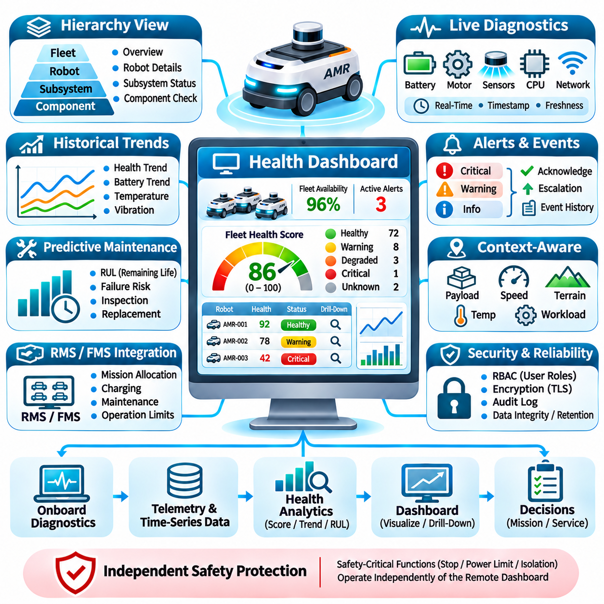

**Volume 08. AMR Operations, Deployment, and MLOps**

# Chapter 10. Robot Health Monitoring

## 10.1 Robot Health Monitoring Overview

{width="7.268055555555556in" height="7.268055555555556in"}

Robot health monitoring is a fundamental operational capability that continuously evaluates the physical, electrical, computational, and software conditions of Autonomous Mobile Robots (AMRs). Its primary objective is to maintain operational reliability, availability, safety, and performance throughout the robot lifecycle. By identifying abnormal conditions before they develop into critical failures, health monitoring supports stable and sustainable autonomous robot operations.

Unlike conventional robot status monitoring, which primarily determines whether a robot is operating, idle, charging, or experiencing an error, health monitoring evaluates the underlying condition of individual components and integrated subsystems. A robot may successfully execute its assigned mission while experiencing gradual battery degradation, increasing motor temperatures, sensor instability, or computational resource exhaustion.

A comprehensive robot health monitoring architecture integrates mechanical systems, electrical systems, power management, drive systems, perception sensors, embedded controllers, communication interfaces, and application software. Each subsystem generates diagnostic information that can be collected, processed, and correlated to determine the overall operational condition of the robot and identify potential dependencies between failures.

Hardware status monitoring evaluates the physical and computational infrastructure of the robot. Important parameters include processor temperature, GPU utilization, memory consumption, storage capacity, cooling fan performance, controller communication status, and electrical connection integrity. Continuous observation of these parameters helps identify hardware degradation, thermal instability, and resource-related operational limitations.

Battery and power monitoring is particularly important because energy availability directly determines mission duration and operational continuity. The Battery Management System (BMS) provides information regarding State of Charge (SOC), State of Health (SOH), cell voltage, current, temperature, charging cycles, and cell imbalance. These measurements support energy management, battery protection, and long-term degradation assessment.

Motor and drive monitoring evaluates the operational condition of propulsion motors, motor drivers, steering actuators, braking systems, gearboxes, and wheel assemblies. Parameters such as motor current, torque, rotational speed, temperature, vibration, and tracking error provide valuable diagnostic information. Abnormal relationships between these measurements may indicate mechanical resistance, component wear, or control instability.

Sensor health monitoring ensures that the perception and localization systems receive reliable environmental information. LiDAR, RGB cameras, depth cameras, radar, ultrasonic sensors, GNSS receivers, and Inertial Measurement Units (IMUs) must be evaluated for communication continuity, measurement frequency, data integrity, calibration stability, and environmental interference that could compromise autonomous navigation.

Software process monitoring evaluates the execution condition of operating systems, middleware, communication nodes, control applications, navigation algorithms, and artificial intelligence inference pipelines. Process availability, execution latency, message frequency, memory consumption, exception frequency, and watchdog signals provide essential information for detecting software instability before mission execution is interrupted.

A distributed health monitoring architecture typically combines onboard diagnostic agents, edge computing resources, communication gateways, and centralized monitoring servers. Onboard monitoring enables immediate fault detection and local protective responses, while centralized infrastructure provides historical analysis, cross-robot comparison, remote diagnostics, and integrated health management across geographically distributed robot fleets.

The Robot Management System (RMS) and Fleet Management System (FMS) integrate health information into operational decision-making processes. Robots experiencing performance degradation may be assigned less demanding missions, redirected toward maintenance stations, or temporarily excluded from task allocation. Health-aware fleet management improves resource utilization while reducing unexpected interruptions and secondary operational risks.

A Health Score Model converts heterogeneous diagnostic measurements into standardized indicators representing component, subsystem, and overall robot conditions. These indicators may incorporate threshold violations, historical degradation trends, component criticality, measurement confidence, and operational context. However, critical safety faults must remain independently actionable and must not be concealed by favorable aggregate health scores.

Health monitoring requires reliable data acquisition and contextual interpretation. Measurements should be associated with synchronized timestamps, robot identifiers, component identifiers, software versions, operating conditions, and mission characteristics. Comparing measurements collected under similar payload, speed, environmental temperature, and terrain conditions helps distinguish genuine degradation from normal operational variations.

Health-related events should be classified according to severity, persistence, operational impact, and required intervention. Informational events support historical analysis, warning events indicate developing abnormalities, and critical events require immediate investigation or predefined protective responses. Validated thresholds, hysteresis, and event filtering help prevent excessive notifications without suppressing safety-critical conditions.

A health dashboard provides operators and maintenance engineers with an integrated representation of robot and fleet conditions. Real-time component status, historical trends, active warnings, diagnostic records, and maintenance requirements enable efficient operational assessment. Dashboard design should support navigation from fleet-level summaries to individual robots, subsystems, components, and underlying diagnostic measurements.

Robot health monitoring also establishes the operational foundation for predictive maintenance, failure analysis, and continuous engineering improvement. Historical diagnostic data can support anomaly detection, degradation modeling, Remaining Useful Life (RUL) estimation, and maintenance scheduling. Ultimately, effective health monitoring transforms AMR operations from reactive failure management toward proactive, data-driven lifecycle management.

## 10.2 Hardware Status Monitoring

{width="7.268055555555556in" height="7.268055555555556in"}

Hardware status monitoring is an essential component of Autonomous Mobile Robot (AMR) health management that continuously evaluates the operational condition of physical components, embedded computing platforms, electrical interfaces, and supporting infrastructure. Its primary objective is to detect hardware abnormalities, prevent unexpected system failures, maintain operational availability, and extend the effective service life of robotic assets.

An AMR hardware monitoring architecture must consider the robot as an integrated electromechanical and computational system rather than a collection of independent devices. Mechanical structures, embedded controllers, computing modules, communication interfaces, power distribution units, and thermal management systems interact continuously. A failure within one hardware subsystem may consequently affect the stability and performance of other subsystems.

Computing hardware monitoring evaluates the operating condition of Central Processing Units (CPUs), Graphics Processing Units (GPUs), Neural Processing Units (NPUs), and embedded computing platforms. Important diagnostic parameters include processor utilization, operating frequency, temperature, memory bandwidth, power consumption, and thermal throttling. Persistent resource saturation may indicate insufficient computing capacity or abnormal computational workloads.

Memory and storage monitoring ensures that sufficient computational resources remain available for autonomous navigation, perception, artificial intelligence inference, and operational data recording. Memory utilization, allocation failures, storage capacity, read and write latency, Solid-State Drive (SSD) temperature, storage endurance, and device error counters provide important indicators of hardware reliability and potential resource exhaustion.

Thermal management monitoring evaluates the ability of the robot to maintain hardware components within their specified operating temperature ranges. Temperature sensors installed around processors, power electronics, embedded controllers, and electrical enclosures provide continuous thermal measurements. Cooling fan speed, airflow conditions, heat dissipation efficiency, and temperature gradients help identify cooling degradation and environmental stress.

Electrical hardware monitoring evaluates the stability and integrity of the robot\'s power distribution infrastructure. Voltage regulators, DC-DC converters, circuit protection devices, power distribution boards, electrical relays, and connectors must operate within defined electrical limits. Unexpected voltage fluctuations, excessive current consumption, intermittent power interruptions, and abnormal electrical temperatures may indicate developing hardware faults.

Embedded controller monitoring focuses on Microcontroller Units (MCUs), Programmable Logic Controllers (PLCs), input and output modules, and dedicated real-time control devices. Controller heartbeat signals, watchdog events, communication timeouts, internal diagnostic registers, and reset counters provide essential information about controller stability. Repeated unexpected resets may indicate electrical interference, firmware defects, or hardware degradation.

Communication hardware monitoring evaluates the physical and operational integrity of Ethernet interfaces, Controller Area Network (CAN) transceivers, serial communication modules, wireless communication devices, and internal network switches. Link availability, transmission error counters, packet loss, signal strength, and connection interruptions help identify damaged cables, unstable connectors, electromagnetic interference, and communication hardware failures.

Mechanical hardware monitoring considers structural integrity, chassis vibration, enclosure conditions, mounting stability, connector retention, and mechanical component wear. Accelerometers, strain sensors, temperature sensors, and periodic physical inspections can provide complementary diagnostic information. Changes in vibration characteristics may indicate structural looseness, mechanical imbalance, bearing degradation, or abnormal interaction between mechanical assemblies.

Environmental monitoring provides additional context for interpreting hardware conditions during field operations. Ambient temperature, humidity, dust exposure, water ingress, shock, and vibration can significantly influence hardware reliability. Indoor and outdoor AMRs require monitoring configurations adapted to their operating environments, enclosure protection ratings, mission profiles, and expected environmental exposure throughout their operational lifecycle.

Hardware diagnostic data can be acquired through embedded firmware, operating system interfaces, device drivers, industrial communication protocols, and dedicated monitoring agents. Technologies such as Intelligent Platform Management Interface (IPMI), Self-Monitoring, Analysis and Reporting Technology (SMART), CAN diagnostics, and manufacturer-specific application programming interfaces provide access to different hardware-level measurements and diagnostic information.

A robust monitoring architecture combines periodic measurements with event-driven diagnostic mechanisms. Routine measurements establish normal operating baselines and long-term performance trends, while event-driven mechanisms capture sudden hardware abnormalities, communication failures, thermal protection events, and unexpected device resets. Sampling frequencies should reflect component criticality, diagnostic requirements, and available computing resources.

Hardware health evaluation should incorporate operating context rather than rely exclusively on fixed thresholds. Processor temperature, electrical consumption, vibration intensity, and communication performance naturally vary according to mission complexity, environmental conditions, and payload characteristics. Context-aware thresholds, statistical baselines, and historical comparisons improve abnormality detection while reducing unnecessary maintenance interventions.

Integration with the Robot Management System (RMS) and Fleet Management System (FMS) enables centralized hardware visibility across distributed robot fleets. Hardware diagnostic records should include robot identifiers, component serial numbers, hardware revisions, firmware versions, timestamps, and maintenance histories. This information supports remote troubleshooting, component traceability, fleet-level comparisons, and systematic reliability improvement.

Hardware monitoring results must support clearly defined operational responses, including maintenance notifications, workload reduction, mission reassignment, and controlled shutdown where appropriate. Safety-critical protection must remain independent of centralized monitoring services. Ultimately, hardware status monitoring establishes a foundation for predictive maintenance, lifecycle optimization, reduced downtime, and reliable large-scale AMR deployment.

## 10.3 Battery and Power Monitoring

{width="7.268055555555556in" height="7.268055555555556in"}

Battery and power monitoring is a critical element of Autonomous Mobile Robot (AMR) health management that continuously evaluates energy availability, battery condition, electrical stability, and power consumption throughout robot operations. Its primary objective is to ensure reliable mission execution, prevent unexpected power interruptions, protect electrical components, and optimize energy utilization throughout the operational lifecycle.

The Battery Management System (BMS) serves as the primary source of battery diagnostic information and protective functions. It continuously monitors individual cell voltages, battery pack voltage, charging and discharging currents, cell temperatures, and electrical protection conditions. Integration between the BMS and onboard robot controllers enables coordinated energy management, fault detection, and appropriate operational responses.

State of Charge (SOC) represents the estimated remaining electrical charge relative to the available battery capacity. Accurate SOC estimation is essential for mission planning, charging scheduling, and operational availability. Estimation methods may combine Coulomb counting, Open Circuit Voltage (OCV) measurements, equivalent circuit models, and adaptive filtering techniques to compensate for measurement uncertainty and changing battery conditions.

State of Health (SOH) represents the degradation of battery performance relative to its initial or specified condition. Battery capacity reduction, internal resistance growth, charging efficiency, and historical operating conditions provide important information for SOH estimation. Continuous assessment enables maintenance engineers to identify deteriorating battery packs, evaluate replacement requirements, and reduce unexpected energy-related failures.

State of Power (SOP) describes the battery\'s capability to deliver or absorb electrical power under current operating conditions. Available power depends on battery temperature, SOC, internal resistance, cell voltage limits, and degradation characteristics. Monitoring SOP is particularly important for heavy-duty AMRs that experience significant transient power demands during acceleration, slope climbing, steering, and payload transportation.

Cell-level monitoring identifies voltage imbalance, abnormal temperature distribution, and potential degradation within individual battery cells. Excessive differences between cell voltages may reduce usable battery capacity and increase operational risks. Cell balancing mechanisms help maintain consistent charging conditions, while historical cell-level measurements support early identification of abnormal cells and emerging battery pack failures.

Battery thermal monitoring evaluates temperature distribution across battery cells, modules, electrical terminals, and surrounding enclosures. Excessive temperatures accelerate battery degradation and may introduce significant safety hazards. Low temperatures can reduce available capacity and charging capability. Temperature thresholds and protective responses must reflect battery chemistry, manufacturer specifications, and validated operating limits.

Power distribution monitoring evaluates the electrical condition of power distribution units, DC-DC converters, voltage regulators, contactors, circuit breakers, and electrical protection devices. Input and output voltages, current consumption, conversion efficiency, and component temperatures provide essential diagnostic information. Abnormal voltage fluctuations or electrical losses may indicate connector degradation or power conversion failures.

Energy consumption monitoring analyzes electrical power usage across propulsion systems, embedded controllers, computing platforms, perception sensors, communication modules, and auxiliary equipment. Subsystem-level measurements help identify inefficient components and unexpected energy consumption patterns. Energy consumption per unit distance, mission, operating hour, or transported payload supports systematic operational efficiency assessment.

Charging system monitoring evaluates charging station availability, charging voltage, current profiles, charging duration, connector conditions, and communication between the robot and charging infrastructure. Abnormal charging interruptions, excessive connector temperatures, and reduced charging efficiency may indicate developing infrastructure or battery faults. Reliable charging diagnostics support autonomous docking and continuous fleet operations.

Battery monitoring must incorporate operational context because energy consumption and battery performance vary significantly with payload, travel speed, acceleration, terrain conditions, ambient temperature, and computational workload. Context-aware energy models enable more accurate mission range estimation and distinguish genuine battery degradation from temporary variations associated with demanding operating environments.

Integration with the Robot Management System (RMS) and Fleet Management System (FMS) enables centralized battery and power management across distributed robot fleets. Real-time SOC, SOH, available power, estimated remaining operating time, and charging requirements can influence mission allocation and charging schedules. Health-aware scheduling prevents unsuitable task assignments and improves overall fleet availability.

Battery and power diagnostic events should be classified according to severity, persistence, and operational impact. Low energy warnings, cell imbalance, abnormal current consumption, undervoltage, overvoltage, and excessive temperature require predefined response policies. Depending on the detected condition, appropriate responses may include mission reassignment, power limitation, controlled stopping, charging requests, or electrical isolation.

Historical battery and power data provide a foundation for predictive maintenance, battery degradation analysis, and lifecycle optimization. Charging cycles, cumulative energy throughput, depth of discharge, temperature exposure, internal resistance trends, and capacity measurements support Remaining Useful Life (RUL) estimation. Maintenance decisions can therefore incorporate actual usage conditions rather than depend exclusively on fixed replacement intervals.

A reliable battery and power monitoring architecture combines onboard protection mechanisms, real-time diagnostic agents, centralized health dashboards, and historical data analytics. Safety-critical battery protection must remain functional independently of network connectivity and cloud services. Ultimately, comprehensive energy monitoring improves robot availability, operational safety, battery longevity, fleet productivity, and total cost of ownership.

## 10.4 Motor and Drive Monitoring

{width="7.268055555555556in" height="7.268055555555556in"}

Motor and drive monitoring is a fundamental component of Autonomous Mobile Robot (AMR) health management that continuously evaluates the operational condition of propulsion motors, motor controllers, steering actuators, transmission mechanisms, braking systems, and wheel assemblies. Its primary objective is to maintain reliable mobility, detect emerging mechanical and electrical abnormalities, and prevent unexpected failures during autonomous mission execution.

An AMR drive system consists of interconnected electrical, mechanical, and control subsystems that convert electrical energy into controlled motion. Differential drive, steering drive, omnidirectional drive, and multi-wheel drive platforms exhibit different operational characteristics and failure mechanisms. Monitoring architectures must therefore reflect the specific drivetrain configuration, mechanical structure, payload capacity, and intended operating environment.

Motor electrical monitoring evaluates operating parameters such as phase current, supply voltage, electrical power consumption, motor torque, rotational speed, and winding resistance where measurable. Excessive current consumption under comparable operating conditions may indicate increased mechanical resistance, bearing degradation, electrical abnormalities, or drivetrain inefficiency. Continuous electrical measurements support early fault identification.

Motor thermal monitoring evaluates winding temperature, motor housing temperature, bearing temperature, and the thermal condition of motor drivers. Sustained operation at elevated temperatures may accelerate insulation degradation, reduce component lifetime, and trigger protective functions. Temperature measurements should be interpreted in relation to ambient temperature, mechanical loading, operating duration, and cooling system performance.

Motor controller monitoring focuses on the operational condition of motor drivers, inverters, and embedded motion control devices. Diagnostic information includes overcurrent events, voltage abnormalities, semiconductor temperatures, communication timeouts, encoder errors, and controller fault codes. Repeated protection events or unexpected controller resets may indicate underlying electrical instability, hardware degradation, or inappropriate control parameters.

Mechanical drivetrain monitoring evaluates gearboxes, reduction mechanisms, drive shafts, bearings, couplings, and wheel assemblies. Vibration characteristics, acoustic signatures, mechanical backlash, rotational resistance, and temperature variations provide valuable diagnostic information. Changes in these measurements may indicate lubrication deterioration, gear wear, bearing damage, shaft misalignment, or structural looseness within the drivetrain.

Wheel and traction monitoring evaluates wheel rotational speed, tire condition, wheel slip, rolling resistance, and ground interaction characteristics. Differences between commanded motion, wheel encoder measurements, and independently estimated robot movement may indicate insufficient traction or mechanical abnormalities. Outdoor AMRs require particular attention to terrain variability, tire deformation, surface contamination, and uneven wheel loading.

Steering system monitoring is particularly important for steer-drive, Ackermann steering, and multi-axle robotic platforms. Steering angle, actuator current, angular velocity, position tracking error, mechanical backlash, and end-stop conditions provide essential diagnostic information. Persistent discrepancies between commanded and measured steering angles may indicate actuator degradation, encoder misalignment, or abnormal mechanical resistance.

Braking system monitoring evaluates brake actuator status, engagement and release behavior, braking response time, stopping distance, and thermal conditions. Electromagnetic brakes, mechanical friction brakes, and regenerative braking systems require different diagnostic parameters. Abnormal braking behavior must trigger predefined protective responses because braking capability directly influences operational and functional safety.

Motion control performance monitoring evaluates the relationship between commanded and measured velocity, acceleration, torque, steering angle, and trajectory execution. Persistent tracking errors, excessive oscillations, unstable acceleration, and unexpected stopping behavior may indicate mechanical degradation or control instability. Correlating motion control data with hardware diagnostics improves fault isolation and operational reliability.

Context-aware drive monitoring is necessary because motor current, torque, temperature, vibration, and energy consumption naturally vary with payload, travel speed, acceleration, slope, and terrain conditions. Establishing operating baselines for comparable mission profiles enables more accurate abnormality detection. Contextual analysis helps distinguish genuine drivetrain degradation from temporary increases in mechanical loading during demanding missions.

Drive diagnostic information can be collected through motor controller interfaces, Controller Area Network (CAN), CANopen, EtherCAT, industrial Ethernet, and dedicated onboard monitoring agents. High-frequency measurements support transient fault analysis, while aggregated diagnostic records support long-term degradation assessment. Synchronized timestamps and component identifiers enable correlation between electrical, mechanical, and motion control events.

Integration with the Robot Management System (RMS) and Fleet Management System (FMS) enables centralized drivetrain health assessment across distributed robot fleets. Detected abnormalities may influence mission allocation, permissible payload, maximum operating speed, and maintenance scheduling. Robots exhibiting degraded mobility should operate only within validated limits or be removed from service when continued operation becomes unsafe.

Historical motor and drive measurements establish a foundation for predictive maintenance and component lifetime estimation. Cumulative operating hours, traveled distance, torque exposure, thermal cycles, vibration trends, and recorded overload events support degradation modeling and Remaining Useful Life (RUL) estimation. Such information enables maintenance strategies based on actual component usage rather than fixed service intervals alone.

A comprehensive motor and drive monitoring architecture combines onboard diagnostics, independent safety protection, context-aware anomaly detection, centralized health visualization, and historical data analytics. Critical protective functions must remain operational independently of network connectivity and cloud services. Effective drivetrain monitoring ultimately improves mobility reliability, operational safety, energy efficiency, component longevity, and fleet availability.

## 10.5 Sensor Status Monitoring

{width="7.268055555555556in" height="7.268055555555556in"}

Sensor status monitoring is an essential component of Autonomous Mobile Robot (AMR) health management that continuously evaluates the availability, accuracy, reliability, and operational integrity of sensors. Its primary objective is to ensure that perception, localization, navigation, and motion control systems receive dependable information while detecting sensor abnormalities before they compromise operational performance or safety.

An AMR typically integrates heterogeneous sensors, including two-dimensional and three-dimensional LiDAR, RGB cameras, depth cameras, radar, ultrasonic sensors, Global Navigation Satellite System (GNSS) receivers, Inertial Measurement Units (IMUs), and wheel encoders. Each sensor technology exhibits distinct measurement characteristics, environmental sensitivities, communication requirements, and potential failure mechanisms.

Sensor availability monitoring evaluates whether individual sensors remain connected, initialized, and capable of delivering measurement data within expected operating intervals. Heartbeat signals, message frequency, communication timeouts, device connection status, and diagnostic error codes provide essential information. Missing measurements or unexpected interruptions may indicate hardware failures, communication instability, or software interface problems.

Sensor data quality monitoring evaluates the reliability and consistency of measurements generated during robot operations. Important indicators include measurement noise, invalid data ratios, missing samples, signal intensity, measurement saturation, and unexpected statistical distributions. A sensor may remain operational while producing degraded measurements that negatively affect downstream perception and localization algorithms.

LiDAR status monitoring evaluates scanning frequency, point cloud density, measurement range, reflected signal intensity, invalid measurement ratios, and internal device temperature. Optical contamination, mechanical damage, environmental interference, and communication abnormalities can reduce measurement quality. Continuous monitoring helps identify degradation that may compromise obstacle detection, environmental mapping, or localization accuracy.

Camera status monitoring evaluates image acquisition frequency, exposure conditions, image brightness, contrast, sharpness, frame loss, and communication latency. RGB, depth, and thermal cameras require different diagnostic parameters according to their sensing principles. Lens contamination, unfavorable illumination, optical misalignment, and excessive device temperatures may reduce perception performance without causing complete sensor failure.

Radar and ultrasonic sensor monitoring evaluates measurement continuity, detection range, signal strength, interference levels, invalid measurements, and communication status. Radar measurements may be influenced by electromagnetic interference and multipath reflections, whereas ultrasonic measurements can be affected by environmental temperature and surface characteristics. Contextual analysis helps distinguish sensor degradation from environmental limitations.

GNSS and Real-Time Kinematic (RTK) status monitoring evaluates satellite availability, signal quality, positioning uncertainty, correction data age, solution status, and communication continuity. Outdoor autonomous robots must distinguish reliable positioning from degraded or unavailable satellite navigation conditions. Monitoring GNSS integrity supports appropriate transitions to alternative localization methods when satellite measurements become unreliable.

IMU and wheel encoder monitoring evaluates acceleration, angular velocity, sensor bias, measurement noise, rotational displacement, and timestamp consistency. Unexpected measurement drift, discontinuities, and discrepancies between inertial and odometry estimates may indicate calibration errors, mechanical abnormalities, or sensor degradation. Cross-sensor validation improves fault detection and supports reliable motion estimation.

Sensor calibration monitoring evaluates the stability of intrinsic parameters, extrinsic transformations, measurement offsets, and sensor mounting configurations. Mechanical vibration, physical impacts, thermal expansion, and component replacement may alter previously established calibration relationships. Periodic calibration verification and residual analysis help identify gradual misalignment before it significantly affects integrated perception performance.

Time synchronization monitoring ensures that measurements generated by different sensors remain temporally aligned within application-specific tolerances. Timestamp offsets, clock drift, communication latency, jitter, and synchronization failures can introduce errors into sensor fusion and autonomous navigation. Technologies such as Precision Time Protocol (PTP) and hardware triggering support temporal consistency across distributed sensing devices.

Multi-sensor consistency monitoring compares measurements obtained from independent sensing technologies to identify conflicting environmental or motion information. Differences between LiDAR-based localization, visual odometry, GNSS positioning, inertial measurements, and wheel odometry may reveal emerging sensor faults. Residual analysis and uncertainty estimation support fault isolation while accounting for legitimate measurement differences.

Sensor monitoring must incorporate environmental and operational context because measurement quality naturally varies with illumination, weather, dust, vibration, terrain, and robot motion. Context-aware thresholds and statistical baselines help distinguish temporary sensing limitations from persistent hardware degradation. Such analysis reduces unnecessary maintenance interventions and improves the reliability of diagnostic decisions.

Integration with the Robot Management System (RMS) and Fleet Management System (FMS) enables centralized sensor health assessment, historical trend analysis, and maintenance coordination across distributed robot fleets. Sensor identifiers, calibration versions, diagnostic events, and operating conditions should remain traceable. Detected abnormalities may influence mission allocation, operating restrictions, or maintenance requirements.

A comprehensive sensor status monitoring architecture combines onboard diagnostics, data quality assessment, cross-sensor validation, context-aware anomaly detection, and centralized health analytics. Safety-critical sensor faults require independent, validated protective responses. Historical diagnostic information also supports predictive maintenance, ultimately improving perception reliability, operational safety, and long-term fleet availability.

## 10.6 Software Process Monitoring

{width="7.268055555555556in" height="7.268055555555556in"}

Software process monitoring is a fundamental component of Autonomous Mobile Robot (AMR) health management that continuously evaluates the availability, execution integrity, responsiveness, and resource utilization of onboard software components. Its primary objective is to maintain reliable software execution, identify abnormal process behavior, prevent cascading system failures, and ensure stable autonomous operations throughout the robot lifecycle.

An AMR software architecture typically consists of perception, localization, mapping, navigation, motion planning, motion control, mission management, communication, and diagnostic processes. These software components operate within interconnected execution environments with different computational and timing requirements. Monitoring architectures must therefore reflect process dependencies, execution priorities, and functional criticality.

Process availability monitoring determines whether essential software processes remain active, initialized, and capable of performing their assigned functions. Process identifiers, heartbeat signals, lifecycle states, startup status, exit codes, and unexpected termination events provide important diagnostic information. Continuous availability assessment enables early identification of software crashes, initialization failures, and unresponsive processes.

Process responsiveness monitoring evaluates whether software components respond to requests and deliver computational outputs within expected time intervals. A running process does not necessarily indicate correct functional behavior because deadlocks, infinite loops, blocked threads, and resource starvation may prevent normal execution. Watchdog mechanisms and periodic health checks help detect these hidden execution abnormalities.

Computational resource monitoring evaluates Central Processing Unit (CPU) utilization, Graphics Processing Unit (GPU) utilization, memory consumption, storage activity, and network bandwidth associated with individual software processes. Sustained resource saturation may increase execution latency and reduce system responsiveness. Process-level resource measurements support identification of computational bottlenecks and inefficient software behavior.

Memory monitoring focuses on dynamic memory allocation, resident memory consumption, memory fragmentation, allocation failures, and unexpected memory growth. Memory leaks may gradually degrade software performance and eventually cause process termination or system instability. Historical memory utilization trends help identify persistent abnormalities that may remain undetected during short-duration functional testing.

Real-time execution monitoring evaluates task execution duration, scheduling latency, execution frequency, deadline violations, and timing jitter. Motion control, sensor processing, and safety-related software components may require deterministic execution within validated timing constraints. Continuous timing assessment helps identify scheduling conflicts, excessive computational workloads, and violations of critical execution requirements.

Middleware communication monitoring evaluates data exchange between distributed software components through message-oriented communication architectures such as Robot Operating System 2 (ROS 2) and Data Distribution Service (DDS). Message publication frequency, subscription availability, communication latency, queue depth, packet loss, and Quality of Service (QoS) compatibility provide essential indicators of communication health.

Process dependency monitoring evaluates functional relationships between software components and their supporting services. Failures within perception, localization, or communication processes may propagate into navigation, motion planning, and mission execution. Dependency-aware monitoring enables more accurate root cause identification and helps prevent inappropriate recovery actions that could further destabilize interconnected software components.

Software exception and log monitoring collects runtime exceptions, warning messages, error codes, stack traces, assertion failures, and abnormal termination records. Structured logging with synchronized timestamps, severity classifications, and process identifiers enables systematic correlation of software events. Repeated exceptions or increasing warning frequencies may reveal emerging defects before complete functional failures occur.

AI inference process monitoring evaluates model availability, inference latency, execution frequency, accelerator utilization, input tensor validity, and output consistency. Perception models and learned control policies may experience execution abnormalities caused by resource constraints, incompatible runtime environments, or invalid input data. Monitoring must distinguish inference execution failures from degradation in predictive model performance.

Software configuration monitoring maintains visibility into deployed software versions, container images, runtime dependencies, configuration parameters, firmware compatibility, and AI model versions. Unauthorized changes or inconsistent configurations may introduce unexpected behavior across otherwise identical robot platforms. Configuration traceability supports reproducible diagnostics, controlled software updates, and reliable rollback operations.

Automated process recovery mechanisms may include controlled process restarts, service reinitialization, dependency reconstruction, workload redistribution, and transitions into degraded operating modes. Recovery policies must consider process criticality, restart frequency, and current robot operating conditions. Repeated recovery failures should trigger escalation rather than unlimited restart attempts that could introduce additional operational risks.

Integration with the Robot Management System (RMS) and Fleet Management System (FMS) enables centralized software health assessment across distributed robot fleets. Process availability, resource consumption, execution latency, diagnostic events, and recovery histories support maintenance coordination and fleet-level anomaly detection. Historical software telemetry also provides valuable feedback for continuous improvement and robotic MLOps.

A comprehensive software process monitoring architecture combines onboard diagnostic agents, independent watchdog mechanisms, structured event logging, statistical anomaly detection, and centralized health analytics. Safety-critical protective functions must remain independent of ordinary application monitoring and cloud connectivity. Effective process monitoring ultimately improves software reliability, operational continuity, maintainability, and fleet availability.

## 10.7 Health Score Model

{width="7.268055555555556in" height="7.268055555555556in"}

A health score model is a fundamental component of Autonomous Mobile Robot (AMR) health management that transforms heterogeneous diagnostic measurements into quantitative indicators of robot condition. Its primary objective is to provide a standardized representation of operational health, facilitate early detection of component degradation, and support intelligent decisions regarding mission allocation, maintenance, and fleet availability.

Robot health cannot be adequately represented by individual diagnostic measurements because operational reliability depends on interactions between multiple subsystems. A comprehensive health score model integrates hardware condition, battery performance, power distribution stability, drivetrain integrity, sensor reliability, software execution status, and communication availability into a unified assessment framework.

A hierarchical health score architecture organizes diagnostic information into component-level, subsystem-level, robot-level, and fleet-level indicators. Individual component scores represent the condition of specific devices, while subsystem scores aggregate related functional components. Robot-level scores provide an overall operational assessment, and fleet-level indicators reveal broader degradation patterns across distributed robotic platforms.

Health indicator selection establishes the measurable parameters required to evaluate each component and subsystem. Battery capacity, internal resistance, motor current, operating temperature, vibration intensity, sensor measurement quality, process responsiveness, and communication latency represent typical diagnostic inputs. Selected indicators must demonstrate meaningful relationships with component condition, functional performance, and operational reliability.

Data normalization converts heterogeneous diagnostic measurements into comparable numerical representations. A standardized health score may range from 0 to 100, where higher values indicate healthier operating conditions. Normalization functions should reflect acceptable operating ranges, warning thresholds, critical limits, and nonlinear degradation characteristics rather than applying identical mathematical transformations to every diagnostic parameter.

Threshold-based health scoring evaluates diagnostic measurements against predefined operational limits derived from manufacturer specifications, engineering requirements, experimental validation, and historical operating data. Measurements approaching warning thresholds receive progressively reduced scores. Adaptive thresholds may improve diagnostic accuracy by accounting for environmental conditions, mechanical loading, and component characteristics.

Weighted health score aggregation assigns different levels of importance to individual diagnostic indicators and subsystem conditions. Weighting factors should reflect functional criticality, failure consequences, subsystem dependencies, and operational requirements. However, weighted averaging alone may conceal critical component failures, requiring additional constraints that prevent healthy subsystems from compensating for safety-critical abnormalities.

Statistical health score models establish normal operating baselines using historical diagnostic measurements collected under representative conditions. Statistical distributions, standard deviations, moving averages, and residual analysis enable quantitative evaluation of deviations from expected behavior. Such approaches are particularly useful for identifying gradual degradation that remains within conventional diagnostic thresholds.

Artificial Intelligence (AI) and machine learning techniques enable health score models to identify complex relationships between multidimensional diagnostic measurements. Autoencoders, Isolation Forest algorithms, probabilistic models, and temporal neural networks can support anomaly detection and degradation assessment. Model outputs must be calibrated and validated before being incorporated into operational health scores or automated decision-making.

Context-aware health score models incorporate payload, operating speed, environmental temperature, terrain conditions, mission characteristics, and computational workload. Increased motor current during slope climbing or elevated processor utilization during intensive perception tasks does not necessarily represent degradation. Contextual normalization improves diagnostic accuracy and reduces unnecessary maintenance interventions.

Temporal health assessment evaluates both instantaneous component conditions and long-term degradation trajectories. Moving averages, trend estimation, cumulative stress indicators, and time-series analysis help distinguish temporary abnormalities from persistent deterioration. Rapid score reductions may indicate emerging failures, whereas gradual declines may reveal aging mechanisms that require predictive maintenance.

Health score reliability depends on the availability, quality, freshness, and completeness of diagnostic data. Missing measurements, communication interruptions, invalid sensor readings, and outdated diagnostic records must not automatically produce healthy scores. Separate confidence indicators and data quality assessments help operators understand the reliability of estimated health conditions and identify uncertain diagnostic results.

Health classifications translate numerical scores into interpretable operational states such as Healthy, Warning, Degraded, Critical, and Unknown. Classification boundaries must be validated for each robotic platform and subsystem. Independent safety constraints must override aggregate health scores whenever critical faults are detected, ensuring that numerical assessments never substitute for validated functional safety mechanisms.

Integration with the Robot Management System (RMS) and Fleet Management System (FMS) enables health-aware mission allocation, operational restrictions, charging coordination, and maintenance prioritization. Robots exhibiting deteriorating health may receive less demanding missions or be scheduled for inspection. Historical health score trajectories also support predictive maintenance and Remaining Useful Life (RUL) estimation.

A comprehensive health score architecture combines standardized diagnostic indicators, hierarchical aggregation, context-aware normalization, statistical analysis, AI-based anomaly detection, and independent safety constraints. Continuous validation, model version management, and explainable scoring mechanisms improve diagnostic transparency. Effective health score models ultimately enhance robot reliability, maintenance efficiency, and long-term fleet availability.

## 10.8 Health Dashboard Design

{width="7.268055555555556in" height="7.268055555555556in"}

A health dashboard is an essential component of Autonomous Mobile Robot (AMR) health management that transforms distributed diagnostic information into accessible and actionable operational insights. Its primary objective is to provide operators, maintenance engineers, and fleet managers with a comprehensive understanding of robot conditions, emerging abnormalities, maintenance requirements, and overall operational readiness.

Health dashboard design should follow a hierarchical visualization architecture that organizes information at fleet, robot, subsystem, and component levels. Fleet-level views provide an overview of operational readiness and health distribution, while robot-level views present individual robot conditions. Subsystem and component views enable detailed diagnostic investigation and systematic identification of potential failure sources.

The fleet health overview presents the distribution of healthy, warning, degraded, critical, and unknown robot conditions across an operational environment. Key indicators include fleet availability, average health score, active diagnostic alerts, robots requiring maintenance, and unavailable robots. This overview enables fleet managers to identify operational risks and prioritize maintenance resources without examining individual robot records.

Individual robot health dashboards integrate diagnostic information from hardware, battery and power systems, motors and drivetrain assemblies, sensors, software processes, and communication interfaces. Overall health scores should be accompanied by subsystem-level assessments and relevant diagnostic measurements. Such organization enables operators to identify which components contribute to deteriorating robot health conditions.

Real-time diagnostic visualization presents continuously updated measurements such as battery charge, motor current, operating temperature, sensor availability, processor utilization, memory consumption, and communication latency. Update frequencies should reflect the operational significance and timing requirements of each parameter. Data timestamps and freshness indicators help distinguish current measurements from delayed or unavailable information.

Historical trend visualization provides insight into gradual degradation, recurring abnormalities, and long-term changes in robot performance. Time-series charts may represent battery capacity reduction, motor temperature fluctuations, vibration intensity, sensor error rates, software resource consumption, and health score trajectories. Adjustable observation periods support both immediate fault investigation and long-term maintenance planning.

Health score visualization translates quantitative diagnostic assessments into easily interpretable operational indicators. Numerical scores, status labels, progress indicators, and consistent visual conventions help operators understand component and subsystem conditions. Health scores should also display relevant confidence levels and contributing factors to prevent misleading interpretations of aggregated or uncertain diagnostic results.

Alarm and event visualization organizes diagnostic abnormalities according to severity, persistence, occurrence time, and operational impact. Critical faults require prominent presentation, while lower-priority warnings should remain accessible without overwhelming operators. Event filtering, duplicate suppression, acknowledgment tracking, and escalation mechanisms help reduce alarm fatigue and improve operational response efficiency.

Diagnostic drill-down capabilities enable operators to navigate from fleet-level observations to individual robot conditions, subsystem assessments, and detailed component measurements. Relevant fault codes, software logs, historical events, and operating conditions should remain accessible within the diagnostic workflow. Correlated information improves root cause identification and reduces the time required for maintenance investigation.

Predictive maintenance visualization integrates historical degradation indicators, estimated failure risks, Remaining Useful Life (RUL), and recommended inspection intervals into the health dashboard. Predictions should include uncertainty information and relevant supporting measurements. Maintenance engineers can use these insights to prioritize inspections, coordinate component replacements, and reduce unexpected operational interruptions.

Context-aware dashboard design incorporates mission status, payload, travel speed, environmental temperature, terrain conditions, and computational workload when presenting diagnostic measurements. Comparing current values with context-specific operating baselines helps distinguish normal operational variations from genuine abnormalities. Contextual information improves diagnostic interpretation and reduces unnecessary maintenance interventions.

Integration with the Robot Management System (RMS) and Fleet Management System (FMS) enables health dashboards to connect diagnostic conditions with mission allocation, charging requirements, operational restrictions, and maintenance workflows. Health information should remain consistent across management platforms. Authorized users may initiate maintenance requests or operational interventions through controlled and traceable interfaces.

Dashboard data architecture combines onboard diagnostic agents, telemetry communication channels, event processing services, time-series databases, and visualization interfaces. Scalable data pipelines must accommodate increasing robot populations and heterogeneous diagnostic sampling frequencies. Aggregation, caching, and configurable retention policies help maintain dashboard responsiveness while preserving essential historical information.

Dashboard reliability and security require role-based access control, authenticated communication, encrypted data transmission, audit logging, and appropriate data access restrictions. Communication interruptions and stale diagnostic information must be displayed explicitly rather than interpreted as healthy conditions. Safety-critical protective mechanisms must remain independent of dashboard availability and remote communication infrastructure.

A comprehensive health dashboard architecture combines hierarchical visualization, real-time diagnostics, historical trend analysis, explainable health scoring, alert management, and predictive maintenance insights. Dashboard effectiveness should be validated through realistic operational scenarios and operator usability assessments. Effective dashboard design ultimately improves diagnostic transparency, maintenance efficiency, operational safety, and long-term fleet availability.
