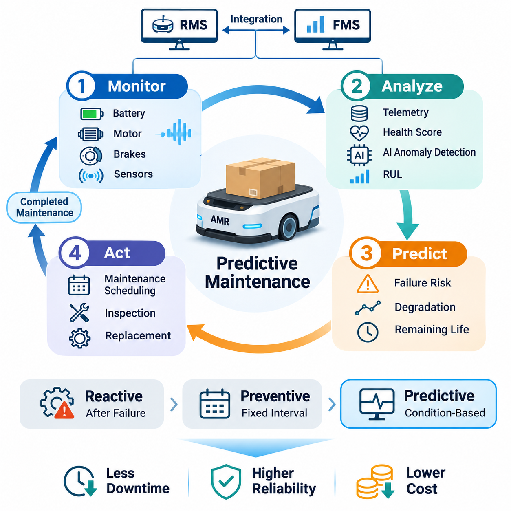
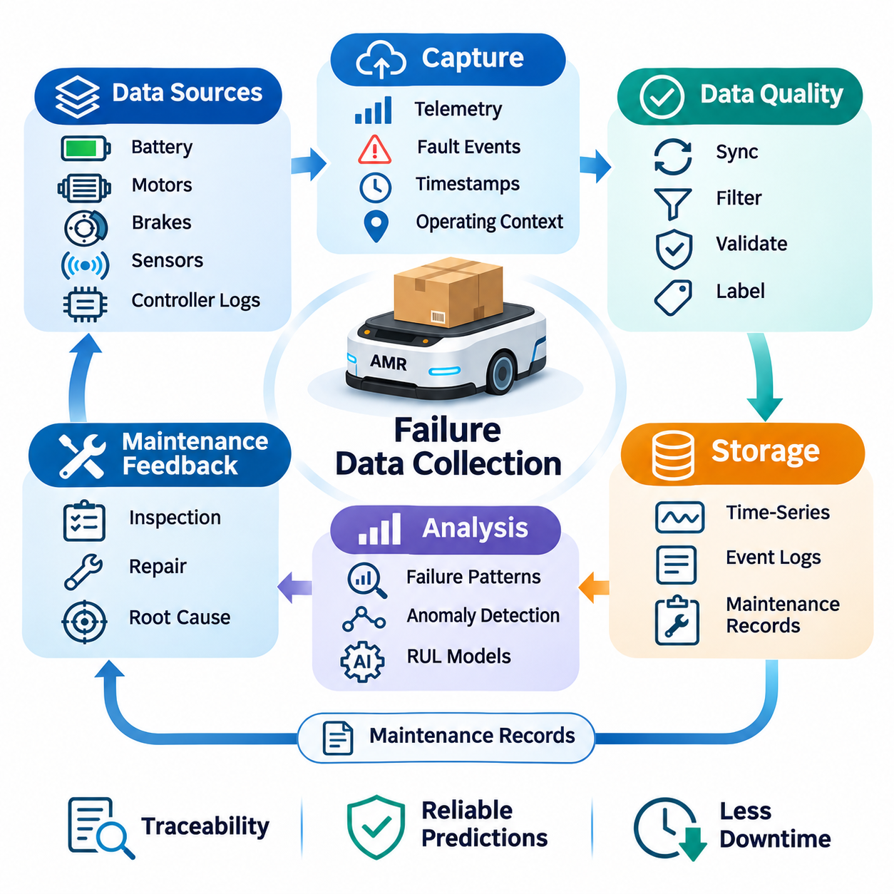
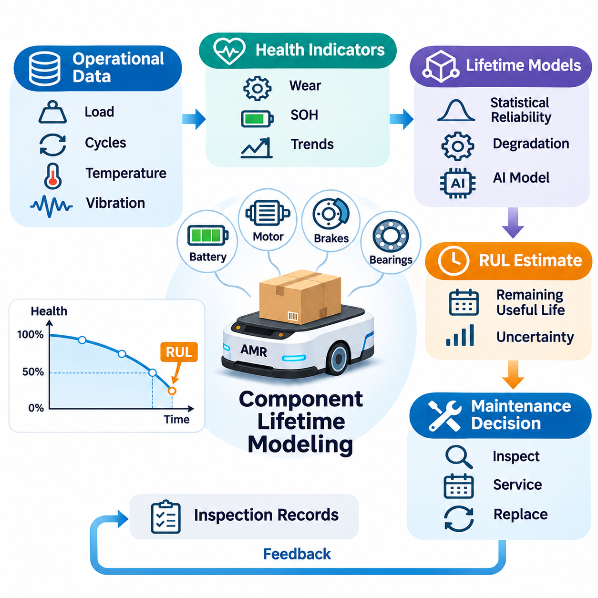
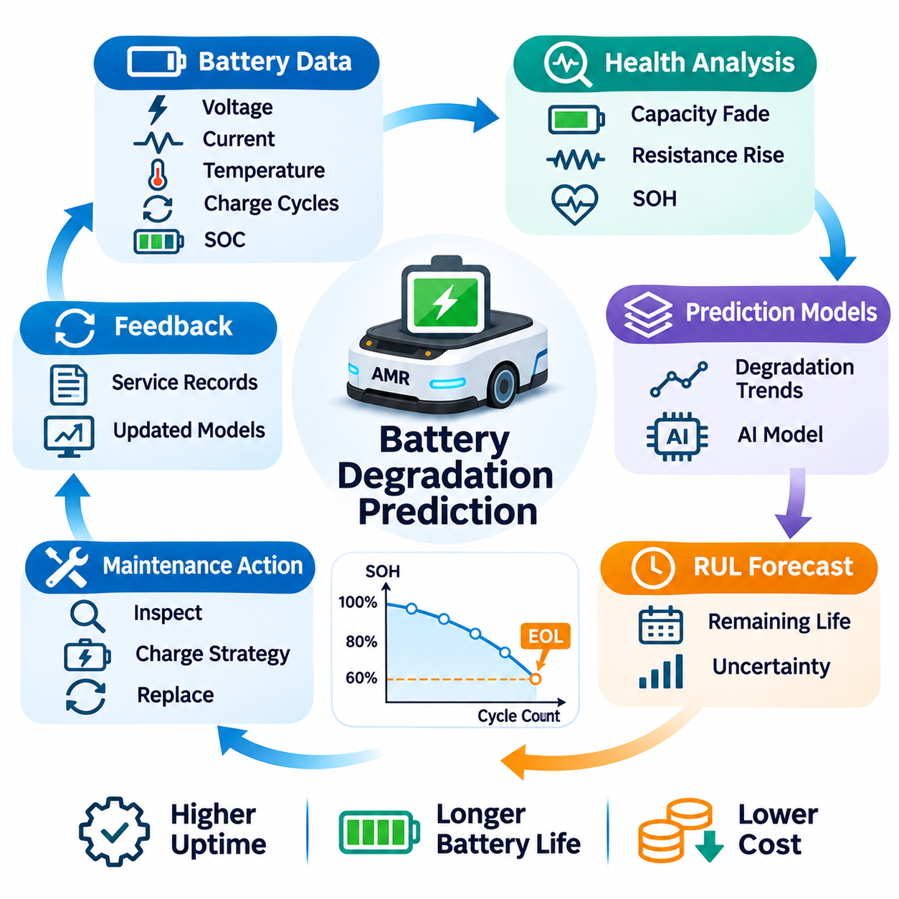
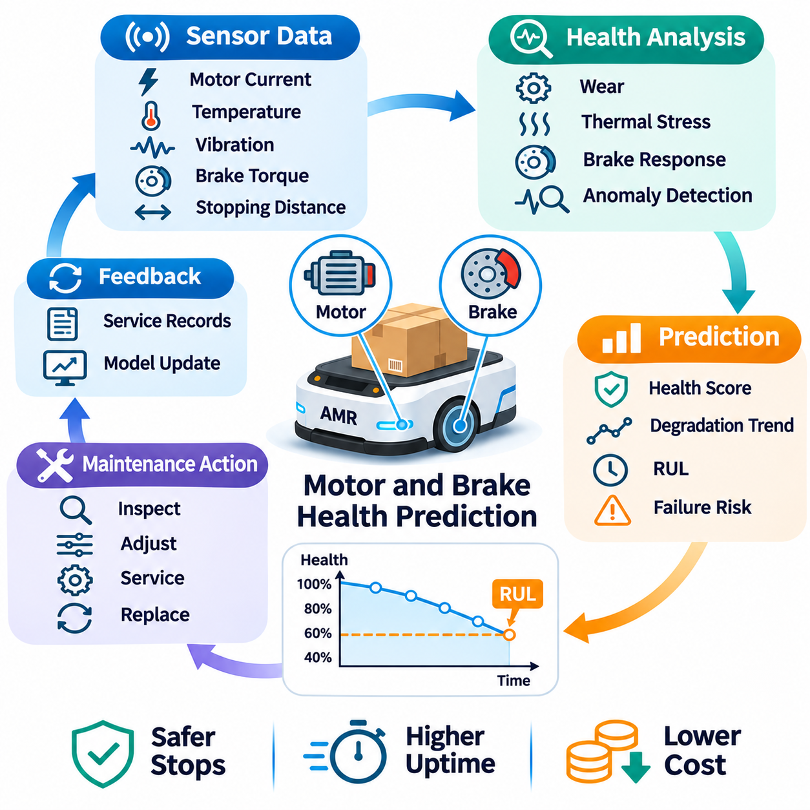
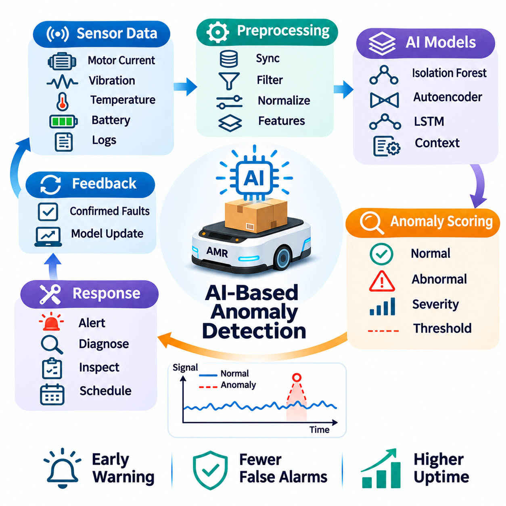
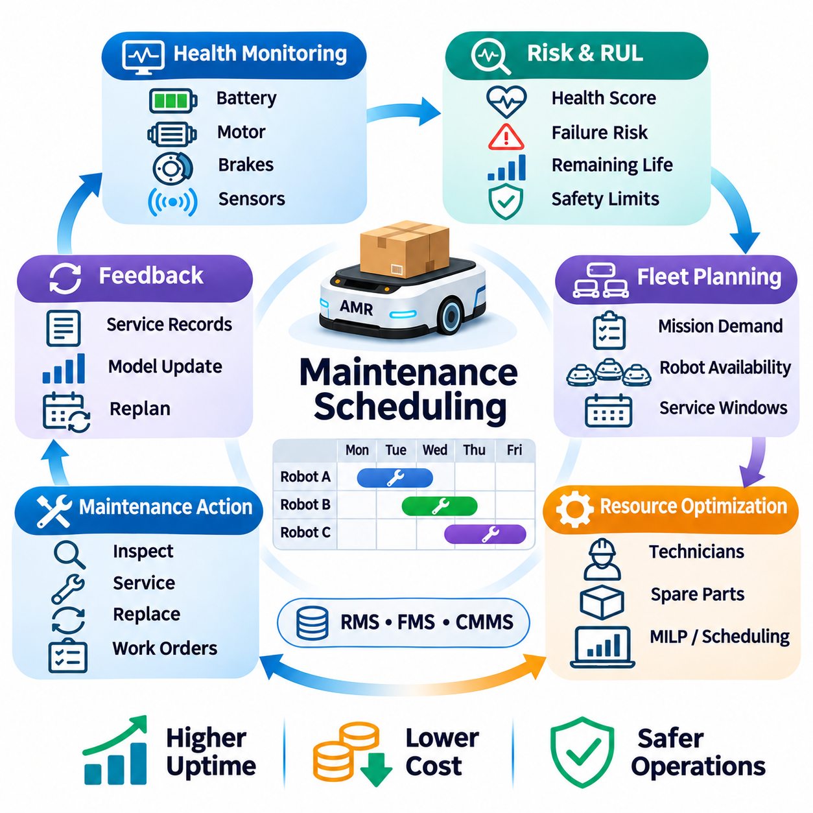
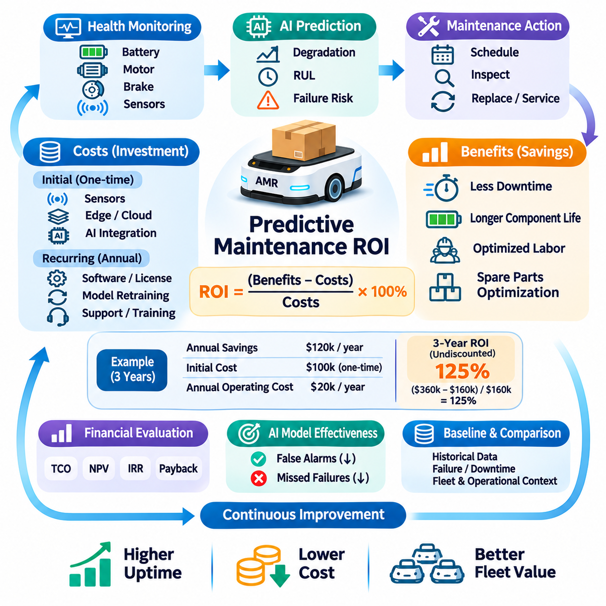

**Volume 08. AMR Operations, Deployment, and MLOps**

# Chapter 11. Predictive Maintenance

## 11.1 Predictive Maintenance Concept

{width="7.268055555555556in" height="7.268055555555556in"}

Predictive maintenance is a proactive engineering approach that uses operational data, condition monitoring, statistical analysis, and artificial intelligence to anticipate equipment failures before they occur. In Autonomous Mobile Robot (AMR) systems, predictive maintenance improves operational reliability by identifying early signs of component degradation and enabling maintenance activities before critical failures interrupt robot missions or fleet operations.

Traditional maintenance strategies are generally classified into corrective maintenance, preventive maintenance, and predictive maintenance. Corrective maintenance repairs equipment after a failure has occurred, whereas preventive maintenance performs inspections and component replacements at predetermined intervals. Predictive maintenance determines appropriate maintenance timing based on actual equipment conditions, operational history, and estimated failure probabilities.

The fundamental principle of predictive maintenance is that many mechanical, electrical, and electronic components exhibit measurable degradation before functional failure occurs. Changes in vibration, temperature, electrical current, energy consumption, mechanical response, and communication stability may provide early indications of abnormal conditions. Continuous observation of these characteristics enables engineers to identify emerging problems before they become critical.

Autonomous Mobile Robots contain numerous components that experience gradual degradation throughout their operational lifecycle. Drive motors, gearboxes, wheel assemblies, bearings, braking systems, batteries, power converters, cooling fans, sensors, and embedded computing devices are exposed to different operational stresses. Predictive maintenance evaluates the condition of these components individually while considering their interactions within the overall robot architecture.

The predictive maintenance process begins with systematic operational data collection. Robot controllers, motor drivers, Battery Management Systems (BMS), environmental sensors, and edge computing platforms continuously generate diagnostic information. These data are collected through communication interfaces such as CAN, EtherCAT, Ethernet, and ROS2 middleware, creating historical records that describe equipment behavior under various operating conditions.

Condition monitoring provides the foundation for predictive maintenance by establishing reference characteristics that represent normal component behavior. Baseline measurements should account for robot velocity, payload weight, acceleration, ambient temperature, terrain conditions, and mission profiles. Comparing current measurements against context-dependent baselines helps distinguish genuine component degradation from temporary variations caused by normal operational demands.

Failure data collection is another essential element of predictive maintenance. Historical records should include component identification, operating hours, environmental conditions, diagnostic messages, failure symptoms, maintenance actions, and confirmed root causes. Combining failure records with normal operational data enables engineers to investigate degradation patterns, establish relationships between measurable signals and failures, and develop reliable prediction models.

Component lifetime modeling estimates the expected useful lifetime of mechanical and electrical equipment based on operating conditions and historical degradation behavior. Statistical reliability models, Weibull distributions, physics-based degradation models, and machine learning techniques can support these estimations. Remaining Useful Life (RUL) represents the estimated time or operating cycles before a component reaches a defined end-of-life condition.

Battery degradation prediction is particularly important because battery performance directly influences AMR availability, mission duration, and charging requirements. Monitoring State of Charge (SOC), State of Health (SOH), internal resistance, charging cycles, cell voltage imbalance, and temperature enables maintenance systems to evaluate battery aging. Predictive analysis supports battery replacement planning while reducing unexpected mission interruptions caused by insufficient energy capacity.

Motor and brake health prediction focuses on detecting mechanical wear, thermal stress, electrical abnormalities, and declining braking performance. Motor current signatures, torque responses, rotational speed, vibration characteristics, and temperature measurements provide valuable diagnostic information. An increasing current demand under comparable operating conditions may indicate bearing degradation, mechanical resistance, drivetrain misalignment, or other developing abnormalities.

Artificial intelligence enhances predictive maintenance through its ability to analyze complex relationships among multiple operational variables. Machine learning algorithms can identify abnormal patterns that conventional threshold-based monitoring may overlook. Autoencoders, Isolation Forests, recurrent neural networks, and time-series Transformers can support anomaly detection and degradation forecasting, particularly when equipment behavior depends on dynamic operating conditions.

A practical predictive maintenance architecture distributes analytical functions across robot-level edge devices, on-premises infrastructure, and cloud platforms. Edge devices perform continuous condition monitoring and immediate anomaly detection, while centralized systems analyze long-term trends across multiple robots. Fleet-level data aggregation improves the identification of recurring failure patterns and supports the development of component-specific predictive models.

Integration with the Robot Management System (RMS) and Fleet Management System (FMS) transforms maintenance predictions into actionable operational decisions. When abnormal degradation is detected, the management platform can generate maintenance requests, notify technicians, and adjust mission assignments. Maintenance scheduling should consider estimated failure risk, robot availability, spare parts inventory, technician resources, and customer service requirements.

Predictive maintenance models must be continuously validated throughout the operational lifecycle. Incorrect predictions can result in unnecessary component replacements or failures that remain undetected until critical damage occurs. Model evaluation should consider prediction accuracy, false alarm rates, missed failure rates, warning lead time, and uncertainty. Predictive maintenance must complement rather than replace mandatory inspections and independent functional safety mechanisms.

The economic value of predictive maintenance is evaluated through reductions in unplanned downtime, emergency repair costs, spare parts consumption, and operational disruptions. Key performance indicators include Mean Time Between Failures (MTBF), Mean Time to Repair (MTTR), equipment availability, maintenance expenditure, and Return on Investment (ROI). Effective implementation establishes a continuous feedback loop connecting operational data, failure prediction, maintenance execution, and reliability improvement.

## 11.2 Failure Data Collection

{width="7.268055555555556in" height="7.268055555555556in"}

Failure data collection is a fundamental process in predictive maintenance that enables engineers to understand equipment degradation, identify recurring failure mechanisms, and develop reliable failure prediction models. In Autonomous Mobile Robot (AMR) systems, systematic collection of failure-related information provides the historical evidence necessary to improve operational reliability, maintenance efficiency, and long-term fleet availability.

Failure data should describe both the circumstances surrounding an equipment failure and the physical or functional consequences of the event. Relevant information includes robot identification, component serial numbers, failure timestamps, operating hours, mission conditions, environmental characteristics, diagnostic messages, and maintenance history. Consistent recording practices establish a reliable foundation for subsequent engineering analysis.

AMR failures can originate from mechanical, electrical, electronic, software, communication, and artificial intelligence subsystems. Mechanical failures may involve wheel damage, bearing wear, gearbox deterioration, or braking abnormalities. Electrical failures may include battery degradation, power instability, and motor driver faults, while software failures may result from resource exhaustion, process termination, or unexpected system interactions.

Failure data collection should incorporate information from multiple sources within the robot architecture. Motor controllers provide current, torque, rotational speed, and temperature measurements, while Battery Management Systems (BMS) report voltage, charging cycles, internal resistance estimates, and battery health indicators. Additional diagnostic information can be obtained from perception sensors, navigation software, communication devices, and embedded computing platforms.

Continuous data acquisition enables maintenance engineers to investigate equipment behavior before, during, and after a failure. A circular buffer can temporarily retain recent sensor measurements and diagnostic information within the robot. When a failure event occurs, the data collection system preserves relevant pre-event and post-event records, allowing engineers to reconstruct the operational sequence and identify potential causes of the abnormal condition.

Event-driven data collection improves storage efficiency by capturing detailed information when predefined conditions are satisfied. Trigger conditions may include excessive motor current, abnormal vibration, unexpected temperature increases, localization failures, communication interruptions, or repeated software exceptions. Trigger thresholds should account for operating conditions to avoid excessive recording of normal variations in equipment behavior.

Accurate timestamping and synchronization are essential when collecting failure data from distributed robot subsystems. Mechanical, electrical, and software events frequently occur within short time intervals, making chronological consistency important for causal analysis. Network Time Protocol (NTP), Precision Time Protocol (PTP), and synchronized system clocks can support temporal alignment according to the required measurement accuracy.

Failure classification establishes a standardized methodology for organizing collected information. Each event should be categorized according to the affected subsystem, failure mode, severity, operational impact, and recovery requirements. Failure Mode and Effects Analysis (FMEA) and Failure Reporting, Analysis, and Corrective Action Systems (FRACAS) provide structured approaches for connecting observed failures with engineering knowledge and corrective actions.

Operational context is particularly important because identical diagnostic signals may represent different equipment conditions. Increased motor current may indicate mechanical deterioration, but it may also result from heavier payloads, steep slopes, or increased rolling resistance. Recording robot velocity, acceleration, payload, terrain, ambient temperature, and mission characteristics helps distinguish genuine degradation from normal operating variations.

Maintenance records provide essential verification of automatically collected failure data. Field technicians should document inspection results, damaged components, confirmed root causes, replacement procedures, and post-maintenance performance. Connecting these records with historical robot telemetry enables engineers to establish validated relationships between measurable operational symptoms and actual component failures.

Failure data quality control addresses missing measurements, duplicated records, inaccurate timestamps, inconsistent units, and incorrect component identification. Automated validation mechanisms should identify corrupted or incomplete records without silently modifying original evidence. Data provenance, schema versioning, and calibration history further improve the traceability and reproducibility of failure analysis across different robot configurations.

Predictive maintenance datasets should include normal operating conditions, progressive degradation, intermittent abnormalities, near-failure events, and confirmed failures. Because actual equipment failures are relatively infrequent, these datasets often exhibit significant class imbalance. Components that remain operational at the end of observation should also be recorded to support reliability analysis and reduce bias in component lifetime modeling.

A scalable failure data collection architecture combines edge-level recording with centralized storage and fleet-level analysis. Robot-level edge devices capture high-frequency measurements and failure events, while on-premises or cloud infrastructure maintains historical records. Time-series databases, object storage, and structured maintenance databases support efficient retrieval of telemetry, diagnostic logs, sensor recordings, and service histories.

Integration with the Robot Management System (RMS), Fleet Management System (FMS), and Computerized Maintenance Management System (CMMS) connects technical failure information with operational workflows. Automatically generated failure reports can initiate maintenance requests, notify responsible personnel, and support root cause investigations. Confirmed maintenance outcomes should subsequently be returned to the failure database as validated feedback.

Failure data collection establishes a continuous information cycle connecting field operations, reliability engineering, predictive analytics, and product improvement. Its effectiveness can be evaluated through failure record completeness, diagnostic coverage, data accuracy, root cause confirmation rates, and maintenance traceability. A well-governed failure database ultimately provides the foundation for component lifetime estimation and AI-based predictive maintenance.

## 11.3 Component Lifetime Modeling

{width="7.268055555555556in" height="7.268055555555556in"}

Component lifetime modeling is an essential element of predictive maintenance that estimates how long mechanical, electrical, and electronic components can operate before reaching predefined failure or degradation limits. In Autonomous Mobile Robot (AMR) systems, lifetime modeling supports maintenance planning, operational risk reduction, component replacement optimization, and long-term fleet reliability.

The lifetime of a robot component is influenced by its design characteristics, material properties, manufacturing quality, operational workload, and environmental conditions. Components operating under identical calendar periods may experience significantly different degradation rates because of differences in payload, movement frequency, acceleration, vibration, temperature, and exposure to environmental contaminants.

Component lifetime modeling distinguishes between calendar aging and usage-dependent degradation. Calendar aging occurs over time regardless of active operation, whereas usage-dependent degradation results from accumulated operational stress. Batteries experience both aging mechanisms, while bearings, gears, wheels, and braking components are primarily influenced by mechanical loading, operating cycles, and environmental exposure.

Lifetime modeling requires systematic collection of component-specific operational data. Relevant parameters include accumulated operating hours, traveled distance, rotational cycles, motor current, torque, temperature, vibration, charging cycles, and maintenance history. Each measurement should be associated with a unique component identifier to maintain traceability throughout installation, operation, maintenance, and replacement.

Statistical reliability modeling provides a mathematical foundation for estimating component lifetime and failure probability. Reliability functions describe the probability that a component continues to operate beyond a specified duration, while failure density and hazard functions characterize failure behavior over time. These models enable engineers to evaluate operational risks using historical failure and survival data from deployed robots.

The Weibull distribution is widely used in reliability engineering because it can represent different failure characteristics throughout a component lifecycle. A shape parameter below one indicates a decreasing failure rate associated with early failures, while a value of one represents a constant failure rate. Values greater than one describe increasing failure rates commonly associated with aging, mechanical wear, and accumulated degradation.

Physics-based lifetime modeling estimates component degradation using mathematical representations of physical failure mechanisms. Mechanical fatigue, friction-induced wear, thermal aging, material deterioration, and electrical insulation degradation can be analyzed using appropriate engineering models. These approaches incorporate physical knowledge and can provide interpretable lifetime estimates even when historical failure data are limited.

Cumulative damage modeling evaluates the combined effects of repeated operational loading over a component lifecycle. For example, the Palmgren-Miner rule estimates accumulated fatigue damage under varying mechanical stress levels. In AMR applications, cumulative damage models can support the evaluation of structural components, drivetrain assemblies, and mechanical connections exposed to repeated acceleration, braking, vibration, and impact loading.

Remaining Useful Life (RUL) represents the estimated operating time, travel distance, or number of usage cycles before a component reaches a defined end-of-life condition. RUL estimation combines current health indicators with historical degradation trends and assumptions about future operating conditions. Because future workloads are uncertain, lifetime predictions should include confidence or prediction intervals rather than relying exclusively on deterministic values.

Data-driven lifetime modeling uses statistical learning and artificial intelligence to identify relationships between operational measurements and component degradation. Regression models, Random Forests, Gradient Boosting, Long Short-Term Memory (LSTM) networks, and time-series Transformers can estimate degradation trajectories and remaining lifetime from historical measurements, provided that sufficient representative training data are available.

Hybrid lifetime modeling combines physics-based degradation mechanisms with data-driven prediction techniques. Physical models establish fundamental relationships between operational stress and component deterioration, while machine learning models compensate for unmodeled dynamics and environmental variability. This approach can improve prediction robustness while maintaining physical interpretability across diverse robot operating conditions.

Component lifetime datasets must account for equipment that has not failed during the observation period. Such records are commonly described as right-censored data because the exact failure time remains unknown. Survival analysis techniques, including Kaplan-Meier estimation and Cox proportional hazards models, incorporate censored observations to reduce estimation bias and improve reliability assessments across operational robot fleets.

Fleet-level lifetime modeling enables engineers to compare degradation patterns among robots operating under different workloads and environmental conditions. Aggregated operational records can reveal systematic weaknesses associated with manufacturing batches, component suppliers, mission profiles, or robot configurations. Hierarchical statistical models can distinguish individual component variability from broader population-level reliability characteristics.

Integration with the Robot Management System (RMS), Fleet Management System (FMS), and maintenance management platforms converts lifetime predictions into operational decisions. Components approaching their estimated end-of-life limits can be prioritized for inspection or replacement during scheduled downtime. Mission assignments, workload distribution, spare parts procurement, and technician scheduling can also be adjusted according to estimated component health.

Lifetime models must be validated using independent operational datasets, confirmed failure records, accelerated life testing, and field maintenance observations. Evaluation metrics may include Mean Absolute Error (MAE), Root Mean Square Error (RMSE), prediction interval coverage, and failure risk calibration. Validation should also investigate prediction reliability across different environments, component generations, and operating conditions.

Component lifetime modeling establishes a continuous feedback loop between operational monitoring, reliability engineering, predictive analytics, and maintenance execution. Periodic model recalibration incorporates newly observed degradation patterns and confirmed service outcomes. Accurate lifetime estimation supports improved equipment availability, reduced maintenance expenditure, optimized component utilization, and sustainable AMR fleet operations without replacing mandatory safety inspections.

## 11.4 Battery Degradation Prediction

{width="7.268055555555556in" height="7.268055555555556in"}

Battery degradation prediction is a critical element of predictive maintenance in Autonomous Mobile Robot (AMR) systems because battery performance directly affects operational availability, mission duration, charging efficiency, and lifecycle costs. By analyzing battery operating conditions and historical degradation patterns, predictive maintenance systems can estimate future battery performance and identify appropriate replacement timing before unexpected failures occur.

Rechargeable batteries gradually deteriorate through electrochemical, thermal, and mechanical processes throughout their operational lifecycle. Lithium-ion batteries, including Lithium Iron Phosphate (LFP) and Nickel Manganese Cobalt (NMC) batteries, experience capacity loss and increasing internal resistance as aging progresses. These degradation mechanisms reduce available energy, power delivery capability, charging efficiency, and overall operational reliability.

Battery degradation is generally classified into calendar aging and cycle aging. Calendar aging occurs over time regardless of battery utilization and is influenced by storage temperature and State of Charge (SOC). Cycle aging results from repeated charging and discharging processes and depends on Depth of Discharge (DOD), charging current, discharge current, operating temperature, and cumulative energy throughput.

The Battery Management System (BMS) provides the primary source of operational information for battery degradation prediction. Relevant measurements include individual cell voltages, battery pack voltage, charging and discharging currents, cell temperatures, charging cycles, and protection events. Continuous collection of these parameters enables engineers to establish historical battery performance profiles and identify changes associated with electrochemical degradation.

State of Charge represents the estimated remaining charge relative to the battery\'s available capacity, while State of Health (SOH) describes its condition relative to a defined reference state. Capacity-based SOH measures the reduction in maximum charge storage capability, whereas resistance-based health indicators describe changes in internal resistance and power delivery capability. Both indicators contribute to comprehensive battery health assessment.

Internal resistance estimation is particularly valuable because increasing resistance can reduce battery efficiency and increase heat generation during operation. Voltage responses under changing current loads provide information about battery impedance characteristics. Measurements obtained under comparable temperature and charge conditions can help distinguish long-term degradation from temporary variations caused by normal electrochemical behavior.

Battery degradation prediction must consider the operational characteristics of individual AMRs. Heavy payload transportation, frequent acceleration, steep terrain, long-distance missions, and intensive charging schedules can impose different electrical and thermal stresses. Recording these operational characteristics alongside battery measurements enables prediction models to distinguish workload-dependent performance variations from actual battery deterioration.

Equivalent Circuit Models (ECMs) represent battery electrical behavior using combinations of voltage sources, resistors, and capacitors. These models can support battery state estimation through techniques such as the Extended Kalman Filter (EKF) and Unscented Kalman Filter (UKF). Tracking changes in estimated model parameters over time provides additional information about battery aging, available capacity, and internal resistance degradation.

Physics-based battery degradation models describe electrochemical aging mechanisms such as Solid Electrolyte Interphase (SEI) growth, lithium plating, loss of active material, and loss of lithium inventory. Arrhenius-based aging models can represent temperature-dependent degradation under applicable assumptions. These approaches improve physical interpretability and support lifetime estimation under different charging strategies and environmental conditions.

Data-driven battery degradation prediction applies statistical learning and artificial intelligence to historical battery measurements. Regression models, Gaussian Process Regression, Random Forests, Long Short-Term Memory (LSTM) networks, and time-series Transformers can estimate future capacity loss and resistance growth. Prediction reliability depends on representative training datasets covering multiple battery chemistries, operating conditions, and degradation stages.

Remaining Useful Life (RUL) estimation predicts the remaining operating time or usage cycles before a battery reaches a predefined End-of-Life (EOL) condition. Although 80 percent of initial capacity is a commonly used reference threshold, actual replacement criteria should reflect AMR mission requirements, peak power demand, manufacturer specifications, and safety constraints. RUL predictions should incorporate uncertainty associated with future operating conditions.

Cell-level monitoring is important because the performance of a battery pack can be limited by its weakest cells. Increasing cell voltage imbalance, abnormal temperature differences, and persistent deviations during charging or discharging may indicate uneven aging or developing faults. Predictive models should evaluate both individual cell behavior and overall battery pack performance while distinguishing normal balancing activities from abnormal conditions.

A scalable battery degradation prediction architecture distributes analytical functions across the BMS, robot edge computing platform, and centralized infrastructure. Edge devices collect operating measurements and detect immediate abnormalities, while on-premises or cloud platforms perform long-term degradation analysis and fleet-level model training. Independent BMS protection mechanisms must remain effective regardless of predictive model availability.

Integration with the Robot Management System (RMS) and Fleet Management System (FMS) enables battery health predictions to influence operational planning. Robots with declining battery capacity can receive shorter missions, adjusted workload assignments, or revised charging schedules within approved operating limits. Maintenance platforms can use estimated replacement dates to coordinate spare battery procurement, technician availability, and planned service interruptions.

Battery degradation models must be validated using independent operational datasets, controlled capacity measurements, accelerated aging experiments, and confirmed maintenance outcomes. Evaluation should consider SOH estimation accuracy, RUL prediction error, warning lead time, and uncertainty calibration. Battery model updates should follow controlled MLOps procedures to prevent prediction regressions across different battery configurations and operating environments.

Effective battery degradation prediction establishes a continuous feedback loop connecting battery monitoring, predictive analytics, fleet management, and maintenance execution. Confirmed battery replacement outcomes provide additional evidence for model improvement and lifecycle optimization. The resulting maintenance strategy supports reduced unplanned downtime, improved energy utilization, lower replacement costs, and sustainable AMR fleet operations.

## 11.5 Motor and Brake Health Prediction

{width="7.268055555555556in" height="7.268055555555556in"}

Motor and brake health prediction is an essential element of predictive maintenance in Autonomous Mobile Robot (AMR) systems because drivetrain reliability directly influences mobility performance, operational availability, and functional safety. Based on the predictive maintenance framework, motor and brake health analysis combines condition monitoring, physical degradation modeling, and artificial intelligence to identify developing faults before functional failures occur.

Drive motors are continuously exposed to mechanical loading, electrical stress, thermal cycling, vibration, and environmental disturbances during robot operation. Common degradation mechanisms include bearing wear, winding insulation deterioration, rotor abnormalities, lubricant degradation, and mechanical misalignment. These mechanisms can gradually reduce motor efficiency, torque generation capability, and drivetrain reliability.

Motor health monitoring requires systematic collection of electrical, mechanical, and thermal operating parameters. Relevant measurements include phase currents, supply voltage, rotational speed, torque estimates, motor temperature, vibration, and motor driver diagnostic codes. Continuous acquisition of these parameters enables engineers to establish normal operating characteristics and identify deviations associated with progressive component degradation.

Motor Current Signature Analysis (MCSA) identifies potential motor abnormalities by examining characteristic patterns within motor current signals. Frequency-domain analysis using the Fast Fourier Transform (FFT) can reveal spectral components associated with electrical faults, rotor abnormalities, or mechanical disturbances. Variable-speed AMR applications may require time-frequency analysis or speed-dependent normalization to improve diagnostic accuracy.

Vibration analysis provides valuable information about the mechanical condition of motors, bearings, gearboxes, and drivetrain assemblies. Accelerometers installed near critical components can capture vibration patterns associated with mechanical imbalance, misalignment, bearing defects, and gear damage. Statistical features, frequency spectra, and envelope analysis can support early detection of mechanical degradation under representative operating conditions.

Thermal monitoring is particularly important because excessive motor temperature can accelerate winding insulation degradation and reduce component lifetime. Temperature measurements should be evaluated alongside motor current, torque demand, ambient temperature, cooling performance, and operating duration. Thermal models can estimate expected temperature responses and identify abnormal heating that may indicate increasing electrical or mechanical losses.

Motor efficiency degradation can be evaluated by comparing electrical energy consumption with estimated mechanical output under equivalent operating conditions. Increased current demand or declining torque response may indicate friction growth, bearing deterioration, drivetrain resistance, or electrical abnormalities. Context-dependent analysis is necessary to distinguish genuine motor degradation from variations in payload, terrain, acceleration, and driving speed.

Braking systems are safety-critical components responsible for controlled deceleration, stationary holding, and emergency stopping according to robot architecture. AMRs may incorporate regenerative braking, electromagnetic holding brakes, and mechanical friction brakes. Each braking mechanism exhibits different degradation characteristics and requires monitoring strategies appropriate to its physical design, operating principle, and designated safety functions.

Mechanical brake degradation may result from friction material wear, thermal stress, contamination, spring fatigue, or changes in actuator response. Relevant health indicators include brake engagement time, release time, braking torque, coil current, temperature, and stopping distance. Historical analysis of these measurements can identify progressive deterioration before braking performance reaches unacceptable operating limits.

Brake performance prediction must account for robot mass, payload distribution, initial velocity, road gradient, surface friction, and environmental conditions. Increasing stopping distance under comparable test conditions may indicate declining braking capability, but it can also result from reduced wheel traction. Controlled testing and contextual normalization are therefore necessary to distinguish brake degradation from external mobility disturbances.

Physics-based health prediction models describe motor and brake degradation using engineering relationships derived from thermal dynamics, material fatigue, friction, and electromagnetic behavior. Cumulative damage models can estimate the effects of repeated acceleration, deceleration, and braking cycles. These approaches provide interpretable predictions and support component lifetime estimation when representative failure datasets are limited.

Artificial intelligence enables motor and brake health prediction through multivariate analysis of historical operational measurements. Isolation Forests, Autoencoders, Random Forests, Long Short-Term Memory (LSTM) networks, and time-series Transformers can support anomaly detection and degradation forecasting. Model selection should consider available training data, computational requirements, prediction uncertainty, and diagnostic interpretability.

Remaining Useful Life (RUL) estimation combines component health indicators, historical degradation trends, and expected future operating conditions to predict when maintenance may become necessary. Motor and brake lifetime estimates should incorporate uncertainty because future loading conditions and degradation rates cannot be determined precisely. Safety-critical maintenance decisions must follow conservative limits and approved engineering requirements.

A scalable prediction architecture distributes monitoring and analytical functions across motor controllers, robot edge computing devices, and centralized infrastructure. Edge devices perform real-time diagnostic processing and immediate abnormality detection, while on-premises or cloud platforms analyze long-term degradation trends across robot fleets. Fleet-level learning can identify recurring failure patterns associated with specific component configurations.

Integration with the Robot Management System (RMS), Fleet Management System (FMS), and maintenance management platforms converts motor and brake health predictions into actionable maintenance workflows. Robots exhibiting abnormal degradation may be prioritized for inspection, assigned reduced workloads within validated limits, or removed from service. Predictive models must never override independent braking protection or functional safety mechanisms.

Motor and brake health prediction models should be validated through controlled endurance testing, independent field datasets, confirmed failure investigations, and post-maintenance assessments. Evaluation metrics include anomaly detection accuracy, false alarm rates, missed failure rates, warning lead time, and RUL prediction error. Effective implementation reduces unplanned downtime and maintenance expenditure while supporting safe, reliable, and sustainable AMR fleet operations.

## 11.6 AI-Based Anomaly Detection

{width="7.268055555555556in" height="7.268055555555556in"}

Artificial Intelligence (AI)-based anomaly detection is a fundamental capability of predictive maintenance in Autonomous Mobile Robot (AMR) systems. It identifies abnormal operating patterns that may indicate emerging component failures, system degradation, or unexpected environmental influences. Unlike conventional threshold-based monitoring, AI-based approaches can recognize complex relationships among multiple operational variables and detect subtle performance deviations.

An anomaly represents an observation or behavioral pattern that deviates significantly from expected system behavior under comparable operating conditions. In AMR systems, anomalies may appear in motor current, battery voltage, vibration, temperature, sensor measurements, communication latency, or software execution time. Not every anomaly indicates a component failure, making contextual interpretation and diagnostic verification important.

Effective anomaly detection requires continuous acquisition of multidimensional operational data from robot hardware, embedded controllers, sensors, and software processes. Data preprocessing includes timestamp synchronization, noise filtering, missing value handling, normalization, and segmentation into appropriate observation windows. These processes establish consistent input representations and improve the reliability of subsequent anomaly detection models.

Feature engineering transforms raw operational measurements into meaningful indicators of component health and system behavior. Statistical features may include mean values, standard deviation, root mean square, kurtosis, and signal variability. Frequency-domain features can reveal abnormal vibration or electrical signal patterns, while temporal features describe degradation trends, repetitive disturbances, and changes in operating dynamics.

Unsupervised learning is particularly valuable because confirmed failure samples are often limited in operational robot fleets. Algorithms such as Isolation Forest, One-Class Support Vector Machine (OC-SVM), and clustering-based anomaly detection establish representations of normal operating behavior or identify uncommon observations. Significant deviations from learned patterns can generate anomaly scores without requiring comprehensive labeled failure datasets.

Autoencoder-based anomaly detection uses neural networks to reconstruct operational data through compressed latent representations. When trained primarily on healthy operating samples, an Autoencoder may reconstruct normal behavior more accurately than unfamiliar abnormal patterns. Reconstruction errors can therefore serve as anomaly indicators, although detection thresholds must be validated against operational variability and previously unseen failure scenarios.

Temporal anomaly detection incorporates the sequential characteristics of robot operating data. Recurrent Neural Networks (RNNs), Long Short-Term Memory (LSTM) networks, Temporal Convolutional Networks (TCNs), and time-series Transformers can learn dependencies across consecutive observations. Prediction errors, reconstruction errors, or learned temporal representations can reveal gradual degradation and abnormal behavioral transitions that instantaneous measurements may overlook.

Supervised learning approaches become practical when sufficient labeled fault and failure data are available. Random Forests, Gradient Boosting models, and deep neural networks can classify known failure modes and estimate associated risk levels. Semi-supervised learning can combine limited labeled samples with extensive unlabeled operational datasets, improving diagnostic capabilities while reducing the cost of manual data annotation.

Context-aware anomaly detection is necessary because normal AMR behavior varies according to payload, travel speed, acceleration, terrain, ambient temperature, and mission characteristics. A motor current increase during heavy-load transportation may represent normal behavior rather than mechanical deterioration. Incorporating operational context enables AI models to establish adaptive expectations and reduce unnecessary maintenance alerts.

Multimodal anomaly detection combines information from electrical measurements, vibration signals, thermal sensors, motion feedback, and software diagnostic records. Sensor fusion and learned feature representations can reveal relationships that individual monitoring channels cannot identify independently. Graph Neural Networks (GNNs) may additionally represent dependencies among interconnected robot subsystems and support system-level fault investigation.

Anomaly scoring converts detected deviations into quantitative indicators that support maintenance prioritization. Dynamic thresholds, persistence requirements, and severity classification can distinguish temporary disturbances from sustained abnormal behavior. Explainable Artificial Intelligence (XAI), feature attribution, and signal-level diagnostic evidence can help maintenance engineers investigate the underlying causes of generated alerts.

A scalable anomaly detection architecture distributes analytical responsibilities across robot edge devices, on-premises computing infrastructure, and cloud platforms. Edge inference enables immediate abnormality recognition with limited communication dependency, while centralized infrastructure supports historical analysis, fleet-level pattern discovery, computationally intensive model training, and controlled deployment of updated detection models.

Integration with the Robot Management System (RMS), Fleet Management System (FMS), and maintenance management platforms transforms anomaly detection results into actionable maintenance workflows. Confirmed abnormalities can trigger diagnostic inspections, maintenance work orders, or operational restrictions within validated limits. Model performance should be evaluated using precision, recall, false alarm frequency, detection latency, and warning lead time. Continuous feedback and controlled MLOps updates improve detection reliability without replacing independent functional safety mechanisms.

## 11.7 Maintenance Scheduling

{width="7.268055555555556in" height="7.268055555555556in"}

Maintenance scheduling is an essential element of predictive maintenance in Autonomous Mobile Robot (AMR) systems, transforming component health assessments and failure predictions into coordinated maintenance activities. Effective scheduling balances equipment reliability, operational availability, maintenance expenditure, and mission requirements while minimizing unexpected interruptions to robot fleet operations.

Conventional preventive maintenance relies primarily on predetermined service intervals based on operating hours, travel distance, or calendar periods. Predictive maintenance scheduling instead incorporates actual component conditions, degradation trends, and estimated failure risks. This approach can reduce unnecessary component replacements while identifying equipment that requires attention before its next scheduled service.

Condition-Based Maintenance (CBM) provides a foundation for dynamic maintenance scheduling by evaluating the current health of individual robot components. Battery capacity, motor temperature, vibration characteristics, braking performance, and diagnostic events can serve as maintenance indicators. These measurements are evaluated against validated thresholds and historical baselines to determine whether intervention is necessary.

Remaining Useful Life (RUL) estimation enables maintenance planners to anticipate when individual components may reach predefined degradation limits. Scheduling decisions should incorporate prediction uncertainty, expected future workloads, and appropriate maintenance safety margins. Components with rapidly declining health or uncertain lifetime estimates may require earlier inspections than components exhibiting stable degradation patterns.

Risk-based maintenance scheduling prioritizes maintenance activities according to failure probability and the potential consequences of component malfunction. Safety-critical components, including braking systems and protective sensors, require more conservative maintenance criteria than noncritical subsystems. Predicted failure risks must never justify extending mandatory inspection intervals or overriding manufacturer-defined safety requirements.

Fleet-level maintenance scheduling considers the operational dependencies among multiple robots rather than treating each AMR as an independent asset. Simultaneous maintenance of several robots may reduce transportation capacity and disrupt production workflows. Coordinated scheduling distributes maintenance activities across available service windows while maintaining sufficient fleet capacity to satisfy operational demand.

Maintenance scheduling should be integrated with mission planning and workload allocation. Robots approaching maintenance thresholds may receive shorter missions or reduced workloads within validated operating limits, while healthier robots accommodate additional demand. This dynamic allocation can help manage component degradation and maintain operational continuity without compromising established equipment protection mechanisms.

Maintenance scheduling can be formulated as a constrained optimization problem involving maintenance timing, robot availability, technician capacity, spare parts inventory, and operational demand. Mixed-Integer Linear Programming (MILP), constraint programming, and heuristic optimization algorithms can identify feasible maintenance schedules that minimize combined operational losses and maintenance costs.

Dynamic scheduling enables maintenance plans to adapt to newly detected anomalies, unexpected failures, changing mission requirements, and updated component lifetime predictions. Rolling-horizon optimization periodically recalculates future maintenance activities using the latest operational information. Schedule stability should also be considered to prevent frequent adjustments from disrupting technician assignments and resource preparation.

Spare parts management and maintenance resource allocation are closely connected to predictive maintenance scheduling. Estimated component replacement dates can support advance procurement of batteries, motors, bearings, wheels, and braking components. Coordinating inventory availability, supplier lead times, technician qualifications, and service equipment reduces maintenance delays and unnecessary inventory expenditure.

Integration with the Robot Management System (RMS), Fleet Management System (FMS), and Computerized Maintenance Management System (CMMS) establishes a coordinated maintenance workflow. Health predictions generate inspection requests or maintenance work orders, while fleet management platforms identify suitable service windows. Completed maintenance records update component histories and support subsequent scheduling decisions.

Maintenance scheduling performance should be evaluated using Key Performance Indicators (KPIs), including equipment availability, maintenance cost, schedule compliance, Mean Time Between Failures (MTBF), and Mean Time To Repair (MTTR). Additional indicators include unexpected failure frequency, maintenance backlog, spare parts availability, and the proportion of maintenance activities completed before predicted failure conditions.

Effective maintenance scheduling establishes a continuous feedback loop connecting condition monitoring, lifetime prediction, resource planning, maintenance execution, and operational validation. Completed inspections and confirmed replacement outcomes provide evidence for refining prediction models and scheduling policies. This integrated approach supports reliable fleet operations, optimized lifecycle expenditure, and sustainable AMR deployment.

## 11.8 Predictive Maintenance ROI

{width="7.268055555555556in" height="7.268055555555556in"}

Return on Investment (ROI) is a fundamental economic indicator for evaluating the effectiveness of predictive maintenance in Autonomous Mobile Robot (AMR) systems. It quantifies the financial benefits generated through improved equipment reliability, reduced operational interruptions, and optimized maintenance expenditure relative to the investment required to establish and operate predictive maintenance infrastructure.

Predictive maintenance generates economic value by identifying component degradation before unexpected failures occur. Conventional corrective maintenance often results in emergency repairs, extended downtime, additional labor expenses, and production losses. By enabling planned maintenance interventions, predictive maintenance can reduce these expenditures while improving operational continuity and equipment utilization.

The investment required for predictive maintenance includes both initial implementation costs and recurring operational expenses. Initial expenditures may include condition monitoring sensors, edge computing devices, communication infrastructure, data storage systems, AI model development, and software integration. Recurring expenses include infrastructure operation, software licensing, model retraining, technical support, and personnel training.

Avoided unplanned downtime represents one of the most significant sources of financial benefit in AMR operations. Unexpected robot failures can interrupt material transportation, production processes, warehouse activities, and service delivery. The economic impact of downtime should be estimated using actual operational losses, reduced throughput, recovery expenses, and the availability of alternative transportation resources.

Component lifetime optimization provides another important source of economic value. Conventional preventive maintenance may replace components before their actual useful lifetimes have been exhausted. Predictive maintenance uses State of Health (SOH) assessments and Remaining Useful Life (RUL) predictions to determine appropriate replacement timing within approved maintenance limits, reducing unnecessary expenditure on batteries, motors, bearings, and other components.

Maintenance labor optimization contributes to improved ROI through coordinated inspection procedures, reduced emergency service requirements, and more efficient technician scheduling. Predictive maintenance enables technical personnel to concentrate on components exhibiting abnormal degradation instead of performing unnecessary inspections. Planned interventions also facilitate workload balancing, preparation of service equipment, and reduced repair duration.

Spare parts inventory optimization reduces financial resources committed to excessive component inventories. Component lifetime predictions and maintenance schedules enable organizations to estimate future replacement requirements and coordinate procurement activities. Improved demand forecasting can reduce inventory carrying costs, emergency purchasing expenses, expedited shipping charges, and maintenance delays caused by unavailable spare parts.

ROI is generally calculated by subtracting the total predictive maintenance investment and operating costs from the attributable financial benefits, dividing the resulting net benefit by total costs, and multiplying by 100 to obtain a percentage. Benefits and costs must be evaluated over consistent time periods using equivalent accounting assumptions. Positive ROI indicates that quantified financial benefits exceed the associated expenditures.

For example, an AMR fleet may generate annual savings of USD 120,000 through reduced downtime, component replacement, maintenance labor, and inventory expenditure. If initial implementation costs are USD 100,000 and recurring annual expenses are USD 20,000, the illustrative three-year undiscounted ROI is 125 percent, assuming constant annual savings and operating expenses. Actual results depend on field performance and implementation costs.

Long-term economic evaluation should incorporate Total Cost of Ownership (TCO), Net Present Value (NPV), Internal Rate of Return (IRR), and investment payback periods. These indicators account for different aspects of lifecycle expenditure, future financial benefits, and capital efficiency. Sensitivity analysis can evaluate how changes in failure frequency, implementation costs, prediction accuracy, and operational demand influence financial outcomes.

Predictive maintenance ROI depends strongly on the practical performance of AI-based prediction models. Excessive false alarms may generate unnecessary inspections and premature component replacements, while missed failure predictions can result in unexpected operational losses. Economic evaluation should therefore incorporate the costs associated with incorrect predictions alongside technical metrics such as precision, recall, and warning lead time.

Reliable ROI assessment requires comparison against a representative operational baseline using historical maintenance records, failure frequencies, downtime durations, and component replacement expenses. Fleet expansion, workload changes, seasonal demand, and environmental differences must be considered when comparing results. Financial benefits should be attributed carefully to predictive maintenance without double-counting overlapping cost reductions.

Fleet-level ROI can improve through economies of scale because centralized data infrastructure, AI training platforms, and maintenance management software can support multiple robots. Integration with the Robot Management System (RMS), Fleet Management System (FMS), and Computerized Maintenance Management System (CMMS) enables coordinated decision-making. Continuous financial and operational evaluation supports sustainable investment while preserving mandatory maintenance and functional safety requirements.
