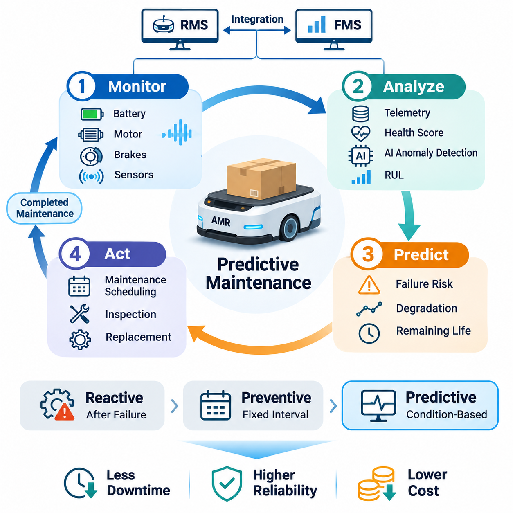
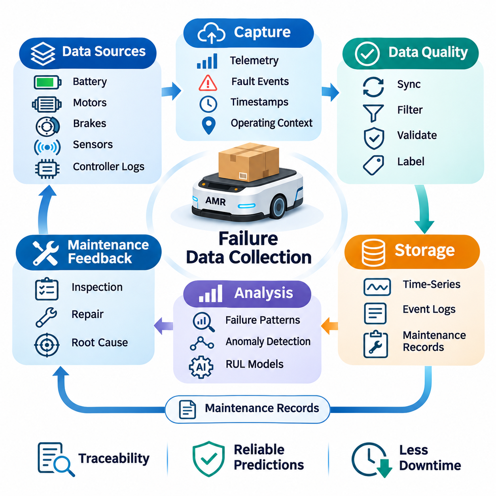
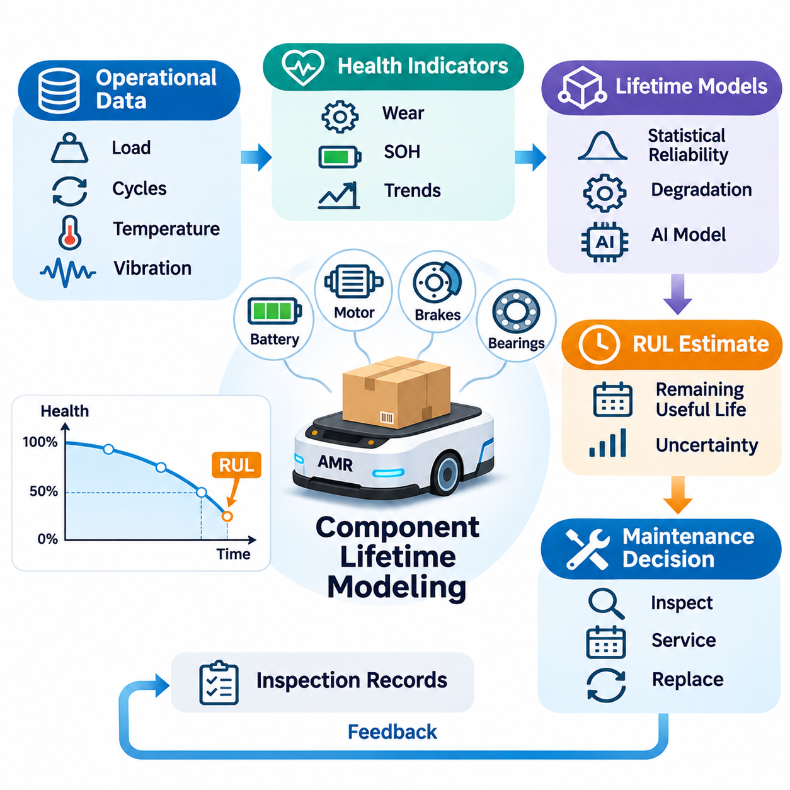
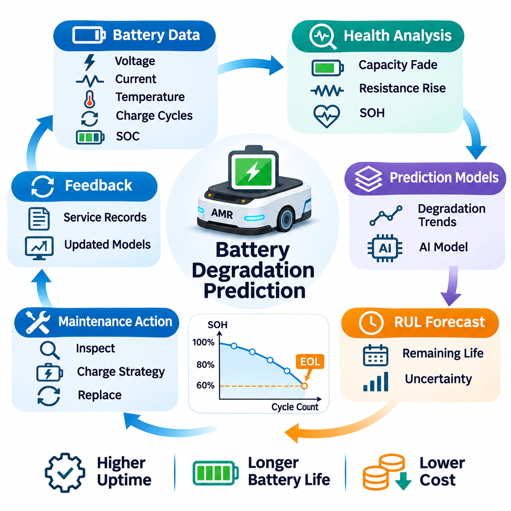
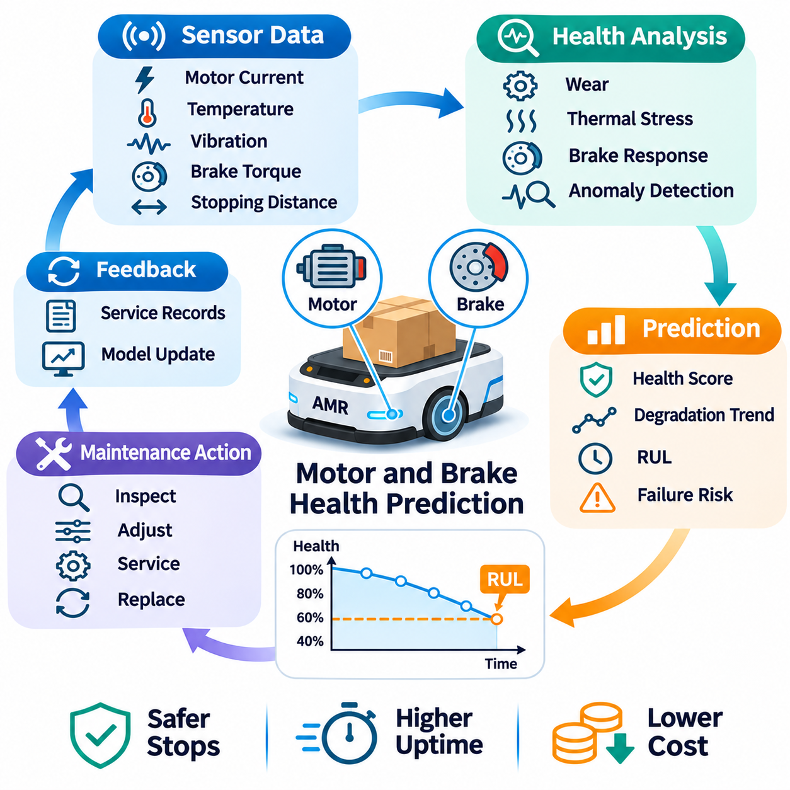
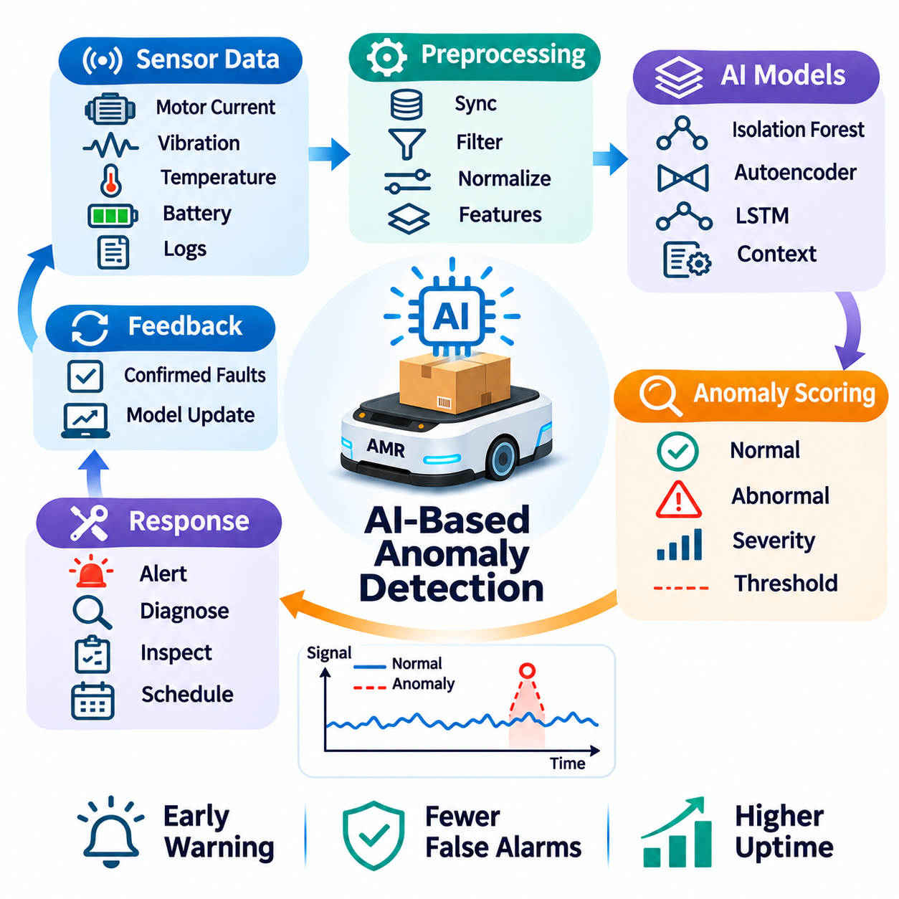
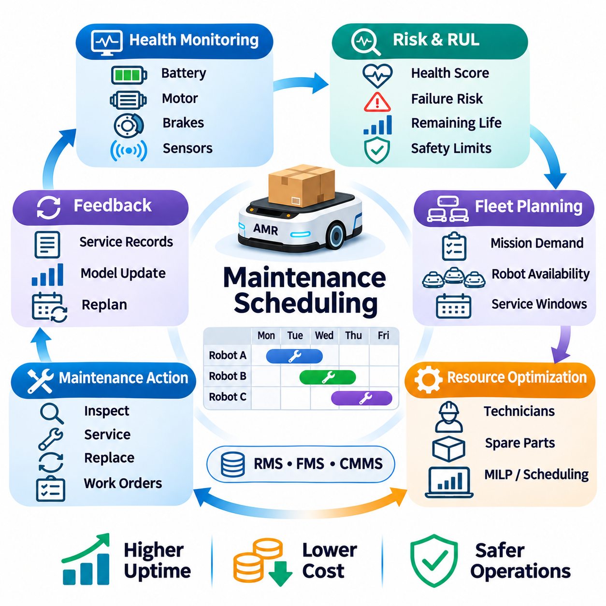
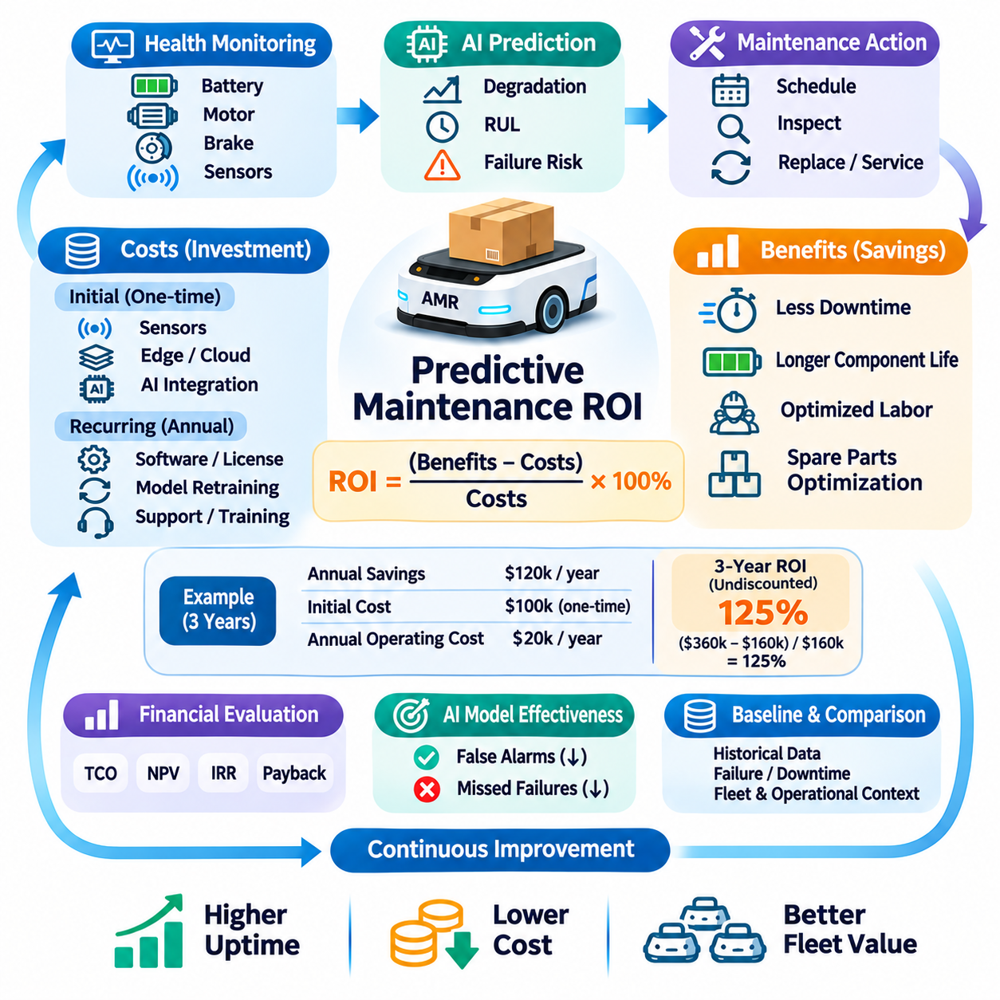

**Volume 08. AMR Operations, Deployment, and MLOps**

# Chapter 11. Predictive Maintenance

## 11.1 Predictive Maintenance Concept

{width="7.268055555555556in" height="7.268055555555556in"}

예지보전(Predictive Maintenance)은 운영 데이터(Operational Data), 상태 모니터링(Condition Monitoring), 통계 분석(Statistical Analysis), 인공지능(Artificial Intelligence)을 활용하여 장비의 고장을 사전에 예측하는 선제적 엔지니어링 접근 방식이다. 자율이동로봇(Autonomous Mobile Robot, AMR) 시스템에서 예지보전은 구성 요소의 성능 저하에 대한 초기 징후를 식별하고, 심각한 고장으로 인해 로봇 임무 또는 로봇 군집 운영(Fleet Operations)이 중단되기 전에 유지보수 활동을 수행함으로써 운영 신뢰성(Operational Reliability)을 향상시킨다.

전통적인 유지보수 전략(Maintenance Strategy)은 일반적으로 사후보전(Corrective Maintenance), 예방보전(Preventive Maintenance), 예지보전(Predictive Maintenance)으로 분류된다. 사후보전은 고장이 발생한 이후에 장비를 수리하는 방식이며, 예방보전은 사전에 정의된 주기에 따라 점검 및 구성 요소 교체를 수행하는 방식이다. 예지보전은 실제 장비 상태, 운영 이력(Operational History), 추정된 고장 확률(Failure Probability)을 기반으로 적절한 유지보수 시점을 결정한다.

예지보전의 기본 원리(Fundamental Principle)는 많은 기계적, 전기적, 전자적 구성 요소가 기능적 고장(Functional Failure)이 발생하기 전에 측정 가능한 성능 저하(Degradation)를 나타낸다는 것이다. 진동(Vibration), 온도(Temperature), 전류(Electrical Current), 에너지 소비(Energy Consumption), 기계적 응답(Mechanical Response), 통신 안정성(Communication Stability)의 변화는 비정상 상태의 초기 징후를 제공할 수 있다. 이러한 특성을 지속적으로 관찰함으로써 엔지니어는 문제가 심각해지기 전에 이를 식별할 수 있다.

자율이동로봇(AMR)은 운영 수명주기(Operational Lifecycle) 전반에 걸쳐 점진적인 성능 저하를 경험하는 다양한 구성 요소를 포함한다. 구동 모터(Drive Motor), 기어박스(Gearbox), 휠 어셈블리(Wheel Assembly), 베어링(Bearing), 제동 시스템(Braking System), 배터리(Battery), 전력 변환기(Power Converter), 냉각 팬(Cooling Fan), 센서(Sensor), 임베디드 컴퓨팅 장치(Embedded Computing Device)는 서로 다른 운영 부하와 스트레스에 노출된다. 예지보전은 전체 로봇 아키텍처 내에서 이러한 구성 요소 간의 상호작용을 고려하면서 개별 구성 요소의 상태를 평가한다.

예지보전 프로세스(Predictive Maintenance Process)는 체계적인 운영 데이터 수집(Operational Data Collection)에서 시작된다. 로봇 제어기(Robot Controller), 모터 드라이버(Motor Driver), 배터리 관리 시스템(Battery Management System, BMS), 환경 센서(Environmental Sensor), 엣지 컴퓨팅 플랫폼(Edge Computing Platform)은 지속적으로 진단 정보(Diagnostic Information)를 생성한다. 이러한 데이터는 CAN, EtherCAT, Ethernet, ROS2 미들웨어(Middleware)와 같은 통신 인터페이스를 통해 수집되며, 다양한 운영 조건에서 장비의 동작 특성을 설명하는 데이터 이력(Historical Record)을 형성한다.

상태 모니터링(Condition Monitoring)은 구성 요소의 정상적인 동작을 나타내는 기준 특성(Reference Characteristics)을 구축함으로써 예지보전의 기반을 제공한다. 기준선 측정(Baseline Measurement)은 로봇의 이동 속도, 적재 중량(Payload Weight), 가속도(Acceleration), 주변 온도(Ambient Temperature), 지형 조건(Terrain Conditions), 임무 프로파일(Mission Profile)을 고려해야 한다. 현재 측정값을 운영 상황에 따른 기준선(Context-Dependent Baseline)과 비교함으로써 실제 구성 요소의 성능 저하와 정상적인 운영 요구에 의해 발생하는 일시적 변화를 구분할 수 있다.

고장 데이터 수집(Failure Data Collection)은 예지보전의 또 다른 필수 요소이다. 과거 기록에는 구성 요소 식별 정보(Component Identification), 운영 시간(Operating Hours), 환경 조건(Environmental Conditions), 진단 메시지(Diagnostic Message), 고장 증상(Failure Symptom), 유지보수 조치(Maintenance Action), 확인된 근본 원인(Root Cause)이 포함되어야 한다. 고장 기록과 정상 운영 데이터를 결합함으로써 엔지니어는 성능 저하 패턴(Degradation Pattern)을 분석하고, 측정 가능한 신호와 고장 사이의 관계를 규명하며, 신뢰성 높은 예측 모델(Prediction Model)을 개발할 수 있다.

구성 요소 수명 모델링(Component Lifetime Modeling)은 운영 조건과 과거 성능 저하 특성을 기반으로 기계 및 전기 장비의 예상 사용 수명(Expected Useful Lifetime)을 추정한다. 통계적 신뢰성 모델(Statistical Reliability Model), 와이블 분포(Weibull Distribution), 물리 기반 성능 저하 모델(Physics-Based Degradation Model), 기계학습(Machine Learning) 기법은 이러한 수명 추정을 지원할 수 있다. 잔여 유효 수명(Remaining Useful Life, RUL)은 구성 요소가 사전에 정의된 수명 종료 조건(End-of-Life Condition)에 도달하기까지 남아 있는 예상 시간 또는 운영 사이클을 의미한다.

배터리 성능 저하 예측(Battery Degradation Prediction)은 배터리 성능이 AMR의 가용성(Availability), 임무 수행 시간(Mission Duration), 충전 요구사항(Charging Requirements)에 직접적인 영향을 미치기 때문에 특히 중요하다. 충전 상태(State of Charge, SOC), 건전성 상태(State of Health, SOH), 내부 저항(Internal Resistance), 충전 사이클(Charging Cycle), 셀 전압 불균형(Cell Voltage Imbalance), 온도를 모니터링함으로써 유지보수 시스템은 배터리 노화(Battery Aging)를 평가할 수 있다. 예측 분석(Predictive Analysis)은 배터리 교체 계획을 지원하고 에너지 용량 부족으로 인한 예기치 않은 임무 중단을 감소시킨다.

모터 및 브레이크 건전성 예측(Motor and Brake Health Prediction)은 기계적 마모(Mechanical Wear), 열 스트레스(Thermal Stress), 전기적 이상(Electrical Abnormality), 제동 성능 저하(Braking Performance Degradation)를 감지하는 데 중점을 둔다. 모터 전류 특성(Motor Current Signature), 토크 응답(Torque Response), 회전 속도(Rotational Speed), 진동 특성(Vibration Characteristics), 온도 측정값은 중요한 진단 정보를 제공한다. 유사한 운영 조건에서 전류 요구량이 증가하는 현상은 베어링의 성능 저하, 기계적 저항(Mechanical Resistance), 구동계 정렬 불량(Drivetrain Misalignment) 또는 기타 진행 중인 이상 상태를 나타낼 수 있다.

인공지능(Artificial Intelligence)은 여러 운영 변수 사이의 복잡한 관계를 분석하는 능력을 통해 예지보전의 성능을 향상시킨다. 기계학습 알고리즘(Machine Learning Algorithm)은 기존의 임계값 기반 모니터링(Threshold-Based Monitoring)에서 발견하지 못할 수 있는 비정상 패턴을 식별할 수 있다. 오토인코더(Autoencoder), 고립 포레스트(Isolation Forest), 순환 신경망(Recurrent Neural Network), 시계열 트랜스포머(Time-Series Transformer)는 이상 탐지(Anomaly Detection)와 성능 저하 예측(Degradation Forecasting)을 지원하며, 특히 장비의 동작 특성이 동적인 운영 조건에 따라 변화하는 경우에 유용하다.

실용적인 예지보전 아키텍처(Predictive Maintenance Architecture)는 분석 기능을 로봇 수준의 엣지 장치(Edge Device), 온프레미스 인프라(On-Premises Infrastructure), 클라우드 플랫폼(Cloud Platform)에 분산한다. 엣지 장치는 지속적인 상태 모니터링과 즉각적인 이상 탐지를 수행하며, 중앙 집중형 시스템(Centralized System)은 여러 로봇의 장기적인 변화 추세를 분석한다. 로봇 군집 수준의 데이터 집계(Fleet-Level Data Aggregation)는 반복적으로 발생하는 고장 패턴의 식별 능력을 향상시키고 구성 요소별 예측 모델(Component-Specific Predictive Model)의 개발을 지원한다.

로봇 관리 시스템(Robot Management System, RMS) 및 로봇 군집 관리 시스템(Fleet Management System, FMS)과의 통합은 유지보수 예측 결과를 실행 가능한 운영 의사결정(Operational Decision-Making)으로 전환한다. 비정상적인 성능 저하가 감지되면 관리 플랫폼은 유지보수 요청(Maintenance Request)을 생성하고, 기술 담당자에게 알림을 전송하며, 임무 할당(Mission Assignment)을 조정할 수 있다. 유지보수 일정 관리(Maintenance Scheduling)는 추정된 고장 위험, 로봇 가용성, 예비 부품 재고(Spare Parts Inventory), 기술 인력 자원, 고객 서비스 요구사항을 고려해야 한다.

예지보전 모델(Predictive Maintenance Model)은 전체 운영 수명주기에 걸쳐 지속적으로 검증되어야 한다. 부정확한 예측은 불필요한 구성 요소 교체를 초래하거나 심각한 손상이 발생할 때까지 고장을 발견하지 못하는 결과로 이어질 수 있다. 모델 평가(Model Evaluation)는 예측 정확도(Prediction Accuracy), 오경보율(False Alarm Rate), 고장 미탐지율(Missed Failure Rate), 사전 경고 시간(Warning Lead Time), 불확실성(Uncertainty)을 고려해야 한다. 예지보전은 의무적인 안전 점검(Mandatory Inspection) 및 독립적인 기능 안전 메커니즘(Functional Safety Mechanism)을 대체하는 것이 아니라 이를 보완해야 한다.

예지보전의 경제적 가치(Economic Value)는 비계획 가동 중단 시간(Unplanned Downtime), 긴급 수리 비용(Emergency Repair Cost), 예비 부품 소비량(Spare Parts Consumption), 운영 중단(Operational Disruption)의 감소를 통해 평가된다. 주요 성과 지표(Key Performance Indicator, KPI)에는 평균 고장 간격(Mean Time Between Failures, MTBF), 평균 수리 시간(Mean Time to Repair, MTTR), 장비 가용성(Equipment Availability), 유지보수 지출(Maintenance Expenditure), 투자수익률(Return on Investment, ROI)이 포함된다. 효과적인 예지보전 구현은 운영 데이터, 고장 예측(Failure Prediction), 유지보수 실행(Maintenance Execution), 신뢰성 개선(Reliability Improvement)을 연결하는 지속적인 피드백 루프(Continuous Feedback Loop)를 구축한다.

## 11.2 Failure Data Collection

{width="7.268055555555556in" height="7.268055555555556in"}

고장 데이터 수집(Failure Data Collection)은 엔지니어가 장비의 성능 저하(Equipment Degradation)를 이해하고, 반복적으로 발생하는 고장 메커니즘(Failure Mechanism)을 식별하며, 신뢰성 높은 고장 예측 모델(Failure Prediction Model)을 개발할 수 있도록 지원하는 예지보전(Predictive Maintenance)의 기본 프로세스이다. 자율이동로봇(Autonomous Mobile Robot, AMR) 시스템에서 체계적인 고장 관련 정보 수집은 운영 신뢰성(Operational Reliability), 유지보수 효율성(Maintenance Efficiency), 장기적인 로봇 군집 가용성(Fleet Availability)을 향상시키는 데 필요한 과거의 실증적 근거를 제공한다.

고장 데이터(Failure Data)는 장비 고장이 발생한 상황과 해당 이벤트의 물리적 또는 기능적 결과를 모두 설명해야 한다. 관련 정보에는 로봇 식별 정보(Robot Identification), 구성 요소 일련번호(Component Serial Number), 고장 발생 타임스탬프(Failure Timestamp), 운영 시간(Operating Hours), 임무 조건(Mission Conditions), 환경 특성(Environmental Characteristics), 진단 메시지(Diagnostic Message), 유지보수 이력(Maintenance History)이 포함된다. 일관된 데이터 기록 방식(Recording Practice)은 후속 엔지니어링 분석(Engineering Analysis)을 위한 신뢰성 높은 기반을 구축한다.

AMR의 고장은 기계, 전기, 전자, 소프트웨어, 통신 및 인공지능 하위 시스템(Subsystem)에서 발생할 수 있다. 기계적 고장(Mechanical Failure)에는 휠 손상(Wheel Damage), 베어링 마모(Bearing Wear), 기어박스 성능 저하(Gearbox Deterioration), 제동 이상(Braking Abnormality)이 포함될 수 있다. 전기적 고장(Electrical Failure)에는 배터리 성능 저하(Battery Degradation), 전력 불안정성(Power Instability), 모터 드라이버 결함(Motor Driver Fault)이 포함되며, 소프트웨어 고장(Software Failure)은 자원 고갈(Resource Exhaustion), 프로세스 종료(Process Termination), 예기치 않은 시스템 상호작용(System Interaction)으로 인해 발생할 수 있다.

고장 데이터 수집은 로봇 아키텍처(Robot Architecture) 내부의 다양한 데이터 소스(Data Source)에서 생성되는 정보를 통합해야 한다. 모터 제어기(Motor Controller)는 전류(Current), 토크(Torque), 회전 속도(Rotational Speed), 온도(Temperature) 측정값을 제공하며, 배터리 관리 시스템(Battery Management System, BMS)은 전압(Voltage), 충전 사이클(Charging Cycle), 내부 저항 추정값(Internal Resistance Estimate), 배터리 건전성 지표(Battery Health Indicator)를 제공한다. 추가적인 진단 정보(Diagnostic Information)는 인지 센서(Perception Sensor), 자율주행 소프트웨어(Navigation Software), 통신 장치(Communication Device), 임베디드 컴퓨팅 플랫폼(Embedded Computing Platform)에서 획득할 수 있다.

지속적인 데이터 획득(Continuous Data Acquisition)은 유지보수 엔지니어가 고장 발생 이전, 발생 시점 및 발생 이후의 장비 동작을 조사할 수 있도록 지원한다. 순환 버퍼(Circular Buffer)는 최근의 센서 측정값과 진단 정보를 로봇 내부에 일시적으로 저장할 수 있다. 고장 이벤트(Failure Event)가 발생하면 데이터 수집 시스템(Data Collection System)은 관련된 이벤트 발생 전 기록(Pre-Event Record)과 발생 후 기록(Post-Event Record)을 보존한다. 이를 통해 엔지니어는 운영 시퀀스(Operational Sequence)를 재구성하고 비정상 상태(Abnormal Condition)의 잠재적 원인을 식별할 수 있다.

이벤트 기반 데이터 수집(Event-Driven Data Collection)은 사전에 정의된 조건이 충족될 때 상세 정보를 수집함으로써 저장 효율성(Storage Efficiency)을 향상시킨다. 트리거 조건(Trigger Condition)에는 과도한 모터 전류(Excessive Motor Current), 비정상 진동(Abnormal Vibration), 예기치 않은 온도 상승(Unexpected Temperature Increase), 위치 추정 실패(Localization Failure), 통신 중단(Communication Interruption), 반복적인 소프트웨어 예외(Software Exception)가 포함될 수 있다. 트리거 임계값(Trigger Threshold)은 장비 동작의 정상적인 변화가 과도하게 기록되는 것을 방지하기 위해 운영 조건(Operating Conditions)을 고려해야 한다.

분산된 로봇 하위 시스템에서 고장 데이터를 수집할 때 정확한 타임스탬프 기록(Timestamping)과 시간 동기화(Time Synchronization)는 필수적이다. 기계적, 전기적 및 소프트웨어 이벤트는 짧은 시간 간격 내에서 빈번하게 발생하므로, 인과관계 분석(Causal Analysis)을 위해 시간 순서의 일관성(Chronological Consistency)을 확보하는 것이 중요하다. 네트워크 시간 프로토콜(Network Time Protocol, NTP), 정밀 시간 프로토콜(Precision Time Protocol, PTP), 동기화된 시스템 클럭(Synchronized System Clock)은 요구되는 측정 정확도(Measurement Accuracy)에 따라 시간적 정렬(Temporal Alignment)을 지원할 수 있다.

고장 분류(Failure Classification)는 수집된 정보를 체계적으로 관리하기 위한 표준화된 방법론(Standardized Methodology)을 구축한다. 각 이벤트는 영향을 받는 하위 시스템, 고장 모드(Failure Mode), 심각도(Severity), 운영 영향(Operational Impact), 복구 요구사항(Recovery Requirements)에 따라 분류되어야 한다. 고장 모드 및 영향 분석(Failure Mode and Effects Analysis, FMEA)과 고장 보고·분석 및 시정조치 시스템(Failure Reporting, Analysis, and Corrective Action System, FRACAS)은 관찰된 고장을 엔지니어링 지식(Engineering Knowledge) 및 시정조치(Corrective Action)와 연결하기 위한 구조화된 접근 방식을 제공한다.

동일한 진단 신호(Diagnostic Signal)가 서로 다른 장비 상태를 나타낼 수 있으므로 운영 맥락(Operational Context)은 특히 중요하다. 모터 전류의 증가는 기계적 성능 저하(Mechanical Deterioration)를 나타낼 수 있지만, 적재 중량(Payload Weight)의 증가, 급경사(Steep Slope), 구름 저항(Rolling Resistance)의 증가로 인해 발생할 수도 있다. 로봇의 이동 속도(Velocity), 가속도(Acceleration), 적재 하중(Payload), 지형(Terrain), 주변 온도(Ambient Temperature), 임무 특성(Mission Characteristics)을 기록하면 실제 성능 저하와 정상적인 운영 중에 발생하는 변화를 구분하는 데 도움이 된다.

유지보수 기록(Maintenance Record)은 자동으로 수집된 고장 데이터를 검증하는 데 필수적인 정보를 제공한다. 현장 기술자(Field Technician)는 점검 결과(Inspection Result), 손상된 구성 요소(Damaged Component), 확인된 근본 원인(Confirmed Root Cause), 교체 절차(Replacement Procedure), 유지보수 이후의 성능(Post-Maintenance Performance)을 문서화해야 한다. 이러한 기록을 과거의 로봇 원격 측정 데이터(Robot Telemetry)와 연결함으로써 엔지니어는 측정 가능한 운영 증상(Operational Symptom)과 실제 구성 요소 고장(Component Failure) 사이의 검증된 관계를 확립할 수 있다.

고장 데이터 품질 관리(Failure Data Quality Control)는 누락된 측정값(Missing Measurement), 중복 기록(Duplicated Record), 부정확한 타임스탬프(Inaccurate Timestamp), 일관되지 않은 측정 단위(Inconsistent Unit), 잘못된 구성 요소 식별 정보(Incorrect Component Identification) 등의 문제를 처리한다. 자동화된 검증 메커니즘(Automated Validation Mechanism)은 원본 증거(Original Evidence)를 임의로 수정하지 않으면서 손상되거나 불완전한 기록을 식별해야 한다. 데이터 출처 및 이력(Data Provenance), 스키마 버전 관리(Schema Versioning), 교정 이력(Calibration History)은 다양한 로봇 구성(Robot Configuration)에 대한 고장 분석의 추적성(Traceability)과 재현성(Reproducibility)을 더욱 향상시킨다.

예지보전 데이터셋(Predictive Maintenance Dataset)은 정상 운영 상태(Normal Operating Condition), 점진적 성능 저하(Progressive Degradation), 간헐적 이상(Intermittent Abnormality), 고장 임박 이벤트(Near-Failure Event), 확인된 고장(Confirmed Failure)을 포함해야 한다. 실제 장비 고장은 상대적으로 드물게 발생하기 때문에 이러한 데이터셋은 상당한 클래스 불균형(Class Imbalance)을 나타내는 경우가 많다. 신뢰성 분석(Reliability Analysis)을 지원하고 구성 요소 수명 모델링(Component Lifetime Modeling)에서 발생하는 편향(Bias)을 감소시키기 위해 관찰 기간이 종료된 시점에도 정상적으로 작동하고 있는 구성 요소에 대한 정보 역시 기록되어야 한다.

확장 가능한 고장 데이터 수집 아키텍처(Scalable Failure Data Collection Architecture)는 엣지 수준의 데이터 기록(Edge-Level Recording), 중앙 집중형 저장소(Centralized Storage), 로봇 군집 수준의 분석(Fleet-Level Analysis)을 결합한다. 로봇 수준의 엣지 장치(Edge Device)는 고주파수 측정값(High-Frequency Measurement)과 고장 이벤트를 수집하며, 온프레미스(On-Premises) 또는 클라우드 인프라(Cloud Infrastructure)는 과거 기록을 유지하고 관리한다. 시계열 데이터베이스(Time-Series Database), 객체 저장소(Object Storage), 구조화된 유지보수 데이터베이스(Structured Maintenance Database)는 원격 측정 데이터(Telemetry), 진단 로그(Diagnostic Log), 센서 기록(Sensor Recording), 서비스 이력(Service History)의 효율적인 검색을 지원한다.

로봇 관리 시스템(Robot Management System, RMS), 로봇 군집 관리 시스템(Fleet Management System, FMS), 전산화 유지보수 관리 시스템(Computerized Maintenance Management System, CMMS)과의 통합은 기술적 고장 정보를 운영 워크플로(Operational Workflow)와 연결한다. 자동으로 생성된 고장 보고서(Failure Report)는 유지보수 요청(Maintenance Request)을 생성하고, 담당 인력에게 알림을 전송하며, 근본 원인 조사(Root Cause Investigation)를 지원할 수 있다. 이후 확인된 유지보수 결과(Maintenance Outcome)는 검증된 피드백(Validated Feedback) 형태로 고장 데이터베이스(Failure Database)에 다시 반영되어야 한다.

고장 데이터 수집은 현장 운영(Field Operations), 신뢰성 공학(Reliability Engineering), 예측 분석(Predictive Analytics), 제품 개선(Product Improvement)을 연결하는 지속적인 정보 순환 체계(Continuous Information Cycle)를 구축한다. 이러한 체계의 효과는 고장 기록 완전성(Failure Record Completeness), 진단 범위(Diagnostic Coverage), 데이터 정확도(Data Accuracy), 근본 원인 확인율(Root Cause Confirmation Rate), 유지보수 추적성(Maintenance Traceability)을 통해 평가할 수 있다. 체계적인 거버넌스(Governance)를 기반으로 관리되는 고장 데이터베이스는 궁극적으로 구성 요소 수명 추정(Component Lifetime Estimation)과 인공지능 기반 예지보전(AI-Based Predictive Maintenance)을 구현하기 위한 핵심 기반을 제공한다.

## 11.3 Component Lifetime Modeling

{width="7.268055555555556in" height="7.268055555555556in"}

구성 요소 수명 모델링(Component Lifetime Modeling)은 기계적, 전기적, 전자적 구성 요소가 사전에 정의된 고장 또는 성능 저하 한계(Degradation Limit)에 도달하기까지 얼마나 오랫동안 작동할 수 있는지를 추정하는 예지보전(Predictive Maintenance)의 핵심 요소이다. 자율이동로봇(Autonomous Mobile Robot, AMR) 시스템에서 수명 모델링은 유지보수 계획(Maintenance Planning), 운영 위험 감소(Operational Risk Reduction), 구성 요소 교체 최적화(Component Replacement Optimization), 장기적인 로봇 군집 신뢰성(Fleet Reliability)을 지원한다.

로봇 구성 요소의 수명(Lifetime)은 설계 특성(Design Characteristics), 재료 특성(Material Properties), 제조 품질(Manufacturing Quality), 운영 작업 부하(Operational Workload), 환경 조건(Environmental Conditions)의 영향을 받는다. 동일한 달력상의 기간 동안 운영되는 구성 요소라도 적재 하중(Payload), 이동 빈도(Movement Frequency), 가속도(Acceleration), 진동(Vibration), 온도(Temperature), 환경 오염 물질(Environmental Contaminant)에 대한 노출 정도의 차이로 인해 상당히 다른 성능 저하율(Degradation Rate)을 나타낼 수 있다.

구성 요소 수명 모델링은 시간 경과에 따른 노화(Calendar Aging)와 사용량 기반 성능 저하(Usage-Dependent Degradation)를 구분한다. 시간 경과에 따른 노화는 실제 작동 여부와 관계없이 시간이 경과함에 따라 발생하는 반면, 사용량 기반 성능 저하는 누적된 운영 스트레스(Accumulated Operational Stress)로 인해 발생한다. 배터리(Battery)는 두 가지 노화 메커니즘(Aging Mechanism)의 영향을 모두 받으며, 베어링(Bearing), 기어(Gear), 휠(Wheel), 제동 구성 요소(Braking Component)는 주로 기계적 하중(Mechanical Loading), 운영 사이클(Operating Cycle), 환경 노출(Environmental Exposure)의 영향을 받는다.

수명 모델링(Lifetime Modeling)은 구성 요소별 운영 데이터(Component-Specific Operational Data)의 체계적인 수집을 필요로 한다. 관련 매개변수에는 누적 운영 시간(Accumulated Operating Hours), 이동 거리(Traveled Distance), 회전 사이클(Rotational Cycle), 모터 전류(Motor Current), 토크(Torque), 온도, 진동, 충전 사이클(Charging Cycle), 유지보수 이력(Maintenance History)이 포함된다. 각 측정값은 고유 구성 요소 식별자(Unique Component Identifier)와 연결되어 설치, 운영, 유지보수 및 교체의 전체 과정에서 추적성(Traceability)을 유지해야 한다.

통계적 신뢰성 모델링(Statistical Reliability Modeling)은 구성 요소의 수명과 고장 확률(Failure Probability)을 추정하기 위한 수학적 기반(Mathematical Foundation)을 제공한다. 신뢰도 함수(Reliability Function)는 구성 요소가 특정 기간을 초과하여 지속적으로 작동할 확률을 나타내며, 고장 확률밀도 함수(Failure Density Function)와 위험률 함수(Hazard Function)는 시간에 따른 고장 특성(Failure Behavior)을 설명한다. 이러한 모델을 통해 엔지니어는 현장에 배포된 로봇의 과거 고장 데이터(Failure Data)와 생존 데이터(Survival Data)를 활용하여 운영 위험을 평가할 수 있다.

와이블 분포(Weibull Distribution)는 구성 요소의 수명주기(Component Lifecycle) 전반에서 나타나는 다양한 고장 특성을 표현할 수 있기 때문에 신뢰성 공학(Reliability Engineering)에서 널리 사용된다. 형상 매개변수(Shape Parameter)가 1보다 작은 경우 초기 고장(Early Failure)과 관련된 감소하는 고장률(Decreasing Failure Rate)을 나타내며, 1인 경우에는 일정한 고장률(Constant Failure Rate)을 나타낸다. 1보다 큰 값은 일반적으로 노화(Aging), 기계적 마모(Mechanical Wear), 누적 성능 저하(Accumulated Degradation)와 관련된 증가하는 고장률(Increasing Failure Rate)을 나타낸다.

물리 기반 수명 모델링(Physics-Based Lifetime Modeling)은 물리적 고장 메커니즘(Physical Failure Mechanism)을 수학적으로 표현하여 구성 요소의 성능 저하를 추정한다. 기계적 피로(Mechanical Fatigue), 마찰에 의한 마모(Friction-Induced Wear), 열적 노화(Thermal Aging), 재료 열화(Material Deterioration), 전기 절연 성능 저하(Electrical Insulation Degradation)는 적절한 엔지니어링 모델(Engineering Model)을 통해 분석할 수 있다. 이러한 접근 방식은 물리적 지식(Physical Knowledge)을 반영하며, 과거 고장 데이터가 제한적인 경우에도 해석 가능한 수명 추정(Interpretable Lifetime Estimation)을 제공할 수 있다.

누적 손상 모델링(Cumulative Damage Modeling)은 구성 요소의 수명주기 전반에 걸쳐 반복적으로 가해지는 운영 하중(Operational Loading)의 복합적인 영향을 평가한다. 예를 들어, 팜그렌-마이너 법칙(Palmgren-Miner Rule)은 다양한 기계적 응력 수준(Mechanical Stress Level)에서 발생하는 누적 피로 손상(Accumulated Fatigue Damage)을 추정한다. AMR 응용 분야에서 누적 손상 모델(Cumulative Damage Model)은 반복적인 가속, 제동(Braking), 진동, 충격 하중(Impact Loading)에 노출되는 구조적 구성 요소(Structural Component), 구동계 어셈블리(Drivetrain Assembly), 기계적 연결부(Mechanical Connection)의 평가를 지원할 수 있다.

잔여 유효 수명(Remaining Useful Life, RUL)은 구성 요소가 사전에 정의된 수명 종료 조건(End-of-Life Condition)에 도달하기까지 남아 있는 예상 운영 시간, 이동 거리 또는 사용 사이클(Usage Cycle)의 횟수를 의미한다. 잔여 유효 수명 추정(RUL Estimation)은 현재의 건전성 지표(Health Indicator), 과거의 성능 저하 추세(Degradation Trend), 미래 운영 조건(Future Operating Conditions)에 대한 가정을 결합한다. 미래의 작업 부하는 불확실하기 때문에 수명 예측(Lifetime Prediction)은 결정론적 수치(Deterministic Value)에만 의존하지 않고 신뢰구간(Confidence Interval) 또는 예측구간(Prediction Interval)을 포함해야 한다.

데이터 기반 수명 모델링(Data-Driven Lifetime Modeling)은 통계적 학습(Statistical Learning)과 인공지능(Artificial Intelligence)을 활용하여 운영 측정값(Operational Measurement)과 구성 요소의 성능 저하 사이의 관계를 식별한다. 회귀 모델(Regression Model), 랜덤 포레스트(Random Forest), 그래디언트 부스팅(Gradient Boosting), 장단기 기억 신경망(Long Short-Term Memory, LSTM), 시계열 트랜스포머(Time-Series Transformer)는 충분한 대표성을 갖는 학습 데이터(Representative Training Data)가 확보된 경우 과거 측정값을 기반으로 성능 저하 궤적(Degradation Trajectory)과 잔여 수명(Remaining Lifetime)을 추정할 수 있다.

하이브리드 수명 모델링(Hybrid Lifetime Modeling)은 물리 기반 성능 저하 메커니즘(Physics-Based Degradation Mechanism)과 데이터 기반 예측 기법(Data-Driven Prediction Technique)을 결합한다. 물리 모델(Physical Model)은 운영 스트레스와 구성 요소의 열화 사이에 존재하는 근본적인 관계를 확립하며, 기계학습 모델(Machine Learning Model)은 모델링되지 않은 동역학(Unmodeled Dynamics)과 환경 변동성(Environmental Variability)을 보완한다. 이러한 접근 방식은 다양한 로봇 운영 조건에서 물리적 해석 가능성(Physical Interpretability)을 유지하면서 예측 강건성(Prediction Robustness)을 향상시킬 수 있다.

구성 요소 수명 데이터셋(Component Lifetime Dataset)은 관찰 기간(Observation Period) 동안 고장이 발생하지 않은 장비에 대한 정보도 고려해야 한다. 이러한 기록은 정확한 고장 시점(Failure Time)을 알 수 없기 때문에 일반적으로 우측 중도절단 데이터(Right-Censored Data)라고 한다. 카플란-마이어 추정법(Kaplan-Meier Estimation)과 콕스 비례위험 모델(Cox Proportional Hazards Model)을 포함하는 생존 분석(Survival Analysis) 기법은 중도절단 관측값(Censored Observation)을 반영하여 추정 편향(Estimation Bias)을 감소시키고 운영 중인 로봇 군집 전반에 대한 신뢰성 평가(Reliability Assessment)를 개선한다.

로봇 군집 수준의 수명 모델링(Fleet-Level Lifetime Modeling)은 엔지니어가 서로 다른 작업 부하와 환경 조건에서 운영되는 로봇들의 성능 저하 패턴(Degradation Pattern)을 비교할 수 있도록 지원한다. 집계된 운영 기록(Aggregated Operational Record)은 제조 배치(Manufacturing Batch), 구성 요소 공급업체(Component Supplier), 임무 프로파일(Mission Profile), 로봇 구성(Robot Configuration)과 관련된 구조적 취약점(Systematic Weakness)을 밝혀낼 수 있다. 계층적 통계 모델(Hierarchical Statistical Model)은 개별 구성 요소의 변동성(Individual Component Variability)과 보다 광범위한 모집단 수준의 신뢰성 특성(Population-Level Reliability Characteristics)을 구분할 수 있다.

로봇 관리 시스템(Robot Management System, RMS), 로봇 군집 관리 시스템(Fleet Management System, FMS), 유지보수 관리 플랫폼(Maintenance Management Platform)과의 통합은 수명 예측 결과를 운영 의사결정(Operational Decision-Making)으로 전환한다. 추정된 수명 종료 한계(End-of-Life Limit)에 근접한 구성 요소는 계획된 가동 중단 시간(Scheduled Downtime) 동안 우선적으로 점검하거나 교체할 수 있다. 또한 추정된 구성 요소의 건전성(Component Health)에 따라 임무 할당(Mission Assignment), 작업 부하 분산(Workload Distribution), 예비 부품 조달(Spare Parts Procurement), 기술 인력 일정 관리(Technician Scheduling)를 조정할 수 있다.

수명 모델(Lifetime Model)은 독립적인 운영 데이터셋(Independent Operational Dataset), 확인된 고장 기록(Confirmed Failure Record), 가속 수명 시험(Accelerated Life Testing), 현장 유지보수 관측 결과(Field Maintenance Observation)를 활용하여 검증되어야 한다. 평가 지표(Evaluation Metric)에는 평균 절대 오차(Mean Absolute Error, MAE), 평균 제곱근 오차(Root Mean Square Error, RMSE), 예측구간 포함률(Prediction Interval Coverage), 고장 위험 확률의 보정(Failure Risk Calibration)이 포함될 수 있다. 검증(Validation)은 서로 다른 환경, 구성 요소 세대(Component Generation), 운영 조건에서의 예측 신뢰성(Prediction Reliability)도 조사해야 한다.

구성 요소 수명 모델링은 운영 모니터링(Operational Monitoring), 신뢰성 공학(Reliability Engineering), 예측 분석(Predictive Analytics), 유지보수 실행(Maintenance Execution)을 연결하는 지속적인 피드백 루프(Continuous Feedback Loop)를 구축한다. 주기적인 모델 재보정(Model Recalibration)은 새롭게 관찰된 성능 저하 패턴과 확인된 정비 결과(Confirmed Service Outcome)를 반영한다. 정확한 수명 추정(Lifetime Estimation)은 의무적인 안전 점검(Mandatory Safety Inspection)을 대체하지 않으면서 장비 가용성(Equipment Availability) 향상, 유지보수 지출(Maintenance Expenditure) 감소, 구성 요소 활용 최적화(Component Utilization Optimization), 지속 가능한 AMR 군집 운영(Sustainable AMR Fleet Operations)을 지원한다.

## 11.4 Battery Degradation Prediction

{width="7.268055555555556in" height="7.268055555555556in"}

배터리 성능 저하 예측(Battery Degradation Prediction)은 배터리 성능이 운영 가용성(Operational Availability), 임무 수행 시간(Mission Duration), 충전 효율성(Charging Efficiency), 수명주기 비용(Lifecycle Cost)에 직접적인 영향을 미치기 때문에 자율이동로봇(Autonomous Mobile Robot, AMR) 시스템에서 예지보전(Predictive Maintenance)의 핵심 요소이다. 배터리 운영 조건과 과거 성능 저하 패턴(Degradation Pattern)을 분석함으로써 예지보전 시스템은 미래의 배터리 성능을 추정하고 예기치 않은 고장이 발생하기 전에 적절한 교체 시점(Replacement Timing)을 식별할 수 있다.

충전식 배터리(Rechargeable Battery)는 운영 수명주기(Operational Lifecycle) 전반에 걸쳐 전기화학적(Electrochemical), 열적(Thermal), 기계적(Mechanical) 프로세스를 통해 점진적으로 열화된다. 리튬인산철(Lithium Iron Phosphate, LFP) 및 니켈망간코발트(Nickel Manganese Cobalt, NMC) 배터리를 포함하는 리튬이온 배터리(Lithium-Ion Battery)는 노화(Aging)가 진행됨에 따라 용량 감소(Capacity Loss)와 내부 저항(Internal Resistance)의 증가를 경험한다. 이러한 성능 저하 메커니즘(Degradation Mechanism)은 가용 에너지(Available Energy), 전력 공급 능력(Power Delivery Capability), 충전 효율성 및 전체적인 운영 신뢰성(Operational Reliability)을 감소시킨다.

배터리 성능 저하(Battery Degradation)는 일반적으로 시간 경과에 따른 노화(Calendar Aging)와 충·방전 사이클에 따른 노화(Cycle Aging)로 분류된다. 시간 경과에 따른 노화는 배터리 사용 여부와 관계없이 시간이 경과함에 따라 발생하며, 보관 온도(Storage Temperature)와 충전 상태(State of Charge, SOC)의 영향을 받는다. 충·방전 사이클에 따른 노화는 반복적인 충전 및 방전 프로세스에서 발생하며, 방전 심도(Depth of Discharge, DOD), 충전 전류(Charging Current), 방전 전류(Discharge Current), 운영 온도(Operating Temperature), 누적 에너지 처리량(Cumulative Energy Throughput)에 따라 달라진다.

배터리 관리 시스템(Battery Management System, BMS)은 배터리 성능 저하 예측을 위한 주요 운영 정보(Operational Information)의 출처를 제공한다. 관련 측정값에는 개별 셀 전압(Individual Cell Voltage), 배터리 팩 전압(Battery Pack Voltage), 충전 및 방전 전류, 셀 온도(Cell Temperature), 충전 사이클(Charging Cycle), 보호 동작 이벤트(Protection Event)가 포함된다. 이러한 매개변수(Parameter)를 지속적으로 수집함으로써 엔지니어는 과거 배터리 성능 프로파일(Battery Performance Profile)을 구축하고 전기화학적 열화(Electrochemical Degradation)와 관련된 변화를 식별할 수 있다.

충전 상태(State of Charge, SOC)는 배터리의 가용 용량(Available Capacity) 대비 남아 있는 추정 충전량을 나타내며, 건전성 상태(State of Health, SOH)는 사전에 정의된 기준 상태(Reference State)와 비교한 배터리의 현재 상태를 설명한다. 용량 기반 건전성 상태(Capacity-Based SOH)는 최대 전하 저장 능력(Maximum Charge Storage Capability)의 감소를 측정하는 반면, 저항 기반 건전성 지표(Resistance-Based Health Indicator)는 내부 저항과 전력 공급 능력의 변화를 설명한다. 두 지표는 모두 종합적인 배터리 건전성 평가(Battery Health Assessment)에 기여한다.

내부 저항 추정(Internal Resistance Estimation)은 내부 저항의 증가가 배터리 효율성(Battery Efficiency)을 감소시키고 운영 중 열 발생(Heat Generation)을 증가시킬 수 있기 때문에 특히 중요하다. 변화하는 전류 부하(Current Load)에 대한 전압 응답(Voltage Response)은 배터리 임피던스 특성(Battery Impedance Characteristics)에 관한 정보를 제공한다. 유사한 온도 및 충전 상태에서 획득한 측정값은 장기적인 성능 저하와 정상적인 전기화학적 거동(Electrochemical Behavior)에 의해 발생하는 일시적인 변화를 구분하는 데 도움이 된다.

배터리 성능 저하 예측은 개별 AMR의 운영 특성(Operational Characteristics)을 고려해야 한다. 중량물 운송(Heavy Payload Transportation), 빈번한 가속(Frequent Acceleration), 급경사 지형(Steep Terrain), 장거리 임무(Long-Distance Mission), 집중적인 충전 일정(Intensive Charging Schedule)은 서로 다른 전기적 및 열적 스트레스(Electrical and Thermal Stress)를 발생시킬 수 있다. 이러한 운영 특성을 배터리 측정값과 함께 기록함으로써 예측 모델(Prediction Model)은 작업 부하에 따른 성능 변화(Workload-Dependent Performance Variation)와 실제 배터리 열화(Battery Deterioration)를 구분할 수 있다.

등가 회로 모델(Equivalent Circuit Model, ECM)은 전압원(Voltage Source), 저항기(Resistor), 커패시터(Capacitor)의 조합을 활용하여 배터리의 전기적 거동(Electrical Behavior)을 표현한다. 이러한 모델은 확장 칼만 필터(Extended Kalman Filter, EKF) 및 무향 칼만 필터(Unscented Kalman Filter, UKF)와 같은 기법을 통해 배터리 상태 추정(Battery State Estimation)을 지원할 수 있다. 시간에 따른 추정 모델 매개변수(Estimated Model Parameter)의 변화를 추적하면 배터리 노화, 가용 용량 및 내부 저항 증가에 따른 성능 저하에 관한 추가적인 정보를 획득할 수 있다.

물리 기반 배터리 성능 저하 모델(Physics-Based Battery Degradation Model)은 고체 전해질 계면층 성장(Solid Electrolyte Interphase Growth, SEI Growth), 리튬 도금(Lithium Plating), 활성 물질 손실(Loss of Active Material, LAM), 가용 리튬 손실(Loss of Lithium Inventory, LLI)과 같은 전기화학적 노화 메커니즘(Electrochemical Aging Mechanism)을 설명한다. 아레니우스 기반 노화 모델(Arrhenius-Based Aging Model)은 적용 가능한 가정하에서 온도 의존적 성능 저하(Temperature-Dependent Degradation)를 표현할 수 있다. 이러한 접근 방식은 물리적 해석 가능성(Physical Interpretability)을 향상시키고 다양한 충전 전략과 환경 조건에서의 수명 추정(Lifetime Estimation)을 지원한다.

데이터 기반 배터리 성능 저하 예측(Data-Driven Battery Degradation Prediction)은 과거 배터리 측정 데이터에 통계적 학습(Statistical Learning)과 인공지능(Artificial Intelligence)을 적용한다. 회귀 모델(Regression Model), 가우시안 프로세스 회귀(Gaussian Process Regression), 랜덤 포레스트(Random Forest), 장단기 기억 신경망(Long Short-Term Memory, LSTM), 시계열 트랜스포머(Time-Series Transformer)는 미래의 용량 감소와 저항 증가(Resistance Growth)를 추정할 수 있다. 예측 신뢰성(Prediction Reliability)은 다양한 배터리 화학 조성(Battery Chemistry), 운영 조건 및 성능 저하 단계(Degradation Stage)를 포괄하는 대표성 있는 학습 데이터셋(Representative Training Dataset)에 따라 달라진다.

잔여 유효 수명 추정(Remaining Useful Life Estimation, RUL Estimation)은 배터리가 사전에 정의된 수명 종료 조건(End-of-Life Condition, EOL Condition)에 도달하기까지 남아 있는 운영 시간 또는 사용 사이클(Usage Cycle)을 예측한다. 초기 용량(Initial Capacity)의 80%가 일반적으로 사용되는 기준 임계값(Reference Threshold)이지만, 실제 교체 기준(Replacement Criteria)은 AMR의 임무 요구사항(Mission Requirements), 최대 전력 수요(Peak Power Demand), 제조업체 사양(Manufacturer Specification), 안전 제약조건(Safety Constraint)을 반영해야 한다. 잔여 유효 수명 예측은 미래 운영 조건과 관련된 불확실성(Uncertainty)을 포함해야 한다.

셀 수준 모니터링(Cell-Level Monitoring)은 배터리 팩의 성능이 가장 취약한 셀(Weakest Cell)에 의해 제한될 수 있기 때문에 중요하다. 셀 전압 불균형(Cell Voltage Imbalance)의 증가, 비정상적인 온도 편차(Abnormal Temperature Difference), 충전 또는 방전 중 지속적으로 발생하는 편차(Persistent Deviation)는 불균일한 노화(Uneven Aging) 또는 진행 중인 결함(Developing Fault)을 나타낼 수 있다. 예측 모델은 정상적인 셀 밸런싱 활동(Cell Balancing Activity)과 비정상 상태(Abnormal Condition)를 구분하면서 개별 셀의 동작 특성과 전체 배터리 팩 성능을 모두 평가해야 한다.

확장 가능한 배터리 성능 저하 예측 아키텍처(Scalable Battery Degradation Prediction Architecture)는 분석 기능(Analytical Function)을 배터리 관리 시스템(BMS), 로봇 엣지 컴퓨팅 플랫폼(Robot Edge Computing Platform), 중앙 집중형 인프라(Centralized Infrastructure)에 분산한다. 엣지 장치(Edge Device)는 운영 측정값을 수집하고 즉각적인 이상 상태를 탐지하며, 온프레미스(On-Premises) 또는 클라우드 플랫폼(Cloud Platform)은 장기적인 성능 저하 분석(Long-Term Degradation Analysis)과 로봇 군집 수준의 모델 학습(Fleet-Level Model Training)을 수행한다. 독립적인 BMS 보호 메커니즘(BMS Protection Mechanism)은 예측 모델의 가용성과 관계없이 정상적으로 작동해야 한다.

로봇 관리 시스템(Robot Management System, RMS) 및 로봇 군집 관리 시스템(Fleet Management System, FMS)과의 통합은 배터리 건전성 예측(Battery Health Prediction)이 운영 계획(Operational Planning)에 반영될 수 있도록 지원한다. 배터리 용량이 감소하고 있는 로봇에는 승인된 운영 한계(Approved Operating Limit) 내에서 더 짧은 임무, 조정된 작업 부하 할당(Workload Assignment), 변경된 충전 일정(Charging Schedule)을 적용할 수 있다. 유지보수 플랫폼(Maintenance Platform)은 추정된 교체 예정일(Estimated Replacement Date)을 활용하여 예비 배터리 조달(Spare Battery Procurement), 기술 인력 가용성(Technician Availability), 계획된 서비스 중단(Planned Service Interruption)을 조정할 수 있다.

배터리 성능 저하 모델(Battery Degradation Model)은 독립적인 운영 데이터셋(Independent Operational Dataset), 통제된 용량 측정(Controlled Capacity Measurement), 가속 노화 시험(Accelerated Aging Experiment), 확인된 유지보수 결과(Confirmed Maintenance Outcome)를 활용하여 검증되어야 한다. 평가(Evaluation)는 건전성 상태 추정 정확도(SOH Estimation Accuracy), 잔여 유효 수명 예측 오차(RUL Prediction Error), 사전 경고 시간(Warning Lead Time), 불확실성 보정(Uncertainty Calibration)을 고려해야 한다. 배터리 모델 업데이트(Battery Model Update)는 다양한 배터리 구성 및 운영 환경에서 예측 성능의 퇴행(Prediction Regression)을 방지하기 위해 통제된 기계학습 운영(Machine Learning Operations, MLOps) 절차를 따라야 한다.

효과적인 배터리 성능 저하 예측은 배터리 모니터링(Battery Monitoring), 예측 분석(Predictive Analytics), 로봇 군집 관리(Fleet Management), 유지보수 실행(Maintenance Execution)을 연결하는 지속적인 피드백 루프(Continuous Feedback Loop)를 구축한다. 확인된 배터리 교체 결과(Battery Replacement Outcome)는 모델 개선(Model Improvement)과 수명주기 최적화(Lifecycle Optimization)를 위한 추가적인 실증 근거를 제공한다. 이를 통해 구축된 유지보수 전략(Maintenance Strategy)은 비계획 가동 중단 시간(Unplanned Downtime) 감소, 에너지 활용률(Energy Utilization) 향상, 교체 비용(Replacement Cost) 절감 및 지속 가능한 AMR 군집 운영(Sustainable AMR Fleet Operations)을 지원한다.

## 11.5 Motor and Brake Health Prediction

{width="7.268055555555556in" height="7.268055555555556in"}

모터 및 브레이크 건전성 예측(Motor and Brake Health Prediction)은 구동계 신뢰성(Drivetrain Reliability)이 이동 성능(Mobility Performance), 운영 가용성(Operational Availability), 기능 안전성(Functional Safety)에 직접적인 영향을 미치기 때문에 자율이동로봇(Autonomous Mobile Robot, AMR) 시스템에서 예지보전(Predictive Maintenance)의 핵심 요소이다. 예지보전 프레임워크(Predictive Maintenance Framework)를 기반으로 모터 및 브레이크 건전성 분석은 상태 모니터링(Condition Monitoring), 물리적 성능 저하 모델링(Physical Degradation Modeling), 인공지능(Artificial Intelligence)을 결합하여 기능적 고장(Functional Failure)이 발생하기 전에 진행 중인 결함(Developing Fault)을 식별한다.

구동 모터(Drive Motor)는 로봇 운영 중 지속적으로 기계적 하중(Mechanical Loading), 전기적 스트레스(Electrical Stress), 열 사이클(Thermal Cycling), 진동(Vibration), 환경적 외란(Environmental Disturbance)에 노출된다. 일반적인 성능 저하 메커니즘(Degradation Mechanism)에는 베어링 마모(Bearing Wear), 권선 절연 열화(Winding Insulation Deterioration), 회전자 이상(Rotor Abnormality), 윤활제 열화(Lubricant Degradation), 기계적 정렬 불량(Mechanical Misalignment)이 포함된다. 이러한 메커니즘은 모터 효율성(Motor Efficiency), 토크 생성 능력(Torque Generation Capability), 구동계 신뢰성을 점진적으로 감소시킬 수 있다.

모터 건전성 모니터링(Motor Health Monitoring)은 전기적, 기계적, 열적 운영 매개변수(Operating Parameter)의 체계적인 수집을 필요로 한다. 관련 측정값에는 상전류(Phase Current), 공급 전압(Supply Voltage), 회전 속도(Rotational Speed), 추정 토크(Torque Estimate), 모터 온도(Motor Temperature), 진동, 모터 드라이버 진단 코드(Motor Driver Diagnostic Code)가 포함된다. 이러한 매개변수를 지속적으로 획득함으로써 엔지니어는 정상 운영 특성(Normal Operating Characteristics)을 확립하고 점진적인 구성 요소 성능 저하(Progressive Component Degradation)와 관련된 편차(Deviation)를 식별할 수 있다.

모터 전류 신호 분석(Motor Current Signature Analysis, MCSA)은 모터 전류 신호(Motor Current Signal)에 포함된 특징적인 패턴(Characteristic Pattern)을 분석하여 잠재적인 모터 이상(Motor Abnormality)을 식별한다. 고속 푸리에 변환(Fast Fourier Transform, FFT)을 활용한 주파수 영역 분석(Frequency-Domain Analysis)은 전기적 결함(Electrical Fault), 회전자 이상, 기계적 외란(Mechanical Disturbance)과 관련된 스펙트럼 성분(Spectral Component)을 밝혀낼 수 있다. 가변 속도(Variable Speed)로 운영되는 AMR 응용 분야에서는 진단 정확도(Diagnostic Accuracy)를 향상시키기 위해 시간-주파수 분석(Time-Frequency Analysis) 또는 속도 의존적 정규화(Speed-Dependent Normalization)가 필요할 수 있다.

진동 분석(Vibration Analysis)은 모터, 베어링(Bearing), 기어박스(Gearbox), 구동계 어셈블리(Drivetrain Assembly)의 기계적 상태(Mechanical Condition)에 관한 중요한 정보를 제공한다. 주요 구성 요소 주변에 설치된 가속도 센서(Accelerometer)는 기계적 불균형(Mechanical Imbalance), 정렬 불량(Misalignment), 베어링 결함(Bearing Defect), 기어 손상(Gear Damage)과 관련된 진동 패턴(Vibration Pattern)을 획득할 수 있다. 통계적 특징(Statistical Feature), 주파수 스펙트럼(Frequency Spectrum), 포락선 분석(Envelope Analysis)은 대표적인 운영 조건(Representative Operating Conditions)에서 기계적 성능 저하의 조기 탐지(Early Detection)를 지원할 수 있다.

열 모니터링(Thermal Monitoring)은 과도한 모터 온도가 권선 절연 열화(Winding Insulation Degradation)를 가속화하고 구성 요소 수명(Component Lifetime)을 감소시킬 수 있기 때문에 특히 중요하다. 온도 측정값(Temperature Measurement)은 모터 전류(Motor Current), 토크 요구량(Torque Demand), 주변 온도(Ambient Temperature), 냉각 성능(Cooling Performance), 운영 지속 시간(Operating Duration)과 함께 평가되어야 한다. 열 모델(Thermal Model)은 예상 온도 응답(Expected Temperature Response)을 추정하고 전기적 또는 기계적 손실(Mechanical and Electrical Loss)의 증가를 나타낼 수 있는 비정상적인 발열(Abnormal Heating)을 식별할 수 있다.

모터 효율 저하(Motor Efficiency Degradation)는 동일한 운영 조건에서 전기 에너지 소비량(Electrical Energy Consumption)과 추정된 기계적 출력(Estimated Mechanical Output)을 비교함으로써 평가할 수 있다. 전류 요구량(Current Demand)의 증가 또는 토크 응답(Torque Response)의 감소는 마찰 증가(Friction Growth), 베어링 열화(Bearing Deterioration), 구동계 저항(Drivetrain Resistance), 전기적 이상(Electrical Abnormality)을 나타낼 수 있다. 실제 모터 성능 저하와 적재 하중(Payload), 지형(Terrain), 가속도(Acceleration), 주행 속도(Driving Speed)의 변화에 따른 영향을 구분하기 위해서는 운영 상황 의존적 분석(Context-Dependent Analysis)이 필요하다.

제동 시스템(Braking System)은 로봇 아키텍처(Robot Architecture)에 따라 제어된 감속(Controlled Deceleration), 정지 상태 유지(Stationary Holding), 비상 정지(Emergency Stopping)를 담당하는 안전 핵심 구성 요소(Safety-Critical Component)이다. AMR은 회생 제동(Regenerative Braking), 전자기식 유지 브레이크(Electromagnetic Holding Brake), 기계식 마찰 브레이크(Mechanical Friction Brake)를 적용할 수 있다. 각각의 제동 메커니즘(Braking Mechanism)은 서로 다른 성능 저하 특성(Degradation Characteristics)을 나타내며, 물리적 설계(Physical Design), 작동 원리(Operating Principle), 지정된 안전 기능(Designated Safety Function)에 적합한 모니터링 전략(Monitoring Strategy)을 필요로 한다.

기계식 브레이크 성능 저하(Mechanical Brake Degradation)는 마찰재 마모(Friction Material Wear), 열적 스트레스(Thermal Stress), 오염(Contamination), 스프링 피로(Spring Fatigue), 액추에이터 응답(Actuator Response)의 변화로 인해 발생할 수 있다. 관련 건전성 지표(Health Indicator)에는 브레이크 체결 시간(Brake Engagement Time), 해제 시간(Release Time), 제동 토크(Braking Torque), 코일 전류(Coil Current), 온도, 정지 거리(Stopping Distance)가 포함된다. 이러한 측정값의 과거 이력 분석(Historical Analysis)은 제동 성능(Braking Performance)이 허용할 수 없는 운영 한계(Operating Limit)에 도달하기 전에 점진적인 열화(Progressive Deterioration)를 식별할 수 있다.

제동 성능 예측(Brake Performance Prediction)은 로봇 질량(Robot Mass), 적재 하중 분포(Payload Distribution), 초기 속도(Initial Velocity), 노면 경사도(Road Gradient), 노면 마찰(Surface Friction), 환경 조건(Environmental Conditions)을 고려해야 한다. 유사한 시험 조건에서 정지 거리가 증가하는 현상은 제동 능력(Braking Capability)의 감소를 나타낼 수 있지만, 휠 접지력(Wheel Traction)의 감소로 인해 발생할 수도 있다. 따라서 브레이크 성능 저하와 외부 이동 외란(External Mobility Disturbance)을 구분하기 위해서는 통제된 시험(Controlled Testing)과 운영 상황 기반 정규화(Contextual Normalization)가 필요하다.

물리 기반 건전성 예측 모델(Physics-Based Health Prediction Model)은 열 동역학(Thermal Dynamics), 재료 피로(Material Fatigue), 마찰(Friction), 전자기적 거동(Electromagnetic Behavior)에서 도출된 공학적 관계(Engineering Relationship)를 활용하여 모터 및 브레이크의 성능 저하를 설명한다. 누적 손상 모델(Cumulative Damage Model)은 반복적인 가속, 감속(Deceleration), 제동 사이클(Braking Cycle)의 영향을 추정할 수 있다. 이러한 접근 방식은 해석 가능한 예측(Interpretable Prediction)을 제공하며, 대표성 있는 고장 데이터셋(Representative Failure Dataset)이 제한적인 경우에도 구성 요소 수명 추정(Component Lifetime Estimation)을 지원한다.

인공지능(Artificial Intelligence)은 과거 운영 측정값(Historical Operational Measurement)에 대한 다변량 분석(Multivariate Analysis)을 통해 모터 및 브레이크 건전성 예측을 가능하게 한다. 고립 포레스트(Isolation Forest), 오토인코더(Autoencoder), 랜덤 포레스트(Random Forest), 장단기 기억 신경망(Long Short-Term Memory, LSTM), 시계열 트랜스포머(Time-Series Transformer)는 이상 탐지(Anomaly Detection) 및 성능 저하 예측(Degradation Forecasting)을 지원할 수 있다. 모델 선택(Model Selection)은 가용 학습 데이터(Available Training Data), 연산 요구사항(Computational Requirements), 예측 불확실성(Prediction Uncertainty), 진단 해석 가능성(Diagnostic Interpretability)을 고려해야 한다.

잔여 유효 수명 추정(Remaining Useful Life Estimation, RUL Estimation)은 구성 요소 건전성 지표(Component Health Indicator), 과거 성능 저하 추세(Historical Degradation Trend), 예상되는 미래 운영 조건(Expected Future Operating Conditions)을 결합하여 유지보수가 필요한 시점을 예측한다. 미래의 하중 조건(Loading Conditions)과 성능 저하율(Degradation Rate)을 정확하게 결정할 수 없기 때문에 모터 및 브레이크 수명 추정에는 불확실성(Uncertainty)이 반영되어야 한다. 안전 핵심 유지보수 의사결정(Safety-Critical Maintenance Decision)은 보수적인 한계 기준(Conservative Limit)과 승인된 공학적 요구사항(Approved Engineering Requirements)을 따라야 한다.

확장 가능한 예측 아키텍처(Scalable Prediction Architecture)는 모니터링 및 분석 기능을 모터 제어기(Motor Controller), 로봇 엣지 컴퓨팅 장치(Robot Edge Computing Device), 중앙 집중형 인프라(Centralized Infrastructure)에 분산한다. 엣지 장치(Edge Device)는 실시간 진단 처리(Real-Time Diagnostic Processing)와 즉각적인 이상 탐지(Immediate Abnormality Detection)를 수행하며, 온프레미스(On-Premises) 또는 클라우드 플랫폼(Cloud Platform)은 로봇 군집 전반의 장기적인 성능 저하 추세(Long-Term Degradation Trend)를 분석한다. 로봇 군집 수준의 학습(Fleet-Level Learning)은 특정 구성 요소 구성(Component Configuration)과 관련된 반복적인 고장 패턴(Recurring Failure Pattern)을 식별할 수 있다.

로봇 관리 시스템(Robot Management System, RMS), 로봇 군집 관리 시스템(Fleet Management System, FMS), 유지보수 관리 플랫폼(Maintenance Management Platform)과의 통합은 모터 및 브레이크 건전성 예측 결과를 실행 가능한 유지보수 워크플로(Actionable Maintenance Workflow)로 전환한다. 비정상적인 성능 저하를 나타내는 로봇은 우선적으로 점검하거나 검증된 운영 한계(Validated Operating Limit) 내에서 감소된 작업 부하(Reduced Workload)를 할당하거나 운영에서 제외할 수 있다. 예측 모델(Predictive Model)은 어떠한 경우에도 독립적인 제동 보호 메커니즘(Independent Braking Protection Mechanism) 또는 기능 안전 메커니즘(Functional Safety Mechanism)을 무력화해서는 안 된다.

모터 및 브레이크 건전성 예측 모델은 통제된 내구성 시험(Controlled Endurance Testing), 독립적인 현장 데이터셋(Independent Field Dataset), 확인된 고장 조사(Confirmed Failure Investigation), 유지보수 이후 평가(Post-Maintenance Assessment)를 통해 검증되어야 한다. 평가 지표(Evaluation Metric)에는 이상 탐지 정확도(Anomaly Detection Accuracy), 오경보율(False Alarm Rate), 고장 미탐지율(Missed Failure Rate), 사전 경고 시간(Warning Lead Time), 잔여 유효 수명 예측 오차(RUL Prediction Error)가 포함된다. 효과적인 구현(Effective Implementation)은 비계획 가동 중단 시간(Unplanned Downtime)과 유지보수 지출(Maintenance Expenditure)을 감소시키면서 안전하고 신뢰할 수 있으며 지속 가능한 AMR 군집 운영(Sustainable AMR Fleet Operations)을 지원한다.

## 11.6 AI-Based Anomaly Detection

{width="7.268055555555556in" height="7.268055555555556in"}

인공지능 기반 이상 탐지(Artificial Intelligence-Based Anomaly Detection)는 자율이동로봇(Autonomous Mobile Robot, AMR) 시스템에서 예지보전(Predictive Maintenance)을 구현하기 위한 핵심 기능이다. 이는 발생 초기의 구성 요소 고장(Emerging Component Failure), 시스템 성능 저하(System Degradation), 예상치 못한 환경적 영향(Environmental Influence)을 나타낼 수 있는 비정상적인 운영 패턴(Abnormal Operating Pattern)을 식별한다. 기존의 임계값 기반 모니터링(Threshold-Based Monitoring)과 달리 인공지능 기반 접근 방식은 여러 운영 변수(Operational Variable) 사이의 복잡한 관계를 인식하고 미세한 성능 편차(Performance Deviation)를 탐지할 수 있다.

이상(Anomaly)은 유사한 운영 조건(Operating Conditions)에서 예상되는 시스템 거동(Expected System Behavior)으로부터 현저하게 벗어나는 관측값(Observation) 또는 행동 패턴(Behavioral Pattern)을 의미한다. AMR 시스템에서 이상은 모터 전류(Motor Current), 배터리 전압(Battery Voltage), 진동(Vibration), 온도(Temperature), 센서 측정값(Sensor Measurement), 통신 지연 시간(Communication Latency), 소프트웨어 실행 시간(Software Execution Time)에서 나타날 수 있다. 모든 이상이 구성 요소의 고장을 의미하는 것은 아니므로 운영 상황 기반 해석(Contextual Interpretation)과 진단 검증(Diagnostic Verification)이 중요하다.

효과적인 이상 탐지(Anomaly Detection)는 로봇 하드웨어(Robot Hardware), 임베디드 제어기(Embedded Controller), 센서(Sensor), 소프트웨어 프로세스(Software Process)로부터 다차원 운영 데이터(Multidimensional Operational Data)를 지속적으로 획득해야 한다. 데이터 전처리(Data Preprocessing)에는 타임스탬프 동기화(Timestamp Synchronization), 노이즈 필터링(Noise Filtering), 결측값 처리(Missing Value Handling), 정규화(Normalization), 적절한 관측 윈도우(Observation Window) 단위의 분할(Segmentation)이 포함된다. 이러한 프로세스는 일관된 입력 표현(Input Representation)을 확립하고 후속 이상 탐지 모델(Anomaly Detection Model)의 신뢰성을 향상시킨다.

특징 공학(Feature Engineering)은 원시 운영 측정값(Raw Operational Measurement)을 구성 요소 건전성(Component Health)과 시스템 거동(System Behavior)을 나타내는 의미 있는 지표로 변환한다. 통계적 특징(Statistical Feature)에는 평균값(Mean Value), 표준편차(Standard Deviation), 제곱평균제곱근(Root Mean Square, RMS), 첨도(Kurtosis), 신호 변동성(Signal Variability)이 포함될 수 있다. 주파수 영역 특징(Frequency-Domain Feature)은 비정상적인 진동 또는 전기 신호 패턴(Electrical Signal Pattern)을 밝혀낼 수 있으며, 시간적 특징(Temporal Feature)은 성능 저하 추세(Degradation Trend), 반복적인 외란(Repetitive Disturbance), 운영 동역학(Operating Dynamics)의 변화를 설명한다.

비지도 학습(Unsupervised Learning)은 실제 운영 중인 로봇 군집(Robot Fleet)에서 확인된 고장 샘플(Confirmed Failure Sample)이 제한적인 경우가 많기 때문에 특히 중요하다. 고립 포레스트(Isolation Forest), 단일 클래스 서포트 벡터 머신(One-Class Support Vector Machine, OC-SVM), 군집화 기반 이상 탐지(Clustering-Based Anomaly Detection)와 같은 알고리즘은 정상적인 운영 거동(Normal Operating Behavior)의 표현을 구축하거나 흔하지 않은 관측값(Uncommon Observation)을 식별한다. 학습된 패턴(Learned Pattern)으로부터의 현저한 편차는 포괄적인 레이블링된 고장 데이터셋(Labeled Failure Dataset) 없이도 이상 점수(Anomaly Score)를 생성할 수 있다.

오토인코더 기반 이상 탐지(Autoencoder-Based Anomaly Detection)는 신경망(Neural Network)을 활용하여 압축된 잠재 표현(Latent Representation)을 통해 운영 데이터를 재구성한다. 주로 정상적인 운영 샘플(Healthy Operating Sample)을 기반으로 학습된 오토인코더(Autoencoder)는 익숙하지 않은 비정상 패턴보다 정상적인 거동을 더욱 정확하게 재구성할 수 있다. 따라서 재구성 오차(Reconstruction Error)는 이상 지표(Anomaly Indicator)로 활용될 수 있지만, 탐지 임계값(Detection Threshold)은 운영 변동성(Operational Variability)과 이전에 관찰되지 않은 고장 시나리오(Unseen Failure Scenario)를 고려하여 검증되어야 한다.

시간적 이상 탐지(Temporal Anomaly Detection)는 로봇 운영 데이터(Robot Operating Data)의 순차적 특성(Sequential Characteristics)을 반영한다. 순환 신경망(Recurrent Neural Network, RNN), 장단기 기억 신경망(Long Short-Term Memory, LSTM), 시간적 합성곱 신경망(Temporal Convolutional Network, TCN), 시계열 트랜스포머(Time-Series Transformer)는 연속적인 관측값(Consecutive Observation) 사이의 의존 관계(Dependency)를 학습할 수 있다. 예측 오차(Prediction Error), 재구성 오차 또는 학습된 시간적 표현(Learned Temporal Representation)은 순간적인 측정값(Instantaneous Measurement)만으로는 발견하기 어려운 점진적인 성능 저하(Gradual Degradation)와 비정상적인 행동 전이(Abnormal Behavioral Transition)를 밝혀낼 수 있다.

지도 학습(Supervised Learning) 접근 방식은 충분한 레이블링된 결함 및 고장 데이터(Labeled Fault and Failure Data)를 확보할 수 있을 때 실용적이다. 랜덤 포레스트(Random Forest), 그래디언트 부스팅 모델(Gradient Boosting Model), 심층 신경망(Deep Neural Network)은 알려진 고장 모드(Known Failure Mode)를 분류하고 관련 위험 수준(Risk Level)을 추정할 수 있다. 준지도 학습(Semi-Supervised Learning)은 제한된 레이블링 샘플(Labeled Sample)과 대규모 비레이블링 운영 데이터셋(Unlabeled Operational Dataset)을 결합하여 수동 데이터 주석 작업(Manual Data Annotation)의 비용을 줄이면서 진단 능력(Diagnostic Capability)을 향상시킬 수 있다.

운영 상황 인식 기반 이상 탐지(Context-Aware Anomaly Detection)는 AMR의 정상적인 거동이 적재 하중(Payload), 이동 속도(Travel Speed), 가속도(Acceleration), 지형(Terrain), 주변 온도(Ambient Temperature), 임무 특성(Mission Characteristics)에 따라 달라지기 때문에 필요하다. 중량물 운송(Heavy-Load Transportation) 중 모터 전류가 증가하는 현상은 기계적 열화(Mechanical Deterioration)가 아닌 정상적인 거동을 나타낼 수 있다. 운영 상황(Operational Context)을 반영함으로써 인공지능 모델은 적응형 예상 동작 기준(Adaptive Expectation)을 확립하고 불필요한 유지보수 경보(Maintenance Alert)를 감소시킬 수 있다.

다중 모달 이상 탐지(Multimodal Anomaly Detection)는 전기적 측정값(Electrical Measurement), 진동 신호(Vibration Signal), 열 센서(Thermal Sensor), 움직임 피드백(Motion Feedback), 소프트웨어 진단 기록(Software Diagnostic Record)에서 획득한 정보를 결합한다. 센서 융합(Sensor Fusion)과 학습된 특징 표현(Learned Feature Representation)은 개별 모니터링 채널(Monitoring Channel)이 독립적으로 식별할 수 없는 관계를 밝혀낼 수 있다. 또한 그래프 신경망(Graph Neural Network, GNN)은 상호 연결된 로봇 하위 시스템(Robot Subsystem) 사이의 의존 관계를 표현하고 시스템 수준의 결함 조사(System-Level Fault Investigation)를 지원할 수 있다.

이상 점수 산정(Anomaly Scoring)은 탐지된 편차를 유지보수 우선순위 결정(Maintenance Prioritization)을 지원하는 정량적 지표(Quantitative Indicator)로 변환한다. 동적 임계값(Dynamic Threshold), 지속성 요구사항(Persistence Requirement), 심각도 분류(Severity Classification)는 일시적인 외란(Temporary Disturbance)과 지속적인 비정상 거동(Sustained Abnormal Behavior)을 구분할 수 있다. 설명 가능한 인공지능(Explainable Artificial Intelligence, XAI), 특징 기여도 분석(Feature Attribution), 신호 수준의 진단 근거(Signal-Level Diagnostic Evidence)는 유지보수 엔지니어(Maintenance Engineer)가 발생한 경보의 근본 원인(Underlying Cause)을 조사하는 데 도움이 된다.

확장 가능한 이상 탐지 아키텍처(Scalable Anomaly Detection Architecture)는 분석 기능 및 책임(Analytical Responsibility)을 로봇 엣지 장치(Robot Edge Device), 온프레미스 컴퓨팅 인프라(On-Premises Computing Infrastructure), 클라우드 플랫폼(Cloud Platform)에 분산한다. 엣지 추론(Edge Inference)은 통신 의존성(Communication Dependency)을 최소화하면서 즉각적인 이상 인식(Immediate Abnormality Recognition)을 가능하게 한다. 반면 중앙 집중형 인프라(Centralized Infrastructure)는 과거 이력 분석(Historical Analysis), 로봇 군집 수준의 패턴 발견(Fleet-Level Pattern Discovery), 높은 연산량을 요구하는 모델 학습(Computationally Intensive Model Training), 업데이트된 탐지 모델의 통제된 배포(Controlled Deployment)를 지원한다.

로봇 관리 시스템(Robot Management System, RMS), 로봇 군집 관리 시스템(Fleet Management System, FMS), 유지보수 관리 플랫폼(Maintenance Management Platform)과의 통합은 이상 탐지 결과를 실행 가능한 유지보수 워크플로(Actionable Maintenance Workflow)로 전환한다. 확인된 이상 상태(Confirmed Abnormality)는 진단 점검(Diagnostic Inspection), 유지보수 작업 지시(Maintenance Work Order), 검증된 한계 내에서의 운영 제한(Operational Restriction)을 실행하도록 할 수 있다. 모델 성능(Model Performance)은 정밀도(Precision), 재현율(Recall), 오경보 빈도(False Alarm Frequency), 탐지 지연 시간(Detection Latency), 사전 경고 시간(Warning Lead Time)을 활용하여 평가되어야 한다. 지속적인 피드백(Continuous Feedback)과 통제된 기계학습 운영(Machine Learning Operations, MLOps) 기반 업데이트는 독립적인 기능 안전 메커니즘(Independent Functional Safety Mechanism)을 대체하지 않으면서 이상 탐지 신뢰성(Detection Reliability)을 향상시킨다.

## 11.7 Maintenance Scheduling

{width="7.268055555555556in" height="7.268055555555556in"}

유지보수 일정 관리(Maintenance Scheduling)는 구성 요소 건전성 평가(Component Health Assessment)와 고장 예측(Failure Prediction)을 체계적으로 조정된 유지보수 활동(Maintenance Activity)으로 전환하는 자율이동로봇(Autonomous Mobile Robot, AMR) 시스템의 예지보전(Predictive Maintenance) 핵심 요소이다. 효과적인 일정 관리는 로봇 군집 운영(Robot Fleet Operations)에서 발생하는 예기치 않은 중단(Unexpected Interruption)을 최소화하면서 장비 신뢰성(Equipment Reliability), 운영 가용성(Operational Availability), 유지보수 지출(Maintenance Expenditure), 임무 요구사항(Mission Requirements) 사이의 균형을 유지한다.

기존의 예방보전(Preventive Maintenance)은 주로 운영 시간(Operating Hours), 이동 거리(Travel Distance), 달력상의 기간(Calendar Period)을 기반으로 사전에 정의된 정비 주기(Predetermined Service Interval)에 의존한다. 반면 예지보전 일정 관리(Predictive Maintenance Scheduling)는 실제 구성 요소 상태(Component Condition), 성능 저하 추세(Degradation Trend), 추정된 고장 위험(Estimated Failure Risk)을 반영한다. 이러한 접근 방식은 불필요한 구성 요소 교체(Component Replacement)를 줄이는 동시에 다음 예정된 정비 시점 이전에 조치가 필요한 장비를 식별할 수 있다.

상태 기반 유지보수(Condition-Based Maintenance, CBM)는 개별 로봇 구성 요소의 현재 건전성(Current Health)을 평가함으로써 동적 유지보수 일정 관리(Dynamic Maintenance Scheduling)의 기반을 제공한다. 배터리 용량(Battery Capacity), 모터 온도(Motor Temperature), 진동 특성(Vibration Characteristics), 제동 성능(Braking Performance), 진단 이벤트(Diagnostic Event)는 유지보수 지표(Maintenance Indicator)로 활용될 수 있다. 이러한 측정값은 검증된 임계값(Validated Threshold) 및 과거 기준선(Historical Baseline)과 비교하여 유지보수 개입(Maintenance Intervention)이 필요한지를 결정한다.

잔여 유효 수명 추정(Remaining Useful Life Estimation, RUL Estimation)은 유지보수 계획 담당자(Maintenance Planner)가 개별 구성 요소가 사전에 정의된 성능 저하 한계(Degradation Limit)에 도달할 시점을 예측할 수 있도록 지원한다. 일정 관리 의사결정(Scheduling Decision)은 예측 불확실성(Prediction Uncertainty), 예상되는 미래 작업 부하(Expected Future Workload), 적절한 유지보수 안전 여유(Maintenance Safety Margin)를 반영해야 한다. 건전성이 급격하게 감소하거나 수명 추정의 불확실성이 높은 구성 요소는 안정적인 성능 저하 패턴(Stable Degradation Pattern)을 나타내는 구성 요소보다 조기에 점검해야 할 수 있다.

위험 기반 유지보수 일정 관리(Risk-Based Maintenance Scheduling)는 고장 확률(Failure Probability)과 구성 요소 오작동(Component Malfunction)으로 인해 발생할 수 있는 잠재적 결과(Potential Consequence)에 따라 유지보수 활동의 우선순위를 결정한다. 제동 시스템(Braking System)과 보호용 센서(Protective Sensor)를 포함하는 안전 핵심 구성 요소(Safety-Critical Component)는 비핵심 하위 시스템(Noncritical Subsystem)보다 보수적인 유지보수 기준(Maintenance Criteria)을 필요로 한다. 예측된 고장 위험은 의무 점검 주기(Mandatory Inspection Interval)를 연장하거나 제조업체가 정의한 안전 요구사항(Manufacturer-Defined Safety Requirements)을 무력화하는 근거로 사용되어서는 안 된다.

로봇 군집 수준의 유지보수 일정 관리(Fleet-Level Maintenance Scheduling)는 각각의 AMR을 독립적인 자산(Independent Asset)으로 취급하는 대신 여러 로봇 사이의 운영 의존 관계(Operational Dependency)를 고려한다. 여러 로봇의 유지보수를 동시에 수행하면 운송 처리 능력(Transportation Capacity)이 감소하고 생산 워크플로(Production Workflow)가 중단될 수 있다. 조정된 일정 관리(Coordinated Scheduling)는 운영 수요(Operational Demand)를 충족하기 위한 충분한 로봇 군집 처리 능력(Fleet Capacity)을 유지하면서 가용 정비 시간 구간(Available Service Window)에 유지보수 활동을 분산한다.

유지보수 일정 관리는 임무 계획(Mission Planning) 및 작업 부하 할당(Workload Allocation)과 통합되어야 한다. 유지보수 임계값(Maintenance Threshold)에 근접한 로봇에는 검증된 운영 한계(Validated Operating Limit) 내에서 더 짧은 임무 또는 감소된 작업 부하(Reduced Workload)를 할당할 수 있으며, 상대적으로 건전성이 높은 로봇은 추가적인 운영 수요를 담당할 수 있다. 이러한 동적 할당(Dynamic Allocation)은 기존의 장비 보호 메커니즘(Equipment Protection Mechanism)을 저해하지 않으면서 구성 요소의 성능 저하를 관리하고 운영 연속성(Operational Continuity)을 유지하는 데 도움이 된다.

유지보수 일정 관리는 유지보수 시점(Maintenance Timing), 로봇 가용성(Robot Availability), 기술 인력의 작업 역량(Technician Capacity), 예비 부품 재고(Spare Parts Inventory), 운영 수요를 포함하는 제약조건 기반 최적화 문제(Constrained Optimization Problem)로 정식화할 수 있다. 혼합 정수 선형 계획법(Mixed-Integer Linear Programming, MILP), 제약조건 프로그래밍(Constraint Programming), 휴리스틱 최적화 알고리즘(Heuristic Optimization Algorithm)은 전체적인 운영 손실(Operational Loss)과 유지보수 비용(Maintenance Cost)을 최소화하는 실행 가능한 유지보수 일정(Feasible Maintenance Schedule)을 식별할 수 있다.

동적 일정 관리(Dynamic Scheduling)는 새롭게 탐지된 이상 상태(Newly Detected Anomaly), 예상치 못한 고장(Unexpected Failure), 변화하는 임무 요구사항(Changing Mission Requirements), 업데이트된 구성 요소 수명 예측(Updated Component Lifetime Prediction)에 따라 유지보수 계획(Maintenance Plan)을 조정할 수 있도록 한다. 이동 계획 구간 최적화(Rolling-Horizon Optimization)는 최신 운영 정보(Operational Information)를 활용하여 미래의 유지보수 활동을 주기적으로 재계산한다. 빈번한 일정 변경이 기술 인력 배정(Technician Assignment)과 자원 준비(Resource Preparation)를 방해하지 않도록 일정 안정성(Schedule Stability)도 함께 고려해야 한다.

예비 부품 관리(Spare Parts Management)와 유지보수 자원 할당(Maintenance Resource Allocation)은 예지보전 일정 관리와 밀접하게 연결된다. 추정된 구성 요소 교체 예정일(Estimated Component Replacement Date)은 배터리(Battery), 모터(Motor), 베어링(Bearing), 휠(Wheel), 제동 구성 요소(Braking Component)의 사전 조달(Advance Procurement)을 지원할 수 있다. 재고 가용성(Inventory Availability), 공급업체 조달 소요 시간(Supplier Lead Time), 기술 인력 자격 요건(Technician Qualification), 정비 장비(Service Equipment)를 체계적으로 조정하면 유지보수 지연(Maintenance Delay)과 불필요한 재고 지출(Inventory Expenditure)을 감소시킬 수 있다.

로봇 관리 시스템(Robot Management System, RMS), 로봇 군집 관리 시스템(Fleet Management System, FMS), 전산화 유지보수 관리 시스템(Computerized Maintenance Management System, CMMS)과의 통합은 체계적으로 조정된 유지보수 워크플로(Coordinated Maintenance Workflow)를 확립한다. 건전성 예측(Health Prediction)은 점검 요청(Inspection Request) 또는 유지보수 작업 지시(Maintenance Work Order)를 생성하며, 로봇 군집 관리 플랫폼(Fleet Management Platform)은 적절한 정비 시간 구간(Service Window)을 식별한다. 완료된 유지보수 기록(Completed Maintenance Record)은 구성 요소 이력(Component History)을 업데이트하고 후속 일정 관리 의사결정을 지원한다.

유지보수 일정 관리 성능(Maintenance Scheduling Performance)은 장비 가용성(Equipment Availability), 유지보수 비용, 일정 준수율(Schedule Compliance), 평균 고장 간격(Mean Time Between Failures, MTBF), 평균 수리 시간(Mean Time To Repair, MTTR)을 포함하는 핵심 성과 지표(Key Performance Indicator, KPI)를 활용하여 평가되어야 한다. 추가적인 지표에는 예상치 못한 고장 발생 빈도(Unexpected Failure Frequency), 미처리 유지보수 작업량(Maintenance Backlog), 예비 부품 가용성(Spare Parts Availability), 예측된 고장 조건(Predicted Failure Condition)에 도달하기 전에 완료된 유지보수 활동의 비율이 포함된다.

효과적인 유지보수 일정 관리는 상태 모니터링(Condition Monitoring), 수명 예측(Lifetime Prediction), 자원 계획(Resource Planning), 유지보수 실행(Maintenance Execution), 운영 검증(Operational Validation)을 연결하는 지속적인 피드백 루프(Continuous Feedback Loop)를 구축한다. 완료된 점검(Completed Inspection)과 확인된 구성 요소 교체 결과(Confirmed Replacement Outcome)는 예측 모델(Prediction Model)과 일정 관리 정책(Scheduling Policy)을 개선하기 위한 실증 근거를 제공한다. 이러한 통합적 접근 방식(Integrated Approach)은 신뢰성 높은 로봇 군집 운영(Reliable Fleet Operations), 수명주기 지출 최적화(Lifecycle Expenditure Optimization), 지속 가능한 AMR 배포(Sustainable AMR Deployment)를 지원한다.

## 11.8 Predictive Maintenance ROI

{width="7.268055555555556in" height="7.268055555555556in"}

투자수익률(Return on Investment, ROI)은 자율이동로봇(Autonomous Mobile Robot, AMR) 시스템에서 예지보전(Predictive Maintenance)의 효과를 평가하기 위한 핵심 경제적 지표(Economic Indicator)이다. 이는 예지보전 인프라(Predictive Maintenance Infrastructure)를 구축하고 운영하는 데 필요한 투자 비용 대비 장비 신뢰성(Equipment Reliability) 향상, 운영 중단(Operational Interruption) 감소, 유지보수 지출(Maintenance Expenditure) 최적화를 통해 창출되는 재무적 편익(Financial Benefit)을 정량화한다.

예지보전은 예상치 못한 고장(Unexpected Failure)이 발생하기 전에 구성 요소의 성능 저하(Component Degradation)를 식별함으로써 경제적 가치(Economic Value)를 창출한다. 기존의 사후보전(Corrective Maintenance)은 긴급 수리(Emergency Repair), 장시간의 가동 중단(Extended Downtime), 추가적인 인건비(Labor Expense), 생산 손실(Production Loss)을 초래하는 경우가 많다. 예지보전은 계획된 유지보수 개입(Planned Maintenance Intervention)을 가능하게 함으로써 이러한 지출을 감소시키는 동시에 운영 연속성(Operational Continuity)과 장비 활용률(Equipment Utilization)을 향상시킬 수 있다.

예지보전에 필요한 투자에는 초기 구현 비용(Initial Implementation Cost)과 반복적으로 발생하는 운영 비용(Recurring Operational Expense)이 모두 포함된다. 초기 지출(Initial Expenditure)에는 상태 모니터링 센서(Condition Monitoring Sensor), 엣지 컴퓨팅 장치(Edge Computing Device), 통신 인프라(Communication Infrastructure), 데이터 저장 시스템(Data Storage System), 인공지능 모델 개발(AI Model Development), 소프트웨어 통합(Software Integration)이 포함될 수 있다. 반복적으로 발생하는 비용에는 인프라 운영(Infrastructure Operation), 소프트웨어 라이선스(Software Licensing), 모델 재학습(Model Retraining), 기술 지원(Technical Support), 인력 교육(Personnel Training)이 포함된다.

비계획 가동 중단의 방지(Avoided Unplanned Downtime)는 AMR 운영에서 가장 중요한 재무적 편익의 원천 중 하나이다. 예상치 못한 로봇 고장(Robot Failure)은 자재 운송(Material Transportation), 생산 프로세스(Production Process), 창고 운영(Warehouse Activity), 서비스 제공(Service Delivery)을 중단시킬 수 있다. 가동 중단의 경제적 영향(Economic Impact of Downtime)은 실제 운영 손실(Operational Loss), 처리량 감소(Reduced Throughput), 복구 비용(Recovery Expense), 대체 운송 자원(Alternative Transportation Resource)의 가용성을 기반으로 추정해야 한다.

구성 요소 수명 최적화(Component Lifetime Optimization)는 또 다른 중요한 경제적 가치의 원천이다. 기존의 예방보전(Preventive Maintenance)은 구성 요소의 실제 유효 수명(Useful Lifetime)이 모두 소진되기 전에 해당 구성 요소를 교체할 수 있다. 예지보전은 건전성 상태(State of Health, SOH) 평가와 잔여 유효 수명(Remaining Useful Life, RUL) 예측을 활용하여 승인된 유지보수 한계(Approved Maintenance Limit) 내에서 적절한 교체 시점(Replacement Timing)을 결정함으로써 배터리(Battery), 모터(Motor), 베어링(Bearing), 기타 구성 요소에 대한 불필요한 지출을 감소시킨다.

유지보수 인력 최적화(Maintenance Labor Optimization)는 체계적으로 조정된 점검 절차(Coordinated Inspection Procedure), 긴급 정비 요구사항(Emergency Service Requirement)의 감소, 효율적인 기술 인력 일정 관리(Technician Scheduling)를 통해 투자수익률 향상에 기여한다. 예지보전은 기술 인력(Technical Personnel)이 불필요한 점검을 수행하는 대신 비정상적인 성능 저하(Abnormal Degradation)를 나타내는 구성 요소에 집중할 수 있도록 지원한다. 계획된 유지보수 개입은 작업 부하 균형화(Workload Balancing), 정비 장비 준비(Service Equipment Preparation), 수리 시간(Repair Duration) 단축을 촉진한다.

예비 부품 재고 최적화(Spare Parts Inventory Optimization)는 과도한 구성 요소 재고(Component Inventory)에 투입되는 재무적 자원(Financial Resource)을 감소시킨다. 구성 요소 수명 예측(Component Lifetime Prediction)과 유지보수 일정(Maintenance Schedule)을 활용하면 조직은 미래의 교체 요구사항(Future Replacement Requirement)을 추정하고 조달 활동(Procurement Activity)을 조정할 수 있다. 향상된 수요 예측(Demand Forecasting)은 재고 보유 비용(Inventory Carrying Cost), 긴급 구매 비용(Emergency Purchasing Expense), 긴급 배송 비용(Expedited Shipping Charge), 예비 부품 부족으로 발생하는 유지보수 지연(Maintenance Delay)을 감소시킬 수 있다.

투자수익률(ROI)은 일반적으로 예지보전을 통해 창출된 재무적 편익에서 전체 예지보전 투자 비용(Predictive Maintenance Investment Cost)과 운영 비용(Operating Cost)을 차감하고, 산출된 순편익(Net Benefit)을 전체 비용(Total Cost)으로 나눈 후 100을 곱하여 백분율로 계산한다. 편익과 비용은 동일한 회계적 가정(Accounting Assumption)을 적용하여 일관된 평가 기간(Evaluation Period)에 걸쳐 평가되어야 한다. 양의 투자수익률(Positive ROI)은 정량화된 재무적 편익이 관련 지출을 초과한다는 것을 의미한다.

예를 들어, AMR 로봇 군집(AMR Fleet)이 가동 중단, 구성 요소 교체, 유지보수 인건비, 재고 지출을 감소시킴으로써 연간 120,000달러의 비용 절감(Annual Cost Savings)을 달성할 수 있다고 가정한다. 초기 구현 비용이 100,000달러이고 연간 반복 운영 비용(Annual Recurring Expense)이 20,000달러인 경우, 연간 비용 절감액과 운영 비용이 일정하다는 가정하에서 3년간의 예시적 비할인 투자수익률(Undiscounted ROI)은 125%이다. 실제 결과는 현장 운영 성능(Field Performance)과 구현 비용(Implementation Cost)에 따라 달라진다.

장기적인 경제성 평가(Long-Term Economic Evaluation)는 총소유비용(Total Cost of Ownership, TCO), 순현재가치(Net Present Value, NPV), 내부수익률(Internal Rate of Return, IRR), 투자 회수 기간(Investment Payback Period)을 반영해야 한다. 이러한 지표는 수명주기 지출(Lifecycle Expenditure), 미래의 재무적 편익(Future Financial Benefit), 자본 효율성(Capital Efficiency)의 다양한 측면을 고려한다. 민감도 분석(Sensitivity Analysis)은 고장 발생 빈도(Failure Frequency), 구현 비용, 예측 정확도(Prediction Accuracy), 운영 수요(Operational Demand)의 변화가 재무적 성과(Financial Outcome)에 어떠한 영향을 미치는지를 평가할 수 있다.

예지보전 투자수익률(Predictive Maintenance ROI)은 인공지능 기반 예측 모델(AI-Based Prediction Model)의 실제 운영 성능에 크게 의존한다. 과도한 오경보(False Alarm)는 불필요한 점검과 조기 구성 요소 교체(Premature Component Replacement)를 초래할 수 있으며, 고장 예측 실패(Missed Failure Prediction)는 예상치 못한 운영 손실을 발생시킬 수 있다. 따라서 경제성 평가는 정밀도(Precision), 재현율(Recall), 사전 경고 시간(Warning Lead Time)과 같은 기술적 지표(Technical Metric)뿐만 아니라 잘못된 예측(Incorrect Prediction)으로 인해 발생하는 비용도 반영해야 한다.

신뢰성 있는 투자수익률 평가(ROI Assessment)는 과거 유지보수 기록(Historical Maintenance Record), 고장 발생 빈도, 가동 중단 지속 시간(Downtime Duration), 구성 요소 교체 비용(Component Replacement Expense)을 활용하여 대표성 있는 운영 기준선(Representative Operational Baseline)과 비교해야 한다. 결과를 비교할 때는 로봇 군집 확장(Fleet Expansion), 작업 부하 변화(Workload Change), 계절적 수요(Seasonal Demand), 환경적 차이(Environmental Difference)를 고려해야 한다. 중복되는 비용 절감 효과(Cost Reduction)를 이중으로 계산하지 않으면서 재무적 편익이 실제로 예지보전에 의해 창출되었는지를 신중하게 판단해야 한다.

로봇 군집 수준의 투자수익률(Fleet-Level ROI)은 중앙 집중형 데이터 인프라(Centralized Data Infrastructure), 인공지능 학습 플랫폼(AI Training Platform), 유지보수 관리 소프트웨어(Maintenance Management Software)가 여러 로봇을 지원할 수 있기 때문에 규모의 경제(Economies of Scale)를 통해 향상될 수 있다. 로봇 관리 시스템(Robot Management System, RMS), 로봇 군집 관리 시스템(Fleet Management System, FMS), 전산화 유지보수 관리 시스템(Computerized Maintenance Management System, CMMS)과의 통합은 체계적으로 조정된 의사결정(Coordinated Decision-Making)을 가능하게 한다. 지속적인 재무적 및 운영적 평가(Continuous Financial and Operational Evaluation)는 의무적인 유지보수 요구사항(Mandatory Maintenance Requirements)과 기능 안전 요구사항(Functional Safety Requirements)을 준수하면서 지속 가능한 투자(Sustainable Investment)를 지원한다.
