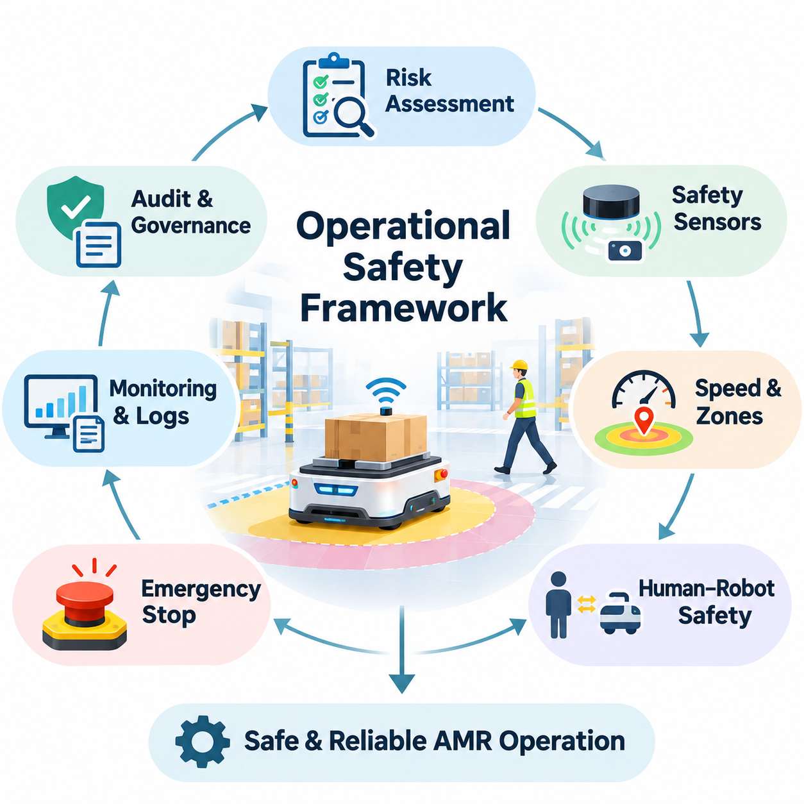
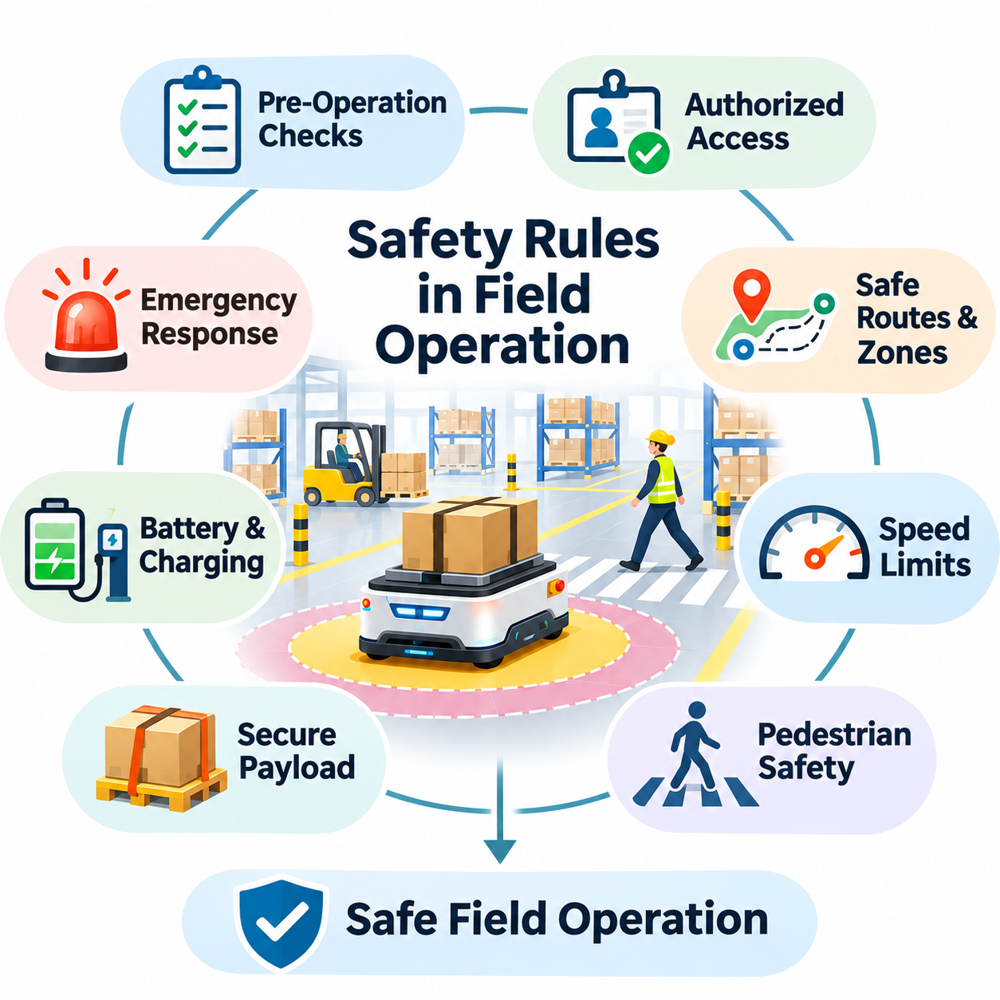
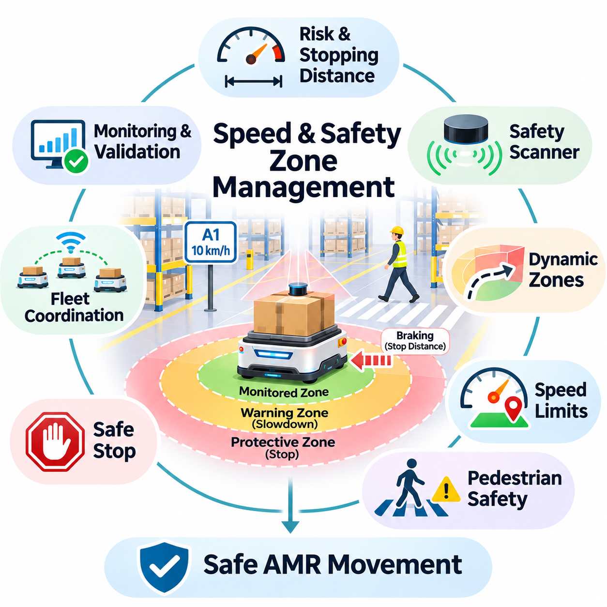
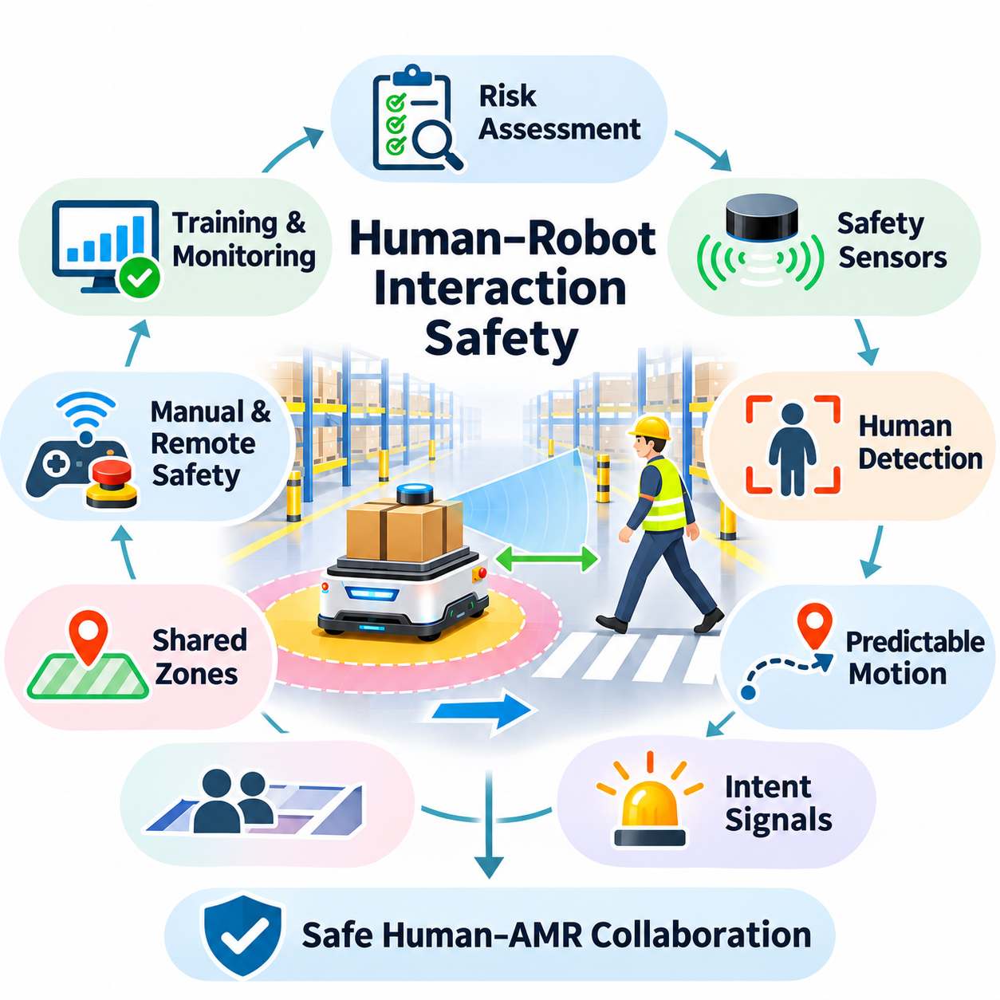
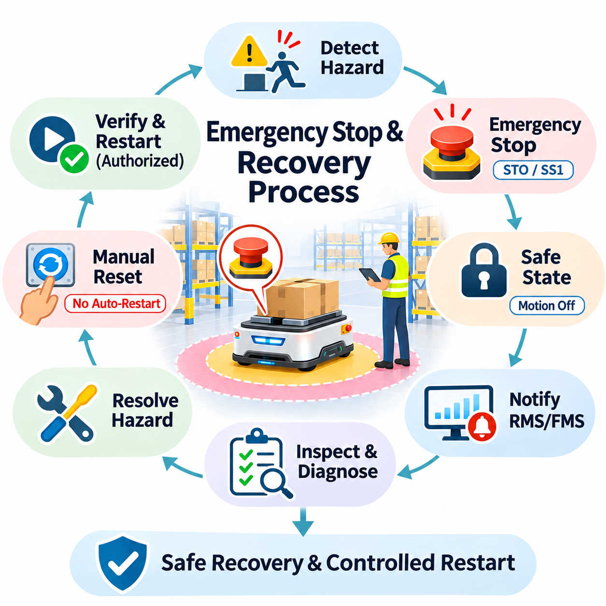
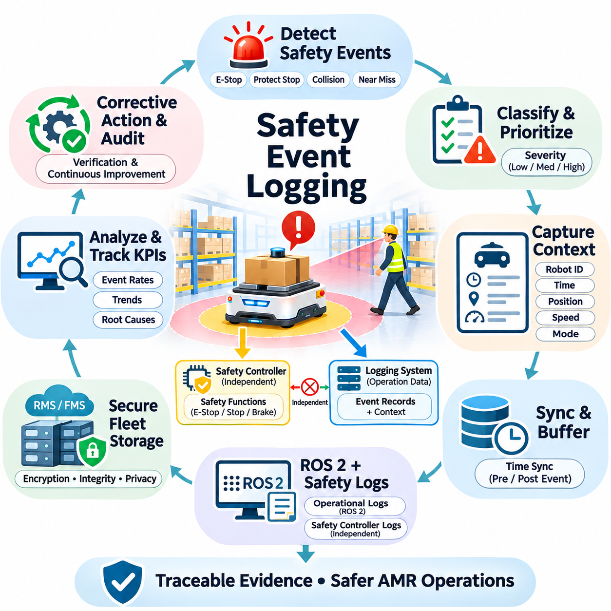
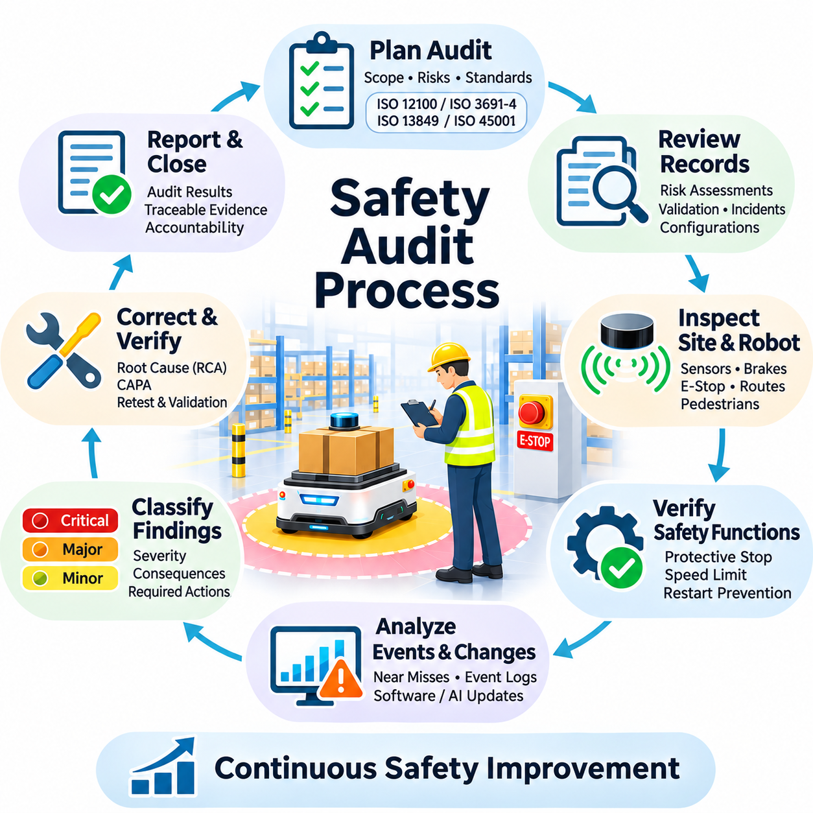
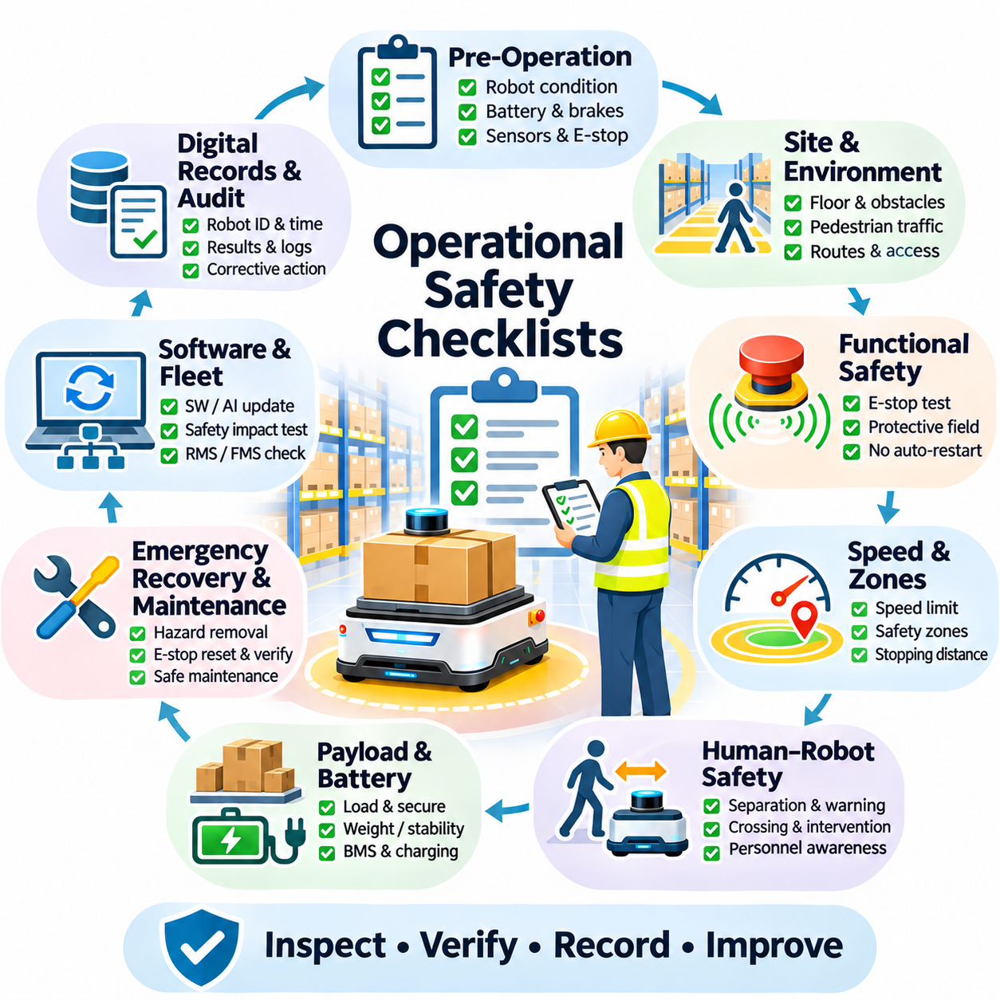

**Volume 08. AMR Operations, Deployment, and MLOps**


# Chapter 12. Operational Safety

##  

## 12.1 Operational Safety Framework

{width="7.268055555555556in" height="7.268055555555556in"}

An operational safety framework establishes the principles, processes, responsibilities, and technical mechanisms required to ensure the safe operation of Autonomous Mobile Robots (AMRs) in real-world environments. It integrates functional safety, environmental risk management, human supervision, operational procedures, and continuous monitoring into a unified management structure. Safety must be maintained throughout the entire robot operational lifecycle.

Unlike conventional industrial automation systems operating within physically separated workspaces, AMRs frequently share dynamic environments with humans, vehicles, equipment, and other autonomous systems. Environmental conditions and operational requirements may change continuously. Consequently, operational safety must address both predictable hazards and unexpected situations arising from interactions between robots and their surroundings.

The foundation of an operational safety framework is systematic hazard identification and risk assessment. Potential hazards include collisions, crushing, unintended movement, localization failures, uncontrolled acceleration, electrical faults, communication interruptions, and payload instability. Each hazard must be evaluated according to its potential severity, probability of occurrence, exposure conditions, and possibility of avoidance.

Operational safety requirements must be established during deployment planning and maintained throughout field operation. International standards such as ISO 12100, ISO 3691-4, ISO 13849, and IEC 61508 may provide relevant engineering and risk management principles, depending on the application and system classification. Applicable regional regulations, workplace safety requirements, and customer-specific operational constraints must also be considered.

A comprehensive safety framework adopts a layered protection architecture in which mechanical, electrical, software, and operational safeguards complement one another. Mechanical protection reduces physical hazards through appropriate structural design. Electrical safety circuits provide safety-related stopping functions, while software-based supervision monitors robot behavior and operational boundaries. Administrative controls address remaining operational risks.

An essential architectural principle is the separation of safety-critical functions from general autonomous intelligence. Safety-rated controllers, protective sensing devices, emergency stop circuits, and drive inhibition mechanisms must provide dependable protection regardless of failures in navigation software, AI inference engines, or cloud services. AI-based perception can enhance situational awareness but cannot automatically substitute for validated safety functions.

The operational design domain defines the environmental and functional conditions under which an AMR is authorized to operate. These conditions may include permitted geographic areas, maximum travel speeds, floor characteristics, slope limitations, payload capacity, environmental visibility, and pedestrian density. When required operating conditions cannot be maintained, the robot must transition to an appropriate predefined safe state.

Site-specific safety rules translate engineering requirements into practical field operation procedures. Restricted areas, pedestrian crossings, charging stations, loading locations, emergency exits, and shared traffic corridors must be clearly identified. Operators and facility personnel must understand robot movement characteristics, warning signals, intervention procedures, and the limitations of autonomous navigation within their working environment.

Speed and safety zone management provide dynamic protection against collisions and hazardous proximity. Protective fields and permitted speeds must reflect validated stopping distances, payload mass, braking performance, sensor coverage, and environmental conditions. Warning zones may support preventive deceleration, while protective zones trigger safety-related stopping functions when hazardous intrusion is detected.

Human--robot interaction safety requires consideration of both physical protection and human behavior. Robots must communicate their operational intentions through appropriate visual indicators, audible warnings, displays, or predictable movement patterns. Particular attention must be given to blind intersections, crowded corridors, vulnerable individuals, unexpected pedestrian movements, and situations involving simultaneous human and robot activities.

Emergency stop and recovery mechanisms provide controlled responses when hazardous conditions arise. Emergency stop devices must be accessible and implemented according to applicable safety requirements. Recovery procedures must include hazard clearance, system diagnostics, authorized reset, and verification of safe operating conditions. Resetting an emergency stop must not automatically initiate hazardous robot movement.

Robot Management Systems (RMS) and Fleet Management Systems (FMS) extend operational safety supervision across distributed robot fleets. Centralized monitoring can identify abnormal behavior, restricted-zone violations, repeated protective stops, and emerging traffic conflicts. However, essential onboard safety functions must remain effective independently of network availability, centralized servers, and remote monitoring infrastructure.

Safety event logging establishes the evidence required for incident investigation, operational analysis, and continuous improvement. Emergency stops, protective field intrusions, near misses, excessive speed events, safety controller faults, and unauthorized interventions should be recorded with synchronized timestamps and relevant contextual information. Historical records help engineers identify recurring hazards and evaluate corrective measures.

Operational safety governance defines accountability across robot manufacturers, system integrators, facility managers, operators, and maintenance personnel. Periodic safety audits, inspection checklists, competency assessments, preventive maintenance, and controlled software updates ensure that approved safety conditions remain valid. Safety performance indicators should support continuous improvement without discouraging incident or near-miss reporting.

Ultimately, the operational safety framework transforms safety from an isolated engineering function into a continuous operational management discipline. It connects field safety rules, speed management, human--robot interaction, emergency recovery, event logging, safety auditing, and operational checklists. This framework provides a foundation for reliable, scalable, and sustainable AMR deployment across industrial and public environments.

운영 안전 프레임워크(Operational Safety Framework)는 실제 환경에서 자율이동로봇(Autonomous Mobile Robot, AMR)의 안전한 운영을 보장하기 위해 필요한 원칙(Principles), 프로세스(Processes), 책임(Responsibilities), 기술적 메커니즘(Technical Mechanisms)을 정의한다. 이는 기능 안전(Functional Safety), 환경 위험 관리(Environmental Risk Management), 인간 감독(Human Supervision), 운영 절차(Operational Procedures), 지속적 모니터링(Continuous Monitoring)을 통합된 관리 구조로 결합한다. 안전은 로봇의 전체 운영 수명주기(Operational Lifecycle)에 걸쳐 유지되어야 한다.

물리적으로 분리된 작업 공간에서 운영되는 기존 산업 자동화 시스템(Industrial Automation System)과 달리, AMR은 인간, 차량, 장비 및 다른 자율 시스템(Autonomous Systems)과 동적인 환경(Dynamic Environment)을 공유하는 경우가 많다. 환경 조건(Environmental Conditions)과 운영 요구사항(Operational Requirements)은 지속적으로 변화할 수 있다. 따라서 운영 안전(Operational Safety)은 예측 가능한 위험 요소뿐만 아니라 로봇과 주변 환경 간의 상호작용에서 발생하는 예기치 않은 상황까지 고려해야 한다.

운영 안전 프레임워크의 기반은 체계적인 위험 요소 식별(Hazard Identification)과 위험도 평가(Risk Assessment)이다. 잠재적 위험 요소에는 충돌(Collision), 압착(Crushing), 의도하지 않은 움직임(Unintended Movement), 위치 추정 실패(Localization Failure), 제어되지 않는 가속(Uncontrolled Acceleration), 전기적 결함(Electrical Fault), 통신 중단(Communication Interruption), 적재물 불안정성(Payload Instability) 등이 포함된다. 각각의 위험 요소는 잠재적 심각도(Severity), 발생 확률(Probability of Occurrence), 노출 조건(Exposure Conditions), 회피 가능성(Possibility of Avoidance)에 따라 평가되어야 한다.

운영 안전 요구사항(Operational Safety Requirements)은 배포 계획(Deployment Planning) 단계에서 수립되어야 하며, 전체 현장 운영(Field Operation) 과정에서 유지되어야 한다. ISO 12100, ISO 3691-4, ISO 13849, IEC 61508과 같은 국제 표준(International Standards)은 적용 분야와 시스템 분류에 따라 관련 엔지니어링 및 위험 관리 원칙(Risk Management Principles)을 제공할 수 있다. 또한 적용 가능한 지역 규제(Regional Regulations), 작업장 안전 요구사항(Workplace Safety Requirements), 고객별 운영 제약조건(Customer-Specific Operational Constraints)을 고려해야 한다.

포괄적인 안전 프레임워크는 기계적, 전기적, 소프트웨어적, 운영적 안전 보호 수단이 상호 보완하는 다계층 보호 아키텍처(Layered Protection Architecture)를 채택한다. 기계적 보호(Mechanical Protection)는 적절한 구조 설계를 통해 물리적 위험 요소를 감소시킨다. 전기적 안전 회로(Electrical Safety Circuits)는 안전 관련 정지 기능(Safety-Related Stopping Functions)을 제공하며, 소프트웨어 기반 감독(Software-Based Supervision)은 로봇의 행동과 운영 경계를 모니터링한다. 관리적 통제(Administrative Controls)는 잔여 운영 위험(Residual Operational Risks)을 관리한다.

핵심적인 아키텍처 설계 원칙은 안전 필수 기능(Safety-Critical Functions)을 일반적인 자율 지능(Autonomous Intelligence)으로부터 분리하는 것이다. 안전 등급 제어기(Safety-Rated Controllers), 보호 감지 장치(Protective Sensing Devices), 비상정지 회로(Emergency Stop Circuits), 구동 억제 메커니즘(Drive Inhibition Mechanisms)은 내비게이션 소프트웨어(Navigation Software), AI 추론 엔진(AI Inference Engine), 클라우드 서비스(Cloud Services)의 장애와 관계없이 신뢰할 수 있는 보호 기능을 제공해야 한다. AI 기반 인식(AI-Based Perception)은 상황 인식(Situational Awareness)을 향상시킬 수 있지만, 검증된 안전 기능(Validated Safety Functions)을 자동으로 대체할 수는 없다.

운영 설계 영역(Operational Design Domain, ODD)은 AMR의 운영이 허용되는 환경적 및 기능적 조건을 정의한다. 이러한 조건에는 허용된 지리적 영역(Permitted Geographic Areas), 최대 주행 속도(Maximum Travel Speed), 바닥 특성(Floor Characteristics), 경사도 제한(Slope Limitations), 적재 용량(Payload Capacity), 환경 가시성(Environmental Visibility), 보행자 밀도(Pedestrian Density) 등이 포함될 수 있다. 요구되는 운영 조건을 유지할 수 없는 경우, 로봇은 사전에 정의된 적절한 안전 상태(Predefined Safe State)로 전환되어야 한다.

현장별 안전 규칙(Site-Specific Safety Rules)은 엔지니어링 요구사항(Engineering Requirements)을 실질적인 현장 운영 절차(Field Operation Procedures)로 전환한다. 출입 제한 구역(Restricted Areas), 보행자 횡단 구역(Pedestrian Crossings), 충전 스테이션(Charging Stations), 적재 위치(Loading Locations), 비상구(Emergency Exits), 공유 통행로(Shared Traffic Corridors)는 명확하게 식별되어야 한다. 운영자와 시설 관계자는 작업 환경 내에서 로봇의 이동 특성(Movement Characteristics), 경고 신호(Warning Signals), 개입 절차(Intervention Procedures), 자율주행의 한계(Limitations of Autonomous Navigation)를 이해해야 한다.

속도 및 안전 구역 관리(Speed and Safety Zone Management)는 충돌과 위험한 근접 상황에 대한 동적 보호(Dynamic Protection)를 제공한다. 보호 영역(Protective Fields)과 허용 속도(Permitted Speed)는 검증된 정지 거리(Validated Stopping Distance), 적재물 질량(Payload Mass), 제동 성능(Braking Performance), 센서 감지 범위(Sensor Coverage), 환경 조건(Environmental Conditions)을 반영해야 한다. 경고 구역(Warning Zone)은 예방적 감속(Preventive Deceleration)을 지원할 수 있으며, 보호 구역(Protective Zone)은 위험한 침입이 감지될 경우 안전 관련 정지 기능(Safety-Related Stopping Functions)을 작동시킨다.

인간-로봇 상호작용 안전(Human--Robot Interaction Safety)은 물리적 보호(Physical Protection)와 인간의 행동(Human Behavior)을 모두 고려해야 한다. 로봇은 적절한 시각적 표시 장치(Visual Indicators), 청각적 경고(Audible Warnings), 디스플레이(Display), 예측 가능한 이동 패턴(Predictable Movement Patterns)을 통해 자신의 운영 의도(Operational Intentions)를 전달해야 한다. 특히 사각지대가 존재하는 교차로(Blind Intersections), 혼잡한 통로(Crowded Corridors), 안전 취약계층(Vulnerable Individuals), 예측하기 어려운 보행자의 움직임, 인간과 로봇의 활동이 동시에 이루어지는 상황에 각별한 주의를 기울여야 한다.

비상정지 및 복구 메커니즘(Emergency Stop and Recovery Mechanisms)은 위험한 상황이 발생했을 때 제어된 대응(Controlled Response)을 제공한다. 비상정지 장치(Emergency Stop Devices)는 쉽게 접근할 수 있어야 하며, 적용 가능한 안전 요구사항에 따라 구현되어야 한다. 복구 절차(Recovery Procedures)에는 위험 요소 제거(Hazard Clearance), 시스템 진단(System Diagnostics), 승인된 리셋(Authorized Reset), 안전한 운영 조건의 검증(Verification of Safe Operating Conditions)이 포함되어야 한다. 비상정지 상태를 리셋하는 행위가 위험한 로봇의 움직임을 자동으로 시작하게 해서는 안 된다.

로봇 관리 시스템(Robot Management System, RMS)과 플릿 관리 시스템(Fleet Management System, FMS)은 분산된 로봇 플릿(Distributed Robot Fleet) 전체로 운영 안전 감독(Operational Safety Supervision)을 확장한다. 중앙집중식 모니터링(Centralized Monitoring)은 비정상 행동(Abnormal Behavior), 제한 구역 위반(Restricted-Zone Violation), 반복적인 보호 정지(Protective Stop), 새롭게 발생하는 교통 충돌 상황(Traffic Conflicts)을 식별할 수 있다. 그러나 필수적인 온보드 안전 기능(Onboard Safety Functions)은 네트워크 가용성(Network Availability), 중앙집중식 서버(Centralized Server), 원격 모니터링 인프라(Remote Monitoring Infrastructure)와 독립적으로 유효하게 작동해야 한다.

안전 이벤트 로깅(Safety Event Logging)은 사고 조사(Incident Investigation), 운영 분석(Operational Analysis), 지속적 개선(Continuous Improvement)에 필요한 증거를 확보한다. 비상정지(Emergency Stop), 보호 영역 침입(Protective Field Intrusion), 아차사고(Near Miss), 과속 이벤트(Excessive Speed Event), 안전 제어기 결함(Safety Controller Fault), 승인되지 않은 개입(Unauthorized Intervention)은 동기화된 타임스탬프(Synchronized Timestamp) 및 관련 상황 정보(Contextual Information)와 함께 기록되어야 한다. 과거 기록(Historical Records)은 엔지니어가 반복적으로 발생하는 위험 요소를 식별하고 시정 조치(Corrective Measures)를 평가하는 데 도움을 준다.

운영 안전 거버넌스(Operational Safety Governance)는 로봇 제조업체(Robot Manufacturers), 시스템 통합업체(System Integrators), 시설 관리자(Facility Managers), 운영자(Operators), 유지보수 담당자(Maintenance Personnel) 간의 책임 체계를 정의한다. 정기적인 안전 감사(Safety Audit), 점검 체크리스트(Inspection Checklist), 역량 평가(Competency Assessment), 예방적 유지보수(Preventive Maintenance), 통제된 소프트웨어 업데이트(Controlled Software Update)는 승인된 안전 조건이 지속적으로 유효하도록 보장한다. 안전 성과 지표(Safety Performance Indicators)는 사고 또는 아차사고 보고를 위축시키지 않으면서 지속적 개선을 지원해야 한다.

궁극적으로 운영 안전 프레임워크(Operational Safety Framework)는 안전을 독립적인 엔지니어링 기능에서 지속적인 운영 관리 체계(Continuous Operational Management Discipline)로 발전시킨다. 이는 현장 안전 규칙(Field Safety Rules), 속도 관리(Speed Management), 인간-로봇 상호작용(Human--Robot Interaction), 비상 복구(Emergency Recovery), 이벤트 로깅(Event Logging), 안전 감사(Safety Auditing), 운영 체크리스트(Operational Checklists)를 유기적으로 연결한다. 이러한 프레임워크는 산업 및 공공 환경 전반에서 신뢰성(Reliability), 확장성(Scalability), 지속가능성(Sustainability)을 갖춘 AMR 배포(AMR Deployment)를 실현하기 위한 기반을 제공한다.

##  

## 12.2 Safety Rules in Field Operation

{width="7.268055555555556in" height="7.268055555555556in"}

Safety rules in field operation establish the practical requirements and behavioral guidelines necessary to maintain the safe operation of Autonomous Mobile Robots (AMRs) in real-world environments. These rules translate system-level safety requirements into daily operational practices and define how robots, operators, maintenance personnel, and facility managers interact within shared working environments throughout the operational lifecycle.

Field safety rules must be developed according to the characteristics of each deployment environment. Manufacturing facilities, warehouses, hospitals, commercial buildings, and outdoor environments present different operational hazards and human interaction patterns. Site-specific safety rules should consider workspace geometry, pedestrian density, vehicle traffic, environmental conditions, payload characteristics, and existing operational procedures.

Before initiating daily robot operations, authorized personnel should perform pre-operation safety inspections. These inspections include checking protective sensors, emergency stop devices, braking systems, battery conditions, mechanical structures, and warning indicators according to approved procedures. Robots exhibiting unresolved safety-related faults, physical damage, or abnormal behavior must not be released into autonomous operation.

Access control is an important element of field safety management. Only trained and authorized personnel should be permitted to configure robots, modify operational parameters, initiate maintenance modes, or perform manual control. Role-based access control within Robot Management Systems (RMS) and Fleet Management Systems (FMS) helps prevent unauthorized interventions that could compromise established safety conditions.

Operational areas must be clearly defined to distinguish authorized robot routes, pedestrian walkways, restricted zones, loading stations, and charging locations. Physical markings, warning signs, digital maps, and virtual boundaries can support consistent spatial management. Robots must operate within approved boundaries, and access to hazardous or unsuitable areas must be prevented through appropriate technical and administrative safeguards.

Travel speed must be regulated according to the operational environment and associated risk levels. Robots operating near pedestrians, blind intersections, narrow corridors, or loading stations may require reduced speed limits. Maximum permitted speeds must remain consistent with validated braking performance, protective sensor coverage, payload conditions, and available stopping distances under foreseeable operating conditions.

Human personnel must understand appropriate behavior when working near autonomous robots. Operators and pedestrians should avoid obstructing robot routes, intentionally entering protective fields, standing between moving robots and fixed structures, or attempting to physically stop an autonomous platform. Robot warning signals, directional indicators, and designated pedestrian priority rules must be respected throughout shared environments.

Payload handling introduces additional safety requirements during field operation. Transported materials must remain within approved weight, dimensional, and center-of-gravity limits. Loads must be secured against displacement during acceleration, braking, turning, and traversing uneven surfaces. Operators must verify that loading, unloading, towing, and coupling activities are completed safely before authorizing autonomous movement.

Charging and battery management procedures must address electrical, thermal, and fire-related hazards. Charging stations should remain accessible, free from unauthorized materials, and compatible with the robot\'s electrical specifications. Abnormal battery temperatures, damaged connectors, electrical leakage, or suspected battery deterioration must trigger appropriate protective actions in accordance with established site procedures.

Manual intervention and remote control require additional operational safeguards because autonomous behavior may be partially or completely suspended. Authorized personnel must verify environmental conditions, maintain appropriate situational awareness, and comply with approved manual operating limits. Safety-critical protection mechanisms must remain effective, and unauthorized bypassing of protective devices must be prohibited.

Emergency situations require clearly defined response procedures that prioritize human safety over equipment protection and operational productivity. Personnel must understand the location and intended use of emergency stop devices, emergency communication channels, and evacuation routes. Following a hazardous event, robot operation must remain suspended until the conditions necessary for safe recovery have been verified.

Environmental changes must be continuously evaluated because previously validated operating conditions may become unsuitable over time. Temporary construction, relocated equipment, damaged flooring, liquid spills, reduced visibility, and unexpected pedestrian congestion can introduce new hazards. Significant changes must trigger appropriate risk reassessment, operational restrictions, or suspension of affected robot activities.

Safety rules must also address software updates, configuration modifications, and AI model deployment. Changes affecting navigation behavior, speed limits, protective fields, perception capabilities, or control functions must undergo appropriate verification and approval before entering production operation. Unauthorized modifications to safety-related parameters must be prevented through access management, version control, and configuration auditing.

Operational safety compliance requires continuous monitoring, structured event reporting, and periodic review. Protective stops, near misses, route violations, unsafe interventions, and safety-related equipment failures should be documented and investigated. Safety training, competency assessments, corrective actions, and regular communication help establish an organizational culture in which hazard reporting is encouraged and operational risks are systematically reduced.

Ultimately, field operation safety rules provide the practical foundation for maintaining safe, predictable, and reliable autonomous robot operations. Their effectiveness depends on the integration of validated technical safeguards, clearly defined responsibilities, disciplined operational procedures, and continuous organizational improvement. Operational productivity must always remain subordinate to human safety and established risk acceptance criteria.

현장 운영 안전 규칙(Safety Rules in Field Operation)은 실제 환경에서 자율이동로봇(Autonomous Mobile Robot, AMR)의 안전한 운영을 유지하기 위해 필요한 실질적인 요구사항(Practical Requirements)과 행동 지침(Behavioral Guidelines)을 수립한다. 이러한 규칙은 시스템 수준의 안전 요구사항(System-Level Safety Requirements)을 일상적인 운영 활동(Daily Operational Practices)으로 전환하며, 전체 운영 수명주기(Operational Lifecycle)에 걸쳐 공유 작업 환경(Shared Working Environment)에서 로봇, 운영자, 유지보수 담당자 및 시설 관리자가 상호작용하는 방식을 정의한다.

현장 안전 규칙(Field Safety Rules)은 각각의 배포 환경(Deployment Environment)이 갖는 특성에 따라 개발되어야 한다. 제조 시설(Manufacturing Facilities), 물류 창고(Warehouses), 병원(Hospitals), 상업용 건물(Commercial Buildings), 실외 환경(Outdoor Environments)은 서로 다른 운영 위험 요소(Operational Hazards)와 인간 상호작용 패턴(Human Interaction Patterns)을 갖는다. 현장별 안전 규칙(Site-Specific Safety Rules)은 작업 공간의 기하학적 구조(Workspace Geometry), 보행자 밀도(Pedestrian Density), 차량 통행(Vehicle Traffic), 환경 조건(Environmental Conditions), 적재물 특성(Payload Characteristics), 기존 운영 절차(Operational Procedures)를 고려해야 한다.

일상적인 로봇 운영(Daily Robot Operation)을 시작하기 전에 승인된 담당자(Authorized Personnel)는 운영 전 안전 점검(Pre-Operation Safety Inspection)을 수행해야 한다. 이러한 점검에는 승인된 절차에 따른 보호 센서(Protective Sensors), 비상정지 장치(Emergency Stop Devices), 제동 시스템(Braking Systems), 배터리 상태(Battery Conditions), 기계적 구조(Mechanical Structures), 경고 표시 장치(Warning Indicators)의 확인이 포함된다. 해결되지 않은 안전 관련 결함(Safety-Related Faults), 물리적 손상(Physical Damage), 비정상 행동(Abnormal Behavior)이 존재하는 로봇은 자율 운영(Autonomous Operation)에 투입되어서는 안 된다.

접근 제어(Access Control)는 현장 안전 관리(Field Safety Management)의 중요한 구성 요소이다. 교육을 받고 권한을 부여받은 담당자만 로봇 설정(Configuration), 운영 매개변수(Operational Parameters) 변경, 유지보수 모드(Maintenance Mode) 활성화 또는 수동 제어(Manual Control)를 수행할 수 있어야 한다. 로봇 관리 시스템(Robot Management System, RMS)과 플릿 관리 시스템(Fleet Management System, FMS) 내부의 역할 기반 접근 제어(Role-Based Access Control, RBAC)는 확립된 안전 조건을 저해할 수 있는 승인되지 않은 개입(Unauthorized Intervention)을 방지하는 데 기여한다.

운영 구역(Operational Areas)은 승인된 로봇 이동 경로(Authorized Robot Routes), 보행자 통행로(Pedestrian Walkways), 제한 구역(Restricted Zones), 적재 스테이션(Loading Stations), 충전 위치(Charging Locations)를 구분할 수 있도록 명확하게 정의되어야 한다. 물리적 표시(Physical Markings), 경고 표지판(Warning Signs), 디지털 지도(Digital Maps), 가상 경계(Virtual Boundaries)는 일관된 공간 관리(Spatial Management)를 지원할 수 있다. 로봇은 승인된 경계 내부에서 운영되어야 하며, 위험하거나 부적합한 구역에 대한 접근은 적절한 기술적 및 관리적 보호 수단(Technical and Administrative Safeguards)을 통해 방지되어야 한다.

주행 속도(Travel Speed)는 운영 환경(Operational Environment)과 관련 위험 수준(Risk Levels)에 따라 제어되어야 한다. 보행자 주변, 사각지대가 존재하는 교차로(Blind Intersections), 좁은 통로(Narrow Corridors), 적재 스테이션에서 운영되는 로봇에는 낮은 속도 제한(Reduced Speed Limits)이 요구될 수 있다. 최대 허용 속도(Maximum Permitted Speed)는 예측 가능한 운영 조건에서 검증된 제동 성능(Validated Braking Performance), 보호 센서 감지 범위(Protective Sensor Coverage), 적재물 조건(Payload Conditions), 확보 가능한 정지 거리(Available Stopping Distance)와 일치해야 한다.

현장 인력(Human Personnel)은 자율로봇(Autonomous Robots) 주변에서 작업할 때 적절한 행동 방식을 이해해야 한다. 운영자와 보행자는 로봇 이동 경로를 방해하거나, 의도적으로 보호 영역(Protective Fields)에 진입하거나, 이동 중인 로봇과 고정 구조물(Fixed Structures) 사이에 서 있거나, 자율이동 플랫폼을 물리적으로 정지시키려는 행동을 피해야 한다. 공유 환경(Shared Environment)에서는 로봇의 경고 신호(Warning Signals), 방향 표시 장치(Directional Indicators), 지정된 보행자 우선 규칙(Pedestrian Priority Rules)을 준수해야 한다.

적재물 취급(Payload Handling)은 현장 운영 과정에서 추가적인 안전 요구사항을 발생시킨다. 운송되는 물품은 승인된 중량(Weight), 치수(Dimensions), 무게중심(Center of Gravity) 제한 범위 이내에 있어야 한다. 적재물은 가속(Acceleration), 제동(Braking), 회전(Turning), 불균일한 노면(Uneven Surfaces) 통과 과정에서 위치가 변하지 않도록 고정되어야 한다. 운영자는 자율이동(Autonomous Movement)을 승인하기 전에 적재(Loading), 하역(Unloading), 견인(Towing), 연결(Coupling) 작업이 안전하게 완료되었는지 확인해야 한다.

충전 및 배터리 관리 절차(Charging and Battery Management Procedures)는 전기적 위험(Electrical Hazards), 열적 위험(Thermal Hazards), 화재 관련 위험(Fire-Related Hazards)을 고려해야 한다. 충전 스테이션(Charging Stations)은 접근 가능한 상태를 유지하고, 허용되지 않은 물품이 없어야 하며, 로봇의 전기적 사양(Electrical Specifications)과 호환되어야 한다. 비정상적인 배터리 온도(Abnormal Battery Temperature), 손상된 커넥터(Damaged Connectors), 누전(Electrical Leakage), 배터리 열화(Battery Deterioration)가 의심되는 상황에서는 확립된 현장 절차(Site Procedures)에 따라 적절한 보호 조치(Protective Actions)가 수행되어야 한다.

수동 개입(Manual Intervention)과 원격 제어(Remote Control)는 자율 행동(Autonomous Behavior)이 부분적으로 또는 완전히 중단될 수 있으므로 추가적인 운영 안전 보호 수단(Operational Safeguards)이 요구된다. 승인된 담당자는 환경 조건을 확인하고, 적절한 상황 인식(Situational Awareness)을 유지하며, 승인된 수동 운영 제한사항(Manual Operating Limits)을 준수해야 한다. 안전 필수 보호 메커니즘(Safety-Critical Protection Mechanisms)은 지속적으로 유효하게 작동해야 하며, 보호 장치(Protective Devices)를 승인 없이 우회(Bypass)하는 행위는 금지되어야 한다.

비상 상황(Emergency Situations)에서는 장비 보호(Equipment Protection)와 운영 생산성(Operational Productivity)보다 인간의 안전(Human Safety)을 우선시하는 명확한 대응 절차(Response Procedures)가 요구된다. 현장 인력은 비상정지 장치(Emergency Stop Devices)의 위치와 사용 목적, 비상 통신 채널(Emergency Communication Channels), 대피 경로(Evacuation Routes)를 이해해야 한다. 위험 이벤트(Hazardous Event)가 발생한 이후에는 안전한 복구(Safe Recovery)에 필요한 조건이 검증될 때까지 로봇 운영을 중단 상태로 유지해야 한다.

이전에 검증된 운영 조건(Validated Operating Conditions)이 시간이 지남에 따라 부적합해질 수 있으므로 환경 변화(Environmental Changes)는 지속적으로 평가되어야 한다. 임시 공사(Temporary Construction), 장비 위치 변경(Relocated Equipment), 바닥 손상(Damaged Flooring), 액체 유출(Liquid Spills), 가시성 저하(Reduced Visibility), 예기치 않은 보행자 혼잡(Pedestrian Congestion)은 새로운 위험 요소를 발생시킬 수 있다. 중대한 환경 변화가 발생하면 적절한 위험도 재평가(Risk Reassessment), 운영 제한(Operational Restrictions), 또는 영향을 받는 로봇 활동의 중단(Suspension of Robot Activities)이 이루어져야 한다.

안전 규칙은 소프트웨어 업데이트(Software Updates), 설정 변경(Configuration Modifications), AI 모델 배포(AI Model Deployment)도 고려해야 한다. 내비게이션 행동(Navigation Behavior), 속도 제한(Speed Limits), 보호 영역(Protective Fields), 인식 능력(Perception Capabilities), 제어 기능(Control Functions)에 영향을 미치는 변경사항은 실제 운영 환경(Production Operation)에 적용되기 전에 적절한 검증(Verification)과 승인(Approval) 절차를 거쳐야 한다. 안전 관련 매개변수(Safety-Related Parameters)에 대한 승인되지 않은 변경은 접근 관리(Access Management), 버전 관리(Version Control), 설정 감사(Configuration Auditing)를 통해 방지되어야 한다.

운영 안전 규정 준수(Operational Safety Compliance)를 위해서는 지속적 모니터링(Continuous Monitoring), 체계적인 이벤트 보고(Structured Event Reporting), 정기적인 검토(Periodic Review)가 요구된다. 보호 정지(Protective Stops), 아차사고(Near Misses), 경로 위반(Route Violations), 안전하지 않은 개입(Unsafe Interventions), 안전 관련 장비 고장(Safety-Related Equipment Failures)은 문서화되고 조사되어야 한다. 안전 교육(Safety Training), 역량 평가(Competency Assessments), 시정 조치(Corrective Actions), 정기적인 의사소통(Regular Communication)은 위험 요소 보고를 장려하고 운영 위험을 체계적으로 감소시키는 조직 문화(Organizational Culture)를 구축하는 데 기여한다.

궁극적으로 현장 운영 안전 규칙(Safety Rules in Field Operation)은 안전하고 예측 가능하며 신뢰할 수 있는 자율로봇 운영(Autonomous Robot Operation)을 유지하기 위한 실질적인 기반을 제공한다. 이러한 규칙의 효과는 검증된 기술적 보호 수단(Validated Technical Safeguards), 명확하게 정의된 책임 체계(Clearly Defined Responsibilities), 엄격하게 준수되는 운영 절차(Disciplined Operational Procedures), 지속적인 조직 개선(Continuous Organizational Improvement)의 통합에 달려 있다. 운영 생산성(Operational Productivity)은 항상 인간의 안전(Human Safety)과 확립된 위험 수용 기준(Risk Acceptance Criteria)보다 후순위에 있어야 한다.

##  

## 12.3 Speed and Safety Zone Management

{width="7.268055555555556in" height="7.268055555555556in"}

Speed and safety zone management represents a fundamental component of operational safety for Autonomous Mobile Robots (AMRs). Its primary objective is to regulate robot movement according to environmental conditions, surrounding objects, human presence, and potential collision risks. By integrating speed control with spatial protection mechanisms, AMRs can maintain safe operating conditions while supporting efficient autonomous transportation.

Unlike conventional automated transportation systems operating along fixed and physically separated routes, AMRs frequently navigate dynamic and shared environments. Pedestrians, forklifts, industrial equipment, and other mobile robots may enter or leave operational areas unexpectedly. Consequently, speed management must respond to changing environmental conditions rather than relying exclusively on predetermined velocity limitations.

The maximum permissible speed of an AMR must be determined through systematic risk assessment and engineering validation. Relevant factors include robot mass, payload characteristics, braking capability, wheel traction, surface conditions, sensor detection range, and control system response time. Higher travel speeds generally increase stopping distances and collision energy, requiring more extensive protective measures and operating restrictions.

Stopping distance is a critical engineering parameter in speed and safety zone management. Total stopping distance includes the distance traveled during sensor detection, signal processing, safety controller response, actuator response, and mechanical deceleration. Protective field dimensions must account for these delays, braking performance under foreseeable adverse conditions, measurement uncertainty, and appropriate safety margins.

Safety zone architecture typically consists of multiple spatial regions surrounding the robot. Warning zones provide early detection of approaching obstacles and support preventive speed reduction, while protective zones initiate validated safety-related stopping functions when hazardous intrusion occurs. Additional monitoring regions may support navigation planning, object tracking, and environmental awareness without performing safety-rated protection.

Dynamic safety field selection enables robots to adjust protective field dimensions according to their current operating state. When an AMR travels at higher speeds, larger protective fields may be required to accommodate increased stopping distances. During low-speed maneuvering, docking, or controlled turning, alternative validated field configurations may be selected to maintain appropriate protection and operational accessibility.

Safety-rated laser scanners are commonly employed to establish protective fields around industrial AMRs. These devices continuously monitor configured spatial regions and communicate safety-related detection signals to dedicated safety controllers. Scanner positioning, angular coverage, detection capability, mounting height, and potential blind spots must be evaluated to ensure that hazardous approaches can be detected within the intended operating conditions.

Modern AMRs may integrate cameras, depth sensors, radar, ultrasonic sensors, and AI-based perception to enhance environmental awareness and proactive speed adaptation. These technologies can support pedestrian recognition, trajectory prediction, and obstacle avoidance. However, conventional perception sensors and AI algorithms must not replace required safety-rated protective functions unless appropriately developed and validated for that safety purpose.

Location-dependent speed management allows different velocity limits to be assigned to specific operational areas. Open transportation corridors may permit higher speeds, while pedestrian crossings, hospital corridors, blind intersections, elevator entrances, and loading stations may require reduced speeds. Digital maps, virtual boundaries, and localization systems can support the enforcement of approved area-specific operating policies.

Localization uncertainty introduces additional risks when speed restrictions depend on the estimated position of the robot. Localization drift, inaccurate map registration, or unexpected environmental changes may cause incorrect identification of operational zones. When reliable zone identification cannot be maintained, the robot must adopt an appropriately conservative operating state, including speed reduction or a safe stop when required.

Directional safety zone management considers the movement characteristics of different AMR drive architectures. Differential drive, steer drive, omnidirectional drive, and towing platforms generate different movement envelopes during acceleration, reversing, rotation, and lateral motion. Protective field configurations must account for the complete swept volume of the robot, its payload, and any attached transportation equipment.

Fleet-level speed coordination helps reduce operational conflicts in environments containing multiple autonomous robots. Fleet Management Systems (FMS) can implement traffic priorities, intersection reservations, congestion control, and location-dependent speed policies. Nevertheless, onboard safety mechanisms must remain capable of enforcing required protective responses independently of fleet communication and centralized coordination.

Safety-related speed monitoring provides protection against unintended acceleration and excessive travel velocity. Safety controllers may implement functions such as Safely Limited Speed (SLS), Safe Speed Monitor (SSM), and Safe Stop 1 (SS1), depending on system requirements. These functions must be selected, integrated, and validated according to the required safety performance and applicable engineering standards.

Operational monitoring must continuously evaluate the effectiveness of speed restrictions and protective field configurations. Excessive speed events, repeated protective stops, unexpected field switching, braking anomalies, and near misses should be recorded with relevant environmental and robot status information. Such records support safety audits, root cause analysis, preventive maintenance, and controlled configuration improvements.

Ultimately, effective speed and safety zone management requires integration between risk assessment, vehicle dynamics, safety-rated sensing, autonomous navigation, and fleet operation. Validated speed limits and protective fields must remain effective throughout changing operational conditions and system configurations. Operational efficiency should be optimized only within approved safety boundaries, ensuring that human protection remains the highest priority.

속도 및 안전 구역 관리(Speed and Safety Zone Management)는 자율이동로봇(Autonomous Mobile Robot, AMR)의 운영 안전(Operational Safety)을 구성하는 핵심 요소이다. 주요 목적은 환경 조건(Environmental Conditions), 주변 객체(Surrounding Objects), 인간의 존재(Human Presence), 잠재적 충돌 위험(Potential Collision Risks)에 따라 로봇의 움직임을 제어하는 것이다. 속도 제어(Speed Control)와 공간적 보호 메커니즘(Spatial Protection Mechanisms)을 통합함으로써 AMR은 효율적인 자율 운송(Autonomous Transportation)을 지원하면서 안전한 운영 조건을 유지할 수 있다.

고정되고 물리적으로 분리된 경로를 따라 운영되는 기존 자동 운송 시스템(Automated Transportation Systems)과 달리, AMR은 동적이고 공유된 환경(Dynamic and Shared Environments)에서 주행하는 경우가 많다. 보행자(Pedestrians), 지게차(Forklifts), 산업 장비(Industrial Equipment), 다른 이동로봇(Mobile Robots)은 예기치 않게 운영 구역에 진입하거나 이탈할 수 있다. 따라서 속도 관리(Speed Management)는 사전에 정의된 속도 제한(Velocity Limitations)에만 의존하는 것이 아니라 변화하는 환경 조건에 대응해야 한다.

AMR의 최대 허용 속도(Maximum Permissible Speed)는 체계적인 위험도 평가(Risk Assessment)와 엔지니어링 검증(Engineering Validation)을 통해 결정되어야 한다. 관련 요소에는 로봇 질량(Robot Mass), 적재물 특성(Payload Characteristics), 제동 능력(Braking Capability), 바퀴 접지력(Wheel Traction), 노면 상태(Surface Conditions), 센서 감지 거리(Sensor Detection Range), 제어 시스템 응답 시간(Control System Response Time)이 포함된다. 일반적으로 주행 속도가 증가하면 정지 거리(Stopping Distance)와 충돌 에너지(Collision Energy)가 증가하므로 더욱 광범위한 보호 조치(Protective Measures)와 운영 제한(Operating Restrictions)이 요구된다.

정지 거리(Stopping Distance)는 속도 및 안전 구역 관리에서 핵심적인 엔지니어링 매개변수(Engineering Parameter)이다. 전체 정지 거리(Total Stopping Distance)는 센서 감지(Sensor Detection), 신호 처리(Signal Processing), 안전 제어기 응답(Safety Controller Response), 액추에이터 응답(Actuator Response), 기계적 감속(Mechanical Deceleration)이 이루어지는 동안 이동한 거리를 포함한다. 보호 영역의 크기(Protective Field Dimensions)는 이러한 지연 시간(Delays), 예측 가능한 불리한 조건에서의 제동 성능(Braking Performance), 측정 불확실성(Measurement Uncertainty), 적절한 안전 여유(Safety Margins)를 고려해야 한다.

안전 구역 아키텍처(Safety Zone Architecture)는 일반적으로 로봇을 둘러싸는 다수의 공간적 영역(Spatial Regions)으로 구성된다. 경고 구역(Warning Zones)은 접근하는 장애물(Approaching Obstacles)을 조기에 감지하고 예방적 속도 감소(Preventive Speed Reduction)를 지원한다. 반면 보호 구역(Protective Zones)은 위험한 침입(Hazardous Intrusion)이 발생했을 때 검증된 안전 관련 정지 기능(Safety-Related Stopping Functions)을 작동시킨다. 추가적인 모니터링 영역(Monitoring Regions)은 안전 등급 보호(Safety-Rated Protection)를 직접 수행하지 않으면서 내비게이션 계획(Navigation Planning), 객체 추적(Object Tracking), 환경 인식(Environmental Awareness)을 지원할 수 있다.

동적 안전 영역 선택(Dynamic Safety Field Selection)은 로봇이 현재 운영 상태(Operating State)에 따라 보호 영역의 크기를 조정할 수 있도록 한다. AMR이 높은 속도로 주행할 때는 증가된 정지 거리를 수용하기 위해 더 넓은 보호 영역(Protective Fields)이 요구될 수 있다. 저속 기동(Low-Speed Maneuvering), 도킹(Docking), 제어된 회전(Controlled Turning) 과정에서는 적절한 보호 수준과 운영 접근성(Operational Accessibility)을 유지하기 위해 검증된 대체 영역 구성(Alternative Validated Field Configurations)을 선택할 수 있다.

안전 등급 레이저 스캐너(Safety-Rated Laser Scanners)는 산업용 AMR 주변에 보호 영역을 설정하기 위해 일반적으로 사용된다. 이러한 장치는 설정된 공간적 영역(Configured Spatial Regions)을 지속적으로 모니터링하고 안전 관련 감지 신호(Safety-Related Detection Signals)를 전용 안전 제어기(Dedicated Safety Controllers)로 전달한다. 의도된 운영 조건에서 위험한 접근을 감지할 수 있도록 스캐너 배치(Scanner Positioning), 각도별 감지 범위(Angular Coverage), 감지 능력(Detection Capability), 장착 높이(Mounting Height), 잠재적 사각지대(Blind Spots)를 평가해야 한다.

현대의 AMR은 환경 인식(Environmental Awareness)과 선제적 속도 적응(Proactive Speed Adaptation)을 향상시키기 위해 카메라(Cameras), 깊이 센서(Depth Sensors), 레이더(Radar), 초음파 센서(Ultrasonic Sensors), AI 기반 인식(AI-Based Perception)을 통합할 수 있다. 이러한 기술은 보행자 인식(Pedestrian Recognition), 이동 궤적 예측(Trajectory Prediction), 장애물 회피(Obstacle Avoidance)를 지원할 수 있다. 그러나 일반적인 인식 센서(Perception Sensors)와 AI 알고리즘(AI Algorithms)은 해당 안전 목적에 적합하게 개발되고 검증되지 않는 한 필수적인 안전 등급 보호 기능(Safety-Rated Protective Functions)을 대체해서는 안 된다.

위치 기반 속도 관리(Location-Dependent Speed Management)는 특정 운영 구역에 서로 다른 속도 제한(Speed Limits)을 할당할 수 있도록 한다. 개방형 운송 통로(Open Transportation Corridors)에서는 높은 주행 속도가 허용될 수 있지만, 보행자 횡단 구역(Pedestrian Crossings), 병원 복도(Hospital Corridors), 사각지대가 존재하는 교차로(Blind Intersections), 엘리베이터 입구(Elevator Entrances), 적재 스테이션(Loading Stations)에서는 낮은 속도가 요구될 수 있다. 디지털 지도(Digital Maps), 가상 경계(Virtual Boundaries), 위치 추정 시스템(Localization Systems)은 승인된 구역별 운영 정책(Area-Specific Operating Policies)의 적용을 지원할 수 있다.

위치 추정 불확실성(Localization Uncertainty)은 속도 제한이 로봇의 추정 위치(Estimated Position)에 의존하는 경우 추가적인 위험을 발생시킨다. 위치 추정 드리프트(Localization Drift), 부정확한 지도 정합(Map Registration), 예기치 않은 환경 변화(Environmental Changes)는 운영 구역(Operational Zones)의 잘못된 식별을 초래할 수 있다. 신뢰할 수 있는 구역 식별(Zone Identification)을 유지할 수 없는 경우, 로봇은 필요에 따라 속도 감소(Speed Reduction) 또는 안전 정지(Safe Stop)를 포함하는 적절히 보수적인 운영 상태(Conservative Operating State)로 전환되어야 한다.

방향별 안전 구역 관리(Directional Safety Zone Management)는 서로 다른 AMR 구동 아키텍처(Drive Architectures)의 이동 특성을 고려한다. 차동 구동(Differential Drive), 조향 구동(Steer Drive), 전방향 구동(Omnidirectional Drive), 견인 플랫폼(Towing Platforms)은 가속(Acceleration), 후진(Reversing), 회전(Rotation), 횡방향 이동(Lateral Motion) 과정에서 서로 다른 이동 범위(Movement Envelopes)를 형성한다. 보호 영역 구성(Protective Field Configurations)은 로봇, 적재물, 연결된 운송 장비가 이동하는 과정에서 점유하는 전체 공간(Swept Volume)을 고려해야 한다.

플릿 수준 속도 조정(Fleet-Level Speed Coordination)은 다수의 자율로봇이 존재하는 환경에서 운영 충돌(Operational Conflicts)을 감소시키는 데 기여한다. 플릿 관리 시스템(Fleet Management System, FMS)은 통행 우선순위(Traffic Priorities), 교차로 예약(Intersection Reservations), 혼잡 제어(Congestion Control), 위치 기반 속도 정책(Location-Dependent Speed Policies)을 구현할 수 있다. 그럼에도 불구하고 온보드 안전 메커니즘(Onboard Safety Mechanisms)은 플릿 통신(Fleet Communication) 및 중앙집중식 조정(Centralized Coordination)과 독립적으로 필요한 보호 대응(Protective Responses)을 수행할 수 있어야 한다.

안전 관련 속도 모니터링(Safety-Related Speed Monitoring)은 의도하지 않은 가속(Unintended Acceleration)과 과도한 주행 속도(Excessive Travel Velocity)에 대한 보호 기능을 제공한다. 안전 제어기(Safety Controllers)는 시스템 요구사항에 따라 안전 제한 속도(Safely Limited Speed, SLS), 안전 속도 모니터(Safe Speed Monitor, SSM), 안전 정지 1(Safe Stop 1, SS1)과 같은 기능을 구현할 수 있다. 이러한 기능은 요구되는 안전 성능(Safety Performance)과 적용 가능한 엔지니어링 표준(Engineering Standards)에 따라 선택, 통합 및 검증되어야 한다.

운영 모니터링(Operational Monitoring)은 속도 제한과 보호 영역 구성의 효과를 지속적으로 평가해야 한다. 과속 이벤트(Excessive Speed Events), 반복적인 보호 정지(Repeated Protective Stops), 예기치 않은 보호 영역 전환(Unexpected Field Switching), 제동 이상(Braking Anomalies), 아차사고(Near Misses)는 관련 환경 정보(Environmental Information) 및 로봇 상태 정보(Robot Status Information)와 함께 기록되어야 한다. 이러한 기록은 안전 감사(Safety Audits), 근본 원인 분석(Root Cause Analysis, RCA), 예방적 유지보수(Preventive Maintenance), 통제된 설정 개선(Controlled Configuration Improvements)을 지원한다.

궁극적으로 효과적인 속도 및 안전 구역 관리(Speed and Safety Zone Management)를 위해서는 위험도 평가(Risk Assessment), 차량 동역학(Vehicle Dynamics), 안전 등급 센싱(Safety-Rated Sensing), 자율주행(Autonomous Navigation), 플릿 운영(Fleet Operation)의 통합이 요구된다. 검증된 속도 제한(Validated Speed Limits)과 보호 영역(Protective Fields)은 변화하는 운영 조건과 시스템 구성(System Configurations)에서도 지속적으로 유효해야 한다. 운영 효율성(Operational Efficiency)은 승인된 안전 경계(Approved Safety Boundaries) 내에서만 최적화되어야 하며, 인간 보호(Human Protection)가 항상 최우선 순위로 유지되어야 한다.

##  

## 12.4 Human-Robot Interaction Safety

{width="7.268055555555556in" height="7.268055555555556in"}

Human--robot interaction safety is a critical component of operational safety for Autonomous Mobile Robots (AMRs) operating in environments shared with humans. Its primary objective is to prevent physical injuries, hazardous interactions, and unexpected robot behavior while maintaining efficient collaboration between humans and autonomous systems. Effective safety management requires the integration of engineering safeguards, behavioral design, and operational procedures.

Unlike traditional industrial robots operating within physically isolated workspaces, AMRs frequently interact with workers, pedestrians, patients, customers, and maintenance personnel. Human behavior is inherently dynamic and may involve unpredictable movements, unexpected interruptions, or inappropriate interventions. Therefore, autonomous robots must be designed to operate safely under foreseeable human behavior and changing environmental conditions.

Human--robot interaction risk assessment must consider the various situations in which humans and robots occupy shared physical spaces. Potential hazards include direct collisions, crushing between robots and fixed structures, entanglement, foot injuries, unexpected acceleration, and contact with transported payloads. Risk assessments must evaluate robot movement characteristics, human exposure, injury severity, and the possibility of avoiding hazardous situations.

A fundamental principle of human--robot interaction safety is maintaining appropriate physical separation whenever required by the identified risks. Safety-rated protective sensors and dedicated safety controllers can establish monitored protection fields around the robot. When a person enters a protective field, the robot must execute the validated safety response, such as controlled deceleration or protective stopping, according to its safety architecture.

Human detection and tracking technologies enhance the ability of autonomous robots to recognize surrounding human activities. RGB cameras, depth sensors, LiDAR, radar, and AI-based perception can identify pedestrians and estimate their movement trajectories. However, conventional AI-based human recognition must supplement rather than replace required safety-rated protection unless the technology has been appropriately developed and validated for safety-related applications.

Predictable robot behavior is essential for establishing safe and understandable interactions with humans. Sudden acceleration, unexpected directional changes, aggressive obstacle avoidance, and inconsistent stopping behavior may create hazardous situations. Motion planning algorithms should generate smooth trajectories, appropriate acceleration profiles, and understandable movement patterns within the boundaries established by validated safety functions.

Robot intention communication allows surrounding individuals to understand the current operational state and anticipated behavior of an AMR. Visual indicators, directional lights, audible signals, display interfaces, and projected movement indicators can communicate approaching movement, turning intentions, stopping conditions, or operational faults. Communication mechanisms must remain understandable, consistent, and appropriate for the surrounding environmental conditions.

Human-aware navigation incorporates human presence, movement patterns, and social behavior into autonomous path planning. Robots should maintain appropriate interpersonal distances, avoid unnecessary approaches, and reduce potentially uncomfortable or hazardous interactions. In hospitals, commercial facilities, and public environments, navigation strategies must also consider vulnerable individuals, including children, elderly people, and persons with disabilities.

Shared workspace management establishes operational boundaries and interaction rules for humans and autonomous robots. Dedicated robot corridors, pedestrian walkways, designated crossing points, restricted zones, and controlled loading stations can reduce unnecessary exposure to hazards. Where physical separation is impractical, validated speed restrictions, protective sensing, warning systems, and clearly defined traffic priorities become increasingly important.

Special attention must be given to interaction scenarios involving blind intersections, doorways, elevators, narrow passages, and congested operational areas. Limited visibility and restricted movement space can significantly reduce the time available for humans and robots to respond to unexpected encounters. Site-specific risk controls should incorporate conservative movement policies, appropriate sensing coverage, and verified protective stopping capabilities.

Manual intervention introduces additional safety considerations because personnel may approach robots experiencing operational faults, navigation failures, or interrupted missions. Before physical interaction, the robot must be placed in an appropriate safe operational state. Maintenance and recovery activities must follow approved procedures, prevent unexpected movement, and apply hazardous energy isolation whenever required by the identified risks.

Human--robot interaction safety also depends on effective operator training and organizational awareness. Personnel must understand robot capabilities, operational limitations, warning signals, emergency stop mechanisms, and prohibited behaviors. Training should address normal operations and abnormal situations, including blocked routes, unexpected robot stops, unstable payloads, and safe methods for requesting assistance or reporting hazardous conditions.

Remote operation and human-in-the-loop supervision require additional measures to maintain situational awareness and prevent unsafe commands. Communication latency, restricted camera visibility, incomplete sensor information, and network interruptions may affect remote decision-making. Onboard safety functions must remain effective independently of remote commands, while communication failures must trigger appropriate predefined responses based on the operational risk assessment.

Continuous monitoring of human--robot interactions supports the identification of emerging operational hazards and behavioral problems. Near misses, repeated protective stops, unsafe pedestrian approaches, unexpected human interventions, and abnormal robot movements should be recorded and analyzed. The resulting operational evidence supports safety audits, corrective actions, navigation improvements, personnel training, and controlled updates to safety-related configurations.

Ultimately, human--robot interaction safety requires a coordinated approach combining functional safety, human-aware perception, predictable navigation, effective communication, workspace management, and organizational governance. As autonomous robots become increasingly intelligent and interconnected, interaction complexity will continue to increase. Operational efficiency and autonomous capabilities must therefore be developed within validated safety boundaries that consistently prioritize human protection.

인간-로봇 상호작용 안전(Human--Robot Interaction Safety)은 인간과 환경을 공유하는 자율이동로봇(Autonomous Mobile Robot, AMR)의 운영 안전(Operational Safety)을 구성하는 핵심 요소이다. 주요 목적은 인간과 자율 시스템(Autonomous Systems) 간의 효율적인 협업(Collaboration)을 유지하면서 신체적 부상(Physical Injuries), 위험한 상호작용(Hazardous Interactions), 예기치 않은 로봇 행동(Unexpected Robot Behavior)을 방지하는 것이다. 효과적인 안전 관리(Safety Management)를 위해서는 엔지니어링 보호 수단(Engineering Safeguards), 행동 설계(Behavioral Design), 운영 절차(Operational Procedures)의 통합이 요구된다.

물리적으로 격리된 작업 공간(Physically Isolated Workspaces)에서 운영되는 기존 산업용 로봇(Industrial Robots)과 달리, AMR은 작업자(Workers), 보행자(Pedestrians), 환자(Patients), 고객(Customers), 유지보수 담당자(Maintenance Personnel)와 빈번하게 상호작용한다. 인간의 행동(Human Behavior)은 본질적으로 동적이며, 예측하기 어려운 움직임(Unpredictable Movements), 예기치 않은 방해(Unexpected Interruptions), 부적절한 개입(Inappropriate Interventions)을 포함할 수 있다. 따라서 자율로봇은 예측 가능한 인간의 행동과 변화하는 환경 조건(Environmental Conditions)에서도 안전하게 운영되도록 설계되어야 한다.

인간-로봇 상호작용 위험도 평가(Human--Robot Interaction Risk Assessment)는 인간과 로봇이 물리적 공간(Physical Space)을 공유하는 다양한 상황을 고려해야 한다. 잠재적 위험 요소(Potential Hazards)에는 직접 충돌(Direct Collision), 로봇과 고정 구조물 사이의 압착(Crushing), 얽힘(Entanglement), 발 부상(Foot Injuries), 예기치 않은 가속(Unexpected Acceleration), 운송 중인 적재물과의 접촉(Contact with Transported Payloads)이 포함된다. 위험도 평가(Risk Assessment)는 로봇의 이동 특성(Movement Characteristics), 인간의 위험 노출(Human Exposure), 부상 심각도(Injury Severity), 위험 상황의 회피 가능성(Possibility of Avoidance)을 평가해야 한다.

인간-로봇 상호작용 안전의 기본 원칙은 식별된 위험에 따라 필요한 경우 적절한 물리적 분리 거리(Physical Separation)를 유지하는 것이다. 안전 등급 보호 센서(Safety-Rated Protective Sensors)와 전용 안전 제어기(Dedicated Safety Controllers)는 로봇 주변에 모니터링되는 보호 영역(Protection Fields)을 형성할 수 있다. 사람이 보호 영역에 진입하면 로봇은 안전 아키텍처(Safety Architecture)에 따라 제어된 감속(Controlled Deceleration) 또는 보호 정지(Protective Stopping)와 같은 검증된 안전 대응(Validated Safety Response)을 수행해야 한다.

인간 감지 및 추적 기술(Human Detection and Tracking Technologies)은 자율로봇이 주변 인간의 활동을 인식하는 능력을 향상시킨다. RGB 카메라(RGB Cameras), 깊이 센서(Depth Sensors), 라이다(LiDAR), 레이더(Radar), AI 기반 인식(AI-Based Perception)은 보행자를 식별하고 이동 궤적(Movement Trajectories)을 추정할 수 있다. 그러나 일반적인 AI 기반 인간 인식(AI-Based Human Recognition)은 해당 기술이 안전 관련 응용 분야(Safety-Related Applications)에 적합하게 개발되고 검증되지 않는 한, 필수적인 안전 등급 보호 기능(Safety-Rated Protection)을 대체하는 것이 아니라 보완해야 한다.

예측 가능한 로봇 행동(Predictable Robot Behavior)은 인간과의 안전하고 이해하기 쉬운 상호작용을 구축하는 데 필수적이다. 갑작스러운 가속(Sudden Acceleration), 예기치 않은 방향 전환(Unexpected Directional Changes), 공격적인 장애물 회피(Aggressive Obstacle Avoidance), 일관되지 않은 정지 행동(Inconsistent Stopping Behavior)은 위험한 상황을 발생시킬 수 있다. 모션 계획 알고리즘(Motion Planning Algorithms)은 검증된 안전 기능(Validated Safety Functions)에 의해 설정된 경계 내에서 부드러운 이동 궤적(Smooth Trajectories), 적절한 가속 프로파일(Acceleration Profiles), 이해하기 쉬운 이동 패턴(Movement Patterns)을 생성해야 한다.

로봇 의도 전달(Robot Intention Communication)은 주변 사람들이 AMR의 현재 운영 상태(Operational State)와 예상 행동(Anticipated Behavior)을 이해할 수 있도록 한다. 시각적 표시 장치(Visual Indicators), 방향 지시등(Directional Lights), 청각적 신호(Audible Signals), 디스플레이 인터페이스(Display Interfaces), 투영형 이동 표시 장치(Projected Movement Indicators)는 접근하는 움직임, 회전 의도(Turning Intentions), 정지 상태(Stopping Conditions), 운영 장애(Operational Faults)에 관한 정보를 전달할 수 있다. 의사소통 메커니즘(Communication Mechanisms)은 이해하기 쉽고 일관성이 있어야 하며 주변 환경 조건에 적합해야 한다.

인간 인지형 내비게이션(Human-Aware Navigation)은 인간의 존재(Human Presence), 이동 패턴(Movement Patterns), 사회적 행동(Social Behavior)을 자율 경로 계획(Autonomous Path Planning)에 반영한다. 로봇은 인간과 적절한 대인 거리(Interpersonal Distance)를 유지하고, 불필요한 접근을 피하며, 잠재적으로 불편하거나 위험한 상호작용을 감소시켜야 한다. 병원, 상업 시설(Commercial Facilities), 공공 환경(Public Environments)에서는 내비게이션 전략(Navigation Strategies)이 어린이, 고령자, 장애인과 같은 안전 취약계층(Vulnerable Individuals)도 고려해야 한다.

공유 작업 공간 관리(Shared Workspace Management)는 인간과 자율로봇 간의 운영 경계(Operational Boundaries) 및 상호작용 규칙(Interaction Rules)을 수립한다. 로봇 전용 통행로(Dedicated Robot Corridors), 보행자 통행로(Pedestrian Walkways), 지정된 횡단 지점(Designated Crossing Points), 제한 구역(Restricted Zones), 통제된 적재 스테이션(Controlled Loading Stations)은 위험 요소에 대한 불필요한 노출을 감소시킬 수 있다. 물리적 분리(Physical Separation)가 현실적으로 어려운 경우에는 검증된 속도 제한(Validated Speed Restrictions), 보호 감지(Protective Sensing), 경고 시스템(Warning Systems), 명확하게 정의된 통행 우선순위(Traffic Priorities)가 더욱 중요해진다.

사각지대가 존재하는 교차로(Blind Intersections), 출입구(Doorways), 엘리베이터(Elevators), 좁은 통로(Narrow Passages), 혼잡한 운영 구역(Congested Operational Areas)에서 발생하는 상호작용 시나리오(Interaction Scenarios)에는 특별한 주의를 기울여야 한다. 제한된 가시성(Limited Visibility)과 이동 공간의 제약(Restricted Movement Space)은 인간과 로봇이 예기치 않은 조우 상황(Unexpected Encounters)에 대응할 수 있는 시간을 크게 감소시킬 수 있다. 현장별 위험 통제(Site-Specific Risk Controls)에는 보수적인 이동 정책(Conservative Movement Policies), 적절한 센서 감지 범위(Sensing Coverage), 검증된 보호 정지 능력(Verified Protective Stopping Capabilities)이 포함되어야 한다.

수동 개입(Manual Intervention)은 현장 인력이 운영 장애(Operational Faults), 내비게이션 실패(Navigation Failures), 임무 중단(Interrupted Missions)이 발생한 로봇에 접근할 수 있으므로 추가적인 안전 고려사항(Safety Considerations)을 발생시킨다. 물리적 상호작용(Physical Interaction)을 수행하기 전에 로봇은 적절한 안전 운영 상태(Safe Operational State)로 전환되어야 한다. 유지보수 및 복구 활동(Maintenance and Recovery Activities)은 승인된 절차(Approved Procedures)를 준수하고, 예기치 않은 움직임(Unexpected Movement)을 방지하며, 식별된 위험에 따라 필요한 경우 위험 에너지 격리(Hazardous Energy Isolation)를 적용해야 한다.

인간-로봇 상호작용 안전은 효과적인 운영자 교육(Operator Training)과 조직 차원의 안전 인식(Organizational Awareness)에도 의존한다. 현장 인력은 로봇의 기능(Robot Capabilities), 운영 한계(Operational Limitations), 경고 신호(Warning Signals), 비상정지 메커니즘(Emergency Stop Mechanisms), 금지된 행동(Prohibited Behaviors)을 이해해야 한다. 교육은 정상 운영(Normal Operations)뿐만 아니라 차단된 이동 경로(Blocked Routes), 예기치 않은 로봇 정지(Unexpected Robot Stops), 불안정한 적재물(Unstable Payloads), 안전하게 지원을 요청하거나 위험 상황을 보고하는 방법과 같은 비정상 상황(Abnormal Situations)도 다루어야 한다.

원격 운영(Remote Operation)과 인간 개입형 감독(Human-in-the-Loop Supervision)은 상황 인식(Situational Awareness)을 유지하고 안전하지 않은 명령(Unsafe Commands)을 방지하기 위한 추가적인 조치를 요구한다. 통신 지연(Communication Latency), 제한된 카메라 가시성(Restricted Camera Visibility), 불완전한 센서 정보(Incomplete Sensor Information), 네트워크 중단(Network Interruptions)은 원격 의사결정(Remote Decision-Making)에 영향을 미칠 수 있다. 온보드 안전 기능(Onboard Safety Functions)은 원격 명령과 독립적으로 지속적인 유효성을 유지해야 하며, 통신 장애(Communication Failure)가 발생하면 운영 위험도 평가(Operational Risk Assessment)에 따라 사전에 정의된 적절한 대응(Predefined Responses)이 수행되어야 한다.

인간-로봇 상호작용에 대한 지속적 모니터링(Continuous Monitoring)은 새롭게 발생하는 운영 위험 요소(Emerging Operational Hazards)와 행동상의 문제(Behavioral Problems)를 식별하는 데 기여한다. 아차사고(Near Misses), 반복적인 보호 정지(Repeated Protective Stops), 위험한 보행자 접근(Unsafe Pedestrian Approaches), 예기치 않은 인간 개입(Unexpected Human Interventions), 비정상적인 로봇 움직임(Abnormal Robot Movements)은 기록되고 분석되어야 한다. 이를 통해 확보된 운영 증거(Operational Evidence)는 안전 감사(Safety Audits), 시정 조치(Corrective Actions), 내비게이션 개선(Navigation Improvements), 인력 교육(Personnel Training), 안전 관련 설정에 대한 통제된 업데이트(Controlled Updates)를 지원한다.

궁극적으로 인간-로봇 상호작용 안전(Human--Robot Interaction Safety)은 기능 안전(Functional Safety), 인간 인지형 인식(Human-Aware Perception), 예측 가능한 내비게이션(Predictable Navigation), 효과적인 의사소통(Effective Communication), 작업 공간 관리(Workspace Management), 조직 거버넌스(Organizational Governance)를 결합하는 통합적 접근 방식을 요구한다. 자율로봇의 지능화(Intelligence)와 상호연결성(Interconnectivity)이 지속적으로 발전함에 따라 상호작용 복잡성(Interaction Complexity)도 증가할 것이다. 따라서 운영 효율성(Operational Efficiency)과 자율화 능력(Autonomous Capabilities)은 인간 보호(Human Protection)를 항상 최우선으로 고려하는 검증된 안전 경계(Validated Safety Boundaries) 내에서 발전되어야 한다.

##  

## 12.5 Emergency Stop and Recovery Process

{width="7.268055555555556in" height="7.268055555555556in"}

Emergency stop and recovery processes are essential components of operational safety for Autonomous Mobile Robots (AMRs). Their primary objective is to prevent or limit hazardous situations by terminating dangerous robot movements and establishing controlled procedures for restoring normal operation. These processes must integrate functional safety, hardware protection, software supervision, human intervention, and operational governance.

An emergency stop is a complementary protective measure intended to address an actual or impending emergency. It must be distinguished from normal operational stopping, obstacle avoidance, and automatic protective stopping. While routine stopping mechanisms support autonomous navigation and mission execution, emergency stop functions take priority over other operational commands and must remain effective across applicable operating modes.

Emergency stop devices must be positioned to ensure accessibility and clear identification under foreseeable operating conditions. Industrial AMRs commonly incorporate manually activated emergency stop buttons at accessible locations on the robot chassis. Additional emergency stop stations may be installed within operational areas where justified by risk assessment. Their placement must consider robot dimensions, payloads, and human accessibility.

The emergency stop architecture typically integrates safety-rated input devices, dedicated safety controllers, motor drive safety functions, and braking mechanisms. When an emergency stop is activated, the safety system must initiate an appropriate stopping sequence independently of conventional navigation software and AI inference processes. The required safety performance must be established through systematic risk assessment and engineering validation.

Emergency stopping behavior must consider robot dynamics and the potential hazards associated with sudden deceleration. Immediate removal of drive power may not always provide the safest stopping response, particularly for heavy-payload, high-speed, or towing platforms. Depending on the application, controlled deceleration followed by removal of motor torque may be necessary to prevent instability, payload displacement, or secondary collisions.

Safety-related drive functions such as Safe Torque Off (STO) and Safe Stop 1 (SS1) can support emergency stop implementation. STO prevents the drive from generating motor torque but does not necessarily provide mechanical braking or electrical isolation. SS1 initiates a controlled stopping sequence before activating STO. Appropriate braking and holding mechanisms must be incorporated wherever residual movement or gravitational forces present additional hazards.

After emergency stop activation, the robot must enter and maintain an appropriate safe state. Hazardous motion commands must be inhibited, and autonomous mission execution must remain suspended. The emergency stop condition must remain active until an intentional reset is performed. Communication recovery, software restart, restored electrical power, or newly received mission commands must not independently initiate hazardous robot movement.

Emergency stop events should be communicated to Robot Management Systems (RMS) and Fleet Management Systems (FMS) for centralized operational supervision. Relevant information may include robot identification, geographic position, activation time, mission status, and safety controller state. Fleet management systems can suspend affected missions and coordinate surrounding robots while onboard safety mechanisms maintain independent protection.

The recovery process begins with identifying the circumstances that triggered the emergency stop and confirming that immediate hazards have been addressed. Authorized personnel must evaluate the surrounding environment, human presence, payload stability, mechanical integrity, and potential equipment damage. When emergency conditions remain unresolved, the robot must stay in its safe state until appropriate corrective actions have been completed.

System diagnostics support the identification of underlying technical faults before operational recovery. Diagnostic procedures may evaluate safety sensors, motor controllers, braking systems, battery conditions, localization accuracy, communication interfaces, and software processes. Safety-related faults must be investigated and resolved rather than simply cleared through system rebooting or repeated emergency stop resets.

Emergency stop reset and operational restart must be treated as separate actions. Resetting an emergency stop device acknowledges the release of the emergency stop condition but must not directly initiate robot movement. Restart authorization should require confirmation of safe operating conditions, availability of required safety functions, and compliance with approved recovery procedures. Any subsequent movement must follow a separate authorized command.

Maintenance-related recovery may require additional protective measures, particularly when personnel must physically interact with damaged or immobilized robots. Emergency stopping alone does not guarantee the isolation of hazardous energy sources. Appropriate lockout and tagout procedures, electrical isolation, stored energy management, and mechanical securing must be applied whenever required by the maintenance risk assessment.

Following recovery authorization, the robot should undergo appropriate operational verification before returning to unrestricted autonomous service. Depending on the incident, verification may include localization confirmation, protective sensor checks, braking tests, controlled low-speed movement, and mission state reconciliation. Interrupted tasks must be evaluated to prevent duplicate operations, unexpected payload handling, or conflicts with surrounding robots.

Emergency stop events and recovery activities must be documented through structured safety event logging. Recorded information should include synchronized timestamps, activation sources, robot velocity, environmental conditions, diagnostic results, corrective actions, and restart authorization. Such records support incident investigation, root cause analysis, safety audits, preventive maintenance, and continuous improvement of operational procedures.

Ultimately, emergency stop and recovery processes must function as an integrated operational safety mechanism rather than an isolated hardware function. Their effectiveness depends on validated stopping capabilities, independent safety architecture, controlled recovery procedures, trained personnel, and traceable operational records. Restoring productivity must never take priority over confirming that the conditions required for safe operation have been reestablished.

비상정지 및 복구 프로세스(Emergency Stop and Recovery Process)는 자율이동로봇(Autonomous Mobile Robot, AMR)의 운영 안전(Operational Safety)을 구성하는 필수 요소이다. 주요 목적은 위험한 로봇 움직임(Hazardous Robot Movements)을 중단하고 정상 운영(Normal Operation)을 복원하기 위한 통제된 절차(Controlled Procedures)를 수립함으로써 위험 상황(Hazardous Situations)을 방지하거나 최소화하는 것이다. 이러한 프로세스는 기능 안전(Functional Safety), 하드웨어 보호(Hardware Protection), 소프트웨어 감독(Software Supervision), 인간 개입(Human Intervention), 운영 거버넌스(Operational Governance)를 통합해야 한다.

비상정지(Emergency Stop)는 실제로 발생했거나 임박한 비상 상황(Emergency Situation)에 대응하기 위한 보완적 보호 수단(Complementary Protective Measure)이다. 이는 정상 운영 정지(Normal Operational Stopping), 장애물 회피(Obstacle Avoidance), 자동 보호 정지(Automatic Protective Stopping)와 구분되어야 한다. 일반적인 정지 메커니즘(Stopping Mechanisms)은 자율주행(Autonomous Navigation)과 임무 수행(Mission Execution)을 지원하지만, 비상정지 기능(Emergency Stop Functions)은 다른 운영 명령(Operational Commands)보다 우선하며 적용 가능한 모든 운영 모드(Operating Modes)에서 유효성을 유지해야 한다.

비상정지 장치(Emergency Stop Devices)는 예측 가능한 운영 조건(Foreseeable Operating Conditions)에서 접근성(Accessibility)과 명확한 식별성(Identification)을 확보할 수 있도록 배치되어야 한다. 산업용 AMR은 일반적으로 로봇 섀시(Robot Chassis)의 접근 가능한 위치에 수동으로 작동하는 비상정지 버튼(Emergency Stop Buttons)을 장착한다. 위험도 평가(Risk Assessment)에 따라 필요한 경우 운영 구역(Operational Areas) 내에 추가적인 비상정지 스테이션(Emergency Stop Stations)을 설치할 수 있다. 이러한 장치의 배치는 로봇 크기(Robot Dimensions), 적재물(Payloads), 인간의 접근성(Human Accessibility)을 고려해야 한다.

비상정지 아키텍처(Emergency Stop Architecture)는 일반적으로 안전 등급 입력 장치(Safety-Rated Input Devices), 전용 안전 제어기(Dedicated Safety Controllers), 모터 드라이브 안전 기능(Motor Drive Safety Functions), 제동 메커니즘(Braking Mechanisms)을 통합한다. 비상정지가 활성화되면 안전 시스템(Safety System)은 일반적인 내비게이션 소프트웨어(Navigation Software) 및 AI 추론 프로세스(AI Inference Processes)와 독립적으로 적절한 정지 시퀀스(Stopping Sequence)를 시작해야 한다. 요구되는 안전 성능(Safety Performance)은 체계적인 위험도 평가와 엔지니어링 검증(Engineering Validation)을 통해 확립되어야 한다.

비상정지 동작(Emergency Stopping Behavior)은 로봇 동역학(Robot Dynamics)과 급격한 감속(Sudden Deceleration)에 따른 잠재적 위험 요소(Potential Hazards)를 고려해야 한다. 구동 전력(Drive Power)을 즉시 차단하는 것이 항상 가장 안전한 정지 대응(Safest Stopping Response)을 제공하는 것은 아니며, 특히 고중량 적재 플랫폼(Heavy-Payload Platforms), 고속 플랫폼(High-Speed Platforms), 견인 플랫폼(Towing Platforms)에서는 더욱 그렇다. 응용 분야에 따라 불안정성(Instability), 적재물 변위(Payload Displacement), 이차 충돌(Secondary Collisions)을 방지하기 위해 제어된 감속(Controlled Deceleration) 이후 모터 토크(Motor Torque)를 제거하는 방식이 필요할 수 있다.

안전 토크 차단(Safe Torque Off, STO) 및 안전 정지 1(Safe Stop 1, SS1)과 같은 안전 관련 구동 기능(Safety-Related Drive Functions)은 비상정지 구현(Emergency Stop Implementation)을 지원할 수 있다. STO는 드라이브가 모터 토크를 생성하지 못하도록 하지만, 반드시 기계적 제동(Mechanical Braking)이나 전기적 격리(Electrical Isolation)를 제공하는 것은 아니다. SS1은 STO를 활성화하기 전에 제어된 정지 시퀀스(Controlled Stopping Sequence)를 시작한다. 잔류 움직임(Residual Movement) 또는 중력(Gravitational Forces)이 추가적인 위험을 발생시키는 경우 적절한 제동 및 정지 상태 유지 메커니즘(Braking and Holding Mechanisms)이 통합되어야 한다.

비상정지가 활성화된 이후 로봇은 적절한 안전 상태(Safe State)로 전환되고 이를 유지해야 한다. 위험한 움직임 명령(Hazardous Motion Commands)은 차단되어야 하며, 자율 임무 수행(Autonomous Mission Execution)은 중단된 상태로 유지되어야 한다. 비상정지 상태(Emergency Stop Condition)는 의도적인 리셋(Intentional Reset)이 수행될 때까지 활성 상태로 유지되어야 한다. 통신 복구(Communication Recovery), 소프트웨어 재시작(Software Restart), 전력 공급 복원(Restored Electrical Power), 새롭게 수신된 임무 명령(Mission Commands)이 독립적으로 위험한 로봇 움직임을 시작해서는 안 된다.

비상정지 이벤트(Emergency Stop Events)는 중앙집중식 운영 감독(Centralized Operational Supervision)을 위해 로봇 관리 시스템(Robot Management System, RMS)과 플릿 관리 시스템(Fleet Management System, FMS)에 전달되어야 한다. 관련 정보에는 로봇 식별 정보(Robot Identification), 지리적 위치(Geographic Position), 활성화 시간(Activation Time), 임무 상태(Mission Status), 안전 제어기 상태(Safety Controller State)가 포함될 수 있다. 플릿 관리 시스템은 영향을 받은 임무를 중단하고 주변 로봇의 움직임을 조정할 수 있으며, 온보드 안전 메커니즘(Onboard Safety Mechanisms)은 독립적인 보호 기능(Independent Protection)을 유지해야 한다.

복구 프로세스(Recovery Process)는 비상정지를 발생시킨 상황(Circumstances)을 식별하고 즉각적인 위험 요소(Immediate Hazards)가 해결되었는지 확인하는 과정에서 시작된다. 권한이 부여된 담당자(Authorized Personnel)는 주변 환경(Surrounding Environment), 인간의 존재(Human Presence), 적재물 안정성(Payload Stability), 기계적 무결성(Mechanical Integrity), 잠재적 장비 손상(Potential Equipment Damage)을 평가해야 한다. 비상 상황이 해결되지 않은 경우 로봇은 적절한 시정 조치(Corrective Actions)가 완료될 때까지 안전 상태를 유지해야 한다.

시스템 진단(System Diagnostics)은 운영 복구(Operational Recovery) 이전에 근본적인 기술적 결함(Underlying Technical Faults)을 식별하는 데 기여한다. 진단 절차(Diagnostic Procedures)는 안전 센서(Safety Sensors), 모터 제어기(Motor Controllers), 제동 시스템(Braking Systems), 배터리 상태(Battery Conditions), 위치 추정 정확도(Localization Accuracy), 통신 인터페이스(Communication Interfaces), 소프트웨어 프로세스(Software Processes)를 평가할 수 있다. 안전 관련 결함(Safety-Related Faults)은 단순히 시스템 재부팅(System Rebooting)이나 반복적인 비상정지 리셋(Emergency Stop Resets)을 통해 제거하는 것이 아니라, 원인을 조사하고 해결해야 한다.

비상정지 리셋(Emergency Stop Reset)과 운영 재시작(Operational Restart)은 서로 독립적인 동작으로 취급되어야 한다. 비상정지 장치를 리셋하는 것은 비상정지 상태의 해제를 확인하는 것이며, 로봇의 움직임을 직접 시작해서는 안 된다. 재시작 승인(Restart Authorization)을 위해서는 안전한 운영 조건(Safe Operating Conditions), 필수 안전 기능의 가용성(Availability of Required Safety Functions), 승인된 복구 절차(Approved Recovery Procedures)의 준수 여부를 확인해야 한다. 이후의 모든 움직임은 별도로 승인된 명령(Authorized Command)에 따라 수행되어야 한다.

유지보수 관련 복구(Maintenance-Related Recovery)는 추가적인 보호 조치(Protective Measures)를 요구할 수 있으며, 특히 현장 인력이 손상되었거나 움직일 수 없는 로봇과 물리적으로 상호작용해야 하는 경우 더욱 중요하다. 비상정지만으로는 위험 에너지원(Hazardous Energy Sources)의 격리(Isolation)를 보장할 수 없다. 유지보수 위험도 평가(Maintenance Risk Assessment)에 따라 필요한 경우 적절한 잠금 및 표지 절차(Lockout and Tagout, LOTO), 전기적 격리(Electrical Isolation), 저장 에너지 관리(Stored Energy Management), 기계적 고정(Mechanical Securing)을 적용해야 한다.

복구 승인(Recovery Authorization) 이후 로봇은 제한 없는 자율 운영(Unrestricted Autonomous Service)으로 복귀하기 전에 적절한 운영 검증(Operational Verification)을 수행해야 한다. 사고 상황에 따라 검증 과정에는 위치 추정 확인(Localization Confirmation), 보호 센서 점검(Protective Sensor Checks), 제동 시험(Braking Tests), 제어된 저속 이동(Controlled Low-Speed Movement), 임무 상태 정합(Mission State Reconciliation)이 포함될 수 있다. 중단된 작업(Interrupted Tasks)은 중복 작업(Duplicate Operations), 예기치 않은 적재물 처리(Unexpected Payload Handling), 주변 로봇과의 충돌 또는 간섭(Conflicts)을 방지할 수 있도록 평가되어야 한다.

비상정지 이벤트와 복구 활동(Recovery Activities)은 구조화된 안전 이벤트 로깅(Structured Safety Event Logging)을 통해 문서화되어야 한다. 기록 정보에는 동기화된 타임스탬프(Synchronized Timestamps), 활성화 원인 및 출처(Activation Sources), 로봇 속도(Robot Velocity), 환경 조건(Environmental Conditions), 진단 결과(Diagnostic Results), 시정 조치(Corrective Actions), 재시작 승인(Restart Authorization)이 포함되어야 한다. 이러한 기록은 사고 조사(Incident Investigation), 근본 원인 분석(Root Cause Analysis, RCA), 안전 감사(Safety Audits), 예방적 유지보수(Preventive Maintenance), 운영 절차의 지속적 개선(Continuous Improvement)을 지원한다.

궁극적으로 비상정지 및 복구 프로세스(Emergency Stop and Recovery Process)는 독립적인 하드웨어 기능(Isolated Hardware Function)이 아니라 통합된 운영 안전 메커니즘(Integrated Operational Safety Mechanism)으로 작동해야 한다. 이러한 프로세스의 효과는 검증된 정지 능력(Validated Stopping Capabilities), 독립적인 안전 아키텍처(Independent Safety Architecture), 통제된 복구 절차(Controlled Recovery Procedures), 교육받은 담당 인력(Trained Personnel), 추적 가능한 운영 기록(Traceable Operational Records)에 의해 결정된다. 생산성 복원(Restoring Productivity)은 안전한 운영에 필요한 조건이 다시 확립되었는지 확인하는 것보다 결코 우선되어서는 안 된다.

##  

## 12.6 Safety Event Logging

{width="7.268055555555556in" height="7.268055555555556in"}

Safety event logging is a fundamental component of operational safety management for Autonomous Mobile Robots (AMRs). Its primary objective is to capture, preserve, and analyze safety-related events occurring throughout autonomous robot operation. By maintaining reliable and traceable operational records, organizations can investigate incidents, identify emerging hazards, verify safety performance, and support continuous improvements in operational safety.

Safety events encompass a broad range of operational conditions that may directly or indirectly affect human safety, equipment integrity, or environmental protection. Typical examples include emergency stop activation, protective field intrusion, excessive travel speed, unexpected robot movement, collision detection, safety sensor failures, and braking system abnormalities. Near misses and potentially hazardous human--robot interactions should also be recorded.

A structured safety event classification framework enables consistent identification, categorization, and prioritization of safety-related occurrences. Events may be classified according to hazard type, severity, operational consequences, activation source, and required response. Distinguishing informational warnings from critical safety violations allows operators and engineering teams to allocate appropriate investigative resources and initiate timely corrective actions.

Safety event records must contain sufficient contextual information to support accurate reconstruction of operational conditions. Essential information includes robot identification, event timestamps, estimated position, travel velocity, movement direction, mission status, operating mode, and safety controller state. Additional information concerning payload conditions, environmental characteristics, and surrounding obstacles can improve the reliability of subsequent investigations.

Time synchronization is particularly important when safety events originate from multiple hardware and software components. Safety controllers, motor drives, perception systems, navigation modules, and fleet management servers may generate independent event records. Consistent timestamps, synchronized system clocks, and documented timing uncertainties enable investigators to reconstruct event sequences and identify causal relationships between operational abnormalities.

Safety event logging should integrate information originating from safety-rated hardware and conventional autonomous software without compromising the independence of safety functions. Safety controller signals provide authoritative information concerning protective responses, while navigation and perception logs provide additional operational context. Failures in data recording, storage, or transmission must not prevent required safety functions from operating correctly.

Event-triggered data acquisition enables detailed investigation without continuously storing all available sensor information. When a critical safety event occurs, the logging system can preserve selected data from periods immediately preceding and following the incident. Circular buffers containing sensor measurements, control commands, robot trajectories, and diagnostic messages provide valuable evidence for reconstructing potentially hazardous situations.

Robot Operating System 2 (ROS 2) provides mechanisms for collecting operational data through topic recording, diagnostic messages, and rosbag2 storage. These mechanisms can preserve navigation trajectories, velocity commands, perception outputs, and system status information. However, conventional ROS 2 logging mechanisms should be complemented by independent safety controller records when authoritative safety-related evidence is required.

Centralized safety event management enables organizations to monitor safety performance across distributed robotic fleets. Robot Management Systems (RMS) and Fleet Management Systems (FMS) can aggregate event records, identify recurring operational abnormalities, and communicate alerts to responsible personnel. Local buffering and reliable synchronization mechanisms should preserve critical records during network interruptions or temporary server unavailability.

Data integrity and cybersecurity are essential requirements for reliable safety event logging. Unauthorized modifications, accidental deletion, timestamp manipulation, and corrupted records can undermine incident investigations and safety audits. Access control, encryption, cryptographic integrity verification, append-only storage, and controlled data retention policies can help preserve the authenticity and reliability of safety-related evidence.

Safety event analysis transforms accumulated operational records into actionable engineering knowledge. Statistical analysis can identify recurring protective stops, hazardous intersections, excessive speed events, and locations associated with frequent human--robot conflicts. Correlation with environmental conditions, software versions, robot configurations, and maintenance histories helps engineering teams identify underlying technical and operational causes.

Safety-related Key Performance Indicators (KPIs) provide quantitative measures for evaluating operational safety performance. Relevant indicators include emergency stop frequency, protective stop frequency, near-miss rates, collision rates, and average recovery time. These indicators should be normalized against operating hours, travel distance, or completed missions and interpreted carefully, since frequent protective stops may indicate effective hazard detection rather than safety system failure.

Safety event records also provide essential evidence for incident investigation, root cause analysis, and corrective and preventive actions. Investigation results should be linked to original event records, identified hazards, engineering modifications, and verification outcomes. Maintaining traceability between observed safety problems and implemented corrective measures helps organizations evaluate whether interventions effectively reduce operational risks.

Safety event logging governance must define responsibilities for event collection, record access, incident escalation, data retention, and periodic safety review. Privacy protection is particularly important when recorded information includes images, video sequences, or data associated with identifiable individuals. Retention periods and access permissions must reflect applicable legal requirements, organizational policies, and legitimate safety investigation needs.

Ultimately, safety event logging establishes the informational foundation for evidence-based operational safety management throughout the AMR lifecycle. Integrating reliable event acquisition, synchronized records, secure storage, incident analysis, and corrective action management enables organizations to transform operational experience into systematic safety improvements. Specific logging requirements must be validated against application-specific risks and regulatory obligations.

안전 이벤트 로깅(Safety Event Logging)은 자율이동로봇(Autonomous Mobile Robot, AMR)의 운영 안전 관리(Operational Safety Management)를 구성하는 핵심 요소이다. 주요 목적은 자율로봇의 전체 운영 과정에서 발생하는 안전 관련 이벤트(Safety-Related Events)를 수집하고 보존하며 분석하는 것이다. 신뢰할 수 있고 추적 가능한 운영 기록(Traceable Operational Records)을 유지함으로써 조직은 사고를 조사하고, 새롭게 발생하는 위험 요소를 식별하며, 안전 성능(Safety Performance)을 검증하고, 운영 안전의 지속적인 개선(Continuous Improvement)을 지원할 수 있다.

안전 이벤트(Safety Events)는 인간 안전(Human Safety), 장비 무결성(Equipment Integrity), 환경 보호(Environmental Protection)에 직간접적으로 영향을 미칠 수 있는 광범위한 운영 조건(Operational Conditions)을 포함한다. 대표적인 사례로는 비상정지 활성화(Emergency Stop Activation), 보호 영역 침입(Protective Field Intrusion), 과도한 주행 속도(Excessive Travel Speed), 예기치 않은 로봇 움직임(Unexpected Robot Movement), 충돌 감지(Collision Detection), 안전 센서 장애(Safety Sensor Failures), 제동 시스템 이상(Braking System Abnormalities)이 있다. 아차사고(Near Misses)와 잠재적으로 위험한 인간-로봇 상호작용(Human--Robot Interactions)도 기록되어야 한다.

구조화된 안전 이벤트 분류 프레임워크(Structured Safety Event Classification Framework)는 안전 관련 사건(Safety-Related Occurrences)을 일관되게 식별하고 분류하며 우선순위를 설정할 수 있도록 한다. 이벤트는 위험 유형(Hazard Type), 심각도(Severity), 운영상 결과(Operational Consequences), 활성화 출처(Activation Source), 요구 대응(Required Response)에 따라 분류될 수 있다. 정보 제공 목적의 경고(Informational Warnings)와 심각한 안전 위반(Critical Safety Violations)을 구분함으로써 운영자와 엔지니어링 팀은 적절한 조사 자원(Investigative Resources)을 할당하고 신속한 시정 조치(Corrective Actions)를 수행할 수 있다.

안전 이벤트 기록(Safety Event Records)은 운영 조건을 정확하게 재구성(Reconstruction)할 수 있도록 충분한 상황 정보(Contextual Information)를 포함해야 한다. 필수 정보에는 로봇 식별 정보(Robot Identification), 이벤트 타임스탬프(Event Timestamps), 추정 위치(Estimated Position), 주행 속도(Travel Velocity), 이동 방향(Movement Direction), 임무 상태(Mission Status), 운영 모드(Operating Mode), 안전 제어기 상태(Safety Controller State)가 포함된다. 적재물 상태(Payload Conditions), 환경 특성(Environmental Characteristics), 주변 장애물(Surrounding Obstacles)에 관한 추가 정보는 후속 조사(Subsequent Investigations)의 신뢰성을 향상시킬 수 있다.

시간 동기화(Time Synchronization)는 안전 이벤트가 여러 하드웨어 및 소프트웨어 구성요소에서 발생하는 경우 특히 중요하다. 안전 제어기(Safety Controllers), 모터 드라이브(Motor Drives), 인식 시스템(Perception Systems), 내비게이션 모듈(Navigation Modules), 플릿 관리 서버(Fleet Management Servers)는 독립적인 이벤트 기록을 생성할 수 있다. 일관된 타임스탬프(Consistent Timestamps), 동기화된 시스템 클록(Synchronized System Clocks), 문서화된 시간 측정 불확실성(Timing Uncertainties)은 조사 담당자가 이벤트 발생 순서(Event Sequences)를 재구성하고 운영 이상(Operational Abnormalities) 사이의 인과관계(Causal Relationships)를 식별할 수 있도록 한다.

안전 이벤트 로깅은 안전 기능(Safety Functions)의 독립성을 훼손하지 않으면서 안전 등급 하드웨어(Safety-Rated Hardware)와 일반적인 자율운영 소프트웨어(Autonomous Software)에서 발생하는 정보를 통합해야 한다. 안전 제어기 신호(Safety Controller Signals)는 보호 대응(Protective Responses)에 관한 신뢰할 수 있는 기준 정보를 제공하며, 내비게이션 및 인식 로그(Navigation and Perception Logs)는 추가적인 운영 맥락(Operational Context)을 제공한다. 데이터 기록(Data Recording), 저장(Storage), 전송(Transmission) 과정에서 발생하는 장애는 필수 안전 기능의 정상적인 작동을 방해해서는 안 된다.

이벤트 기반 데이터 수집(Event-Triggered Data Acquisition)은 사용 가능한 모든 센서 정보(Sensor Information)를 지속적으로 저장하지 않고도 상세한 조사를 수행할 수 있도록 한다. 심각한 안전 이벤트(Critical Safety Event)가 발생하면 로깅 시스템(Logging System)은 사고 발생 직전과 직후의 일정 기간에 해당하는 데이터를 선별하여 보존할 수 있다. 센서 측정값(Sensor Measurements), 제어 명령(Control Commands), 로봇 이동 궤적(Robot Trajectories), 진단 메시지(Diagnostic Messages)를 저장하는 순환 버퍼(Circular Buffers)는 잠재적으로 위험한 상황을 재구성하는 데 중요한 증거를 제공한다.

로봇 운영체제 2(Robot Operating System 2, ROS 2)는 토픽 기록(Topic Recording), 진단 메시지(Diagnostic Messages), rosbag2 저장소(rosbag2 Storage)를 통해 운영 데이터를 수집하는 메커니즘을 제공한다. 이러한 메커니즘은 내비게이션 궤적(Navigation Trajectories), 속도 명령(Velocity Commands), 인식 결과(Perception Outputs), 시스템 상태 정보(System Status Information)를 보존할 수 있다. 그러나 공식적인 안전 관련 증거(Authoritative Safety-Related Evidence)가 요구되는 경우 일반적인 ROS 2 로깅 메커니즘은 독립적인 안전 제어기 기록(Independent Safety Controller Records)을 통해 보완되어야 한다.

중앙집중식 안전 이벤트 관리(Centralized Safety Event Management)는 조직이 분산된 로봇 플릿(Distributed Robotic Fleets)의 안전 성능을 모니터링할 수 있도록 한다. 로봇 관리 시스템(Robot Management System, RMS)과 플릿 관리 시스템(Fleet Management System, FMS)은 이벤트 기록을 통합하고, 반복적으로 발생하는 운영 이상(Recurring Operational Abnormalities)을 식별하며, 담당 인력에게 경고 메시지(Alerts)를 전달할 수 있다. 로컬 버퍼링(Local Buffering)과 신뢰할 수 있는 동기화 메커니즘(Synchronization Mechanisms)은 네트워크 중단(Network Interruptions)이나 일시적인 서버 사용 불가(Server Unavailability) 상황에서도 중요한 기록을 보존해야 한다.

데이터 무결성(Data Integrity)과 사이버 보안(Cybersecurity)은 신뢰할 수 있는 안전 이벤트 로깅을 위한 필수 요구사항이다. 무단 수정(Unauthorized Modifications), 우발적 삭제(Accidental Deletion), 타임스탬프 조작(Timestamp Manipulation), 기록 손상(Corrupted Records)은 사고 조사(Incident Investigations)와 안전 감사(Safety Audits)의 신뢰성을 저하시킬 수 있다. 접근 제어(Access Control), 암호화(Encryption), 암호학적 무결성 검증(Cryptographic Integrity Verification), 추가 전용 저장소(Append-Only Storage), 통제된 데이터 보존 정책(Data Retention Policies)은 안전 관련 증거의 진본성(Authenticity)과 신뢰성(Reliability)을 유지하는 데 기여할 수 있다.

안전 이벤트 분석(Safety Event Analysis)은 축적된 운영 기록을 실행 가능한 엔지니어링 지식(Actionable Engineering Knowledge)으로 전환한다. 통계적 분석(Statistical Analysis)은 반복적인 보호 정지(Recurring Protective Stops), 위험한 교차로(Hazardous Intersections), 과속 이벤트(Excessive Speed Events), 인간-로봇 간 충돌 또는 간섭(Human--Robot Conflicts)이 빈번하게 발생하는 위치를 식별할 수 있다. 환경 조건(Environmental Conditions), 소프트웨어 버전(Software Versions), 로봇 구성(Robot Configurations), 유지보수 이력(Maintenance Histories)과의 상관관계 분석(Correlation Analysis)은 엔지니어링 팀이 근본적인 기술적 및 운영적 원인을 식별하는 데 기여한다.

안전 관련 핵심 성과 지표(Safety-Related Key Performance Indicators, KPIs)는 운영 안전 성능(Operational Safety Performance)을 평가하기 위한 정량적 측정 기준(Quantitative Measures)을 제공한다. 관련 지표에는 비상정지 빈도(Emergency Stop Frequency), 보호 정지 빈도(Protective Stop Frequency), 아차사고 발생률(Near-Miss Rates), 충돌 발생률(Collision Rates), 평균 복구 시간(Average Recovery Time)이 포함된다. 이러한 지표는 운영 시간(Operating Hours), 주행 거리(Travel Distance), 완료된 임무 수(Completed Missions)를 기준으로 정규화(Normalization)되어야 하며 신중하게 해석되어야 한다. 빈번한 보호 정지는 안전 시스템의 장애(Safety System Failure)가 아니라 효과적인 위험 감지(Hazard Detection)를 의미할 수도 있기 때문이다.

안전 이벤트 기록은 사고 조사(Incident Investigation), 근본 원인 분석(Root Cause Analysis, RCA), 시정 및 예방 조치(Corrective and Preventive Actions, CAPA)를 위한 필수적인 증거도 제공한다. 조사 결과(Investigation Results)는 원본 이벤트 기록(Original Event Records), 식별된 위험 요소(Identified Hazards), 엔지니어링 변경사항(Engineering Modifications), 검증 결과(Verification Outcomes)와 연계되어야 한다. 관찰된 안전 문제(Observed Safety Problems)와 적용된 시정 조치 사이의 추적성(Traceability)을 유지함으로써 조직은 개선 조치(Interventions)가 운영 위험(Operational Risks)을 효과적으로 감소시키는지 평가할 수 있다.

안전 이벤트 로깅 거버넌스(Safety Event Logging Governance)는 이벤트 수집(Event Collection), 기록 접근(Record Access), 사고 상위 보고(Incident Escalation), 데이터 보존(Data Retention), 주기적 안전 검토(Periodic Safety Review)에 관한 책임과 역할을 정의해야 한다. 기록된 정보에 이미지(Images), 비디오 시퀀스(Video Sequences), 개인을 식별할 수 있는 정보가 포함되는 경우 개인정보 보호(Privacy Protection)는 특히 중요하다. 데이터 보존 기간(Retention Periods)과 접근 권한(Access Permissions)은 적용 가능한 법적 요구사항(Legal Requirements), 조직 정책(Organizational Policies), 정당한 안전 조사 필요성(Legitimate Safety Investigation Needs)을 반영해야 한다.

궁극적으로 안전 이벤트 로깅(Safety Event Logging)은 AMR의 전체 수명주기(AMR Lifecycle)에 걸쳐 증거 기반 운영 안전 관리(Evidence-Based Operational Safety Management)를 수행하기 위한 정보적 기반(Informational Foundation)을 구축한다. 신뢰할 수 있는 이벤트 수집(Reliable Event Acquisition), 동기화된 기록(Synchronized Records), 안전한 데이터 저장(Secure Storage), 사고 분석(Incident Analysis), 시정 조치 관리(Corrective Action Management)를 통합함으로써 조직은 운영 경험(Operational Experience)을 체계적인 안전 개선(Systematic Safety Improvements)으로 전환할 수 있다. 구체적인 로깅 요구사항(Logging Requirements)은 응용 분야별 위험 요소(Application-Specific Risks)와 규제 준수 의무(Regulatory Obligations)를 기준으로 검증되어야 한다.

##  

## 12.7 Safety Audit Process

{width="7.268055555555556in" height="7.268055555555556in"}

The safety audit process is a systematic mechanism for evaluating the effectiveness, reliability, and compliance of operational safety practices associated with Autonomous Mobile Robots (AMRs). Its primary objective is to identify safety deficiencies, verify the implementation of protective measures, and ensure that robotic systems continue to operate within approved safety boundaries throughout their operational lifecycle.

Unlike initial safety validation conducted before deployment, operational safety audits examine the actual performance of robotic systems under real-world operating conditions. Changes in environmental characteristics, equipment configurations, software versions, and human behavior may introduce previously unidentified hazards. Periodic audits help organizations determine whether existing safety measures remain appropriate and effective.

Safety audit planning establishes the objectives, scope, evaluation criteria, responsibilities, and schedule of the audit process. The audit scope should encompass robot hardware, safety control systems, autonomous navigation software, operational environments, fleet management infrastructure, and personnel activities. Audit frequency should reflect operational risks, system complexity, incident history, and applicable regulatory requirements.

The safety audit framework should incorporate relevant engineering standards and organizational safety policies. Standards such as ISO 12100, ISO 3691-4, ISO 13849, and ISO 45001 provide relevant principles for machinery risk assessment, driverless industrial truck safety, safety-related control systems, and occupational safety management. Their applicability must be determined according to the robot classification and operational environment.

Documentation review represents an essential component of the safety audit process. Auditors should examine risk assessment reports, safety requirements, functional safety specifications, validation records, operational procedures, maintenance histories, and incident reports. Configuration records must also be reviewed to determine whether deployed hardware, software, and safety parameters correspond to approved system configurations.

Physical inspection enables auditors to evaluate the actual condition of robotic equipment and its surrounding operational environment. Inspection activities may include examining emergency stop devices, safety laser scanners, braking mechanisms, warning indicators, protective structures, and payload securing mechanisms. Particular attention should be given to physical damage, unauthorized modifications, sensor obstruction, and mechanical deterioration.

Functional safety verification evaluates whether safety-related functions continue to operate according to their validated requirements. Representative tests may include emergency stop activation, protective field intrusion, excessive speed detection, communication failure responses, and restart prevention. Testing must be performed under controlled conditions to avoid introducing additional hazards to personnel or surrounding equipment.

Operational environment assessment examines whether the physical characteristics of the deployment site remain consistent with approved safety assumptions. Changes in pedestrian traffic, corridor layouts, storage arrangements, floor conditions, lighting, and equipment placement may affect navigation and protective sensing performance. Auditors should verify that environmental modifications have undergone appropriate risk assessment.

Human--robot interaction assessment evaluates the effectiveness of operational procedures intended to protect personnel working around autonomous robots. Auditors should observe pedestrian behavior, manual interventions, loading activities, maintenance procedures, and responses to robot warnings. Personnel interviews can help determine whether operational safety rules and emergency response procedures are understood and consistently followed.

Safety event records provide valuable evidence for evaluating operational safety performance. Emergency stop events, protective stops, near misses, collisions, and safety-related equipment failures should be examined to identify recurring patterns and unresolved hazards. Auditors should also verify whether reported incidents have been investigated and whether appropriate corrective actions have been implemented and validated.

Software and configuration management audits are particularly important for AMRs that undergo continuous software development and AI model updates. Changes to navigation algorithms, perception models, velocity limits, and protective field configurations may affect operational safety. Auditors must verify that safety-related modifications have undergone appropriate impact assessment, approval, testing, and controlled deployment.

Audit findings should be classified according to their severity, potential consequences, and required corrective actions. Critical findings associated with unacceptable safety risks may require immediate operational restrictions or system shutdown. Less severe deficiencies should be addressed through documented improvement plans, clearly assigned responsibilities, completion deadlines, and appropriate verification procedures.

Corrective and preventive action management establishes a structured process for resolving identified safety deficiencies. Root cause analysis should determine the underlying technical, environmental, or organizational factors contributing to each finding. Corrective measures must address these underlying causes rather than merely eliminating observable symptoms, while preventive measures should reduce the likelihood of recurrence.

Safety audit reporting consolidates audit observations, supporting evidence, identified nonconformities, corrective action requirements, and overall evaluation results. Reports should maintain traceability between individual findings, applicable safety requirements, responsible personnel, and verification outcomes. Independent review and formal closure procedures help ensure that unresolved safety issues are not overlooked.

Ultimately, the safety audit process establishes a continuous feedback mechanism connecting operational experience, risk assessment, engineering validation, and organizational governance. Its effectiveness depends on auditor competence, objective evidence, systematic corrective actions, and management accountability. The necessary audit criteria and acceptance thresholds must be established and validated for each specific AMR deployment.

안전 감사 프로세스(Safety Audit Process)는 자율이동로봇(Autonomous Mobile Robot, AMR)과 관련된 운영 안전 관리 활동(Operational Safety Practices)의 효과성(Effectiveness), 신뢰성(Reliability), 규정 준수(Compliance)를 평가하기 위한 체계적인 메커니즘(Systematic Mechanism)이다. 주요 목적은 안전상의 미비점(Safety Deficiencies)을 식별하고, 보호 조치(Protective Measures)의 구현 여부를 검증하며, 로봇 시스템이 전체 운영 수명주기(Operational Lifecycle)에 걸쳐 승인된 안전 경계(Approved Safety Boundaries) 내에서 지속적으로 운영되도록 보장하는 것이다.

배포 이전에 수행되는 초기 안전 검증(Initial Safety Validation)과 달리, 운영 안전 감사(Operational Safety Audits)는 실제 운영 조건(Real-World Operating Conditions)에서 로봇 시스템의 실질적인 성능을 평가한다. 환경 특성(Environmental Characteristics), 장비 구성(Equipment Configurations), 소프트웨어 버전(Software Versions), 인간 행동(Human Behavior)의 변화는 이전에 식별되지 않았던 위험 요소(Unidentified Hazards)를 발생시킬 수 있다. 주기적 감사(Periodic Audits)는 조직이 기존 안전 조치(Safety Measures)의 적절성과 효과성이 지속적으로 유지되는지 판단할 수 있도록 지원한다.

안전 감사 계획(Safety Audit Planning)은 감사 프로세스의 목적(Objectives), 범위(Scope), 평가 기준(Evaluation Criteria), 책임(Responsibilities), 일정(Schedule)을 수립한다. 감사 범위(Audit Scope)는 로봇 하드웨어(Robot Hardware), 안전 제어 시스템(Safety Control Systems), 자율주행 소프트웨어(Autonomous Navigation Software), 운영 환경(Operational Environments), 플릿 관리 인프라(Fleet Management Infrastructure), 현장 인력의 활동(Personnel Activities)을 포함해야 한다. 감사 빈도(Audit Frequency)는 운영 위험(Operational Risks), 시스템 복잡성(System Complexity), 사고 이력(Incident History), 적용 가능한 규제 요구사항(Regulatory Requirements)을 반영해야 한다.

안전 감사 프레임워크(Safety Audit Framework)는 관련 엔지니어링 표준(Engineering Standards)과 조직의 안전 정책(Organizational Safety Policies)을 포함해야 한다. ISO 12100, ISO 3691-4, ISO 13849, ISO 45001과 같은 표준은 각각 기계류 위험도 평가(Machinery Risk Assessment), 무인 산업용 운반차 안전(Driverless Industrial Truck Safety), 안전 관련 제어 시스템(Safety-Related Control Systems), 산업안전보건 관리(Occupational Safety Management)에 관한 주요 원칙을 제공한다. 이러한 표준의 적용 가능성(Applicability)은 로봇 분류(Robot Classification)와 운영 환경(Operational Environment)에 따라 결정되어야 한다.

문서 검토(Documentation Review)는 안전 감사 프로세스를 구성하는 필수 요소이다. 감사 담당자(Auditors)는 위험도 평가 보고서(Risk Assessment Reports), 안전 요구사항(Safety Requirements), 기능 안전 명세서(Functional Safety Specifications), 검증 기록(Validation Records), 운영 절차(Operational Procedures), 유지보수 이력(Maintenance Histories), 사고 보고서(Incident Reports)를 검토해야 한다. 또한 배포된 하드웨어, 소프트웨어 및 안전 매개변수(Safety Parameters)가 승인된 시스템 구성(Approved System Configurations)과 일치하는지 판단하기 위해 구성 기록(Configuration Records)도 검토해야 한다.

물리적 검사(Physical Inspection)는 감사 담당자가 로봇 장비와 주변 운영 환경의 실제 상태(Actual Condition)를 평가할 수 있도록 한다. 검사 활동(Inspection Activities)에는 비상정지 장치(Emergency Stop Devices), 안전 레이저 스캐너(Safety Laser Scanners), 제동 메커니즘(Braking Mechanisms), 경고 표시 장치(Warning Indicators), 보호 구조물(Protective Structures), 적재물 고정 메커니즘(Payload Securing Mechanisms)에 대한 검사가 포함될 수 있다. 특히 물리적 손상(Physical Damage), 승인되지 않은 변경(Unauthorized Modifications), 센서 가림(Sensor Obstruction), 기계적 열화(Mechanical Deterioration)에 특별한 주의를 기울여야 한다.

기능 안전 검증(Functional Safety Verification)은 안전 관련 기능(Safety-Related Functions)이 검증된 요구사항(Validated Requirements)에 따라 지속적으로 작동하는지 평가한다. 대표적인 시험에는 비상정지 활성화(Emergency Stop Activation), 보호 영역 침입(Protective Field Intrusion), 과속 감지(Excessive Speed Detection), 통신 장애 대응(Communication Failure Responses), 재시작 방지(Restart Prevention)가 포함될 수 있다. 시험은 현장 인력이나 주변 장비에 추가적인 위험 요소(Additional Hazards)를 발생시키지 않도록 통제된 조건(Controlled Conditions)에서 수행되어야 한다.

운영 환경 평가(Operational Environment Assessment)는 배포 현장(Deployment Site)의 물리적 특성(Physical Characteristics)이 승인된 안전 가정(Approved Safety Assumptions)과 지속적으로 일치하는지 검토한다. 보행자 통행량(Pedestrian Traffic), 통로 배치(Corridor Layouts), 보관 공간 배치(Storage Arrangements), 바닥 상태(Floor Conditions), 조명(Lighting), 장비 배치(Equipment Placement)의 변화는 내비게이션 및 보호 감지 성능(Protective Sensing Performance)에 영향을 미칠 수 있다. 감사 담당자는 환경 변경사항(Environmental Modifications)에 대해 적절한 위험도 평가가 수행되었는지 검증해야 한다.

인간-로봇 상호작용 평가(Human--Robot Interaction Assessment)는 자율로봇 주변에서 근무하는 인력을 보호하기 위한 운영 절차(Operational Procedures)의 효과성을 평가한다. 감사 담당자는 보행자 행동(Pedestrian Behavior), 수동 개입(Manual Interventions), 적재 활동(Loading Activities), 유지보수 절차(Maintenance Procedures), 로봇 경고에 대한 대응(Responses to Robot Warnings)을 관찰해야 한다. 현장 인력 인터뷰(Personnel Interviews)는 운영 안전 규칙(Operational Safety Rules)과 비상 대응 절차(Emergency Response Procedures)가 충분히 이해되고 일관되게 준수되는지 판단하는 데 기여할 수 있다.

안전 이벤트 기록(Safety Event Records)은 운영 안전 성능(Operational Safety Performance)을 평가하기 위한 중요한 증거를 제공한다. 비상정지 이벤트(Emergency Stop Events), 보호 정지(Protective Stops), 아차사고(Near Misses), 충돌(Collisions), 안전 관련 장비 장애(Safety-Related Equipment Failures)를 검토하여 반복적으로 발생하는 패턴(Recurring Patterns)과 해결되지 않은 위험 요소(Unresolved Hazards)를 식별해야 한다. 또한 감사 담당자는 보고된 사고가 적절하게 조사되었는지, 적절한 시정 조치(Corrective Actions)가 구현되고 검증되었는지 확인해야 한다.

소프트웨어 및 구성 관리 감사(Software and Configuration Management Audits)는 지속적인 소프트웨어 개발(Continuous Software Development)과 AI 모델 업데이트(AI Model Updates)가 이루어지는 AMR에서 특히 중요하다. 내비게이션 알고리즘(Navigation Algorithms), 인식 모델(Perception Models), 속도 제한(Velocity Limits), 보호 영역 구성(Protective Field Configurations)의 변경은 운영 안전에 영향을 미칠 수 있다. 감사 담당자는 안전 관련 변경사항(Safety-Related Modifications)에 대해 적절한 영향 평가(Impact Assessment), 승인(Approval), 시험(Testing), 통제된 배포(Controlled Deployment)가 수행되었는지 검증해야 한다.

감사 발견사항(Audit Findings)은 심각도(Severity), 잠재적 결과(Potential Consequences), 요구되는 시정 조치(Required Corrective Actions)에 따라 분류되어야 한다. 허용할 수 없는 안전 위험(Unacceptable Safety Risks)과 관련된 중대한 발견사항(Critical Findings)은 즉각적인 운영 제한(Operational Restrictions)이나 시스템 가동 중단(System Shutdown)을 요구할 수 있다. 상대적으로 심각도가 낮은 미비점은 문서화된 개선 계획(Documented Improvement Plans), 명확하게 할당된 책임(Assigned Responsibilities), 완료 기한(Completion Deadlines), 적절한 검증 절차(Verification Procedures)를 통해 해결되어야 한다.

시정 및 예방 조치 관리(Corrective and Preventive Action Management, CAPA)는 식별된 안전상의 미비점을 해결하기 위한 구조화된 프로세스(Structured Process)를 수립한다. 근본 원인 분석(Root Cause Analysis, RCA)은 개별 감사 발견사항에 영향을 미치는 근본적인 기술적, 환경적, 조직적 요인(Technical, Environmental, or Organizational Factors)을 규명해야 한다. 시정 조치(Corrective Measures)는 단순히 관찰 가능한 증상(Observable Symptoms)을 제거하는 것이 아니라 이러한 근본 원인(Underlying Causes)을 해결해야 하며, 예방 조치(Preventive Measures)는 문제의 재발 가능성(Likelihood of Recurrence)을 감소시켜야 한다.

안전 감사 보고(Safety Audit Reporting)는 감사 관찰사항(Audit Observations), 뒷받침하는 증거(Supporting Evidence), 식별된 부적합 사항(Identified Nonconformities), 시정 조치 요구사항(Corrective Action Requirements), 종합 평가 결과(Overall Evaluation Results)를 통합한다. 감사 보고서는 개별 발견사항(Individual Findings), 적용 가능한 안전 요구사항(Applicable Safety Requirements), 담당 인력(Responsible Personnel), 검증 결과(Verification Outcomes) 사이의 추적성(Traceability)을 유지해야 한다. 독립적 검토(Independent Review)와 공식적인 종결 절차(Formal Closure Procedures)는 해결되지 않은 안전 문제가 간과되지 않도록 하는 데 기여한다.

궁극적으로 안전 감사 프로세스(Safety Audit Process)는 운영 경험(Operational Experience), 위험도 평가(Risk Assessment), 엔지니어링 검증(Engineering Validation), 조직 거버넌스(Organizational Governance)를 연결하는 지속적인 피드백 메커니즘(Continuous Feedback Mechanism)을 구축한다. 이러한 프로세스의 효과성은 감사 담당자의 역량(Auditor Competence), 객관적 증거(Objective Evidence), 체계적인 시정 조치(Systematic Corrective Actions), 경영진의 책무성(Management Accountability)에 의해 결정된다. 필요한 감사 기준(Audit Criteria)과 허용 임계값(Acceptance Thresholds)은 개별 AMR 배포 환경에 적합하도록 수립되고 검증되어야 한다.

##  

## 12.8 Operational Safety Checklists

{width="7.268055555555556in" height="7.268055555555556in"}

Operational safety checklists provide a structured mechanism for verifying that Autonomous Mobile Robots (AMRs) satisfy essential safety requirements throughout their operational lifecycle. Their primary objective is to reduce human error, prevent overlooked hazards, and ensure consistent execution of safety-related procedures. Effective checklists translate engineering requirements and organizational safety policies into practical field activities.

The development of operational safety checklists should begin with systematic risk assessment and the identification of applicable operational requirements. Checklist items must reflect robot architecture, functional safety mechanisms, environmental characteristics, and human--robot interaction scenarios. Each verification item should establish a clearly defined inspection objective, acceptance criterion, and required response when deficiencies are identified.

Pre-operation safety checklists verify whether an AMR is ready to initiate autonomous missions. Operators should examine the physical condition of the robot, battery status, wheel assemblies, braking mechanisms, safety sensors, and emergency stop devices. The inspection should also confirm that required software components are operational and that no unresolved safety-related faults prevent the robot from entering its authorized operational state.

Environmental safety checklists evaluate the suitability of the surrounding workspace before and during autonomous operation. Relevant inspection items include floor conditions, pedestrian traffic, obstacles, corridor accessibility, restricted zones, lighting conditions, and emergency exit availability. Environmental changes that invalidate previously approved safety assumptions must trigger additional assessment before affected operations are permitted.

Functional safety checklists focus on the availability and correct operation of safety-related mechanisms. Verification activities may include emergency stop functionality, protective field detection, safety controller diagnostics, braking performance, and prevention of unintended restart. Functional testing must follow approved procedures, and any failure affecting a required safety function must prevent continued operation until appropriately resolved.

Speed and safety zone management checklists verify whether robot velocity limitations and protective field configurations remain consistent with approved safety requirements. Operators and authorized engineers should examine location-dependent speed restrictions, dynamic field selection, directional protection, and configuration integrity. Changes affecting stopping distances or protective coverage must undergo appropriate engineering validation.

Human--robot interaction safety checklists address operational conditions in which autonomous robots and humans share physical environments. Verification should consider pedestrian separation, warning indicators, designated crossing points, manual intervention procedures, and personnel awareness. Additional precautions may be required in hospitals, commercial facilities, and other environments containing vulnerable individuals or unpredictable pedestrian movements.

Payload and transportation safety checklists ensure that transported materials do not introduce unacceptable operational hazards. Inspection items should address payload weight, load distribution, center of gravity, securing mechanisms, dimensional limitations, and potential movement during acceleration or braking. Robots must not transport loads exceeding their validated operational capabilities or compromising the effectiveness of protective sensing systems.

Battery and charging safety checklists evaluate conditions associated with electrical energy storage and automated charging operations. Relevant inspection items include battery temperature, charging connector integrity, Battery Management System (BMS) diagnostics, docking alignment, and charging station accessibility. Abnormal heating, physical battery damage, or electrical faults must trigger appropriate protective responses and maintenance procedures.

Emergency stop and recovery checklists establish controlled verification procedures following emergency events. Authorized personnel must confirm that immediate hazards have been eliminated, affected equipment has been inspected, and required safety functions remain available. Emergency stop reset, restart authorization, and controlled operational verification must be treated as distinct activities before autonomous missions are resumed.

Maintenance safety checklists support safe inspection, servicing, repair, and component replacement activities. These procedures must address hazardous energy isolation, mechanical securing, appropriate protective equipment, and prevention of unintended robot movement. Following maintenance, safety-related components and modified configurations must undergo suitable verification before the robot is released for unrestricted operational service.

Software and AI model update safety checklists verify that system modifications do not compromise established safety requirements. Inspection items should include software version compatibility, safety configuration integrity, regression testing, deployment authorization, and rollback readiness. Updates affecting perception, navigation, motion control, or protective behavior require documented safety impact assessments and appropriate validation.

Fleet-level operational safety checklists extend verification activities across interconnected robotic systems. Robot Management Systems (RMS) and Fleet Management Systems (FMS) should be evaluated for communication reliability, traffic coordination, mission status consistency, and safety event reporting. Centralized management failures must not compromise the independent operation of required onboard safety functions.

Digital safety checklist management enables inspection records to be integrated with safety event logging, maintenance histories, incident reports, and operational databases. Each completed checklist should include robot identification, inspection timestamps, responsible personnel, verification results, and unresolved deficiencies. Electronic approval mechanisms and revision control support accountability, traceability, and subsequent safety audits.

Ultimately, operational safety checklists establish a practical connection between safety engineering, field operations, incident prevention, and continuous improvement. Their effectiveness depends on clearly defined acceptance criteria, trained personnel, reliable documentation, and consistent corrective actions. The checklist categories described here provide a general engineering framework that must be adapted and validated for each specific AMR deployment.

운영 안전 체크리스트(Operational Safety Checklists)는 자율이동로봇(Autonomous Mobile Robot, AMR)이 전체 운영 수명주기(Operational Lifecycle)에 걸쳐 필수적인 안전 요구사항(Safety Requirements)을 충족하는지 검증하기 위한 구조화된 메커니즘(Structured Mechanism)을 제공한다. 주요 목적은 인적 오류(Human Error)를 감소시키고, 간과된 위험 요소(Overlooked Hazards)를 방지하며, 안전 관련 절차(Safety-Related Procedures)의 일관된 수행을 보장하는 것이다. 효과적인 체크리스트는 엔지니어링 요구사항(Engineering Requirements)과 조직의 안전 정책(Organizational Safety Policies)을 실질적인 현장 활동(Field Activities)으로 전환한다.

운영 안전 체크리스트의 개발은 체계적인 위험도 평가(Systematic Risk Assessment)와 적용 가능한 운영 요구사항(Operational Requirements)의 식별에서 시작되어야 한다. 체크리스트 항목(Checklist Items)은 로봇 아키텍처(Robot Architecture), 기능 안전 메커니즘(Functional Safety Mechanisms), 환경 특성(Environmental Characteristics), 인간-로봇 상호작용 시나리오(Human--Robot Interaction Scenarios)를 반영해야 한다. 각각의 검증 항목(Verification Items)은 명확하게 정의된 검사 목적(Inspection Objective), 허용 기준(Acceptance Criterion), 미비점이 식별되었을 때 요구되는 대응(Required Response)을 수립해야 한다.

운영 전 안전 체크리스트(Pre-Operation Safety Checklists)는 AMR이 자율 임무(Autonomous Missions)를 시작할 준비가 되어 있는지 검증한다. 운영자는 로봇의 물리적 상태(Physical Condition), 배터리 상태(Battery Status), 바퀴 조립체(Wheel Assemblies), 제동 메커니즘(Braking Mechanisms), 안전 센서(Safety Sensors), 비상정지 장치(Emergency Stop Devices)를 검사해야 한다. 또한 필수 소프트웨어 구성요소(Software Components)가 정상적으로 작동하고 있으며, 로봇이 승인된 운영 상태(Authorized Operational State)로 진입하는 것을 방해하는 미해결 안전 관련 결함(Unresolved Safety-Related Faults)이 없는지 확인해야 한다.

환경 안전 체크리스트(Environmental Safety Checklists)는 자율 운영(Autonomous Operation) 이전과 운영 중에 주변 작업 공간(Surrounding Workspace)의 적합성을 평가한다. 관련 검사 항목에는 바닥 상태(Floor Conditions), 보행자 통행량(Pedestrian Traffic), 장애물(Obstacles), 통로 접근성(Corridor Accessibility), 제한 구역(Restricted Zones), 조명 조건(Lighting Conditions), 비상구 가용성(Emergency Exit Availability)이 포함된다. 기존에 승인된 안전 가정(Approved Safety Assumptions)을 무효화하는 환경 변화(Environmental Changes)가 발생하면 영향을 받는 운영을 허용하기 전에 추가적인 평가(Additional Assessment)를 수행해야 한다.

기능 안전 체크리스트(Functional Safety Checklists)는 안전 관련 메커니즘(Safety-Related Mechanisms)의 가용성(Availability)과 정상적인 작동 여부에 중점을 둔다. 검증 활동(Verification Activities)에는 비상정지 기능(Emergency Stop Functionality), 보호 영역 감지(Protective Field Detection), 안전 제어기 진단(Safety Controller Diagnostics), 제동 성능(Braking Performance), 의도하지 않은 재시작 방지(Prevention of Unintended Restart)가 포함될 수 있다. 기능 시험(Functional Testing)은 승인된 절차(Approved Procedures)에 따라 수행되어야 하며, 필수 안전 기능에 영향을 미치는 장애가 발생하면 적절하게 해결될 때까지 운영을 지속해서는 안 된다.

속도 및 안전 구역 관리 체크리스트(Speed and Safety Zone Management Checklists)는 로봇의 속도 제한(Velocity Limitations)과 보호 영역 구성(Protective Field Configurations)이 승인된 안전 요구사항(Approved Safety Requirements)과 지속적으로 일치하는지 검증한다. 운영자와 권한이 부여된 엔지니어(Authorized Engineers)는 위치 기반 속도 제한(Location-Dependent Speed Restrictions), 동적 보호 영역 선택(Dynamic Field Selection), 방향별 보호(Directional Protection), 구성 무결성(Configuration Integrity)을 검사해야 한다. 정지 거리(Stopping Distances) 또는 보호 범위(Protective Coverage)에 영향을 미치는 변경사항은 적절한 엔지니어링 검증(Engineering Validation)을 거쳐야 한다.

인간-로봇 상호작용 안전 체크리스트(Human--Robot Interaction Safety Checklists)는 자율로봇과 인간이 물리적 환경(Physical Environments)을 공유하는 운영 조건을 다룬다. 검증 과정에서는 보행자와의 분리(Pedestrian Separation), 경고 표시 장치(Warning Indicators), 지정된 횡단 지점(Designated Crossing Points), 수동 개입 절차(Manual Intervention Procedures), 현장 인력의 안전 인식(Personnel Awareness)을 고려해야 한다. 병원, 상업 시설(Commercial Facilities), 안전 취약계층(Vulnerable Individuals)이 존재하거나 예측하기 어려운 보행자 움직임(Unpredictable Pedestrian Movements)이 발생하는 환경에서는 추가적인 예방 조치(Additional Precautions)가 요구될 수 있다.

적재물 및 운송 안전 체크리스트(Payload and Transportation Safety Checklists)는 운송되는 물품이 허용할 수 없는 운영 위험(Unacceptable Operational Hazards)을 발생시키지 않도록 보장한다. 검사 항목에는 적재물 중량(Payload Weight), 하중 분포(Load Distribution), 무게중심(Center of Gravity), 고정 메커니즘(Securing Mechanisms), 치수 제한(Dimensional Limitations), 가속 또는 제동 과정에서 발생할 수 있는 적재물의 움직임(Potential Movement)이 포함되어야 한다. 로봇은 검증된 운영 능력(Validated Operational Capabilities)을 초과하거나 보호 감지 시스템(Protective Sensing Systems)의 효과성을 저하시키는 적재물을 운송해서는 안 된다.

배터리 및 충전 안전 체크리스트(Battery and Charging Safety Checklists)는 전기 에너지 저장(Electrical Energy Storage)과 자동 충전 운영(Automated Charging Operations)에 관련된 조건을 평가한다. 관련 검사 항목에는 배터리 온도(Battery Temperature), 충전 커넥터 무결성(Charging Connector Integrity), 배터리 관리 시스템 진단(Battery Management System Diagnostics, BMS Diagnostics), 도킹 정렬(Docking Alignment), 충전 스테이션 접근성(Charging Station Accessibility)이 포함된다. 비정상적인 발열(Abnormal Heating), 물리적 배터리 손상(Physical Battery Damage), 전기적 결함(Electrical Faults)이 발생하면 적절한 보호 대응(Protective Responses)과 유지보수 절차(Maintenance Procedures)가 수행되어야 한다.

비상정지 및 복구 체크리스트(Emergency Stop and Recovery Checklists)는 비상 이벤트(Emergency Events) 발생 이후 통제된 검증 절차(Controlled Verification Procedures)를 수립한다. 권한이 부여된 담당자(Authorized Personnel)는 즉각적인 위험 요소(Immediate Hazards)가 제거되었는지, 영향을 받은 장비(Affected Equipment)가 검사되었는지, 필수 안전 기능(Required Safety Functions)이 지속적으로 사용 가능한지 확인해야 한다. 자율 임무를 재개하기 전에 비상정지 리셋(Emergency Stop Reset), 재시작 승인(Restart Authorization), 통제된 운영 검증(Controlled Operational Verification)은 각각 독립적인 활동으로 취급되어야 한다.

유지보수 안전 체크리스트(Maintenance Safety Checklists)는 안전한 검사(Inspection), 정비(Servicing), 수리(Repair), 구성요소 교체(Component Replacement) 활동을 지원한다. 이러한 절차는 위험 에너지 격리(Hazardous Energy Isolation), 기계적 고정(Mechanical Securing), 적절한 보호 장비(Protective Equipment), 의도하지 않은 로봇 움직임의 방지(Prevention of Unintended Robot Movement)를 포함해야 한다. 유지보수 이후에는 로봇이 제한 없는 운영 서비스(Unrestricted Operational Service)로 복귀하기 전에 안전 관련 구성요소(Safety-Related Components)와 변경된 구성(Modified Configurations)에 대해 적절한 검증을 수행해야 한다.

소프트웨어 및 AI 모델 업데이트 안전 체크리스트(Software and AI Model Update Safety Checklists)는 시스템 변경사항(System Modifications)이 기존에 확립된 안전 요구사항(Established Safety Requirements)을 훼손하지 않는지 검증한다. 검사 항목에는 소프트웨어 버전 호환성(Software Version Compatibility), 안전 구성 무결성(Safety Configuration Integrity), 회귀 시험(Regression Testing), 배포 승인(Deployment Authorization), 롤백 준비 상태(Rollback Readiness)가 포함되어야 한다. 인식(Perception), 내비게이션(Navigation), 모션 제어(Motion Control), 보호 동작(Protective Behavior)에 영향을 미치는 업데이트는 문서화된 안전 영향 평가(Safety Impact Assessments)와 적절한 검증을 요구한다.

플릿 수준 운영 안전 체크리스트(Fleet-Level Operational Safety Checklists)는 상호 연결된 로봇 시스템(Interconnected Robotic Systems) 전체로 검증 활동을 확장한다. 로봇 관리 시스템(Robot Management System, RMS)과 플릿 관리 시스템(Fleet Management System, FMS)은 통신 신뢰성(Communication Reliability), 교통 조정(Traffic Coordination), 임무 상태 일관성(Mission Status Consistency), 안전 이벤트 보고(Safety Event Reporting)에 대해 평가되어야 한다. 중앙집중식 관리 시스템의 장애(Centralized Management Failures)는 필수 온보드 안전 기능(Onboard Safety Functions)의 독립적인 작동(Independent Operation)을 저해해서는 안 된다.

디지털 안전 체크리스트 관리(Digital Safety Checklist Management)는 검사 기록(Inspection Records)을 안전 이벤트 로깅(Safety Event Logging), 유지보수 이력(Maintenance Histories), 사고 보고서(Incident Reports), 운영 데이터베이스(Operational Databases)와 통합할 수 있도록 한다. 작성이 완료된 각각의 체크리스트에는 로봇 식별 정보(Robot Identification), 검사 타임스탬프(Inspection Timestamps), 담당 인력(Responsible Personnel), 검증 결과(Verification Results), 해결되지 않은 미비점(Unresolved Deficiencies)이 포함되어야 한다. 전자 승인 메커니즘(Electronic Approval Mechanisms)과 개정 관리(Revision Control)는 책무성(Accountability), 추적성(Traceability), 후속 안전 감사(Subsequent Safety Audits)를 지원한다.

궁극적으로 운영 안전 체크리스트(Operational Safety Checklists)는 안전 엔지니어링(Safety Engineering), 현장 운영(Field Operations), 사고 예방(Incident Prevention), 지속적 개선(Continuous Improvement) 사이의 실질적인 연결 관계를 구축한다. 이러한 체크리스트의 효과성은 명확하게 정의된 허용 기준(Acceptance Criteria), 교육받은 담당 인력(Trained Personnel), 신뢰할 수 있는 문서화(Reliable Documentation), 일관된 시정 조치(Consistent Corrective Actions)에 의해 결정된다. 여기에서 설명한 체크리스트 범주(Checklist Categories)는 일반적인 엔지니어링 프레임워크(General Engineering Framework)를 제공하며, 각각의 구체적인 AMR 배포 환경에 적합하도록 조정되고 검증되어야 한다.
