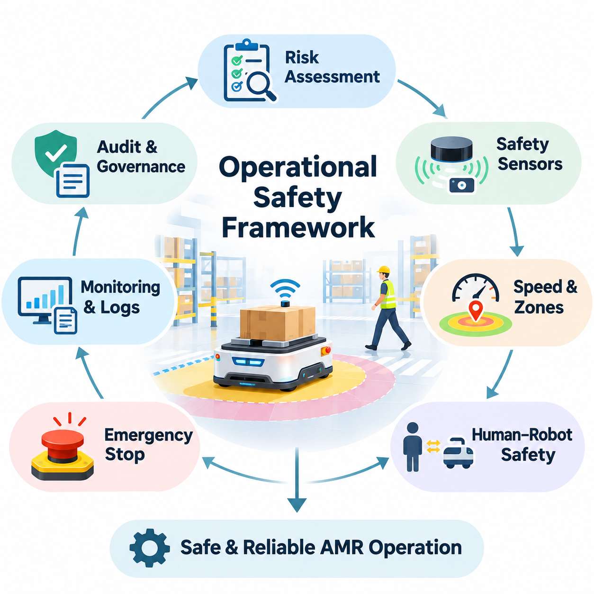
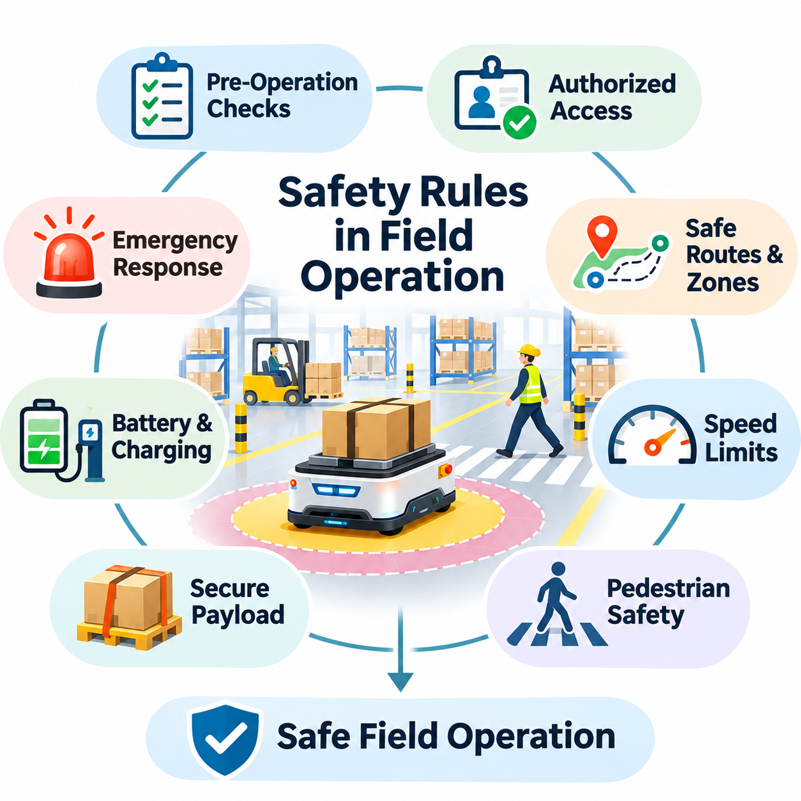
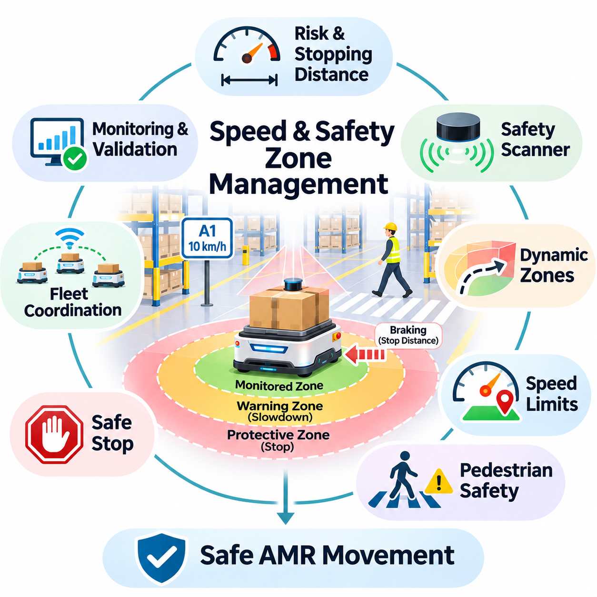
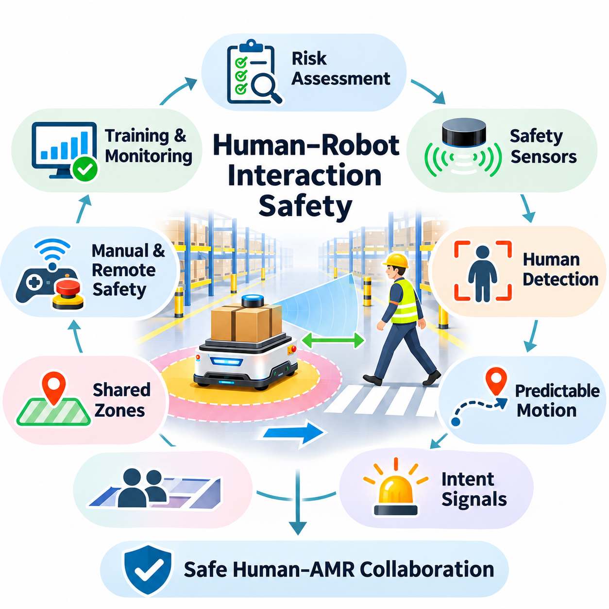
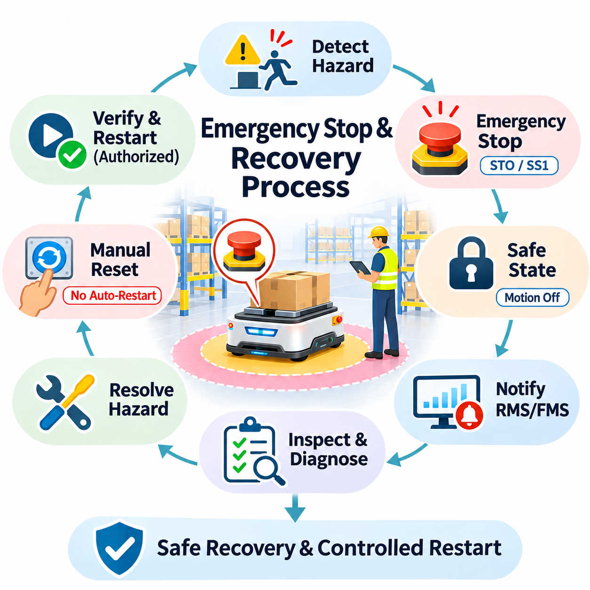
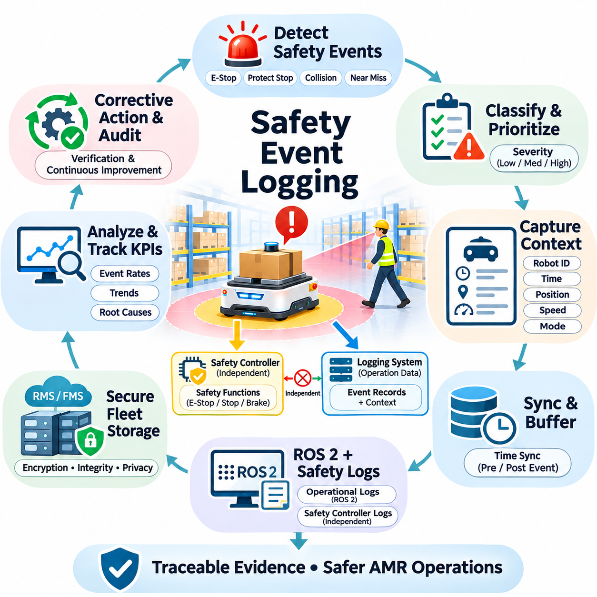
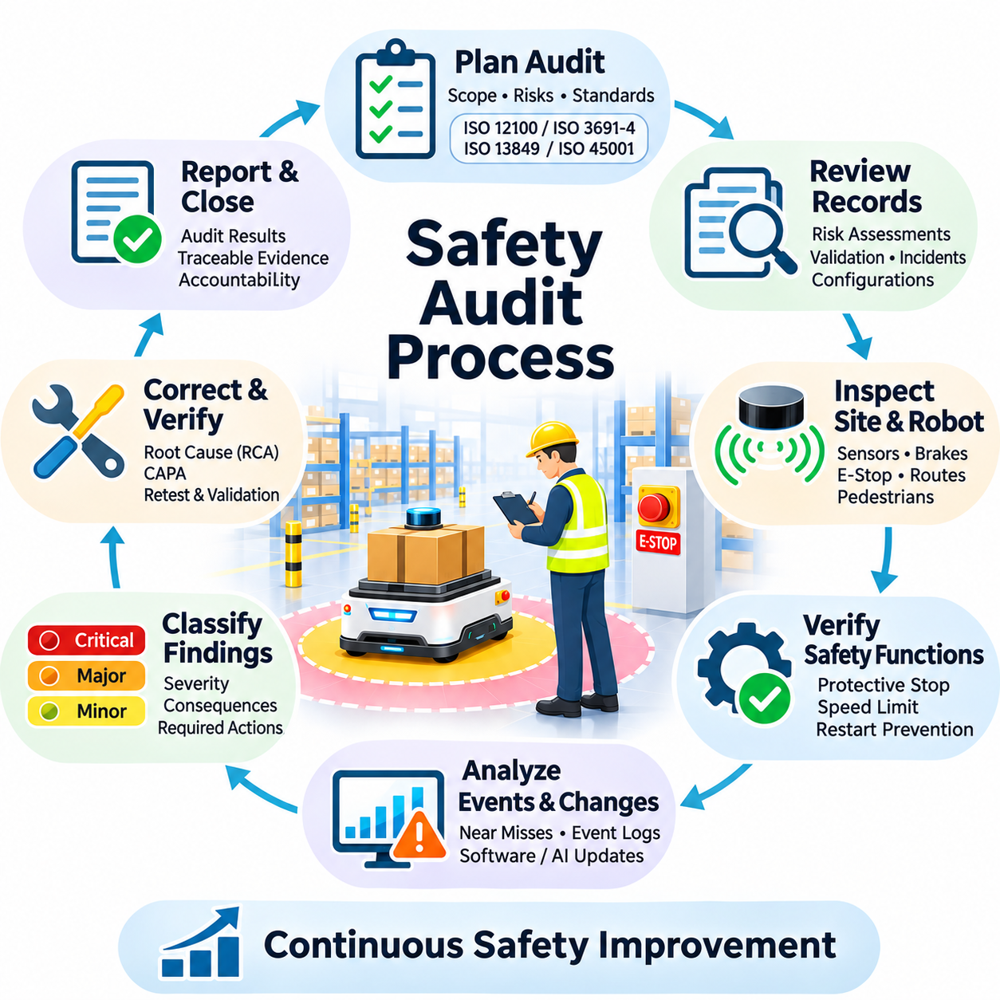
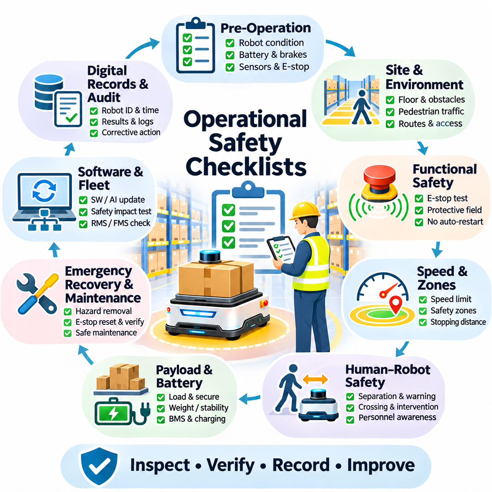

**Volume 08. AMR Operations, Deployment, and MLOps**

# Chapter 12. Operational Safety

## 12.1 Operational Safety Framework

{width="7.268055555555556in" height="7.268055555555556in"}

An operational safety framework establishes the principles, processes, responsibilities, and technical mechanisms required to ensure the safe operation of Autonomous Mobile Robots (AMRs) in real-world environments. It integrates functional safety, environmental risk management, human supervision, operational procedures, and continuous monitoring into a unified management structure. Safety must be maintained throughout the entire robot operational lifecycle.

Unlike conventional industrial automation systems operating within physically separated workspaces, AMRs frequently share dynamic environments with humans, vehicles, equipment, and other autonomous systems. Environmental conditions and operational requirements may change continuously. Consequently, operational safety must address both predictable hazards and unexpected situations arising from interactions between robots and their surroundings.

The foundation of an operational safety framework is systematic hazard identification and risk assessment. Potential hazards include collisions, crushing, unintended movement, localization failures, uncontrolled acceleration, electrical faults, communication interruptions, and payload instability. Each hazard must be evaluated according to its potential severity, probability of occurrence, exposure conditions, and possibility of avoidance.

Operational safety requirements must be established during deployment planning and maintained throughout field operation. International standards such as ISO 12100, ISO 3691-4, ISO 13849, and IEC 61508 may provide relevant engineering and risk management principles, depending on the application and system classification. Applicable regional regulations, workplace safety requirements, and customer-specific operational constraints must also be considered.

A comprehensive safety framework adopts a layered protection architecture in which mechanical, electrical, software, and operational safeguards complement one another. Mechanical protection reduces physical hazards through appropriate structural design. Electrical safety circuits provide safety-related stopping functions, while software-based supervision monitors robot behavior and operational boundaries. Administrative controls address remaining operational risks.

An essential architectural principle is the separation of safety-critical functions from general autonomous intelligence. Safety-rated controllers, protective sensing devices, emergency stop circuits, and drive inhibition mechanisms must provide dependable protection regardless of failures in navigation software, AI inference engines, or cloud services. AI-based perception can enhance situational awareness but cannot automatically substitute for validated safety functions.

The operational design domain defines the environmental and functional conditions under which an AMR is authorized to operate. These conditions may include permitted geographic areas, maximum travel speeds, floor characteristics, slope limitations, payload capacity, environmental visibility, and pedestrian density. When required operating conditions cannot be maintained, the robot must transition to an appropriate predefined safe state.

Site-specific safety rules translate engineering requirements into practical field operation procedures. Restricted areas, pedestrian crossings, charging stations, loading locations, emergency exits, and shared traffic corridors must be clearly identified. Operators and facility personnel must understand robot movement characteristics, warning signals, intervention procedures, and the limitations of autonomous navigation within their working environment.

Speed and safety zone management provide dynamic protection against collisions and hazardous proximity. Protective fields and permitted speeds must reflect validated stopping distances, payload mass, braking performance, sensor coverage, and environmental conditions. Warning zones may support preventive deceleration, while protective zones trigger safety-related stopping functions when hazardous intrusion is detected.

Human--robot interaction safety requires consideration of both physical protection and human behavior. Robots must communicate their operational intentions through appropriate visual indicators, audible warnings, displays, or predictable movement patterns. Particular attention must be given to blind intersections, crowded corridors, vulnerable individuals, unexpected pedestrian movements, and situations involving simultaneous human and robot activities.

Emergency stop and recovery mechanisms provide controlled responses when hazardous conditions arise. Emergency stop devices must be accessible and implemented according to applicable safety requirements. Recovery procedures must include hazard clearance, system diagnostics, authorized reset, and verification of safe operating conditions. Resetting an emergency stop must not automatically initiate hazardous robot movement.

Robot Management Systems (RMS) and Fleet Management Systems (FMS) extend operational safety supervision across distributed robot fleets. Centralized monitoring can identify abnormal behavior, restricted-zone violations, repeated protective stops, and emerging traffic conflicts. However, essential onboard safety functions must remain effective independently of network availability, centralized servers, and remote monitoring infrastructure.

Safety event logging establishes the evidence required for incident investigation, operational analysis, and continuous improvement. Emergency stops, protective field intrusions, near misses, excessive speed events, safety controller faults, and unauthorized interventions should be recorded with synchronized timestamps and relevant contextual information. Historical records help engineers identify recurring hazards and evaluate corrective measures.

Operational safety governance defines accountability across robot manufacturers, system integrators, facility managers, operators, and maintenance personnel. Periodic safety audits, inspection checklists, competency assessments, preventive maintenance, and controlled software updates ensure that approved safety conditions remain valid. Safety performance indicators should support continuous improvement without discouraging incident or near-miss reporting.

Ultimately, the operational safety framework transforms safety from an isolated engineering function into a continuous operational management discipline. It connects field safety rules, speed management, human--robot interaction, emergency recovery, event logging, safety auditing, and operational checklists. This framework provides a foundation for reliable, scalable, and sustainable AMR deployment across industrial and public environments.

## 12.2 Safety Rules in Field Operation

{width="7.268055555555556in" height="7.268055555555556in"}

Safety rules in field operation establish the practical requirements and behavioral guidelines necessary to maintain the safe operation of Autonomous Mobile Robots (AMRs) in real-world environments. These rules translate system-level safety requirements into daily operational practices and define how robots, operators, maintenance personnel, and facility managers interact within shared working environments throughout the operational lifecycle.

Field safety rules must be developed according to the characteristics of each deployment environment. Manufacturing facilities, warehouses, hospitals, commercial buildings, and outdoor environments present different operational hazards and human interaction patterns. Site-specific safety rules should consider workspace geometry, pedestrian density, vehicle traffic, environmental conditions, payload characteristics, and existing operational procedures.

Before initiating daily robot operations, authorized personnel should perform pre-operation safety inspections. These inspections include checking protective sensors, emergency stop devices, braking systems, battery conditions, mechanical structures, and warning indicators according to approved procedures. Robots exhibiting unresolved safety-related faults, physical damage, or abnormal behavior must not be released into autonomous operation.

Access control is an important element of field safety management. Only trained and authorized personnel should be permitted to configure robots, modify operational parameters, initiate maintenance modes, or perform manual control. Role-based access control within Robot Management Systems (RMS) and Fleet Management Systems (FMS) helps prevent unauthorized interventions that could compromise established safety conditions.

Operational areas must be clearly defined to distinguish authorized robot routes, pedestrian walkways, restricted zones, loading stations, and charging locations. Physical markings, warning signs, digital maps, and virtual boundaries can support consistent spatial management. Robots must operate within approved boundaries, and access to hazardous or unsuitable areas must be prevented through appropriate technical and administrative safeguards.

Travel speed must be regulated according to the operational environment and associated risk levels. Robots operating near pedestrians, blind intersections, narrow corridors, or loading stations may require reduced speed limits. Maximum permitted speeds must remain consistent with validated braking performance, protective sensor coverage, payload conditions, and available stopping distances under foreseeable operating conditions.

Human personnel must understand appropriate behavior when working near autonomous robots. Operators and pedestrians should avoid obstructing robot routes, intentionally entering protective fields, standing between moving robots and fixed structures, or attempting to physically stop an autonomous platform. Robot warning signals, directional indicators, and designated pedestrian priority rules must be respected throughout shared environments.

Payload handling introduces additional safety requirements during field operation. Transported materials must remain within approved weight, dimensional, and center-of-gravity limits. Loads must be secured against displacement during acceleration, braking, turning, and traversing uneven surfaces. Operators must verify that loading, unloading, towing, and coupling activities are completed safely before authorizing autonomous movement.

Charging and battery management procedures must address electrical, thermal, and fire-related hazards. Charging stations should remain accessible, free from unauthorized materials, and compatible with the robot\'s electrical specifications. Abnormal battery temperatures, damaged connectors, electrical leakage, or suspected battery deterioration must trigger appropriate protective actions in accordance with established site procedures.

Manual intervention and remote control require additional operational safeguards because autonomous behavior may be partially or completely suspended. Authorized personnel must verify environmental conditions, maintain appropriate situational awareness, and comply with approved manual operating limits. Safety-critical protection mechanisms must remain effective, and unauthorized bypassing of protective devices must be prohibited.

Emergency situations require clearly defined response procedures that prioritize human safety over equipment protection and operational productivity. Personnel must understand the location and intended use of emergency stop devices, emergency communication channels, and evacuation routes. Following a hazardous event, robot operation must remain suspended until the conditions necessary for safe recovery have been verified.

Environmental changes must be continuously evaluated because previously validated operating conditions may become unsuitable over time. Temporary construction, relocated equipment, damaged flooring, liquid spills, reduced visibility, and unexpected pedestrian congestion can introduce new hazards. Significant changes must trigger appropriate risk reassessment, operational restrictions, or suspension of affected robot activities.

Safety rules must also address software updates, configuration modifications, and AI model deployment. Changes affecting navigation behavior, speed limits, protective fields, perception capabilities, or control functions must undergo appropriate verification and approval before entering production operation. Unauthorized modifications to safety-related parameters must be prevented through access management, version control, and configuration auditing.

Operational safety compliance requires continuous monitoring, structured event reporting, and periodic review. Protective stops, near misses, route violations, unsafe interventions, and safety-related equipment failures should be documented and investigated. Safety training, competency assessments, corrective actions, and regular communication help establish an organizational culture in which hazard reporting is encouraged and operational risks are systematically reduced.

Ultimately, field operation safety rules provide the practical foundation for maintaining safe, predictable, and reliable autonomous robot operations. Their effectiveness depends on the integration of validated technical safeguards, clearly defined responsibilities, disciplined operational procedures, and continuous organizational improvement. Operational productivity must always remain subordinate to human safety and established risk acceptance criteria.

## 12.3 Speed and Safety Zone Management

{width="7.268055555555556in" height="7.268055555555556in"}

Speed and safety zone management represents a fundamental component of operational safety for Autonomous Mobile Robots (AMRs). Its primary objective is to regulate robot movement according to environmental conditions, surrounding objects, human presence, and potential collision risks. By integrating speed control with spatial protection mechanisms, AMRs can maintain safe operating conditions while supporting efficient autonomous transportation.

Unlike conventional automated transportation systems operating along fixed and physically separated routes, AMRs frequently navigate dynamic and shared environments. Pedestrians, forklifts, industrial equipment, and other mobile robots may enter or leave operational areas unexpectedly. Consequently, speed management must respond to changing environmental conditions rather than relying exclusively on predetermined velocity limitations.

The maximum permissible speed of an AMR must be determined through systematic risk assessment and engineering validation. Relevant factors include robot mass, payload characteristics, braking capability, wheel traction, surface conditions, sensor detection range, and control system response time. Higher travel speeds generally increase stopping distances and collision energy, requiring more extensive protective measures and operating restrictions.

Stopping distance is a critical engineering parameter in speed and safety zone management. Total stopping distance includes the distance traveled during sensor detection, signal processing, safety controller response, actuator response, and mechanical deceleration. Protective field dimensions must account for these delays, braking performance under foreseeable adverse conditions, measurement uncertainty, and appropriate safety margins.

Safety zone architecture typically consists of multiple spatial regions surrounding the robot. Warning zones provide early detection of approaching obstacles and support preventive speed reduction, while protective zones initiate validated safety-related stopping functions when hazardous intrusion occurs. Additional monitoring regions may support navigation planning, object tracking, and environmental awareness without performing safety-rated protection.

Dynamic safety field selection enables robots to adjust protective field dimensions according to their current operating state. When an AMR travels at higher speeds, larger protective fields may be required to accommodate increased stopping distances. During low-speed maneuvering, docking, or controlled turning, alternative validated field configurations may be selected to maintain appropriate protection and operational accessibility.

Safety-rated laser scanners are commonly employed to establish protective fields around industrial AMRs. These devices continuously monitor configured spatial regions and communicate safety-related detection signals to dedicated safety controllers. Scanner positioning, angular coverage, detection capability, mounting height, and potential blind spots must be evaluated to ensure that hazardous approaches can be detected within the intended operating conditions.

Modern AMRs may integrate cameras, depth sensors, radar, ultrasonic sensors, and AI-based perception to enhance environmental awareness and proactive speed adaptation. These technologies can support pedestrian recognition, trajectory prediction, and obstacle avoidance. However, conventional perception sensors and AI algorithms must not replace required safety-rated protective functions unless appropriately developed and validated for that safety purpose.

Location-dependent speed management allows different velocity limits to be assigned to specific operational areas. Open transportation corridors may permit higher speeds, while pedestrian crossings, hospital corridors, blind intersections, elevator entrances, and loading stations may require reduced speeds. Digital maps, virtual boundaries, and localization systems can support the enforcement of approved area-specific operating policies.

Localization uncertainty introduces additional risks when speed restrictions depend on the estimated position of the robot. Localization drift, inaccurate map registration, or unexpected environmental changes may cause incorrect identification of operational zones. When reliable zone identification cannot be maintained, the robot must adopt an appropriately conservative operating state, including speed reduction or a safe stop when required.

Directional safety zone management considers the movement characteristics of different AMR drive architectures. Differential drive, steer drive, omnidirectional drive, and towing platforms generate different movement envelopes during acceleration, reversing, rotation, and lateral motion. Protective field configurations must account for the complete swept volume of the robot, its payload, and any attached transportation equipment.

Fleet-level speed coordination helps reduce operational conflicts in environments containing multiple autonomous robots. Fleet Management Systems (FMS) can implement traffic priorities, intersection reservations, congestion control, and location-dependent speed policies. Nevertheless, onboard safety mechanisms must remain capable of enforcing required protective responses independently of fleet communication and centralized coordination.

Safety-related speed monitoring provides protection against unintended acceleration and excessive travel velocity. Safety controllers may implement functions such as Safely Limited Speed (SLS), Safe Speed Monitor (SSM), and Safe Stop 1 (SS1), depending on system requirements. These functions must be selected, integrated, and validated according to the required safety performance and applicable engineering standards.

Operational monitoring must continuously evaluate the effectiveness of speed restrictions and protective field configurations. Excessive speed events, repeated protective stops, unexpected field switching, braking anomalies, and near misses should be recorded with relevant environmental and robot status information. Such records support safety audits, root cause analysis, preventive maintenance, and controlled configuration improvements.

Ultimately, effective speed and safety zone management requires integration between risk assessment, vehicle dynamics, safety-rated sensing, autonomous navigation, and fleet operation. Validated speed limits and protective fields must remain effective throughout changing operational conditions and system configurations. Operational efficiency should be optimized only within approved safety boundaries, ensuring that human protection remains the highest priority.

## 12.4 Human-Robot Interaction Safety

{width="7.268055555555556in" height="7.268055555555556in"}

Human--robot interaction safety is a critical component of operational safety for Autonomous Mobile Robots (AMRs) operating in environments shared with humans. Its primary objective is to prevent physical injuries, hazardous interactions, and unexpected robot behavior while maintaining efficient collaboration between humans and autonomous systems. Effective safety management requires the integration of engineering safeguards, behavioral design, and operational procedures.

Unlike traditional industrial robots operating within physically isolated workspaces, AMRs frequently interact with workers, pedestrians, patients, customers, and maintenance personnel. Human behavior is inherently dynamic and may involve unpredictable movements, unexpected interruptions, or inappropriate interventions. Therefore, autonomous robots must be designed to operate safely under foreseeable human behavior and changing environmental conditions.

Human--robot interaction risk assessment must consider the various situations in which humans and robots occupy shared physical spaces. Potential hazards include direct collisions, crushing between robots and fixed structures, entanglement, foot injuries, unexpected acceleration, and contact with transported payloads. Risk assessments must evaluate robot movement characteristics, human exposure, injury severity, and the possibility of avoiding hazardous situations.

A fundamental principle of human--robot interaction safety is maintaining appropriate physical separation whenever required by the identified risks. Safety-rated protective sensors and dedicated safety controllers can establish monitored protection fields around the robot. When a person enters a protective field, the robot must execute the validated safety response, such as controlled deceleration or protective stopping, according to its safety architecture.

Human detection and tracking technologies enhance the ability of autonomous robots to recognize surrounding human activities. RGB cameras, depth sensors, LiDAR, radar, and AI-based perception can identify pedestrians and estimate their movement trajectories. However, conventional AI-based human recognition must supplement rather than replace required safety-rated protection unless the technology has been appropriately developed and validated for safety-related applications.

Predictable robot behavior is essential for establishing safe and understandable interactions with humans. Sudden acceleration, unexpected directional changes, aggressive obstacle avoidance, and inconsistent stopping behavior may create hazardous situations. Motion planning algorithms should generate smooth trajectories, appropriate acceleration profiles, and understandable movement patterns within the boundaries established by validated safety functions.

Robot intention communication allows surrounding individuals to understand the current operational state and anticipated behavior of an AMR. Visual indicators, directional lights, audible signals, display interfaces, and projected movement indicators can communicate approaching movement, turning intentions, stopping conditions, or operational faults. Communication mechanisms must remain understandable, consistent, and appropriate for the surrounding environmental conditions.

Human-aware navigation incorporates human presence, movement patterns, and social behavior into autonomous path planning. Robots should maintain appropriate interpersonal distances, avoid unnecessary approaches, and reduce potentially uncomfortable or hazardous interactions. In hospitals, commercial facilities, and public environments, navigation strategies must also consider vulnerable individuals, including children, elderly people, and persons with disabilities.

Shared workspace management establishes operational boundaries and interaction rules for humans and autonomous robots. Dedicated robot corridors, pedestrian walkways, designated crossing points, restricted zones, and controlled loading stations can reduce unnecessary exposure to hazards. Where physical separation is impractical, validated speed restrictions, protective sensing, warning systems, and clearly defined traffic priorities become increasingly important.

Special attention must be given to interaction scenarios involving blind intersections, doorways, elevators, narrow passages, and congested operational areas. Limited visibility and restricted movement space can significantly reduce the time available for humans and robots to respond to unexpected encounters. Site-specific risk controls should incorporate conservative movement policies, appropriate sensing coverage, and verified protective stopping capabilities.

Manual intervention introduces additional safety considerations because personnel may approach robots experiencing operational faults, navigation failures, or interrupted missions. Before physical interaction, the robot must be placed in an appropriate safe operational state. Maintenance and recovery activities must follow approved procedures, prevent unexpected movement, and apply hazardous energy isolation whenever required by the identified risks.

Human--robot interaction safety also depends on effective operator training and organizational awareness. Personnel must understand robot capabilities, operational limitations, warning signals, emergency stop mechanisms, and prohibited behaviors. Training should address normal operations and abnormal situations, including blocked routes, unexpected robot stops, unstable payloads, and safe methods for requesting assistance or reporting hazardous conditions.

Remote operation and human-in-the-loop supervision require additional measures to maintain situational awareness and prevent unsafe commands. Communication latency, restricted camera visibility, incomplete sensor information, and network interruptions may affect remote decision-making. Onboard safety functions must remain effective independently of remote commands, while communication failures must trigger appropriate predefined responses based on the operational risk assessment.

Continuous monitoring of human--robot interactions supports the identification of emerging operational hazards and behavioral problems. Near misses, repeated protective stops, unsafe pedestrian approaches, unexpected human interventions, and abnormal robot movements should be recorded and analyzed. The resulting operational evidence supports safety audits, corrective actions, navigation improvements, personnel training, and controlled updates to safety-related configurations.

Ultimately, human--robot interaction safety requires a coordinated approach combining functional safety, human-aware perception, predictable navigation, effective communication, workspace management, and organizational governance. As autonomous robots become increasingly intelligent and interconnected, interaction complexity will continue to increase. Operational efficiency and autonomous capabilities must therefore be developed within validated safety boundaries that consistently prioritize human protection.

## 12.5 Emergency Stop and Recovery Process

{width="7.268055555555556in" height="7.268055555555556in"}

Emergency stop and recovery processes are essential components of operational safety for Autonomous Mobile Robots (AMRs). Their primary objective is to prevent or limit hazardous situations by terminating dangerous robot movements and establishing controlled procedures for restoring normal operation. These processes must integrate functional safety, hardware protection, software supervision, human intervention, and operational governance.

An emergency stop is a complementary protective measure intended to address an actual or impending emergency. It must be distinguished from normal operational stopping, obstacle avoidance, and automatic protective stopping. While routine stopping mechanisms support autonomous navigation and mission execution, emergency stop functions take priority over other operational commands and must remain effective across applicable operating modes.

Emergency stop devices must be positioned to ensure accessibility and clear identification under foreseeable operating conditions. Industrial AMRs commonly incorporate manually activated emergency stop buttons at accessible locations on the robot chassis. Additional emergency stop stations may be installed within operational areas where justified by risk assessment. Their placement must consider robot dimensions, payloads, and human accessibility.

The emergency stop architecture typically integrates safety-rated input devices, dedicated safety controllers, motor drive safety functions, and braking mechanisms. When an emergency stop is activated, the safety system must initiate an appropriate stopping sequence independently of conventional navigation software and AI inference processes. The required safety performance must be established through systematic risk assessment and engineering validation.

Emergency stopping behavior must consider robot dynamics and the potential hazards associated with sudden deceleration. Immediate removal of drive power may not always provide the safest stopping response, particularly for heavy-payload, high-speed, or towing platforms. Depending on the application, controlled deceleration followed by removal of motor torque may be necessary to prevent instability, payload displacement, or secondary collisions.

Safety-related drive functions such as Safe Torque Off (STO) and Safe Stop 1 (SS1) can support emergency stop implementation. STO prevents the drive from generating motor torque but does not necessarily provide mechanical braking or electrical isolation. SS1 initiates a controlled stopping sequence before activating STO. Appropriate braking and holding mechanisms must be incorporated wherever residual movement or gravitational forces present additional hazards.

After emergency stop activation, the robot must enter and maintain an appropriate safe state. Hazardous motion commands must be inhibited, and autonomous mission execution must remain suspended. The emergency stop condition must remain active until an intentional reset is performed. Communication recovery, software restart, restored electrical power, or newly received mission commands must not independently initiate hazardous robot movement.

Emergency stop events should be communicated to Robot Management Systems (RMS) and Fleet Management Systems (FMS) for centralized operational supervision. Relevant information may include robot identification, geographic position, activation time, mission status, and safety controller state. Fleet management systems can suspend affected missions and coordinate surrounding robots while onboard safety mechanisms maintain independent protection.

The recovery process begins with identifying the circumstances that triggered the emergency stop and confirming that immediate hazards have been addressed. Authorized personnel must evaluate the surrounding environment, human presence, payload stability, mechanical integrity, and potential equipment damage. When emergency conditions remain unresolved, the robot must stay in its safe state until appropriate corrective actions have been completed.

System diagnostics support the identification of underlying technical faults before operational recovery. Diagnostic procedures may evaluate safety sensors, motor controllers, braking systems, battery conditions, localization accuracy, communication interfaces, and software processes. Safety-related faults must be investigated and resolved rather than simply cleared through system rebooting or repeated emergency stop resets.

Emergency stop reset and operational restart must be treated as separate actions. Resetting an emergency stop device acknowledges the release of the emergency stop condition but must not directly initiate robot movement. Restart authorization should require confirmation of safe operating conditions, availability of required safety functions, and compliance with approved recovery procedures. Any subsequent movement must follow a separate authorized command.

Maintenance-related recovery may require additional protective measures, particularly when personnel must physically interact with damaged or immobilized robots. Emergency stopping alone does not guarantee the isolation of hazardous energy sources. Appropriate lockout and tagout procedures, electrical isolation, stored energy management, and mechanical securing must be applied whenever required by the maintenance risk assessment.

Following recovery authorization, the robot should undergo appropriate operational verification before returning to unrestricted autonomous service. Depending on the incident, verification may include localization confirmation, protective sensor checks, braking tests, controlled low-speed movement, and mission state reconciliation. Interrupted tasks must be evaluated to prevent duplicate operations, unexpected payload handling, or conflicts with surrounding robots.

Emergency stop events and recovery activities must be documented through structured safety event logging. Recorded information should include synchronized timestamps, activation sources, robot velocity, environmental conditions, diagnostic results, corrective actions, and restart authorization. Such records support incident investigation, root cause analysis, safety audits, preventive maintenance, and continuous improvement of operational procedures.

Ultimately, emergency stop and recovery processes must function as an integrated operational safety mechanism rather than an isolated hardware function. Their effectiveness depends on validated stopping capabilities, independent safety architecture, controlled recovery procedures, trained personnel, and traceable operational records. Restoring productivity must never take priority over confirming that the conditions required for safe operation have been reestablished.

## 12.6 Safety Event Logging

{width="7.268055555555556in" height="7.268055555555556in"}

Safety event logging is a fundamental component of operational safety management for Autonomous Mobile Robots (AMRs). Its primary objective is to capture, preserve, and analyze safety-related events occurring throughout autonomous robot operation. By maintaining reliable and traceable operational records, organizations can investigate incidents, identify emerging hazards, verify safety performance, and support continuous improvements in operational safety.

Safety events encompass a broad range of operational conditions that may directly or indirectly affect human safety, equipment integrity, or environmental protection. Typical examples include emergency stop activation, protective field intrusion, excessive travel speed, unexpected robot movement, collision detection, safety sensor failures, and braking system abnormalities. Near misses and potentially hazardous human--robot interactions should also be recorded.

A structured safety event classification framework enables consistent identification, categorization, and prioritization of safety-related occurrences. Events may be classified according to hazard type, severity, operational consequences, activation source, and required response. Distinguishing informational warnings from critical safety violations allows operators and engineering teams to allocate appropriate investigative resources and initiate timely corrective actions.

Safety event records must contain sufficient contextual information to support accurate reconstruction of operational conditions. Essential information includes robot identification, event timestamps, estimated position, travel velocity, movement direction, mission status, operating mode, and safety controller state. Additional information concerning payload conditions, environmental characteristics, and surrounding obstacles can improve the reliability of subsequent investigations.

Time synchronization is particularly important when safety events originate from multiple hardware and software components. Safety controllers, motor drives, perception systems, navigation modules, and fleet management servers may generate independent event records. Consistent timestamps, synchronized system clocks, and documented timing uncertainties enable investigators to reconstruct event sequences and identify causal relationships between operational abnormalities.

Safety event logging should integrate information originating from safety-rated hardware and conventional autonomous software without compromising the independence of safety functions. Safety controller signals provide authoritative information concerning protective responses, while navigation and perception logs provide additional operational context. Failures in data recording, storage, or transmission must not prevent required safety functions from operating correctly.

Event-triggered data acquisition enables detailed investigation without continuously storing all available sensor information. When a critical safety event occurs, the logging system can preserve selected data from periods immediately preceding and following the incident. Circular buffers containing sensor measurements, control commands, robot trajectories, and diagnostic messages provide valuable evidence for reconstructing potentially hazardous situations.

Robot Operating System 2 (ROS 2) provides mechanisms for collecting operational data through topic recording, diagnostic messages, and rosbag2 storage. These mechanisms can preserve navigation trajectories, velocity commands, perception outputs, and system status information. However, conventional ROS 2 logging mechanisms should be complemented by independent safety controller records when authoritative safety-related evidence is required.

Centralized safety event management enables organizations to monitor safety performance across distributed robotic fleets. Robot Management Systems (RMS) and Fleet Management Systems (FMS) can aggregate event records, identify recurring operational abnormalities, and communicate alerts to responsible personnel. Local buffering and reliable synchronization mechanisms should preserve critical records during network interruptions or temporary server unavailability.

Data integrity and cybersecurity are essential requirements for reliable safety event logging. Unauthorized modifications, accidental deletion, timestamp manipulation, and corrupted records can undermine incident investigations and safety audits. Access control, encryption, cryptographic integrity verification, append-only storage, and controlled data retention policies can help preserve the authenticity and reliability of safety-related evidence.

Safety event analysis transforms accumulated operational records into actionable engineering knowledge. Statistical analysis can identify recurring protective stops, hazardous intersections, excessive speed events, and locations associated with frequent human--robot conflicts. Correlation with environmental conditions, software versions, robot configurations, and maintenance histories helps engineering teams identify underlying technical and operational causes.

Safety-related Key Performance Indicators (KPIs) provide quantitative measures for evaluating operational safety performance. Relevant indicators include emergency stop frequency, protective stop frequency, near-miss rates, collision rates, and average recovery time. These indicators should be normalized against operating hours, travel distance, or completed missions and interpreted carefully, since frequent protective stops may indicate effective hazard detection rather than safety system failure.

Safety event records also provide essential evidence for incident investigation, root cause analysis, and corrective and preventive actions. Investigation results should be linked to original event records, identified hazards, engineering modifications, and verification outcomes. Maintaining traceability between observed safety problems and implemented corrective measures helps organizations evaluate whether interventions effectively reduce operational risks.

Safety event logging governance must define responsibilities for event collection, record access, incident escalation, data retention, and periodic safety review. Privacy protection is particularly important when recorded information includes images, video sequences, or data associated with identifiable individuals. Retention periods and access permissions must reflect applicable legal requirements, organizational policies, and legitimate safety investigation needs.

Ultimately, safety event logging establishes the informational foundation for evidence-based operational safety management throughout the AMR lifecycle. Integrating reliable event acquisition, synchronized records, secure storage, incident analysis, and corrective action management enables organizations to transform operational experience into systematic safety improvements. Specific logging requirements must be validated against application-specific risks and regulatory obligations.

## 12.7 Safety Audit Process

{width="7.268055555555556in" height="7.268055555555556in"}

The safety audit process is a systematic mechanism for evaluating the effectiveness, reliability, and compliance of operational safety practices associated with Autonomous Mobile Robots (AMRs). Its primary objective is to identify safety deficiencies, verify the implementation of protective measures, and ensure that robotic systems continue to operate within approved safety boundaries throughout their operational lifecycle.

Unlike initial safety validation conducted before deployment, operational safety audits examine the actual performance of robotic systems under real-world operating conditions. Changes in environmental characteristics, equipment configurations, software versions, and human behavior may introduce previously unidentified hazards. Periodic audits help organizations determine whether existing safety measures remain appropriate and effective.

Safety audit planning establishes the objectives, scope, evaluation criteria, responsibilities, and schedule of the audit process. The audit scope should encompass robot hardware, safety control systems, autonomous navigation software, operational environments, fleet management infrastructure, and personnel activities. Audit frequency should reflect operational risks, system complexity, incident history, and applicable regulatory requirements.

The safety audit framework should incorporate relevant engineering standards and organizational safety policies. Standards such as ISO 12100, ISO 3691-4, ISO 13849, and ISO 45001 provide relevant principles for machinery risk assessment, driverless industrial truck safety, safety-related control systems, and occupational safety management. Their applicability must be determined according to the robot classification and operational environment.

Documentation review represents an essential component of the safety audit process. Auditors should examine risk assessment reports, safety requirements, functional safety specifications, validation records, operational procedures, maintenance histories, and incident reports. Configuration records must also be reviewed to determine whether deployed hardware, software, and safety parameters correspond to approved system configurations.

Physical inspection enables auditors to evaluate the actual condition of robotic equipment and its surrounding operational environment. Inspection activities may include examining emergency stop devices, safety laser scanners, braking mechanisms, warning indicators, protective structures, and payload securing mechanisms. Particular attention should be given to physical damage, unauthorized modifications, sensor obstruction, and mechanical deterioration.

Functional safety verification evaluates whether safety-related functions continue to operate according to their validated requirements. Representative tests may include emergency stop activation, protective field intrusion, excessive speed detection, communication failure responses, and restart prevention. Testing must be performed under controlled conditions to avoid introducing additional hazards to personnel or surrounding equipment.

Operational environment assessment examines whether the physical characteristics of the deployment site remain consistent with approved safety assumptions. Changes in pedestrian traffic, corridor layouts, storage arrangements, floor conditions, lighting, and equipment placement may affect navigation and protective sensing performance. Auditors should verify that environmental modifications have undergone appropriate risk assessment.

Human--robot interaction assessment evaluates the effectiveness of operational procedures intended to protect personnel working around autonomous robots. Auditors should observe pedestrian behavior, manual interventions, loading activities, maintenance procedures, and responses to robot warnings. Personnel interviews can help determine whether operational safety rules and emergency response procedures are understood and consistently followed.

Safety event records provide valuable evidence for evaluating operational safety performance. Emergency stop events, protective stops, near misses, collisions, and safety-related equipment failures should be examined to identify recurring patterns and unresolved hazards. Auditors should also verify whether reported incidents have been investigated and whether appropriate corrective actions have been implemented and validated.

Software and configuration management audits are particularly important for AMRs that undergo continuous software development and AI model updates. Changes to navigation algorithms, perception models, velocity limits, and protective field configurations may affect operational safety. Auditors must verify that safety-related modifications have undergone appropriate impact assessment, approval, testing, and controlled deployment.

Audit findings should be classified according to their severity, potential consequences, and required corrective actions. Critical findings associated with unacceptable safety risks may require immediate operational restrictions or system shutdown. Less severe deficiencies should be addressed through documented improvement plans, clearly assigned responsibilities, completion deadlines, and appropriate verification procedures.

Corrective and preventive action management establishes a structured process for resolving identified safety deficiencies. Root cause analysis should determine the underlying technical, environmental, or organizational factors contributing to each finding. Corrective measures must address these underlying causes rather than merely eliminating observable symptoms, while preventive measures should reduce the likelihood of recurrence.

Safety audit reporting consolidates audit observations, supporting evidence, identified nonconformities, corrective action requirements, and overall evaluation results. Reports should maintain traceability between individual findings, applicable safety requirements, responsible personnel, and verification outcomes. Independent review and formal closure procedures help ensure that unresolved safety issues are not overlooked.

Ultimately, the safety audit process establishes a continuous feedback mechanism connecting operational experience, risk assessment, engineering validation, and organizational governance. Its effectiveness depends on auditor competence, objective evidence, systematic corrective actions, and management accountability. The necessary audit criteria and acceptance thresholds must be established and validated for each specific AMR deployment.

## 12.8 Operational Safety Checklists

{width="7.268055555555556in" height="7.268055555555556in"}

Operational safety checklists provide a structured mechanism for verifying that Autonomous Mobile Robots (AMRs) satisfy essential safety requirements throughout their operational lifecycle. Their primary objective is to reduce human error, prevent overlooked hazards, and ensure consistent execution of safety-related procedures. Effective checklists translate engineering requirements and organizational safety policies into practical field activities.

The development of operational safety checklists should begin with systematic risk assessment and the identification of applicable operational requirements. Checklist items must reflect robot architecture, functional safety mechanisms, environmental characteristics, and human--robot interaction scenarios. Each verification item should establish a clearly defined inspection objective, acceptance criterion, and required response when deficiencies are identified.

Pre-operation safety checklists verify whether an AMR is ready to initiate autonomous missions. Operators should examine the physical condition of the robot, battery status, wheel assemblies, braking mechanisms, safety sensors, and emergency stop devices. The inspection should also confirm that required software components are operational and that no unresolved safety-related faults prevent the robot from entering its authorized operational state.

Environmental safety checklists evaluate the suitability of the surrounding workspace before and during autonomous operation. Relevant inspection items include floor conditions, pedestrian traffic, obstacles, corridor accessibility, restricted zones, lighting conditions, and emergency exit availability. Environmental changes that invalidate previously approved safety assumptions must trigger additional assessment before affected operations are permitted.

Functional safety checklists focus on the availability and correct operation of safety-related mechanisms. Verification activities may include emergency stop functionality, protective field detection, safety controller diagnostics, braking performance, and prevention of unintended restart. Functional testing must follow approved procedures, and any failure affecting a required safety function must prevent continued operation until appropriately resolved.

Speed and safety zone management checklists verify whether robot velocity limitations and protective field configurations remain consistent with approved safety requirements. Operators and authorized engineers should examine location-dependent speed restrictions, dynamic field selection, directional protection, and configuration integrity. Changes affecting stopping distances or protective coverage must undergo appropriate engineering validation.

Human--robot interaction safety checklists address operational conditions in which autonomous robots and humans share physical environments. Verification should consider pedestrian separation, warning indicators, designated crossing points, manual intervention procedures, and personnel awareness. Additional precautions may be required in hospitals, commercial facilities, and other environments containing vulnerable individuals or unpredictable pedestrian movements.

Payload and transportation safety checklists ensure that transported materials do not introduce unacceptable operational hazards. Inspection items should address payload weight, load distribution, center of gravity, securing mechanisms, dimensional limitations, and potential movement during acceleration or braking. Robots must not transport loads exceeding their validated operational capabilities or compromising the effectiveness of protective sensing systems.

Battery and charging safety checklists evaluate conditions associated with electrical energy storage and automated charging operations. Relevant inspection items include battery temperature, charging connector integrity, Battery Management System (BMS) diagnostics, docking alignment, and charging station accessibility. Abnormal heating, physical battery damage, or electrical faults must trigger appropriate protective responses and maintenance procedures.

Emergency stop and recovery checklists establish controlled verification procedures following emergency events. Authorized personnel must confirm that immediate hazards have been eliminated, affected equipment has been inspected, and required safety functions remain available. Emergency stop reset, restart authorization, and controlled operational verification must be treated as distinct activities before autonomous missions are resumed.

Maintenance safety checklists support safe inspection, servicing, repair, and component replacement activities. These procedures must address hazardous energy isolation, mechanical securing, appropriate protective equipment, and prevention of unintended robot movement. Following maintenance, safety-related components and modified configurations must undergo suitable verification before the robot is released for unrestricted operational service.

Software and AI model update safety checklists verify that system modifications do not compromise established safety requirements. Inspection items should include software version compatibility, safety configuration integrity, regression testing, deployment authorization, and rollback readiness. Updates affecting perception, navigation, motion control, or protective behavior require documented safety impact assessments and appropriate validation.

Fleet-level operational safety checklists extend verification activities across interconnected robotic systems. Robot Management Systems (RMS) and Fleet Management Systems (FMS) should be evaluated for communication reliability, traffic coordination, mission status consistency, and safety event reporting. Centralized management failures must not compromise the independent operation of required onboard safety functions.

Digital safety checklist management enables inspection records to be integrated with safety event logging, maintenance histories, incident reports, and operational databases. Each completed checklist should include robot identification, inspection timestamps, responsible personnel, verification results, and unresolved deficiencies. Electronic approval mechanisms and revision control support accountability, traceability, and subsequent safety audits.

Ultimately, operational safety checklists establish a practical connection between safety engineering, field operations, incident prevention, and continuous improvement. Their effectiveness depends on clearly defined acceptance criteria, trained personnel, reliable documentation, and consistent corrective actions. The checklist categories described here provide a general engineering framework that must be adapted and validated for each specific AMR deployment.
