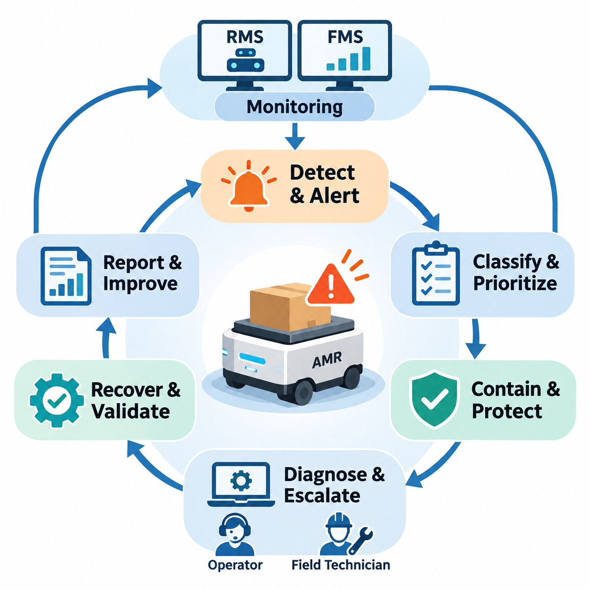
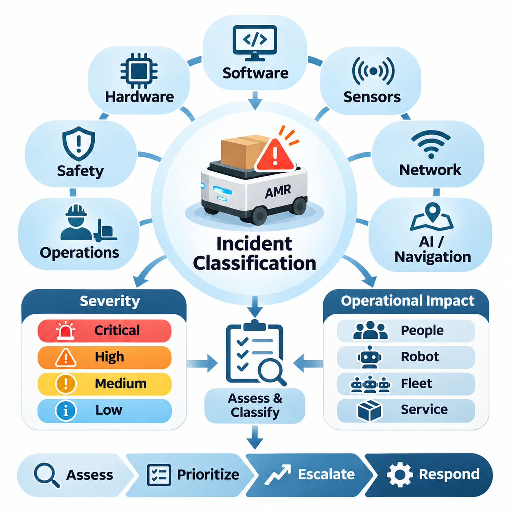
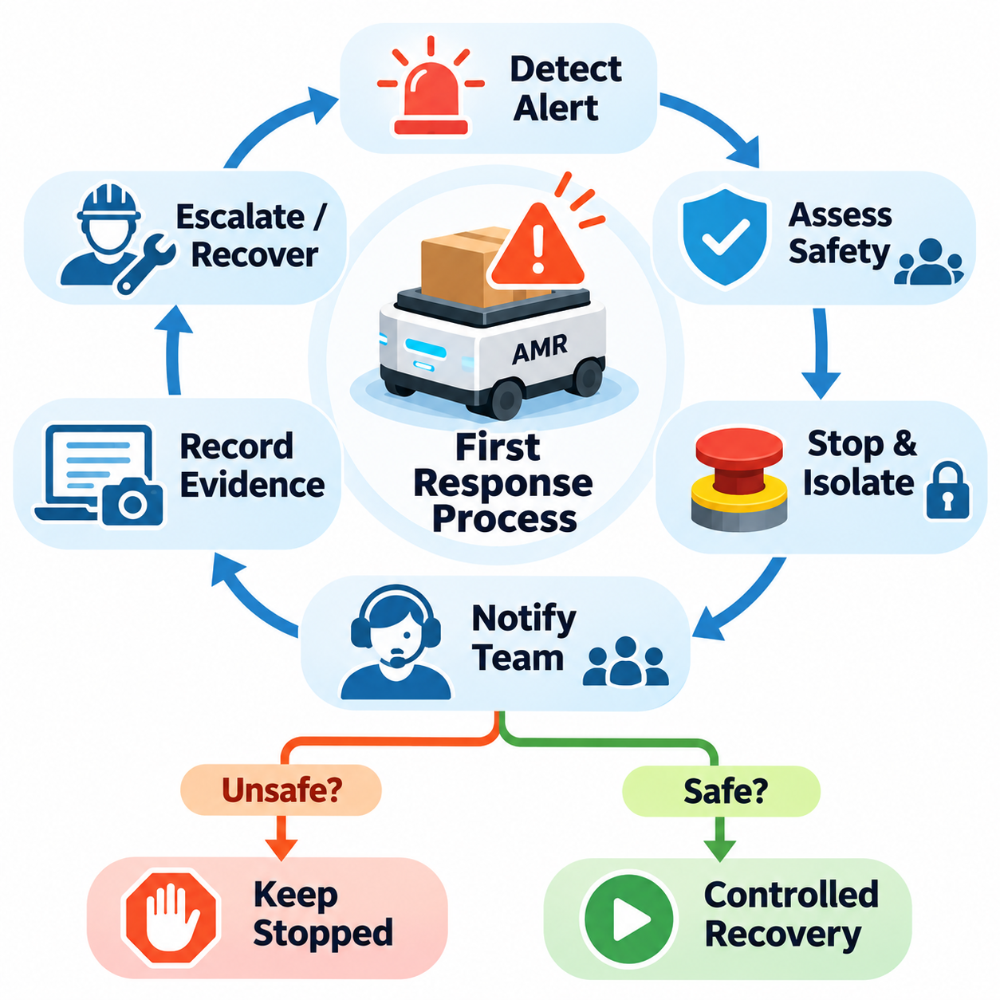
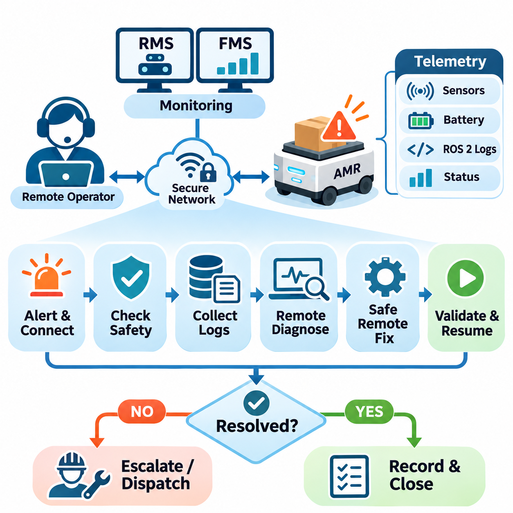
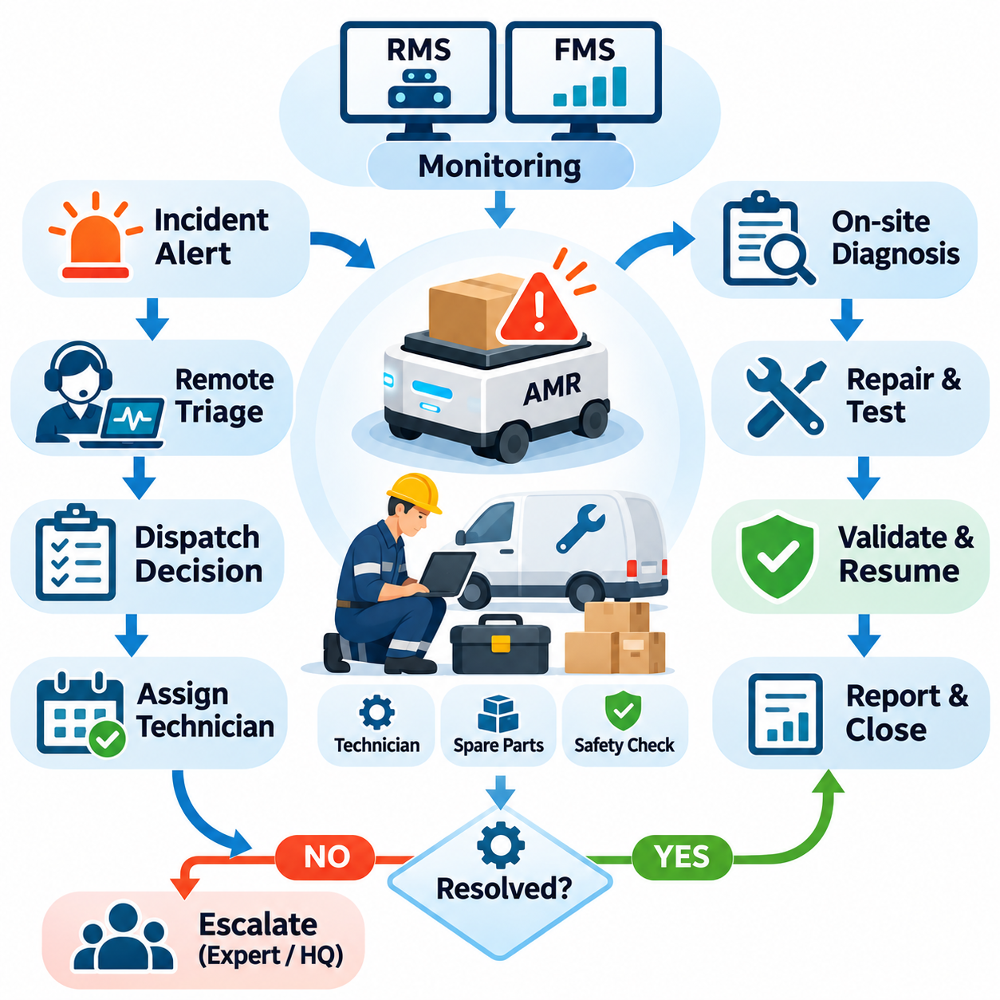
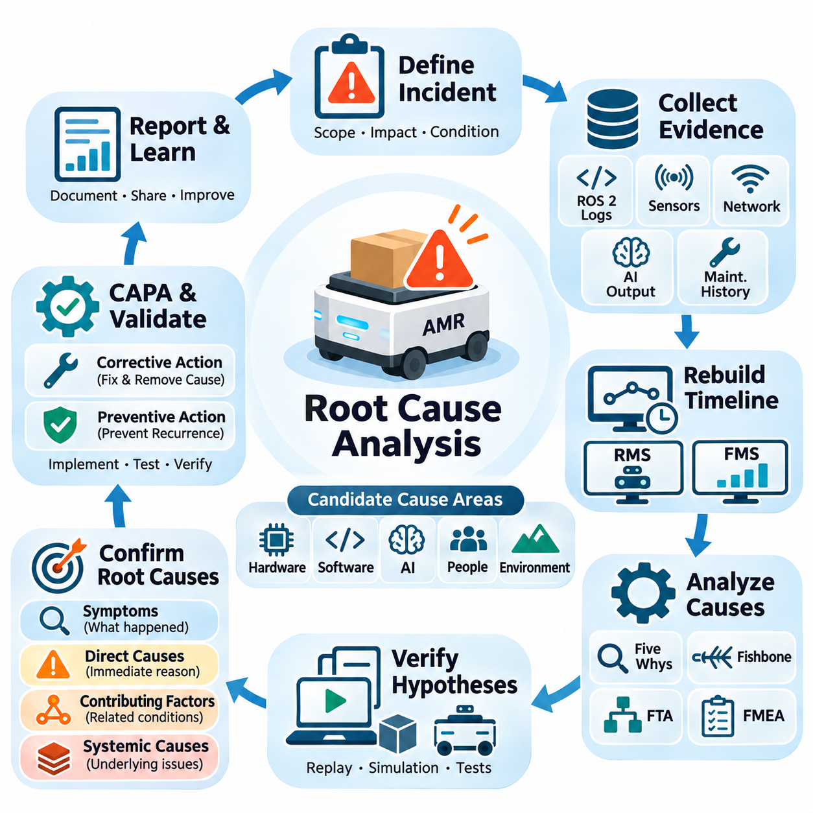
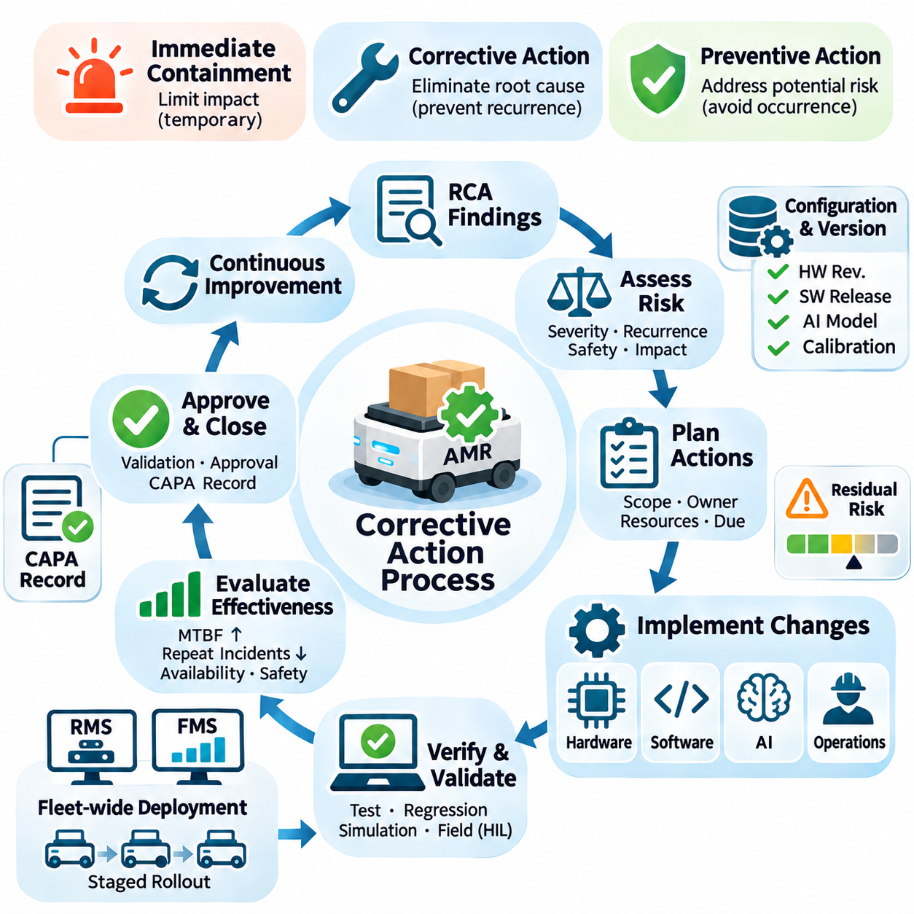
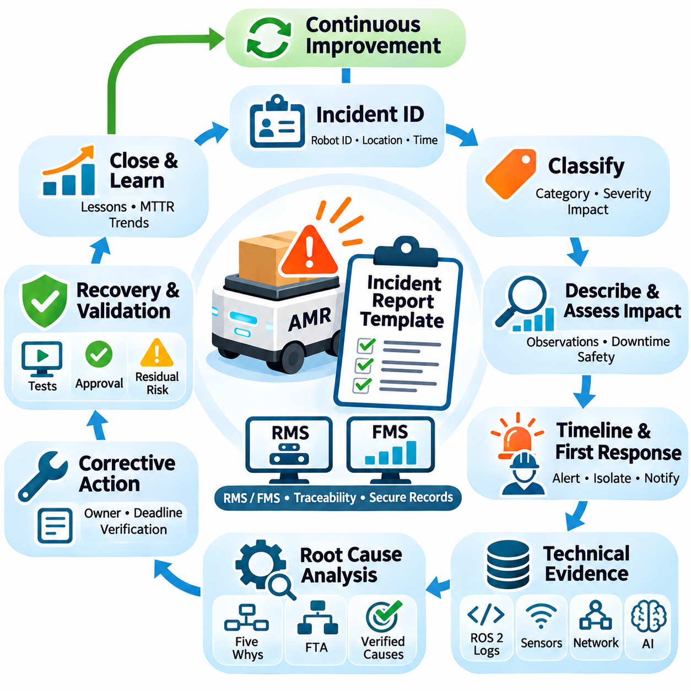

**Volume 08. AMR Operations, Deployment, and MLOps**


# Chapter 13. Incident Response

##  

## 13.1 Incident Response Overview

{width="7.268055555555556in" height="7.268055555555556in"}

Incident response is a structured operational process designed to identify, assess, contain, investigate, and resolve unexpected events that affect the safety, reliability, availability, or performance of Autonomous Mobile Robots (AMRs). As autonomous robotic systems become increasingly integrated into industrial facilities, hospitals, logistics centers, and public environments, effective incident response becomes essential for maintaining operational continuity and minimizing potential damage.

Unlike conventional information technology systems, AMRs interact directly with physical environments, human operators, infrastructure, and other autonomous machines. A failure in mechanical components, electrical systems, perception algorithms, navigation software, or communication networks may generate physical consequences. Incident response must therefore integrate functional safety, system engineering, cybersecurity, operational management, and technical support into a unified framework.

An incident represents an unexpected event that disrupts normal operation or creates an unacceptable operational risk. Typical incidents include localization failure, navigation errors, unexpected robot stops, sensor malfunction, battery failure, communication disconnection, software crashes, and abnormal autonomous behavior. Safety-related incidents may additionally involve collisions, near misses, human injuries, property damage, or failures of protective mechanisms.

Incident classification establishes a systematic foundation for determining the appropriate response strategy. Incidents can be categorized according to severity, technical origin, operational impact, safety consequences, and affected system components. Minor incidents may require routine operator intervention, whereas critical incidents may require immediate operational suspension, emergency procedures, specialist intervention, and formal investigation.

The incident response lifecycle generally consists of preparation, detection, identification, classification, containment, investigation, recovery, and post-incident improvement. Each stage establishes specific operational responsibilities and decision-making requirements. A standardized lifecycle reduces uncertainty during unexpected situations and enables organizations to respond consistently across different robot platforms, deployment locations, and operating environments.

Preparation involves establishing incident response policies, emergency procedures, communication channels, escalation mechanisms, and technical support resources before an incident occurs. Operators and maintenance personnel must understand their responsibilities, authorized intervention procedures, and operational limitations. Incident response readiness should be evaluated through periodic training, simulated failure scenarios, and emergency response exercises.

Incident detection is supported by continuous monitoring of robot hardware, software, artificial intelligence models, communication infrastructure, and operational environments. Robot Management Systems (RMS) and Fleet Management Systems (FMS) collect real-time telemetry, diagnostic information, event notifications, and mission execution records. Automated monitoring mechanisms can identify abnormal conditions and initiate appropriate alerts or protective actions.

The first response process prioritizes human safety, environmental protection, and prevention of additional damage. Depending on the nature of the incident, authorized personnel may initiate an emergency stop, suspend affected missions, isolate the robot, or restrict access to the surrounding area. Operational recovery must never take precedence over safety requirements, and protective mechanisms must remain effective throughout the response process.

Remote troubleshooting enables technical support teams to investigate incidents without immediately dispatching personnel to deployment locations. Engineers can examine system logs, diagnostic messages, sensor measurements, software process states, network connectivity, and configuration information through secure remote interfaces. Historical operational data and recorded sensor streams can provide additional evidence for reconstructing abnormal system behavior.

Field technician dispatch becomes necessary when incidents cannot be resolved safely through remote assistance. Mechanical failures, electrical damage, degraded sensors, physical obstructions, and damaged safety components frequently require on-site inspection. Dispatch decisions should consider incident severity, technician qualifications, spare parts availability, geographical location, customer requirements, and contractual service commitments.

Incident investigation requires accurate preservation of operational evidence. Robot identification, timestamps, mission histories, software versions, AI model versions, environmental conditions, and operator actions should be recorded systematically. Time synchronization across edge devices, fleet management servers, and cloud infrastructure enables engineers to reconstruct event sequences and identify relationships between system failures.

Root Cause Analysis (RCA) identifies the underlying technical, organizational, or environmental factors responsible for an incident rather than merely addressing its visible symptoms. Methods such as the Five Whys, Fault Tree Analysis (FTA), and cause-and-effect analysis support systematic investigation. Complex incidents may involve multiple interacting failures across mechanical, electrical, software, AI, and operational subsystems.

Corrective and Preventive Action (CAPA) transforms investigation results into measurable engineering and operational improvements. Corrective actions address identified causes, while preventive actions reduce the probability of recurrence or similar failures elsewhere. These activities may include component replacement, software modification, AI model retraining, parameter optimization, infrastructure improvement, and revision of operational procedures.

Recovery requires verification that affected robots and supporting infrastructure can safely resume their designated functions. Hardware inspections, diagnostic tests, software validation, sensor calibration, and controlled mission execution may be necessary before operational authorization. Fleet-level recovery should additionally evaluate whether the identified failure mechanism affects other robots operating under similar configurations or environmental conditions.

Incident reporting establishes traceability and organizational accountability throughout the response lifecycle. A standardized incident report should document event descriptions, severity classifications, affected assets, response timelines, investigation findings, recovery actions, and assigned responsibilities. Centralized incident records support regulatory compliance, customer communication, reliability engineering, and continuous improvement across distributed robotic fleets.

Ultimately, incident response should operate as a closed-loop engineering and operational improvement mechanism rather than a reactive maintenance activity. Incident records can contribute to predictive maintenance, risk assessment, software regression testing, AI model validation, and robot design optimization. Response performance can be evaluated through detection time, response time, recovery time, incident recurrence rates, and corrective action effectiveness.

The preceding overview follows the supplied chapter structure, which progresses from incident classification and first response to remote troubleshooting, field technician dispatch, root cause analysis, corrective action, and incident reporting. Because the supplied materials define the chapter hierarchy rather than detailed technical requirements, the engineering principles and representative operational practices have been developed as a general AMR incident response framework.

사고 대응(Incident Response)은 자율이동로봇(Autonomous Mobile Robot, AMR)의 안전성(Safety), 신뢰성(Reliability), 가용성(Availability) 또는 성능(Performance)에 영향을 미치는 예기치 않은 사건을 식별하고, 평가하며, 억제하고, 조사하여 해결하기 위한 체계적인 운영 프로세스(Operational Process)이다. 자율 로봇 시스템(Autonomous Robot System)이 산업 시설, 병원, 물류센터 및 공공 환경에 점차 통합됨에 따라 효과적인 사고 대응은 운영 연속성(Operational Continuity)을 유지하고 잠재적인 피해를 최소화하기 위한 필수 요소가 된다.

기존의 정보기술 시스템(Information Technology System)과 달리 AMR은 물리적 환경(Physical Environment), 작업자(Operator), 인프라(Infrastructure) 및 다른 자율 기계(Autonomous Machine)와 직접적으로 상호작용한다. 기계적 구성요소, 전기 시스템, 인식 알고리즘(Perception Algorithm), 자율주행 소프트웨어(Navigation Software) 또는 통신 네트워크의 장애는 물리적인 피해를 발생시킬 수 있다. 따라서 사고 대응은 기능 안전(Functional Safety), 시스템 엔지니어링(System Engineering), 사이버 보안(Cybersecurity), 운영 관리(Operational Management) 및 기술 지원(Technical Support)을 통합된 프레임워크(Framework)로 구성해야 한다.

사고(Incident)는 정상적인 운영을 방해하거나 허용할 수 없는 운영 위험(Operational Risk)을 발생시키는 예기치 않은 사건을 의미한다. 대표적인 사고에는 위치 추정 실패(Localization Failure), 자율주행 오류(Navigation Error), 예기치 않은 로봇 정지, 센서 오작동(Sensor Malfunction), 배터리 고장(Battery Failure), 통신 연결 해제(Communication Disconnection), 소프트웨어 충돌(Software Crash) 및 비정상적인 자율 행동(Abnormal Autonomous Behavior)이 포함된다. 안전 관련 사고(Safety-related Incident)에는 충돌(Collision), 아차 사고(Near Miss), 인명 피해, 재산 피해 또는 보호 메커니즘(Protective Mechanism)의 장애가 추가로 포함될 수 있다.

사고 분류(Incident Classification)는 적절한 대응 전략(Response Strategy)을 결정하기 위한 체계적인 기반을 제공한다. 사고는 심각도(Severity), 기술적 발생 원인(Technical Origin), 운영 영향(Operational Impact), 안전상의 결과(Safety Consequence) 및 영향을 받는 시스템 구성요소에 따라 분류할 수 있다. 경미한 사고(Minor Incident)는 일반적인 작업자 개입(Operator Intervention)을 통해 해결할 수 있지만, 중대한 사고(Critical Incident)는 즉각적인 운영 중단(Operational Suspension), 비상 절차(Emergency Procedure), 전문가 개입 및 공식적인 조사를 요구할 수 있다.

사고 대응 생애주기(Incident Response Lifecycle)는 일반적으로 사전 준비(Preparation), 탐지(Detection), 식별(Identification), 분류(Classification), 억제(Containment), 조사(Investigation), 복구(Recovery) 및 사고 이후 개선(Post-incident Improvement) 단계로 구성된다. 각 단계에서는 구체적인 운영 책임(Operational Responsibility)과 의사결정 요구사항(Decision-making Requirement)을 정의한다. 표준화된 생애주기(Standardized Lifecycle)는 예기치 않은 상황에서 발생하는 불확실성을 감소시키고 다양한 로봇 플랫폼, 배치 현장 및 운영 환경에서 조직이 일관되게 대응할 수 있도록 지원한다.

사전 준비(Preparation)는 사고가 발생하기 전에 사고 대응 정책(Incident Response Policy), 비상 절차(Emergency Procedure), 의사소통 채널(Communication Channel), 단계별 보고 및 대응 체계(Escalation Mechanism), 기술 지원 자원(Technical Support Resource)을 구축하는 과정이다. 작업자와 유지보수 담당자는 자신의 책임, 승인된 개입 절차(Authorized Intervention Procedure) 및 운영상의 제한사항을 이해해야 한다. 사고 대응 준비도(Incident Response Readiness)는 정기적인 교육, 모의 장애 시나리오(Simulated Failure Scenario) 및 비상 대응 훈련(Emergency Response Exercise)을 통해 평가되어야 한다.

사고 탐지(Incident Detection)는 로봇 하드웨어(Hardware), 소프트웨어(Software), 인공지능 모델(AI Model), 통신 인프라(Communication Infrastructure) 및 운영 환경에 대한 지속적인 모니터링(Continuous Monitoring)을 통해 지원된다. 로봇 관리 시스템(Robot Management System, RMS)과 플릿 관리 시스템(Fleet Management System, FMS)은 실시간 원격 측정 데이터(Real-time Telemetry), 진단 정보(Diagnostic Information), 이벤트 알림(Event Notification) 및 임무 수행 기록(Mission Execution Record)을 수집한다. 자동화된 모니터링 메커니즘(Automated Monitoring Mechanism)은 비정상적인 상태를 식별하고 적절한 경보(Alert) 또는 보호 조치(Protective Action)를 실행할 수 있다.

초기 대응 프로세스(First Response Process)는 인간의 안전(Human Safety), 환경 보호(Environmental Protection) 및 추가적인 피해 방지를 최우선으로 고려한다. 사고의 특성에 따라 승인된 담당자는 비상 정지(Emergency Stop)를 실행하거나, 영향을 받는 임무를 중단하거나, 로봇을 격리(Isolation)하거나, 주변 영역에 대한 접근을 제한할 수 있다. 운영 복구(Operational Recovery)가 안전 요구사항(Safety Requirement)보다 우선되어서는 안 되며, 전체 대응 과정에서 보호 메커니즘(Protective Mechanism)의 유효성이 지속적으로 유지되어야 한다.

원격 문제 해결(Remote Troubleshooting)은 기술 지원팀(Technical Support Team)이 배치 현장에 인력을 즉시 파견하지 않고도 사고를 조사할 수 있도록 지원한다. 엔지니어는 보안 원격 인터페이스(Secure Remote Interface)를 통해 시스템 로그(System Log), 진단 메시지(Diagnostic Message), 센서 측정값(Sensor Measurement), 소프트웨어 프로세스 상태(Software Process State), 네트워크 연결 상태(Network Connectivity) 및 구성 정보(Configuration Information)를 분석할 수 있다. 과거 운영 데이터(Historical Operational Data)와 기록된 센서 데이터 스트림(Recorded Sensor Stream)은 비정상적인 시스템 행동을 재구성하기 위한 추가적인 증거를 제공할 수 있다.

현장 기술자 파견(Field Technician Dispatch)은 원격 지원(Remote Assistance)을 통해 사고를 안전하게 해결할 수 없는 경우에 필요하다. 기계적 고장(Mechanical Failure), 전기적 손상(Electrical Damage), 센서 성능 저하(Sensor Degradation), 물리적 장애물(Physical Obstruction) 및 손상된 안전 구성요소는 현장 점검(On-site Inspection)을 요구하는 경우가 많다. 파견에 관한 의사결정은 사고 심각도(Incident Severity), 기술자의 자격(Technician Qualification), 예비 부품 가용성(Spare Parts Availability), 지리적 위치, 고객 요구사항 및 계약상 서비스 이행 의무(Contractual Service Commitment)를 고려해야 한다.

사고 조사(Incident Investigation)는 운영 증거(Operational Evidence)를 정확하게 보존하는 것을 요구한다. 로봇 식별 정보(Robot Identification), 타임스탬프(Timestamp), 임무 수행 이력(Mission History), 소프트웨어 버전(Software Version), 인공지능 모델 버전(AI Model Version), 환경 조건(Environmental Condition) 및 작업자 행동(Operator Action)을 체계적으로 기록해야 한다. 엣지 디바이스(Edge Device), 플릿 관리 서버(Fleet Management Server) 및 클라우드 인프라(Cloud Infrastructure) 간의 시간 동기화(Time Synchronization)는 엔지니어가 이벤트 발생 순서(Event Sequence)를 재구성하고 시스템 장애 간의 상호관계를 식별할 수 있도록 지원한다.

근본 원인 분석(Root Cause Analysis, RCA)은 사고의 표면적인 증상만을 해결하는 것이 아니라 사고를 발생시킨 근본적인 기술적, 조직적 또는 환경적 요인을 식별하는 과정이다. 5가지 왜 분석(Five Whys), 결함 트리 분석(Fault Tree Analysis, FTA), 원인 및 결과 분석(Cause-and-effect Analysis)과 같은 방법론은 체계적인 사고 조사를 지원한다. 복잡한 사고는 기계 시스템, 전기 시스템, 소프트웨어, 인공지능(AI) 및 운영 하위 시스템(Operational Subsystem) 전반에서 상호작용하는 여러 장애 요인을 포함할 수 있다.

시정 및 예방 조치(Corrective and Preventive Action, CAPA)는 사고 조사 결과를 측정 가능한 엔지니어링 및 운영 개선 활동으로 전환한다. 시정 조치(Corrective Action)는 식별된 원인을 해결하고, 예방 조치(Preventive Action)는 동일한 사고의 재발 또는 다른 현장에서 유사한 장애가 발생할 가능성을 감소시킨다. 이러한 활동에는 구성요소 교체(Component Replacement), 소프트웨어 수정(Software Modification), 인공지능 모델 재학습(AI Model Retraining), 매개변수 최적화(Parameter Optimization), 인프라 개선(Infrastructure Improvement) 및 운영 절차 개정(Operational Procedure Revision)이 포함될 수 있다.

복구(Recovery)는 영향을 받은 로봇과 지원 인프라가 지정된 기능을 안전하게 재개할 수 있는지 검증하는 과정을 요구한다. 운영 재개 승인(Operational Authorization) 이전에 하드웨어 점검(Hardware Inspection), 진단 테스트(Diagnostic Test), 소프트웨어 검증(Software Validation), 센서 교정(Sensor Calibration) 및 통제된 임무 수행(Controlled Mission Execution)이 필요할 수 있다. 플릿 수준 복구(Fleet-level Recovery)에서는 식별된 장애 메커니즘(Failure Mechanism)이 유사한 시스템 구성 또는 환경 조건에서 운영되는 다른 로봇에도 영향을 미치는지 추가적으로 평가해야 한다.

사고 보고(Incident Reporting)는 전체 사고 대응 생애주기에 걸쳐 추적성(Traceability)과 조직적 책임성(Organizational Accountability)을 확립한다. 표준화된 사고 보고서(Standardized Incident Report)는 사고 설명(Event Description), 심각도 분류(Severity Classification), 영향을 받은 자산(Affected Asset), 대응 시간 이력(Response Timeline), 조사 결과(Investigation Finding), 복구 조치(Recovery Action) 및 할당된 책임(Assigned Responsibility)을 문서화해야 한다. 중앙집중형 사고 기록(Centralized Incident Record)은 규제 준수(Regulatory Compliance), 고객 의사소통(Customer Communication), 신뢰성 엔지니어링(Reliability Engineering) 및 분산된 로봇 플릿 전반의 지속적인 개선(Continuous Improvement)을 지원한다.

궁극적으로 사고 대응(Incident Response)은 사후 대응형 유지보수 활동(Reactive Maintenance Activity)이 아니라 폐루프 기반 엔지니어링 및 운영 개선 메커니즘(Closed-loop Engineering and Operational Improvement Mechanism)으로 작동해야 한다. 사고 기록은 예측 유지보수(Predictive Maintenance), 위험 평가(Risk Assessment), 소프트웨어 회귀 테스트(Software Regression Testing), 인공지능 모델 검증(AI Model Validation) 및 로봇 설계 최적화(Robot Design Optimization)에 활용될 수 있다. 사고 대응 성능은 탐지 시간(Detection Time), 대응 시간(Response Time), 복구 시간(Recovery Time), 사고 재발률(Incident Recurrence Rate) 및 시정 조치 효과성(Corrective Action Effectiveness)을 통해 평가할 수 있다.

앞서 설명한 개요는 제공된 장의 구조를 따르며, 사고 분류(Incident Classification)와 초기 대응(First Response)에서 시작하여 원격 문제 해결(Remote Troubleshooting), 현장 기술자 파견(Field Technician Dispatch), 근본 원인 분석(Root Cause Analysis), 시정 조치(Corrective Action) 및 사고 보고(Incident Reporting)로 이어진다. 제공된 자료는 세부적인 기술 요구사항(Technical Requirement)이 아닌 장의 계층 구조(Chapter Hierarchy)를 정의하고 있으므로, 본문에서 설명한 엔지니어링 원칙과 대표적인 운영 방법은 일반적인 AMR 사고 대응 프레임워크(AMR Incident Response Framework)를 기반으로 구성하였다.

##  

## 13.2 Incident Classification

{width="7.268055555555556in" height="7.268055555555556in"}

Incident classification is a systematic process for categorizing unexpected operational events according to their severity, technical characteristics, safety implications, and operational consequences. In Autonomous Mobile Robot (AMR) operations, a standardized classification framework enables operators, maintenance personnel, and engineering teams to determine appropriate response priorities, allocate technical resources, and establish escalation procedures.

An incident classification framework should distinguish between normal operational events, abnormal conditions, technical faults, and actual incidents. A scheduled charging operation represents a normal event, whereas an unexpected battery temperature increase represents an abnormal condition. A battery management system failure that interrupts mission execution or creates a potential safety hazard may require formal incident registration and investigation.

Severity-based classification evaluates incidents according to their actual and potential consequences. A typical operational framework defines four severity levels: minor, moderate, major, and critical. Each level establishes different requirements for response time, technical intervention, operational restrictions, management notification, and recovery authorization. Classification thresholds should reflect the deployment environment and system risk assessment.

Minor incidents involve limited operational disturbances that do not significantly affect safety, system availability, or mission performance. Examples include temporary communication delays, recoverable navigation errors, and isolated application warnings. These incidents can generally be managed through approved operator procedures or validated automatic recovery mechanisms, provided that abnormal conditions do not indicate an underlying safety risk.

Moderate incidents represent technical or operational failures that temporarily interrupt robot functions without creating an immediate unacceptable safety risk. Examples include persistent localization errors, repeated docking failures, sensor communication faults, and unexpected software process termination. These incidents typically require technical investigation, controlled recovery procedures, and appropriate documentation within the incident management system.

Major incidents involve substantial operational disruption, significant equipment damage, or serious degradation of system reliability. Examples include motor controller failure, prolonged fleet communication interruption, critical sensor malfunction, and widespread software update failures. Major incidents generally require immediate escalation, operational restrictions, specialist engineering support, and formal verification before affected systems return to service.

Critical incidents represent events involving actual or imminent threats to human safety, environmental protection, or essential operational infrastructure. Examples include uncontrolled robot movement, serious collisions, battery thermal runaway, and failures of safety-critical mechanisms that expose people to unacceptable hazards. These incidents require immediate protective actions, emergency escalation, and authorized investigation before operational recovery.

Technical classification identifies incidents according to the affected engineering domain. Common categories include mechanical systems, electrical systems, battery and power management, sensors, perception, localization, navigation, motion control, communication networks, edge computing, cloud infrastructure, and artificial intelligence. Technical classification supports efficient assignment of incidents to specialized engineering and maintenance teams.

Artificial intelligence incidents require additional classification criteria because AI-related failures may occur without conventional hardware or software faults. Examples include incorrect object recognition, unexpected semantic interpretations, model performance degradation, distribution shifts, and unreliable autonomous decisions. Such incidents should be evaluated according to model behavior, environmental context, uncertainty, and potential physical consequences.

Operational impact classification evaluates how an incident affects mission execution, service availability, customer workflows, and business continuity. An isolated robot failure may have a limited impact when redundant fleet capacity is available, while a centralized Fleet Management System (FMS) failure may interrupt operations across multiple facilities. Impact assessment should therefore consider both individual robot functionality and fleet-level dependencies.

Safety classification must consider actual injuries, property damage, hazardous conditions, protective system failures, and near-miss events. The absence of physical damage does not necessarily indicate low severity because a near miss may reveal a significant weakness in the safety architecture. Potential consequences, human exposure, environmental conditions, and the effectiveness of remaining protective mechanisms should influence the classification decision.

Incident classification should also distinguish between isolated, recurring, correlated, and systemic failures. Isolated incidents affect individual components or robots, whereas recurring incidents appear repeatedly under similar operating conditions. Correlated incidents may indicate shared dependencies, while systemic failures may originate from architectural weaknesses, common software defects, configuration errors, or inadequate engineering processes.

Automated classification can be supported by Robot Management Systems (RMS), fleet monitoring platforms, diagnostic services, and intelligent event processing mechanisms. These systems correlate error codes, telemetry, mission states, sensor measurements, and historical incident records to recommend classification levels. However, uncertain or safety-critical classifications should remain subject to authorized human assessment and verification.

Severity classifications must remain dynamic throughout the incident response lifecycle. An initially minor communication fault may become a major incident if multiple robots experience simultaneous failures, or a critical incident if communication loss contributes to hazardous motion. Classification changes should be documented with supporting evidence, timestamps, responsible personnel, and corresponding adjustments to response procedures.

A standardized incident record should include a unique incident identifier, detection timestamp, robot identification, deployment location, affected subsystem, severity level, operational impact, safety implications, and current response status. Additional information may include software versions, AI model versions, environmental conditions, and historical recurrence. Consistent classification records enable traceability and cross-fleet failure analysis.

Ultimately, incident classification establishes the decision-making foundation for first response, remote troubleshooting, field technician dispatch, root cause analysis, and corrective action. Consistent classification improves resource allocation, reduces response delays, and supports continuous operational improvement. The four-level severity model presented here is a representative engineering framework extending the supplied chapter structure, rather than a mandatory classification standard.

사고 분류(Incident Classification)는 예기치 않은 운영 이벤트(Operational Event)를 심각도(Severity), 기술적 특성(Technical Characteristic), 안전상 영향(Safety Implication) 및 운영 결과(Operational Consequence)에 따라 체계적으로 분류하는 프로세스이다. 자율이동로봇(Autonomous Mobile Robot, AMR) 운영에서 표준화된 분류 프레임워크(Standardized Classification Framework)는 작업자, 유지보수 담당자 및 엔지니어링 팀이 적절한 대응 우선순위(Response Priority)를 결정하고, 기술 자원(Technical Resource)을 할당하며, 단계별 보고 및 대응 절차(Escalation Procedure)를 수립할 수 있도록 지원한다.

사고 분류 프레임워크(Incident Classification Framework)는 정상 운영 이벤트(Normal Operational Event), 비정상 상태(Abnormal Condition), 기술적 결함(Technical Fault) 및 실제 사고(Actual Incident)를 구분해야 한다. 예정된 충전 작업(Scheduled Charging Operation)은 정상 이벤트에 해당하지만, 예상하지 못한 배터리 온도 상승(Battery Temperature Increase)은 비정상 상태에 해당한다. 임무 수행(Mission Execution)을 중단시키거나 잠재적인 안전 위험(Safety Hazard)을 발생시키는 배터리 관리 시스템(Battery Management System, BMS)의 장애는 공식적인 사고 등록(Incident Registration) 및 조사를 요구할 수 있다.

심각도 기반 분류(Severity-based Classification)는 사고의 실제 결과(Actual Consequence)와 잠재적 결과(Potential Consequence)에 따라 사고를 평가한다. 일반적인 운영 프레임워크(Operational Framework)는 경미(Minor), 중간(Moderate), 중대(Major), 치명적(Critical)의 네 가지 심각도 수준(Severity Level)을 정의한다. 각 수준은 대응 시간(Response Time), 기술적 개입(Technical Intervention), 운영 제한(Operational Restriction), 관리자 통보(Management Notification) 및 복구 승인(Recovery Authorization)에 대한 서로 다른 요구사항을 설정한다. 분류 임계값(Classification Threshold)은 배치 환경(Deployment Environment)과 시스템 위험 평가(System Risk Assessment)를 반영해야 한다.

경미한 사고(Minor Incident)는 안전성(Safety), 시스템 가용성(System Availability) 또는 임무 수행 성능(Mission Performance)에 중대한 영향을 미치지 않는 제한적인 운영 장애(Operational Disturbance)를 의미한다. 대표적인 사례에는 일시적인 통신 지연(Temporary Communication Delay), 복구 가능한 자율주행 오류(Recoverable Navigation Error) 및 개별적인 애플리케이션 경고(Application Warning)가 포함된다. 이러한 사고는 비정상 상태가 근본적인 안전 위험을 나타내지 않는다는 조건에서 승인된 작업자 절차(Approved Operator Procedure) 또는 검증된 자동 복구 메커니즘(Validated Automatic Recovery Mechanism)을 통해 관리할 수 있다.

중간 수준 사고(Moderate Incident)는 즉각적으로 허용할 수 없는 안전 위험을 발생시키지는 않지만 로봇 기능(Robot Function)을 일시적으로 중단시키는 기술적 또는 운영상의 장애를 의미한다. 대표적인 사례에는 지속적인 위치 추정 오류(Persistent Localization Error), 반복적인 도킹 실패(Repeated Docking Failure), 센서 통신 결함(Sensor Communication Fault) 및 예기치 않은 소프트웨어 프로세스 종료(Unexpected Software Process Termination)가 포함된다. 이러한 사고는 일반적으로 기술적 조사(Technical Investigation), 통제된 복구 절차(Controlled Recovery Procedure) 및 사고 관리 시스템(Incident Management System)에서의 적절한 문서화를 요구한다.

중대 사고(Major Incident)는 상당한 운영 중단(Operational Disruption), 심각한 장비 손상(Equipment Damage) 또는 시스템 신뢰성(System Reliability)의 현저한 저하를 포함한다. 대표적인 사례에는 모터 제어기 고장(Motor Controller Failure), 장시간의 플릿 통신 중단(Prolonged Fleet Communication Interruption), 핵심 센서 오작동(Critical Sensor Malfunction) 및 광범위한 소프트웨어 업데이트 실패(Widespread Software Update Failure)가 포함된다. 중대 사고는 일반적으로 즉각적인 상위 대응 단계 전환(Immediate Escalation), 운영 제한(Operational Restriction), 전문 엔지니어링 지원(Specialist Engineering Support) 및 영향을 받은 시스템의 운영 복귀 이전에 공식적인 검증(Formal Verification)을 요구한다.

치명적 사고(Critical Incident)는 인간의 안전(Human Safety), 환경 보호(Environmental Protection) 또는 필수 운영 인프라(Essential Operational Infrastructure)에 실제적이거나 임박한 위협을 발생시키는 사건을 의미한다. 대표적인 사례에는 통제되지 않는 로봇 움직임(Uncontrolled Robot Movement), 심각한 충돌(Serious Collision), 배터리 열폭주(Battery Thermal Runaway) 및 사람을 허용할 수 없는 위험에 노출시키는 안전 필수 메커니즘(Safety-critical Mechanism)의 장애가 포함된다. 이러한 사고는 즉각적인 보호 조치(Immediate Protective Action), 비상 대응 단계 전환(Emergency Escalation) 및 운영 복구 이전에 권한을 부여받은 담당자의 조사를 요구한다.

기술적 분류(Technical Classification)는 영향을 받은 엔지니어링 영역(Engineering Domain)에 따라 사고를 식별한다. 일반적인 분류 범주에는 기계 시스템(Mechanical System), 전기 시스템(Electrical System), 배터리 및 전력 관리(Battery and Power Management), 센서(Sensor), 인식(Perception), 위치 추정(Localization), 자율주행(Navigation), 모션 제어(Motion Control), 통신 네트워크(Communication Network), 엣지 컴퓨팅(Edge Computing), 클라우드 인프라(Cloud Infrastructure) 및 인공지능(Artificial Intelligence, AI)이 포함된다. 기술적 분류는 전문 엔지니어링 팀과 유지보수 팀에 사고를 효율적으로 할당할 수 있도록 지원한다.

인공지능 관련 사고(AI-related Incident)는 기존의 하드웨어 또는 소프트웨어 결함 없이도 발생할 수 있으므로 추가적인 분류 기준(Classification Criteria)이 필요하다. 대표적인 사례에는 잘못된 객체 인식(Incorrect Object Recognition), 예기치 않은 의미적 해석(Unexpected Semantic Interpretation), 모델 성능 저하(Model Performance Degradation), 데이터 분포 변화(Distribution Shift) 및 신뢰할 수 없는 자율적 의사결정(Unreliable Autonomous Decision)이 포함된다. 이러한 사고는 모델 행동(Model Behavior), 환경적 맥락(Environmental Context), 불확실성(Uncertainty) 및 잠재적인 물리적 결과(Potential Physical Consequence)에 따라 평가되어야 한다.

운영 영향 분류(Operational Impact Classification)는 사고가 임무 수행(Mission Execution), 서비스 가용성(Service Availability), 고객 업무 흐름(Customer Workflow) 및 비즈니스 연속성(Business Continuity)에 미치는 영향을 평가한다. 여유 플릿 용량(Redundant Fleet Capacity)이 확보된 경우 개별 로봇의 장애는 제한적인 영향을 미칠 수 있지만, 중앙집중형 플릿 관리 시스템(Centralized Fleet Management System, FMS)의 장애는 여러 시설의 운영을 동시에 중단시킬 수 있다. 따라서 영향 평가(Impact Assessment)는 개별 로봇의 기능뿐만 아니라 플릿 수준의 의존성(Fleet-level Dependency)을 함께 고려해야 한다.

안전 분류(Safety Classification)는 실제 인명 피해(Actual Injury), 재산 피해(Property Damage), 위험 상태(Hazardous Condition), 보호 시스템 장애(Protective System Failure) 및 아차 사고(Near-miss Event)를 고려해야 한다. 물리적 피해(Physical Damage)가 발생하지 않았다는 사실이 반드시 낮은 심각도를 의미하는 것은 아니다. 아차 사고는 안전 아키텍처(Safety Architecture)의 중대한 취약점을 드러낼 수 있기 때문이다. 잠재적 결과(Potential Consequence), 인간의 위험 노출(Human Exposure), 환경 조건(Environmental Condition) 및 나머지 보호 메커니즘의 효과성(Effectiveness of Protective Mechanism)이 분류 의사결정(Classification Decision)에 반영되어야 한다.

사고 분류는 개별 장애(Isolated Failure), 반복 장애(Recurring Failure), 상관 장애(Correlated Failure) 및 시스템적 장애(Systemic Failure)를 구분해야 한다. 개별 사고는 특정 구성요소 또는 개별 로봇에 영향을 미치는 반면, 반복 사고는 유사한 운영 조건에서 지속적으로 발생한다. 상관 사고는 공통 의존성(Shared Dependency)의 존재를 나타낼 수 있으며, 시스템적 장애는 아키텍처의 취약점(Architectural Weakness), 공통 소프트웨어 결함(Common Software Defect), 구성 오류(Configuration Error) 또는 부적절한 엔지니어링 프로세스(Inadequate Engineering Process)에서 발생할 수 있다.

자동화된 사고 분류(Automated Incident Classification)는 로봇 관리 시스템(Robot Management System, RMS), 플릿 모니터링 플랫폼(Fleet Monitoring Platform), 진단 서비스(Diagnostic Service) 및 지능형 이벤트 처리 메커니즘(Intelligent Event Processing Mechanism)을 통해 지원될 수 있다. 이러한 시스템은 오류 코드(Error Code), 원격 측정 데이터(Telemetry), 임무 상태(Mission State), 센서 측정값(Sensor Measurement) 및 과거 사고 기록(Historical Incident Record) 간의 상관관계를 분석하여 적절한 분류 수준을 권고한다. 그러나 불확실성이 존재하거나 안전에 중대한 영향을 미치는 분류는 권한을 부여받은 담당자의 평가(Human Assessment)와 검증(Verification)을 거쳐야 한다.

심각도 분류(Severity Classification)는 전체 사고 대응 생애주기(Incident Response Lifecycle)에 걸쳐 동적으로 유지되어야 한다. 초기에는 경미한 통신 결함(Communication Fault)으로 분류된 사고라도 여러 로봇에서 동시에 장애가 발생하면 중대 사고로 발전할 수 있으며, 통신 손실(Communication Loss)이 위험한 움직임(Hazardous Motion)을 유발하는 요인이 된다면 치명적 사고로 전환될 수 있다. 분류 변경(Classification Change)은 근거 자료(Supporting Evidence), 타임스탬프(Timestamp), 책임 담당자(Responsible Personnel) 및 이에 상응하는 대응 절차의 변경사항과 함께 문서화되어야 한다.

표준화된 사고 기록(Standardized Incident Record)은 고유 사고 식별자(Unique Incident Identifier), 탐지 타임스탬프(Detection Timestamp), 로봇 식별 정보(Robot Identification), 배치 위치(Deployment Location), 영향을 받은 하위 시스템(Affected Subsystem), 심각도 수준(Severity Level), 운영 영향(Operational Impact), 안전상 영향(Safety Implication) 및 현재 대응 상태(Current Response Status)를 포함해야 한다. 추가 정보에는 소프트웨어 버전(Software Version), 인공지능 모델 버전(AI Model Version), 환경 조건(Environmental Condition) 및 과거 재발 이력(Historical Recurrence)이 포함될 수 있다. 일관된 분류 기록은 추적성(Traceability)과 플릿 간 장애 분석(Cross-fleet Failure Analysis)을 지원한다.

궁극적으로 사고 분류(Incident Classification)는 초기 대응(First Response), 원격 문제 해결(Remote Troubleshooting), 현장 기술자 파견(Field Technician Dispatch), 근본 원인 분석(Root Cause Analysis, RCA) 및 시정 조치(Corrective Action)를 위한 의사결정 기반(Decision-making Foundation)을 확립한다. 일관된 사고 분류는 자원 할당(Resource Allocation)을 개선하고, 대응 지연(Response Delay)을 감소시키며, 지속적인 운영 개선(Continuous Operational Improvement)을 지원한다. 본문에서 제시한 4단계 심각도 모델(Four-level Severity Model)은 의무적으로 적용해야 하는 분류 표준(Mandatory Classification Standard)이 아니라 제공된 장의 구조를 확장하여 구성한 대표적인 엔지니어링 프레임워크(Engineering Framework)이다.

##  

## 13.3 First Response Process

{width="7.268055555555556in" height="7.268055555555556in"}

The first response process is the initial operational procedure executed immediately after an incident is detected in an Autonomous Mobile Robot (AMR) system. Its primary objectives are to protect human safety, stabilize abnormal conditions, prevent additional damage, and establish a controlled environment for technical investigation. An effective first response process minimizes incident escalation while maintaining operational accountability.

The first response process begins with incident detection through automated monitoring systems, operator observations, diagnostic alerts, or external reports. Robot Management Systems (RMS) and Fleet Management Systems (FMS) continuously monitor robot behavior, hardware conditions, communication status, and mission execution. Detected abnormalities should generate actionable notifications containing sufficient information to support immediate assessment.

Initial assessment determines the nature of the incident, its potential severity, affected robot functions, and immediate operational consequences. Operators should evaluate robot movement, surrounding environmental conditions, human exposure, payload stability, and the status of protective mechanisms. When available information is insufficient to establish safe operating conditions, a conservative response strategy should be adopted.

Human safety must remain the highest priority throughout the first response process. When an AMR exhibits uncontrolled movement, unexpected acceleration, collision risks, or failures of safety-critical components, appropriate protective actions must be initiated immediately. These actions may include emergency stop activation, access restrictions, and notification of responsible safety personnel according to established emergency procedures.

Incident containment aims to prevent an abnormal condition from propagating into additional robot systems, infrastructure, or operational processes. Affected robots may be removed from task allocation, restricted from autonomous movement, or isolated from selected services. Containment measures should consider shared traffic routes, payload handling equipment, charging stations, elevators, and dependencies between connected robotic platforms.

The operational state of an affected robot should be transitioned into a predefined safe state whenever required by the incident conditions. Depending on the system architecture, this state may involve controlled stopping, brake engagement, prevention of automatic restart, or appropriate energy isolation. The selection of a safe state must account for environmental conditions, stored energy, payload stability, and validated safety functions.

Incident registration establishes a formal record of the detected abnormal event and associated response activities. Essential information includes the incident identifier, robot identifier, deployment location, detection timestamp, mission status, observed symptoms, and preliminary severity classification. Recording initial observations before configuration changes or system restarts helps preserve valuable evidence for subsequent investigation.

Communication and escalation procedures ensure that relevant personnel receive accurate information within appropriate response intervals. Operators, fleet administrators, maintenance engineers, safety managers, and customer representatives should be notified according to incident severity and assigned responsibilities. Critical incidents require immediate escalation without waiting for comprehensive technical diagnosis or confirmation of the underlying failure mechanism.

Preliminary troubleshooting should focus on nonintrusive diagnostic activities that do not introduce additional operational risks. Authorized personnel may examine diagnostic messages, sensor status, battery conditions, network connectivity, software process states, and recent configuration changes. Repeated restarts, unauthorized parameter modifications, and bypassing protective mechanisms should be prohibited during initial incident assessment.

Operational evidence should be preserved before performing recovery actions whenever this can be achieved without compromising safety. Relevant evidence may include system logs, ROS 2 diagnostic messages, recorded sensor data, navigation trajectories, motor controller information, and AI inference results. Synchronized timestamps and configuration identifiers help reconstruct incident sequences and establish relationships between abnormal system behaviors.

Fleet-level coordination is particularly important when an incident affects multiple robots or shared operational infrastructure. The Fleet Management System should suspend affected missions, prevent conflicting task assignments, and redirect unaffected robots when alternative routes remain safe. Coordinated response mechanisms reduce secondary incidents, traffic congestion, resource conflicts, and unnecessary interruptions across the deployment environment.

AI-related incidents require additional precautions because abnormal autonomous behavior may occur without identifiable hardware failures or conventional software errors. Unexpected perception results, incorrect semantic interpretations, and unreliable navigation decisions should trigger appropriate operational restrictions. Relevant input data, inference outputs, model versions, and environmental conditions should be preserved for subsequent analysis.

Transition from first response to advanced technical support occurs when an incident cannot be safely resolved through authorized initial procedures. Remote troubleshooting teams or field technicians should receive structured incident information, diagnostic evidence, containment status, and details of completed interventions. Clearly defined handover procedures prevent duplicated activities, inconsistent decisions, and unauthorized recovery attempts.

Limited operational recovery may be permitted when the incident is understood, applicable recovery procedures have been validated, and required safety conditions are satisfied. Recovery authorization should consider hardware integrity, software stability, localization accuracy, communication reliability, and protective system functionality. Unresolved safety-critical incidents must remain under operational restriction until formal clearance is obtained.

First response effectiveness should be evaluated through measurable indicators such as Mean Time to Detect (MTTD), Mean Time to Acknowledge (MTTA), time to containment, escalation accuracy, and evidence completeness. Periodic emergency exercises and simulated failure scenarios help validate response readiness, communication effectiveness, and coordination between operators, technical support personnel, and operational management teams.

Ultimately, the first response process establishes the operational foundation for containment, remote troubleshooting, field technician dispatch, root cause analysis, and corrective action. The procedures described here constitute a representative AMR engineering framework developed from the supplied chapter structure. Specific response thresholds, authorization requirements, and emergency procedures must be tailored to each deployment environment.

초기 대응 프로세스(First Response Process)는 자율이동로봇(Autonomous Mobile Robot, AMR) 시스템에서 사고가 탐지된 직후에 실행되는 초기 운영 절차(Initial Operational Procedure)이다. 주요 목적은 인간의 안전(Human Safety)을 보호하고, 비정상 상태(Abnormal Condition)를 안정화하며, 추가적인 피해를 방지하고, 기술적 조사(Technical Investigation)를 위한 통제된 환경(Controlled Environment)을 구축하는 것이다. 효과적인 초기 대응 프로세스는 운영 책임성(Operational Accountability)을 유지하면서 사고의 확대(Incident Escalation)를 최소화한다.

초기 대응 프로세스는 자동화된 모니터링 시스템(Automated Monitoring System), 작업자 관찰(Operator Observation), 진단 경보(Diagnostic Alert) 또는 외부 보고(External Report)를 통한 사고 탐지(Incident Detection)에서 시작된다. 로봇 관리 시스템(Robot Management System, RMS)과 플릿 관리 시스템(Fleet Management System, FMS)은 로봇 행동(Robot Behavior), 하드웨어 상태(Hardware Condition), 통신 상태(Communication Status) 및 임무 수행(Mission Execution)을 지속적으로 모니터링한다. 탐지된 이상 상태는 즉각적인 평가(Immediate Assessment)를 지원하기에 충분한 정보를 포함하는 조치 가능한 알림(Actionable Notification)을 생성해야 한다.

초기 평가(Initial Assessment)는 사고의 특성, 잠재적 심각도(Potential Severity), 영향을 받은 로봇 기능(Affected Robot Function) 및 즉각적인 운영 결과(Immediate Operational Consequence)를 결정한다. 작업자는 로봇 움직임(Robot Movement), 주변 환경 조건(Environmental Condition), 인간의 위험 노출(Human Exposure), 적재물 안정성(Payload Stability) 및 보호 메커니즘(Protective Mechanism)의 상태를 평가해야 한다. 안전한 운영 조건(Safe Operating Condition)을 확립하기에 가용 정보가 충분하지 않은 경우에는 보수적인 대응 전략(Conservative Response Strategy)을 적용해야 한다.

인간의 안전(Human Safety)은 전체 초기 대응 프로세스에서 최우선 순위로 유지되어야 한다. AMR에서 통제되지 않는 움직임(Uncontrolled Movement), 예기치 않은 가속(Unexpected Acceleration), 충돌 위험(Collision Risk) 또는 안전 필수 구성요소(Safety-critical Component)의 장애가 발생하면 적절한 보호 조치(Protective Action)를 즉시 실행해야 한다. 이러한 조치에는 확립된 비상 절차(Emergency Procedure)에 따른 비상 정지 활성화(Emergency Stop Activation), 접근 제한(Access Restriction) 및 안전 책임자(Safety Personnel)에 대한 통보가 포함될 수 있다.

사고 확산 억제(Incident Containment)는 비정상 상태가 다른 로봇 시스템, 인프라(Infrastructure) 또는 운영 프로세스(Operational Process)로 확산되는 것을 방지하는 데 목적이 있다. 영향을 받은 로봇은 작업 할당(Task Allocation) 대상에서 제외되거나, 자율 이동(Autonomous Movement)이 제한되거나, 특정 서비스로부터 격리(Isolation)될 수 있다. 사고 확산 억제 조치(Containment Measure)는 공유 이동 경로(Shared Traffic Route), 적재물 처리 장비(Payload Handling Equipment), 충전 스테이션(Charging Station), 엘리베이터(Elevator) 및 연결된 로봇 플랫폼(Robot Platform) 간의 의존성(Dependency)을 고려해야 한다.

사고 조건에 따라 필요한 경우 영향을 받은 로봇의 운영 상태(Operational State)를 사전에 정의된 안전 상태(Predefined Safe State)로 전환해야 한다. 시스템 아키텍처(System Architecture)에 따라 이러한 상태에는 제어된 정지(Controlled Stop), 브레이크 작동(Brake Engagement), 자동 재시작 방지(Prevention of Automatic Restart) 또는 적절한 에너지 격리(Energy Isolation)가 포함될 수 있다. 안전 상태의 선택은 환경 조건(Environmental Condition), 저장된 에너지(Stored Energy), 적재물 안정성(Payload Stability) 및 검증된 안전 기능(Validated Safety Function)을 고려해야 한다.

사고 등록(Incident Registration)은 탐지된 비정상 이벤트(Abnormal Event)와 관련 대응 활동(Response Activity)에 대한 공식적인 기록을 확립한다. 필수 정보에는 사고 식별자(Incident Identifier), 로봇 식별자(Robot Identifier), 배치 위치(Deployment Location), 탐지 타임스탬프(Detection Timestamp), 임무 상태(Mission Status), 관찰된 증상(Observed Symptom) 및 예비 심각도 분류(Preliminary Severity Classification)가 포함된다. 시스템 구성 변경(Configuration Change) 또는 시스템 재시작(System Restart) 이전에 초기 관찰 결과를 기록하는 것은 후속 조사를 위한 중요한 증거를 보존하는 데 도움이 된다.

의사소통 및 단계별 대응 절차(Communication and Escalation Procedure)는 관련 담당자가 적절한 대응 시간 내에 정확한 정보를 전달받도록 보장한다. 작업자(Operator), 플릿 관리자(Fleet Administrator), 유지보수 엔지니어(Maintenance Engineer), 안전 관리자(Safety Manager) 및 고객 담당자(Customer Representative)는 사고 심각도(Incident Severity)와 할당된 책임(Assigned Responsibility)에 따라 통보받아야 한다. 치명적 사고(Critical Incident)는 종합적인 기술 진단(Technical Diagnosis)이나 근본적인 장애 메커니즘(Failure Mechanism)의 확인을 기다리지 않고 즉시 상위 대응 단계로 전환해야 한다.

예비 문제 해결(Preliminary Troubleshooting)은 추가적인 운영 위험(Operational Risk)을 발생시키지 않는 비침습적 진단 활동(Nonintrusive Diagnostic Activity)에 중점을 두어야 한다. 권한을 부여받은 담당자는 진단 메시지(Diagnostic Message), 센서 상태(Sensor Status), 배터리 상태(Battery Condition), 네트워크 연결 상태(Network Connectivity), 소프트웨어 프로세스 상태(Software Process State) 및 최근 구성 변경사항(Recent Configuration Change)을 조사할 수 있다. 초기 사고 평가(Initial Incident Assessment) 과정에서는 반복적인 재시작(Repeated Restart), 승인되지 않은 매개변수 변경(Unauthorized Parameter Modification) 및 보호 메커니즘 우회(Bypassing Protective Mechanism)가 금지되어야 한다.

안전을 저해하지 않고 수행할 수 있는 경우에는 복구 조치(Recovery Action)를 실행하기 전에 운영 증거(Operational Evidence)를 보존해야 한다. 관련 증거에는 시스템 로그(System Log), ROS 2 진단 메시지(ROS 2 Diagnostic Message), 기록된 센서 데이터(Recorded Sensor Data), 자율주행 궤적(Navigation Trajectory), 모터 제어기 정보(Motor Controller Information) 및 인공지능 추론 결과(AI Inference Result)가 포함될 수 있다. 동기화된 타임스탬프(Synchronized Timestamp)와 구성 식별자(Configuration Identifier)는 사고 발생 순서(Incident Sequence)를 재구성하고 비정상적인 시스템 행동 간의 상호관계를 확립하는 데 도움이 된다.

플릿 수준의 조정(Fleet-level Coordination)은 사고가 여러 로봇 또는 공유 운영 인프라(Shared Operational Infrastructure)에 영향을 미치는 경우 특히 중요하다. 플릿 관리 시스템(Fleet Management System, FMS)은 영향을 받은 임무를 중단하고, 상충하는 작업 할당(Conflicting Task Assignment)을 방지하며, 대체 경로(Alternative Route)의 안전성이 확보된 경우 영향을 받지 않은 로봇의 이동 경로를 재설정해야 한다. 조정된 대응 메커니즘(Coordinated Response Mechanism)은 배치 환경 전반에서 2차 사고(Secondary Incident), 교통 혼잡(Traffic Congestion), 자원 충돌(Resource Conflict) 및 불필요한 운영 중단을 감소시킨다.

인공지능 관련 사고(AI-related Incident)는 식별 가능한 하드웨어 장애(Hardware Failure) 또는 기존의 소프트웨어 오류(Conventional Software Error) 없이도 비정상적인 자율 행동(Abnormal Autonomous Behavior)이 발생할 수 있으므로 추가적인 예방 조치(Precaution)가 필요하다. 예기치 않은 인식 결과(Unexpected Perception Result), 잘못된 의미적 해석(Incorrect Semantic Interpretation) 및 신뢰할 수 없는 자율주행 의사결정(Unreliable Navigation Decision)은 적절한 운영 제한(Operational Restriction)을 유발해야 한다. 관련 입력 데이터(Input Data), 추론 출력(Inference Output), 모델 버전(Model Version) 및 환경 조건(Environmental Condition)은 후속 분석을 위해 보존되어야 한다.

초기 대응에서 고급 기술 지원(Advanced Technical Support)으로의 전환은 승인된 초기 절차(Authorized Initial Procedure)를 통해 사고를 안전하게 해결할 수 없는 경우에 이루어진다. 원격 문제 해결팀(Remote Troubleshooting Team) 또는 현장 기술자(Field Technician)는 구조화된 사고 정보(Structured Incident Information), 진단 증거(Diagnostic Evidence), 사고 확산 억제 상태(Containment Status) 및 완료된 개입 조치(Completed Intervention)의 세부 정보를 전달받아야 한다. 명확하게 정의된 인수인계 절차(Handover Procedure)는 중복 활동(Duplicated Activity), 일관되지 않은 의사결정(Inconsistent Decision) 및 승인되지 않은 복구 시도(Unauthorized Recovery Attempt)를 방지한다.

사고의 특성이 파악되고, 적용 가능한 복구 절차(Recovery Procedure)가 검증되었으며, 필요한 안전 조건(Safety Condition)이 충족된 경우에는 제한적인 운영 복구(Limited Operational Recovery)가 허용될 수 있다. 복구 승인(Recovery Authorization)은 하드웨어 무결성(Hardware Integrity), 소프트웨어 안정성(Software Stability), 위치 추정 정확도(Localization Accuracy), 통신 신뢰성(Communication Reliability) 및 보호 시스템 기능성(Protective System Functionality)을 고려해야 한다. 해결되지 않은 안전 필수 사고(Safety-critical Incident)는 공식적인 안전 승인(Formal Clearance)을 획득할 때까지 운영 제한 상태로 유지되어야 한다.

초기 대응 효과성(First Response Effectiveness)은 평균 탐지 시간(Mean Time to Detect, MTTD), 평균 인지 확인 시간(Mean Time to Acknowledge, MTTA), 사고 확산 억제 소요 시간(Time to Containment), 상위 대응 단계 전환 정확도(Escalation Accuracy) 및 증거 완전성(Evidence Completeness)과 같은 측정 가능한 지표를 통해 평가해야 한다. 정기적인 비상 대응 훈련(Emergency Exercise)과 모의 장애 시나리오(Simulated Failure Scenario)는 대응 준비도(Response Readiness), 의사소통 효과성(Communication Effectiveness) 및 작업자, 기술 지원 담당자, 운영 관리팀 간의 협력 체계(Coordination)를 검증하는 데 도움이 된다.

궁극적으로 초기 대응 프로세스(First Response Process)는 사고 확산 억제(Containment), 원격 문제 해결(Remote Troubleshooting), 현장 기술자 파견(Field Technician Dispatch), 근본 원인 분석(Root Cause Analysis, RCA) 및 시정 조치(Corrective Action)를 위한 운영 기반(Operational Foundation)을 확립한다. 본문에서 설명한 절차는 제공된 장의 구조를 기반으로 개발한 대표적인 AMR 엔지니어링 프레임워크(AMR Engineering Framework)이다. 구체적인 대응 임계값(Response Threshold), 승인 요구사항(Authorization Requirement) 및 비상 절차(Emergency Procedure)는 각각의 배치 환경(Deployment Environment)에 적합하도록 조정되어야 한다.

##  

## 13.4 Remote Troubleshooting

{width="7.268055555555556in" height="7.268055555555556in"}

Remote troubleshooting is a structured technical support process that enables engineers and maintenance personnel to diagnose, investigate, and resolve operational incidents in Autonomous Mobile Robot (AMR) systems without immediately visiting deployment locations. Its primary objectives are to reduce system downtime, accelerate incident resolution, minimize field service costs, and maintain safe and reliable robot operations across distributed environments.

A remote troubleshooting architecture integrates edge computing devices, Robot Management Systems (RMS), Fleet Management Systems (FMS), communication networks, and cloud-based diagnostic platforms. These components provide centralized access to robot operational states, hardware conditions, software processes, and historical event records. Secure bidirectional communication enables authorized engineers to perform diagnostic activities and controlled interventions.

Remote troubleshooting begins after the initial response process has established appropriate safety conditions and incident containment. Technical support personnel should receive the incident identifier, preliminary severity classification, robot location, observed symptoms, mission status, and records of previous interventions. This information establishes the diagnostic context and prevents unnecessary repetition of initial response activities.

Real-time telemetry provides an essential foundation for remote incident investigation. Battery voltage, current consumption, motor temperature, actuator feedback, processor utilization, memory usage, network latency, and sensor availability can reveal abnormal operating conditions. Comparing current measurements with historical baselines and validated operating ranges helps engineers identify component degradation and unexpected system behavior.

Software diagnostics focus on the operational status of robot applications, middleware, operating systems, and communication interfaces. In ROS 2 environments, engineers can investigate node availability, topic publication rates, service responses, lifecycle states, and diagnostic messages. Process monitoring and dependency analysis help identify application crashes, resource exhaustion, communication interruptions, and incompatible software configurations.

Sensor and perception troubleshooting requires access to representative sensor measurements, calibration parameters, synchronization states, and perception outputs. Engineers can investigate missing LiDAR scans, corrupted camera frames, inconsistent depth measurements, GNSS degradation, and IMU abnormalities. Comparing raw sensor observations with processed perception results helps distinguish hardware-related faults from algorithmic failures.

Localization and navigation troubleshooting examines the relationship between estimated robot poses, environmental maps, planned trajectories, and actual robot movement. Remote engineers can evaluate localization uncertainty, odometry consistency, map alignment, obstacle detection, and path planning results. Historical trajectory visualization helps identify localization drift, inaccessible destinations, navigation deadlocks, and unexpected motion behavior.

Artificial intelligence troubleshooting requires additional diagnostic capabilities because model-related failures may not generate conventional system error codes. Engineers should examine inference latency, confidence distributions, input data quality, model versions, and representative prediction outputs. Recorded operational data can support offline reproduction of incorrect detections, distribution shifts, and unreliable autonomous decisions.

Network troubleshooting evaluates communication reliability between robots, wireless access points, fleet management servers, and cloud infrastructure. Relevant measurements include packet loss, communication latency, bandwidth utilization, signal strength, connection stability, and message delivery rates. Engineers should distinguish local connectivity problems from infrastructure failures and centralized service interruptions affecting multiple robots.

Operational log analysis enables technical support personnel to reconstruct incident sequences across distributed system components. System logs, application logs, ROS 2 messages, safety events, mission histories, and configuration records should be correlated using synchronized timestamps. Event correlation helps identify relationships between failures, determine their propagation paths, and establish evidence-based diagnostic hypotheses.

Remote diagnostic environments may incorporate recorded sensor replay, simulation platforms, and digital twins to reproduce abnormal robot behavior without introducing additional physical risks. Engineers can evaluate alternative software configurations, navigation parameters, and AI model behavior within controlled environments. Reproduction results help validate suspected failure mechanisms before corrective changes are applied to deployed robots.

Remote corrective actions may include restarting non-safety-critical services, restoring approved configurations, resetting communication sessions, or rolling back defective software and AI model updates. These interventions must follow validated procedures and authorization requirements. Remote troubleshooting must never disable protective mechanisms or initiate robot movement without establishing the necessary local safety conditions.

Cybersecurity is a fundamental requirement because remote troubleshooting interfaces provide access to operationally sensitive robotic systems. Secure communication channels, multifactor authentication, role-based access control, time-limited authorization, and comprehensive audit logging should be implemented. Remote access privileges must be restricted to authorized personnel and the minimum capabilities required for incident resolution.

Recovery verification determines whether remote corrective actions have restored the expected robot functionality without introducing additional failures. Diagnostic checks, communication tests, software health monitoring, and controlled functional validation should be performed before operational resumption. Unresolved hardware faults, physical damage, or uncertain safety conditions require escalation to qualified field technicians.

Remote troubleshooting performance should be evaluated through indicators such as Mean Time to Diagnose (MTTD), Mean Time to Repair (MTTR), remote resolution rate, repeat incident rate, and avoided field service visits. Historical troubleshooting records can support knowledge base development, automated diagnostic rules, predictive maintenance, engineering improvements, and continuous optimization of technical support workflows.

Ultimately, remote troubleshooting connects first response, technical diagnosis, field technician dispatch, root cause analysis, and corrective action within an integrated incident management lifecycle. The architecture and diagnostic practices described here extend the supplied chapter structure into a representative AMR engineering framework. Specific access permissions, diagnostic thresholds, and recovery procedures must reflect each robot platform and deployment environment.

원격 문제 해결(Remote Troubleshooting)은 엔지니어와 유지보수 담당자가 배치 현장(Deployment Location)을 즉시 방문하지 않고도 자율이동로봇(Autonomous Mobile Robot, AMR) 시스템에서 발생하는 운영 사고(Operational Incident)를 진단하고, 조사하며, 해결할 수 있도록 지원하는 체계적인 기술 지원 프로세스(Technical Support Process)이다. 주요 목적은 시스템 가동 중단 시간(System Downtime)을 감소시키고, 사고 해결(Incident Resolution)을 가속화하며, 현장 서비스 비용(Field Service Cost)을 최소화하고, 분산된 환경에서 안전하고 신뢰성 있는 로봇 운영을 유지하는 것이다.

원격 문제 해결 아키텍처(Remote Troubleshooting Architecture)는 엣지 컴퓨팅 디바이스(Edge Computing Device), 로봇 관리 시스템(Robot Management System, RMS), 플릿 관리 시스템(Fleet Management System, FMS), 통신 네트워크(Communication Network) 및 클라우드 기반 진단 플랫폼(Cloud-based Diagnostic Platform)을 통합한다. 이러한 구성요소는 로봇 운영 상태(Robot Operational State), 하드웨어 상태(Hardware Condition), 소프트웨어 프로세스(Software Process) 및 과거 이벤트 기록(Historical Event Record)에 대한 중앙집중형 접근(Centralized Access)을 제공한다. 보안 양방향 통신(Secure Bidirectional Communication)은 권한을 부여받은 엔지니어가 진단 활동(Diagnostic Activity)과 통제된 개입(Controlled Intervention)을 수행할 수 있도록 지원한다.

원격 문제 해결은 초기 대응 프로세스(First Response Process)를 통해 적절한 안전 조건(Safety Condition)과 사고 확산 억제(Incident Containment)가 확보된 이후에 시작된다. 기술 지원 담당자(Technical Support Personnel)는 사고 식별자(Incident Identifier), 예비 심각도 분류(Preliminary Severity Classification), 로봇 위치(Robot Location), 관찰된 증상(Observed Symptom), 임무 상태(Mission Status) 및 이전 개입 기록(Previous Intervention Record)을 전달받아야 한다. 이러한 정보는 진단 맥락(Diagnostic Context)을 확립하고 초기 대응 활동(First Response Activity)의 불필요한 반복을 방지한다.

실시간 원격 측정 데이터(Real-time Telemetry)는 원격 사고 조사(Remote Incident Investigation)를 위한 필수적인 기반을 제공한다. 배터리 전압(Battery Voltage), 소비 전류(Current Consumption), 모터 온도(Motor Temperature), 액추에이터 피드백(Actuator Feedback), 프로세서 사용률(Processor Utilization), 메모리 사용량(Memory Usage), 네트워크 지연시간(Network Latency) 및 센서 가용성(Sensor Availability)은 비정상적인 운영 상태(Abnormal Operating Condition)를 나타낼 수 있다. 현재 측정값을 과거 기준선(Historical Baseline) 및 검증된 운영 범위(Validated Operating Range)와 비교하면 엔지니어가 구성요소의 성능 저하(Component Degradation)와 예기치 않은 시스템 행동(Unexpected System Behavior)을 식별하는 데 도움이 된다.

소프트웨어 진단(Software Diagnostics)은 로봇 애플리케이션(Robot Application), 미들웨어(Middleware), 운영체제(Operating System) 및 통신 인터페이스(Communication Interface)의 운영 상태에 중점을 둔다. ROS 2 환경에서 엔지니어는 노드 가용성(Node Availability), 토픽 발행 주기(Topic Publication Rate), 서비스 응답(Service Response), 생애주기 상태(Lifecycle State) 및 진단 메시지(Diagnostic Message)를 조사할 수 있다. 프로세스 모니터링(Process Monitoring)과 의존성 분석(Dependency Analysis)은 애플리케이션 충돌(Application Crash), 자원 고갈(Resource Exhaustion), 통신 중단(Communication Interruption) 및 호환되지 않는 소프트웨어 구성(Incompatible Software Configuration)을 식별하는 데 도움이 된다.

센서 및 인식 문제 해결(Sensor and Perception Troubleshooting)은 대표적인 센서 측정값(Sensor Measurement), 교정 매개변수(Calibration Parameter), 동기화 상태(Synchronization State) 및 인식 출력(Perception Output)에 대한 접근을 요구한다. 엔지니어는 누락된 라이다 스캔(Missing LiDAR Scan), 손상된 카메라 프레임(Corrupted Camera Frame), 일관되지 않은 깊이 측정값(Inconsistent Depth Measurement), 위성항법시스템 성능 저하(GNSS Degradation) 및 관성측정장치 이상(IMU Abnormality)을 조사할 수 있다. 원시 센서 관측값(Raw Sensor Observation)과 처리된 인식 결과(Processed Perception Result)를 비교하면 하드웨어 관련 결함(Hardware-related Fault)과 알고리즘 장애(Algorithmic Failure)를 구분하는 데 도움이 된다.

위치 추정 및 자율주행 문제 해결(Localization and Navigation Troubleshooting)은 추정된 로봇 자세(Estimated Robot Pose), 환경 지도(Environmental Map), 계획된 궤적(Planned Trajectory) 및 실제 로봇 움직임(Actual Robot Movement) 간의 관계를 조사한다. 원격 엔지니어는 위치 추정 불확실성(Localization Uncertainty), 오도메트리 일관성(Odometry Consistency), 지도 정합(Map Alignment), 장애물 탐지(Obstacle Detection) 및 경로 계획 결과(Path Planning Result)를 평가할 수 있다. 과거 이동 궤적 시각화(Historical Trajectory Visualization)는 위치 추정 드리프트(Localization Drift), 접근 불가능한 목적지(Inaccessible Destination), 자율주행 교착 상태(Navigation Deadlock) 및 예기치 않은 움직임(Unexpected Motion Behavior)을 식별하는 데 도움이 된다.

인공지능 문제 해결(Artificial Intelligence Troubleshooting)은 모델 관련 장애(Model-related Failure)가 기존의 시스템 오류 코드(System Error Code)를 생성하지 않을 수 있으므로 추가적인 진단 기능(Diagnostic Capability)을 요구한다. 엔지니어는 추론 지연시간(Inference Latency), 신뢰도 분포(Confidence Distribution), 입력 데이터 품질(Input Data Quality), 모델 버전(Model Version) 및 대표적인 예측 출력(Prediction Output)을 조사해야 한다. 기록된 운영 데이터(Recorded Operational Data)는 잘못된 탐지(Incorrect Detection), 데이터 분포 변화(Distribution Shift) 및 신뢰할 수 없는 자율적 의사결정(Unreliable Autonomous Decision)을 오프라인 환경에서 재현(Offline Reproduction)하는 데 활용될 수 있다.

네트워크 문제 해결(Network Troubleshooting)은 로봇, 무선 액세스 포인트(Wireless Access Point), 플릿 관리 서버(Fleet Management Server) 및 클라우드 인프라(Cloud Infrastructure) 간의 통신 신뢰성(Communication Reliability)을 평가한다. 관련 측정 지표에는 패킷 손실(Packet Loss), 통신 지연시간(Communication Latency), 대역폭 사용률(Bandwidth Utilization), 신호 강도(Signal Strength), 연결 안정성(Connection Stability) 및 메시지 전달률(Message Delivery Rate)이 포함된다. 엔지니어는 개별적인 네트워크 연결 문제(Local Connectivity Problem)와 여러 로봇에 영향을 미치는 인프라 장애(Infrastructure Failure) 및 중앙집중형 서비스 중단(Centralized Service Interruption)을 구분해야 한다.

운영 로그 분석(Operational Log Analysis)은 기술 지원 담당자가 분산된 시스템 구성요소(Distributed System Component) 전반에서 사고 발생 순서(Incident Sequence)를 재구성할 수 있도록 지원한다. 시스템 로그(System Log), 애플리케이션 로그(Application Log), ROS 2 메시지(ROS 2 Message), 안전 이벤트(Safety Event), 임무 수행 이력(Mission History) 및 구성 기록(Configuration Record)은 동기화된 타임스탬프(Synchronized Timestamp)를 사용하여 상호 연관성을 분석해야 한다. 이벤트 상관관계 분석(Event Correlation)은 장애 간의 관계를 식별하고, 장애 전파 경로(Failure Propagation Path)를 결정하며, 증거 기반 진단 가설(Evidence-based Diagnostic Hypothesis)을 수립하는 데 도움이 된다.

원격 진단 환경(Remote Diagnostic Environment)은 추가적인 물리적 위험(Physical Risk)을 발생시키지 않고 비정상적인 로봇 행동(Abnormal Robot Behavior)을 재현하기 위해 기록된 센서 데이터 재생(Recorded Sensor Replay), 시뮬레이션 플랫폼(Simulation Platform) 및 디지털 트윈(Digital Twin)을 통합할 수 있다. 엔지니어는 통제된 환경(Controlled Environment)에서 대체 소프트웨어 구성(Alternative Software Configuration), 자율주행 매개변수(Navigation Parameter) 및 인공지능 모델 행동(AI Model Behavior)을 평가할 수 있다. 재현 결과(Reproduction Result)는 배치된 로봇에 시정 변경사항(Corrective Change)을 적용하기 전에 의심되는 장애 메커니즘(Suspected Failure Mechanism)을 검증하는 데 도움이 된다.

원격 시정 조치(Remote Corrective Action)에는 안전과 직접적으로 관련되지 않은 서비스(Non-safety-critical Service)의 재시작, 승인된 구성(Approved Configuration)의 복원, 통신 세션(Communication Session)의 초기화 또는 결함이 있는 소프트웨어 및 인공지능 모델 업데이트의 롤백(Rollback)이 포함될 수 있다. 이러한 개입 조치(Intervention)는 검증된 절차(Validated Procedure)와 승인 요구사항(Authorization Requirement)을 준수해야 한다. 원격 문제 해결 과정에서는 보호 메커니즘(Protective Mechanism)을 절대로 비활성화해서는 안 되며, 필요한 현장 안전 조건(Local Safety Condition)을 확보하지 않은 상태에서 로봇의 움직임을 시작해서도 안 된다.

사이버 보안(Cybersecurity)은 원격 문제 해결 인터페이스(Remote Troubleshooting Interface)가 운영상 민감한 로봇 시스템(Operationally Sensitive Robot System)에 대한 접근을 제공하기 때문에 필수적인 요구사항이다. 보안 통신 채널(Secure Communication Channel), 다중 요소 인증(Multifactor Authentication, MFA), 역할 기반 접근 제어(Role-based Access Control, RBAC), 시간 제한형 접근 승인(Time-limited Authorization) 및 종합적인 감사 로그 기록(Comprehensive Audit Logging)을 구현해야 한다. 원격 접근 권한(Remote Access Privilege)은 승인된 담당자와 사고 해결에 필요한 최소한의 기능으로 제한되어야 한다.

복구 검증(Recovery Verification)은 원격 시정 조치가 추가적인 장애를 발생시키지 않으면서 기대되는 로봇 기능(Expected Robot Functionality)을 복원했는지 확인하는 과정이다. 운영 재개(Operational Resumption) 이전에 진단 점검(Diagnostic Check), 통신 테스트(Communication Test), 소프트웨어 건전성 모니터링(Software Health Monitoring) 및 통제된 기능 검증(Controlled Functional Validation)을 수행해야 한다. 해결되지 않은 하드웨어 결함(Unresolved Hardware Fault), 물리적 손상(Physical Damage) 또는 불확실한 안전 조건(Uncertain Safety Condition)은 자격을 갖춘 현장 기술자(Qualified Field Technician)에게 상위 대응 단계로 이관되어야 한다.

원격 문제 해결 성능(Remote Troubleshooting Performance)은 평균 진단 시간(Mean Time to Diagnose, MTTD), 평균 수리 시간(Mean Time to Repair, MTTR), 원격 해결률(Remote Resolution Rate), 사고 재발률(Repeat Incident Rate) 및 현장 서비스 방문 절감 횟수(Avoided Field Service Visit)와 같은 지표를 통해 평가해야 한다. 과거 문제 해결 기록(Historical Troubleshooting Record)은 지식 기반 구축(Knowledge Base Development), 자동화된 진단 규칙(Automated Diagnostic Rule), 예측 유지보수(Predictive Maintenance), 엔지니어링 개선(Engineering Improvement) 및 기술 지원 업무 흐름(Technical Support Workflow)의 지속적인 최적화(Continuous Optimization)를 지원할 수 있다.

궁극적으로 원격 문제 해결(Remote Troubleshooting)은 통합된 사고 관리 생애주기(Integrated Incident Management Lifecycle) 내에서 초기 대응(First Response), 기술 진단(Technical Diagnosis), 현장 기술자 파견(Field Technician Dispatch), 근본 원인 분석(Root Cause Analysis, RCA) 및 시정 조치(Corrective Action)를 연결한다. 본문에서 설명한 아키텍처와 진단 방법(Diagnostic Practice)은 제공된 장의 구조를 대표적인 AMR 엔지니어링 프레임워크(AMR Engineering Framework)로 확장하여 구성한 것이다. 구체적인 접근 권한(Access Permission), 진단 임계값(Diagnostic Threshold) 및 복구 절차(Recovery Procedure)는 각각의 로봇 플랫폼(Robot Platform)과 배치 환경(Deployment Environment)의 특성을 반영해야 한다.

##  

## 13.5 Field Technician Dispatch

{width="7.268055555555556in" height="7.268055555555556in"}

Field technician dispatch is a structured operational process that coordinates the deployment of qualified technical personnel to resolve incidents that cannot be safely or effectively addressed through remote troubleshooting. In Autonomous Mobile Robot (AMR) operations, effective technician dispatch minimizes system downtime, restores operational functionality, ensures physical safety, and maintains service continuity across distributed deployment environments.

The dispatch process generally begins when remote diagnostic activities identify physical damage, hardware malfunction, unresolved software failures, or uncertain safety conditions requiring on-site intervention. Typical dispatch scenarios include motor failures, battery abnormalities, damaged sensors, wiring defects, mechanical deformation, and malfunctioning safety components. Dispatch decisions should be based on documented technical evidence and incident severity.

Dispatch prioritization determines the urgency of field service according to safety implications, operational impact, customer requirements, and contractual Service Level Agreements (SLAs). Critical incidents involving human safety or essential infrastructure require immediate escalation and appropriate emergency measures. Less severe incidents may be scheduled according to available maintenance windows, operational redundancy, and technician availability.

Technician assignment should consider technical qualifications, engineering specialization, geographical proximity, certification requirements, and familiarity with the affected robot platform. Modern AMR systems integrate mechanical engineering, electrical systems, embedded computing, artificial intelligence, and autonomous navigation. Consequently, complex incidents may require coordination between multiple engineering specialists rather than a single general maintenance technician.

A standardized dispatch work order establishes the technical and operational scope of the field intervention. The work order should include the incident identifier, robot identification, deployment location, severity classification, observed symptoms, diagnostic results, containment status, and previous recovery attempts. Providing comprehensive incident information before departure reduces diagnostic duplication and improves technician preparation.

Spare parts and equipment preparation represents an essential component of dispatch planning. Technicians should receive appropriate replacement components, diagnostic instruments, calibration equipment, maintenance tools, and personal protective equipment. Historical failure records, component compatibility information, and inventory management systems can help determine the necessary resources and reduce repeated field service visits.

Field service coordination requires effective communication between remote support engineers, fleet administrators, site operators, customer representatives, and dispatched technicians. Robot Management Systems (RMS) and Fleet Management Systems (FMS) can provide relevant operational information, while field service management platforms coordinate technician availability, travel schedules, work order status, and service progress.

Upon arrival, the field technician must verify the incident conditions, confirm the affected robot identity, and establish a safe working environment before performing technical interventions. Appropriate safety procedures may include operational isolation, prevention of unexpected movement, energy isolation, and verification of stored energy conditions. Maintenance activities must comply with site-specific safety regulations and approved service procedures.

On-site diagnostic activities should systematically investigate suspected failure mechanisms while preserving relevant operational evidence. Mechanical inspections, electrical measurements, communication tests, sensor diagnostics, and software health assessments help distinguish component failures from systemic problems. Diagnostic findings should be compared with remote investigation results, technical specifications, and historical maintenance records.

Field repair activities may involve component replacement, wiring restoration, sensor realignment, mechanical adjustment, firmware recovery, or restoration of approved software configurations. Replacement components must satisfy compatibility, performance, and safety requirements. All modifications should be documented to maintain configuration traceability and prevent unauthorized deviations from the validated robot architecture.

Post-repair validation determines whether the affected robot can safely resume its designated operational functions. Verification activities may include hardware inspections, sensor calibration, communication tests, motion control evaluation, localization validation, and controlled mission execution. Safety-related repairs require appropriate verification of affected protective functions before authorization for normal autonomous operation.

Field technicians should collaborate with remote engineering teams when incidents involve complex software dependencies, AI model behavior, or intermittent system failures. Recorded sensor streams, diagnostic logs, environmental observations, and physical inspection results can support deeper engineering analysis. When the root cause remains uncertain, temporary recovery must not be treated as permanent incident resolution.

Digital field service management systems improve dispatch efficiency by integrating incident records, technician schedules, spare parts inventories, maintenance histories, and customer communication. Integration with RMS, FMS, and enterprise maintenance platforms enables organizations to track service progress, estimate response times, manage resource allocation, and maintain consistent operational records across multiple deployment locations.

Field technician dispatch performance should be evaluated through measurable indicators such as Mean Time to Dispatch, Mean Time to Arrive, Mean Time to Repair (MTTR), First-Time Fix Rate (FTFR), repeat visit rate, and SLA compliance. These indicators help identify geographical service coverage limitations, insufficient spare parts availability, technical training requirements, and inefficiencies in dispatch coordination.

Completed field service activities should generate structured maintenance and incident records documenting diagnostic findings, identified failure mechanisms, replaced components, configuration changes, validation results, and recovery authorization. These records support Root Cause Analysis (RCA), Corrective and Preventive Action (CAPA), predictive maintenance, product reliability analysis, and continuous engineering improvement.

Ultimately, field technician dispatch connects remote troubleshooting, physical maintenance, root cause analysis, corrective action, and incident reporting within an integrated AMR operational lifecycle. The procedures presented here extend the supplied chapter structure into a representative engineering framework. Specific dispatch priorities, technician qualifications, service commitments, and recovery criteria must reflect individual deployment requirements.

현장 기술자 파견(Field Technician Dispatch)은 원격 문제 해결(Remote Troubleshooting)을 통해 안전하거나 효과적으로 해결할 수 없는 사고에 대응하기 위해 자격을 갖춘 기술 인력(Qualified Technical Personnel)을 현장에 배치하고 조정하는 체계적인 운영 프로세스(Operational Process)이다. 자율이동로봇(Autonomous Mobile Robot, AMR) 운영에서 효과적인 기술자 파견은 시스템 가동 중단 시간(System Downtime)을 최소화하고, 운영 기능(Operational Functionality)을 복원하며, 물리적 안전(Physical Safety)을 보장하고, 분산된 배치 환경(Distributed Deployment Environment)에서 서비스 연속성(Service Continuity)을 유지한다.

파견 프로세스(Dispatch Process)는 일반적으로 원격 진단 활동(Remote Diagnostic Activity)을 통해 현장 개입(On-site Intervention)이 필요한 물리적 손상(Physical Damage), 하드웨어 오작동(Hardware Malfunction), 해결되지 않은 소프트웨어 장애(Unresolved Software Failure) 또는 불확실한 안전 조건(Uncertain Safety Condition)이 식별될 때 시작된다. 대표적인 파견 시나리오(Dispatch Scenario)에는 모터 장애(Motor Failure), 배터리 이상(Battery Abnormality), 센서 손상(Damaged Sensor), 배선 결함(Wiring Defect), 기계적 변형(Mechanical Deformation) 및 안전 구성요소 오작동(Malfunctioning Safety Component)이 포함된다. 파견 의사결정(Dispatch Decision)은 문서화된 기술적 증거(Technical Evidence)와 사고 심각도(Incident Severity)를 기반으로 이루어져야 한다.

파견 우선순위 설정(Dispatch Prioritization)은 안전에 미치는 영향(Safety Implication), 운영 영향(Operational Impact), 고객 요구사항(Customer Requirement) 및 계약상의 서비스 수준 협약(Service Level Agreement, SLA)에 따라 현장 서비스(Field Service)의 긴급성을 결정한다. 인간의 안전(Human Safety) 또는 핵심 인프라(Essential Infrastructure)와 관련된 치명적 사고(Critical Incident)는 즉각적인 상위 대응 단계 전환(Escalation)과 적절한 비상 조치(Emergency Measure)를 요구한다. 심각도가 낮은 사고는 가용한 유지보수 시간대(Maintenance Window), 운영 이중화(Operational Redundancy) 및 기술자 가용성(Technician Availability)에 따라 일정을 계획할 수 있다.

기술자 배정(Technician Assignment)은 기술적 자격(Technical Qualification), 엔지니어링 전문 분야(Engineering Specialization), 지리적 근접성(Geographical Proximity), 인증 요구사항(Certification Requirement) 및 영향을 받은 로봇 플랫폼(Robot Platform)에 대한 숙련도를 고려해야 한다. 현대적인 AMR 시스템은 기계공학(Mechanical Engineering), 전기 시스템(Electrical System), 임베디드 컴퓨팅(Embedded Computing), 인공지능(Artificial Intelligence, AI) 및 자율주행(Autonomous Navigation)을 통합한다. 따라서 복잡한 사고는 단일 일반 유지보수 기술자(General Maintenance Technician)보다 여러 엔지니어링 전문가(Engineering Specialist) 간의 협력과 조정을 요구할 수 있다.

표준화된 파견 작업 지시서(Standardized Dispatch Work Order)는 현장 개입(Field Intervention)의 기술적 및 운영적 범위(Technical and Operational Scope)를 확립한다. 작업 지시서(Work Order)에는 사고 식별자(Incident Identifier), 로봇 식별 정보(Robot Identification), 배치 위치(Deployment Location), 심각도 분류(Severity Classification), 관찰된 증상(Observed Symptom), 진단 결과(Diagnostic Result), 사고 확산 억제 상태(Containment Status) 및 이전 복구 시도(Previous Recovery Attempt)가 포함되어야 한다. 출발 전에 종합적인 사고 정보(Comprehensive Incident Information)를 제공하면 중복 진단(Diagnostic Duplication)을 감소시키고 기술자의 준비도(Technician Preparation)를 향상시킬 수 있다.

예비 부품 및 장비 준비(Spare Parts and Equipment Preparation)는 파견 계획(Dispatch Planning)의 필수적인 구성요소이다. 기술자에게는 적절한 교체 구성요소(Replacement Component), 진단 장비(Diagnostic Instrument), 교정 장비(Calibration Equipment), 유지보수 도구(Maintenance Tool) 및 개인 보호 장비(Personal Protective Equipment, PPE)가 제공되어야 한다. 과거 장애 기록(Historical Failure Record), 구성요소 호환성 정보(Component Compatibility Information) 및 재고 관리 시스템(Inventory Management System)은 필요한 자원을 결정하고 반복적인 현장 서비스 방문(Repeated Field Service Visit)을 감소시키는 데 도움이 된다.

현장 서비스 조정(Field Service Coordination)은 원격 지원 엔지니어(Remote Support Engineer), 플릿 관리자(Fleet Administrator), 현장 운영자(Site Operator), 고객 담당자(Customer Representative) 및 파견 기술자(Dispatched Technician) 간의 효과적인 의사소통(Effective Communication)을 요구한다. 로봇 관리 시스템(Robot Management System, RMS)과 플릿 관리 시스템(Fleet Management System, FMS)은 관련 운영 정보(Operational Information)를 제공할 수 있으며, 현장 서비스 관리 플랫폼(Field Service Management Platform)은 기술자 가용성(Technician Availability), 이동 일정(Travel Schedule), 작업 지시서 상태(Work Order Status) 및 서비스 진행 상황(Service Progress)을 조정한다.

현장에 도착하면 현장 기술자는 기술적 개입(Technical Intervention)을 수행하기 전에 사고 조건(Incident Condition)을 검증하고, 영향을 받은 로봇의 식별 정보를 확인하며, 안전한 작업 환경(Safe Working Environment)을 구축해야 한다. 적절한 안전 절차(Safety Procedure)에는 운영 격리(Operational Isolation), 예기치 않은 움직임 방지(Prevention of Unexpected Movement), 에너지 격리(Energy Isolation) 및 저장 에너지 상태(Stored Energy Condition)의 확인이 포함될 수 있다. 유지보수 활동(Maintenance Activity)은 현장별 안전 규정(Site-specific Safety Regulation)과 승인된 서비스 절차(Approved Service Procedure)를 준수해야 한다.

현장 진단 활동(On-site Diagnostic Activity)은 관련 운영 증거(Operational Evidence)를 보존하면서 의심되는 장애 메커니즘(Suspected Failure Mechanism)을 체계적으로 조사해야 한다. 기계적 검사(Mechanical Inspection), 전기적 측정(Electrical Measurement), 통신 테스트(Communication Test), 센서 진단(Sensor Diagnostics) 및 소프트웨어 건전성 평가(Software Health Assessment)는 구성요소 장애(Component Failure)와 시스템 전반의 문제(Systemic Problem)를 구분하는 데 도움이 된다. 진단 결과(Diagnostic Finding)는 원격 조사 결과(Remote Investigation Result), 기술 사양(Technical Specification) 및 과거 유지보수 기록(Historical Maintenance Record)과 비교되어야 한다.

현장 수리 활동(Field Repair Activity)에는 구성요소 교체(Component Replacement), 배선 복원(Wiring Restoration), 센서 재정렬(Sensor Realignment), 기계적 조정(Mechanical Adjustment), 펌웨어 복구(Firmware Recovery) 또는 승인된 소프트웨어 구성(Approved Software Configuration)의 복원이 포함될 수 있다. 교체 구성요소(Replacement Component)는 호환성(Compatibility), 성능(Performance) 및 안전 요구사항(Safety Requirement)을 충족해야 한다. 모든 변경사항(Modification)은 구성 추적성(Configuration Traceability)을 유지하고 검증된 로봇 아키텍처(Validated Robot Architecture)로부터 승인되지 않은 변경(Unauthorized Deviation)이 발생하는 것을 방지하기 위해 문서화되어야 한다.

수리 후 검증(Post-repair Validation)은 영향을 받은 로봇이 지정된 운영 기능(Designated Operational Function)을 안전하게 재개할 수 있는지를 결정하는 과정이다. 검증 활동(Verification Activity)에는 하드웨어 검사(Hardware Inspection), 센서 교정(Sensor Calibration), 통신 테스트(Communication Test), 모션 제어 평가(Motion Control Evaluation), 위치 추정 검증(Localization Validation) 및 통제된 임무 수행(Controlled Mission Execution)이 포함될 수 있다. 안전 관련 수리(Safety-related Repair)는 정상적인 자율 운영(Normal Autonomous Operation)을 승인하기 전에 영향을 받은 보호 기능(Protective Function)에 대한 적절한 검증을 요구한다.

현장 기술자는 사고가 복잡한 소프트웨어 의존성(Complex Software Dependency), 인공지능 모델 행동(AI Model Behavior) 또는 간헐적 시스템 장애(Intermittent System Failure)와 관련된 경우 원격 엔지니어링 팀(Remote Engineering Team)과 협력해야 한다. 기록된 센서 스트림(Recorded Sensor Stream), 진단 로그(Diagnostic Log), 환경 관찰 결과(Environmental Observation) 및 물리적 검사 결과(Physical Inspection Result)는 더욱 심층적인 엔지니어링 분석(Engineering Analysis)을 지원할 수 있다. 근본 원인(Root Cause)이 여전히 불확실한 경우 임시 복구(Temporary Recovery)를 영구적인 사고 해결(Permanent Incident Resolution)로 간주해서는 안 된다.

디지털 현장 서비스 관리 시스템(Digital Field Service Management System)은 사고 기록(Incident Record), 기술자 일정(Technician Schedule), 예비 부품 재고(Spare Parts Inventory), 유지보수 이력(Maintenance History) 및 고객 의사소통(Customer Communication)을 통합하여 파견 효율성(Dispatch Efficiency)을 향상시킨다. RMS, FMS 및 기업 유지보수 플랫폼(Enterprise Maintenance Platform)과의 통합(Integration)은 조직이 서비스 진행 상황(Service Progress)을 추적하고, 대응 시간(Response Time)을 예측하며, 자원 할당(Resource Allocation)을 관리하고, 여러 배치 현장에 걸쳐 일관된 운영 기록(Consistent Operational Record)을 유지할 수 있도록 지원한다.

현장 기술자 파견 성능(Field Technician Dispatch Performance)은 평균 파견 소요 시간(Mean Time to Dispatch), 평균 현장 도착 시간(Mean Time to Arrive), 평균 수리 시간(Mean Time to Repair, MTTR), 최초 방문 해결률(First-Time Fix Rate, FTFR), 재방문율(Repeat Visit Rate) 및 서비스 수준 협약 준수율(SLA Compliance)과 같은 측정 가능한 지표를 통해 평가해야 한다. 이러한 지표는 지리적 서비스 범위의 한계(Geographical Service Coverage Limitation), 불충분한 예비 부품 가용성(Insufficient Spare Parts Availability), 기술 교육 요구사항(Technical Training Requirement) 및 파견 조정의 비효율성(Dispatch Coordination Inefficiency)을 식별하는 데 도움이 된다.

완료된 현장 서비스 활동(Field Service Activity)은 진단 결과(Diagnostic Finding), 식별된 장애 메커니즘(Identified Failure Mechanism), 교체된 구성요소(Replaced Component), 구성 변경사항(Configuration Change), 검증 결과(Validation Result) 및 복구 승인(Recovery Authorization)을 문서화한 구조화된 유지보수 및 사고 기록(Structured Maintenance and Incident Record)을 생성해야 한다. 이러한 기록은 근본 원인 분석(Root Cause Analysis, RCA), 시정 및 예방 조치(Corrective and Preventive Action, CAPA), 예측 유지보수(Predictive Maintenance), 제품 신뢰성 분석(Product Reliability Analysis) 및 지속적인 엔지니어링 개선(Continuous Engineering Improvement)을 지원한다.

궁극적으로 현장 기술자 파견(Field Technician Dispatch)은 통합된 AMR 운영 생애주기(Integrated AMR Operational Lifecycle) 내에서 원격 문제 해결(Remote Troubleshooting), 물리적 유지보수(Physical Maintenance), 근본 원인 분석(Root Cause Analysis), 시정 조치(Corrective Action) 및 사고 보고(Incident Reporting)를 연결한다. 본문에서 제시한 절차는 제공된 장의 구조를 대표적인 엔지니어링 프레임워크(Engineering Framework)로 확장하여 구성한 것이다. 구체적인 파견 우선순위(Dispatch Priority), 기술자 자격(Technician Qualification), 서비스 이행 약정(Service Commitment) 및 복구 기준(Recovery Criteria)은 개별 배치 요구사항(Individual Deployment Requirement)을 반영해야 한다.

##  

## 13.6 Root Cause Analysis

{width="7.268055555555556in" height="7.268055555555556in"}

Root Cause Analysis (RCA) is a systematic engineering process used to identify the underlying causes of operational incidents, technical failures, and abnormal system behavior in Autonomous Mobile Robot (AMR) systems. Rather than focusing exclusively on immediate symptoms or restoring operational functionality, RCA investigates the conditions and mechanisms responsible for an incident to prevent recurrence and improve long-term system reliability.

The root cause analysis process typically begins after initial incident response, remote troubleshooting, and necessary field interventions have established stable operational conditions. Investigators should define the incident scope, affected robot functions, operational consequences, and known circumstances. Serious safety incidents may also require immediate evidence preservation and formal investigation before repair or operational recovery.

Effective root cause analysis distinguishes between observable symptoms, direct causes, contributing factors, and underlying systemic causes. For example, an unexpected robot stop may represent an observable symptom, while communication interruption represents a direct cause. Insufficient wireless network coverage, inadequate infrastructure validation, or deficient communication recovery mechanisms may represent deeper contributing or systemic causes.

Evidence collection provides the technical foundation for reliable root cause analysis. Relevant information includes system logs, ROS 2 diagnostic messages, sensor measurements, motor controller feedback, battery management records, network statistics, AI inference outputs, and maintenance histories. Investigators should preserve original evidence, configuration information, software versions, and synchronized timestamps to maintain analytical traceability.

Incident timeline reconstruction establishes the chronological relationships between operational events, environmental changes, system responses, and failure conditions. Data collected from Robot Management Systems (RMS), Fleet Management Systems (FMS), edge computing devices, and external infrastructure should be correlated. Accurate event sequencing helps distinguish initiating failures from subsequent consequences and cascading system abnormalities.

The Five Whys method provides a relatively simple analytical approach for investigating underlying failure mechanisms through successive causal questions. Investigators repeatedly examine why an observed failure occurred until actionable underlying causes are identified. However, complex AMR incidents may involve multiple interacting causes, requiring branching investigations rather than relying exclusively on a single linear sequence of explanations.

Fishbone Analysis, also known as Ishikawa Analysis, organizes potential incident causes into categories such as hardware, software, human factors, environmental conditions, operational procedures, and management processes. This approach supports multidisciplinary investigations by encouraging systematic consideration of alternative explanations. Identified potential causes must subsequently be evaluated against available technical evidence.

Fault Tree Analysis (FTA) investigates how combinations of lower-level failures can contribute to a defined undesirable system event. Logical relationships between component failures, communication interruptions, software defects, and protective function failures help identify possible causal pathways. This approach is particularly valuable when investigating collision incidents, uncontrolled robot movement, and failures of safety-critical systems.

Failure Mode and Effects Analysis (FMEA) complements root cause analysis by examining potential failure modes, their operational consequences, and existing detection or prevention mechanisms. Findings from actual incidents can be incorporated into existing FMEA records to reassess failure likelihood, severity, and detection effectiveness. This feedback process strengthens engineering risk management and supports preventive design improvements.

AI-related root cause analysis requires investigation of training datasets, input distributions, model architectures, inference behavior, and deployment configurations. Abnormal perception outputs or unreliable autonomous decisions may originate from insufficient training coverage, sensor degradation, distribution shifts, or inappropriate confidence thresholds. Dataset and model version traceability is essential for identifying these causal relationships.

Failure reproduction and hypothesis verification help determine whether suspected causes are consistent with observed incident behavior. Recorded sensor data, software replay, simulation environments, digital twins, and controlled physical testing can support systematic experimentation. Investigators should isolate relevant variables, evaluate alternative explanations, and document experimental limitations before confirming causal conclusions.

Human and organizational factors must also be considered because operational incidents may originate from inadequate training, unclear responsibilities, incomplete maintenance procedures, or ineffective change management. Root cause analysis should prioritize objective investigation rather than individual blame. Understanding the organizational conditions that influence human decisions supports more effective and sustainable incident prevention.

Confirmed root causes should be translated into Corrective and Preventive Actions (CAPA) that address both immediate failures and underlying systemic weaknesses. Engineering modifications, software updates, improved diagnostic mechanisms, revised operational procedures, and additional validation requirements may be necessary. Action owners, implementation deadlines, and measurable effectiveness criteria should be formally established.

Root cause analysis results should be documented in structured incident investigation reports containing incident descriptions, collected evidence, analytical methods, confirmed causes, unresolved uncertainties, and recommended actions. Centralized knowledge repositories enable engineering teams to identify recurring failure patterns across robot fleets and incorporate operational experience into future product development and deployment strategies.

Ultimately, root cause analysis transforms operational incidents into opportunities for systematic engineering improvement, connecting incident response with corrective action, predictive maintenance, quality assurance, and lifecycle management. The analytical methods presented here extend the supplied chapter structure into a representative AMR engineering framework. Investigation depth and method selection should reflect incident complexity, available evidence, and safety implications.

근본 원인 분석(Root Cause Analysis, RCA)은 자율이동로봇(Autonomous Mobile Robot, AMR) 시스템에서 발생하는 운영 사고(Operational Incident), 기술적 장애(Technical Failure) 및 비정상적인 시스템 행동(Abnormal System Behavior)의 근본적인 원인을 식별하기 위해 사용되는 체계적인 엔지니어링 프로세스(Systematic Engineering Process)이다. 근본 원인 분석은 즉각적인 증상(Immediate Symptom)이나 운영 기능(Operational Functionality)의 복원에만 집중하는 것이 아니라 사고의 재발을 방지하고 장기적인 시스템 신뢰성(Long-term System Reliability)을 향상시키기 위해 사고를 발생시킨 조건과 메커니즘(Mechanism)을 조사한다.

근본 원인 분석 프로세스(Root Cause Analysis Process)는 일반적으로 초기 사고 대응(Initial Incident Response), 원격 문제 해결(Remote Troubleshooting) 및 필요한 현장 개입(Field Intervention)을 통해 안정적인 운영 조건(Stable Operational Condition)이 확보된 이후에 시작된다. 조사 담당자는 사고 범위(Incident Scope), 영향을 받은 로봇 기능(Affected Robot Function), 운영상의 결과(Operational Consequence) 및 확인된 상황(Known Circumstance)을 정의해야 한다. 심각한 안전 사고(Serious Safety Incident)의 경우 수리 또는 운영 복구(Operational Recovery) 이전에 즉각적인 증거 보존(Evidence Preservation)과 공식적인 조사(Formal Investigation)가 요구될 수도 있다.

효과적인 근본 원인 분석은 관찰 가능한 증상(Observable Symptom), 직접적인 원인(Direct Cause), 기여 요인(Contributing Factor) 및 근본적인 시스템 원인(Underlying Systemic Cause)을 구분한다. 예를 들어 예기치 않은 로봇 정지(Unexpected Robot Stop)는 관찰 가능한 증상에 해당하며, 통신 중단(Communication Interruption)은 직접적인 원인에 해당할 수 있다. 불충분한 무선 네트워크 커버리지(Insufficient Wireless Network Coverage), 부적절한 인프라 검증(Inadequate Infrastructure Validation) 또는 미흡한 통신 복구 메커니즘(Deficient Communication Recovery Mechanism)은 더욱 근본적인 기여 요인이나 시스템 원인에 해당할 수 있다.

증거 수집(Evidence Collection)은 신뢰성 있는 근본 원인 분석을 위한 기술적 기반(Technical Foundation)을 제공한다. 관련 정보에는 시스템 로그(System Log), ROS 2 진단 메시지(ROS 2 Diagnostic Message), 센서 측정값(Sensor Measurement), 모터 제어기 피드백(Motor Controller Feedback), 배터리 관리 기록(Battery Management Record), 네트워크 통계(Network Statistics), 인공지능 추론 출력(AI Inference Output) 및 유지보수 이력(Maintenance History)이 포함된다. 조사 담당자는 분석 추적성(Analytical Traceability)을 유지하기 위해 원본 증거(Original Evidence), 구성 정보(Configuration Information), 소프트웨어 버전(Software Version) 및 동기화된 타임스탬프(Synchronized Timestamp)를 보존해야 한다.

사고 타임라인 재구성(Incident Timeline Reconstruction)은 운영 이벤트(Operational Event), 환경 변화(Environmental Change), 시스템 응답(System Response) 및 장애 조건(Failure Condition) 간의 시간적 관계(Chronological Relationship)를 확립한다. 로봇 관리 시스템(Robot Management System, RMS), 플릿 관리 시스템(Fleet Management System, FMS), 엣지 컴퓨팅 디바이스(Edge Computing Device) 및 외부 인프라(External Infrastructure)에서 수집된 데이터의 상호관계를 분석해야 한다. 정확한 이벤트 순서 분석(Event Sequencing)은 최초 발생 장애(Initiating Failure)와 후속 결과(Subsequent Consequence) 및 연쇄적인 시스템 이상(Cascading System Abnormality)을 구분하는 데 도움이 된다.

5가지 왜 분석 기법(Five Whys Method)은 연속적인 인과관계 질문(Causal Question)을 통해 근본적인 장애 메커니즘(Underlying Failure Mechanism)을 조사하기 위한 비교적 단순한 분석 접근법(Analytical Approach)을 제공한다. 조사 담당자는 실행 가능한 개선 조치로 연결될 수 있는 근본 원인이 식별될 때까지 관찰된 장애가 발생한 이유를 반복적으로 조사한다. 그러나 복잡한 AMR 사고는 상호작용하는 여러 원인(Multiple Interacting Causes)을 포함할 수 있으므로 단일 선형 설명 구조(Single Linear Sequence of Explanations)에만 의존하기보다는 분기형 조사(Branching Investigation)를 수행해야 한다.

피시본 분석(Fishbone Analysis)은 이시카와 분석(Ishikawa Analysis)이라고도 하며, 잠재적인 사고 원인(Potential Incident Cause)을 하드웨어(Hardware), 소프트웨어(Software), 인적 요인(Human Factor), 환경 조건(Environmental Condition), 운영 절차(Operational Procedure) 및 관리 프로세스(Management Process)와 같은 범주로 구성한다. 이러한 접근법은 대안적인 설명(Alternative Explanation)을 체계적으로 고려하도록 유도함으로써 다학제적 조사(Multidisciplinary Investigation)를 지원한다. 식별된 잠재적 원인(Potential Cause)은 이후 가용한 기술적 증거(Technical Evidence)를 기반으로 평가되어야 한다.

결함 트리 분석(Fault Tree Analysis, FTA)은 하위 수준의 장애(Lower-level Failure) 조합이 사전에 정의된 바람직하지 않은 시스템 이벤트(Undesirable System Event)에 어떻게 기여할 수 있는지를 조사한다. 구성요소 장애(Component Failure), 통신 중단(Communication Interruption), 소프트웨어 결함(Software Defect) 및 보호 기능 장애(Protective Function Failure) 간의 논리적 관계(Logical Relationship)는 가능한 인과 경로(Causal Pathway)를 식별하는 데 도움이 된다. 이러한 접근법은 충돌 사고(Collision Incident), 통제되지 않는 로봇 움직임(Uncontrolled Robot Movement) 및 안전 필수 시스템(Safety-critical System)의 장애를 조사할 때 특히 유용하다.

고장 형태 및 영향 분석(Failure Mode and Effects Analysis, FMEA)은 잠재적인 고장 형태(Potential Failure Mode), 운영상의 결과(Operational Consequence) 및 기존의 탐지 또는 예방 메커니즘(Detection or Prevention Mechanism)을 조사함으로써 근본 원인 분석을 보완한다. 실제 사고에서 도출된 조사 결과(Incident Finding)는 고장 발생 가능성(Failure Likelihood), 심각도(Severity) 및 탐지 효과성(Detection Effectiveness)을 재평가하기 위해 기존 FMEA 기록에 반영될 수 있다. 이러한 피드백 프로세스(Feedback Process)는 엔지니어링 위험 관리(Engineering Risk Management)를 강화하고 예방적 설계 개선(Preventive Design Improvement)을 지원한다.

인공지능 관련 근본 원인 분석(AI-related Root Cause Analysis)은 학습 데이터셋(Training Dataset), 입력 데이터 분포(Input Distribution), 모델 아키텍처(Model Architecture), 추론 동작(Inference Behavior) 및 배포 구성(Deployment Configuration)에 대한 조사를 요구한다. 비정상적인 인식 출력(Abnormal Perception Output) 또는 신뢰할 수 없는 자율적 의사결정(Unreliable Autonomous Decision)은 불충분한 학습 데이터 범위(Insufficient Training Coverage), 센서 성능 저하(Sensor Degradation), 데이터 분포 변화(Distribution Shift) 또는 부적절한 신뢰도 임계값(Inappropriate Confidence Threshold)으로부터 발생할 수 있다. 데이터셋 및 모델 버전 추적성(Dataset and Model Version Traceability)은 이러한 인과관계(Causal Relationship)를 식별하는 데 필수적이다.

장애 재현 및 가설 검증(Failure Reproduction and Hypothesis Verification)은 의심되는 원인이 관찰된 사고 행동(Observed Incident Behavior)과 일치하는지를 판단하는 데 도움이 된다. 기록된 센서 데이터(Recorded Sensor Data), 소프트웨어 재생(Software Replay), 시뮬레이션 환경(Simulation Environment), 디지털 트윈(Digital Twin) 및 통제된 물리적 테스트(Controlled Physical Testing)는 체계적인 실험(Systematic Experimentation)을 지원할 수 있다. 조사 담당자는 인과관계에 대한 결론(Causal Conclusion)을 확정하기 전에 관련 변수를 분리하고, 대안적인 설명을 평가하며, 실험적 한계(Experimental Limitation)를 문서화해야 한다.

인적 및 조직적 요인(Human and Organizational Factor)도 고려되어야 한다. 운영 사고는 불충분한 교육(Inadequate Training), 불명확한 책임(Unclear Responsibility), 불완전한 유지보수 절차(Incomplete Maintenance Procedure) 또는 비효과적인 변경 관리(Ineffective Change Management)로 인해 발생할 수 있기 때문이다. 근본 원인 분석은 개인에 대한 책임 추궁(Individual Blame)보다는 객관적인 조사(Objective Investigation)를 우선시해야 한다. 인간의 의사결정(Human Decision)에 영향을 미치는 조직적 조건(Organizational Condition)을 이해하는 것은 더욱 효과적이고 지속 가능한 사고 예방(Sustainable Incident Prevention)을 지원한다.

확인된 근본 원인(Confirmed Root Cause)은 즉각적인 장애와 근본적인 시스템 취약점(Underlying Systemic Weakness)을 모두 해결할 수 있는 시정 및 예방 조치(Corrective and Preventive Action, CAPA)로 전환되어야 한다. 엔지니어링 변경(Engineering Modification), 소프트웨어 업데이트(Software Update), 개선된 진단 메커니즘(Improved Diagnostic Mechanism), 개정된 운영 절차(Revised Operational Procedure) 및 추가적인 검증 요구사항(Additional Validation Requirement)이 필요할 수 있다. 조치 책임자(Action Owner), 구현 완료 기한(Implementation Deadline) 및 측정 가능한 효과성 기준(Measurable Effectiveness Criteria)은 공식적으로 확립되어야 한다.

근본 원인 분석 결과(Root Cause Analysis Result)는 사고 설명(Incident Description), 수집된 증거(Collected Evidence), 분석 방법(Analytical Method), 확인된 원인(Confirmed Cause), 해결되지 않은 불확실성(Unresolved Uncertainty) 및 권고 조치(Recommended Action)를 포함하는 구조화된 사고 조사 보고서(Structured Incident Investigation Report)에 문서화되어야 한다. 중앙집중형 지식 저장소(Centralized Knowledge Repository)는 엔지니어링 팀이 로봇 플릿 전반에 걸쳐 반복적으로 발생하는 장애 패턴(Recurring Failure Pattern)을 식별하고, 운영 경험(Operational Experience)을 향후 제품 개발(Product Development) 및 배치 전략(Deployment Strategy)에 반영할 수 있도록 지원한다.

궁극적으로 근본 원인 분석(Root Cause Analysis)은 운영 사고를 체계적인 엔지니어링 개선(Systematic Engineering Improvement)의 기회로 전환하며, 사고 대응(Incident Response)을 시정 조치(Corrective Action), 예측 유지보수(Predictive Maintenance), 품질 보증(Quality Assurance) 및 생애주기 관리(Lifecycle Management)와 연결한다. 본문에서 제시한 분석 방법은 제공된 장의 구조를 대표적인 AMR 엔지니어링 프레임워크(AMR Engineering Framework)로 확장하여 구성한 것이다. 조사 깊이(Investigation Depth)와 분석 방법의 선택(Method Selection)은 사고 복잡성(Incident Complexity), 가용한 증거(Available Evidence) 및 안전에 미치는 영향(Safety Implication)을 반영해야 한다.

##  

## 13.7 Corrective Action Process

{width="7.268055555555556in" height="7.268055555555556in"}

The corrective action process is a structured engineering and operational procedure designed to eliminate the underlying causes of incidents and prevent their recurrence in Autonomous Mobile Robot (AMR) systems. Following Root Cause Analysis (RCA), corrective actions translate investigative findings into practical improvements that enhance robot reliability, operational safety, system availability, and long-term performance.

Corrective action should be distinguished from immediate correction, incident containment, and preventive action. Immediate correction addresses an observed failure, while containment limits its operational consequences. Corrective action eliminates the identified causes of an existing problem, whereas preventive action addresses potential failures before they occur. These activities collectively constitute a systematic improvement process.

The corrective action process begins with a review of incident investigation results, confirmed root causes, contributing factors, and associated operational risks. Engineering teams should determine whether the identified causes originate from hardware, software, artificial intelligence, environmental conditions, operational procedures, or organizational practices. Each proposed action should address a documented causal relationship.

Corrective action prioritization should consider incident severity, recurrence probability, safety implications, fleet-wide exposure, implementation complexity, and operational impact. Safety-critical deficiencies require immediate attention and appropriate interim protective measures. Lower-risk improvements may be scheduled within planned maintenance windows or coordinated software release cycles to minimize unnecessary operational disruption.

A corrective action plan defines the technical scope, implementation procedures, responsible personnel, required resources, completion deadlines, and acceptance criteria for each improvement. Corrective actions should have measurable objectives directly associated with identified failure mechanisms. Clearly defined ownership and approval responsibilities help ensure accountability throughout implementation, validation, and operational recovery.

Hardware corrective actions may involve component replacement, mechanical redesign, electrical circuit improvements, thermal management optimization, sensor mounting adjustments, or enhanced environmental protection. Engineering teams must evaluate whether the proposed modifications introduce additional failure modes, affect component compatibility, or alter validated safety functions before releasing updated hardware configurations.

Software corrective actions address programming defects, communication failures, resource management problems, configuration errors, and unreliable system interactions. ROS 2 applications may require improvements to node lifecycle management, communication settings, exception handling, or diagnostic mechanisms. All software modifications should undergo version control, technical review, regression testing, and controlled deployment procedures.

AI-related corrective actions may include dataset expansion, annotation correction, model retraining, confidence threshold adjustment, inference optimization, and improvements to uncertainty estimation. Changes should address confirmed model-related failure mechanisms without degrading performance in previously validated environments. Representative operational datasets and independent evaluation scenarios support reliable model validation.

Operational corrective actions focus on deficiencies in deployment procedures, maintenance workflows, operator training, task allocation, and environmental management. For example, recurring navigation failures associated with obstructed pathways may require revised traffic management procedures and facility layout improvements. Addressing operational conditions can be as important as modifying the robot hardware or software itself.

Configuration and change management mechanisms ensure that corrective modifications remain traceable throughout the AMR lifecycle. Updated hardware revisions, software releases, AI model versions, calibration parameters, and operational settings should be recorded in centralized repositories. Approved configuration baselines and rollback procedures reduce the risks associated with inconsistent implementation across distributed robot fleets.

Corrective action verification evaluates whether the planned modifications have been implemented correctly and satisfy defined technical requirements. Relevant verification methods include component testing, software regression testing, sensor calibration, simulation, hardware-in-the-loop testing, and controlled field validation. Safety-related changes require appropriate reassessment of affected hazards and protective functions.

Fleet-wide implementation requires determining whether an identified failure mechanism affects other robots operating with similar hardware, software, or deployment configurations. Robot Management Systems (RMS) and Fleet Management Systems (FMS) can support affected asset identification, update coordination, and implementation tracking. Staged deployment strategies help limit the operational risks of widespread corrective changes.

Effectiveness evaluation determines whether implemented corrective actions have eliminated or sufficiently controlled the conditions responsible for incident recurrence. Relevant indicators include repeat incident rate, Mean Time Between Failures (MTBF), system availability, diagnostic accuracy, and safety event frequency. Evaluation periods should reflect operational exposure and the characteristics of the original failure mechanism.

Corrective action closure should occur only after implementation, verification, effectiveness evaluation, and required approvals have been completed. Structured Corrective and Preventive Action (CAPA) records should document the original incident, confirmed causes, implemented changes, supporting evidence, residual risks, and final approval status. Ineffective actions must remain open or be reassessed through additional investigation.

Ultimately, the corrective action process establishes a closed-loop improvement mechanism connecting incident response, root cause analysis, quality assurance, predictive maintenance, and engineering development. The practices described here extend the supplied chapter structure into a representative AMR engineering framework. Specific approval procedures, validation requirements, and effectiveness criteria must reflect individual deployment conditions.

시정 조치 프로세스(Corrective Action Process)는 자율이동로봇(Autonomous Mobile Robot, AMR) 시스템에서 발생하는 사고의 근본적인 원인을 제거하고 재발을 방지하기 위해 설계된 체계적인 엔지니어링 및 운영 절차(Engineering and Operational Procedure)이다. 근본 원인 분석(Root Cause Analysis, RCA) 이후 시정 조치는 조사 결과(Investigation Finding)를 실질적인 개선 활동(Practical Improvement)으로 전환하여 로봇 신뢰성(Robot Reliability), 운영 안전성(Operational Safety), 시스템 가용성(System Availability) 및 장기적인 성능(Long-term Performance)을 향상시킨다.

시정 조치(Corrective Action)는 즉각적인 수정(Immediate Correction), 사고 확산 억제(Incident Containment) 및 예방 조치(Preventive Action)와 구분되어야 한다. 즉각적인 수정은 관찰된 장애(Observed Failure)를 해결하는 반면, 사고 확산 억제는 장애로 인한 운영상의 결과(Operational Consequence)를 제한한다. 시정 조치는 기존 문제에서 식별된 원인을 제거하며, 예방 조치는 잠재적인 장애(Potential Failure)가 발생하기 전에 대응한다. 이러한 활동은 종합적으로 체계적인 개선 프로세스(Systematic Improvement Process)를 구성한다.

시정 조치 프로세스는 사고 조사 결과(Incident Investigation Result), 확인된 근본 원인(Confirmed Root Cause), 기여 요인(Contributing Factor) 및 관련 운영 위험(Operational Risk)에 대한 검토에서 시작된다. 엔지니어링 팀(Engineering Team)은 식별된 원인이 하드웨어(Hardware), 소프트웨어(Software), 인공지능(Artificial Intelligence), 환경 조건(Environmental Condition), 운영 절차(Operational Procedure) 또는 조직적 관행(Organizational Practice)에서 비롯되었는지를 판단해야 한다. 제안된 각각의 조치는 문서화된 인과관계(Documented Causal Relationship)를 기반으로 해당 원인을 해결해야 한다.

시정 조치 우선순위 설정(Corrective Action Prioritization)은 사고 심각도(Incident Severity), 재발 확률(Recurrence Probability), 안전에 미치는 영향(Safety Implication), 플릿 전체의 위험 노출(Fleet-wide Exposure), 구현 복잡성(Implementation Complexity) 및 운영 영향(Operational Impact)을 고려해야 한다. 안전 필수 결함(Safety-critical Deficiency)은 즉각적인 대응과 적절한 임시 보호 조치(Interim Protective Measure)를 요구한다. 상대적으로 위험도가 낮은 개선 활동은 불필요한 운영 중단(Operational Disruption)을 최소화하기 위해 계획된 유지보수 시간대(Maintenance Window) 또는 조정된 소프트웨어 릴리스 주기(Software Release Cycle)에 따라 일정을 수립할 수 있다.

시정 조치 계획(Corrective Action Plan)은 각각의 개선 활동에 대한 기술적 범위(Technical Scope), 구현 절차(Implementation Procedure), 책임 담당자(Responsible Personnel), 필요 자원(Required Resource), 완료 기한(Completion Deadline) 및 인수 기준(Acceptance Criteria)을 정의한다. 시정 조치는 식별된 장애 메커니즘(Identified Failure Mechanism)과 직접적으로 연관된 측정 가능한 목표(Measurable Objective)를 가져야 한다. 명확하게 정의된 담당자 및 승인 책임(Ownership and Approval Responsibility)은 구현(Implementation), 검증(Validation) 및 운영 복구(Operational Recovery)의 전체 과정에서 책임성(Accountability)을 보장하는 데 도움이 된다.

하드웨어 시정 조치(Hardware Corrective Action)에는 구성요소 교체(Component Replacement), 기계적 재설계(Mechanical Redesign), 전기 회로 개선(Electrical Circuit Improvement), 열 관리 최적화(Thermal Management Optimization), 센서 장착 조정(Sensor Mounting Adjustment) 또는 향상된 환경 보호(Enhanced Environmental Protection)가 포함될 수 있다. 엔지니어링 팀은 업데이트된 하드웨어 구성(Hardware Configuration)을 릴리스하기 전에 제안된 변경사항이 추가적인 고장 형태(Additional Failure Mode)를 발생시키거나, 구성요소 호환성(Component Compatibility)에 영향을 미치거나, 검증된 안전 기능(Validated Safety Function)을 변경하는지를 평가해야 한다.

소프트웨어 시정 조치(Software Corrective Action)는 프로그래밍 결함(Programming Defect), 통신 장애(Communication Failure), 자원 관리 문제(Resource Management Problem), 구성 오류(Configuration Error) 및 신뢰할 수 없는 시스템 상호작용(Unreliable System Interaction)을 해결한다. ROS 2 애플리케이션에서는 노드 생애주기 관리(Node Lifecycle Management), 통신 설정(Communication Setting), 예외 처리(Exception Handling) 또는 진단 메커니즘(Diagnostic Mechanism)에 대한 개선이 필요할 수 있다. 모든 소프트웨어 변경사항(Software Modification)은 버전 관리(Version Control), 기술 검토(Technical Review), 회귀 테스트(Regression Testing) 및 통제된 배포 절차(Controlled Deployment Procedure)를 거쳐야 한다.

인공지능 관련 시정 조치(AI-related Corrective Action)에는 데이터셋 확장(Dataset Expansion), 어노테이션 수정(Annotation Correction), 모델 재학습(Model Retraining), 신뢰도 임계값 조정(Confidence Threshold Adjustment), 추론 최적화(Inference Optimization) 및 불확실성 추정(Uncertainty Estimation)의 개선이 포함될 수 있다. 변경사항은 이전에 검증된 환경에서의 성능을 저하시키지 않으면서 확인된 모델 관련 장애 메커니즘(Model-related Failure Mechanism)을 해결해야 한다. 대표적인 운영 데이터셋(Representative Operational Dataset)과 독립적인 평가 시나리오(Independent Evaluation Scenario)는 신뢰성 있는 모델 검증(Model Validation)을 지원한다.

운영 시정 조치(Operational Corrective Action)는 배치 절차(Deployment Procedure), 유지보수 작업 흐름(Maintenance Workflow), 작업자 교육(Operator Training), 작업 할당(Task Allocation) 및 환경 관리(Environmental Management)의 미흡한 부분을 개선하는 데 중점을 둔다. 예를 들어 이동 경로의 장애물(Obstructed Pathway)과 관련하여 반복적으로 발생하는 자율주행 장애(Recurring Navigation Failure)는 개정된 교통 관리 절차(Traffic Management Procedure)와 시설 배치 개선(Facility Layout Improvement)을 요구할 수 있다. 운영 조건(Operational Condition)을 개선하는 것은 로봇 하드웨어 또는 소프트웨어 자체를 변경하는 것만큼 중요할 수 있다.

구성 및 변경 관리 메커니즘(Configuration and Change Management Mechanism)은 AMR 생애주기(AMR Lifecycle) 전반에서 시정 변경사항(Corrective Modification)의 추적성(Traceability)이 유지되도록 보장한다. 업데이트된 하드웨어 개정 버전(Hardware Revision), 소프트웨어 릴리스(Software Release), 인공지능 모델 버전(AI Model Version), 교정 매개변수(Calibration Parameter) 및 운영 설정(Operational Setting)은 중앙집중형 저장소(Centralized Repository)에 기록되어야 한다. 승인된 구성 기준선(Approved Configuration Baseline)과 롤백 절차(Rollback Procedure)는 분산된 로봇 플릿(Distributed Robot Fleet) 전반에서 일관되지 않은 구현으로 인해 발생하는 위험을 감소시킨다.

시정 조치 검증(Corrective Action Verification)은 계획된 변경사항이 올바르게 구현되었으며 정의된 기술적 요구사항(Technical Requirement)을 충족하는지를 평가한다. 관련 검증 방법(Verification Method)에는 구성요소 테스트(Component Testing), 소프트웨어 회귀 테스트(Software Regression Testing), 센서 교정(Sensor Calibration), 시뮬레이션(Simulation), 하드웨어 인더 루프 테스트(Hardware-in-the-Loop Testing, HIL) 및 통제된 현장 검증(Controlled Field Validation)이 포함된다. 안전 관련 변경사항(Safety-related Change)은 영향을 받은 위험요소(Hazard)와 보호 기능(Protective Function)에 대한 적절한 재평가(Reassessment)를 요구한다.

플릿 전체 적용(Fleet-wide Implementation)은 식별된 장애 메커니즘이 유사한 하드웨어, 소프트웨어 또는 배치 구성(Deployment Configuration)을 사용하여 운영되는 다른 로봇에도 영향을 미치는지를 판단하는 과정을 요구한다. 로봇 관리 시스템(Robot Management System, RMS)과 플릿 관리 시스템(Fleet Management System, FMS)은 영향을 받는 자산의 식별(Affected Asset Identification), 업데이트 조정(Update Coordination) 및 구현 상태 추적(Implementation Tracking)을 지원할 수 있다. 단계적 배포 전략(Staged Deployment Strategy)은 광범위한 시정 변경사항(Widespread Corrective Change)으로 인해 발생할 수 있는 운영 위험을 제한하는 데 도움이 된다.

효과성 평가(Effectiveness Evaluation)는 구현된 시정 조치가 사고 재발(Incident Recurrence)을 유발하는 조건을 제거하거나 충분히 통제했는지를 판단하는 과정이다. 관련 지표에는 사고 재발률(Repeat Incident Rate), 평균 고장 간격(Mean Time Between Failures, MTBF), 시스템 가용성(System Availability), 진단 정확도(Diagnostic Accuracy) 및 안전 이벤트 발생 빈도(Safety Event Frequency)가 포함된다. 평가 기간(Evaluation Period)은 실제 운영 노출(Operational Exposure)과 최초 장애 메커니즘(Original Failure Mechanism)의 특성을 반영해야 한다.

시정 조치 종결(Corrective Action Closure)은 구현, 검증, 효과성 평가 및 필요한 승인 절차가 모두 완료된 이후에만 이루어져야 한다. 구조화된 시정 및 예방 조치 기록(Structured Corrective and Preventive Action Record, CAPA Record)은 최초 사고(Original Incident), 확인된 원인(Confirmed Cause), 구현된 변경사항(Implemented Change), 뒷받침하는 증거(Supporting Evidence), 잔여 위험(Residual Risk) 및 최종 승인 상태(Final Approval Status)를 문서화해야 한다. 효과가 충분하지 않은 조치(Ineffective Action)는 미종결 상태(Open Status)로 유지하거나 추가적인 조사(Additional Investigation)를 통해 재평가되어야 한다.

궁극적으로 시정 조치 프로세스(Corrective Action Process)는 사고 대응(Incident Response), 근본 원인 분석(Root Cause Analysis), 품질 보증(Quality Assurance), 예측 유지보수(Predictive Maintenance) 및 엔지니어링 개발(Engineering Development)을 연결하는 폐루프 개선 메커니즘(Closed-loop Improvement Mechanism)을 확립한다. 본문에서 설명한 실무 방법(Practice)은 제공된 장의 구조를 대표적인 AMR 엔지니어링 프레임워크(AMR Engineering Framework)로 확장하여 구성한 것이다. 구체적인 승인 절차(Approval Procedure), 검증 요구사항(Validation Requirement) 및 효과성 기준(Effectiveness Criteria)은 개별 배치 환경의 조건(Individual Deployment Condition)을 반영해야 한다.

##  

## 13.8 Incident Report Template

{width="7.268055555555556in" height="7.268055555555556in"}

An incident report template is a standardized documentation framework used to record operational incidents, technical failures, safety events, and associated response activities in Autonomous Mobile Robot (AMR) systems. Its primary purpose is to ensure consistent incident documentation, establish operational traceability, support technical investigations, and facilitate corrective actions across distributed robot deployment environments.

Incident reports should provide a comprehensive record of the entire incident lifecycle, beginning with initial detection and continuing through first response, remote troubleshooting, field technician dispatch, root cause analysis, and corrective action. A standardized reporting structure ensures that relevant information is consistently captured regardless of incident complexity, robot platform, deployment location, or responsible engineering team.

The incident identification section establishes essential administrative and operational information associated with the reported event. It should include a unique incident identifier, robot identifier, robot model, deployment location, occurrence timestamp, detection timestamp, reporting personnel, and responsible department. Unique identifiers enable incident records to be correlated with maintenance histories, diagnostic logs, and service requests.

The incident classification section describes the event category, severity level, affected technical domains, operational impact, and potential safety implications. Incidents may involve mechanical failures, electrical abnormalities, sensor malfunctions, software defects, communication interruptions, or AI-related errors. Consistent classification criteria support response prioritization, escalation decisions, and statistical analysis across robot fleets.

The incident description section provides a factual explanation of the observed event, including robot behavior, assigned mission, environmental conditions, system status, and abnormal symptoms. Reporting personnel should distinguish direct observations from preliminary assumptions and unverified interpretations. Accurate descriptions establish a reliable foundation for subsequent technical diagnosis and engineering investigation.

The incident impact assessment documents the consequences of the event for human safety, robot functionality, operational productivity, infrastructure availability, and customer service. Relevant measurements may include system downtime, interrupted missions, affected robots, equipment damage, and recovery costs. Actual consequences should be distinguished from potential risks and consequences associated with near-miss events.

The incident timeline section reconstructs the chronological sequence of events from initial detection through operational recovery and final closure. Important milestones include alert generation, incident acknowledgment, containment, escalation, diagnostic activities, technician arrival, corrective action implementation, and recovery authorization. Synchronized timestamps support event correlation and response performance evaluation.

The first response section records immediate protective actions, operational restrictions, emergency stop activation, affected robot isolation, and communication with responsible personnel, where applicable. It should identify who performed each intervention, when the action occurred, and whether the intended outcome was achieved. Unresolved safety conditions and limitations of the initial response must also be documented.

The technical investigation section captures remote troubleshooting results, on-site diagnostic findings, component inspections, and relevant operational evidence. Supporting materials may include ROS 2 diagnostic messages, sensor recordings, navigation trajectories, system logs, network statistics, and AI inference outputs. Evidence references should preserve traceability to original data sources, timestamps, and configuration versions.

The root cause analysis section documents confirmed failure mechanisms, contributing factors, identified systemic weaknesses, and the analytical methods used during investigation. Techniques such as Five Whys, Fishbone Analysis, and Fault Tree Analysis (FTA) can support structured causal evaluation. Unverified hypotheses, conflicting evidence, investigation limitations, and unresolved uncertainties should be explicitly identified.

The corrective action section describes approved improvements intended to eliminate identified incident causes and prevent recurrence. Hardware modifications, software updates, AI model improvements, revised maintenance procedures, and additional operator training may be recorded. Each action should have an assigned owner, implementation deadline, verification method, measurable acceptance criteria, and documented completion status.

The recovery and validation section establishes whether the affected robot has satisfied the requirements for safe operational resumption. Relevant records may include functional test results, calibration measurements, safety verification, regression testing, and controlled mission execution. Recovery authorization should identify approving personnel, remaining operational restrictions, residual risks, and any required follow-up activities.

Incident reporting systems should integrate with Robot Management Systems (RMS), Fleet Management Systems (FMS), maintenance platforms, and engineering knowledge repositories. Automated information collection can reduce manual reporting errors and improve documentation consistency. Access control, revision histories, data retention policies, and protection of sensitive operational information are essential for maintaining report integrity.

The incident closure section summarizes investigation conclusions, corrective action status, recovery results, lessons learned, and final approval decisions. Completed reports support incident trend analysis, Mean Time to Repair (MTTR) evaluation, recurrence rate monitoring, predictive maintenance, and product reliability improvement. Unresolved corrective actions should remain traceable through separate records until effectiveness is verified.

Ultimately, an incident report template transforms individual operational incidents into structured engineering knowledge that supports continuous improvement throughout the AMR lifecycle. The proposed reporting fields extend the supplied Chapter 13 structure into a representative engineering documentation framework. Mandatory fields, approval responsibilities, reporting deadlines, and retention requirements must reflect specific deployment environments and applicable regulations.

사고 보고서 템플릿(Incident Report Template)은 자율이동로봇(Autonomous Mobile Robot, AMR) 시스템에서 발생하는 운영 사고(Operational Incident), 기술적 장애(Technical Failure), 안전 이벤트(Safety Event) 및 관련 대응 활동(Response Activity)을 기록하기 위해 사용되는 표준화된 문서화 프레임워크(Standardized Documentation Framework)이다. 주요 목적은 일관된 사고 문서화(Incident Documentation)를 보장하고, 운영 추적성(Operational Traceability)을 확립하며, 기술적 조사(Technical Investigation)를 지원하고, 분산된 로봇 배치 환경(Distributed Robot Deployment Environment) 전반에서 시정 조치(Corrective Action)를 촉진하는 것이다.

사고 보고서(Incident Report)는 초기 탐지(Initial Detection)에서 시작하여 초기 대응(First Response), 원격 문제 해결(Remote Troubleshooting), 현장 기술자 파견(Field Technician Dispatch), 근본 원인 분석(Root Cause Analysis, RCA) 및 시정 조치(Corrective Action)에 이르는 전체 사고 생애주기(Incident Lifecycle)에 대한 종합적인 기록을 제공해야 한다. 표준화된 보고 구조(Standardized Reporting Structure)는 사고 복잡성(Incident Complexity), 로봇 플랫폼(Robot Platform), 배치 위치(Deployment Location) 또는 담당 엔지니어링 팀(Responsible Engineering Team)에 관계없이 관련 정보가 일관되게 수집되도록 보장한다.

사고 식별 섹션(Incident Identification Section)은 보고된 이벤트와 관련된 필수적인 관리 및 운영 정보(Administrative and Operational Information)를 확립한다. 여기에는 고유 사고 식별자(Unique Incident Identifier), 로봇 식별자(Robot Identifier), 로봇 모델(Robot Model), 배치 위치(Deployment Location), 발생 타임스탬프(Occurrence Timestamp), 탐지 타임스탬프(Detection Timestamp), 보고 담당자(Reporting Personnel) 및 책임 부서(Responsible Department)가 포함되어야 한다. 고유 식별자(Unique Identifier)는 사고 기록(Incident Record)을 유지보수 이력(Maintenance History), 진단 로그(Diagnostic Log) 및 서비스 요청(Service Request)과 연계할 수 있도록 지원한다.

사고 분류 섹션(Incident Classification Section)은 이벤트 범주(Event Category), 심각도 수준(Severity Level), 영향을 받은 기술 영역(Affected Technical Domain), 운영 영향(Operational Impact) 및 잠재적인 안전 영향(Potential Safety Implication)을 설명한다. 사고에는 기계적 장애(Mechanical Failure), 전기적 이상(Electrical Abnormality), 센서 오작동(Sensor Malfunction), 소프트웨어 결함(Software Defect), 통신 중단(Communication Interruption) 또는 인공지능 관련 오류(AI-related Error)가 포함될 수 있다. 일관된 분류 기준(Classification Criteria)은 로봇 플릿 전반에서 대응 우선순위 설정(Response Prioritization), 상위 대응 단계 전환 결정(Escalation Decision) 및 통계 분석(Statistical Analysis)을 지원한다.

사고 설명 섹션(Incident Description Section)은 로봇 행동(Robot Behavior), 할당된 임무(Assigned Mission), 환경 조건(Environmental Condition), 시스템 상태(System Status) 및 비정상 증상(Abnormal Symptom)을 포함하여 관찰된 이벤트에 대한 사실 기반 설명(Factual Explanation)을 제공한다. 보고 담당자는 직접적인 관찰 결과(Direct Observation)를 예비 가정(Preliminary Assumption) 및 검증되지 않은 해석(Unverified Interpretation)과 구분해야 한다. 정확한 사고 설명은 후속 기술 진단(Technical Diagnosis)과 엔지니어링 조사(Engineering Investigation)를 위한 신뢰성 있는 기반을 확립한다.

사고 영향 평가(Incident Impact Assessment)는 이벤트가 인간의 안전(Human Safety), 로봇 기능(Robot Functionality), 운영 생산성(Operational Productivity), 인프라 가용성(Infrastructure Availability) 및 고객 서비스(Customer Service)에 미치는 결과를 문서화한다. 관련 측정 지표에는 시스템 가동 중단 시간(System Downtime), 중단된 임무(Interrupted Mission), 영향을 받은 로봇(Affected Robot), 장비 손상(Equipment Damage) 및 복구 비용(Recovery Cost)이 포함될 수 있다. 실제 발생 결과(Actual Consequence)는 잠재적 위험(Potential Risk) 및 아차 사고(Near-miss Event)와 관련된 결과와 구분되어야 한다.

사고 타임라인 섹션(Incident Timeline Section)은 초기 탐지에서 운영 복구(Operational Recovery) 및 최종 종결(Final Closure)에 이르기까지 발생한 이벤트의 시간적 순서(Chronological Sequence)를 재구성한다. 주요 이정표(Milestone)에는 경보 생성(Alert Generation), 사고 인지 확인(Incident Acknowledgment), 사고 확산 억제(Containment), 상위 대응 단계 전환(Escalation), 진단 활동(Diagnostic Activity), 기술자 도착(Technician Arrival), 시정 조치 구현(Corrective Action Implementation) 및 복구 승인(Recovery Authorization)이 포함된다. 동기화된 타임스탬프(Synchronized Timestamp)는 이벤트 상관관계 분석(Event Correlation)과 대응 성능 평가(Response Performance Evaluation)를 지원한다.

초기 대응 섹션(First Response Section)은 해당하는 경우 즉각적인 보호 조치(Immediate Protective Action), 운영 제한(Operational Restriction), 비상 정지 활성화(Emergency Stop Activation), 영향을 받은 로봇의 격리(Affected Robot Isolation) 및 책임 담당자와의 의사소통(Communication)을 기록한다. 각각의 개입 조치(Intervention)를 누가 수행했는지, 해당 조치가 언제 이루어졌는지, 의도한 결과(Intended Outcome)가 달성되었는지를 식별해야 한다. 해결되지 않은 안전 조건(Unresolved Safety Condition)과 초기 대응의 한계(Initial Response Limitation)도 문서화되어야 한다.

기술 조사 섹션(Technical Investigation Section)은 원격 문제 해결 결과(Remote Troubleshooting Result), 현장 진단 결과(On-site Diagnostic Finding), 구성요소 검사(Component Inspection) 및 관련 운영 증거(Operational Evidence)를 기록한다. 증빙 자료(Supporting Material)에는 ROS 2 진단 메시지(ROS 2 Diagnostic Message), 센서 기록(Sensor Recording), 자율주행 궤적(Navigation Trajectory), 시스템 로그(System Log), 네트워크 통계(Network Statistics) 및 인공지능 추론 출력(AI Inference Output)이 포함될 수 있다. 증거 참조 정보(Evidence Reference)는 원본 데이터 소스(Original Data Source), 타임스탬프(Timestamp) 및 구성 버전(Configuration Version)에 대한 추적성(Traceability)을 유지해야 한다.

근본 원인 분석 섹션(Root Cause Analysis Section)은 확인된 장애 메커니즘(Confirmed Failure Mechanism), 기여 요인(Contributing Factor), 식별된 시스템 취약점(Identified Systemic Weakness) 및 조사 과정에서 사용된 분석 방법(Analytical Method)을 문서화한다. 5가지 왜 분석(Five Whys), 피시본 분석(Fishbone Analysis) 및 결함 트리 분석(Fault Tree Analysis, FTA)과 같은 기법은 구조화된 인과관계 평가(Structured Causal Evaluation)를 지원할 수 있다. 검증되지 않은 가설(Unverified Hypothesis), 상충하는 증거(Conflicting Evidence), 조사 한계(Investigation Limitation) 및 해결되지 않은 불확실성(Unresolved Uncertainty)은 명시적으로 식별되어야 한다.

시정 조치 섹션(Corrective Action Section)은 식별된 사고 원인을 제거하고 재발을 방지하기 위해 승인된 개선 활동(Approved Improvement)을 설명한다. 하드웨어 변경(Hardware Modification), 소프트웨어 업데이트(Software Update), 인공지능 모델 개선(AI Model Improvement), 개정된 유지보수 절차(Revised Maintenance Procedure) 및 추가적인 작업자 교육(Additional Operator Training)이 기록될 수 있다. 각각의 조치에는 지정된 책임자(Assigned Owner), 구현 완료 기한(Implementation Deadline), 검증 방법(Verification Method), 측정 가능한 인수 기준(Measurable Acceptance Criteria) 및 문서화된 완료 상태(Documented Completion Status)가 포함되어야 한다.

복구 및 검증 섹션(Recovery and Validation Section)은 영향을 받은 로봇이 안전한 운영 재개(Safe Operational Resumption)를 위한 요구사항을 충족했는지를 확립한다. 관련 기록에는 기능 테스트 결과(Functional Test Result), 교정 측정값(Calibration Measurement), 안전 검증(Safety Verification), 회귀 테스트(Regression Testing) 및 통제된 임무 수행(Controlled Mission Execution)이 포함될 수 있다. 복구 승인(Recovery Authorization)은 승인 담당자(Approving Personnel), 남아 있는 운영 제한(Remaining Operational Restriction), 잔여 위험(Residual Risk) 및 필요한 후속 활동(Follow-up Activity)을 명시해야 한다.

사고 보고 시스템(Incident Reporting System)은 로봇 관리 시스템(Robot Management System, RMS), 플릿 관리 시스템(Fleet Management System, FMS), 유지보수 플랫폼(Maintenance Platform) 및 엔지니어링 지식 저장소(Engineering Knowledge Repository)와 통합되어야 한다. 자동화된 정보 수집(Automated Information Collection)은 수동 보고 오류(Manual Reporting Error)를 감소시키고 문서화 일관성(Documentation Consistency)을 향상시킬 수 있다. 접근 제어(Access Control), 개정 이력(Revision History), 데이터 보존 정책(Data Retention Policy) 및 민감한 운영 정보(Sensitive Operational Information)의 보호는 보고서 무결성(Report Integrity)을 유지하는 데 필수적이다.

사고 종결 섹션(Incident Closure Section)은 조사 결론(Investigation Conclusion), 시정 조치 상태(Corrective Action Status), 복구 결과(Recovery Result), 교훈 및 개선 사항(Lessons Learned)과 최종 승인 결정(Final Approval Decision)을 요약한다. 완료된 보고서는 사고 추세 분석(Incident Trend Analysis), 평균 수리 시간(Mean Time to Repair, MTTR) 평가, 사고 재발률 모니터링(Recurrence Rate Monitoring), 예측 유지보수(Predictive Maintenance) 및 제품 신뢰성 개선(Product Reliability Improvement)을 지원한다. 해결되지 않은 시정 조치(Unresolved Corrective Action)는 효과성이 검증될 때까지 별도의 기록을 통해 추적 가능하도록 유지되어야 한다.

궁극적으로 사고 보고서 템플릿(Incident Report Template)은 개별 운영 사고를 AMR 생애주기(AMR Lifecycle) 전반의 지속적인 개선(Continuous Improvement)을 지원하는 구조화된 엔지니어링 지식(Structured Engineering Knowledge)으로 전환한다. 본문에서 제안한 보고 항목(Reporting Field)은 제공된 제13장의 구조를 대표적인 엔지니어링 문서화 프레임워크(Engineering Documentation Framework)로 확장하여 구성한 것이다. 필수 입력 항목(Mandatory Field), 승인 책임(Approval Responsibility), 보고 기한(Reporting Deadline) 및 데이터 보존 요구사항(Retention Requirement)은 구체적인 배치 환경(Deployment Environment)과 적용 가능한 규정(Applicable Regulation)을 반영해야 한다.
