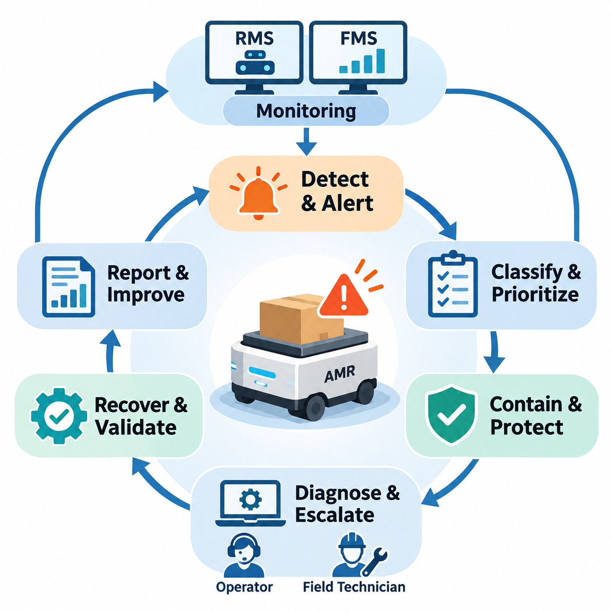
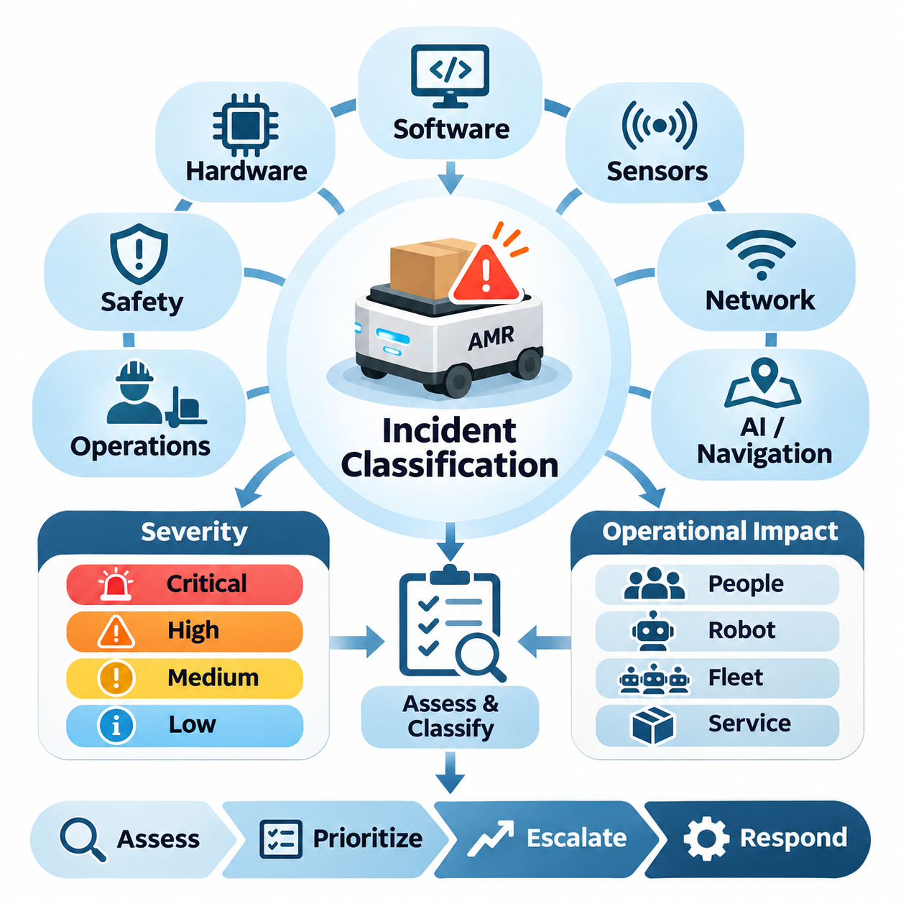
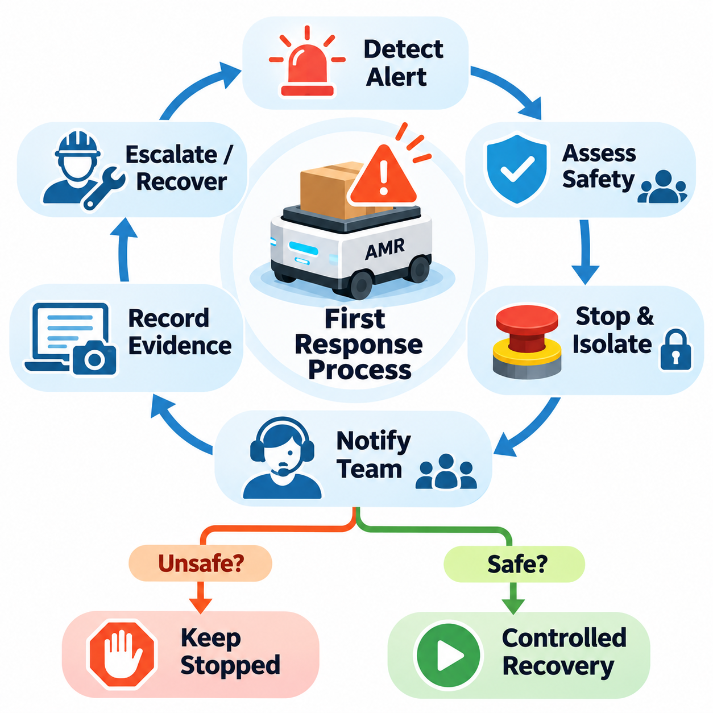
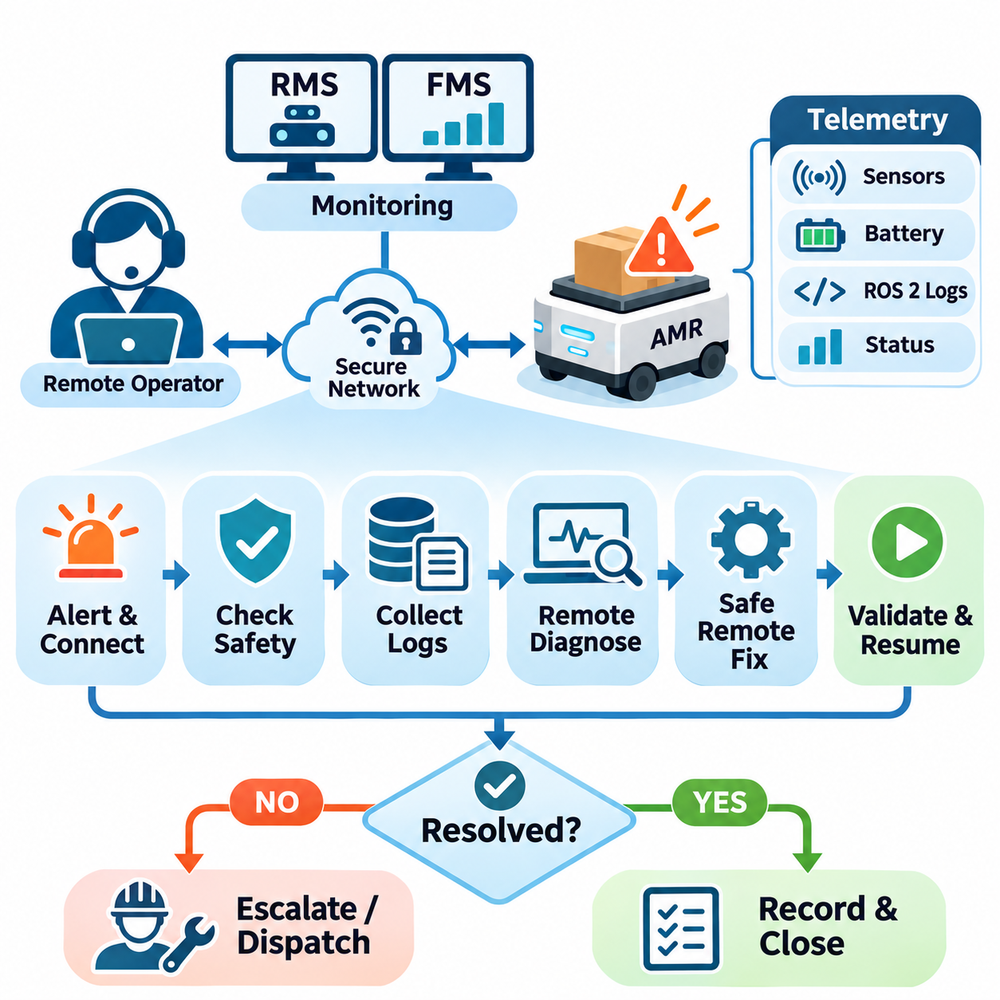
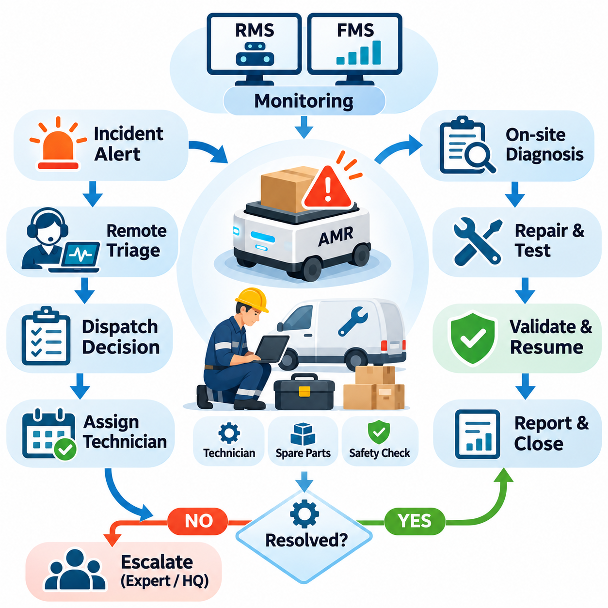
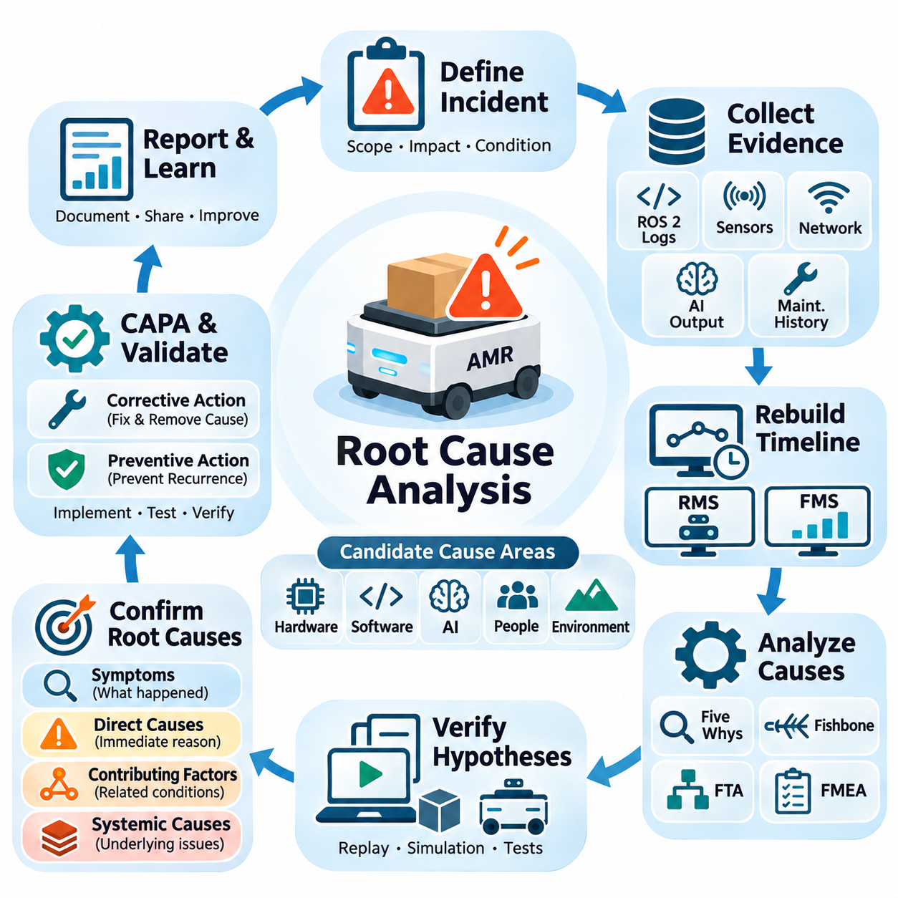
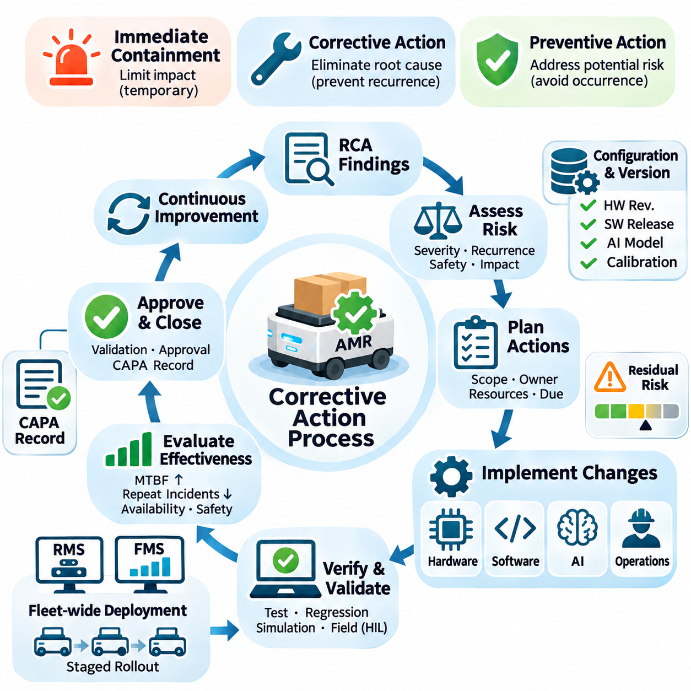
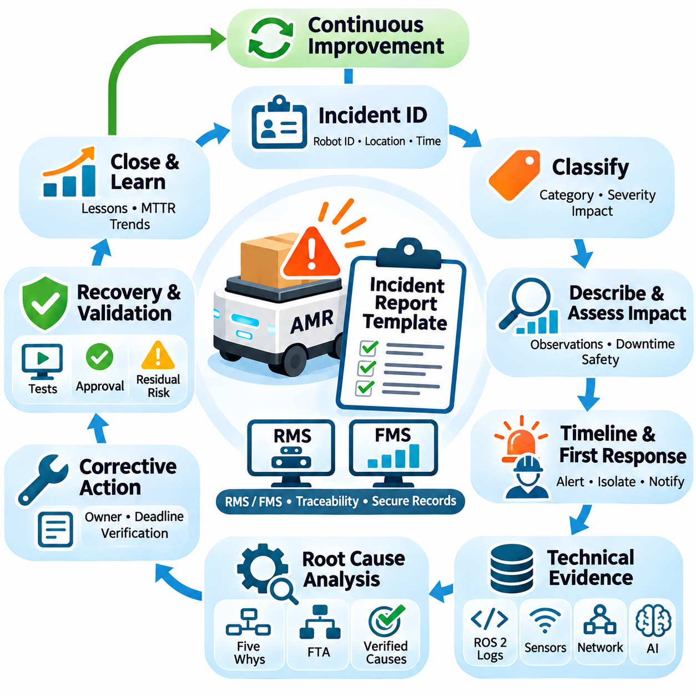

**Volume 08. AMR Operations, Deployment, and MLOps**

# Chapter 13. Incident Response

## 13.1 Incident Response Overview

{width="7.268055555555556in" height="7.268055555555556in"}

Incident response is a structured operational process designed to identify, assess, contain, investigate, and resolve unexpected events that affect the safety, reliability, availability, or performance of Autonomous Mobile Robots (AMRs). As autonomous robotic systems become increasingly integrated into industrial facilities, hospitals, logistics centers, and public environments, effective incident response becomes essential for maintaining operational continuity and minimizing potential damage.

Unlike conventional information technology systems, AMRs interact directly with physical environments, human operators, infrastructure, and other autonomous machines. A failure in mechanical components, electrical systems, perception algorithms, navigation software, or communication networks may generate physical consequences. Incident response must therefore integrate functional safety, system engineering, cybersecurity, operational management, and technical support into a unified framework.

An incident represents an unexpected event that disrupts normal operation or creates an unacceptable operational risk. Typical incidents include localization failure, navigation errors, unexpected robot stops, sensor malfunction, battery failure, communication disconnection, software crashes, and abnormal autonomous behavior. Safety-related incidents may additionally involve collisions, near misses, human injuries, property damage, or failures of protective mechanisms.

Incident classification establishes a systematic foundation for determining the appropriate response strategy. Incidents can be categorized according to severity, technical origin, operational impact, safety consequences, and affected system components. Minor incidents may require routine operator intervention, whereas critical incidents may require immediate operational suspension, emergency procedures, specialist intervention, and formal investigation.

The incident response lifecycle generally consists of preparation, detection, identification, classification, containment, investigation, recovery, and post-incident improvement. Each stage establishes specific operational responsibilities and decision-making requirements. A standardized lifecycle reduces uncertainty during unexpected situations and enables organizations to respond consistently across different robot platforms, deployment locations, and operating environments.

Preparation involves establishing incident response policies, emergency procedures, communication channels, escalation mechanisms, and technical support resources before an incident occurs. Operators and maintenance personnel must understand their responsibilities, authorized intervention procedures, and operational limitations. Incident response readiness should be evaluated through periodic training, simulated failure scenarios, and emergency response exercises.

Incident detection is supported by continuous monitoring of robot hardware, software, artificial intelligence models, communication infrastructure, and operational environments. Robot Management Systems (RMS) and Fleet Management Systems (FMS) collect real-time telemetry, diagnostic information, event notifications, and mission execution records. Automated monitoring mechanisms can identify abnormal conditions and initiate appropriate alerts or protective actions.

The first response process prioritizes human safety, environmental protection, and prevention of additional damage. Depending on the nature of the incident, authorized personnel may initiate an emergency stop, suspend affected missions, isolate the robot, or restrict access to the surrounding area. Operational recovery must never take precedence over safety requirements, and protective mechanisms must remain effective throughout the response process.

Remote troubleshooting enables technical support teams to investigate incidents without immediately dispatching personnel to deployment locations. Engineers can examine system logs, diagnostic messages, sensor measurements, software process states, network connectivity, and configuration information through secure remote interfaces. Historical operational data and recorded sensor streams can provide additional evidence for reconstructing abnormal system behavior.

Field technician dispatch becomes necessary when incidents cannot be resolved safely through remote assistance. Mechanical failures, electrical damage, degraded sensors, physical obstructions, and damaged safety components frequently require on-site inspection. Dispatch decisions should consider incident severity, technician qualifications, spare parts availability, geographical location, customer requirements, and contractual service commitments.

Incident investigation requires accurate preservation of operational evidence. Robot identification, timestamps, mission histories, software versions, AI model versions, environmental conditions, and operator actions should be recorded systematically. Time synchronization across edge devices, fleet management servers, and cloud infrastructure enables engineers to reconstruct event sequences and identify relationships between system failures.

Root Cause Analysis (RCA) identifies the underlying technical, organizational, or environmental factors responsible for an incident rather than merely addressing its visible symptoms. Methods such as the Five Whys, Fault Tree Analysis (FTA), and cause-and-effect analysis support systematic investigation. Complex incidents may involve multiple interacting failures across mechanical, electrical, software, AI, and operational subsystems.

Corrective and Preventive Action (CAPA) transforms investigation results into measurable engineering and operational improvements. Corrective actions address identified causes, while preventive actions reduce the probability of recurrence or similar failures elsewhere. These activities may include component replacement, software modification, AI model retraining, parameter optimization, infrastructure improvement, and revision of operational procedures.

Recovery requires verification that affected robots and supporting infrastructure can safely resume their designated functions. Hardware inspections, diagnostic tests, software validation, sensor calibration, and controlled mission execution may be necessary before operational authorization. Fleet-level recovery should additionally evaluate whether the identified failure mechanism affects other robots operating under similar configurations or environmental conditions.

Incident reporting establishes traceability and organizational accountability throughout the response lifecycle. A standardized incident report should document event descriptions, severity classifications, affected assets, response timelines, investigation findings, recovery actions, and assigned responsibilities. Centralized incident records support regulatory compliance, customer communication, reliability engineering, and continuous improvement across distributed robotic fleets.

Ultimately, incident response should operate as a closed-loop engineering and operational improvement mechanism rather than a reactive maintenance activity. Incident records can contribute to predictive maintenance, risk assessment, software regression testing, AI model validation, and robot design optimization. Response performance can be evaluated through detection time, response time, recovery time, incident recurrence rates, and corrective action effectiveness.

The preceding overview follows the supplied chapter structure, which progresses from incident classification and first response to remote troubleshooting, field technician dispatch, root cause analysis, corrective action, and incident reporting. Because the supplied materials define the chapter hierarchy rather than detailed technical requirements, the engineering principles and representative operational practices have been developed as a general AMR incident response framework.

## 13.2 Incident Classification

{width="7.268055555555556in" height="7.268055555555556in"}

Incident classification is a systematic process for categorizing unexpected operational events according to their severity, technical characteristics, safety implications, and operational consequences. In Autonomous Mobile Robot (AMR) operations, a standardized classification framework enables operators, maintenance personnel, and engineering teams to determine appropriate response priorities, allocate technical resources, and establish escalation procedures.

An incident classification framework should distinguish between normal operational events, abnormal conditions, technical faults, and actual incidents. A scheduled charging operation represents a normal event, whereas an unexpected battery temperature increase represents an abnormal condition. A battery management system failure that interrupts mission execution or creates a potential safety hazard may require formal incident registration and investigation.

Severity-based classification evaluates incidents according to their actual and potential consequences. A typical operational framework defines four severity levels: minor, moderate, major, and critical. Each level establishes different requirements for response time, technical intervention, operational restrictions, management notification, and recovery authorization. Classification thresholds should reflect the deployment environment and system risk assessment.

Minor incidents involve limited operational disturbances that do not significantly affect safety, system availability, or mission performance. Examples include temporary communication delays, recoverable navigation errors, and isolated application warnings. These incidents can generally be managed through approved operator procedures or validated automatic recovery mechanisms, provided that abnormal conditions do not indicate an underlying safety risk.

Moderate incidents represent technical or operational failures that temporarily interrupt robot functions without creating an immediate unacceptable safety risk. Examples include persistent localization errors, repeated docking failures, sensor communication faults, and unexpected software process termination. These incidents typically require technical investigation, controlled recovery procedures, and appropriate documentation within the incident management system.

Major incidents involve substantial operational disruption, significant equipment damage, or serious degradation of system reliability. Examples include motor controller failure, prolonged fleet communication interruption, critical sensor malfunction, and widespread software update failures. Major incidents generally require immediate escalation, operational restrictions, specialist engineering support, and formal verification before affected systems return to service.

Critical incidents represent events involving actual or imminent threats to human safety, environmental protection, or essential operational infrastructure. Examples include uncontrolled robot movement, serious collisions, battery thermal runaway, and failures of safety-critical mechanisms that expose people to unacceptable hazards. These incidents require immediate protective actions, emergency escalation, and authorized investigation before operational recovery.

Technical classification identifies incidents according to the affected engineering domain. Common categories include mechanical systems, electrical systems, battery and power management, sensors, perception, localization, navigation, motion control, communication networks, edge computing, cloud infrastructure, and artificial intelligence. Technical classification supports efficient assignment of incidents to specialized engineering and maintenance teams.

Artificial intelligence incidents require additional classification criteria because AI-related failures may occur without conventional hardware or software faults. Examples include incorrect object recognition, unexpected semantic interpretations, model performance degradation, distribution shifts, and unreliable autonomous decisions. Such incidents should be evaluated according to model behavior, environmental context, uncertainty, and potential physical consequences.

Operational impact classification evaluates how an incident affects mission execution, service availability, customer workflows, and business continuity. An isolated robot failure may have a limited impact when redundant fleet capacity is available, while a centralized Fleet Management System (FMS) failure may interrupt operations across multiple facilities. Impact assessment should therefore consider both individual robot functionality and fleet-level dependencies.

Safety classification must consider actual injuries, property damage, hazardous conditions, protective system failures, and near-miss events. The absence of physical damage does not necessarily indicate low severity because a near miss may reveal a significant weakness in the safety architecture. Potential consequences, human exposure, environmental conditions, and the effectiveness of remaining protective mechanisms should influence the classification decision.

Incident classification should also distinguish between isolated, recurring, correlated, and systemic failures. Isolated incidents affect individual components or robots, whereas recurring incidents appear repeatedly under similar operating conditions. Correlated incidents may indicate shared dependencies, while systemic failures may originate from architectural weaknesses, common software defects, configuration errors, or inadequate engineering processes.

Automated classification can be supported by Robot Management Systems (RMS), fleet monitoring platforms, diagnostic services, and intelligent event processing mechanisms. These systems correlate error codes, telemetry, mission states, sensor measurements, and historical incident records to recommend classification levels. However, uncertain or safety-critical classifications should remain subject to authorized human assessment and verification.

Severity classifications must remain dynamic throughout the incident response lifecycle. An initially minor communication fault may become a major incident if multiple robots experience simultaneous failures, or a critical incident if communication loss contributes to hazardous motion. Classification changes should be documented with supporting evidence, timestamps, responsible personnel, and corresponding adjustments to response procedures.

A standardized incident record should include a unique incident identifier, detection timestamp, robot identification, deployment location, affected subsystem, severity level, operational impact, safety implications, and current response status. Additional information may include software versions, AI model versions, environmental conditions, and historical recurrence. Consistent classification records enable traceability and cross-fleet failure analysis.

Ultimately, incident classification establishes the decision-making foundation for first response, remote troubleshooting, field technician dispatch, root cause analysis, and corrective action. Consistent classification improves resource allocation, reduces response delays, and supports continuous operational improvement. The four-level severity model presented here is a representative engineering framework extending the supplied chapter structure, rather than a mandatory classification standard.

## 13.3 First Response Process

{width="7.268055555555556in" height="7.268055555555556in"}

The first response process is the initial operational procedure executed immediately after an incident is detected in an Autonomous Mobile Robot (AMR) system. Its primary objectives are to protect human safety, stabilize abnormal conditions, prevent additional damage, and establish a controlled environment for technical investigation. An effective first response process minimizes incident escalation while maintaining operational accountability.

The first response process begins with incident detection through automated monitoring systems, operator observations, diagnostic alerts, or external reports. Robot Management Systems (RMS) and Fleet Management Systems (FMS) continuously monitor robot behavior, hardware conditions, communication status, and mission execution. Detected abnormalities should generate actionable notifications containing sufficient information to support immediate assessment.

Initial assessment determines the nature of the incident, its potential severity, affected robot functions, and immediate operational consequences. Operators should evaluate robot movement, surrounding environmental conditions, human exposure, payload stability, and the status of protective mechanisms. When available information is insufficient to establish safe operating conditions, a conservative response strategy should be adopted.

Human safety must remain the highest priority throughout the first response process. When an AMR exhibits uncontrolled movement, unexpected acceleration, collision risks, or failures of safety-critical components, appropriate protective actions must be initiated immediately. These actions may include emergency stop activation, access restrictions, and notification of responsible safety personnel according to established emergency procedures.

Incident containment aims to prevent an abnormal condition from propagating into additional robot systems, infrastructure, or operational processes. Affected robots may be removed from task allocation, restricted from autonomous movement, or isolated from selected services. Containment measures should consider shared traffic routes, payload handling equipment, charging stations, elevators, and dependencies between connected robotic platforms.

The operational state of an affected robot should be transitioned into a predefined safe state whenever required by the incident conditions. Depending on the system architecture, this state may involve controlled stopping, brake engagement, prevention of automatic restart, or appropriate energy isolation. The selection of a safe state must account for environmental conditions, stored energy, payload stability, and validated safety functions.

Incident registration establishes a formal record of the detected abnormal event and associated response activities. Essential information includes the incident identifier, robot identifier, deployment location, detection timestamp, mission status, observed symptoms, and preliminary severity classification. Recording initial observations before configuration changes or system restarts helps preserve valuable evidence for subsequent investigation.

Communication and escalation procedures ensure that relevant personnel receive accurate information within appropriate response intervals. Operators, fleet administrators, maintenance engineers, safety managers, and customer representatives should be notified according to incident severity and assigned responsibilities. Critical incidents require immediate escalation without waiting for comprehensive technical diagnosis or confirmation of the underlying failure mechanism.

Preliminary troubleshooting should focus on nonintrusive diagnostic activities that do not introduce additional operational risks. Authorized personnel may examine diagnostic messages, sensor status, battery conditions, network connectivity, software process states, and recent configuration changes. Repeated restarts, unauthorized parameter modifications, and bypassing protective mechanisms should be prohibited during initial incident assessment.

Operational evidence should be preserved before performing recovery actions whenever this can be achieved without compromising safety. Relevant evidence may include system logs, ROS 2 diagnostic messages, recorded sensor data, navigation trajectories, motor controller information, and AI inference results. Synchronized timestamps and configuration identifiers help reconstruct incident sequences and establish relationships between abnormal system behaviors.

Fleet-level coordination is particularly important when an incident affects multiple robots or shared operational infrastructure. The Fleet Management System should suspend affected missions, prevent conflicting task assignments, and redirect unaffected robots when alternative routes remain safe. Coordinated response mechanisms reduce secondary incidents, traffic congestion, resource conflicts, and unnecessary interruptions across the deployment environment.

AI-related incidents require additional precautions because abnormal autonomous behavior may occur without identifiable hardware failures or conventional software errors. Unexpected perception results, incorrect semantic interpretations, and unreliable navigation decisions should trigger appropriate operational restrictions. Relevant input data, inference outputs, model versions, and environmental conditions should be preserved for subsequent analysis.

Transition from first response to advanced technical support occurs when an incident cannot be safely resolved through authorized initial procedures. Remote troubleshooting teams or field technicians should receive structured incident information, diagnostic evidence, containment status, and details of completed interventions. Clearly defined handover procedures prevent duplicated activities, inconsistent decisions, and unauthorized recovery attempts.

Limited operational recovery may be permitted when the incident is understood, applicable recovery procedures have been validated, and required safety conditions are satisfied. Recovery authorization should consider hardware integrity, software stability, localization accuracy, communication reliability, and protective system functionality. Unresolved safety-critical incidents must remain under operational restriction until formal clearance is obtained.

First response effectiveness should be evaluated through measurable indicators such as Mean Time to Detect (MTTD), Mean Time to Acknowledge (MTTA), time to containment, escalation accuracy, and evidence completeness. Periodic emergency exercises and simulated failure scenarios help validate response readiness, communication effectiveness, and coordination between operators, technical support personnel, and operational management teams.

Ultimately, the first response process establishes the operational foundation for containment, remote troubleshooting, field technician dispatch, root cause analysis, and corrective action. The procedures described here constitute a representative AMR engineering framework developed from the supplied chapter structure. Specific response thresholds, authorization requirements, and emergency procedures must be tailored to each deployment environment.

## 13.4 Remote Troubleshooting

{width="7.268055555555556in" height="7.268055555555556in"}

Remote troubleshooting is a structured technical support process that enables engineers and maintenance personnel to diagnose, investigate, and resolve operational incidents in Autonomous Mobile Robot (AMR) systems without immediately visiting deployment locations. Its primary objectives are to reduce system downtime, accelerate incident resolution, minimize field service costs, and maintain safe and reliable robot operations across distributed environments.

A remote troubleshooting architecture integrates edge computing devices, Robot Management Systems (RMS), Fleet Management Systems (FMS), communication networks, and cloud-based diagnostic platforms. These components provide centralized access to robot operational states, hardware conditions, software processes, and historical event records. Secure bidirectional communication enables authorized engineers to perform diagnostic activities and controlled interventions.

Remote troubleshooting begins after the initial response process has established appropriate safety conditions and incident containment. Technical support personnel should receive the incident identifier, preliminary severity classification, robot location, observed symptoms, mission status, and records of previous interventions. This information establishes the diagnostic context and prevents unnecessary repetition of initial response activities.

Real-time telemetry provides an essential foundation for remote incident investigation. Battery voltage, current consumption, motor temperature, actuator feedback, processor utilization, memory usage, network latency, and sensor availability can reveal abnormal operating conditions. Comparing current measurements with historical baselines and validated operating ranges helps engineers identify component degradation and unexpected system behavior.

Software diagnostics focus on the operational status of robot applications, middleware, operating systems, and communication interfaces. In ROS 2 environments, engineers can investigate node availability, topic publication rates, service responses, lifecycle states, and diagnostic messages. Process monitoring and dependency analysis help identify application crashes, resource exhaustion, communication interruptions, and incompatible software configurations.

Sensor and perception troubleshooting requires access to representative sensor measurements, calibration parameters, synchronization states, and perception outputs. Engineers can investigate missing LiDAR scans, corrupted camera frames, inconsistent depth measurements, GNSS degradation, and IMU abnormalities. Comparing raw sensor observations with processed perception results helps distinguish hardware-related faults from algorithmic failures.

Localization and navigation troubleshooting examines the relationship between estimated robot poses, environmental maps, planned trajectories, and actual robot movement. Remote engineers can evaluate localization uncertainty, odometry consistency, map alignment, obstacle detection, and path planning results. Historical trajectory visualization helps identify localization drift, inaccessible destinations, navigation deadlocks, and unexpected motion behavior.

Artificial intelligence troubleshooting requires additional diagnostic capabilities because model-related failures may not generate conventional system error codes. Engineers should examine inference latency, confidence distributions, input data quality, model versions, and representative prediction outputs. Recorded operational data can support offline reproduction of incorrect detections, distribution shifts, and unreliable autonomous decisions.

Network troubleshooting evaluates communication reliability between robots, wireless access points, fleet management servers, and cloud infrastructure. Relevant measurements include packet loss, communication latency, bandwidth utilization, signal strength, connection stability, and message delivery rates. Engineers should distinguish local connectivity problems from infrastructure failures and centralized service interruptions affecting multiple robots.

Operational log analysis enables technical support personnel to reconstruct incident sequences across distributed system components. System logs, application logs, ROS 2 messages, safety events, mission histories, and configuration records should be correlated using synchronized timestamps. Event correlation helps identify relationships between failures, determine their propagation paths, and establish evidence-based diagnostic hypotheses.

Remote diagnostic environments may incorporate recorded sensor replay, simulation platforms, and digital twins to reproduce abnormal robot behavior without introducing additional physical risks. Engineers can evaluate alternative software configurations, navigation parameters, and AI model behavior within controlled environments. Reproduction results help validate suspected failure mechanisms before corrective changes are applied to deployed robots.

Remote corrective actions may include restarting non-safety-critical services, restoring approved configurations, resetting communication sessions, or rolling back defective software and AI model updates. These interventions must follow validated procedures and authorization requirements. Remote troubleshooting must never disable protective mechanisms or initiate robot movement without establishing the necessary local safety conditions.

Cybersecurity is a fundamental requirement because remote troubleshooting interfaces provide access to operationally sensitive robotic systems. Secure communication channels, multifactor authentication, role-based access control, time-limited authorization, and comprehensive audit logging should be implemented. Remote access privileges must be restricted to authorized personnel and the minimum capabilities required for incident resolution.

Recovery verification determines whether remote corrective actions have restored the expected robot functionality without introducing additional failures. Diagnostic checks, communication tests, software health monitoring, and controlled functional validation should be performed before operational resumption. Unresolved hardware faults, physical damage, or uncertain safety conditions require escalation to qualified field technicians.

Remote troubleshooting performance should be evaluated through indicators such as Mean Time to Diagnose (MTTD), Mean Time to Repair (MTTR), remote resolution rate, repeat incident rate, and avoided field service visits. Historical troubleshooting records can support knowledge base development, automated diagnostic rules, predictive maintenance, engineering improvements, and continuous optimization of technical support workflows.

Ultimately, remote troubleshooting connects first response, technical diagnosis, field technician dispatch, root cause analysis, and corrective action within an integrated incident management lifecycle. The architecture and diagnostic practices described here extend the supplied chapter structure into a representative AMR engineering framework. Specific access permissions, diagnostic thresholds, and recovery procedures must reflect each robot platform and deployment environment.

## 13.5 Field Technician Dispatch

{width="7.268055555555556in" height="7.268055555555556in"}

Field technician dispatch is a structured operational process that coordinates the deployment of qualified technical personnel to resolve incidents that cannot be safely or effectively addressed through remote troubleshooting. In Autonomous Mobile Robot (AMR) operations, effective technician dispatch minimizes system downtime, restores operational functionality, ensures physical safety, and maintains service continuity across distributed deployment environments.

The dispatch process generally begins when remote diagnostic activities identify physical damage, hardware malfunction, unresolved software failures, or uncertain safety conditions requiring on-site intervention. Typical dispatch scenarios include motor failures, battery abnormalities, damaged sensors, wiring defects, mechanical deformation, and malfunctioning safety components. Dispatch decisions should be based on documented technical evidence and incident severity.

Dispatch prioritization determines the urgency of field service according to safety implications, operational impact, customer requirements, and contractual Service Level Agreements (SLAs). Critical incidents involving human safety or essential infrastructure require immediate escalation and appropriate emergency measures. Less severe incidents may be scheduled according to available maintenance windows, operational redundancy, and technician availability.

Technician assignment should consider technical qualifications, engineering specialization, geographical proximity, certification requirements, and familiarity with the affected robot platform. Modern AMR systems integrate mechanical engineering, electrical systems, embedded computing, artificial intelligence, and autonomous navigation. Consequently, complex incidents may require coordination between multiple engineering specialists rather than a single general maintenance technician.

A standardized dispatch work order establishes the technical and operational scope of the field intervention. The work order should include the incident identifier, robot identification, deployment location, severity classification, observed symptoms, diagnostic results, containment status, and previous recovery attempts. Providing comprehensive incident information before departure reduces diagnostic duplication and improves technician preparation.

Spare parts and equipment preparation represents an essential component of dispatch planning. Technicians should receive appropriate replacement components, diagnostic instruments, calibration equipment, maintenance tools, and personal protective equipment. Historical failure records, component compatibility information, and inventory management systems can help determine the necessary resources and reduce repeated field service visits.

Field service coordination requires effective communication between remote support engineers, fleet administrators, site operators, customer representatives, and dispatched technicians. Robot Management Systems (RMS) and Fleet Management Systems (FMS) can provide relevant operational information, while field service management platforms coordinate technician availability, travel schedules, work order status, and service progress.

Upon arrival, the field technician must verify the incident conditions, confirm the affected robot identity, and establish a safe working environment before performing technical interventions. Appropriate safety procedures may include operational isolation, prevention of unexpected movement, energy isolation, and verification of stored energy conditions. Maintenance activities must comply with site-specific safety regulations and approved service procedures.

On-site diagnostic activities should systematically investigate suspected failure mechanisms while preserving relevant operational evidence. Mechanical inspections, electrical measurements, communication tests, sensor diagnostics, and software health assessments help distinguish component failures from systemic problems. Diagnostic findings should be compared with remote investigation results, technical specifications, and historical maintenance records.

Field repair activities may involve component replacement, wiring restoration, sensor realignment, mechanical adjustment, firmware recovery, or restoration of approved software configurations. Replacement components must satisfy compatibility, performance, and safety requirements. All modifications should be documented to maintain configuration traceability and prevent unauthorized deviations from the validated robot architecture.

Post-repair validation determines whether the affected robot can safely resume its designated operational functions. Verification activities may include hardware inspections, sensor calibration, communication tests, motion control evaluation, localization validation, and controlled mission execution. Safety-related repairs require appropriate verification of affected protective functions before authorization for normal autonomous operation.

Field technicians should collaborate with remote engineering teams when incidents involve complex software dependencies, AI model behavior, or intermittent system failures. Recorded sensor streams, diagnostic logs, environmental observations, and physical inspection results can support deeper engineering analysis. When the root cause remains uncertain, temporary recovery must not be treated as permanent incident resolution.

Digital field service management systems improve dispatch efficiency by integrating incident records, technician schedules, spare parts inventories, maintenance histories, and customer communication. Integration with RMS, FMS, and enterprise maintenance platforms enables organizations to track service progress, estimate response times, manage resource allocation, and maintain consistent operational records across multiple deployment locations.

Field technician dispatch performance should be evaluated through measurable indicators such as Mean Time to Dispatch, Mean Time to Arrive, Mean Time to Repair (MTTR), First-Time Fix Rate (FTFR), repeat visit rate, and SLA compliance. These indicators help identify geographical service coverage limitations, insufficient spare parts availability, technical training requirements, and inefficiencies in dispatch coordination.

Completed field service activities should generate structured maintenance and incident records documenting diagnostic findings, identified failure mechanisms, replaced components, configuration changes, validation results, and recovery authorization. These records support Root Cause Analysis (RCA), Corrective and Preventive Action (CAPA), predictive maintenance, product reliability analysis, and continuous engineering improvement.

Ultimately, field technician dispatch connects remote troubleshooting, physical maintenance, root cause analysis, corrective action, and incident reporting within an integrated AMR operational lifecycle. The procedures presented here extend the supplied chapter structure into a representative engineering framework. Specific dispatch priorities, technician qualifications, service commitments, and recovery criteria must reflect individual deployment requirements.

## 13.6 Root Cause Analysis

{width="7.268055555555556in" height="7.268055555555556in"}

Root Cause Analysis (RCA) is a systematic engineering process used to identify the underlying causes of operational incidents, technical failures, and abnormal system behavior in Autonomous Mobile Robot (AMR) systems. Rather than focusing exclusively on immediate symptoms or restoring operational functionality, RCA investigates the conditions and mechanisms responsible for an incident to prevent recurrence and improve long-term system reliability.

The root cause analysis process typically begins after initial incident response, remote troubleshooting, and necessary field interventions have established stable operational conditions. Investigators should define the incident scope, affected robot functions, operational consequences, and known circumstances. Serious safety incidents may also require immediate evidence preservation and formal investigation before repair or operational recovery.

Effective root cause analysis distinguishes between observable symptoms, direct causes, contributing factors, and underlying systemic causes. For example, an unexpected robot stop may represent an observable symptom, while communication interruption represents a direct cause. Insufficient wireless network coverage, inadequate infrastructure validation, or deficient communication recovery mechanisms may represent deeper contributing or systemic causes.

Evidence collection provides the technical foundation for reliable root cause analysis. Relevant information includes system logs, ROS 2 diagnostic messages, sensor measurements, motor controller feedback, battery management records, network statistics, AI inference outputs, and maintenance histories. Investigators should preserve original evidence, configuration information, software versions, and synchronized timestamps to maintain analytical traceability.

Incident timeline reconstruction establishes the chronological relationships between operational events, environmental changes, system responses, and failure conditions. Data collected from Robot Management Systems (RMS), Fleet Management Systems (FMS), edge computing devices, and external infrastructure should be correlated. Accurate event sequencing helps distinguish initiating failures from subsequent consequences and cascading system abnormalities.

The Five Whys method provides a relatively simple analytical approach for investigating underlying failure mechanisms through successive causal questions. Investigators repeatedly examine why an observed failure occurred until actionable underlying causes are identified. However, complex AMR incidents may involve multiple interacting causes, requiring branching investigations rather than relying exclusively on a single linear sequence of explanations.

Fishbone Analysis, also known as Ishikawa Analysis, organizes potential incident causes into categories such as hardware, software, human factors, environmental conditions, operational procedures, and management processes. This approach supports multidisciplinary investigations by encouraging systematic consideration of alternative explanations. Identified potential causes must subsequently be evaluated against available technical evidence.

Fault Tree Analysis (FTA) investigates how combinations of lower-level failures can contribute to a defined undesirable system event. Logical relationships between component failures, communication interruptions, software defects, and protective function failures help identify possible causal pathways. This approach is particularly valuable when investigating collision incidents, uncontrolled robot movement, and failures of safety-critical systems.

Failure Mode and Effects Analysis (FMEA) complements root cause analysis by examining potential failure modes, their operational consequences, and existing detection or prevention mechanisms. Findings from actual incidents can be incorporated into existing FMEA records to reassess failure likelihood, severity, and detection effectiveness. This feedback process strengthens engineering risk management and supports preventive design improvements.

AI-related root cause analysis requires investigation of training datasets, input distributions, model architectures, inference behavior, and deployment configurations. Abnormal perception outputs or unreliable autonomous decisions may originate from insufficient training coverage, sensor degradation, distribution shifts, or inappropriate confidence thresholds. Dataset and model version traceability is essential for identifying these causal relationships.

Failure reproduction and hypothesis verification help determine whether suspected causes are consistent with observed incident behavior. Recorded sensor data, software replay, simulation environments, digital twins, and controlled physical testing can support systematic experimentation. Investigators should isolate relevant variables, evaluate alternative explanations, and document experimental limitations before confirming causal conclusions.

Human and organizational factors must also be considered because operational incidents may originate from inadequate training, unclear responsibilities, incomplete maintenance procedures, or ineffective change management. Root cause analysis should prioritize objective investigation rather than individual blame. Understanding the organizational conditions that influence human decisions supports more effective and sustainable incident prevention.

Confirmed root causes should be translated into Corrective and Preventive Actions (CAPA) that address both immediate failures and underlying systemic weaknesses. Engineering modifications, software updates, improved diagnostic mechanisms, revised operational procedures, and additional validation requirements may be necessary. Action owners, implementation deadlines, and measurable effectiveness criteria should be formally established.

Root cause analysis results should be documented in structured incident investigation reports containing incident descriptions, collected evidence, analytical methods, confirmed causes, unresolved uncertainties, and recommended actions. Centralized knowledge repositories enable engineering teams to identify recurring failure patterns across robot fleets and incorporate operational experience into future product development and deployment strategies.

Ultimately, root cause analysis transforms operational incidents into opportunities for systematic engineering improvement, connecting incident response with corrective action, predictive maintenance, quality assurance, and lifecycle management. The analytical methods presented here extend the supplied chapter structure into a representative AMR engineering framework. Investigation depth and method selection should reflect incident complexity, available evidence, and safety implications.

## 13.7 Corrective Action Process

{width="7.268055555555556in" height="7.268055555555556in"}

The corrective action process is a structured engineering and operational procedure designed to eliminate the underlying causes of incidents and prevent their recurrence in Autonomous Mobile Robot (AMR) systems. Following Root Cause Analysis (RCA), corrective actions translate investigative findings into practical improvements that enhance robot reliability, operational safety, system availability, and long-term performance.

Corrective action should be distinguished from immediate correction, incident containment, and preventive action. Immediate correction addresses an observed failure, while containment limits its operational consequences. Corrective action eliminates the identified causes of an existing problem, whereas preventive action addresses potential failures before they occur. These activities collectively constitute a systematic improvement process.

The corrective action process begins with a review of incident investigation results, confirmed root causes, contributing factors, and associated operational risks. Engineering teams should determine whether the identified causes originate from hardware, software, artificial intelligence, environmental conditions, operational procedures, or organizational practices. Each proposed action should address a documented causal relationship.

Corrective action prioritization should consider incident severity, recurrence probability, safety implications, fleet-wide exposure, implementation complexity, and operational impact. Safety-critical deficiencies require immediate attention and appropriate interim protective measures. Lower-risk improvements may be scheduled within planned maintenance windows or coordinated software release cycles to minimize unnecessary operational disruption.

A corrective action plan defines the technical scope, implementation procedures, responsible personnel, required resources, completion deadlines, and acceptance criteria for each improvement. Corrective actions should have measurable objectives directly associated with identified failure mechanisms. Clearly defined ownership and approval responsibilities help ensure accountability throughout implementation, validation, and operational recovery.

Hardware corrective actions may involve component replacement, mechanical redesign, electrical circuit improvements, thermal management optimization, sensor mounting adjustments, or enhanced environmental protection. Engineering teams must evaluate whether the proposed modifications introduce additional failure modes, affect component compatibility, or alter validated safety functions before releasing updated hardware configurations.

Software corrective actions address programming defects, communication failures, resource management problems, configuration errors, and unreliable system interactions. ROS 2 applications may require improvements to node lifecycle management, communication settings, exception handling, or diagnostic mechanisms. All software modifications should undergo version control, technical review, regression testing, and controlled deployment procedures.

AI-related corrective actions may include dataset expansion, annotation correction, model retraining, confidence threshold adjustment, inference optimization, and improvements to uncertainty estimation. Changes should address confirmed model-related failure mechanisms without degrading performance in previously validated environments. Representative operational datasets and independent evaluation scenarios support reliable model validation.

Operational corrective actions focus on deficiencies in deployment procedures, maintenance workflows, operator training, task allocation, and environmental management. For example, recurring navigation failures associated with obstructed pathways may require revised traffic management procedures and facility layout improvements. Addressing operational conditions can be as important as modifying the robot hardware or software itself.

Configuration and change management mechanisms ensure that corrective modifications remain traceable throughout the AMR lifecycle. Updated hardware revisions, software releases, AI model versions, calibration parameters, and operational settings should be recorded in centralized repositories. Approved configuration baselines and rollback procedures reduce the risks associated with inconsistent implementation across distributed robot fleets.

Corrective action verification evaluates whether the planned modifications have been implemented correctly and satisfy defined technical requirements. Relevant verification methods include component testing, software regression testing, sensor calibration, simulation, hardware-in-the-loop testing, and controlled field validation. Safety-related changes require appropriate reassessment of affected hazards and protective functions.

Fleet-wide implementation requires determining whether an identified failure mechanism affects other robots operating with similar hardware, software, or deployment configurations. Robot Management Systems (RMS) and Fleet Management Systems (FMS) can support affected asset identification, update coordination, and implementation tracking. Staged deployment strategies help limit the operational risks of widespread corrective changes.

Effectiveness evaluation determines whether implemented corrective actions have eliminated or sufficiently controlled the conditions responsible for incident recurrence. Relevant indicators include repeat incident rate, Mean Time Between Failures (MTBF), system availability, diagnostic accuracy, and safety event frequency. Evaluation periods should reflect operational exposure and the characteristics of the original failure mechanism.

Corrective action closure should occur only after implementation, verification, effectiveness evaluation, and required approvals have been completed. Structured Corrective and Preventive Action (CAPA) records should document the original incident, confirmed causes, implemented changes, supporting evidence, residual risks, and final approval status. Ineffective actions must remain open or be reassessed through additional investigation.

Ultimately, the corrective action process establishes a closed-loop improvement mechanism connecting incident response, root cause analysis, quality assurance, predictive maintenance, and engineering development. The practices described here extend the supplied chapter structure into a representative AMR engineering framework. Specific approval procedures, validation requirements, and effectiveness criteria must reflect individual deployment conditions.

## 13.8 Incident Report Template

{width="7.268055555555556in" height="7.268055555555556in"}

An incident report template is a standardized documentation framework used to record operational incidents, technical failures, safety events, and associated response activities in Autonomous Mobile Robot (AMR) systems. Its primary purpose is to ensure consistent incident documentation, establish operational traceability, support technical investigations, and facilitate corrective actions across distributed robot deployment environments.

Incident reports should provide a comprehensive record of the entire incident lifecycle, beginning with initial detection and continuing through first response, remote troubleshooting, field technician dispatch, root cause analysis, and corrective action. A standardized reporting structure ensures that relevant information is consistently captured regardless of incident complexity, robot platform, deployment location, or responsible engineering team.

The incident identification section establishes essential administrative and operational information associated with the reported event. It should include a unique incident identifier, robot identifier, robot model, deployment location, occurrence timestamp, detection timestamp, reporting personnel, and responsible department. Unique identifiers enable incident records to be correlated with maintenance histories, diagnostic logs, and service requests.

The incident classification section describes the event category, severity level, affected technical domains, operational impact, and potential safety implications. Incidents may involve mechanical failures, electrical abnormalities, sensor malfunctions, software defects, communication interruptions, or AI-related errors. Consistent classification criteria support response prioritization, escalation decisions, and statistical analysis across robot fleets.

The incident description section provides a factual explanation of the observed event, including robot behavior, assigned mission, environmental conditions, system status, and abnormal symptoms. Reporting personnel should distinguish direct observations from preliminary assumptions and unverified interpretations. Accurate descriptions establish a reliable foundation for subsequent technical diagnosis and engineering investigation.

The incident impact assessment documents the consequences of the event for human safety, robot functionality, operational productivity, infrastructure availability, and customer service. Relevant measurements may include system downtime, interrupted missions, affected robots, equipment damage, and recovery costs. Actual consequences should be distinguished from potential risks and consequences associated with near-miss events.

The incident timeline section reconstructs the chronological sequence of events from initial detection through operational recovery and final closure. Important milestones include alert generation, incident acknowledgment, containment, escalation, diagnostic activities, technician arrival, corrective action implementation, and recovery authorization. Synchronized timestamps support event correlation and response performance evaluation.

The first response section records immediate protective actions, operational restrictions, emergency stop activation, affected robot isolation, and communication with responsible personnel, where applicable. It should identify who performed each intervention, when the action occurred, and whether the intended outcome was achieved. Unresolved safety conditions and limitations of the initial response must also be documented.

The technical investigation section captures remote troubleshooting results, on-site diagnostic findings, component inspections, and relevant operational evidence. Supporting materials may include ROS 2 diagnostic messages, sensor recordings, navigation trajectories, system logs, network statistics, and AI inference outputs. Evidence references should preserve traceability to original data sources, timestamps, and configuration versions.

The root cause analysis section documents confirmed failure mechanisms, contributing factors, identified systemic weaknesses, and the analytical methods used during investigation. Techniques such as Five Whys, Fishbone Analysis, and Fault Tree Analysis (FTA) can support structured causal evaluation. Unverified hypotheses, conflicting evidence, investigation limitations, and unresolved uncertainties should be explicitly identified.

The corrective action section describes approved improvements intended to eliminate identified incident causes and prevent recurrence. Hardware modifications, software updates, AI model improvements, revised maintenance procedures, and additional operator training may be recorded. Each action should have an assigned owner, implementation deadline, verification method, measurable acceptance criteria, and documented completion status.

The recovery and validation section establishes whether the affected robot has satisfied the requirements for safe operational resumption. Relevant records may include functional test results, calibration measurements, safety verification, regression testing, and controlled mission execution. Recovery authorization should identify approving personnel, remaining operational restrictions, residual risks, and any required follow-up activities.

Incident reporting systems should integrate with Robot Management Systems (RMS), Fleet Management Systems (FMS), maintenance platforms, and engineering knowledge repositories. Automated information collection can reduce manual reporting errors and improve documentation consistency. Access control, revision histories, data retention policies, and protection of sensitive operational information are essential for maintaining report integrity.

The incident closure section summarizes investigation conclusions, corrective action status, recovery results, lessons learned, and final approval decisions. Completed reports support incident trend analysis, Mean Time to Repair (MTTR) evaluation, recurrence rate monitoring, predictive maintenance, and product reliability improvement. Unresolved corrective actions should remain traceable through separate records until effectiveness is verified.

Ultimately, an incident report template transforms individual operational incidents into structured engineering knowledge that supports continuous improvement throughout the AMR lifecycle. The proposed reporting fields extend the supplied Chapter 13 structure into a representative engineering documentation framework. Mandatory fields, approval responsibilities, reporting deadlines, and retention requirements must reflect specific deployment environments and applicable regulations.
