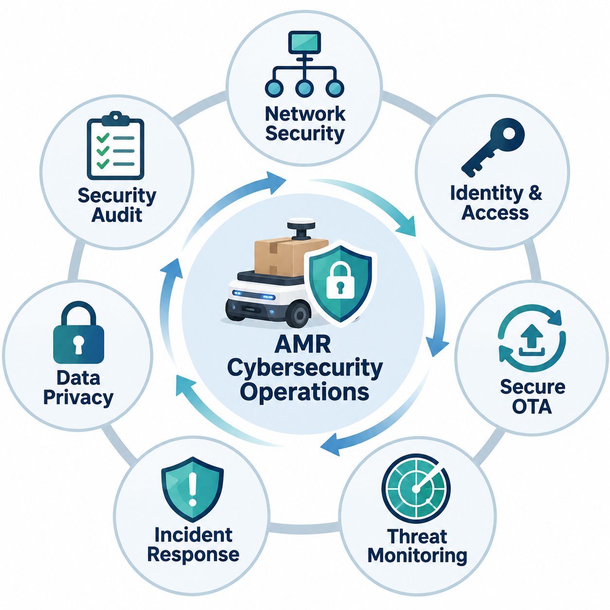
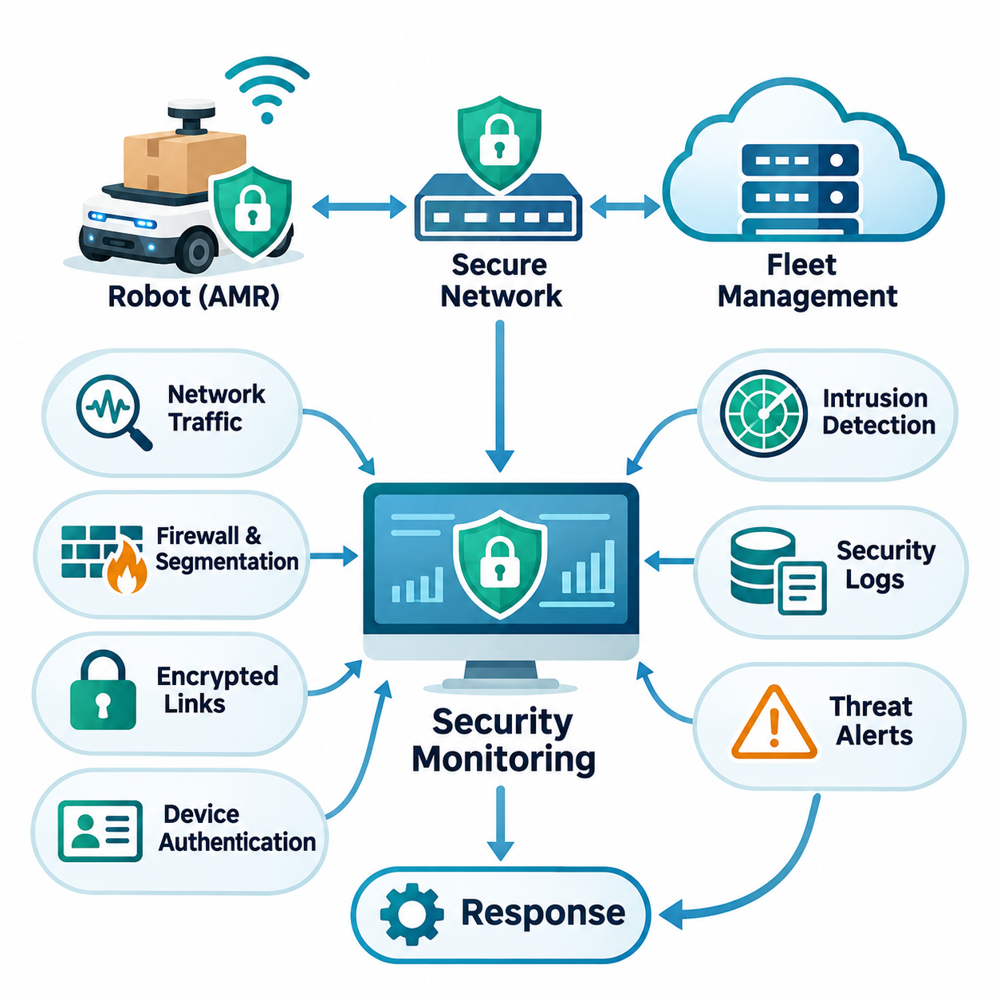
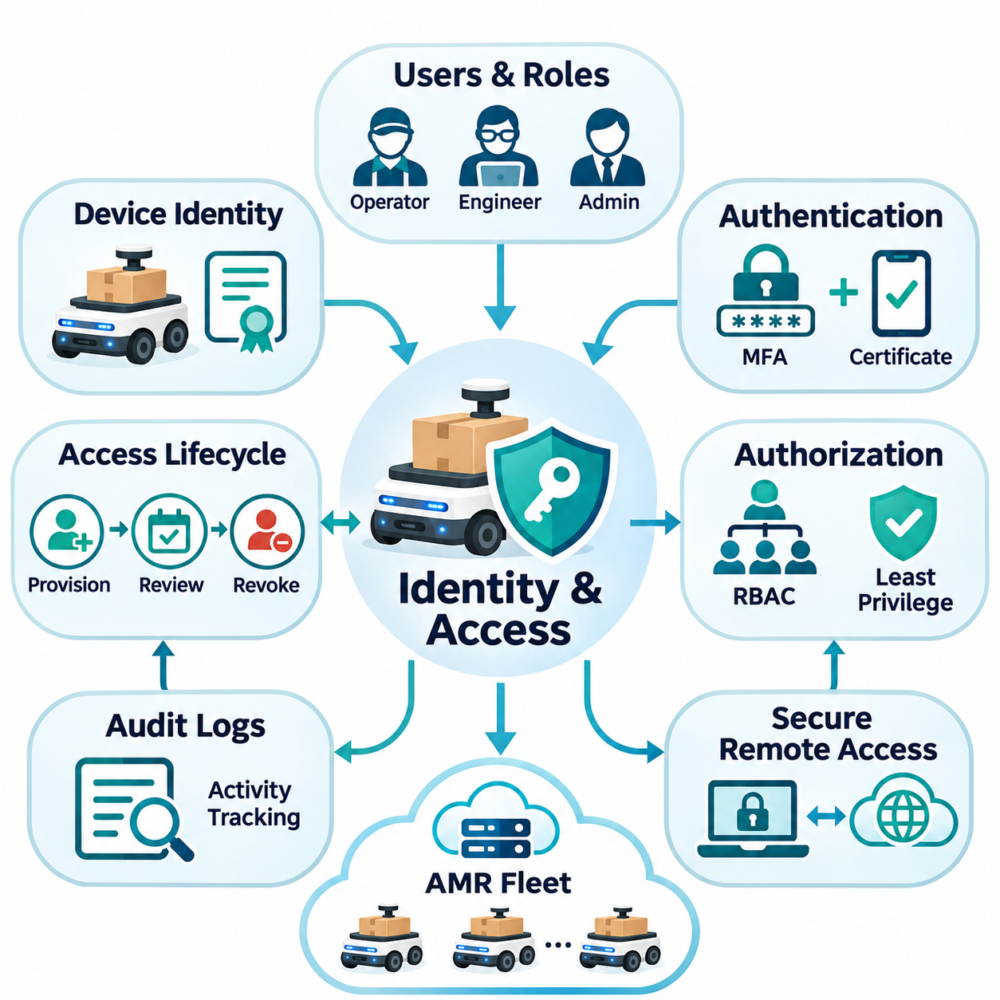
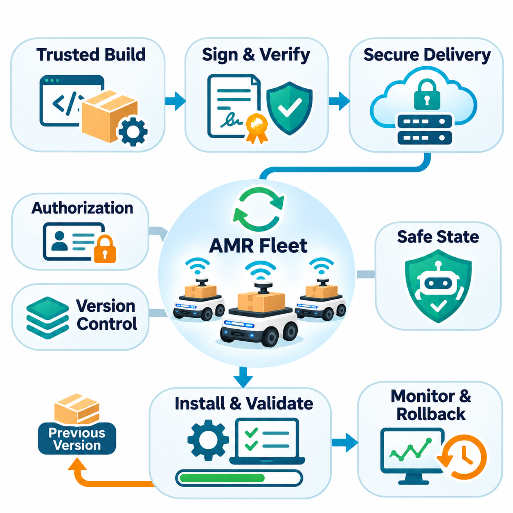
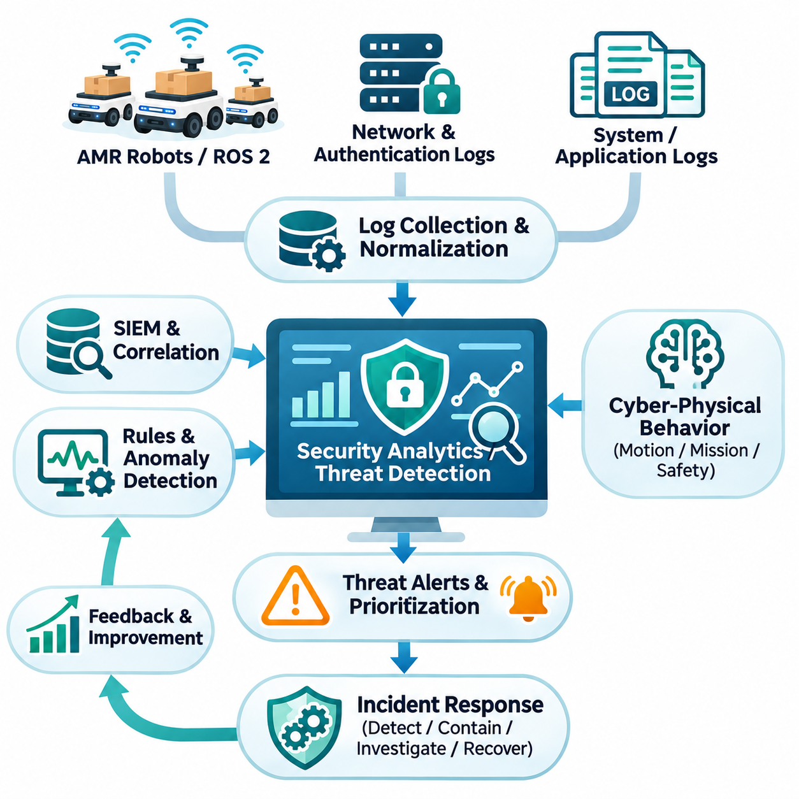
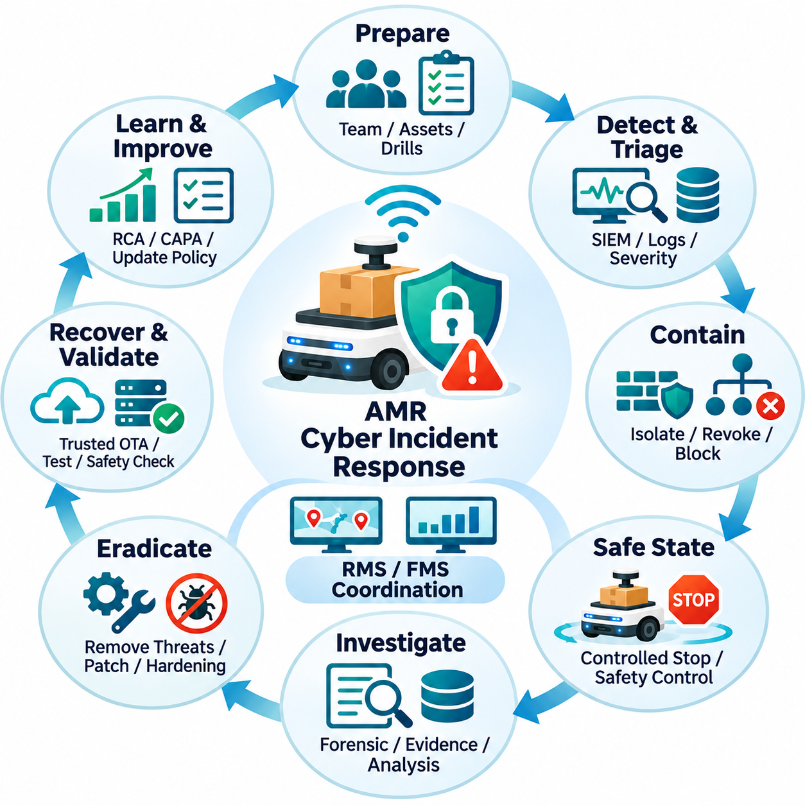
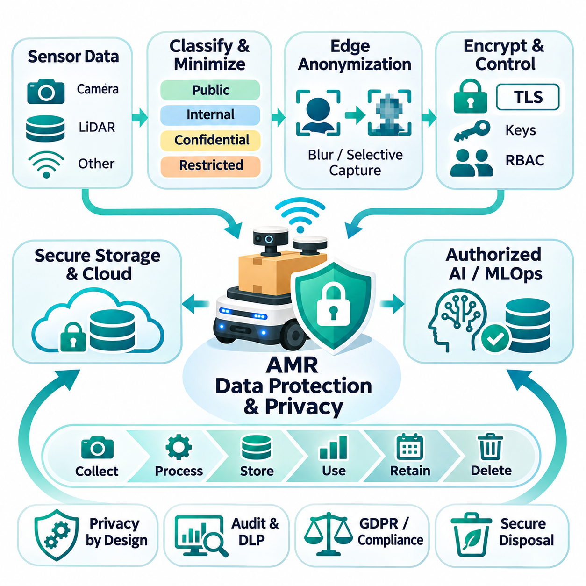
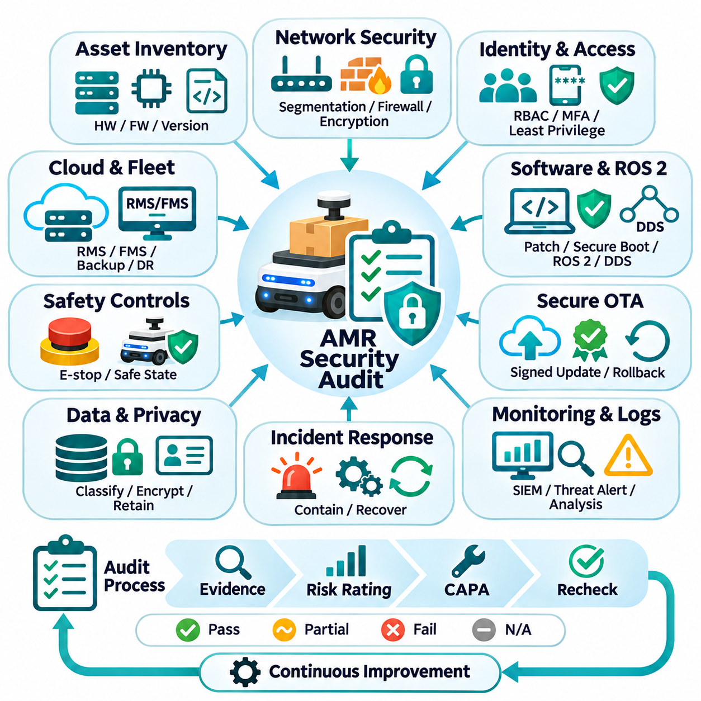

**Volume 08. AMR Operations, Deployment, and MLOps**


# Chapter 14. Cybersecurity Operations

##  

## 14.1 Cybersecurity Operations Overview

{width="7.268055555555556in" height="7.268055555555556in"}

Cybersecurity operations in Autonomous Mobile Robot (AMR) systems represent the continuous process of protecting robotic platforms, communication networks, software applications, and operational data against unauthorized access, malicious activities, and security vulnerabilities. Unlike conventional information technology systems, AMR cybersecurity must address both digital security and physical safety because compromised robotic behavior can directly affect people, equipment, and infrastructure.

Modern AMR ecosystems integrate embedded controllers, edge computing devices, wireless communication networks, Robot Management Systems (RMS), Fleet Management Systems (FMS), cloud infrastructure, and artificial intelligence models. Each interconnected component introduces potential security risks and expands the overall attack surface. Cybersecurity operations must therefore establish a comprehensive protection framework that extends across the entire operational architecture.

The fundamental objectives of cybersecurity operations include confidentiality, integrity, and availability, commonly referred to as the CIA triad. Confidentiality prevents unauthorized access to sensitive information, while integrity ensures that software, operational commands, and collected data remain trustworthy. Availability guarantees that authorized users and robotic systems can access essential services whenever required during mission execution.

Cybersecurity operations must be integrated throughout the AMR operational lifecycle, beginning with device provisioning and deployment and continuing through daily operation, maintenance, software updates, and eventual decommissioning. Security should not be considered a one-time engineering activity. Continuous monitoring, vulnerability assessment, configuration management, and security validation are necessary to maintain protection against evolving threats.

Robot network security monitoring provides visibility into communication activities between individual robots, fleet management servers, edge computing platforms, and external applications. Network traffic analysis, intrusion detection systems, firewall monitoring, and communication anomaly detection help identify unauthorized connections and suspicious behavior. Network segmentation can further restrict the propagation of security incidents across operational environments.

Account and access management ensures that only authorized personnel, applications, and devices can interact with robotic resources. Role-Based Access Control (RBAC), Multi-Factor Authentication (MFA), device certificates, and the principle of least privilege reduce the likelihood of unauthorized operations. Access permissions must be periodically reviewed and adjusted according to personnel responsibilities, operational requirements, and organizational changes.

Secure communication is particularly important because AMR platforms frequently exchange mission commands, localization information, sensor measurements, and diagnostic data through wireless networks. Transport Layer Security (TLS), mutual authentication, certificate management, and encrypted communication channels help protect information against interception and manipulation. Authentication mechanisms must also verify the identity of connected robotic devices.

Secure Over-the-Air (OTA) operations protect software, firmware, configuration files, and AI models distributed to deployed robots. Digital signatures, cryptographic integrity verification, trusted software repositories, and controlled deployment procedures help prevent unauthorized modifications. Update mechanisms should also incorporate compatibility validation, authenticated distribution, installation monitoring, and secure rollback capabilities.

Vulnerability management identifies and prioritizes security weaknesses within operating systems, middleware, software libraries, container images, and embedded firmware. A Software Bill of Materials (SBOM) provides visibility into deployed software dependencies. Security patches should be evaluated according to vulnerability severity, operational exposure, system compatibility, and potential impacts on robot availability before controlled field deployment.

Operational log analysis and threat detection provide essential capabilities for identifying abnormal system behavior. Security-related logs may include authentication attempts, network connections, configuration modifications, administrative actions, software installations, and rejected commands. Centralized log management and Security Information and Event Management (SIEM) platforms can correlate distributed events and support timely investigation.

Cybersecurity incident response establishes structured procedures for detecting, analyzing, containing, and recovering from security incidents. When suspicious activities are identified, affected robots or network segments may require isolation to prevent further compromise. Response procedures must consider the physical operating environment, ensuring that containment measures do not introduce additional hazards or interfere with essential safety functions.

Data protection and privacy management are critical because AMR platforms continuously collect environmental images, spatial maps, operational records, and potentially sensitive information. Encryption at rest, controlled data access, retention policies, anonymization, and secure deletion help minimize information exposure. Data governance must also define ownership, authorized processing purposes, and restrictions on transferring operational information.

Artificial intelligence introduces additional cybersecurity considerations into modern AMR operations. Manipulated training datasets, unauthorized model replacements, adversarial inputs, and compromised inference pipelines can degrade autonomous decision-making. Integrating security controls into Machine Learning Operations (MLOps) helps establish dataset provenance, model integrity, deployment authorization, and traceability throughout the AI model lifecycle.

Security governance and periodic audits establish accountability and evaluate the effectiveness of implemented protection mechanisms. Operational practices can be informed by frameworks such as IEC 62443, ISO/IEC 27001, and the NIST Cybersecurity Framework. Security performance indicators may include vulnerability remediation time, incident detection time, incident containment time, patch compliance, and unauthorized access events.

Ultimately, cybersecurity operations transform AMR protection from a collection of isolated technical controls into a continuous operational discipline. Effective integration of network monitoring, access management, secure updates, threat detection, incident response, data protection, and security audits enables resilient robotic services. This integrated approach supports safe, reliable, scalable, and trustworthy autonomous robot deployment.

자율 이동 로봇(Autonomous Mobile Robot, AMR) 시스템에서 사이버 보안 운영(Cybersecurity Operations)은 로봇 플랫폼(Robot Platform), 통신 네트워크(Communication Network), 소프트웨어 애플리케이션(Software Application), 운영 데이터(Operational Data)를 무단 접근(Unauthorized Access), 악의적 활동(Malicious Activity), 보안 취약점(Security Vulnerability)으로부터 보호하는 지속적인 프로세스를 의미한다. 기존의 정보 기술(Information Technology, IT) 시스템과 달리 AMR 사이버 보안은 디지털 보안(Digital Security)과 물리적 안전(Physical Safety)을 모두 고려해야 한다. 이는 보안이 침해된 로봇의 행동이 사람, 장비 및 인프라에 직접적인 영향을 미칠 수 있기 때문이다.

현대적인 AMR 생태계(AMR Ecosystem)는 임베디드 제어기(Embedded Controller), 엣지 컴퓨팅 장치(Edge Computing Device), 무선 통신 네트워크(Wireless Communication Network), 로봇 관리 시스템(Robot Management System, RMS), 플릿 관리 시스템(Fleet Management System, FMS), 클라우드 인프라(Cloud Infrastructure), 인공지능 모델(Artificial Intelligence Model)을 통합한다. 상호 연결된 각각의 구성 요소는 잠재적인 보안 위험(Security Risk)을 발생시키고 전체 공격 표면(Attack Surface)을 확장한다. 따라서 사이버 보안 운영은 전체 운영 아키텍처(Operational Architecture)를 포괄하는 종합적인 보호 프레임워크(Protection Framework)를 구축해야 한다.

사이버 보안 운영의 기본 목표는 일반적으로 CIA 삼원칙(CIA Triad)이라고 불리는 기밀성(Confidentiality), 무결성(Integrity), 가용성(Availability)을 포함한다. 기밀성은 민감한 정보에 대한 무단 접근을 방지하며, 무결성은 소프트웨어, 운영 명령(Operational Command), 수집 데이터(Collected Data)의 신뢰성을 보장한다. 가용성은 임무 수행(Mission Execution) 과정에서 권한을 가진 사용자와 로봇 시스템이 필요할 때 필수 서비스(Essential Service)에 접근할 수 있도록 보장한다.

사이버 보안 운영은 장치 프로비저닝(Device Provisioning)과 배포(Deployment)에서 시작하여 일상 운영(Daily Operation), 유지보수(Maintenance), 소프트웨어 업데이트(Software Update), 최종적인 운영 종료(Decommissioning)에 이르기까지 전체 AMR 운영 수명주기(Operational Lifecycle)에 통합되어야 한다. 보안은 일회성 엔지니어링 활동(Engineering Activity)으로 간주되어서는 안 된다. 지속적으로 변화하는 위협(Evolving Threat)에 대응하기 위해서는 지속적인 모니터링(Continuous Monitoring), 취약점 평가(Vulnerability Assessment), 구성 관리(Configuration Management), 보안 검증(Security Validation)이 필요하다.

로봇 네트워크 보안 모니터링(Robot Network Security Monitoring)은 개별 로봇, 플릿 관리 서버(Fleet Management Server), 엣지 컴퓨팅 플랫폼(Edge Computing Platform), 외부 애플리케이션(External Application) 사이에서 발생하는 통신 활동에 대한 가시성(Visibility)을 제공한다. 네트워크 트래픽 분석(Network Traffic Analysis), 침입 탐지 시스템(Intrusion Detection System, IDS), 방화벽 모니터링(Firewall Monitoring), 통신 이상 탐지(Communication Anomaly Detection)는 무단 연결과 의심스러운 행동을 식별하는 데 도움을 준다. 또한 네트워크 분할(Network Segmentation)은 운영 환경 전반으로 보안 사고(Security Incident)가 확산되는 것을 제한할 수 있다.

계정 및 접근 관리(Account and Access Management)는 권한을 부여받은 담당자, 애플리케이션 및 장치만이 로봇 자원(Robot Resource)과 상호작용할 수 있도록 보장한다. 역할 기반 접근 제어(Role-Based Access Control, RBAC), 다중 요소 인증(Multi-Factor Authentication, MFA), 장치 인증서(Device Certificate), 최소 권한 원칙(Principle of Least Privilege)은 무단 운영(Unauthorized Operation)의 가능성을 감소시킨다. 접근 권한(Access Permission)은 담당자의 책임, 운영 요구사항(Operational Requirement), 조직 변화(Organizational Change)에 따라 주기적으로 검토하고 조정해야 한다.

보안 통신(Secure Communication)은 AMR 플랫폼이 무선 네트워크(Wireless Network)를 통해 임무 명령(Mission Command), 위치 추정 정보(Localization Information), 센서 측정값(Sensor Measurement), 진단 데이터(Diagnostic Data)를 빈번하게 교환하기 때문에 특히 중요하다. 전송 계층 보안(Transport Layer Security, TLS), 상호 인증(Mutual Authentication), 인증서 관리(Certificate Management), 암호화된 통신 채널(Encrypted Communication Channel)은 정보의 가로채기(Interception)와 조작(Manipulation)을 방지하는 데 도움을 준다. 인증 메커니즘(Authentication Mechanism)은 연결된 로봇 장치의 신원(Identity)도 검증해야 한다.

보안 무선 업데이트 운영(Secure Over-the-Air Operation, Secure OTA Operation)은 현장에 배포된 로봇에 제공되는 소프트웨어(Software), 펌웨어(Firmware), 구성 파일(Configuration File), 인공지능 모델(AI Model)을 보호한다. 디지털 서명(Digital Signature), 암호학적 무결성 검증(Cryptographic Integrity Verification), 신뢰할 수 있는 소프트웨어 저장소(Trusted Software Repository), 통제된 배포 절차(Controlled Deployment Procedure)는 무단 변경을 방지하는 데 도움을 준다. 업데이트 메커니즘(Update Mechanism)은 호환성 검증(Compatibility Validation), 인증된 배포(Authenticated Distribution), 설치 모니터링(Installation Monitoring), 안전한 롤백 기능(Secure Rollback Capability)도 포함해야 한다.

취약점 관리(Vulnerability Management)는 운영체제(Operating System), 미들웨어(Middleware), 소프트웨어 라이브러리(Software Library), 컨테이너 이미지(Container Image), 임베디드 펌웨어(Embedded Firmware)에 존재하는 보안 취약점을 식별하고 우선순위를 설정하는 활동이다. 소프트웨어 자재 명세서(Software Bill of Materials, SBOM)는 배포된 소프트웨어의 의존성(Software Dependency)에 대한 가시성을 제공한다. 보안 패치(Security Patch)는 통제된 현장 배포 이전에 취약점의 심각도(Vulnerability Severity), 운영 환경에서의 노출 수준(Operational Exposure), 시스템 호환성(System Compatibility), 로봇 가용성(Robot Availability)에 미치는 잠재적인 영향을 기준으로 평가해야 한다.

운영 로그 분석(Operational Log Analysis)과 위협 탐지(Threat Detection)는 비정상적인 시스템 행동(Abnormal System Behavior)을 식별하기 위한 필수적인 기능을 제공한다. 보안 관련 로그(Security-related Log)는 인증 시도(Authentication Attempt), 네트워크 연결(Network Connection), 구성 변경(Configuration Modification), 관리자 활동(Administrative Action), 소프트웨어 설치(Software Installation), 거부된 명령(Rejected Command) 등을 포함할 수 있다. 중앙 집중형 로그 관리(Centralized Log Management)와 보안 정보 및 이벤트 관리(Security Information and Event Management, SIEM) 플랫폼은 분산된 이벤트 사이의 상관관계를 분석하고 적시에 보안 조사를 수행할 수 있도록 지원한다.

사이버 보안 사고 대응(Cybersecurity Incident Response)은 보안 사고의 탐지(Detection), 분석(Analysis), 확산 방지(Containment), 복구(Recovery)를 위한 체계적인 절차를 수립한다. 의심스러운 활동이 식별되면 추가적인 보안 침해(Security Compromise)를 방지하기 위해 영향을 받은 로봇이나 네트워크 세그먼트(Network Segment)를 격리해야 할 수 있다. 사고 대응 절차(Incident Response Procedure)는 물리적 운영 환경(Physical Operating Environment)을 고려해야 하며, 확산 방지 조치가 추가적인 위험 요소(Hazard)를 발생시키거나 필수적인 안전 기능(Essential Safety Function)을 방해하지 않도록 보장해야 한다.

데이터 보호(Data Protection)와 개인정보 보호 관리(Privacy Management)는 AMR 플랫폼이 환경 이미지(Environmental Image), 공간 지도(Spatial Map), 운영 기록(Operational Record), 잠재적으로 민감한 정보(Sensitive Information)를 지속적으로 수집하기 때문에 매우 중요하다. 저장 데이터 암호화(Encryption at Rest), 통제된 데이터 접근(Controlled Data Access), 데이터 보존 정책(Data Retention Policy), 익명화(Anonymization), 안전한 삭제(Secure Deletion)는 정보 노출(Information Exposure)을 최소화하는 데 도움을 준다. 데이터 거버넌스(Data Governance)는 데이터 소유권(Data Ownership), 허용된 처리 목적(Authorized Processing Purpose), 운영 정보의 전송에 대한 제한 사항도 정의해야 한다.

인공지능(Artificial Intelligence, AI)은 현대적인 AMR 운영에 추가적인 사이버 보안 고려사항(Cybersecurity Consideration)을 도입한다. 조작된 학습 데이터셋(Manipulated Training Dataset), 승인되지 않은 모델 교체(Unauthorized Model Replacement), 적대적 입력(Adversarial Input), 보안이 침해된 추론 파이프라인(Compromised Inference Pipeline)은 자율적 의사결정(Autonomous Decision-Making)의 성능을 저하시킬 수 있다. 머신러닝 운영(Machine Learning Operations, MLOps)에 보안 제어(Security Control)를 통합하면 전체 AI 모델 수명주기(AI Model Lifecycle)에 걸쳐 데이터셋 출처 및 이력(Dataset Provenance), 모델 무결성(Model Integrity), 배포 승인(Deployment Authorization), 추적성(Traceability)을 확보하는 데 도움이 된다.

보안 거버넌스(Security Governance)와 정기적인 보안 감사(Periodic Security Audit)는 책임성(Accountability)을 확립하고 구현된 보호 메커니즘(Protection Mechanism)의 효과성을 평가한다. 운영 실무(Operational Practice)는 IEC 62443, ISO/IEC 27001, NIST 사이버 보안 프레임워크(NIST Cybersecurity Framework)와 같은 표준 및 프레임워크를 참고할 수 있다. 보안 성과 지표(Security Performance Indicator)에는 취약점 조치 시간(Vulnerability Remediation Time), 사고 탐지 시간(Incident Detection Time), 사고 확산 방지 시간(Incident Containment Time), 패치 준수율(Patch Compliance), 무단 접근 이벤트(Unauthorized Access Event) 등이 포함될 수 있다.

궁극적으로 사이버 보안 운영(Cybersecurity Operations)은 AMR 보호 체계를 개별적으로 분리된 기술적 제어(Technical Control)의 집합에서 지속적인 운영 관리 체계(Continuous Operational Discipline)로 발전시킨다. 네트워크 모니터링(Network Monitoring), 접근 관리(Access Management), 보안 업데이트(Secure Update), 위협 탐지(Threat Detection), 사고 대응(Incident Response), 데이터 보호(Data Protection), 보안 감사(Security Audit)의 효과적인 통합은 복원력 있는 로봇 서비스(Resilient Robotic Service)를 가능하게 한다. 이러한 통합적 접근 방식(Integrated Approach)은 안전성(Safety), 신뢰성(Reliability), 확장성(Scalability), 신뢰 가능성(Trustworthiness)을 갖춘 자율 로봇 배포(Autonomous Robot Deployment)를 지원한다.

##  

## 14.2 Robot Network Security Monitoring

{width="7.268055555555556in" height="7.268055555555556in"}

Robot network security monitoring is a continuous operational process that protects the communication infrastructure of Autonomous Mobile Robot (AMR) systems against unauthorized access, suspicious activities, and malicious interference. Its primary objective is to maintain trustworthy communication between robots, management servers, edge computing devices, and external applications while preserving operational safety and service availability.

Modern AMR networks consist of wireless access points, Ethernet switches, industrial gateways, cellular communication modules, cloud services, and distributed computing resources. These components exchange mission commands, localization information, sensor measurements, and diagnostic data. Security monitoring must provide comprehensive visibility into these communication pathways to identify potential threats and abnormal network behavior.

Network visibility begins with maintaining an accurate inventory of connected devices, communication interfaces, IP addresses, network services, and authorized communication relationships. Each robot and infrastructure component should have a unique identity and an established security profile. Continuous asset discovery helps operators identify unauthorized devices, unexpected connections, and deviations from approved network configurations.

Network segmentation is a fundamental protection mechanism that separates robotic control networks, enterprise information systems, cloud services, and administrative interfaces into distinct security domains. Virtual Local Area Networks (VLANs), firewalls, and industrial network gateways can enforce communication boundaries. Monitoring traffic between these domains helps detect unauthorized communication and lateral movement.

Network traffic monitoring analyzes communication characteristics such as packet frequency, bandwidth utilization, connection duration, protocol distribution, and communication endpoints. Establishing a baseline of normal robot network behavior allows security systems to recognize unusual patterns. Unexpected traffic volumes, unfamiliar destinations, and abnormal connection frequencies may indicate security threats or operational faults.

Intrusion Detection Systems (IDS) and Intrusion Prevention Systems (IPS) provide automated capabilities for identifying potentially malicious network activities. Signature-based detection identifies known attack patterns, while anomaly-based detection identifies deviations from established communication behavior. In robotic environments, automated prevention mechanisms require careful validation to avoid disrupting essential control and safety services.

Wireless network security monitoring is particularly important because AMRs frequently move between wireless access points while maintaining continuous connectivity. Monitoring should evaluate authentication failures, unauthorized access points, unexpected device associations, signal interference, and abnormal roaming behavior. Distinguishing malicious activities from ordinary wireless communication disturbances is essential for reliable threat assessment.

Robot Operating System 2 (ROS 2) communication introduces additional monitoring requirements because distributed robot applications frequently exchange information through Data Distribution Service (DDS) middleware. Security monitoring should evaluate participant identities, discovery activities, communication permissions, and unexpected publishers or subscribers. DDS Security mechanisms can strengthen authentication, access control, and data protection.

Secure communication channels commonly employ Transport Layer Security (TLS), mutual TLS authentication, Virtual Private Networks (VPNs), and device certificates. Monitoring systems should track certificate expiration, authentication failures, unauthorized connection attempts, and unexpected changes in encryption configurations. Encrypted communication requires complementary endpoint telemetry because network inspection alone cannot reveal all malicious activities.

Robot Management Systems (RMS) and Fleet Management Systems (FMS) represent critical network monitoring targets because they coordinate mission execution across multiple robotic platforms. Unauthorized mission requests, unexpected command frequencies, abnormal API calls, and suspicious administrative sessions should generate security events. Monitoring must also detect communication disruptions that could affect fleet coordination and traffic management.

Edge-based network monitoring enables local detection and response when cloud connectivity becomes unavailable or unreliable. Lightweight monitoring agents can collect connection statistics, security events, and device communication information directly from robotic computing platforms. Resource consumption must be carefully controlled to prevent monitoring activities from interfering with perception, localization, navigation, or real-time control processes.

Centralized security monitoring aggregates events from robots, network infrastructure, management servers, and cloud platforms into a unified operational environment. Security Information and Event Management (SIEM) systems can correlate distributed security events using synchronized timestamps and device identifiers. Event correlation improves the ability to recognize coordinated threats that may remain undetected when individual devices are monitored independently.

Artificial intelligence and machine learning can enhance network security monitoring through behavioral analysis and anomaly detection. Models can learn typical communication patterns associated with robot missions, charging operations, maintenance procedures, and software updates. However, detection thresholds and model performance must be continuously evaluated because changing operational conditions can generate false positives or conceal emerging threats.

Security alert management should classify detected events according to threat severity, operational exposure, affected assets, and potential physical consequences. High-priority alerts may require immediate investigation, credential revocation, or controlled network isolation. Any automated response must respect functional safety requirements and ensure that affected robots can transition into predefined safe operational states.

Network security monitoring performance can be evaluated using Mean Time to Detect (MTTD), Mean Time to Respond (MTTR), monitoring coverage, false positive rates, and unauthorized connection detection rates. Regular security assessments and controlled testing help validate monitoring effectiveness. Ultimately, integrating network visibility, threat detection, event correlation, and safety-aware incident response establishes a resilient communication environment for scalable AMR operations.

로봇 네트워크 보안 모니터링(Robot Network Security Monitoring)은 자율 이동 로봇(Autonomous Mobile Robot, AMR) 시스템의 통신 인프라(Communication Infrastructure)를 무단 접근(Unauthorized Access), 의심스러운 활동(Suspicious Activity), 악의적 간섭(Malicious Interference)으로부터 보호하는 지속적인 운영 프로세스(Operational Process)이다. 주요 목표는 운영 안전성(Operational Safety)과 서비스 가용성(Service Availability)을 유지하면서 로봇, 관리 서버(Management Server), 엣지 컴퓨팅 장치(Edge Computing Device), 외부 애플리케이션(External Application) 사이의 신뢰할 수 있는 통신(Trustworthy Communication)을 보장하는 것이다.

현대적인 AMR 네트워크는 무선 액세스 포인트(Wireless Access Point), 이더넷 스위치(Ethernet Switch), 산업용 게이트웨이(Industrial Gateway), 셀룰러 통신 모듈(Cellular Communication Module), 클라우드 서비스(Cloud Service), 분산 컴퓨팅 자원(Distributed Computing Resource)으로 구성된다. 이러한 구성 요소는 임무 명령(Mission Command), 위치 추정 정보(Localization Information), 센서 측정값(Sensor Measurement), 진단 데이터(Diagnostic Data)를 교환한다. 보안 모니터링(Security Monitoring)은 잠재적인 위협(Potential Threat)과 비정상적인 네트워크 행동(Abnormal Network Behavior)을 식별하기 위해 이러한 통신 경로(Communication Pathway)에 대한 종합적인 가시성(Visibility)을 제공해야 한다.

네트워크 가시성(Network Visibility)은 연결된 장치(Connected Device), 통신 인터페이스(Communication Interface), IP 주소(IP Address), 네트워크 서비스(Network Service), 승인된 통신 관계(Authorized Communication Relationship)에 대한 정확한 자산 목록(Asset Inventory)을 유지하는 것에서 시작된다. 각각의 로봇과 인프라 구성 요소는 고유 식별 정보(Unique Identity)와 사전에 정의된 보안 프로파일(Security Profile)을 보유해야 한다. 지속적인 자산 탐색(Continuous Asset Discovery)은 운영자가 승인되지 않은 장치, 예상하지 못한 연결, 승인된 네트워크 구성(Network Configuration)으로부터의 편차(Deviation)를 식별할 수 있도록 지원한다.

네트워크 분할(Network Segmentation)은 로봇 제어 네트워크(Robotic Control Network), 기업 정보 시스템(Enterprise Information System), 클라우드 서비스(Cloud Service), 관리자 인터페이스(Administrative Interface)를 서로 다른 보안 도메인(Security Domain)으로 분리하는 기본적인 보호 메커니즘(Protection Mechanism)이다. 가상 근거리 통신망(Virtual Local Area Network, VLAN), 방화벽(Firewall), 산업용 네트워크 게이트웨이(Industrial Network Gateway)는 통신 경계(Communication Boundary)를 강제할 수 있다. 이러한 도메인 사이의 트래픽을 모니터링하면 무단 통신(Unauthorized Communication)과 공격자의 수평 이동(Lateral Movement)을 탐지하는 데 도움이 된다.

네트워크 트래픽 모니터링(Network Traffic Monitoring)은 패킷 전송 빈도(Packet Frequency), 대역폭 사용률(Bandwidth Utilization), 연결 지속 시간(Connection Duration), 프로토콜 분포(Protocol Distribution), 통신 종단점(Communication Endpoint)과 같은 통신 특성(Communication Characteristic)을 분석한다. 정상적인 로봇 네트워크 행동에 대한 기준선(Baseline)을 수립하면 보안 시스템이 비정상적인 패턴(Abnormal Pattern)을 인식할 수 있다. 예상하지 못한 트래픽 규모(Traffic Volume), 알려지지 않은 통신 목적지(Unfamiliar Destination), 비정상적인 연결 빈도(Abnormal Connection Frequency)는 보안 위협(Security Threat)이나 운영 장애(Operational Fault)를 나타낼 수 있다.

침입 탐지 시스템(Intrusion Detection System, IDS)과 침입 방지 시스템(Intrusion Prevention System, IPS)은 잠재적으로 악의적인 네트워크 활동(Malicious Network Activity)을 식별하기 위한 자동화된 기능을 제공한다. 시그니처 기반 탐지(Signature-Based Detection)는 알려진 공격 패턴(Attack Pattern)을 식별하며, 이상 기반 탐지(Anomaly-Based Detection)는 사전에 정의된 통신 행동으로부터의 편차를 식별한다. 로봇 운영 환경에서는 자동화된 침입 방지 메커니즘(Automated Prevention Mechanism)이 필수적인 제어 서비스(Control Service)와 안전 서비스(Safety Service)를 방해하지 않도록 신중하게 검증해야 한다.

무선 네트워크 보안 모니터링(Wireless Network Security Monitoring)은 AMR이 지속적인 연결성(Continuous Connectivity)을 유지하면서 여러 무선 액세스 포인트 사이를 빈번하게 이동하기 때문에 특히 중요하다. 모니터링 시스템은 인증 실패(Authentication Failure), 승인되지 않은 액세스 포인트(Unauthorized Access Point), 예상하지 못한 장치 연결(Unexpected Device Association), 신호 간섭(Signal Interference), 비정상적인 로밍 행동(Abnormal Roaming Behavior)을 평가해야 한다. 신뢰할 수 있는 위협 평가(Threat Assessment)를 위해서는 악의적 활동과 일반적인 무선 통신 장애(Wireless Communication Disturbance)를 구분하는 것이 필수적이다.

로봇 운영체제 2(Robot Operating System 2, ROS 2) 통신은 분산 로봇 애플리케이션(Distributed Robot Application)이 데이터 분산 서비스(Data Distribution Service, DDS) 미들웨어(Middleware)를 통해 빈번하게 정보를 교환하기 때문에 추가적인 모니터링 요구사항(Monitoring Requirement)을 발생시킨다. 보안 모니터링은 참여자 식별 정보(Participant Identity), 탐색 활동(Discovery Activity), 통신 권한(Communication Permission), 예상하지 못한 발행자(Publisher) 또는 구독자(Subscriber)를 평가해야 한다. DDS 보안(DDS Security) 메커니즘은 인증(Authentication), 접근 제어(Access Control), 데이터 보호(Data Protection)를 강화할 수 있다.

보안 통신 채널(Secure Communication Channel)은 일반적으로 전송 계층 보안(Transport Layer Security, TLS), 상호 TLS 인증(Mutual TLS Authentication, mTLS), 가상 사설망(Virtual Private Network, VPN), 장치 인증서(Device Certificate)를 활용한다. 모니터링 시스템은 인증서 만료(Certificate Expiration), 인증 실패(Authentication Failure), 무단 연결 시도(Unauthorized Connection Attempt), 암호화 구성(Encryption Configuration)의 예상하지 못한 변경을 추적해야 한다. 암호화된 통신(Encrypted Communication)에서는 네트워크 검사(Network Inspection)만으로 모든 악의적 활동을 식별할 수 없으므로 이를 보완하는 종단점 원격 측정 데이터(Endpoint Telemetry)가 필요하다.

로봇 관리 시스템(Robot Management System, RMS)과 플릿 관리 시스템(Fleet Management System, FMS)은 다수의 로봇 플랫폼에 걸쳐 임무 수행(Mission Execution)을 조정하기 때문에 핵심적인 네트워크 모니터링 대상이다. 승인되지 않은 임무 요청(Unauthorized Mission Request), 예상하지 못한 명령 빈도(Unexpected Command Frequency), 비정상적인 API 호출(Abnormal API Call), 의심스러운 관리자 세션(Suspicious Administrative Session)은 보안 이벤트(Security Event)를 발생시켜야 한다. 또한 모니터링 시스템은 플릿 조정(Fleet Coordination)과 교통 관리(Traffic Management)에 영향을 미칠 수 있는 통신 중단(Communication Disruption)을 탐지해야 한다.

엣지 기반 네트워크 모니터링(Edge-Based Network Monitoring)은 클라우드 연결성(Cloud Connectivity)이 상실되거나 불안정해지는 경우에도 로컬 탐지(Local Detection)와 대응(Response)을 가능하게 한다. 경량 모니터링 에이전트(Lightweight Monitoring Agent)는 로봇 컴퓨팅 플랫폼(Robotic Computing Platform)으로부터 연결 통계(Connection Statistics), 보안 이벤트(Security Event), 장치 통신 정보(Device Communication Information)를 직접 수집할 수 있다. 모니터링 활동이 인식(Perception), 위치 추정(Localization), 자율 주행(Navigation), 실시간 제어(Real-Time Control) 프로세스를 방해하지 않도록 컴퓨팅 자원 소비량(Resource Consumption)을 신중하게 제어해야 한다.

중앙 집중형 보안 모니터링(Centralized Security Monitoring)은 로봇, 네트워크 인프라(Network Infrastructure), 관리 서버(Management Server), 클라우드 플랫폼(Cloud Platform)에서 발생하는 이벤트를 통합 운영 환경(Unified Operational Environment)으로 집계한다. 보안 정보 및 이벤트 관리(Security Information and Event Management, SIEM) 시스템은 동기화된 타임스탬프(Synchronized Timestamp)와 장치 식별자(Device Identifier)를 활용하여 분산된 보안 이벤트 사이의 상관관계를 분석할 수 있다. 이벤트 상관관계 분석(Event Correlation)은 개별 장치를 독립적으로 모니터링할 때 탐지되지 않을 수 있는 조직적인 위협(Coordinated Threat)을 식별하는 능력을 향상시킨다.

인공지능(Artificial Intelligence, AI)과 머신러닝(Machine Learning, ML)은 행동 분석(Behavioral Analysis)과 이상 탐지(Anomaly Detection)를 통해 네트워크 보안 모니터링의 성능을 향상시킬 수 있다. 모델은 로봇 임무(Robot Mission), 충전 운영(Charging Operation), 유지보수 절차(Maintenance Procedure), 소프트웨어 업데이트(Software Update)와 관련된 일반적인 통신 패턴(Communication Pattern)을 학습할 수 있다. 그러나 변화하는 운영 조건(Operational Condition)은 오탐(False Positive)을 발생시키거나 새롭게 등장하는 위협(Emerging Threat)을 은폐할 수 있으므로 탐지 임계값(Detection Threshold)과 모델 성능(Model Performance)을 지속적으로 평가해야 한다.

보안 경보 관리(Security Alert Management)는 위협 심각도(Threat Severity), 운영 환경에서의 노출 수준(Operational Exposure), 영향을 받는 자산(Affected Asset), 잠재적인 물리적 결과(Potential Physical Consequence)에 따라 탐지된 이벤트를 분류해야 한다. 높은 우선순위의 경보(High-Priority Alert)는 즉각적인 조사(Immediate Investigation), 인증 자격 증명 폐기(Credential Revocation), 통제된 네트워크 격리(Controlled Network Isolation)를 요구할 수 있다. 모든 자동화된 대응(Automated Response)은 기능 안전 요구사항(Functional Safety Requirement)을 준수해야 하며, 영향을 받은 로봇이 사전에 정의된 안전 운영 상태(Safe Operational State)로 전환할 수 있도록 보장해야 한다.

네트워크 보안 모니터링 성능(Network Security Monitoring Performance)은 평균 탐지 시간(Mean Time to Detect, MTTD), 평균 대응 시간(Mean Time to Respond, MTTR), 모니터링 적용 범위(Monitoring Coverage), 오탐률(False Positive Rate), 무단 연결 탐지율(Unauthorized Connection Detection Rate)을 활용하여 평가할 수 있다. 정기적인 보안 평가(Periodic Security Assessment)와 통제된 시험(Controlled Testing)은 모니터링의 효과성(Monitoring Effectiveness)을 검증하는 데 도움이 된다. 궁극적으로 네트워크 가시성(Network Visibility), 위협 탐지(Threat Detection), 이벤트 상관관계 분석(Event Correlation), 안전을 고려한 사고 대응(Safety-Aware Incident Response)의 통합은 확장 가능한 AMR 운영(Scalable AMR Operations)을 위한 복원력 있는 통신 환경(Resilient Communication Environment)을 구축한다.

##  

## 14.3 Account and Access Management

{width="7.268055555555556in" height="7.268055555555556in"}

Account and access management in Autonomous Mobile Robot (AMR) systems is a fundamental cybersecurity operation that ensures only authorized users, applications, and devices can access robotic resources and perform permitted activities. Its primary objective is to protect operational infrastructure against unauthorized control, identity misuse, privilege escalation, and accidental configuration changes while maintaining safe and reliable robot operations.

Modern AMR ecosystems incorporate multiple categories of identities, including robot operators, field technicians, system administrators, software developers, external service providers, and automated applications. Individual robots, edge computing devices, and cloud services also require identifiable credentials. Each identity must be uniquely registered, authenticated, and associated with clearly defined operational responsibilities and access permissions.

Identity and Access Management (IAM) provides a centralized framework for managing digital identities, authentication mechanisms, authorization policies, and access privileges throughout the robotic ecosystem. Integration with Robot Management Systems (RMS), Fleet Management Systems (FMS), and cloud platforms enables consistent security policy enforcement and reduces the complexity of managing distributed operational environments.

Role-Based Access Control (RBAC) assigns permissions according to predefined organizational roles and operational responsibilities. Robot operators may initiate approved missions and monitor robot status, while maintenance technicians may access diagnostic functions and configuration parameters. System administrators may manage infrastructure and security policies, but their privileges should remain restricted to explicitly authorized administrative activities.

The principle of least privilege requires every user, application, and robotic device to receive only the minimum permissions necessary to perform assigned functions. Restricting access to essential resources reduces the potential consequences of compromised accounts, malicious activities, and human errors. Permissions should be periodically reviewed to prevent unnecessary privilege accumulation and unauthorized expansion of operational authority.

Authentication mechanisms verify the identity of users and devices before granting access to robotic resources. Password-based authentication should be strengthened through Multi-Factor Authentication (MFA), cryptographic certificates, and secure identity providers wherever appropriate. Centralized authentication and Single Sign-On (SSO) can simplify account management while maintaining consistent security requirements across distributed AMR operational platforms.

Device identity management is particularly important because individual robots communicate autonomously with management servers, edge platforms, and external infrastructure. Each robot should possess a unique digital identity supported by device certificates or securely provisioned cryptographic credentials. Mutual Transport Layer Security (mTLS) enables robots and servers to verify each other\'s identities before establishing communication channels.

Credential lifecycle management covers the generation, provisioning, distribution, storage, rotation, expiration, and revocation of authentication credentials. Passwords, access tokens, private keys, and certificates must be protected against unauthorized disclosure. Hardware security mechanisms, encrypted credential storage, and centralized secrets management help reduce exposure while supporting secure and scalable robot fleet operations.

Privileged Access Management (PAM) provides additional protection for accounts capable of modifying robot behavior, network configurations, software components, and security policies. Privileged sessions should require stronger authentication, explicit authorization, and comprehensive activity logging. Temporary administrative privileges and time-limited access permissions can reduce the risks associated with permanently enabled administrator accounts.

Remote access management establishes controlled mechanisms for accessing deployed robots and operational infrastructure from external locations. Secure communication channels, authenticated gateways, session expiration policies, and approved access requests help prevent unauthorized remote connections. Remote maintenance activities must respect operational safety requirements, particularly when modifying configurations or interacting with physical robot control functions.

Robot Operating System 2 (ROS 2) environments require application-level access management because distributed nodes exchange operational information through communication middleware. Security mechanisms such as DDS Security and Secure ROS 2 (SROS2) support participant authentication, communication encryption, and permission enforcement. Access policies should restrict unauthorized publishers, subscribers, service clients, and applications from interacting with critical robotic functions.

Application Programming Interface (API) access management protects communication between robotic platforms, management systems, enterprise applications, and cloud services. Scoped access tokens, service identities, authorization policies, and request validation help ensure that external applications perform only approved operations. Mission assignment, map modification, software deployment, and fleet configuration interfaces require particularly strict authorization controls.

Account lifecycle management ensures that access privileges remain aligned with organizational responsibilities from initial registration through account termination. Employee transfers, contractor engagements, maintenance agreements, and device replacements must trigger appropriate permission reviews. Inactive accounts, expired credentials, and obsolete service identities should be promptly disabled or removed to minimize unnecessary security exposure.

Access monitoring and audit logging provide visibility into authentication attempts, permission changes, privileged sessions, credential usage, and administrative commands. Centralized security monitoring platforms can correlate account activities with network events and robot operational records. Repeated authentication failures, unusual login locations, unexpected privilege modifications, and abnormal access patterns should trigger investigation and controlled response procedures.

Effective account and access management must also incorporate emergency access procedures, periodic permission reviews, and measurable security performance indicators. Emergency privileges should be narrowly scoped, time-limited, and auditable without compromising independent safety functions. Integrating identity management, authentication, authorization, credential protection, and continuous auditing establishes a trustworthy foundation for secure, resilient, and scalable AMR operations.

자율 이동 로봇(Autonomous Mobile Robot, AMR) 시스템에서 계정 및 접근 관리(Account and Access Management)는 권한을 부여받은 사용자, 애플리케이션 및 장치만이 로봇 자원(Robotic Resource)에 접근하고 허용된 활동을 수행할 수 있도록 보장하는 기본적인 사이버 보안 운영(Cybersecurity Operation)이다. 주요 목표는 안전하고 신뢰할 수 있는 로봇 운영(Robot Operation)을 유지하면서 운영 인프라(Operational Infrastructure)를 무단 제어(Unauthorized Control), 신원 오용(Identity Misuse), 권한 상승(Privilege Escalation), 의도하지 않은 구성 변경(Accidental Configuration Change)으로부터 보호하는 것이다.

현대적인 AMR 생태계(AMR Ecosystem)는 로봇 운영자(Robot Operator), 현장 기술자(Field Technician), 시스템 관리자(System Administrator), 소프트웨어 개발자(Software Developer), 외부 서비스 제공자(External Service Provider), 자동화된 애플리케이션(Automated Application)을 포함하는 다양한 유형의 신원(Identity)을 통합한다. 개별 로봇, 엣지 컴퓨팅 장치(Edge Computing Device), 클라우드 서비스(Cloud Service) 역시 식별 가능한 인증 자격 증명(Credential)을 필요로 한다. 각각의 신원은 고유하게 등록되고 인증되어야 하며, 명확하게 정의된 운영 책임(Operational Responsibility) 및 접근 권한(Access Permission)과 연결되어야 한다.

신원 및 접근 관리(Identity and Access Management, IAM)는 전체 로봇 생태계(Robotic Ecosystem)에 걸쳐 디지털 신원(Digital Identity), 인증 메커니즘(Authentication Mechanism), 인가 정책(Authorization Policy), 접근 권한(Access Privilege)을 관리하기 위한 중앙 집중형 프레임워크(Centralized Framework)를 제공한다. 로봇 관리 시스템(Robot Management System, RMS), 플릿 관리 시스템(Fleet Management System, FMS), 클라우드 플랫폼(Cloud Platform)과의 통합은 일관된 보안 정책 시행(Security Policy Enforcement)을 가능하게 하고 분산 운영 환경(Distributed Operational Environment)을 관리하는 복잡성을 감소시킨다.

역할 기반 접근 제어(Role-Based Access Control, RBAC)는 사전에 정의된 조직 내 역할(Organizational Role)과 운영 책임(Operational Responsibility)에 따라 권한을 할당한다. 로봇 운영자는 승인된 임무(Approved Mission)를 시작하고 로봇 상태(Robot Status)를 모니터링할 수 있으며, 유지보수 기술자(Maintenance Technician)는 진단 기능(Diagnostic Function)과 구성 매개변수(Configuration Parameter)에 접근할 수 있다. 시스템 관리자는 인프라(Infrastructure)와 보안 정책(Security Policy)을 관리할 수 있지만, 해당 권한은 명시적으로 승인된 관리 활동(Administrative Activity)으로 제한되어야 한다.

최소 권한 원칙(Principle of Least Privilege)은 모든 사용자, 애플리케이션 및 로봇 장치(Robotic Device)에 할당된 기능을 수행하는 데 필요한 최소한의 권한만 부여하도록 요구한다. 필수 자원(Essential Resource)으로 접근을 제한하면 보안이 침해된 계정(Compromised Account), 악의적 활동(Malicious Activity), 인적 오류(Human Error)로 인한 잠재적인 영향을 감소시킬 수 있다. 불필요한 권한 축적(Privilege Accumulation)과 승인되지 않은 운영 권한(Operational Authority)의 확장을 방지하기 위해 접근 권한을 주기적으로 검토해야 한다.

인증 메커니즘(Authentication Mechanism)은 로봇 자원에 대한 접근을 허용하기 전에 사용자와 장치의 신원(Identity)을 검증한다. 비밀번호 기반 인증(Password-Based Authentication)은 적절한 경우 다중 요소 인증(Multi-Factor Authentication, MFA), 암호학적 인증서(Cryptographic Certificate), 보안 신원 제공자(Secure Identity Provider)를 통해 강화되어야 한다. 중앙 집중형 인증(Centralized Authentication)과 통합 인증(Single Sign-On, SSO)은 분산된 AMR 운영 플랫폼(AMR Operational Platform) 전반에서 일관된 보안 요구사항(Security Requirement)을 유지하면서 계정 관리(Account Management)를 단순화할 수 있다.

장치 신원 관리(Device Identity Management)는 개별 로봇이 관리 서버(Management Server), 엣지 플랫폼(Edge Platform), 외부 인프라(External Infrastructure)와 자율적으로 통신하기 때문에 특히 중요하다. 각각의 로봇은 장치 인증서(Device Certificate) 또는 안전하게 프로비저닝된 암호학적 자격 증명(Securely Provisioned Cryptographic Credential)을 기반으로 고유한 디지털 신원(Unique Digital Identity)을 보유해야 한다. 상호 전송 계층 보안(Mutual Transport Layer Security, mTLS)은 로봇과 서버가 통신 채널(Communication Channel)을 구축하기 전에 서로의 신원을 검증할 수 있도록 지원한다.

인증 자격 증명 수명주기 관리(Credential Lifecycle Management)는 인증 자격 증명의 생성(Generation), 프로비저닝(Provisioning), 배포(Distribution), 저장(Storage), 주기적 교체(Rotation), 만료(Expiration), 폐기(Revocation)를 포괄한다. 비밀번호(Password), 접근 토큰(Access Token), 개인 키(Private Key), 인증서(Certificate)는 승인되지 않은 공개(Unauthorized Disclosure)로부터 보호되어야 한다. 하드웨어 보안 메커니즘(Hardware Security Mechanism), 암호화된 자격 증명 저장소(Encrypted Credential Storage), 중앙 집중형 비밀정보 관리(Centralized Secrets Management)는 안전하고 확장 가능한 로봇 플릿 운영(Robot Fleet Operation)을 지원하면서 보안 노출(Security Exposure)을 감소시키는 데 도움을 준다.

특권 접근 관리(Privileged Access Management, PAM)는 로봇 행동(Robot Behavior), 네트워크 구성(Network Configuration), 소프트웨어 구성 요소(Software Component), 보안 정책(Security Policy)을 변경할 수 있는 계정에 추가적인 보호 기능을 제공한다. 특권 세션(Privileged Session)은 강화된 인증(Strong Authentication), 명시적인 인가(Explicit Authorization), 종합적인 활동 로깅(Activity Logging)을 요구해야 한다. 임시 관리자 권한(Temporary Administrative Privilege)과 시간 제한 접근 권한(Time-Limited Access Permission)은 영구적으로 활성화된 관리자 계정(Permanently Enabled Administrator Account)과 관련된 위험을 감소시킬 수 있다.

원격 접근 관리(Remote Access Management)는 외부 위치에서 현장에 배포된 로봇과 운영 인프라에 접근하기 위한 통제된 메커니즘(Controlled Mechanism)을 구축한다. 보안 통신 채널(Secure Communication Channel), 인증된 게이트웨이(Authenticated Gateway), 세션 만료 정책(Session Expiration Policy), 승인된 접근 요청(Approved Access Request)은 승인되지 않은 원격 연결(Unauthorized Remote Connection)을 방지하는 데 도움을 준다. 원격 유지보수 활동(Remote Maintenance Activity)은 운영 안전 요구사항(Operational Safety Requirement)을 준수해야 하며, 특히 구성을 변경하거나 물리적 로봇 제어 기능(Physical Robot Control Function)과 상호작용하는 경우 더욱 신중하게 수행되어야 한다.

로봇 운영체제 2(Robot Operating System 2, ROS 2) 환경에서는 분산 노드(Distributed Node)가 통신 미들웨어(Communication Middleware)를 통해 운영 정보를 교환하기 때문에 애플리케이션 수준 접근 관리(Application-Level Access Management)가 필요하다. 데이터 분산 서비스 보안(Data Distribution Service Security, DDS Security)과 보안 ROS 2(Secure ROS 2, SROS2)와 같은 보안 메커니즘은 참여자 인증(Participant Authentication), 통신 암호화(Communication Encryption), 권한 시행(Permission Enforcement)을 지원한다. 접근 정책(Access Policy)은 승인되지 않은 발행자(Publisher), 구독자(Subscriber), 서비스 클라이언트(Service Client), 애플리케이션이 핵심 로봇 기능(Critical Robotic Function)과 상호작용하지 못하도록 제한해야 한다.

애플리케이션 프로그래밍 인터페이스 접근 관리(Application Programming Interface Access Management, API Access Management)는 로봇 플랫폼(Robotic Platform), 관리 시스템(Management System), 기업용 애플리케이션(Enterprise Application), 클라우드 서비스(Cloud Service) 사이의 통신을 보호한다. 범위가 제한된 접근 토큰(Scoped Access Token), 서비스 신원(Service Identity), 인가 정책(Authorization Policy), 요청 검증(Request Validation)은 외부 애플리케이션이 승인된 작업만 수행하도록 보장하는 데 도움을 준다. 임무 할당(Mission Assignment), 지도 변경(Map Modification), 소프트웨어 배포(Software Deployment), 플릿 구성(Fleet Configuration) 인터페이스에는 특히 엄격한 인가 제어(Authorization Control)가 필요하다.

계정 수명주기 관리(Account Lifecycle Management)는 초기 계정 등록(Initial Registration)부터 계정 종료(Account Termination)에 이르기까지 접근 권한이 조직 내 책임과 일치하도록 보장한다. 직원의 부서 이동(Employee Transfer), 계약 인력의 참여(Contractor Engagement), 유지보수 계약(Maintenance Agreement), 장치 교체(Device Replacement)가 발생하면 적절한 권한 검토(Permission Review)가 수행되어야 한다. 비활성 계정(Inactive Account), 만료된 자격 증명(Expired Credential), 더 이상 사용되지 않는 서비스 신원(Obsolete Service Identity)은 불필요한 보안 노출을 최소화하기 위해 신속하게 비활성화하거나 제거해야 한다.

접근 모니터링(Access Monitoring)과 감사 로깅(Audit Logging)은 인증 시도(Authentication Attempt), 권한 변경(Permission Change), 특권 세션(Privileged Session), 자격 증명 사용(Credential Usage), 관리자 명령(Administrative Command)에 대한 가시성(Visibility)을 제공한다. 중앙 집중형 보안 모니터링 플랫폼(Centralized Security Monitoring Platform)은 계정 활동(Account Activity)과 네트워크 이벤트(Network Event), 로봇 운영 기록(Robot Operational Record) 사이의 상관관계를 분석할 수 있다. 반복적인 인증 실패(Repeated Authentication Failure), 비정상적인 로그인 위치(Unusual Login Location), 예상하지 못한 권한 변경(Unexpected Privilege Modification), 비정상적인 접근 패턴(Abnormal Access Pattern)은 조사(Investigation)와 통제된 대응 절차(Controlled Response Procedure)를 개시하도록 해야 한다.

효과적인 계정 및 접근 관리(Account and Access Management)는 비상 접근 절차(Emergency Access Procedure), 정기적인 권한 검토(Periodic Permission Review), 측정 가능한 보안 성과 지표(Measurable Security Performance Indicator)도 포함해야 한다. 비상 접근 권한(Emergency Privilege)은 독립적인 안전 기능(Independent Safety Function)을 저해하지 않으면서 제한된 범위와 시간 내에서 부여되어야 하며, 감사 가능성(Auditability)을 확보해야 한다. 신원 관리(Identity Management), 인증(Authentication), 인가(Authorization), 자격 증명 보호(Credential Protection), 지속적인 감사(Continuous Auditing)의 통합은 보안성(Security), 복원력(Resilience), 확장성(Scalability)을 갖춘 AMR 운영을 위한 신뢰할 수 있는 기반(Trustworthy Foundation)을 구축한다.

##  

## 14.4 Secure OTA Operation

{width="7.268055555555556in" height="7.268055555555556in"}

Secure Over-the-Air (OTA) operation is a critical cybersecurity capability in Autonomous Mobile Robot (AMR) systems that enables remote distribution and installation of software, firmware, configuration files, and artificial intelligence models. Its primary objective is to maintain the security, integrity, authenticity, and operational reliability of deployed robotic platforms while minimizing physical maintenance requirements and service interruptions.

Modern AMR environments frequently require software updates to address security vulnerabilities, improve navigation performance, enhance perception capabilities, and introduce operational functionality. However, unauthorized or compromised update packages may introduce malicious software, modify robot behavior, or disrupt fleet operations. Secure OTA operations must therefore establish a trusted update mechanism throughout the entire software distribution lifecycle.

A secure OTA architecture typically consists of trusted build environments, artifact repositories, update management servers, distribution infrastructure, robot-side update agents, and centralized monitoring services. Integration with Robot Management Systems (RMS), Fleet Management Systems (FMS), and Machine Learning Operations (MLOps) platforms enables coordinated update scheduling, authorization, deployment monitoring, and version management across distributed robotic fleets.

Cryptographic signing establishes the authenticity and integrity of OTA update packages. Software binaries, firmware images, configuration files, and AI model artifacts should be digitally signed using authorized signing keys. Before installation, the robot-side update agent verifies the digital signature and cryptographic hash against trusted verification information, rejecting packages that fail authentication or integrity validation.

Secure update distribution requires authenticated and encrypted communication between update servers and deployed robots. Transport Layer Security (TLS), mutual TLS authentication (mTLS), device certificates, and controlled repository access help protect update packages against interception and unauthorized modification. Each robot should verify the identity of the distribution service before downloading any software or firmware artifact.

Software supply chain security extends protection beyond the update distribution mechanism to the development, compilation, packaging, and release processes. A Software Bill of Materials (SBOM), dependency scanning, vulnerability assessment, and build provenance verification help establish confidence in software artifacts. Production signing keys and release credentials must remain isolated from ordinary development environments and unauthorized personnel.

Update compatibility validation ensures that newly distributed software components remain compatible with robot hardware, operating systems, communication middleware, sensor interfaces, and existing applications. Compatibility metadata should identify supported hardware revisions, required dependencies, and minimum software versions. Incompatible updates must be rejected before installation to prevent unexpected operational failures.

Secure OTA deployment should follow a staged rollout strategy rather than immediately distributing updates to an entire robotic fleet. Initial deployment may target simulation environments, designated test robots, and a limited production group through canary deployment. Operational performance, security events, and system stability should be evaluated before progressively expanding deployment to additional robots and operational sites.

Operational safety must remain a primary consideration throughout the OTA update process. Robots should enter an approved maintenance state before installing updates that affect motion control, perception, navigation, or safety-related behavior. Update scheduling should consider active missions, battery charge levels, network connectivity, and environmental conditions to prevent unexpected interruptions or hazardous physical consequences.

Atomic update mechanisms and redundant system partitions can improve operational resilience during software installation. An A/B partition architecture enables a robot to install an update into an inactive system partition while preserving the currently operational version. Following installation and restart, system health checks determine whether the updated version can be activated permanently or whether recovery is necessary.

Secure rollback and recovery mechanisms enable robotic platforms to restore an approved software version when an update causes unexpected failures, performance degradation, or compatibility problems. Rollback procedures must also prevent unauthorized downgrade attacks that attempt to reinstall vulnerable software. Signed version metadata and controlled recovery authorization help balance operational recovery requirements with cybersecurity protection.

OTA operations for AI-enabled robots must additionally address the security and reliability of machine learning artifacts. AI model packages should include model identifiers, version information, cryptographic hashes, dependency requirements, and validation records. Integration with a trusted model registry ensures that only approved and authenticated models can be deployed to production robots through controlled MLOps workflows.

Continuous OTA monitoring provides visibility into update downloads, signature verification results, installation progress, restart events, version transitions, and recovery activities. Centralized dashboards should identify unsuccessful installations, unexpected software versions, and suspicious update requests. Security-related events must be recorded with synchronized timestamps and unique robot identifiers to support incident investigation and operational auditing.

Access control and release governance ensure that only authorized personnel and automated services can approve, sign, distribute, or initiate OTA updates. Role-Based Access Control (RBAC), Multi-Factor Authentication (MFA), separation of duties, and comprehensive audit logging reduce the risks associated with compromised administrative accounts. Emergency security patches should follow predefined expedited approval procedures without bypassing essential verification controls.

Secure boot and runtime integrity verification provide complementary protection after OTA installation. Secure boot establishes a hardware-supported chain of trust by verifying authorized boot components, while runtime integrity monitoring helps identify unexpected modifications to deployed software. Together with signed updates and protected cryptographic keys, these mechanisms strengthen the trustworthiness of robotic computing platforms.

Ultimately, secure OTA operation transforms remote software maintenance into a controlled and auditable cybersecurity process. Update success rates, cryptographic verification failures, rollback frequency, patch compliance, and vulnerability remediation time provide measurable indicators of operational effectiveness. Integrating trusted distribution, staged deployment, safety validation, and secure recovery supports resilient and scalable AMR fleet operations.

보안 무선 업데이트 운영(Secure Over-the-Air Operation, Secure OTA Operation)은 자율 이동 로봇(Autonomous Mobile Robot, AMR) 시스템에서 소프트웨어(Software), 펌웨어(Firmware), 구성 파일(Configuration File), 인공지능 모델(Artificial Intelligence Model)을 원격으로 배포하고 설치할 수 있도록 지원하는 핵심적인 사이버 보안 기능(Cybersecurity Capability)이다. 주요 목표는 물리적 유지보수 요구사항(Physical Maintenance Requirement)과 서비스 중단(Service Interruption)을 최소화하면서 현장에 배포된 로봇 플랫폼(Robotic Platform)의 보안성(Security), 무결성(Integrity), 진위성(Authenticity), 운영 신뢰성(Operational Reliability)을 유지하는 것이다.

현대적인 AMR 운영 환경에서는 보안 취약점(Security Vulnerability)을 해결하고, 자율 주행 성능(Navigation Performance)을 개선하며, 인식 기능(Perception Capability)을 향상시키고, 새로운 운영 기능(Operational Functionality)을 도입하기 위해 빈번한 소프트웨어 업데이트(Software Update)가 필요하다. 그러나 승인되지 않았거나 보안이 침해된 업데이트 패키지(Update Package)는 악성 소프트웨어(Malicious Software)를 유입시키고, 로봇 행동(Robot Behavior)을 변경하거나 플릿 운영(Fleet Operation)을 방해할 수 있다. 따라서 보안 OTA 운영은 전체 소프트웨어 배포 수명주기(Software Distribution Lifecycle)에 걸쳐 신뢰할 수 있는 업데이트 메커니즘(Trusted Update Mechanism)을 구축해야 한다.

보안 OTA 아키텍처(Secure OTA Architecture)는 일반적으로 신뢰할 수 있는 빌드 환경(Trusted Build Environment), 아티팩트 저장소(Artifact Repository), 업데이트 관리 서버(Update Management Server), 배포 인프라(Distribution Infrastructure), 로봇 측 업데이트 에이전트(Robot-Side Update Agent), 중앙 집중형 모니터링 서비스(Centralized Monitoring Service)로 구성된다. 로봇 관리 시스템(Robot Management System, RMS), 플릿 관리 시스템(Fleet Management System, FMS), 머신러닝 운영(Machine Learning Operations, MLOps) 플랫폼과의 통합은 분산된 로봇 플릿(Distributed Robotic Fleet) 전반에 걸쳐 업데이트 일정 관리(Update Scheduling), 인가(Authorization), 배포 모니터링(Deployment Monitoring), 버전 관리(Version Management)를 조정할 수 있도록 지원한다.

암호학적 서명(Cryptographic Signing)은 OTA 업데이트 패키지의 진위성(Authenticity)과 무결성(Integrity)을 확립한다. 소프트웨어 바이너리(Software Binary), 펌웨어 이미지(Firmware Image), 구성 파일(Configuration File), 인공지능 모델 아티팩트(AI Model Artifact)는 승인된 서명 키(Authorized Signing Key)를 사용하여 디지털 서명(Digital Signature)을 적용해야 한다. 설치 이전에 로봇 측 업데이트 에이전트는 신뢰할 수 있는 검증 정보(Trusted Verification Information)를 기반으로 디지털 서명과 암호학적 해시(Cryptographic Hash)를 검증하고, 인증(Authentication) 또는 무결성 검증(Integrity Validation)에 실패한 패키지를 거부해야 한다.

보안 업데이트 배포(Secure Update Distribution)는 업데이트 서버(Update Server)와 현장에 배포된 로봇 사이에 인증되고 암호화된 통신(Authenticated and Encrypted Communication)을 요구한다. 전송 계층 보안(Transport Layer Security, TLS), 상호 TLS 인증(Mutual TLS Authentication, mTLS), 장치 인증서(Device Certificate), 통제된 저장소 접근(Controlled Repository Access)은 업데이트 패키지를 정보 가로채기(Interception)와 무단 변경(Unauthorized Modification)으로부터 보호하는 데 도움을 준다. 각각의 로봇은 소프트웨어 또는 펌웨어 아티팩트를 다운로드하기 전에 배포 서비스(Distribution Service)의 신원(Identity)을 검증해야 한다.

소프트웨어 공급망 보안(Software Supply Chain Security)은 업데이트 배포 메커니즘(Update Distribution Mechanism)을 넘어 개발(Development), 컴파일(Compilation), 패키징(Packaging), 릴리스(Release) 프로세스까지 보호 범위를 확장한다. 소프트웨어 자재 명세서(Software Bill of Materials, SBOM), 의존성 스캐닝(Dependency Scanning), 취약점 평가(Vulnerability Assessment), 빌드 출처 및 이력 검증(Build Provenance Verification)은 소프트웨어 아티팩트에 대한 신뢰성을 확보하는 데 도움을 준다. 운영 환경용 서명 키(Production Signing Key)와 릴리스 자격 증명(Release Credential)은 일반적인 개발 환경(Development Environment) 및 승인되지 않은 담당자로부터 격리되어야 한다.

업데이트 호환성 검증(Update Compatibility Validation)은 새롭게 배포되는 소프트웨어 구성 요소(Software Component)가 로봇 하드웨어(Robot Hardware), 운영체제(Operating System), 통신 미들웨어(Communication Middleware), 센서 인터페이스(Sensor Interface), 기존 애플리케이션(Existing Application)과 호환되도록 보장한다. 호환성 메타데이터(Compatibility Metadata)는 지원되는 하드웨어 리비전(Supported Hardware Revision), 필수 의존성(Required Dependency), 최소 소프트웨어 버전(Minimum Software Version)을 명시해야 한다. 호환되지 않는 업데이트(Incompatible Update)는 예상하지 못한 운영 장애(Operational Failure)를 방지하기 위해 설치 이전에 거부되어야 한다.

보안 OTA 배포(Secure OTA Deployment)는 전체 로봇 플릿에 업데이트를 즉시 배포하는 대신 단계적 배포 전략(Staged Rollout Strategy)을 따라야 한다. 초기 배포(Initial Deployment)는 시뮬레이션 환경(Simulation Environment), 지정된 시험 로봇(Designated Test Robot), 카나리 배포(Canary Deployment)를 통한 제한된 운영 그룹(Limited Production Group)을 대상으로 수행할 수 있다. 추가적인 로봇 및 운영 현장(Operational Site)으로 배포 범위를 점진적으로 확장하기 전에 운영 성능(Operational Performance), 보안 이벤트(Security Event), 시스템 안정성(System Stability)을 평가해야 한다.

운영 안전성(Operational Safety)은 전체 OTA 업데이트 프로세스(OTA Update Process)에서 최우선 고려사항으로 유지되어야 한다. 로봇은 모션 제어(Motion Control), 인식(Perception), 자율 주행(Navigation), 안전 관련 행동(Safety-Related Behavior)에 영향을 미치는 업데이트를 설치하기 전에 승인된 유지보수 상태(Approved Maintenance State)로 전환되어야 한다. 업데이트 일정 관리(Update Scheduling)는 예상하지 못한 운영 중단이나 위험한 물리적 결과(Hazardous Physical Consequence)를 방지하기 위해 진행 중인 임무(Active Mission), 배터리 충전 수준(Battery Charge Level), 네트워크 연결성(Network Connectivity), 환경 조건(Environmental Condition)을 고려해야 한다.

원자적 업데이트 메커니즘(Atomic Update Mechanism)과 이중화된 시스템 파티션(Redundant System Partition)은 소프트웨어 설치 과정에서 운영 복원력(Operational Resilience)을 향상시킬 수 있다. A/B 파티션 아키텍처(A/B Partition Architecture)는 현재 운영 중인 소프트웨어 버전을 유지하면서 비활성 시스템 파티션(Inactive System Partition)에 업데이트를 설치할 수 있도록 지원한다. 설치 및 재시작(Restart) 이후 시스템 상태 검사(System Health Check)는 업데이트된 버전을 영구적으로 활성화할 수 있는지, 또는 복구(Recovery)가 필요한지를 판단한다.

보안 롤백 및 복구 메커니즘(Secure Rollback and Recovery Mechanism)은 업데이트로 인해 예상하지 못한 장애(Unexpected Failure), 성능 저하(Performance Degradation), 호환성 문제(Compatibility Problem)가 발생하는 경우 로봇 플랫폼이 승인된 소프트웨어 버전(Approved Software Version)으로 복구될 수 있도록 지원한다. 롤백 절차(Rollback Procedure)는 취약한 소프트웨어(Vulnerable Software)를 다시 설치하려는 승인되지 않은 다운그레이드 공격(Downgrade Attack)도 방지해야 한다. 디지털 서명이 적용된 버전 메타데이터(Signed Version Metadata)와 통제된 복구 인가(Controlled Recovery Authorization)는 운영 복구 요구사항(Operational Recovery Requirement)과 사이버 보안 보호(Cybersecurity Protection) 사이의 균형을 유지하는 데 도움을 준다.

인공지능 기반 로봇(AI-Enabled Robot)의 OTA 운영은 머신러닝 아티팩트(Machine Learning Artifact)의 보안성과 신뢰성도 추가적으로 고려해야 한다. 인공지능 모델 패키지(AI Model Package)는 모델 식별자(Model Identifier), 버전 정보(Version Information), 암호학적 해시(Cryptographic Hash), 의존성 요구사항(Dependency Requirement), 검증 기록(Validation Record)을 포함해야 한다. 신뢰할 수 있는 모델 레지스트리(Trusted Model Registry)와의 통합은 승인되고 인증된 모델만이 통제된 MLOps 워크플로(Controlled MLOps Workflow)를 통해 실제 운영 로봇(Production Robot)에 배포될 수 있도록 보장한다.

지속적인 OTA 모니터링(Continuous OTA Monitoring)은 업데이트 다운로드(Update Download), 서명 검증 결과(Signature Verification Result), 설치 진행 상황(Installation Progress), 재시작 이벤트(Restart Event), 버전 전환(Version Transition), 복구 활동(Recovery Activity)에 대한 가시성(Visibility)을 제공한다. 중앙 집중형 대시보드(Centralized Dashboard)는 실패한 설치(Unsuccessful Installation), 예상하지 못한 소프트웨어 버전(Unexpected Software Version), 의심스러운 업데이트 요청(Suspicious Update Request)을 식별해야 한다. 보안 관련 이벤트(Security-Related Event)는 사고 조사(Incident Investigation)와 운영 감사(Operational Auditing)를 지원하기 위해 동기화된 타임스탬프(Synchronized Timestamp) 및 고유한 로봇 식별자(Unique Robot Identifier)와 함께 기록되어야 한다.

접근 제어(Access Control)와 릴리스 거버넌스(Release Governance)는 권한을 부여받은 담당자와 자동화된 서비스(Automated Service)만이 OTA 업데이트를 승인(Approval), 서명(Signing), 배포(Distribution), 개시(Initiation)할 수 있도록 보장한다. 역할 기반 접근 제어(Role-Based Access Control, RBAC), 다중 요소 인증(Multi-Factor Authentication, MFA), 직무 분리(Separation of Duties), 종합적인 감사 로깅(Comprehensive Audit Logging)은 보안이 침해된 관리자 계정(Compromised Administrative Account)과 관련된 위험을 감소시킨다. 긴급 보안 패치(Emergency Security Patch)는 필수적인 검증 제어(Verification Control)를 우회하지 않으면서 사전에 정의된 신속 승인 절차(Expedited Approval Procedure)를 따라야 한다.

보안 부팅(Secure Boot)과 런타임 무결성 검증(Runtime Integrity Verification)은 OTA 설치 이후 상호 보완적인 보호 기능(Complementary Protection)을 제공한다. 보안 부팅은 승인된 부팅 구성 요소(Authorized Boot Component)를 검증함으로써 하드웨어 기반 신뢰 체인(Hardware-Supported Chain of Trust)을 구축하며, 런타임 무결성 모니터링(Runtime Integrity Monitoring)은 배포된 소프트웨어에 대한 예상하지 못한 변경(Unexpected Modification)을 식별하는 데 도움을 준다. 이러한 메커니즘은 디지털 서명이 적용된 업데이트(Signed Update) 및 보호된 암호학적 키(Protected Cryptographic Key)와 함께 로봇 컴퓨팅 플랫폼(Robotic Computing Platform)의 신뢰 가능성(Trustworthiness)을 강화한다.

궁극적으로 보안 OTA 운영(Secure OTA Operation)은 원격 소프트웨어 유지보수(Remote Software Maintenance)를 통제 가능하고 감사 가능한 사이버 보안 프로세스(Controlled and Auditable Cybersecurity Process)로 발전시킨다. 업데이트 성공률(Update Success Rate), 암호학적 검증 실패(Cryptographic Verification Failure), 롤백 빈도(Rollback Frequency), 패치 준수율(Patch Compliance), 취약점 조치 시간(Vulnerability Remediation Time)은 운영 효과성(Operational Effectiveness)을 평가하기 위한 측정 가능한 지표를 제공한다. 신뢰할 수 있는 배포(Trusted Distribution), 단계적 배포(Staged Deployment), 안전 검증(Safety Validation), 보안 복구(Secure Recovery)의 통합은 복원력(Resilience)과 확장성(Scalability)을 갖춘 AMR 플릿 운영(AMR Fleet Operations)을 지원한다.

##  

## 14.5 Log Analysis and Threat Detection

{width="7.268055555555556in" height="7.268055555555556in"}

Log analysis and threat detection are essential cybersecurity operations in Autonomous Mobile Robot (AMR) systems that enable the identification of suspicious activities, unauthorized access, compromised software, and abnormal operational behavior. Continuous analysis of security and operational events helps organizations detect emerging cyber threats before they escalate into physical hazards, service interruptions, or widespread fleet failures.

Modern AMR ecosystems generate extensive logs across robotic hardware, operating systems, communication middleware, navigation applications, management servers, and cloud infrastructure. Security-related information includes authentication attempts, network connections, administrative commands, configuration changes, and software execution events. Integrating these heterogeneous records establishes comprehensive visibility across distributed robotic environments.

A centralized log management architecture provides the foundation for scalable cybersecurity monitoring. Individual robots and infrastructure components transmit relevant event records to centralized collection and processing services. Integration with Robot Management Systems (RMS), Fleet Management Systems (FMS), and cloud monitoring platforms enables security teams to investigate suspicious activities across multiple robots and operational sites.

Log standardization and normalization are necessary because different robotic components generate records using heterogeneous formats and event structures. A unified logging schema should include timestamps, robot identifiers, component identifiers, event categories, severity levels, authentication identities, and execution results. Consistent event representation improves automated analysis, cross-system correlation, and security incident investigation.

Time synchronization plays an important role in reconstructing cybersecurity incidents across distributed AMR systems. Network Time Protocol (NTP) and Precision Time Protocol (PTP) can support consistent timestamp generation according to system requirements. Accurate timestamps, clock synchronization monitoring, and event sequence information enable investigators to establish causal relationships between network activities, software events, and physical robot behavior.

Security Information and Event Management (SIEM) platforms aggregate, process, correlate, and analyze security-related records from distributed robotic infrastructure. These platforms combine authentication logs, network monitoring events, endpoint security alerts, and application records to identify potentially malicious activities. Centralized security dashboards provide operational visibility into emerging threats and cybersecurity risk levels.

Rule-based threat detection identifies suspicious activities using predefined conditions, event patterns, and known Indicators of Compromise (IoCs). Repeated authentication failures, unauthorized privilege changes, unexpected software installations, and abnormal network connections may trigger security alerts. Detection rules should incorporate operational context to distinguish legitimate maintenance activities from potentially malicious behavior.

Behavioral anomaly detection complements rule-based methods by identifying deviations from established operational baselines. Normal robot behavior can be characterized through communication frequency, command sequences, resource utilization, application execution, and access patterns. Unexpected deviations may indicate compromised devices, malicious software execution, unauthorized remote control, or previously unidentified cybersecurity threats.

Artificial intelligence and machine learning can enhance threat detection by discovering complex relationships within large volumes of operational and security data. Isolation Forests, autoencoders, and temporal learning models can identify unusual event patterns that conventional detection rules may overlook. These models require representative training data, continuous validation, and threshold calibration to minimize false alarms and missed detections.

Robot Operating System 2 (ROS 2) environments require specialized monitoring of distributed communication activities and application-level events. Unexpected Data Distribution Service (DDS) participants, unauthorized topic publishers, abnormal message frequencies, and suspicious service requests may indicate security violations. Middleware security events should be correlated with host-level logs and robot control activities to improve detection reliability.

Threat detection in AMR systems must also incorporate cyber-physical relationships between digital commands and physical behavior. Unexpected mission changes, abnormal velocity commands, unauthorized map modifications, and inconsistencies between commanded motion and measured movement require investigation. Correlating cybersecurity events with localization, perception, and motion control records helps distinguish malicious interference from ordinary technical failures.

Edge-based and centralized threat detection mechanisms provide complementary capabilities within distributed robotic architectures. Edge monitoring enables local identification of suspicious processes and communication activities during network interruptions. Centralized analysis supports fleet-wide event correlation and historical investigations, while resource-aware logging and asynchronous processing prevent security workloads from interfering with real-time robot control.

Security log protection is necessary to preserve the confidentiality, integrity, and availability of investigative evidence. Encrypted transmission, restricted access permissions, tamper-evident storage, and appropriate retention policies reduce the risk of unauthorized disclosure or manipulation. Log collection systems should avoid recording sensitive credentials and unnecessary personal information while maintaining sufficient forensic detail.

Threat detection effectiveness depends on structured alert prioritization, incident escalation, and continuous improvement. Security alerts should be evaluated according to detection confidence, affected assets, operational impact, and potential physical consequences. Mean Time to Detect (MTTD), false positive rates, detection coverage, and alert investigation time provide measurable indicators for improving cybersecurity monitoring.

Together, these general engineering practices extend the cybersecurity operations framework into a continuous process of event collection, analysis, threat identification, and operational response. Integrating log management, behavioral analytics, and cyber-physical monitoring with incident response procedures and independent safety mechanisms establishes a scalable foundation for secure and resilient AMR fleet operations.

로그 분석(Log Analysis)과 위협 탐지(Threat Detection)는 자율 이동 로봇(Autonomous Mobile Robot, AMR) 시스템에서 의심스러운 활동(Suspicious Activity), 무단 접근(Unauthorized Access), 보안이 침해된 소프트웨어(Compromised Software), 비정상적인 운영 행동(Abnormal Operational Behavior)을 식별할 수 있도록 지원하는 필수적인 사이버 보안 운영(Cybersecurity Operation)이다. 보안 및 운영 이벤트(Security and Operational Event)에 대한 지속적인 분석은 새로운 사이버 위협(Cyber Threat)이 물리적 위험(Physical Hazard), 서비스 중단(Service Interruption), 광범위한 플릿 장애(Fleet Failure)로 확대되기 전에 조직이 이를 탐지할 수 있도록 지원한다.

현대적인 AMR 생태계(AMR Ecosystem)는 로봇 하드웨어(Robot Hardware), 운영체제(Operating System), 통신 미들웨어(Communication Middleware), 자율 주행 애플리케이션(Navigation Application), 관리 서버(Management Server), 클라우드 인프라(Cloud Infrastructure) 전반에서 방대한 로그(Log)를 생성한다. 보안 관련 정보(Security-Related Information)에는 인증 시도(Authentication Attempt), 네트워크 연결(Network Connection), 관리자 명령(Administrative Command), 구성 변경(Configuration Change), 소프트웨어 실행 이벤트(Software Execution Event)가 포함된다. 이러한 이기종 기록(Heterogeneous Record)의 통합은 분산 로봇 환경(Distributed Robotic Environment) 전반에 걸쳐 종합적인 가시성(Comprehensive Visibility)을 확보한다.

중앙 집중형 로그 관리 아키텍처(Centralized Log Management Architecture)는 확장 가능한 사이버 보안 모니터링(Scalable Cybersecurity Monitoring)의 기반을 제공한다. 개별 로봇과 인프라 구성 요소(Infrastructure Component)는 관련 이벤트 기록(Event Record)을 중앙 집중형 수집 및 처리 서비스(Centralized Collection and Processing Service)로 전송한다. 로봇 관리 시스템(Robot Management System, RMS), 플릿 관리 시스템(Fleet Management System, FMS), 클라우드 모니터링 플랫폼(Cloud Monitoring Platform)과의 통합은 보안 담당팀(Security Team)이 여러 로봇과 운영 현장(Operational Site)에서 발생하는 의심스러운 활동을 조사할 수 있도록 지원한다.

로그 표준화 및 정규화(Log Standardization and Normalization)는 서로 다른 로봇 구성 요소(Robotic Component)가 이기종 형식(Heterogeneous Format)과 이벤트 구조(Event Structure)를 사용하여 기록을 생성하기 때문에 필요하다. 통합 로깅 스키마(Unified Logging Schema)는 타임스탬프(Timestamp), 로봇 식별자(Robot Identifier), 구성 요소 식별자(Component Identifier), 이벤트 범주(Event Category), 심각도 수준(Severity Level), 인증 신원(Authentication Identity), 실행 결과(Execution Result)를 포함해야 한다. 일관된 이벤트 표현(Consistent Event Representation)은 자동화된 분석(Automated Analysis), 시스템 간 상관관계 분석(Cross-System Correlation), 보안 사고 조사(Security Incident Investigation)의 효율성을 향상시킨다.

시간 동기화(Time Synchronization)는 분산 AMR 시스템(Distributed AMR System) 전반에서 발생하는 사이버 보안 사고(Cybersecurity Incident)를 재구성하는 데 중요한 역할을 한다. 네트워크 시간 프로토콜(Network Time Protocol, NTP)과 정밀 시간 프로토콜(Precision Time Protocol, PTP)은 시스템 요구사항(System Requirement)에 따라 일관된 타임스탬프 생성(Timestamp Generation)을 지원할 수 있다. 정확한 타임스탬프, 클록 동기화 모니터링(Clock Synchronization Monitoring), 이벤트 순서 정보(Event Sequence Information)는 조사 담당자가 네트워크 활동(Network Activity), 소프트웨어 이벤트(Software Event), 물리적 로봇 행동(Physical Robot Behavior) 사이의 인과관계(Causal Relationship)를 규명할 수 있도록 지원한다.

보안 정보 및 이벤트 관리(Security Information and Event Management, SIEM) 플랫폼은 분산 로봇 인프라(Distributed Robotic Infrastructure)에서 생성되는 보안 관련 기록(Security-Related Record)을 집계(Aggregation), 처리(Processing), 상관관계 분석(Correlation), 분석(Analysis)한다. 이러한 플랫폼은 인증 로그(Authentication Log), 네트워크 모니터링 이벤트(Network Monitoring Event), 엔드포인트 보안 경보(Endpoint Security Alert), 애플리케이션 기록(Application Record)을 결합하여 잠재적으로 악의적인 활동(Potentially Malicious Activity)을 식별한다. 중앙 집중형 보안 대시보드(Centralized Security Dashboard)는 새롭게 등장하는 위협(Emerging Threat)과 사이버 보안 위험 수준(Cybersecurity Risk Level)에 대한 운영 가시성(Operational Visibility)을 제공한다.

규칙 기반 위협 탐지(Rule-Based Threat Detection)는 사전에 정의된 조건(Predefined Condition), 이벤트 패턴(Event Pattern), 알려진 침해 지표(Indicator of Compromise, IoC)를 사용하여 의심스러운 활동을 식별한다. 반복적인 인증 실패(Repeated Authentication Failure), 무단 권한 변경(Unauthorized Privilege Change), 예상하지 못한 소프트웨어 설치(Unexpected Software Installation), 비정상적인 네트워크 연결(Abnormal Network Connection)은 보안 경보(Security Alert)를 발생시킬 수 있다. 탐지 규칙(Detection Rule)은 정상적인 유지보수 활동(Legitimate Maintenance Activity)과 잠재적으로 악의적인 행동(Potentially Malicious Behavior)을 구분하기 위해 운영 맥락(Operational Context)을 반영해야 한다.

행동 기반 이상 탐지(Behavioral Anomaly Detection)는 확립된 운영 기준선(Operational Baseline)으로부터의 편차(Deviation)를 식별함으로써 규칙 기반 방법(Rule-Based Method)을 보완한다. 정상적인 로봇 행동(Normal Robot Behavior)은 통신 빈도(Communication Frequency), 명령 시퀀스(Command Sequence), 자원 활용률(Resource Utilization), 애플리케이션 실행(Application Execution), 접근 패턴(Access Pattern)을 통해 특성화할 수 있다. 예상하지 못한 편차(Unexpected Deviation)는 보안이 침해된 장치(Compromised Device), 악성 소프트웨어 실행(Malicious Software Execution), 무단 원격 제어(Unauthorized Remote Control), 이전에 식별되지 않은 사이버 보안 위협(Unidentified Cybersecurity Threat)을 나타낼 수 있다.

인공지능(Artificial Intelligence, AI)과 머신러닝(Machine Learning, ML)은 대규모 운영 및 보안 데이터(Operational and Security Data) 내에서 복잡한 관계(Complex Relationship)를 발견함으로써 위협 탐지 성능을 향상시킬 수 있다. 고립 포레스트(Isolation Forest), 오토인코더(Autoencoder), 시간적 학습 모델(Temporal Learning Model)은 기존 탐지 규칙(Conventional Detection Rule)이 간과할 수 있는 비정상적인 이벤트 패턴(Unusual Event Pattern)을 식별할 수 있다. 이러한 모델은 오경보(False Alarm)와 미탐지(Missed Detection)를 최소화하기 위해 대표성 있는 학습 데이터(Representative Training Data), 지속적인 검증(Continuous Validation), 임계값 보정(Threshold Calibration)을 필요로 한다.

로봇 운영체제 2(Robot Operating System 2, ROS 2) 환경에서는 분산 통신 활동(Distributed Communication Activity)과 애플리케이션 수준 이벤트(Application-Level Event)에 대한 특화된 모니터링(Specialized Monitoring)이 필요하다. 예상하지 못한 데이터 분산 서비스 참여자(Unexpected Data Distribution Service Participant, Unexpected DDS Participant), 승인되지 않은 토픽 발행자(Unauthorized Topic Publisher), 비정상적인 메시지 빈도(Abnormal Message Frequency), 의심스러운 서비스 요청(Suspicious Service Request)은 보안 위반(Security Violation)을 나타낼 수 있다. 탐지 신뢰성(Detection Reliability)을 향상시키기 위해 미들웨어 보안 이벤트(Middleware Security Event)를 호스트 수준 로그(Host-Level Log) 및 로봇 제어 활동(Robot Control Activity)과 연계하여 분석해야 한다.

AMR 시스템의 위협 탐지는 디지털 명령(Digital Command)과 물리적 행동(Physical Behavior) 사이의 사이버 물리적 관계(Cyber-Physical Relationship)도 고려해야 한다. 예상하지 못한 임무 변경(Unexpected Mission Change), 비정상적인 속도 명령(Abnormal Velocity Command), 승인되지 않은 지도 변경(Unauthorized Map Modification), 명령된 움직임(Commanded Motion)과 측정된 움직임(Measured Movement) 사이의 불일치(Inconsistency)는 조사가 필요하다. 사이버 보안 이벤트를 위치 추정(Localization), 인식(Perception), 모션 제어(Motion Control) 기록과 연계하여 분석하면 악의적인 개입(Malicious Interference)과 일반적인 기술적 장애(Technical Failure)를 구분하는 데 도움이 된다.

엣지 기반 및 중앙 집중형 위협 탐지 메커니즘(Edge-Based and Centralized Threat Detection Mechanism)은 분산 로봇 아키텍처(Distributed Robotic Architecture) 내에서 상호 보완적인 기능(Complementary Capability)을 제공한다. 엣지 모니터링(Edge Monitoring)은 네트워크 연결 중단(Network Interruption) 상황에서도 의심스러운 프로세스(Suspicious Process)와 통신 활동(Communication Activity)을 로컬에서 식별할 수 있도록 지원한다. 중앙 집중형 분석(Centralized Analysis)은 플릿 전체의 이벤트 상관관계 분석(Fleet-Wide Event Correlation)과 과거 기록 조사(Historical Investigation)를 지원하며, 자원 인식형 로깅(Resource-Aware Logging)과 비동기 처리(Asynchronous Processing)는 보안 워크로드(Security Workload)가 실시간 로봇 제어(Real-Time Robot Control)를 방해하지 않도록 한다.

보안 로그 보호(Security Log Protection)는 조사 증거(Investigative Evidence)의 기밀성(Confidentiality), 무결성(Integrity), 가용성(Availability)을 유지하기 위해 필요하다. 암호화된 전송(Encrypted Transmission), 제한된 접근 권한(Restricted Access Permission), 변조 탐지 가능 저장소(Tamper-Evident Storage), 적절한 보존 정책(Retention Policy)은 승인되지 않은 정보 공개(Unauthorized Disclosure) 또는 조작(Manipulation)의 위험을 감소시킨다. 로그 수집 시스템(Log Collection System)은 충분한 디지털 포렌식 세부 정보(Forensic Detail)를 유지하면서 민감한 인증 자격 증명(Sensitive Credential)과 불필요한 개인 정보(Unnecessary Personal Information)를 기록하지 않도록 해야 한다.

위협 탐지 효과성(Threat Detection Effectiveness)은 체계적인 경보 우선순위 지정(Structured Alert Prioritization), 사고 대응 단계 상향(Incident Escalation), 지속적인 개선(Continuous Improvement)에 의존한다. 보안 경보는 탐지 신뢰도(Detection Confidence), 영향을 받는 자산(Affected Asset), 운영 영향(Operational Impact), 잠재적인 물리적 결과(Potential Physical Consequence)에 따라 평가되어야 한다. 평균 탐지 시간(Mean Time to Detect, MTTD), 오탐률(False Positive Rate), 탐지 범위(Detection Coverage), 경보 조사 시간(Alert Investigation Time)은 사이버 보안 모니터링을 개선하기 위한 측정 가능한 지표(Measurable Indicator)를 제공한다.

이러한 일반적인 엔지니어링 실무(General Engineering Practice)는 사이버 보안 운영 프레임워크(Cybersecurity Operations Framework)를 이벤트 수집(Event Collection), 분석(Analysis), 위협 식별(Threat Identification), 운영 대응(Operational Response)이 지속적으로 수행되는 프로세스로 확장한다. 로그 관리(Log Management), 행동 분석(Behavioral Analytics), 사이버 물리적 모니터링(Cyber-Physical Monitoring)을 사고 대응 절차(Incident Response Procedure) 및 독립적인 안전 메커니즘(Independent Safety Mechanism)과 통합함으로써 보안성(Security), 복원력(Resilience), 확장성(Scalability)을 갖춘 AMR 플릿 운영(AMR Fleet Operations)의 기반을 구축할 수 있다.

##  

## 14.6 Incident Response for Cybersecurity

{width="7.268055555555556in" height="7.268055555555556in"}

Cybersecurity incident response in Autonomous Mobile Robot (AMR) systems is a structured operational process designed to identify, assess, contain, investigate, and recover from security-related incidents. Unlike conventional information technology environments, AMR cybersecurity incidents may directly affect physical movement, human safety, industrial processes, and operational continuity, requiring coordinated digital and physical response mechanisms.

A cybersecurity incident response framework should establish predefined procedures for preparation, detection, analysis, containment, eradication, recovery, and post-incident improvement. These procedures must be integrated with existing robot operation policies, maintenance processes, and emergency safety mechanisms. Clearly defined responsibilities enable security personnel, robot operators, and field technicians to coordinate their activities effectively.

Incident response preparation involves establishing response teams, communication channels, escalation procedures, technical recovery resources, and emergency operating policies before cybersecurity incidents occur. Organizations should maintain updated inventories of robotic assets, network architectures, software versions, and critical dependencies. Regular training and simulated cybersecurity exercises improve organizational readiness and response effectiveness.

Cybersecurity incident detection relies on continuous monitoring of authentication activities, network communications, software execution, configuration changes, and physical robot behavior. Security Information and Event Management (SIEM) platforms, intrusion detection systems, endpoint monitoring agents, and behavioral anomaly detection mechanisms provide complementary capabilities for identifying suspicious activities across distributed AMR infrastructure.

Incident classification determines the severity, operational impact, and potential consequences of detected cybersecurity events. Unauthorized access attempts, compromised credentials, malicious software execution, communication manipulation, and unauthorized robot control require different response strategies. Incidents involving physical safety risks, critical infrastructure, or multiple robotic platforms should receive the highest response priority.

Initial incident analysis focuses on validating detected security events and determining their scope. Security teams should examine authentication records, network traffic, application logs, software integrity information, and robot operational histories. Correlating digital evidence with physical robot behavior helps distinguish cybersecurity incidents from hardware failures, communication interruptions, software defects, and ordinary operational anomalies.

Incident containment aims to prevent cybersecurity threats from spreading across robotic platforms and connected infrastructure. Appropriate containment measures may include network segmentation, credential revocation, restricted communication, suspension of remote access, and temporary isolation of affected devices. Containment decisions must consider operational dependencies and avoid introducing additional physical hazards through uncontrolled service interruptions.

Physical safety management is particularly important when cybersecurity incidents affect robot navigation, motion control, perception, or mission execution. Affected robots may require controlled stopping, transition into a predefined safe state, or supervised movement to an approved maintenance area. Independent safety controllers and emergency stop mechanisms must remain available even when primary computing or communication systems are compromised.

Digital forensic investigation establishes the technical evidence required to understand the origin, progression, and consequences of cybersecurity incidents. Relevant evidence may include system logs, network captures, memory snapshots, software images, configuration records, and authentication histories. Evidence collection should preserve data integrity, maintain a documented chain of custody, and avoid unnecessary modification of affected systems.

Threat eradication involves removing malicious software, disabling compromised accounts, correcting vulnerable configurations, and restoring trusted system components. Security teams should identify the underlying attack mechanism before implementing corrective actions. Vulnerability remediation, credential rotation, certificate revocation, and verified software reinstallation help reduce the likelihood of persistent threats and repeated cybersecurity incidents.

Secure recovery restores affected robotic systems to an approved operational condition after containment and eradication activities. Trusted software images, validated configuration backups, authenticated Over-the-Air (OTA) updates, and approved AI model versions provide essential recovery resources. Restored systems should undergo integrity verification, functional testing, cybersecurity validation, and physical safety assessment before production operation resumes.

Incident response coordination becomes increasingly important in large-scale AMR deployments involving multiple robots, operational sites, and external service providers. Robot Management Systems (RMS), Fleet Management Systems (FMS), and centralized security platforms should support coordinated incident visibility and controlled recovery. Fleet-wide containment policies must account for shared infrastructure, common vulnerabilities, and potential cascading failures.

Communication and reporting procedures ensure that relevant stakeholders receive accurate and timely information throughout cybersecurity incidents. Internal security teams, operational managers, customers, equipment manufacturers, and external authorities may require different levels of incident information. Reporting should document incident severity, affected assets, operational consequences, response activities, and applicable regulatory notification obligations.

Post-incident analysis transforms cybersecurity incidents into opportunities for systematic improvement. Root Cause Analysis (RCA) should examine technical vulnerabilities, architectural weaknesses, procedural deficiencies, and organizational factors that contributed to the incident. Corrective and Preventive Actions (CAPA) should update security policies, detection rules, software components, access permissions, and operational training programs.

Cybersecurity incident response performance can be evaluated through measurable indicators such as Mean Time to Detect (MTTD), Mean Time to Respond (MTTR), containment time, recovery duration, and incident recurrence rates. These general engineering practices should be adapted to individual AMR architectures and operational risk profiles, establishing a continuous improvement cycle that strengthens cybersecurity resilience, physical safety, and long-term fleet reliability.

자율 이동 로봇(Autonomous Mobile Robot, AMR) 시스템에서 사이버 보안 사고 대응(Cybersecurity Incident Response)은 보안 관련 사고(Security-Related Incident)를 식별(Identification), 평가(Assessment), 격리(Containment), 조사(Investigation)하고 복구(Recovery)하기 위해 설계된 체계적인 운영 프로세스(Structured Operational Process)이다. 기존의 정보 기술 환경(Information Technology Environment)과 달리 AMR 사이버 보안 사고는 물리적 움직임(Physical Movement), 인간의 안전(Human Safety), 산업 프로세스(Industrial Process), 운영 연속성(Operational Continuity)에 직접적인 영향을 미칠 수 있으므로 디지털 및 물리적 대응 메커니즘(Digital and Physical Response Mechanism)의 조정이 필요하다.

사이버 보안 사고 대응 프레임워크(Cybersecurity Incident Response Framework)는 사전 준비(Preparation), 탐지(Detection), 분석(Analysis), 격리(Containment), 위협 제거(Eradication), 복구(Recovery), 사고 이후 개선(Post-Incident Improvement)을 위한 사전 정의된 절차(Predefined Procedure)를 구축해야 한다. 이러한 절차는 기존 로봇 운영 정책(Robot Operation Policy), 유지보수 프로세스(Maintenance Process), 비상 안전 메커니즘(Emergency Safety Mechanism)과 통합되어야 한다. 명확하게 정의된 책임(Responsibility)은 보안 담당자(Security Personnel), 로봇 운영자(Robot Operator), 현장 기술자(Field Technician)가 각자의 활동을 효과적으로 조정할 수 있도록 지원한다.

사고 대응 준비(Incident Response Preparation)는 사이버 보안 사고가 발생하기 전에 대응팀(Response Team), 통신 채널(Communication Channel), 대응 단계 상향 절차(Escalation Procedure), 기술적 복구 자원(Technical Recovery Resource), 비상 운영 정책(Emergency Operating Policy)을 마련하는 것을 포함한다. 조직은 로봇 자산(Robotic Asset), 네트워크 아키텍처(Network Architecture), 소프트웨어 버전(Software Version), 핵심 의존성(Critical Dependency)에 대한 최신 자산 목록(Inventory)을 유지해야 한다. 정기적인 교육(Regular Training)과 모의 사이버 보안 훈련(Simulated Cybersecurity Exercise)은 조직의 대응 준비도(Organizational Readiness)와 대응 효과성(Response Effectiveness)을 향상시킨다.

사이버 보안 사고 탐지(Cybersecurity Incident Detection)는 인증 활동(Authentication Activity), 네트워크 통신(Network Communication), 소프트웨어 실행(Software Execution), 구성 변경(Configuration Change), 물리적 로봇 행동(Physical Robot Behavior)에 대한 지속적인 모니터링(Continuous Monitoring)에 의존한다. 보안 정보 및 이벤트 관리(Security Information and Event Management, SIEM) 플랫폼, 침입 탐지 시스템(Intrusion Detection System, IDS), 엔드포인트 모니터링 에이전트(Endpoint Monitoring Agent), 행동 기반 이상 탐지 메커니즘(Behavioral Anomaly Detection Mechanism)은 분산 AMR 인프라(Distributed AMR Infrastructure) 전반에서 의심스러운 활동(Suspicious Activity)을 식별하기 위한 상호 보완적인 기능(Complementary Capability)을 제공한다.

사고 분류(Incident Classification)는 탐지된 사이버 보안 이벤트(Cybersecurity Event)의 심각도(Severity), 운영 영향(Operational Impact), 잠재적 결과(Potential Consequence)를 결정한다. 무단 접근 시도(Unauthorized Access Attempt), 보안이 침해된 자격 증명(Compromised Credential), 악성 소프트웨어 실행(Malicious Software Execution), 통신 조작(Communication Manipulation), 무단 로봇 제어(Unauthorized Robot Control)는 각각 서로 다른 대응 전략(Response Strategy)을 필요로 한다. 물리적 안전 위험(Physical Safety Risk), 핵심 인프라(Critical Infrastructure), 다수의 로봇 플랫폼(Robotic Platform)과 관련된 사고에는 가장 높은 대응 우선순위(Response Priority)가 부여되어야 한다.

초기 사고 분석(Initial Incident Analysis)은 탐지된 보안 이벤트(Security Event)의 유효성을 검증하고 사고 범위(Incident Scope)를 결정하는 데 중점을 둔다. 보안 담당팀(Security Team)은 인증 기록(Authentication Record), 네트워크 트래픽(Network Traffic), 애플리케이션 로그(Application Log), 소프트웨어 무결성 정보(Software Integrity Information), 로봇 운영 이력(Robot Operational History)을 조사해야 한다. 디지털 증거(Digital Evidence)와 물리적 로봇 행동 사이의 상관관계 분석(Correlation Analysis)은 사이버 보안 사고를 하드웨어 장애(Hardware Failure), 통신 중단(Communication Interruption), 소프트웨어 결함(Software Defect), 일반적인 운영 이상(Operational Anomaly)과 구분하는 데 도움을 준다.

사고 격리(Incident Containment)는 사이버 보안 위협(Cybersecurity Threat)이 로봇 플랫폼과 연결된 인프라(Connected Infrastructure) 전반으로 확산되는 것을 방지하는 데 목적이 있다. 적절한 격리 조치(Containment Measure)에는 네트워크 분할(Network Segmentation), 자격 증명 폐기(Credential Revocation), 통신 제한(Restricted Communication), 원격 접근 중단(Suspension of Remote Access), 영향을 받은 장치의 임시 격리(Temporary Isolation)가 포함될 수 있다. 격리 의사결정(Containment Decision)은 운영 의존성(Operational Dependency)을 고려해야 하며, 통제되지 않은 서비스 중단(Uncontrolled Service Interruption)으로 인해 추가적인 물리적 위험(Physical Hazard)이 발생하지 않도록 해야 한다.

물리적 안전 관리(Physical Safety Management)는 사이버 보안 사고가 로봇의 자율 주행(Navigation), 모션 제어(Motion Control), 인식(Perception), 임무 수행(Mission Execution)에 영향을 미치는 경우 특히 중요하다. 영향을 받은 로봇(Affected Robot)은 통제된 정지(Controlled Stopping), 사전에 정의된 안전 상태(Predefined Safe State)로의 전환, 또는 승인된 유지보수 구역(Approved Maintenance Area)으로의 감독하 이동(Supervised Movement)이 필요할 수 있다. 독립적인 안전 제어기(Independent Safety Controller)와 비상 정지 메커니즘(Emergency Stop Mechanism)은 주요 컴퓨팅 시스템(Primary Computing System)이나 통신 시스템(Communication System)의 보안이 침해된 경우에도 정상적으로 사용할 수 있어야 한다.

디지털 포렌식 조사(Digital Forensic Investigation)는 사이버 보안 사고의 발생 원인(Origin), 진행 과정(Progression), 결과(Consequence)를 이해하는 데 필요한 기술적 증거(Technical Evidence)를 확보한다. 관련 증거에는 시스템 로그(System Log), 네트워크 패킷 캡처(Network Capture), 메모리 스냅샷(Memory Snapshot), 소프트웨어 이미지(Software Image), 구성 기록(Configuration Record), 인증 이력(Authentication History)이 포함될 수 있다. 증거 수집(Evidence Collection)은 데이터 무결성(Data Integrity)을 보존하고, 문서화된 증거 관리 연속성(Chain of Custody)을 유지하며, 영향을 받은 시스템에 대한 불필요한 변경(Unnecessary Modification)을 방지해야 한다.

위협 제거(Threat Eradication)는 악성 소프트웨어(Malicious Software)를 제거하고, 보안이 침해된 계정(Compromised Account)을 비활성화하며, 취약한 구성(Vulnerable Configuration)을 수정하고, 신뢰할 수 있는 시스템 구성 요소(Trusted System Component)를 복원하는 것을 포함한다. 보안 담당팀은 시정 조치(Corrective Action)를 수행하기 전에 근본적인 공격 메커니즘(Underlying Attack Mechanism)을 식별해야 한다. 취약점 조치(Vulnerability Remediation), 자격 증명 교체(Credential Rotation), 인증서 폐기(Certificate Revocation), 검증된 소프트웨어 재설치(Verified Software Reinstallation)는 지속적인 위협(Persistent Threat)과 반복적인 사이버 보안 사고(Recurrent Cybersecurity Incident)의 발생 가능성을 감소시키는 데 도움을 준다.

보안 복구(Secure Recovery)는 사고 격리 및 위협 제거 활동 이후 영향을 받은 로봇 시스템을 승인된 운영 상태(Approved Operational Condition)로 복원한다. 신뢰할 수 있는 소프트웨어 이미지(Trusted Software Image), 검증된 구성 백업(Validated Configuration Backup), 인증된 무선 업데이트(Authenticated Over-the-Air Update, OTA Update), 승인된 인공지능 모델 버전(Approved AI Model Version)은 필수적인 복구 자원(Recovery Resource)을 제공한다. 복원된 시스템(Restored System)은 실제 운영(Production Operation)을 재개하기 전에 무결성 검증(Integrity Verification), 기능 시험(Functional Testing), 사이버 보안 검증(Cybersecurity Validation), 물리적 안전성 평가(Physical Safety Assessment)를 수행해야 한다.

사고 대응 조정(Incident Response Coordination)은 다수의 로봇, 운영 현장(Operational Site), 외부 서비스 제공자(External Service Provider)가 참여하는 대규모 AMR 배포(Large-Scale AMR Deployment)에서 더욱 중요해진다. 로봇 관리 시스템(Robot Management System, RMS), 플릿 관리 시스템(Fleet Management System, FMS), 중앙 집중형 보안 플랫폼(Centralized Security Platform)은 통합된 사고 가시성(Coordinated Incident Visibility)과 통제된 복구(Controlled Recovery)를 지원해야 한다. 플릿 전체의 격리 정책(Fleet-Wide Containment Policy)은 공유 인프라(Shared Infrastructure), 공통 취약점(Common Vulnerability), 잠재적인 연쇄 장애(Potential Cascading Failure)를 고려해야 한다.

의사소통 및 보고 절차(Communication and Reporting Procedure)는 사이버 보안 사고가 진행되는 동안 관련 이해관계자(Stakeholder)가 정확하고 시의적절한 정보(Accurate and Timely Information)를 제공받을 수 있도록 보장한다. 내부 보안 담당팀(Internal Security Team), 운영 관리자(Operational Manager), 고객(Customer), 장비 제조업체(Equipment Manufacturer), 외부 관계 기관(External Authority)은 서로 다른 수준의 사고 정보(Incident Information)를 필요로 할 수 있다. 사고 보고(Incident Reporting)는 사고 심각도(Incident Severity), 영향을 받은 자산(Affected Asset), 운영상 결과(Operational Consequence), 대응 활동(Response Activity), 적용되는 규제상 통지 의무(Regulatory Notification Obligation)를 문서화해야 한다.

사고 이후 분석(Post-Incident Analysis)은 사이버 보안 사고를 체계적인 개선(Systematic Improvement)의 기회로 전환한다. 근본 원인 분석(Root Cause Analysis, RCA)은 사고 발생에 기여한 기술적 취약점(Technical Vulnerability), 아키텍처의 취약성(Architectural Weakness), 절차적 미비점(Procedural Deficiency), 조직적 요인(Organizational Factor)을 조사해야 한다. 시정 및 예방 조치(Corrective and Preventive Actions, CAPA)는 보안 정책(Security Policy), 탐지 규칙(Detection Rule), 소프트웨어 구성 요소(Software Component), 접근 권한(Access Permission), 운영 교육 프로그램(Operational Training Program)을 개선하고 갱신해야 한다.

사이버 보안 사고 대응 성능(Cybersecurity Incident Response Performance)은 평균 탐지 시간(Mean Time to Detect, MTTD), 평균 대응 시간(Mean Time to Respond, MTTR), 사고 격리 시간(Containment Time), 복구 소요 시간(Recovery Duration), 사고 재발률(Incident Recurrence Rate)과 같은 측정 가능한 지표(Measurable Indicator)를 통해 평가할 수 있다. 이러한 일반적인 엔지니어링 실무(General Engineering Practice)는 개별 AMR 아키텍처(AMR Architecture)와 운영 위험 프로파일(Operational Risk Profile)에 적합하도록 적용되어야 하며, 사이버 보안 복원력(Cybersecurity Resilience), 물리적 안전성(Physical Safety), 장기적인 플릿 신뢰성(Long-Term Fleet Reliability)을 강화하는 지속적인 개선 주기(Continuous Improvement Cycle)를 구축해야 한다.

##  

## 14.7 Data Protection and Privacy

{width="7.268055555555556in" height="7.268055555555556in"}

Data protection and privacy are essential components of cybersecurity operations in Autonomous Mobile Robot (AMR) systems, ensuring that operational information, personal data, and organizational assets remain protected throughout their lifecycle. Effective data protection must balance confidentiality, integrity, availability, and privacy requirements with the operational demands of autonomous navigation, fleet management, and continuous learning.

Modern AMR systems generate diverse categories of data through cameras, LiDAR sensors, localization modules, navigation algorithms, operational applications, and communication infrastructure. These datasets may contain personal information, facility layouts, employee movements, customer activities, and confidential industrial processes. Protecting such information requires a comprehensive understanding of data characteristics and associated security risks.

Data classification establishes the foundation for applying appropriate protection mechanisms according to information sensitivity and operational importance. Robot-generated information can be categorized as public, internal, confidential, or restricted data. Classification policies should distinguish personal information, proprietary operational records, security credentials, and safety-critical data to determine suitable access and handling requirements.

Data lifecycle management extends security and privacy protection across information collection, transmission, processing, storage, utilization, archival, and disposal. Each lifecycle stage introduces distinct vulnerabilities and regulatory considerations. Organizations must establish consistent protection policies that prevent unauthorized disclosure, accidental modification, excessive retention, and inappropriate secondary utilization of robot-generated information.

Privacy by Design and Privacy by Default require privacy considerations to be incorporated into robotic hardware, software architecture, and operational workflows from the earliest development stages. Data minimization, purpose limitation, restricted access, and privacy-preserving processing should become fundamental design principles rather than supplementary security mechanisms introduced after deployment.

Sensor data protection is particularly important because AMRs continuously observe physical environments containing people, equipment, and sensitive infrastructure. Cameras may capture recognizable faces, identification badges, documents, or confidential manufacturing activities. Edge-based image anonymization, facial blurring, selective recording, and region-based filtering can reduce unnecessary exposure of sensitive visual information.

Data encryption provides fundamental protection against unauthorized information disclosure during transmission and storage. Transport Layer Security (TLS) protects communication between robots and management infrastructure, while appropriate encryption mechanisms protect databases, storage devices, backups, and archived datasets. Cryptographic keys must be securely generated, stored, rotated, and managed independently of protected information.

Access control mechanisms ensure that sensitive robotic information remains accessible only to authorized users, applications, and services. Role-Based Access Control (RBAC), Attribute-Based Access Control (ABAC), and the principle of least privilege help restrict unnecessary information exposure. Access permissions should reflect operational responsibilities, data sensitivity, authorized purposes, and organizational security requirements.

Edge computing architectures can enhance data privacy by processing sensitive information directly within robotic platforms or local infrastructure. Instead of continuously transmitting raw sensor streams to centralized servers, robots may generate anonymized results, extracted features, or relevant event summaries. Local processing reduces unnecessary data transmission while improving bandwidth efficiency and minimizing privacy exposure.

Cloud-based AMR operations require additional protection for information exchanged between robotic platforms, management systems, and external service providers. Secure storage configurations, tenant isolation, authenticated interfaces, encryption, and contractual data protection requirements help reduce security risks. Cross-border data transfers must also comply with applicable legal and organizational requirements.

Artificial intelligence development and Machine Learning Operations (MLOps) introduce additional privacy considerations because operational datasets may be reused for model training and continuous learning. Dataset anonymization, controlled access, data provenance tracking, and authorized usage policies should prevent inappropriate secondary utilization. Privacy-preserving learning techniques may further reduce exposure of sensitive training information.

Data retention and secure disposal policies determine how long operational records, sensor datasets, security logs, and personal information remain available. Retention periods should reflect operational necessity, contractual obligations, regulatory requirements, and investigative needs. Information that is no longer required should be securely deleted, including obsolete copies, temporary files, and applicable backup records.

Privacy governance must address applicable legal and regulatory frameworks, including the General Data Protection Regulation (GDPR) and national personal information protection laws. Organizations should establish lawful processing grounds, transparent collection notices, and procedures for exercising data subject rights. Privacy Impact Assessments (PIAs) help identify and mitigate risks associated with robotic data processing.

Continuous monitoring and auditing provide visibility into sensitive data access, information transfers, unauthorized modifications, and potential privacy violations. Security Information and Event Management (SIEM) platforms and Data Loss Prevention (DLP) mechanisms can support the detection of abnormal information handling. Confirmed data breaches require coordinated investigation, containment, recovery, and applicable notification procedures.

Effective data protection and privacy management contribute to operational trust, regulatory compliance, and long-term cybersecurity resilience. Data protection incidents, unauthorized access attempts, retention compliance, and privacy audit findings provide measurable improvement indicators. These general engineering practices must be adapted to specific AMR architectures, deployment environments, and applicable legal obligations.

데이터 보호(Data Protection)와 개인정보 보호(Privacy)는 자율 이동 로봇(Autonomous Mobile Robot, AMR) 시스템의 사이버 보안 운영(Cybersecurity Operations)을 구성하는 필수적인 요소로서, 운영 정보(Operational Information), 개인정보(Personal Data), 조직 자산(Organizational Asset)이 전체 수명주기(Lifecycle)에 걸쳐 보호되도록 보장한다. 효과적인 데이터 보호는 기밀성(Confidentiality), 무결성(Integrity), 가용성(Availability), 개인정보 보호 요구사항(Privacy Requirement)과 자율 주행(Navigation), 플릿 관리(Fleet Management), 지속적 학습(Continuous Learning)의 운영 요구사항 사이에서 균형을 유지해야 한다.

현대적인 AMR 시스템은 카메라(Camera), 라이다 센서(LiDAR Sensor), 위치 추정 모듈(Localization Module), 자율 주행 알고리즘(Navigation Algorithm), 운영 애플리케이션(Operational Application), 통신 인프라(Communication Infrastructure)를 통해 다양한 유형의 데이터를 생성한다. 이러한 데이터셋(Dataset)에는 개인정보(Personal Information), 시설 배치 정보(Facility Layout), 직원 이동 정보(Employee Movement), 고객 활동(Customer Activity), 기밀 산업 프로세스(Confidential Industrial Process)가 포함될 수 있다. 이러한 정보를 보호하기 위해서는 데이터 특성(Data Characteristic)과 관련 보안 위험(Security Risk)에 대한 종합적인 이해가 필요하다.

데이터 분류(Data Classification)는 정보의 민감도(Information Sensitivity)와 운영 중요도(Operational Importance)에 따라 적절한 보호 메커니즘(Protection Mechanism)을 적용하기 위한 기반을 구축한다. 로봇에서 생성되는 정보(Robot-Generated Information)는 공개 데이터(Public Data), 내부 데이터(Internal Data), 기밀 데이터(Confidential Data), 제한 데이터(Restricted Data)로 분류할 수 있다. 분류 정책(Classification Policy)은 적절한 접근 및 처리 요구사항(Access and Handling Requirement)을 결정하기 위해 개인정보, 독점적 운영 기록(Proprietary Operational Record), 보안 자격 증명(Security Credential), 안전 필수 데이터(Safety-Critical Data)를 구분해야 한다.

데이터 수명주기 관리(Data Lifecycle Management)는 정보의 수집(Collection), 전송(Transmission), 처리(Processing), 저장(Storage), 활용(Utilization), 보관(Archival), 폐기(Disposal) 전반에 걸쳐 보안 및 개인정보 보호를 확장한다. 각각의 수명주기 단계(Lifecycle Stage)는 서로 다른 취약점(Vulnerability)과 규제 고려사항(Regulatory Consideration)을 수반한다. 조직은 로봇에서 생성되는 정보에 대한 무단 공개(Unauthorized Disclosure), 의도하지 않은 변경(Accidental Modification), 과도한 보존(Excessive Retention), 부적절한 이차적 활용(Inappropriate Secondary Utilization)을 방지하기 위해 일관된 보호 정책(Protection Policy)을 구축해야 한다.

설계에 의한 개인정보 보호(Privacy by Design)와 기본 설정에 의한 개인정보 보호(Privacy by Default)는 초기 개발 단계(Early Development Stage)부터 개인정보 보호에 대한 고려사항이 로봇 하드웨어(Robot Hardware), 소프트웨어 아키텍처(Software Architecture), 운영 워크플로(Operational Workflow)에 반영되도록 요구한다. 데이터 최소화(Data Minimization), 목적 제한(Purpose Limitation), 접근 제한(Restricted Access), 개인정보 보호형 처리(Privacy-Preserving Processing)는 배포 이후 추가되는 보조적인 보안 메커니즘(Supplementary Security Mechanism)이 아니라 기본적인 설계 원칙(Fundamental Design Principle)이 되어야 한다.

센서 데이터 보호(Sensor Data Protection)는 AMR이 사람, 장비, 민감한 인프라(Sensitive Infrastructure)가 포함된 물리적 환경(Physical Environment)을 지속적으로 관찰하기 때문에 특히 중요하다. 카메라는 식별 가능한 얼굴(Recognizable Face), 신분증(Identification Badge), 문서(Document), 기밀 제조 활동(Confidential Manufacturing Activity)을 촬영할 수 있다. 엣지 기반 이미지 익명화(Edge-Based Image Anonymization), 얼굴 흐림 처리(Facial Blurring), 선택적 기록(Selective Recording), 영역 기반 필터링(Region-Based Filtering)은 민감한 시각 정보(Sensitive Visual Information)의 불필요한 노출을 감소시킬 수 있다.

데이터 암호화(Data Encryption)는 전송 및 저장 과정에서 발생할 수 있는 무단 정보 공개(Unauthorized Information Disclosure)에 대한 기본적인 보호 기능을 제공한다. 전송 계층 보안(Transport Layer Security, TLS)은 로봇과 관리 인프라(Management Infrastructure) 사이의 통신을 보호하며, 적절한 암호화 메커니즘(Encryption Mechanism)은 데이터베이스(Database), 저장 장치(Storage Device), 백업(Backup), 보관된 데이터셋(Archived Dataset)을 보호한다. 암호학적 키(Cryptographic Key)는 안전하게 생성(Generation), 저장(Storage), 주기적 교체(Rotation)되어야 하며, 보호 대상 정보(Protected Information)와 독립적으로 관리되어야 한다.

접근 제어 메커니즘(Access Control Mechanism)은 민감한 로봇 정보(Sensitive Robotic Information)에 권한을 부여받은 사용자, 애플리케이션 및 서비스만 접근할 수 있도록 보장한다. 역할 기반 접근 제어(Role-Based Access Control, RBAC), 속성 기반 접근 제어(Attribute-Based Access Control, ABAC), 최소 권한 원칙(Principle of Least Privilege)은 불필요한 정보 노출(Information Exposure)을 제한하는 데 도움을 준다. 접근 권한(Access Permission)은 운영 책임(Operational Responsibility), 데이터 민감도(Data Sensitivity), 승인된 목적(Authorized Purpose), 조직의 보안 요구사항(Organizational Security Requirement)을 반영해야 한다.

엣지 컴퓨팅 아키텍처(Edge Computing Architecture)는 민감한 정보를 로봇 플랫폼(Robotic Platform) 또는 로컬 인프라(Local Infrastructure) 내부에서 직접 처리함으로써 데이터 개인정보 보호(Data Privacy)를 강화할 수 있다. 로봇은 원시 센서 데이터 스트림(Raw Sensor Data Stream)을 중앙 집중형 서버(Centralized Server)로 지속적으로 전송하는 대신 익명화된 결과(Anonymized Result), 추출된 특징(Extracted Feature), 관련 이벤트 요약(Relevant Event Summary)을 생성할 수 있다. 로컬 처리(Local Processing)는 대역폭 효율성(Bandwidth Efficiency)을 향상시키고 개인정보 노출(Privacy Exposure)을 최소화하면서 불필요한 데이터 전송을 감소시킨다.

클라우드 기반 AMR 운영(Cloud-Based AMR Operations)은 로봇 플랫폼, 관리 시스템(Management System), 외부 서비스 제공자(External Service Provider) 사이에서 교환되는 정보에 대한 추가적인 보호를 요구한다. 보안 저장소 구성(Secure Storage Configuration), 테넌트 격리(Tenant Isolation), 인증된 인터페이스(Authenticated Interface), 암호화(Encryption), 계약상 데이터 보호 요구사항(Contractual Data Protection Requirement)은 보안 위험을 감소시키는 데 도움을 준다. 국가 간 데이터 전송(Cross-Border Data Transfer) 역시 적용되는 법적 요구사항(Legal Requirement)과 조직의 요구사항(Organizational Requirement)을 준수해야 한다.

인공지능 개발(Artificial Intelligence Development)과 머신러닝 운영(Machine Learning Operations, MLOps)은 운영 데이터셋(Operational Dataset)이 모델 학습(Model Training)과 지속적 학습(Continuous Learning)에 재사용될 수 있기 때문에 추가적인 개인정보 보호 고려사항(Privacy Consideration)을 수반한다. 데이터셋 익명화(Dataset Anonymization), 통제된 접근(Controlled Access), 데이터 출처 및 이력 추적(Data Provenance Tracking), 승인된 활용 정책(Authorized Usage Policy)은 부적절한 이차적 활용을 방지해야 한다. 개인정보 보호형 학습 기법(Privacy-Preserving Learning Technique)은 민감한 학습 정보(Sensitive Training Information)의 노출을 추가적으로 감소시킬 수 있다.

데이터 보존 및 안전한 폐기 정책(Data Retention and Secure Disposal Policy)은 운영 기록(Operational Record), 센서 데이터셋(Sensor Dataset), 보안 로그(Security Log), 개인정보가 얼마 동안 이용 가능한 상태로 유지되는지를 결정한다. 보존 기간(Retention Period)은 운영상 필요성(Operational Necessity), 계약상 의무(Contractual Obligation), 규제 요구사항(Regulatory Requirement), 조사 필요성(Investigative Need)을 반영해야 한다. 더 이상 필요하지 않은 정보는 사용되지 않는 복사본(Obsolete Copy), 임시 파일(Temporary File), 해당 백업 기록(Backup Record)을 포함하여 안전하게 삭제(Secure Deletion)되어야 한다.

개인정보 보호 거버넌스(Privacy Governance)는 유럽연합 일반개인정보보호법(General Data Protection Regulation, GDPR)과 각 국가의 개인정보보호법(National Personal Information Protection Law)을 포함하는 관련 법적 및 규제 프레임워크(Legal and Regulatory Framework)를 고려해야 한다. 조직은 적법한 데이터 처리 근거(Lawful Processing Ground), 투명한 정보 수집 고지(Transparent Collection Notice), 정보주체의 권리(Data Subject Rights)를 행사하기 위한 절차를 마련해야 한다. 개인정보 영향평가(Privacy Impact Assessment, PIA)는 로봇 데이터 처리(Robotic Data Processing)와 관련된 위험을 식별하고 완화하는 데 도움을 준다.

지속적인 모니터링 및 감사(Continuous Monitoring and Auditing)는 민감한 데이터 접근(Sensitive Data Access), 정보 전송(Information Transfer), 무단 변경(Unauthorized Modification), 잠재적인 개인정보 보호 위반(Potential Privacy Violation)에 대한 가시성(Visibility)을 제공한다. 보안 정보 및 이벤트 관리(Security Information and Event Management, SIEM) 플랫폼과 데이터 유출 방지(Data Loss Prevention, DLP) 메커니즘은 비정상적인 정보 처리(Abnormal Information Handling)를 탐지할 수 있도록 지원한다. 확인된 데이터 침해 사고(Confirmed Data Breach)는 체계적으로 조정된 조사(Investigation), 격리(Containment), 복구(Recovery), 관련 통지 절차(Notification Procedure)를 필요로 한다.

효과적인 데이터 보호 및 개인정보 보호 관리(Data Protection and Privacy Management)는 운영 신뢰성(Operational Trust), 규제 준수(Regulatory Compliance), 장기적인 사이버 보안 복원력(Long-Term Cybersecurity Resilience)에 기여한다. 데이터 보호 사고(Data Protection Incident), 무단 접근 시도(Unauthorized Access Attempt), 데이터 보존 정책 준수(Retention Compliance), 개인정보 보호 감사 결과(Privacy Audit Finding)는 개선을 위한 측정 가능한 지표(Measurable Improvement Indicator)를 제공한다. 이러한 일반적인 엔지니어링 실무(General Engineering Practice)는 개별 AMR 아키텍처(AMR Architecture), 배포 환경(Deployment Environment), 적용되는 법적 의무(Applicable Legal Obligation)에 적합하도록 적용되어야 한다.

##  

## 14.8 Security Audit Checklists

{width="7.268055555555556in" height="7.268055555555556in"}

Security audit checklists provide a systematic mechanism for evaluating cybersecurity readiness, operational compliance, and protection effectiveness in Autonomous Mobile Robot (AMR) systems. Based on the cybersecurity operations chapter structure, the following general engineering practices translate security objectives into verifiable inspection criteria covering robotic platforms, communication networks, management infrastructure, and operational procedures.

A comprehensive security audit checklist should define inspection categories, evaluation criteria, verification methods, responsible personnel, and required evidence. Each inspection item should be evaluated using standardized results such as compliant, partially compliant, noncompliant, or not applicable. Consistent assessment criteria enable organizations to compare cybersecurity conditions across different robotic platforms, deployment sites, and operational periods.

Asset inventory verification represents a fundamental component of cybersecurity auditing. Security personnel should confirm that robotic hardware, edge computing devices, operating systems, firmware, software applications, network equipment, and cloud infrastructure are accurately documented. Asset records should include device identifiers, software versions, configuration baselines, ownership information, and maintenance status to support security traceability.

Network security audit checklists should evaluate network segmentation, firewall configurations, communication encryption, wireless security, and remote connectivity mechanisms. Auditors should verify that unnecessary communication ports are disabled, unauthorized devices are restricted, and network traffic is continuously monitored. Communication pathways between robots, management servers, and external systems should follow approved network security policies.

Identity and access management audits should examine user accounts, device identities, authentication mechanisms, access permissions, and administrative privileges. Verification activities should confirm the implementation of Role-Based Access Control (RBAC), Multi-Factor Authentication (MFA), credential rotation, and the principle of least privilege. Inactive accounts, excessive permissions, and unauthorized access privileges should be identified and corrected.

Operating system and software security checklists should verify that robotic platforms operate with approved configurations, supported software versions, and appropriate security patches. Unnecessary services, default credentials, unauthorized applications, and vulnerable software dependencies should be identified. Secure Boot, application integrity verification, endpoint protection, and system hardening mechanisms should be evaluated where applicable.

Robot Operating System 2 (ROS 2) security audits should examine middleware communication, node authentication, topic access permissions, and Data Distribution Service (DDS) security configurations. Auditors should verify that only authorized participants can access protected communication channels and execute sensitive services. Security policies should prevent unauthorized publication of motion commands, mission instructions, and configuration changes.

Over-the-Air (OTA) update security checklists should evaluate software distribution procedures, digital signatures, cryptographic verification, update authorization, and rollback mechanisms. Update packages should originate from trusted repositories and undergo integrity validation before installation. Auditors should confirm that deployment histories, software version records, recovery procedures, and failed update events are properly documented.

Security monitoring and log management audits should verify the availability, completeness, integrity, and retention of cybersecurity event records. Authentication activities, configuration changes, network connections, administrative commands, and suspicious software execution should be recorded appropriately. Centralized monitoring platforms should support timely threat detection, event correlation, alert prioritization, and security incident investigation.

Cybersecurity incident response audits should evaluate organizational preparedness, incident classification procedures, escalation mechanisms, containment strategies, and secure recovery capabilities. Response personnel should understand their responsibilities during security emergencies. Regular incident response exercises should verify communication effectiveness, forensic evidence preservation, coordinated decision-making, and restoration procedures.

Data protection and privacy audit checklists should examine information classification, encryption, access restrictions, retention policies, and secure disposal procedures. Sensor datasets containing personal or confidential information should be processed according to approved usage policies. Auditors should verify that data collection, transmission, storage, AI model training, and external sharing comply with applicable privacy and security requirements.

Cyber-physical security assessments should verify that cybersecurity incidents cannot easily compromise independent safety mechanisms or introduce uncontrolled robot movement. Emergency stop functions, protective stopping, safety controllers, and restricted operating modes should be evaluated under controlled conditions. Cybersecurity testing must be coordinated with operational safety procedures to prevent unintended physical hazards during inspections.

Cloud and fleet management security audits should examine Robot Management Systems (RMS), Fleet Management Systems (FMS), application programming interfaces, database configurations, and external service integrations. Auditors should verify service authentication, tenant isolation, backup integrity, disaster recovery capabilities, and third-party access restrictions. Shared infrastructure risks should be evaluated across all connected robotic platforms.

Security audit findings should be documented with supporting evidence, affected assets, identified vulnerabilities, risk classifications, and recommended corrective actions. Each noncompliant item should have an assigned owner, remediation deadline, and verification requirement. Corrective and Preventive Actions (CAPA) should address underlying causes, while follow-up inspections should confirm that identified security deficiencies have been effectively resolved.

Security audit checklists should evolve through continuous improvement based on operational experience, emerging threats, architectural changes, and regulatory requirements. Audit compliance rates, unresolved vulnerabilities, remediation durations, and recurring security deficiencies provide measurable performance indicators. Regular security assessments establish a repeatable governance process that strengthens cybersecurity resilience, physical safety, and long-term AMR fleet reliability.

보안 감사 체크리스트(Security Audit Checklist)는 자율 이동 로봇(Autonomous Mobile Robot, AMR) 시스템의 사이버 보안 준비도(Cybersecurity Readiness), 운영 규정 준수(Operational Compliance), 보호 효과성(Protection Effectiveness)을 평가하기 위한 체계적인 메커니즘을 제공한다. 사이버 보안 운영(Cybersecurity Operations)의 장 구성을 기반으로 다음의 일반적인 엔지니어링 실무(General Engineering Practice)는 보안 목표(Security Objective)를 로봇 플랫폼(Robotic Platform), 통신 네트워크(Communication Network), 관리 인프라(Management Infrastructure), 운영 절차(Operational Procedure)를 포괄하는 검증 가능한 점검 기준(Verifiable Inspection Criteria)으로 전환한다.

종합적인 보안 감사 체크리스트(Comprehensive Security Audit Checklist)는 점검 범주(Inspection Category), 평가 기준(Evaluation Criteria), 검증 방법(Verification Method), 담당 인력(Responsible Personnel), 필수 증거(Required Evidence)를 정의해야 한다. 각각의 점검 항목(Inspection Item)은 준수(Compliant), 부분 준수(Partially Compliant), 미준수(Noncompliant), 해당 없음(Not Applicable)과 같은 표준화된 결과(Standardized Result)를 사용하여 평가되어야 한다. 일관된 평가 기준(Consistent Assessment Criteria)은 조직이 서로 다른 로봇 플랫폼, 배포 현장(Deployment Site), 운영 기간(Operational Period)에 걸쳐 사이버 보안 상태(Cybersecurity Condition)를 비교할 수 있도록 지원한다.

자산 목록 검증(Asset Inventory Verification)은 사이버 보안 감사(Cybersecurity Auditing)의 기본적인 구성 요소이다. 보안 담당자(Security Personnel)는 로봇 하드웨어(Robot Hardware), 엣지 컴퓨팅 장치(Edge Computing Device), 운영체제(Operating System), 펌웨어(Firmware), 소프트웨어 애플리케이션(Software Application), 네트워크 장비(Network Equipment), 클라우드 인프라(Cloud Infrastructure)가 정확하게 문서화되어 있는지 확인해야 한다. 자산 기록(Asset Record)은 보안 추적성(Security Traceability)을 지원하기 위해 장치 식별자(Device Identifier), 소프트웨어 버전(Software Version), 구성 기준선(Configuration Baseline), 소유권 정보(Ownership Information), 유지보수 상태(Maintenance Status)를 포함해야 한다.

네트워크 보안 감사 체크리스트(Network Security Audit Checklist)는 네트워크 분할(Network Segmentation), 방화벽 구성(Firewall Configuration), 통신 암호화(Communication Encryption), 무선 보안(Wireless Security), 원격 연결 메커니즘(Remote Connectivity Mechanism)을 평가해야 한다. 감사 담당자(Auditor)는 불필요한 통신 포트(Communication Port)가 비활성화되어 있는지, 승인되지 않은 장치(Unauthorized Device)의 접근이 제한되어 있는지, 네트워크 트래픽(Network Traffic)이 지속적으로 모니터링되고 있는지 검증해야 한다. 로봇, 관리 서버(Management Server), 외부 시스템(External System) 사이의 통신 경로(Communication Pathway)는 승인된 네트워크 보안 정책(Network Security Policy)을 준수해야 한다.

신원 및 접근 관리 감사(Identity and Access Management Audit)는 사용자 계정(User Account), 장치 신원(Device Identity), 인증 메커니즘(Authentication Mechanism), 접근 권한(Access Permission), 관리자 권한(Administrative Privilege)을 조사해야 한다. 검증 활동(Verification Activity)은 역할 기반 접근 제어(Role-Based Access Control, RBAC), 다중 요소 인증(Multi-Factor Authentication, MFA), 자격 증명 교체(Credential Rotation), 최소 권한 원칙(Principle of Least Privilege)의 구현 여부를 확인해야 한다. 비활성 계정(Inactive Account), 과도한 권한(Excessive Permission), 승인되지 않은 접근 권한(Unauthorized Access Privilege)은 식별되고 시정되어야 한다.

운영체제 및 소프트웨어 보안 체크리스트(Operating System and Software Security Checklist)는 로봇 플랫폼이 승인된 구성(Approved Configuration), 기술 지원이 유지되는 소프트웨어 버전(Supported Software Version), 적절한 보안 패치(Security Patch)를 기반으로 운영되는지 검증해야 한다. 불필요한 서비스(Unnecessary Service), 기본 자격 증명(Default Credential), 승인되지 않은 애플리케이션(Unauthorized Application), 취약한 소프트웨어 의존성(Vulnerable Software Dependency)은 식별되어야 한다. 보안 부팅(Secure Boot), 애플리케이션 무결성 검증(Application Integrity Verification), 엔드포인트 보호(Endpoint Protection), 시스템 보안 강화 메커니즘(System Hardening Mechanism)은 적용 가능한 경우 평가되어야 한다.

로봇 운영체제 2(Robot Operating System 2, ROS 2) 보안 감사(Security Audit)는 미들웨어 통신(Middleware Communication), 노드 인증(Node Authentication), 토픽 접근 권한(Topic Access Permission), 데이터 분산 서비스 보안 구성(Data Distribution Service Security Configuration, DDS Security Configuration)을 조사해야 한다. 감사 담당자는 승인된 참여자(Authorized Participant)만 보호된 통신 채널(Protected Communication Channel)에 접근하고 민감한 서비스(Sensitive Service)를 실행할 수 있는지 검증해야 한다. 보안 정책(Security Policy)은 모션 명령(Motion Command), 임무 지시(Mission Instruction), 구성 변경(Configuration Change)에 대한 무단 발행(Unauthorized Publication)을 방지해야 한다.

무선 업데이트 보안 체크리스트(Over-the-Air Update Security Checklist, OTA Update Security Checklist)는 소프트웨어 배포 절차(Software Distribution Procedure), 디지털 서명(Digital Signature), 암호학적 검증(Cryptographic Verification), 업데이트 승인(Update Authorization), 롤백 메커니즘(Rollback Mechanism)을 평가해야 한다. 업데이트 패키지(Update Package)는 신뢰할 수 있는 저장소(Trusted Repository)에서 제공되어야 하며, 설치 전에 무결성 검증(Integrity Validation)을 거쳐야 한다. 감사 담당자는 배포 이력(Deployment History), 소프트웨어 버전 기록(Software Version Record), 복구 절차(Recovery Procedure), 업데이트 실패 이벤트(Failed Update Event)가 적절하게 문서화되어 있는지 확인해야 한다.

보안 모니터링 및 로그 관리 감사(Security Monitoring and Log Management Audit)는 사이버 보안 이벤트 기록(Cybersecurity Event Record)의 가용성(Availability), 완전성(Completeness), 무결성(Integrity), 보존(Retention)을 검증해야 한다. 인증 활동(Authentication Activity), 구성 변경(Configuration Change), 네트워크 연결(Network Connection), 관리자 명령(Administrative Command), 의심스러운 소프트웨어 실행(Suspicious Software Execution)은 적절하게 기록되어야 한다. 중앙 집중형 모니터링 플랫폼(Centralized Monitoring Platform)은 시의적절한 위협 탐지(Threat Detection), 이벤트 상관관계 분석(Event Correlation), 경보 우선순위 지정(Alert Prioritization), 보안 사고 조사(Security Incident Investigation)를 지원해야 한다.

사이버 보안 사고 대응 감사(Cybersecurity Incident Response Audit)는 조직의 대응 준비도(Organizational Preparedness), 사고 분류 절차(Incident Classification Procedure), 대응 단계 상향 메커니즘(Escalation Mechanism), 사고 격리 전략(Containment Strategy), 보안 복구 능력(Secure Recovery Capability)을 평가해야 한다. 대응 담당자(Response Personnel)는 보안 비상 상황(Security Emergency)에서 자신의 책임(Responsibility)을 이해해야 한다. 정기적인 사고 대응 훈련(Incident Response Exercise)은 의사소통 효과성(Communication Effectiveness), 포렌식 증거 보존(Forensic Evidence Preservation), 조정된 의사결정(Coordinated Decision-Making), 복원 절차(Restoration Procedure)를 검증해야 한다.

데이터 보호 및 개인정보 보호 감사 체크리스트(Data Protection and Privacy Audit Checklist)는 정보 분류(Information Classification), 암호화(Encryption), 접근 제한(Access Restriction), 보존 정책(Retention Policy), 안전한 폐기 절차(Secure Disposal Procedure)를 조사해야 한다. 개인정보(Personal Information) 또는 기밀 정보(Confidential Information)가 포함된 센서 데이터셋(Sensor Dataset)은 승인된 활용 정책(Approved Usage Policy)에 따라 처리되어야 한다. 감사 담당자는 데이터 수집(Data Collection), 전송(Transmission), 저장(Storage), 인공지능 모델 학습(AI Model Training), 외부 공유(External Sharing)가 적용되는 개인정보 보호 및 보안 요구사항(Privacy and Security Requirement)을 준수하는지 검증해야 한다.

사이버 물리적 보안 평가(Cyber-Physical Security Assessment)는 사이버 보안 사고가 독립적인 안전 메커니즘(Independent Safety Mechanism)을 쉽게 무력화하거나 통제되지 않은 로봇 움직임(Uncontrolled Robot Movement)을 유발할 수 없는지 검증해야 한다. 비상 정지 기능(Emergency Stop Function), 보호 정지(Protective Stop), 안전 제어기(Safety Controller), 제한된 운영 모드(Restricted Operating Mode)는 통제된 조건(Controlled Condition)에서 평가되어야 한다. 사이버 보안 시험(Cybersecurity Testing)은 점검 과정에서 의도하지 않은 물리적 위험(Unintended Physical Hazard)이 발생하지 않도록 운영 안전 절차(Operational Safety Procedure)와 연계하여 수행되어야 한다.

클라우드 및 플릿 관리 보안 감사(Cloud and Fleet Management Security Audit)는 로봇 관리 시스템(Robot Management System, RMS), 플릿 관리 시스템(Fleet Management System, FMS), 애플리케이션 프로그래밍 인터페이스(Application Programming Interface, API), 데이터베이스 구성(Database Configuration), 외부 서비스 통합(External Service Integration)을 조사해야 한다. 감사 담당자는 서비스 인증(Service Authentication), 테넌트 격리(Tenant Isolation), 백업 무결성(Backup Integrity), 재해 복구 능력(Disaster Recovery Capability), 제3자 접근 제한(Third-Party Access Restriction)을 검증해야 한다. 공유 인프라 위험(Shared Infrastructure Risk)은 연결된 모든 로봇 플랫폼에 걸쳐 평가되어야 한다.

보안 감사 결과(Security Audit Finding)는 뒷받침하는 증거(Supporting Evidence), 영향을 받는 자산(Affected Asset), 식별된 취약점(Identified Vulnerability), 위험 분류(Risk Classification), 권장 시정 조치(Recommended Corrective Action)와 함께 문서화되어야 한다. 각각의 미준수 항목(Noncompliant Item)에는 지정된 책임자(Assigned Owner), 시정 기한(Remediation Deadline), 검증 요구사항(Verification Requirement)이 설정되어야 한다. 시정 및 예방 조치(Corrective and Preventive Actions, CAPA)는 근본 원인(Underlying Cause)을 해결해야 하며, 후속 점검(Follow-Up Inspection)은 식별된 보안 미비점(Security Deficiency)이 효과적으로 해결되었는지 확인해야 한다.

보안 감사 체크리스트는 운영 경험(Operational Experience), 새롭게 등장하는 위협(Emerging Threat), 아키텍처 변경(Architectural Change), 규제 요구사항(Regulatory Requirement)을 기반으로 지속적인 개선(Continuous Improvement)을 통해 발전해야 한다. 감사 준수율(Audit Compliance Rate), 미해결 취약점(Unresolved Vulnerability), 시정 소요 시간(Remediation Duration), 반복적으로 발생하는 보안 미비점(Recurring Security Deficiency)은 측정 가능한 성능 지표(Measurable Performance Indicator)를 제공한다. 정기적인 보안 평가(Regular Security Assessment)는 사이버 보안 복원력(Cybersecurity Resilience), 물리적 안전성(Physical Safety), 장기적인 AMR 플릿 신뢰성(Long-Term AMR Fleet Reliability)을 강화하는 반복 가능한 거버넌스 프로세스(Repeatable Governance Process)를 구축한다.
