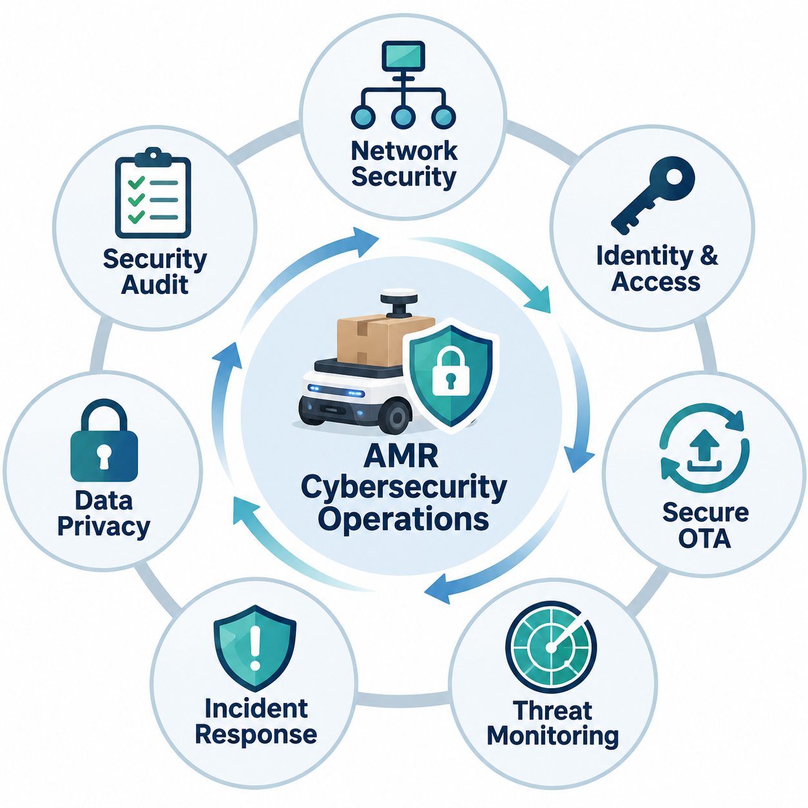
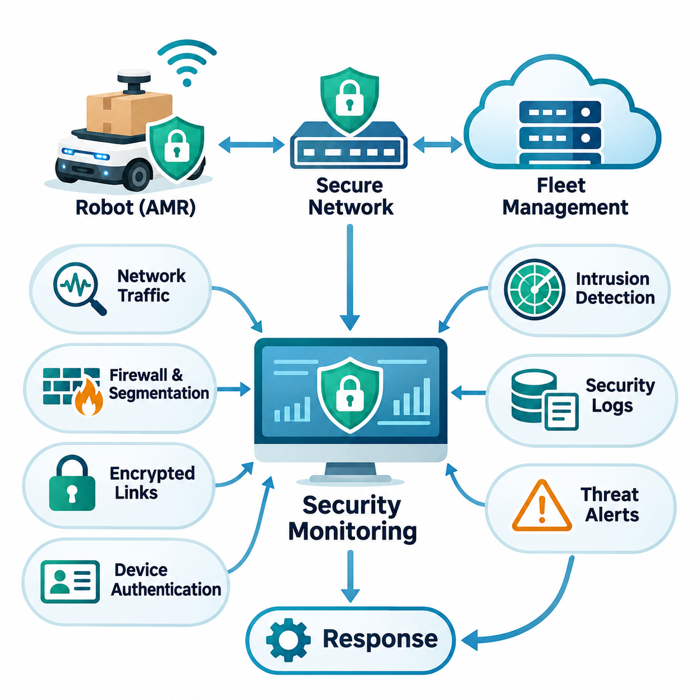
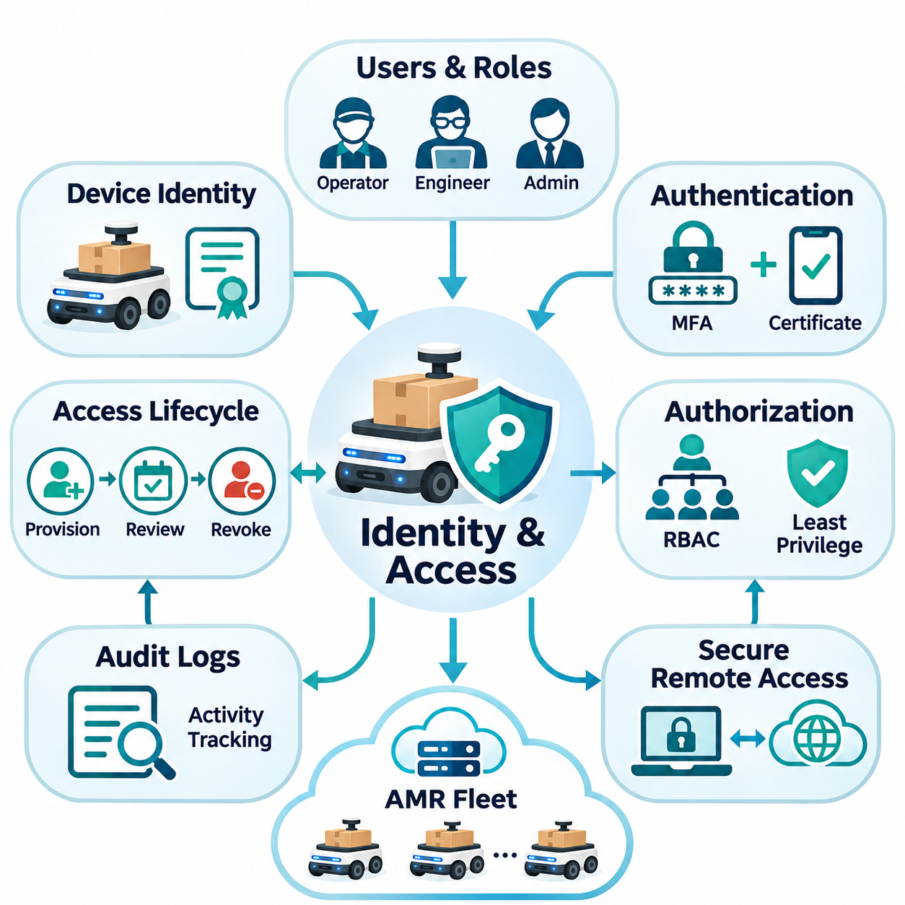
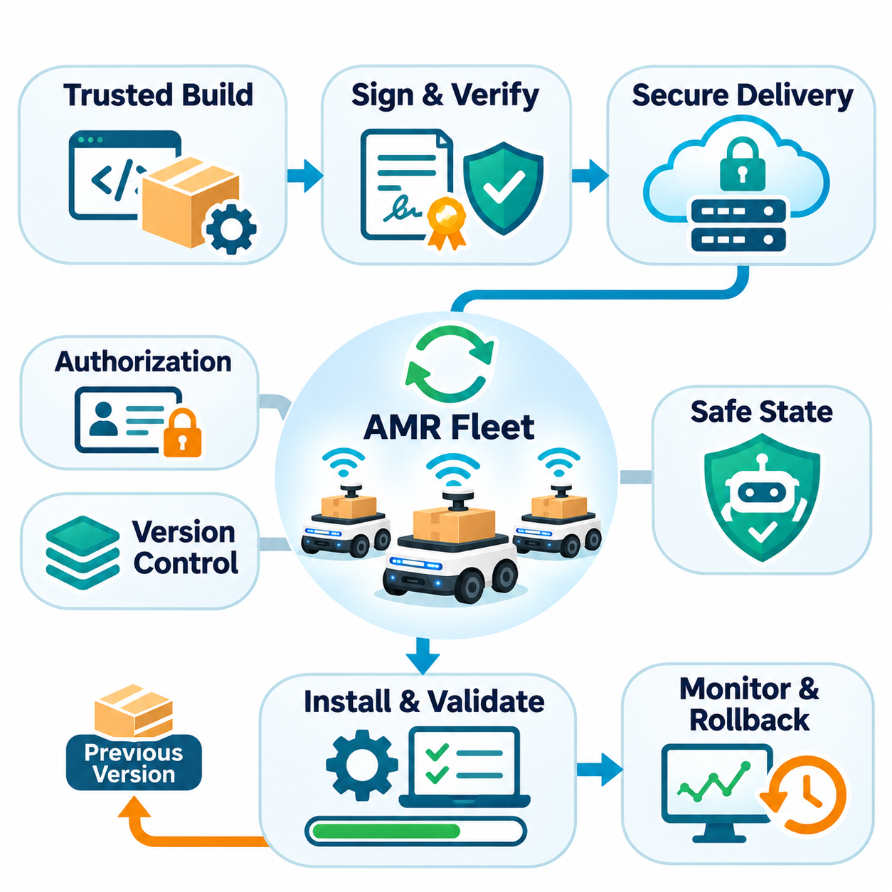
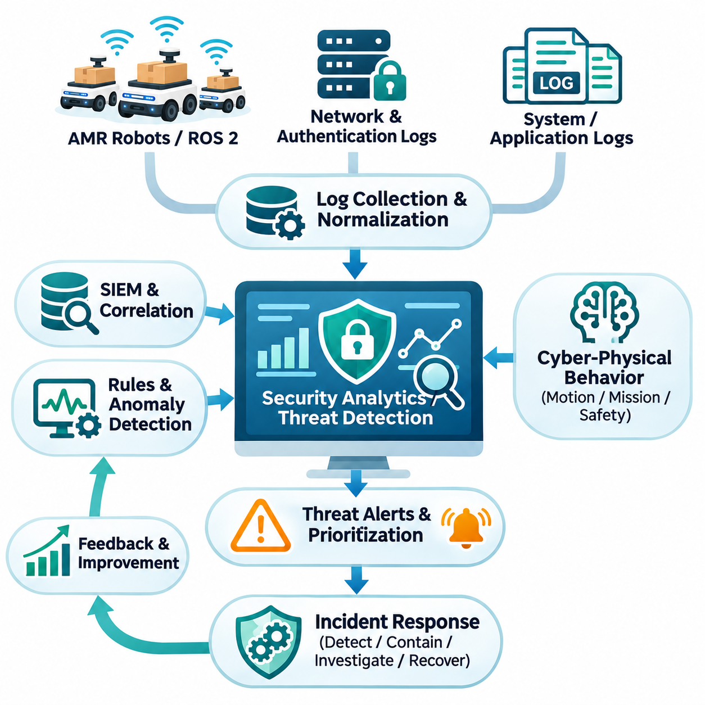
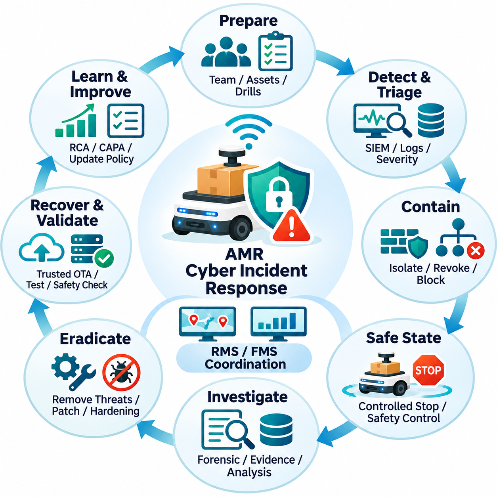
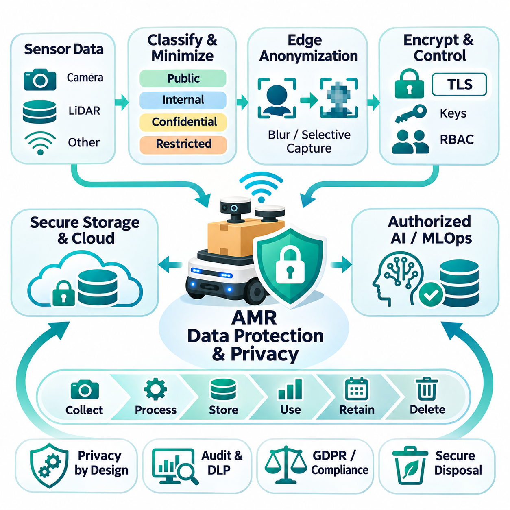
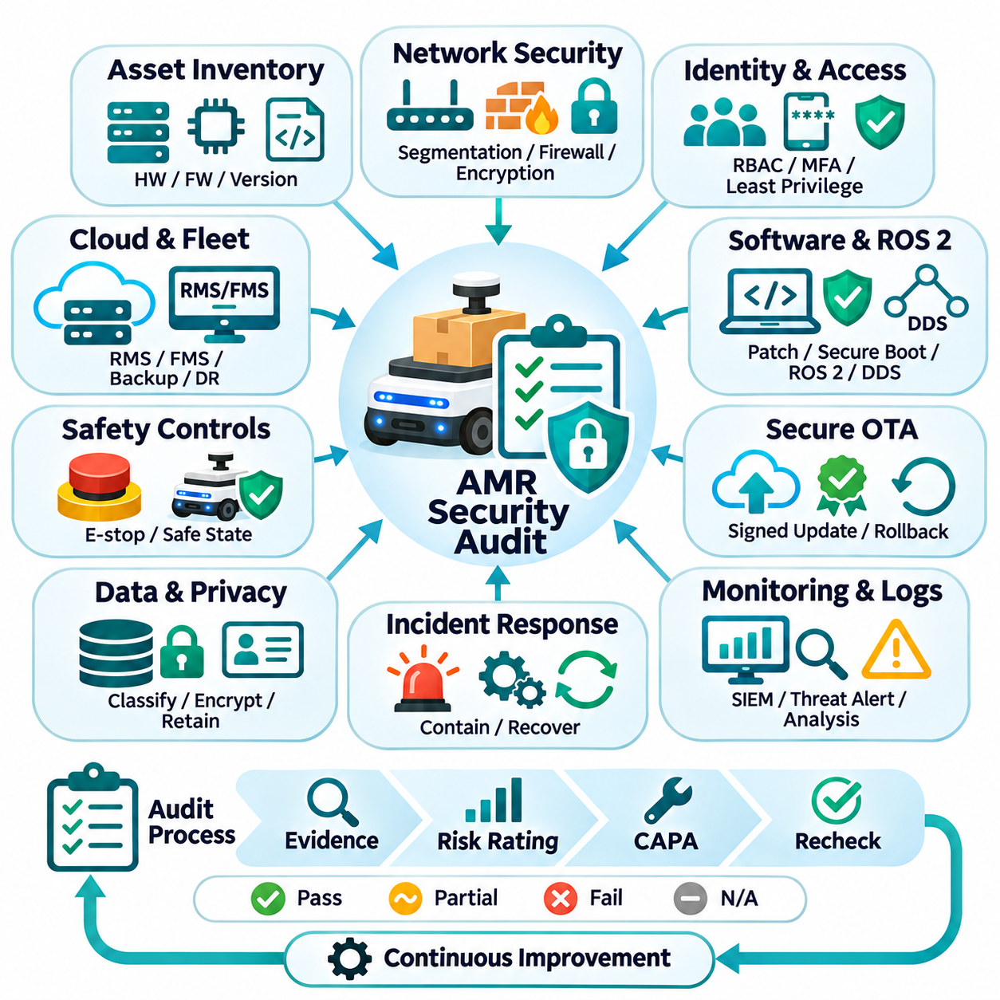

**Volume 08. AMR Operations, Deployment, and MLOps**

# Chapter 14. Cybersecurity Operations

## 14.1 Cybersecurity Operations Overview

{width="7.268055555555556in" height="7.268055555555556in"}

Cybersecurity operations in Autonomous Mobile Robot (AMR) systems represent the continuous process of protecting robotic platforms, communication networks, software applications, and operational data against unauthorized access, malicious activities, and security vulnerabilities. Unlike conventional information technology systems, AMR cybersecurity must address both digital security and physical safety because compromised robotic behavior can directly affect people, equipment, and infrastructure.

Modern AMR ecosystems integrate embedded controllers, edge computing devices, wireless communication networks, Robot Management Systems (RMS), Fleet Management Systems (FMS), cloud infrastructure, and artificial intelligence models. Each interconnected component introduces potential security risks and expands the overall attack surface. Cybersecurity operations must therefore establish a comprehensive protection framework that extends across the entire operational architecture.

The fundamental objectives of cybersecurity operations include confidentiality, integrity, and availability, commonly referred to as the CIA triad. Confidentiality prevents unauthorized access to sensitive information, while integrity ensures that software, operational commands, and collected data remain trustworthy. Availability guarantees that authorized users and robotic systems can access essential services whenever required during mission execution.

Cybersecurity operations must be integrated throughout the AMR operational lifecycle, beginning with device provisioning and deployment and continuing through daily operation, maintenance, software updates, and eventual decommissioning. Security should not be considered a one-time engineering activity. Continuous monitoring, vulnerability assessment, configuration management, and security validation are necessary to maintain protection against evolving threats.

Robot network security monitoring provides visibility into communication activities between individual robots, fleet management servers, edge computing platforms, and external applications. Network traffic analysis, intrusion detection systems, firewall monitoring, and communication anomaly detection help identify unauthorized connections and suspicious behavior. Network segmentation can further restrict the propagation of security incidents across operational environments.

Account and access management ensures that only authorized personnel, applications, and devices can interact with robotic resources. Role-Based Access Control (RBAC), Multi-Factor Authentication (MFA), device certificates, and the principle of least privilege reduce the likelihood of unauthorized operations. Access permissions must be periodically reviewed and adjusted according to personnel responsibilities, operational requirements, and organizational changes.

Secure communication is particularly important because AMR platforms frequently exchange mission commands, localization information, sensor measurements, and diagnostic data through wireless networks. Transport Layer Security (TLS), mutual authentication, certificate management, and encrypted communication channels help protect information against interception and manipulation. Authentication mechanisms must also verify the identity of connected robotic devices.

Secure Over-the-Air (OTA) operations protect software, firmware, configuration files, and AI models distributed to deployed robots. Digital signatures, cryptographic integrity verification, trusted software repositories, and controlled deployment procedures help prevent unauthorized modifications. Update mechanisms should also incorporate compatibility validation, authenticated distribution, installation monitoring, and secure rollback capabilities.

Vulnerability management identifies and prioritizes security weaknesses within operating systems, middleware, software libraries, container images, and embedded firmware. A Software Bill of Materials (SBOM) provides visibility into deployed software dependencies. Security patches should be evaluated according to vulnerability severity, operational exposure, system compatibility, and potential impacts on robot availability before controlled field deployment.

Operational log analysis and threat detection provide essential capabilities for identifying abnormal system behavior. Security-related logs may include authentication attempts, network connections, configuration modifications, administrative actions, software installations, and rejected commands. Centralized log management and Security Information and Event Management (SIEM) platforms can correlate distributed events and support timely investigation.

Cybersecurity incident response establishes structured procedures for detecting, analyzing, containing, and recovering from security incidents. When suspicious activities are identified, affected robots or network segments may require isolation to prevent further compromise. Response procedures must consider the physical operating environment, ensuring that containment measures do not introduce additional hazards or interfere with essential safety functions.

Data protection and privacy management are critical because AMR platforms continuously collect environmental images, spatial maps, operational records, and potentially sensitive information. Encryption at rest, controlled data access, retention policies, anonymization, and secure deletion help minimize information exposure. Data governance must also define ownership, authorized processing purposes, and restrictions on transferring operational information.

Artificial intelligence introduces additional cybersecurity considerations into modern AMR operations. Manipulated training datasets, unauthorized model replacements, adversarial inputs, and compromised inference pipelines can degrade autonomous decision-making. Integrating security controls into Machine Learning Operations (MLOps) helps establish dataset provenance, model integrity, deployment authorization, and traceability throughout the AI model lifecycle.

Security governance and periodic audits establish accountability and evaluate the effectiveness of implemented protection mechanisms. Operational practices can be informed by frameworks such as IEC 62443, ISO/IEC 27001, and the NIST Cybersecurity Framework. Security performance indicators may include vulnerability remediation time, incident detection time, incident containment time, patch compliance, and unauthorized access events.

Ultimately, cybersecurity operations transform AMR protection from a collection of isolated technical controls into a continuous operational discipline. Effective integration of network monitoring, access management, secure updates, threat detection, incident response, data protection, and security audits enables resilient robotic services. This integrated approach supports safe, reliable, scalable, and trustworthy autonomous robot deployment.

## 14.2 Robot Network Security Monitoring

{width="7.268055555555556in" height="7.268055555555556in"}

Robot network security monitoring is a continuous operational process that protects the communication infrastructure of Autonomous Mobile Robot (AMR) systems against unauthorized access, suspicious activities, and malicious interference. Its primary objective is to maintain trustworthy communication between robots, management servers, edge computing devices, and external applications while preserving operational safety and service availability.

Modern AMR networks consist of wireless access points, Ethernet switches, industrial gateways, cellular communication modules, cloud services, and distributed computing resources. These components exchange mission commands, localization information, sensor measurements, and diagnostic data. Security monitoring must provide comprehensive visibility into these communication pathways to identify potential threats and abnormal network behavior.

Network visibility begins with maintaining an accurate inventory of connected devices, communication interfaces, IP addresses, network services, and authorized communication relationships. Each robot and infrastructure component should have a unique identity and an established security profile. Continuous asset discovery helps operators identify unauthorized devices, unexpected connections, and deviations from approved network configurations.

Network segmentation is a fundamental protection mechanism that separates robotic control networks, enterprise information systems, cloud services, and administrative interfaces into distinct security domains. Virtual Local Area Networks (VLANs), firewalls, and industrial network gateways can enforce communication boundaries. Monitoring traffic between these domains helps detect unauthorized communication and lateral movement.

Network traffic monitoring analyzes communication characteristics such as packet frequency, bandwidth utilization, connection duration, protocol distribution, and communication endpoints. Establishing a baseline of normal robot network behavior allows security systems to recognize unusual patterns. Unexpected traffic volumes, unfamiliar destinations, and abnormal connection frequencies may indicate security threats or operational faults.

Intrusion Detection Systems (IDS) and Intrusion Prevention Systems (IPS) provide automated capabilities for identifying potentially malicious network activities. Signature-based detection identifies known attack patterns, while anomaly-based detection identifies deviations from established communication behavior. In robotic environments, automated prevention mechanisms require careful validation to avoid disrupting essential control and safety services.

Wireless network security monitoring is particularly important because AMRs frequently move between wireless access points while maintaining continuous connectivity. Monitoring should evaluate authentication failures, unauthorized access points, unexpected device associations, signal interference, and abnormal roaming behavior. Distinguishing malicious activities from ordinary wireless communication disturbances is essential for reliable threat assessment.

Robot Operating System 2 (ROS 2) communication introduces additional monitoring requirements because distributed robot applications frequently exchange information through Data Distribution Service (DDS) middleware. Security monitoring should evaluate participant identities, discovery activities, communication permissions, and unexpected publishers or subscribers. DDS Security mechanisms can strengthen authentication, access control, and data protection.

Secure communication channels commonly employ Transport Layer Security (TLS), mutual TLS authentication, Virtual Private Networks (VPNs), and device certificates. Monitoring systems should track certificate expiration, authentication failures, unauthorized connection attempts, and unexpected changes in encryption configurations. Encrypted communication requires complementary endpoint telemetry because network inspection alone cannot reveal all malicious activities.

Robot Management Systems (RMS) and Fleet Management Systems (FMS) represent critical network monitoring targets because they coordinate mission execution across multiple robotic platforms. Unauthorized mission requests, unexpected command frequencies, abnormal API calls, and suspicious administrative sessions should generate security events. Monitoring must also detect communication disruptions that could affect fleet coordination and traffic management.

Edge-based network monitoring enables local detection and response when cloud connectivity becomes unavailable or unreliable. Lightweight monitoring agents can collect connection statistics, security events, and device communication information directly from robotic computing platforms. Resource consumption must be carefully controlled to prevent monitoring activities from interfering with perception, localization, navigation, or real-time control processes.

Centralized security monitoring aggregates events from robots, network infrastructure, management servers, and cloud platforms into a unified operational environment. Security Information and Event Management (SIEM) systems can correlate distributed security events using synchronized timestamps and device identifiers. Event correlation improves the ability to recognize coordinated threats that may remain undetected when individual devices are monitored independently.

Artificial intelligence and machine learning can enhance network security monitoring through behavioral analysis and anomaly detection. Models can learn typical communication patterns associated with robot missions, charging operations, maintenance procedures, and software updates. However, detection thresholds and model performance must be continuously evaluated because changing operational conditions can generate false positives or conceal emerging threats.

Security alert management should classify detected events according to threat severity, operational exposure, affected assets, and potential physical consequences. High-priority alerts may require immediate investigation, credential revocation, or controlled network isolation. Any automated response must respect functional safety requirements and ensure that affected robots can transition into predefined safe operational states.

Network security monitoring performance can be evaluated using Mean Time to Detect (MTTD), Mean Time to Respond (MTTR), monitoring coverage, false positive rates, and unauthorized connection detection rates. Regular security assessments and controlled testing help validate monitoring effectiveness. Ultimately, integrating network visibility, threat detection, event correlation, and safety-aware incident response establishes a resilient communication environment for scalable AMR operations.

## 14.3 Account and Access Management

{width="7.268055555555556in" height="7.268055555555556in"}

Account and access management in Autonomous Mobile Robot (AMR) systems is a fundamental cybersecurity operation that ensures only authorized users, applications, and devices can access robotic resources and perform permitted activities. Its primary objective is to protect operational infrastructure against unauthorized control, identity misuse, privilege escalation, and accidental configuration changes while maintaining safe and reliable robot operations.

Modern AMR ecosystems incorporate multiple categories of identities, including robot operators, field technicians, system administrators, software developers, external service providers, and automated applications. Individual robots, edge computing devices, and cloud services also require identifiable credentials. Each identity must be uniquely registered, authenticated, and associated with clearly defined operational responsibilities and access permissions.

Identity and Access Management (IAM) provides a centralized framework for managing digital identities, authentication mechanisms, authorization policies, and access privileges throughout the robotic ecosystem. Integration with Robot Management Systems (RMS), Fleet Management Systems (FMS), and cloud platforms enables consistent security policy enforcement and reduces the complexity of managing distributed operational environments.

Role-Based Access Control (RBAC) assigns permissions according to predefined organizational roles and operational responsibilities. Robot operators may initiate approved missions and monitor robot status, while maintenance technicians may access diagnostic functions and configuration parameters. System administrators may manage infrastructure and security policies, but their privileges should remain restricted to explicitly authorized administrative activities.

The principle of least privilege requires every user, application, and robotic device to receive only the minimum permissions necessary to perform assigned functions. Restricting access to essential resources reduces the potential consequences of compromised accounts, malicious activities, and human errors. Permissions should be periodically reviewed to prevent unnecessary privilege accumulation and unauthorized expansion of operational authority.

Authentication mechanisms verify the identity of users and devices before granting access to robotic resources. Password-based authentication should be strengthened through Multi-Factor Authentication (MFA), cryptographic certificates, and secure identity providers wherever appropriate. Centralized authentication and Single Sign-On (SSO) can simplify account management while maintaining consistent security requirements across distributed AMR operational platforms.

Device identity management is particularly important because individual robots communicate autonomously with management servers, edge platforms, and external infrastructure. Each robot should possess a unique digital identity supported by device certificates or securely provisioned cryptographic credentials. Mutual Transport Layer Security (mTLS) enables robots and servers to verify each other\'s identities before establishing communication channels.

Credential lifecycle management covers the generation, provisioning, distribution, storage, rotation, expiration, and revocation of authentication credentials. Passwords, access tokens, private keys, and certificates must be protected against unauthorized disclosure. Hardware security mechanisms, encrypted credential storage, and centralized secrets management help reduce exposure while supporting secure and scalable robot fleet operations.

Privileged Access Management (PAM) provides additional protection for accounts capable of modifying robot behavior, network configurations, software components, and security policies. Privileged sessions should require stronger authentication, explicit authorization, and comprehensive activity logging. Temporary administrative privileges and time-limited access permissions can reduce the risks associated with permanently enabled administrator accounts.

Remote access management establishes controlled mechanisms for accessing deployed robots and operational infrastructure from external locations. Secure communication channels, authenticated gateways, session expiration policies, and approved access requests help prevent unauthorized remote connections. Remote maintenance activities must respect operational safety requirements, particularly when modifying configurations or interacting with physical robot control functions.

Robot Operating System 2 (ROS 2) environments require application-level access management because distributed nodes exchange operational information through communication middleware. Security mechanisms such as DDS Security and Secure ROS 2 (SROS2) support participant authentication, communication encryption, and permission enforcement. Access policies should restrict unauthorized publishers, subscribers, service clients, and applications from interacting with critical robotic functions.

Application Programming Interface (API) access management protects communication between robotic platforms, management systems, enterprise applications, and cloud services. Scoped access tokens, service identities, authorization policies, and request validation help ensure that external applications perform only approved operations. Mission assignment, map modification, software deployment, and fleet configuration interfaces require particularly strict authorization controls.

Account lifecycle management ensures that access privileges remain aligned with organizational responsibilities from initial registration through account termination. Employee transfers, contractor engagements, maintenance agreements, and device replacements must trigger appropriate permission reviews. Inactive accounts, expired credentials, and obsolete service identities should be promptly disabled or removed to minimize unnecessary security exposure.

Access monitoring and audit logging provide visibility into authentication attempts, permission changes, privileged sessions, credential usage, and administrative commands. Centralized security monitoring platforms can correlate account activities with network events and robot operational records. Repeated authentication failures, unusual login locations, unexpected privilege modifications, and abnormal access patterns should trigger investigation and controlled response procedures.

Effective account and access management must also incorporate emergency access procedures, periodic permission reviews, and measurable security performance indicators. Emergency privileges should be narrowly scoped, time-limited, and auditable without compromising independent safety functions. Integrating identity management, authentication, authorization, credential protection, and continuous auditing establishes a trustworthy foundation for secure, resilient, and scalable AMR operations.

## 14.4 Secure OTA Operation

{width="7.268055555555556in" height="7.268055555555556in"}

Secure Over-the-Air (OTA) operation is a critical cybersecurity capability in Autonomous Mobile Robot (AMR) systems that enables remote distribution and installation of software, firmware, configuration files, and artificial intelligence models. Its primary objective is to maintain the security, integrity, authenticity, and operational reliability of deployed robotic platforms while minimizing physical maintenance requirements and service interruptions.

Modern AMR environments frequently require software updates to address security vulnerabilities, improve navigation performance, enhance perception capabilities, and introduce operational functionality. However, unauthorized or compromised update packages may introduce malicious software, modify robot behavior, or disrupt fleet operations. Secure OTA operations must therefore establish a trusted update mechanism throughout the entire software distribution lifecycle.

A secure OTA architecture typically consists of trusted build environments, artifact repositories, update management servers, distribution infrastructure, robot-side update agents, and centralized monitoring services. Integration with Robot Management Systems (RMS), Fleet Management Systems (FMS), and Machine Learning Operations (MLOps) platforms enables coordinated update scheduling, authorization, deployment monitoring, and version management across distributed robotic fleets.

Cryptographic signing establishes the authenticity and integrity of OTA update packages. Software binaries, firmware images, configuration files, and AI model artifacts should be digitally signed using authorized signing keys. Before installation, the robot-side update agent verifies the digital signature and cryptographic hash against trusted verification information, rejecting packages that fail authentication or integrity validation.

Secure update distribution requires authenticated and encrypted communication between update servers and deployed robots. Transport Layer Security (TLS), mutual TLS authentication (mTLS), device certificates, and controlled repository access help protect update packages against interception and unauthorized modification. Each robot should verify the identity of the distribution service before downloading any software or firmware artifact.

Software supply chain security extends protection beyond the update distribution mechanism to the development, compilation, packaging, and release processes. A Software Bill of Materials (SBOM), dependency scanning, vulnerability assessment, and build provenance verification help establish confidence in software artifacts. Production signing keys and release credentials must remain isolated from ordinary development environments and unauthorized personnel.

Update compatibility validation ensures that newly distributed software components remain compatible with robot hardware, operating systems, communication middleware, sensor interfaces, and existing applications. Compatibility metadata should identify supported hardware revisions, required dependencies, and minimum software versions. Incompatible updates must be rejected before installation to prevent unexpected operational failures.

Secure OTA deployment should follow a staged rollout strategy rather than immediately distributing updates to an entire robotic fleet. Initial deployment may target simulation environments, designated test robots, and a limited production group through canary deployment. Operational performance, security events, and system stability should be evaluated before progressively expanding deployment to additional robots and operational sites.

Operational safety must remain a primary consideration throughout the OTA update process. Robots should enter an approved maintenance state before installing updates that affect motion control, perception, navigation, or safety-related behavior. Update scheduling should consider active missions, battery charge levels, network connectivity, and environmental conditions to prevent unexpected interruptions or hazardous physical consequences.

Atomic update mechanisms and redundant system partitions can improve operational resilience during software installation. An A/B partition architecture enables a robot to install an update into an inactive system partition while preserving the currently operational version. Following installation and restart, system health checks determine whether the updated version can be activated permanently or whether recovery is necessary.

Secure rollback and recovery mechanisms enable robotic platforms to restore an approved software version when an update causes unexpected failures, performance degradation, or compatibility problems. Rollback procedures must also prevent unauthorized downgrade attacks that attempt to reinstall vulnerable software. Signed version metadata and controlled recovery authorization help balance operational recovery requirements with cybersecurity protection.

OTA operations for AI-enabled robots must additionally address the security and reliability of machine learning artifacts. AI model packages should include model identifiers, version information, cryptographic hashes, dependency requirements, and validation records. Integration with a trusted model registry ensures that only approved and authenticated models can be deployed to production robots through controlled MLOps workflows.

Continuous OTA monitoring provides visibility into update downloads, signature verification results, installation progress, restart events, version transitions, and recovery activities. Centralized dashboards should identify unsuccessful installations, unexpected software versions, and suspicious update requests. Security-related events must be recorded with synchronized timestamps and unique robot identifiers to support incident investigation and operational auditing.

Access control and release governance ensure that only authorized personnel and automated services can approve, sign, distribute, or initiate OTA updates. Role-Based Access Control (RBAC), Multi-Factor Authentication (MFA), separation of duties, and comprehensive audit logging reduce the risks associated with compromised administrative accounts. Emergency security patches should follow predefined expedited approval procedures without bypassing essential verification controls.

Secure boot and runtime integrity verification provide complementary protection after OTA installation. Secure boot establishes a hardware-supported chain of trust by verifying authorized boot components, while runtime integrity monitoring helps identify unexpected modifications to deployed software. Together with signed updates and protected cryptographic keys, these mechanisms strengthen the trustworthiness of robotic computing platforms.

Ultimately, secure OTA operation transforms remote software maintenance into a controlled and auditable cybersecurity process. Update success rates, cryptographic verification failures, rollback frequency, patch compliance, and vulnerability remediation time provide measurable indicators of operational effectiveness. Integrating trusted distribution, staged deployment, safety validation, and secure recovery supports resilient and scalable AMR fleet operations.

## 14.5 Log Analysis and Threat Detection

{width="7.268055555555556in" height="7.268055555555556in"}

Log analysis and threat detection are essential cybersecurity operations in Autonomous Mobile Robot (AMR) systems that enable the identification of suspicious activities, unauthorized access, compromised software, and abnormal operational behavior. Continuous analysis of security and operational events helps organizations detect emerging cyber threats before they escalate into physical hazards, service interruptions, or widespread fleet failures.

Modern AMR ecosystems generate extensive logs across robotic hardware, operating systems, communication middleware, navigation applications, management servers, and cloud infrastructure. Security-related information includes authentication attempts, network connections, administrative commands, configuration changes, and software execution events. Integrating these heterogeneous records establishes comprehensive visibility across distributed robotic environments.

A centralized log management architecture provides the foundation for scalable cybersecurity monitoring. Individual robots and infrastructure components transmit relevant event records to centralized collection and processing services. Integration with Robot Management Systems (RMS), Fleet Management Systems (FMS), and cloud monitoring platforms enables security teams to investigate suspicious activities across multiple robots and operational sites.

Log standardization and normalization are necessary because different robotic components generate records using heterogeneous formats and event structures. A unified logging schema should include timestamps, robot identifiers, component identifiers, event categories, severity levels, authentication identities, and execution results. Consistent event representation improves automated analysis, cross-system correlation, and security incident investigation.

Time synchronization plays an important role in reconstructing cybersecurity incidents across distributed AMR systems. Network Time Protocol (NTP) and Precision Time Protocol (PTP) can support consistent timestamp generation according to system requirements. Accurate timestamps, clock synchronization monitoring, and event sequence information enable investigators to establish causal relationships between network activities, software events, and physical robot behavior.

Security Information and Event Management (SIEM) platforms aggregate, process, correlate, and analyze security-related records from distributed robotic infrastructure. These platforms combine authentication logs, network monitoring events, endpoint security alerts, and application records to identify potentially malicious activities. Centralized security dashboards provide operational visibility into emerging threats and cybersecurity risk levels.

Rule-based threat detection identifies suspicious activities using predefined conditions, event patterns, and known Indicators of Compromise (IoCs). Repeated authentication failures, unauthorized privilege changes, unexpected software installations, and abnormal network connections may trigger security alerts. Detection rules should incorporate operational context to distinguish legitimate maintenance activities from potentially malicious behavior.

Behavioral anomaly detection complements rule-based methods by identifying deviations from established operational baselines. Normal robot behavior can be characterized through communication frequency, command sequences, resource utilization, application execution, and access patterns. Unexpected deviations may indicate compromised devices, malicious software execution, unauthorized remote control, or previously unidentified cybersecurity threats.

Artificial intelligence and machine learning can enhance threat detection by discovering complex relationships within large volumes of operational and security data. Isolation Forests, autoencoders, and temporal learning models can identify unusual event patterns that conventional detection rules may overlook. These models require representative training data, continuous validation, and threshold calibration to minimize false alarms and missed detections.

Robot Operating System 2 (ROS 2) environments require specialized monitoring of distributed communication activities and application-level events. Unexpected Data Distribution Service (DDS) participants, unauthorized topic publishers, abnormal message frequencies, and suspicious service requests may indicate security violations. Middleware security events should be correlated with host-level logs and robot control activities to improve detection reliability.

Threat detection in AMR systems must also incorporate cyber-physical relationships between digital commands and physical behavior. Unexpected mission changes, abnormal velocity commands, unauthorized map modifications, and inconsistencies between commanded motion and measured movement require investigation. Correlating cybersecurity events with localization, perception, and motion control records helps distinguish malicious interference from ordinary technical failures.

Edge-based and centralized threat detection mechanisms provide complementary capabilities within distributed robotic architectures. Edge monitoring enables local identification of suspicious processes and communication activities during network interruptions. Centralized analysis supports fleet-wide event correlation and historical investigations, while resource-aware logging and asynchronous processing prevent security workloads from interfering with real-time robot control.

Security log protection is necessary to preserve the confidentiality, integrity, and availability of investigative evidence. Encrypted transmission, restricted access permissions, tamper-evident storage, and appropriate retention policies reduce the risk of unauthorized disclosure or manipulation. Log collection systems should avoid recording sensitive credentials and unnecessary personal information while maintaining sufficient forensic detail.

Threat detection effectiveness depends on structured alert prioritization, incident escalation, and continuous improvement. Security alerts should be evaluated according to detection confidence, affected assets, operational impact, and potential physical consequences. Mean Time to Detect (MTTD), false positive rates, detection coverage, and alert investigation time provide measurable indicators for improving cybersecurity monitoring.

Together, these general engineering practices extend the cybersecurity operations framework into a continuous process of event collection, analysis, threat identification, and operational response. Integrating log management, behavioral analytics, and cyber-physical monitoring with incident response procedures and independent safety mechanisms establishes a scalable foundation for secure and resilient AMR fleet operations.

## 14.6 Incident Response for Cybersecurity

{width="7.268055555555556in" height="7.268055555555556in"}

Cybersecurity incident response in Autonomous Mobile Robot (AMR) systems is a structured operational process designed to identify, assess, contain, investigate, and recover from security-related incidents. Unlike conventional information technology environments, AMR cybersecurity incidents may directly affect physical movement, human safety, industrial processes, and operational continuity, requiring coordinated digital and physical response mechanisms.

A cybersecurity incident response framework should establish predefined procedures for preparation, detection, analysis, containment, eradication, recovery, and post-incident improvement. These procedures must be integrated with existing robot operation policies, maintenance processes, and emergency safety mechanisms. Clearly defined responsibilities enable security personnel, robot operators, and field technicians to coordinate their activities effectively.

Incident response preparation involves establishing response teams, communication channels, escalation procedures, technical recovery resources, and emergency operating policies before cybersecurity incidents occur. Organizations should maintain updated inventories of robotic assets, network architectures, software versions, and critical dependencies. Regular training and simulated cybersecurity exercises improve organizational readiness and response effectiveness.

Cybersecurity incident detection relies on continuous monitoring of authentication activities, network communications, software execution, configuration changes, and physical robot behavior. Security Information and Event Management (SIEM) platforms, intrusion detection systems, endpoint monitoring agents, and behavioral anomaly detection mechanisms provide complementary capabilities for identifying suspicious activities across distributed AMR infrastructure.

Incident classification determines the severity, operational impact, and potential consequences of detected cybersecurity events. Unauthorized access attempts, compromised credentials, malicious software execution, communication manipulation, and unauthorized robot control require different response strategies. Incidents involving physical safety risks, critical infrastructure, or multiple robotic platforms should receive the highest response priority.

Initial incident analysis focuses on validating detected security events and determining their scope. Security teams should examine authentication records, network traffic, application logs, software integrity information, and robot operational histories. Correlating digital evidence with physical robot behavior helps distinguish cybersecurity incidents from hardware failures, communication interruptions, software defects, and ordinary operational anomalies.

Incident containment aims to prevent cybersecurity threats from spreading across robotic platforms and connected infrastructure. Appropriate containment measures may include network segmentation, credential revocation, restricted communication, suspension of remote access, and temporary isolation of affected devices. Containment decisions must consider operational dependencies and avoid introducing additional physical hazards through uncontrolled service interruptions.

Physical safety management is particularly important when cybersecurity incidents affect robot navigation, motion control, perception, or mission execution. Affected robots may require controlled stopping, transition into a predefined safe state, or supervised movement to an approved maintenance area. Independent safety controllers and emergency stop mechanisms must remain available even when primary computing or communication systems are compromised.

Digital forensic investigation establishes the technical evidence required to understand the origin, progression, and consequences of cybersecurity incidents. Relevant evidence may include system logs, network captures, memory snapshots, software images, configuration records, and authentication histories. Evidence collection should preserve data integrity, maintain a documented chain of custody, and avoid unnecessary modification of affected systems.

Threat eradication involves removing malicious software, disabling compromised accounts, correcting vulnerable configurations, and restoring trusted system components. Security teams should identify the underlying attack mechanism before implementing corrective actions. Vulnerability remediation, credential rotation, certificate revocation, and verified software reinstallation help reduce the likelihood of persistent threats and repeated cybersecurity incidents.

Secure recovery restores affected robotic systems to an approved operational condition after containment and eradication activities. Trusted software images, validated configuration backups, authenticated Over-the-Air (OTA) updates, and approved AI model versions provide essential recovery resources. Restored systems should undergo integrity verification, functional testing, cybersecurity validation, and physical safety assessment before production operation resumes.

Incident response coordination becomes increasingly important in large-scale AMR deployments involving multiple robots, operational sites, and external service providers. Robot Management Systems (RMS), Fleet Management Systems (FMS), and centralized security platforms should support coordinated incident visibility and controlled recovery. Fleet-wide containment policies must account for shared infrastructure, common vulnerabilities, and potential cascading failures.

Communication and reporting procedures ensure that relevant stakeholders receive accurate and timely information throughout cybersecurity incidents. Internal security teams, operational managers, customers, equipment manufacturers, and external authorities may require different levels of incident information. Reporting should document incident severity, affected assets, operational consequences, response activities, and applicable regulatory notification obligations.

Post-incident analysis transforms cybersecurity incidents into opportunities for systematic improvement. Root Cause Analysis (RCA) should examine technical vulnerabilities, architectural weaknesses, procedural deficiencies, and organizational factors that contributed to the incident. Corrective and Preventive Actions (CAPA) should update security policies, detection rules, software components, access permissions, and operational training programs.

Cybersecurity incident response performance can be evaluated through measurable indicators such as Mean Time to Detect (MTTD), Mean Time to Respond (MTTR), containment time, recovery duration, and incident recurrence rates. These general engineering practices should be adapted to individual AMR architectures and operational risk profiles, establishing a continuous improvement cycle that strengthens cybersecurity resilience, physical safety, and long-term fleet reliability.

## 14.7 Data Protection and Privacy

{width="7.268055555555556in" height="7.268055555555556in"}

Data protection and privacy are essential components of cybersecurity operations in Autonomous Mobile Robot (AMR) systems, ensuring that operational information, personal data, and organizational assets remain protected throughout their lifecycle. Effective data protection must balance confidentiality, integrity, availability, and privacy requirements with the operational demands of autonomous navigation, fleet management, and continuous learning.

Modern AMR systems generate diverse categories of data through cameras, LiDAR sensors, localization modules, navigation algorithms, operational applications, and communication infrastructure. These datasets may contain personal information, facility layouts, employee movements, customer activities, and confidential industrial processes. Protecting such information requires a comprehensive understanding of data characteristics and associated security risks.

Data classification establishes the foundation for applying appropriate protection mechanisms according to information sensitivity and operational importance. Robot-generated information can be categorized as public, internal, confidential, or restricted data. Classification policies should distinguish personal information, proprietary operational records, security credentials, and safety-critical data to determine suitable access and handling requirements.

Data lifecycle management extends security and privacy protection across information collection, transmission, processing, storage, utilization, archival, and disposal. Each lifecycle stage introduces distinct vulnerabilities and regulatory considerations. Organizations must establish consistent protection policies that prevent unauthorized disclosure, accidental modification, excessive retention, and inappropriate secondary utilization of robot-generated information.

Privacy by Design and Privacy by Default require privacy considerations to be incorporated into robotic hardware, software architecture, and operational workflows from the earliest development stages. Data minimization, purpose limitation, restricted access, and privacy-preserving processing should become fundamental design principles rather than supplementary security mechanisms introduced after deployment.

Sensor data protection is particularly important because AMRs continuously observe physical environments containing people, equipment, and sensitive infrastructure. Cameras may capture recognizable faces, identification badges, documents, or confidential manufacturing activities. Edge-based image anonymization, facial blurring, selective recording, and region-based filtering can reduce unnecessary exposure of sensitive visual information.

Data encryption provides fundamental protection against unauthorized information disclosure during transmission and storage. Transport Layer Security (TLS) protects communication between robots and management infrastructure, while appropriate encryption mechanisms protect databases, storage devices, backups, and archived datasets. Cryptographic keys must be securely generated, stored, rotated, and managed independently of protected information.

Access control mechanisms ensure that sensitive robotic information remains accessible only to authorized users, applications, and services. Role-Based Access Control (RBAC), Attribute-Based Access Control (ABAC), and the principle of least privilege help restrict unnecessary information exposure. Access permissions should reflect operational responsibilities, data sensitivity, authorized purposes, and organizational security requirements.

Edge computing architectures can enhance data privacy by processing sensitive information directly within robotic platforms or local infrastructure. Instead of continuously transmitting raw sensor streams to centralized servers, robots may generate anonymized results, extracted features, or relevant event summaries. Local processing reduces unnecessary data transmission while improving bandwidth efficiency and minimizing privacy exposure.

Cloud-based AMR operations require additional protection for information exchanged between robotic platforms, management systems, and external service providers. Secure storage configurations, tenant isolation, authenticated interfaces, encryption, and contractual data protection requirements help reduce security risks. Cross-border data transfers must also comply with applicable legal and organizational requirements.

Artificial intelligence development and Machine Learning Operations (MLOps) introduce additional privacy considerations because operational datasets may be reused for model training and continuous learning. Dataset anonymization, controlled access, data provenance tracking, and authorized usage policies should prevent inappropriate secondary utilization. Privacy-preserving learning techniques may further reduce exposure of sensitive training information.

Data retention and secure disposal policies determine how long operational records, sensor datasets, security logs, and personal information remain available. Retention periods should reflect operational necessity, contractual obligations, regulatory requirements, and investigative needs. Information that is no longer required should be securely deleted, including obsolete copies, temporary files, and applicable backup records.

Privacy governance must address applicable legal and regulatory frameworks, including the General Data Protection Regulation (GDPR) and national personal information protection laws. Organizations should establish lawful processing grounds, transparent collection notices, and procedures for exercising data subject rights. Privacy Impact Assessments (PIAs) help identify and mitigate risks associated with robotic data processing.

Continuous monitoring and auditing provide visibility into sensitive data access, information transfers, unauthorized modifications, and potential privacy violations. Security Information and Event Management (SIEM) platforms and Data Loss Prevention (DLP) mechanisms can support the detection of abnormal information handling. Confirmed data breaches require coordinated investigation, containment, recovery, and applicable notification procedures.

Effective data protection and privacy management contribute to operational trust, regulatory compliance, and long-term cybersecurity resilience. Data protection incidents, unauthorized access attempts, retention compliance, and privacy audit findings provide measurable improvement indicators. These general engineering practices must be adapted to specific AMR architectures, deployment environments, and applicable legal obligations.

## 14.8 Security Audit Checklists

{width="7.268055555555556in" height="7.268055555555556in"}

Security audit checklists provide a systematic mechanism for evaluating cybersecurity readiness, operational compliance, and protection effectiveness in Autonomous Mobile Robot (AMR) systems. Based on the cybersecurity operations chapter structure, the following general engineering practices translate security objectives into verifiable inspection criteria covering robotic platforms, communication networks, management infrastructure, and operational procedures.

A comprehensive security audit checklist should define inspection categories, evaluation criteria, verification methods, responsible personnel, and required evidence. Each inspection item should be evaluated using standardized results such as compliant, partially compliant, noncompliant, or not applicable. Consistent assessment criteria enable organizations to compare cybersecurity conditions across different robotic platforms, deployment sites, and operational periods.

Asset inventory verification represents a fundamental component of cybersecurity auditing. Security personnel should confirm that robotic hardware, edge computing devices, operating systems, firmware, software applications, network equipment, and cloud infrastructure are accurately documented. Asset records should include device identifiers, software versions, configuration baselines, ownership information, and maintenance status to support security traceability.

Network security audit checklists should evaluate network segmentation, firewall configurations, communication encryption, wireless security, and remote connectivity mechanisms. Auditors should verify that unnecessary communication ports are disabled, unauthorized devices are restricted, and network traffic is continuously monitored. Communication pathways between robots, management servers, and external systems should follow approved network security policies.

Identity and access management audits should examine user accounts, device identities, authentication mechanisms, access permissions, and administrative privileges. Verification activities should confirm the implementation of Role-Based Access Control (RBAC), Multi-Factor Authentication (MFA), credential rotation, and the principle of least privilege. Inactive accounts, excessive permissions, and unauthorized access privileges should be identified and corrected.

Operating system and software security checklists should verify that robotic platforms operate with approved configurations, supported software versions, and appropriate security patches. Unnecessary services, default credentials, unauthorized applications, and vulnerable software dependencies should be identified. Secure Boot, application integrity verification, endpoint protection, and system hardening mechanisms should be evaluated where applicable.

Robot Operating System 2 (ROS 2) security audits should examine middleware communication, node authentication, topic access permissions, and Data Distribution Service (DDS) security configurations. Auditors should verify that only authorized participants can access protected communication channels and execute sensitive services. Security policies should prevent unauthorized publication of motion commands, mission instructions, and configuration changes.

Over-the-Air (OTA) update security checklists should evaluate software distribution procedures, digital signatures, cryptographic verification, update authorization, and rollback mechanisms. Update packages should originate from trusted repositories and undergo integrity validation before installation. Auditors should confirm that deployment histories, software version records, recovery procedures, and failed update events are properly documented.

Security monitoring and log management audits should verify the availability, completeness, integrity, and retention of cybersecurity event records. Authentication activities, configuration changes, network connections, administrative commands, and suspicious software execution should be recorded appropriately. Centralized monitoring platforms should support timely threat detection, event correlation, alert prioritization, and security incident investigation.

Cybersecurity incident response audits should evaluate organizational preparedness, incident classification procedures, escalation mechanisms, containment strategies, and secure recovery capabilities. Response personnel should understand their responsibilities during security emergencies. Regular incident response exercises should verify communication effectiveness, forensic evidence preservation, coordinated decision-making, and restoration procedures.

Data protection and privacy audit checklists should examine information classification, encryption, access restrictions, retention policies, and secure disposal procedures. Sensor datasets containing personal or confidential information should be processed according to approved usage policies. Auditors should verify that data collection, transmission, storage, AI model training, and external sharing comply with applicable privacy and security requirements.

Cyber-physical security assessments should verify that cybersecurity incidents cannot easily compromise independent safety mechanisms or introduce uncontrolled robot movement. Emergency stop functions, protective stopping, safety controllers, and restricted operating modes should be evaluated under controlled conditions. Cybersecurity testing must be coordinated with operational safety procedures to prevent unintended physical hazards during inspections.

Cloud and fleet management security audits should examine Robot Management Systems (RMS), Fleet Management Systems (FMS), application programming interfaces, database configurations, and external service integrations. Auditors should verify service authentication, tenant isolation, backup integrity, disaster recovery capabilities, and third-party access restrictions. Shared infrastructure risks should be evaluated across all connected robotic platforms.

Security audit findings should be documented with supporting evidence, affected assets, identified vulnerabilities, risk classifications, and recommended corrective actions. Each noncompliant item should have an assigned owner, remediation deadline, and verification requirement. Corrective and Preventive Actions (CAPA) should address underlying causes, while follow-up inspections should confirm that identified security deficiencies have been effectively resolved.

Security audit checklists should evolve through continuous improvement based on operational experience, emerging threats, architectural changes, and regulatory requirements. Audit compliance rates, unresolved vulnerabilities, remediation durations, and recurring security deficiencies provide measurable performance indicators. Regular security assessments establish a repeatable governance process that strengthens cybersecurity resilience, physical safety, and long-term AMR fleet reliability.
