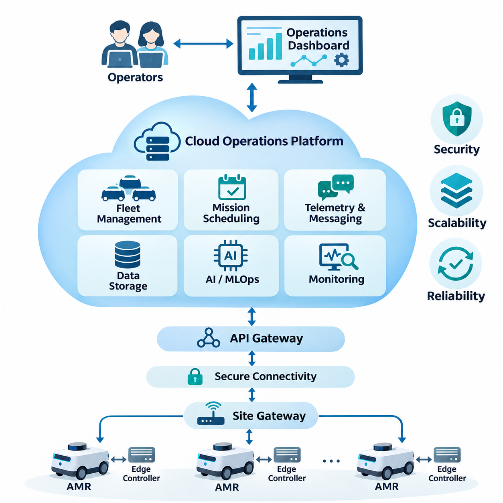
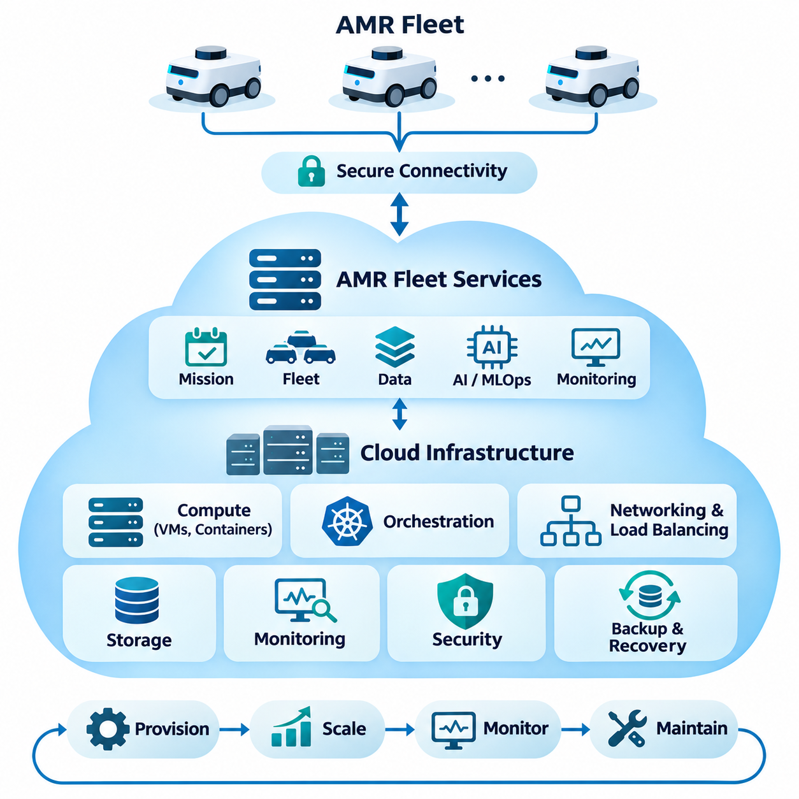
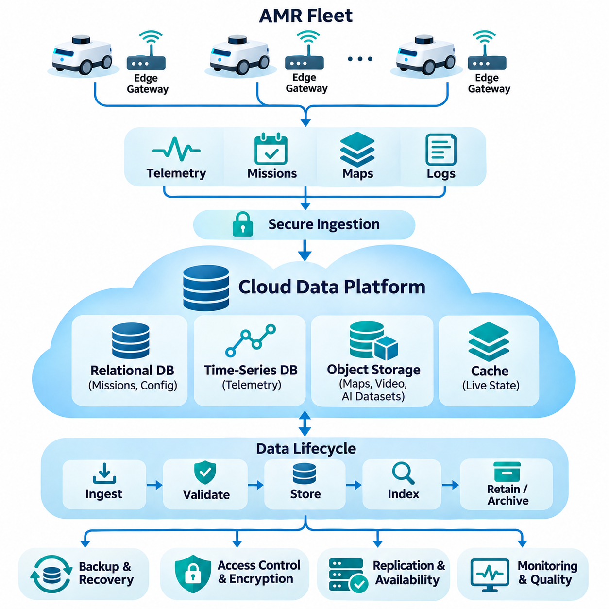
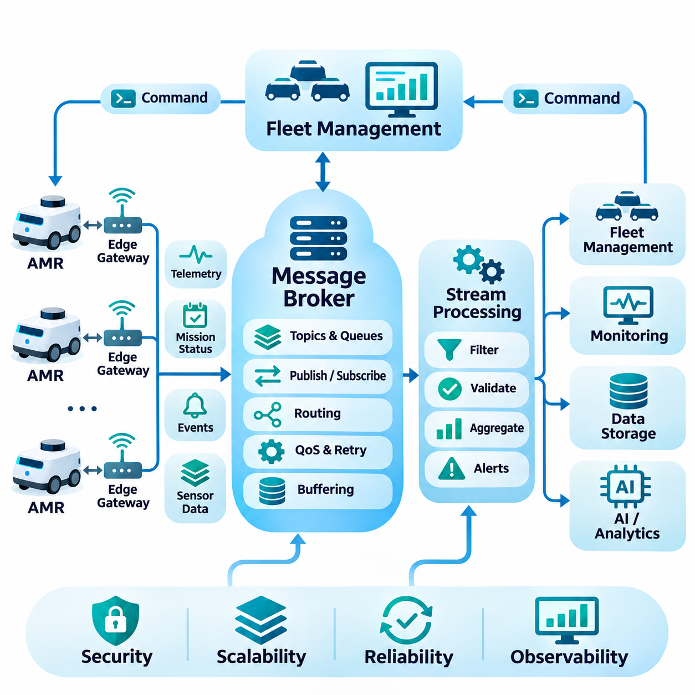
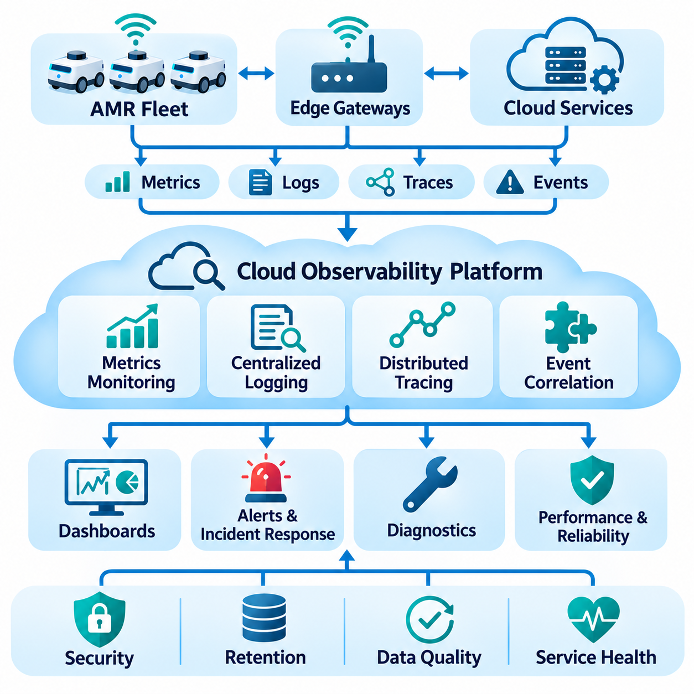
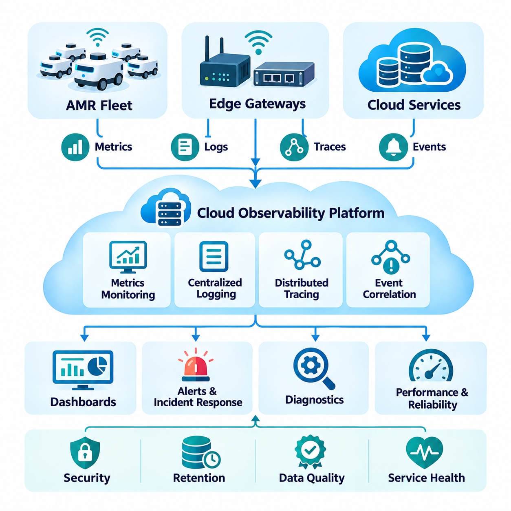
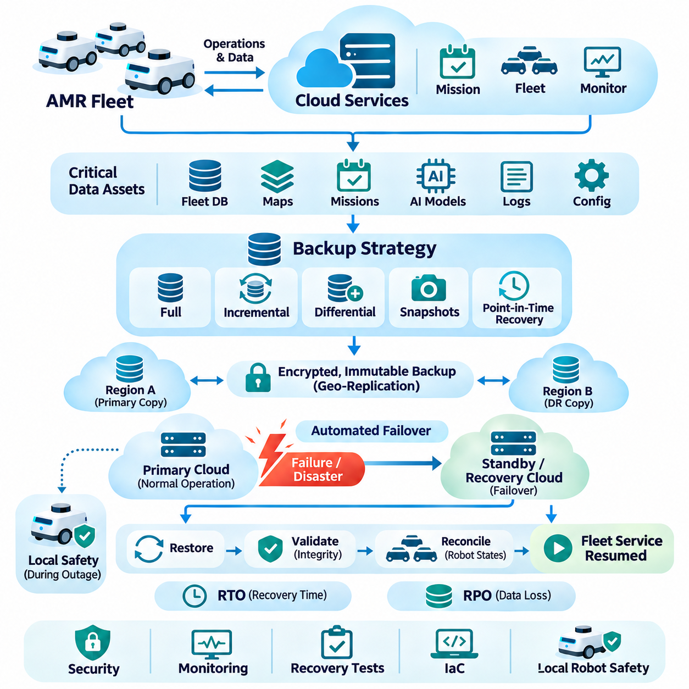
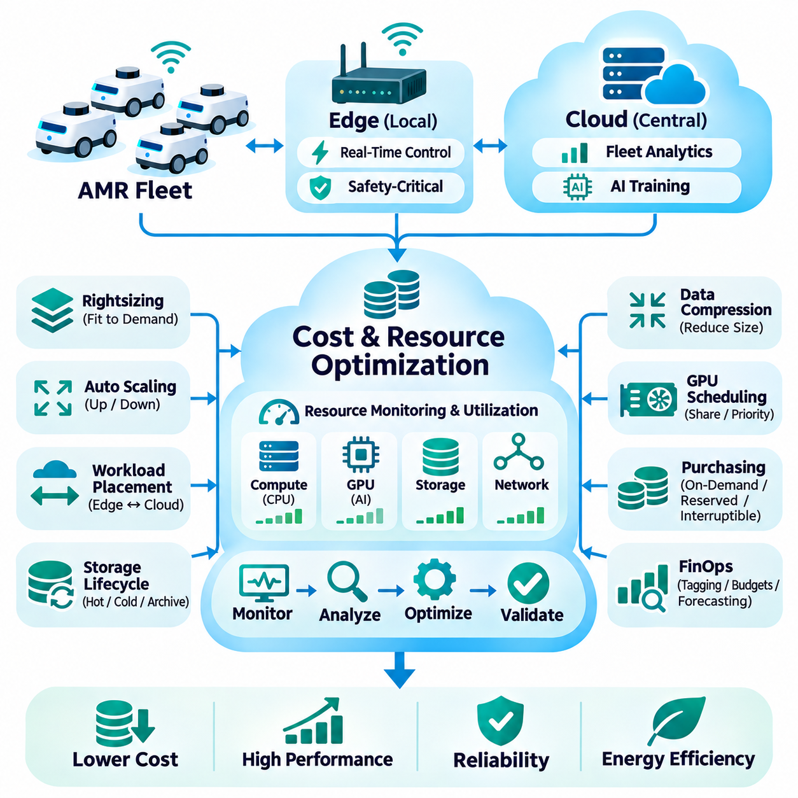
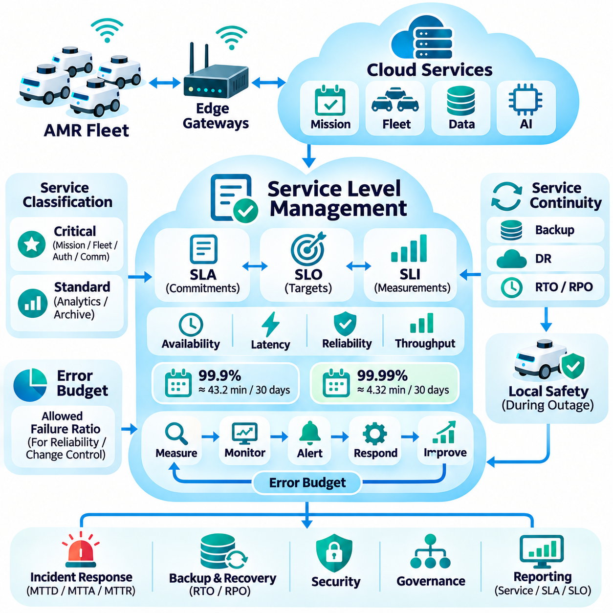

**Volume 08. AMR Operations, Deployment, and MLOps**


# Chapter 15. Cloud Operations

##  

## 15.1 Cloud Operations Architecture

{width="7.268055555555556in" height="7.268055555555556in"}

Cloud operations architecture provides the centralized infrastructure required to manage, monitor, coordinate, and continuously improve Autonomous Mobile Robot (AMR) systems deployed across multiple operational environments. Unlike conventional standalone robotic systems, modern AMR platforms operate within interconnected ecosystems where cloud services support fleet management, operational intelligence, remote diagnostics, software distribution, and lifecycle management.

The fundamental objective of cloud operations architecture is to establish a scalable and reliable operational environment that connects individual robots, edge computing devices, on-premises infrastructure, and centralized cloud platforms. This distributed architecture enables organizations to separate real-time autonomous functions from computationally intensive and management-oriented services while maintaining consistent operational control across geographically distributed robot fleets.

A hierarchical cloud-edge architecture typically consists of robot-level computing, site-level edge infrastructure, and centralized cloud infrastructure. Robot-level computing executes perception, localization, navigation, motion control, and safety functions. Site-level infrastructure supports local fleet coordination and facility integration, while cloud infrastructure provides centralized management, historical analytics, software governance, and enterprise-wide operational visibility.

The cloud operations platform generally incorporates multiple functional layers, including connectivity, data ingestion, application services, data management, operational intelligence, and user interfaces. Each layer performs a distinct set of responsibilities while interacting through standardized communication protocols and application programming interfaces. This modular organization improves maintainability, scalability, interoperability, and independent service development.

The connectivity layer establishes secure communication channels between deployed robots and cloud infrastructure. Depending on the operational environment, communication may utilize Ethernet, Wi-Fi, private 5G networks, cellular networks, or virtual private networks. Communication reliability is strengthened through automatic reconnection, heartbeat monitoring, message buffering, network quality assessment, and synchronization mechanisms that accommodate intermittent connectivity.

The data ingestion layer receives operational information generated by individual robots and distributed fleet management systems. Incoming information includes robot position, mission status, battery condition, sensor health, software version, diagnostic events, and performance measurements. Message brokers and event-streaming platforms enable asynchronous communication, allowing high-volume operational data to be processed without tightly coupling individual services.

The application service layer hosts the primary operational functions required for centralized AMR management. These functions may include Robot Management Systems (RMS), Fleet Management Systems (FMS), mission orchestration, device registration, configuration management, notification services, and remote maintenance interfaces. A microservices-based architecture allows individual services to be independently deployed, updated, monitored, and scaled according to operational demand.

The data management layer incorporates relational databases, time-series databases, object storage, distributed caches, and analytical storage systems. Structured databases maintain robot identities, configurations, mission records, and administrative information, while time-series databases store continuous telemetry. Object storage supports large-scale sensor recordings, diagnostic packages, map files, AI datasets, and software artifacts required throughout the robot lifecycle.

Cloud operations architecture also establishes the foundation for integrating Machine Learning Operations (MLOps) into deployed robotic ecosystems. Operational data collected from robot fleets can be transferred into centralized data pipelines for filtering, annotation, model training, validation, and registry management. Approved AI models are subsequently distributed to compatible edge devices through controlled Over-the-Air (OTA) deployment processes.

Operational observability is achieved by integrating infrastructure monitoring, application metrics, centralized logging, distributed tracing, and event correlation. These mechanisms allow administrators to identify service degradation, network instability, database bottlenecks, abnormal resource consumption, and communication failures. Correlating cloud-side observations with robot-side telemetry provides a comprehensive understanding of distributed system behavior.

Security must be incorporated throughout every architectural layer rather than implemented as an isolated service. Device authentication, certificate management, encrypted communications, identity and access management, role-based authorization, network segmentation, and security auditing protect the operational ecosystem. Multi-tenant environments additionally require robust isolation between customer organizations, deployment sites, robot fleets, and associated operational datasets.

High availability and fault tolerance are essential architectural requirements because cloud service disruptions may affect fleet coordination and operational productivity. Redundant service instances, load balancing, database replication, automated failover, backup infrastructure, and disaster recovery mechanisms reduce service interruption. Robots must nevertheless retain sufficient local autonomy to maintain safe behavior whenever centralized services become unavailable.

Scalability is achieved through containerization, orchestration, horizontal service expansion, distributed data processing, and automated resource provisioning. Platforms such as Kubernetes can coordinate containerized workloads across computing infrastructure. Dynamic resource allocation allows the cloud platform to accommodate increasing robot populations, telemetry volumes, concurrent operator sessions, and computational requirements without unnecessary infrastructure expansion.

Cloud operations architecture must balance technical performance with economic sustainability and measurable service quality. Computing utilization, storage growth, network traffic, data retention, and AI processing workloads directly influence operational expenditure. Service Level Indicators (SLIs), Service Level Objectives (SLOs), and Service Level Agreements (SLAs) establish measurable expectations for availability, latency, reliability, and service responsiveness.

Ultimately, cloud operations architecture transforms independently deployed AMRs into a centrally governed and continuously improving robotic ecosystem. By integrating distributed computing, fleet coordination, data engineering, cybersecurity, MLOps, and operational governance, organizations can establish sustainable foundations for large-scale autonomous operations while preserving local safety, operational resilience, and long-term technological adaptability.

클라우드 운영 아키텍처(Cloud Operations Architecture)는 다양한 운영 환경에 배치된 자율 이동 로봇(Autonomous Mobile Robot, AMR) 시스템을 관리, 모니터링, 조정하고 지속적으로 개선하는 데 필요한 중앙 집중형 인프라(Centralized Infrastructure)를 제공한다. 기존의 독립형 로봇 시스템(Standalone Robotic System)과 달리 현대적인 AMR 플랫폼은 상호 연결된 생태계(Interconnected Ecosystem) 내에서 운영되며, 클라우드 서비스(Cloud Service)는 로봇 군집 관리(Fleet Management), 운영 지능(Operational Intelligence), 원격 진단(Remote Diagnostics), 소프트웨어 배포(Software Distribution), 수명주기 관리(Lifecycle Management)를 지원한다.

클라우드 운영 아키텍처의 근본적인 목적은 개별 로봇, 엣지 컴퓨팅 장치(Edge Computing Device), 온프레미스 인프라(On-Premises Infrastructure), 중앙 집중형 클라우드 플랫폼(Centralized Cloud Platform)을 연결하는 확장 가능하고 신뢰성 높은 운영 환경을 구축하는 것이다. 이러한 분산 아키텍처(Distributed Architecture)는 실시간 자율 기능(Real-Time Autonomous Function)을 높은 연산 능력을 요구하는 서비스 및 관리 중심 서비스(Management-Oriented Service)와 분리하면서, 지리적으로 분산된 로봇 군집에 대한 일관된 운영 제어(Operational Control)를 유지할 수 있도록 한다.

계층적 클라우드-엣지 아키텍처(Hierarchical Cloud-Edge Architecture)는 일반적으로 로봇 수준 컴퓨팅(Robot-Level Computing), 현장 수준 엣지 인프라(Site-Level Edge Infrastructure), 중앙 집중형 클라우드 인프라(Centralized Cloud Infrastructure)로 구성된다. 로봇 수준 컴퓨팅은 인지(Perception), 위치 추정(Localization), 자율주행(Navigation), 모션 제어(Motion Control), 안전 기능(Safety Function)을 수행한다. 현장 수준 인프라는 로컬 로봇 군집 조정(Local Fleet Coordination)과 시설 통합(Facility Integration)을 지원하며, 클라우드 인프라는 중앙 집중형 관리, 이력 데이터 분석(Historical Analytics), 소프트웨어 거버넌스(Software Governance), 기업 전반의 운영 가시성(Operational Visibility)을 제공한다.

클라우드 운영 플랫폼(Cloud Operations Platform)은 일반적으로 연결성(Connectivity), 데이터 수집 및 유입(Data Ingestion), 애플리케이션 서비스(Application Service), 데이터 관리(Data Management), 운영 지능(Operational Intelligence), 사용자 인터페이스(User Interface)를 포함하는 여러 기능 계층(Functional Layer)으로 구성된다. 각 계층은 고유한 역할과 책임을 수행하면서 표준화된 통신 프로토콜(Communication Protocol)과 응용 프로그램 인터페이스(Application Programming Interface, API)를 통해 상호작용한다. 이러한 모듈형 구성(Modular Organization)은 유지보수성(Maintainability), 확장성(Scalability), 상호운용성(Interoperability), 독립적인 서비스 개발(Independent Service Development)을 향상시킨다.

연결성 계층(Connectivity Layer)은 배치된 로봇과 클라우드 인프라 사이에 안전한 통신 채널(Secure Communication Channel)을 구축한다. 운영 환경에 따라 통신에는 이더넷(Ethernet), 무선 네트워크(Wi-Fi), 특화 5G 네트워크(Private 5G Network), 이동통신 네트워크(Cellular Network), 가상 사설망(Virtual Private Network, VPN) 등이 활용될 수 있다. 통신 신뢰성(Communication Reliability)은 자동 재연결(Automatic Reconnection), 하트비트 모니터링(Heartbeat Monitoring), 메시지 버퍼링(Message Buffering), 네트워크 품질 평가(Network Quality Assessment), 간헐적인 연결 상태(Intermittent Connectivity)에 대응하는 동기화 메커니즘(Synchronization Mechanism)을 통해 강화된다.

데이터 수집 및 유입 계층(Data Ingestion Layer)은 개별 로봇과 분산형 로봇 군집 관리 시스템(Distributed Fleet Management System)에서 생성되는 운영 정보(Operational Information)를 수신한다. 수신되는 정보에는 로봇 위치(Robot Position), 임무 상태(Mission Status), 배터리 상태(Battery Condition), 센서 건전성(Sensor Health), 소프트웨어 버전(Software Version), 진단 이벤트(Diagnostic Event), 성능 측정값(Performance Measurement)이 포함된다. 메시지 브로커(Message Broker)와 이벤트 스트리밍 플랫폼(Event Streaming Platform)은 비동기 통신(Asynchronous Communication)을 지원하여 개별 서비스 간의 강한 결합(Tight Coupling) 없이 대용량 운영 데이터를 처리할 수 있도록 한다.

애플리케이션 서비스 계층(Application Service Layer)은 중앙 집중형 AMR 관리에 필요한 주요 운영 기능(Operational Function)을 제공한다. 이러한 기능에는 로봇 관리 시스템(Robot Management System, RMS), 로봇 군집 관리 시스템(Fleet Management System, FMS), 임무 오케스트레이션(Mission Orchestration), 장치 등록(Device Registration), 구성 관리(Configuration Management), 알림 서비스(Notification Service), 원격 유지보수 인터페이스(Remote Maintenance Interface) 등이 포함될 수 있다. 마이크로서비스 기반 아키텍처(Microservices-Based Architecture)는 운영 수요에 따라 개별 서비스를 독립적으로 배포, 업데이트, 모니터링하고 확장할 수 있도록 한다.

데이터 관리 계층(Data Management Layer)은 관계형 데이터베이스(Relational Database), 시계열 데이터베이스(Time-Series Database), 객체 스토리지(Object Storage), 분산 캐시(Distributed Cache), 분석용 저장 시스템(Analytical Storage System)으로 구성된다. 정형 데이터베이스(Structured Database)는 로봇 식별 정보(Robot Identity), 구성 정보(Configuration), 임무 기록(Mission Record), 관리 정보를 유지하며, 시계열 데이터베이스는 지속적으로 생성되는 원격 측정 데이터(Telemetry Data)를 저장한다. 객체 스토리지는 로봇 수명주기(Robot Lifecycle) 전반에 필요한 대규모 센서 기록(Sensor Recording), 진단 패키지(Diagnostic Package), 지도 파일(Map File), AI 데이터셋(AI Dataset), 소프트웨어 산출물(Software Artifact)의 저장을 지원한다.

클라우드 운영 아키텍처는 배치된 로봇 생태계(Robotic Ecosystem)에 머신러닝 운영(Machine Learning Operations, MLOps)을 통합하기 위한 기반도 제공한다. 로봇 군집에서 수집된 운영 데이터(Operational Data)는 중앙 집중형 데이터 파이프라인(Centralized Data Pipeline)으로 전송되어 데이터 필터링(Data Filtering), 데이터 주석 처리(Data Annotation), 모델 학습(Model Training), 모델 검증(Model Validation), 모델 레지스트리 관리(Model Registry Management)에 활용될 수 있다. 승인된 AI 모델은 이후 통제된 무선 업데이트(Over-the-Air, OTA) 배포 프로세스를 통해 호환 가능한 엣지 장치(Edge Device)에 배포된다.

운영 관측 가능성(Operational Observability)은 인프라 모니터링(Infrastructure Monitoring), 애플리케이션 지표(Application Metric), 중앙 집중형 로깅(Centralized Logging), 분산 추적(Distributed Tracing), 이벤트 상관관계 분석(Event Correlation)을 통합함으로써 확보된다. 이러한 메커니즘은 관리자가 서비스 성능 저하(Service Degradation), 네트워크 불안정성(Network Instability), 데이터베이스 병목 현상(Database Bottleneck), 비정상적인 자원 소비(Abnormal Resource Consumption), 통신 장애(Communication Failure)를 식별할 수 있도록 한다. 클라우드 측 관측 정보와 로봇 측 원격 측정 데이터의 상관관계를 분석함으로써 분산 시스템 동작(Distributed System Behavior)을 종합적으로 이해할 수 있다.

보안(Security)은 독립적으로 분리된 서비스로 구현되는 것이 아니라 모든 아키텍처 계층(Architecture Layer)에 걸쳐 통합되어야 한다. 장치 인증(Device Authentication), 인증서 관리(Certificate Management), 암호화 통신(Encrypted Communication), 신원 및 접근 관리(Identity and Access Management, IAM), 역할 기반 권한 부여(Role-Based Authorization), 네트워크 분할(Network Segmentation), 보안 감사(Security Auditing)는 전체 운영 생태계를 보호한다. 다중 테넌트 환경(Multi-Tenant Environment)에서는 고객 조직(Customer Organization), 배치 현장(Deployment Site), 로봇 군집(Robot Fleet), 관련 운영 데이터셋(Operational Dataset) 사이의 강력한 격리(Isolation)도 추가적으로 요구된다.

고가용성(High Availability, HA)과 결함 허용성(Fault Tolerance)은 클라우드 서비스 중단(Cloud Service Disruption)이 로봇 군집 조정 및 운영 생산성(Operational Productivity)에 영향을 미칠 수 있기 때문에 필수적인 아키텍처 요구사항(Architectural Requirement)이다. 이중화된 서비스 인스턴스(Redundant Service Instance), 부하 분산(Load Balancing), 데이터베이스 복제(Database Replication), 자동 장애 조치(Automated Failover), 백업 인프라(Backup Infrastructure), 재해 복구 메커니즘(Disaster Recovery Mechanism)은 서비스 중단을 최소화한다. 그럼에도 불구하고 로봇은 중앙 집중형 서비스를 사용할 수 없는 상황에서도 안전한 동작(Safe Behavior)을 유지할 수 있도록 충분한 로컬 자율성(Local Autonomy)을 확보해야 한다.

확장성(Scalability)은 컨테이너화(Containerization), 오케스트레이션(Orchestration), 수평적 서비스 확장(Horizontal Service Expansion), 분산 데이터 처리(Distributed Data Processing), 자동화된 자원 프로비저닝(Automated Resource Provisioning)을 통해 확보된다. 쿠버네티스(Kubernetes)와 같은 플랫폼은 컴퓨팅 인프라 전반에서 컨테이너화된 워크로드(Containerized Workload)를 조정할 수 있다. 동적 자원 할당(Dynamic Resource Allocation)은 불필요한 인프라 확장 없이 증가하는 로봇 수, 원격 측정 데이터량(Telemetry Volume), 동시 운영자 세션(Concurrent Operator Session), 연산 요구사항(Computational Requirement)에 대응할 수 있도록 한다.

클라우드 운영 아키텍처는 기술적 성능(Technical Performance), 경제적 지속 가능성(Economic Sustainability), 측정 가능한 서비스 품질(Measurable Service Quality) 사이의 균형을 유지해야 한다. 컴퓨팅 자원 활용률(Computing Utilization), 저장 공간 증가량(Storage Growth), 네트워크 트래픽(Network Traffic), 데이터 보존(Data Retention), AI 처리 워크로드(AI Processing Workload)는 운영 비용(Operational Expenditure, OPEX)에 직접적인 영향을 미친다. 서비스 수준 지표(Service Level Indicator, SLI), 서비스 수준 목표(Service Level Objective, SLO), 서비스 수준 협약(Service Level Agreement, SLA)은 가용성(Availability), 지연시간(Latency), 신뢰성(Reliability), 서비스 응답성(Service Responsiveness)에 대한 측정 가능한 기대 수준을 설정한다.

궁극적으로 클라우드 운영 아키텍처는 독립적으로 배치된 AMR들을 중앙 집중적으로 관리되고 지속적으로 개선되는 로봇 생태계(Robotic Ecosystem)로 전환한다. 분산 컴퓨팅(Distributed Computing), 로봇 군집 조정(Fleet Coordination), 데이터 엔지니어링(Data Engineering), 사이버 보안(Cybersecurity), 머신러닝 운영(MLOps), 운영 거버넌스(Operational Governance)를 통합함으로써 조직은 대규모 자율 운영(Large-Scale Autonomous Operations)을 위한 지속 가능한 기반을 구축할 수 있다. 동시에 로컬 안전성(Local Safety), 운영 복원력(Operational Resilience), 장기적인 기술 적응성(Long-Term Technological Adaptability)을 유지할 수 있다.

##  

## 15.2 Server Infrastructure Management

{width="7.268055555555556in" height="7.268055555555556in"}

Server infrastructure management is a fundamental component of cloud operations for Autonomous Mobile Robot (AMR) systems, providing the computational foundation required to execute centralized operational services. Reliable server infrastructure supports fleet coordination, robot monitoring, mission management, operational data processing, software distribution, and artificial intelligence lifecycle management across distributed deployment environments.

The server infrastructure of an AMR operational platform may incorporate public cloud environments, private cloud platforms, on-premises data centers, and hybrid computing architectures. Infrastructure selection depends on operational scale, network connectivity, data sovereignty, security requirements, computational demand, and customer-specific constraints. Hybrid architectures enable organizations to distribute workloads according to their operational characteristics.

A well-designed server infrastructure separates computing resources according to functional responsibilities and workload characteristics. Application servers execute Robot Management Systems (RMS) and Fleet Management Systems (FMS), while database servers maintain operational information. Dedicated computing nodes may support message processing, historical analytics, AI model training, simulation, and computationally intensive optimization algorithms.

Server provisioning establishes the computing environment required for deploying and operating centralized robotic services. Provisioning includes operating system installation, network configuration, storage allocation, runtime preparation, security configuration, and application dependency management. Infrastructure as Code (IaC) enables these processes to be automated, version-controlled, reproducible, and consistently applied across multiple environments.

Virtualization and containerization provide flexible mechanisms for managing distributed server resources. Virtual machines establish isolated computing environments, while containers package applications together with their required runtime dependencies. Container orchestration platforms such as Kubernetes support automated deployment, workload scheduling, service discovery, resource allocation, health monitoring, and application recovery across server clusters.

Resource capacity planning ensures that server infrastructure can accommodate both existing operational workloads and anticipated fleet expansion. Engineers must evaluate processor utilization, memory consumption, storage capacity, network bandwidth, concurrent connections, and message-processing throughput. Capacity models should consider robot population, telemetry frequency, mission complexity, and peak operational demand rather than relying exclusively on average utilization.

Scalable infrastructure management incorporates both vertical scaling and horizontal scaling mechanisms. Vertical scaling increases the computational resources available to individual servers, whereas horizontal scaling distributes workloads across additional server instances. Automated scaling policies may respond to processor utilization, memory pressure, request latency, or message queue depth while maintaining predefined resource limits and operational stability.

Load balancing distributes incoming network connections and application requests across available server instances, preventing individual servers from becoming overloaded. Health-aware load balancers redirect traffic away from unhealthy services and support controlled application deployment. Stateful services require additional coordination to preserve session consistency, data integrity, and reliable communication during server failures or infrastructure changes.

High availability requires the elimination or mitigation of single points of failure throughout the server infrastructure. Redundant computing nodes, independent network paths, replicated databases, and automated failover mechanisms improve service continuity. Critical services may be distributed across separate availability zones or physical locations, depending on recovery requirements and the consequences of infrastructure failure.

Server infrastructure monitoring provides continuous visibility into computational health and operational performance. Important indicators include processor temperature, CPU utilization, memory availability, disk latency, storage utilization, network throughput, and service response time. Centralized monitoring platforms correlate these measurements with application behavior and generate actionable alerts before infrastructure degradation causes widespread service disruption.

Operating system and software maintenance must follow controlled operational procedures to minimize service interruption. Security patches, runtime updates, dependency upgrades, and configuration changes should first be evaluated in representative staging environments. Rolling updates, maintenance windows, compatibility verification, and rollback mechanisms help preserve production stability while addressing vulnerabilities and maintaining long-term software support.

Server security management incorporates hardened operating system configurations, restricted administrative access, network segmentation, encrypted communication, vulnerability scanning, and centralized audit logging. Administrative privileges should follow the principle of least privilege, with sensitive credentials stored in dedicated secret management systems. Production servers must also be isolated from unauthorized development and testing environments.

Specialized GPU server infrastructure may be introduced to support AI model training, large-scale sensor data processing, digital twin simulation, and advanced fleet intelligence. GPU resource management requires workload scheduling, accelerator compatibility verification, memory allocation, thermal management, and utilization monitoring. Computationally intensive AI workloads should be isolated from latency-sensitive operational services to prevent resource contention.

Infrastructure recovery planning establishes procedures for restoring server environments following hardware failures, configuration errors, cybersecurity incidents, or regional service disruptions. Automated infrastructure reconstruction, configuration backups, replicated storage, and tested recovery procedures reduce restoration time. Recovery Time Objectives (RTOs) and Recovery Point Objectives (RPOs) should reflect the operational criticality of individual services.

Ultimately, server infrastructure management establishes the reliable computational foundation for scalable and sustainable AMR cloud operations. Integrating automated provisioning, resource orchestration, performance monitoring, security governance, and recovery mechanisms enables organizations to maintain stable operational services while accommodating fleet growth. This vendor-neutral reference approach preserves flexibility across diverse cloud and on-premises deployment environments.

서버 인프라 관리(Server Infrastructure Management)는 자율 이동 로봇(Autonomous Mobile Robot, AMR) 시스템을 위한 클라우드 운영(Cloud Operations)의 핵심 구성 요소로서 중앙 집중형 운영 서비스(Centralized Operational Service)를 실행하는 데 필요한 컴퓨팅 기반(Computational Foundation)을 제공한다. 신뢰성 높은 서버 인프라(Server Infrastructure)는 분산된 배치 환경(Distributed Deployment Environment) 전반에서 로봇 군집 조정(Fleet Coordination), 로봇 모니터링(Robot Monitoring), 임무 관리(Mission Management), 운영 데이터 처리(Operational Data Processing), 소프트웨어 배포(Software Distribution), 인공지능 수명주기 관리(AI Lifecycle Management)를 지원한다.

AMR 운영 플랫폼(AMR Operational Platform)의 서버 인프라는 퍼블릭 클라우드 환경(Public Cloud Environment), 프라이빗 클라우드 플랫폼(Private Cloud Platform), 온프레미스 데이터 센터(On-Premises Data Center), 하이브리드 컴퓨팅 아키텍처(Hybrid Computing Architecture)를 포함할 수 있다. 인프라 선택(Infrastructure Selection)은 운영 규모(Operational Scale), 네트워크 연결성(Network Connectivity), 데이터 주권(Data Sovereignty), 보안 요구사항(Security Requirement), 연산 수요(Computational Demand), 고객별 제약조건(Customer-Specific Constraint)에 따라 결정된다. 하이브리드 아키텍처는 조직이 운영 특성(Operational Characteristic)에 따라 워크로드(Workload)를 분산할 수 있도록 한다.

잘 설계된 서버 인프라는 기능적 책임(Functional Responsibility)과 워크로드 특성(Workload Characteristic)에 따라 컴퓨팅 자원(Computing Resource)을 분리한다. 애플리케이션 서버(Application Server)는 로봇 관리 시스템(Robot Management System, RMS)과 로봇 군집 관리 시스템(Fleet Management System, FMS)을 실행하며, 데이터베이스 서버(Database Server)는 운영 정보(Operational Information)를 유지한다. 전용 컴퓨팅 노드(Dedicated Computing Node)는 메시지 처리(Message Processing), 이력 데이터 분석(Historical Analytics), AI 모델 학습(AI Model Training), 시뮬레이션(Simulation), 높은 연산 능력을 요구하는 최적화 알고리즘(Computationally Intensive Optimization Algorithm)을 지원할 수 있다.

서버 프로비저닝(Server Provisioning)은 중앙 집중형 로봇 서비스(Centralized Robotic Service)를 배포하고 운영하는 데 필요한 컴퓨팅 환경(Computing Environment)을 구축한다. 프로비저닝에는 운영체제 설치(Operating System Installation), 네트워크 구성(Network Configuration), 저장 공간 할당(Storage Allocation), 런타임 준비(Runtime Preparation), 보안 구성(Security Configuration), 애플리케이션 의존성 관리(Application Dependency Management)가 포함된다. 코드형 인프라(Infrastructure as Code, IaC)는 이러한 프로세스를 자동화(Automation)하고 버전 관리(Version Control)할 수 있도록 하며, 재현성(Reproducibility)을 확보하고 여러 환경에 일관되게 적용할 수 있도록 한다.

가상화(Virtualization)와 컨테이너화(Containerization)는 분산 서버 자원(Distributed Server Resource)을 관리하기 위한 유연한 메커니즘(Mechanism)을 제공한다. 가상 머신(Virtual Machine, VM)은 격리된 컴퓨팅 환경(Isolated Computing Environment)을 구축하는 반면, 컨테이너(Container)는 애플리케이션과 필요한 런타임 의존성(Runtime Dependency)을 함께 패키징한다. 쿠버네티스(Kubernetes)와 같은 컨테이너 오케스트레이션 플랫폼(Container Orchestration Platform)은 서버 클러스터(Server Cluster) 전반에서 자동화된 배포(Automated Deployment), 워크로드 스케줄링(Workload Scheduling), 서비스 검색(Service Discovery), 자원 할당(Resource Allocation), 상태 모니터링(Health Monitoring), 애플리케이션 복구(Application Recovery)를 지원한다.

자원 용량 계획(Resource Capacity Planning)은 서버 인프라가 기존 운영 워크로드(Operational Workload)와 예상되는 로봇 군집 확장(Fleet Expansion)을 모두 수용할 수 있도록 보장한다. 엔지니어는 프로세서 사용률(Processor Utilization), 메모리 소비량(Memory Consumption), 저장 용량(Storage Capacity), 네트워크 대역폭(Network Bandwidth), 동시 연결(Concurrent Connection), 메시지 처리량(Message-Processing Throughput)을 평가해야 한다. 용량 모델(Capacity Model)은 평균 자원 사용률(Average Utilization)에만 의존하지 않고 로봇 수(Robot Population), 원격 측정 빈도(Telemetry Frequency), 임무 복잡도(Mission Complexity), 최대 운영 수요(Peak Operational Demand)를 고려해야 한다.

확장 가능한 인프라 관리(Scalable Infrastructure Management)는 수직적 확장(Vertical Scaling)과 수평적 확장(Horizontal Scaling) 메커니즘을 모두 포함한다. 수직적 확장은 개별 서버에서 사용할 수 있는 컴퓨팅 자원을 증가시키는 반면, 수평적 확장은 추가적인 서버 인스턴스(Server Instance)에 워크로드를 분산한다. 자동 확장 정책(Automated Scaling Policy)은 사전에 정의된 자원 한계(Resource Limit)와 운영 안정성(Operational Stability)을 유지하면서 프로세서 사용률, 메모리 자원 압박(Memory Pressure), 요청 지연시간(Request Latency), 메시지 큐 깊이(Message Queue Depth)에 따라 대응할 수 있다.

부하 분산(Load Balancing)은 유입되는 네트워크 연결(Network Connection)과 애플리케이션 요청(Application Request)을 사용 가능한 서버 인스턴스에 분산함으로써 개별 서버의 과부하(Overload)를 방지한다. 서비스 상태를 인식하는 부하 분산기(Health-Aware Load Balancer)는 비정상적인 서비스에서 다른 서비스로 트래픽(Traffic)을 전환하고 통제된 애플리케이션 배포(Controlled Application Deployment)를 지원한다. 상태 유지형 서비스(Stateful Service)는 서버 장애(Server Failure) 또는 인프라 변경(Infrastructure Change) 과정에서 세션 일관성(Session Consistency), 데이터 무결성(Data Integrity), 신뢰성 높은 통신(Reliable Communication)을 유지하기 위한 추가적인 조정이 필요하다.

고가용성(High Availability, HA)은 서버 인프라 전반에 존재하는 단일 장애 지점(Single Point of Failure, SPOF)을 제거하거나 그 영향을 완화할 것을 요구한다. 이중화된 컴퓨팅 노드(Redundant Computing Node), 독립적인 네트워크 경로(Independent Network Path), 복제된 데이터베이스(Replicated Database), 자동 장애 조치 메커니즘(Automated Failover Mechanism)은 서비스 연속성(Service Continuity)을 향상시킨다. 핵심 서비스(Critical Service)는 복구 요구사항(Recovery Requirement)과 인프라 장애(Infrastructure Failure)의 결과에 따라 서로 다른 가용 영역(Availability Zone) 또는 물리적 위치(Physical Location)에 분산될 수 있다.

서버 인프라 모니터링(Server Infrastructure Monitoring)은 컴퓨팅 자원의 건전성(Computational Health)과 운영 성능(Operational Performance)에 대한 지속적인 가시성(Visibility)을 제공한다. 주요 지표에는 프로세서 온도(Processor Temperature), CPU 사용률(CPU Utilization), 가용 메모리(Memory Availability), 디스크 지연시간(Disk Latency), 저장 공간 사용률(Storage Utilization), 네트워크 처리량(Network Throughput), 서비스 응답시간(Service Response Time)이 포함된다. 중앙 집중형 모니터링 플랫폼(Centralized Monitoring Platform)은 이러한 측정값과 애플리케이션 동작(Application Behavior) 사이의 상관관계를 분석하고, 인프라 성능 저하(Infrastructure Degradation)가 광범위한 서비스 중단(Service Disruption)을 유발하기 전에 대응 가능한 경보(Actionable Alert)를 생성한다.

운영체제 및 소프트웨어 유지보수(Operating System and Software Maintenance)는 서비스 중단을 최소화하기 위해 통제된 운영 절차(Controlled Operational Procedure)를 따라야 한다. 보안 패치(Security Patch), 런타임 업데이트(Runtime Update), 의존성 업그레이드(Dependency Upgrade), 구성 변경(Configuration Change)은 먼저 실제 운영 환경을 대표하는 사전 검증 환경(Staging Environment)에서 평가되어야 한다. 순차적 업데이트(Rolling Update), 유지보수 시간대(Maintenance Window), 호환성 검증(Compatibility Verification), 롤백 메커니즘(Rollback Mechanism)은 취약점(Vulnerability)을 해결하고 장기적인 소프트웨어 지원(Long-Term Software Support)을 유지하면서 운영 환경의 안정성(Production Stability)을 보존하는 데 기여한다.

서버 보안 관리(Server Security Management)는 보안이 강화된 운영체제 구성(Hardened Operating System Configuration), 제한된 관리자 접근(Restricted Administrative Access), 네트워크 분할(Network Segmentation), 암호화 통신(Encrypted Communication), 취약점 검사(Vulnerability Scanning), 중앙 집중형 감사 로깅(Centralized Audit Logging)을 포함한다. 관리자 권한(Administrative Privilege)은 최소 권한 원칙(Principle of Least Privilege)을 따라야 하며, 민감한 인증 정보(Sensitive Credential)는 전용 비밀 정보 관리 시스템(Dedicated Secret Management System)에 저장되어야 한다. 운영 서버(Production Server)는 승인되지 않은 개발 및 테스트 환경(Unauthorized Development and Testing Environment)으로부터 격리되어야 한다.

특수 목적의 GPU 서버 인프라(Specialized GPU Server Infrastructure)는 AI 모델 학습(AI Model Training), 대규모 센서 데이터 처리(Large-Scale Sensor Data Processing), 디지털 트윈 시뮬레이션(Digital Twin Simulation), 고급 로봇 군집 지능(Advanced Fleet Intelligence)을 지원하기 위해 도입될 수 있다. GPU 자원 관리(GPU Resource Management)에는 워크로드 스케줄링(Workload Scheduling), 가속기 호환성 검증(Accelerator Compatibility Verification), 메모리 할당(Memory Allocation), 열 관리(Thermal Management), 사용률 모니터링(Utilization Monitoring)이 요구된다. 높은 연산 능력을 요구하는 AI 워크로드는 자원 경합(Resource Contention)을 방지하기 위해 지연시간에 민감한 운영 서비스(Latency-Sensitive Operational Service)로부터 격리되어야 한다.

인프라 복구 계획(Infrastructure Recovery Planning)은 하드웨어 장애(Hardware Failure), 구성 오류(Configuration Error), 사이버 보안 사고(Cybersecurity Incident), 지역 단위 서비스 중단(Regional Service Disruption)이 발생한 이후 서버 환경을 복원하기 위한 절차를 수립한다. 자동화된 인프라 재구축(Automated Infrastructure Reconstruction), 구성 백업(Configuration Backup), 복제된 스토리지(Replicated Storage), 검증된 복구 절차(Tested Recovery Procedure)는 복원 시간(Restoration Time)을 단축한다. 복구 시간 목표(Recovery Time Objective, RTO)와 복구 시점 목표(Recovery Point Objective, RPO)는 개별 서비스의 운영 중요도(Operational Criticality)를 반영해야 한다.

궁극적으로 서버 인프라 관리는 확장 가능하고 지속 가능한 AMR 클라우드 운영을 위한 신뢰성 높은 컴퓨팅 기반을 구축한다. 자동화된 프로비저닝(Automated Provisioning), 자원 오케스트레이션(Resource Orchestration), 성능 모니터링(Performance Monitoring), 보안 거버넌스(Security Governance), 복구 메커니즘(Recovery Mechanism)을 통합함으로써 조직은 로봇 군집의 규모 증가에 대응하면서 안정적인 운영 서비스를 유지할 수 있다. 이러한 특정 공급업체에 종속되지 않는 참조 접근 방식(Vendor-Neutral Reference Approach)은 다양한 클라우드 및 온프레미스 배치 환경(Cloud and On-Premises Deployment Environment) 전반에서 유연성(Flexibility)을 보장한다.

##  

## 15.3 Database and Storage Operations

{width="7.268055555555556in" height="7.268055555555556in"}

Database and storage operations provide the information management foundation required for cloud-based Autonomous Mobile Robot (AMR) platforms. Modern robotic ecosystems continuously generate operational records, telemetry streams, diagnostic events, environmental maps, sensor recordings, and artificial intelligence datasets. Reliable database and storage infrastructure ensures that these information assets remain accessible, consistent, secure, and recoverable throughout the robot lifecycle.

The database architecture of an AMR cloud platform must accommodate diverse information types and workload characteristics. Relational databases support structured operational records, while time-series databases manage continuous telemetry streams. Document databases provide flexible schema management, and object storage accommodates large unstructured files. Combining specialized storage technologies enables efficient data management according to access patterns and operational requirements.

Relational database systems maintain essential information associated with robot registration, fleet configuration, mission scheduling, customer accounts, maintenance records, and administrative permissions. Transaction management ensures consistency when multiple services simultaneously modify operational records. Database constraints, indexing strategies, and schema normalization help preserve data integrity while supporting reliable application performance and enterprise system integration.

Time-series databases are particularly important for storing continuously generated robot telemetry. Typical measurements include battery voltage, motor temperature, positioning information, processor utilization, network latency, and sensor health indicators. Time-based partitioning, compression, aggregation, and retention policies enable these databases to process large volumes of sequential measurements while supporting efficient historical analysis and operational monitoring.

Object storage provides a scalable foundation for managing large robotic data assets, including camera recordings, LiDAR point clouds, ROS bag files, environmental maps, diagnostic archives, AI model packages, and training datasets. Each stored object should be associated with relevant metadata describing its origin, robot identity, collection timestamp, software version, and operational context. Metadata management improves searchability and lifecycle traceability.

Database and storage operations must distinguish between operational workloads and analytical workloads. Operational databases prioritize transaction consistency, low latency, and predictable response times, whereas analytical platforms support historical investigations, statistical processing, and large-scale data aggregation. Separating these workloads prevents computationally intensive analytical queries from degrading mission execution and fleet management services.

Data ingestion pipelines connect distributed AMR systems with centralized database and storage infrastructure. Incoming messages should undergo schema validation, timestamp verification, duplicate detection, and metadata enrichment before persistent storage. Asynchronous processing, message buffering, and controlled retry mechanisms improve ingestion reliability during network disruptions, temporary database failures, and sudden increases in telemetry volume.

Data partitioning and sharding enable storage infrastructure to accommodate growing robot populations and geographically distributed deployment sites. Information may be partitioned according to robot identity, customer organization, geographical region, deployment location, or collection time. Appropriate partitioning strategies distribute storage and query workloads while minimizing unnecessary cross-partition communication and improving horizontal scalability.

Database performance management requires continuous evaluation of query execution time, transaction throughput, connection utilization, cache efficiency, replication lag, and storage latency. Index optimization, connection pooling, query execution analysis, and caching mechanisms help reduce unnecessary computational overhead. Performance degradation should be investigated before it affects mission dispatch, robot monitoring, or other operationally critical services.

Storage lifecycle management establishes policies governing how operational information is retained, archived, and eventually deleted. Frequently accessed mission records and recent telemetry may remain within high-performance storage tiers, while historical sensor recordings can be transferred to lower-cost archival systems. Retention periods must reflect operational requirements, regulatory obligations, cybersecurity considerations, and the future value of collected robotic data.

Database availability and durability are maintained through replication, redundant storage infrastructure, automated failover, and continuous health monitoring. Replication strategies must balance consistency, availability, network latency, and acceptable data loss. Distributed architectures should account for temporary network partitions and recovery synchronization to prevent conflicting operational records or inconsistent robot configuration information.

Backup and recovery mechanisms protect robotic information against hardware failures, accidental deletion, software defects, database corruption, and cybersecurity incidents. Scheduled backups, point-in-time recovery, immutable storage, and geographically separated backup copies strengthen operational resilience. Recovery procedures must be regularly tested against defined Recovery Time Objectives (RTOs) and Recovery Point Objectives (RPOs).

Database security and data governance must be integrated throughout the information lifecycle. Encryption at rest and in transit, role-based access control, credential rotation, tenant isolation, and audit logging protect sensitive operational assets. Organizations must establish clear data ownership, classification, access authorization, retention policies, and deletion procedures, particularly when robotic systems collect information within hospitals or public environments.

Database and storage operations also support Machine Learning Operations (MLOps) by maintaining traceable relationships between operational data, training datasets, annotation records, model versions, and validation results. Dataset versioning, metadata catalogs, data lineage, and integrity verification enable reproducible AI development. Approved model artifacts must remain accessible for controlled deployment, compatibility assessment, and rollback operations.

Ultimately, database and storage operations transform continuously generated robotic information into reliable and reusable operational assets. Integrating scalable storage, database optimization, automated recovery, data governance, and lifecycle management enables organizations to support fleet expansion and continuous intelligence improvement. This vendor-neutral reference architecture extends the chapter outline with general engineering practices.

데이터베이스 및 스토리지 운영(Database and Storage Operations)은 클라우드 기반 자율 이동 로봇(Autonomous Mobile Robot, AMR) 플랫폼에 필요한 정보 관리 기반(Information Management Foundation)을 제공한다. 현대적인 로봇 생태계(Robotic Ecosystem)는 운영 기록(Operational Record), 원격 측정 데이터 스트림(Telemetry Stream), 진단 이벤트(Diagnostic Event), 환경 지도(Environmental Map), 센서 기록(Sensor Recording), 인공지능 데이터셋(AI Dataset)을 지속적으로 생성한다. 신뢰성 높은 데이터베이스 및 스토리지 인프라(Database and Storage Infrastructure)는 로봇 수명주기(Robot Lifecycle) 전반에서 이러한 정보 자산(Information Asset)의 접근성(Accessibility), 일관성(Consistency), 보안성(Security), 복구 가능성(Recoverability)을 보장한다.

AMR 클라우드 플랫폼(AMR Cloud Platform)의 데이터베이스 아키텍처(Database Architecture)는 다양한 정보 유형(Information Type)과 워크로드 특성(Workload Characteristic)을 수용해야 한다. 관계형 데이터베이스(Relational Database)는 정형화된 운영 기록(Structured Operational Record)을 지원하며, 시계열 데이터베이스(Time-Series Database)는 지속적으로 생성되는 원격 측정 데이터 스트림을 관리한다. 문서형 데이터베이스(Document Database)는 유연한 스키마 관리(Flexible Schema Management)를 제공하고, 객체 스토리지(Object Storage)는 대규모 비정형 파일(Unstructured File)을 수용한다. 이러한 특화된 저장 기술(Specialized Storage Technology)을 결합함으로써 데이터 접근 패턴(Data Access Pattern)과 운영 요구사항(Operational Requirement)에 따라 효율적인 데이터 관리(Data Management)를 수행할 수 있다.

관계형 데이터베이스 시스템(Relational Database System)은 로봇 등록(Robot Registration), 로봇 군집 구성(Fleet Configuration), 임무 스케줄링(Mission Scheduling), 고객 계정(Customer Account), 유지보수 기록(Maintenance Record), 관리 권한(Administrative Permission)과 관련된 핵심 정보를 유지한다. 트랜잭션 관리(Transaction Management)는 여러 서비스가 동시에 운영 기록을 수정하는 상황에서 데이터 일관성(Data Consistency)을 보장한다. 데이터베이스 제약조건(Database Constraint), 인덱싱 전략(Indexing Strategy), 스키마 정규화(Schema Normalization)는 데이터 무결성(Data Integrity)을 유지하면서 신뢰성 높은 애플리케이션 성능(Application Performance)과 기업 시스템 통합(Enterprise System Integration)을 지원한다.

시계열 데이터베이스(Time-Series Database)는 지속적으로 생성되는 로봇 원격 측정 데이터(Robot Telemetry)를 저장하는 데 특히 중요하다. 대표적인 측정 항목에는 배터리 전압(Battery Voltage), 모터 온도(Motor Temperature), 위치 정보(Positioning Information), 프로세서 사용률(Processor Utilization), 네트워크 지연시간(Network Latency), 센서 건전성 지표(Sensor Health Indicator)가 포함된다. 시간 기반 파티셔닝(Time-Based Partitioning), 압축(Compression), 데이터 집계(Aggregation), 데이터 보존 정책(Retention Policy)은 대규모의 연속적인 측정 데이터를 처리하면서 효율적인 이력 데이터 분석(Historical Analysis)과 운영 모니터링(Operational Monitoring)을 지원할 수 있도록 한다.

객체 스토리지(Object Storage)는 카메라 기록(Camera Recording), LiDAR 포인트 클라우드(LiDAR Point Cloud), ROS 백 파일(ROS Bag File), 환경 지도(Environmental Map), 진단 아카이브(Diagnostic Archive), AI 모델 패키지(AI Model Package), 학습 데이터셋(Training Dataset)을 포함하는 대규모 로봇 데이터 자산(Robotic Data Asset)을 관리하기 위한 확장 가능한 기반을 제공한다. 저장된 각 객체에는 데이터 출처(Data Origin), 로봇 식별 정보(Robot Identity), 수집 타임스탬프(Collection Timestamp), 소프트웨어 버전(Software Version), 운영 맥락(Operational Context)을 설명하는 관련 메타데이터(Metadata)가 연결되어야 한다. 메타데이터 관리(Metadata Management)는 검색 가능성(Searchability)과 수명주기 추적성(Lifecycle Traceability)을 향상시킨다.

데이터베이스 및 스토리지 운영은 운영 워크로드(Operational Workload)와 분석 워크로드(Analytical Workload)를 구분해야 한다. 운영 데이터베이스(Operational Database)는 트랜잭션 일관성(Transaction Consistency), 낮은 지연시간(Low Latency), 예측 가능한 응답시간(Predictable Response Time)을 우선시하는 반면, 분석 플랫폼(Analytical Platform)은 이력 데이터 조사(Historical Investigation), 통계 처리(Statistical Processing), 대규모 데이터 집계(Large-Scale Data Aggregation)를 지원한다. 이러한 워크로드를 분리함으로써 높은 연산 능력을 요구하는 분석 쿼리(Computationally Intensive Analytical Query)가 임무 실행(Mission Execution)과 로봇 군집 관리 서비스(Fleet Management Service)의 성능을 저하시키는 것을 방지할 수 있다.

데이터 수집 및 유입 파이프라인(Data Ingestion Pipeline)은 분산된 AMR 시스템(Distributed AMR System)을 중앙 집중형 데이터베이스 및 스토리지 인프라(Centralized Database and Storage Infrastructure)와 연결한다. 수신되는 메시지(Incoming Message)는 영구 저장(Persistent Storage) 이전에 스키마 검증(Schema Validation), 타임스탬프 검증(Timestamp Verification), 중복 탐지(Duplicate Detection), 메타데이터 보강(Metadata Enrichment) 과정을 거쳐야 한다. 비동기 처리(Asynchronous Processing), 메시지 버퍼링(Message Buffering), 통제된 재시도 메커니즘(Controlled Retry Mechanism)은 네트워크 중단(Network Disruption), 일시적인 데이터베이스 장애(Temporary Database Failure), 원격 측정 데이터량(Telemetry Volume)의 급격한 증가 상황에서 데이터 유입 신뢰성(Ingestion Reliability)을 향상시킨다.

데이터 파티셔닝(Data Partitioning)과 샤딩(Sharding)은 스토리지 인프라가 증가하는 로봇 수(Robot Population)와 지리적으로 분산된 배치 현장(Geographically Distributed Deployment Site)을 수용할 수 있도록 한다. 정보는 로봇 식별 정보(Robot Identity), 고객 조직(Customer Organization), 지리적 지역(Geographical Region), 배치 위치(Deployment Location), 데이터 수집 시간(Collection Time)에 따라 분할될 수 있다. 적절한 파티셔닝 전략(Partitioning Strategy)은 저장 및 쿼리 워크로드(Storage and Query Workload)를 분산하면서 불필요한 파티션 간 통신(Cross-Partition Communication)을 최소화하고 수평적 확장성(Horizontal Scalability)을 향상시킨다.

데이터베이스 성능 관리(Database Performance Management)는 쿼리 실행 시간(Query Execution Time), 트랜잭션 처리량(Transaction Throughput), 연결 사용률(Connection Utilization), 캐시 효율성(Cache Efficiency), 복제 지연(Replication Lag), 스토리지 지연시간(Storage Latency)에 대한 지속적인 평가를 요구한다. 인덱스 최적화(Index Optimization), 연결 풀링(Connection Pooling), 쿼리 실행 분석(Query Execution Analysis), 캐싱 메커니즘(Caching Mechanism)은 불필요한 연산 오버헤드(Computational Overhead)를 감소시키는 데 기여한다. 성능 저하(Performance Degradation)는 임무 배차(Mission Dispatch), 로봇 모니터링(Robot Monitoring), 기타 운영상 핵심 서비스(Operationally Critical Service)에 영향을 미치기 전에 조사되어야 한다.

스토리지 수명주기 관리(Storage Lifecycle Management)는 운영 정보가 어떻게 보존(Retention), 아카이빙(Archiving), 최종 삭제(Deletion)되는지를 규정하는 정책을 수립한다. 자주 접근하는 임무 기록(Mission Record)과 최근 원격 측정 데이터(Recent Telemetry)는 고성능 스토리지 계층(High-Performance Storage Tier)에 유지될 수 있으며, 과거의 센서 기록(Historical Sensor Recording)은 저비용 아카이브 시스템(Lower-Cost Archival System)으로 이전될 수 있다. 데이터 보존 기간(Data Retention Period)은 운영 요구사항(Operational Requirement), 규제 준수 의무(Regulatory Obligation), 사이버 보안 고려사항(Cybersecurity Consideration), 수집된 로봇 데이터의 미래 가치(Future Data Value)를 반영해야 한다.

데이터베이스 가용성(Database Availability)과 데이터 내구성(Data Durability)은 데이터 복제(Replication), 이중화된 스토리지 인프라(Redundant Storage Infrastructure), 자동 장애 조치(Automated Failover), 지속적인 상태 모니터링(Continuous Health Monitoring)을 통해 유지된다. 복제 전략(Replication Strategy)은 데이터 일관성(Consistency), 가용성(Availability), 네트워크 지연시간(Network Latency), 허용 가능한 데이터 손실(Acceptable Data Loss) 사이의 균형을 확보해야 한다. 분산 아키텍처(Distributed Architecture)는 상충되는 운영 기록(Conflicting Operational Record)이나 일관성이 없는 로봇 구성 정보(Inconsistent Robot Configuration Information)를 방지하기 위해 일시적인 네트워크 분할(Temporary Network Partition)과 복구 동기화(Recovery Synchronization)를 고려해야 한다.

백업 및 복구 메커니즘(Backup and Recovery Mechanism)은 하드웨어 장애(Hardware Failure), 우발적인 데이터 삭제(Accidental Deletion), 소프트웨어 결함(Software Defect), 데이터베이스 손상(Database Corruption), 사이버 보안 사고(Cybersecurity Incident)로부터 로봇 정보를 보호한다. 정기 백업(Scheduled Backup), 특정 시점 복구(Point-in-Time Recovery, PITR), 불변 스토리지(Immutable Storage), 지리적으로 분리된 백업 사본(Geographically Separated Backup Copy)은 운영 복원력(Operational Resilience)을 강화한다. 복구 절차(Recovery Procedure)는 사전에 정의된 복구 시간 목표(Recovery Time Objective, RTO)와 복구 시점 목표(Recovery Point Objective, RPO)를 기준으로 정기적으로 검증되어야 한다.

데이터베이스 보안(Database Security)과 데이터 거버넌스(Data Governance)는 정보 수명주기(Information Lifecycle) 전반에 걸쳐 통합되어야 한다. 저장 데이터 암호화(Encryption at Rest), 전송 데이터 암호화(Encryption in Transit), 역할 기반 접근 제어(Role-Based Access Control, RBAC), 인증 정보 순환 교체(Credential Rotation), 테넌트 격리(Tenant Isolation), 감사 로깅(Audit Logging)은 민감한 운영 자산(Sensitive Operational Asset)을 보호한다. 특히 로봇 시스템이 병원이나 공공 환경(Public Environment)에서 정보를 수집하는 경우, 조직은 명확한 데이터 소유권(Data Ownership), 데이터 분류(Data Classification), 접근 권한 부여(Access Authorization), 데이터 보존 정책(Retention Policy), 데이터 삭제 절차(Deletion Procedure)를 수립해야 한다.

데이터베이스 및 스토리지 운영은 운영 데이터(Operational Data), 학습 데이터셋(Training Dataset), 데이터 주석 기록(Annotation Record), 모델 버전(Model Version), 검증 결과(Validation Result) 사이의 추적 가능한 관계(Traceable Relationship)를 유지함으로써 머신러닝 운영(Machine Learning Operations, MLOps)을 지원한다. 데이터셋 버전 관리(Dataset Versioning), 메타데이터 카탈로그(Metadata Catalog), 데이터 계보(Data Lineage), 무결성 검증(Integrity Verification)은 재현 가능한 AI 개발(Reproducible AI Development)을 가능하게 한다. 승인된 모델 산출물(Approved Model Artifact)은 통제된 배포(Controlled Deployment), 호환성 평가(Compatibility Assessment), 롤백 운영(Rollback Operation)을 위해 지속적으로 접근 가능한 상태로 유지되어야 한다.

궁극적으로 데이터베이스 및 스토리지 운영은 지속적으로 생성되는 로봇 정보(Robotic Information)를 신뢰성 높고 재사용 가능한 운영 자산(Reusable Operational Asset)으로 전환한다. 확장 가능한 스토리지(Scalable Storage), 데이터베이스 최적화(Database Optimization), 자동화된 복구(Automated Recovery), 데이터 거버넌스(Data Governance), 수명주기 관리(Lifecycle Management)를 통합함으로써 조직은 로봇 군집 확장(Fleet Expansion)과 지속적인 지능 개선(Continuous Intelligence Improvement)을 지원할 수 있다. 이러한 특정 공급업체에 종속되지 않는 참조 아키텍처(Vendor-Neutral Reference Architecture)는 일반적인 엔지니어링 실무(General Engineering Practice)를 바탕으로 본 장의 구성 내용을 확장한다.

##  

## 15.4 Message Broker and Stream Management

{width="7.268055555555556in" height="7.268055555555556in"}

Message broker and stream management provide the communication foundation for distributed Autonomous Mobile Robot (AMR) cloud operations. Modern robotic platforms continuously exchange telemetry, mission commands, diagnostic events, configuration updates, and operational notifications. Reliable messaging infrastructure enables robots, edge devices, fleet management systems, and cloud applications to communicate asynchronously while maintaining operational consistency and scalability.

Message brokers function as intermediary communication components that receive, route, buffer, and distribute messages between independent system components. Instead of establishing direct connections between every robot and cloud service, distributed applications communicate through centralized or federated messaging infrastructure. This architectural approach reduces system coupling, simplifies service integration, and improves resilience against temporary communication failures.

The publish-subscribe communication model is widely adopted in distributed robotic ecosystems. Robots publish operational information to predefined topics, while authorized application services subscribe to relevant message categories. Robot Management Systems (RMS), Fleet Management Systems (FMS), monitoring applications, and analytical platforms can independently consume information without requiring direct modification of the original data-producing components.

Messaging protocols must be selected according to communication requirements, network conditions, message characteristics, and operational constraints. Message Queuing Telemetry Transport (MQTT) supports lightweight device communication, while Advanced Message Queuing Protocol (AMQP) provides flexible message routing and reliable delivery mechanisms. Apache Kafka supports persistent event streaming and high-throughput distributed data processing.

Message topic design establishes a structured communication namespace across the robotic ecosystem. Topics may incorporate customer identifiers, deployment locations, fleet identifiers, robot identities, message categories, and functional domains. Consistent naming conventions simplify message routing, subscription management, access control, and operational troubleshooting while preventing unintended information exchange between independent deployment environments.

Message delivery reliability depends on appropriate Quality of Service (QoS) mechanisms, acknowledgment procedures, retry policies, and persistence configurations. Periodic telemetry may tolerate occasional message loss, whereas mission commands and critical operational events require stronger delivery guarantees. Applications must implement message identifiers, duplicate detection, expiration policies, and idempotent processing to prevent unintended repeated execution.

Stream management extends conventional messaging by organizing continuously generated operational information into persistent and processable event sequences. Robot telemetry, mission transitions, battery measurements, localization updates, and diagnostic events can be processed through distributed streaming pipelines. These pipelines support real-time monitoring, historical analysis, anomaly detection, and operational intelligence without interrupting robot-level autonomy.

Event schema management ensures consistency between message-producing and message-consuming applications. Each operational event should contain standardized fields describing its identity, source, timestamp, message type, payload, and schema version. Serialization technologies such as JSON, Protocol Buffers, and Apache Avro support structured information exchange, while schema compatibility policies reduce integration failures during software evolution.

Message buffering and store-and-forward mechanisms are particularly important when robots operate under unstable network conditions. Edge devices can temporarily retain selected operational messages during communication interruptions and synchronize them after connectivity is restored. Buffer capacity, message priority, expiration time, and retransmission policies must be carefully defined to prevent outdated information from affecting current operational decisions.

Stream processing applications transform incoming operational events into actionable information through filtering, aggregation, enrichment, and correlation. Distributed processing frameworks can calculate fleet utilization, identify abnormal battery behavior, detect recurring navigation failures, and generate maintenance indicators. Window-based processing enables continuous evaluation of operational trends while accounting for delayed or out-of-order events.

Scalable messaging infrastructure distributes communication workloads across multiple broker instances, partitions, and consumer groups. Partitioning strategies should consider robot identity, deployment site, message volume, and ordering requirements. Horizontal scaling enables the messaging platform to accommodate increasing robot populations and telemetry frequencies, while backpressure mechanisms protect downstream services against excessive processing demand.

Message broker observability provides continuous visibility into communication performance and infrastructure health. Important indicators include message throughput, delivery latency, queue depth, consumer lag, connection counts, resource utilization, and failed delivery rates. Monitoring systems should correlate broker-side measurements with robot-side communication logs to identify network congestion, processing bottlenecks, and service degradation.

Messaging security must incorporate encrypted communication, device authentication, topic-level authorization, credential rotation, and tenant isolation. Unauthorized applications must not be permitted to publish mission commands, modify robot configurations, or subscribe to sensitive operational information. Audit logging and security monitoring provide traceability for communication activities and help identify abnormal message traffic or unauthorized access attempts.

Operational resilience requires redundant broker infrastructure, durable message storage, automated failover, and tested recovery procedures. Message retention and replay capabilities enable application services to recover missed events or reconstruct operational states following disruptions. However, replayed mission commands must undergo validity checks to prevent obsolete instructions from triggering unintended physical actions. Safety-critical control must remain local.

Ultimately, message broker and stream management establish the communication backbone for scalable, reliable, and continuously improving AMR cloud operations. Integrating asynchronous messaging, persistent event streaming, distributed processing, security governance, and operational monitoring supports coordinated fleet intelligence and data-driven optimization. This vendor-neutral engineering approach expands the supplied chapter outline using general architectural practices.

메시지 브로커 및 스트림 관리(Message Broker and Stream Management)는 분산형 자율 이동 로봇(Autonomous Mobile Robot, AMR) 클라우드 운영(Cloud Operations)을 위한 통신 기반(Communication Foundation)을 제공한다. 현대적인 로봇 플랫폼(Robotic Platform)은 원격 측정 데이터(Telemetry), 임무 명령(Mission Command), 진단 이벤트(Diagnostic Event), 구성 업데이트(Configuration Update), 운영 알림(Operational Notification)을 지속적으로 교환한다. 신뢰성 높은 메시징 인프라(Messaging Infrastructure)는 로봇, 엣지 장치(Edge Device), 로봇 군집 관리 시스템(Fleet Management System), 클라우드 애플리케이션(Cloud Application)이 운영 일관성(Operational Consistency)과 확장성(Scalability)을 유지하면서 비동기적으로 통신할 수 있도록 한다.

메시지 브로커(Message Broker)는 독립적인 시스템 구성 요소(System Component) 사이에서 메시지를 수신(Receive), 라우팅(Routing), 버퍼링(Buffering), 분배(Distribution)하는 중간 통신 구성 요소(Intermediary Communication Component)로 기능한다. 모든 로봇과 클라우드 서비스 사이에 직접 연결(Direct Connection)을 구축하는 대신 분산 애플리케이션(Distributed Application)은 중앙 집중형 또는 연합형 메시징 인프라(Centralized or Federated Messaging Infrastructure)를 통해 통신한다. 이러한 아키텍처 접근 방식(Architectural Approach)은 시스템 결합도(System Coupling)를 감소시키고, 서비스 통합(Service Integration)을 단순화하며, 일시적인 통신 장애(Temporary Communication Failure)에 대한 복원력(Resilience)을 향상시킨다.

발행-구독 통신 모델(Publish-Subscribe Communication Model)은 분산형 로봇 생태계(Distributed Robotic Ecosystem)에서 널리 활용된다. 로봇은 사전에 정의된 토픽(Predefined Topic)에 운영 정보(Operational Information)를 발행(Publish)하며, 승인된 애플리케이션 서비스(Authorized Application Service)는 관련 메시지 범주(Message Category)를 구독(Subscribe)한다. 로봇 관리 시스템(Robot Management System, RMS), 로봇 군집 관리 시스템(Fleet Management System, FMS), 모니터링 애플리케이션(Monitoring Application), 분석 플랫폼(Analytical Platform)은 원래의 데이터 생성 구성 요소(Data-Producing Component)를 직접 수정하지 않고도 독립적으로 정보를 소비할 수 있다.

메시징 프로토콜(Messaging Protocol)은 통신 요구사항(Communication Requirement), 네트워크 상태(Network Condition), 메시지 특성(Message Characteristic), 운영 제약조건(Operational Constraint)에 따라 선택되어야 한다. 메시지 큐잉 원격 측정 전송(Message Queuing Telemetry Transport, MQTT)은 경량 장치 통신(Lightweight Device Communication)을 지원하며, 고급 메시지 큐잉 프로토콜(Advanced Message Queuing Protocol, AMQP)은 유연한 메시지 라우팅(Flexible Message Routing)과 신뢰성 높은 메시지 전달 메커니즘(Reliable Delivery Mechanism)을 제공한다. 아파치 카프카(Apache Kafka)는 영속적 이벤트 스트리밍(Persistent Event Streaming)과 고처리량 분산 데이터 처리(High-Throughput Distributed Data Processing)를 지원한다.

메시지 토픽 설계(Message Topic Design)는 로봇 생태계 전반에 걸쳐 구조화된 통신 네임스페이스(Structured Communication Namespace)를 구축한다. 토픽에는 고객 식별자(Customer Identifier), 배치 위치(Deployment Location), 로봇 군집 식별자(Fleet Identifier), 로봇 식별 정보(Robot Identity), 메시지 범주(Message Category), 기능 도메인(Functional Domain)이 포함될 수 있다. 일관된 명명 규칙(Consistent Naming Convention)은 독립적인 배치 환경(Independent Deployment Environment) 사이에서 의도하지 않은 정보 교환(Unintended Information Exchange)을 방지하면서 메시지 라우팅(Message Routing), 구독 관리(Subscription Management), 접근 제어(Access Control), 운영 문제 해결(Operational Troubleshooting)을 단순화한다.

메시지 전달 신뢰성(Message Delivery Reliability)은 적절한 서비스 품질(Quality of Service, QoS) 메커니즘, 수신 확인 절차(Acknowledgment Procedure), 재시도 정책(Retry Policy), 영속성 구성(Persistence Configuration)에 의존한다. 주기적인 원격 측정 데이터(Periodic Telemetry)는 간헐적인 메시지 손실(Message Loss)을 허용할 수 있지만, 임무 명령(Mission Command)과 핵심 운영 이벤트(Critical Operational Event)는 더욱 강력한 전달 보장(Delivery Guarantee)을 요구한다. 애플리케이션은 의도하지 않은 반복 실행(Unintended Repeated Execution)을 방지하기 위해 메시지 식별자(Message Identifier), 중복 탐지(Duplicate Detection), 만료 정책(Expiration Policy), 멱등성 처리(Idempotent Processing)를 구현해야 한다.

스트림 관리(Stream Management)는 지속적으로 생성되는 운영 정보를 영속적이고 처리 가능한 이벤트 시퀀스(Event Sequence)로 구성함으로써 기존 메시징(Conventional Messaging)의 기능을 확장한다. 로봇 원격 측정 데이터(Robot Telemetry), 임무 상태 전이(Mission Transition), 배터리 측정값(Battery Measurement), 위치 추정 업데이트(Localization Update), 진단 이벤트(Diagnostic Event)는 분산형 스트리밍 파이프라인(Distributed Streaming Pipeline)을 통해 처리될 수 있다. 이러한 파이프라인은 로봇 수준의 자율성(Robot-Level Autonomy)을 방해하지 않으면서 실시간 모니터링(Real-Time Monitoring), 이력 데이터 분석(Historical Analysis), 이상 탐지(Anomaly Detection), 운영 지능(Operational Intelligence)을 지원한다.

이벤트 스키마 관리(Event Schema Management)는 메시지 생성 애플리케이션(Message-Producing Application)과 메시지 소비 애플리케이션(Message-Consuming Application) 사이의 일관성(Consistency)을 보장한다. 각 운영 이벤트(Operational Event)는 이벤트 식별 정보(Identity), 출처(Source), 타임스탬프(Timestamp), 메시지 유형(Message Type), 페이로드(Payload), 스키마 버전(Schema Version)을 설명하는 표준화된 필드(Standardized Field)를 포함해야 한다. JSON, 프로토콜 버퍼(Protocol Buffers), 아파치 에이브로(Apache Avro)와 같은 직렬화 기술(Serialization Technology)은 구조화된 정보 교환(Structured Information Exchange)을 지원하며, 스키마 호환성 정책(Schema Compatibility Policy)은 소프트웨어 진화(Software Evolution) 과정에서 발생하는 통합 장애(Integration Failure)를 감소시킨다.

메시지 버퍼링(Message Buffering)과 저장 후 전달(Store-and-Forward) 메커니즘은 로봇이 불안정한 네트워크 환경(Unstable Network Condition)에서 운영될 때 특히 중요하다. 엣지 장치는 통신 중단(Communication Interruption) 동안 선택된 운영 메시지(Operational Message)를 일시적으로 저장하고, 연결이 복구된 이후 이를 동기화(Synchronization)할 수 있다. 오래된 정보(Outdated Information)가 현재의 운영 의사결정(Operational Decision)에 영향을 미치는 것을 방지하기 위해 버퍼 용량(Buffer Capacity), 메시지 우선순위(Message Priority), 만료 시간(Expiration Time), 재전송 정책(Retransmission Policy)을 신중하게 정의해야 한다.

스트림 처리 애플리케이션(Stream Processing Application)은 필터링(Filtering), 집계(Aggregation), 데이터 보강(Enrichment), 상관관계 분석(Correlation)을 통해 수신되는 운영 이벤트를 실행 가능한 정보(Actionable Information)로 변환한다. 분산 처리 프레임워크(Distributed Processing Framework)는 로봇 군집 활용률(Fleet Utilization)을 계산하고, 비정상적인 배터리 동작(Abnormal Battery Behavior)을 식별하며, 반복적으로 발생하는 자율주행 장애(Recurring Navigation Failure)를 탐지하고, 유지보수 지표(Maintenance Indicator)를 생성할 수 있다. 윈도우 기반 처리(Window-Based Processing)는 지연된 이벤트(Delayed Event) 또는 순서가 뒤바뀐 이벤트(Out-of-Order Event)를 고려하면서 운영 추세(Operational Trend)를 지속적으로 평가할 수 있도록 한다.

확장 가능한 메시징 인프라(Scalable Messaging Infrastructure)는 여러 브로커 인스턴스(Broker Instance), 파티션(Partition), 컨슈머 그룹(Consumer Group)에 통신 워크로드(Communication Workload)를 분산한다. 파티셔닝 전략(Partitioning Strategy)은 로봇 식별 정보(Robot Identity), 배치 현장(Deployment Site), 메시지 볼륨(Message Volume), 순서 보장 요구사항(Ordering Requirement)을 고려해야 한다. 수평적 확장(Horizontal Scaling)은 메시징 플랫폼이 증가하는 로봇 수(Robot Population)와 원격 측정 빈도(Telemetry Frequency)를 수용할 수 있도록 하며, 역압 제어 메커니즘(Backpressure Mechanism)은 과도한 처리 수요(Excessive Processing Demand)로부터 후속 처리 서비스(Downstream Service)를 보호한다.

메시지 브로커 관측 가능성(Message Broker Observability)은 통신 성능(Communication Performance)과 인프라 건전성(Infrastructure Health)에 대한 지속적인 가시성(Visibility)을 제공한다. 주요 지표에는 메시지 처리량(Message Throughput), 전달 지연시간(Delivery Latency), 큐 깊이(Queue Depth), 컨슈머 지연(Consumer Lag), 연결 수(Connection Count), 자원 사용률(Resource Utilization), 전달 실패율(Failed Delivery Rate)이 포함된다. 모니터링 시스템(Monitoring System)은 네트워크 혼잡(Network Congestion), 처리 병목 현상(Processing Bottleneck), 서비스 성능 저하(Service Degradation)를 식별하기 위해 브로커 측 측정값(Broker-Side Measurement)과 로봇 측 통신 로그(Robot-Side Communication Log)의 상관관계를 분석해야 한다.

메시징 보안(Messaging Security)은 암호화 통신(Encrypted Communication), 장치 인증(Device Authentication), 토픽 수준 권한 부여(Topic-Level Authorization), 인증 정보 순환 교체(Credential Rotation), 테넌트 격리(Tenant Isolation)를 포함해야 한다. 승인되지 않은 애플리케이션(Unauthorized Application)은 임무 명령을 발행하거나 로봇 구성을 수정하거나 민감한 운영 정보(Sensitive Operational Information)를 구독할 수 없어야 한다. 감사 로깅(Audit Logging)과 보안 모니터링(Security Monitoring)은 통신 활동(Communication Activity)에 대한 추적성(Traceability)을 제공하며, 비정상적인 메시지 트래픽(Abnormal Message Traffic) 또는 승인되지 않은 접근 시도(Unauthorized Access Attempt)를 식별하는 데 기여한다.

운영 복원력(Operational Resilience)은 이중화된 브로커 인프라(Redundant Broker Infrastructure), 내구성 있는 메시지 저장소(Durable Message Storage), 자동 장애 조치(Automated Failover), 검증된 복구 절차(Tested Recovery Procedure)를 요구한다. 메시지 보존(Message Retention)과 재생 기능(Replay Capability)은 서비스 중단 이후 애플리케이션 서비스가 누락된 이벤트(Missed Event)를 복구하거나 운영 상태(Operational State)를 재구성할 수 있도록 한다. 그러나 재생된 임무 명령(Replayed Mission Command)은 유효기간이 지났거나 더 이상 적절하지 않은 명령(Obsolete Instruction)이 의도하지 않은 물리적 동작(Unintended Physical Action)을 유발하는 것을 방지하기 위해 유효성 검사(Validity Check)를 거쳐야 한다. 안전 필수 제어(Safety-Critical Control)는 반드시 로컬 수준에서 유지되어야 한다.

궁극적으로 메시지 브로커 및 스트림 관리(Message Broker and Stream Management)는 확장 가능하고 신뢰성 높으며 지속적으로 개선되는 AMR 클라우드 운영을 위한 통신 백본(Communication Backbone)을 구축한다. 비동기 메시징(Asynchronous Messaging), 영속적 이벤트 스트리밍(Persistent Event Streaming), 분산 처리(Distributed Processing), 보안 거버넌스(Security Governance), 운영 모니터링(Operational Monitoring)을 통합함으로써 상호 조정된 로봇 군집 지능(Coordinated Fleet Intelligence)과 데이터 기반 최적화(Data-Driven Optimization)를 지원할 수 있다. 이러한 특정 공급업체에 종속되지 않는 엔지니어링 접근 방식(Vendor-Neutral Engineering Approach)은 일반적인 아키텍처 설계 실무(General Architectural Practice)를 바탕으로 제공된 장의 구성 내용을 확장한다.

##  

## 15.5 Cloud Monitoring and Logging

{width="7.268055555555556in" height="7.268055555555556in"}

{width="7.268055555555556in" height="7.268055555555556in"}

Cloud monitoring and logging provide the operational visibility required to maintain reliable, scalable, and secure Autonomous Mobile Robot (AMR) cloud platforms. As robotic ecosystems become increasingly distributed across edge devices, deployment sites, and centralized cloud services, continuous observation of system behavior becomes essential for detecting failures, evaluating performance, and maintaining operational continuity.

Cloud monitoring architecture integrates infrastructure monitoring, application performance monitoring, network monitoring, database monitoring, and robotic fleet monitoring within a unified operational environment. These monitoring capabilities provide visibility into the relationships between individual cloud components and distributed robotic systems. Centralized monitoring enables operators to identify infrastructure problems before they escalate into widespread service disruptions.

Cloud infrastructure monitoring continuously evaluates the health and performance of physical servers, virtual machines, containers, storage systems, and network resources. Important indicators include processor utilization, memory consumption, disk capacity, storage throughput, network bandwidth, and resource availability. Continuous resource assessment supports proactive capacity planning, infrastructure optimization, and early detection of abnormal operating conditions.

Application Performance Monitoring (APM) focuses on the behavior of software services supporting Robot Management Systems (RMS), Fleet Management Systems (FMS), mission scheduling, remote monitoring, and AI model management. Application response times, request throughput, processing latency, error rates, and service dependencies are continuously evaluated to identify performance bottlenecks and maintain predictable service behavior under varying operational workloads.

Centralized logging collects operational records generated by distributed cloud services, edge computing platforms, databases, communication gateways, and individual robots. Instead of maintaining isolated log files across independent systems, centralized logging infrastructure aggregates information within a searchable environment. This approach simplifies incident investigation, historical analysis, software debugging, and operational accountability across large robotic fleets.

Structured logging improves the consistency and analytical value of operational records by representing events through standardized information fields. Each log entry may contain a timestamp, severity level, service identifier, robot identifier, deployment location, software version, correlation identifier, and descriptive message. Machine-readable formats such as JSON enable automated filtering, indexing, aggregation, and correlation across distributed robotic applications.

Observability extends conventional monitoring by combining metrics, logs, and distributed traces to explain internal system behavior through externally collected information. Metrics describe quantitative system conditions, logs record individual events, and traces reveal execution paths across distributed services. Integrating these information sources enables operators to investigate complex failures involving multiple infrastructure components and application dependencies.

Distributed tracing is particularly valuable for cloud platforms composed of interconnected microservices. A robot mission request may pass through authentication services, application gateways, scheduling engines, databases, message brokers, and fleet management applications. Trace identifiers and span records allow operators to reconstruct these execution paths, measure individual processing stages, and identify the underlying sources of end-to-end service latency.

Monitoring and logging infrastructure must accommodate the continuously increasing volume of information generated by large robotic fleets. Data collection agents, telemetry gateways, and centralized processing pipelines support efficient information ingestion and distribution. Sampling, compression, aggregation, and configurable collection intervals help control monitoring overhead while maintaining sufficient visibility into operationally significant events.

Real-time alert management transforms monitoring information into actionable operational notifications. Alert thresholds may be established for excessive resource utilization, abnormal application latency, database replication failures, communication interruptions, and unexpected robot disconnections. Dynamic thresholds, alert correlation, deduplication, and severity classification help reduce unnecessary notifications while prioritizing critical incidents.

Cloud monitoring dashboards provide unified operational visibility across infrastructure resources, application services, communication systems, and geographically distributed robotic fleets. Dashboard configurations should reflect the responsibilities of infrastructure engineers, fleet operators, maintenance personnel, and system administrators. Historical trend visualization and service dependency analysis support informed operational decisions and resource planning.

Log lifecycle management establishes policies for information collection, indexing, retention, archival, and deletion. Frequently accessed operational logs may remain within high-performance searchable storage, while historical records can be transferred to lower-cost archival infrastructure. Retention policies must balance troubleshooting requirements, regulatory obligations, storage expenditure, and the long-term analytical value of operational records.

Monitoring and logging security must prevent unauthorized access to sensitive operational information. Encrypted transmission, role-based access control, tenant isolation, sensitive information masking, and tamper-resistant audit records protect the integrity and confidentiality of collected information. Logging configurations should prevent authentication credentials, personal information, and confidential robotic data from being unnecessarily exposed.

Monitoring platforms must also maintain their own availability and reliability through redundant collection services, persistent buffering, automated failover, and independent health checks. Technologies such as Prometheus, Grafana, OpenTelemetry, and OpenSearch can support complementary monitoring and logging functions. Safety-critical robot operations must remain independent of centralized monitoring availability and cloud communication conditions.

Ultimately, cloud monitoring and logging establish an essential foundation for proactive AMR operations, incident response, performance optimization, and continuous system improvement. Integrating infrastructure metrics, structured logs, distributed traces, intelligent alerting, and information governance strengthens operational resilience. This vendor-neutral engineering approach extends the chapter outline through general cloud observability practices.

클라우드 모니터링 및 로깅(Cloud Monitoring and Logging)은 신뢰성 높고 확장 가능하며 안전한 자율 이동 로봇(Autonomous Mobile Robot, AMR) 클라우드 플랫폼(Cloud Platform)을 유지하는 데 필요한 운영 가시성(Operational Visibility)을 제공한다. 로봇 생태계(Robotic Ecosystem)가 엣지 장치(Edge Device), 배치 현장(Deployment Site), 중앙 집중형 클라우드 서비스(Centralized Cloud Service)에 걸쳐 점차 분산됨에 따라 시스템 동작(System Behavior)에 대한 지속적인 관찰은 장애 탐지(Failure Detection), 성능 평가(Performance Evaluation), 운영 연속성(Operational Continuity) 유지를 위한 필수 요소가 된다.

클라우드 모니터링 아키텍처(Cloud Monitoring Architecture)는 인프라 모니터링(Infrastructure Monitoring), 애플리케이션 성능 모니터링(Application Performance Monitoring), 네트워크 모니터링(Network Monitoring), 데이터베이스 모니터링(Database Monitoring), 로봇 군집 모니터링(Robotic Fleet Monitoring)을 통합 운영 환경(Unified Operational Environment) 내에서 결합한다. 이러한 모니터링 기능(Monitoring Capability)은 개별 클라우드 구성 요소(Cloud Component)와 분산형 로봇 시스템(Distributed Robotic System) 사이의 관계에 대한 가시성을 제공한다. 중앙 집중형 모니터링(Centralized Monitoring)은 인프라 문제가 광범위한 서비스 중단(Service Disruption)으로 확대되기 전에 운영자가 이를 식별할 수 있도록 한다.

클라우드 인프라 모니터링(Cloud Infrastructure Monitoring)은 물리적 서버(Physical Server), 가상 머신(Virtual Machine), 컨테이너(Container), 스토리지 시스템(Storage System), 네트워크 자원(Network Resource)의 건전성(Health)과 성능(Performance)을 지속적으로 평가한다. 주요 지표에는 프로세서 사용률(Processor Utilization), 메모리 사용량(Memory Consumption), 디스크 용량(Disk Capacity), 스토리지 처리량(Storage Throughput), 네트워크 대역폭(Network Bandwidth), 자원 가용성(Resource Availability)이 포함된다. 지속적인 자원 평가(Continuous Resource Assessment)는 선제적 용량 계획(Proactive Capacity Planning), 인프라 최적화(Infrastructure Optimization), 비정상적인 운영 상태(Abnormal Operating Condition)의 조기 탐지를 지원한다.

애플리케이션 성능 모니터링(Application Performance Monitoring, APM)은 로봇 관리 시스템(Robot Management System, RMS), 로봇 군집 관리 시스템(Fleet Management System, FMS), 임무 스케줄링(Mission Scheduling), 원격 모니터링(Remote Monitoring), AI 모델 관리(AI Model Management)를 지원하는 소프트웨어 서비스(Software Service)의 동작에 집중한다. 애플리케이션 응답시간(Application Response Time), 요청 처리량(Request Throughput), 처리 지연시간(Processing Latency), 오류율(Error Rate), 서비스 의존성(Service Dependency)을 지속적으로 평가하여 성능 병목 현상(Performance Bottleneck)을 식별하고 다양한 운영 워크로드(Operational Workload)에서도 예측 가능한 서비스 동작(Predictable Service Behavior)을 유지한다.

중앙 집중형 로깅(Centralized Logging)은 분산형 클라우드 서비스(Distributed Cloud Service), 엣지 컴퓨팅 플랫폼(Edge Computing Platform), 데이터베이스(Database), 통신 게이트웨이(Communication Gateway), 개별 로봇(Individual Robot)에서 생성되는 운영 기록(Operational Record)을 수집한다. 독립적인 시스템마다 개별 로그 파일(Isolated Log File)을 유지하는 대신 중앙 집중형 로깅 인프라(Centralized Logging Infrastructure)는 검색 가능한 환경(Searchable Environment) 내에서 정보를 통합한다. 이러한 접근 방식은 대규모 로봇 군집(Large-Scale Robotic Fleet) 전반에서 사고 조사(Incident Investigation), 이력 데이터 분석(Historical Analysis), 소프트웨어 디버깅(Software Debugging), 운영 책임성(Operational Accountability)을 향상시킨다.

구조화된 로깅(Structured Logging)은 표준화된 정보 필드(Standardized Information Field)를 통해 이벤트(Event)를 표현함으로써 운영 기록의 일관성(Consistency)과 분석 가치(Analytical Value)를 향상시킨다. 각 로그 항목(Log Entry)에는 타임스탬프(Timestamp), 심각도 수준(Severity Level), 서비스 식별자(Service Identifier), 로봇 식별자(Robot Identifier), 배치 위치(Deployment Location), 소프트웨어 버전(Software Version), 상관관계 식별자(Correlation Identifier), 설명 메시지(Descriptive Message)가 포함될 수 있다. JSON과 같은 기계 판독 가능 형식(Machine-Readable Format)은 분산형 로봇 애플리케이션 전반에서 자동화된 필터링(Filtering), 인덱싱(Indexing), 집계(Aggregation), 상관관계 분석(Correlation)을 가능하게 한다.

관측 가능성(Observability)은 메트릭(Metric), 로그(Log), 분산 추적(Distributed Trace)을 결합하여 외부에서 수집된 정보를 통해 내부 시스템 동작(Internal System Behavior)을 설명함으로써 기존 모니터링(Conventional Monitoring)의 기능을 확장한다. 메트릭은 정량적인 시스템 상태(Quantitative System Condition)를 설명하고, 로그는 개별 이벤트(Individual Event)를 기록하며, 추적 정보는 분산 서비스(Distributed Service) 전반의 실행 경로(Execution Path)를 보여준다. 이러한 정보원을 통합함으로써 운영자는 여러 인프라 구성 요소(Infrastructure Component)와 애플리케이션 의존성(Application Dependency)이 관련된 복합적인 장애(Complex Failure)를 조사할 수 있다.

분산 추적(Distributed Tracing)은 상호 연결된 마이크로서비스(Microservice)로 구성된 클라우드 플랫폼에서 특히 높은 가치를 제공한다. 로봇 임무 요청(Robot Mission Request)은 인증 서비스(Authentication Service), 애플리케이션 게이트웨이(Application Gateway), 스케줄링 엔진(Scheduling Engine), 데이터베이스(Database), 메시지 브로커(Message Broker), 로봇 군집 관리 애플리케이션(Fleet Management Application)을 통과할 수 있다. 추적 식별자(Trace Identifier)와 스팬 기록(Span Record)은 운영자가 이러한 실행 경로를 재구성하고, 개별 처리 단계(Individual Processing Stage)를 측정하며, 종단 간 서비스 지연시간(End-to-End Service Latency)의 근본적인 원인을 식별할 수 있도록 한다.

모니터링 및 로깅 인프라(Monitoring and Logging Infrastructure)는 대규모 로봇 군집에서 생성되는 지속적으로 증가하는 정보량(Information Volume)을 수용해야 한다. 데이터 수집 에이전트(Data Collection Agent), 원격 측정 게이트웨이(Telemetry Gateway), 중앙 집중형 처리 파이프라인(Centralized Processing Pipeline)은 효율적인 정보 유입(Information Ingestion)과 분배(Distribution)를 지원한다. 샘플링(Sampling), 압축(Compression), 데이터 집계(Aggregation), 구성 가능한 수집 주기(Configurable Collection Interval)는 운영상 중요한 이벤트(Operationally Significant Event)에 대한 충분한 가시성을 유지하면서 모니터링 오버헤드(Monitoring Overhead)를 제어하는 데 기여한다.

실시간 경보 관리(Real-Time Alert Management)는 모니터링 정보를 실행 가능한 운영 알림(Actionable Operational Notification)으로 변환한다. 과도한 자원 사용률(Excessive Resource Utilization), 비정상적인 애플리케이션 지연시간(Abnormal Application Latency), 데이터베이스 복제 장애(Database Replication Failure), 통신 중단(Communication Interruption), 예상하지 못한 로봇 연결 해제(Unexpected Robot Disconnection)에 대한 경보 임계값(Alert Threshold)을 설정할 수 있다. 동적 임계값(Dynamic Threshold), 경보 상관관계 분석(Alert Correlation), 중복 제거(Deduplication), 심각도 분류(Severity Classification)는 핵심 사고(Critical Incident)에 우선순위를 부여하면서 불필요한 알림을 감소시키는 데 기여한다.

클라우드 모니터링 대시보드(Cloud Monitoring Dashboard)는 인프라 자원(Infrastructure Resource), 애플리케이션 서비스(Application Service), 통신 시스템(Communication System), 지리적으로 분산된 로봇 군집(Geographically Distributed Robotic Fleet) 전반에 걸쳐 통합된 운영 가시성(Unified Operational Visibility)을 제공한다. 대시보드 구성(Dashboard Configuration)은 인프라 엔지니어(Infrastructure Engineer), 로봇 군집 운영자(Fleet Operator), 유지보수 담당자(Maintenance Personnel), 시스템 관리자(System Administrator)의 책임과 역할을 반영해야 한다. 이력 추세 시각화(Historical Trend Visualization)와 서비스 의존성 분석(Service Dependency Analysis)은 합리적인 운영 의사결정(Operational Decision-Making)과 자원 계획(Resource Planning)을 지원한다.

로그 수명주기 관리(Log Lifecycle Management)는 정보 수집(Information Collection), 인덱싱(Indexing), 보존(Retention), 아카이빙(Archiving), 삭제(Deletion)에 대한 정책을 수립한다. 자주 접근하는 운영 로그(Operational Log)는 고성능 검색 가능 스토리지(High-Performance Searchable Storage)에 유지될 수 있으며, 과거 기록(Historical Record)은 저비용 아카이브 인프라(Lower-Cost Archival Infrastructure)로 이전될 수 있다. 데이터 보존 정책(Data Retention Policy)은 문제 해결 요구사항(Troubleshooting Requirement), 규제 준수 의무(Regulatory Obligation), 스토리지 비용(Storage Expenditure), 운영 기록의 장기적인 분석 가치(Long-Term Analytical Value) 사이의 균형을 확보해야 한다.

모니터링 및 로깅 보안(Monitoring and Logging Security)은 민감한 운영 정보(Sensitive Operational Information)에 대한 승인되지 않은 접근(Unauthorized Access)을 방지해야 한다. 암호화된 전송(Encrypted Transmission), 역할 기반 접근 제어(Role-Based Access Control, RBAC), 테넌트 격리(Tenant Isolation), 민감 정보 마스킹(Sensitive Information Masking), 변조 방지 감사 기록(Tamper-Resistant Audit Record)은 수집된 정보의 무결성(Integrity)과 기밀성(Confidentiality)을 보호한다. 로깅 구성(Logging Configuration)은 인증 자격 증명(Authentication Credential), 개인정보(Personal Information), 기밀 로봇 데이터(Confidential Robotic Data)가 불필요하게 노출되는 것을 방지해야 한다.

모니터링 플랫폼(Monitoring Platform)은 이중화된 수집 서비스(Redundant Collection Service), 영속적 버퍼링(Persistent Buffering), 자동 장애 조치(Automated Failover), 독립적인 상태 점검(Independent Health Check)을 통해 자체적인 가용성(Availability)과 신뢰성(Reliability)도 유지해야 한다. 프로메테우스(Prometheus), 그라파나(Grafana), 오픈텔레메트리(OpenTelemetry), 오픈서치(OpenSearch)와 같은 기술은 상호 보완적인 모니터링 및 로깅 기능(Complementary Monitoring and Logging Function)을 지원할 수 있다. 안전 필수 로봇 운영(Safety-Critical Robot Operation)은 중앙 집중형 모니터링의 가용성(Centralized Monitoring Availability)과 클라우드 통신 상태(Cloud Communication Condition)로부터 독립적으로 유지되어야 한다.

궁극적으로 클라우드 모니터링 및 로깅(Cloud Monitoring and Logging)은 선제적 AMR 운영(Proactive AMR Operations), 사고 대응(Incident Response), 성능 최적화(Performance Optimization), 지속적인 시스템 개선(Continuous System Improvement)을 위한 핵심 기반을 구축한다. 인프라 메트릭(Infrastructure Metric), 구조화된 로그(Structured Log), 분산 추적(Distributed Trace), 지능형 경보(Intelligent Alerting), 정보 거버넌스(Information Governance)를 통합함으로써 운영 복원력(Operational Resilience)을 강화할 수 있다. 이러한 특정 공급업체에 종속되지 않는 엔지니어링 접근 방식(Vendor-Neutral Engineering Approach)은 일반적인 클라우드 관측 가능성 실무(Cloud Observability Practice)를 바탕으로 본 장의 구성 내용을 확장한다.

##  

## 15.6 Backup and Disaster Recovery

{width="7.268055555555556in" height="7.268055555555556in"}

Backup and disaster recovery establish the operational resilience required to protect Autonomous Mobile Robot (AMR) cloud platforms against unexpected system failures, infrastructure disruptions, cybersecurity incidents, and data loss. As robotic operations increasingly depend on centralized fleet management, distributed applications, and persistent information resources, systematic recovery planning becomes essential for maintaining business continuity and service reliability.

Backup and disaster recovery strategies address complementary aspects of operational protection. Backup mechanisms preserve recoverable copies of critical information, software configurations, and application states, whereas disaster recovery mechanisms restore essential infrastructure and services following major disruptions. Integrating these capabilities enables organizations to minimize operational downtime, information loss, and the financial consequences of system failures.

Backup architecture must identify and classify the information assets required for successful AMR operations. Critical assets include robot configuration records, fleet databases, environmental maps, mission histories, authentication configurations, AI model artifacts, operational logs, and infrastructure definitions. Backup priorities should reflect operational dependencies, information value, restoration complexity, and the potential consequences of permanent data loss.

Different backup methodologies provide varying levels of protection, storage efficiency, and recovery performance. Full backups preserve complete copies of selected information resources, incremental backups capture changes since the preceding backup, and differential backups capture changes since the most recent full backup. Organizations should combine these methodologies according to data growth, backup frequency, available storage capacity, and restoration requirements.

Recovery Time Objective (RTO) and Recovery Point Objective (RPO) represent fundamental parameters in disaster recovery planning. RTO defines the targeted maximum duration required to restore an unavailable service, while RPO defines the maximum acceptable data loss measured in time. These objectives should be established individually for mission management services, operational databases, communication infrastructure, and analytical platforms according to their criticality.

Database backup mechanisms must preserve transactional consistency and information integrity throughout the recovery process. Automated snapshots, transaction log archiving, and point-in-time recovery enable database services to restore information to specific operational states. Distributed robotic platforms must also consider consistency between related databases, message brokers, and application services to prevent conflicting mission records or configuration information.

Geographically distributed backup storage protects critical information against localized infrastructure failures, natural disasters, and regional service interruptions. Backup copies should be maintained across independent failure domains using appropriate redundancy and replication mechanisms. The selection of backup locations must consider network latency, data sovereignty, regulatory restrictions, transmission expenditure, and the accessibility of recovery resources during emergencies.

Disaster recovery architecture may incorporate backup-and-restore, pilot light, warm standby, or active-active deployment strategies. Each approach provides different levels of infrastructure readiness, recovery speed, operational complexity, and financial expenditure. Mission-critical cloud services may require continuously available redundant infrastructure, whereas less critical analytical applications can tolerate longer restoration periods using archived resources.

Automated failover mechanisms support rapid service restoration when primary infrastructure becomes unavailable. Health checks, failure detection services, traffic management systems, and redundant application instances coordinate the transition toward alternative operational environments. Failover procedures must prevent conflicting service instances, duplicate mission assignments, and inconsistent operational states during infrastructure transitions.

Infrastructure as Code (IaC) strengthens disaster recovery capabilities by allowing cloud infrastructure to be reconstructed from version-controlled configuration definitions. Server environments, container orchestration platforms, network configurations, access policies, and application dependencies can be recreated through automated provisioning mechanisms. Reproducible infrastructure reduces manual configuration errors and improves recovery predictability.

Disaster recovery procedures must account for the physical consequences of cloud infrastructure failures within robotic environments. AMRs should maintain local safety functions and predefined degraded operating modes when centralized services become unavailable. Following cloud service restoration, robot states, mission assignments, environmental maps, and pending commands must be reconciled before normal fleet coordination resumes.

Backup security protects recovery resources against unauthorized access, malicious modification, accidental deletion, and ransomware attacks. Encryption, immutable storage, isolated backup environments, restricted administrative privileges, and independent authentication mechanisms strengthen information protection. Backup integrity verification and controlled restoration procedures help prevent compromised information from entering recovered operational environments.

Disaster recovery testing validates the effectiveness of recovery strategies through controlled infrastructure failure simulations, backup restoration exercises, and service failover testing. Recovery exercises should measure actual restoration times, information loss, application consistency, and robotic fleet synchronization performance. Identified deficiencies must be documented and addressed through continuous improvement of recovery procedures.

Backup and disaster recovery operations require continuous monitoring, clearly defined responsibilities, and documented recovery procedures. Monitoring systems should evaluate backup completion rates, replication latency, storage capacity, recovery readiness, and restoration test results. Operational runbooks establish recovery sequences, escalation procedures, communication responsibilities, and approval requirements during infrastructure emergencies.

Ultimately, backup and disaster recovery provide an essential foundation for sustainable and fault-tolerant AMR cloud operations. Integrating automated backups, distributed recovery infrastructure, security controls, local robotic autonomy, and periodically validated restoration procedures strengthens long-term operational resilience. This vendor-neutral engineering approach expands the supplied chapter outline through general disaster recovery practices.

백업 및 재해 복구(Backup and Disaster Recovery)는 예상하지 못한 시스템 장애(System Failure), 인프라 중단(Infrastructure Disruption), 사이버 보안 사고(Cybersecurity Incident), 데이터 손실(Data Loss)로부터 자율 이동 로봇(Autonomous Mobile Robot, AMR) 클라우드 플랫폼(Cloud Platform)을 보호하는 데 필요한 운영 복원력(Operational Resilience)을 구축한다. 로봇 운영(Robot Operations)이 중앙 집중형 로봇 군집 관리(Centralized Fleet Management), 분산 애플리케이션(Distributed Application), 영속적 정보 자원(Persistent Information Resource)에 점차 의존함에 따라 체계적인 복구 계획(Systematic Recovery Planning)은 비즈니스 연속성(Business Continuity)과 서비스 신뢰성(Service Reliability)을 유지하기 위한 필수 요소가 된다.

백업 및 재해 복구 전략(Backup and Disaster Recovery Strategy)은 운영 보호(Operational Protection)의 상호 보완적인 측면을 다룬다. 백업 메커니즘(Backup Mechanism)은 핵심 정보(Critical Information), 소프트웨어 구성(Software Configuration), 애플리케이션 상태(Application State)의 복구 가능한 사본(Recoverable Copy)을 보존하는 반면, 재해 복구 메커니즘(Disaster Recovery Mechanism)은 대규모 운영 중단(Major Disruption) 이후 필수 인프라(Essential Infrastructure)와 서비스를 복원한다. 이러한 기능을 통합함으로써 조직은 운영 중단 시간(Operational Downtime), 정보 손실(Information Loss), 시스템 장애로 인한 재정적 손실(Financial Consequence)을 최소화할 수 있다.

백업 아키텍처(Backup Architecture)는 성공적인 AMR 운영에 필요한 정보 자산(Information Asset)을 식별하고 분류해야 한다. 핵심 자산(Critical Asset)에는 로봇 구성 기록(Robot Configuration Record), 로봇 군집 데이터베이스(Fleet Database), 환경 지도(Environmental Map), 임무 이력(Mission History), 인증 구성(Authentication Configuration), AI 모델 산출물(AI Model Artifact), 운영 로그(Operational Log), 인프라 정의(Infrastructure Definition)가 포함된다. 백업 우선순위(Backup Priority)는 운영 의존성(Operational Dependency), 정보 가치(Information Value), 복원 복잡성(Restoration Complexity), 영구적인 데이터 손실(Permanent Data Loss)로 인해 발생할 수 있는 결과를 반영해야 한다.

다양한 백업 방법론(Backup Methodology)은 서로 다른 수준의 보호 성능(Protection Capability), 스토리지 효율성(Storage Efficiency), 복구 성능(Recovery Performance)을 제공한다. 전체 백업(Full Backup)은 선택된 정보 자원의 완전한 사본을 보존하고, 증분 백업(Incremental Backup)은 직전 백업 이후의 변경사항을 저장하며, 차등 백업(Differential Backup)은 가장 최근의 전체 백업 이후 발생한 변경사항을 저장한다. 조직은 데이터 증가량(Data Growth), 백업 빈도(Backup Frequency), 가용 스토리지 용량(Available Storage Capacity), 복원 요구사항(Restoration Requirement)에 따라 이러한 방법론을 적절하게 결합해야 한다.

복구 시간 목표(Recovery Time Objective, RTO)와 복구 시점 목표(Recovery Point Objective, RPO)는 재해 복구 계획(Disaster Recovery Planning)의 핵심 매개변수(Fundamental Parameter)이다. RTO는 사용 불가능한 서비스를 복원하는 데 목표로 설정한 최대 허용 시간(Maximum Target Recovery Time)을 정의하며, RPO는 시간을 기준으로 측정되는 최대 허용 데이터 손실(Maximum Acceptable Data Loss)을 정의한다. 이러한 목표는 임무 관리 서비스(Mission Management Service), 운영 데이터베이스(Operational Database), 통신 인프라(Communication Infrastructure), 분석 플랫폼(Analytical Platform)의 중요도(Criticality)에 따라 개별적으로 설정되어야 한다.

데이터베이스 백업 메커니즘(Database Backup Mechanism)은 복구 과정(Recovery Process) 전반에 걸쳐 트랜잭션 일관성(Transactional Consistency)과 정보 무결성(Information Integrity)을 유지해야 한다. 자동화된 스냅샷(Automated Snapshot), 트랜잭션 로그 아카이빙(Transaction Log Archiving), 특정 시점 복구(Point-in-Time Recovery, PITR)는 데이터베이스 서비스가 정보를 특정 운영 상태(Operational State)로 복원할 수 있도록 한다. 분산형 로봇 플랫폼(Distributed Robotic Platform)은 상충되는 임무 기록(Conflicting Mission Record)이나 구성 정보(Configuration Information)를 방지하기 위해 관련 데이터베이스, 메시지 브로커(Message Broker), 애플리케이션 서비스(Application Service) 사이의 일관성도 고려해야 한다.

지리적으로 분산된 백업 스토리지(Geographically Distributed Backup Storage)는 국지적인 인프라 장애(Localized Infrastructure Failure), 자연재해(Natural Disaster), 지역적 서비스 중단(Regional Service Interruption)으로부터 핵심 정보를 보호한다. 백업 사본(Backup Copy)은 적절한 이중화(Redundancy) 및 복제 메커니즘(Replication Mechanism)을 활용하여 독립적인 장애 도메인(Independent Failure Domain)에 걸쳐 유지되어야 한다. 백업 위치(Backup Location)를 선정할 때는 네트워크 지연시간(Network Latency), 데이터 주권(Data Sovereignty), 규제 제한사항(Regulatory Restriction), 데이터 전송 비용(Transmission Expenditure), 비상 상황에서의 복구 자원 접근성(Recovery Resource Accessibility)을 고려해야 한다.

재해 복구 아키텍처(Disaster Recovery Architecture)는 백업 및 복원(Backup-and-Restore), 파일럿 라이트(Pilot Light), 웜 스탠바이(Warm Standby), 액티브-액티브 배치(Active-Active Deployment) 전략을 포함할 수 있다. 각각의 접근 방식은 서로 다른 수준의 인프라 준비 상태(Infrastructure Readiness), 복구 속도(Recovery Speed), 운영 복잡성(Operational Complexity), 재정적 비용(Financial Expenditure)을 제공한다. 임무 필수 클라우드 서비스(Mission-Critical Cloud Service)는 지속적으로 사용 가능한 이중화 인프라(Redundant Infrastructure)를 요구할 수 있는 반면, 상대적으로 중요도가 낮은 분석 애플리케이션은 아카이브된 자원(Archived Resource)을 활용하는 보다 긴 복원 시간(Restoration Period)을 허용할 수 있다.

자동 장애 조치 메커니즘(Automated Failover Mechanism)은 주 인프라(Primary Infrastructure)를 사용할 수 없게 되었을 때 신속한 서비스 복원(Rapid Service Restoration)을 지원한다. 상태 점검(Health Check), 장애 탐지 서비스(Failure Detection Service), 트래픽 관리 시스템(Traffic Management System), 이중화된 애플리케이션 인스턴스(Redundant Application Instance)는 대체 운영 환경(Alternative Operational Environment)으로의 전환을 조정한다. 장애 조치 절차(Failover Procedure)는 인프라 전환(Infrastructure Transition) 과정에서 상충되는 서비스 인스턴스(Conflicting Service Instance), 중복 임무 할당(Duplicate Mission Assignment), 일관성이 없는 운영 상태(Inconsistent Operational State)가 발생하는 것을 방지해야 한다.

코드형 인프라(Infrastructure as Code, IaC)는 버전 관리되는 구성 정의(Version-Controlled Configuration Definition)를 기반으로 클라우드 인프라를 재구축할 수 있도록 함으로써 재해 복구 역량(Disaster Recovery Capability)을 강화한다. 서버 환경(Server Environment), 컨테이너 오케스트레이션 플랫폼(Container Orchestration Platform), 네트워크 구성(Network Configuration), 접근 정책(Access Policy), 애플리케이션 의존성(Application Dependency)은 자동화된 프로비저닝 메커니즘(Automated Provisioning Mechanism)을 통해 재생성될 수 있다. 재현 가능한 인프라(Reproducible Infrastructure)는 수동 구성 오류(Manual Configuration Error)를 감소시키고 복구 예측 가능성(Recovery Predictability)을 향상시킨다.

재해 복구 절차(Disaster Recovery Procedure)는 로봇 운영 환경(Robotic Environment)에서 클라우드 인프라 장애가 유발할 수 있는 물리적 결과(Physical Consequence)를 고려해야 한다. AMR은 중앙 집중형 서비스를 사용할 수 없는 상황에서도 로컬 안전 기능(Local Safety Function)과 사전에 정의된 성능 저하 운영 모드(Predefined Degraded Operating Mode)를 유지해야 한다. 클라우드 서비스가 복원된 이후에는 정상적인 로봇 군집 조정(Normal Fleet Coordination)을 재개하기 전에 로봇 상태(Robot State), 임무 할당(Mission Assignment), 환경 지도(Environmental Map), 대기 중인 명령(Pending Command) 사이의 불일치를 해소해야 한다.

백업 보안(Backup Security)은 승인되지 않은 접근(Unauthorized Access), 악의적인 수정(Malicious Modification), 우발적인 삭제(Accidental Deletion), 랜섬웨어 공격(Ransomware Attack)으로부터 복구 자원(Recovery Resource)을 보호한다. 암호화(Encryption), 불변 스토리지(Immutable Storage), 격리된 백업 환경(Isolated Backup Environment), 제한된 관리 권한(Restricted Administrative Privilege), 독립적인 인증 메커니즘(Independent Authentication Mechanism)은 정보 보호(Information Protection)를 강화한다. 백업 무결성 검증(Backup Integrity Verification)과 통제된 복원 절차(Controlled Restoration Procedure)는 손상되거나 침해된 정보(Compromised Information)가 복구된 운영 환경(Recovered Operational Environment)에 유입되는 것을 방지하는 데 기여한다.

재해 복구 테스트(Disaster Recovery Testing)는 통제된 인프라 장애 시뮬레이션(Controlled Infrastructure Failure Simulation), 백업 복원 훈련(Backup Restoration Exercise), 서비스 장애 조치 테스트(Service Failover Testing)를 통해 복구 전략(Recovery Strategy)의 효과성을 검증한다. 복구 훈련(Recovery Exercise)은 실제 복원 시간(Actual Restoration Time), 정보 손실(Information Loss), 애플리케이션 일관성(Application Consistency), 로봇 군집 동기화 성능(Robotic Fleet Synchronization Performance)을 측정해야 한다. 식별된 결함 및 미비점(Identified Deficiency)은 문서화되어야 하며, 복구 절차의 지속적인 개선(Continuous Improvement)을 통해 해결되어야 한다.

백업 및 재해 복구 운영(Backup and Disaster Recovery Operations)은 지속적인 모니터링(Continuous Monitoring), 명확하게 정의된 책임(Clearly Defined Responsibility), 문서화된 복구 절차(Documented Recovery Procedure)를 요구한다. 모니터링 시스템(Monitoring System)은 백업 완료율(Backup Completion Rate), 복제 지연시간(Replication Latency), 스토리지 용량(Storage Capacity), 복구 준비 상태(Recovery Readiness), 복원 테스트 결과(Restoration Test Result)를 평가해야 한다. 운영 실행 지침서(Operational Runbook)는 인프라 비상 상황(Infrastructure Emergency)에서의 복구 순서(Recovery Sequence), 상위 대응 요청 절차(Escalation Procedure), 의사소통 책임(Communication Responsibility), 승인 요구사항(Approval Requirement)을 규정한다.

궁극적으로 백업 및 재해 복구(Backup and Disaster Recovery)는 지속 가능하고 장애 허용성을 갖춘 AMR 클라우드 운영(Sustainable and Fault-Tolerant AMR Cloud Operations)을 위한 핵심 기반을 제공한다. 자동화된 백업(Automated Backup), 분산형 복구 인프라(Distributed Recovery Infrastructure), 보안 통제(Security Control), 로컬 로봇 자율성(Local Robotic Autonomy), 주기적으로 검증된 복원 절차(Periodically Validated Restoration Procedure)를 통합함으로써 장기적인 운영 복원력(Long-Term Operational Resilience)을 강화할 수 있다. 이러한 특정 공급업체에 종속되지 않는 엔지니어링 접근 방식(Vendor-Neutral Engineering Approach)은 일반적인 재해 복구 실무(General Disaster Recovery Practice)를 바탕으로 제공된 장의 구성 내용을 확장한다.

##  

## 15.7 Cost and Resource Optimization

{width="7.268055555555556in" height="7.268055555555556in"}

Cost and resource optimization establishes the economic and computational foundation required for sustainable Autonomous Mobile Robot (AMR) cloud operations. As robotic fleets expand across multiple deployment environments, cloud infrastructure expenditure increases through computing resources, data storage, network communication, and application services. Effective optimization balances operational performance, service reliability, infrastructure scalability, and financial sustainability.

Cloud operational expenditure must be evaluated across the complete robotic ecosystem rather than individual infrastructure components. Major cost categories include virtual machines, container orchestration platforms, managed databases, object storage, message brokers, network gateways, monitoring services, and GPU computing resources. Understanding the relationships between these resources enables organizations to identify unnecessary expenditure and establish effective optimization priorities.

Resource utilization monitoring provides the quantitative foundation for infrastructure optimization. Processor utilization, memory consumption, GPU occupancy, storage capacity, network bandwidth, and application throughput should be continuously evaluated against actual operational requirements. Historical utilization patterns help identify underutilized resources, excessive provisioning, performance bottlenecks, and opportunities for infrastructure consolidation.

Resource rightsizing adjusts computational and storage resources according to the actual requirements of individual cloud services. Oversized virtual machines, excessive container resource reservations, and unnecessarily powerful database instances increase operational expenditure without necessarily improving service quality. Systematic workload analysis enables organizations to select appropriate resource configurations while maintaining sufficient capacity for unexpected demand fluctuations.

Automatic scaling mechanisms dynamically adjust infrastructure capacity according to changing operational workloads. Horizontal scaling increases or decreases the number of application instances, while vertical scaling modifies the resources allocated to individual instances. Scaling policies should consider processor utilization, request throughput, message queue depth, active robot population, and mission scheduling demand while preserving predictable service performance.

Workload classification enables cloud resources to be allocated according to operational criticality and computational characteristics. Mission scheduling, fleet coordination, and robot communication services require predictable availability and response times, whereas historical analytics, dataset preprocessing, and AI training workloads may tolerate scheduling delays. Separating these workload categories improves resource allocation efficiency without compromising essential robotic operations.

GPU resource optimization is particularly important for cloud platforms supporting artificial intelligence and Machine Learning Operations (MLOps). Model training, large-scale inference, dataset processing, and simulation workloads can generate substantial computational expenditure. GPU scheduling, resource sharing, mixed-precision computation, distributed training optimization, and workload prioritization help improve accelerator utilization and reduce unnecessary energy consumption.

Storage cost optimization requires appropriate classification and lifecycle management of robotic information assets. Recent telemetry, active mission records, and frequently accessed AI models may require high-performance storage, while historical logs, sensor recordings, and archived datasets can utilize lower-cost storage tiers. Compression, deduplication, retention policies, and automated archival mechanisms reduce storage expenditure while preserving valuable operational information.

Network resource optimization reduces expenditure associated with data transmission between robots, edge computing devices, deployment sites, and cloud infrastructure. Edge-based filtering, adaptive telemetry frequencies, data compression, and event-driven communication minimize unnecessary data transfers. Regional service placement and intelligent data routing further reduce cross-region transmission costs while improving communication latency and operational responsiveness.

Edge-cloud workload balancing distributes computational responsibilities according to processing requirements, latency constraints, and resource availability. Real-time perception, motion control, and safety-critical functions should remain within local robotic systems, while centralized cloud infrastructure supports fleet analytics, AI training, and long-term information management. Appropriate workload placement reduces cloud dependency, network expenditure, and computational redundancy.

Cloud purchasing strategies can further reduce infrastructure expenditure through appropriate pricing and resource allocation models. On-demand resources provide flexibility for unpredictable workloads, while reserved capacity and long-term usage commitments may reduce expenses for stable services. Interruptible computing instances can support fault-tolerant AI training and batch processing workloads but should not host essential fleet coordination services.

Financial Operations (FinOps) integrates financial accountability with cloud infrastructure engineering and operational management. Resource tagging, departmental cost allocation, budget monitoring, expenditure forecasting, and automated cost anomaly detection provide visibility into infrastructure consumption. Organizations can evaluate operational efficiency through metrics such as cloud cost per robot, completed mission, deployment site, and processed data volume.

Energy efficiency and sustainable computing should be incorporated into long-term resource optimization strategies. Computational workload consolidation, efficient AI models, intelligent scheduling, and appropriate accelerator selection can reduce unnecessary power consumption. However, resource optimization must preserve redundancy, cybersecurity protections, recovery capabilities, and service capacity required to maintain reliable robotic operations.

Ultimately, cost and resource optimization transforms cloud infrastructure management into a continuous process of economic and technical improvement. Integrating automated scaling, resource rightsizing, workload distribution, storage lifecycle management, and financial governance enables sustainable fleet expansion. This vendor-neutral engineering approach extends the supplied chapter outline through general cloud optimization practices.

비용 및 자원 최적화(Cost and Resource Optimization)는 지속 가능한 자율 이동 로봇(Autonomous Mobile Robot, AMR) 클라우드 운영(Cloud Operations)에 필요한 경제적 및 연산적 기반(Economic and Computational Foundation)을 구축한다. 로봇 군집(Robotic Fleet)이 여러 배치 환경(Deployment Environment)으로 확장됨에 따라 컴퓨팅 자원(Computing Resource), 데이터 스토리지(Data Storage), 네트워크 통신(Network Communication), 애플리케이션 서비스(Application Service)에 대한 클라우드 인프라 비용(Cloud Infrastructure Expenditure)이 증가한다. 효과적인 최적화(Effective Optimization)는 운영 성능(Operational Performance), 서비스 신뢰성(Service Reliability), 인프라 확장성(Infrastructure Scalability), 재정적 지속 가능성(Financial Sustainability) 사이의 균형을 확보한다.

클라우드 운영 비용(Cloud Operational Expenditure)은 개별 인프라 구성 요소(Infrastructure Component)가 아닌 전체 로봇 생태계(Robotic Ecosystem)를 대상으로 평가되어야 한다. 주요 비용 범주(Cost Category)에는 가상 머신(Virtual Machine), 컨테이너 오케스트레이션 플랫폼(Container Orchestration Platform), 관리형 데이터베이스(Managed Database), 객체 스토리지(Object Storage), 메시지 브로커(Message Broker), 네트워크 게이트웨이(Network Gateway), 모니터링 서비스(Monitoring Service), GPU 컴퓨팅 자원(GPU Computing Resource)이 포함된다. 이러한 자원 사이의 관계를 이해함으로써 조직은 불필요한 비용(Unnecessary Expenditure)을 식별하고 효과적인 최적화 우선순위(Optimization Priority)를 수립할 수 있다.

자원 사용률 모니터링(Resource Utilization Monitoring)은 인프라 최적화(Infrastructure Optimization)를 위한 정량적 기반(Quantitative Foundation)을 제공한다. 프로세서 사용률(Processor Utilization), 메모리 사용량(Memory Consumption), GPU 점유율(GPU Occupancy), 스토리지 용량(Storage Capacity), 네트워크 대역폭(Network Bandwidth), 애플리케이션 처리량(Application Throughput)은 실제 운영 요구사항(Operational Requirement)을 기준으로 지속적으로 평가되어야 한다. 과거의 자원 사용 패턴(Historical Utilization Pattern)은 활용도가 낮은 자원(Underutilized Resource), 과도한 자원 할당(Excessive Provisioning), 성능 병목 현상(Performance Bottleneck), 인프라 통합(Infrastructure Consolidation) 기회를 식별하는 데 기여한다.

자원 적정 규모 조정(Resource Rightsizing)은 개별 클라우드 서비스(Cloud Service)의 실제 요구사항에 따라 연산 자원(Computational Resource)과 스토리지 자원(Storage Resource)을 조정한다. 과도한 규모의 가상 머신(Oversized Virtual Machine), 지나친 컨테이너 자원 예약(Excessive Container Resource Reservation), 불필요하게 높은 성능의 데이터베이스 인스턴스(Database Instance)는 반드시 서비스 품질(Service Quality)을 향상시키는 것은 아니면서 운영 비용을 증가시킨다. 체계적인 워크로드 분석(Systematic Workload Analysis)은 조직이 예상하지 못한 수요 변동(Unexpected Demand Fluctuation)에 대응하기 위한 충분한 용량을 유지하면서 적절한 자원 구성(Resource Configuration)을 선택할 수 있도록 한다.

자동 확장 메커니즘(Automatic Scaling Mechanism)은 변화하는 운영 워크로드(Operational Workload)에 따라 인프라 용량(Infrastructure Capacity)을 동적으로 조정한다. 수평적 확장(Horizontal Scaling)은 애플리케이션 인스턴스(Application Instance)의 수를 증가시키거나 감소시키는 반면, 수직적 확장(Vertical Scaling)은 개별 인스턴스에 할당된 자원을 변경한다. 확장 정책(Scaling Policy)은 예측 가능한 서비스 성능(Predictable Service Performance)을 유지하면서 프로세서 사용률(Processor Utilization), 요청 처리량(Request Throughput), 메시지 큐 깊이(Message Queue Depth), 활성 로봇 수(Active Robot Population), 임무 스케줄링 수요(Mission Scheduling Demand)를 고려해야 한다.

워크로드 분류(Workload Classification)는 운영 중요도(Operational Criticality)와 연산 특성(Computational Characteristic)에 따라 클라우드 자원(Cloud Resource)을 할당할 수 있도록 한다. 임무 스케줄링(Mission Scheduling), 로봇 군집 조정(Fleet Coordination), 로봇 통신 서비스(Robot Communication Service)는 예측 가능한 가용성(Availability)과 응답시간(Response Time)을 요구하는 반면, 이력 데이터 분석(Historical Analytics), 데이터셋 전처리(Dataset Preprocessing), AI 학습 워크로드(AI Training Workload)는 일정 수준의 스케줄링 지연(Scheduling Delay)을 허용할 수 있다. 이러한 워크로드 범주(Workload Category)를 분리함으로써 필수적인 로봇 운영(Essential Robotic Operations)을 저해하지 않으면서 자원 할당 효율성(Resource Allocation Efficiency)을 향상시킬 수 있다.

GPU 자원 최적화(GPU Resource Optimization)는 인공지능(Artificial Intelligence, AI)과 머신러닝 운영(Machine Learning Operations, MLOps)을 지원하는 클라우드 플랫폼(Cloud Platform)에서 특히 중요하다. 모델 학습(Model Training), 대규모 추론(Large-Scale Inference), 데이터셋 처리(Dataset Processing), 시뮬레이션 워크로드(Simulation Workload)는 상당한 연산 비용(Computational Expenditure)을 발생시킬 수 있다. GPU 스케줄링(GPU Scheduling), 자원 공유(Resource Sharing), 혼합 정밀도 연산(Mixed-Precision Computation), 분산 학습 최적화(Distributed Training Optimization), 워크로드 우선순위 설정(Workload Prioritization)은 가속기 사용률(Accelerator Utilization)을 향상시키고 불필요한 에너지 소비(Energy Consumption)를 감소시키는 데 기여한다.

스토리지 비용 최적화(Storage Cost Optimization)는 로봇 정보 자산(Robotic Information Asset)에 대한 적절한 분류(Classification)와 수명주기 관리(Lifecycle Management)를 요구한다. 최근 원격 측정 데이터(Recent Telemetry), 활성 임무 기록(Active Mission Record), 자주 접근하는 AI 모델(Frequently Accessed AI Model)은 고성능 스토리지(High-Performance Storage)를 요구할 수 있으며, 과거 로그(Historical Log), 센서 기록(Sensor Recording), 아카이브된 데이터셋(Archived Dataset)은 저비용 스토리지 계층(Lower-Cost Storage Tier)을 활용할 수 있다. 데이터 압축(Compression), 중복 제거(Deduplication), 데이터 보존 정책(Retention Policy), 자동화된 아카이빙 메커니즘(Automated Archival Mechanism)은 가치 있는 운영 정보(Operational Information)를 보존하면서 스토리지 비용(Storage Expenditure)을 감소시킨다.

네트워크 자원 최적화(Network Resource Optimization)는 로봇, 엣지 컴퓨팅 장치(Edge Computing Device), 배치 현장(Deployment Site), 클라우드 인프라(Cloud Infrastructure) 사이의 데이터 전송(Data Transmission)과 관련된 비용을 감소시킨다. 엣지 기반 필터링(Edge-Based Filtering), 적응형 원격 측정 빈도(Adaptive Telemetry Frequency), 데이터 압축(Data Compression), 이벤트 기반 통신(Event-Driven Communication)은 불필요한 데이터 전송을 최소화한다. 지역 기반 서비스 배치(Regional Service Placement)와 지능형 데이터 라우팅(Intelligent Data Routing)은 통신 지연시간(Communication Latency)과 운영 응답성(Operational Responsiveness)을 개선하면서 지역 간 데이터 전송 비용(Cross-Region Transmission Cost)을 추가적으로 감소시킨다.

엣지-클라우드 워크로드 균형화(Edge-Cloud Workload Balancing)는 처리 요구사항(Processing Requirement), 지연시간 제약조건(Latency Constraint), 자원 가용성(Resource Availability)에 따라 연산 책임(Computational Responsibility)을 분산한다. 실시간 인식(Real-Time Perception), 모션 제어(Motion Control), 안전 필수 기능(Safety-Critical Function)은 로컬 로봇 시스템(Local Robotic System) 내부에서 유지되어야 하며, 중앙 집중형 클라우드 인프라(Centralized Cloud Infrastructure)는 로봇 군집 분석(Fleet Analytics), AI 학습(AI Training), 장기 정보 관리(Long-Term Information Management)를 지원한다. 적절한 워크로드 배치(Workload Placement)는 클라우드 의존성(Cloud Dependency), 네트워크 비용(Network Expenditure), 중복 연산(Computational Redundancy)을 감소시킨다.

클라우드 자원 구매 전략(Cloud Purchasing Strategy)은 적절한 가격 책정 모델(Pricing Model)과 자원 할당 모델(Resource Allocation Model)을 통해 인프라 비용을 추가적으로 감소시킬 수 있다. 온디맨드 자원(On-Demand Resource)은 예측하기 어려운 워크로드(Unpredictable Workload)에 대한 유연성(Flexibility)을 제공하는 반면, 예약 용량(Reserved Capacity)과 장기 사용 약정(Long-Term Usage Commitment)은 안정적인 서비스(Stable Service)의 비용을 감소시킬 수 있다. 중단 가능한 컴퓨팅 인스턴스(Interruptible Computing Instance)는 장애 허용형 AI 학습(Fault-Tolerant AI Training)과 배치 처리 워크로드(Batch Processing Workload)를 지원할 수 있지만, 필수적인 로봇 군집 조정 서비스(Essential Fleet Coordination Service)를 호스팅하는 데 사용되어서는 안 된다.

재무 운영(Financial Operations, FinOps)은 재무적 책임성(Financial Accountability)을 클라우드 인프라 엔지니어링(Cloud Infrastructure Engineering) 및 운영 관리(Operational Management)와 통합한다. 자원 태깅(Resource Tagging), 부서별 비용 할당(Departmental Cost Allocation), 예산 모니터링(Budget Monitoring), 지출 예측(Expenditure Forecasting), 자동화된 비용 이상 탐지(Automated Cost Anomaly Detection)는 인프라 자원 소비(Infrastructure Consumption)에 대한 가시성(Visibility)을 제공한다. 조직은 로봇당 클라우드 비용(Cloud Cost per Robot), 완료된 임무당 비용(Cost per Completed Mission), 배치 현장당 비용(Cost per Deployment Site), 처리된 데이터 용량당 비용(Cost per Processed Data Volume)과 같은 지표를 통해 운영 효율성(Operational Efficiency)을 평가할 수 있다.

에너지 효율성(Energy Efficiency)과 지속 가능한 컴퓨팅(Sustainable Computing)은 장기적인 자원 최적화 전략(Long-Term Resource Optimization Strategy)에 통합되어야 한다. 연산 워크로드 통합(Computational Workload Consolidation), 효율적인 AI 모델(Efficient AI Model), 지능형 스케줄링(Intelligent Scheduling), 적절한 가속기 선택(Accelerator Selection)은 불필요한 전력 소비(Power Consumption)를 감소시킬 수 있다. 그러나 자원 최적화는 신뢰성 높은 로봇 운영(Reliable Robotic Operations)을 유지하는 데 필요한 이중화(Redundancy), 사이버 보안 보호(Cybersecurity Protection), 복구 역량(Recovery Capability), 서비스 용량(Service Capacity)을 반드시 보존해야 한다.

궁극적으로 비용 및 자원 최적화(Cost and Resource Optimization)는 클라우드 인프라 관리(Cloud Infrastructure Management)를 경제적 및 기술적 개선(Economic and Technical Improvement)이 지속적으로 이루어지는 프로세스로 전환한다. 자동화된 확장(Automated Scaling), 자원 적정 규모 조정(Resource Rightsizing), 워크로드 분산(Workload Distribution), 스토리지 수명주기 관리(Storage Lifecycle Management), 재무 거버넌스(Financial Governance)를 통합함으로써 지속 가능한 로봇 군집 확장(Sustainable Fleet Expansion)을 실현할 수 있다. 이러한 특정 공급업체에 종속되지 않는 엔지니어링 접근 방식(Vendor-Neutral Engineering Approach)은 일반적인 클라우드 최적화 실무(General Cloud Optimization Practice)를 바탕으로 제공된 장의 구성 내용을 확장한다.

##  

## 15.8 Cloud Service Level Management

{width="7.268055555555556in" height="7.268055555555556in"}

Cloud service level management establishes a systematic framework for maintaining the availability, reliability, performance, and operational quality of cloud services supporting Autonomous Mobile Robot (AMR) platforms. As robotic ecosystems increasingly depend on distributed infrastructure and centralized fleet coordination, clearly defined service expectations become essential for maintaining predictable operations and customer confidence.

Service level management integrates technical infrastructure requirements with operational objectives and customer expectations. Cloud services supporting robot registration, mission scheduling, fleet coordination, remote monitoring, database management, and AI model deployment must operate within defined performance boundaries. Establishing measurable service requirements enables organizations to evaluate operational effectiveness and identify improvement opportunities.

Service Level Agreements (SLAs) establish formal commitments between cloud service providers and service consumers regarding expected service quality. These agreements typically define availability requirements, performance guarantees, technical support responsibilities, incident response expectations, and applicable service exclusions. AMR service providers must align their contractual commitments with actual infrastructure capabilities and operational dependencies.

Service Level Objectives (SLOs) represent measurable service performance targets established to support operational and contractual requirements. Typical objectives include cloud service availability, mission request processing latency, message delivery reliability, database response time, and telemetry processing throughput. Appropriate SLOs should reflect the operational criticality of each service and the potential consequences of performance degradation.

Service Level Indicators (SLIs) provide quantitative measurements used to evaluate whether cloud services satisfy established service level objectives. Common indicators include successful request ratios, application response times, service interruption durations, communication failure rates, and data processing delays. Reliable measurement requires standardized data collection methods, consistent evaluation periods, and clearly defined measurement boundaries.

Cloud service availability represents a fundamental performance requirement for distributed robotic operations. An availability objective of 99.9 percent permits approximately 43.2 minutes of unavailability during a 30-day measurement period, whereas 99.99 percent permits approximately 4.32 minutes. Higher availability requirements generally demand greater infrastructure redundancy, automated recovery mechanisms, and increased operational expenditure.

Performance management must consider the complete service delivery path between robotic systems and centralized cloud applications. Network communication latency, application processing duration, database query performance, and message broker processing delays collectively influence end-to-end responsiveness. Measuring percentile-based latency, rather than relying exclusively on averages, helps identify significant service degradation affecting individual robots.

Service classification enables organizations to establish differentiated service levels according to operational importance. Mission dispatch, fleet coordination, authentication, and robot communication services typically require stricter availability and latency objectives than historical analytics or archived data retrieval. This classification supports efficient resource allocation while protecting operationally critical services against infrastructure limitations.

Error budget management provides a practical mechanism for balancing service reliability with continuous software development and infrastructure improvement. An error budget represents the allowable proportion of unsuccessful service operations within a defined measurement period. When the remaining budget becomes insufficient, organizations may temporarily restrict software deployments and prioritize reliability engineering, corrective maintenance, and infrastructure stabilization.

Continuous service level monitoring requires integrated observability infrastructure capable of collecting and analyzing operational performance indicators. Automated monitoring systems should identify deviations from established service objectives, calculate error budget consumption, and generate actionable alerts. Centralized dashboards provide operational teams with visibility into service health, historical performance, and emerging reliability risks.

Incident management processes must align with established service level commitments and operational priorities. Incident classification, response time targets, escalation procedures, customer notification, and restoration responsibilities should be clearly defined. Mean Time to Detect (MTTD), Mean Time to Acknowledge (MTTA), and Mean Time to Restore (MTTR) provide measurable indicators of incident management effectiveness.

Service continuity management integrates service level requirements with backup strategies, disaster recovery architecture, and infrastructure redundancy. Recovery Time Objectives (RTOs) and Recovery Point Objectives (RPOs) should remain consistent with contractual service commitments. During cloud service interruptions, AMRs must preserve local safety functions and transition into predefined degraded operating modes when necessary.

Service level governance must also address external infrastructure dependencies, cybersecurity requirements, scheduled maintenance, and interoperability between cloud and edge systems. Cloud provider commitments do not automatically guarantee equivalent end-to-end robotic service availability. Organizations must evaluate dependency failures, communication interruptions, and regional infrastructure limitations when defining customer-facing service levels.

Service level reporting and periodic reviews enable organizations to evaluate contractual compliance, operational trends, customer satisfaction, and infrastructure effectiveness. Reports should document service availability, performance deviations, incident histories, recovery results, and corrective actions. Reviewing these findings alongside infrastructure expenditure supports continuous improvement and appropriate resource allocation.

Ultimately, cloud service level management integrates cloud architecture, infrastructure monitoring, disaster recovery, cost optimization, and operational governance into a unified reliability framework. Clearly defined service commitments and measurable objectives support sustainable AMR fleet expansion. This vendor-neutral engineering framework expands the supplied chapter outline through general service management practices.

클라우드 서비스 수준 관리(Cloud Service Level Management)는 자율 이동 로봇(Autonomous Mobile Robot, AMR) 플랫폼을 지원하는 클라우드 서비스(Cloud Service)의 가용성(Availability), 신뢰성(Reliability), 성능(Performance), 운영 품질(Operational Quality)을 유지하기 위한 체계적인 프레임워크(Systematic Framework)를 구축한다. 로봇 생태계(Robotic Ecosystem)가 분산형 인프라(Distributed Infrastructure)와 중앙 집중형 로봇 군집 조정(Centralized Fleet Coordination)에 점차 의존함에 따라 명확하게 정의된 서비스 기대 수준(Service Expectation)은 예측 가능한 운영(Predictable Operations)과 고객 신뢰(Customer Confidence)를 유지하기 위한 필수 요소가 된다.

서비스 수준 관리(Service Level Management)는 기술적 인프라 요구사항(Technical Infrastructure Requirement)을 운영 목표(Operational Objective) 및 고객 기대사항(Customer Expectation)과 통합한다. 로봇 등록(Robot Registration), 임무 스케줄링(Mission Scheduling), 로봇 군집 조정(Fleet Coordination), 원격 모니터링(Remote Monitoring), 데이터베이스 관리(Database Management), AI 모델 배포(AI Model Deployment)를 지원하는 클라우드 서비스는 정의된 성능 범위(Performance Boundary) 내에서 운영되어야 한다. 측정 가능한 서비스 요구사항(Measurable Service Requirement)을 수립함으로써 조직은 운영 효과성(Operational Effectiveness)을 평가하고 개선 기회(Improvement Opportunity)를 식별할 수 있다.

서비스 수준 계약(Service Level Agreement, SLA)은 기대되는 서비스 품질(Expected Service Quality)에 관하여 클라우드 서비스 제공업체(Cloud Service Provider)와 서비스 이용자(Service Consumer) 사이의 공식적인 약정(Formal Commitment)을 수립한다. 이러한 계약은 일반적으로 가용성 요구사항(Availability Requirement), 성능 보장(Performance Guarantee), 기술 지원 책임(Technical Support Responsibility), 사고 대응 기대 수준(Incident Response Expectation), 적용 가능한 서비스 제외 조건(Service Exclusion)을 정의한다. AMR 서비스 제공업체는 계약상 약정(Contractual Commitment)을 실제 인프라 역량(Infrastructure Capability) 및 운영 의존성(Operational Dependency)과 일치시켜야 한다.

서비스 수준 목표(Service Level Objective, SLO)는 운영 및 계약 요구사항(Operational and Contractual Requirement)을 지원하기 위해 수립되는 측정 가능한 서비스 성능 목표(Measurable Service Performance Target)를 의미한다. 대표적인 목표에는 클라우드 서비스 가용성(Cloud Service Availability), 임무 요청 처리 지연시간(Mission Request Processing Latency), 메시지 전달 신뢰성(Message Delivery Reliability), 데이터베이스 응답시간(Database Response Time), 원격 측정 데이터 처리량(Telemetry Processing Throughput)이 포함된다. 적절한 SLO는 각 서비스의 운영 중요도(Operational Criticality)와 성능 저하(Performance Degradation)로 인해 발생할 수 있는 잠재적 결과(Potential Consequence)를 반영해야 한다.

서비스 수준 지표(Service Level Indicator, SLI)는 클라우드 서비스가 수립된 서비스 수준 목표(Service Level Objective)를 충족하는지를 평가하기 위한 정량적 측정값(Quantitative Measurement)을 제공한다. 일반적인 지표에는 요청 성공률(Successful Request Ratio), 애플리케이션 응답시간(Application Response Time), 서비스 중단 지속시간(Service Interruption Duration), 통신 실패율(Communication Failure Rate), 데이터 처리 지연(Data Processing Delay)이 포함된다. 신뢰성 높은 측정(Reliable Measurement)은 표준화된 데이터 수집 방법(Standardized Data Collection Method), 일관된 평가 기간(Consistent Evaluation Period), 명확하게 정의된 측정 범위(Measurement Boundary)를 요구한다.

클라우드 서비스 가용성(Cloud Service Availability)은 분산형 로봇 운영(Distributed Robotic Operations)을 위한 핵심 성능 요구사항(Fundamental Performance Requirement)을 의미한다. 99.9%의 가용성 목표(Availability Objective)는 30일의 측정 기간(Measurement Period) 동안 약 43.2분의 서비스 중단(Unavailability)을 허용하는 반면, 99.99%의 가용성 목표는 약 4.32분의 서비스 중단을 허용한다. 더 높은 가용성 요구사항(Higher Availability Requirement)은 일반적으로 더욱 강화된 인프라 이중화(Infrastructure Redundancy), 자동화된 복구 메커니즘(Automated Recovery Mechanism), 증가된 운영 비용(Operational Expenditure)을 요구한다.

성능 관리(Performance Management)는 로봇 시스템(Robotic System)과 중앙 집중형 클라우드 애플리케이션(Centralized Cloud Application) 사이의 전체 서비스 전달 경로(Service Delivery Path)를 고려해야 한다. 네트워크 통신 지연시간(Network Communication Latency), 애플리케이션 처리 시간(Application Processing Duration), 데이터베이스 쿼리 성능(Database Query Performance), 메시지 브로커 처리 지연(Message Broker Processing Delay)은 종합적으로 종단 간 응답성(End-to-End Responsiveness)에 영향을 미친다. 평균값(Average Value)에만 의존하지 않고 백분위수 기반 지연시간(Percentile-Based Latency)을 측정함으로써 개별 로봇에 영향을 미치는 심각한 서비스 성능 저하(Service Degradation)를 식별할 수 있다.

서비스 분류(Service Classification)는 조직이 운영 중요도(Operational Importance)에 따라 차별화된 서비스 수준(Differentiated Service Level)을 수립할 수 있도록 한다. 임무 배차(Mission Dispatch), 로봇 군집 조정(Fleet Coordination), 인증(Authentication), 로봇 통신 서비스(Robot Communication Service)는 일반적으로 이력 데이터 분석(Historical Analytics)이나 아카이브 데이터 검색(Archived Data Retrieval)보다 더욱 엄격한 가용성 및 지연시간 목표(Availability and Latency Objective)를 요구한다. 이러한 분류는 인프라 제약조건(Infrastructure Limitation)으로부터 운영상 핵심 서비스(Operationally Critical Service)를 보호하면서 효율적인 자원 할당(Resource Allocation)을 지원한다.

오류 예산 관리(Error Budget Management)는 서비스 신뢰성(Service Reliability)과 지속적인 소프트웨어 개발(Continuous Software Development) 및 인프라 개선(Infrastructure Improvement) 사이의 균형을 확보하기 위한 실용적인 메커니즘(Practical Mechanism)을 제공한다. 오류 예산(Error Budget)은 정의된 측정 기간(Measurement Period) 내에서 허용되는 서비스 실패 비율(Allowable Proportion of Unsuccessful Service Operations)을 의미한다. 잔여 오류 예산(Remaining Error Budget)이 충분하지 않게 되면 조직은 소프트웨어 배포(Software Deployment)를 일시적으로 제한하고 신뢰성 엔지니어링(Reliability Engineering), 시정 유지보수(Corrective Maintenance), 인프라 안정화(Infrastructure Stabilization)에 우선순위를 부여할 수 있다.

지속적인 서비스 수준 모니터링(Continuous Service Level Monitoring)은 운영 성능 지표(Operational Performance Indicator)를 수집하고 분석할 수 있는 통합 관측 가능성 인프라(Integrated Observability Infrastructure)를 요구한다. 자동화된 모니터링 시스템(Automated Monitoring System)은 수립된 서비스 수준 목표로부터의 편차(Deviation)를 식별하고, 오류 예산 소진량(Error Budget Consumption)을 계산하며, 실행 가능한 경보(Actionable Alert)를 생성해야 한다. 중앙 집중형 대시보드(Centralized Dashboard)는 운영 조직(Operational Team)에 서비스 건전성(Service Health), 이력 성능(Historical Performance), 새롭게 발생하는 신뢰성 위험(Emerging Reliability Risk)에 대한 가시성(Visibility)을 제공한다.

사고 관리 프로세스(Incident Management Process)는 수립된 서비스 수준 약정(Service Level Commitment) 및 운영 우선순위(Operational Priority)와 일치해야 한다. 사고 분류(Incident Classification), 대응 시간 목표(Response Time Target), 상위 대응 요청 절차(Escalation Procedure), 고객 통지(Customer Notification), 복원 책임(Restoration Responsibility)은 명확하게 정의되어야 한다. 평균 탐지 시간(Mean Time to Detect, MTTD), 평균 인지 시간(Mean Time to Acknowledge, MTTA), 평균 복원 시간(Mean Time to Restore, MTTR)은 사고 관리 효과성(Incident Management Effectiveness)을 평가하기 위한 측정 가능한 지표를 제공한다.

서비스 연속성 관리(Service Continuity Management)는 서비스 수준 요구사항(Service Level Requirement)을 백업 전략(Backup Strategy), 재해 복구 아키텍처(Disaster Recovery Architecture), 인프라 이중화(Infrastructure Redundancy)와 통합한다. 복구 시간 목표(Recovery Time Objective, RTO)와 복구 시점 목표(Recovery Point Objective, RPO)는 계약상 서비스 약정(Contractual Service Commitment)과 일관성을 유지해야 한다. 클라우드 서비스 중단(Cloud Service Interruption) 동안 AMR은 로컬 안전 기능(Local Safety Function)을 유지해야 하며, 필요한 경우 사전에 정의된 성능 저하 운영 모드(Predefined Degraded Operating Mode)로 전환해야 한다.

서비스 수준 거버넌스(Service Level Governance)는 외부 인프라 의존성(External Infrastructure Dependency), 사이버 보안 요구사항(Cybersecurity Requirement), 정기 유지보수(Scheduled Maintenance), 클라우드 및 엣지 시스템 간 상호운용성(Cloud-Edge Interoperability)도 고려해야 한다. 클라우드 서비스 제공업체의 약정(Cloud Provider Commitment)이 동일한 수준의 종단 간 로봇 서비스 가용성(End-to-End Robotic Service Availability)을 자동으로 보장하는 것은 아니다. 조직은 고객 대상 서비스 수준(Customer-Facing Service Level)을 정의할 때 의존 시스템 장애(Dependency Failure), 통신 중단(Communication Interruption), 지역적 인프라 제약조건(Regional Infrastructure Limitation)을 평가해야 한다.

서비스 수준 보고(Service Level Reporting)와 정기 검토(Periodic Review)는 조직이 계약 준수 여부(Contractual Compliance), 운영 추세(Operational Trend), 고객 만족도(Customer Satisfaction), 인프라 효과성(Infrastructure Effectiveness)을 평가할 수 있도록 한다. 보고서(Report)는 서비스 가용성(Service Availability), 성능 편차(Performance Deviation), 사고 이력(Incident History), 복구 결과(Recovery Result), 시정 조치(Corrective Action)를 문서화해야 한다. 이러한 분석 결과를 인프라 비용(Infrastructure Expenditure)과 함께 검토함으로써 지속적인 개선(Continuous Improvement)과 적절한 자원 할당(Appropriate Resource Allocation)을 지원할 수 있다.

궁극적으로 클라우드 서비스 수준 관리(Cloud Service Level Management)는 클라우드 아키텍처(Cloud Architecture), 인프라 모니터링(Infrastructure Monitoring), 재해 복구(Disaster Recovery), 비용 최적화(Cost Optimization), 운영 거버넌스(Operational Governance)를 통합된 신뢰성 프레임워크(Unified Reliability Framework)로 결합한다. 명확하게 정의된 서비스 약정(Clearly Defined Service Commitment)과 측정 가능한 목표(Measurable Objective)는 지속 가능한 AMR 로봇 군집 확장(Sustainable AMR Fleet Expansion)을 지원한다. 이러한 특정 공급업체에 종속되지 않는 엔지니어링 프레임워크(Vendor-Neutral Engineering Framework)는 일반적인 서비스 관리 실무(General Service Management Practice)를 바탕으로 제공된 장의 구성 내용을 확장한다.
