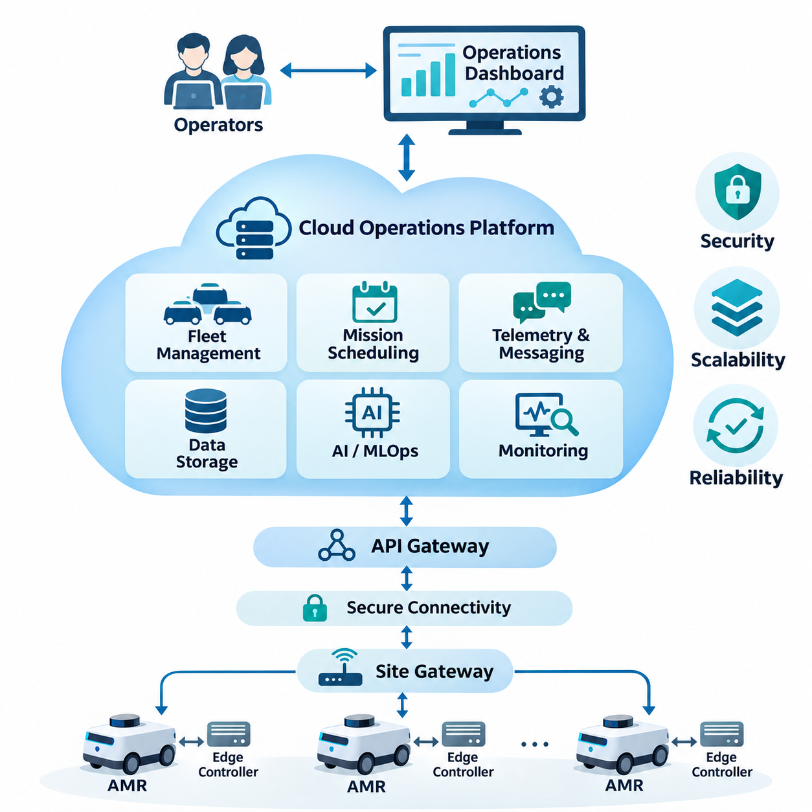
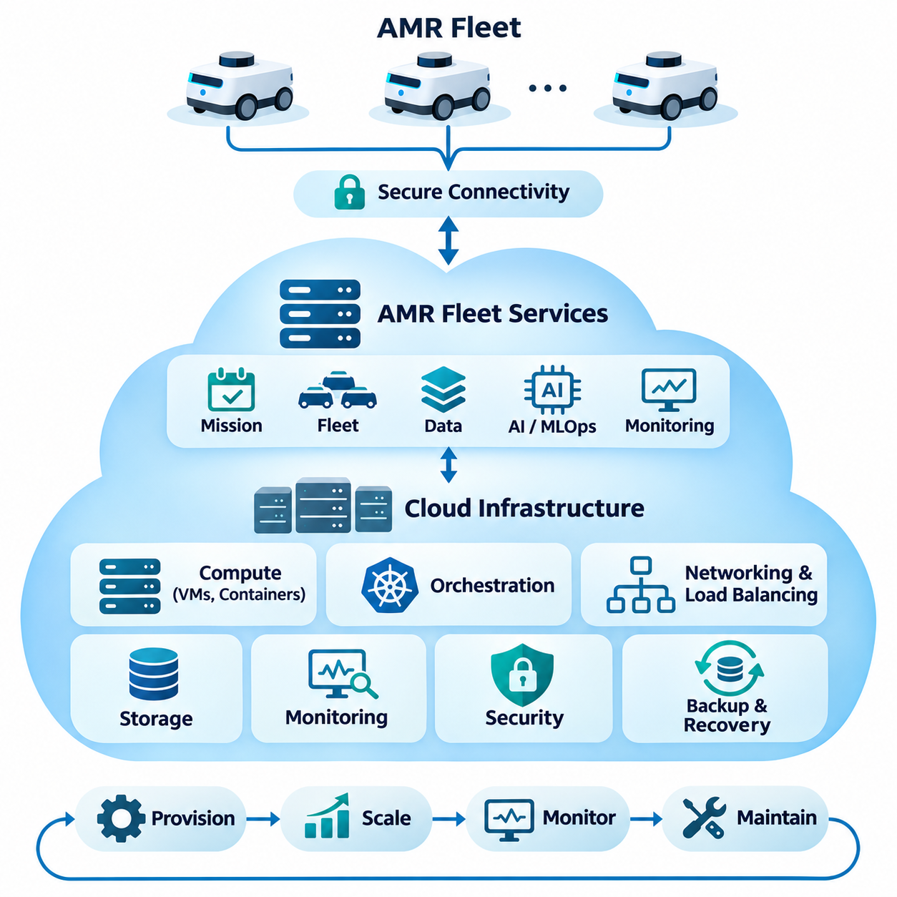
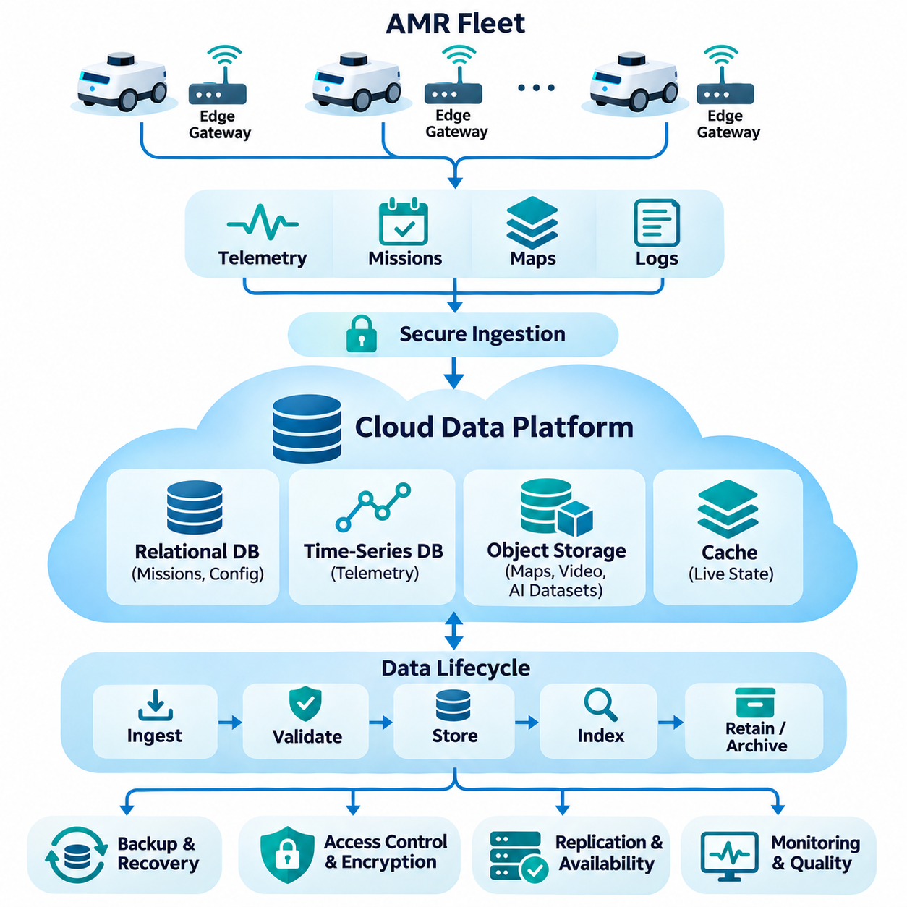
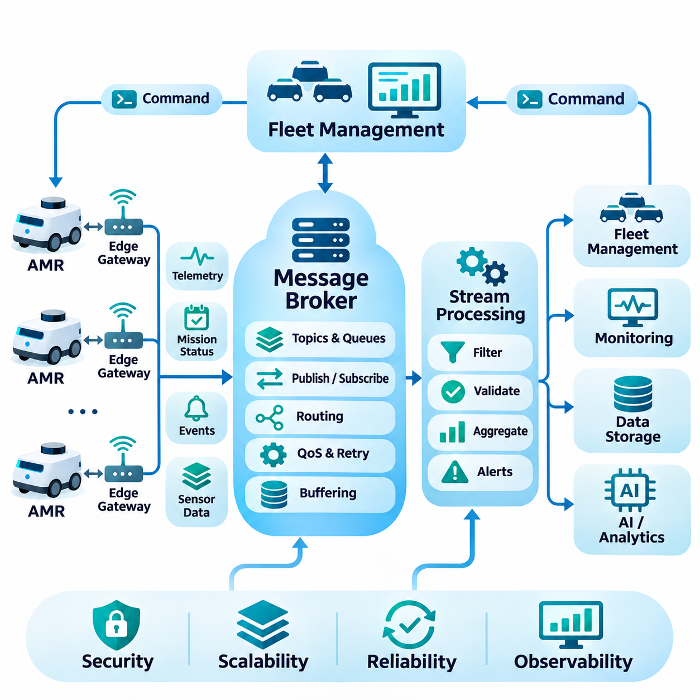
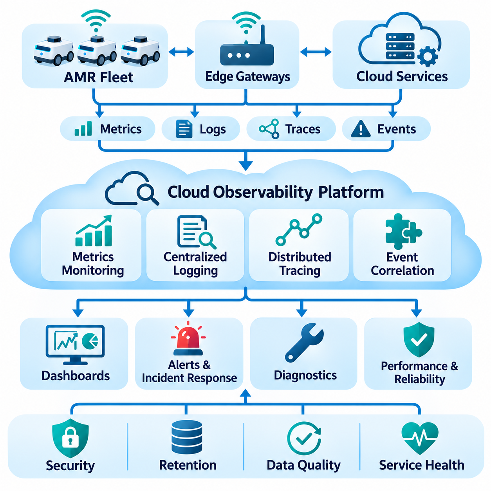
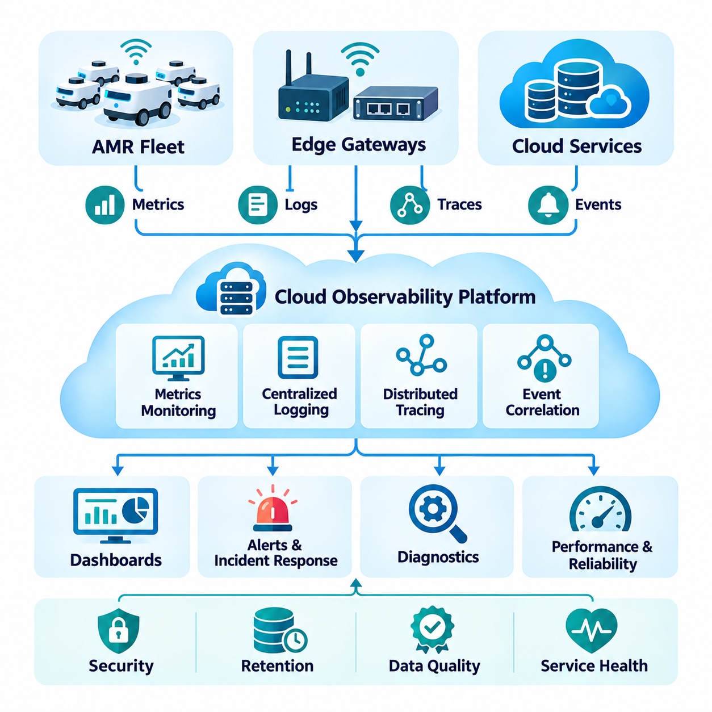
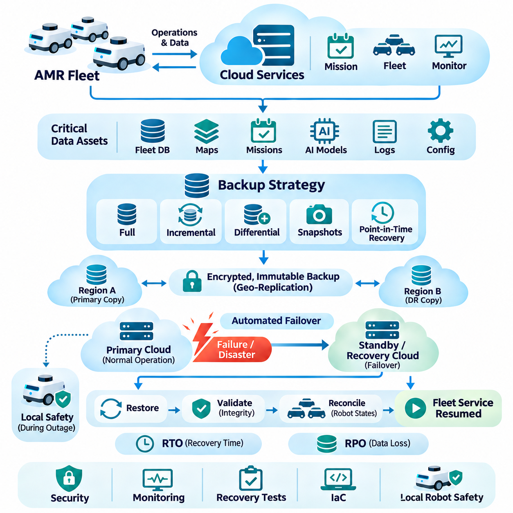
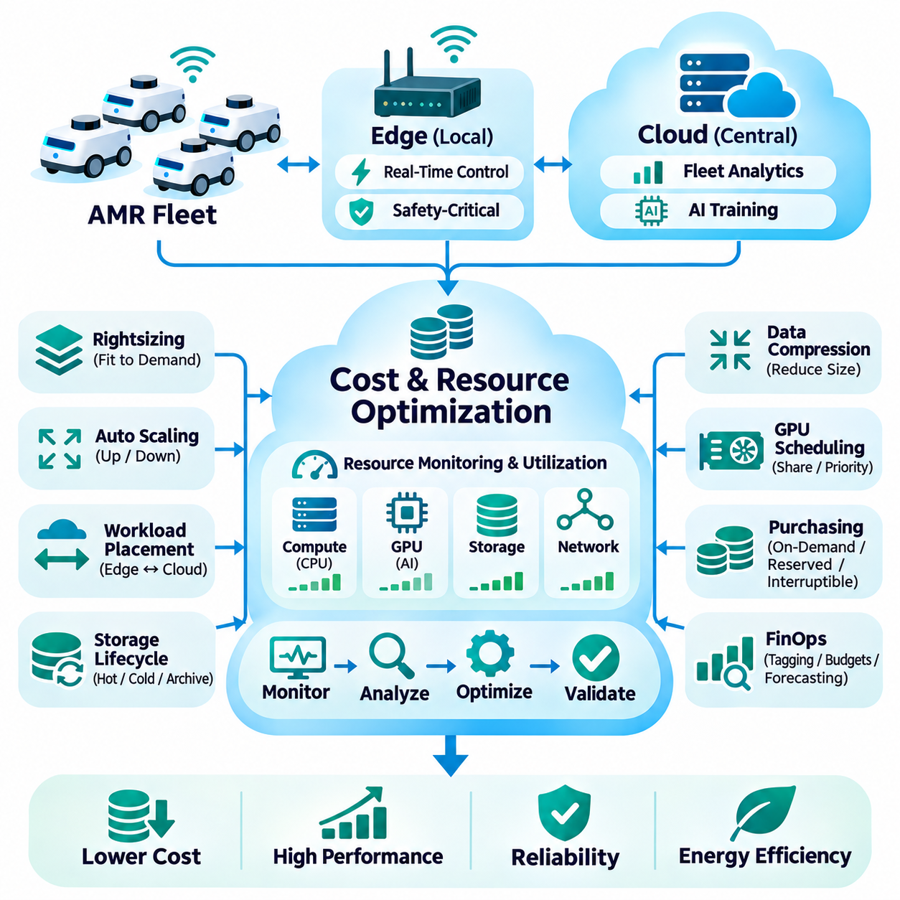
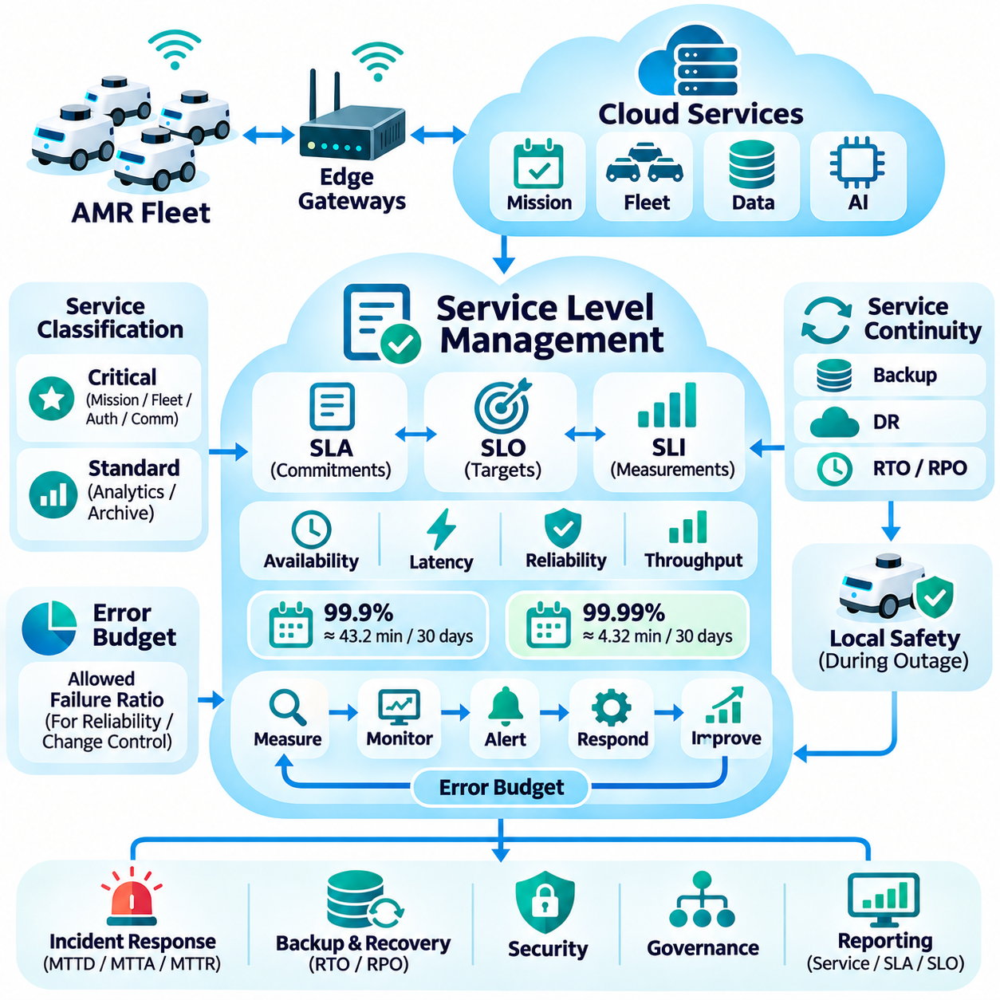

**Volume 08. AMR Operations, Deployment, and MLOps**

# Chapter 15. Cloud Operations

## 15.1 Cloud Operations Architecture

{width="7.268055555555556in" height="7.268055555555556in"}

Cloud operations architecture provides the centralized infrastructure required to manage, monitor, coordinate, and continuously improve Autonomous Mobile Robot (AMR) systems deployed across multiple operational environments. Unlike conventional standalone robotic systems, modern AMR platforms operate within interconnected ecosystems where cloud services support fleet management, operational intelligence, remote diagnostics, software distribution, and lifecycle management.

The fundamental objective of cloud operations architecture is to establish a scalable and reliable operational environment that connects individual robots, edge computing devices, on-premises infrastructure, and centralized cloud platforms. This distributed architecture enables organizations to separate real-time autonomous functions from computationally intensive and management-oriented services while maintaining consistent operational control across geographically distributed robot fleets.

A hierarchical cloud-edge architecture typically consists of robot-level computing, site-level edge infrastructure, and centralized cloud infrastructure. Robot-level computing executes perception, localization, navigation, motion control, and safety functions. Site-level infrastructure supports local fleet coordination and facility integration, while cloud infrastructure provides centralized management, historical analytics, software governance, and enterprise-wide operational visibility.

The cloud operations platform generally incorporates multiple functional layers, including connectivity, data ingestion, application services, data management, operational intelligence, and user interfaces. Each layer performs a distinct set of responsibilities while interacting through standardized communication protocols and application programming interfaces. This modular organization improves maintainability, scalability, interoperability, and independent service development.

The connectivity layer establishes secure communication channels between deployed robots and cloud infrastructure. Depending on the operational environment, communication may utilize Ethernet, Wi-Fi, private 5G networks, cellular networks, or virtual private networks. Communication reliability is strengthened through automatic reconnection, heartbeat monitoring, message buffering, network quality assessment, and synchronization mechanisms that accommodate intermittent connectivity.

The data ingestion layer receives operational information generated by individual robots and distributed fleet management systems. Incoming information includes robot position, mission status, battery condition, sensor health, software version, diagnostic events, and performance measurements. Message brokers and event-streaming platforms enable asynchronous communication, allowing high-volume operational data to be processed without tightly coupling individual services.

The application service layer hosts the primary operational functions required for centralized AMR management. These functions may include Robot Management Systems (RMS), Fleet Management Systems (FMS), mission orchestration, device registration, configuration management, notification services, and remote maintenance interfaces. A microservices-based architecture allows individual services to be independently deployed, updated, monitored, and scaled according to operational demand.

The data management layer incorporates relational databases, time-series databases, object storage, distributed caches, and analytical storage systems. Structured databases maintain robot identities, configurations, mission records, and administrative information, while time-series databases store continuous telemetry. Object storage supports large-scale sensor recordings, diagnostic packages, map files, AI datasets, and software artifacts required throughout the robot lifecycle.

Cloud operations architecture also establishes the foundation for integrating Machine Learning Operations (MLOps) into deployed robotic ecosystems. Operational data collected from robot fleets can be transferred into centralized data pipelines for filtering, annotation, model training, validation, and registry management. Approved AI models are subsequently distributed to compatible edge devices through controlled Over-the-Air (OTA) deployment processes.

Operational observability is achieved by integrating infrastructure monitoring, application metrics, centralized logging, distributed tracing, and event correlation. These mechanisms allow administrators to identify service degradation, network instability, database bottlenecks, abnormal resource consumption, and communication failures. Correlating cloud-side observations with robot-side telemetry provides a comprehensive understanding of distributed system behavior.

Security must be incorporated throughout every architectural layer rather than implemented as an isolated service. Device authentication, certificate management, encrypted communications, identity and access management, role-based authorization, network segmentation, and security auditing protect the operational ecosystem. Multi-tenant environments additionally require robust isolation between customer organizations, deployment sites, robot fleets, and associated operational datasets.

High availability and fault tolerance are essential architectural requirements because cloud service disruptions may affect fleet coordination and operational productivity. Redundant service instances, load balancing, database replication, automated failover, backup infrastructure, and disaster recovery mechanisms reduce service interruption. Robots must nevertheless retain sufficient local autonomy to maintain safe behavior whenever centralized services become unavailable.

Scalability is achieved through containerization, orchestration, horizontal service expansion, distributed data processing, and automated resource provisioning. Platforms such as Kubernetes can coordinate containerized workloads across computing infrastructure. Dynamic resource allocation allows the cloud platform to accommodate increasing robot populations, telemetry volumes, concurrent operator sessions, and computational requirements without unnecessary infrastructure expansion.

Cloud operations architecture must balance technical performance with economic sustainability and measurable service quality. Computing utilization, storage growth, network traffic, data retention, and AI processing workloads directly influence operational expenditure. Service Level Indicators (SLIs), Service Level Objectives (SLOs), and Service Level Agreements (SLAs) establish measurable expectations for availability, latency, reliability, and service responsiveness.

Ultimately, cloud operations architecture transforms independently deployed AMRs into a centrally governed and continuously improving robotic ecosystem. By integrating distributed computing, fleet coordination, data engineering, cybersecurity, MLOps, and operational governance, organizations can establish sustainable foundations for large-scale autonomous operations while preserving local safety, operational resilience, and long-term technological adaptability.

## 15.2 Server Infrastructure Management

{width="7.268055555555556in" height="7.268055555555556in"}

Server infrastructure management is a fundamental component of cloud operations for Autonomous Mobile Robot (AMR) systems, providing the computational foundation required to execute centralized operational services. Reliable server infrastructure supports fleet coordination, robot monitoring, mission management, operational data processing, software distribution, and artificial intelligence lifecycle management across distributed deployment environments.

The server infrastructure of an AMR operational platform may incorporate public cloud environments, private cloud platforms, on-premises data centers, and hybrid computing architectures. Infrastructure selection depends on operational scale, network connectivity, data sovereignty, security requirements, computational demand, and customer-specific constraints. Hybrid architectures enable organizations to distribute workloads according to their operational characteristics.

A well-designed server infrastructure separates computing resources according to functional responsibilities and workload characteristics. Application servers execute Robot Management Systems (RMS) and Fleet Management Systems (FMS), while database servers maintain operational information. Dedicated computing nodes may support message processing, historical analytics, AI model training, simulation, and computationally intensive optimization algorithms.

Server provisioning establishes the computing environment required for deploying and operating centralized robotic services. Provisioning includes operating system installation, network configuration, storage allocation, runtime preparation, security configuration, and application dependency management. Infrastructure as Code (IaC) enables these processes to be automated, version-controlled, reproducible, and consistently applied across multiple environments.

Virtualization and containerization provide flexible mechanisms for managing distributed server resources. Virtual machines establish isolated computing environments, while containers package applications together with their required runtime dependencies. Container orchestration platforms such as Kubernetes support automated deployment, workload scheduling, service discovery, resource allocation, health monitoring, and application recovery across server clusters.

Resource capacity planning ensures that server infrastructure can accommodate both existing operational workloads and anticipated fleet expansion. Engineers must evaluate processor utilization, memory consumption, storage capacity, network bandwidth, concurrent connections, and message-processing throughput. Capacity models should consider robot population, telemetry frequency, mission complexity, and peak operational demand rather than relying exclusively on average utilization.

Scalable infrastructure management incorporates both vertical scaling and horizontal scaling mechanisms. Vertical scaling increases the computational resources available to individual servers, whereas horizontal scaling distributes workloads across additional server instances. Automated scaling policies may respond to processor utilization, memory pressure, request latency, or message queue depth while maintaining predefined resource limits and operational stability.

Load balancing distributes incoming network connections and application requests across available server instances, preventing individual servers from becoming overloaded. Health-aware load balancers redirect traffic away from unhealthy services and support controlled application deployment. Stateful services require additional coordination to preserve session consistency, data integrity, and reliable communication during server failures or infrastructure changes.

High availability requires the elimination or mitigation of single points of failure throughout the server infrastructure. Redundant computing nodes, independent network paths, replicated databases, and automated failover mechanisms improve service continuity. Critical services may be distributed across separate availability zones or physical locations, depending on recovery requirements and the consequences of infrastructure failure.

Server infrastructure monitoring provides continuous visibility into computational health and operational performance. Important indicators include processor temperature, CPU utilization, memory availability, disk latency, storage utilization, network throughput, and service response time. Centralized monitoring platforms correlate these measurements with application behavior and generate actionable alerts before infrastructure degradation causes widespread service disruption.

Operating system and software maintenance must follow controlled operational procedures to minimize service interruption. Security patches, runtime updates, dependency upgrades, and configuration changes should first be evaluated in representative staging environments. Rolling updates, maintenance windows, compatibility verification, and rollback mechanisms help preserve production stability while addressing vulnerabilities and maintaining long-term software support.

Server security management incorporates hardened operating system configurations, restricted administrative access, network segmentation, encrypted communication, vulnerability scanning, and centralized audit logging. Administrative privileges should follow the principle of least privilege, with sensitive credentials stored in dedicated secret management systems. Production servers must also be isolated from unauthorized development and testing environments.

Specialized GPU server infrastructure may be introduced to support AI model training, large-scale sensor data processing, digital twin simulation, and advanced fleet intelligence. GPU resource management requires workload scheduling, accelerator compatibility verification, memory allocation, thermal management, and utilization monitoring. Computationally intensive AI workloads should be isolated from latency-sensitive operational services to prevent resource contention.

Infrastructure recovery planning establishes procedures for restoring server environments following hardware failures, configuration errors, cybersecurity incidents, or regional service disruptions. Automated infrastructure reconstruction, configuration backups, replicated storage, and tested recovery procedures reduce restoration time. Recovery Time Objectives (RTOs) and Recovery Point Objectives (RPOs) should reflect the operational criticality of individual services.

Ultimately, server infrastructure management establishes the reliable computational foundation for scalable and sustainable AMR cloud operations. Integrating automated provisioning, resource orchestration, performance monitoring, security governance, and recovery mechanisms enables organizations to maintain stable operational services while accommodating fleet growth. This vendor-neutral reference approach preserves flexibility across diverse cloud and on-premises deployment environments.

## 15.3 Database and Storage Operations

{width="7.268055555555556in" height="7.268055555555556in"}

Database and storage operations provide the information management foundation required for cloud-based Autonomous Mobile Robot (AMR) platforms. Modern robotic ecosystems continuously generate operational records, telemetry streams, diagnostic events, environmental maps, sensor recordings, and artificial intelligence datasets. Reliable database and storage infrastructure ensures that these information assets remain accessible, consistent, secure, and recoverable throughout the robot lifecycle.

The database architecture of an AMR cloud platform must accommodate diverse information types and workload characteristics. Relational databases support structured operational records, while time-series databases manage continuous telemetry streams. Document databases provide flexible schema management, and object storage accommodates large unstructured files. Combining specialized storage technologies enables efficient data management according to access patterns and operational requirements.

Relational database systems maintain essential information associated with robot registration, fleet configuration, mission scheduling, customer accounts, maintenance records, and administrative permissions. Transaction management ensures consistency when multiple services simultaneously modify operational records. Database constraints, indexing strategies, and schema normalization help preserve data integrity while supporting reliable application performance and enterprise system integration.

Time-series databases are particularly important for storing continuously generated robot telemetry. Typical measurements include battery voltage, motor temperature, positioning information, processor utilization, network latency, and sensor health indicators. Time-based partitioning, compression, aggregation, and retention policies enable these databases to process large volumes of sequential measurements while supporting efficient historical analysis and operational monitoring.

Object storage provides a scalable foundation for managing large robotic data assets, including camera recordings, LiDAR point clouds, ROS bag files, environmental maps, diagnostic archives, AI model packages, and training datasets. Each stored object should be associated with relevant metadata describing its origin, robot identity, collection timestamp, software version, and operational context. Metadata management improves searchability and lifecycle traceability.

Database and storage operations must distinguish between operational workloads and analytical workloads. Operational databases prioritize transaction consistency, low latency, and predictable response times, whereas analytical platforms support historical investigations, statistical processing, and large-scale data aggregation. Separating these workloads prevents computationally intensive analytical queries from degrading mission execution and fleet management services.

Data ingestion pipelines connect distributed AMR systems with centralized database and storage infrastructure. Incoming messages should undergo schema validation, timestamp verification, duplicate detection, and metadata enrichment before persistent storage. Asynchronous processing, message buffering, and controlled retry mechanisms improve ingestion reliability during network disruptions, temporary database failures, and sudden increases in telemetry volume.

Data partitioning and sharding enable storage infrastructure to accommodate growing robot populations and geographically distributed deployment sites. Information may be partitioned according to robot identity, customer organization, geographical region, deployment location, or collection time. Appropriate partitioning strategies distribute storage and query workloads while minimizing unnecessary cross-partition communication and improving horizontal scalability.

Database performance management requires continuous evaluation of query execution time, transaction throughput, connection utilization, cache efficiency, replication lag, and storage latency. Index optimization, connection pooling, query execution analysis, and caching mechanisms help reduce unnecessary computational overhead. Performance degradation should be investigated before it affects mission dispatch, robot monitoring, or other operationally critical services.

Storage lifecycle management establishes policies governing how operational information is retained, archived, and eventually deleted. Frequently accessed mission records and recent telemetry may remain within high-performance storage tiers, while historical sensor recordings can be transferred to lower-cost archival systems. Retention periods must reflect operational requirements, regulatory obligations, cybersecurity considerations, and the future value of collected robotic data.

Database availability and durability are maintained through replication, redundant storage infrastructure, automated failover, and continuous health monitoring. Replication strategies must balance consistency, availability, network latency, and acceptable data loss. Distributed architectures should account for temporary network partitions and recovery synchronization to prevent conflicting operational records or inconsistent robot configuration information.

Backup and recovery mechanisms protect robotic information against hardware failures, accidental deletion, software defects, database corruption, and cybersecurity incidents. Scheduled backups, point-in-time recovery, immutable storage, and geographically separated backup copies strengthen operational resilience. Recovery procedures must be regularly tested against defined Recovery Time Objectives (RTOs) and Recovery Point Objectives (RPOs).

Database security and data governance must be integrated throughout the information lifecycle. Encryption at rest and in transit, role-based access control, credential rotation, tenant isolation, and audit logging protect sensitive operational assets. Organizations must establish clear data ownership, classification, access authorization, retention policies, and deletion procedures, particularly when robotic systems collect information within hospitals or public environments.

Database and storage operations also support Machine Learning Operations (MLOps) by maintaining traceable relationships between operational data, training datasets, annotation records, model versions, and validation results. Dataset versioning, metadata catalogs, data lineage, and integrity verification enable reproducible AI development. Approved model artifacts must remain accessible for controlled deployment, compatibility assessment, and rollback operations.

Ultimately, database and storage operations transform continuously generated robotic information into reliable and reusable operational assets. Integrating scalable storage, database optimization, automated recovery, data governance, and lifecycle management enables organizations to support fleet expansion and continuous intelligence improvement. This vendor-neutral reference architecture extends the chapter outline with general engineering practices.

## 15.4 Message Broker and Stream Management

{width="7.268055555555556in" height="7.268055555555556in"}

Message broker and stream management provide the communication foundation for distributed Autonomous Mobile Robot (AMR) cloud operations. Modern robotic platforms continuously exchange telemetry, mission commands, diagnostic events, configuration updates, and operational notifications. Reliable messaging infrastructure enables robots, edge devices, fleet management systems, and cloud applications to communicate asynchronously while maintaining operational consistency and scalability.

Message brokers function as intermediary communication components that receive, route, buffer, and distribute messages between independent system components. Instead of establishing direct connections between every robot and cloud service, distributed applications communicate through centralized or federated messaging infrastructure. This architectural approach reduces system coupling, simplifies service integration, and improves resilience against temporary communication failures.

The publish-subscribe communication model is widely adopted in distributed robotic ecosystems. Robots publish operational information to predefined topics, while authorized application services subscribe to relevant message categories. Robot Management Systems (RMS), Fleet Management Systems (FMS), monitoring applications, and analytical platforms can independently consume information without requiring direct modification of the original data-producing components.

Messaging protocols must be selected according to communication requirements, network conditions, message characteristics, and operational constraints. Message Queuing Telemetry Transport (MQTT) supports lightweight device communication, while Advanced Message Queuing Protocol (AMQP) provides flexible message routing and reliable delivery mechanisms. Apache Kafka supports persistent event streaming and high-throughput distributed data processing.

Message topic design establishes a structured communication namespace across the robotic ecosystem. Topics may incorporate customer identifiers, deployment locations, fleet identifiers, robot identities, message categories, and functional domains. Consistent naming conventions simplify message routing, subscription management, access control, and operational troubleshooting while preventing unintended information exchange between independent deployment environments.

Message delivery reliability depends on appropriate Quality of Service (QoS) mechanisms, acknowledgment procedures, retry policies, and persistence configurations. Periodic telemetry may tolerate occasional message loss, whereas mission commands and critical operational events require stronger delivery guarantees. Applications must implement message identifiers, duplicate detection, expiration policies, and idempotent processing to prevent unintended repeated execution.

Stream management extends conventional messaging by organizing continuously generated operational information into persistent and processable event sequences. Robot telemetry, mission transitions, battery measurements, localization updates, and diagnostic events can be processed through distributed streaming pipelines. These pipelines support real-time monitoring, historical analysis, anomaly detection, and operational intelligence without interrupting robot-level autonomy.

Event schema management ensures consistency between message-producing and message-consuming applications. Each operational event should contain standardized fields describing its identity, source, timestamp, message type, payload, and schema version. Serialization technologies such as JSON, Protocol Buffers, and Apache Avro support structured information exchange, while schema compatibility policies reduce integration failures during software evolution.

Message buffering and store-and-forward mechanisms are particularly important when robots operate under unstable network conditions. Edge devices can temporarily retain selected operational messages during communication interruptions and synchronize them after connectivity is restored. Buffer capacity, message priority, expiration time, and retransmission policies must be carefully defined to prevent outdated information from affecting current operational decisions.

Stream processing applications transform incoming operational events into actionable information through filtering, aggregation, enrichment, and correlation. Distributed processing frameworks can calculate fleet utilization, identify abnormal battery behavior, detect recurring navigation failures, and generate maintenance indicators. Window-based processing enables continuous evaluation of operational trends while accounting for delayed or out-of-order events.

Scalable messaging infrastructure distributes communication workloads across multiple broker instances, partitions, and consumer groups. Partitioning strategies should consider robot identity, deployment site, message volume, and ordering requirements. Horizontal scaling enables the messaging platform to accommodate increasing robot populations and telemetry frequencies, while backpressure mechanisms protect downstream services against excessive processing demand.

Message broker observability provides continuous visibility into communication performance and infrastructure health. Important indicators include message throughput, delivery latency, queue depth, consumer lag, connection counts, resource utilization, and failed delivery rates. Monitoring systems should correlate broker-side measurements with robot-side communication logs to identify network congestion, processing bottlenecks, and service degradation.

Messaging security must incorporate encrypted communication, device authentication, topic-level authorization, credential rotation, and tenant isolation. Unauthorized applications must not be permitted to publish mission commands, modify robot configurations, or subscribe to sensitive operational information. Audit logging and security monitoring provide traceability for communication activities and help identify abnormal message traffic or unauthorized access attempts.

Operational resilience requires redundant broker infrastructure, durable message storage, automated failover, and tested recovery procedures. Message retention and replay capabilities enable application services to recover missed events or reconstruct operational states following disruptions. However, replayed mission commands must undergo validity checks to prevent obsolete instructions from triggering unintended physical actions. Safety-critical control must remain local.

Ultimately, message broker and stream management establish the communication backbone for scalable, reliable, and continuously improving AMR cloud operations. Integrating asynchronous messaging, persistent event streaming, distributed processing, security governance, and operational monitoring supports coordinated fleet intelligence and data-driven optimization. This vendor-neutral engineering approach expands the supplied chapter outline using general architectural practices.

## 15.5 Cloud Monitoring and Logging

{width="7.268055555555556in" height="7.268055555555556in"}

{width="7.268055555555556in" height="7.268055555555556in"}

Cloud monitoring and logging provide the operational visibility required to maintain reliable, scalable, and secure Autonomous Mobile Robot (AMR) cloud platforms. As robotic ecosystems become increasingly distributed across edge devices, deployment sites, and centralized cloud services, continuous observation of system behavior becomes essential for detecting failures, evaluating performance, and maintaining operational continuity.

Cloud monitoring architecture integrates infrastructure monitoring, application performance monitoring, network monitoring, database monitoring, and robotic fleet monitoring within a unified operational environment. These monitoring capabilities provide visibility into the relationships between individual cloud components and distributed robotic systems. Centralized monitoring enables operators to identify infrastructure problems before they escalate into widespread service disruptions.

Cloud infrastructure monitoring continuously evaluates the health and performance of physical servers, virtual machines, containers, storage systems, and network resources. Important indicators include processor utilization, memory consumption, disk capacity, storage throughput, network bandwidth, and resource availability. Continuous resource assessment supports proactive capacity planning, infrastructure optimization, and early detection of abnormal operating conditions.

Application Performance Monitoring (APM) focuses on the behavior of software services supporting Robot Management Systems (RMS), Fleet Management Systems (FMS), mission scheduling, remote monitoring, and AI model management. Application response times, request throughput, processing latency, error rates, and service dependencies are continuously evaluated to identify performance bottlenecks and maintain predictable service behavior under varying operational workloads.

Centralized logging collects operational records generated by distributed cloud services, edge computing platforms, databases, communication gateways, and individual robots. Instead of maintaining isolated log files across independent systems, centralized logging infrastructure aggregates information within a searchable environment. This approach simplifies incident investigation, historical analysis, software debugging, and operational accountability across large robotic fleets.

Structured logging improves the consistency and analytical value of operational records by representing events through standardized information fields. Each log entry may contain a timestamp, severity level, service identifier, robot identifier, deployment location, software version, correlation identifier, and descriptive message. Machine-readable formats such as JSON enable automated filtering, indexing, aggregation, and correlation across distributed robotic applications.

Observability extends conventional monitoring by combining metrics, logs, and distributed traces to explain internal system behavior through externally collected information. Metrics describe quantitative system conditions, logs record individual events, and traces reveal execution paths across distributed services. Integrating these information sources enables operators to investigate complex failures involving multiple infrastructure components and application dependencies.

Distributed tracing is particularly valuable for cloud platforms composed of interconnected microservices. A robot mission request may pass through authentication services, application gateways, scheduling engines, databases, message brokers, and fleet management applications. Trace identifiers and span records allow operators to reconstruct these execution paths, measure individual processing stages, and identify the underlying sources of end-to-end service latency.

Monitoring and logging infrastructure must accommodate the continuously increasing volume of information generated by large robotic fleets. Data collection agents, telemetry gateways, and centralized processing pipelines support efficient information ingestion and distribution. Sampling, compression, aggregation, and configurable collection intervals help control monitoring overhead while maintaining sufficient visibility into operationally significant events.

Real-time alert management transforms monitoring information into actionable operational notifications. Alert thresholds may be established for excessive resource utilization, abnormal application latency, database replication failures, communication interruptions, and unexpected robot disconnections. Dynamic thresholds, alert correlation, deduplication, and severity classification help reduce unnecessary notifications while prioritizing critical incidents.

Cloud monitoring dashboards provide unified operational visibility across infrastructure resources, application services, communication systems, and geographically distributed robotic fleets. Dashboard configurations should reflect the responsibilities of infrastructure engineers, fleet operators, maintenance personnel, and system administrators. Historical trend visualization and service dependency analysis support informed operational decisions and resource planning.

Log lifecycle management establishes policies for information collection, indexing, retention, archival, and deletion. Frequently accessed operational logs may remain within high-performance searchable storage, while historical records can be transferred to lower-cost archival infrastructure. Retention policies must balance troubleshooting requirements, regulatory obligations, storage expenditure, and the long-term analytical value of operational records.

Monitoring and logging security must prevent unauthorized access to sensitive operational information. Encrypted transmission, role-based access control, tenant isolation, sensitive information masking, and tamper-resistant audit records protect the integrity and confidentiality of collected information. Logging configurations should prevent authentication credentials, personal information, and confidential robotic data from being unnecessarily exposed.

Monitoring platforms must also maintain their own availability and reliability through redundant collection services, persistent buffering, automated failover, and independent health checks. Technologies such as Prometheus, Grafana, OpenTelemetry, and OpenSearch can support complementary monitoring and logging functions. Safety-critical robot operations must remain independent of centralized monitoring availability and cloud communication conditions.

Ultimately, cloud monitoring and logging establish an essential foundation for proactive AMR operations, incident response, performance optimization, and continuous system improvement. Integrating infrastructure metrics, structured logs, distributed traces, intelligent alerting, and information governance strengthens operational resilience. This vendor-neutral engineering approach extends the chapter outline through general cloud observability practices.

## 15.6 Backup and Disaster Recovery

{width="7.268055555555556in" height="7.268055555555556in"}

Backup and disaster recovery establish the operational resilience required to protect Autonomous Mobile Robot (AMR) cloud platforms against unexpected system failures, infrastructure disruptions, cybersecurity incidents, and data loss. As robotic operations increasingly depend on centralized fleet management, distributed applications, and persistent information resources, systematic recovery planning becomes essential for maintaining business continuity and service reliability.

Backup and disaster recovery strategies address complementary aspects of operational protection. Backup mechanisms preserve recoverable copies of critical information, software configurations, and application states, whereas disaster recovery mechanisms restore essential infrastructure and services following major disruptions. Integrating these capabilities enables organizations to minimize operational downtime, information loss, and the financial consequences of system failures.

Backup architecture must identify and classify the information assets required for successful AMR operations. Critical assets include robot configuration records, fleet databases, environmental maps, mission histories, authentication configurations, AI model artifacts, operational logs, and infrastructure definitions. Backup priorities should reflect operational dependencies, information value, restoration complexity, and the potential consequences of permanent data loss.

Different backup methodologies provide varying levels of protection, storage efficiency, and recovery performance. Full backups preserve complete copies of selected information resources, incremental backups capture changes since the preceding backup, and differential backups capture changes since the most recent full backup. Organizations should combine these methodologies according to data growth, backup frequency, available storage capacity, and restoration requirements.

Recovery Time Objective (RTO) and Recovery Point Objective (RPO) represent fundamental parameters in disaster recovery planning. RTO defines the targeted maximum duration required to restore an unavailable service, while RPO defines the maximum acceptable data loss measured in time. These objectives should be established individually for mission management services, operational databases, communication infrastructure, and analytical platforms according to their criticality.

Database backup mechanisms must preserve transactional consistency and information integrity throughout the recovery process. Automated snapshots, transaction log archiving, and point-in-time recovery enable database services to restore information to specific operational states. Distributed robotic platforms must also consider consistency between related databases, message brokers, and application services to prevent conflicting mission records or configuration information.

Geographically distributed backup storage protects critical information against localized infrastructure failures, natural disasters, and regional service interruptions. Backup copies should be maintained across independent failure domains using appropriate redundancy and replication mechanisms. The selection of backup locations must consider network latency, data sovereignty, regulatory restrictions, transmission expenditure, and the accessibility of recovery resources during emergencies.

Disaster recovery architecture may incorporate backup-and-restore, pilot light, warm standby, or active-active deployment strategies. Each approach provides different levels of infrastructure readiness, recovery speed, operational complexity, and financial expenditure. Mission-critical cloud services may require continuously available redundant infrastructure, whereas less critical analytical applications can tolerate longer restoration periods using archived resources.

Automated failover mechanisms support rapid service restoration when primary infrastructure becomes unavailable. Health checks, failure detection services, traffic management systems, and redundant application instances coordinate the transition toward alternative operational environments. Failover procedures must prevent conflicting service instances, duplicate mission assignments, and inconsistent operational states during infrastructure transitions.

Infrastructure as Code (IaC) strengthens disaster recovery capabilities by allowing cloud infrastructure to be reconstructed from version-controlled configuration definitions. Server environments, container orchestration platforms, network configurations, access policies, and application dependencies can be recreated through automated provisioning mechanisms. Reproducible infrastructure reduces manual configuration errors and improves recovery predictability.

Disaster recovery procedures must account for the physical consequences of cloud infrastructure failures within robotic environments. AMRs should maintain local safety functions and predefined degraded operating modes when centralized services become unavailable. Following cloud service restoration, robot states, mission assignments, environmental maps, and pending commands must be reconciled before normal fleet coordination resumes.

Backup security protects recovery resources against unauthorized access, malicious modification, accidental deletion, and ransomware attacks. Encryption, immutable storage, isolated backup environments, restricted administrative privileges, and independent authentication mechanisms strengthen information protection. Backup integrity verification and controlled restoration procedures help prevent compromised information from entering recovered operational environments.

Disaster recovery testing validates the effectiveness of recovery strategies through controlled infrastructure failure simulations, backup restoration exercises, and service failover testing. Recovery exercises should measure actual restoration times, information loss, application consistency, and robotic fleet synchronization performance. Identified deficiencies must be documented and addressed through continuous improvement of recovery procedures.

Backup and disaster recovery operations require continuous monitoring, clearly defined responsibilities, and documented recovery procedures. Monitoring systems should evaluate backup completion rates, replication latency, storage capacity, recovery readiness, and restoration test results. Operational runbooks establish recovery sequences, escalation procedures, communication responsibilities, and approval requirements during infrastructure emergencies.

Ultimately, backup and disaster recovery provide an essential foundation for sustainable and fault-tolerant AMR cloud operations. Integrating automated backups, distributed recovery infrastructure, security controls, local robotic autonomy, and periodically validated restoration procedures strengthens long-term operational resilience. This vendor-neutral engineering approach expands the supplied chapter outline through general disaster recovery practices.

## 15.7 Cost and Resource Optimization

{width="7.268055555555556in" height="7.268055555555556in"}

Cost and resource optimization establishes the economic and computational foundation required for sustainable Autonomous Mobile Robot (AMR) cloud operations. As robotic fleets expand across multiple deployment environments, cloud infrastructure expenditure increases through computing resources, data storage, network communication, and application services. Effective optimization balances operational performance, service reliability, infrastructure scalability, and financial sustainability.

Cloud operational expenditure must be evaluated across the complete robotic ecosystem rather than individual infrastructure components. Major cost categories include virtual machines, container orchestration platforms, managed databases, object storage, message brokers, network gateways, monitoring services, and GPU computing resources. Understanding the relationships between these resources enables organizations to identify unnecessary expenditure and establish effective optimization priorities.

Resource utilization monitoring provides the quantitative foundation for infrastructure optimization. Processor utilization, memory consumption, GPU occupancy, storage capacity, network bandwidth, and application throughput should be continuously evaluated against actual operational requirements. Historical utilization patterns help identify underutilized resources, excessive provisioning, performance bottlenecks, and opportunities for infrastructure consolidation.

Resource rightsizing adjusts computational and storage resources according to the actual requirements of individual cloud services. Oversized virtual machines, excessive container resource reservations, and unnecessarily powerful database instances increase operational expenditure without necessarily improving service quality. Systematic workload analysis enables organizations to select appropriate resource configurations while maintaining sufficient capacity for unexpected demand fluctuations.

Automatic scaling mechanisms dynamically adjust infrastructure capacity according to changing operational workloads. Horizontal scaling increases or decreases the number of application instances, while vertical scaling modifies the resources allocated to individual instances. Scaling policies should consider processor utilization, request throughput, message queue depth, active robot population, and mission scheduling demand while preserving predictable service performance.

Workload classification enables cloud resources to be allocated according to operational criticality and computational characteristics. Mission scheduling, fleet coordination, and robot communication services require predictable availability and response times, whereas historical analytics, dataset preprocessing, and AI training workloads may tolerate scheduling delays. Separating these workload categories improves resource allocation efficiency without compromising essential robotic operations.

GPU resource optimization is particularly important for cloud platforms supporting artificial intelligence and Machine Learning Operations (MLOps). Model training, large-scale inference, dataset processing, and simulation workloads can generate substantial computational expenditure. GPU scheduling, resource sharing, mixed-precision computation, distributed training optimization, and workload prioritization help improve accelerator utilization and reduce unnecessary energy consumption.

Storage cost optimization requires appropriate classification and lifecycle management of robotic information assets. Recent telemetry, active mission records, and frequently accessed AI models may require high-performance storage, while historical logs, sensor recordings, and archived datasets can utilize lower-cost storage tiers. Compression, deduplication, retention policies, and automated archival mechanisms reduce storage expenditure while preserving valuable operational information.

Network resource optimization reduces expenditure associated with data transmission between robots, edge computing devices, deployment sites, and cloud infrastructure. Edge-based filtering, adaptive telemetry frequencies, data compression, and event-driven communication minimize unnecessary data transfers. Regional service placement and intelligent data routing further reduce cross-region transmission costs while improving communication latency and operational responsiveness.

Edge-cloud workload balancing distributes computational responsibilities according to processing requirements, latency constraints, and resource availability. Real-time perception, motion control, and safety-critical functions should remain within local robotic systems, while centralized cloud infrastructure supports fleet analytics, AI training, and long-term information management. Appropriate workload placement reduces cloud dependency, network expenditure, and computational redundancy.

Cloud purchasing strategies can further reduce infrastructure expenditure through appropriate pricing and resource allocation models. On-demand resources provide flexibility for unpredictable workloads, while reserved capacity and long-term usage commitments may reduce expenses for stable services. Interruptible computing instances can support fault-tolerant AI training and batch processing workloads but should not host essential fleet coordination services.

Financial Operations (FinOps) integrates financial accountability with cloud infrastructure engineering and operational management. Resource tagging, departmental cost allocation, budget monitoring, expenditure forecasting, and automated cost anomaly detection provide visibility into infrastructure consumption. Organizations can evaluate operational efficiency through metrics such as cloud cost per robot, completed mission, deployment site, and processed data volume.

Energy efficiency and sustainable computing should be incorporated into long-term resource optimization strategies. Computational workload consolidation, efficient AI models, intelligent scheduling, and appropriate accelerator selection can reduce unnecessary power consumption. However, resource optimization must preserve redundancy, cybersecurity protections, recovery capabilities, and service capacity required to maintain reliable robotic operations.

Ultimately, cost and resource optimization transforms cloud infrastructure management into a continuous process of economic and technical improvement. Integrating automated scaling, resource rightsizing, workload distribution, storage lifecycle management, and financial governance enables sustainable fleet expansion. This vendor-neutral engineering approach extends the supplied chapter outline through general cloud optimization practices.

## 15.8 Cloud Service Level Management

{width="7.268055555555556in" height="7.268055555555556in"}

Cloud service level management establishes a systematic framework for maintaining the availability, reliability, performance, and operational quality of cloud services supporting Autonomous Mobile Robot (AMR) platforms. As robotic ecosystems increasingly depend on distributed infrastructure and centralized fleet coordination, clearly defined service expectations become essential for maintaining predictable operations and customer confidence.

Service level management integrates technical infrastructure requirements with operational objectives and customer expectations. Cloud services supporting robot registration, mission scheduling, fleet coordination, remote monitoring, database management, and AI model deployment must operate within defined performance boundaries. Establishing measurable service requirements enables organizations to evaluate operational effectiveness and identify improvement opportunities.

Service Level Agreements (SLAs) establish formal commitments between cloud service providers and service consumers regarding expected service quality. These agreements typically define availability requirements, performance guarantees, technical support responsibilities, incident response expectations, and applicable service exclusions. AMR service providers must align their contractual commitments with actual infrastructure capabilities and operational dependencies.

Service Level Objectives (SLOs) represent measurable service performance targets established to support operational and contractual requirements. Typical objectives include cloud service availability, mission request processing latency, message delivery reliability, database response time, and telemetry processing throughput. Appropriate SLOs should reflect the operational criticality of each service and the potential consequences of performance degradation.

Service Level Indicators (SLIs) provide quantitative measurements used to evaluate whether cloud services satisfy established service level objectives. Common indicators include successful request ratios, application response times, service interruption durations, communication failure rates, and data processing delays. Reliable measurement requires standardized data collection methods, consistent evaluation periods, and clearly defined measurement boundaries.

Cloud service availability represents a fundamental performance requirement for distributed robotic operations. An availability objective of 99.9 percent permits approximately 43.2 minutes of unavailability during a 30-day measurement period, whereas 99.99 percent permits approximately 4.32 minutes. Higher availability requirements generally demand greater infrastructure redundancy, automated recovery mechanisms, and increased operational expenditure.

Performance management must consider the complete service delivery path between robotic systems and centralized cloud applications. Network communication latency, application processing duration, database query performance, and message broker processing delays collectively influence end-to-end responsiveness. Measuring percentile-based latency, rather than relying exclusively on averages, helps identify significant service degradation affecting individual robots.

Service classification enables organizations to establish differentiated service levels according to operational importance. Mission dispatch, fleet coordination, authentication, and robot communication services typically require stricter availability and latency objectives than historical analytics or archived data retrieval. This classification supports efficient resource allocation while protecting operationally critical services against infrastructure limitations.

Error budget management provides a practical mechanism for balancing service reliability with continuous software development and infrastructure improvement. An error budget represents the allowable proportion of unsuccessful service operations within a defined measurement period. When the remaining budget becomes insufficient, organizations may temporarily restrict software deployments and prioritize reliability engineering, corrective maintenance, and infrastructure stabilization.

Continuous service level monitoring requires integrated observability infrastructure capable of collecting and analyzing operational performance indicators. Automated monitoring systems should identify deviations from established service objectives, calculate error budget consumption, and generate actionable alerts. Centralized dashboards provide operational teams with visibility into service health, historical performance, and emerging reliability risks.

Incident management processes must align with established service level commitments and operational priorities. Incident classification, response time targets, escalation procedures, customer notification, and restoration responsibilities should be clearly defined. Mean Time to Detect (MTTD), Mean Time to Acknowledge (MTTA), and Mean Time to Restore (MTTR) provide measurable indicators of incident management effectiveness.

Service continuity management integrates service level requirements with backup strategies, disaster recovery architecture, and infrastructure redundancy. Recovery Time Objectives (RTOs) and Recovery Point Objectives (RPOs) should remain consistent with contractual service commitments. During cloud service interruptions, AMRs must preserve local safety functions and transition into predefined degraded operating modes when necessary.

Service level governance must also address external infrastructure dependencies, cybersecurity requirements, scheduled maintenance, and interoperability between cloud and edge systems. Cloud provider commitments do not automatically guarantee equivalent end-to-end robotic service availability. Organizations must evaluate dependency failures, communication interruptions, and regional infrastructure limitations when defining customer-facing service levels.

Service level reporting and periodic reviews enable organizations to evaluate contractual compliance, operational trends, customer satisfaction, and infrastructure effectiveness. Reports should document service availability, performance deviations, incident histories, recovery results, and corrective actions. Reviewing these findings alongside infrastructure expenditure supports continuous improvement and appropriate resource allocation.

Ultimately, cloud service level management integrates cloud architecture, infrastructure monitoring, disaster recovery, cost optimization, and operational governance into a unified reliability framework. Clearly defined service commitments and measurable objectives support sustainable AMR fleet expansion. This vendor-neutral engineering framework expands the supplied chapter outline through general service management practices.
