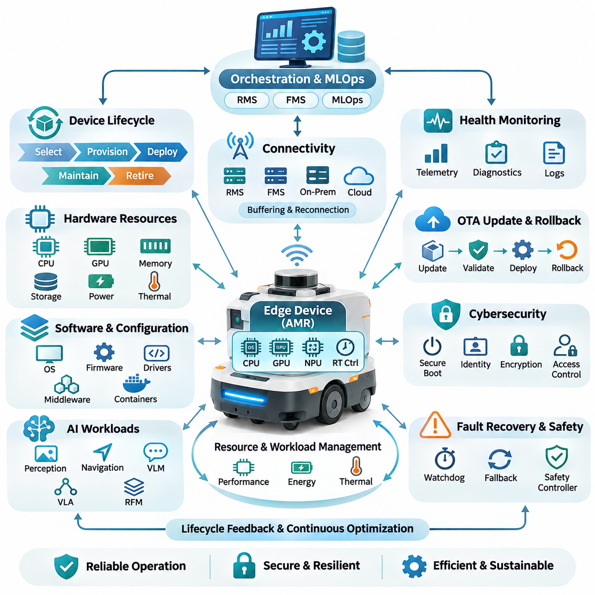
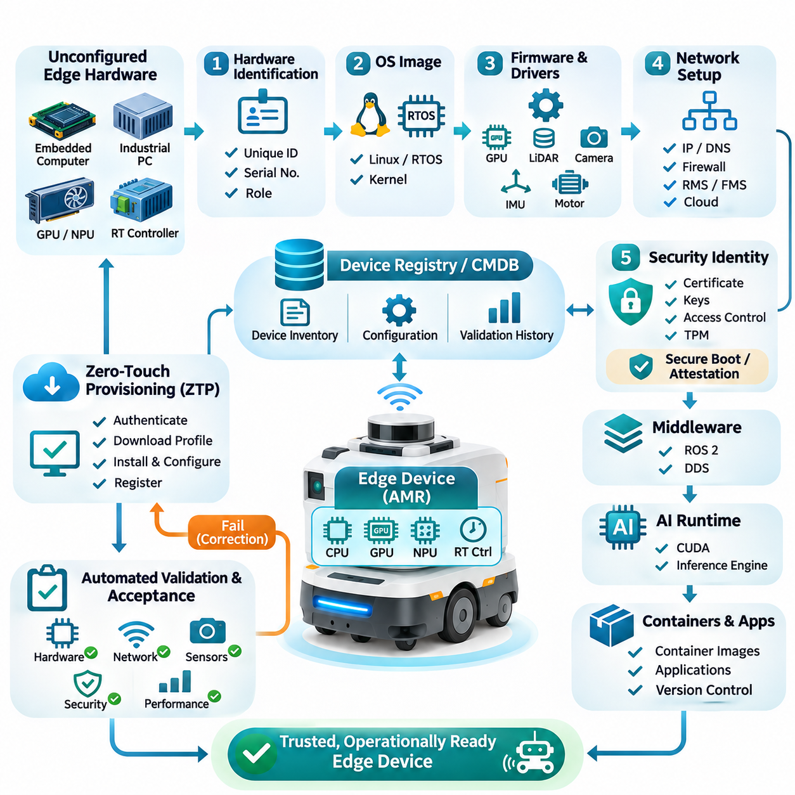
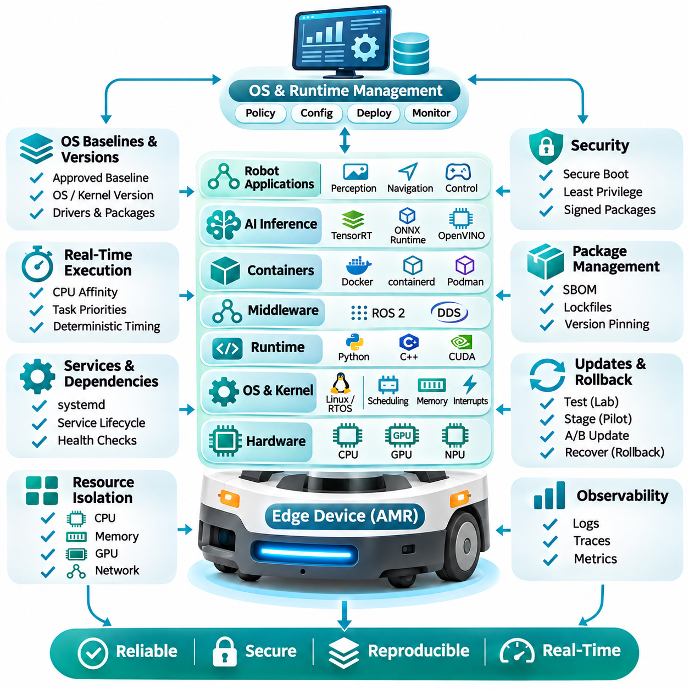
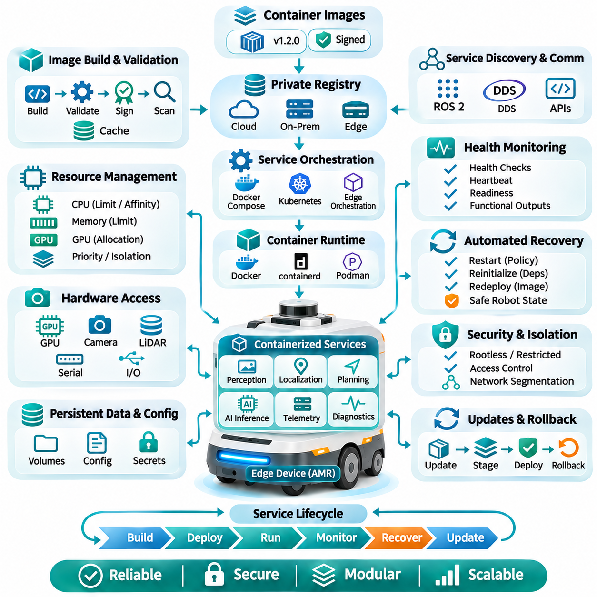
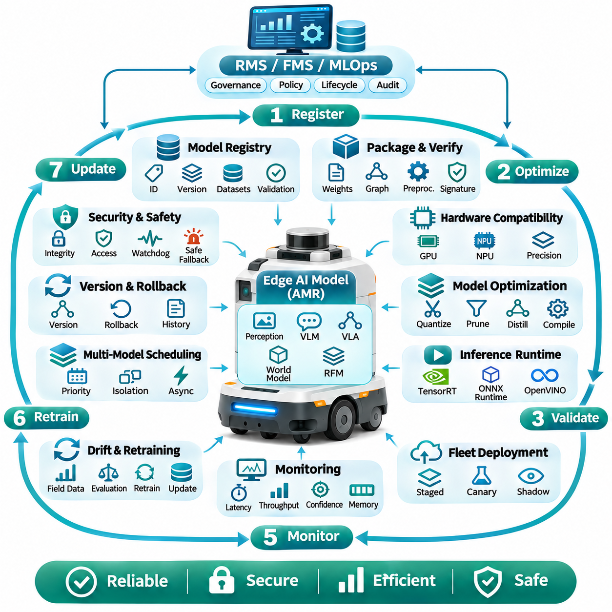
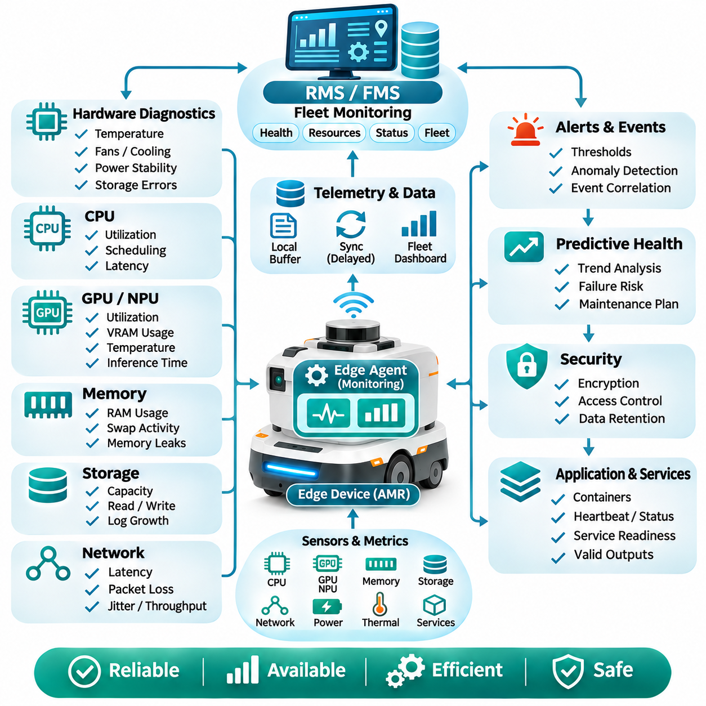
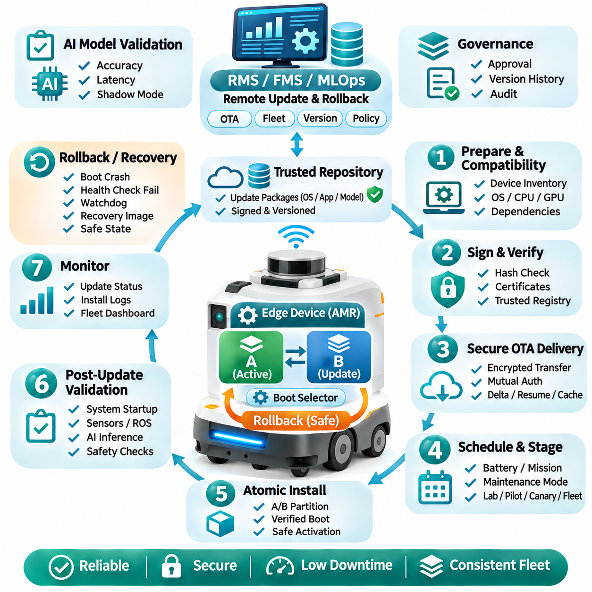
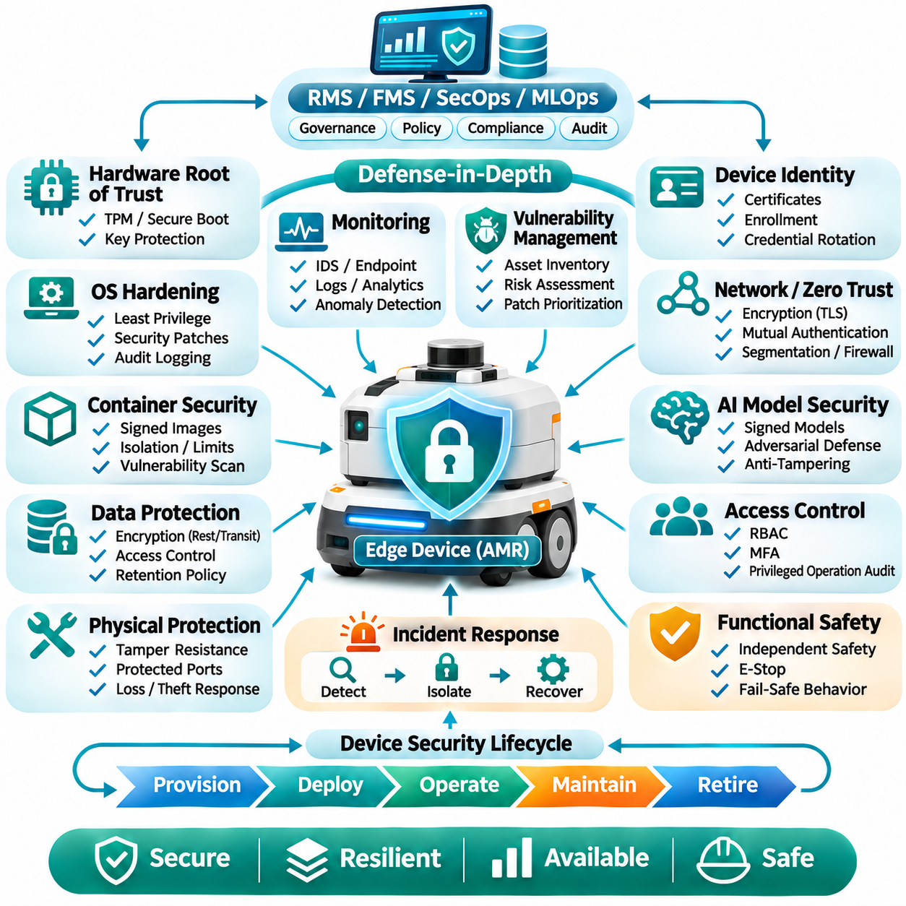

**Volume 08. AMR Operations, Deployment, and MLOps**


# Chapter 16. Edge Device Management

##  

## 16.1 Edge Device Management Overview

{width="7.268055555555556in" height="7.268055555555556in"}

Edge Device Management is a fundamental operational discipline that ensures the reliable, secure, and efficient operation of distributed computing devices deployed within robotic systems and Physical AI infrastructures. Edge devices execute critical functions such as sensor processing, environmental perception, artificial intelligence inference, navigation, motion control, and local decision-making without continuous dependence on centralized cloud resources.

In autonomous mobile robot (AMR) environments, edge computing devices establish the computational foundation for real-time intelligence. These devices may include embedded computing platforms, industrial computers, edge GPU systems, neural processing units, microcontrollers, and dedicated real-time controllers. Effective device management coordinates these heterogeneous computing resources throughout their operational lifecycles while maintaining consistent system performance.

The lifecycle of an edge device encompasses hardware selection, procurement, provisioning, configuration, deployment, monitoring, maintenance, upgrading, and eventual decommissioning. Each stage requires standardized operational procedures to minimize configuration inconsistencies and unexpected failures. Lifecycle management also supports traceability, allowing organizations to understand the historical configuration and operational condition of individual devices.

Device provisioning establishes the initial operational environment required for reliable robotic execution. This process includes operating system installation, device driver configuration, network registration, security credential assignment, middleware deployment, and application installation. Automated provisioning mechanisms reduce manual configuration errors and enable organizations to deploy large numbers of edge devices with consistent operational baselines.

Hardware resource management ensures that computational workloads remain within the physical capabilities of deployed edge platforms. Continuous monitoring of CPU utilization, GPU utilization, memory consumption, storage capacity, power consumption, and operating temperature provides visibility into resource availability. Effective resource allocation prevents computational bottlenecks from degrading perception, navigation, and other time-sensitive robotic functions.

Software configuration management maintains consistency across distributed edge computing environments. Operating systems, firmware, device drivers, middleware, container runtime environments, and robotic applications must remain compatible throughout system evolution. Version-controlled configurations, standardized software images, and automated dependency management help prevent software fragmentation and simplify troubleshooting across heterogeneous robot fleets.

Remote device monitoring enables operational teams to observe the condition of distributed edge devices without requiring continuous physical access. Health information, system logs, diagnostic measurements, network statistics, and application performance indicators are periodically transmitted to centralized management platforms. Monitoring mechanisms should distinguish between temporary resource fluctuations, persistent degradation, and critical failures requiring intervention.

Over-the-air (OTA) update mechanisms support the remote distribution of firmware, operating system packages, robotic applications, and artificial intelligence models. Reliable update architectures incorporate cryptographic signature verification, compatibility validation, staged deployment, installation monitoring, and rollback capabilities. Updates must be coordinated with robot operational states to avoid interrupting critical missions or compromising safety.

Cybersecurity constitutes an essential component of edge device management because distributed robotic platforms frequently operate in physically accessible and network-connected environments. Secure boot, hardware-backed device identities, encrypted communication, access control, credential rotation, and vulnerability management reduce exposure to unauthorized access. Security controls must protect device integrity without introducing unacceptable computational overhead.

Network connectivity management maintains reliable communication between edge devices, robot management systems (RMS), fleet management systems (FMS), on-premises infrastructure, and cloud platforms. Communication architectures must accommodate intermittent connectivity, variable bandwidth, network latency, and temporary service interruptions. Local buffering, automatic reconnection, and synchronization mechanisms preserve operational continuity under degraded network conditions.

Artificial intelligence workload management introduces additional requirements for devices executing deep learning models, vision-language models (VLMs), vision-language-action models (VLAs), and robot foundation models (RFMs). Device management must account for inference latency, accelerator compatibility, GPU memory requirements, model versions, and computational priorities. Resource isolation helps prevent intensive AI workloads from interfering with safety-critical execution.

Thermal and energy management are particularly important in battery-powered and industrial robotic systems. Sustained computational workloads may increase power consumption, accelerate battery depletion, and trigger thermal throttling. Dynamic frequency scaling, workload scheduling, power profiling, and thermal monitoring help maintain an appropriate balance between computational performance, operational endurance, and hardware reliability.

Fault tolerance and recovery mechanisms enable edge devices to maintain or restore essential functionality when hardware, software, or communication failures occur. Watchdog timers, automated service restarts, redundant storage, recovery partitions, and backup configurations support rapid restoration. Independent safety controllers and validated degraded operating modes help ensure that computing failures do not result in hazardous physical behavior.

Centralized device orchestration provides a unified operational framework for managing distributed computing platforms across multiple robots, facilities, and geographical regions. Integration with fleet management, machine learning operations (MLOps), cloud infrastructure, and maintenance platforms enables coordinated monitoring, configuration deployment, software distribution, and incident response while reducing operational complexity.

Ultimately, effective edge device management transforms individual computing platforms into a coordinated, maintainable, and scalable Physical AI infrastructure. Its objective extends beyond hardware availability to encompass operational continuity, computational efficiency, cybersecurity, safety, and lifecycle sustainability. As robotic intelligence evolves, edge device management becomes increasingly important for dependable autonomous operations.

엣지 장치 관리(Edge Device Management)는 로봇 시스템(Robotic System)과 물리적 인공지능 인프라(Physical AI Infrastructure)에 배치된 분산 컴퓨팅 장치(Distributed Computing Device)의 안정적이고 안전하며 효율적인 운영을 보장하는 핵심 운영 분야이다. 엣지 장치(Edge Device)는 중앙 집중형 클라우드 자원(Centralized Cloud Resource)에 지속적으로 의존하지 않고 센서 처리(Sensor Processing), 환경 인식(Environmental Perception), 인공지능 추론(AI Inference), 자율주행(Navigation), 모션 제어(Motion Control), 지역적 의사결정(Local Decision-Making)과 같은 핵심 기능을 수행한다.

자율이동로봇(Autonomous Mobile Robot, AMR) 환경에서 엣지 컴퓨팅 장치(Edge Computing Device)는 실시간 지능(Real-Time Intelligence)을 구현하기 위한 연산 기반(Computational Foundation)을 형성한다. 이러한 장치에는 임베디드 컴퓨팅 플랫폼(Embedded Computing Platform), 산업용 컴퓨터(Industrial Computer), 엣지 GPU 시스템(Edge GPU System), 신경망 처리 장치(Neural Processing Unit, NPU), 마이크로컨트롤러(Microcontroller), 전용 실시간 제어기(Dedicated Real-Time Controller) 등이 포함될 수 있다. 효과적인 장치 관리(Device Management)는 일관된 시스템 성능을 유지하면서 전체 운영 생애주기(Operational Lifecycle)에 걸쳐 이러한 이기종 컴퓨팅 자원(Heterogeneous Computing Resource)을 조율한다.

엣지 장치의 생애주기(Lifecycle)는 하드웨어 선정(Hardware Selection), 조달(Procurement), 프로비저닝(Provisioning), 구성(Configuration), 배포(Deployment), 모니터링(Monitoring), 유지보수(Maintenance), 업그레이드(Upgrading), 최종 운영 종료(Decommissioning)를 포함한다. 각 단계에서는 구성 불일치(Configuration Inconsistency)와 예기치 않은 장애(Unexpected Failure)를 최소화하기 위한 표준화된 운영 절차(Standardized Operational Procedure)가 요구된다. 생애주기 관리(Lifecycle Management)는 추적성(Traceability)을 지원하여 조직이 개별 장치의 과거 구성과 운영 상태를 파악할 수 있도록 한다.

장치 프로비저닝(Device Provisioning)은 안정적인 로봇 기능 실행을 위해 필요한 초기 운영 환경(Initial Operational Environment)을 구축하는 과정이다. 이러한 과정에는 운영체제 설치(Operating System Installation), 장치 드라이버 구성(Device Driver Configuration), 네트워크 등록(Network Registration), 보안 자격 증명 할당(Security Credential Assignment), 미들웨어 배포(Middleware Deployment), 애플리케이션 설치(Application Installation)가 포함된다. 자동화된 프로비저닝 메커니즘(Automated Provisioning Mechanism)은 수동 구성 오류(Manual Configuration Error)를 줄이고 일관된 운영 기준선(Operational Baseline)을 기반으로 대규모 엣지 장치를 배포할 수 있도록 지원한다.

하드웨어 자원 관리(Hardware Resource Management)는 연산 작업부하(Computational Workload)가 배포된 엣지 플랫폼(Edge Platform)의 물리적 처리 능력을 초과하지 않도록 보장한다. CPU 사용률(CPU Utilization), GPU 사용률(GPU Utilization), 메모리 사용량(Memory Consumption), 저장장치 용량(Storage Capacity), 전력 소비량(Power Consumption), 동작 온도(Operating Temperature)에 대한 지속적인 모니터링은 자원 가용성(Resource Availability)에 대한 가시성(Visibility)을 제공한다. 효과적인 자원 할당(Resource Allocation)은 연산 병목현상(Computational Bottleneck)으로 인해 환경 인식, 자율주행 및 기타 시간 민감형 로봇 기능(Time-Sensitive Robotic Function)의 성능이 저하되는 것을 방지한다.

소프트웨어 구성 관리(Software Configuration Management)는 분산 엣지 컴퓨팅 환경(Distributed Edge Computing Environment) 전반에서 일관성을 유지한다. 운영체제(Operating System), 펌웨어(Firmware), 장치 드라이버(Device Driver), 미들웨어(Middleware), 컨테이너 실행 환경(Container Runtime Environment), 로봇 애플리케이션(Robotic Application)은 시스템 발전(System Evolution) 과정에서도 상호 호환성을 유지해야 한다. 버전 관리 기반 구성(Version-Controlled Configuration), 표준화된 소프트웨어 이미지(Standardized Software Image), 자동화된 의존성 관리(Automated Dependency Management)는 소프트웨어 파편화(Software Fragmentation)를 방지하고 이기종 로봇 군집(Heterogeneous Robot Fleet) 전반의 문제 해결(Troubleshooting)을 간소화한다.

원격 장치 모니터링(Remote Device Monitoring)은 운영 담당 조직이 지속적인 물리적 접근(Physical Access) 없이도 분산 배치된 엣지 장치의 상태를 관찰할 수 있도록 한다. 상태 정보(Health Information), 시스템 로그(System Log), 진단 측정값(Diagnostic Measurement), 네트워크 통계(Network Statistics), 애플리케이션 성능 지표(Application Performance Indicator)는 중앙 집중형 관리 플랫폼(Centralized Management Platform)으로 주기적으로 전송된다. 모니터링 메커니즘(Monitoring Mechanism)은 일시적인 자원 변동(Temporary Resource Fluctuation), 지속적인 성능 저하(Persistent Degradation), 운영 개입이 필요한 심각한 장애(Critical Failure)를 구분할 수 있어야 한다.

무선 업데이트(Over-the-Air Update, OTA) 메커니즘은 펌웨어(Firmware), 운영체제 패키지(Operating System Package), 로봇 애플리케이션(Robotic Application), 인공지능 모델(AI Model)의 원격 배포(Remote Distribution)를 지원한다. 신뢰성 있는 업데이트 아키텍처(Update Architecture)는 암호학적 서명 검증(Cryptographic Signature Verification), 호환성 검증(Compatibility Validation), 단계적 배포(Staged Deployment), 설치 모니터링(Installation Monitoring), 이전 버전 복원(Rollback) 기능을 포함한다. 업데이트는 핵심 임무(Critical Mission)를 중단시키거나 안전성(Safety)을 저해하지 않도록 로봇의 운영 상태(Operational State)와 연계하여 수행되어야 한다.

사이버 보안(Cybersecurity)은 분산 로봇 플랫폼(Distributed Robotic Platform)이 물리적 접근이 가능하고 네트워크에 연결된 환경에서 빈번하게 운영되기 때문에 엣지 장치 관리의 필수 구성 요소이다. 보안 부팅(Secure Boot), 하드웨어 기반 장치 식별 정보(Hardware-Backed Device Identity), 암호화 통신(Encrypted Communication), 접근 제어(Access Control), 자격 증명 교체(Credential Rotation), 취약점 관리(Vulnerability Management)는 비인가 접근(Unauthorized Access)에 대한 노출 위험을 줄인다. 보안 제어(Security Control)는 허용할 수 없는 연산 부하(Computational Overhead)를 발생시키지 않으면서 장치 무결성(Device Integrity)을 보호해야 한다.

네트워크 연결 관리(Network Connectivity Management)는 엣지 장치, 로봇 관리 시스템(Robot Management System, RMS), 로봇 군집 관리 시스템(Fleet Management System, FMS), 온프레미스 인프라(On-Premises Infrastructure), 클라우드 플랫폼(Cloud Platform) 간의 안정적인 통신을 유지한다. 통신 아키텍처(Communication Architecture)는 간헐적 연결(Intermittent Connectivity), 가변 대역폭(Variable Bandwidth), 네트워크 지연시간(Network Latency), 일시적인 서비스 중단(Temporary Service Interruption)에 대응할 수 있어야 한다. 지역적 데이터 버퍼링(Local Buffering), 자동 재연결(Automatic Reconnection), 동기화 메커니즘(Synchronization Mechanism)은 열화된 네트워크 환경(Degraded Network Condition)에서도 운영 연속성(Operational Continuity)을 유지한다.

인공지능 작업부하 관리(AI Workload Management)는 딥러닝 모델(Deep Learning Model), 시각-언어 모델(Vision-Language Model, VLM), 시각-언어-행동 모델(Vision-Language-Action Model, VLA), 로봇 기반 모델(Robot Foundation Model, RFM)을 실행하는 장치에 추가적인 요구사항을 부과한다. 장치 관리는 추론 지연시간(Inference Latency), 가속기 호환성(Accelerator Compatibility), GPU 메모리 요구사항(GPU Memory Requirement), 모델 버전(Model Version), 연산 우선순위(Computational Priority)를 고려해야 한다. 자원 격리(Resource Isolation)는 연산 집약적인 인공지능 작업부하(Intensive AI Workload)가 안전 필수 기능(Safety-Critical Function)의 실행을 방해하지 않도록 지원한다.

열 관리(Thermal Management)와 에너지 관리(Energy Management)는 배터리 구동형 로봇 시스템(Battery-Powered Robotic System)과 산업용 로봇 시스템(Industrial Robotic System)에서 특히 중요하다. 지속적인 연산 작업부하는 전력 소비량을 증가시키고 배터리 소모(Battery Depletion)를 가속하며 열에 의한 성능 제한(Thermal Throttling)을 유발할 수 있다. 동적 주파수 조절(Dynamic Frequency Scaling), 작업부하 스케줄링(Workload Scheduling), 전력 프로파일링(Power Profiling), 열 모니터링(Thermal Monitoring)은 연산 성능(Computational Performance), 운영 지속시간(Operational Endurance), 하드웨어 신뢰성(Hardware Reliability) 사이에서 적절한 균형을 유지하도록 지원한다.

결함 허용(Fault Tolerance) 및 복구 메커니즘(Recovery Mechanism)은 하드웨어, 소프트웨어 또는 통신 장애(Communication Failure)가 발생했을 때 엣지 장치가 필수 기능(Essential Function)을 유지하거나 복원할 수 있도록 한다. 감시 타이머(Watchdog Timer), 자동 서비스 재시작(Automated Service Restart), 이중화 저장장치(Redundant Storage), 복구 파티션(Recovery Partition), 백업 구성(Backup Configuration)은 신속한 시스템 복원(Rapid Restoration)을 지원한다. 독립형 안전 제어기(Independent Safety Controller)와 검증된 제한적 운영 모드(Validated Degraded Operating Mode)는 컴퓨팅 장애(Computing Failure)가 위험한 물리적 행동(Hazardous Physical Behavior)으로 이어지지 않도록 지원한다.

중앙 집중형 장치 오케스트레이션(Centralized Device Orchestration)은 다수의 로봇, 시설 및 지리적 권역에 분산된 컴퓨팅 플랫폼을 관리하기 위한 통합 운영 프레임워크(Unified Operational Framework)를 제공한다. 로봇 군집 관리(Fleet Management), 기계학습 운영(Machine Learning Operations, MLOps), 클라우드 인프라(Cloud Infrastructure), 유지보수 플랫폼(Maintenance Platform)과의 통합은 운영 복잡성(Operational Complexity)을 줄이는 동시에 체계적으로 조율된 모니터링(Monitoring), 구성 배포(Configuration Deployment), 소프트웨어 배포(Software Distribution), 사고 대응(Incident Response)을 가능하게 한다.

궁극적으로 효과적인 엣지 장치 관리(Edge Device Management)는 개별 컴퓨팅 플랫폼을 체계적으로 조율되고 유지보수가 가능하며 확장 가능한 물리적 인공지능 인프라(Scalable Physical AI Infrastructure)로 전환한다. 그 목적은 단순한 하드웨어 가용성(Hardware Availability)을 넘어 운영 연속성(Operational Continuity), 연산 효율성(Computational Efficiency), 사이버 보안(Cybersecurity), 안전성(Safety), 생애주기 지속가능성(Lifecycle Sustainability)을 포괄한다. 로봇 지능(Robotic Intelligence)이 지속적으로 발전함에 따라 엣지 장치 관리는 신뢰할 수 있는 자율 운영(Dependable Autonomous Operation)을 구현하기 위한 더욱 중요한 핵심 운영 분야로 자리 잡게 된다.

##  

## 16.2 Device Provisioning

{width="7.268055555555556in" height="7.268055555555556in"}

Device provisioning is the systematic process of preparing, configuring, registering, and validating edge computing devices before their integration into operational robotic environments. Within Physical AI systems, provisioning establishes the initial computational, networking, and security foundations required for autonomous operation. Its primary objective is to transform unconfigured hardware into standardized, trusted, and operationally ready computing platforms.

In autonomous mobile robot (AMR) deployments, device provisioning must accommodate heterogeneous hardware architectures, including embedded computers, industrial computing platforms, edge GPU systems, neural processing units, and real-time controllers. Each hardware platform may require different operating systems, firmware, drivers, and computational libraries. Standardized provisioning procedures ensure consistent operational behavior despite underlying hardware diversity.

Hardware identification represents the initial stage of device provisioning. Each device should be assigned a unique identifier associated with its hardware specifications, serial number, manufacturing information, computational capabilities, and intended operational role. This information is registered within a centralized device inventory, establishing traceability throughout the device lifecycle and supporting subsequent maintenance, replacement, and configuration management activities.

Operating system provisioning establishes the fundamental software environment required for robotic applications. Depending on computational requirements, devices may utilize Linux distributions, embedded operating systems, real-time operating systems, or specialized industrial platforms. Standardized operating system images should incorporate validated kernel versions, essential system packages, security configurations, and hardware compatibility settings.

Firmware and device driver installation ensures that computing hardware and connected physical components operate correctly. GPU accelerators, LiDAR sensors, cameras, inertial measurement units, communication interfaces, and motor controllers frequently require platform-specific software dependencies. Provisioning procedures must validate compatibility between firmware, kernel modules, device drivers, and application frameworks to prevent operational instability.

Network provisioning enables edge devices to communicate with robotic subsystems, robot management systems (RMS), fleet management systems (FMS), on-premises infrastructure, and cloud platforms. Network configuration includes IP address assignment, hostname registration, routing policies, domain name resolution, firewall settings, and communication protocols. Automated network discovery and registration reduce deployment complexity across distributed robotic environments.

Security provisioning establishes the trusted identity and protection mechanisms of each edge device. Device certificates, cryptographic keys, authentication credentials, access control policies, and secure communication configurations must be assigned through controlled procedures. Hardware-backed security technologies, such as trusted platform modules and secure elements, can strengthen device authentication and protect sensitive cryptographic material.

Secure boot and software integrity verification provide additional protection during device initialization. Cryptographically verified bootloaders, digitally signed firmware, and authenticated operating system images help prevent unauthorized software execution. Where supported, measured boot and remote attestation techniques allow centralized management platforms to evaluate whether provisioned edge devices remain consistent with approved security baselines.

Middleware provisioning establishes the communication and software integration layers required for robotic functionality. Robot Operating System 2 (ROS 2), Data Distribution Service (DDS), message brokers, and hardware abstraction interfaces may be installed according to the device\'s operational responsibilities. Standardized middleware configurations enable interoperability between perception, localization, planning, control, and supervisory management components.

Artificial intelligence environment provisioning prepares edge devices for efficient model execution. GPU drivers, CUDA libraries, inference engines, neural network runtimes, and hardware-specific acceleration frameworks must be installed according to platform capabilities. Compatibility validation between AI models, computational accelerators, numerical precision formats, and runtime environments helps ensure predictable inference performance and resource utilization.

Container-based provisioning improves software portability and deployment consistency across heterogeneous computing platforms. Container images encapsulate robotic applications, AI inference services, middleware components, and required software dependencies within reproducible execution environments. Container registries and orchestration mechanisms support controlled application distribution, version management, dependency isolation, and standardized operational configurations.

Zero-touch provisioning (ZTP) enables authorized edge devices to initialize and configure themselves with minimal manual intervention. Following initial startup and network connection, a device authenticates its identity, retrieves an approved configuration profile, downloads required software packages, and registers with the management infrastructure. This approach significantly improves deployment scalability while reducing configuration errors across large robot fleets.

Configuration validation and acceptance testing represent essential provisioning completion stages. Automated diagnostic procedures should evaluate hardware functionality, network connectivity, sensor interfaces, computational performance, security compliance, and application readiness. Devices that fail predefined acceptance criteria must remain isolated from production operations until identified deficiencies are corrected and validation is successfully repeated.

Provisioning records should preserve the complete configuration history of each deployed device, including hardware identifiers, operating system versions, firmware revisions, software packages, security policy versions, and validation results. Integration with configuration management databases (CMDBs), device registries, and operational management platforms enables traceability, configuration auditing, and efficient restoration following hardware replacement or system failure.

Ultimately, effective device provisioning establishes a repeatable and scalable foundation for edge device lifecycle management within Physical AI infrastructures. By integrating hardware identification, software installation, security initialization, automated configuration, and operational validation, organizations can reduce deployment time, improve fleet consistency, and ensure that distributed robotic computing resources enter service in a controlled and trusted state.

장치 프로비저닝(Device Provisioning)은 엣지 컴퓨팅 장치(Edge Computing Device)를 실제 로봇 운영 환경(Operational Robotic Environment)에 통합하기 전에 준비, 구성, 등록 및 검증하는 체계적인 과정이다. 물리적 인공지능 시스템(Physical AI System)에서 프로비저닝(Provisioning)은 자율 운영(Autonomous Operation)에 필요한 초기 연산 기반(Computational Foundation), 네트워크 기반(Networking Foundation), 보안 기반(Security Foundation)을 구축한다. 주요 목적은 구성되지 않은 하드웨어(Unconfigured Hardware)를 표준화되고 신뢰할 수 있으며 운영 준비가 완료된 컴퓨팅 플랫폼(Computing Platform)으로 전환하는 것이다.

자율이동로봇(Autonomous Mobile Robot, AMR) 배포 환경에서 장치 프로비저닝(Device Provisioning)은 임베디드 컴퓨터(Embedded Computer), 산업용 컴퓨팅 플랫폼(Industrial Computing Platform), 엣지 GPU 시스템(Edge GPU System), 신경망 처리 장치(Neural Processing Unit, NPU), 실시간 제어기(Real-Time Controller)를 포함하는 이기종 하드웨어 아키텍처(Heterogeneous Hardware Architecture)를 수용할 수 있어야 한다. 각 하드웨어 플랫폼은 서로 다른 운영체제(Operating System), 펌웨어(Firmware), 드라이버(Driver), 연산 라이브러리(Computational Library)를 요구할 수 있다. 표준화된 프로비저닝 절차(Standardized Provisioning Procedure)는 이러한 하드웨어 다양성(Hardware Diversity)에도 불구하고 일관된 운영 동작(Operational Behavior)을 보장한다.

하드웨어 식별(Hardware Identification)은 장치 프로비저닝의 초기 단계를 구성한다. 각 장치에는 하드웨어 사양(Hardware Specification), 일련번호(Serial Number), 제조 정보(Manufacturing Information), 연산 능력(Computational Capability), 예정된 운영 역할(Operational Role)과 연계된 고유 식별자(Unique Identifier)가 할당되어야 한다. 이러한 정보는 중앙 집중형 장치 인벤토리(Centralized Device Inventory)에 등록되며, 장치 생애주기(Device Lifecycle) 전반에 걸쳐 추적성(Traceability)을 확보하고 이후의 유지보수(Maintenance), 장치 교체(Replacement), 구성 관리(Configuration Management) 활동을 지원한다.

운영체제 프로비저닝(Operating System Provisioning)은 로봇 애플리케이션(Robotic Application)에 필요한 기본 소프트웨어 환경(Software Environment)을 구축한다. 연산 요구사항(Computational Requirement)에 따라 장치는 리눅스 배포판(Linux Distribution), 임베디드 운영체제(Embedded Operating System), 실시간 운영체제(Real-Time Operating System, RTOS), 특수 산업용 플랫폼(Specialized Industrial Platform)을 사용할 수 있다. 표준화된 운영체제 이미지(Standardized Operating System Image)에는 검증된 커널 버전(Validated Kernel Version), 필수 시스템 패키지(Essential System Package), 보안 구성(Security Configuration), 하드웨어 호환성 설정(Hardware Compatibility Setting)이 포함되어야 한다.

펌웨어 및 장치 드라이버 설치(Firmware and Device Driver Installation)는 컴퓨팅 하드웨어(Computing Hardware)와 연결된 물리적 구성 요소(Physical Component)가 올바르게 동작하도록 보장한다. GPU 가속기(GPU Accelerator), 라이다 센서(LiDAR Sensor), 카메라(Camera), 관성측정장치(Inertial Measurement Unit, IMU), 통신 인터페이스(Communication Interface), 모터 제어기(Motor Controller)는 플랫폼별 소프트웨어 의존성(Platform-Specific Software Dependency)을 요구하는 경우가 많다. 프로비저닝 절차는 운영 불안정성(Operational Instability)을 방지하기 위해 펌웨어, 커널 모듈(Kernel Module), 장치 드라이버(Device Driver), 애플리케이션 프레임워크(Application Framework) 간의 호환성(Compatibility)을 검증해야 한다.

네트워크 프로비저닝(Network Provisioning)은 엣지 장치가 로봇 하위 시스템(Robotic Subsystem), 로봇 관리 시스템(Robot Management System, RMS), 로봇 군집 관리 시스템(Fleet Management System, FMS), 온프레미스 인프라(On-Premises Infrastructure), 클라우드 플랫폼(Cloud Platform)과 통신할 수 있도록 한다. 네트워크 구성(Network Configuration)에는 IP 주소 할당(IP Address Assignment), 호스트 이름 등록(Hostname Registration), 라우팅 정책(Routing Policy), 도메인 이름 해석(Domain Name Resolution), 방화벽 설정(Firewall Setting), 통신 프로토콜(Communication Protocol)이 포함된다. 자동화된 네트워크 검색(Automated Network Discovery)과 등록(Registration)은 분산 로봇 환경(Distributed Robotic Environment) 전반의 배포 복잡성(Deployment Complexity)을 감소시킨다.

보안 프로비저닝(Security Provisioning)은 각 엣지 장치의 신뢰할 수 있는 식별 정보(Trusted Identity)와 보호 메커니즘(Protection Mechanism)을 구축한다. 장치 인증서(Device Certificate), 암호화 키(Cryptographic Key), 인증 자격 증명(Authentication Credential), 접근 제어 정책(Access Control Policy), 보안 통신 구성(Secure Communication Configuration)은 통제된 절차를 통해 할당되어야 한다. 신뢰 플랫폼 모듈(Trusted Platform Module, TPM)과 보안 요소(Secure Element) 같은 하드웨어 기반 보안 기술(Hardware-Backed Security Technology)은 장치 인증(Device Authentication)을 강화하고 민감한 암호학적 정보(Sensitive Cryptographic Material)를 보호할 수 있다.

보안 부팅(Secure Boot)과 소프트웨어 무결성 검증(Software Integrity Verification)은 장치 초기화(Device Initialization) 과정에서 추가적인 보호 기능을 제공한다. 암호학적으로 검증된 부트로더(Cryptographically Verified Bootloader), 디지털 서명된 펌웨어(Digitally Signed Firmware), 인증된 운영체제 이미지(Authenticated Operating System Image)는 비인가 소프트웨어 실행(Unauthorized Software Execution)을 방지하는 데 기여한다. 지원되는 환경에서는 측정 부팅(Measured Boot)과 원격 증명(Remote Attestation) 기술을 활용하여 중앙 집중형 관리 플랫폼(Centralized Management Platform)이 프로비저닝된 엣지 장치가 승인된 보안 기준선(Approved Security Baseline)을 지속적으로 준수하는지 평가할 수 있다.

미들웨어 프로비저닝(Middleware Provisioning)은 로봇 기능(Robotic Functionality)에 필요한 통신 및 소프트웨어 통합 계층(Communication and Software Integration Layer)을 구축한다. 로봇 운영체제 2(Robot Operating System 2, ROS 2), 데이터 분산 서비스(Data Distribution Service, DDS), 메시지 브로커(Message Broker), 하드웨어 추상화 인터페이스(Hardware Abstraction Interface)는 장치의 운영 책임(Operational Responsibility)에 따라 설치될 수 있다. 표준화된 미들웨어 구성(Standardized Middleware Configuration)은 환경 인식(Perception), 위치 추정(Localization), 경로 및 행동 계획(Planning), 제어(Control), 상위 감독 관리 구성 요소(Supervisory Management Component) 간의 상호운용성(Interoperability)을 확보한다.

인공지능 환경 프로비저닝(AI Environment Provisioning)은 엣지 장치가 인공지능 모델을 효율적으로 실행할 수 있도록 준비하는 과정이다. GPU 드라이버(GPU Driver), CUDA 라이브러리(CUDA Library), 추론 엔진(Inference Engine), 신경망 실행 환경(Neural Network Runtime), 하드웨어별 가속 프레임워크(Hardware-Specific Acceleration Framework)는 플랫폼의 연산 능력에 따라 설치되어야 한다. 인공지능 모델(AI Model), 연산 가속기(Computational Accelerator), 수치 정밀도 형식(Numerical Precision Format), 실행 환경(Runtime Environment) 간의 호환성 검증(Compatibility Validation)은 예측 가능한 추론 성능(Inference Performance)과 자원 활용(Resource Utilization)을 보장하는 데 기여한다.

컨테이너 기반 프로비저닝(Container-Based Provisioning)은 이기종 컴퓨팅 플랫폼(Heterogeneous Computing Platform) 전반에서 소프트웨어 이식성(Software Portability)과 배포 일관성(Deployment Consistency)을 향상시킨다. 컨테이너 이미지(Container Image)는 로봇 애플리케이션(Robotic Application), 인공지능 추론 서비스(AI Inference Service), 미들웨어 구성 요소(Middleware Component), 필수 소프트웨어 의존성(Software Dependency)을 재현 가능한 실행 환경(Reproducible Execution Environment) 내부에 캡슐화(Encapsulation)한다. 컨테이너 레지스트리(Container Registry)와 오케스트레이션 메커니즘(Orchestration Mechanism)은 통제된 애플리케이션 배포(Application Distribution), 버전 관리(Version Management), 의존성 격리(Dependency Isolation), 표준화된 운영 구성(Standardized Operational Configuration)을 지원한다.

무개입 프로비저닝(Zero-Touch Provisioning, ZTP)은 승인된 엣지 장치가 최소한의 수동 개입(Manual Intervention)만으로 자체 초기화(Self-Initialization)와 자체 구성(Self-Configuration)을 수행할 수 있도록 한다. 최초 시스템 시작(Initial Startup)과 네트워크 연결(Network Connection) 이후 장치는 자신의 식별 정보를 인증하고, 승인된 구성 프로파일(Approved Configuration Profile)을 가져오며, 필요한 소프트웨어 패키지를 다운로드하고 관리 인프라(Management Infrastructure)에 등록한다. 이러한 접근 방식은 대규모 로봇 군집(Large-Scale Robot Fleet) 전반에서 구성 오류(Configuration Error)를 줄이는 동시에 배포 확장성(Deployment Scalability)을 크게 향상시킨다.

구성 검증(Configuration Validation)과 인수 시험(Acceptance Testing)은 프로비저닝을 완료하기 위한 필수 단계를 구성한다. 자동화된 진단 절차(Automated Diagnostic Procedure)는 하드웨어 기능(Hardware Functionality), 네트워크 연결성(Network Connectivity), 센서 인터페이스(Sensor Interface), 연산 성능(Computational Performance), 보안 준수 여부(Security Compliance), 애플리케이션 준비 상태(Application Readiness)를 평가해야 한다. 사전에 정의된 인수 기준(Predefined Acceptance Criteria)을 충족하지 못한 장치는 식별된 결함(Identified Deficiency)이 수정되고 재검증(Revalidation)이 성공적으로 완료될 때까지 실제 운영 환경(Production Environment)으로부터 격리되어야 한다.

프로비저닝 기록(Provisioning Record)은 배포된 각 장치의 전체 구성 이력(Configuration History)을 보존해야 하며, 여기에는 하드웨어 식별자(Hardware Identifier), 운영체제 버전(Operating System Version), 펌웨어 개정 버전(Firmware Revision), 소프트웨어 패키지(Software Package), 보안 정책 버전(Security Policy Version), 검증 결과(Validation Result)가 포함된다. 구성 관리 데이터베이스(Configuration Management Database, CMDB), 장치 레지스트리(Device Registry), 운영 관리 플랫폼(Operational Management Platform)과의 통합은 추적성(Traceability), 구성 감사(Configuration Auditing), 하드웨어 교체(Hardware Replacement) 또는 시스템 장애(System Failure) 이후의 효율적인 복원(Efficient Restoration)을 가능하게 한다.

궁극적으로 효과적인 장치 프로비저닝(Device Provisioning)은 물리적 인공지능 인프라(Physical AI Infrastructure) 내부에서 반복 가능하고 확장 가능한 엣지 장치 생애주기 관리(Edge Device Lifecycle Management)의 기반을 구축한다. 하드웨어 식별(Hardware Identification), 소프트웨어 설치(Software Installation), 보안 초기화(Security Initialization), 자동화된 구성(Automated Configuration), 운영 검증(Operational Validation)을 통합함으로써 조직은 배포 시간(Deployment Time)을 단축하고 로봇 군집의 일관성(Fleet Consistency)을 향상시키며, 분산 로봇 컴퓨팅 자원(Distributed Robotic Computing Resource)이 통제되고 신뢰할 수 있는 상태에서 실제 운영을 시작하도록 보장할 수 있다.

##  

## 16.3 OS and Runtime Management

{width="7.268055555555556in" height="7.268055555555556in"}

Operating system (OS) and runtime management is an essential component of edge device management that ensures the stable, secure, and efficient execution of robotic software across distributed computing platforms. Within Physical AI systems, operating systems and runtime environments provide the fundamental execution infrastructure connecting hardware resources, middleware, artificial intelligence models, and autonomous robotic applications.

Operating system selection must consider the computational requirements, hardware architecture, timing constraints, security requirements, and operational responsibilities of individual edge devices. Linux distributions are widely used for robotic perception, navigation, and artificial intelligence workloads, while real-time operating systems (RTOSs) support deterministic execution in dedicated motion control and embedded control environments.

Operating system baseline management establishes standardized software configurations for different categories of edge computing devices. An approved baseline defines the operating system version, kernel configuration, device drivers, essential system packages, security policies, and network settings. Maintaining controlled baseline configurations reduces software inconsistencies and simplifies deployment, maintenance, and troubleshooting across distributed robot fleets.

Kernel management is particularly important because the operating system kernel coordinates processor scheduling, memory management, hardware communication, interrupt handling, and system resource allocation. Robotic applications with strict timing requirements may benefit from real-time kernel extensions, CPU affinity configurations, and interrupt prioritization. Kernel modifications must be validated against hardware compatibility and system-level timing requirements.

Runtime environment management ensures that robotic applications execute with compatible software libraries, dependencies, and computational frameworks. These environments may include Python interpreters, C++ libraries, Java virtual machines, CUDA runtimes, and specialized inference engines. Version-controlled runtime configurations prevent dependency conflicts and improve the reproducibility of robotic software across development, testing, and production environments.

Robotic middleware management establishes consistent communication and execution environments for distributed robotic software components. Robot Operating System 2 (ROS 2), Data Distribution Service (DDS), and related middleware frameworks support communication between perception, localization, navigation, planning, and control services. Middleware versions, communication policies, and quality-of-service configurations must be maintained throughout system evolution.

Container runtime management provides isolated and reproducible execution environments for robotic applications and artificial intelligence services. Technologies such as Docker, containerd, and Podman enable software components to operate with explicitly defined dependencies and resource constraints. Containerized deployment improves software portability while requiring careful management of hardware access, persistent storage, network interfaces, and runtime privileges.

Artificial intelligence runtime management addresses the execution requirements of deep learning models, vision-language models (VLMs), vision-language-action models (VLAs), and robot foundation models (RFMs). Frameworks such as TensorRT, ONNX Runtime, OpenVINO, and hardware-specific acceleration libraries must remain compatible with deployed models, accelerator architectures, device drivers, and supported numerical precision formats.

System service management coordinates the initialization, execution, monitoring, and termination of essential robotic software processes. Service managers such as systemd enable controlled startup sequences, dependency relationships, automatic restart policies, and operational status monitoring. Critical services should incorporate health checks and bounded recovery mechanisms to prevent repeated failures from destabilizing the entire robotic computing environment.

Resource management ensures that operating systems and runtime environments allocate computational resources according to workload priorities and operational requirements. CPU scheduling, memory limits, GPU allocation, storage access, and network bandwidth policies help prevent resource contention. Computationally intensive artificial intelligence workloads must be isolated from time-sensitive control functions through appropriate architectural and scheduling mechanisms.

Operating system security management protects the integrity and availability of edge computing environments. Security hardening includes disabling unnecessary services, enforcing least-privilege access, configuring mandatory access controls, managing authentication credentials, and applying validated security patches. Secure boot, signed software packages, and runtime integrity monitoring strengthen protection against unauthorized software modifications.

Software dependency and package management maintain compatibility across operating system components, middleware, application libraries, and artificial intelligence runtimes. Controlled package repositories, dependency lockfiles, software bills of materials (SBOMs), and version-pinning strategies support reproducible deployments. Uncontrolled package upgrades should be avoided because they may introduce incompatibilities or unexpected performance degradation.

Operating system and runtime updates must follow controlled deployment procedures that account for operational safety, software compatibility, and service continuity. Candidate updates should undergo laboratory testing, regression testing, and staged deployment before fleet-wide distribution. Recovery mechanisms, including verified system images, A/B partitions, and rollback configurations, help restore approved operational states when update failures occur.

Runtime observability provides continuous visibility into operating system behavior, application execution, and computational resource consumption. System logs, process statistics, kernel events, application traces, and performance metrics enable operational teams to identify abnormal behavior and emerging failures. Integration with centralized monitoring platforms supports remote diagnosis, incident investigation, and proactive maintenance across distributed edge devices.

Ultimately, operating system and runtime management establishes a controlled execution foundation for scalable Physical AI infrastructures. By integrating standardized software baselines, deterministic execution, dependency management, resource isolation, cybersecurity, controlled updates, and operational observability, organizations can improve robotic reliability and maintain consistent software behavior throughout the entire edge device lifecycle.

운영체제 및 실행 환경 관리(Operating System and Runtime Management)는 분산 컴퓨팅 플랫폼(Distributed Computing Platform) 전반에서 로봇 소프트웨어(Robotic Software)의 안정적이고 안전하며 효율적인 실행을 보장하는 엣지 장치 관리(Edge Device Management)의 필수 구성 요소이다. 물리적 인공지능 시스템(Physical AI System)에서 운영체제(Operating System, OS)와 실행 환경(Runtime Environment)은 하드웨어 자원(Hardware Resource), 미들웨어(Middleware), 인공지능 모델(AI Model), 자율 로봇 애플리케이션(Autonomous Robotic Application)을 연결하는 기본적인 실행 인프라(Execution Infrastructure)를 제공한다.

운영체제 선정(Operating System Selection)은 개별 엣지 장치(Edge Device)의 연산 요구사항(Computational Requirement), 하드웨어 아키텍처(Hardware Architecture), 시간 제약조건(Timing Constraint), 보안 요구사항(Security Requirement), 운영 책임(Operational Responsibility)을 고려해야 한다. 리눅스 배포판(Linux Distribution)은 로봇의 환경 인식(Robotic Perception), 자율주행(Navigation), 인공지능 작업부하(AI Workload)에 널리 사용되며, 실시간 운영체제(Real-Time Operating System, RTOS)는 전용 모션 제어(Dedicated Motion Control) 및 임베디드 제어 환경(Embedded Control Environment)에서 결정론적 실행(Deterministic Execution)을 지원한다.

운영체제 기준선 관리(Operating System Baseline Management)는 다양한 유형의 엣지 컴퓨팅 장치(Edge Computing Device)를 위한 표준화된 소프트웨어 구성(Standardized Software Configuration)을 확립한다. 승인된 기준선(Approved Baseline)은 운영체제 버전(Operating System Version), 커널 구성(Kernel Configuration), 장치 드라이버(Device Driver), 필수 시스템 패키지(Essential System Package), 보안 정책(Security Policy), 네트워크 설정(Network Setting)을 정의한다. 통제된 기준선 구성(Controlled Baseline Configuration)을 유지하면 소프트웨어 불일치(Software Inconsistency)를 줄이고 분산 로봇 군집(Distributed Robot Fleet) 전반의 배포(Deployment), 유지보수(Maintenance), 문제 해결(Troubleshooting)을 간소화할 수 있다.

커널 관리(Kernel Management)는 운영체제 커널(Operating System Kernel)이 프로세서 스케줄링(Processor Scheduling), 메모리 관리(Memory Management), 하드웨어 통신(Hardware Communication), 인터럽트 처리(Interrupt Handling), 시스템 자원 할당(System Resource Allocation)을 조율하기 때문에 특히 중요하다. 엄격한 시간 요구사항(Strict Timing Requirement)을 가진 로봇 애플리케이션은 실시간 커널 확장(Real-Time Kernel Extension), CPU 선호도 구성(CPU Affinity Configuration), 인터럽트 우선순위 지정(Interrupt Prioritization)을 통해 성능을 향상시킬 수 있다. 커널 수정(Kernel Modification)은 하드웨어 호환성(Hardware Compatibility)과 시스템 수준의 시간 요구사항(System-Level Timing Requirement)을 기준으로 검증되어야 한다.

실행 환경 관리(Runtime Environment Management)는 로봇 애플리케이션이 호환 가능한 소프트웨어 라이브러리(Software Library), 의존성(Dependency), 연산 프레임워크(Computational Framework)를 기반으로 실행되도록 보장한다. 이러한 환경에는 파이썬 인터프리터(Python Interpreter), C++ 라이브러리(C++ Library), 자바 가상 머신(Java Virtual Machine, JVM), CUDA 실행 환경(CUDA Runtime), 특수 추론 엔진(Specialized Inference Engine)이 포함될 수 있다. 버전 관리 기반 실행 환경 구성(Version-Controlled Runtime Configuration)은 의존성 충돌(Dependency Conflict)을 방지하고 개발(Development), 시험(Testing), 실제 운영 환경(Production Environment) 전반에서 로봇 소프트웨어의 재현성(Reproducibility)을 향상시킨다.

로봇 미들웨어 관리(Robotic Middleware Management)는 분산 로봇 소프트웨어 구성 요소(Distributed Robotic Software Component)를 위한 일관된 통신 및 실행 환경(Communication and Execution Environment)을 구축한다. 로봇 운영체제 2(Robot Operating System 2, ROS 2), 데이터 분산 서비스(Data Distribution Service, DDS), 관련 미들웨어 프레임워크(Middleware Framework)는 환경 인식(Perception), 위치 추정(Localization), 자율주행(Navigation), 경로 및 행동 계획(Planning), 제어 서비스(Control Service) 간의 통신을 지원한다. 미들웨어 버전(Middleware Version), 통신 정책(Communication Policy), 서비스 품질 구성(Quality-of-Service Configuration, QoS)은 시스템 발전(System Evolution) 과정 전반에 걸쳐 지속적으로 관리되어야 한다.

컨테이너 실행 환경 관리(Container Runtime Management)는 로봇 애플리케이션과 인공지능 서비스(AI Service)를 위한 격리되고 재현 가능한 실행 환경(Isolated and Reproducible Execution Environment)을 제공한다. 도커(Docker), 컨테이너디(Containerd), 포드맨(Podman)과 같은 기술은 소프트웨어 구성 요소가 명시적으로 정의된 의존성(Explicitly Defined Dependency)과 자원 제약조건(Resource Constraint)을 기반으로 동작할 수 있도록 한다. 컨테이너 기반 배포(Containerized Deployment)는 소프트웨어 이식성(Software Portability)을 향상시키지만, 하드웨어 접근(Hardware Access), 영구 저장장치(Persistent Storage), 네트워크 인터페이스(Network Interface), 실행 권한(Runtime Privilege)에 대한 신중한 관리가 요구된다.

인공지능 실행 환경 관리(AI Runtime Management)는 딥러닝 모델(Deep Learning Model), 시각-언어 모델(Vision-Language Model, VLM), 시각-언어-행동 모델(Vision-Language-Action Model, VLA), 로봇 기반 모델(Robot Foundation Model, RFM)의 실행 요구사항(Execution Requirement)을 다룬다. TensorRT, ONNX Runtime, OpenVINO 및 하드웨어별 가속 라이브러리(Hardware-Specific Acceleration Library)와 같은 프레임워크는 배포된 모델(Deployed Model), 가속기 아키텍처(Accelerator Architecture), 장치 드라이버(Device Driver), 지원되는 수치 정밀도 형식(Supported Numerical Precision Format)과 지속적으로 호환성을 유지해야 한다.

시스템 서비스 관리(System Service Management)는 필수 로봇 소프트웨어 프로세스(Essential Robotic Software Process)의 초기화(Initialization), 실행(Execution), 모니터링(Monitoring), 종료(Termination)를 조율한다. systemd와 같은 서비스 관리자(Service Manager)는 통제된 시작 순서(Controlled Startup Sequence), 의존 관계(Dependency Relationship), 자동 재시작 정책(Automatic Restart Policy), 운영 상태 모니터링(Operational Status Monitoring)을 지원한다. 핵심 서비스(Critical Service)는 반복적인 장애(Repeated Failure)가 전체 로봇 컴퓨팅 환경(Robotic Computing Environment)을 불안정하게 만들지 않도록 상태 점검(Health Check)과 제한된 복구 메커니즘(Bounded Recovery Mechanism)을 포함해야 한다.

자원 관리(Resource Management)는 운영체제와 실행 환경이 작업부하 우선순위(Workload Priority) 및 운영 요구사항(Operational Requirement)에 따라 연산 자원(Computational Resource)을 할당하도록 보장한다. CPU 스케줄링(CPU Scheduling), 메모리 제한(Memory Limit), GPU 할당(GPU Allocation), 저장장치 접근(Storage Access), 네트워크 대역폭 정책(Network Bandwidth Policy)은 자원 경합(Resource Contention)을 방지하는 데 기여한다. 연산 집약적인 인공지능 작업부하(Computationally Intensive AI Workload)는 적절한 아키텍처 및 스케줄링 메커니즘(Architectural and Scheduling Mechanism)을 통해 시간 민감형 제어 기능(Time-Sensitive Control Function)으로부터 격리되어야 한다.

운영체제 보안 관리(Operating System Security Management)는 엣지 컴퓨팅 환경(Edge Computing Environment)의 무결성(Integrity)과 가용성(Availability)을 보호한다. 보안 강화(Security Hardening)에는 불필요한 서비스 비활성화(Disabling Unnecessary Services), 최소 권한 접근(Least-Privilege Access) 적용, 강제 접근 제어(Mandatory Access Control, MAC) 구성, 인증 자격 증명(Authentication Credential) 관리, 검증된 보안 패치(Validated Security Patch) 적용이 포함된다. 보안 부팅(Secure Boot), 서명된 소프트웨어 패키지(Signed Software Package), 실행 환경 무결성 모니터링(Runtime Integrity Monitoring)은 비인가 소프트웨어 수정(Unauthorized Software Modification)에 대한 보호 수준을 강화한다.

소프트웨어 의존성 및 패키지 관리(Software Dependency and Package Management)는 운영체제 구성 요소(Operating System Component), 미들웨어(Middleware), 애플리케이션 라이브러리(Application Library), 인공지능 실행 환경(AI Runtime) 전반에서 호환성을 유지한다. 통제된 패키지 저장소(Controlled Package Repository), 의존성 잠금 파일(Dependency Lockfile), 소프트웨어 자재 명세서(Software Bill of Materials, SBOM), 버전 고정 전략(Version-Pinning Strategy)은 재현 가능한 배포(Reproducible Deployment)를 지원한다. 통제되지 않은 패키지 업그레이드(Uncontrolled Package Upgrade)는 호환성 문제(Incompatibility) 또는 예기치 않은 성능 저하(Unexpected Performance Degradation)를 유발할 수 있으므로 지양해야 한다.

운영체제 및 실행 환경 업데이트(Operating System and Runtime Update)는 운영 안전성(Operational Safety), 소프트웨어 호환성(Software Compatibility), 서비스 연속성(Service Continuity)을 고려하는 통제된 배포 절차(Controlled Deployment Procedure)를 따라야 한다. 업데이트 후보(Candidate Update)는 전체 로봇 군집에 배포(Fleet-Wide Distribution)되기 전에 실험실 시험(Laboratory Testing), 회귀 시험(Regression Testing), 단계적 배포(Staged Deployment)를 거쳐야 한다. 검증된 시스템 이미지(Verified System Image), A/B 파티션(A/B Partition), 이전 버전 복원 구성(Rollback Configuration)을 포함하는 복구 메커니즘(Recovery Mechanism)은 업데이트 장애(Update Failure)가 발생했을 때 승인된 운영 상태(Approved Operational State)를 복원하는 데 기여한다.

실행 환경 관측성(Runtime Observability)은 운영체제 동작(Operating System Behavior), 애플리케이션 실행(Application Execution), 연산 자원 소비(Computational Resource Consumption)에 대한 지속적인 가시성(Visibility)을 제공한다. 시스템 로그(System Log), 프로세스 통계(Process Statistics), 커널 이벤트(Kernel Event), 애플리케이션 추적 정보(Application Trace), 성능 지표(Performance Metric)는 운영 담당 조직이 비정상 동작(Abnormal Behavior)과 발생 초기 단계의 장애(Emerging Failure)를 식별할 수 있도록 한다. 중앙 집중형 모니터링 플랫폼(Centralized Monitoring Platform)과의 통합은 분산 엣지 장치 전반의 원격 진단(Remote Diagnosis), 사고 조사(Incident Investigation), 선제적 유지보수(Proactive Maintenance)를 지원한다.

궁극적으로 운영체제 및 실행 환경 관리(Operating System and Runtime Management)는 확장 가능한 물리적 인공지능 인프라(Scalable Physical AI Infrastructure)를 위한 통제된 실행 기반(Controlled Execution Foundation)을 구축한다. 표준화된 소프트웨어 기준선(Standardized Software Baseline), 결정론적 실행(Deterministic Execution), 의존성 관리(Dependency Management), 자원 격리(Resource Isolation), 사이버 보안(Cybersecurity), 통제된 업데이트(Controlled Update), 운영 관측성(Operational Observability)을 통합함으로써 조직은 로봇 신뢰성(Robotic Reliability)을 향상시키고 전체 엣지 장치 생애주기(Edge Device Lifecycle)에 걸쳐 일관된 소프트웨어 동작(Consistent Software Behavior)을 유지할 수 있다.

##  

## 16.4 Container and Service Management

{width="7.268055555555556in" height="7.268055555555556in"}

Container and service management is a fundamental operational discipline that ensures the reliable deployment, execution, supervision, and maintenance of containerized software within distributed robotic computing environments. In Physical AI infrastructures, container technologies provide standardized execution environments for perception, navigation, artificial intelligence inference, data processing, and operational management services.

Containerization encapsulates software applications, runtime libraries, dependencies, and configuration requirements into portable execution units. Unlike traditional software installations, containers share the host operating system kernel while maintaining isolated application environments. This approach reduces dependency conflicts, simplifies software distribution, and improves deployment consistency across heterogeneous robotic edge computing platforms.

Container image management establishes controlled procedures for building, validating, storing, distributing, and maintaining application images. Each image should incorporate approved base layers, explicitly versioned dependencies, application binaries, and relevant configuration metadata. Immutable image identifiers and cryptographic signatures support software integrity verification, deployment traceability, and reproducible execution across robot fleets.

Container registries provide centralized repositories for storing and distributing approved application images. Within robotic infrastructures, private registries may operate in cloud environments, on-premises data centers, or localized edge infrastructure. Image caching, access control, vulnerability scanning, and bandwidth-efficient distribution mechanisms help maintain reliable software availability under constrained network conditions.

Container runtime management coordinates the creation, execution, isolation, and termination of containerized robotic applications. Technologies such as Docker, containerd, and Podman provide mechanisms for managing application processes, network connectivity, storage volumes, and computational resources. Runtime selection should consider hardware compatibility, security requirements, operational complexity, and available orchestration capabilities.

Service architecture decomposes robotic software into independently manageable functional components. Perception pipelines, localization services, motion planning modules, AI inference engines, telemetry collectors, and diagnostic applications may operate as separate services. Clearly defined interfaces and dependency relationships enable individual components to be updated, monitored, or recovered without unnecessarily disrupting unrelated robotic functions.

Service orchestration coordinates the deployment and execution of multiple interconnected containers across edge computing devices. Lightweight orchestration frameworks, Docker Compose, Kubernetes, and specialized edge orchestration platforms may be selected according to system scale and operational requirements. Orchestration mechanisms should support dependency management, configuration distribution, service discovery, and controlled recovery.

Computational resource management ensures that containerized services operate within allocated processing, memory, storage, and network capacity. CPU affinity, control groups, memory limits, GPU allocation, and workload prioritization help prevent resource contention. Computationally intensive AI services must not interfere with safety-critical control processes, which may require independent controllers and dedicated execution resources.

Hardware access management enables containerized applications to communicate with GPUs, cameras, LiDAR sensors, serial interfaces, and other physical devices. Hardware-specific container runtimes and controlled device mappings provide necessary access while limiting unnecessary privileges. Compatibility between host drivers, container libraries, accelerator frameworks, and hardware interfaces must be validated before operational deployment.

Service connectivity management establishes reliable communication between containerized software components and external robotic infrastructure. Robot Operating System 2 (ROS 2), Data Distribution Service (DDS), message brokers, and application programming interfaces support distributed service interaction. Network configurations must address discovery, latency, bandwidth, access restrictions, and quality-of-service requirements.

Persistent storage and configuration management separate operational data from temporary container execution environments. External storage volumes, configuration repositories, and controlled secret management mechanisms preserve essential information across container restarts and software updates. Map files, calibration parameters, mission histories, and diagnostic records should remain accessible without embedding sensitive information within application images.

Service health monitoring provides continuous visibility into container availability, process behavior, resource utilization, and application-specific performance. Health checks, heartbeat signals, readiness probes, and diagnostic metrics help identify service degradation and execution failures. Health evaluation should extend beyond process availability to verify that robotic services continue producing valid and timely functional outputs.

Automated recovery mechanisms restore failed services through controlled restarts, dependency reinitialization, or redeployment of validated container images. Restart policies should incorporate retry limits and escalation procedures to prevent continuous recovery loops. Recovery actions must be coordinated with robot operational states to avoid unexpected motion, inconsistent commands, or unsafe restoration of physical functionality.

Container security management protects application integrity, runtime isolation, and access to underlying computing resources. Security measures include signed images, vulnerability assessment, rootless execution where appropriate, restricted capabilities, network segmentation, and software supply chain verification. Container isolation should not be treated as a substitute for independent safety architectures or comprehensive host security controls.

Container and service update management enables controlled distribution of software revisions across distributed robotic systems. Staged deployment, compatibility testing, version-controlled service definitions, and rollback mechanisms reduce the risks associated with application upgrades. Updates involving interconnected services must preserve interface compatibility and maintain consistent configurations throughout the deployment sequence.

Ultimately, container and service management establishes a modular, maintainable, and scalable software execution architecture for Physical AI infrastructures. By integrating standardized images, service orchestration, computational resource allocation, hardware access control, security, continuous monitoring, and automated recovery, organizations can improve operational reliability and simplify the lifecycle management of distributed robotic services.

컨테이너 및 서비스 관리(Container and Service Management)는 분산 로봇 컴퓨팅 환경(Distributed Robotic Computing Environment)에서 컨테이너화된 소프트웨어(Containerized Software)의 안정적인 배포(Deployment), 실행(Execution), 감독(Supervision), 유지보수(Maintenance)를 보장하는 핵심 운영 분야이다. 물리적 인공지능 인프라(Physical AI Infrastructure)에서 컨테이너 기술(Container Technology)은 환경 인식(Perception), 자율주행(Navigation), 인공지능 추론(AI Inference), 데이터 처리(Data Processing), 운영 관리 서비스(Operational Management Service)를 위한 표준화된 실행 환경(Standardized Execution Environment)을 제공한다.

컨테이너화(Containerization)는 소프트웨어 애플리케이션(Software Application), 실행 환경 라이브러리(Runtime Library), 의존성(Dependency), 구성 요구사항(Configuration Requirement)을 이식 가능한 실행 단위(Portable Execution Unit)로 캡슐화(Encapsulation)한다. 기존의 소프트웨어 설치 방식(Traditional Software Installation)과 달리 컨테이너(Container)는 격리된 애플리케이션 환경(Isolated Application Environment)을 유지하면서 호스트 운영체제 커널(Host Operating System Kernel)을 공유한다. 이러한 접근 방식은 의존성 충돌(Dependency Conflict)을 줄이고 소프트웨어 배포(Software Distribution)를 간소화하며, 이기종 로봇 엣지 컴퓨팅 플랫폼(Heterogeneous Robotic Edge Computing Platform) 전반의 배포 일관성(Deployment Consistency)을 향상시킨다.

컨테이너 이미지 관리(Container Image Management)는 애플리케이션 이미지(Application Image)의 빌드(Build), 검증(Validation), 저장(Storage), 배포(Distribution), 유지보수(Maintenance)를 위한 통제된 절차(Controlled Procedure)를 구축한다. 각 이미지에는 승인된 기본 계층(Approved Base Layer), 명시적으로 버전이 지정된 의존성(Explicitly Versioned Dependency), 애플리케이션 바이너리(Application Binary), 관련 구성 메타데이터(Configuration Metadata)가 포함되어야 한다. 변경 불가능한 이미지 식별자(Immutable Image Identifier)와 암호학적 서명(Cryptographic Signature)은 로봇 군집(Robot Fleet) 전반에서 소프트웨어 무결성 검증(Software Integrity Verification), 배포 추적성(Deployment Traceability), 재현 가능한 실행(Reproducible Execution)을 지원한다.

컨테이너 레지스트리(Container Registry)는 승인된 애플리케이션 이미지를 저장하고 배포하기 위한 중앙 집중형 저장소(Centralized Repository)를 제공한다. 로봇 인프라(Robotic Infrastructure)에서 사설 레지스트리(Private Registry)는 클라우드 환경(Cloud Environment), 온프레미스 데이터센터(On-Premises Data Center), 지역화된 엣지 인프라(Localized Edge Infrastructure)에서 운영될 수 있다. 이미지 캐싱(Image Caching), 접근 제어(Access Control), 취약점 검사(Vulnerability Scanning), 대역폭 효율적인 배포 메커니즘(Bandwidth-Efficient Distribution Mechanism)은 제한된 네트워크 환경(Constrained Network Condition)에서도 안정적인 소프트웨어 가용성(Software Availability)을 유지하는 데 기여한다.

컨테이너 실행 환경 관리(Container Runtime Management)는 컨테이너화된 로봇 애플리케이션(Containerized Robotic Application)의 생성(Creation), 실행(Execution), 격리(Isolation), 종료(Termination)를 조율한다. 도커(Docker), 컨테이너디(containerd), 포드맨(Podman)과 같은 기술은 애플리케이션 프로세스(Application Process), 네트워크 연결성(Network Connectivity), 저장장치 볼륨(Storage Volume), 연산 자원(Computational Resource)을 관리하기 위한 메커니즘을 제공한다. 실행 환경 선정(Runtime Selection)은 하드웨어 호환성(Hardware Compatibility), 보안 요구사항(Security Requirement), 운영 복잡성(Operational Complexity), 사용 가능한 오케스트레이션 기능(Orchestration Capability)을 고려해야 한다.

서비스 아키텍처(Service Architecture)는 로봇 소프트웨어(Robotic Software)를 독립적으로 관리할 수 있는 기능적 구성 요소(Independently Manageable Functional Component)로 분해한다. 환경 인식 파이프라인(Perception Pipeline), 위치 추정 서비스(Localization Service), 모션 계획 모듈(Motion Planning Module), 인공지능 추론 엔진(AI Inference Engine), 원격 측정 데이터 수집기(Telemetry Collector), 진단 애플리케이션(Diagnostic Application)은 개별 서비스(Separate Service)로 운영될 수 있다. 명확하게 정의된 인터페이스(Interface)와 의존 관계(Dependency Relationship)는 관련 없는 로봇 기능(Robotic Function)을 불필요하게 중단시키지 않고 개별 구성 요소를 업데이트(Update), 모니터링(Monitoring), 복구(Recovery)할 수 있도록 한다.

서비스 오케스트레이션(Service Orchestration)은 엣지 컴퓨팅 장치(Edge Computing Device) 전반에서 상호 연결된 다수의 컨테이너 배포 및 실행을 조율한다. 경량 오케스트레이션 프레임워크(Lightweight Orchestration Framework), 도커 컴포즈(Docker Compose), 쿠버네티스(Kubernetes), 특수 엣지 오케스트레이션 플랫폼(Specialized Edge Orchestration Platform)은 시스템 규모(System Scale)와 운영 요구사항(Operational Requirement)에 따라 선정될 수 있다. 오케스트레이션 메커니즘(Orchestration Mechanism)은 의존성 관리(Dependency Management), 구성 배포(Configuration Distribution), 서비스 검색(Service Discovery), 통제된 복구(Controlled Recovery)를 지원해야 한다.

연산 자원 관리(Computational Resource Management)는 컨테이너화된 서비스(Containerized Service)가 할당된 연산 처리 용량(Processing Capacity), 메모리(Memory), 저장장치(Storage), 네트워크 용량(Network Capacity)의 범위 내에서 동작하도록 보장한다. CPU 친화도(CPU Affinity), 제어 그룹(Control Group, cgroups), 메모리 제한(Memory Limit), GPU 할당(GPU Allocation), 작업부하 우선순위 지정(Workload Prioritization)은 자원 경합(Resource Contention)을 방지하는 데 기여한다. 연산 집약적인 인공지능 서비스(Computationally Intensive AI Service)는 안전 필수 제어 프로세스(Safety-Critical Control Process)를 방해해서는 안 되며, 이러한 제어 프로세스에는 독립형 제어기(Independent Controller)와 전용 실행 자원(Dedicated Execution Resource)이 요구될 수 있다.

하드웨어 접근 관리(Hardware Access Management)는 컨테이너화된 애플리케이션이 GPU, 카메라(Camera), 라이다 센서(LiDAR Sensor), 직렬 통신 인터페이스(Serial Interface), 기타 물리적 장치(Physical Device)와 통신할 수 있도록 한다. 하드웨어별 컨테이너 실행 환경(Hardware-Specific Container Runtime)과 통제된 장치 매핑(Controlled Device Mapping)은 불필요한 권한(Privilege)을 제한하면서 필요한 하드웨어 접근을 제공한다. 호스트 드라이버(Host Driver), 컨테이너 라이브러리(Container Library), 가속 프레임워크(Accelerator Framework), 하드웨어 인터페이스(Hardware Interface) 간의 호환성(Compatibility)은 실제 운영 배포(Operational Deployment) 이전에 검증되어야 한다.

서비스 연결성 관리(Service Connectivity Management)는 컨테이너화된 소프트웨어 구성 요소와 외부 로봇 인프라(External Robotic Infrastructure) 간의 안정적인 통신(Reliable Communication)을 구축한다. 로봇 운영체제 2(Robot Operating System 2, ROS 2), 데이터 분산 서비스(Data Distribution Service, DDS), 메시지 브로커(Message Broker), 애플리케이션 프로그래밍 인터페이스(Application Programming Interface, API)는 분산 서비스 상호작용(Distributed Service Interaction)을 지원한다. 네트워크 구성(Network Configuration)은 서비스 검색(Discovery), 지연시간(Latency), 대역폭(Bandwidth), 접근 제한(Access Restriction), 서비스 품질 요구사항(Quality-of-Service Requirement, QoS)을 고려해야 한다.

영구 저장장치 및 구성 관리(Persistent Storage and Configuration Management)는 운영 데이터(Operational Data)를 일시적인 컨테이너 실행 환경(Temporary Container Execution Environment)으로부터 분리한다. 외부 저장장치 볼륨(External Storage Volume), 구성 저장소(Configuration Repository), 통제된 비밀정보 관리 메커니즘(Controlled Secret Management Mechanism)은 컨테이너 재시작(Container Restart)과 소프트웨어 업데이트(Software Update) 과정에서도 필수 정보를 보존한다. 지도 파일(Map File), 보정 매개변수(Calibration Parameter), 임무 이력(Mission History), 진단 기록(Diagnostic Record)은 민감한 정보(Sensitive Information)를 애플리케이션 이미지 내부에 포함하지 않고도 지속적으로 접근할 수 있어야 한다.

서비스 상태 모니터링(Service Health Monitoring)은 컨테이너 가용성(Container Availability), 프로세스 동작(Process Behavior), 자원 사용률(Resource Utilization), 애플리케이션별 성능(Application-Specific Performance)에 대한 지속적인 가시성(Visibility)을 제공한다. 상태 점검(Health Check), 하트비트 신호(Heartbeat Signal), 준비 상태 검사(Readiness Probe), 진단 지표(Diagnostic Metric)는 서비스 성능 저하(Service Degradation)와 실행 장애(Execution Failure)를 식별하는 데 기여한다. 상태 평가(Health Evaluation)는 단순한 프로세스 가용성(Process Availability) 확인을 넘어 로봇 서비스가 유효하고 적시에 제공되는 기능적 출력(Valid and Timely Functional Output)을 지속적으로 생성하는지 검증해야 한다.

자동화된 복구 메커니즘(Automated Recovery Mechanism)은 통제된 재시작(Controlled Restart), 의존성 재초기화(Dependency Reinitialization), 검증된 컨테이너 이미지의 재배포(Redeployment of Validated Container Image)를 통해 장애가 발생한 서비스를 복원한다. 재시작 정책(Restart Policy)은 지속적으로 반복되는 복구 루프(Continuous Recovery Loop)를 방지하기 위해 재시도 횟수 제한(Retry Limit)과 상위 대응 절차(Escalation Procedure)를 포함해야 한다. 복구 조치(Recovery Action)는 예기치 않은 움직임(Unexpected Motion), 일관되지 않은 명령(Inconsistent Command), 물리적 기능의 위험한 복원(Unsafe Restoration of Physical Functionality)을 방지하도록 로봇의 운영 상태(Robot Operational State)와 연계하여 수행되어야 한다.

컨테이너 보안 관리(Container Security Management)는 애플리케이션 무결성(Application Integrity), 실행 환경 격리(Runtime Isolation), 기반 컴퓨팅 자원(Underlying Computing Resource)에 대한 접근을 보호한다. 보안 조치(Security Measure)에는 서명된 이미지(Signed Image), 취약점 평가(Vulnerability Assessment), 적절한 경우의 루트 권한 없는 실행(Rootless Execution), 시스템 권한 제한(Restricted Capability), 네트워크 분할(Network Segmentation), 소프트웨어 공급망 검증(Software Supply Chain Verification)이 포함된다. 컨테이너 격리(Container Isolation)는 독립적인 안전 아키텍처(Independent Safety Architecture) 또는 포괄적인 호스트 보안 제어(Comprehensive Host Security Control)를 대체하는 수단으로 간주되어서는 안 된다.

컨테이너 및 서비스 업데이트 관리(Container and Service Update Management)는 분산 로봇 시스템(Distributed Robotic System) 전반에서 소프트웨어 개정 버전(Software Revision)을 통제된 방식으로 배포할 수 있도록 한다. 단계적 배포(Staged Deployment), 호환성 시험(Compatibility Testing), 버전 관리 기반 서비스 정의(Version-Controlled Service Definition), 이전 버전 복원 메커니즘(Rollback Mechanism)은 애플리케이션 업그레이드(Application Upgrade)와 관련된 위험을 감소시킨다. 상호 연결된 서비스(Interconnected Service)를 포함하는 업데이트는 인터페이스 호환성(Interface Compatibility)을 보존하고 전체 배포 순서(Deployment Sequence)에 걸쳐 일관된 구성(Consistent Configuration)을 유지해야 한다.

궁극적으로 컨테이너 및 서비스 관리(Container and Service Management)는 물리적 인공지능 인프라(Physical AI Infrastructure)를 위한 모듈화되고 유지보수가 가능하며 확장 가능한 소프트웨어 실행 아키텍처(Modular, Maintainable, and Scalable Software Execution Architecture)를 구축한다. 표준화된 이미지(Standardized Image), 서비스 오케스트레이션(Service Orchestration), 연산 자원 할당(Computational Resource Allocation), 하드웨어 접근 제어(Hardware Access Control), 보안(Security), 지속적인 모니터링(Continuous Monitoring), 자동화된 복구(Automated Recovery)를 통합함으로써 조직은 운영 신뢰성(Operational Reliability)을 향상시키고 분산 로봇 서비스(Distributed Robotic Service)의 생애주기 관리(Lifecycle Management)를 간소화할 수 있다.

##  

## 16.5 Edge AI Model Management

{width="7.268055555555556in" height="7.268055555555556in"}

Edge AI model management is a fundamental operational discipline that ensures the reliable deployment, execution, monitoring, optimization, and maintenance of artificial intelligence models within distributed edge computing environments. In Physical AI infrastructures, these models support environmental perception, localization, semantic understanding, autonomous navigation, manipulation, behavioral prediction, and intelligent decision-making.

Unlike centralized cloud-based AI systems, edge AI environments must execute inference workloads within constrained computational, memory, energy, and thermal budgets. Autonomous mobile robots (AMRs) frequently operate under variable environmental conditions and intermittent network connectivity. Edge AI model management must therefore balance model accuracy, inference latency, resource consumption, operational autonomy, and physical safety throughout the deployment lifecycle.

Model inventory management establishes a centralized repository of artificial intelligence models deployed across robotic edge devices. Each model should be associated with a unique identifier, version information, training dataset references, architectural specifications, supported hardware platforms, and validation results. Maintaining a comprehensive model inventory enables deployment traceability, configuration auditing, compatibility assessment, and lifecycle governance.

Model packaging standardizes the distribution of artificial intelligence models and their execution dependencies. Deployment packages may contain trained model weights, computational graphs, preprocessing configurations, postprocessing algorithms, calibration parameters, and runtime metadata. Standardized packaging formats reduce integration complexity and ensure consistent model behavior across heterogeneous edge computing platforms and robotic applications.

Hardware compatibility management ensures that deployed AI models remain compatible with available computational accelerators, including GPUs, neural processing units (NPUs), and dedicated AI inference processors. Differences in accelerator architecture, supported operators, numerical precision, memory capacity, and runtime libraries must be considered. Compatibility matrices help prevent unsupported model deployment and unexpected execution failures.

Model optimization enables artificial intelligence models to operate efficiently within the resource limitations of edge devices. Techniques such as quantization, pruning, knowledge distillation, operator fusion, and hardware-specific compilation can reduce computational complexity and memory consumption. Optimized models must undergo functional validation to ensure that performance improvements do not introduce unacceptable accuracy degradation or unsafe robotic behavior.

Inference runtime management coordinates the execution of AI models through frameworks such as TensorRT, ONNX Runtime, OpenVINO, and hardware-specific inference engines. Runtime configurations must account for model initialization, computational graph optimization, memory allocation, execution scheduling, and accelerator utilization. Standardized runtime environments improve inference reproducibility and simplify maintenance across distributed robotic systems.

Multi-model execution management becomes increasingly important as Physical AI systems integrate perception models, vision-language models (VLMs), vision-language-action models (VLAs), world models, and robot foundation models (RFMs). These models may operate concurrently at different execution frequencies. Resource isolation, workload prioritization, and asynchronous inference pipelines help prevent computational contention and excessive response delays.

Model deployment management establishes controlled procedures for distributing validated AI models to individual robots or designated fleet segments. Deployment policies should consider hardware capabilities, operational environments, mission requirements, network availability, and existing software configurations. Staged deployment, canary releases, and shadow-mode evaluation reduce operational risks before new models are activated across an entire fleet.

Model version management maintains consistency between deployed AI models, runtime libraries, application interfaces, sensor configurations, and robotic software releases. Each deployment should reference immutable model artifacts and approved configuration baselines. Version dependencies must be explicitly documented, while rollback mechanisms should preserve the ability to restore previously validated models when performance degradation or operational failures occur.

Continuous inference monitoring provides visibility into model execution latency, throughput, GPU utilization, memory consumption, prediction confidence, and application-specific performance indicators. Operational monitoring should distinguish computational failures from insufficient model accuracy and abnormal environmental inputs. Where reference data are available, prediction quality should be evaluated against verified observations and mission outcomes.

Model drift management addresses changes in operational conditions that may reduce the effectiveness of previously validated AI models. Variations in lighting, weather, sensor calibration, object appearance, and environmental geometry can affect inference performance. Data drift, distribution shifts, and changes in prediction quality should trigger further investigation, targeted data collection, model retraining, or controlled adaptation rather than unrestricted online updates.

Model security and integrity management protects AI artifacts against unauthorized modification, malicious replacement, data leakage, and compromised software dependencies. Cryptographic signatures, checksum verification, encrypted distribution, access control, and trusted model registries strengthen the AI software supply chain. Edge devices should verify model authenticity and deployment authorization before loading newly distributed or updated model artifacts.

Failure management and operational safety require mechanisms for detecting invalid predictions, inference timeouts, model initialization failures, and computational resource exhaustion. Confidence thresholds, uncertainty estimation, independent output validation, and watchdog mechanisms can support fault detection. When AI services become unreliable, robots should transition to validated fallback behaviors or safe operating states under independent safety supervision.

Integration with machine learning operations (MLOps), robot management systems (RMS), and fleet management systems (FMS) enables coordinated model lifecycle management across distributed Physical AI infrastructures. Operational telemetry and selected field data support model evaluation, retraining, validation, and controlled redistribution. This closed-loop architecture improves collective robotic intelligence while preserving deployment governance, data security, and operational traceability.

엣지 인공지능 모델 관리(Edge AI Model Management)는 분산 엣지 컴퓨팅 환경(Distributed Edge Computing Environment)에서 인공지능 모델(Artificial Intelligence Model)의 안정적인 배포(Deployment), 실행(Execution), 모니터링(Monitoring), 최적화(Optimization), 유지보수(Maintenance)를 보장하는 핵심 운영 분야이다. 물리적 인공지능 인프라(Physical AI Infrastructure)에서 이러한 모델은 환경 인식(Environmental Perception), 위치 추정(Localization), 의미 이해(Semantic Understanding), 자율주행(Autonomous Navigation), 물체 조작(Manipulation), 행동 예측(Behavioral Prediction), 지능형 의사결정(Intelligent Decision-Making)을 지원한다.

중앙 집중형 클라우드 기반 인공지능 시스템(Centralized Cloud-Based AI System)과 달리 엣지 인공지능 환경(Edge AI Environment)은 제한된 연산 자원(Computational Resource), 메모리(Memory), 에너지(Energy), 열 관리 예산(Thermal Budget) 내에서 추론 작업부하(Inference Workload)를 실행해야 한다. 자율이동로봇(Autonomous Mobile Robot, AMR)은 변화하는 환경 조건(Variable Environmental Condition)과 간헐적인 네트워크 연결(Intermittent Network Connectivity) 속에서 운영되는 경우가 많다. 따라서 엣지 인공지능 모델 관리는 전체 배포 생애주기(Deployment Lifecycle)에 걸쳐 모델 정확도(Model Accuracy), 추론 지연시간(Inference Latency), 자원 소비(Resource Consumption), 운영 자율성(Operational Autonomy), 물리적 안전성(Physical Safety) 사이의 균형을 유지해야 한다.

모델 인벤토리 관리(Model Inventory Management)는 로봇 엣지 장치(Robotic Edge Device) 전반에 배포된 인공지능 모델을 관리하기 위한 중앙 집중형 저장소(Centralized Repository)를 구축한다. 각 모델에는 고유 식별자(Unique Identifier), 버전 정보(Version Information), 학습 데이터셋 참조 정보(Training Dataset Reference), 아키텍처 사양(Architectural Specification), 지원 하드웨어 플랫폼(Supported Hardware Platform), 검증 결과(Validation Result)가 연결되어야 한다. 포괄적인 모델 인벤토리(Comprehensive Model Inventory)를 유지하면 배포 추적성(Deployment Traceability), 구성 감사(Configuration Auditing), 호환성 평가(Compatibility Assessment), 생애주기 거버넌스(Lifecycle Governance)를 수행할 수 있다.

모델 패키징(Model Packaging)은 인공지능 모델과 실행 의존성(Execution Dependency)의 배포를 표준화한다. 배포 패키지(Deployment Package)에는 학습된 모델 가중치(Trained Model Weight), 연산 그래프(Computational Graph), 전처리 구성(Preprocessing Configuration), 후처리 알고리즘(Postprocessing Algorithm), 보정 매개변수(Calibration Parameter), 실행 환경 메타데이터(Runtime Metadata)가 포함될 수 있다. 표준화된 패키징 형식(Standardized Packaging Format)은 통합 복잡성(Integration Complexity)을 줄이고 이기종 엣지 컴퓨팅 플랫폼(Heterogeneous Edge Computing Platform)과 로봇 애플리케이션(Robotic Application) 전반에서 일관된 모델 동작(Consistent Model Behavior)을 보장한다.

하드웨어 호환성 관리(Hardware Compatibility Management)는 배포된 인공지능 모델이 GPU, 신경망 처리 장치(Neural Processing Unit, NPU), 전용 인공지능 추론 프로세서(Dedicated AI Inference Processor)를 포함한 가용 연산 가속기(Available Computational Accelerator)와 호환되도록 보장한다. 가속기 아키텍처(Accelerator Architecture), 지원 연산자(Supported Operator), 수치 정밀도(Numerical Precision), 메모리 용량(Memory Capacity), 실행 환경 라이브러리(Runtime Library)의 차이를 고려해야 한다. 호환성 매트릭스(Compatibility Matrix)는 지원되지 않는 모델 배포(Unsupported Model Deployment)와 예기치 않은 실행 장애(Unexpected Execution Failure)를 방지하는 데 기여한다.

모델 최적화(Model Optimization)는 인공지능 모델이 엣지 장치의 자원 제약(Resource Limitation) 내에서 효율적으로 동작하도록 한다. 양자화(Quantization), 가지치기(Pruning), 지식 증류(Knowledge Distillation), 연산자 융합(Operator Fusion), 하드웨어별 컴파일(Hardware-Specific Compilation)과 같은 기술은 연산 복잡도(Computational Complexity)와 메모리 소비(Memory Consumption)를 줄일 수 있다. 최적화된 모델(Optimized Model)은 성능 개선(Performance Improvement)이 허용할 수 없는 정확도 저하(Accuracy Degradation)나 위험한 로봇 동작(Unsafe Robotic Behavior)을 유발하지 않는지 확인하기 위해 기능 검증(Functional Validation)을 거쳐야 한다.

추론 실행 환경 관리(Inference Runtime Management)는 TensorRT, ONNX Runtime, OpenVINO 및 하드웨어별 추론 엔진(Hardware-Specific Inference Engine)과 같은 프레임워크를 통해 인공지능 모델의 실행을 조율한다. 실행 환경 구성(Runtime Configuration)은 모델 초기화(Model Initialization), 연산 그래프 최적화(Computational Graph Optimization), 메모리 할당(Memory Allocation), 실행 스케줄링(Execution Scheduling), 가속기 활용(Accelerator Utilization)을 고려해야 한다. 표준화된 실행 환경(Standardized Runtime Environment)은 추론 재현성(Inference Reproducibility)을 향상시키고 분산 로봇 시스템(Distributed Robotic System) 전반의 유지보수(Maintenance)를 간소화한다.

다중 모델 실행 관리(Multi-Model Execution Management)는 물리적 인공지능 시스템(Physical AI System)이 환경 인식 모델(Perception Model), 시각-언어 모델(Vision-Language Model, VLM), 시각-언어-행동 모델(Vision-Language-Action Model, VLA), 세계 모델(World Model), 로봇 기반 모델(Robot Foundation Model, RFM)을 통합함에 따라 더욱 중요해지고 있다. 이러한 모델은 서로 다른 실행 주기(Execution Frequency)로 동시에 동작할 수 있다. 자원 격리(Resource Isolation), 작업부하 우선순위 지정(Workload Prioritization), 비동기 추론 파이프라인(Asynchronous Inference Pipeline)은 연산 자원 경합(Computational Contention)과 과도한 응답 지연(Excessive Response Delay)을 방지하는 데 기여한다.

모델 배포 관리(Model Deployment Management)는 검증된 인공지능 모델을 개별 로봇 또는 지정된 로봇 군집 구간(Designated Fleet Segment)에 배포하기 위한 통제된 절차(Controlled Procedure)를 구축한다. 배포 정책(Deployment Policy)은 하드웨어 성능(Hardware Capability), 운영 환경(Operational Environment), 임무 요구사항(Mission Requirement), 네트워크 가용성(Network Availability), 기존 소프트웨어 구성(Existing Software Configuration)을 고려해야 한다. 단계적 배포(Staged Deployment), 카나리 릴리스(Canary Release), 섀도 모드 평가(Shadow-Mode Evaluation)는 새로운 모델을 전체 로봇 군집(Entire Robot Fleet)에 활성화하기 전에 운영 위험(Operational Risk)을 줄인다.

모델 버전 관리(Model Version Management)는 배포된 인공지능 모델, 실행 환경 라이브러리(Runtime Library), 애플리케이션 인터페이스(Application Interface), 센서 구성(Sensor Configuration), 로봇 소프트웨어 릴리스(Robotic Software Release) 간의 일관성을 유지한다. 각 배포는 변경 불가능한 모델 아티팩트(Immutable Model Artifact)와 승인된 구성 기준선(Approved Configuration Baseline)을 참조해야 한다. 버전 의존성(Version Dependency)은 명시적으로 문서화되어야 하며, 이전 버전 복원 메커니즘(Rollback Mechanism)은 성능 저하(Performance Degradation)나 운영 장애(Operational Failure)가 발생했을 때 이전에 검증된 모델(Previously Validated Model)을 복원할 수 있도록 유지되어야 한다.

지속적인 추론 모니터링(Continuous Inference Monitoring)은 모델 실행 지연시간(Model Execution Latency), 처리량(Throughput), GPU 사용률(GPU Utilization), 메모리 소비(Memory Consumption), 예측 신뢰도(Prediction Confidence), 애플리케이션별 성능 지표(Application-Specific Performance Indicator)에 대한 가시성(Visibility)을 제공한다. 운영 모니터링(Operational Monitoring)은 연산 장애(Computational Failure), 모델 정확도 부족(Insufficient Model Accuracy), 비정상적인 환경 입력(Abnormal Environmental Input)을 구분해야 한다. 참조 데이터(Reference Data)를 사용할 수 있는 경우 예측 품질(Prediction Quality)은 검증된 관측 결과(Verified Observation)와 임무 수행 결과(Mission Outcome)를 기준으로 평가되어야 한다.

모델 드리프트 관리(Model Drift Management)는 이전에 검증된 인공지능 모델의 효과를 저하시킬 수 있는 운영 조건 변화(Change in Operational Condition)에 대응한다. 조명(Lighting), 날씨(Weather), 센서 보정(Sensor Calibration), 객체 외형(Object Appearance), 환경 기하 구조(Environmental Geometry)의 변화는 추론 성능(Inference Performance)에 영향을 줄 수 있다. 데이터 드리프트(Data Drift), 분포 변화(Distribution Shift), 예측 품질 변화(Change in Prediction Quality)는 제한 없는 온라인 업데이트(Unrestricted Online Update)가 아니라 추가 조사(Further Investigation), 목표 지향적 데이터 수집(Targeted Data Collection), 모델 재학습(Model Retraining), 통제된 적응(Controlled Adaptation)을 수행하도록 유도해야 한다.

모델 보안 및 무결성 관리(Model Security and Integrity Management)는 인공지능 아티팩트(AI Artifact)를 비인가 수정(Unauthorized Modification), 악의적인 교체(Malicious Replacement), 데이터 유출(Data Leakage), 손상된 소프트웨어 의존성(Compromised Software Dependency)으로부터 보호한다. 암호학적 서명(Cryptographic Signature), 체크섬 검증(Checksum Verification), 암호화된 배포(Encrypted Distribution), 접근 제어(Access Control), 신뢰할 수 있는 모델 레지스트리(Trusted Model Registry)는 인공지능 소프트웨어 공급망(AI Software Supply Chain)을 강화한다. 엣지 장치는 새롭게 배포되거나 업데이트된 모델 아티팩트(Model Artifact)를 로드하기 전에 모델 진위성(Model Authenticity)과 배포 승인(Deployment Authorization)을 검증해야 한다.

장애 관리 및 운영 안전성(Failure Management and Operational Safety)은 유효하지 않은 예측(Invalid Prediction), 추론 시간 초과(Inference Timeout), 모델 초기화 실패(Model Initialization Failure), 연산 자원 고갈(Computational Resource Exhaustion)을 감지하기 위한 메커니즘을 요구한다. 신뢰도 임계값(Confidence Threshold), 불확실성 추정(Uncertainty Estimation), 독립적인 출력 검증(Independent Output Validation), 감시 메커니즘(Watchdog Mechanism)은 결함 감지(Fault Detection)를 지원할 수 있다. 인공지능 서비스(AI Service)의 신뢰성이 저하되면 로봇은 독립적인 안전 감독(Independent Safety Supervision) 아래 검증된 대체 동작(Validated Fallback Behavior) 또는 안전 운영 상태(Safe Operating State)로 전환해야 한다.

기계학습 운영(Machine Learning Operations, MLOps), 로봇 관리 시스템(Robot Management System, RMS), 로봇 군집 관리 시스템(Fleet Management System, FMS)과의 통합은 분산 물리적 인공지능 인프라(Distributed Physical AI Infrastructure) 전반에서 조율된 모델 생애주기 관리(Coordinated Model Lifecycle Management)를 가능하게 한다. 운영 원격 측정 데이터(Operational Telemetry)와 선별된 현장 데이터(Selected Field Data)는 모델 평가(Model Evaluation), 재학습(Retraining), 검증(Validation), 통제된 재배포(Controlled Redistribution)를 지원한다. 이러한 폐쇄 루프 아키텍처(Closed-Loop Architecture)는 배포 거버넌스(Deployment Governance), 데이터 보안(Data Security), 운영 추적성(Operational Traceability)을 유지하면서 집단 로봇 지능(Collective Robotic Intelligence)을 향상시킨다.

##  

## 16.6 Device Health and Resource Monitoring

{width="7.268055555555556in" height="7.268055555555556in"}

Device health and resource monitoring is a critical operational discipline that ensures the reliability, availability, and computational stability of distributed edge devices within robotic and Physical AI infrastructures. Continuous monitoring provides visibility into hardware conditions, operating system behavior, application performance, and resource consumption, enabling operational teams to detect emerging failures before they disrupt autonomous missions.

In autonomous mobile robot (AMR) environments, edge devices execute perception, localization, navigation, artificial intelligence inference, and supervisory control workloads simultaneously. These workloads impose different computational demands and timing constraints. Monitoring architectures must therefore evaluate both individual device conditions and the combined effects of concurrent workloads on overall robotic performance and operational safety.

Device health monitoring begins with the collection of hardware-level diagnostic information, including processor temperature, cooling fan status, power supply stability, storage device condition, and hardware error indicators. Embedded controllers and industrial computers may expose additional diagnostic interfaces. Continuous evaluation of these measurements helps identify thermal stress, electrical instability, component degradation, and potential hardware failures.

CPU monitoring evaluates processor utilization, scheduling behavior, operating frequency, interrupt activity, and execution latency. High average utilization does not necessarily indicate failure, but sustained saturation can reduce scheduling flexibility and delay critical processing tasks. Per-core measurements, process-level statistics, and scheduling latency analysis provide deeper insight into computational bottlenecks and abnormal system behavior.

GPU and accelerator monitoring is particularly important for Physical AI workloads involving deep learning inference, visual perception, and foundation models. Relevant measurements include accelerator utilization, memory occupancy, temperature, power consumption, and inference execution time. Monitoring should distinguish between productive computational activity, memory bottlenecks, thermal throttling, and inefficient workload scheduling.

Memory monitoring evaluates available system memory, application memory consumption, cache utilization, swap activity, and allocation failures. Memory leaks or uncontrolled buffering may gradually reduce system responsiveness and eventually cause application termination. Container-level memory limits, process-level allocation statistics, and historical consumption trends support early detection of resource exhaustion and unstable software behavior.

Storage monitoring examines capacity utilization, read and write performance, device health indicators, filesystem errors, and data retention conditions. Robotic systems frequently generate large volumes of sensor recordings, diagnostic logs, and operational datasets. Storage policies should prevent uncontrolled data accumulation from exhausting local capacity while preserving essential evidence required for incident investigation and maintenance.

Network health monitoring evaluates connectivity, packet loss, communication latency, jitter, bandwidth utilization, and interface error rates. Edge devices may communicate through Ethernet, Wi-Fi, private cellular networks, or other industrial communication technologies. Monitoring systems should identify degraded connectivity and distinguish local network failures from remote infrastructure interruptions or application-level communication problems.

Power and thermal monitoring are essential for battery-powered robotic platforms operating under variable computational loads. Monitoring should correlate processor power consumption, accelerator activity, cooling performance, battery conditions, and ambient temperature. Thermal thresholds and power budgets must be defined according to validated hardware limits to prevent performance degradation, unexpected shutdowns, and accelerated component aging.

Application and service monitoring extends device health assessment beyond physical hardware conditions. Process availability, container status, service restart frequency, heartbeat signals, and application response times provide insight into software reliability. Functional health checks should verify that perception, localization, navigation, and AI inference services continue producing valid outputs within required operational deadlines.

Resource monitoring architectures should support both local observation and centralized fleet-level visibility. Local monitoring agents collect diagnostic measurements and maintain short-term operational histories, while centralized platforms aggregate telemetry across distributed devices. Edge-side buffering and delayed synchronization preserve diagnostic continuity when network connectivity becomes unavailable or unreliable.

Alert management converts monitoring observations into actionable operational responses through thresholds, anomaly detection, and event correlation. Warning levels should distinguish temporary fluctuations from persistent degradation and critical failures. Adaptive thresholds and contextual evaluation reduce unnecessary alerts while ensuring that conditions affecting safety, computational deadlines, or mission continuity receive appropriate attention.

Predictive health analytics uses historical telemetry, resource consumption trends, and failure records to identify patterns associated with future device degradation. Statistical analysis and machine learning techniques may estimate emerging risks involving cooling systems, storage devices, memory consumption, or computational capacity. Predictive outputs should support maintenance decisions without replacing verified diagnostics or safety controls.

Monitoring data must be protected through authenticated communication, access control, encryption, and appropriate retention policies. Diagnostic telemetry may reveal system configurations, operational locations, and sensitive application behavior. Secure collection and storage mechanisms should preserve data integrity while limiting unnecessary exposure, particularly when monitoring information is transmitted between robots, on-premises infrastructure, and cloud services.

Ultimately, device health and resource monitoring establishes the operational visibility required for dependable Physical AI systems. By integrating hardware diagnostics, computational resource analysis, application health assessment, network monitoring, alert management, and predictive analytics, organizations can reduce unplanned downtime, improve maintenance efficiency, and sustain reliable autonomous robotic operations across distributed fleets.

장치 상태 및 자원 모니터링(Device Health and Resource Monitoring)은 로봇 및 물리적 인공지능 인프라(Physical AI Infrastructure) 내 분산 엣지 장치(Distributed Edge Device)의 신뢰성(Reliability), 가용성(Availability), 연산 안정성(Computational Stability)을 보장하는 핵심 운영 분야이다. 지속적인 모니터링(Continuous Monitoring)은 하드웨어 상태(Hardware Condition), 운영체제 동작(Operating System Behavior), 애플리케이션 성능(Application Performance), 자원 소비(Resource Consumption)에 대한 가시성(Visibility)을 제공하며, 운영 담당 조직이 자율 임무(Autonomous Mission)를 방해하기 전에 잠재적인 장애(Emerging Failure)를 감지할 수 있도록 한다.

자율이동로봇(Autonomous Mobile Robot, AMR) 환경에서 엣지 장치(Edge Device)는 환경 인식(Perception), 위치 추정(Localization), 자율주행(Navigation), 인공지능 추론(AI Inference), 상위 감독 제어(Supervisory Control) 작업부하를 동시에 실행한다. 이러한 작업부하는 서로 다른 연산 요구사항(Computational Demand)과 시간 제약조건(Timing Constraint)을 가진다. 따라서 모니터링 아키텍처(Monitoring Architecture)는 개별 장치 상태(Individual Device Condition)뿐만 아니라 동시 실행 작업부하(Concurrent Workload)가 전체 로봇 성능(Overall Robotic Performance)과 운영 안전성(Operational Safety)에 미치는 복합적인 영향을 평가해야 한다.

장치 상태 모니터링(Device Health Monitoring)은 프로세서 온도(Processor Temperature), 냉각 팬 상태(Cooling Fan Status), 전원 공급 안정성(Power Supply Stability), 저장장치 상태(Storage Device Condition), 하드웨어 오류 지표(Hardware Error Indicator)를 포함한 하드웨어 수준의 진단 정보(Hardware-Level Diagnostic Information)를 수집하는 것으로 시작된다. 임베디드 제어기(Embedded Controller)와 산업용 컴퓨터(Industrial Computer)는 추가적인 진단 인터페이스(Diagnostic Interface)를 제공할 수 있다. 이러한 측정값을 지속적으로 평가하면 열 스트레스(Thermal Stress), 전기적 불안정성(Electrical Instability), 구성 요소 성능 저하(Component Degradation), 잠재적인 하드웨어 장애(Potential Hardware Failure)를 식별하는 데 도움이 된다.

CPU 모니터링(CPU Monitoring)은 프로세서 사용률(Processor Utilization), 스케줄링 동작(Scheduling Behavior), 동작 주파수(Operating Frequency), 인터럽트 활동(Interrupt Activity), 실행 지연시간(Execution Latency)을 평가한다. 높은 평균 사용률(High Average Utilization)이 반드시 장애를 의미하지는 않지만, 지속적인 포화 상태(Sustained Saturation)는 스케줄링 유연성(Scheduling Flexibility)을 감소시키고 핵심 처리 작업(Critical Processing Task)을 지연시킬 수 있다. 코어별 측정값(Per-Core Measurement), 프로세스 수준 통계(Process-Level Statistics), 스케줄링 지연시간 분석(Scheduling Latency Analysis)은 연산 병목현상(Computational Bottleneck)과 비정상적인 시스템 동작(Abnormal System Behavior)에 대한 심층적인 정보를 제공한다.

GPU 및 가속기 모니터링(GPU and Accelerator Monitoring)은 딥러닝 추론(Deep Learning Inference), 시각 인식(Visual Perception), 기반 모델(Foundation Model)을 포함하는 물리적 인공지능 작업부하(Physical AI Workload)에서 특히 중요하다. 관련 측정 항목에는 가속기 사용률(Accelerator Utilization), 메모리 점유율(Memory Occupancy), 온도(Temperature), 전력 소비량(Power Consumption), 추론 실행시간(Inference Execution Time)이 포함된다. 모니터링은 생산적인 연산 활동(Productive Computational Activity), 메모리 병목현상(Memory Bottleneck), 열에 의한 성능 제한(Thermal Throttling), 비효율적인 작업부하 스케줄링(Inefficient Workload Scheduling)을 구분해야 한다.

메모리 모니터링(Memory Monitoring)은 사용 가능한 시스템 메모리(Available System Memory), 애플리케이션 메모리 소비(Application Memory Consumption), 캐시 사용률(Cache Utilization), 스왑 활동(Swap Activity), 메모리 할당 실패(Allocation Failure)를 평가한다. 메모리 누수(Memory Leak) 또는 통제되지 않은 버퍼링(Uncontrolled Buffering)은 시스템 응답성(System Responsiveness)을 점진적으로 저하시키고 궁극적으로 애플리케이션 종료(Application Termination)를 유발할 수 있다. 컨테이너 수준 메모리 제한(Container-Level Memory Limit), 프로세스 수준 할당 통계(Process-Level Allocation Statistics), 과거 소비 추세(Historical Consumption Trend)는 자원 고갈(Resource Exhaustion)과 불안정한 소프트웨어 동작(Unstable Software Behavior)을 조기에 감지하는 데 기여한다.

저장장치 모니터링(Storage Monitoring)은 용량 사용률(Capacity Utilization), 읽기 및 쓰기 성능(Read and Write Performance), 장치 상태 지표(Device Health Indicator), 파일시스템 오류(Filesystem Error), 데이터 보존 상태(Data Retention Condition)를 검사한다. 로봇 시스템(Robotic System)은 센서 기록(Sensor Recording), 진단 로그(Diagnostic Log), 운영 데이터셋(Operational Dataset)을 대량으로 생성하는 경우가 많다. 저장장치 정책(Storage Policy)은 통제되지 않은 데이터 축적(Uncontrolled Data Accumulation)으로 인해 로컬 저장 용량(Local Storage Capacity)이 고갈되는 것을 방지하면서 사고 조사(Incident Investigation)와 유지보수(Maintenance)에 필요한 필수 증거(Essential Evidence)를 보존해야 한다.

네트워크 상태 모니터링(Network Health Monitoring)은 연결성(Connectivity), 패킷 손실(Packet Loss), 통신 지연시간(Communication Latency), 지터(Jitter), 대역폭 사용률(Bandwidth Utilization), 인터페이스 오류율(Interface Error Rate)을 평가한다. 엣지 장치는 이더넷(Ethernet), 와이파이(Wi-Fi), 사설 셀룰러 네트워크(Private Cellular Network), 기타 산업용 통신 기술(Industrial Communication Technology)을 통해 통신할 수 있다. 모니터링 시스템(Monitoring System)은 연결 품질 저하(Degraded Connectivity)를 식별하고 로컬 네트워크 장애(Local Network Failure), 원격 인프라 중단(Remote Infrastructure Interruption), 애플리케이션 수준 통신 문제(Application-Level Communication Problem)를 구분해야 한다.

전력 및 열 모니터링(Power and Thermal Monitoring)은 가변적인 연산 부하(Variable Computational Load)에서 동작하는 배터리 구동형 로봇 플랫폼(Battery-Powered Robotic Platform)에 필수적이다. 모니터링은 프로세서 전력 소비(Processor Power Consumption), 가속기 활동(Accelerator Activity), 냉각 성능(Cooling Performance), 배터리 상태(Battery Condition), 주변 온도(Ambient Temperature) 간의 상관관계를 분석해야 한다. 열 임계값(Thermal Threshold)과 전력 예산(Power Budget)은 성능 저하(Performance Degradation), 예기치 않은 시스템 종료(Unexpected Shutdown), 구성 요소의 노후화 가속(Accelerated Component Aging)을 방지하기 위해 검증된 하드웨어 한계(Validated Hardware Limit)에 따라 정의되어야 한다.

애플리케이션 및 서비스 모니터링(Application and Service Monitoring)은 장치 상태 평가(Device Health Assessment)의 범위를 물리적 하드웨어 상태(Physical Hardware Condition) 이상으로 확장한다. 프로세스 가용성(Process Availability), 컨테이너 상태(Container Status), 서비스 재시작 빈도(Service Restart Frequency), 하트비트 신호(Heartbeat Signal), 애플리케이션 응답시간(Application Response Time)은 소프트웨어 신뢰성(Software Reliability)에 대한 정보를 제공한다. 기능적 상태 점검(Functional Health Check)은 환경 인식(Perception), 위치 추정(Localization), 자율주행(Navigation), 인공지능 추론 서비스(AI Inference Service)가 요구되는 운영 시간 제한(Operational Deadline) 내에서 유효한 출력(Valid Output)을 지속적으로 생성하는지 검증해야 한다.

자원 모니터링 아키텍처(Resource Monitoring Architecture)는 로컬 관측(Local Observation)과 중앙 집중형 로봇 군집 수준의 가시성(Centralized Fleet-Level Visibility)을 모두 지원해야 한다. 로컬 모니터링 에이전트(Local Monitoring Agent)는 진단 측정값(Diagnostic Measurement)을 수집하고 단기 운영 이력(Short-Term Operational History)을 유지하며, 중앙 집중형 플랫폼(Centralized Platform)은 분산 장치 전반의 원격 측정 데이터(Telemetry)를 집계한다. 엣지 측 버퍼링(Edge-Side Buffering)과 지연 동기화(Delayed Synchronization)는 네트워크 연결(Network Connectivity)이 불가능하거나 불안정해지는 상황에서도 진단 연속성(Diagnostic Continuity)을 유지한다.

경보 관리(Alert Management)는 임계값(Threshold), 이상 탐지(Anomaly Detection), 이벤트 상관관계 분석(Event Correlation)을 통해 모니터링 관측 결과(Monitoring Observation)를 실행 가능한 운영 대응(Actionable Operational Response)으로 전환한다. 경고 수준(Warning Level)은 일시적인 변동(Temporary Fluctuation), 지속적인 성능 저하(Persistent Degradation), 심각한 장애(Critical Failure)를 구분해야 한다. 적응형 임계값(Adaptive Threshold)과 상황 기반 평가(Contextual Evaluation)는 불필요한 경보(Unnecessary Alert)를 줄이는 동시에 안전성(Safety), 연산 처리 기한(Computational Deadline), 임무 연속성(Mission Continuity)에 영향을 미치는 상황에 적절한 주의를 기울이도록 한다.

예측적 상태 분석(Predictive Health Analytics)은 과거 원격 측정 데이터(Historical Telemetry), 자원 소비 추세(Resource Consumption Trend), 장애 기록(Failure Record)을 활용하여 향후 장치 성능 저하(Future Device Degradation)와 관련된 패턴을 식별한다. 통계 분석(Statistical Analysis)과 기계학습 기술(Machine Learning Technique)은 냉각 시스템(Cooling System), 저장장치(Storage Device), 메모리 소비(Memory Consumption), 연산 용량(Computational Capacity)과 관련된 잠재적 위험(Emerging Risk)을 추정할 수 있다. 예측 결과(Predictive Output)는 검증된 진단(Verified Diagnostics)이나 안전 제어(Safety Control)를 대체하지 않으면서 유지보수 의사결정(Maintenance Decision)을 지원해야 한다.

모니터링 데이터(Monitoring Data)는 인증된 통신(Authenticated Communication), 접근 제어(Access Control), 암호화(Encryption), 적절한 보존 정책(Appropriate Retention Policy)을 통해 보호되어야 한다. 진단 원격 측정 데이터(Diagnostic Telemetry)는 시스템 구성(System Configuration), 운영 위치(Operational Location), 민감한 애플리케이션 동작(Sensitive Application Behavior)을 노출할 수 있다. 안전한 데이터 수집 및 저장 메커니즘(Secure Collection and Storage Mechanism)은 특히 로봇, 온프레미스 인프라(On-Premises Infrastructure), 클라우드 서비스(Cloud Service) 사이에서 모니터링 정보가 전송되는 경우 불필요한 정보 노출(Unnecessary Exposure)을 제한하면서 데이터 무결성(Data Integrity)을 보존해야 한다.

궁극적으로 장치 상태 및 자원 모니터링(Device Health and Resource Monitoring)은 신뢰할 수 있는 물리적 인공지능 시스템(Dependable Physical AI System)에 필요한 운영 가시성(Operational Visibility)을 구축한다. 하드웨어 진단(Hardware Diagnostics), 연산 자원 분석(Computational Resource Analysis), 애플리케이션 상태 평가(Application Health Assessment), 네트워크 모니터링(Network Monitoring), 경보 관리(Alert Management), 예측 분석(Predictive Analytics)을 통합함으로써 조직은 계획되지 않은 가동 중단(Unplanned Downtime)을 줄이고 유지보수 효율성(Maintenance Efficiency)을 향상시키며, 분산 로봇 군집(Distributed Robot Fleet) 전반에서 안정적인 자율 로봇 운영(Reliable Autonomous Robotic Operation)을 지속할 수 있다.

##  

## 16.7 Remote Update and Rollback

{width="7.268055555555556in" height="7.268055555555556in"}

Remote update and rollback management is a critical operational capability that enables distributed robotic edge devices to receive software improvements, security patches, firmware revisions, and artificial intelligence model updates without requiring direct physical access. Within Physical AI infrastructures, controlled update mechanisms maintain system reliability, cybersecurity, and operational consistency while minimizing service interruptions across geographically distributed robot fleets.

Over-the-air (OTA) update architectures establish secure communication channels between centralized management platforms and deployed edge devices. Update packages may include operating system images, kernel components, device drivers, middleware, container images, application binaries, and AI model artifacts. Each update must be associated with a defined version, compatibility requirements, integrity information, and an authorized deployment policy.

Update preparation begins with identifying target devices, verifying hardware compatibility, and evaluating existing software configurations. Device inventories and configuration management databases provide information about operating system versions, processor architectures, accelerator capabilities, and installed dependencies. Compatibility assessment prevents unsupported updates from reaching devices that cannot safely execute the revised software.

Update package management ensures that distributed software artifacts remain authentic, complete, and reproducible. Packages should be cryptographically signed, associated with immutable identifiers, and stored in trusted repositories. Hash verification, metadata validation, and dependency checks protect against corrupted downloads, unauthorized modifications, and incompatible software combinations during remote distribution.

Secure update delivery requires encrypted communication, authenticated devices, and controlled access to deployment services. Mutual authentication and certificate-based authorization help ensure that only approved management systems can distribute updates to registered robots. Update infrastructure should also enforce protection against replay attacks, unauthorized version downgrades, and compromised distribution endpoints.

Deployment scheduling must account for robot availability, battery condition, mission priority, network quality, and operational safety requirements. Updates affecting navigation, motion control, or safety-related interfaces should be installed only when the robot has entered an approved maintenance state. Fleet management systems can coordinate update windows to prevent excessive simultaneous downtime across operational deployments.

Staged deployment reduces update risks by introducing new software to progressively larger groups of devices. Initial laboratory validation is followed by controlled pilot deployment, limited fleet rollout, and broader distribution after acceptance criteria are satisfied. Canary deployment and representative device selection help identify hardware-specific incompatibilities, performance regressions, and unexpected operational behavior.

Bandwidth management is essential when distributing large operating system images, container packages, and AI model files across wireless networks. Delta updates, compression, resumable downloads, local caching, and regional distribution servers can reduce communication overhead. Update mechanisms should tolerate intermittent connectivity and resume interrupted transfers without compromising package integrity or operational continuity.

Transactional update mechanisms ensure that software installation either completes successfully or preserves a recoverable previous state. A/B partition architectures maintain separate active and inactive system images, allowing updates to be installed without overwriting the currently operating environment. Atomic activation and verified boot procedures reduce the risk of leaving devices in partially updated or unbootable conditions.

Rollback management provides a controlled method for restoring previously validated software when an update introduces failures or unacceptable performance degradation. Rollback triggers may include boot failures, repeated service crashes, missing sensor interfaces, excessive inference latency, or failed operational health checks. Recovery procedures must restore compatible software components and configurations rather than reverting isolated packages without dependency validation.

Post-update validation confirms that newly installed software operates correctly under the device\'s actual hardware and mission requirements. Automated checks should evaluate system startup, network connectivity, middleware communication, sensor availability, AI inference performance, and service readiness. Safety-related functionality requires appropriate independent verification before the robot resumes autonomous operation.

Update monitoring provides centralized visibility into package distribution, installation progress, activation status, validation results, and rollback events. Operational dashboards should distinguish pending, downloading, installing, validating, completed, and failed update states. Detailed event logs and device-specific deployment histories support troubleshooting, compliance auditing, and continuous improvement of update procedures.

Failure recovery must address interrupted installations, storage exhaustion, power loss, network disconnection, and incompatible dependencies. Recovery partitions, bootloader fallback mechanisms, watchdog supervision, and locally retained verified images can restore essential functionality. Devices unable to complete recovery should remain in a defined safe state and request authorized maintenance intervention.

Artificial intelligence model updates introduce additional validation requirements because changes in model behavior may affect perception, prediction, planning, and autonomous decision-making. Updated models should undergo accuracy evaluation, inference benchmarking, compatibility testing, and operational scenario validation. Shadow-mode execution and controlled comparison with approved models can reveal behavioral differences before production activation.

Update governance establishes accountability for software approval, deployment authorization, operational acceptance, and rollback decisions. Version histories, digital signatures, validation reports, deployment timestamps, and operator approvals should be retained for traceability. Integration with robot management systems (RMS), fleet management systems (FMS), and MLOps platforms enables coordinated lifecycle control across distributed Physical AI infrastructures.

Ultimately, remote update and rollback management transforms software maintenance into a controlled, recoverable, and scalable operational process. By combining secure distribution, compatibility validation, staged deployment, transactional installation, continuous monitoring, and reliable recovery mechanisms, organizations can maintain evolving robotic intelligence while preserving safety, service availability, and long-term fleet reliability.

원격 업데이트 및 이전 버전 복원 관리(Remote Update and Rollback Management)는 분산 로봇 엣지 장치(Distributed Robotic Edge Device)가 직접적인 물리적 접근(Physical Access) 없이도 소프트웨어 개선(Software Improvement), 보안 패치(Security Patch), 펌웨어 개정(Firmware Revision), 인공지능 모델 업데이트(AI Model Update)를 수신할 수 있도록 하는 핵심 운영 기능이다. 물리적 인공지능 인프라(Physical AI Infrastructure)에서 통제된 업데이트 메커니즘(Controlled Update Mechanism)은 지리적으로 분산된 로봇 군집(Geographically Distributed Robot Fleet) 전반의 서비스 중단(Service Interruption)을 최소화하면서 시스템 신뢰성(System Reliability), 사이버 보안(Cybersecurity), 운영 일관성(Operational Consistency)을 유지한다.

무선 업데이트 아키텍처(Over-the-Air Update Architecture, OTA)는 중앙 집중형 관리 플랫폼(Centralized Management Platform)과 배포된 엣지 장치(Deployed Edge Device) 사이에 안전한 통신 채널(Secure Communication Channel)을 구축한다. 업데이트 패키지(Update Package)에는 운영체제 이미지(Operating System Image), 커널 구성 요소(Kernel Component), 장치 드라이버(Device Driver), 미들웨어(Middleware), 컨테이너 이미지(Container Image), 애플리케이션 바이너리(Application Binary), 인공지능 모델 아티팩트(AI Model Artifact)가 포함될 수 있다. 각 업데이트에는 정의된 버전(Defined Version), 호환성 요구사항(Compatibility Requirement), 무결성 정보(Integrity Information), 승인된 배포 정책(Authorized Deployment Policy)이 연결되어야 한다.

업데이트 준비(Update Preparation)는 대상 장치(Target Device)를 식별하고 하드웨어 호환성(Hardware Compatibility)을 검증하며 기존 소프트웨어 구성(Existing Software Configuration)을 평가하는 것으로 시작된다. 장치 인벤토리(Device Inventory)와 구성 관리 데이터베이스(Configuration Management Database, CMDB)는 운영체제 버전(Operating System Version), 프로세서 아키텍처(Processor Architecture), 가속기 성능(Accelerator Capability), 설치된 의존성(Installed Dependency)에 대한 정보를 제공한다. 호환성 평가(Compatibility Assessment)는 수정된 소프트웨어를 안전하게 실행할 수 없는 장치에 지원되지 않는 업데이트(Unsupported Update)가 전달되는 것을 방지한다.

업데이트 패키지 관리(Update Package Management)는 분산된 소프트웨어 아티팩트(Distributed Software Artifact)의 진위성(Authenticity), 완전성(Completeness), 재현성(Reproducibility)을 보장한다. 패키지는 암호학적으로 서명(Cryptographically Signed)되고 변경 불가능한 식별자(Immutable Identifier)와 연결되며 신뢰할 수 있는 저장소(Trusted Repository)에 보관되어야 한다. 해시 검증(Hash Verification), 메타데이터 검증(Metadata Validation), 의존성 검사(Dependency Check)는 원격 배포(Remote Distribution) 과정에서 손상된 다운로드(Corrupted Download), 비인가 수정(Unauthorized Modification), 호환되지 않는 소프트웨어 조합(Incompatible Software Combination)으로부터 시스템을 보호한다.

안전한 업데이트 전달(Secure Update Delivery)에는 암호화된 통신(Encrypted Communication), 인증된 장치(Authenticated Device), 배포 서비스에 대한 통제된 접근(Controlled Access)이 필요하다. 상호 인증(Mutual Authentication)과 인증서 기반 권한 부여(Certificate-Based Authorization)는 승인된 관리 시스템(Approved Management System)만 등록된 로봇에 업데이트를 배포하도록 보장하는 데 기여한다. 업데이트 인프라(Update Infrastructure)는 재전송 공격(Replay Attack), 비인가 버전 다운그레이드(Unauthorized Version Downgrade), 침해된 배포 엔드포인트(Compromised Distribution Endpoint)에 대한 보호 기능도 적용해야 한다.

배포 일정 관리(Deployment Scheduling)는 로봇 가용성(Robot Availability), 배터리 상태(Battery Condition), 임무 우선순위(Mission Priority), 네트워크 품질(Network Quality), 운영 안전 요구사항(Operational Safety Requirement)을 고려해야 한다. 자율주행(Navigation), 모션 제어(Motion Control), 안전 관련 인터페이스(Safety-Related Interface)에 영향을 미치는 업데이트는 로봇이 승인된 유지보수 상태(Approved Maintenance State)에 진입한 경우에만 설치되어야 한다. 로봇 군집 관리 시스템(Fleet Management System, FMS)은 업데이트 시간대(Update Window)를 조율하여 운영 중인 로봇 군집에서 과도한 동시 가동 중단(Simultaneous Downtime)이 발생하는 것을 방지할 수 있다.

단계적 배포(Staged Deployment)는 새로운 소프트웨어를 점진적으로 더 큰 장치 그룹(Device Group)에 적용하여 업데이트 위험(Update Risk)을 줄인다. 초기 실험실 검증(Initial Laboratory Validation) 이후 통제된 시범 배포(Controlled Pilot Deployment), 제한된 로봇 군집 배포(Limited Fleet Rollout), 인수 기준(Acceptance Criteria) 충족 후 광범위한 배포(Broader Distribution)가 수행된다. 카나리 배포(Canary Deployment)와 대표 장치 선정(Representative Device Selection)은 하드웨어별 비호환성(Hardware-Specific Incompatibility), 성능 회귀(Performance Regression), 예기치 않은 운영 동작(Unexpected Operational Behavior)을 식별하는 데 기여한다.

대역폭 관리(Bandwidth Management)는 무선 네트워크(Wireless Network)를 통해 대용량 운영체제 이미지(Operating System Image), 컨테이너 패키지(Container Package), 인공지능 모델 파일(AI Model File)을 배포할 때 필수적이다. 차등 업데이트(Delta Update), 압축(Compression), 이어받기 가능한 다운로드(Resumable Download), 로컬 캐싱(Local Caching), 지역별 배포 서버(Regional Distribution Server)는 통신 부하(Communication Overhead)를 줄일 수 있다. 업데이트 메커니즘(Update Mechanism)은 간헐적인 연결(Intermittent Connectivity)을 허용하고 패키지 무결성(Package Integrity)이나 운영 연속성(Operational Continuity)을 손상시키지 않으면서 중단된 전송(Interrupted Transfer)을 재개할 수 있어야 한다.

트랜잭션 기반 업데이트 메커니즘(Transactional Update Mechanism)은 소프트웨어 설치(Software Installation)가 성공적으로 완료되거나 복구 가능한 이전 상태(Recoverable Previous State)가 유지되도록 보장한다. A/B 파티션 아키텍처(A/B Partition Architecture)는 활성 시스템 이미지(Active System Image)와 비활성 시스템 이미지(Inactive System Image)를 분리하여 유지하므로 현재 운영 중인 환경(Current Operating Environment)을 덮어쓰지 않고 업데이트를 설치할 수 있다. 원자적 활성화(Atomic Activation)와 검증된 부팅 절차(Verified Boot Procedure)는 장치가 부분적으로 업데이트되거나 부팅할 수 없는 상태(Unbootable Condition)에 빠질 위험을 줄인다.

이전 버전 복원 관리(Rollback Management)는 업데이트로 인해 장애(Failure) 또는 허용할 수 없는 성능 저하(Unacceptable Performance Degradation)가 발생했을 때 이전에 검증된 소프트웨어(Previously Validated Software)를 복원하는 통제된 방법을 제공한다. 복원 트리거(Rollback Trigger)에는 부팅 실패(Boot Failure), 반복적인 서비스 충돌(Repeated Service Crash), 센서 인터페이스 누락(Missing Sensor Interface), 과도한 추론 지연시간(Excessive Inference Latency), 운영 상태 점검 실패(Failed Operational Health Check)가 포함될 수 있다. 복구 절차(Recovery Procedure)는 의존성 검증(Dependency Validation) 없이 개별 패키지만 되돌리는 대신 호환 가능한 소프트웨어 구성 요소(Compatible Software Component)와 구성(Configuration)을 함께 복원해야 한다.

업데이트 후 검증(Post-Update Validation)은 새롭게 설치된 소프트웨어가 실제 장치 하드웨어(Actual Device Hardware)와 임무 요구사항(Mission Requirement)에서 올바르게 동작하는지 확인한다. 자동화된 점검(Automated Check)은 시스템 시작(System Startup), 네트워크 연결성(Network Connectivity), 미들웨어 통신(Middleware Communication), 센서 가용성(Sensor Availability), 인공지능 추론 성능(AI Inference Performance), 서비스 준비 상태(Service Readiness)를 평가해야 한다. 안전 관련 기능(Safety-Related Functionality)은 로봇이 자율 운영(Autonomous Operation)을 재개하기 전에 적절한 독립적 검증(Independent Verification)을 거쳐야 한다.

업데이트 모니터링(Update Monitoring)은 패키지 배포(Package Distribution), 설치 진행 상황(Installation Progress), 활성화 상태(Activation Status), 검증 결과(Validation Result), 이전 버전 복원 이벤트(Rollback Event)에 대한 중앙 집중형 가시성(Centralized Visibility)을 제공한다. 운영 대시보드(Operational Dashboard)는 대기 중(Pending), 다운로드 중(Downloading), 설치 중(Installing), 검증 중(Validating), 완료(Completed), 실패(Failed) 상태를 구분해야 한다. 상세 이벤트 로그(Detailed Event Log)와 장치별 배포 이력(Device-Specific Deployment History)은 문제 해결(Troubleshooting), 규정 준수 감사(Compliance Auditing), 업데이트 절차의 지속적인 개선(Continuous Improvement)을 지원한다.

장애 복구(Failure Recovery)는 중단된 설치(Interrupted Installation), 저장장치 용량 고갈(Storage Exhaustion), 전원 손실(Power Loss), 네트워크 연결 해제(Network Disconnection), 호환되지 않는 의존성(Incompatible Dependency)에 대응해야 한다. 복구 파티션(Recovery Partition), 부트로더 대체 메커니즘(Bootloader Fallback Mechanism), 감시 타이머 기반 감독(Watchdog Supervision), 로컬에 보존된 검증 이미지(Locally Retained Verified Image)는 필수 기능(Essential Function)을 복원할 수 있다. 복구를 완료할 수 없는 장치는 정의된 안전 상태(Defined Safe State)를 유지하고 승인된 유지보수 개입(Authorized Maintenance Intervention)을 요청해야 한다.

인공지능 모델 업데이트(AI Model Update)는 모델 동작(Model Behavior)의 변화가 환경 인식(Perception), 예측(Prediction), 계획(Planning), 자율 의사결정(Autonomous Decision-Making)에 영향을 미칠 수 있으므로 추가적인 검증 요구사항(Validation Requirement)을 발생시킨다. 업데이트된 모델(Updated Model)은 정확도 평가(Accuracy Evaluation), 추론 벤치마킹(Inference Benchmarking), 호환성 시험(Compatibility Testing), 운영 시나리오 검증(Operational Scenario Validation)을 거쳐야 한다. 섀도 모드 실행(Shadow-Mode Execution)과 승인된 모델(Approved Model)과의 통제된 비교(Controlled Comparison)는 실제 운영 활성화(Production Activation) 이전에 동작 차이(Behavioral Difference)를 식별할 수 있도록 한다.

업데이트 거버넌스(Update Governance)는 소프트웨어 승인(Software Approval), 배포 권한 부여(Deployment Authorization), 운영 인수(Operational Acceptance), 이전 버전 복원 결정(Rollback Decision)에 대한 책임성(Accountability)을 확립한다. 버전 이력(Version History), 디지털 서명(Digital Signature), 검증 보고서(Validation Report), 배포 타임스탬프(Deployment Timestamp), 운영자 승인(Operator Approval)은 추적성(Traceability)을 위해 보존되어야 한다. 로봇 관리 시스템(Robot Management System, RMS), 로봇 군집 관리 시스템(Fleet Management System, FMS), 기계학습 운영 플랫폼(Machine Learning Operations Platform, MLOps)과의 통합은 분산 물리적 인공지능 인프라(Distributed Physical AI Infrastructure) 전반에서 조율된 생애주기 관리(Coordinated Lifecycle Control)를 가능하게 한다.

궁극적으로 원격 업데이트 및 이전 버전 복원 관리(Remote Update and Rollback Management)는 소프트웨어 유지보수(Software Maintenance)를 통제 가능하고 복구 가능하며 확장 가능한 운영 프로세스(Controlled, Recoverable, and Scalable Operational Process)로 전환한다. 안전한 배포(Secure Distribution), 호환성 검증(Compatibility Validation), 단계적 배포(Staged Deployment), 트랜잭션 기반 설치(Transactional Installation), 지속적인 모니터링(Continuous Monitoring), 신뢰할 수 있는 복구 메커니즘(Reliable Recovery Mechanism)을 결합함으로써 조직은 안전성(Safety), 서비스 가용성(Service Availability), 장기적인 로봇 군집 신뢰성(Long-Term Fleet Reliability)을 유지하면서 지속적으로 발전하는 로봇 지능(Evolving Robotic Intelligence)을 관리할 수 있다.

##  

## 16.8 Edge Device Security

{width="7.268055555555556in" height="7.268055555555556in"}

Edge device security is a fundamental requirement for protecting distributed robotic computing platforms against unauthorized access, malicious software, data compromise, and operational disruption. In Physical AI infrastructures, edge devices execute perception, navigation, autonomous decision-making, and mission-critical control functions. Security mechanisms must therefore protect both digital assets and physical robotic behavior throughout the device lifecycle.

The edge security architecture should follow defense-in-depth principles, combining hardware protection, operating system hardening, network security, application isolation, and continuous monitoring. Each security layer must address distinct attack surfaces while supporting coordinated threat detection and response. A compromised component should not automatically provide unrestricted access to other devices, services, or safety-critical functions.

Hardware-rooted security establishes a trusted foundation for device identity, cryptographic operations, and software integrity verification. Trusted Platform Modules (TPMs), secure elements, and hardware security mechanisms can protect sensitive keys and support measured boot processes. Secure boot ensures that only authorized firmware and operating system components are executed during device initialization.

Device identity management assigns unique, verifiable identities to robotic edge computers, embedded controllers, and communication gateways. Certificate-based authentication enables management platforms to distinguish legitimate devices from unauthorized endpoints. Device enrollment, credential rotation, certificate expiration monitoring, and secure decommissioning are essential for maintaining trustworthy device relationships across distributed fleets.

Operating system hardening reduces the exposure of edge devices to known vulnerabilities and unnecessary services. Security configurations should disable unused interfaces, restrict administrative privileges, enforce mandatory access controls, and maintain approved software baselines. Kernel protections, filesystem permissions, audit logging, and timely security patches strengthen the resilience of embedded Linux and other robotic operating environments.

Network security protects communication between robots, edge gateways, on-premises servers, and cloud platforms. Encrypted protocols, mutual authentication, network segmentation, and firewall policies limit unauthorized communication and lateral movement. Zero-trust principles require continuous verification of device identity, access authorization, and communication context rather than assuming that internal networks are inherently trustworthy.

Application and container security prevent compromised workloads from affecting unrelated services or underlying operating systems. Container images should originate from trusted registries and undergo vulnerability scanning before deployment. Runtime isolation, restricted capabilities, read-only filesystems, resource limits, and controlled interprocess communication reduce the consequences of application compromise.

Artificial intelligence model security protects trained model weights, inference pipelines, configuration parameters, and associated datasets against tampering or unauthorized extraction. Model artifacts should be signed, verified, and distributed through authenticated channels. Security validation must also consider adversarial inputs, model substitution, inference manipulation, and data poisoning that could influence autonomous robotic decisions.

Data protection mechanisms safeguard operational telemetry, sensor recordings, environmental maps, mission logs, and device configuration information. Encryption at rest and in transit should be combined with access control, data classification, and retention policies. Sensitive information collected during robotic operations must be minimized, securely stored, and transferred only to authorized processing environments.

Access management establishes clear authorization boundaries for operators, developers, maintenance personnel, and automated management services. Role-based access control (RBAC), least-privilege policies, and multifactor authentication reduce the risk of unauthorized configuration changes. Privileged operations, including remote shell access, firmware replacement, and safety-related parameter modification, require additional verification and auditability.

Security monitoring continuously evaluates authentication events, software integrity, network activity, system logs, and abnormal resource behavior. Host-based intrusion detection, endpoint monitoring agents, and centralized security analytics can identify suspicious activities across robotic fleets. Monitoring systems should correlate cybersecurity indicators with operational anomalies to distinguish malicious interference from ordinary equipment failures.

Vulnerability management maintains an inventory of hardware components, software dependencies, container images, and installed firmware versions. Security advisories and vulnerability databases support risk assessment and remediation planning. Patch prioritization should consider exploitability, device exposure, mission criticality, and the operational consequences of temporary service interruption.

Incident response procedures define how compromised edge devices are detected, isolated, investigated, recovered, and returned to service. Network quarantine, credential revocation, forensic log preservation, and verified software restoration help contain security incidents. Recovery must also evaluate whether navigation, perception, or control behavior has been affected before autonomous operations resume.

Physical security is particularly important because robotic edge devices operate in publicly accessible or uncontrolled environments. Tamper-resistant enclosures, protected diagnostic ports, secure storage, and intrusion detection mechanisms reduce opportunities for direct hardware attacks. Loss, theft, or unauthorized physical modification should trigger credential protection, device isolation, and appropriate operational responses.

Safety and cybersecurity must be coordinated because malicious interference can create physical hazards through manipulated sensor data, navigation commands, or actuator interfaces. Independent safety controllers, validated operating limits, emergency-stop mechanisms, and fail-safe behaviors provide additional protection. Security failures must not bypass established functional safety requirements or permit uncontrolled robotic motion.

Ultimately, edge device security requires continuous governance across device provisioning, deployment, operation, maintenance, and retirement. Integration with robot management systems (RMS), fleet management systems (FMS), security operations platforms, and MLOps processes enables consistent enforcement and traceability. A layered security architecture strengthens robotic resilience while preserving operational availability, data integrity, and physical safety.

엣지 장치 보안(Edge Device Security)은 분산 로봇 컴퓨팅 플랫폼(Distributed Robotic Computing Platform)을 비인가 접근(Unauthorized Access), 악성 소프트웨어(Malicious Software), 데이터 침해(Data Compromise), 운영 중단(Operational Disruption)으로부터 보호하기 위한 기본 요구사항이다. 물리적 인공지능 인프라(Physical AI Infrastructure)에서 엣지 장치(Edge Device)는 환경 인식(Perception), 자율주행(Navigation), 자율 의사결정(Autonomous Decision-Making), 임무 핵심 제어(Mission-Critical Control) 기능을 실행한다. 따라서 보안 메커니즘(Security Mechanism)은 장치 생애주기(Device Lifecycle) 전반에 걸쳐 디지털 자산(Digital Asset)과 물리적 로봇 동작(Physical Robotic Behavior)을 모두 보호해야 한다.

엣지 보안 아키텍처(Edge Security Architecture)는 심층 방어 원칙(Defense-in-Depth Principle)을 따라 하드웨어 보호(Hardware Protection), 운영체제 보안 강화(Operating System Hardening), 네트워크 보안(Network Security), 애플리케이션 격리(Application Isolation), 지속적인 모니터링(Continuous Monitoring)을 결합해야 한다. 각 보안 계층(Security Layer)은 서로 다른 공격 표면(Attack Surface)에 대응하면서 조율된 위협 탐지 및 대응(Coordinated Threat Detection and Response)을 지원해야 한다. 하나의 구성 요소(Component)가 침해되더라도 다른 장치(Device), 서비스(Service), 안전 필수 기능(Safety-Critical Function)에 대한 무제한 접근(Unrestricted Access)이 자동으로 허용되어서는 안 된다.

하드웨어 기반 보안(Hardware-Rooted Security)은 장치 신원(Device Identity), 암호화 연산(Cryptographic Operation), 소프트웨어 무결성 검증(Software Integrity Verification)을 위한 신뢰 기반(Trusted Foundation)을 구축한다. 신뢰 플랫폼 모듈(Trusted Platform Module, TPM), 보안 요소(Secure Element), 하드웨어 보안 메커니즘(Hardware Security Mechanism)은 민감한 암호화 키(Sensitive Key)를 보호하고 측정 부팅 프로세스(Measured Boot Process)를 지원할 수 있다. 보안 부팅(Secure Boot)은 장치 초기화(Device Initialization) 과정에서 승인된 펌웨어(Authorized Firmware)와 운영체제 구성 요소(Operating System Component)만 실행되도록 보장한다.

장치 신원 관리(Device Identity Management)는 로봇 엣지 컴퓨터(Robotic Edge Computer), 임베디드 제어기(Embedded Controller), 통신 게이트웨이(Communication Gateway)에 고유하고 검증 가능한 신원(Unique and Verifiable Identity)을 부여한다. 인증서 기반 인증(Certificate-Based Authentication)은 관리 플랫폼(Management Platform)이 정상 장치(Legitimate Device)와 비인가 엔드포인트(Unauthorized Endpoint)를 구분할 수 있도록 한다. 장치 등록(Device Enrollment), 자격 증명 교체(Credential Rotation), 인증서 만료 모니터링(Certificate Expiration Monitoring), 안전한 장치 폐기(Secure Decommissioning)는 분산 로봇 군집(Distributed Fleet) 전반에서 신뢰할 수 있는 장치 관계(Trustworthy Device Relationship)를 유지하는 데 필수적이다.

운영체제 보안 강화(Operating System Hardening)는 알려진 취약점(Known Vulnerability)과 불필요한 서비스(Unnecessary Service)에 대한 엣지 장치의 노출을 줄인다. 보안 구성(Security Configuration)은 사용하지 않는 인터페이스(Unused Interface)를 비활성화하고 관리자 권한(Administrative Privilege)을 제한하며 강제 접근 제어(Mandatory Access Control)를 적용하고 승인된 소프트웨어 기준선(Approved Software Baseline)을 유지해야 한다. 커널 보호(Kernel Protection), 파일시스템 권한(Filesystem Permission), 감사 로깅(Audit Logging), 적시 보안 패치(Timely Security Patch)는 임베디드 리눅스(Embedded Linux) 및 기타 로봇 운영 환경(Robotic Operating Environment)의 복원력(Resilience)을 강화한다.

네트워크 보안(Network Security)은 로봇(Robot), 엣지 게이트웨이(Edge Gateway), 온프레미스 서버(On-Premises Server), 클라우드 플랫폼(Cloud Platform) 사이의 통신을 보호한다. 암호화 프로토콜(Encrypted Protocol), 상호 인증(Mutual Authentication), 네트워크 분할(Network Segmentation), 방화벽 정책(Firewall Policy)은 비인가 통신(Unauthorized Communication)과 측면 이동(Lateral Movement)을 제한한다. 제로 트러스트 원칙(Zero-Trust Principle)은 내부 네트워크(Internal Network)가 본질적으로 신뢰할 수 있다고 가정하는 대신 장치 신원(Device Identity), 접근 권한(Access Authorization), 통신 맥락(Communication Context)을 지속적으로 검증하도록 요구한다.

애플리케이션 및 컨테이너 보안(Application and Container Security)은 침해된 작업부하(Compromised Workload)가 관련 없는 서비스(Unrelated Service)나 기반 운영체제(Underlying Operating System)에 영향을 미치지 않도록 보호한다. 컨테이너 이미지(Container Image)는 신뢰할 수 있는 레지스트리(Trusted Registry)에서 제공되어야 하며 배포 전에 취약점 검사(Vulnerability Scanning)를 거쳐야 한다. 실행 환경 격리(Runtime Isolation), 제한된 권한(Restricted Capability), 읽기 전용 파일시스템(Read-Only Filesystem), 자원 제한(Resource Limit), 통제된 프로세스 간 통신(Controlled Interprocess Communication)은 애플리케이션 침해(Application Compromise)의 영향을 줄인다.

인공지능 모델 보안(Artificial Intelligence Model Security)은 학습된 모델 가중치(Trained Model Weight), 추론 파이프라인(Inference Pipeline), 구성 매개변수(Configuration Parameter), 관련 데이터셋(Associated Dataset)을 변조(Tampering)나 비인가 추출(Unauthorized Extraction)로부터 보호한다. 모델 아티팩트(Model Artifact)는 서명(Signing)과 검증(Verification)을 거쳐 인증된 통신 채널(Authenticated Channel)을 통해 배포되어야 한다. 보안 검증(Security Validation)은 자율 로봇 의사결정(Autonomous Robotic Decision)에 영향을 줄 수 있는 적대적 입력(Adversarial Input), 모델 대체(Model Substitution), 추론 조작(Inference Manipulation), 데이터 오염(Data Poisoning)도 고려해야 한다.

데이터 보호 메커니즘(Data Protection Mechanism)은 운영 원격 측정 데이터(Operational Telemetry), 센서 기록(Sensor Recording), 환경 지도(Environmental Map), 임무 로그(Mission Log), 장치 구성 정보(Device Configuration Information)를 보호한다. 저장 데이터 암호화(Encryption at Rest)와 전송 데이터 암호화(Encryption in Transit)는 접근 제어(Access Control), 데이터 분류(Data Classification), 보존 정책(Retention Policy)과 결합되어야 한다. 로봇 운영(Robotic Operation) 과정에서 수집되는 민감한 정보(Sensitive Information)는 최소화되고 안전하게 저장되며 승인된 처리 환경(Authorized Processing Environment)으로만 전송되어야 한다.

접근 관리(Access Management)는 운영자(Operator), 개발자(Developer), 유지보수 담당자(Maintenance Personnel), 자동화된 관리 서비스(Automated Management Service)에 대한 명확한 권한 경계(Authorization Boundary)를 설정한다. 역할 기반 접근 제어(Role-Based Access Control, RBAC), 최소 권한 정책(Least-Privilege Policy), 다중 요소 인증(Multifactor Authentication, MFA)은 비인가 구성 변경(Unauthorized Configuration Change)의 위험을 줄인다. 원격 셸 접근(Remote Shell Access), 펌웨어 교체(Firmware Replacement), 안전 관련 매개변수 수정(Safety-Related Parameter Modification)을 포함한 특권 작업(Privileged Operation)에는 추가적인 검증(Additional Verification)과 감사 가능성(Auditability)이 요구된다.

보안 모니터링(Security Monitoring)은 인증 이벤트(Authentication Event), 소프트웨어 무결성(Software Integrity), 네트워크 활동(Network Activity), 시스템 로그(System Log), 비정상적인 자원 동작(Abnormal Resource Behavior)을 지속적으로 평가한다. 호스트 기반 침입 탐지(Host-Based Intrusion Detection), 엔드포인트 모니터링 에이전트(Endpoint Monitoring Agent), 중앙 집중형 보안 분석(Centralized Security Analytics)은 로봇 군집(Robotic Fleet) 전반에서 의심스러운 활동(Suspicious Activity)을 식별할 수 있다. 모니터링 시스템(Monitoring System)은 사이버 보안 지표(Cybersecurity Indicator)와 운영 이상 현상(Operational Anomaly)의 상관관계를 분석하여 악의적인 간섭(Malicious Interference)과 일반적인 장비 장애(Ordinary Equipment Failure)를 구분해야 한다.

취약점 관리(Vulnerability Management)는 하드웨어 구성 요소(Hardware Component), 소프트웨어 의존성(Software Dependency), 컨테이너 이미지(Container Image), 설치된 펌웨어 버전(Installed Firmware Version)에 대한 인벤토리(Inventory)를 유지한다. 보안 권고문(Security Advisory)과 취약점 데이터베이스(Vulnerability Database)는 위험 평가(Risk Assessment)와 개선 계획(Remediation Planning)을 지원한다. 패치 우선순위(Patch Prioritization)는 취약점 악용 가능성(Exploitability), 장치 노출 수준(Device Exposure), 임무 중요도(Mission Criticality), 일시적인 서비스 중단(Temporary Service Interruption)에 따른 운영상 영향을 고려해야 한다.

보안 사고 대응 절차(Incident Response Procedure)는 침해된 엣지 장치(Compromised Edge Device)를 탐지(Detection), 격리(Isolation), 조사(Investigation), 복구(Recovery)하고 다시 서비스에 투입(Return to Service)하는 방법을 정의한다. 네트워크 격리(Network Quarantine), 자격 증명 폐기(Credential Revocation), 포렌식 로그 보존(Forensic Log Preservation), 검증된 소프트웨어 복원(Verified Software Restoration)은 보안 사고(Security Incident)의 확산을 억제하는 데 기여한다. 복구 과정에서는 자율 운영(Autonomous Operation)을 재개하기 전에 자율주행(Navigation), 환경 인식(Perception), 제어 동작(Control Behavior)이 영향을 받았는지도 평가해야 한다.

물리적 보안(Physical Security)은 로봇 엣지 장치(Robotic Edge Device)가 일반인이 접근할 수 있거나 통제되지 않는 환경(Publicly Accessible or Uncontrolled Environment)에서 작동하기 때문에 특히 중요하다. 변조 방지 인클로저(Tamper-Resistant Enclosure), 보호된 진단 포트(Protected Diagnostic Port), 보안 저장장치(Secure Storage), 침입 탐지 메커니즘(Intrusion Detection Mechanism)은 직접적인 하드웨어 공격(Direct Hardware Attack)의 기회를 줄인다. 장치 분실(Loss), 도난(Theft), 비인가 물리적 변경(Unauthorized Physical Modification)이 발생하면 자격 증명 보호(Credential Protection), 장치 격리(Device Isolation), 적절한 운영 대응(Appropriate Operational Response)이 수행되어야 한다.

안전성과 사이버 보안(Safety and Cybersecurity)은 악의적인 간섭(Malicious Interference)이 조작된 센서 데이터(Manipulated Sensor Data), 자율주행 명령(Navigation Command), 액추에이터 인터페이스(Actuator Interface)를 통해 물리적 위험(Physical Hazard)을 발생시킬 수 있으므로 상호 조율되어야 한다. 독립적인 안전 제어기(Independent Safety Controller), 검증된 운영 한계(Validated Operating Limit), 비상 정지 메커니즘(Emergency-Stop Mechanism), 고장 안전 동작(Fail-Safe Behavior)은 추가적인 보호 기능을 제공한다. 보안 장애(Security Failure)가 확립된 기능 안전 요구사항(Functional Safety Requirement)을 우회하거나 통제되지 않은 로봇 움직임(Uncontrolled Robotic Motion)을 허용해서는 안 된다.

궁극적으로 엣지 장치 보안(Edge Device Security)은 장치 프로비저닝(Device Provisioning), 배포(Deployment), 운영(Operation), 유지보수(Maintenance), 폐기(Retirement) 전반에 걸친 지속적인 거버넌스(Continuous Governance)를 요구한다. 로봇 관리 시스템(Robot Management System, RMS), 로봇 군집 관리 시스템(Fleet Management System, FMS), 보안 운영 플랫폼(Security Operations Platform), 기계학습 운영 프로세스(Machine Learning Operations Process, MLOps)와의 통합은 일관된 보안 정책 적용(Consistent Enforcement)과 추적성(Traceability)을 가능하게 한다. 계층형 보안 아키텍처(Layered Security Architecture)는 운영 가용성(Operational Availability), 데이터 무결성(Data Integrity), 물리적 안전성(Physical Safety)을 유지하면서 로봇 시스템의 복원력(Robotic Resilience)을 강화한다.
