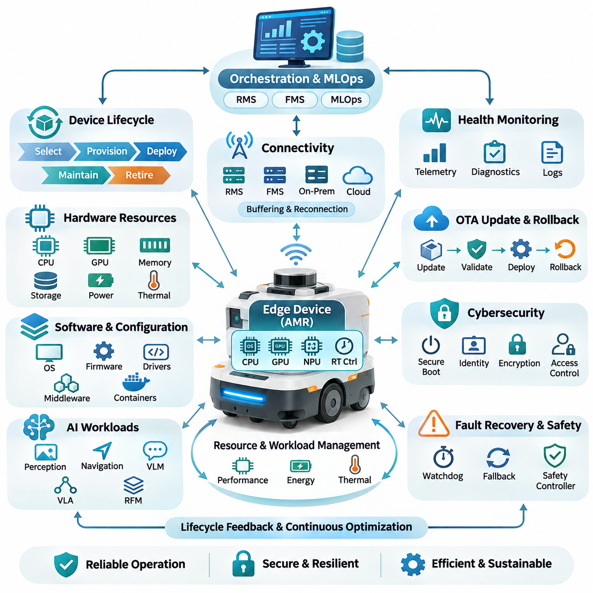
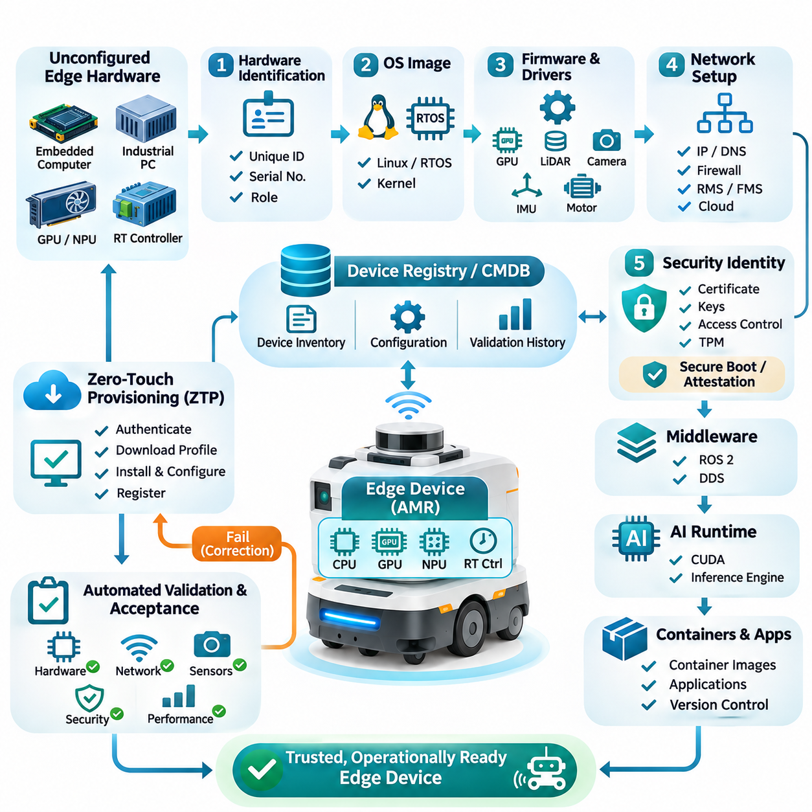
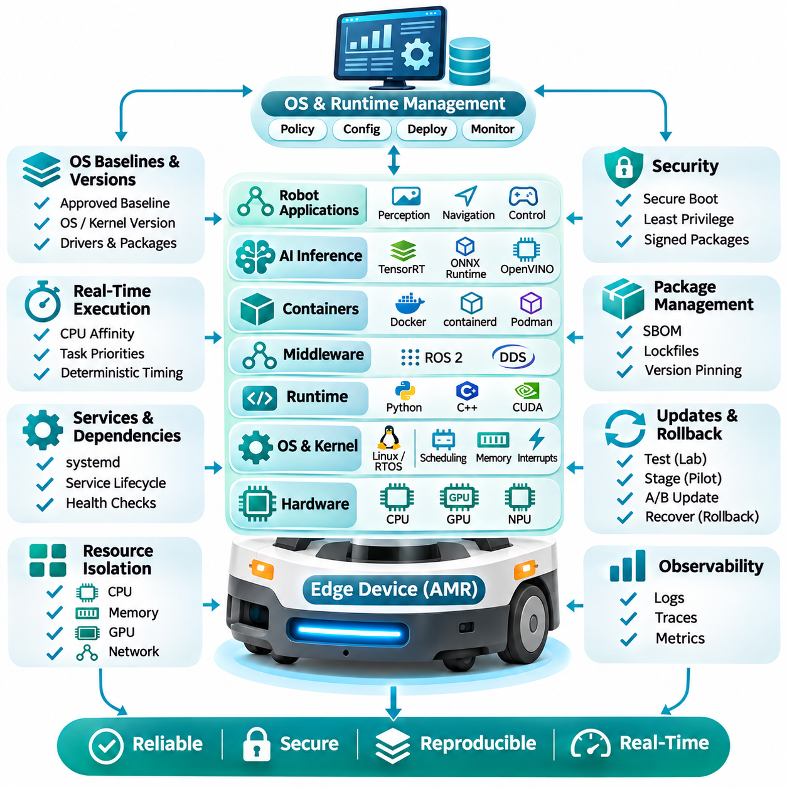
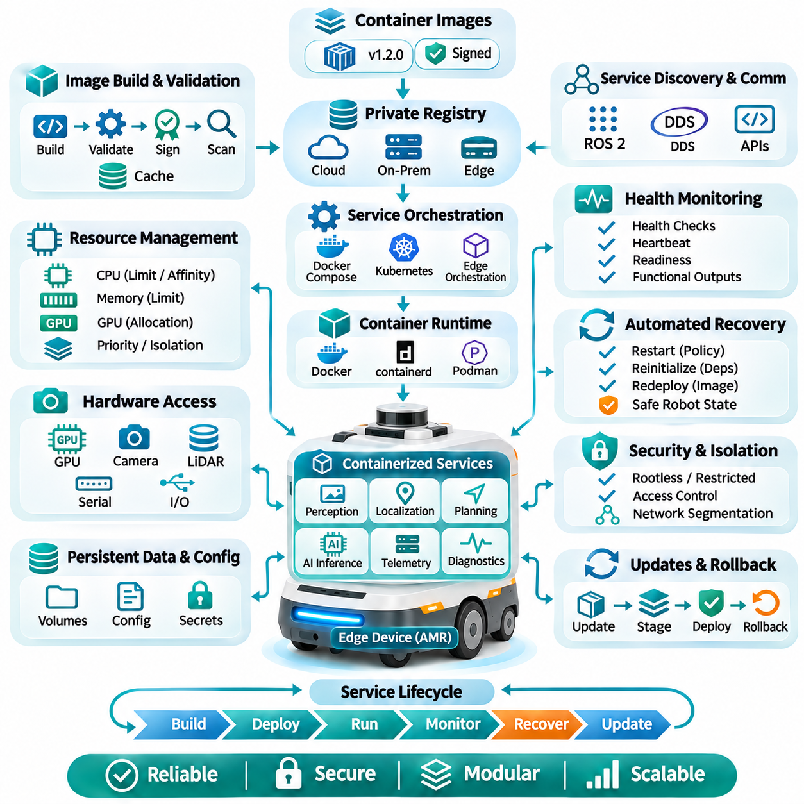
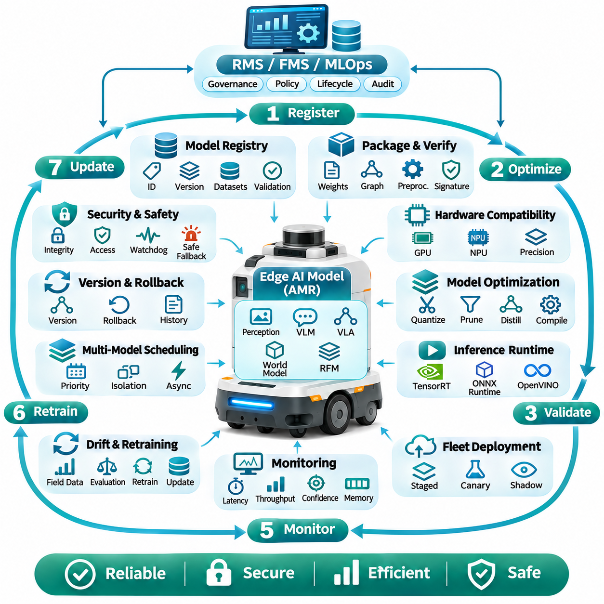
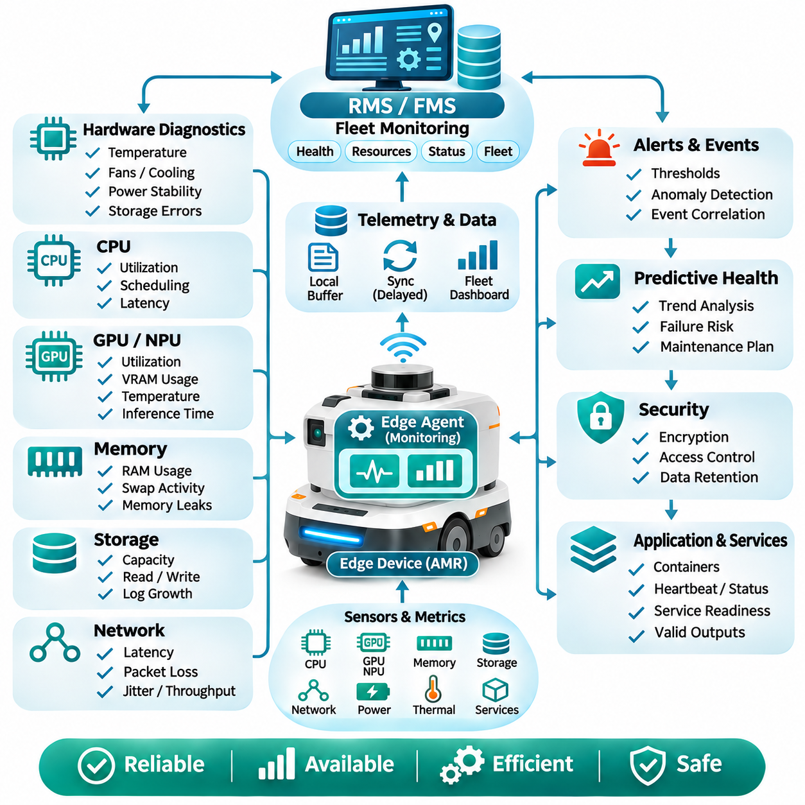
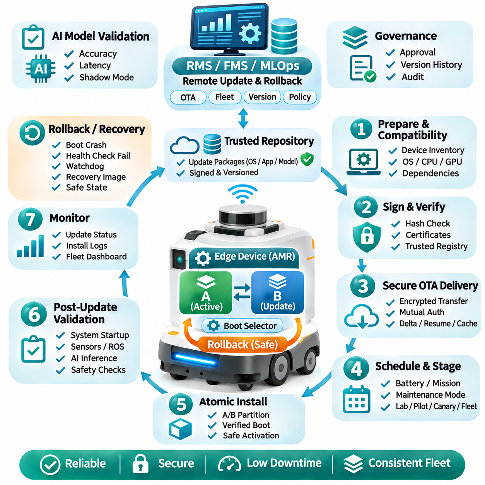
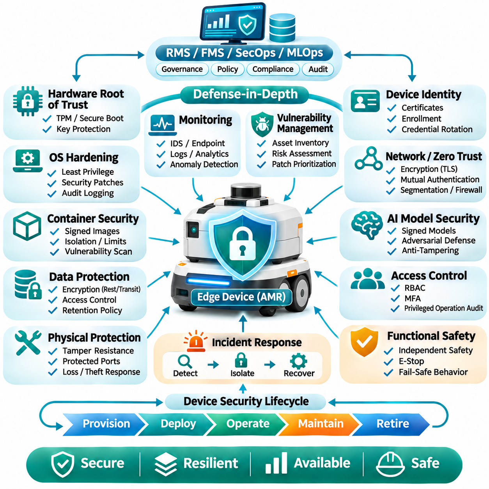

**Volume 08. AMR Operations, Deployment, and MLOps**

# Chapter 16. Edge Device Management

## 16.1 Edge Device Management Overview

{width="7.268055555555556in" height="7.268055555555556in"}

Edge Device Management is a fundamental operational discipline that ensures the reliable, secure, and efficient operation of distributed computing devices deployed within robotic systems and Physical AI infrastructures. Edge devices execute critical functions such as sensor processing, environmental perception, artificial intelligence inference, navigation, motion control, and local decision-making without continuous dependence on centralized cloud resources.

In autonomous mobile robot (AMR) environments, edge computing devices establish the computational foundation for real-time intelligence. These devices may include embedded computing platforms, industrial computers, edge GPU systems, neural processing units, microcontrollers, and dedicated real-time controllers. Effective device management coordinates these heterogeneous computing resources throughout their operational lifecycles while maintaining consistent system performance.

The lifecycle of an edge device encompasses hardware selection, procurement, provisioning, configuration, deployment, monitoring, maintenance, upgrading, and eventual decommissioning. Each stage requires standardized operational procedures to minimize configuration inconsistencies and unexpected failures. Lifecycle management also supports traceability, allowing organizations to understand the historical configuration and operational condition of individual devices.

Device provisioning establishes the initial operational environment required for reliable robotic execution. This process includes operating system installation, device driver configuration, network registration, security credential assignment, middleware deployment, and application installation. Automated provisioning mechanisms reduce manual configuration errors and enable organizations to deploy large numbers of edge devices with consistent operational baselines.

Hardware resource management ensures that computational workloads remain within the physical capabilities of deployed edge platforms. Continuous monitoring of CPU utilization, GPU utilization, memory consumption, storage capacity, power consumption, and operating temperature provides visibility into resource availability. Effective resource allocation prevents computational bottlenecks from degrading perception, navigation, and other time-sensitive robotic functions.

Software configuration management maintains consistency across distributed edge computing environments. Operating systems, firmware, device drivers, middleware, container runtime environments, and robotic applications must remain compatible throughout system evolution. Version-controlled configurations, standardized software images, and automated dependency management help prevent software fragmentation and simplify troubleshooting across heterogeneous robot fleets.

Remote device monitoring enables operational teams to observe the condition of distributed edge devices without requiring continuous physical access. Health information, system logs, diagnostic measurements, network statistics, and application performance indicators are periodically transmitted to centralized management platforms. Monitoring mechanisms should distinguish between temporary resource fluctuations, persistent degradation, and critical failures requiring intervention.

Over-the-air (OTA) update mechanisms support the remote distribution of firmware, operating system packages, robotic applications, and artificial intelligence models. Reliable update architectures incorporate cryptographic signature verification, compatibility validation, staged deployment, installation monitoring, and rollback capabilities. Updates must be coordinated with robot operational states to avoid interrupting critical missions or compromising safety.

Cybersecurity constitutes an essential component of edge device management because distributed robotic platforms frequently operate in physically accessible and network-connected environments. Secure boot, hardware-backed device identities, encrypted communication, access control, credential rotation, and vulnerability management reduce exposure to unauthorized access. Security controls must protect device integrity without introducing unacceptable computational overhead.

Network connectivity management maintains reliable communication between edge devices, robot management systems (RMS), fleet management systems (FMS), on-premises infrastructure, and cloud platforms. Communication architectures must accommodate intermittent connectivity, variable bandwidth, network latency, and temporary service interruptions. Local buffering, automatic reconnection, and synchronization mechanisms preserve operational continuity under degraded network conditions.

Artificial intelligence workload management introduces additional requirements for devices executing deep learning models, vision-language models (VLMs), vision-language-action models (VLAs), and robot foundation models (RFMs). Device management must account for inference latency, accelerator compatibility, GPU memory requirements, model versions, and computational priorities. Resource isolation helps prevent intensive AI workloads from interfering with safety-critical execution.

Thermal and energy management are particularly important in battery-powered and industrial robotic systems. Sustained computational workloads may increase power consumption, accelerate battery depletion, and trigger thermal throttling. Dynamic frequency scaling, workload scheduling, power profiling, and thermal monitoring help maintain an appropriate balance between computational performance, operational endurance, and hardware reliability.

Fault tolerance and recovery mechanisms enable edge devices to maintain or restore essential functionality when hardware, software, or communication failures occur. Watchdog timers, automated service restarts, redundant storage, recovery partitions, and backup configurations support rapid restoration. Independent safety controllers and validated degraded operating modes help ensure that computing failures do not result in hazardous physical behavior.

Centralized device orchestration provides a unified operational framework for managing distributed computing platforms across multiple robots, facilities, and geographical regions. Integration with fleet management, machine learning operations (MLOps), cloud infrastructure, and maintenance platforms enables coordinated monitoring, configuration deployment, software distribution, and incident response while reducing operational complexity.

Ultimately, effective edge device management transforms individual computing platforms into a coordinated, maintainable, and scalable Physical AI infrastructure. Its objective extends beyond hardware availability to encompass operational continuity, computational efficiency, cybersecurity, safety, and lifecycle sustainability. As robotic intelligence evolves, edge device management becomes increasingly important for dependable autonomous operations.

## 16.2 Device Provisioning

{width="7.268055555555556in" height="7.268055555555556in"}

Device provisioning is the systematic process of preparing, configuring, registering, and validating edge computing devices before their integration into operational robotic environments. Within Physical AI systems, provisioning establishes the initial computational, networking, and security foundations required for autonomous operation. Its primary objective is to transform unconfigured hardware into standardized, trusted, and operationally ready computing platforms.

In autonomous mobile robot (AMR) deployments, device provisioning must accommodate heterogeneous hardware architectures, including embedded computers, industrial computing platforms, edge GPU systems, neural processing units, and real-time controllers. Each hardware platform may require different operating systems, firmware, drivers, and computational libraries. Standardized provisioning procedures ensure consistent operational behavior despite underlying hardware diversity.

Hardware identification represents the initial stage of device provisioning. Each device should be assigned a unique identifier associated with its hardware specifications, serial number, manufacturing information, computational capabilities, and intended operational role. This information is registered within a centralized device inventory, establishing traceability throughout the device lifecycle and supporting subsequent maintenance, replacement, and configuration management activities.

Operating system provisioning establishes the fundamental software environment required for robotic applications. Depending on computational requirements, devices may utilize Linux distributions, embedded operating systems, real-time operating systems, or specialized industrial platforms. Standardized operating system images should incorporate validated kernel versions, essential system packages, security configurations, and hardware compatibility settings.

Firmware and device driver installation ensures that computing hardware and connected physical components operate correctly. GPU accelerators, LiDAR sensors, cameras, inertial measurement units, communication interfaces, and motor controllers frequently require platform-specific software dependencies. Provisioning procedures must validate compatibility between firmware, kernel modules, device drivers, and application frameworks to prevent operational instability.

Network provisioning enables edge devices to communicate with robotic subsystems, robot management systems (RMS), fleet management systems (FMS), on-premises infrastructure, and cloud platforms. Network configuration includes IP address assignment, hostname registration, routing policies, domain name resolution, firewall settings, and communication protocols. Automated network discovery and registration reduce deployment complexity across distributed robotic environments.

Security provisioning establishes the trusted identity and protection mechanisms of each edge device. Device certificates, cryptographic keys, authentication credentials, access control policies, and secure communication configurations must be assigned through controlled procedures. Hardware-backed security technologies, such as trusted platform modules and secure elements, can strengthen device authentication and protect sensitive cryptographic material.

Secure boot and software integrity verification provide additional protection during device initialization. Cryptographically verified bootloaders, digitally signed firmware, and authenticated operating system images help prevent unauthorized software execution. Where supported, measured boot and remote attestation techniques allow centralized management platforms to evaluate whether provisioned edge devices remain consistent with approved security baselines.

Middleware provisioning establishes the communication and software integration layers required for robotic functionality. Robot Operating System 2 (ROS 2), Data Distribution Service (DDS), message brokers, and hardware abstraction interfaces may be installed according to the device\'s operational responsibilities. Standardized middleware configurations enable interoperability between perception, localization, planning, control, and supervisory management components.

Artificial intelligence environment provisioning prepares edge devices for efficient model execution. GPU drivers, CUDA libraries, inference engines, neural network runtimes, and hardware-specific acceleration frameworks must be installed according to platform capabilities. Compatibility validation between AI models, computational accelerators, numerical precision formats, and runtime environments helps ensure predictable inference performance and resource utilization.

Container-based provisioning improves software portability and deployment consistency across heterogeneous computing platforms. Container images encapsulate robotic applications, AI inference services, middleware components, and required software dependencies within reproducible execution environments. Container registries and orchestration mechanisms support controlled application distribution, version management, dependency isolation, and standardized operational configurations.

Zero-touch provisioning (ZTP) enables authorized edge devices to initialize and configure themselves with minimal manual intervention. Following initial startup and network connection, a device authenticates its identity, retrieves an approved configuration profile, downloads required software packages, and registers with the management infrastructure. This approach significantly improves deployment scalability while reducing configuration errors across large robot fleets.

Configuration validation and acceptance testing represent essential provisioning completion stages. Automated diagnostic procedures should evaluate hardware functionality, network connectivity, sensor interfaces, computational performance, security compliance, and application readiness. Devices that fail predefined acceptance criteria must remain isolated from production operations until identified deficiencies are corrected and validation is successfully repeated.

Provisioning records should preserve the complete configuration history of each deployed device, including hardware identifiers, operating system versions, firmware revisions, software packages, security policy versions, and validation results. Integration with configuration management databases (CMDBs), device registries, and operational management platforms enables traceability, configuration auditing, and efficient restoration following hardware replacement or system failure.

Ultimately, effective device provisioning establishes a repeatable and scalable foundation for edge device lifecycle management within Physical AI infrastructures. By integrating hardware identification, software installation, security initialization, automated configuration, and operational validation, organizations can reduce deployment time, improve fleet consistency, and ensure that distributed robotic computing resources enter service in a controlled and trusted state.

## 16.3 OS and Runtime Management

{width="7.268055555555556in" height="7.268055555555556in"}

Operating system (OS) and runtime management is an essential component of edge device management that ensures the stable, secure, and efficient execution of robotic software across distributed computing platforms. Within Physical AI systems, operating systems and runtime environments provide the fundamental execution infrastructure connecting hardware resources, middleware, artificial intelligence models, and autonomous robotic applications.

Operating system selection must consider the computational requirements, hardware architecture, timing constraints, security requirements, and operational responsibilities of individual edge devices. Linux distributions are widely used for robotic perception, navigation, and artificial intelligence workloads, while real-time operating systems (RTOSs) support deterministic execution in dedicated motion control and embedded control environments.

Operating system baseline management establishes standardized software configurations for different categories of edge computing devices. An approved baseline defines the operating system version, kernel configuration, device drivers, essential system packages, security policies, and network settings. Maintaining controlled baseline configurations reduces software inconsistencies and simplifies deployment, maintenance, and troubleshooting across distributed robot fleets.

Kernel management is particularly important because the operating system kernel coordinates processor scheduling, memory management, hardware communication, interrupt handling, and system resource allocation. Robotic applications with strict timing requirements may benefit from real-time kernel extensions, CPU affinity configurations, and interrupt prioritization. Kernel modifications must be validated against hardware compatibility and system-level timing requirements.

Runtime environment management ensures that robotic applications execute with compatible software libraries, dependencies, and computational frameworks. These environments may include Python interpreters, C++ libraries, Java virtual machines, CUDA runtimes, and specialized inference engines. Version-controlled runtime configurations prevent dependency conflicts and improve the reproducibility of robotic software across development, testing, and production environments.

Robotic middleware management establishes consistent communication and execution environments for distributed robotic software components. Robot Operating System 2 (ROS 2), Data Distribution Service (DDS), and related middleware frameworks support communication between perception, localization, navigation, planning, and control services. Middleware versions, communication policies, and quality-of-service configurations must be maintained throughout system evolution.

Container runtime management provides isolated and reproducible execution environments for robotic applications and artificial intelligence services. Technologies such as Docker, containerd, and Podman enable software components to operate with explicitly defined dependencies and resource constraints. Containerized deployment improves software portability while requiring careful management of hardware access, persistent storage, network interfaces, and runtime privileges.

Artificial intelligence runtime management addresses the execution requirements of deep learning models, vision-language models (VLMs), vision-language-action models (VLAs), and robot foundation models (RFMs). Frameworks such as TensorRT, ONNX Runtime, OpenVINO, and hardware-specific acceleration libraries must remain compatible with deployed models, accelerator architectures, device drivers, and supported numerical precision formats.

System service management coordinates the initialization, execution, monitoring, and termination of essential robotic software processes. Service managers such as systemd enable controlled startup sequences, dependency relationships, automatic restart policies, and operational status monitoring. Critical services should incorporate health checks and bounded recovery mechanisms to prevent repeated failures from destabilizing the entire robotic computing environment.

Resource management ensures that operating systems and runtime environments allocate computational resources according to workload priorities and operational requirements. CPU scheduling, memory limits, GPU allocation, storage access, and network bandwidth policies help prevent resource contention. Computationally intensive artificial intelligence workloads must be isolated from time-sensitive control functions through appropriate architectural and scheduling mechanisms.

Operating system security management protects the integrity and availability of edge computing environments. Security hardening includes disabling unnecessary services, enforcing least-privilege access, configuring mandatory access controls, managing authentication credentials, and applying validated security patches. Secure boot, signed software packages, and runtime integrity monitoring strengthen protection against unauthorized software modifications.

Software dependency and package management maintain compatibility across operating system components, middleware, application libraries, and artificial intelligence runtimes. Controlled package repositories, dependency lockfiles, software bills of materials (SBOMs), and version-pinning strategies support reproducible deployments. Uncontrolled package upgrades should be avoided because they may introduce incompatibilities or unexpected performance degradation.

Operating system and runtime updates must follow controlled deployment procedures that account for operational safety, software compatibility, and service continuity. Candidate updates should undergo laboratory testing, regression testing, and staged deployment before fleet-wide distribution. Recovery mechanisms, including verified system images, A/B partitions, and rollback configurations, help restore approved operational states when update failures occur.

Runtime observability provides continuous visibility into operating system behavior, application execution, and computational resource consumption. System logs, process statistics, kernel events, application traces, and performance metrics enable operational teams to identify abnormal behavior and emerging failures. Integration with centralized monitoring platforms supports remote diagnosis, incident investigation, and proactive maintenance across distributed edge devices.

Ultimately, operating system and runtime management establishes a controlled execution foundation for scalable Physical AI infrastructures. By integrating standardized software baselines, deterministic execution, dependency management, resource isolation, cybersecurity, controlled updates, and operational observability, organizations can improve robotic reliability and maintain consistent software behavior throughout the entire edge device lifecycle.

## 16.4 Container and Service Management

{width="7.268055555555556in" height="7.268055555555556in"}

Container and service management is a fundamental operational discipline that ensures the reliable deployment, execution, supervision, and maintenance of containerized software within distributed robotic computing environments. In Physical AI infrastructures, container technologies provide standardized execution environments for perception, navigation, artificial intelligence inference, data processing, and operational management services.

Containerization encapsulates software applications, runtime libraries, dependencies, and configuration requirements into portable execution units. Unlike traditional software installations, containers share the host operating system kernel while maintaining isolated application environments. This approach reduces dependency conflicts, simplifies software distribution, and improves deployment consistency across heterogeneous robotic edge computing platforms.

Container image management establishes controlled procedures for building, validating, storing, distributing, and maintaining application images. Each image should incorporate approved base layers, explicitly versioned dependencies, application binaries, and relevant configuration metadata. Immutable image identifiers and cryptographic signatures support software integrity verification, deployment traceability, and reproducible execution across robot fleets.

Container registries provide centralized repositories for storing and distributing approved application images. Within robotic infrastructures, private registries may operate in cloud environments, on-premises data centers, or localized edge infrastructure. Image caching, access control, vulnerability scanning, and bandwidth-efficient distribution mechanisms help maintain reliable software availability under constrained network conditions.

Container runtime management coordinates the creation, execution, isolation, and termination of containerized robotic applications. Technologies such as Docker, containerd, and Podman provide mechanisms for managing application processes, network connectivity, storage volumes, and computational resources. Runtime selection should consider hardware compatibility, security requirements, operational complexity, and available orchestration capabilities.

Service architecture decomposes robotic software into independently manageable functional components. Perception pipelines, localization services, motion planning modules, AI inference engines, telemetry collectors, and diagnostic applications may operate as separate services. Clearly defined interfaces and dependency relationships enable individual components to be updated, monitored, or recovered without unnecessarily disrupting unrelated robotic functions.

Service orchestration coordinates the deployment and execution of multiple interconnected containers across edge computing devices. Lightweight orchestration frameworks, Docker Compose, Kubernetes, and specialized edge orchestration platforms may be selected according to system scale and operational requirements. Orchestration mechanisms should support dependency management, configuration distribution, service discovery, and controlled recovery.

Computational resource management ensures that containerized services operate within allocated processing, memory, storage, and network capacity. CPU affinity, control groups, memory limits, GPU allocation, and workload prioritization help prevent resource contention. Computationally intensive AI services must not interfere with safety-critical control processes, which may require independent controllers and dedicated execution resources.

Hardware access management enables containerized applications to communicate with GPUs, cameras, LiDAR sensors, serial interfaces, and other physical devices. Hardware-specific container runtimes and controlled device mappings provide necessary access while limiting unnecessary privileges. Compatibility between host drivers, container libraries, accelerator frameworks, and hardware interfaces must be validated before operational deployment.

Service connectivity management establishes reliable communication between containerized software components and external robotic infrastructure. Robot Operating System 2 (ROS 2), Data Distribution Service (DDS), message brokers, and application programming interfaces support distributed service interaction. Network configurations must address discovery, latency, bandwidth, access restrictions, and quality-of-service requirements.

Persistent storage and configuration management separate operational data from temporary container execution environments. External storage volumes, configuration repositories, and controlled secret management mechanisms preserve essential information across container restarts and software updates. Map files, calibration parameters, mission histories, and diagnostic records should remain accessible without embedding sensitive information within application images.

Service health monitoring provides continuous visibility into container availability, process behavior, resource utilization, and application-specific performance. Health checks, heartbeat signals, readiness probes, and diagnostic metrics help identify service degradation and execution failures. Health evaluation should extend beyond process availability to verify that robotic services continue producing valid and timely functional outputs.

Automated recovery mechanisms restore failed services through controlled restarts, dependency reinitialization, or redeployment of validated container images. Restart policies should incorporate retry limits and escalation procedures to prevent continuous recovery loops. Recovery actions must be coordinated with robot operational states to avoid unexpected motion, inconsistent commands, or unsafe restoration of physical functionality.

Container security management protects application integrity, runtime isolation, and access to underlying computing resources. Security measures include signed images, vulnerability assessment, rootless execution where appropriate, restricted capabilities, network segmentation, and software supply chain verification. Container isolation should not be treated as a substitute for independent safety architectures or comprehensive host security controls.

Container and service update management enables controlled distribution of software revisions across distributed robotic systems. Staged deployment, compatibility testing, version-controlled service definitions, and rollback mechanisms reduce the risks associated with application upgrades. Updates involving interconnected services must preserve interface compatibility and maintain consistent configurations throughout the deployment sequence.

Ultimately, container and service management establishes a modular, maintainable, and scalable software execution architecture for Physical AI infrastructures. By integrating standardized images, service orchestration, computational resource allocation, hardware access control, security, continuous monitoring, and automated recovery, organizations can improve operational reliability and simplify the lifecycle management of distributed robotic services.

## 16.5 Edge AI Model Management

{width="7.268055555555556in" height="7.268055555555556in"}

Edge AI model management is a fundamental operational discipline that ensures the reliable deployment, execution, monitoring, optimization, and maintenance of artificial intelligence models within distributed edge computing environments. In Physical AI infrastructures, these models support environmental perception, localization, semantic understanding, autonomous navigation, manipulation, behavioral prediction, and intelligent decision-making.

Unlike centralized cloud-based AI systems, edge AI environments must execute inference workloads within constrained computational, memory, energy, and thermal budgets. Autonomous mobile robots (AMRs) frequently operate under variable environmental conditions and intermittent network connectivity. Edge AI model management must therefore balance model accuracy, inference latency, resource consumption, operational autonomy, and physical safety throughout the deployment lifecycle.

Model inventory management establishes a centralized repository of artificial intelligence models deployed across robotic edge devices. Each model should be associated with a unique identifier, version information, training dataset references, architectural specifications, supported hardware platforms, and validation results. Maintaining a comprehensive model inventory enables deployment traceability, configuration auditing, compatibility assessment, and lifecycle governance.

Model packaging standardizes the distribution of artificial intelligence models and their execution dependencies. Deployment packages may contain trained model weights, computational graphs, preprocessing configurations, postprocessing algorithms, calibration parameters, and runtime metadata. Standardized packaging formats reduce integration complexity and ensure consistent model behavior across heterogeneous edge computing platforms and robotic applications.

Hardware compatibility management ensures that deployed AI models remain compatible with available computational accelerators, including GPUs, neural processing units (NPUs), and dedicated AI inference processors. Differences in accelerator architecture, supported operators, numerical precision, memory capacity, and runtime libraries must be considered. Compatibility matrices help prevent unsupported model deployment and unexpected execution failures.

Model optimization enables artificial intelligence models to operate efficiently within the resource limitations of edge devices. Techniques such as quantization, pruning, knowledge distillation, operator fusion, and hardware-specific compilation can reduce computational complexity and memory consumption. Optimized models must undergo functional validation to ensure that performance improvements do not introduce unacceptable accuracy degradation or unsafe robotic behavior.

Inference runtime management coordinates the execution of AI models through frameworks such as TensorRT, ONNX Runtime, OpenVINO, and hardware-specific inference engines. Runtime configurations must account for model initialization, computational graph optimization, memory allocation, execution scheduling, and accelerator utilization. Standardized runtime environments improve inference reproducibility and simplify maintenance across distributed robotic systems.

Multi-model execution management becomes increasingly important as Physical AI systems integrate perception models, vision-language models (VLMs), vision-language-action models (VLAs), world models, and robot foundation models (RFMs). These models may operate concurrently at different execution frequencies. Resource isolation, workload prioritization, and asynchronous inference pipelines help prevent computational contention and excessive response delays.

Model deployment management establishes controlled procedures for distributing validated AI models to individual robots or designated fleet segments. Deployment policies should consider hardware capabilities, operational environments, mission requirements, network availability, and existing software configurations. Staged deployment, canary releases, and shadow-mode evaluation reduce operational risks before new models are activated across an entire fleet.

Model version management maintains consistency between deployed AI models, runtime libraries, application interfaces, sensor configurations, and robotic software releases. Each deployment should reference immutable model artifacts and approved configuration baselines. Version dependencies must be explicitly documented, while rollback mechanisms should preserve the ability to restore previously validated models when performance degradation or operational failures occur.

Continuous inference monitoring provides visibility into model execution latency, throughput, GPU utilization, memory consumption, prediction confidence, and application-specific performance indicators. Operational monitoring should distinguish computational failures from insufficient model accuracy and abnormal environmental inputs. Where reference data are available, prediction quality should be evaluated against verified observations and mission outcomes.

Model drift management addresses changes in operational conditions that may reduce the effectiveness of previously validated AI models. Variations in lighting, weather, sensor calibration, object appearance, and environmental geometry can affect inference performance. Data drift, distribution shifts, and changes in prediction quality should trigger further investigation, targeted data collection, model retraining, or controlled adaptation rather than unrestricted online updates.

Model security and integrity management protects AI artifacts against unauthorized modification, malicious replacement, data leakage, and compromised software dependencies. Cryptographic signatures, checksum verification, encrypted distribution, access control, and trusted model registries strengthen the AI software supply chain. Edge devices should verify model authenticity and deployment authorization before loading newly distributed or updated model artifacts.

Failure management and operational safety require mechanisms for detecting invalid predictions, inference timeouts, model initialization failures, and computational resource exhaustion. Confidence thresholds, uncertainty estimation, independent output validation, and watchdog mechanisms can support fault detection. When AI services become unreliable, robots should transition to validated fallback behaviors or safe operating states under independent safety supervision.

Integration with machine learning operations (MLOps), robot management systems (RMS), and fleet management systems (FMS) enables coordinated model lifecycle management across distributed Physical AI infrastructures. Operational telemetry and selected field data support model evaluation, retraining, validation, and controlled redistribution. This closed-loop architecture improves collective robotic intelligence while preserving deployment governance, data security, and operational traceability.

## 16.6 Device Health and Resource Monitoring

{width="7.268055555555556in" height="7.268055555555556in"}

Device health and resource monitoring is a critical operational discipline that ensures the reliability, availability, and computational stability of distributed edge devices within robotic and Physical AI infrastructures. Continuous monitoring provides visibility into hardware conditions, operating system behavior, application performance, and resource consumption, enabling operational teams to detect emerging failures before they disrupt autonomous missions.

In autonomous mobile robot (AMR) environments, edge devices execute perception, localization, navigation, artificial intelligence inference, and supervisory control workloads simultaneously. These workloads impose different computational demands and timing constraints. Monitoring architectures must therefore evaluate both individual device conditions and the combined effects of concurrent workloads on overall robotic performance and operational safety.

Device health monitoring begins with the collection of hardware-level diagnostic information, including processor temperature, cooling fan status, power supply stability, storage device condition, and hardware error indicators. Embedded controllers and industrial computers may expose additional diagnostic interfaces. Continuous evaluation of these measurements helps identify thermal stress, electrical instability, component degradation, and potential hardware failures.

CPU monitoring evaluates processor utilization, scheduling behavior, operating frequency, interrupt activity, and execution latency. High average utilization does not necessarily indicate failure, but sustained saturation can reduce scheduling flexibility and delay critical processing tasks. Per-core measurements, process-level statistics, and scheduling latency analysis provide deeper insight into computational bottlenecks and abnormal system behavior.

GPU and accelerator monitoring is particularly important for Physical AI workloads involving deep learning inference, visual perception, and foundation models. Relevant measurements include accelerator utilization, memory occupancy, temperature, power consumption, and inference execution time. Monitoring should distinguish between productive computational activity, memory bottlenecks, thermal throttling, and inefficient workload scheduling.

Memory monitoring evaluates available system memory, application memory consumption, cache utilization, swap activity, and allocation failures. Memory leaks or uncontrolled buffering may gradually reduce system responsiveness and eventually cause application termination. Container-level memory limits, process-level allocation statistics, and historical consumption trends support early detection of resource exhaustion and unstable software behavior.

Storage monitoring examines capacity utilization, read and write performance, device health indicators, filesystem errors, and data retention conditions. Robotic systems frequently generate large volumes of sensor recordings, diagnostic logs, and operational datasets. Storage policies should prevent uncontrolled data accumulation from exhausting local capacity while preserving essential evidence required for incident investigation and maintenance.

Network health monitoring evaluates connectivity, packet loss, communication latency, jitter, bandwidth utilization, and interface error rates. Edge devices may communicate through Ethernet, Wi-Fi, private cellular networks, or other industrial communication technologies. Monitoring systems should identify degraded connectivity and distinguish local network failures from remote infrastructure interruptions or application-level communication problems.

Power and thermal monitoring are essential for battery-powered robotic platforms operating under variable computational loads. Monitoring should correlate processor power consumption, accelerator activity, cooling performance, battery conditions, and ambient temperature. Thermal thresholds and power budgets must be defined according to validated hardware limits to prevent performance degradation, unexpected shutdowns, and accelerated component aging.

Application and service monitoring extends device health assessment beyond physical hardware conditions. Process availability, container status, service restart frequency, heartbeat signals, and application response times provide insight into software reliability. Functional health checks should verify that perception, localization, navigation, and AI inference services continue producing valid outputs within required operational deadlines.

Resource monitoring architectures should support both local observation and centralized fleet-level visibility. Local monitoring agents collect diagnostic measurements and maintain short-term operational histories, while centralized platforms aggregate telemetry across distributed devices. Edge-side buffering and delayed synchronization preserve diagnostic continuity when network connectivity becomes unavailable or unreliable.

Alert management converts monitoring observations into actionable operational responses through thresholds, anomaly detection, and event correlation. Warning levels should distinguish temporary fluctuations from persistent degradation and critical failures. Adaptive thresholds and contextual evaluation reduce unnecessary alerts while ensuring that conditions affecting safety, computational deadlines, or mission continuity receive appropriate attention.

Predictive health analytics uses historical telemetry, resource consumption trends, and failure records to identify patterns associated with future device degradation. Statistical analysis and machine learning techniques may estimate emerging risks involving cooling systems, storage devices, memory consumption, or computational capacity. Predictive outputs should support maintenance decisions without replacing verified diagnostics or safety controls.

Monitoring data must be protected through authenticated communication, access control, encryption, and appropriate retention policies. Diagnostic telemetry may reveal system configurations, operational locations, and sensitive application behavior. Secure collection and storage mechanisms should preserve data integrity while limiting unnecessary exposure, particularly when monitoring information is transmitted between robots, on-premises infrastructure, and cloud services.

Ultimately, device health and resource monitoring establishes the operational visibility required for dependable Physical AI systems. By integrating hardware diagnostics, computational resource analysis, application health assessment, network monitoring, alert management, and predictive analytics, organizations can reduce unplanned downtime, improve maintenance efficiency, and sustain reliable autonomous robotic operations across distributed fleets.

## 16.7 Remote Update and Rollback

{width="7.268055555555556in" height="7.268055555555556in"}

Remote update and rollback management is a critical operational capability that enables distributed robotic edge devices to receive software improvements, security patches, firmware revisions, and artificial intelligence model updates without requiring direct physical access. Within Physical AI infrastructures, controlled update mechanisms maintain system reliability, cybersecurity, and operational consistency while minimizing service interruptions across geographically distributed robot fleets.

Over-the-air (OTA) update architectures establish secure communication channels between centralized management platforms and deployed edge devices. Update packages may include operating system images, kernel components, device drivers, middleware, container images, application binaries, and AI model artifacts. Each update must be associated with a defined version, compatibility requirements, integrity information, and an authorized deployment policy.

Update preparation begins with identifying target devices, verifying hardware compatibility, and evaluating existing software configurations. Device inventories and configuration management databases provide information about operating system versions, processor architectures, accelerator capabilities, and installed dependencies. Compatibility assessment prevents unsupported updates from reaching devices that cannot safely execute the revised software.

Update package management ensures that distributed software artifacts remain authentic, complete, and reproducible. Packages should be cryptographically signed, associated with immutable identifiers, and stored in trusted repositories. Hash verification, metadata validation, and dependency checks protect against corrupted downloads, unauthorized modifications, and incompatible software combinations during remote distribution.

Secure update delivery requires encrypted communication, authenticated devices, and controlled access to deployment services. Mutual authentication and certificate-based authorization help ensure that only approved management systems can distribute updates to registered robots. Update infrastructure should also enforce protection against replay attacks, unauthorized version downgrades, and compromised distribution endpoints.

Deployment scheduling must account for robot availability, battery condition, mission priority, network quality, and operational safety requirements. Updates affecting navigation, motion control, or safety-related interfaces should be installed only when the robot has entered an approved maintenance state. Fleet management systems can coordinate update windows to prevent excessive simultaneous downtime across operational deployments.

Staged deployment reduces update risks by introducing new software to progressively larger groups of devices. Initial laboratory validation is followed by controlled pilot deployment, limited fleet rollout, and broader distribution after acceptance criteria are satisfied. Canary deployment and representative device selection help identify hardware-specific incompatibilities, performance regressions, and unexpected operational behavior.

Bandwidth management is essential when distributing large operating system images, container packages, and AI model files across wireless networks. Delta updates, compression, resumable downloads, local caching, and regional distribution servers can reduce communication overhead. Update mechanisms should tolerate intermittent connectivity and resume interrupted transfers without compromising package integrity or operational continuity.

Transactional update mechanisms ensure that software installation either completes successfully or preserves a recoverable previous state. A/B partition architectures maintain separate active and inactive system images, allowing updates to be installed without overwriting the currently operating environment. Atomic activation and verified boot procedures reduce the risk of leaving devices in partially updated or unbootable conditions.

Rollback management provides a controlled method for restoring previously validated software when an update introduces failures or unacceptable performance degradation. Rollback triggers may include boot failures, repeated service crashes, missing sensor interfaces, excessive inference latency, or failed operational health checks. Recovery procedures must restore compatible software components and configurations rather than reverting isolated packages without dependency validation.

Post-update validation confirms that newly installed software operates correctly under the device\'s actual hardware and mission requirements. Automated checks should evaluate system startup, network connectivity, middleware communication, sensor availability, AI inference performance, and service readiness. Safety-related functionality requires appropriate independent verification before the robot resumes autonomous operation.

Update monitoring provides centralized visibility into package distribution, installation progress, activation status, validation results, and rollback events. Operational dashboards should distinguish pending, downloading, installing, validating, completed, and failed update states. Detailed event logs and device-specific deployment histories support troubleshooting, compliance auditing, and continuous improvement of update procedures.

Failure recovery must address interrupted installations, storage exhaustion, power loss, network disconnection, and incompatible dependencies. Recovery partitions, bootloader fallback mechanisms, watchdog supervision, and locally retained verified images can restore essential functionality. Devices unable to complete recovery should remain in a defined safe state and request authorized maintenance intervention.

Artificial intelligence model updates introduce additional validation requirements because changes in model behavior may affect perception, prediction, planning, and autonomous decision-making. Updated models should undergo accuracy evaluation, inference benchmarking, compatibility testing, and operational scenario validation. Shadow-mode execution and controlled comparison with approved models can reveal behavioral differences before production activation.

Update governance establishes accountability for software approval, deployment authorization, operational acceptance, and rollback decisions. Version histories, digital signatures, validation reports, deployment timestamps, and operator approvals should be retained for traceability. Integration with robot management systems (RMS), fleet management systems (FMS), and MLOps platforms enables coordinated lifecycle control across distributed Physical AI infrastructures.

Ultimately, remote update and rollback management transforms software maintenance into a controlled, recoverable, and scalable operational process. By combining secure distribution, compatibility validation, staged deployment, transactional installation, continuous monitoring, and reliable recovery mechanisms, organizations can maintain evolving robotic intelligence while preserving safety, service availability, and long-term fleet reliability.

## 16.8 Edge Device Security

{width="7.268055555555556in" height="7.268055555555556in"}

Edge device security is a fundamental requirement for protecting distributed robotic computing platforms against unauthorized access, malicious software, data compromise, and operational disruption. In Physical AI infrastructures, edge devices execute perception, navigation, autonomous decision-making, and mission-critical control functions. Security mechanisms must therefore protect both digital assets and physical robotic behavior throughout the device lifecycle.

The edge security architecture should follow defense-in-depth principles, combining hardware protection, operating system hardening, network security, application isolation, and continuous monitoring. Each security layer must address distinct attack surfaces while supporting coordinated threat detection and response. A compromised component should not automatically provide unrestricted access to other devices, services, or safety-critical functions.

Hardware-rooted security establishes a trusted foundation for device identity, cryptographic operations, and software integrity verification. Trusted Platform Modules (TPMs), secure elements, and hardware security mechanisms can protect sensitive keys and support measured boot processes. Secure boot ensures that only authorized firmware and operating system components are executed during device initialization.

Device identity management assigns unique, verifiable identities to robotic edge computers, embedded controllers, and communication gateways. Certificate-based authentication enables management platforms to distinguish legitimate devices from unauthorized endpoints. Device enrollment, credential rotation, certificate expiration monitoring, and secure decommissioning are essential for maintaining trustworthy device relationships across distributed fleets.

Operating system hardening reduces the exposure of edge devices to known vulnerabilities and unnecessary services. Security configurations should disable unused interfaces, restrict administrative privileges, enforce mandatory access controls, and maintain approved software baselines. Kernel protections, filesystem permissions, audit logging, and timely security patches strengthen the resilience of embedded Linux and other robotic operating environments.

Network security protects communication between robots, edge gateways, on-premises servers, and cloud platforms. Encrypted protocols, mutual authentication, network segmentation, and firewall policies limit unauthorized communication and lateral movement. Zero-trust principles require continuous verification of device identity, access authorization, and communication context rather than assuming that internal networks are inherently trustworthy.

Application and container security prevent compromised workloads from affecting unrelated services or underlying operating systems. Container images should originate from trusted registries and undergo vulnerability scanning before deployment. Runtime isolation, restricted capabilities, read-only filesystems, resource limits, and controlled interprocess communication reduce the consequences of application compromise.

Artificial intelligence model security protects trained model weights, inference pipelines, configuration parameters, and associated datasets against tampering or unauthorized extraction. Model artifacts should be signed, verified, and distributed through authenticated channels. Security validation must also consider adversarial inputs, model substitution, inference manipulation, and data poisoning that could influence autonomous robotic decisions.

Data protection mechanisms safeguard operational telemetry, sensor recordings, environmental maps, mission logs, and device configuration information. Encryption at rest and in transit should be combined with access control, data classification, and retention policies. Sensitive information collected during robotic operations must be minimized, securely stored, and transferred only to authorized processing environments.

Access management establishes clear authorization boundaries for operators, developers, maintenance personnel, and automated management services. Role-based access control (RBAC), least-privilege policies, and multifactor authentication reduce the risk of unauthorized configuration changes. Privileged operations, including remote shell access, firmware replacement, and safety-related parameter modification, require additional verification and auditability.

Security monitoring continuously evaluates authentication events, software integrity, network activity, system logs, and abnormal resource behavior. Host-based intrusion detection, endpoint monitoring agents, and centralized security analytics can identify suspicious activities across robotic fleets. Monitoring systems should correlate cybersecurity indicators with operational anomalies to distinguish malicious interference from ordinary equipment failures.

Vulnerability management maintains an inventory of hardware components, software dependencies, container images, and installed firmware versions. Security advisories and vulnerability databases support risk assessment and remediation planning. Patch prioritization should consider exploitability, device exposure, mission criticality, and the operational consequences of temporary service interruption.

Incident response procedures define how compromised edge devices are detected, isolated, investigated, recovered, and returned to service. Network quarantine, credential revocation, forensic log preservation, and verified software restoration help contain security incidents. Recovery must also evaluate whether navigation, perception, or control behavior has been affected before autonomous operations resume.

Physical security is particularly important because robotic edge devices operate in publicly accessible or uncontrolled environments. Tamper-resistant enclosures, protected diagnostic ports, secure storage, and intrusion detection mechanisms reduce opportunities for direct hardware attacks. Loss, theft, or unauthorized physical modification should trigger credential protection, device isolation, and appropriate operational responses.

Safety and cybersecurity must be coordinated because malicious interference can create physical hazards through manipulated sensor data, navigation commands, or actuator interfaces. Independent safety controllers, validated operating limits, emergency-stop mechanisms, and fail-safe behaviors provide additional protection. Security failures must not bypass established functional safety requirements or permit uncontrolled robotic motion.

Ultimately, edge device security requires continuous governance across device provisioning, deployment, operation, maintenance, and retirement. Integration with robot management systems (RMS), fleet management systems (FMS), security operations platforms, and MLOps processes enables consistent enforcement and traceability. A layered security architecture strengthens robotic resilience while preserving operational availability, data integrity, and physical safety.
