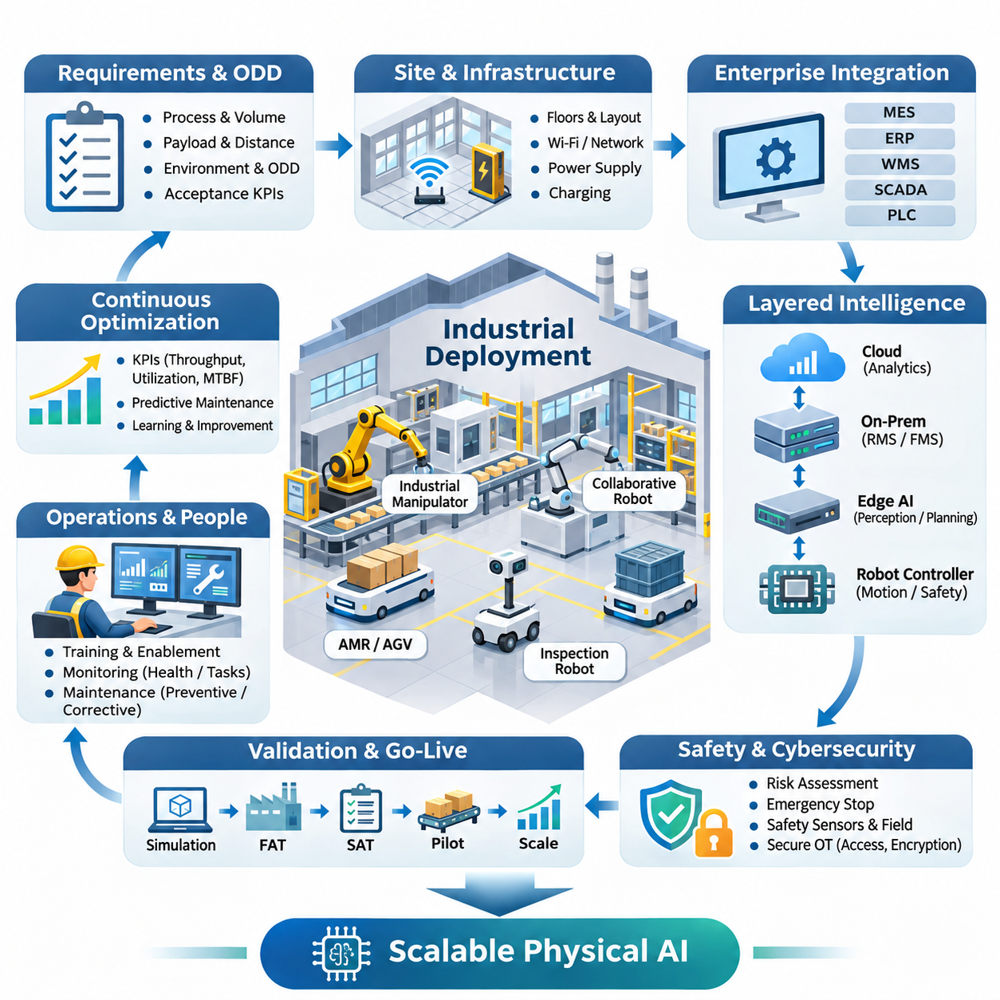
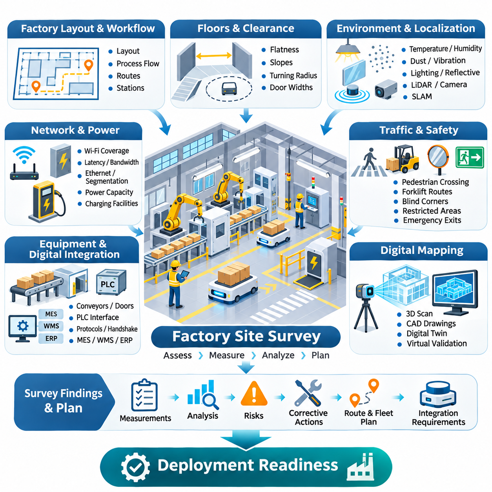
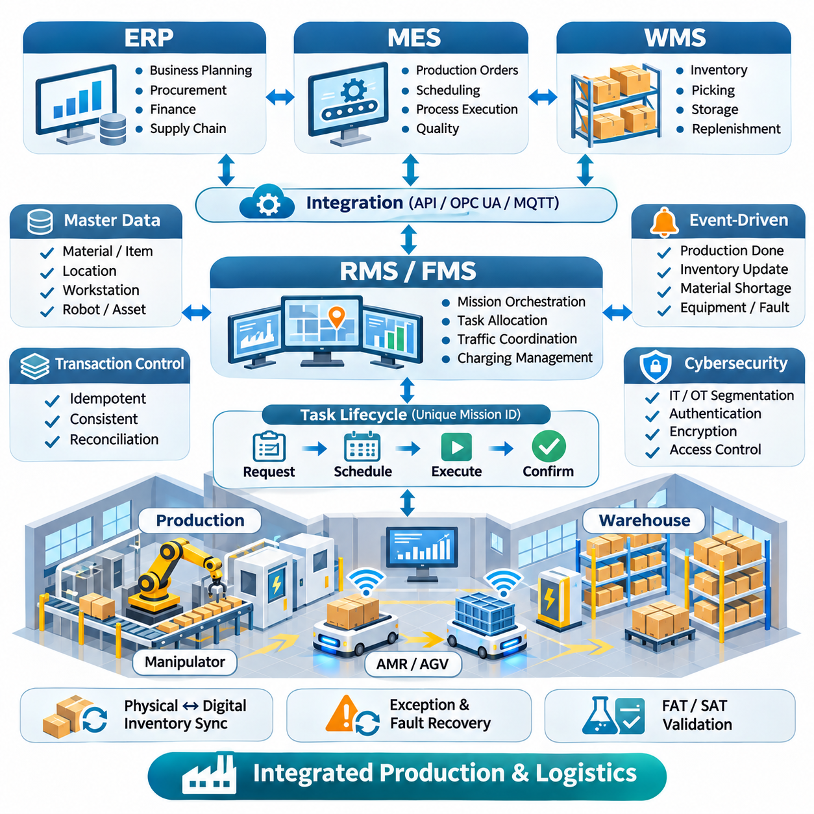
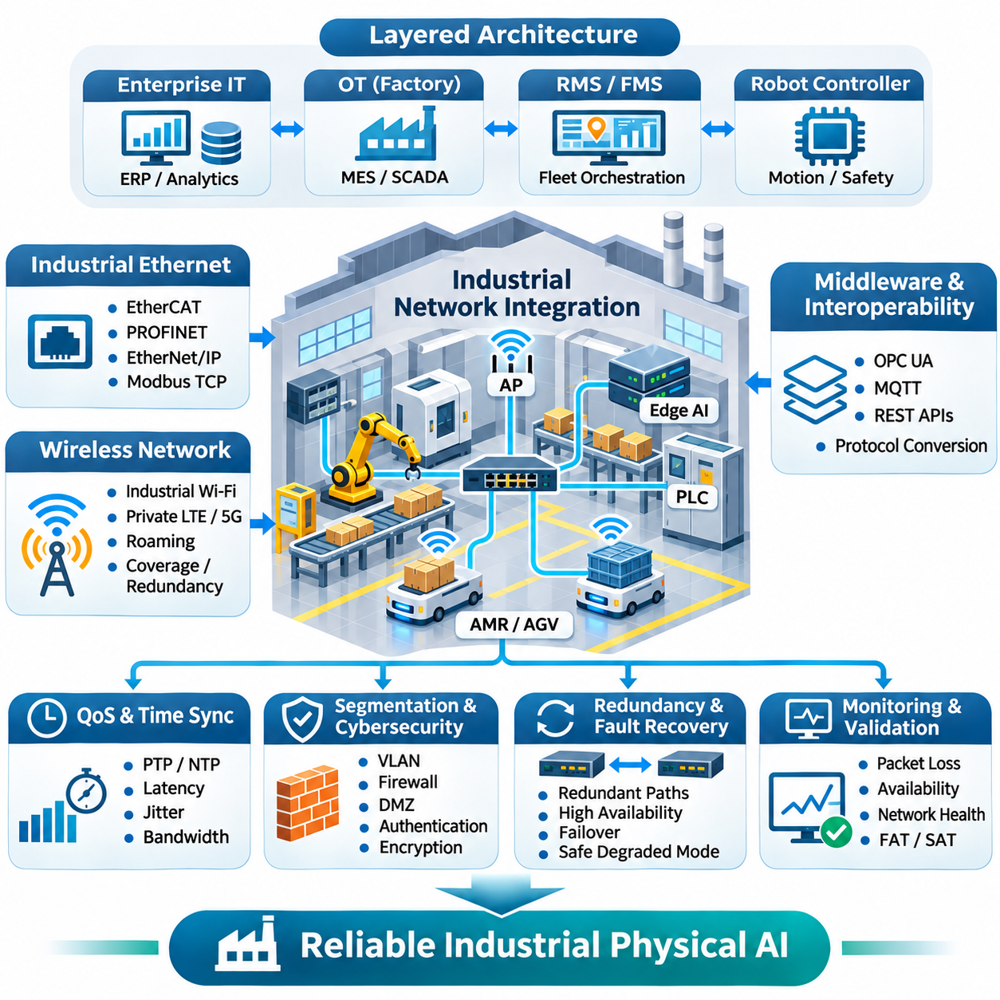
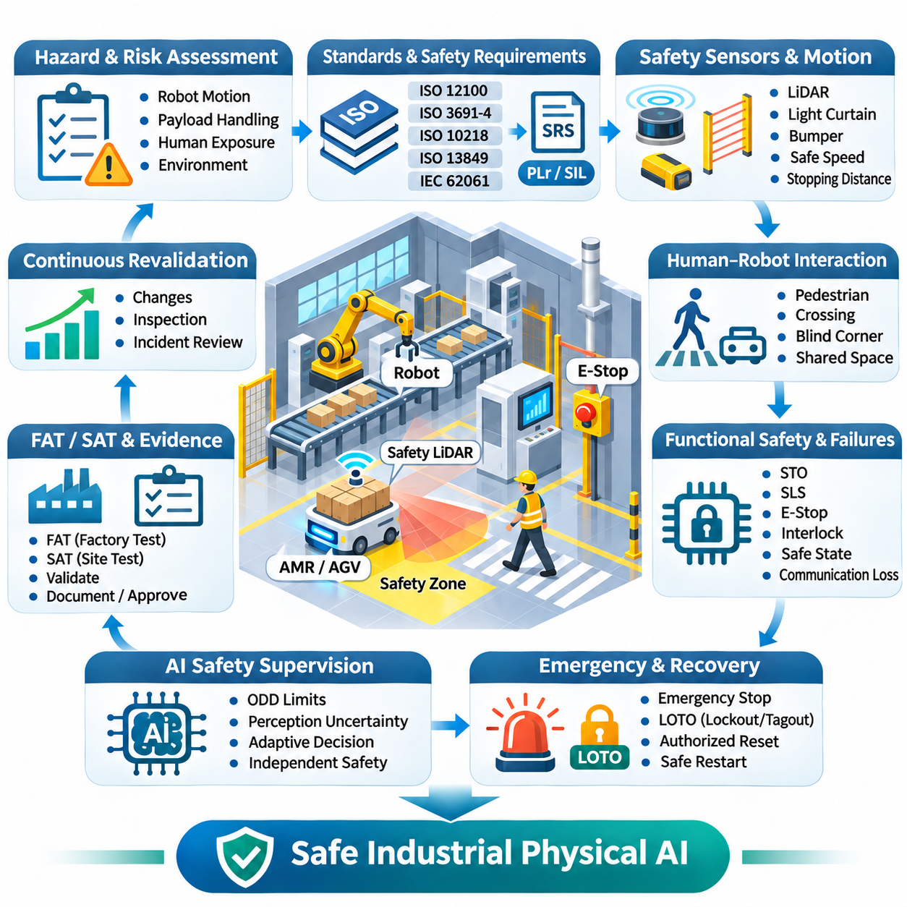
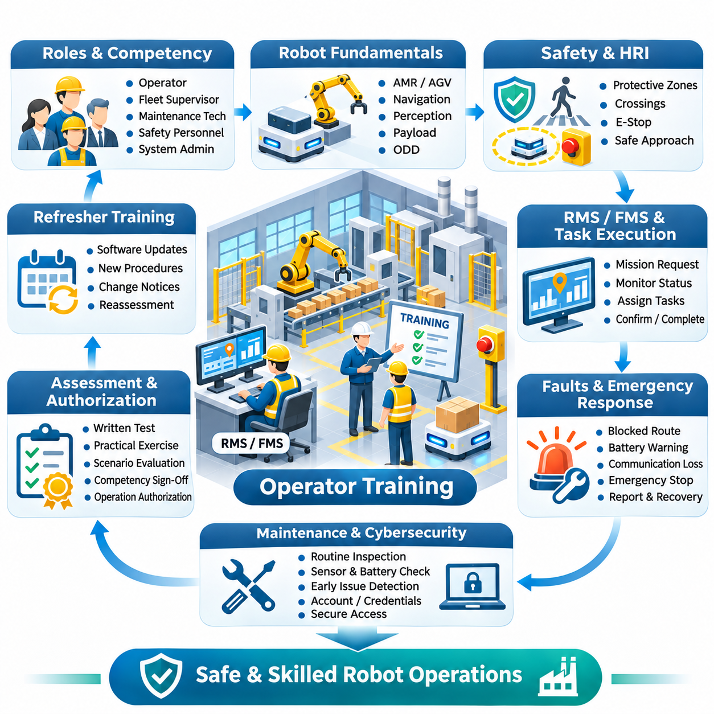
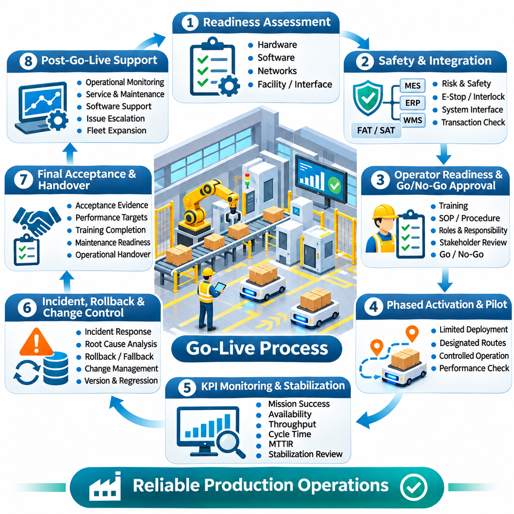
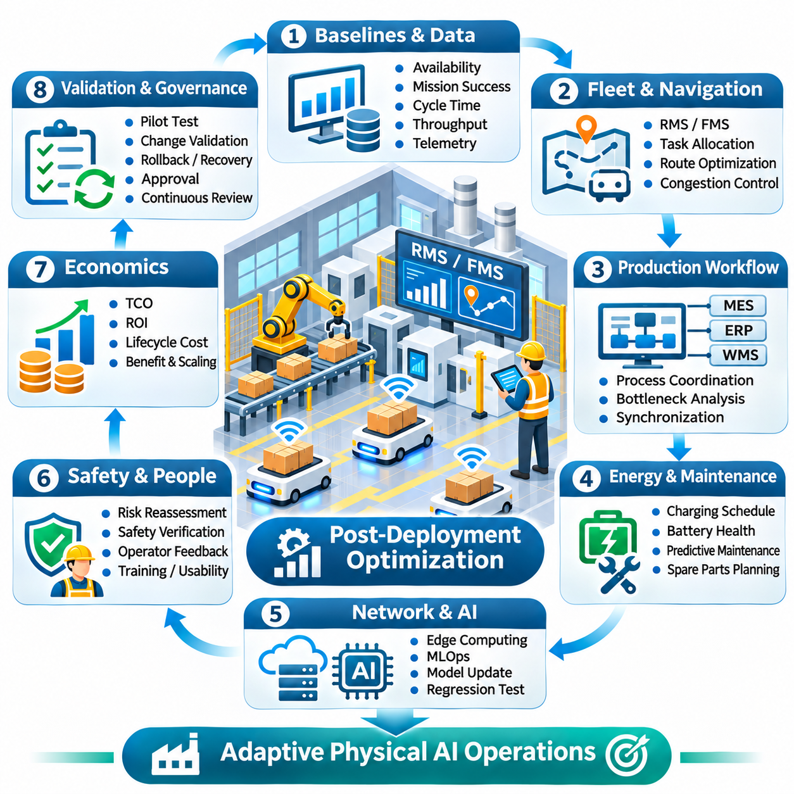

**Volume 08. AMR Operations, Deployment, and MLOps**

# Chapter 17. Industrial Deployment

## 17.1 Industrial Deployment Overview

{width="7.268055555555556in" height="7.268055555555556in"}

Industrial deployment refers to the systematic introduction, integration, validation, and operation of robotic systems within manufacturing facilities, production lines, warehouses, and industrial infrastructure. Unlike laboratory demonstrations, industrial deployment requires robots to operate continuously under practical environmental constraints while satisfying production objectives, operational safety requirements, reliability expectations, and economic performance targets.

Modern industrial deployment encompasses autonomous mobile robots (AMRs), automated guided vehicles (AGVs), industrial manipulators, collaborative robots, autonomous inspection systems, and AI-enabled mobile manipulators. These platforms support material transportation, assembly, machine tending, quality inspection, inventory management, and production automation. Their integration establishes a foundation for intelligent, flexible, and increasingly autonomous manufacturing environments.

The industrial deployment lifecycle begins with operational requirement analysis and feasibility assessment. Engineers must identify target processes, production volumes, transportation distances, payload requirements, environmental conditions, and existing infrastructure limitations. These requirements establish the operational design domain (ODD) and define measurable acceptance criteria for robotic performance, safety, interoperability, and operational availability.

Industrial environments introduce complex physical and operational challenges that differ significantly from controlled development environments. Moving machinery, forklifts, human workers, narrow corridors, reflective surfaces, dust, vibration, electromagnetic interference, and changing production layouts affect robotic behavior. Deployment strategies must therefore incorporate environmental assessment, robust perception, adaptive navigation, and systematic risk mitigation.

Infrastructure readiness represents a fundamental prerequisite for successful industrial deployment. Factory floors, communication networks, charging stations, electrical distribution systems, loading interfaces, and designated operational zones must support robotic activities. Wireless coverage, network latency, floor flatness, load-bearing capacity, and accessibility should be evaluated before installation to minimize unexpected operational interruptions.

Industrial robots must integrate with existing enterprise and manufacturing information systems to participate effectively in production workflows. Manufacturing Execution Systems (MES), Enterprise Resource Planning (ERP), Warehouse Management Systems (WMS), Supervisory Control and Data Acquisition (SCADA), and Programmable Logic Controllers (PLCs) provide essential production information, task instructions, equipment status, and operational coordination.

A layered deployment architecture enables industrial robots to operate as components of a distributed automation ecosystem. Embedded controllers manage deterministic motion and safety functions, while edge computing platforms execute perception, localization, planning, and AI inference. On-premises servers coordinate fleet operations and industrial workflows, while cloud infrastructure supports centralized analytics, software distribution, and long-term optimization.

Robot Management Systems (RMS) and Fleet Management Systems (FMS) provide centralized capabilities for monitoring and coordinating deployed robotic assets. These systems manage task allocation, traffic control, charging schedules, fault detection, resource utilization, and mission execution. Effective fleet orchestration prevents congestion, reduces unnecessary movement, and enables multiple robots to cooperate within shared industrial environments.

Operational safety is a critical requirement throughout the industrial deployment lifecycle. Risk assessments must consider robot motion, payload stability, stopping distance, human interaction, equipment interfaces, and foreseeable system failures. Safety-rated sensors, emergency stops, protective fields, speed restrictions, and independent safety controllers must be implemented according to applicable standards and the specific hazards of each deployment environment.

Industrial cybersecurity protects robotic systems against unauthorized access, malicious software, communication manipulation, and operational disruption. Network segmentation, device authentication, encrypted communications, role-based access control, and secure software update mechanisms reduce exposure to cyber threats. Security monitoring and incident response procedures must be integrated into the broader industrial operational technology (OT) environment.

Deployment validation should progress through simulation, laboratory testing, Factory Acceptance Testing (FAT), Site Acceptance Testing (SAT), and pilot operation. Each validation stage verifies specific functional, performance, and safety requirements before expanding operational responsibilities. Representative production scenarios, abnormal conditions, communication failures, and emergency recovery procedures must be evaluated systematically.

A phased deployment strategy reduces operational risks by introducing robotic capabilities incrementally. Initial implementation may involve a limited number of robots operating within designated production zones. Following successful validation, deployment can expand to additional processes, production lines, and facilities. This approach enables organizations to accumulate operational experience without compromising existing manufacturing productivity.

Continuous operational monitoring provides visibility into robot health, task execution, system availability, and production performance. Key Performance Indicators (KPIs) include mission success rate, throughput, fleet utilization, Mean Time Between Failures (MTBF), Mean Time to Repair (MTTR), and energy consumption. Historical operational data supports predictive maintenance, root cause analysis, and systematic performance improvement.

Human workforce integration and organizational readiness are equally important components of industrial deployment. Operators, maintenance personnel, production supervisors, and system administrators require appropriate training in robotic operation, safety procedures, fault recovery, and maintenance activities. Clearly defined responsibilities and standardized operating procedures facilitate effective collaboration between humans and autonomous systems.

Ultimately, industrial deployment establishes the operational foundation for scalable Physical AI ecosystems. By combining autonomous robotics, industrial connectivity, distributed intelligence, digital twins, and continuous learning, manufacturing organizations can progressively develop adaptive production environments. Successful deployment transforms individual robotic capabilities into reliable, maintainable, and economically sustainable industrial intelligence.

The referenced attachment was not available in this conversation; therefore, the content follows a standard industrial robot deployment lifecycle.

## 17.2 Factory Site Survey

{width="7.268055555555556in" height="7.268055555555556in"}

A factory site survey is a systematic assessment of the physical infrastructure, production environment, operational processes, and technical conditions required for industrial robot deployment. Its primary objective is to identify environmental constraints, integration requirements, potential hazards, and infrastructure limitations before robotic systems are installed. A comprehensive survey establishes the engineering foundation for reliable and scalable industrial automation.

The site survey process begins with an analysis of the existing factory layout and production workflows. Engineers collect architectural drawings, equipment layouts, material transportation routes, storage locations, and production station information. Understanding the relationships between manufacturing processes enables deployment teams to identify suitable robotic applications, optimize transportation routes, and minimize interference with ongoing production activities.

Physical infrastructure assessment is particularly important for autonomous mobile robots (AMRs) and automated guided vehicles (AGVs). Floor flatness, surface friction, structural load capacity, expansion joints, ramps, drainage channels, and floor transitions must be evaluated. Irregular surfaces and excessive slopes may reduce localization accuracy, increase mechanical stress, compromise payload stability, and negatively affect navigation performance.

Spatial assessment determines whether the factory provides sufficient clearance for robotic movement, maneuvering, docking, and maintenance. Corridor widths, turning spaces, ceiling heights, doorway dimensions, and equipment separation distances must be measured accurately. Engineers must consider robot dimensions, payload geometry, dynamic movement envelopes, and required safety distances when determining the suitability of operational areas.

Environmental conditions directly influence the reliability and performance of industrial robotic systems. Temperature variations, humidity, airborne dust, vibration, electromagnetic interference, ambient lighting, and reflective surfaces may affect sensors, electronic components, and mechanical assemblies. These conditions must be compared against equipment specifications to establish appropriate environmental protection and operational limitations.

A perception and localization survey evaluates the suitability of the factory environment for autonomous navigation technologies. LiDAR sensors, RGB cameras, depth cameras, inertial measurement units, and other localization devices may experience degraded performance in repetitive corridors, glass partitions, reflective metal structures, or featureless environments. Representative sensor measurements help identify localization weaknesses before deployment.

Communication infrastructure assessment examines the availability, coverage, reliability, and capacity of industrial networks. Wireless access points, Ethernet connections, private cellular networks, and network segmentation configurations should be evaluated throughout the intended operational areas. Measurements of signal strength, packet loss, roaming performance, latency, and bandwidth help identify communication risks and connectivity requirements.

Electrical infrastructure assessment establishes the availability of power resources for robotic operation, charging, and supporting computing systems. Engineers must examine electrical distribution panels, grounding systems, protective devices, power capacity, and potential charging station locations. Charging infrastructure should accommodate expected fleet sizes, battery characteristics, charging schedules, and future expansion without overloading existing facilities.

Production equipment interface assessment identifies the hardware and software connections required between robotic systems and existing industrial machinery. Conveyor systems, automated doors, elevators, production stations, programmable logic controllers (PLCs), and industrial manipulators must be examined. Interface requirements should specify communication protocols, mechanical alignment, synchronization mechanisms, and operational handshaking procedures.

Operational workflow assessment focuses on material movement patterns, production schedules, transportation frequencies, loading procedures, and process dependencies. Engineers should observe actual operations across different production shifts to identify bottlenecks, peak demand periods, and human intervention requirements. These observations support fleet sizing, task scheduling, route optimization, and production capacity planning.

Safety assessment is an essential component of factory site surveys. Potential collision zones, pedestrian crossings, forklift routes, blind corners, restricted areas, emergency exits, and hazardous machinery must be identified. The survey should provide input for formal risk assessments, protective field configurations, speed restrictions, emergency response procedures, and compliance with applicable industrial safety standards.

Digital infrastructure assessment examines existing Manufacturing Execution Systems (MES), Warehouse Management Systems (WMS), Enterprise Resource Planning (ERP), and industrial control platforms. Data availability, application programming interfaces, authentication mechanisms, and system interoperability must be evaluated. These findings establish the integration requirements for robot management, fleet coordination, and production information exchange.

Digital mapping and three-dimensional site reconstruction provide valuable engineering resources for deployment planning. Laser scanning, simultaneous localization and mapping (SLAM), computer-aided design (CAD) drawings, and photographic documentation enable the creation of digital representations of factory environments. These representations support virtual commissioning, digital twin development, navigation simulation, and infrastructure modification planning.

Site survey findings should be consolidated into a structured engineering report containing measured conditions, environmental constraints, identified hazards, infrastructure deficiencies, and recommended corrective actions. Each finding should include supporting evidence, technical implications, responsible stakeholders, and resolution priorities. Unresolved issues must be addressed or formally evaluated before deployment approval.

Ultimately, a comprehensive factory site survey transforms uncertain field conditions into measurable engineering requirements. Its results establish the baseline for robot selection, infrastructure preparation, system integration, safety engineering, and deployment validation. Regular reassessment also supports subsequent fleet expansion, production layout modifications, and the sustainable evolution of industrial Physical AI ecosystems.

The referenced attachment was unavailable; therefore, this content follows a general industrial robot site survey framework.

## 17.3 MES, ERP, and WMS Integration

{width="7.268055555555556in" height="7.268055555555556in"}

Integration with Manufacturing Execution Systems (MES), Enterprise Resource Planning (ERP), and Warehouse Management Systems (WMS) enables industrial robots to participate directly in enterprise production and logistics processes. Rather than operating as isolated automation equipment, robotic systems become interconnected operational assets that exchange information, execute business-driven tasks, and contribute to manufacturing productivity.

Manufacturing Execution Systems coordinate and monitor production activities at the factory level. MES platforms manage production orders, workstations, manufacturing schedules, process execution, and quality records. Integration with robotic systems enables autonomous mobile robots and industrial manipulators to respond dynamically to production requirements, deliver materials, transfer intermediate products, and report task completion.

Enterprise Resource Planning systems provide centralized management of business resources, including procurement, inventory, manufacturing planning, financial transactions, and supply chain operations. ERP integration connects robotic activities with enterprise-level objectives by translating business requirements into operational demands. Completed robotic tasks can also contribute to resource accounting, inventory reconciliation, and production cost analysis.

Warehouse Management Systems coordinate inventory locations, material movements, storage assignments, picking operations, and shipping activities. Integration between WMS platforms and autonomous robotic systems enables automated material transportation, inventory replenishment, order fulfillment, and warehouse process optimization. Real-time inventory updates help maintain consistency between physical material movements and digital inventory records.

Robot Management Systems (RMS) and Fleet Management Systems (FMS) serve as operational intermediaries between enterprise applications and individual robotic platforms. These systems translate production and logistics requirements into executable robot missions while managing task allocation, traffic coordination, charging schedules, and operational constraints. This separation reduces integration complexity and supports heterogeneous robotic fleets.

A layered integration architecture separates enterprise planning, manufacturing execution, fleet orchestration, and robot-level control. ERP systems establish business objectives, MES and WMS platforms coordinate operational requirements, and fleet management systems convert these requirements into robotic missions. Embedded controllers execute motion and safety functions independently of enterprise-level communication and decision-making processes.

Application Programming Interfaces (APIs) provide standardized mechanisms for exchanging information between enterprise applications and robotic systems. RESTful APIs, message brokers, OPC UA, MQTT, and industrial communication protocols support different integration requirements. Protocol selection should consider latency, reliability, interoperability, cybersecurity, transaction consistency, and compatibility with existing factory infrastructure.

Data modeling establishes consistent representations of production orders, material identifiers, inventory locations, robot identities, mission parameters, and operational states. Master data management ensures that interconnected systems interpret shared information consistently. Standardized identifiers, timestamps, measurement units, and status definitions reduce integration errors and improve traceability across manufacturing and logistics environments.

Task lifecycle management coordinates the progression of robotic missions from initial requests through acceptance, scheduling, execution, completion, and exception handling. Each mission should have a unique identifier and a clearly defined operational state. Bidirectional communication allows enterprise applications to track execution progress, receive completion confirmations, and respond appropriately to delays, cancellations, or failures.

Event-driven integration enables robotic systems and enterprise applications to exchange operational information whenever significant state changes occur. Production completion, material shortages, inventory updates, equipment availability, and robot faults can trigger subsequent workflows automatically. Asynchronous messaging reduces direct dependencies between systems and improves operational scalability, responsiveness, and resilience.

Transactional consistency is essential when robotic activities modify production records or inventory quantities. Physical material transfers and corresponding digital transactions must remain synchronized even during communication failures or system interruptions. Acknowledgment mechanisms, idempotent operations, persistent message queues, transaction reconciliation, and controlled retry policies help prevent duplicate or missing updates.

Industrial integration must incorporate robust exception handling and operational recovery mechanisms. Robots may encounter blocked routes, unavailable workstations, docking failures, incorrect payloads, or communication interruptions. Enterprise applications must receive meaningful failure notifications, while fleet management systems coordinate corrective actions, mission reassignment, and safe recovery without producing inconsistent operational records.

Cybersecurity protects enterprise and robotic systems against unauthorized access, data manipulation, and operational disruption. Network segmentation, authenticated interfaces, encrypted communications, role-based access control, and audit logging should protect information exchanges. Integration architectures must preserve the independence of safety-critical robot functions while restricting unnecessary access across IT and OT environments.

Integration validation requires functional testing, interface verification, transaction testing, and representative end-to-end production scenarios. Factory Acceptance Testing (FAT) and Site Acceptance Testing (SAT) should evaluate normal workflows, abnormal conditions, network interruptions, duplicate messages, and system recovery. Performance indicators include transaction latency, mission completion rate, inventory accuracy, and production throughput.

Ultimately, MES, ERP, and WMS integration establishes a unified digital and physical manufacturing environment. By connecting enterprise planning, production execution, warehouse operations, and autonomous robotics, organizations can improve operational visibility, resource utilization, and manufacturing flexibility. This interconnected architecture provides a foundation for scalable Physical AI and intelligent industrial automation.

The referenced attachment was unavailable; therefore, this content follows a general industrial enterprise integration architecture.

## 17.4 Industrial Network Integration

{width="7.268055555555556in" height="7.268055555555556in"}

Industrial network integration establishes the communication infrastructure required to connect robotic systems, production equipment, industrial controllers, edge computing platforms, and enterprise applications. Unlike conventional information technology networks, industrial networks must accommodate operational continuity, predictable communication latency, environmental robustness, and the coexistence of heterogeneous automation technologies.

A layered industrial network architecture separates enterprise information technology (IT), operational technology (OT), fleet orchestration, and robot-level communication. Enterprise networks support business applications and centralized analytics, while operational networks connect production equipment and automation controllers. Robot-level networks provide communication between embedded controllers, sensors, actuators, and onboard computing platforms.

Industrial Ethernet provides a high-performance communication foundation for stationary automation equipment, industrial computers, and programmable logic controllers (PLCs). Protocols such as EtherCAT, PROFINET, EtherNet/IP, and Modbus TCP address different industrial communication requirements. Protocol selection depends on deterministic performance, equipment compatibility, network topology, synchronization requirements, and application-specific control constraints.

Wireless communication is essential for autonomous mobile robots (AMRs), automated guided vehicles (AGVs), and other mobile industrial platforms. Industrial Wi-Fi, private LTE, and private 5G networks enable continuous connectivity across production facilities. Network design must consider access point placement, radio frequency interference, signal attenuation, roaming performance, coverage redundancy, and simultaneous communication demands from multiple robots.

Network performance requirements should be classified according to the operational characteristics of each communication service. Motion control, equipment synchronization, mission coordination, telemetry transmission, video streaming, and software distribution have different latency, bandwidth, jitter, and reliability requirements. Safety-critical and time-sensitive communication must receive appropriate protection from noncritical network traffic.

Time synchronization enables distributed robotic and industrial systems to maintain consistent temporal references across interconnected devices. Precision Time Protocol (PTP), Network Time Protocol (NTP), and hardware-based synchronization mechanisms support different accuracy requirements. Accurate timestamps facilitate multisensor fusion, coordinated equipment operation, event correlation, performance analysis, and distributed Physical AI execution.

Industrial network segmentation protects critical automation resources while improving communication efficiency and operational isolation. Virtual Local Area Networks (VLANs), industrial firewalls, access control policies, and demilitarized zones (DMZs) establish controlled communication boundaries. Enterprise applications, robot fleets, production controllers, safety systems, and external services should be assigned appropriate security zones.

Middleware and industrial communication gateways facilitate interoperability between heterogeneous robotic platforms and existing factory automation equipment. OPC UA, MQTT, RESTful APIs, and protocol conversion mechanisms enable standardized information exchange across different systems. Gateways should manage data transformation, message buffering, authentication, equipment addressing, and communication recovery without compromising operational integrity.

Robot Management Systems (RMS) and Fleet Management Systems (FMS) depend on reliable network connectivity to coordinate distributed robotic operations. Mission assignments, robot positions, battery status, traffic reservations, equipment availability, and fault notifications must be exchanged efficiently. Communication architectures should support increasing fleet sizes while preventing excessive network utilization and centralized processing bottlenecks.

Quality of Service (QoS) mechanisms prioritize communication according to operational importance and application requirements. Control messages, mission updates, safety-related notifications, sensor streams, and bulk data transfers should receive appropriate traffic classifications. Bandwidth allocation, traffic shaping, congestion management, and network scheduling help maintain predictable communication performance during periods of high industrial activity.

Network redundancy and fault tolerance reduce the operational consequences of communication infrastructure failures. Redundant switches, alternative communication routes, overlapping wireless coverage, backup network interfaces, and resilient server configurations improve system availability. Robots must also implement predefined degraded operating modes and safe recovery behaviors when essential communication services become unavailable.

Industrial network cybersecurity requires coordinated protection across robotic devices, communication infrastructure, and enterprise interfaces. Device authentication, certificate management, encrypted communications, secure remote access, intrusion detection, and vulnerability management reduce cyber risks. Security mechanisms must be designed according to operational requirements without introducing unacceptable delays or compromising independent safety functions.

Network monitoring and diagnostics provide continuous visibility into industrial communication health. Signal strength, packet loss, network latency, jitter, bandwidth utilization, roaming interruptions, and device availability should be monitored systematically. Historical communication data supports root cause analysis, predictive network maintenance, capacity planning, and the identification of recurring connectivity problems within factory environments.

Industrial network validation should include coverage surveys, communication stress testing, redundancy verification, cybersecurity assessments, and representative production scenarios. Factory Acceptance Testing (FAT) and Site Acceptance Testing (SAT) must evaluate normal operation, peak traffic conditions, wireless handover, packet loss, and communication failures. Acceptance criteria should reflect measurable operational performance requirements.

Ultimately, industrial network integration provides the communication foundation for scalable, interconnected Physical AI ecosystems. By combining deterministic industrial Ethernet, resilient wireless connectivity, distributed computing, precise time synchronization, and secure information exchange, manufacturing organizations can establish reliable infrastructure for autonomous robotic operations, collaborative intelligence, and adaptive industrial automation.

The referenced attachment was unavailable; therefore, this content follows a general industrial network integration framework for autonomous robotic deployment.

## 17.5 Safety Validation in Factory

{width="7.268055555555556in" height="7.268055555555556in"}

Safety validation in factory environments is a systematic process for demonstrating that deployed robotic systems satisfy defined safety requirements under representative operating conditions. Its primary objective is to verify that robots can perform assigned industrial tasks without introducing unacceptable risks to personnel, production equipment, transported materials, and surrounding infrastructure throughout their operational lifecycle.

Factory safety validation begins with comprehensive hazard identification and risk assessment. Engineers must examine robot movement, mechanical interactions, payload handling, electrical systems, battery operation, human accessibility, and environmental conditions. Each identified hazard should be evaluated according to potential injury severity, exposure frequency, and the possibility of avoiding or limiting harm during normal and abnormal operations.

Applicable safety standards provide the technical foundation for industrial robot validation. ISO 12100 establishes general principles for machinery risk assessment and risk reduction, while ISO 3691-4 addresses driverless industrial trucks and their systems. ISO 10218 applies to industrial robots and robot applications, while ISO 13849 and IEC 62061 provide frameworks for designing and validating safety-related control systems.

The Safety Requirements Specification (SRS) translates identified hazards into measurable safety functions and acceptance criteria. Requirements should define emergency stopping, safe speed limits, protective field dimensions, collision prevention, unexpected restart prevention, and fault response behavior. Each safety function must have an appropriate integrity target, such as a required Performance Level (PLr) or Safety Integrity Level (SIL).

Safety sensor validation evaluates the effectiveness of safety-rated LiDAR scanners, protective light curtains, safety bumpers, interlocking devices, and other protective equipment. Testing must confirm detection coverage, response time, protective field switching, and behavior under foreseeable environmental disturbances. Blind spots, sensor contamination, mounting errors, and reflective surfaces should be considered when evaluating protective capabilities.

Motion safety validation examines robot movement under representative and worst-case operating conditions. Maximum velocity, acceleration, deceleration, braking distance, turning behavior, and payload stability must be evaluated across different floor surfaces and loading configurations. Protective stopping distances must account for total system response time, braking performance, measurement uncertainty, and potential human approach during operation.

Human--robot interaction validation focuses on shared operational environments where autonomous mobile robots, industrial manipulators, factory workers, and manually operated vehicles coexist. Representative scenarios include pedestrian crossings, blind intersections, unexpected human approaches, narrow corridors, and workstation interactions. Validation must demonstrate that protective measures remain effective under foreseeable human behavior.

Functional safety validation verifies that safety-related control systems respond correctly to hazardous conditions and internal failures. Safety controllers, emergency stop circuits, Safe Torque Off (STO), Safely Limited Speed (SLS), and protective stopping functions should be tested against specified requirements. Controlled fault injection helps verify diagnostic coverage, fault detection, safe-state transitions, and prevention of unexpected movement.

Communication failure validation examines robotic behavior when wireless connectivity, industrial Ethernet, fleet management services, or equipment interfaces become unavailable. Robots must transition to predefined safe or restricted operating states according to their risk assessment. Network reconnection, interrupted mission recovery, and command synchronization must not cause uncontrolled motion or unexpected restart of hazardous operations.

Industrial equipment interface validation ensures safe coordination between robots and automated doors, elevators, conveyors, production machinery, and loading stations. Interlocking mechanisms, equipment readiness signals, transfer permissions, and safety-related handshaking must be verified. Testing should confirm that communication errors, incorrect equipment states, and incomplete material transfers cannot initiate hazardous sequences.

Emergency response and recovery validation evaluates the accessibility and effectiveness of emergency stop devices, evacuation procedures, manual recovery controls, and energy isolation mechanisms. Emergency stop reset must not automatically restart hazardous motion. Maintenance and recovery activities should incorporate appropriate lockout/tagout procedures, controlled access, authorized intervention, and verification of safe operating conditions.

AI-enabled robotic systems introduce additional validation challenges related to perception uncertainty, localization errors, unpredictable environmental conditions, and adaptive decision-making. Safety-critical functions should remain protected by appropriately validated safety mechanisms rather than relying solely on AI predictions. Operational design domain limitations, degraded operating modes, and independent safety supervision must be evaluated.

Factory Acceptance Testing (FAT) and Site Acceptance Testing (SAT) provide complementary stages of industrial safety validation. FAT verifies configured safety functions under controlled conditions, while SAT evaluates their effectiveness within the actual factory environment. Representative operational scenarios, maximum payload conditions, equipment interactions, and foreseeable failures should be included before production release.

Safety validation documentation establishes traceability between identified hazards, protective measures, safety requirements, test procedures, and validation results. Test records should include equipment configurations, software versions, measurement methods, acceptance criteria, observed deviations, and corrective actions. Unresolved safety deficiencies must prevent operational approval until appropriately addressed and reassessed.

Continuous safety assurance extends beyond initial factory acceptance and operational deployment. Production layout modifications, software updates, sensor replacements, payload changes, and fleet expansion may introduce new hazards or invalidate previous assumptions. Periodic inspections, incident analysis, configuration management, and risk-based revalidation help maintain safe and sustainable industrial Physical AI operations.

The referenced attachment was unavailable; therefore, this content follows a general industrial robot safety validation framework.

## 17.6 Operator Training

{width="7.268055555555556in" height="7.268055555555556in"}

Operator training is a fundamental component of successful industrial robot deployment, ensuring that personnel can interact with autonomous systems safely, efficiently, and consistently. Training programs must establish the knowledge, practical skills, and operational responsibilities required to supervise robotic activities, recognize abnormal conditions, respond to incidents, and maintain production continuity within complex factory environments.

Industrial robot training should begin with a structured assessment of workforce roles and competency requirements. Production operators, fleet supervisors, maintenance technicians, safety personnel, and system administrators require different levels of technical knowledge and operational authority. Role-based training ensures that each participant receives instruction appropriate to assigned responsibilities, equipment access permissions, and expected intervention scenarios.

Foundational training introduces the operating principles of autonomous mobile robots (AMRs), automated guided vehicles (AGVs), industrial manipulators, and collaborative robotic systems. Participants should understand robot capabilities, navigation behavior, perception limitations, payload restrictions, and operational design domains. This knowledge helps operators develop realistic expectations about autonomous behavior and recognize conditions requiring human intervention.

Safety training establishes essential procedures for working around industrial robotic equipment. Operators must understand protective zones, emergency stop devices, warning indicators, restricted areas, pedestrian crossings, and safe approach distances. Training should explain foreseeable hazards associated with moving platforms, robotic arms, electrical equipment, charging stations, and transported materials under normal and abnormal operating conditions.

Human--robot interaction training focuses on predictable and safe cooperation within shared factory environments. Operators should learn how robots respond to pedestrian movement, obstacles, traffic intersections, workstation access, and temporary route restrictions. Practical exercises should demonstrate appropriate human behavior near operating robots and clarify situations in which manual intervention or operational suspension becomes necessary.

Robot Management Systems (RMS) and Fleet Management Systems (FMS) training enables operators to supervise distributed robotic activities through centralized interfaces. Participants should practice monitoring robot positions, reviewing mission status, assigning authorized tasks, interpreting alerts, and identifying operational bottlenecks. Training should distinguish routine supervisory functions from administrative controls and safety-critical interventions.

Task execution training addresses the practical procedures required to initiate, monitor, and complete robotic missions. Operators must understand mission requests, loading verification, destination confirmation, task acknowledgment, and completion reporting. Exercises should include material transportation, workstation delivery, inventory movement, and equipment interaction scenarios relevant to actual factory production workflows.

Abnormal condition recognition is essential for maintaining reliable industrial operations. Training should cover blocked routes, localization degradation, unexpected obstacles, communication interruptions, battery warnings, docking failures, and payload abnormalities. Operators must learn to distinguish recoverable operational events from safety-related faults that require immediate suspension, isolation, or escalation.

Emergency response training prepares personnel to act correctly during hazardous situations. Practical instruction should address emergency stop activation, incident reporting, evacuation coordination, and prevention of unauthorized restart. Operators must understand that resetting an emergency stop does not automatically authorize resumption of operation and that hazardous energy isolation requires designated procedures and qualified personnel.

Manual intervention and recovery training should establish clearly defined boundaries between operator-level actions and maintenance-level activities. Authorized personnel may perform approved mission cancellation, route clearance, or controlled robot recovery procedures. Activities involving safety controller modifications, electrical isolation, mechanical repairs, or protective device adjustments must remain restricted to appropriately qualified personnel.

Maintenance awareness training helps operators recognize conditions that may indicate equipment deterioration or emerging reliability problems. Participants should understand routine visual inspections, battery status monitoring, sensor cleanliness, wheel condition, charging connector integrity, and abnormal noise detection. Operator inspections must follow approved procedures and should not replace scheduled preventive maintenance or qualified technical assessments.

Cybersecurity awareness is increasingly important as industrial robots connect to factory networks and enterprise information systems. Operators should understand account protection, authentication procedures, access permissions, suspicious system behavior, and secure handling of operational data. Training must prohibit unauthorized software installation, credential sharing, uncontrolled remote access, and unapproved modifications to robotic configurations.

Training effectiveness should be evaluated through written assessments, supervised practical exercises, scenario-based demonstrations, and documented competency verification. Performance criteria may include correct task execution, hazard recognition, emergency response accuracy, fault escalation, and compliance with standard operating procedures. Personnel should receive operational authorization only after demonstrating the required competencies.

Training programs must remain current as robotic systems, production processes, and operating environments evolve. Software updates, new robot models, revised safety procedures, production layout changes, and expanded fleet operations may require refresher training. Version-controlled training materials, competency records, periodic reassessment, and structured feedback support continuous workforce development.

Ultimately, effective operator training transforms industrial robotics from specialized automation equipment into manageable components of everyday manufacturing operations. By combining technical understanding, safety awareness, practical experience, and clearly defined responsibilities, organizations can improve operational reliability, workforce confidence, and human--robot collaboration while supporting scalable Physical AI deployment.

The referenced attachment was unavailable; therefore, this content follows a general industrial robot operator training framework.

## 17.7 Go-Live Process

{width="7.268055555555556in" height="7.268055555555556in"}

The go-live process represents the controlled transition of industrial robotic systems from installation, integration, and validation into authorized production operation. Its primary objective is to establish stable, safe, and measurable robotic performance without disrupting existing manufacturing activities. Successful go-live execution requires coordinated technical readiness, operational preparation, stakeholder approval, and clearly defined acceptance criteria.

Go-live planning begins with a comprehensive readiness assessment covering robotic hardware, software, industrial networks, facility infrastructure, and production interfaces. Deployment teams must confirm that installation activities are complete, required configurations are documented, and outstanding technical issues are resolved. Readiness reviews should establish whether each system can safely support its intended operational responsibilities.

Safety readiness is a mandatory prerequisite for production activation. Risk assessments, protective device configurations, emergency stopping functions, safety interlocks, and operational restrictions must be validated against approved requirements. Factory Acceptance Testing (FAT) and Site Acceptance Testing (SAT) results should be reviewed, with unresolved safety deficiencies preventing authorization until corrective actions are completed.

System integration readiness confirms that robotic platforms communicate correctly with Manufacturing Execution Systems (MES), Enterprise Resource Planning (ERP), Warehouse Management Systems (WMS), and production equipment. Interface verification should include mission requests, status updates, material transfer acknowledgments, and exception handling. Transaction consistency and recovery procedures must be validated before live production begins.

Operational readiness depends on trained personnel, approved procedures, and clearly assigned responsibilities. Production operators, maintenance technicians, fleet supervisors, and system administrators must understand normal operation, fault recognition, emergency response, and escalation procedures. Standard Operating Procedures (SOPs), maintenance instructions, and recovery guidelines should be accessible at relevant workstations.

A formal go-live decision should be conducted through a structured readiness review involving engineering, production, safety, information technology, and operational management representatives. Each stakeholder evaluates the evidence associated with assigned acceptance criteria. Authorization should document the approved operating scope, unresolved noncritical limitations, responsible personnel, and conditions requiring operational suspension.

Initial production activation should follow a phased deployment strategy that limits operational exposure while validating actual factory performance. A small number of robots may begin operating within designated routes, workstations, or production shifts. Operational boundaries, speed limits, payload restrictions, and human supervision requirements should remain controlled until sufficient performance evidence supports expansion.

Pilot production operation provides an opportunity to observe robotic behavior under representative manufacturing conditions. Engineers should monitor mission execution, navigation reliability, equipment interactions, material handling accuracy, and operator responses. Differences between expected and observed behavior must be documented, investigated, and corrected before increasing operational complexity or fleet capacity.

Performance monitoring during go-live should emphasize operational stability and measurable production outcomes. Key Performance Indicators (KPIs) include mission success rate, system availability, transportation cycle time, task throughput, intervention frequency, and Mean Time to Repair (MTTR). Baseline measurements enable deployment teams to distinguish normal commissioning adjustments from persistent operational deficiencies.

Incident and exception management must remain active throughout the transition period. Blocked routes, communication interruptions, localization failures, docking errors, and unexpected equipment conditions require predefined response procedures. Incident records should capture event timestamps, affected systems, operational consequences, corrective actions, and verification results to support systematic root cause analysis.

A rollback and contingency strategy protects manufacturing continuity when robotic operations cannot meet approved acceptance criteria. Alternative manual transportation procedures, temporary route restrictions, controlled mission suspension, and restoration of previous workflows should be prepared in advance. Rollback decisions must prioritize personnel safety, equipment protection, and preservation of production records.

Change management controls modifications introduced during initial production operation. Software updates, navigation map changes, safety parameter adjustments, equipment interface modifications, and fleet configuration changes must undergo appropriate review and testing. Configuration baselines, version records, authorization procedures, and regression testing reduce the risk of introducing new operational failures.

The stabilization period following initial activation allows deployment teams to evaluate sustained performance across production shifts and operating conditions. Monitoring should include peak production demand, battery charging cycles, wireless roaming, traffic congestion, and operator interventions. Persistent issues should be resolved through controlled corrective actions before declaring the robotic system operationally stable.

Final operational acceptance confirms that deployed robotic systems satisfy contractual, technical, safety, and production performance requirements. Acceptance evidence should include validated test results, operational KPI records, training completion, maintenance readiness, and approved documentation. Formal handover transfers routine operational responsibility from deployment engineers to the designated factory operations organization.

Post-go-live support ensures that operational performance remains stable after formal acceptance. Support arrangements should define incident response responsibilities, service availability, maintenance schedules, software support, spare parts management, and escalation pathways. Continuous monitoring and structured operational reviews enable organizations to improve robotic reliability and identify opportunities for future fleet expansion.

Ultimately, the go-live process transforms validated robotic capabilities into dependable industrial production services. By combining formal readiness assessment, controlled activation, operational monitoring, contingency planning, and structured handover, organizations can reduce deployment risks and establish a sustainable foundation for scalable autonomous robotics and Physical AI operations.

The referenced attachment was unavailable; therefore, this content follows a general industrial robotic go-live and operational transition framework.

## 17.8 Post-Deployment Optimization

{width="7.268055555555556in" height="7.268055555555556in"}

Post-deployment optimization is the continuous process of improving industrial robotic systems after successful production activation and operational acceptance. Its purpose is to enhance productivity, reliability, safety, and resource efficiency while adapting to changing manufacturing requirements. Optimization transforms initial deployment performance into sustained operational value through systematic measurement, analysis, and controlled improvement.

Optimization begins with establishing reliable operational baselines and measurable performance objectives. Robot availability, mission success rate, transportation cycle time, task throughput, energy consumption, and intervention frequency provide essential indicators. Baseline measurements should distinguish expected operating variations from persistent inefficiencies and support comparisons across production shifts, facilities, and robot configurations.

Operational data collection provides the foundation for evidence-based improvement. Robot telemetry, mission histories, navigation logs, equipment interface events, battery records, and operator interventions should be captured with consistent timestamps. Data quality controls must address missing records, synchronization errors, inconsistent identifiers, and abnormal measurements to ensure that optimization decisions reflect actual operating conditions.

Fleet performance analysis identifies inefficiencies in task distribution, traffic coordination, and robot utilization. Robot Management Systems (RMS) and Fleet Management Systems (FMS) can evaluate mission queues, idle periods, route conflicts, and workload imbalances. Dynamic task allocation, congestion-aware scheduling, and capacity adjustments help improve throughput without unnecessarily increasing fleet size or operational complexity.

Navigation optimization focuses on improving route efficiency, localization stability, and obstacle handling within changing factory environments. Engineers should analyze travel distances, repeated stopping events, localization confidence, and recovery frequency. Map refinement, route restructuring, speed profile adjustments, and traffic rule improvements must be validated against safety requirements before deployment.

Production workflow optimization aligns robotic operations with manufacturing schedules, material availability, and workstation demand. Integration with Manufacturing Execution Systems (MES), Enterprise Resource Planning (ERP), and Warehouse Management Systems (WMS) enables better coordination of transport requests. Bottleneck analysis and process synchronization reduce waiting time, unnecessary movements, and production interruptions.

Battery and charging optimization improves robot availability while controlling energy consumption and battery degradation. Charging schedules should consider mission demand, battery state of charge, operating temperature, and available charging infrastructure. Opportunity charging, workload-aware energy planning, and charging station utilization analysis can reduce downtime while maintaining appropriate battery operating limits.

Predictive maintenance optimization uses historical equipment data to identify deterioration before functional failures occur. Motor current, vibration, temperature, wheel wear, sensor health, and charging behavior can provide early indicators of abnormal conditions. Condition-based maintenance and failure trend analysis help reduce unplanned downtime, improve spare parts planning, and extend equipment service life.

Network and computing optimization ensures that communication and processing infrastructure continue supporting expanding robotic workloads. Wireless coverage, roaming interruptions, packet loss, latency, and edge computing utilization should be monitored. Network segmentation, bandwidth management, distributed processing, and infrastructure upgrades can improve responsiveness while preserving cybersecurity and operational reliability.

AI model optimization addresses changes in perception accuracy, object recognition, localization robustness, and decision-making performance. Operational datasets can reveal recurring failure patterns and previously underrepresented conditions. Model retraining, domain adaptation, and controlled software updates should follow validated MLOps procedures, with regression testing and rollback mechanisms protecting production continuity.

Safety optimization must remain an independent constraint throughout operational improvement activities. Changes to navigation parameters, operating speeds, payload configurations, workstation layouts, or human--robot interaction patterns may alter existing risk assumptions. Risk reassessment, safety function verification, and documented change approval are required whenever modifications could affect protective performance.

Human-centered optimization examines how operators, maintenance personnel, and robotic systems cooperate during everyday production. Intervention records, operator feedback, training outcomes, and ergonomic observations can reveal usability problems. Interface improvements, clearer alerts, revised procedures, and targeted refresher training reduce operational errors while improving workforce acceptance and confidence.

Economic optimization evaluates whether technical improvements generate measurable business value. Total Cost of Ownership (TCO), operating expenditure, maintenance cost, labor utilization, and production throughput should be assessed together. Return on Investment (ROI) analysis helps prioritize improvements according to expected benefits, implementation costs, operational risks, and long-term scalability.

Optimization initiatives should follow a controlled experimentation and validation process. Proposed changes require defined hypotheses, baseline measurements, test conditions, acceptance thresholds, and rollback criteria. Simulation, limited pilot deployment, and comparative performance evaluation help verify improvements before applying them across the entire fleet or multiple production facilities.

Continuous improvement governance establishes responsibility for identifying, approving, implementing, and reviewing optimization activities. Cross-functional teams should maintain configuration records, performance dashboards, incident histories, and improvement backlogs. Periodic operational reviews connect technical findings with production priorities, ensuring that optimization remains aligned with organizational objectives.

Ultimately, post-deployment optimization enables industrial robotic systems to evolve alongside manufacturing processes and business requirements. By integrating operational analytics, fleet intelligence, predictive maintenance, validated AI updates, and continuous safety assurance, organizations can increase productivity, reduce lifecycle costs, and establish a scalable foundation for adaptive Physical AI operations.

The referenced attachment was unavailable; therefore, this content follows a general industrial robotic post-deployment optimization framework.
