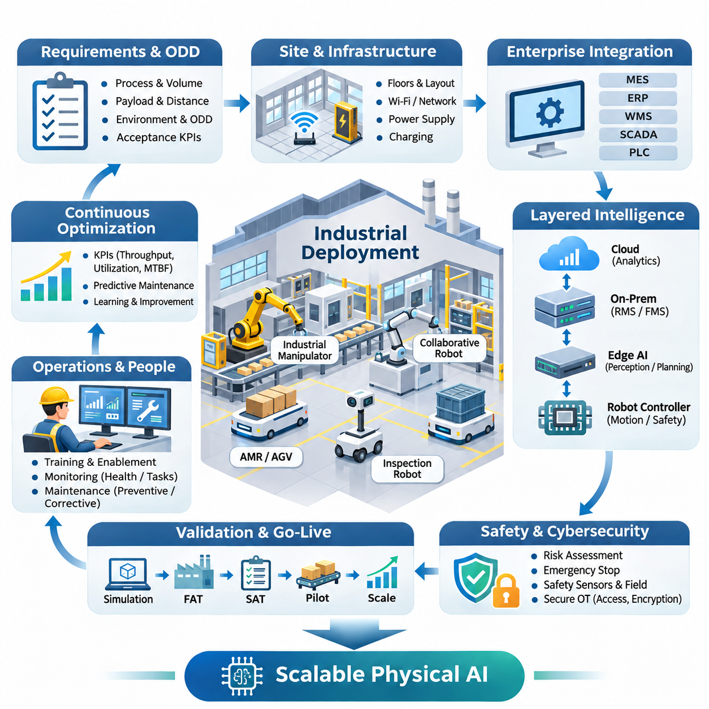
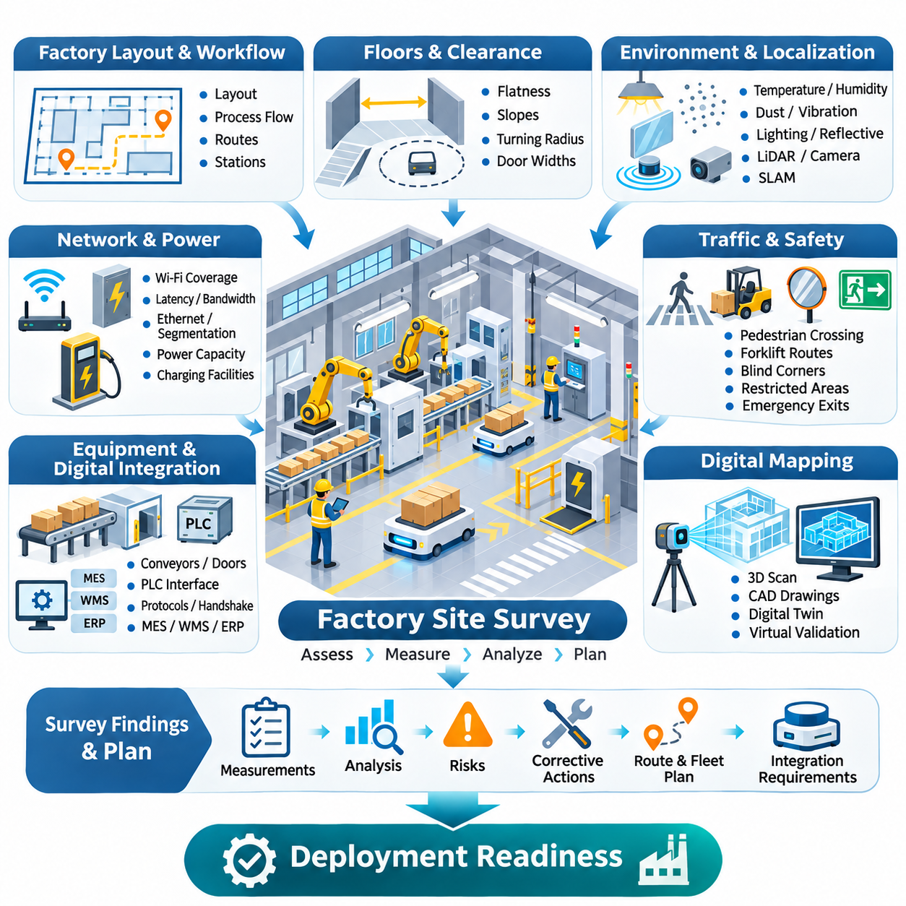
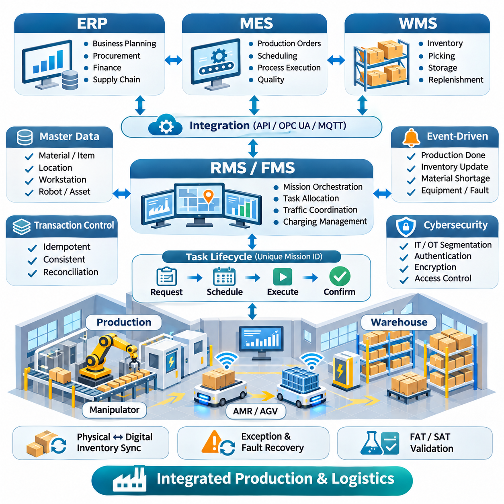
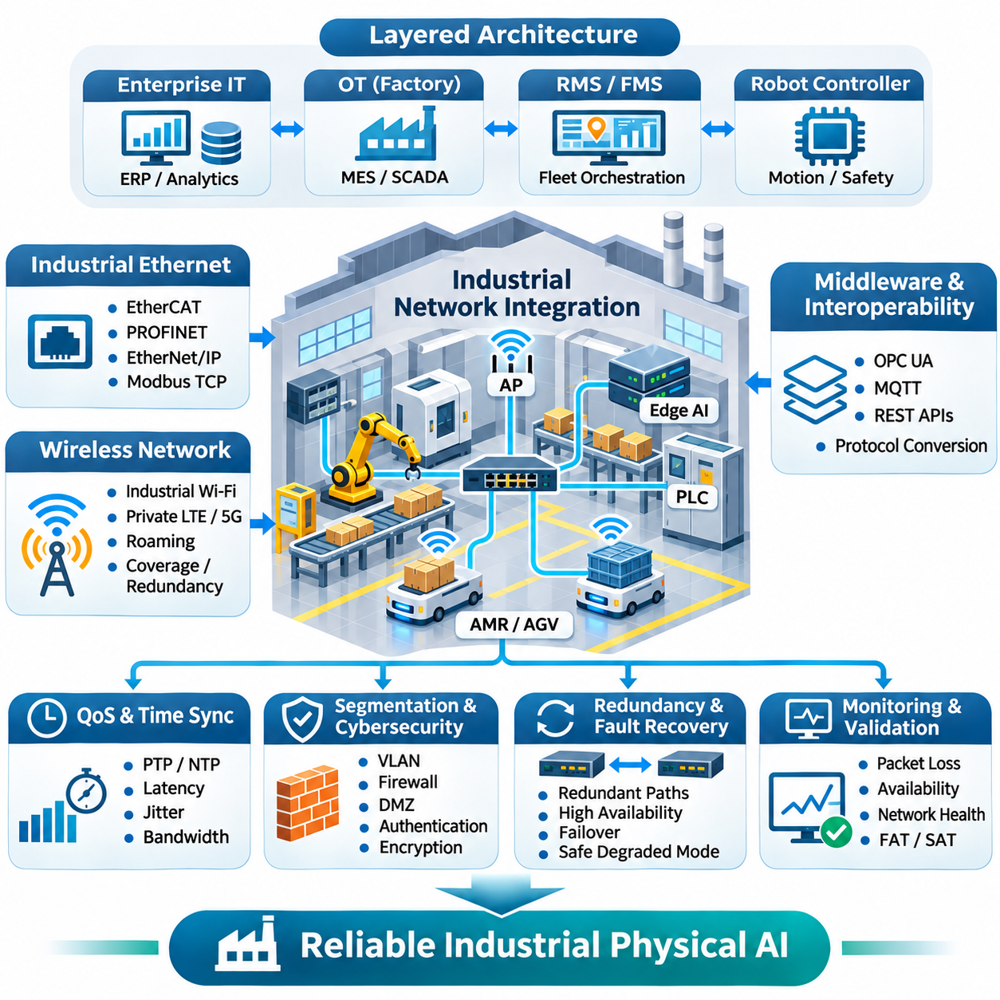
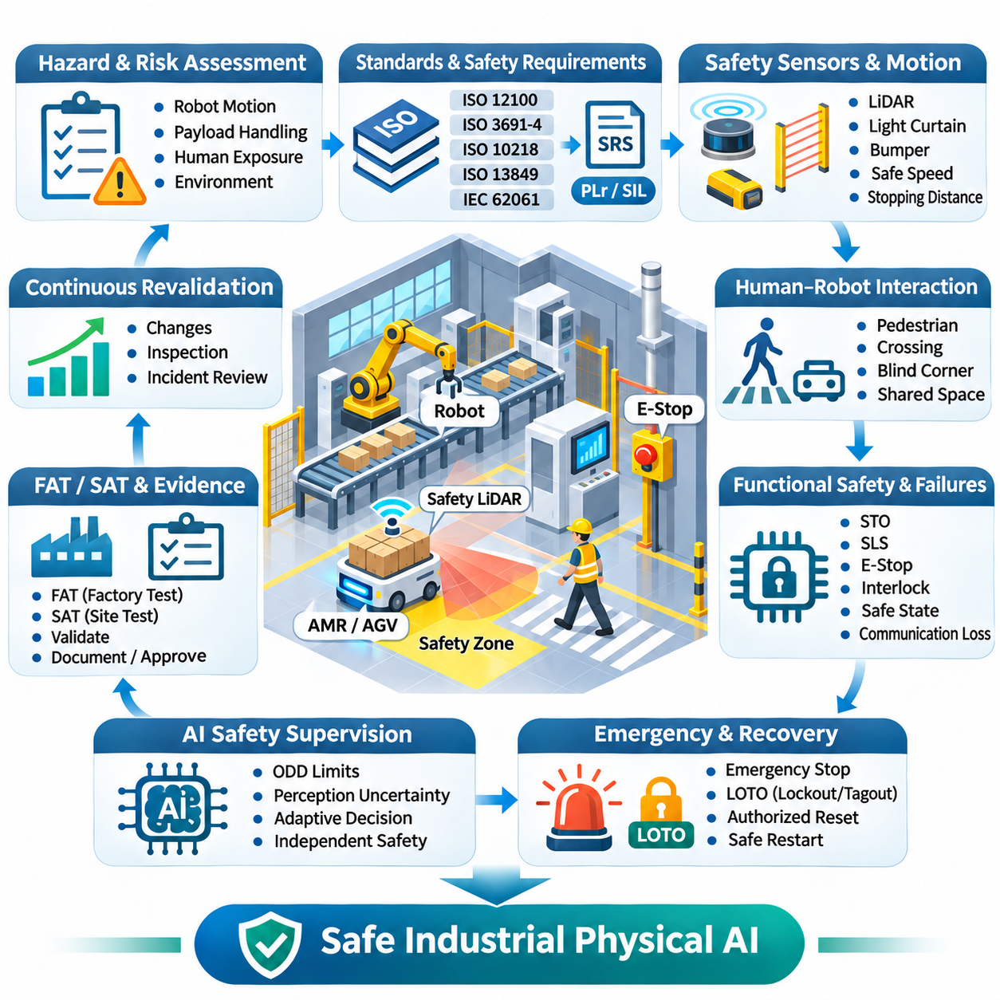
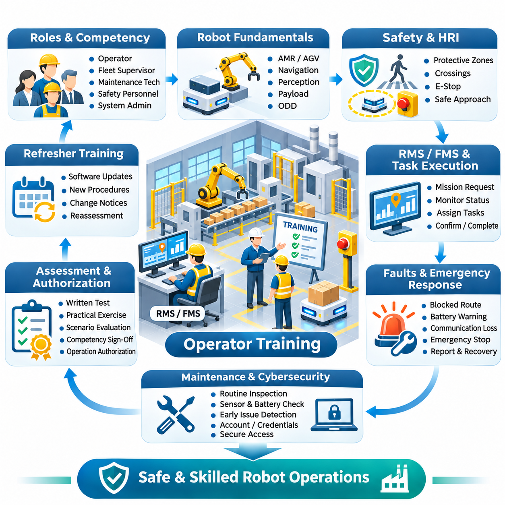
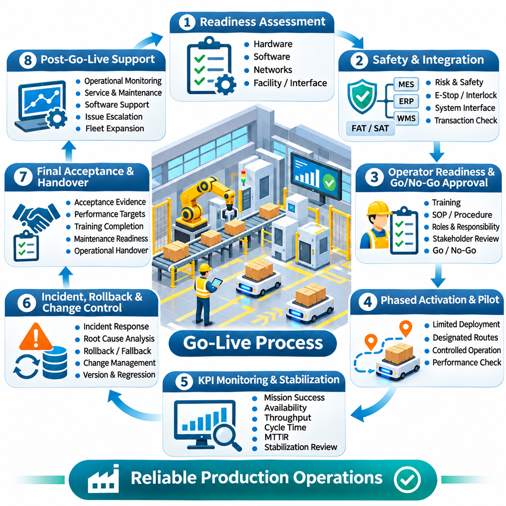
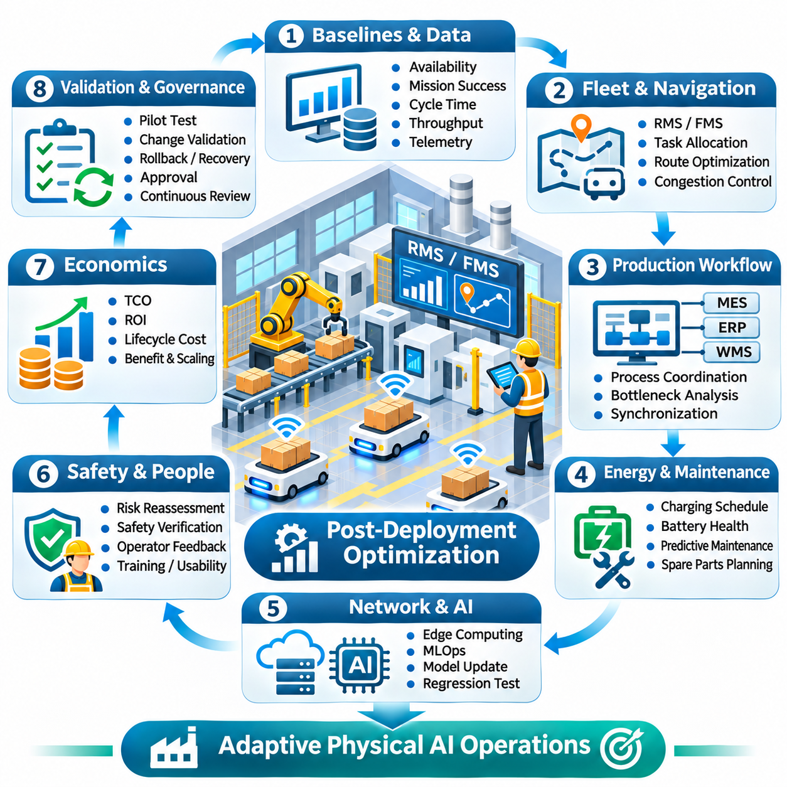

**Volume 08. AMR Operations, Deployment, and MLOps**

# Chapter 17. Industrial Deployment

## 17.1 Industrial Deployment Overview

{width="7.268055555555556in" height="7.268055555555556in"}

산업 배치(Industrial Deployment)는 제조 시설(Manufacturing Facility), 생산 라인(Production Line), 물류 창고(Warehouse) 및 산업 인프라(Industrial Infrastructure) 내에 로봇 시스템(Robotic System)을 체계적으로 도입, 통합, 검증 및 운영하는 과정을 의미한다. 실험실 시연(Laboratory Demonstration)과 달리 산업 배치는 실제 환경적 제약(Environmental Constraint) 속에서 생산 목표(Production Objective), 운영 안전 요구사항(Operational Safety Requirement), 신뢰성 기대 수준(Reliability Expectation) 및 경제적 성능 목표(Economic Performance Target)를 충족하면서 로봇이 지속적으로 작동할 수 있어야 한다.

현대적인 산업 배치(Industrial Deployment)는 자율 이동 로봇(Autonomous Mobile Robot, AMR), 무인 운반 차량(Automated Guided Vehicle, AGV), 산업용 매니퓰레이터(Industrial Manipulator), 협동 로봇(Collaborative Robot), 자율 검사 시스템(Autonomous Inspection System) 및 인공지능 기반 이동형 매니퓰레이터(AI-enabled Mobile Manipulator)를 포함한다. 이러한 플랫폼은 자재 운송(Material Transportation), 조립(Assembly), 기계 작업 지원(Machine Tending), 품질 검사(Quality Inspection), 재고 관리(Inventory Management) 및 생산 자동화(Production Automation)를 지원한다. 이러한 시스템의 통합은 지능적이고 유연하며 점진적으로 자율화되는 제조 환경(Manufacturing Environment)의 기반을 구축한다.

산업 배치 생명주기(Industrial Deployment Lifecycle)는 운영 요구사항 분석(Operational Requirement Analysis)과 타당성 평가(Feasibility Assessment)에서 시작된다. 엔지니어는 대상 공정(Target Process), 생산량(Production Volume), 운송 거리(Transportation Distance), 적재 하중 요구사항(Payload Requirement), 환경 조건(Environmental Condition) 및 기존 인프라의 제약사항(Infrastructure Limitation)을 식별해야 한다. 이러한 요구사항은 운용 설계 영역(Operational Design Domain, ODD)을 설정하고 로봇 성능(Robot Performance), 안전성(Safety), 상호운용성(Interoperability) 및 운영 가용성(Operational Availability)에 대한 측정 가능한 인수 기준(Acceptance Criteria)을 정의한다.

산업 환경(Industrial Environment)은 통제된 개발 환경(Controlled Development Environment)과 크게 다른 복잡한 물리적 및 운영상의 문제를 발생시킨다. 이동하는 기계(Moving Machinery), 지게차(Forklift), 작업자(Human Worker), 좁은 통로(Narrow Corridor), 반사 표면(Reflective Surface), 먼지(Dust), 진동(Vibration), 전자기 간섭(Electromagnetic Interference) 및 변화하는 생산 배치(Production Layout)는 로봇의 행동에 영향을 미친다. 따라서 배치 전략(Deployment Strategy)은 환경 평가(Environmental Assessment), 강건한 인지(Robust Perception), 적응형 자율주행(Adaptive Navigation) 및 체계적인 위험 완화(Risk Mitigation)를 포함해야 한다.

인프라 준비성(Infrastructure Readiness)은 성공적인 산업 배치를 위한 기본적인 전제조건이다. 공장 바닥(Factory Floor), 통신 네트워크(Communication Network), 충전 스테이션(Charging Station), 전력 분배 시스템(Electrical Distribution System), 적재 인터페이스(Loading Interface) 및 지정된 운영 구역(Operational Zone)은 로봇의 활동을 지원할 수 있어야 한다. 예상하지 못한 운영 중단(Operational Interruption)을 최소화하기 위해 설치 이전에 무선 통신 범위(Wireless Coverage), 네트워크 지연시간(Network Latency), 바닥 평탄도(Floor Flatness), 하중 지지 능력(Load-bearing Capacity) 및 접근성(Accessibility)을 평가해야 한다.

산업용 로봇(Industrial Robot)이 생산 작업 흐름(Production Workflow)에 효과적으로 참여하기 위해서는 기존 기업 및 제조 정보 시스템(Enterprise and Manufacturing Information System)과 통합되어야 한다. 제조 실행 시스템(Manufacturing Execution System, MES), 전사적 자원 관리(Enterprise Resource Planning, ERP), 창고 관리 시스템(Warehouse Management System, WMS), 감시 제어 및 데이터 수집(Supervisory Control and Data Acquisition, SCADA), 프로그래머블 논리 제어기(Programmable Logic Controller, PLC)는 필수적인 생산 정보(Production Information), 작업 명령(Task Instruction), 장비 상태(Equipment Status) 및 운영 조정(Operational Coordination)을 제공한다.

계층형 배치 아키텍처(Layered Deployment Architecture)는 산업용 로봇이 분산 자동화 생태계(Distributed Automation Ecosystem)의 구성요소로 작동할 수 있도록 지원한다. 임베디드 제어기(Embedded Controller)는 결정론적 모션 제어(Deterministic Motion Control)와 안전 기능(Safety Function)을 관리하며, 엣지 컴퓨팅 플랫폼(Edge Computing Platform)은 인지(Perception), 위치 추정(Localization), 경로 및 행동 계획(Planning), 인공지능 추론(AI Inference)을 수행한다. 온프레미스 서버(On-premises Server)는 로봇 군집 운영(Fleet Operation)과 산업 작업 흐름을 조정하며, 클라우드 인프라(Cloud Infrastructure)는 중앙 집중형 분석(Centralized Analytics), 소프트웨어 배포(Software Distribution) 및 장기적인 최적화(Long-term Optimization)를 지원한다.

로봇 관리 시스템(Robot Management System, RMS)과 로봇 군집 관리 시스템(Fleet Management System, FMS)은 배치된 로봇 자산(Robotic Asset)을 모니터링하고 조정하기 위한 중앙 집중형 기능을 제공한다. 이러한 시스템은 작업 할당(Task Allocation), 교통 제어(Traffic Control), 충전 일정(Charging Schedule), 고장 감지(Fault Detection), 자원 활용(Resource Utilization) 및 임무 수행(Mission Execution)을 관리한다. 효과적인 로봇 군집 오케스트레이션(Fleet Orchestration)은 혼잡(Congestion)을 방지하고 불필요한 이동을 줄이며, 여러 로봇이 공유 산업 환경(Shared Industrial Environment)에서 협력할 수 있도록 지원한다.

운영 안전성(Operational Safety)은 산업 배치 생명주기 전반에 걸쳐 중요한 요구사항이다. 위험 평가(Risk Assessment)는 로봇의 움직임(Robot Motion), 적재 하중 안정성(Payload Stability), 정지 거리(Stopping Distance), 인간과의 상호작용(Human Interaction), 장비 인터페이스(Equipment Interface) 및 예측 가능한 시스템 고장(Foreseeable System Failure)을 고려해야 한다. 안전 등급 센서(Safety-rated Sensor), 비상 정지(Emergency Stop), 보호 영역(Protective Field), 속도 제한(Speed Restriction) 및 독립적인 안전 제어기(Independent Safety Controller)는 적용 가능한 표준(Applicable Standard)과 각 배치 환경의 구체적인 위험요소(Hazard)에 따라 구현되어야 한다.

산업 사이버 보안(Industrial Cybersecurity)은 비인가 접근(Unauthorized Access), 악성 소프트웨어(Malicious Software), 통신 조작(Communication Manipulation) 및 운영 방해(Operational Disruption)로부터 로봇 시스템을 보호한다. 네트워크 분할(Network Segmentation), 장치 인증(Device Authentication), 암호화 통신(Encrypted Communication), 역할 기반 접근 제어(Role-based Access Control, RBAC) 및 안전한 소프트웨어 업데이트 메커니즘(Secure Software Update Mechanism)은 사이버 위협(Cyber Threat)에 대한 노출을 감소시킨다. 보안 모니터링(Security Monitoring)과 사고 대응 절차(Incident Response Procedure)는 보다 포괄적인 산업 운영 기술(Operational Technology, OT) 환경에 통합되어야 한다.

배치 검증(Deployment Validation)은 시뮬레이션(Simulation), 실험실 시험(Laboratory Testing), 공장 인수 시험(Factory Acceptance Testing, FAT), 현장 인수 시험(Site Acceptance Testing, SAT) 및 시범 운영(Pilot Operation)을 통해 단계적으로 진행되어야 한다. 각 검증 단계(Validation Stage)는 운영 책임 범위를 확대하기 전에 구체적인 기능적 요구사항(Functional Requirement), 성능 요구사항(Performance Requirement) 및 안전 요구사항(Safety Requirement)을 검증한다. 대표적인 생산 시나리오(Production Scenario), 비정상 조건(Abnormal Condition), 통신 장애(Communication Failure) 및 비상 복구 절차(Emergency Recovery Procedure)는 체계적으로 평가되어야 한다.

단계적 배치 전략(Phased Deployment Strategy)은 로봇의 기능을 점진적으로 도입함으로써 운영 위험(Operational Risk)을 감소시킨다. 초기 구현(Initial Implementation)은 지정된 생산 구역(Designated Production Zone) 내에서 제한된 수의 로봇을 운영하는 방식으로 이루어질 수 있다. 성공적인 검증 이후에는 추가적인 공정(Process), 생산 라인(Production Line) 및 제조 시설(Manufacturing Facility)로 배치 범위를 확장할 수 있다. 이러한 접근 방식은 기존 제조 생산성(Manufacturing Productivity)을 저해하지 않으면서 조직이 운영 경험(Operational Experience)을 축적할 수 있도록 지원한다.

지속적인 운영 모니터링(Continuous Operational Monitoring)은 로봇 건전성(Robot Health), 작업 수행(Task Execution), 시스템 가용성(System Availability) 및 생산 성능(Production Performance)에 대한 가시성(Visibility)을 제공한다. 핵심 성과 지표(Key Performance Indicator, KPI)는 임무 성공률(Mission Success Rate), 처리량(Throughput), 로봇 군집 활용률(Fleet Utilization), 평균 고장 간격(Mean Time Between Failures, MTBF), 평균 수리 시간(Mean Time to Repair, MTTR) 및 에너지 소비량(Energy Consumption)을 포함한다. 누적된 운영 데이터(Historical Operational Data)는 예지 정비(Predictive Maintenance), 근본 원인 분석(Root Cause Analysis) 및 체계적인 성능 개선(Performance Improvement)을 지원한다.

인적 노동력 통합(Human Workforce Integration)과 조직 준비성(Organizational Readiness)은 산업 배치에서 동등하게 중요한 구성요소이다. 운영자(Operator), 유지보수 담당자(Maintenance Personnel), 생산 감독자(Production Supervisor) 및 시스템 관리자(System Administrator)는 로봇 운영(Robot Operation), 안전 절차(Safety Procedure), 고장 복구(Fault Recovery) 및 유지보수 활동(Maintenance Activity)에 대한 적절한 교육과 훈련을 받아야 한다. 명확하게 정의된 책임(Responsibility)과 표준 운영 절차(Standard Operating Procedure, SOP)는 인간과 자율 시스템(Autonomous System) 사이의 효과적인 협업(Collaboration)을 촉진한다.

궁극적으로 산업 배치(Industrial Deployment)는 확장 가능한 물리적 인공지능 생태계(Scalable Physical AI Ecosystem)를 구축하기 위한 운영 기반(Operational Foundation)을 확립한다. 자율 로봇 기술(Autonomous Robotics), 산업 연결성(Industrial Connectivity), 분산 지능(Distributed Intelligence), 디지털 트윈(Digital Twin) 및 지속 학습(Continuous Learning)을 결합함으로써 제조 조직은 적응형 생산 환경(Adaptive Production Environment)을 점진적으로 발전시킬 수 있다. 성공적인 산업 배치는 개별 로봇의 기능을 신뢰할 수 있고 유지보수가 가능하며 경제적으로 지속 가능한 산업 지능(Industrial Intelligence)으로 발전시킨다.

참조된 첨부 자료는 현재 대화에서 확인할 수 없었으므로, 본 내용은 표준적인 산업용 로봇 배치 생명주기(Industrial Robot Deployment Lifecycle)를 기반으로 작성되었다.

## 17.2 Factory Site Survey

{width="7.268055555555556in" height="7.268055555555556in"}

공장 현장 조사(Factory Site Survey)는 산업용 로봇 배치(Industrial Robot Deployment)에 필요한 물리적 인프라(Physical Infrastructure), 생산 환경(Production Environment), 운영 프로세스(Operational Process) 및 기술적 조건(Technical Condition)을 체계적으로 평가하는 과정이다. 주요 목적은 로봇 시스템을 설치하기 전에 환경적 제약사항(Environmental Constraint), 통합 요구사항(Integration Requirement), 잠재적 위험요소(Potential Hazard) 및 인프라 제한사항(Infrastructure Limitation)을 식별하는 것이다. 종합적인 현장 조사는 신뢰할 수 있고 확장 가능한 산업 자동화(Industrial Automation)를 위한 공학적 기반(Engineering Foundation)을 확립한다.

현장 조사 프로세스(Site Survey Process)는 기존 공장 배치(Factory Layout)와 생산 작업 흐름(Production Workflow)을 분석하는 것에서 시작된다. 엔지니어는 건축 도면(Architectural Drawing), 장비 배치(Equipment Layout), 자재 운송 경로(Material Transportation Route), 보관 위치(Storage Location) 및 생산 스테이션 정보(Production Station Information)를 수집한다. 제조 공정(Manufacturing Process) 사이의 관계를 이해함으로써 배치 담당자는 적합한 로봇 응용 분야(Robotic Application)를 식별하고 운송 경로를 최적화하며 진행 중인 생산 활동(Production Activity)에 대한 간섭을 최소화할 수 있다.

물리적 인프라 평가(Physical Infrastructure Assessment)는 자율 이동 로봇(Autonomous Mobile Robot, AMR)과 무인 운반 차량(Automated Guided Vehicle, AGV)에 특히 중요하다. 바닥 평탄도(Floor Flatness), 표면 마찰력(Surface Friction), 구조적 하중 지지 능력(Structural Load Capacity), 신축 이음부(Expansion Joint), 경사로(Ramp), 배수로(Drainage Channel) 및 바닥 전이 구간(Floor Transition)을 평가해야 한다. 불규칙한 표면(Irregular Surface)과 과도한 경사(Excessive Slope)는 위치 추정 정확도(Localization Accuracy)를 감소시키고 기계적 응력(Mechanical Stress)을 증가시키며 적재 하중 안정성(Payload Stability)과 자율주행 성능(Navigation Performance)을 저하시킬 수 있다.

공간 평가(Spatial Assessment)는 공장이 로봇의 이동(Movement), 기동(Maneuvering), 도킹(Docking) 및 유지보수(Maintenance)에 충분한 여유 공간(Clearance)을 제공하는지 판단하는 과정이다. 통로 폭(Corridor Width), 회전 공간(Turning Space), 천장 높이(Ceiling Height), 출입구 크기(Doorway Dimension) 및 장비 간 이격 거리(Equipment Separation Distance)를 정확하게 측정해야 한다. 엔지니어는 운영 구역(Operational Area)의 적합성을 판단할 때 로봇의 크기(Robot Dimension), 적재물 형상(Payload Geometry), 동적 이동 영역(Dynamic Movement Envelope) 및 요구되는 안전 거리(Safety Distance)를 고려해야 한다.

환경 조건(Environmental Condition)은 산업용 로봇 시스템(Industrial Robotic System)의 신뢰성과 성능에 직접적인 영향을 미친다. 온도 변화(Temperature Variation), 습도(Humidity), 공기 중 먼지(Airborne Dust), 진동(Vibration), 전자기 간섭(Electromagnetic Interference), 주변 조명(Ambient Lighting) 및 반사 표면(Reflective Surface)은 센서(Sensor), 전자 부품(Electronic Component) 및 기계 조립체(Mechanical Assembly)에 영향을 줄 수 있다. 적절한 환경 보호(Environmental Protection)와 운영 제한사항(Operational Limitation)을 설정하기 위해 이러한 조건을 장비 사양(Equipment Specification)과 비교해야 한다.

인지 및 위치 추정 조사(Perception and Localization Survey)는 자율주행 기술(Autonomous Navigation Technology)에 대한 공장 환경의 적합성을 평가한다. 라이다 센서(LiDAR Sensor), RGB 카메라(RGB Camera), 깊이 카메라(Depth Camera), 관성 측정 장치(Inertial Measurement Unit, IMU) 및 기타 위치 추정 장치(Localization Device)는 반복적인 구조의 통로(Repetitive Corridor), 유리 칸막이(Glass Partition), 반사 금속 구조물(Reflective Metal Structure) 또는 특징점이 부족한 환경(Featureless Environment)에서 성능 저하를 경험할 수 있다. 대표적인 센서 측정(Sensor Measurement)은 배치 이전에 위치 추정의 취약점(Localization Weakness)을 식별하는 데 도움이 된다.

통신 인프라 평가(Communication Infrastructure Assessment)는 산업용 네트워크(Industrial Network)의 가용성(Availability), 통신 범위(Coverage), 신뢰성(Reliability) 및 용량(Capacity)을 조사한다. 예정된 운영 구역 전반에 걸쳐 무선 액세스 포인트(Wireless Access Point), 이더넷 연결(Ethernet Connection), 사설 이동통신 네트워크(Private Cellular Network) 및 네트워크 분할 구성(Network Segmentation Configuration)을 평가해야 한다. 신호 강도(Signal Strength), 패킷 손실(Packet Loss), 로밍 성능(Roaming Performance), 지연시간(Latency) 및 대역폭(Bandwidth)의 측정은 통신 위험요소(Communication Risk)와 연결성 요구사항(Connectivity Requirement)을 식별하는 데 도움이 된다.

전력 인프라 평가(Electrical Infrastructure Assessment)는 로봇 운영(Robot Operation), 충전(Charging) 및 지원 컴퓨팅 시스템(Supporting Computing System)에 필요한 전력 자원(Power Resource)의 가용성을 확인하는 과정이다. 엔지니어는 배전반(Electrical Distribution Panel), 접지 시스템(Grounding System), 보호 장치(Protective Device), 전력 용량(Power Capacity) 및 충전 스테이션 후보 위치(Potential Charging Station Location)를 조사해야 한다. 충전 인프라(Charging Infrastructure)는 기존 시설에 과부하를 발생시키지 않으면서 예상 로봇 군집 규모(Fleet Size), 배터리 특성(Battery Characteristic), 충전 일정(Charging Schedule) 및 향후 확장(Future Expansion)을 수용할 수 있어야 한다.

생산 장비 인터페이스 평가(Production Equipment Interface Assessment)는 로봇 시스템과 기존 산업용 기계(Industrial Machinery) 사이에 필요한 하드웨어 및 소프트웨어 연결을 식별한다. 컨베이어 시스템(Conveyor System), 자동문(Automated Door), 엘리베이터(Elevator), 생산 스테이션(Production Station), 프로그래머블 논리 제어기(Programmable Logic Controller, PLC) 및 산업용 매니퓰레이터(Industrial Manipulator)를 조사해야 한다. 인터페이스 요구사항(Interface Requirement)은 통신 프로토콜(Communication Protocol), 기계적 정렬(Mechanical Alignment), 동기화 메커니즘(Synchronization Mechanism) 및 운영 핸드셰이킹 절차(Operational Handshaking Procedure)를 명확하게 정의해야 한다.

운영 작업 흐름 평가(Operational Workflow Assessment)는 자재 이동 패턴(Material Movement Pattern), 생산 일정(Production Schedule), 운송 빈도(Transportation Frequency), 적재 절차(Loading Procedure) 및 공정 의존성(Process Dependency)에 중점을 둔다. 엔지니어는 병목 현상(Bottleneck), 최대 수요 시간대(Peak Demand Period) 및 인간 개입 요구사항(Human Intervention Requirement)을 식별하기 위해 서로 다른 생산 교대 시간(Production Shift)의 실제 운영 상황을 관찰해야 한다. 이러한 관찰 결과는 로봇 군집 규모 산정(Fleet Sizing), 작업 스케줄링(Task Scheduling), 경로 최적화(Route Optimization) 및 생산 용량 계획(Production Capacity Planning)을 지원한다.

안전 평가(Safety Assessment)는 공장 현장 조사의 필수적인 구성요소이다. 잠재적 충돌 구역(Potential Collision Zone), 보행자 횡단 구역(Pedestrian Crossing), 지게차 이동 경로(Forklift Route), 사각지대(Blind Corner), 접근 제한 구역(Restricted Area), 비상구(Emergency Exit) 및 위험 기계(Hazardous Machinery)를 식별해야 한다. 현장 조사는 공식적인 위험 평가(Formal Risk Assessment), 보호 영역 구성(Protective Field Configuration), 속도 제한(Speed Restriction), 비상 대응 절차(Emergency Response Procedure) 및 적용 가능한 산업 안전 표준(Industrial Safety Standard)의 준수를 위한 기초 정보를 제공해야 한다.

디지털 인프라 평가(Digital Infrastructure Assessment)는 기존 제조 실행 시스템(Manufacturing Execution System, MES), 창고 관리 시스템(Warehouse Management System, WMS), 전사적 자원 관리(Enterprise Resource Planning, ERP) 및 산업 제어 플랫폼(Industrial Control Platform)을 조사한다. 데이터 가용성(Data Availability), 응용 프로그래밍 인터페이스(Application Programming Interface, API), 인증 메커니즘(Authentication Mechanism) 및 시스템 상호운용성(System Interoperability)을 평가해야 한다. 이러한 조사 결과는 로봇 관리(Robot Management), 로봇 군집 조정(Fleet Coordination) 및 생산 정보 교환(Production Information Exchange)을 위한 통합 요구사항(Integration Requirement)을 확립한다.

디지털 매핑(Digital Mapping)과 3차원 현장 재구성(Three-dimensional Site Reconstruction)은 배치 계획(Deployment Planning)을 위한 중요한 공학적 자원을 제공한다. 레이저 스캐닝(Laser Scanning), 동시적 위치 추정 및 지도 작성(Simultaneous Localization and Mapping, SLAM), 컴퓨터 지원 설계 도면(Computer-Aided Design Drawing, CAD Drawing) 및 사진 기록(Photographic Documentation)을 활용하여 공장 환경의 디지털 표현(Digital Representation)을 생성할 수 있다. 이러한 디지털 표현은 가상 시운전(Virtual Commissioning), 디지털 트윈 개발(Digital Twin Development), 자율주행 시뮬레이션(Navigation Simulation) 및 인프라 변경 계획(Infrastructure Modification Planning)을 지원한다.

현장 조사 결과(Site Survey Finding)는 측정된 조건(Measured Condition), 환경적 제약사항(Environmental Constraint), 식별된 위험요소(Identified Hazard), 인프라 미비점(Infrastructure Deficiency) 및 권장 시정 조치(Recommended Corrective Action)를 포함하는 구조화된 기술 보고서(Structured Engineering Report)로 통합되어야 한다. 각 조사 결과에는 근거 자료(Supporting Evidence), 기술적 영향(Technical Implication), 책임 이해관계자(Responsible Stakeholder) 및 해결 우선순위(Resolution Priority)가 포함되어야 한다. 해결되지 않은 문제(Unresolved Issue)는 배치 승인(Deployment Approval) 이전에 해결되거나 공식적으로 평가되어야 한다.

궁극적으로 종합적인 공장 현장 조사(Comprehensive Factory Site Survey)는 불확실한 현장 조건(Uncertain Field Condition)을 측정 가능한 공학적 요구사항(Measurable Engineering Requirement)으로 전환한다. 조사 결과는 로봇 선정(Robot Selection), 인프라 준비(Infrastructure Preparation), 시스템 통합(System Integration), 안전 공학(Safety Engineering) 및 배치 검증(Deployment Validation)을 위한 기준선(Baseline)을 확립한다. 정기적인 재평가(Regular Reassessment)는 이후의 로봇 군집 확장(Fleet Expansion), 생산 배치 변경(Production Layout Modification) 및 산업용 물리적 인공지능 생태계(Industrial Physical AI Ecosystem)의 지속 가능한 발전(Sustainable Evolution)을 지원한다.

참조된 첨부 자료를 확인할 수 없었으므로, 본 내용은 일반적인 산업용 로봇 현장 조사 프레임워크(Industrial Robot Site Survey Framework)를 기반으로 작성되었다.

## 17.3 MES, ERP, and WMS Integration

{width="7.268055555555556in" height="7.268055555555556in"}

제조 실행 시스템(Manufacturing Execution System, MES), 전사적 자원 관리(Enterprise Resource Planning, ERP) 및 창고 관리 시스템(Warehouse Management System, WMS)과의 통합(Integration)은 산업용 로봇이 기업의 생산 및 물류 프로세스(Enterprise Production and Logistics Process)에 직접 참여할 수 있도록 지원한다. 로봇 시스템(Robotic System)은 독립적인 자동화 장비(Isolated Automation Equipment)로 작동하는 대신 정보를 교환하고 비즈니스 요구사항에 기반한 작업(Business-driven Task)을 수행하며 제조 생산성(Manufacturing Productivity)에 기여하는 상호 연결된 운영 자산(Interconnected Operational Asset)으로 발전한다.

제조 실행 시스템(Manufacturing Execution System, MES)은 공장 수준에서 생산 활동(Production Activity)을 조정하고 모니터링한다. MES 플랫폼은 생산 주문(Production Order), 작업 스테이션(Workstation), 제조 일정(Manufacturing Schedule), 공정 실행(Process Execution) 및 품질 기록(Quality Record)을 관리한다. 로봇 시스템과의 통합은 자율 이동 로봇(Autonomous Mobile Robot, AMR)과 산업용 매니퓰레이터(Industrial Manipulator)가 생산 요구사항(Production Requirement)에 동적으로 대응하고 자재를 공급하며 중간 제품(Intermediate Product)을 운송하고 작업 완료(Task Completion)를 보고할 수 있도록 지원한다.

전사적 자원 관리 시스템(Enterprise Resource Planning System, ERP)은 조달(Procurement), 재고(Inventory), 제조 계획(Manufacturing Planning), 재무 거래(Financial Transaction) 및 공급망 운영(Supply Chain Operation)을 포함하는 기업 자원(Business Resource)의 중앙 집중형 관리를 제공한다. ERP 통합은 비즈니스 요구사항(Business Requirement)을 운영 수요(Operational Demand)로 변환함으로써 로봇 활동(Robotic Activity)을 기업 수준의 목표(Enterprise-level Objective)와 연결한다. 완료된 로봇 작업은 자원 회계(Resource Accounting), 재고 대사(Inventory Reconciliation) 및 생산 비용 분석(Production Cost Analysis)에도 기여할 수 있다.

창고 관리 시스템(Warehouse Management System, WMS)은 재고 위치(Inventory Location), 자재 이동(Material Movement), 보관 위치 할당(Storage Assignment), 피킹 작업(Picking Operation) 및 출하 활동(Shipping Activity)을 조정한다. WMS 플랫폼과 자율 로봇 시스템(Autonomous Robotic System) 사이의 통합은 자동화된 자재 운송(Automated Material Transportation), 재고 보충(Inventory Replenishment), 주문 이행(Order Fulfillment) 및 창고 프로세스 최적화(Warehouse Process Optimization)를 가능하게 한다. 실시간 재고 업데이트(Real-time Inventory Update)는 물리적 자재 이동(Physical Material Movement)과 디지털 재고 기록(Digital Inventory Record) 사이의 일관성을 유지하는 데 도움이 된다.

로봇 관리 시스템(Robot Management System, RMS)과 로봇 군집 관리 시스템(Fleet Management System, FMS)은 기업 응용 프로그램(Enterprise Application)과 개별 로봇 플랫폼(Robotic Platform) 사이에서 운영 중개 계층(Operational Intermediary)의 역할을 수행한다. 이러한 시스템은 생산 및 물류 요구사항(Production and Logistics Requirement)을 실행 가능한 로봇 임무(Executable Robot Mission)로 변환하는 동시에 작업 할당(Task Allocation), 교통 조정(Traffic Coordination), 충전 일정(Charging Schedule) 및 운영 제약사항(Operational Constraint)을 관리한다. 이러한 분리 구조는 통합 복잡성(Integration Complexity)을 감소시키고 이기종 로봇 군집(Heterogeneous Robotic Fleet)을 지원한다.

계층형 통합 아키텍처(Layered Integration Architecture)는 기업 계획(Enterprise Planning), 제조 실행(Manufacturing Execution), 로봇 군집 오케스트레이션(Fleet Orchestration) 및 로봇 수준 제어(Robot-level Control)를 분리한다. ERP 시스템은 비즈니스 목표(Business Objective)를 설정하고 MES와 WMS 플랫폼은 운영 요구사항(Operational Requirement)을 조정하며, 로봇 군집 관리 시스템은 이러한 요구사항을 로봇 임무(Robotic Mission)로 변환한다. 임베디드 제어기(Embedded Controller)는 기업 수준의 통신(Enterprise-level Communication) 및 의사결정 프로세스(Decision-making Process)와 독립적으로 모션 제어(Motion Control)와 안전 기능(Safety Function)을 수행한다.

응용 프로그래밍 인터페이스(Application Programming Interface, API)는 기업 응용 프로그램과 로봇 시스템 사이에서 정보를 교환하기 위한 표준화된 메커니즘(Standardized Mechanism)을 제공한다. RESTful API(Representational State Transfer API), 메시지 브로커(Message Broker), OPC UA(Open Platform Communications Unified Architecture), MQTT(Message Queuing Telemetry Transport) 및 산업용 통신 프로토콜(Industrial Communication Protocol)은 다양한 통합 요구사항을 지원한다. 프로토콜 선정(Protocol Selection)은 지연시간(Latency), 신뢰성(Reliability), 상호운용성(Interoperability), 사이버 보안(Cybersecurity), 트랜잭션 일관성(Transaction Consistency) 및 기존 공장 인프라(Factory Infrastructure)와의 호환성(Compatibility)을 고려해야 한다.

데이터 모델링(Data Modeling)은 생산 주문(Production Order), 자재 식별자(Material Identifier), 재고 위치(Inventory Location), 로봇 식별 정보(Robot Identity), 임무 매개변수(Mission Parameter) 및 운영 상태(Operational State)에 대한 일관된 표현을 확립한다. 마스터 데이터 관리(Master Data Management, MDM)는 상호 연결된 시스템이 공유 정보(Shared Information)를 일관되게 해석할 수 있도록 보장한다. 표준화된 식별자(Standardized Identifier), 타임스탬프(Timestamp), 측정 단위(Measurement Unit) 및 상태 정의(Status Definition)는 통합 오류(Integration Error)를 감소시키고 제조 및 물류 환경 전반의 추적성(Traceability)을 향상시킨다.

작업 생명주기 관리(Task Lifecycle Management)는 초기 요청(Initial Request)부터 작업 수락(Acceptance), 일정 계획(Scheduling), 실행(Execution), 완료(Completion) 및 예외 처리(Exception Handling)에 이르기까지 로봇 임무의 진행 과정을 조정한다. 각 임무는 고유 식별자(Unique Identifier)와 명확하게 정의된 운영 상태(Operational State)를 가져야 한다. 양방향 통신(Bidirectional Communication)은 기업 응용 프로그램이 실행 진행 상황(Execution Progress)을 추적하고 완료 확인(Completion Confirmation)을 수신하며 지연(Delay), 취소(Cancellation) 또는 실패(Failure)에 적절하게 대응할 수 있도록 지원한다.

이벤트 기반 통합(Event-driven Integration)은 중요한 상태 변화(State Change)가 발생할 때마다 로봇 시스템과 기업 응용 프로그램이 운영 정보(Operational Information)를 교환할 수 있도록 지원한다. 생산 완료(Production Completion), 자재 부족(Material Shortage), 재고 업데이트(Inventory Update), 장비 가용성(Equipment Availability) 및 로봇 고장(Robot Fault)은 후속 작업 흐름(Subsequent Workflow)을 자동으로 실행하는 계기가 될 수 있다. 비동기 메시징(Asynchronous Messaging)은 시스템 간 직접적인 의존성(Direct Dependency)을 감소시키고 운영 확장성(Operational Scalability), 응답성(Responsiveness) 및 복원력(Resilience)을 향상시킨다.

트랜잭션 일관성(Transactional Consistency)은 로봇 활동이 생산 기록(Production Record)이나 재고 수량(Inventory Quantity)을 변경하는 경우 필수적이다. 물리적 자재 운송(Physical Material Transfer)과 이에 대응하는 디지털 트랜잭션(Digital Transaction)은 통신 장애(Communication Failure) 또는 시스템 중단(System Interruption) 상황에서도 동기화된 상태를 유지해야 한다. 수신 확인 메커니즘(Acknowledgment Mechanism), 멱등 연산(Idempotent Operation), 영속적 메시지 큐(Persistent Message Queue), 트랜잭션 대사(Transaction Reconciliation) 및 제어된 재시도 정책(Controlled Retry Policy)은 중복되거나 누락된 업데이트(Duplicate or Missing Update)를 방지하는 데 도움이 된다.

산업 통합(Industrial Integration)은 강건한 예외 처리(Exception Handling) 및 운영 복구 메커니즘(Operational Recovery Mechanism)을 포함해야 한다. 로봇은 차단된 경로(Blocked Route), 사용 불가능한 작업 스테이션(Unavailable Workstation), 도킹 실패(Docking Failure), 잘못된 적재물(Incorrect Payload) 또는 통신 중단(Communication Interruption)을 경험할 수 있다. 기업 응용 프로그램은 의미 있는 실패 알림(Failure Notification)을 수신해야 하며, 로봇 군집 관리 시스템은 불일치하는 운영 기록(Inconsistent Operational Record)을 생성하지 않으면서 시정 조치(Corrective Action), 임무 재할당(Mission Reassignment) 및 안전한 복구(Safe Recovery)를 조정해야 한다.

사이버 보안(Cybersecurity)은 비인가 접근(Unauthorized Access), 데이터 조작(Data Manipulation) 및 운영 방해(Operational Disruption)로부터 기업 시스템과 로봇 시스템을 보호한다. 네트워크 분할(Network Segmentation), 인증된 인터페이스(Authenticated Interface), 암호화 통신(Encrypted Communication), 역할 기반 접근 제어(Role-based Access Control, RBAC) 및 감사 로그 기록(Audit Logging)은 정보 교환(Information Exchange)을 보호해야 한다. 통합 아키텍처(Integration Architecture)는 정보 기술(Information Technology, IT)과 운영 기술(Operational Technology, OT) 환경 사이의 불필요한 접근을 제한하는 동시에 안전 필수 로봇 기능(Safety-critical Robot Function)의 독립성을 유지해야 한다.

통합 검증(Integration Validation)은 기능 시험(Functional Testing), 인터페이스 검증(Interface Verification), 트랜잭션 시험(Transaction Testing) 및 대표적인 종단 간 생산 시나리오(End-to-end Production Scenario)를 요구한다. 공장 인수 시험(Factory Acceptance Testing, FAT)과 현장 인수 시험(Site Acceptance Testing, SAT)은 정상적인 작업 흐름(Normal Workflow), 비정상 조건(Abnormal Condition), 네트워크 중단(Network Interruption), 중복 메시지(Duplicate Message) 및 시스템 복구(System Recovery)를 평가해야 한다. 성능 지표(Performance Indicator)는 트랜잭션 지연시간(Transaction Latency), 임무 완료율(Mission Completion Rate), 재고 정확도(Inventory Accuracy) 및 생산 처리량(Production Throughput)을 포함한다.

궁극적으로 MES, ERP 및 WMS 통합(Integration)은 통합된 디지털 및 물리적 제조 환경(Unified Digital and Physical Manufacturing Environment)을 확립한다. 기업 계획(Enterprise Planning), 생산 실행(Production Execution), 창고 운영(Warehouse Operation) 및 자율 로봇 기술(Autonomous Robotics)을 연결함으로써 조직은 운영 가시성(Operational Visibility), 자원 활용률(Resource Utilization) 및 제조 유연성(Manufacturing Flexibility)을 향상시킬 수 있다. 이러한 상호 연결된 아키텍처(Interconnected Architecture)는 확장 가능한 물리적 인공지능(Scalable Physical AI)과 지능형 산업 자동화(Intelligent Industrial Automation)를 위한 기반을 제공한다.

참조된 첨부 자료를 확인할 수 없었으므로, 본 내용은 일반적인 산업용 기업 시스템 통합 아키텍처(Industrial Enterprise Integration Architecture)를 기반으로 작성되었다.

## 17.4 Industrial Network Integration

{width="7.268055555555556in" height="7.268055555555556in"}

산업용 네트워크 통합(Industrial Network Integration)은 로봇 시스템(Robotic System), 생산 장비(Production Equipment), 산업용 제어기(Industrial Controller), 엣지 컴퓨팅 플랫폼(Edge Computing Platform) 및 기업 응용 프로그램(Enterprise Application)을 연결하는 데 필요한 통신 인프라(Communication Infrastructure)를 구축한다. 기존의 정보 기술 네트워크(Information Technology Network)와 달리 산업용 네트워크는 운영 연속성(Operational Continuity), 예측 가능한 통신 지연시간(Predictable Communication Latency), 환경적 강건성(Environmental Robustness) 및 이기종 자동화 기술(Heterogeneous Automation Technology)의 공존을 지원해야 한다.

계층형 산업용 네트워크 아키텍처(Layered Industrial Network Architecture)는 기업 정보 기술(Information Technology, IT), 운영 기술(Operational Technology, OT), 로봇 군집 오케스트레이션(Fleet Orchestration) 및 로봇 수준 통신(Robot-level Communication)을 분리한다. 기업 네트워크(Enterprise Network)는 비즈니스 응용 프로그램(Business Application)과 중앙 집중형 분석(Centralized Analytics)을 지원하며, 운영 네트워크(Operational Network)는 생산 장비와 자동화 제어기(Automation Controller)를 연결한다. 로봇 수준 네트워크(Robot-level Network)는 임베디드 제어기(Embedded Controller), 센서(Sensor), 액추에이터(Actuator) 및 온보드 컴퓨팅 플랫폼(Onboard Computing Platform) 사이의 통신을 제공한다.

산업용 이더넷(Industrial Ethernet)은 고정형 자동화 장비(Stationary Automation Equipment), 산업용 컴퓨터(Industrial Computer) 및 프로그래머블 논리 제어기(Programmable Logic Controller, PLC)를 위한 고성능 통신 기반(High-performance Communication Foundation)을 제공한다. EtherCAT, PROFINET, EtherNet/IP 및 Modbus TCP와 같은 프로토콜(Protocol)은 서로 다른 산업용 통신 요구사항(Industrial Communication Requirement)을 충족한다. 프로토콜 선정(Protocol Selection)은 결정론적 성능(Deterministic Performance), 장비 호환성(Equipment Compatibility), 네트워크 토폴로지(Network Topology), 동기화 요구사항(Synchronization Requirement) 및 응용 분야별 제어 제약사항(Application-specific Control Constraint)에 따라 결정된다.

무선 통신(Wireless Communication)은 자율 이동 로봇(Autonomous Mobile Robot, AMR), 무인 운반 차량(Automated Guided Vehicle, AGV) 및 기타 이동형 산업 플랫폼(Mobile Industrial Platform)에 필수적이다. 산업용 무선랜(Industrial Wi-Fi), 사설 LTE(Private LTE) 및 사설 5G(Private 5G) 네트워크는 생산 시설 전반에 걸쳐 지속적인 연결성(Continuous Connectivity)을 제공한다. 네트워크 설계(Network Design)는 액세스 포인트 배치(Access Point Placement), 무선 주파수 간섭(Radio Frequency Interference), 신호 감쇠(Signal Attenuation), 로밍 성능(Roaming Performance), 통신 범위 이중화(Coverage Redundancy) 및 다수 로봇의 동시 통신 수요(Simultaneous Communication Demand)를 고려해야 한다.

네트워크 성능 요구사항(Network Performance Requirement)은 각 통신 서비스(Communication Service)의 운영 특성(Operational Characteristic)에 따라 분류되어야 한다. 모션 제어(Motion Control), 장비 동기화(Equipment Synchronization), 임무 조정(Mission Coordination), 원격 측정 데이터 전송(Telemetry Transmission), 영상 스트리밍(Video Streaming) 및 소프트웨어 배포(Software Distribution)는 서로 다른 지연시간(Latency), 대역폭(Bandwidth), 지터(Jitter) 및 신뢰성(Reliability) 요구사항을 가진다. 안전 필수 통신(Safety-critical Communication)과 시간 민감형 통신(Time-sensitive Communication)은 비핵심 네트워크 트래픽(Noncritical Network Traffic)의 영향으로부터 적절하게 보호되어야 한다.

시간 동기화(Time Synchronization)는 분산 로봇 및 산업 시스템(Distributed Robotic and Industrial System)이 상호 연결된 장치 전반에서 일관된 시간 기준(Temporal Reference)을 유지할 수 있도록 지원한다. 정밀 시간 프로토콜(Precision Time Protocol, PTP), 네트워크 시간 프로토콜(Network Time Protocol, NTP) 및 하드웨어 기반 동기화 메커니즘(Hardware-based Synchronization Mechanism)은 서로 다른 정확도 요구사항(Accuracy Requirement)을 지원한다. 정확한 타임스탬프(Timestamp)는 다중 센서 융합(Multisensor Fusion), 장비의 협조 운영(Coordinated Equipment Operation), 이벤트 상관관계 분석(Event Correlation), 성능 분석(Performance Analysis) 및 분산형 물리적 인공지능 실행(Distributed Physical AI Execution)을 지원한다.

산업용 네트워크 분할(Industrial Network Segmentation)은 핵심 자동화 자원(Critical Automation Resource)을 보호하는 동시에 통신 효율성(Communication Efficiency)과 운영 격리(Operational Isolation)를 향상시킨다. 가상 근거리 통신망(Virtual Local Area Network, VLAN), 산업용 방화벽(Industrial Firewall), 접근 제어 정책(Access Control Policy) 및 비무장 지대(Demilitarized Zone, DMZ)는 통제된 통신 경계(Controlled Communication Boundary)를 구축한다. 기업 응용 프로그램, 로봇 군집(Robot Fleet), 생산 제어기(Production Controller), 안전 시스템(Safety System) 및 외부 서비스(External Service)는 적절한 보안 영역(Security Zone)에 할당되어야 한다.

미들웨어(Middleware)와 산업용 통신 게이트웨이(Industrial Communication Gateway)는 이기종 로봇 플랫폼(Heterogeneous Robotic Platform)과 기존 공장 자동화 장비(Factory Automation Equipment) 사이의 상호운용성(Interoperability)을 지원한다. OPC UA(Open Platform Communications Unified Architecture), MQTT(Message Queuing Telemetry Transport), RESTful API(Representational State Transfer API) 및 프로토콜 변환 메커니즘(Protocol Conversion Mechanism)은 서로 다른 시스템 사이의 표준화된 정보 교환(Standardized Information Exchange)을 가능하게 한다. 게이트웨이는 운영 무결성(Operational Integrity)을 저해하지 않으면서 데이터 변환(Data Transformation), 메시지 버퍼링(Message Buffering), 인증(Authentication), 장비 주소 지정(Equipment Addressing) 및 통신 복구(Communication Recovery)를 관리해야 한다.

로봇 관리 시스템(Robot Management System, RMS)과 로봇 군집 관리 시스템(Fleet Management System, FMS)은 분산 로봇 운영(Distributed Robotic Operation)을 조정하기 위해 신뢰할 수 있는 네트워크 연결성(Network Connectivity)에 의존한다. 임무 할당(Mission Assignment), 로봇 위치(Robot Position), 배터리 상태(Battery Status), 교통 예약(Traffic Reservation), 장비 가용성(Equipment Availability) 및 고장 알림(Fault Notification)은 효율적으로 교환되어야 한다. 통신 아키텍처(Communication Architecture)는 과도한 네트워크 사용률(Network Utilization)과 중앙 집중형 처리 병목 현상(Centralized Processing Bottleneck)을 방지하면서 증가하는 로봇 군집 규모(Fleet Size)를 지원해야 한다.

서비스 품질(Quality of Service, QoS) 메커니즘은 운영 중요도(Operational Importance)와 응용 프로그램 요구사항(Application Requirement)에 따라 통신 우선순위(Communication Priority)를 설정한다. 제어 메시지(Control Message), 임무 업데이트(Mission Update), 안전 관련 알림(Safety-related Notification), 센서 스트림(Sensor Stream) 및 대용량 데이터 전송(Bulk Data Transfer)은 적절한 트래픽 등급(Traffic Classification)에 할당되어야 한다. 대역폭 할당(Bandwidth Allocation), 트래픽 조절(Traffic Shaping), 혼잡 관리(Congestion Management) 및 네트워크 스케줄링(Network Scheduling)은 산업 활동이 집중되는 시간에도 예측 가능한 통신 성능(Predictable Communication Performance)을 유지하는 데 도움이 된다.

네트워크 이중화(Network Redundancy)와 내결함성(Fault Tolerance)은 통신 인프라 장애(Communication Infrastructure Failure)에 따른 운영상의 영향을 감소시킨다. 이중화 스위치(Redundant Switch), 대체 통신 경로(Alternative Communication Route), 중첩 무선 통신 범위(Overlapping Wireless Coverage), 백업 네트워크 인터페이스(Backup Network Interface) 및 복원력 있는 서버 구성(Resilient Server Configuration)은 시스템 가용성(System Availability)을 향상시킨다. 또한 로봇은 필수 통신 서비스(Essential Communication Service)를 사용할 수 없는 상황에 대비하여 사전에 정의된 성능 저하 운영 모드(Degraded Operating Mode)와 안전한 복구 행동(Safe Recovery Behavior)을 구현해야 한다.

산업용 네트워크 사이버 보안(Industrial Network Cybersecurity)은 로봇 장치(Robotic Device), 통신 인프라 및 기업 인터페이스(Enterprise Interface) 전반에 걸쳐 상호 조정된 보호 체계(Coordinated Protection)를 요구한다. 장치 인증(Device Authentication), 인증서 관리(Certificate Management), 암호화 통신(Encrypted Communication), 안전한 원격 접근(Secure Remote Access), 침입 탐지(Intrusion Detection) 및 취약점 관리(Vulnerability Management)는 사이버 위험(Cyber Risk)을 감소시킨다. 보안 메커니즘(Security Mechanism)은 허용할 수 없는 지연시간을 발생시키거나 독립적인 안전 기능(Independent Safety Function)을 저해하지 않도록 운영 요구사항(Operational Requirement)에 따라 설계되어야 한다.

네트워크 모니터링 및 진단(Network Monitoring and Diagnostics)은 산업용 통신 건전성(Industrial Communication Health)에 대한 지속적인 가시성(Continuous Visibility)을 제공한다. 신호 강도(Signal Strength), 패킷 손실(Packet Loss), 네트워크 지연시간(Network Latency), 지터(Jitter), 대역폭 사용률(Bandwidth Utilization), 로밍 중단(Roaming Interruption) 및 장치 가용성(Device Availability)은 체계적으로 모니터링되어야 한다. 누적된 통신 데이터(Historical Communication Data)는 근본 원인 분석(Root Cause Analysis), 예지 네트워크 유지보수(Predictive Network Maintenance), 용량 계획(Capacity Planning) 및 공장 환경 내에서 반복적으로 발생하는 연결성 문제(Recurring Connectivity Problem)의 식별을 지원한다.

산업용 네트워크 검증(Industrial Network Validation)은 통신 범위 조사(Coverage Survey), 통신 부하 시험(Communication Stress Testing), 이중화 검증(Redundancy Verification), 사이버 보안 평가(Cybersecurity Assessment) 및 대표적인 생산 시나리오(Representative Production Scenario)를 포함해야 한다. 공장 인수 시험(Factory Acceptance Testing, FAT)과 현장 인수 시험(Site Acceptance Testing, SAT)은 정상 운영(Normal Operation), 최대 트래픽 조건(Peak Traffic Condition), 무선 핸드오버(Wireless Handover), 패킷 손실 및 통신 장애(Communication Failure)를 평가해야 한다. 인수 기준(Acceptance Criteria)은 측정 가능한 운영 성능 요구사항(Measurable Operational Performance Requirement)을 반영해야 한다.

궁극적으로 산업용 네트워크 통합(Industrial Network Integration)은 확장 가능하고 상호 연결된 물리적 인공지능 생태계(Scalable and Interconnected Physical AI Ecosystem)를 위한 통신 기반(Communication Foundation)을 제공한다. 결정론적 산업용 이더넷(Deterministic Industrial Ethernet), 복원력 있는 무선 연결성(Resilient Wireless Connectivity), 분산 컴퓨팅(Distributed Computing), 정밀 시간 동기화(Precise Time Synchronization) 및 안전한 정보 교환(Secure Information Exchange)을 결합함으로써 제조 조직은 자율 로봇 운영(Autonomous Robotic Operation), 협력 지능(Collaborative Intelligence) 및 적응형 산업 자동화(Adaptive Industrial Automation)를 위한 신뢰할 수 있는 인프라(Reliable Infrastructure)를 구축할 수 있다.

참조된 첨부 자료를 확인할 수 없었으므로, 본 내용은 자율 로봇 배치(Autonomous Robotic Deployment)를 위한 일반적인 산업용 네트워크 통합 프레임워크(Industrial Network Integration Framework)를 기반으로 작성되었다.

## 17.5 Safety Validation in Factory

{width="7.268055555555556in" height="7.268055555555556in"}

공장 환경에서의 안전 검증(Safety Validation in Factory)은 배치된 로봇 시스템(Robotic System)이 실제 운영 조건을 대표하는 환경에서 정의된 안전 요구사항(Safety Requirement)을 충족하는지 입증하는 체계적인 프로세스이다. 주요 목적은 로봇이 전체 운영 생명주기(Operational Lifecycle)에 걸쳐 작업자(Personnel), 생산 장비(Production Equipment), 운송 자재(Transported Material) 및 주변 인프라(Surrounding Infrastructure)에 허용할 수 없는 위험(Unacceptable Risk)을 발생시키지 않으면서 할당된 산업 작업(Industrial Task)을 수행할 수 있는지 검증하는 것이다.

공장 안전 검증(Factory Safety Validation)은 포괄적인 위험요소 식별(Hazard Identification)과 위험 평가(Risk Assessment)에서 시작된다. 엔지니어는 로봇 이동(Robot Movement), 기계적 상호작용(Mechanical Interaction), 적재물 취급(Payload Handling), 전기 시스템(Electrical System), 배터리 작동(Battery Operation), 작업자 접근 가능성(Human Accessibility) 및 환경 조건(Environmental Condition)을 조사해야 한다. 식별된 각 위험요소는 정상 및 비정상 운영(Normal and Abnormal Operation) 중 발생할 수 있는 부상의 심각도(Injury Severity), 노출 빈도(Exposure Frequency) 및 위험 회피 또는 피해 제한 가능성(Possibility of Avoiding or Limiting Harm)에 따라 평가되어야 한다.

적용 가능한 안전 표준(Applicable Safety Standard)은 산업용 로봇 검증(Industrial Robot Validation)을 위한 기술적 기반(Technical Foundation)을 제공한다. ISO 12100은 기계류 위험 평가(Machinery Risk Assessment)와 위험 감소(Risk Reduction)에 대한 일반 원칙을 수립하며, ISO 3691-4는 무인 산업용 트럭(Driverless Industrial Truck)과 관련 시스템에 적용된다. ISO 10218은 산업용 로봇(Industrial Robot)과 로봇 응용 시스템(Robot Application)에 적용되며, ISO 13849와 IEC 62061은 안전 관련 제어 시스템(Safety-related Control System)의 설계 및 검증을 위한 프레임워크(Framework)를 제공한다.

안전 요구사항 명세서(Safety Requirements Specification, SRS)는 식별된 위험요소를 측정 가능한 안전 기능(Safety Function)과 인수 기준(Acceptance Criteria)으로 변환한다. 요구사항은 비상 정지(Emergency Stopping), 안전 속도 제한(Safe Speed Limit), 보호 영역 크기(Protective Field Dimension), 충돌 방지(Collision Prevention), 예기치 않은 재시작 방지(Unexpected Restart Prevention) 및 고장 대응 동작(Fault Response Behavior)을 정의해야 한다. 각 안전 기능에는 요구 성능 수준(Required Performance Level, PLr) 또는 안전 무결성 수준(Safety Integrity Level, SIL)과 같은 적절한 무결성 목표(Integrity Target)가 설정되어야 한다.

안전 센서 검증(Safety Sensor Validation)은 안전 등급 라이다 스캐너(Safety-rated LiDAR Scanner), 보호용 라이트 커튼(Protective Light Curtain), 안전 범퍼(Safety Bumper), 인터록 장치(Interlocking Device) 및 기타 보호 장비(Protective Equipment)의 효과를 평가한다. 시험을 통해 감지 범위(Detection Coverage), 응답 시간(Response Time), 보호 영역 전환(Protective Field Switching) 및 예측 가능한 환경적 교란(Environmental Disturbance) 상황에서의 동작을 확인해야 한다. 보호 성능(Protective Capability)을 평가할 때 사각지대(Blind Spot), 센서 오염(Sensor Contamination), 장착 오류(Mounting Error) 및 반사 표면(Reflective Surface)을 고려해야 한다.

모션 안전 검증(Motion Safety Validation)은 대표적인 운영 조건(Representative Operating Condition)과 최악 조건(Worst-case Operating Condition)에서 로봇의 움직임을 평가한다. 최대 속도(Maximum Velocity), 가속도(Acceleration), 감속도(Deceleration), 제동 거리(Braking Distance), 회전 동작(Turning Behavior) 및 적재물 안정성(Payload Stability)을 다양한 바닥 표면(Floor Surface)과 적재 구성(Loading Configuration)에서 평가해야 한다. 보호 정지 거리(Protective Stopping Distance)는 전체 시스템 응답 시간(Total System Response Time), 제동 성능(Braking Performance), 측정 불확도(Measurement Uncertainty) 및 운영 중 사람의 접근 가능성(Potential Human Approach)을 반영해야 한다.

인간-로봇 상호작용 검증(Human--Robot Interaction Validation)은 자율 이동 로봇(Autonomous Mobile Robot, AMR), 산업용 매니퓰레이터(Industrial Manipulator), 공장 작업자(Factory Worker) 및 수동 운전 차량(Manually Operated Vehicle)이 공존하는 공유 운영 환경(Shared Operational Environment)에 중점을 둔다. 대표적인 시나리오에는 보행자 횡단 구역(Pedestrian Crossing), 사각 교차로(Blind Intersection), 예기치 않은 사람의 접근(Unexpected Human Approach), 좁은 통로(Narrow Corridor) 및 작업 스테이션 상호작용(Workstation Interaction)이 포함된다. 검증은 예측 가능한 인간 행동(Foreseeable Human Behavior)에서도 보호 조치(Protective Measure)가 효과적으로 유지됨을 입증해야 한다.

기능 안전 검증(Functional Safety Validation)은 안전 관련 제어 시스템(Safety-related Control System)이 위험 조건(Hazardous Condition)과 내부 고장(Internal Failure)에 올바르게 대응하는지 확인한다. 안전 제어기(Safety Controller), 비상 정지 회로(Emergency Stop Circuit), 안전 토크 차단(Safe Torque Off, STO), 안전 제한 속도(Safely Limited Speed, SLS) 및 보호 정지 기능(Protective Stopping Function)은 명시된 요구사항에 따라 시험되어야 한다. 제어된 고장 주입(Controlled Fault Injection)은 진단 범위(Diagnostic Coverage), 고장 감지(Fault Detection), 안전 상태 전환(Safe-state Transition) 및 예기치 않은 움직임 방지(Prevention of Unexpected Movement)를 검증하는 데 도움이 된다.

통신 장애 검증(Communication Failure Validation)은 무선 연결(Wireless Connectivity), 산업용 이더넷(Industrial Ethernet), 로봇 군집 관리 서비스(Fleet Management Service) 또는 장비 인터페이스(Equipment Interface)를 사용할 수 없게 되었을 때 로봇의 동작을 평가한다. 로봇은 위험 평가(Risk Assessment)에 따라 사전에 정의된 안전 상태(Safe State) 또는 제한 운영 상태(Restricted Operating State)로 전환되어야 한다. 네트워크 재연결(Network Reconnection), 중단된 임무 복구(Interrupted Mission Recovery) 및 명령 동기화(Command Synchronization)는 제어되지 않은 움직임(Uncontrolled Motion)이나 위험한 작업의 예기치 않은 재시작(Unexpected Restart)을 유발해서는 안 된다.

산업 장비 인터페이스 검증(Industrial Equipment Interface Validation)은 로봇과 자동문(Automated Door), 엘리베이터(Elevator), 컨베이어(Conveyor), 생산 기계(Production Machinery) 및 적재 스테이션(Loading Station) 사이의 안전한 협조 운영(Safe Coordination)을 보장한다. 인터록 메커니즘(Interlocking Mechanism), 장비 준비 상태 신호(Equipment Readiness Signal), 이송 허가(Transfer Permission) 및 안전 관련 핸드셰이킹(Safety-related Handshaking)을 검증해야 한다. 시험을 통해 통신 오류(Communication Error), 잘못된 장비 상태(Incorrect Equipment State) 및 불완전한 자재 이송(Incomplete Material Transfer)이 위험한 동작 순서(Hazardous Sequence)를 시작하지 못하도록 확인해야 한다.

비상 대응 및 복구 검증(Emergency Response and Recovery Validation)은 비상 정지 장치(Emergency Stop Device), 대피 절차(Evacuation Procedure), 수동 복구 제어(Manual Recovery Control) 및 에너지 격리 메커니즘(Energy Isolation Mechanism)의 접근성과 효과를 평가한다. 비상 정지 해제(Emergency Stop Reset)가 위험한 움직임(Hazardous Motion)을 자동으로 재시작해서는 안 된다. 유지보수 및 복구 활동(Maintenance and Recovery Activity)에는 적절한 잠금 및 표지 절차(Lockout/Tagout Procedure, LOTO), 통제된 접근(Controlled Access), 승인된 작업자 개입(Authorized Intervention) 및 안전 운영 조건(Safe Operating Condition)의 확인이 포함되어야 한다.

인공지능 기반 로봇 시스템(AI-enabled Robotic System)은 인지 불확실성(Perception Uncertainty), 위치 추정 오류(Localization Error), 예측하기 어려운 환경 조건(Unpredictable Environmental Condition) 및 적응형 의사결정(Adaptive Decision-making)과 관련된 추가적인 검증 과제를 발생시킨다. 안전 필수 기능(Safety-critical Function)은 인공지능 예측(AI Prediction)에만 의존하지 않고 적절하게 검증된 안전 메커니즘(Validated Safety Mechanism)에 의해 보호되어야 한다. 운용 설계 영역(Operational Design Domain, ODD)의 제한사항, 성능 저하 운영 모드(Degraded Operating Mode) 및 독립적인 안전 감독(Independent Safety Supervision)을 평가해야 한다.

공장 인수 시험(Factory Acceptance Testing, FAT)과 현장 인수 시험(Site Acceptance Testing, SAT)은 산업 안전 검증(Industrial Safety Validation)의 상호 보완적인 단계를 제공한다. FAT는 통제된 조건(Controlled Condition)에서 구성된 안전 기능(Configured Safety Function)을 검증하며, SAT는 실제 공장 환경(Actual Factory Environment)에서 해당 기능의 효과를 평가한다. 생산 운영 승인(Production Release) 이전에 대표적인 운영 시나리오(Representative Operational Scenario), 최대 적재 조건(Maximum Payload Condition), 장비 상호작용(Equipment Interaction) 및 예측 가능한 고장(Foreseeable Failure)을 포함해야 한다.

안전 검증 문서(Safety Validation Documentation)는 식별된 위험요소(Identified Hazard), 보호 조치(Protective Measure), 안전 요구사항(Safety Requirement), 시험 절차(Test Procedure) 및 검증 결과(Validation Result) 사이의 추적성(Traceability)을 확립한다. 시험 기록(Test Record)에는 장비 구성(Equipment Configuration), 소프트웨어 버전(Software Version), 측정 방법(Measurement Method), 인수 기준(Acceptance Criteria), 관찰된 편차(Observed Deviation) 및 시정 조치(Corrective Action)가 포함되어야 한다. 해결되지 않은 안전 결함(Unresolved Safety Deficiency)은 적절하게 조치되고 재평가되기 전까지 운영 승인(Operational Approval)을 허용하지 않아야 한다.

지속적인 안전 보증(Continuous Safety Assurance)은 초기 공장 인수(Initial Factory Acceptance)와 운영 배치(Operational Deployment) 이후에도 계속된다. 생산 배치 변경(Production Layout Modification), 소프트웨어 업데이트(Software Update), 센서 교체(Sensor Replacement), 적재물 변경(Payload Change) 및 로봇 군집 확장(Fleet Expansion)은 새로운 위험요소(New Hazard)를 발생시키거나 기존의 가정(Previous Assumption)을 무효화할 수 있다. 정기 점검(Periodic Inspection), 사고 분석(Incident Analysis), 구성 관리(Configuration Management) 및 위험 기반 재검증(Risk-based Revalidation)은 안전하고 지속 가능한 산업용 물리적 인공지능 운영(Industrial Physical AI Operation)을 유지하는 데 도움이 된다.

참조된 첨부 자료를 확인할 수 없었으므로, 본 내용은 일반적인 산업용 로봇 안전 검증 프레임워크(Industrial Robot Safety Validation Framework)를 기반으로 작성되었다.

## 17.6 Operator Training

{width="7.268055555555556in" height="7.268055555555556in"}

운영자 교육(Operator Training)은 성공적인 산업용 로봇 배치(Industrial Robot Deployment)의 핵심 구성요소로, 작업자가 자율 시스템(Autonomous System)과 안전하고 효율적이며 일관된 방식으로 상호작용할 수 있도록 보장한다. 교육 프로그램(Training Program)은 복잡한 공장 환경(Factory Environment)에서 로봇 활동(Robotic Activity)을 감독하고, 비정상 조건(Abnormal Condition)을 인식하며, 사고에 대응하고, 생산 연속성(Production Continuity)을 유지하는 데 필요한 지식(Knowledge), 실무 기술(Practical Skill) 및 운영 책임(Operational Responsibility)을 확립해야 한다.

산업용 로봇 교육(Industrial Robot Training)은 인력 역할(Workforce Role)과 역량 요구사항(Competency Requirement)에 대한 체계적인 평가에서 시작되어야 한다. 생산 운영자(Production Operator), 로봇 군집 감독자(Fleet Supervisor), 유지보수 기술자(Maintenance Technician), 안전 담당자(Safety Personnel) 및 시스템 관리자(System Administrator)는 서로 다른 수준의 기술 지식(Technical Knowledge)과 운영 권한(Operational Authority)을 필요로 한다. 역할 기반 교육(Role-based Training)은 각 참여자가 할당된 책임(Assigned Responsibility), 장비 접근 권한(Equipment Access Permission) 및 예상 개입 시나리오(Expected Intervention Scenario)에 적합한 교육을 받을 수 있도록 보장한다.

기초 교육(Foundational Training)은 자율 이동 로봇(Autonomous Mobile Robot, AMR), 무인 운반 차량(Automated Guided Vehicle, AGV), 산업용 매니퓰레이터(Industrial Manipulator) 및 협동 로봇 시스템(Collaborative Robotic System)의 작동 원리를 소개한다. 교육 참여자는 로봇의 기능(Robot Capability), 자율주행 동작(Navigation Behavior), 인지 한계(Perception Limitation), 적재 하중 제한(Payload Restriction) 및 운용 설계 영역(Operational Design Domain, ODD)을 이해해야 한다. 이러한 지식은 운영자가 자율 행동(Autonomous Behavior)에 대한 현실적인 기대를 형성하고 인간의 개입(Human Intervention)이 필요한 조건을 인식하는 데 도움이 된다.

안전 교육(Safety Training)은 산업용 로봇 장비(Industrial Robotic Equipment) 주변에서 작업하기 위한 필수 절차를 확립한다. 운영자는 보호 구역(Protective Zone), 비상 정지 장치(Emergency Stop Device), 경고 표시기(Warning Indicator), 접근 제한 구역(Restricted Area), 보행자 횡단 구역(Pedestrian Crossing) 및 안전 접근 거리(Safe Approach Distance)를 이해해야 한다. 교육에서는 정상 및 비정상 운영 조건(Normal and Abnormal Operating Condition)에서 이동형 플랫폼(Moving Platform), 로봇 팔(Robotic Arm), 전기 장비(Electrical Equipment), 충전 스테이션(Charging Station) 및 운송 자재(Transported Material)와 관련하여 예측 가능한 위험요소(Foreseeable Hazard)를 설명해야 한다.

인간-로봇 상호작용 교육(Human--Robot Interaction Training)은 공유 공장 환경(Shared Factory Environment)에서 예측 가능하고 안전한 협력(Safe Cooperation)에 중점을 둔다. 운영자는 로봇이 보행자 이동(Pedestrian Movement), 장애물(Obstacle), 교통 교차로(Traffic Intersection), 작업 스테이션 접근(Workstation Access) 및 일시적인 경로 제한(Temporary Route Restriction)에 어떻게 대응하는지 학습해야 한다. 실습(Practical Exercise)은 작동 중인 로봇 주변에서 적절한 인간 행동(Appropriate Human Behavior)을 시연하고 수동 개입(Manual Intervention) 또는 운영 중단(Operational Suspension)이 필요한 상황을 명확하게 설명해야 한다.

로봇 관리 시스템(Robot Management System, RMS)과 로봇 군집 관리 시스템(Fleet Management System, FMS) 교육은 운영자가 중앙 집중형 인터페이스(Centralized Interface)를 통해 분산 로봇 활동(Distributed Robotic Activity)을 감독할 수 있도록 지원한다. 교육 참여자는 로봇 위치(Robot Position) 모니터링, 임무 상태(Mission Status) 검토, 승인된 작업(Authorized Task) 할당, 경고(Alert) 해석 및 운영 병목 현상(Operational Bottleneck) 식별을 실습해야 한다. 교육에서는 일상적인 감독 기능(Routine Supervisory Function)과 관리 제어(Administrative Control) 및 안전 필수 개입(Safety-critical Intervention)을 구분해야 한다.

작업 실행 교육(Task Execution Training)은 로봇 임무(Robotic Mission)를 시작하고 모니터링하며 완료하는 데 필요한 실무 절차(Practical Procedure)를 다룬다. 운영자는 임무 요청(Mission Request), 적재 확인(Loading Verification), 목적지 확인(Destination Confirmation), 작업 수신 확인(Task Acknowledgment) 및 완료 보고(Completion Reporting)를 이해해야 한다. 실습에는 실제 공장 생산 작업 흐름(Factory Production Workflow)과 관련된 자재 운송(Material Transportation), 작업 스테이션 배송(Workstation Delivery), 재고 이동(Inventory Movement) 및 장비 상호작용(Equipment Interaction) 시나리오가 포함되어야 한다.

비정상 조건 인식(Abnormal Condition Recognition)은 신뢰할 수 있는 산업 운영(Industrial Operation)을 유지하는 데 필수적이다. 교육에서는 차단된 경로(Blocked Route), 위치 추정 성능 저하(Localization Degradation), 예기치 않은 장애물(Unexpected Obstacle), 통신 중단(Communication Interruption), 배터리 경고(Battery Warning), 도킹 실패(Docking Failure) 및 적재물 이상(Payload Abnormality)을 다루어야 한다. 운영자는 복구 가능한 운영 이벤트(Recoverable Operational Event)와 즉각적인 운영 중단(Immediate Suspension), 격리(Isolation) 또는 상위 단계 보고(Escalation)가 필요한 안전 관련 고장(Safety-related Fault)을 구분하는 방법을 학습해야 한다.

비상 대응 교육(Emergency Response Training)은 위험 상황(Hazardous Situation)에서 작업자가 올바르게 행동할 수 있도록 준비시킨다. 실무 교육(Practical Instruction)은 비상 정지 활성화(Emergency Stop Activation), 사고 보고(Incident Reporting), 대피 조정(Evacuation Coordination) 및 비인가 재시작 방지(Prevention of Unauthorized Restart)를 다루어야 한다. 운영자는 비상 정지 해제(Emergency Stop Reset)가 자동으로 운영 재개(Resumption of Operation)를 승인하는 것은 아니며, 위험 에너지 격리(Hazardous Energy Isolation)에는 지정된 절차(Designated Procedure)와 자격을 갖춘 인력(Qualified Personnel)이 필요하다는 점을 이해해야 한다.

수동 개입 및 복구 교육(Manual Intervention and Recovery Training)은 운영자 수준의 조치(Operator-level Action)와 유지보수 수준의 활동(Maintenance-level Activity) 사이에 명확하게 정의된 경계(Clearly Defined Boundary)를 설정해야 한다. 승인된 인력(Authorized Personnel)은 허용된 임무 취소(Mission Cancellation), 경로 장애물 제거(Route Clearance) 또는 통제된 로봇 복구 절차(Controlled Robot Recovery Procedure)를 수행할 수 있다. 안전 제어기 변경(Safety Controller Modification), 전기적 격리(Electrical Isolation), 기계적 수리(Mechanical Repair) 또는 보호 장치 조정(Protective Device Adjustment)이 필요한 활동은 적절한 자격을 갖춘 인력에게만 허용되어야 한다.

유지보수 인식 교육(Maintenance Awareness Training)은 운영자가 장비 성능 저하(Equipment Deterioration) 또는 초기 신뢰성 문제(Emerging Reliability Problem)를 나타낼 수 있는 상태를 인식하도록 지원한다. 교육 참여자는 일상적인 육안 점검(Routine Visual Inspection), 배터리 상태 모니터링(Battery Status Monitoring), 센서 청결 상태(Sensor Cleanliness), 바퀴 상태(Wheel Condition), 충전 커넥터 무결성(Charging Connector Integrity) 및 비정상 소음 감지(Abnormal Noise Detection)를 이해해야 한다. 운영자 점검(Operator Inspection)은 승인된 절차(Approved Procedure)에 따라 수행되어야 하며, 정기 예방 정비(Scheduled Preventive Maintenance) 또는 자격을 갖춘 기술자의 평가(Qualified Technical Assessment)를 대체해서는 안 된다.

산업용 로봇이 공장 네트워크(Factory Network)와 기업 정보 시스템(Enterprise Information System)에 연결됨에 따라 사이버 보안 인식(Cybersecurity Awareness)의 중요성이 점차 증가하고 있다. 운영자는 계정 보호(Account Protection), 인증 절차(Authentication Procedure), 접근 권한(Access Permission), 의심스러운 시스템 동작(Suspicious System Behavior) 및 운영 데이터의 안전한 취급(Secure Handling of Operational Data)을 이해해야 한다. 교육에서는 비인가 소프트웨어 설치(Unauthorized Software Installation), 인증 정보 공유(Credential Sharing), 통제되지 않은 원격 접근(Uncontrolled Remote Access) 및 승인되지 않은 로봇 구성 변경(Unapproved Robotic Configuration Modification)을 금지해야 한다.

교육 효과(Training Effectiveness)는 필기 평가(Written Assessment), 감독하의 실습(Supervised Practical Exercise), 시나리오 기반 시연(Scenario-based Demonstration) 및 문서화된 역량 검증(Documented Competency Verification)을 통해 평가되어야 한다. 성과 기준(Performance Criteria)에는 정확한 작업 실행(Correct Task Execution), 위험요소 인식(Hazard Recognition), 비상 대응 정확도(Emergency Response Accuracy), 고장 보고 및 상위 단계 전달(Fault Escalation), 표준 운영 절차(Standard Operating Procedure, SOP) 준수가 포함될 수 있다. 작업자는 요구되는 역량(Required Competency)을 입증한 이후에만 운영 권한(Operational Authorization)을 부여받아야 한다.

교육 프로그램(Training Program)은 로봇 시스템(Robotic System), 생산 프로세스(Production Process) 및 운영 환경(Operating Environment)의 변화에 따라 최신 상태를 유지해야 한다. 소프트웨어 업데이트(Software Update), 신규 로봇 모델(New Robot Model), 개정된 안전 절차(Revised Safety Procedure), 생산 배치 변경(Production Layout Change) 및 로봇 군집 운영 확대(Expanded Fleet Operation)는 보수 교육(Refresher Training)을 필요로 할 수 있다. 버전 관리되는 교육 자료(Version-controlled Training Material), 역량 기록(Competency Record), 정기적인 재평가(Periodic Reassessment) 및 구조화된 피드백(Structured Feedback)은 지속적인 인력 역량 개발(Continuous Workforce Development)을 지원한다.

궁극적으로 효과적인 운영자 교육(Effective Operator Training)은 산업용 로봇 기술(Industrial Robotics)을 전문적인 자동화 장비(Specialized Automation Equipment)에서 일상적인 제조 운영(Everyday Manufacturing Operation)의 관리 가능한 구성요소(Manageable Component)로 전환한다. 기술적 이해(Technical Understanding), 안전 인식(Safety Awareness), 실무 경험(Practical Experience) 및 명확하게 정의된 책임(Clearly Defined Responsibility)을 결합함으로써 조직은 확장 가능한 물리적 인공지능 배치(Scalable Physical AI Deployment)를 지원하는 동시에 운영 신뢰성(Operational Reliability), 작업자 신뢰(Workforce Confidence) 및 인간-로봇 협업(Human--Robot Collaboration)을 향상시킬 수 있다.

참조된 첨부 자료를 확인할 수 없었으므로, 본 내용은 일반적인 산업용 로봇 운영자 교육 프레임워크(Industrial Robot Operator Training Framework)를 기반으로 작성되었다.

## 17.7 Go-Live Process

{width="7.268055555555556in" height="7.268055555555556in"}

실운영 전환 프로세스(Go-Live Process)는 산업용 로봇 시스템(Industrial Robotic System)이 설치(Installation), 통합(Integration) 및 검증(Validation) 단계에서 승인된 실제 생산 운영(Authorized Production Operation) 단계로 전환되는 통제된 절차를 의미한다. 주요 목적은 기존 제조 활동(Manufacturing Activity)을 방해하지 않으면서 안정적이고 안전하며 측정 가능한 로봇 성능(Robotic Performance)을 확보하는 것이다. 성공적인 실운영 전환(Go-Live)을 위해서는 기술적 준비 상태(Technical Readiness), 운영 준비(Operational Preparation), 이해관계자 승인(Stakeholder Approval) 및 명확하게 정의된 인수 기준(Acceptance Criteria)의 조율이 필요하다.

실운영 전환 계획(Go-Live Planning)은 로봇 하드웨어(Robotic Hardware), 소프트웨어(Software), 산업용 네트워크(Industrial Network), 시설 인프라(Facility Infrastructure) 및 생산 인터페이스(Production Interface)를 포괄하는 종합적인 준비 상태 평가(Readiness Assessment)에서 시작된다. 배치 담당팀(Deployment Team)은 설치 작업(Installation Activity)이 완료되었고, 필요한 구성(Configuration)이 문서화되었으며, 미해결 기술 문제(Outstanding Technical Issue)가 해결되었는지 확인해야 한다. 준비 상태 검토(Readiness Review)를 통해 각 시스템이 의도된 운영 책임(Operational Responsibility)을 안전하게 수행할 수 있는지 판단해야 한다.

안전 준비 상태(Safety Readiness)는 생산 운영 활성화(Production Activation)를 위한 필수 전제조건(Mandatory Prerequisite)이다. 위험 평가(Risk Assessment), 보호 장치 구성(Protective Device Configuration), 비상 정지 기능(Emergency Stopping Function), 안전 인터록(Safety Interlock) 및 운영 제한사항(Operational Restriction)은 승인된 요구사항(Approved Requirement)에 따라 검증되어야 한다. 공장 인수 시험(Factory Acceptance Testing, FAT)과 현장 인수 시험(Site Acceptance Testing, SAT)의 결과를 검토해야 하며, 해결되지 않은 안전 결함(Unresolved Safety Deficiency)이 존재하는 경우 시정 조치(Corrective Action)가 완료될 때까지 운영 승인을 허용해서는 안 된다.

시스템 통합 준비 상태(System Integration Readiness)는 로봇 플랫폼(Robotic Platform)이 제조 실행 시스템(Manufacturing Execution System, MES), 전사적 자원 관리(Enterprise Resource Planning, ERP), 창고 관리 시스템(Warehouse Management System, WMS) 및 생산 장비(Production Equipment)와 올바르게 통신하는지 확인한다. 인터페이스 검증(Interface Verification)에는 임무 요청(Mission Request), 상태 업데이트(Status Update), 자재 이송 확인(Material Transfer Acknowledgment) 및 예외 처리(Exception Handling)가 포함되어야 한다. 실제 생산이 시작되기 전에 트랜잭션 일관성(Transaction Consistency)과 복구 절차(Recovery Procedure)를 검증해야 한다.

운영 준비 상태(Operational Readiness)는 교육받은 인력(Trained Personnel), 승인된 절차(Approved Procedure) 및 명확하게 할당된 책임(Clearly Assigned Responsibility)에 따라 결정된다. 생산 운영자(Production Operator), 유지보수 기술자(Maintenance Technician), 로봇 군집 감독자(Fleet Supervisor) 및 시스템 관리자(System Administrator)는 정상 운영(Normal Operation), 고장 인식(Fault Recognition), 비상 대응(Emergency Response) 및 상위 단계 보고 절차(Escalation Procedure)를 이해해야 한다. 표준 운영 절차(Standard Operating Procedure, SOP), 유지보수 지침(Maintenance Instruction) 및 복구 지침(Recovery Guideline)은 관련 작업 스테이션(Workstation)에서 쉽게 접근할 수 있어야 한다.

공식적인 실운영 전환 결정(Formal Go-Live Decision)은 엔지니어링(Engineering), 생산(Production), 안전(Safety), 정보기술(Information Technology) 및 운영 관리(Operational Management) 담당자가 참여하는 체계적인 준비 상태 검토(Structured Readiness Review)를 통해 이루어져야 한다. 각 이해관계자(Stakeholder)는 자신에게 할당된 인수 기준(Acceptance Criteria)과 관련된 증거(Evidence)를 평가한다. 운영 승인(Authorization)에는 승인된 운영 범위(Approved Operating Scope), 해결되지 않은 비중대 제한사항(Unresolved Noncritical Limitation), 책임자(Responsible Personnel) 및 운영 중단이 필요한 조건(Operational Suspension Condition)이 문서화되어야 한다.

초기 생산 운영 활성화(Initial Production Activation)는 실제 공장 성능(Actual Factory Performance)을 검증하면서 운영상 노출 위험(Operational Exposure)을 제한하는 단계적 배치 전략(Phased Deployment Strategy)을 따라야 한다. 소수의 로봇이 지정된 경로(Designated Route), 작업 스테이션(Workstation) 또는 생산 교대조(Production Shift)에서 먼저 운영을 시작할 수 있다. 운영 경계(Operational Boundary), 속도 제한(Speed Limit), 적재 하중 제한(Payload Restriction) 및 인간 감독 요구사항(Human Supervision Requirement)은 충분한 성능 증거(Performance Evidence)가 확보되어 운영 확대(Operational Expansion)가 정당화될 때까지 통제된 상태로 유지되어야 한다.

시범 생산 운영(Pilot Production Operation)은 실제 제조 조건(Manufacturing Condition)을 대표하는 환경에서 로봇 동작(Robotic Behavior)을 관찰할 기회를 제공한다. 엔지니어는 임무 실행(Mission Execution), 자율주행 신뢰성(Navigation Reliability), 장비 상호작용(Equipment Interaction), 자재 취급 정확도(Material Handling Accuracy) 및 운영자 대응(Operator Response)을 모니터링해야 한다. 예상 동작(Expected Behavior)과 실제 관찰된 동작(Observed Behavior)의 차이는 운영 복잡도(Operational Complexity)나 로봇 군집 용량(Fleet Capacity)을 증가시키기 전에 문서화하고 조사하며 수정해야 한다.

실운영 전환 기간(Go-Live Period)의 성능 모니터링(Performance Monitoring)은 운영 안정성(Operational Stability)과 측정 가능한 생산 성과(Measurable Production Outcome)에 중점을 두어야 한다. 핵심 성과 지표(Key Performance Indicator, KPI)에는 임무 성공률(Mission Success Rate), 시스템 가용성(System Availability), 운송 주기 시간(Transportation Cycle Time), 작업 처리량(Task Throughput), 개입 빈도(Intervention Frequency) 및 평균 수리 시간(Mean Time to Repair, MTTR)이 포함된다. 기준 성능 측정(Baseline Measurement)을 통해 배치 담당팀은 정상적인 시운전 조정(Normal Commissioning Adjustment)과 지속적인 운영 결함(Persistent Operational Deficiency)을 구분할 수 있다.

사고 및 예외 관리(Incident and Exception Management)는 전환 기간(Transition Period) 전체에 걸쳐 지속적으로 수행되어야 한다. 차단된 경로(Blocked Route), 통신 중단(Communication Interruption), 위치 추정 실패(Localization Failure), 도킹 오류(Docking Error) 및 예기치 않은 장비 상태(Unexpected Equipment Condition)에 대해서는 사전에 정의된 대응 절차(Predefined Response Procedure)가 필요하다. 사고 기록(Incident Record)에는 이벤트 발생 시각(Event Timestamp), 영향을 받은 시스템(Affected System), 운영상 영향(Operational Consequence), 시정 조치(Corrective Action) 및 검증 결과(Verification Result)를 포함하여 체계적인 근본 원인 분석(Root Cause Analysis)을 지원해야 한다.

롤백 및 비상 대응 전략(Rollback and Contingency Strategy)은 로봇 운영(Robotic Operation)이 승인된 인수 기준(Approved Acceptance Criteria)을 충족하지 못하는 경우 제조 연속성(Manufacturing Continuity)을 보호한다. 대체 수동 운송 절차(Alternative Manual Transportation Procedure), 임시 경로 제한(Temporary Route Restriction), 통제된 임무 중단(Controlled Mission Suspension) 및 기존 작업 흐름 복원(Restoration of Previous Workflow)을 사전에 준비해야 한다. 롤백 결정(Rollback Decision)은 작업자 안전(Personnel Safety), 장비 보호(Equipment Protection) 및 생산 기록 보존(Preservation of Production Record)을 우선적으로 고려해야 한다.

변경 관리(Change Management)는 초기 생산 운영(Initial Production Operation) 중 도입되는 수정사항(Modification)을 통제한다. 소프트웨어 업데이트(Software Update), 자율주행 지도 변경(Navigation Map Change), 안전 매개변수 조정(Safety Parameter Adjustment), 장비 인터페이스 수정(Equipment Interface Modification) 및 로봇 군집 구성 변경(Fleet Configuration Change)은 적절한 검토와 시험을 거쳐야 한다. 구성 기준선(Configuration Baseline), 버전 기록(Version Record), 승인 절차(Authorization Procedure) 및 회귀 시험(Regression Testing)은 새로운 운영 장애(Operational Failure)가 발생할 위험을 줄인다.

초기 활성화(Initial Activation) 이후의 안정화 기간(Stabilization Period)은 배치 담당팀이 생산 교대조(Production Shift)와 운영 조건(Operating Condition) 전반에서 지속적인 성능(Sustained Performance)을 평가할 수 있도록 한다. 모니터링에는 최대 생산 수요(Peak Production Demand), 배터리 충전 주기(Battery Charging Cycle), 무선 로밍(Wireless Roaming), 교통 혼잡(Traffic Congestion) 및 운영자 개입(Operator Intervention)이 포함되어야 한다. 로봇 시스템(Robotic System)이 운영상 안정적(Operationally Stable)이라고 선언되기 전에 지속적인 문제(Persistent Issue)를 통제된 시정 조치(Controlled Corrective Action)를 통해 해결해야 한다.

최종 운영 인수(Final Operational Acceptance)는 배치된 로봇 시스템(Deployed Robotic System)이 계약상 요구사항(Contractual Requirement), 기술 요구사항(Technical Requirement), 안전 요구사항(Safety Requirement) 및 생산 성능 요구사항(Production Performance Requirement)을 충족하는지 확인한다. 인수 증거(Acceptance Evidence)에는 검증된 시험 결과(Validated Test Result), 운영 핵심 성과 지표 기록(Operational KPI Record), 교육 이수(Training Completion), 유지보수 준비 상태(Maintenance Readiness) 및 승인된 문서(Approved Documentation)가 포함되어야 한다. 공식 인계(Formal Handover)를 통해 일상적인 운영 책임(Routine Operational Responsibility)이 배치 엔지니어(Deployment Engineer)에서 지정된 공장 운영 조직(Factory Operations Organization)으로 이전된다.

실운영 전환 이후 지원(Post-Go-Live Support)은 공식 인수(Formal Acceptance) 이후에도 운영 성능(Operational Performance)이 안정적으로 유지되도록 보장한다. 지원 체계(Support Arrangement)는 사고 대응 책임(Incident Response Responsibility), 서비스 가용성(Service Availability), 유지보수 일정(Maintenance Schedule), 소프트웨어 지원(Software Support), 예비 부품 관리(Spare Parts Management) 및 상위 단계 보고 경로(Escalation Pathway)를 정의해야 한다. 지속적인 모니터링(Continuous Monitoring)과 체계적인 운영 검토(Structured Operational Review)는 조직이 로봇 신뢰성(Robotic Reliability)을 향상시키고 향후 로봇 군집 확장(Future Fleet Expansion)의 기회를 식별할 수 있도록 한다.

궁극적으로 실운영 전환 프로세스(Go-Live Process)는 검증된 로봇 기능(Validated Robotic Capability)을 신뢰할 수 있는 산업 생산 서비스(Dependable Industrial Production Service)로 전환한다. 공식적인 준비 상태 평가(Formal Readiness Assessment), 통제된 활성화(Controlled Activation), 운영 모니터링(Operational Monitoring), 비상 대응 계획(Contingency Planning) 및 체계적인 인계(Structured Handover)를 결합함으로써 조직은 배치 위험(Deployment Risk)을 줄이고 확장 가능한 자율 로봇(Scalable Autonomous Robotics)과 물리적 인공지능 운영(Physical AI Operations)을 위한 지속 가능한 기반(Sustainable Foundation)을 구축할 수 있다.

참조된 첨부 자료를 확인할 수 없었으므로, 본 내용은 일반적인 산업용 로봇 실운영 전환 및 운영 이행 프레임워크(Industrial Robotic Go-Live and Operational Transition Framework)를 기반으로 작성되었다.

## 17.8 Post-Deployment Optimization

{width="7.268055555555556in" height="7.268055555555556in"}

배치 후 최적화(Post-Deployment Optimization)는 성공적인 생산 운영 활성화(Production Activation)와 운영 인수(Operational Acceptance) 이후 산업용 로봇 시스템(Industrial Robotic System)을 지속적으로 개선하는 프로세스이다. 주요 목적은 변화하는 제조 요구사항(Manufacturing Requirement)에 적응하면서 생산성(Productivity), 신뢰성(Reliability), 안전성(Safety) 및 자원 효율성(Resource Efficiency)을 향상시키는 것이다. 최적화(Optimization)는 체계적인 측정(Measurement), 분석(Analysis) 및 통제된 개선(Controlled Improvement)을 통해 초기 배치 성능(Initial Deployment Performance)을 지속적인 운영 가치(Sustained Operational Value)로 전환한다.

최적화(Optimization)는 신뢰할 수 있는 운영 기준선(Operational Baseline)과 측정 가능한 성능 목표(Measurable Performance Objective)를 수립하는 것에서 시작된다. 로봇 가용성(Robot Availability), 임무 성공률(Mission Success Rate), 운송 주기 시간(Transportation Cycle Time), 작업 처리량(Task Throughput), 에너지 소비량(Energy Consumption) 및 개입 빈도(Intervention Frequency)는 필수적인 성과 지표(Performance Indicator)를 제공한다. 기준선 측정(Baseline Measurement)은 예상 가능한 운영 변동(Expected Operating Variation)과 지속적인 비효율성(Persistent Inefficiency)을 구분하고, 생산 교대조(Production Shift), 시설(Facility) 및 로봇 구성(Robot Configuration) 간 비교를 지원해야 한다.

운영 데이터 수집(Operational Data Collection)은 증거 기반 개선(Evidence-based Improvement)의 기반을 제공한다. 로봇 원격 측정 데이터(Robot Telemetry), 임무 이력(Mission History), 자율주행 로그(Navigation Log), 장비 인터페이스 이벤트(Equipment Interface Event), 배터리 기록(Battery Record) 및 운영자 개입(Operator Intervention)은 일관된 타임스탬프(Consistent Timestamp)와 함께 수집되어야 한다. 데이터 품질 관리(Data Quality Control)는 누락된 기록(Missing Record), 동기화 오류(Synchronization Error), 일관되지 않은 식별자(Inconsistent Identifier) 및 비정상 측정값(Abnormal Measurement)을 처리하여 최적화 결정(Optimization Decision)이 실제 운영 조건(Actual Operating Condition)을 반영하도록 보장해야 한다.

로봇 군집 성능 분석(Fleet Performance Analysis)은 작업 분배(Task Distribution), 교통 조정(Traffic Coordination) 및 로봇 활용률(Robot Utilization)에서 발생하는 비효율성을 식별한다. 로봇 관리 시스템(Robot Management System, RMS)과 로봇 군집 관리 시스템(Fleet Management System, FMS)은 임무 대기열(Mission Queue), 유휴 시간(Idle Period), 경로 충돌(Route Conflict) 및 작업 부하 불균형(Workload Imbalance)을 평가할 수 있다. 동적 작업 할당(Dynamic Task Allocation), 혼잡 인지형 스케줄링(Congestion-aware Scheduling) 및 용량 조정(Capacity Adjustment)은 로봇 군집 규모(Fleet Size)나 운영 복잡도(Operational Complexity)를 불필요하게 증가시키지 않으면서 처리량(Throughput)을 향상시키는 데 도움이 된다.

자율주행 최적화(Navigation Optimization)는 변화하는 공장 환경(Factory Environment)에서 경로 효율성(Route Efficiency), 위치 추정 안정성(Localization Stability) 및 장애물 처리(Obstacle Handling)를 개선하는 데 중점을 둔다. 엔지니어는 이동 거리(Travel Distance), 반복적인 정지 이벤트(Repeated Stopping Event), 위치 추정 신뢰도(Localization Confidence) 및 복구 빈도(Recovery Frequency)를 분석해야 한다. 지도 정밀화(Map Refinement), 경로 재구성(Route Restructuring), 속도 프로파일 조정(Speed Profile Adjustment) 및 교통 규칙 개선(Traffic Rule Improvement)은 배치 전에 안전 요구사항(Safety Requirement)에 따라 검증되어야 한다.

생산 작업 흐름 최적화(Production Workflow Optimization)는 로봇 운영(Robotic Operation)을 제조 일정(Manufacturing Schedule), 자재 가용성(Material Availability) 및 작업 스테이션 수요(Workstation Demand)와 정렬한다. 제조 실행 시스템(Manufacturing Execution System, MES), 전사적 자원 관리(Enterprise Resource Planning, ERP) 및 창고 관리 시스템(Warehouse Management System, WMS)과의 통합(Integration)은 운송 요청(Transport Request)에 대한 보다 효율적인 조정을 가능하게 한다. 병목 현상 분석(Bottleneck Analysis)과 프로세스 동기화(Process Synchronization)는 대기 시간(Waiting Time), 불필요한 이동(Unnecessary Movement) 및 생산 중단(Production Interruption)을 줄인다.

배터리 및 충전 최적화(Battery and Charging Optimization)는 에너지 소비(Energy Consumption)와 배터리 열화(Battery Degradation)를 관리하면서 로봇 가용성(Robot Availability)을 향상시킨다. 충전 일정(Charging Schedule)은 임무 수요(Mission Demand), 배터리 충전 상태(State of Charge, SoC), 작동 온도(Operating Temperature) 및 사용 가능한 충전 인프라(Charging Infrastructure)를 고려해야 한다. 기회 충전(Opportunity Charging), 작업 부하 인지형 에너지 계획(Workload-aware Energy Planning) 및 충전 스테이션 활용률 분석(Charging Station Utilization Analysis)은 적절한 배터리 작동 한계(Battery Operating Limit)를 유지하면서 가동 중단 시간(Downtime)을 줄일 수 있다.

예측 유지보수 최적화(Predictive Maintenance Optimization)는 과거 장비 데이터(Historical Equipment Data)를 활용하여 기능적 고장(Functional Failure)이 발생하기 전에 성능 저하(Deterioration)를 식별한다. 모터 전류(Motor Current), 진동(Vibration), 온도(Temperature), 바퀴 마모(Wheel Wear), 센서 상태(Sensor Health) 및 충전 동작(Charging Behavior)은 비정상 상태(Abnormal Condition)의 초기 지표(Early Indicator)를 제공할 수 있다. 상태 기반 유지보수(Condition-based Maintenance)와 고장 추세 분석(Failure Trend Analysis)은 계획되지 않은 가동 중단(Unplanned Downtime)을 줄이고, 예비 부품 계획(Spare Parts Planning)을 개선하며, 장비 사용 수명(Equipment Service Life)을 연장하는 데 도움이 된다.

네트워크 및 컴퓨팅 최적화(Network and Computing Optimization)는 통신 및 처리 인프라(Communication and Processing Infrastructure)가 증가하는 로봇 작업 부하(Robotic Workload)를 지속적으로 지원하도록 보장한다. 무선 통신 범위(Wireless Coverage), 로밍 중단(Roaming Interruption), 패킷 손실(Packet Loss), 지연 시간(Latency) 및 엣지 컴퓨팅 활용률(Edge Computing Utilization)을 모니터링해야 한다. 네트워크 분할(Network Segmentation), 대역폭 관리(Bandwidth Management), 분산 처리(Distributed Processing) 및 인프라 업그레이드(Infrastructure Upgrade)는 사이버 보안(Cybersecurity)과 운영 신뢰성(Operational Reliability)을 유지하면서 응답성(Responsiveness)을 향상시킬 수 있다.

인공지능 모델 최적화(AI Model Optimization)는 인지 정확도(Perception Accuracy), 객체 인식(Object Recognition), 위치 추정 강건성(Localization Robustness) 및 의사결정 성능(Decision-making Performance)의 변화에 대응한다. 운영 데이터셋(Operational Dataset)은 반복적인 실패 패턴(Recurring Failure Pattern)과 기존 학습 데이터에서 충분히 표현되지 않은 조건(Underrepresented Condition)을 드러낼 수 있다. 모델 재학습(Model Retraining), 도메인 적응(Domain Adaptation) 및 통제된 소프트웨어 업데이트(Controlled Software Update)는 검증된 기계학습 운영 절차(Machine Learning Operations, MLOps)를 따라야 하며, 회귀 시험(Regression Testing)과 롤백 메커니즘(Rollback Mechanism)을 통해 생산 연속성(Production Continuity)을 보호해야 한다.

안전 최적화(Safety Optimization)는 운영 개선 활동(Operational Improvement Activity) 전반에서 독립적인 제약조건(Independent Constraint)으로 유지되어야 한다. 자율주행 매개변수(Navigation Parameter), 운영 속도(Operating Speed), 적재물 구성(Payload Configuration), 작업 스테이션 배치(Workstation Layout) 또는 인간-로봇 상호작용 패턴(Human--Robot Interaction Pattern)의 변경은 기존 위험 가정(Existing Risk Assumption)을 변화시킬 수 있다. 수정사항(Modification)이 보호 성능(Protective Performance)에 영향을 미칠 수 있는 경우 위험 재평가(Risk Reassessment), 안전 기능 검증(Safety Function Verification) 및 문서화된 변경 승인(Documented Change Approval)이 필요하다.

인간 중심 최적화(Human-centered Optimization)는 운영자(Operator), 유지보수 인력(Maintenance Personnel) 및 로봇 시스템(Robotic System)이 일상적인 생산 과정에서 어떻게 협력하는지 분석한다. 개입 기록(Intervention Record), 운영자 피드백(Operator Feedback), 교육 성과(Training Outcome) 및 인간공학적 관찰(Ergonomic Observation)은 사용성 문제(Usability Problem)를 드러낼 수 있다. 인터페이스 개선(Interface Improvement), 명확한 경고(Clearer Alert), 개정된 절차(Revised Procedure) 및 맞춤형 보수 교육(Targeted Refresher Training)은 작업자의 수용성(Workforce Acceptance)과 신뢰(Confidence)를 향상시키면서 운영 오류(Operational Error)를 줄인다.

경제적 최적화(Economic Optimization)는 기술적 개선(Technical Improvement)이 측정 가능한 사업 가치(Measurable Business Value)를 창출하는지 평가한다. 총소유비용(Total Cost of Ownership, TCO), 운영비(Operating Expenditure), 유지보수 비용(Maintenance Cost), 노동력 활용률(Labor Utilization) 및 생산 처리량(Production Throughput)을 종합적으로 평가해야 한다. 투자수익률(Return on Investment, ROI) 분석은 예상 편익(Expected Benefit), 구현 비용(Implementation Cost), 운영 위험(Operational Risk) 및 장기 확장성(Long-term Scalability)에 따라 개선 과제(Improvement Initiative)의 우선순위를 결정하는 데 도움이 된다.

최적화 활동(Optimization Initiative)은 통제된 실험 및 검증 프로세스(Controlled Experimentation and Validation Process)를 따라야 한다. 제안된 변경사항(Proposed Change)에는 명확하게 정의된 가설(Defined Hypothesis), 기준선 측정(Baseline Measurement), 시험 조건(Test Condition), 인수 임계값(Acceptance Threshold) 및 롤백 기준(Rollback Criteria)이 필요하다. 시뮬레이션(Simulation), 제한적인 시범 배치(Limited Pilot Deployment) 및 비교 성능 평가(Comparative Performance Evaluation)는 전체 로봇 군집(Entire Fleet)이나 여러 생산 시설(Multiple Production Facility)에 변경사항을 적용하기 전에 개선 효과를 검증하는 데 도움이 된다.

지속적 개선 거버넌스(Continuous Improvement Governance)는 최적화 활동(Optimization Activity)을 식별하고 승인하며 구현하고 검토하는 책임을 확립한다. 교차 기능 조직(Cross-functional Team)은 구성 기록(Configuration Record), 성능 대시보드(Performance Dashboard), 사고 이력(Incident History) 및 개선 과제 목록(Improvement Backlog)을 유지해야 한다. 정기적인 운영 검토(Periodic Operational Review)는 기술적 분석 결과(Technical Finding)를 생산 우선순위(Production Priority)와 연결하여 최적화가 조직 목표(Organizational Objective)에 부합하도록 보장한다.

궁극적으로 배치 후 최적화(Post-Deployment Optimization)는 산업용 로봇 시스템(Industrial Robotic System)이 제조 프로세스(Manufacturing Process) 및 비즈니스 요구사항(Business Requirement)과 함께 발전할 수 있도록 한다. 운영 분석(Operational Analytics), 로봇 군집 지능(Fleet Intelligence), 예측 유지보수(Predictive Maintenance), 검증된 인공지능 업데이트(Validated AI Update) 및 지속적인 안전 보증(Continuous Safety Assurance)을 통합함으로써 조직은 생산성(Productivity)을 향상시키고 생명주기 비용(Lifecycle Cost)을 절감하며 적응형 물리적 인공지능 운영(Adaptive Physical AI Operations)을 위한 확장 가능한 기반(Scalable Foundation)을 구축할 수 있다.

참조된 첨부 자료를 확인할 수 없었으므로, 본 내용은 일반적인 산업용 로봇 배치 후 최적화 프레임워크(Industrial Robotic Post-Deployment Optimization Framework)를 기반으로 작성되었다.
