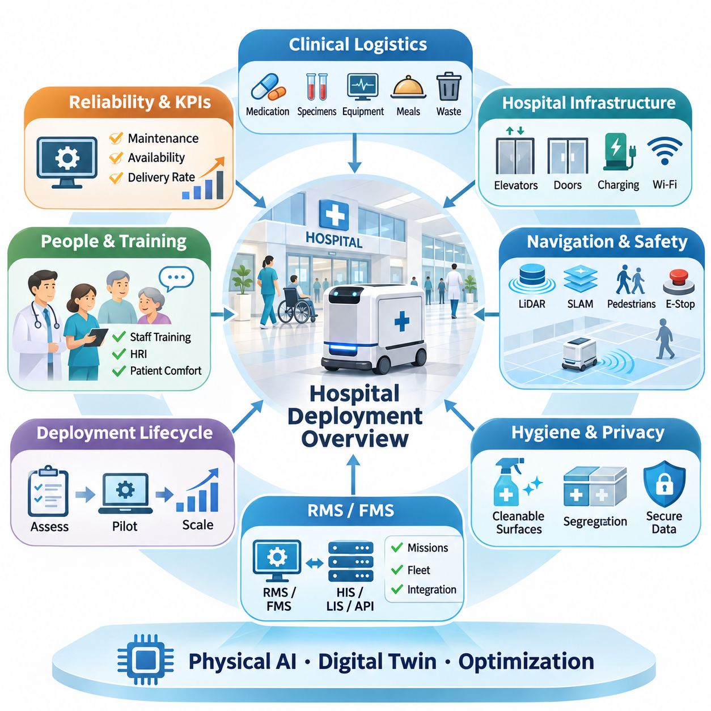
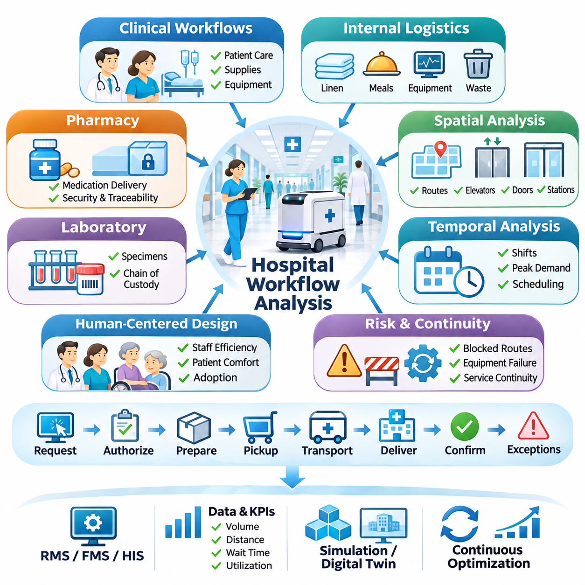
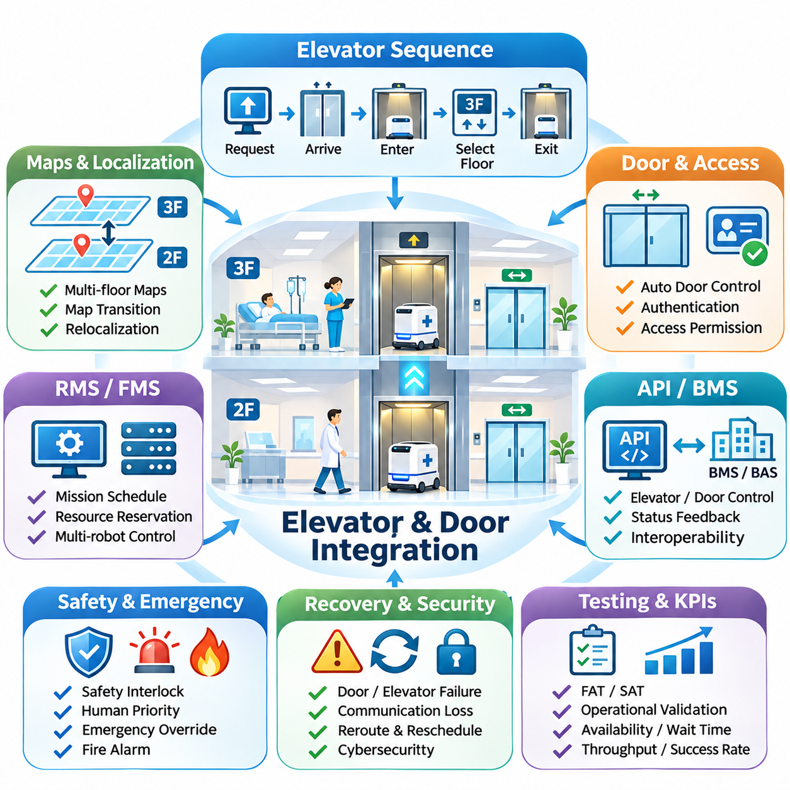
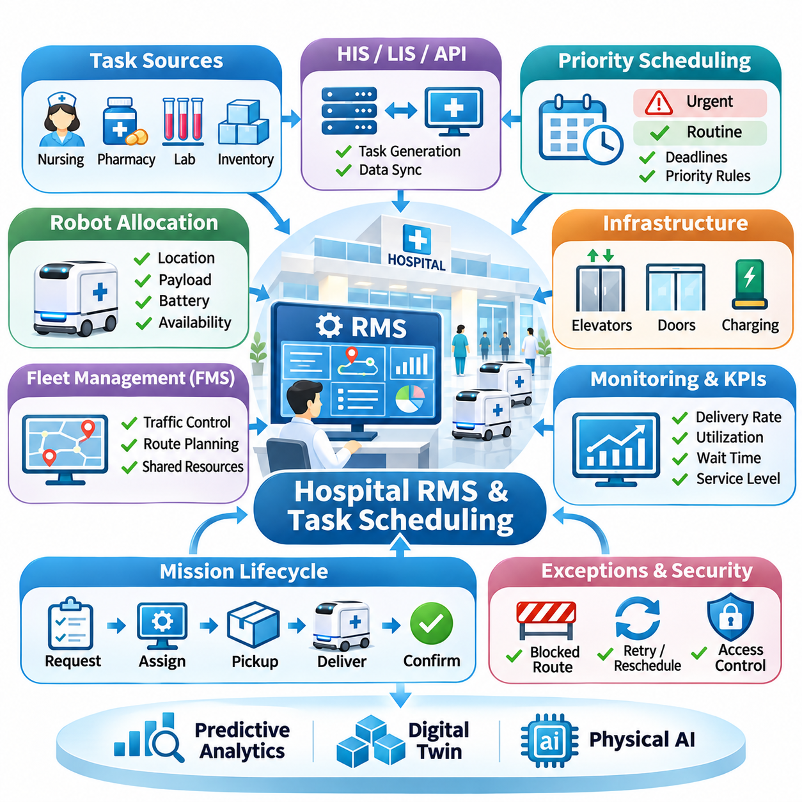
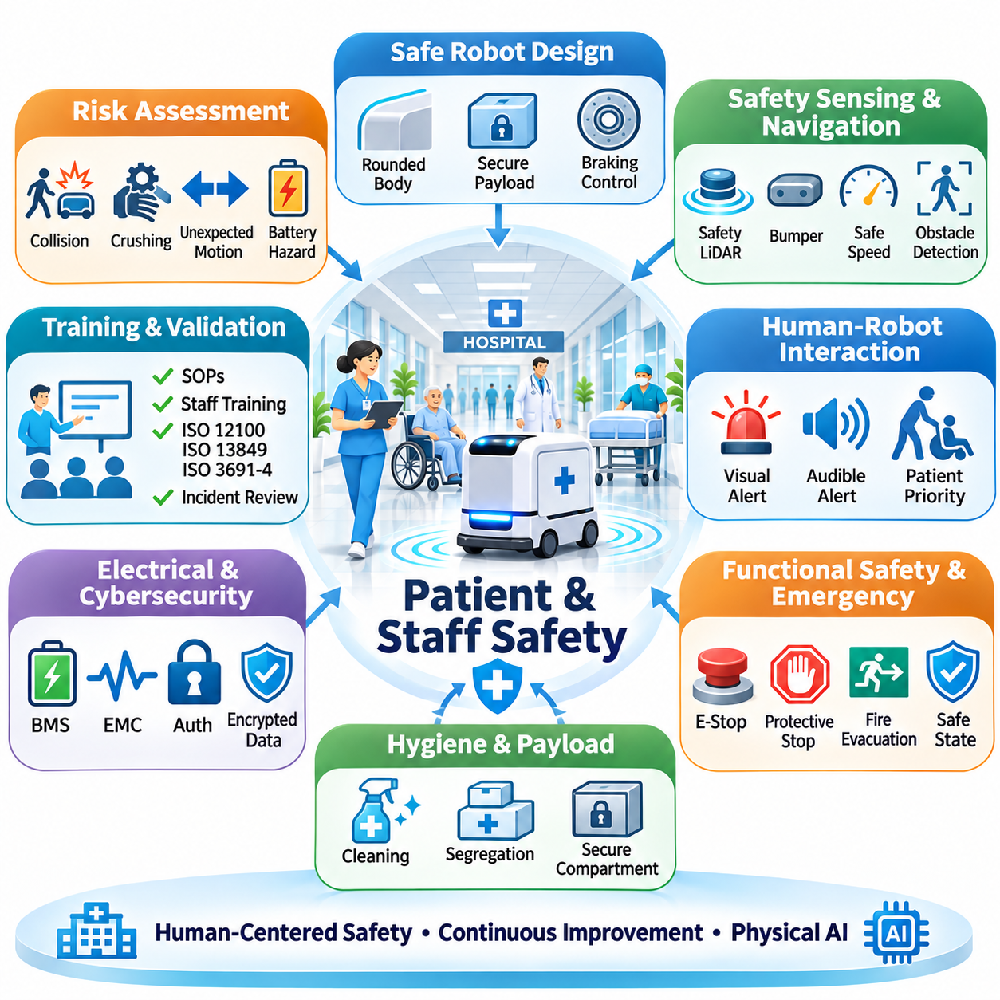
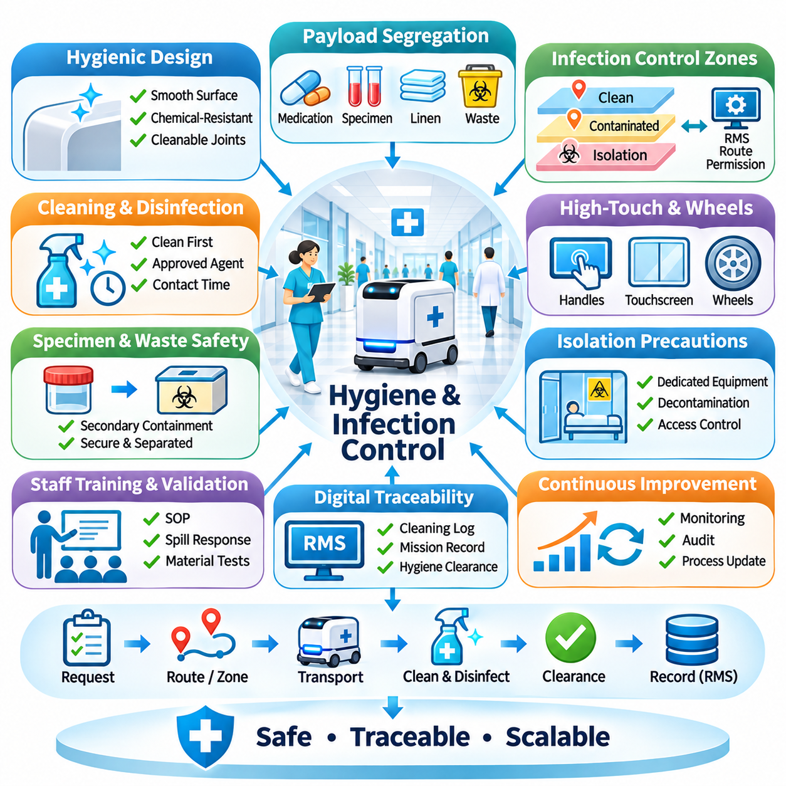
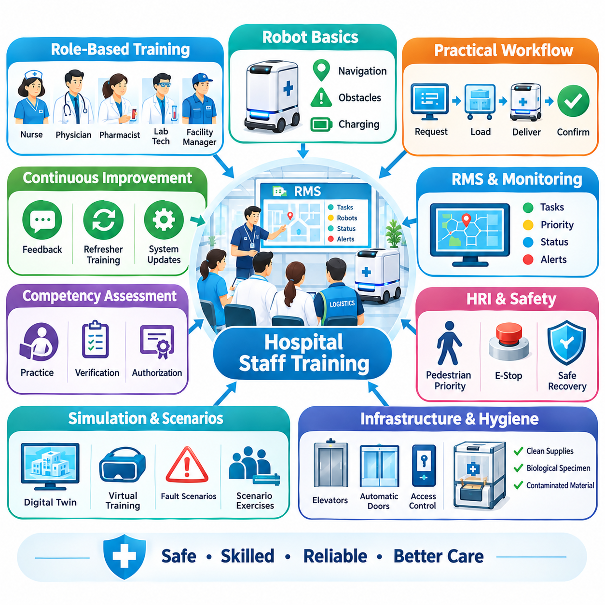
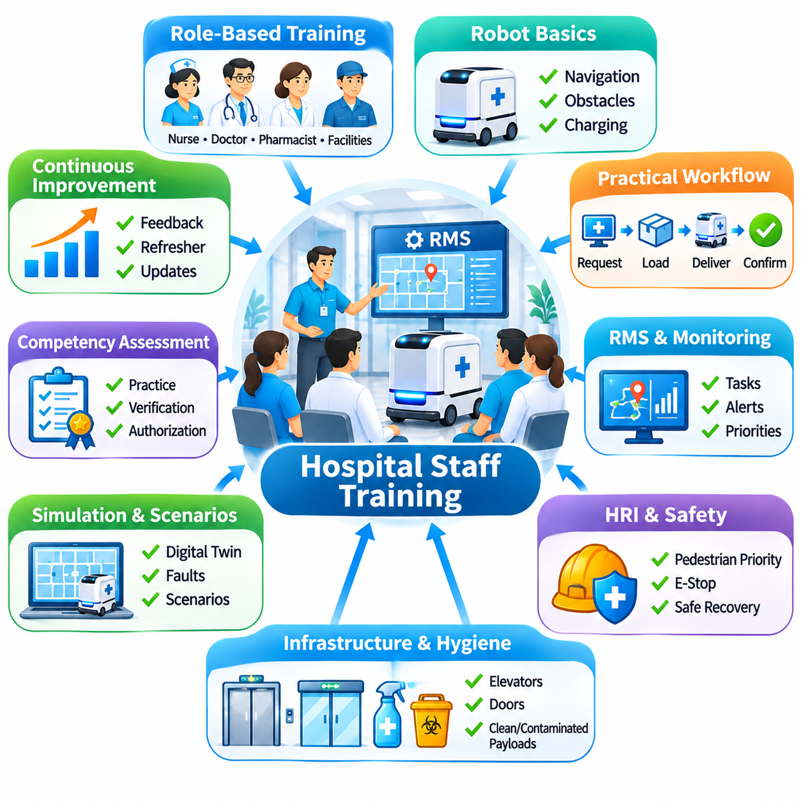
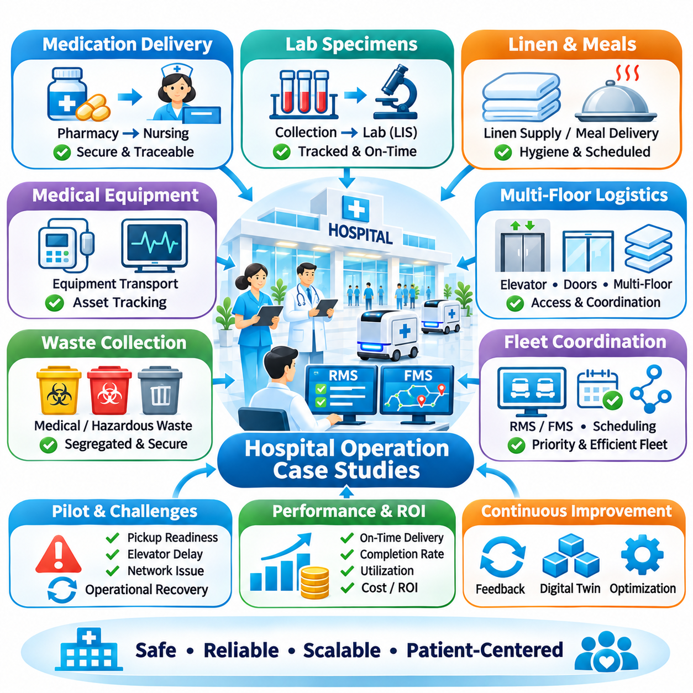

**Volume 08. AMR Operations, Deployment, and MLOps**


# Chapter 18. Hospital Robot Deployment

##  

## 18.1 Hospital Deployment Overview

{width="7.268055555555556in" height="7.268055555555556in"}

Hospital robot deployment represents the systematic introduction of autonomous and intelligent robotic systems into healthcare environments to improve operational efficiency, reduce repetitive workloads, and support patient-centered services. Unlike conventional industrial environments, hospitals require robotic systems to operate within dynamic, human-centered spaces where safety, hygiene, reliability, privacy, and uninterrupted clinical activities are essential.

Autonomous Mobile Robots (AMRs) are increasingly deployed in hospitals to support internal logistics, pharmaceutical transportation, laboratory specimen delivery, medical equipment distribution, meal delivery, and waste collection. Other specialized robotic platforms perform environmental disinfection, facility inspection, and patient guidance. These applications allow healthcare professionals to dedicate more time to clinical responsibilities and direct patient care.

Hospital environments introduce unique operational challenges because patients, medical professionals, visitors, wheelchairs, stretchers, and emergency transportation equipment frequently share the same physical infrastructure. Autonomous robots must recognize unpredictable human movements, navigate narrow corridors, accommodate temporary obstacles, and adjust their operational behavior according to clinical priorities and environmental conditions.

The deployment process begins with a comprehensive assessment of hospital infrastructure, operational workflows, transportation demands, and stakeholder requirements. Site assessments identify corridor dimensions, elevator accessibility, automatic doors, charging locations, wireless communication coverage, and restricted clinical areas. These findings establish the foundation for defining robot specifications, deployment configurations, and operational acceptance criteria.

Hospital robot deployment requires close integration between robotic platforms and existing healthcare infrastructure. Autonomous navigation systems must interact with elevators, automatic doors, access control systems, and designated delivery stations. Robot Management Systems (RMS) and Fleet Management Systems (FMS) coordinate transportation missions, monitor operational status, and manage shared resources across multiple hospital buildings and floors.

Safety management is particularly important because hospitals accommodate individuals with limited mobility, impaired vision, reduced situational awareness, and critical medical conditions. Robotic systems should incorporate appropriate safety sensors, obstacle detection, speed limitations, emergency stop mechanisms, and protective control functions. Risk assessments must consider normal operations, foreseeable misuse, equipment failures, and emergency scenarios.

Infection prevention and hygiene management directly influence the mechanical design and operational procedures of hospital robots. Robot enclosures should incorporate durable, cleanable surfaces that are compatible with approved disinfectants. Transportation compartments must support appropriate containment and segregation of medical supplies, biological specimens, contaminated materials, and general-purpose logistics items to minimize cross-contamination risks.

Autonomous navigation in healthcare facilities typically combines LiDAR sensors, vision systems, inertial measurement units, and Simultaneous Localization and Mapping (SLAM) technologies. Semantic perception enables robots to recognize environmental features and operational zones, while adaptive path planning supports safe movement through crowded corridors. Navigation policies must also respect emergency access routes and location-specific restrictions.

Hospital robot operations increasingly depend on communication infrastructure connecting edge computing devices, local servers, and centralized management platforms. Reliable wireless connectivity supports mission assignment, status monitoring, and infrastructure coordination. However, essential navigation and safety functions must remain available locally, enabling robots to enter a safe operational state when network connectivity becomes unavailable.

Integration with Hospital Information Systems (HIS), Laboratory Information Systems (LIS), pharmacy management platforms, and inventory management systems enables automated logistics workflows. Standardized Application Programming Interfaces (APIs) facilitate mission generation, delivery confirmation, and operational traceability. Access controls and data protection mechanisms must prevent unauthorized exposure of sensitive healthcare information.

Deployment should follow a phased implementation strategy that progresses from feasibility assessment and controlled testing to pilot operations and full-scale commercialization. Initial deployments typically focus on repetitive transportation activities within clearly defined operational areas. Performance data and feedback collected during pilot operations provide the basis for technical improvements, workflow adjustments, and subsequent expansion.

Human-Robot Interaction (HRI) is another fundamental consideration in hospital deployment. Robots should communicate their operational intentions through intuitive visual indicators, audible notifications, and accessible user interfaces. Hospital personnel must receive appropriate training regarding mission requests, emergency intervention, and recovery procedures, while robotic behavior should remain predictable and comfortable for patients and visitors.

Operational reliability must be maintained through preventive maintenance, predictive diagnostics, remote monitoring, and structured incident response procedures. Battery health, sensor performance, localization accuracy, communication quality, and mechanical conditions should be continuously evaluated. Maintenance schedules and software updates must be coordinated with hospital activities to minimize disruption to essential healthcare services.

Deployment success should be evaluated using measurable Key Performance Indicators (KPIs), including mission completion rates, transportation time, system availability, intervention frequency, safety incidents, and operational cost savings. Additional measurements may include staff workload reduction, delivery traceability, and user satisfaction. These indicators support evidence-based investment decisions and continuous operational improvement.

The long-term evolution of hospital robotics will involve coordinated heterogeneous robot fleets, semantic navigation, Physical AI, digital twins, and intelligent operational optimization. By combining autonomous execution with centralized supervision and human oversight, hospitals can establish scalable robotic service infrastructures that improve operational resilience, resource utilization, and the overall quality of healthcare delivery.

The scope of this overview follows a general hospital robotics deployment lifecycle, as the referenced attachment was not available for verification.

병원 로봇 배치(Hospital Robot Deployment)는 의료 환경(Healthcare Environment)에 자율적이고 지능적인 로봇 시스템(Autonomous and Intelligent Robotic System)을 체계적으로 도입하여 운영 효율성(Operational Efficiency)을 향상시키고, 반복적인 업무 부담을 감소시키며, 환자 중심 서비스(Patient-Centered Service)를 지원하는 것을 의미한다. 기존 산업 환경(Industrial Environment)과 달리 병원에서는 안전성(Safety), 위생(Hygiene), 신뢰성(Reliability), 개인정보 보호(Privacy), 지속적인 의료 활동(Clinical Activity)이 필수적인 동적이고 인간 중심적인 공간에서 로봇 시스템을 운영해야 한다.

자율이동로봇(Autonomous Mobile Robot, AMR)은 병원 내 물류(Internal Logistics), 의약품 운송(Pharmaceutical Transportation), 검체 배송(Laboratory Specimen Delivery), 의료 장비 분배(Medical Equipment Distribution), 식사 배달(Meal Delivery), 폐기물 수거(Waste Collection)를 지원하기 위해 점차 확대 도입되고 있다. 이외에도 특수 목적 로봇 플랫폼(Specialized Robotic Platform)은 환경 소독(Environmental Disinfection), 시설 점검(Facility Inspection), 환자 안내(Patient Guidance)를 수행한다. 이러한 응용 분야(Application)는 의료 전문가들이 임상 업무와 직접적인 환자 치료(Patient Care)에 더 많은 시간을 할애할 수 있도록 지원한다.

병원 환경(Hospital Environment)은 환자, 의료 전문가, 방문객, 휠체어(Wheelchair), 환자 운반용 침대(Stretcher), 응급 운송 장비(Emergency Transportation Equipment)가 동일한 물리적 인프라(Physical Infrastructure)를 빈번하게 공유하기 때문에 고유한 운영 과제(Operational Challenge)를 발생시킨다. 자율 로봇(Autonomous Robot)은 예측하기 어려운 인간의 움직임을 인식하고, 좁은 복도를 주행하며, 일시적인 장애물(Temporary Obstacle)에 대응하고, 임상적 우선순위(Clinical Priority)와 환경 조건(Environmental Condition)에 따라 운영 행동(Operational Behavior)을 조정해야 한다.

배치 프로세스(Deployment Process)는 병원 인프라(Hospital Infrastructure), 운영 작업 흐름(Operational Workflow), 운송 수요(Transportation Demand), 이해관계자 요구사항(Stakeholder Requirement)에 대한 종합적인 평가(Comprehensive Assessment)에서 시작된다. 현장 평가(Site Assessment)는 복도의 크기, 엘리베이터 접근성(Elevator Accessibility), 자동문(Automatic Door), 충전 위치(Charging Location), 무선 통신 범위(Wireless Communication Coverage), 제한된 임상 구역(Restricted Clinical Area)을 식별한다. 이러한 평가 결과는 로봇 사양(Robot Specification), 배치 구성(Deployment Configuration), 운영 승인 기준(Operational Acceptance Criteria)을 정의하기 위한 기반을 형성한다.

병원 로봇 배치(Hospital Robot Deployment)는 로봇 플랫폼(Robotic Platform)과 기존 의료 인프라(Healthcare Infrastructure) 사이의 긴밀한 통합(Integration)을 요구한다. 자율주행 시스템(Autonomous Navigation System)은 엘리베이터(Elevator), 자동문(Automatic Door), 출입 통제 시스템(Access Control System), 지정 배송 스테이션(Designated Delivery Station)과 상호작용해야 한다. 로봇 관리 시스템(Robot Management System, RMS)과 다중 로봇 관리 시스템(Fleet Management System, FMS)은 여러 병원 건물과 층에 걸쳐 운송 임무(Transportation Mission)를 조정하고, 운영 상태(Operational Status)를 모니터링하며, 공유 자원(Shared Resource)을 관리한다.

병원에는 이동 능력이 제한된 사람, 시각 장애가 있는 사람, 상황 인식 능력(Situational Awareness)이 저하된 사람, 위중한 의료 상태에 있는 환자가 존재하기 때문에 안전 관리(Safety Management)가 특히 중요하다. 로봇 시스템은 적절한 안전 센서(Safety Sensor), 장애물 감지(Obstacle Detection), 속도 제한(Speed Limitation), 비상 정지 메커니즘(Emergency Stop Mechanism), 보호 제어 기능(Protective Control Function)을 포함해야 한다. 위험성 평가(Risk Assessment)는 정상 운영(Normal Operation), 예측 가능한 오용(Foreseeable Misuse), 장비 고장(Equipment Failure), 비상 상황(Emergency Scenario)을 종합적으로 고려해야 한다.

감염 예방(Infection Prevention)과 위생 관리(Hygiene Management)는 병원 로봇의 기계적 설계(Mechanical Design)와 운영 절차(Operational Procedure)에 직접적인 영향을 미친다. 로봇 외장(Robot Enclosure)은 승인된 소독제(Approved Disinfectant)와 호환되며 내구성이 높고 세척하기 쉬운 표면을 적용해야 한다. 운송 적재함(Transportation Compartment)은 의료용품(Medical Supply), 생물학적 검체(Biological Specimen), 오염 물질(Contaminated Material), 일반 물류 품목(General-Purpose Logistics Item)을 적절하게 밀폐하고 분리하여 교차 오염(Cross-Contamination) 위험을 최소화해야 한다.

의료 시설(Healthcare Facility)에서의 자율주행(Autonomous Navigation)은 일반적으로 라이다 센서(LiDAR Sensor), 비전 시스템(Vision System), 관성 측정 장치(Inertial Measurement Unit, IMU), 동시적 위치 추정 및 지도 작성(Simultaneous Localization and Mapping, SLAM) 기술을 결합한다. 의미론적 인지(Semantic Perception)는 로봇이 환경적 특징(Environmental Feature)과 운영 구역(Operational Zone)을 인식할 수 있도록 하며, 적응형 경로 계획(Adaptive Path Planning)은 혼잡한 복도에서의 안전한 이동을 지원한다. 주행 정책(Navigation Policy)은 비상 접근 경로(Emergency Access Route)와 위치별 제한사항(Location-Specific Restriction)도 준수해야 한다.

병원 로봇 운영(Hospital Robot Operation)은 엣지 컴퓨팅 장치(Edge Computing Device), 로컬 서버(Local Server), 중앙 집중형 관리 플랫폼(Centralized Management Platform)을 연결하는 통신 인프라(Communication Infrastructure)에 점차 의존하고 있다. 신뢰성 높은 무선 연결성(Wireless Connectivity)은 임무 할당(Mission Assignment), 상태 모니터링(Status Monitoring), 인프라 조정(Infrastructure Coordination)을 지원한다. 그러나 필수적인 자율주행 및 안전 기능(Safety Function)은 로컬 환경에서 지속적으로 사용 가능해야 하며, 네트워크 연결이 중단되는 경우에도 로봇이 안전한 운영 상태(Safe Operational State)로 전환할 수 있어야 한다.

병원 정보 시스템(Hospital Information System, HIS), 검사실 정보 시스템(Laboratory Information System, LIS), 약제 관리 플랫폼(Pharmacy Management Platform), 재고 관리 시스템(Inventory Management System)과의 통합은 자동화된 물류 작업 흐름(Automated Logistics Workflow)을 구현한다. 표준화된 응용 프로그래밍 인터페이스(Application Programming Interface, API)는 임무 생성(Mission Generation), 배송 확인(Delivery Confirmation), 운영 추적성(Operational Traceability)을 지원한다. 접근 제어(Access Control)와 데이터 보호 메커니즘(Data Protection Mechanism)은 민감한 의료 정보(Sensitive Healthcare Information)의 무단 노출을 방지해야 한다.

배치(Deployment)는 타당성 평가(Feasibility Assessment)와 통제된 시험(Controlled Testing)에서 시작하여 시범 운영(Pilot Operation)과 전면적인 상용화(Full-Scale Commercialization)로 발전하는 단계적 구현 전략(Phased Implementation Strategy)을 따라야 한다. 초기 배치는 일반적으로 명확하게 정의된 운영 구역 내에서 반복적으로 수행되는 운송 활동(Transportation Activity)에 집중한다. 시범 운영 기간에 수집된 성능 데이터(Performance Data)와 피드백(Feedback)은 기술적 개선(Technical Improvement), 작업 흐름 조정(Workflow Adjustment), 후속 확장(Subsequent Expansion)을 위한 기반을 제공한다.

인간-로봇 상호작용(Human-Robot Interaction, HRI)은 병원 로봇 배치에서 고려해야 하는 또 다른 핵심 요소이다. 로봇은 직관적인 시각적 표시 장치(Visual Indicator), 청각적 알림(Audible Notification), 접근성이 높은 사용자 인터페이스(User Interface)를 통해 자신의 운영 의도(Operational Intention)를 전달해야 한다. 병원 관계자들은 임무 요청(Mission Request), 비상 개입(Emergency Intervention), 복구 절차(Recovery Procedure)에 관한 적절한 교육을 받아야 하며, 로봇의 행동은 환자와 방문객이 예측할 수 있고 심리적으로 편안하게 받아들일 수 있어야 한다.

운영 신뢰성(Operational Reliability)은 예방 정비(Preventive Maintenance), 예측 진단(Predictive Diagnostics), 원격 모니터링(Remote Monitoring), 체계적인 사고 대응 절차(Incident Response Procedure)를 통해 유지되어야 한다. 배터리 건전성(Battery Health), 센서 성능(Sensor Performance), 위치 추정 정확도(Localization Accuracy), 통신 품질(Communication Quality), 기계적 상태(Mechanical Condition)는 지속적으로 평가되어야 한다. 유지보수 일정(Maintenance Schedule)과 소프트웨어 업데이트(Software Update)는 필수 의료 서비스(Healthcare Service)의 중단을 최소화할 수 있도록 병원 활동과 연계하여 조정해야 한다.

배치 성공 여부(Deployment Success)는 임무 완료율(Mission Completion Rate), 운송 시간(Transportation Time), 시스템 가용성(System Availability), 개입 빈도(Intervention Frequency), 안전 사고(Safety Incident), 운영 비용 절감(Operational Cost Saving)과 같은 측정 가능한 핵심 성과 지표(Key Performance Indicator, KPI)를 활용하여 평가해야 한다. 추가적인 측정 항목에는 의료진의 업무 부담 감소(Staff Workload Reduction), 배송 추적성(Delivery Traceability), 사용자 만족도(User Satisfaction)가 포함될 수 있다. 이러한 지표는 증거 기반 투자 의사결정(Evidence-Based Investment Decision)과 지속적인 운영 개선(Continuous Operational Improvement)을 지원한다.

병원 로봇 기술(Hospital Robotics)의 장기적인 발전은 상호 협력하는 이종 로봇 군집(Heterogeneous Robot Fleet), 의미론적 자율주행(Semantic Navigation), 물리적 인공지능(Physical AI), 디지털 트윈(Digital Twin), 지능형 운영 최적화(Intelligent Operational Optimization)를 포함하게 될 것이다. 자율적 실행(Autonomous Execution)을 중앙 집중형 감독(Centralized Supervision) 및 인간 감독(Human Oversight)과 결합함으로써 병원은 운영 복원력(Operational Resilience), 자원 활용도(Resource Utilization), 전반적인 의료 서비스 제공 품질(Quality of Healthcare Delivery)을 향상시키는 확장 가능한 로봇 서비스 인프라(Scalable Robotic Service Infrastructure)를 구축할 수 있다.

참조된 첨부 자료(Referenced Attachment)를 확인할 수 없었으므로, 본 개요의 범위는 일반적인 병원 로봇 배치 생명주기(Hospital Robotics Deployment Lifecycle)를 기반으로 구성하였다.

##  

## 18.2 Hospital Workflow Analysis

{width="7.268055555555556in" height="7.268055555555556in"}

Hospital workflow analysis is a systematic process of examining clinical, logistical, administrative, and facility management activities to determine where autonomous robotic systems can improve operational performance. Before deploying Autonomous Mobile Robots (AMRs), healthcare organizations must understand how personnel, medical supplies, equipment, information, and transportation requests move throughout the hospital environment.

The primary objective of hospital workflow analysis is to identify repetitive, time-consuming, and resource-intensive activities that can be partially or fully automated without compromising patient safety or clinical service quality. Rather than introducing robots independently of existing processes, workflow analysis establishes a structured foundation for integrating robotic capabilities with healthcare operations and organizational requirements.

Hospital workflows can be categorized into clinical workflows, internal logistics workflows, pharmaceutical distribution workflows, laboratory transportation workflows, environmental management workflows, and administrative support activities. Each category presents different transportation requirements, service priorities, operational constraints, and safety considerations that influence robotic system specifications and deployment strategies.

Clinical workflow analysis examines how healthcare professionals perform their responsibilities and interact with supporting operational systems. Nurses, physicians, laboratory technicians, and other hospital personnel frequently depend on the timely availability of medical supplies, diagnostic specimens, and specialized equipment. Transportation automation can reduce nonclinical workloads and improve the allocation of professional resources.

Internal logistics analysis focuses on the movement of medical supplies, consumables, linens, meals, medical equipment, and waste materials between hospital departments. Transportation frequency, delivery distance, payload capacity, handling requirements, and service schedules must be evaluated. These parameters provide the quantitative foundation for defining robot configurations, fleet capacity, and transportation mission requirements.

Pharmaceutical workflow analysis requires particular attention to medication security, delivery accuracy, authorization procedures, and transportation traceability. Robotic transportation systems may support the distribution of medications from centralized pharmacies to nursing stations and treatment areas. Secure compartments, identity verification, environmental monitoring, and delivery confirmation mechanisms should be considered where appropriate.

Laboratory specimen transportation represents another important application of hospital robotics. Workflow analysis must identify specimen collection points, laboratory destinations, transportation deadlines, handling restrictions, and environmental requirements. Delayed or improperly handled specimens can affect diagnostic accuracy, making mission prioritization, secure transportation, and chain-of-custody management essential considerations.

Spatial workflow analysis examines the relationship between hospital infrastructure and transportation activities. Floor plans, corridor networks, elevator locations, automatic doors, nursing stations, storage facilities, and restricted areas should be mapped to identify operational dependencies. This analysis helps determine navigation routes, delivery stations, charging locations, and potential transportation bottlenecks before deployment.

Temporal workflow analysis evaluates how transportation demand changes throughout the day, across work shifts, and during specific clinical activities. Medication distribution schedules, meal delivery periods, laboratory testing cycles, and emergency situations generate different patterns of demand. Understanding these variations enables fleet management systems to allocate robotic resources dynamically and minimize service delays during peak periods.

Process mapping provides a structured methodology for describing existing hospital operations and identifying opportunities for automation. Each transportation workflow can be decomposed into request generation, task authorization, material preparation, pickup, transportation, delivery, confirmation, and exception handling. Mapping these stages reveals redundant activities, unnecessary waiting periods, and opportunities for digital integration.

Quantitative workflow assessment involves collecting operational data such as transportation volume, travel distance, mission duration, waiting time, labor utilization, and delivery frequency. Historical records and direct observations provide baseline measurements against which robotic performance can be evaluated. These measurements also support fleet sizing, charging strategy development, and return on investment calculations.

Human-centered workflow analysis considers how robotic systems affect healthcare professionals, patients, visitors, and facility management personnel. Interviews, operational observations, and stakeholder workshops help identify practical requirements and potential barriers to adoption. Successful automation should simplify existing responsibilities rather than introduce unnecessary procedural complexity or additional administrative burdens.

Workflow optimization requires integration between Robot Management Systems (RMS), Fleet Management Systems (FMS), Hospital Information Systems (HIS), and other healthcare management platforms. Automated mission generation, priority scheduling, delivery confirmation, and real-time status monitoring can establish a connected operational environment in which transportation activities respond dynamically to clinical and logistical demands.

Risk-based workflow analysis evaluates potential disruptions associated with autonomous transportation, including blocked corridors, elevator failures, communication interruptions, incorrect deliveries, and emergency clinical activities. Operational procedures must define alternative transportation methods, escalation mechanisms, human intervention requirements, and recovery strategies to maintain service continuity under abnormal conditions.

Digital twins and discrete-event simulation can support advanced hospital workflow analysis by modeling transportation networks, robot fleets, resource utilization, and operational demand. Simulation enables engineers to evaluate alternative deployment configurations, estimate congestion, optimize fleet capacity, and examine emergency scenarios before introducing robotic systems into active healthcare environments.

Hospital workflow analysis should continue throughout the operational lifecycle rather than conclude after initial deployment. Continuous monitoring of transportation performance, clinical requirements, user feedback, and environmental changes enables iterative workflow optimization. This approach establishes a foundation for scalable, reliable, and intelligent hospital automation supported by Physical AI and data-driven decision-making.

The referenced attachment was unavailable for verification; therefore, this content follows a general hospital workflow analysis framework consistent with autonomous robot deployment and healthcare operations.

병원 작업 흐름 분석(Hospital Workflow Analysis)은 자율 로봇 시스템(Autonomous Robotic System)이 운영 성능(Operational Performance)을 향상시킬 수 있는 영역을 파악하기 위해 임상 활동(Clinical Activity), 물류 활동(Logistics Activity), 행정 활동(Administrative Activity), 시설 관리 활동(Facility Management Activity)을 체계적으로 분석하는 프로세스이다. 자율이동로봇(Autonomous Mobile Robot, AMR)을 배치하기 전에 의료기관은 병원 환경 내에서 인력, 의료용품, 장비, 정보, 운송 요청(Transportation Request)이 어떻게 이동하고 전달되는지 이해해야 한다.

병원 작업 흐름 분석(Hospital Workflow Analysis)의 주요 목적은 환자 안전(Patient Safety)이나 임상 서비스 품질(Clinical Service Quality)을 저해하지 않으면서 부분적 또는 완전한 자동화(Automation)가 가능한 반복적이고 시간 소모적이며 자원 집약적인 활동을 식별하는 것이다. 기존 프로세스와 독립적으로 로봇을 도입하는 것이 아니라, 작업 흐름 분석(Workflow Analysis)을 통해 로봇의 기능적 역량(Robotic Capability)을 의료 운영(Healthcare Operation) 및 조직 요구사항(Organizational Requirement)과 통합하기 위한 체계적인 기반을 구축한다.

병원 작업 흐름(Hospital Workflow)은 임상 작업 흐름(Clinical Workflow), 내부 물류 작업 흐름(Internal Logistics Workflow), 의약품 분배 작업 흐름(Pharmaceutical Distribution Workflow), 검사실 운송 작업 흐름(Laboratory Transportation Workflow), 환경 관리 작업 흐름(Environmental Management Workflow), 행정 지원 활동(Administrative Support Activity)으로 분류할 수 있다. 각 범주는 서로 다른 운송 요구사항(Transportation Requirement), 서비스 우선순위(Service Priority), 운영 제약조건(Operational Constraint), 안전 고려사항(Safety Consideration)을 가지며, 이는 로봇 시스템 사양(Robotic System Specification)과 배치 전략(Deployment Strategy)에 영향을 미친다.

임상 작업 흐름 분석(Clinical Workflow Analysis)은 의료 전문가들이 자신의 업무를 수행하고 지원 운영 시스템(Supporting Operational System)과 상호작용하는 방식을 분석한다. 간호사, 의사, 임상 검사 전문가 및 기타 병원 관계자들은 의료용품(Medical Supply), 진단 검체(Diagnostic Specimen), 특수 의료 장비(Specialized Medical Equipment)가 적시에 제공되는 것에 크게 의존한다. 운송 자동화(Transportation Automation)는 비임상적 업무 부담(Nonclinical Workload)을 감소시키고 전문 인력 자원(Professional Resource)의 배분 효율성을 향상시킬 수 있다.

내부 물류 분석(Internal Logistics Analysis)은 병원 부서 간 의료용품(Medical Supply), 소모품(Consumable), 침구류(Linen), 식사(Meal), 의료 장비(Medical Equipment), 폐기물(Waste Material)의 이동에 중점을 둔다. 운송 빈도(Transportation Frequency), 배송 거리(Delivery Distance), 적재 용량(Payload Capacity), 취급 요구사항(Handling Requirement), 서비스 일정(Service Schedule)을 평가해야 한다. 이러한 매개변수(Parameter)는 로봇 구성(Robot Configuration), 로봇 군집 용량(Fleet Capacity), 운송 임무 요구사항(Transportation Mission Requirement)을 정의하기 위한 정량적 기반(Quantitative Foundation)을 제공한다.

의약품 작업 흐름 분석(Pharmaceutical Workflow Analysis)은 의약품 보안(Medication Security), 배송 정확도(Delivery Accuracy), 권한 부여 절차(Authorization Procedure), 운송 추적성(Transportation Traceability)에 특별한 주의를 기울여야 한다. 로봇 운송 시스템(Robotic Transportation System)은 중앙 약제실(Centralized Pharmacy)에서 간호 스테이션(Nursing Station)과 치료 구역(Treatment Area)으로 의약품을 분배하는 활동을 지원할 수 있다. 필요한 경우 보안 적재함(Secure Compartment), 신원 확인(Identity Verification), 환경 모니터링(Environmental Monitoring), 배송 확인 메커니즘(Delivery Confirmation Mechanism)을 고려해야 한다.

검사실 검체 운송(Laboratory Specimen Transportation)은 병원 로봇 기술(Hospital Robotics)의 또 다른 중요한 응용 분야이다. 작업 흐름 분석(Workflow Analysis)은 검체 채취 지점(Specimen Collection Point), 검사실 목적지(Laboratory Destination), 운송 기한(Transportation Deadline), 취급 제한사항(Handling Restriction), 환경 요구사항(Environmental Requirement)을 식별해야 한다. 검체 배송이 지연되거나 부적절하게 취급되면 진단 정확도(Diagnostic Accuracy)에 영향을 미칠 수 있으므로 임무 우선순위 설정(Mission Prioritization), 안전한 운송(Secure Transportation), 인계 및 관리 이력 관리(Chain-of-Custody Management)가 필수적인 고려사항이 된다.

공간적 작업 흐름 분석(Spatial Workflow Analysis)은 병원 인프라(Hospital Infrastructure)와 운송 활동(Transportation Activity) 사이의 관계를 분석한다. 평면도(Floor Plan), 복도 네트워크(Corridor Network), 엘리베이터 위치(Elevator Location), 자동문(Automatic Door), 간호 스테이션(Nursing Station), 저장 시설(Storage Facility), 제한 구역(Restricted Area)을 지도화하여 운영 의존성(Operational Dependency)을 식별해야 한다. 이러한 분석은 배치 이전에 자율주행 경로(Navigation Route), 배송 스테이션(Delivery Station), 충전 위치(Charging Location), 잠재적인 운송 병목 현상(Transportation Bottleneck)을 파악하는 데 도움을 준다.

시간적 작업 흐름 분석(Temporal Workflow Analysis)은 하루 동안, 근무 교대 시간(Work Shift), 특정 임상 활동(Clinical Activity) 중에 운송 수요(Transportation Demand)가 어떻게 변화하는지 평가한다. 의약품 분배 일정(Medication Distribution Schedule), 식사 배달 시간(Meal Delivery Period), 검사실 검사 주기(Laboratory Testing Cycle), 비상 상황(Emergency Situation)은 서로 다른 수요 패턴(Demand Pattern)을 발생시킨다. 이러한 변화를 이해함으로써 다중 로봇 관리 시스템(Fleet Management System, FMS)은 로봇 자원(Robotic Resource)을 동적으로 할당하고 최대 수요 시간대(Peak Period)의 서비스 지연(Service Delay)을 최소화할 수 있다.

프로세스 매핑(Process Mapping)은 기존 병원 운영(Hospital Operation)을 설명하고 자동화 기회(Automation Opportunity)를 식별하기 위한 체계적인 방법론(Methodology)을 제공한다. 각 운송 작업 흐름(Transportation Workflow)은 요청 생성(Request Generation), 작업 승인(Task Authorization), 물품 준비(Material Preparation), 수거(Pickup), 운송(Transportation), 배송(Delivery), 확인(Confirmation), 예외 처리(Exception Handling) 단계로 분해할 수 있다. 이러한 단계를 매핑함으로써 중복 활동(Redundant Activity), 불필요한 대기 시간(Unnecessary Waiting Time), 디지털 통합(Digital Integration)의 기회를 식별할 수 있다.

정량적 작업 흐름 평가(Quantitative Workflow Assessment)는 운송 물량(Transportation Volume), 이동 거리(Travel Distance), 임무 수행 시간(Mission Duration), 대기 시간(Waiting Time), 인력 활용도(Labor Utilization), 배송 빈도(Delivery Frequency)와 같은 운영 데이터(Operational Data)를 수집하는 것을 포함한다. 과거 기록(Historical Record)과 직접 관찰(Direct Observation)은 로봇 성능(Robotic Performance)을 평가하기 위한 기준 측정값(Baseline Measurement)을 제공한다. 이러한 측정값은 로봇 군집 규모 산정(Fleet Sizing), 충전 전략 개발(Charging Strategy Development), 투자수익률(Return on Investment, ROI) 계산도 지원한다.

인간 중심 작업 흐름 분석(Human-Centered Workflow Analysis)은 로봇 시스템(Robotic System)이 의료 전문가, 환자, 방문객, 시설 관리 인력(Facility Management Personnel)에게 어떠한 영향을 미치는지 고려한다. 인터뷰(Interview), 운영 관찰(Operational Observation), 이해관계자 워크숍(Stakeholder Workshop)은 실질적인 요구사항(Practical Requirement)과 잠재적인 도입 장애요인(Barrier to Adoption)을 식별하는 데 도움을 준다. 성공적인 자동화(Automation)는 불필요한 절차적 복잡성(Procedural Complexity)이나 추가적인 행정 부담(Administrative Burden)을 발생시키는 것이 아니라 기존 업무를 단순화해야 한다.

작업 흐름 최적화(Workflow Optimization)는 로봇 관리 시스템(Robot Management System, RMS), 다중 로봇 관리 시스템(Fleet Management System, FMS), 병원 정보 시스템(Hospital Information System, HIS), 기타 의료 관리 플랫폼(Healthcare Management Platform) 사이의 통합(Integration)을 요구한다. 자동화된 임무 생성(Automated Mission Generation), 우선순위 기반 일정 관리(Priority Scheduling), 배송 확인(Delivery Confirmation), 실시간 상태 모니터링(Real-Time Status Monitoring)은 운송 활동이 임상 및 물류 수요(Clinical and Logistical Demand)에 동적으로 대응할 수 있는 상호 연결된 운영 환경(Connected Operational Environment)을 구축할 수 있도록 한다.

위험 기반 작업 흐름 분석(Risk-Based Workflow Analysis)은 복도 차단(Blocked Corridor), 엘리베이터 고장(Elevator Failure), 통신 중단(Communication Interruption), 잘못된 배송(Incorrect Delivery), 응급 임상 활동(Emergency Clinical Activity)을 포함하여 자율 운송(Autonomous Transportation)과 관련된 잠재적인 운영 중단(Operational Disruption)을 평가한다. 운영 절차(Operational Procedure)는 비정상적인 상황(Abnormal Condition)에서도 서비스 연속성(Service Continuity)을 유지할 수 있도록 대체 운송 방법(Alternative Transportation Method), 단계적 보고 및 대응 메커니즘(Escalation Mechanism), 인간 개입 요구사항(Human Intervention Requirement), 복구 전략(Recovery Strategy)을 정의해야 한다.

디지털 트윈(Digital Twin)과 이산 이벤트 시뮬레이션(Discrete-Event Simulation)은 운송 네트워크(Transportation Network), 로봇 군집(Robot Fleet), 자원 활용도(Resource Utilization), 운영 수요(Operational Demand)를 모델링함으로써 고도화된 병원 작업 흐름 분석(Advanced Hospital Workflow Analysis)을 지원할 수 있다. 시뮬레이션(Simulation)은 엔지니어가 실제 의료 환경에 로봇 시스템을 도입하기 전에 대안적인 배치 구성(Alternative Deployment Configuration)을 평가하고, 교통 혼잡(Congestion)을 예측하며, 로봇 군집 용량(Fleet Capacity)을 최적화하고, 비상 시나리오(Emergency Scenario)를 검토할 수 있도록 한다.

병원 작업 흐름 분석(Hospital Workflow Analysis)은 초기 배치(Initial Deployment) 이후에 종료되는 것이 아니라 전체 운영 생명주기(Operational Lifecycle)에 걸쳐 지속적으로 수행되어야 한다. 운송 성능(Transportation Performance), 임상 요구사항(Clinical Requirement), 사용자 피드백(User Feedback), 환경 변화(Environmental Change)에 대한 지속적인 모니터링(Continuous Monitoring)은 반복적인 작업 흐름 최적화(Iterative Workflow Optimization)를 가능하게 한다. 이러한 접근 방식은 물리적 인공지능(Physical AI)과 데이터 기반 의사결정(Data-Driven Decision-Making)을 기반으로 확장 가능하고 신뢰성 높으며 지능적인 병원 자동화(Intelligent Hospital Automation)를 구현하기 위한 기반을 구축한다.

참조된 첨부 자료(Referenced Attachment)를 확인할 수 없었으므로, 본 내용은 자율 로봇 배치(Autonomous Robot Deployment) 및 의료 운영(Healthcare Operation)에 부합하는 일반적인 병원 작업 흐름 분석 프레임워크(Hospital Workflow Analysis Framework)를 기반으로 구성하였다.

##  

## 18.3 Elevator and Door Integration

{width="7.268055555555556in" height="7.268055555555556in"}

Elevator and door integration is a fundamental requirement for deploying Autonomous Mobile Robots (AMRs) in hospital environments where transportation missions frequently extend across multiple floors, departments, and restricted operational zones. Seamless interaction with building infrastructure enables robots to perform autonomous transportation tasks without requiring continuous human assistance or disrupting essential healthcare activities.

Unlike conventional industrial facilities, hospitals typically incorporate complex elevator networks, automatic doors, fire-rated doors, security-controlled entrances, and specialized clinical access points. Autonomous robotic systems must interact with these infrastructure components while respecting patient safety, infection control procedures, emergency transportation priorities, and building-specific access restrictions throughout their operational lifecycle.

Elevator integration enables autonomous robots to travel between hospital floors by communicating with elevator control systems. A typical transportation sequence involves requesting an elevator, selecting the destination floor, confirming elevator arrival, verifying door opening, entering the elevator cabin, and exiting at the correct destination. Each operation requires reliable synchronization between the robot and the elevator infrastructure.

Elevator communication architectures may utilize wired interfaces, wireless communication modules, industrial gateways, or Application Programming Interfaces (APIs) provided by elevator manufacturers. Integration gateways translate robotic mission requests into supported elevator control commands and return operational information such as cabin position, door status, service availability, and destination floor confirmation.

Robot navigation within elevator environments requires specialized localization and motion control strategies. Reflective metallic surfaces, confined spaces, moving doors, and changing environmental features can affect conventional sensor-based localization. Robots should utilize designated waiting positions, accurate docking trajectories, geometric references, and appropriate sensor fusion techniques to ensure reliable elevator entry and exit.

Multi-floor navigation requires the maintenance of separate environmental maps representing individual hospital floors. When an autonomous robot travels through an elevator, its navigation system must coordinate map transitions with verified floor information. Robot localization should be reestablished before normal navigation resumes, preventing incorrect positioning and transportation failures caused by inconsistent floor identification.

Automatic door integration allows robots to move between hospital corridors, clinical departments, storage facilities, and designated service areas. Depending on the installed infrastructure, door activation may be performed through approved relay interfaces, network-based controllers, wireless gateways, or building automation platforms. Door status feedback is necessary to confirm that the passage is available before robot movement begins.

Access-controlled door integration introduces additional requirements related to authentication, authorization, and operational security. Robots should possess unique digital identities associated with explicitly defined access permissions. Access requests must be evaluated according to destination, mission type, operational schedule, and hospital security policies, preventing unauthorized entry into sensitive clinical and administrative environments.

Integration with Building Management Systems (BMS) and Building Automation Systems (BAS) can establish a unified coordination framework for autonomous robots and hospital infrastructure. Standardized communication interfaces enable robots to exchange operational requests and status information with building subsystems. Middleware can abstract manufacturer-specific protocols and improve interoperability across heterogeneous infrastructure components.

Fleet Management Systems (FMS) play an important role in coordinating elevator and door utilization when multiple robots operate simultaneously. Shared infrastructure resources should be managed through reservation mechanisms, priority scheduling, resource locking, and congestion management. These functions prevent conflicting requests, reduce unnecessary waiting times, and improve transportation efficiency across multiple hospital floors.

Safety mechanisms must ensure that robotic operations never compromise the independent protective functions of elevators and doors. Robots should verify entrance clearance, maintain appropriate separation from passengers, and prevent movement when unsafe conditions are detected. Infrastructure integration must preserve existing safety interlocks, obstruction detection mechanisms, emergency controls, and manual override capabilities.

Emergency operation policies are particularly important in hospitals because fire alarms, emergency patient transportation, evacuation procedures, and infrastructure failures may require immediate changes to robotic activities. Robots must relinquish infrastructure reservations, avoid emergency access routes, and transition to predefined safe states when instructed. Elevator emergency modes and fire protection functions must always retain operational priority.

Communication failures and infrastructure malfunctions must be addressed through robust exception handling and fault recovery mechanisms. When elevator requests fail, doors remain closed, or infrastructure status becomes uncertain, robots should suspend movement and initiate bounded recovery procedures. Alternative routes, mission rescheduling, operator notifications, and manual assistance can help maintain operational continuity.

Cybersecurity is essential because elevator and door integration connects autonomous robotic systems with critical building infrastructure. Network segmentation, encrypted communication, device authentication, role-based access control, and security event logging should be implemented according to system requirements. Integration gateways must restrict robot commands to authorized functions and prevent unauthorized infrastructure manipulation.

System validation should include normal transportation scenarios, concurrent robot requests, passenger interactions, communication interruptions, access denial, emergency signals, and infrastructure failure conditions. Factory Acceptance Testing (FAT) and Site Acceptance Testing (SAT) help verify interface compatibility, synchronization accuracy, safety behavior, and recovery performance before unrestricted operational deployment is authorized.

Operational performance should be evaluated using measurable indicators such as elevator waiting time, door activation success rate, floor transition reliability, infrastructure utilization, mission completion time, and human intervention frequency. Continuous monitoring enables operators to identify recurring integration failures, optimize shared resource allocation, and improve the reliability of multi-floor autonomous transportation.

The future of elevator and door integration will increasingly incorporate intelligent building infrastructure, digital twins, predictive resource scheduling, and Physical AI. By combining infrastructure awareness with autonomous navigation and centralized fleet coordination, hospitals can establish scalable multi-floor robotic transportation networks that improve operational efficiency while preserving human accessibility, safety, and clinical service continuity.

The referenced attachment was unavailable for verification; therefore, this content follows a general hospital infrastructure integration framework covering autonomous navigation, interoperability, safety, cybersecurity, and operational validation.

엘리베이터 및 출입문 통합(Elevator and Door Integration)은 운송 임무(Transportation Mission)가 여러 층, 부서 및 제한된 운영 구역에 걸쳐 빈번하게 수행되는 병원 환경에서 자율이동로봇(Autonomous Mobile Robot, AMR)을 배치하기 위한 fundamental 요구사항이다. 건물 인프라(Building Infrastructure)와의 원활한 상호작용(Seamless Interaction)은 로봇이 지속적인 인간의 지원을 요구하거나 필수 의료 활동(Essential Healthcare Activity)을 방해하지 않으면서 자율 운송 작업(Autonomous Transportation Task)을 수행할 수 있도록 한다.

기존 산업 시설(Industrial Facility)과 달리 병원은 일반적으로 복잡한 엘리베이터 네트워크(Elevator Network), 자동문(Automatic Door), 방화문(Fire-Rated Door), 보안 통제 출입구(Security-Controlled Entrance), 특수 임상 출입 지점(Specialized Clinical Access Point)을 포함한다. 자율 로봇 시스템(Autonomous Robotic System)은 전체 운영 생명주기(Operational Lifecycle)에 걸쳐 환자 안전(Patient Safety), 감염 관리 절차(Infection Control Procedure), 응급 운송 우선순위(Emergency Transportation Priority), 건물별 출입 제한사항(Building-Specific Access Restriction)을 준수하면서 이러한 인프라 구성요소(Infrastructure Component)와 상호작용해야 한다.

엘리베이터 통합(Elevator Integration)은 자율 로봇이 엘리베이터 제어 시스템(Elevator Control System)과 통신하여 병원의 여러 층 사이를 이동할 수 있도록 한다. 일반적인 운송 시퀀스(Transportation Sequence)는 엘리베이터 호출(Elevator Request), 목적층 선택(Destination Floor Selection), 엘리베이터 도착 확인(Elevator Arrival Confirmation), 출입문 개방 확인(Door Opening Verification), 엘리베이터 내부 진입(Elevator Cabin Entry), 정확한 목적층에서의 하차(Exit)를 포함한다. 각각의 동작은 로봇과 엘리베이터 인프라(Elevator Infrastructure) 사이의 신뢰성 높은 동기화(Synchronization)를 요구한다.

엘리베이터 통신 아키텍처(Elevator Communication Architecture)는 유선 인터페이스(Wired Interface), 무선 통신 모듈(Wireless Communication Module), 산업용 게이트웨이(Industrial Gateway), 엘리베이터 제조업체에서 제공하는 응용 프로그래밍 인터페이스(Application Programming Interface, API)를 활용할 수 있다. 통합 게이트웨이(Integration Gateway)는 로봇의 임무 요청(Mission Request)을 지원 가능한 엘리베이터 제어 명령(Elevator Control Command)으로 변환하고, 엘리베이터 위치(Cabin Position), 출입문 상태(Door Status), 서비스 가용성(Service Availability), 목적층 확인(Destination Floor Confirmation)과 같은 운영 정보(Operational Information)를 반환한다.

엘리베이터 환경(Elevator Environment)에서의 로봇 자율주행(Robot Navigation)은 특수한 위치 추정(Localization) 및 모션 제어 전략(Motion Control Strategy)을 요구한다. 반사 특성을 가진 금속 표면(Reflective Metallic Surface), 제한된 공간(Confined Space), 움직이는 출입문(Moving Door), 변화하는 환경적 특징(Environmental Feature)은 기존 센서 기반 위치 추정(Sensor-Based Localization)에 영향을 미칠 수 있다. 로봇은 신뢰성 높은 엘리베이터 진입 및 하차를 보장하기 위해 지정된 대기 위치(Designated Waiting Position), 정밀한 도킹 궤적(Docking Trajectory), 기하학적 기준(Geometric Reference), 적절한 센서 융합 기술(Sensor Fusion Technique)을 활용해야 한다.

다층 자율주행(Multi-Floor Navigation)은 병원의 개별 층을 나타내는 독립적인 환경 지도(Environmental Map)를 유지하고 관리할 것을 요구한다. 자율 로봇이 엘리베이터를 통해 이동할 때 자율주행 시스템(Navigation System)은 검증된 층 정보(Verified Floor Information)와 지도 전환(Map Transition)을 연계하여 조정해야 한다. 정상적인 자율주행을 재개하기 전에 로봇 위치 추정(Robot Localization)을 재확립함으로써 일관되지 않은 층 식별(Floor Identification)로 인해 발생하는 잘못된 위치 설정(Incorrect Positioning)과 운송 실패(Transportation Failure)를 방지해야 한다.

자동문 통합(Automatic Door Integration)은 로봇이 병원 복도(Hospital Corridor), 임상 부서(Clinical Department), 저장 시설(Storage Facility), 지정 서비스 구역(Designated Service Area) 사이를 이동할 수 있도록 한다. 설치된 인프라에 따라 출입문 활성화(Door Activation)는 승인된 릴레이 인터페이스(Relay Interface), 네트워크 기반 제어기(Network-Based Controller), 무선 게이트웨이(Wireless Gateway), 건물 자동화 플랫폼(Building Automation Platform)을 통해 수행될 수 있다. 로봇이 이동을 시작하기 전에 통로의 이용 가능 여부를 확인하기 위해 출입문 상태 피드백(Door Status Feedback)이 필요하다.

출입 통제형 출입문 통합(Access-Controlled Door Integration)은 인증(Authentication), 권한 부여(Authorization), 운영 보안(Operational Security)과 관련된 추가적인 요구사항을 발생시킨다. 로봇은 명확하게 정의된 접근 권한(Access Permission)과 연계된 고유 디지털 신원(Unique Digital Identity)을 보유해야 한다. 접근 요청(Access Request)은 목적지(Destination), 임무 유형(Mission Type), 운영 일정(Operational Schedule), 병원 보안 정책(Hospital Security Policy)에 따라 평가되어야 하며, 이를 통해 민감한 임상 및 행정 환경에 대한 무단 출입(Unauthorized Entry)을 방지해야 한다.

건물 관리 시스템(Building Management System, BMS) 및 건물 자동화 시스템(Building Automation System, BAS)과의 통합은 자율 로봇과 병원 인프라를 위한 통합 조정 프레임워크(Unified Coordination Framework)를 구축할 수 있도록 한다. 표준화된 통신 인터페이스(Standardized Communication Interface)는 로봇이 건물 하위 시스템(Building Subsystem)과 운영 요청(Operational Request) 및 상태 정보(Status Information)를 교환할 수 있도록 한다. 미들웨어(Middleware)는 제조업체별 프로토콜(Manufacturer-Specific Protocol)을 추상화하고 이종 인프라 구성요소(Heterogeneous Infrastructure Component) 사이의 상호운용성(Interoperability)을 향상시킬 수 있다.

다중 로봇 관리 시스템(Fleet Management System, FMS)은 여러 로봇이 동시에 운영되는 환경에서 엘리베이터와 출입문의 활용을 조정하는 중요한 역할을 수행한다. 공유 인프라 자원(Shared Infrastructure Resource)은 예약 메커니즘(Reservation Mechanism), 우선순위 기반 일정 관리(Priority Scheduling), 자원 잠금(Resource Locking), 혼잡 관리(Congestion Management)를 통해 관리되어야 한다. 이러한 기능은 상충하는 요청(Conflicting Request)을 방지하고, 불필요한 대기 시간(Waiting Time)을 감소시키며, 병원의 여러 층에 걸친 운송 효율성(Transportation Efficiency)을 향상시킨다.

안전 메커니즘(Safety Mechanism)은 로봇 운영이 엘리베이터와 출입문의 독립적인 보호 기능(Independent Protective Function)을 절대로 저해하지 않도록 보장해야 한다. 로봇은 출입구의 통과 가능 여부(Entrance Clearance)를 확인하고, 탑승객과 적절한 이격 거리(Separation Distance)를 유지하며, 안전하지 않은 조건(Unsafe Condition)이 감지되면 이동하지 않아야 한다. 인프라 통합(Infrastructure Integration)은 기존의 안전 인터록(Safety Interlock), 장애물 감지 메커니즘(Obstruction Detection Mechanism), 비상 제어(Emergency Control), 수동 제어 전환 기능(Manual Override Capability)을 그대로 유지해야 한다.

비상 운영 정책(Emergency Operation Policy)은 화재 경보(Fire Alarm), 응급 환자 운송(Emergency Patient Transportation), 대피 절차(Evacuation Procedure), 인프라 고장(Infrastructure Failure)으로 인해 로봇 활동을 즉시 변경해야 할 수 있는 병원 환경에서 특히 중요하다. 로봇은 지시를 받으면 인프라 예약(Infrastructure Reservation)을 해제하고, 비상 접근 경로(Emergency Access Route)를 회피하며, 사전에 정의된 안전 상태(Predefined Safe State)로 전환해야 한다. 엘리베이터 비상 모드(Elevator Emergency Mode)와 화재 보호 기능(Fire Protection Function)은 항상 운영상 최우선순위(Operational Priority)를 유지해야 한다.

통신 장애(Communication Failure)와 인프라 오작동(Infrastructure Malfunction)은 강건한 예외 처리(Exception Handling) 및 장애 복구 메커니즘(Fault Recovery Mechanism)을 통해 대응해야 한다. 엘리베이터 호출이 실패하거나, 출입문이 닫힌 상태로 유지되거나, 인프라 상태가 불확실해지는 경우 로봇은 이동을 중단하고 제한된 범위의 복구 절차(Bounded Recovery Procedure)를 시작해야 한다. 대체 경로(Alternative Route), 임무 일정 재조정(Mission Rescheduling), 운영자 알림(Operator Notification), 수동 지원(Manual Assistance)은 운영 연속성(Operational Continuity)을 유지하는 데 도움을 줄 수 있다.

사이버 보안(Cybersecurity)은 엘리베이터 및 출입문 통합이 자율 로봇 시스템과 핵심 건물 인프라(Critical Building Infrastructure)를 연결하기 때문에 필수적이다. 네트워크 분리(Network Segmentation), 암호화 통신(Encrypted Communication), 장치 인증(Device Authentication), 역할 기반 접근 제어(Role-Based Access Control, RBAC), 보안 이벤트 기록(Security Event Logging)은 시스템 요구사항(System Requirement)에 따라 구현되어야 한다. 통합 게이트웨이(Integration Gateway)는 로봇 명령(Robot Command)을 승인된 기능(Authorized Function)으로 제한하고 인프라의 무단 조작(Unauthorized Infrastructure Manipulation)을 방지해야 한다.

시스템 검증(System Validation)은 정상 운송 시나리오(Normal Transportation Scenario), 동시 로봇 요청(Concurrent Robot Request), 탑승객과의 상호작용(Passenger Interaction), 통신 중단(Communication Interruption), 접근 거부(Access Denial), 비상 신호(Emergency Signal), 인프라 고장 조건(Infrastructure Failure Condition)을 포함해야 한다. 공장 인수 시험(Factory Acceptance Testing, FAT)과 현장 인수 시험(Site Acceptance Testing, SAT)은 제약 없는 정식 운영 배치(Operational Deployment)가 승인되기 전에 인터페이스 호환성(Interface Compatibility), 동기화 정확도(Synchronization Accuracy), 안전 행동(Safety Behavior), 복구 성능(Recovery Performance)을 검증하는 데 도움을 준다.

운영 성능(Operational Performance)은 엘리베이터 대기 시간(Elevator Waiting Time), 출입문 활성화 성공률(Door Activation Success Rate), 층간 전환 신뢰성(Floor Transition Reliability), 인프라 활용도(Infrastructure Utilization), 임무 완료 시간(Mission Completion Time), 인간 개입 빈도(Human Intervention Frequency)와 같은 측정 가능한 지표(Measurable Indicator)를 활용하여 평가해야 한다. 지속적인 모니터링(Continuous Monitoring)은 운영자가 반복적으로 발생하는 통합 장애(Integration Failure)를 식별하고, 공유 자원 할당(Shared Resource Allocation)을 최적화하며, 다층 자율 운송(Multi-Floor Autonomous Transportation)의 신뢰성을 향상시킬 수 있도록 한다.

엘리베이터 및 출입문 통합(Elevator and Door Integration)의 미래는 지능형 건물 인프라(Intelligent Building Infrastructure), 디지털 트윈(Digital Twin), 예측 기반 자원 일정 관리(Predictive Resource Scheduling), 물리적 인공지능(Physical AI)을 점차 적극적으로 수용하는 방향으로 발전할 것이다. 인프라 인식(Infrastructure Awareness)을 자율주행(Autonomous Navigation) 및 중앙 집중형 로봇 군집 조정(Centralized Fleet Coordination)과 결합함으로써 병원은 인간의 접근성(Human Accessibility), 안전성(Safety), 임상 서비스 연속성(Clinical Service Continuity)을 유지하면서 운영 효율성을 향상시키는 확장 가능한 다층 로봇 운송 네트워크(Scalable Multi-Floor Robotic Transportation Network)를 구축할 수 있다.

참조된 첨부 자료(Referenced Attachment)를 확인할 수 없었으므로, 본 내용은 자율주행(Autonomous Navigation), 상호운용성(Interoperability), 안전성(Safety), 사이버 보안(Cybersecurity), 운영 검증(Operational Validation)을 포괄하는 일반적인 병원 인프라 통합 프레임워크(Hospital Infrastructure Integration Framework)를 기반으로 구성하였다.

##  

## 18.4 Hospital RMS and Task Scheduling

{width="7.268055555555556in" height="7.268055555555556in"}

A hospital Robot Management System (RMS) provides a centralized operational framework for organizing, monitoring, and coordinating robotic services within healthcare environments. By integrating autonomous robots, transportation requests, clinical workflows, and building infrastructure, the RMS enables hospitals to establish a systematic approach to logistics automation while maintaining operational reliability, patient safety, and service continuity.

Hospital task scheduling differs from conventional industrial scheduling because healthcare operations involve dynamic transportation demands, unpredictable clinical events, and varying levels of service urgency. Robotic tasks must be scheduled according to medical priorities, delivery deadlines, resource availability, and environmental conditions. Scheduling mechanisms should therefore support both predefined transportation routines and dynamically generated missions.

The hospital RMS architecture typically consists of mission management, task scheduling, robot status monitoring, infrastructure integration, communication management, and operational data analytics. These functional components coordinate individual robotic activities while maintaining centralized visibility across hospital departments. A modular software architecture enables the system to accommodate different robotic platforms and evolving healthcare requirements.

Task generation represents the initial stage of robotic transportation management. Transportation requests may originate from nursing stations, pharmacies, laboratories, inventory management systems, scheduled service routines, or authorized hospital personnel. Each request should include information describing the pickup location, destination, payload characteristics, delivery deadline, access requirements, and operational priority.

Task classification enables the RMS to distinguish between routine logistics missions, scheduled medication deliveries, urgent laboratory specimen transportation, equipment distribution, meal delivery, and waste collection. Each task category should have explicitly defined priority levels, handling requirements, and service constraints. Classification also ensures that robots are assigned only to missions compatible with their capabilities.

Priority-based scheduling is particularly important in hospitals because transportation delays may affect diagnostic procedures, medication availability, and clinical decision-making. Scheduling algorithms should evaluate mission urgency, remaining deadline, estimated travel time, and potential consequences of delay. High-priority missions may preempt lower-priority activities when interruption is safe and operationally permissible.

Dynamic task allocation determines which available robot is most suitable for executing a specific transportation mission. Allocation algorithms consider robot location, battery capacity, payload compatibility, operational status, current workload, and estimated arrival time. Advanced allocation strategies may incorporate predictive travel models and optimization algorithms to minimize overall transportation costs and service delays.

Hospital task scheduling requires coordination with Fleet Management Systems (FMS) responsible for multi-robot traffic management, route planning, collision avoidance coordination, and shared resource allocation. While the RMS manages service-level requirements and mission lifecycles, the FMS coordinates fleet-level execution. Clearly defined interfaces between these systems help prevent conflicting decisions and redundant control functions.

Multi-floor hospital operations introduce scheduling dependencies associated with elevators, automatic doors, restricted corridors, loading stations, and charging facilities. Shared infrastructure resources should be incorporated into the scheduling model through reservation mechanisms and availability monitoring. Infrastructure-aware scheduling reduces resource contention, prevents operational deadlocks, and improves transportation predictability.

Battery management and charging schedules must be integrated with hospital mission planning to maintain continuous service availability. The RMS should monitor battery state of charge, estimated energy consumption, charging station availability, and anticipated transportation demand. Opportunity charging and predictive charging strategies enable robots to maintain sufficient energy reserves for routine missions and unexpected urgent requests.

Integration with Hospital Information Systems (HIS), Laboratory Information Systems (LIS), pharmacy management systems, and inventory management platforms enables automated task generation and operational synchronization. Standardized Application Programming Interfaces (APIs) and event-driven communication mechanisms allow transportation requests, delivery confirmations, and mission status updates to be exchanged between authorized systems.

Task execution monitoring provides real-time visibility into the progress of robotic transportation activities. Each mission should maintain an explicit lifecycle state, including request registration, authorization, assignment, pickup, transportation, delivery, completion, and exception handling. Timestamped operational records support delivery traceability, accountability, performance evaluation, and investigation of service interruptions.

Exception management is essential when transportation missions encounter blocked corridors, elevator failures, inaccessible destinations, communication interruptions, or unavailable receiving personnel. The RMS should support bounded retries, dynamic rescheduling, alternative robot assignment, operator notifications, and manual intervention. Recovery procedures must preserve payload security and prevent duplicate or incorrect deliveries.

Hospital RMS security must address device authentication, role-based access control, encrypted communication, and operational audit logging. Transportation records may contain sensitive information related to medications, specimens, patients, or restricted destinations. Data minimization and access restrictions should therefore be incorporated into system architecture while maintaining sufficient traceability for authorized operational activities.

Operational dashboards provide hospital personnel and system administrators with centralized visibility into robot availability, active missions, pending requests, transportation delays, charging status, and infrastructure conditions. Key Performance Indicators (KPIs) should include on-time delivery rate, mission completion rate, average waiting time, fleet utilization, intervention frequency, and priority-specific service performance.

Advanced scheduling approaches may incorporate artificial intelligence, predictive analytics, mathematical optimization, and discrete-event simulation. Historical transportation records can support demand forecasting, congestion prediction, and proactive resource allocation. Digital twins enable alternative scheduling policies to be evaluated under simulated hospital operating conditions before implementation in active healthcare environments.

The long-term evolution of hospital RMS platforms will emphasize intelligent task orchestration, heterogeneous fleet coordination, adaptive scheduling, and Physical AI integration. By combining real-time operational awareness with predictive decision-making and human oversight, hospitals can establish scalable robotic service infrastructures that dynamically respond to clinical priorities while maintaining safety, reliability, and service continuity.

The referenced attachment was unavailable for verification; therefore, this content follows a general hospital RMS and task scheduling framework. The functional separation between RMS and FMS represents a reference architecture rather than a mandatory industry-wide implementation.

병원 로봇 관리 시스템(Robot Management System, RMS)은 의료 환경(Healthcare Environment) 내에서 로봇 서비스를 구성하고, 모니터링하며, 조정하기 위한 중앙 집중형 운영 프레임워크(Centralized Operational Framework)를 제공한다. 자율 로봇(Autonomous Robot), 운송 요청(Transportation Request), 임상 작업 흐름(Clinical Workflow), 건물 인프라(Building Infrastructure)를 통합함으로써 RMS는 운영 신뢰성(Operational Reliability), 환자 안전(Patient Safety), 서비스 연속성(Service Continuity)을 유지하면서 체계적인 물류 자동화(Logistics Automation)를 구현할 수 있도록 한다.

병원 작업 일정 관리(Hospital Task Scheduling)는 의료 운영(Healthcare Operation)이 동적인 운송 수요(Dynamic Transportation Demand), 예측할 수 없는 임상 이벤트(Unpredictable Clinical Event), 다양한 수준의 서비스 긴급성(Service Urgency)을 포함한다는 점에서 기존 산업 일정 관리(Industrial Scheduling)와 차이가 있다. 로봇 작업(Robotic Task)은 의료 우선순위(Medical Priority), 배송 기한(Delivery Deadline), 자원 가용성(Resource Availability), 환경 조건(Environmental Condition)에 따라 일정이 조정되어야 한다. 따라서 일정 관리 메커니즘(Scheduling Mechanism)은 사전에 정의된 정기 운송 활동(Predefined Transportation Routine)과 동적으로 생성되는 임무(Dynamically Generated Mission)를 모두 지원해야 한다.

병원 RMS 아키텍처(Hospital RMS Architecture)는 일반적으로 임무 관리(Mission Management), 작업 일정 관리(Task Scheduling), 로봇 상태 모니터링(Robot Status Monitoring), 인프라 통합(Infrastructure Integration), 통신 관리(Communication Management), 운영 데이터 분석(Operational Data Analytics)으로 구성된다. 이러한 기능적 구성요소(Functional Component)는 병원 내 여러 부서에 대한 중앙 집중형 가시성(Centralized Visibility)을 유지하면서 개별 로봇 활동을 조정한다. 모듈형 소프트웨어 아키텍처(Modular Software Architecture)는 다양한 로봇 플랫폼(Robotic Platform)과 지속적으로 변화하는 의료 요구사항(Healthcare Requirement)을 수용할 수 있도록 한다.

작업 생성(Task Generation)은 로봇 운송 관리(Robotic Transportation Management)의 초기 단계를 의미한다. 운송 요청(Transportation Request)은 간호 스테이션(Nursing Station), 약제실(Pharmacy), 검사실(Laboratory), 재고 관리 시스템(Inventory Management System), 정기 서비스 일정(Scheduled Service Routine), 권한을 부여받은 병원 관계자(Authorized Hospital Personnel)로부터 발생할 수 있다. 각각의 요청은 수거 위치(Pickup Location), 목적지(Destination), 적재물 특성(Payload Characteristic), 배송 기한(Delivery Deadline), 접근 요구사항(Access Requirement), 운영 우선순위(Operational Priority)를 설명하는 정보를 포함해야 한다.

작업 분류(Task Classification)는 RMS가 일반 물류 임무(Routine Logistics Mission), 정기 의약품 배송(Scheduled Medication Delivery), 긴급 검사실 검체 운송(Urgent Laboratory Specimen Transportation), 장비 분배(Equipment Distribution), 식사 배달(Meal Delivery), 폐기물 수거(Waste Collection)를 구분할 수 있도록 한다. 각 작업 범주(Task Category)는 명확하게 정의된 우선순위 수준(Priority Level), 취급 요구사항(Handling Requirement), 서비스 제약조건(Service Constraint)을 가져야 한다. 또한 작업 분류는 로봇이 자신의 기능적 역량(Robotic Capability)에 부합하는 임무에만 할당되도록 보장한다.

우선순위 기반 일정 관리(Priority-Based Scheduling)는 운송 지연(Transportation Delay)이 진단 절차(Diagnostic Procedure), 의약품 가용성(Medication Availability), 임상 의사결정(Clinical Decision-Making)에 영향을 미칠 수 있기 때문에 병원 환경에서 특히 중요하다. 일정 관리 알고리즘(Scheduling Algorithm)은 임무 긴급성(Mission Urgency), 기한까지 남은 시간(Remaining Deadline), 예상 이동 시간(Estimated Travel Time), 지연으로 인한 잠재적 결과(Potential Consequence of Delay)를 평가해야 한다. 작업 중단이 안전하고 운영상 허용되는 경우 높은 우선순위의 임무는 낮은 우선순위의 활동에 우선하여 수행될 수 있다.

동적 작업 할당(Dynamic Task Allocation)은 특정 운송 임무(Transportation Mission)를 수행하는 데 가장 적합한 가용 로봇(Available Robot)을 결정한다. 할당 알고리즘(Allocation Algorithm)은 로봇 위치(Robot Location), 배터리 용량(Battery Capacity), 적재물 호환성(Payload Compatibility), 운영 상태(Operational Status), 현재 작업 부하(Current Workload), 예상 도착 시간(Estimated Arrival Time)을 고려한다. 고도화된 할당 전략(Advanced Allocation Strategy)은 전체 운송 비용(Transportation Cost)과 서비스 지연(Service Delay)을 최소화하기 위해 예측 이동 모델(Predictive Travel Model)과 최적화 알고리즘(Optimization Algorithm)을 적용할 수 있다.

병원 작업 일정 관리(Hospital Task Scheduling)는 다중 로봇 교통 관리(Multi-Robot Traffic Management), 경로 계획(Route Planning), 충돌 회피 조정(Collision Avoidance Coordination), 공유 자원 할당(Shared Resource Allocation)을 담당하는 다중 로봇 관리 시스템(Fleet Management System, FMS)과의 협력을 요구한다. RMS가 서비스 수준 요구사항(Service-Level Requirement)과 임무 생명주기(Mission Lifecycle)를 관리하는 반면, FMS는 로봇 군집 수준의 실행(Fleet-Level Execution)을 조정한다. 이러한 시스템 사이에 명확하게 정의된 인터페이스(Interface)는 상충하는 의사결정(Conflicting Decision)과 중복 제어 기능(Redundant Control Function)을 방지하는 데 도움을 준다.

다층 병원 운영(Multi-Floor Hospital Operation)은 엘리베이터(Elevator), 자동문(Automatic Door), 제한된 복도(Restricted Corridor), 적재 스테이션(Loading Station), 충전 시설(Charging Facility)과 관련된 일정 관리 의존성(Scheduling Dependency)을 발생시킨다. 공유 인프라 자원(Shared Infrastructure Resource)은 예약 메커니즘(Reservation Mechanism)과 가용성 모니터링(Availability Monitoring)을 통해 일정 관리 모델(Scheduling Model)에 통합되어야 한다. 인프라 인식 기반 일정 관리(Infrastructure-Aware Scheduling)는 자원 경합(Resource Contention)을 감소시키고, 운영 교착 상태(Operational Deadlock)를 방지하며, 운송 예측 가능성(Transportation Predictability)을 향상시킨다.

배터리 관리(Battery Management)와 충전 일정(Charging Schedule)은 지속적인 서비스 가용성(Service Availability)을 유지하기 위해 병원 임무 계획(Hospital Mission Planning)과 통합되어야 한다. RMS는 배터리 충전 상태(State of Charge, SoC), 예상 에너지 소비량(Estimated Energy Consumption), 충전 스테이션 가용성(Charging Station Availability), 예상 운송 수요(Anticipated Transportation Demand)를 모니터링해야 한다. 기회 충전(Opportunity Charging)과 예측 기반 충전 전략(Predictive Charging Strategy)은 로봇이 일상적인 임무와 예기치 않은 긴급 요청(Urgent Request)에 대응할 수 있도록 충분한 에너지 예비량(Energy Reserve)을 유지하게 한다.

병원 정보 시스템(Hospital Information System, HIS), 검사실 정보 시스템(Laboratory Information System, LIS), 약제 관리 시스템(Pharmacy Management System), 재고 관리 플랫폼(Inventory Management Platform)과의 통합은 자동화된 작업 생성(Automated Task Generation)과 운영 동기화(Operational Synchronization)를 가능하게 한다. 표준화된 응용 프로그래밍 인터페이스(Application Programming Interface, API)와 이벤트 기반 통신 메커니즘(Event-Driven Communication Mechanism)은 승인된 시스템(Authorized System) 사이에서 운송 요청(Transportation Request), 배송 확인(Delivery Confirmation), 임무 상태 업데이트(Mission Status Update)가 교환될 수 있도록 한다.

작업 실행 모니터링(Task Execution Monitoring)은 로봇 운송 활동(Robotic Transportation Activity)의 진행 상황에 대한 실시간 가시성(Real-Time Visibility)을 제공한다. 각각의 임무는 요청 등록(Request Registration), 권한 승인(Authorization), 작업 할당(Assignment), 수거(Pickup), 운송(Transportation), 배송(Delivery), 완료(Completion), 예외 처리(Exception Handling)를 포함하는 명확한 생명주기 상태(Lifecycle State)를 유지해야 한다. 타임스탬프가 기록된 운영 이력(Timestamped Operational Record)은 배송 추적성(Delivery Traceability), 책임 추적성(Accountability), 성능 평가(Performance Evaluation), 서비스 중단 조사(Service Interruption Investigation)를 지원한다.

예외 관리(Exception Management)는 운송 임무가 차단된 복도(Blocked Corridor), 엘리베이터 고장(Elevator Failure), 접근 불가능한 목적지(Inaccessible Destination), 통신 중단(Communication Interruption), 수령 담당자 부재(Unavailable Receiving Personnel)와 같은 상황에 직면할 때 필수적이다. RMS는 제한된 재시도(Bounded Retry), 동적 일정 재조정(Dynamic Rescheduling), 대체 로봇 할당(Alternative Robot Assignment), 운영자 알림(Operator Notification), 수동 개입(Manual Intervention)을 지원해야 한다. 복구 절차(Recovery Procedure)는 적재물 보안(Payload Security)을 유지하고 중복 배송(Duplicate Delivery)이나 잘못된 배송(Incorrect Delivery)을 방지해야 한다.

병원 RMS 보안(Hospital RMS Security)은 장치 인증(Device Authentication), 역할 기반 접근 제어(Role-Based Access Control, RBAC), 암호화 통신(Encrypted Communication), 운영 감사 로그(Operational Audit Logging)를 고려해야 한다. 운송 기록(Transportation Record)은 의약품, 검체, 환자 또는 제한된 목적지(Restricted Destination)와 관련된 민감한 정보(Sensitive Information)를 포함할 수 있다. 따라서 승인된 운영 활동(Authorized Operational Activity)에 필요한 충분한 추적성(Traceability)을 유지하면서 데이터 최소화(Data Minimization)와 접근 제한(Access Restriction)을 시스템 아키텍처(System Architecture)에 반영해야 한다.

운영 대시보드(Operational Dashboard)는 병원 관계자와 시스템 관리자(System Administrator)에게 로봇 가용성(Robot Availability), 진행 중인 임무(Active Mission), 대기 중인 요청(Pending Request), 운송 지연(Transportation Delay), 충전 상태(Charging Status), 인프라 상태(Infrastructure Condition)에 대한 중앙 집중형 가시성(Centralized Visibility)을 제공한다. 핵심 성과 지표(Key Performance Indicator, KPI)는 정시 배송률(On-Time Delivery Rate), 임무 완료율(Mission Completion Rate), 평균 대기 시간(Average Waiting Time), 로봇 군집 활용률(Fleet Utilization), 개입 빈도(Intervention Frequency), 우선순위별 서비스 성능(Priority-Specific Service Performance)을 포함해야 한다.

고도화된 일정 관리 접근 방식(Advanced Scheduling Approach)은 인공지능(Artificial Intelligence, AI), 예측 분석(Predictive Analytics), 수학적 최적화(Mathematical Optimization), 이산 이벤트 시뮬레이션(Discrete-Event Simulation)을 적용할 수 있다. 과거 운송 기록(Historical Transportation Record)은 수요 예측(Demand Forecasting), 혼잡 예측(Congestion Prediction), 선제적 자원 할당(Proactive Resource Allocation)을 지원할 수 있다. 디지털 트윈(Digital Twin)은 실제 의료 환경에 적용하기 전에 시뮬레이션된 병원 운영 조건(Simulated Hospital Operating Condition)에서 대안적인 일정 관리 정책(Alternative Scheduling Policy)을 평가할 수 있도록 한다.

병원 RMS 플랫폼(Hospital RMS Platform)의 장기적인 발전은 지능형 작업 오케스트레이션(Intelligent Task Orchestration), 이종 로봇 군집 조정(Heterogeneous Fleet Coordination), 적응형 일정 관리(Adaptive Scheduling), 물리적 인공지능 통합(Physical AI Integration)에 중점을 둘 것이다. 실시간 운영 상황 인식(Real-Time Operational Awareness)을 예측 기반 의사결정(Predictive Decision-Making) 및 인간 감독(Human Oversight)과 결합함으로써 병원은 안전성(Safety), 신뢰성(Reliability), 서비스 연속성(Service Continuity)을 유지하면서 임상적 우선순위(Clinical Priority)에 동적으로 대응하는 확장 가능한 로봇 서비스 인프라(Scalable Robotic Service Infrastructure)를 구축할 수 있다.

참조된 첨부 자료(Referenced Attachment)를 확인할 수 없었으므로, 본 내용은 일반적인 병원 RMS 및 작업 일정 관리 프레임워크(Hospital RMS and Task Scheduling Framework)를 기반으로 구성하였다. RMS와 FMS 사이의 기능적 분리(Functional Separation)는 산업 전반에 걸쳐 의무적으로 적용되는 구현 방식이 아니라 참조 아키텍처(Reference Architecture)를 의미한다.

##  

## 18.5 Patient and Staff Safety

{width="7.268055555555556in" height="7.268055555555556in"}

Patient and staff safety is a fundamental requirement for deploying Autonomous Mobile Robots (AMRs) and other intelligent robotic systems within hospital environments. Unlike conventional industrial facilities, hospitals accommodate vulnerable patients, healthcare professionals, visitors, and individuals with limited mobility. Robotic systems must therefore operate within a comprehensive safety framework that prioritizes human protection and clinical service continuity.

Hospital robot safety management begins with systematic hazard identification and risk assessment covering the entire operational lifecycle. Potential hazards include collisions, crushing, trapping, unexpected movement, payload displacement, electrical failures, battery incidents, and cybersecurity-related disruptions. Risk reduction measures must address normal operating conditions, foreseeable misuse, equipment failures, and emergency situations.

The physical design of hospital robots should minimize mechanical hazards through rounded external surfaces, enclosed moving components, stable chassis configurations, secure transportation compartments, and appropriate protective structures. Robot dimensions, weight distribution, payload capacity, and braking characteristics must be evaluated in relation to hospital corridor widths, floor conditions, pedestrian density, and accessibility requirements.

Safety-related sensing systems provide the foundation for detecting humans, obstacles, and potentially hazardous environmental conditions. Safety-rated LiDAR sensors, protective bumpers, and other validated sensing technologies should be selected according to the identified risks. Cameras, depth sensors, and artificial intelligence-based perception can supplement environmental awareness but must not replace required safety-rated protective functions.

Safe navigation requires robots to dynamically adjust their movement according to environmental conditions, pedestrian proximity, and location-specific restrictions. Speed limitations, protective fields, acceleration constraints, and stopping distances should be configured according to the operational risk assessment. Navigation behavior must remain predictable when approaching patients, wheelchairs, stretchers, medical equipment, and crowded intersections.

Hospitals require particular consideration of vulnerable individuals who may have impaired vision, hearing limitations, reduced cognitive awareness, or restricted physical mobility. Autonomous robots must not assume that nearby individuals can recognize warning signals or move away from an approaching platform. Conservative motion policies and adequate separation distances help reduce exposure to foreseeable human interaction hazards.

Human-Robot Interaction (HRI) plays an important role in maintaining patient and staff safety. Robots should communicate their movement intentions, operational status, and abnormal conditions through understandable visual indicators, audible notifications, and accessible interfaces. Warning mechanisms should be designed to minimize unnecessary noise, patient discomfort, and interference with clinical alarms or medical activities.

Functional safety mechanisms should include appropriate emergency stop devices, protective stopping functions, monitored speed limits, and fault detection capabilities. Safety-critical control functions must be sufficiently independent of mission planning, artificial intelligence inference, and centralized management services. Failures affecting essential protective functions should cause the robot to transition to a predefined safe state.

Hospital traffic management must prioritize patients, healthcare professionals, emergency response teams, and medical transportation equipment over routine robotic missions. Robot Management Systems (RMS) and Fleet Management Systems (FMS) should enforce restricted zones, pedestrian priority policies, and infrastructure access rules. Local safety functions must remain effective independently of centralized traffic coordination.

Emergency preparedness requires autonomous robots to respond appropriately to fire alarms, evacuation procedures, urgent patient transportation, power failures, and other abnormal hospital conditions. Robots should avoid obstructing emergency exits, evacuation corridors, and critical medical equipment. Emergency response policies must define safe stopping locations, infrastructure reservation release, operator notification, and authorized recovery procedures.

Payload safety is particularly important when robots transport medications, biological specimens, medical equipment, hazardous waste, or temperature-sensitive materials. Transportation compartments must provide appropriate containment, load retention, access control, and environmental protection. Incorrect loading, excessive payload weight, unauthorized access, and unstable cargo conditions should be prevented or detected through suitable safeguards.

Infection prevention and contamination control are essential elements of hospital robot safety. Robot surfaces, wheels, handles, and transportation compartments should support approved cleaning and disinfection procedures. Operational policies must distinguish between clean and contaminated transportation activities, establish appropriate cleaning schedules, and prevent robotic movement from creating additional pathways for cross-contamination.

Electrical safety, battery protection, and electromagnetic compatibility must be evaluated in relation to hospital infrastructure and nearby medical equipment. Battery Management Systems (BMS), charging protection mechanisms, electrical insulation, and thermal monitoring reduce equipment-related risks. Charging stations should be positioned in approved locations that do not obstruct evacuation routes or interfere with clinical activities.

Cybersecurity and information privacy contribute directly to hospital operational safety because compromised robotic systems may execute unauthorized commands or expose sensitive information. Device authentication, encrypted communication, network segmentation, access control, and security monitoring should be implemented. Safety-related control functions must remain protected against unauthorized software changes and network-based interference.

Staff training and operational awareness are necessary to establish safe collaboration between humans and autonomous robots. Healthcare personnel should understand robot behavior, emergency stop procedures, reporting mechanisms, and authorized intervention methods. Clearly defined responsibilities and Standard Operating Procedures (SOPs) help prevent unsafe manual handling, unauthorized recovery attempts, and inconsistent responses to abnormal conditions.

Safety verification and validation should include representative hospital scenarios involving pedestrian interactions, unexpected obstacles, sensor failures, emergency stopping, communication interruptions, and infrastructure malfunctions. Applicable standards, including ISO 12100, ISO 13849, and ISO 3691-4 where relevant, should inform risk assessment and safety engineering according to the robot classification and intended use.

Continuous safety management requires monitoring collision events, near misses, protective stops, emergency interventions, equipment failures, and staff feedback. Root Cause Analysis (RCA) supports the identification of recurring hazards and the implementation of corrective measures. Changes to robot hardware, software, AI models, navigation policies, and hospital infrastructure should trigger appropriate safety reassessment and validation.

The long-term objective of hospital robot safety is to establish a human-centered operational environment in which Physical AI enhances healthcare services without introducing unacceptable risks. Combining risk-based engineering, functional safety, intelligent perception, operational governance, and continuous improvement enables hospitals to expand robotic automation while protecting patients, staff, and essential clinical activities.

The referenced attachment was unavailable for verification; therefore, this content follows a general hospital robotics safety framework. Applicable regulatory requirements and safety standards must be evaluated according to the robot\'s intended use, classification, and deployment jurisdiction.

환자 및 의료진 안전(Patient and Staff Safety)은 병원 환경(Hospital Environment)에서 자율이동로봇(Autonomous Mobile Robot, AMR)과 기타 지능형 로봇 시스템(Intelligent Robotic System)을 배치하기 위한 핵심 요구사항이다. 기존 산업 시설(Industrial Facility)과 달리 병원에는 취약한 환자(Vulnerable Patient), 의료 전문가(Healthcare Professional), 방문객(Visitor), 이동 능력이 제한된 사람(Individual with Limited Mobility)이 존재한다. 따라서 로봇 시스템은 인간 보호(Human Protection)와 임상 서비스 연속성(Clinical Service Continuity)을 최우선으로 고려하는 종합적인 안전 프레임워크(Comprehensive Safety Framework) 내에서 운영되어야 한다.

병원 로봇 안전 관리(Hospital Robot Safety Management)는 전체 운영 생명주기(Operational Lifecycle)를 포괄하는 체계적인 위험요인 식별(Hazard Identification)과 위험성 평가(Risk Assessment)에서 시작된다. 잠재적 위험요인(Potential Hazard)에는 충돌(Collision), 압착(Crushing), 끼임(Trapping), 예기치 않은 움직임(Unexpected Movement), 적재물 이탈(Payload Displacement), 전기적 고장(Electrical Failure), 배터리 사고(Battery Incident), 사이버 보안 관련 운영 중단(Cybersecurity-Related Disruption)이 포함된다. 위험 감소 조치(Risk Reduction Measure)는 정상 운영 조건(Normal Operating Condition), 예측 가능한 오용(Foreseeable Misuse), 장비 고장(Equipment Failure), 비상 상황(Emergency Situation)을 고려해야 한다.

병원 로봇의 물리적 설계(Physical Design)는 모서리가 둥근 외부 표면(Rounded External Surface), 밀폐된 구동 구성요소(Enclosed Moving Component), 안정적인 차체 구조(Stable Chassis Configuration), 안전한 운송 적재함(Secure Transportation Compartment), 적절한 보호 구조물(Protective Structure)을 통해 기계적 위험(Mechanical Hazard)을 최소화해야 한다. 로봇 크기(Robot Dimension), 중량 분포(Weight Distribution), 적재 용량(Payload Capacity), 제동 특성(Braking Characteristic)은 병원 복도 폭(Corridor Width), 바닥 상태(Floor Condition), 보행자 밀도(Pedestrian Density), 접근성 요구사항(Accessibility Requirement)을 고려하여 평가해야 한다.

안전 관련 감지 시스템(Safety-Related Sensing System)은 사람, 장애물, 잠재적으로 위험한 환경 조건(Potentially Hazardous Environmental Condition)을 감지하기 위한 기반을 제공한다. 안전 등급 라이다 센서(Safety-Rated LiDAR Sensor), 보호 범퍼(Protective Bumper), 기타 검증된 감지 기술(Validated Sensing Technology)은 식별된 위험(Identified Risk)에 따라 선정되어야 한다. 카메라(Camera), 깊이 센서(Depth Sensor), 인공지능 기반 인지(Artificial Intelligence-Based Perception)는 환경 인식(Environmental Awareness)을 보완할 수 있지만, 필수적인 안전 등급 보호 기능(Safety-Rated Protective Function)을 대체해서는 안 된다.

안전한 자율주행(Safe Navigation)은 로봇이 환경 조건(Environmental Condition), 보행자와의 근접성(Pedestrian Proximity), 위치별 제한사항(Location-Specific Restriction)에 따라 움직임을 동적으로 조정할 것을 요구한다. 속도 제한(Speed Limitation), 보호 영역(Protective Field), 가속도 제약조건(Acceleration Constraint), 정지 거리(Stopping Distance)는 운영 위험성 평가(Operational Risk Assessment)에 따라 설정되어야 한다. 환자, 휠체어(Wheelchair), 환자 운반용 침대(Stretcher), 의료 장비(Medical Equipment), 혼잡한 교차 구역(Crowded Intersection)에 접근할 때 로봇의 주행 행동(Navigation Behavior)은 예측 가능하게 유지되어야 한다.

병원에서는 시각 장애(Impaired Vision), 청각 제한(Hearing Limitation), 인지 능력 저하(Reduced Cognitive Awareness), 신체 이동 제한(Restricted Physical Mobility)이 있는 취약한 사람(Vulnerable Individual)을 특별히 고려해야 한다. 자율 로봇(Autonomous Robot)은 주변 사람이 경고 신호(Warning Signal)를 인식하거나 접근하는 로봇을 피해 이동할 수 있다고 가정해서는 안 된다. 보수적인 이동 정책(Conservative Motion Policy)과 충분한 이격 거리(Adequate Separation Distance)는 예측 가능한 인간 상호작용 위험(Human Interaction Hazard)에 대한 노출을 감소시키는 데 도움을 준다.

인간-로봇 상호작용(Human-Robot Interaction, HRI)은 환자 및 의료진 안전(Patient and Staff Safety)을 유지하는 데 중요한 역할을 수행한다. 로봇은 이해하기 쉬운 시각적 표시 장치(Visual Indicator), 청각적 알림(Audible Notification), 접근성이 높은 인터페이스(Accessible Interface)를 통해 이동 의도(Movement Intention), 운영 상태(Operational Status), 비정상 상태(Abnormal Condition)를 전달해야 한다. 경고 메커니즘(Warning Mechanism)은 불필요한 소음(Unnecessary Noise), 환자의 불편함(Patient Discomfort), 임상 경보(Clinical Alarm) 또는 의료 활동(Medical Activity)에 대한 간섭을 최소화하도록 설계되어야 한다.

기능 안전 메커니즘(Functional Safety Mechanism)은 적절한 비상 정지 장치(Emergency Stop Device), 보호 정지 기능(Protective Stopping Function), 감시되는 속도 제한(Monitored Speed Limit), 고장 감지 기능(Fault Detection Capability)을 포함해야 한다. 안전 필수 제어 기능(Safety-Critical Control Function)은 임무 계획(Mission Planning), 인공지능 추론(Artificial Intelligence Inference), 중앙 집중형 관리 서비스(Centralized Management Service)로부터 충분한 독립성(Independence)을 확보해야 한다. 필수 보호 기능(Essential Protective Function)에 영향을 미치는 고장이 발생하면 로봇은 사전에 정의된 안전 상태(Predefined Safe State)로 전환되어야 한다.

병원 교통 관리(Hospital Traffic Management)는 일반적인 로봇 임무(Routine Robotic Mission)보다 환자, 의료 전문가, 응급 대응팀(Emergency Response Team), 의료 운송 장비(Medical Transportation Equipment)에 우선순위를 부여해야 한다. 로봇 관리 시스템(Robot Management System, RMS)과 다중 로봇 관리 시스템(Fleet Management System, FMS)은 제한 구역(Restricted Zone), 보행자 우선 정책(Pedestrian Priority Policy), 인프라 접근 규칙(Infrastructure Access Rule)을 적용해야 한다. 로컬 안전 기능(Local Safety Function)은 중앙 집중형 교통 조정(Centralized Traffic Coordination)과 독립적으로 유효하게 작동해야 한다.

비상 대비(Emergency Preparedness)는 자율 로봇이 화재 경보(Fire Alarm), 대피 절차(Evacuation Procedure), 긴급 환자 운송(Urgent Patient Transportation), 정전(Power Failure), 기타 비정상적인 병원 상황(Abnormal Hospital Condition)에 적절하게 대응할 것을 요구한다. 로봇은 비상구(Emergency Exit), 대피 복도(Evacuation Corridor), 핵심 의료 장비(Critical Medical Equipment)를 방해하지 않아야 한다. 비상 대응 정책(Emergency Response Policy)은 안전 정지 위치(Safe Stopping Location), 인프라 예약 해제(Infrastructure Reservation Release), 운영자 알림(Operator Notification), 승인된 복구 절차(Authorized Recovery Procedure)를 정의해야 한다.

적재물 안전(Payload Safety)은 로봇이 의약품(Medication), 생물학적 검체(Biological Specimen), 의료 장비(Medical Equipment), 유해 폐기물(Hazardous Waste), 온도 민감성 물질(Temperature-Sensitive Material)을 운송할 때 특히 중요하다. 운송 적재함(Transportation Compartment)은 적절한 밀폐 및 격리(Containment), 적재물 고정(Load Retention), 접근 제어(Access Control), 환경 보호(Environmental Protection)를 제공해야 한다. 잘못된 적재(Incorrect Loading), 적재 중량 초과(Excessive Payload Weight), 무단 접근(Unauthorized Access), 불안정한 적재 상태(Unstable Cargo Condition)는 적절한 안전 조치(Safeguard)를 통해 예방하거나 감지해야 한다.

감염 예방(Infection Prevention)과 오염 관리(Contamination Control)는 병원 로봇 안전(Hospital Robot Safety)의 필수 요소이다. 로봇 표면(Robot Surface), 바퀴(Wheel), 손잡이(Handle), 운송 적재함(Transportation Compartment)은 승인된 세척 및 소독 절차(Approved Cleaning and Disinfection Procedure)를 지원해야 한다. 운영 정책(Operational Policy)은 청결 물품 운송(Clean Transportation Activity)과 오염 물품 운송(Contaminated Transportation Activity)을 구분하고, 적절한 세척 일정(Cleaning Schedule)을 수립하며, 로봇 이동으로 인해 교차 오염(Cross-Contamination)이 발생할 수 있는 추가적인 경로가 형성되지 않도록 해야 한다.

전기 안전(Electrical Safety), 배터리 보호(Battery Protection), 전자기 적합성(Electromagnetic Compatibility, EMC)은 병원 인프라(Hospital Infrastructure)와 주변 의료 장비(Nearby Medical Equipment)를 고려하여 평가되어야 한다. 배터리 관리 시스템(Battery Management System, BMS), 충전 보호 메커니즘(Charging Protection Mechanism), 전기 절연(Electrical Insulation), 열 모니터링(Thermal Monitoring)은 장비 관련 위험(Equipment-Related Risk)을 감소시킨다. 충전 스테이션(Charging Station)은 대피 경로(Evacuation Route)를 방해하거나 임상 활동(Clinical Activity)에 간섭하지 않는 승인된 위치(Approved Location)에 설치되어야 한다.

사이버 보안(Cybersecurity)과 정보 프라이버시(Information Privacy)는 손상되거나 침해된 로봇 시스템(Compromised Robotic System)이 승인되지 않은 명령(Unauthorized Command)을 실행하거나 민감한 정보(Sensitive Information)를 노출할 수 있기 때문에 병원 운영 안전(Hospital Operational Safety)에 직접적으로 기여한다. 장치 인증(Device Authentication), 암호화 통신(Encrypted Communication), 네트워크 분리(Network Segmentation), 접근 제어(Access Control), 보안 모니터링(Security Monitoring)을 구현해야 한다. 안전 관련 제어 기능(Safety-Related Control Function)은 승인되지 않은 소프트웨어 변경(Unauthorized Software Change)과 네트워크 기반 간섭(Network-Based Interference)으로부터 보호되어야 한다.

의료진 교육(Staff Training)과 운영 인식(Operational Awareness)은 인간과 자율 로봇 사이의 안전한 협업(Safe Collaboration)을 구축하기 위해 필요하다. 의료 관계자(Healthcare Personnel)는 로봇 행동(Robot Behavior), 비상 정지 절차(Emergency Stop Procedure), 보고 메커니즘(Reporting Mechanism), 승인된 개입 방법(Authorized Intervention Method)을 이해해야 한다. 명확하게 정의된 책임(Responsibility)과 표준 운영 절차(Standard Operating Procedure, SOP)는 안전하지 않은 수동 취급(Unsafe Manual Handling), 승인되지 않은 복구 시도(Unauthorized Recovery Attempt), 비정상 상태에 대한 일관되지 않은 대응(Inconsistent Response)을 방지하는 데 도움을 준다.

안전 검증 및 유효성 확인(Safety Verification and Validation)은 보행자와의 상호작용(Pedestrian Interaction), 예기치 않은 장애물(Unexpected Obstacle), 센서 고장(Sensor Failure), 비상 정지(Emergency Stopping), 통신 중단(Communication Interruption), 인프라 오작동(Infrastructure Malfunction)을 포함하는 대표적인 병원 시나리오(Representative Hospital Scenario)를 대상으로 수행되어야 한다. ISO 12100, ISO 13849, ISO 3691-4를 포함한 관련 표준(Applicable Standard)은 로봇 분류(Robot Classification)와 의도된 사용 목적(Intended Use)에 따라 위험성 평가(Risk Assessment) 및 안전 엔지니어링(Safety Engineering)에 적절하게 반영되어야 한다.

지속적인 안전 관리(Continuous Safety Management)는 충돌 이벤트(Collision Event), 아차 사고(Near Miss), 보호 정지(Protective Stop), 비상 개입(Emergency Intervention), 장비 고장(Equipment Failure), 의료진 피드백(Staff Feedback)에 대한 모니터링을 요구한다. 근본 원인 분석(Root Cause Analysis, RCA)은 반복적으로 발생하는 위험요인(Recurring Hazard)을 식별하고 시정 조치(Corrective Measure)를 구현하는 데 도움을 준다. 로봇 하드웨어(Robot Hardware), 소프트웨어(Software), 인공지능 모델(AI Model), 자율주행 정책(Navigation Policy), 병원 인프라(Hospital Infrastructure)에 변경이 발생하면 적절한 안전 재평가(Safety Reassessment)와 검증(Validation)을 수행해야 한다.

병원 로봇 안전(Hospital Robot Safety)의 장기적인 목표는 물리적 인공지능(Physical AI)이 허용할 수 없는 위험(Unacceptable Risk)을 발생시키지 않으면서 의료 서비스(Healthcare Service)를 향상시키는 인간 중심 운영 환경(Human-Centered Operational Environment)을 구축하는 것이다. 위험 기반 엔지니어링(Risk-Based Engineering), 기능 안전(Functional Safety), 지능형 인지(Intelligent Perception), 운영 거버넌스(Operational Governance), 지속적인 개선(Continuous Improvement)을 결합함으로써 병원은 환자, 의료진, 필수 임상 활동(Essential Clinical Activity)을 보호하면서 로봇 자동화(Robotic Automation)를 확대할 수 있다.

참조된 첨부 자료(Referenced Attachment)를 확인할 수 없었으므로, 본 내용은 일반적인 병원 로봇 안전 프레임워크(Hospital Robotics Safety Framework)를 기반으로 구성하였다. 적용 가능한 규제 요구사항(Applicable Regulatory Requirement)과 안전 표준(Safety Standard)은 로봇의 의도된 사용 목적(Intended Use), 분류(Classification), 배치 국가 및 관할권(Deployment Jurisdiction)에 따라 평가되어야 한다.

##  

## 18.6 Hygiene and Infection Control

{width="7.268055555555556in" height="7.268055555555556in"}

Hygiene and infection control are essential requirements for deploying Autonomous Mobile Robots (AMRs) and intelligent robotic systems in hospitals. Robots frequently travel between clinical departments, storage facilities, laboratories, and patient care areas, creating potential pathways for microbial transmission. Deployment strategies must therefore incorporate infection prevention principles throughout robot design, transportation workflows, maintenance, and daily operations.

Hospital robots operate in environments where healthcare-associated infections can have serious consequences for vulnerable patients and medical personnel. Infection control policies must address contact transmission, contaminated surfaces, biological materials, and environmental exposure. Robotic operations should comply with institutional infection prevention procedures and applicable healthcare regulations while minimizing unnecessary contact with patients and clinical equipment.

Hygienic robot design begins with the selection of materials and mechanical structures that support effective cleaning and disinfection. External surfaces should be smooth, durable, and resistant to approved cleaning chemicals. Enclosures should minimize exposed joints, inaccessible cavities, and unnecessary surface irregularities where contaminants may accumulate. Material compatibility must be verified against intended disinfectants and cleaning frequencies.

Transportation compartments require special attention because hospital robots may carry medications, laboratory specimens, sterile supplies, linens, meals, and contaminated materials. Compartments should provide suitable containment, secure closures, and accessible surfaces for cleaning. Different payload categories may require dedicated containers or separate robots to reduce cross-contamination risks and maintain appropriate hygiene conditions.

Infection control zoning establishes operational boundaries between clean areas, contaminated areas, isolation rooms, and restricted clinical environments. Robot Management Systems (RMS) should incorporate these boundaries into mission authorization and route planning. Robots assigned to contaminated workflows should not enter clean transportation zones without completing required cleaning, disinfection, and operational clearance procedures.

Cleaning and disinfection procedures must be standardized according to robot construction, contamination risks, and hospital infection prevention policies. Routine cleaning removes visible soil and organic material before appropriate disinfection is performed. Procedures should specify approved products, application methods, required contact times, cleaning frequencies, and responsible personnel while following disinfectant manufacturers\' instructions.

High-touch components such as handles, touchscreen interfaces, compartment doors, loading surfaces, and manual control devices require particular attention. These surfaces may be contacted repeatedly by healthcare workers during transportation activities. Cleaning schedules should reflect contact frequency and contamination risk, while touchless interfaces and automated compartment mechanisms can reduce unnecessary physical interactions.

Wheels, chassis undersides, and floor-contact components may accumulate dust, moisture, and environmental contaminants during hospital navigation. Maintenance procedures should include inspection and appropriate cleaning of these components without damaging sensors, motors, or electrical assemblies. Movement between areas with different infection control requirements may require additional precautions determined by hospital infection prevention specialists.

Laboratory specimen transportation must preserve biological containment and prevent leakage or accidental exposure. Specimens should be placed in approved, properly closed containers with suitable secondary containment when required. Transportation procedures must address packaging integrity, spill response, handling authorization, and traceability. Robots should not directly handle uncontained biological materials during routine logistics operations.

Waste transportation requires separation between general waste, contaminated clinical waste, and regulated hazardous materials. Robot payload systems must be compatible with the waste category and applicable handling requirements. Secure containers, controlled access, designated routes, and documented cleaning procedures help prevent accidental contamination and unauthorized exposure during collection and delivery.

Robotic systems used in isolation environments require additional infection prevention controls based on the relevant transmission precautions. Access restrictions, protective equipment requirements for personnel, dedicated transportation equipment, and decontamination procedures should be established before deployment. Robots must not be assumed to eliminate infection risks merely because transportation activities are automated.

Automated disinfection technologies, including ultraviolet irradiation and chemical application systems, may supplement conventional environmental cleaning when appropriately validated. Their effectiveness depends on exposure conditions, surface coverage, environmental characteristics, and microbial targets. Such technologies require separate safety assessments and must not replace established cleaning procedures or institutional infection prevention protocols.

Environmental monitoring and operational traceability can strengthen infection control management by recording robot assignments, transportation zones, cleaning events, and maintenance activities. RMS platforms may maintain digital cleaning logs and prevent mission authorization when required hygiene procedures remain incomplete. These records support operational accountability, compliance verification, and investigation of potential contamination incidents.

Personnel training is necessary to ensure that healthcare workers, cleaning teams, and robotic system operators understand infection prevention responsibilities. Training should address safe loading and unloading, cleaning procedures, contamination reporting, spill response, and equipment handling. Clear Standard Operating Procedures (SOPs) reduce inconsistencies and establish coordinated responsibilities between clinical departments and robotics service providers.

Validation of hygienic performance should include material compatibility testing, cleaning accessibility assessments, contamination control inspections, and representative operational scenarios. Hospitals should evaluate whether cleaning procedures remain effective after repeated use and maintenance. Any changes to robot materials, transportation compartments, disinfectants, or operating zones should trigger appropriate reassessment of infection prevention risks.

Continuous improvement requires coordination between infection prevention specialists, hospital operations managers, biomedical engineering teams, and robotic system developers. Operational feedback, cleaning records, contamination incidents, and updated clinical requirements should inform procedural improvements. A risk-based hygiene management framework enables hospitals to expand robotic logistics while protecting patients, staff, and clinical environments.

The long-term objective of hygiene and infection control in hospital robotics is to establish reliable transportation services that support healthcare operations without introducing unacceptable contamination risks. Combining hygienic engineering, controlled workflows, validated cleaning procedures, digital traceability, and human oversight provides a foundation for safe, scalable, and sustainable robotic deployment.

위생 및 감염 관리(Hygiene and Infection Control)는 병원에서 자율이동로봇(Autonomous Mobile Robot, AMR)과 지능형 로봇 시스템(Intelligent Robotic System)을 배치하기 위한 필수 요구사항이다. 로봇은 임상 부서(Clinical Department), 보관 시설(Storage Facility), 검사실(Laboratory), 환자 치료 구역(Patient Care Area) 사이를 빈번하게 이동하므로 미생물 전파(Microbial Transmission)의 잠재적인 경로를 형성할 수 있다. 따라서 배치 전략(Deployment Strategy)은 로봇 설계(Robot Design), 운송 작업 흐름(Transportation Workflow), 유지보수(Maintenance), 일상 운영(Daily Operation) 전반에 걸쳐 감염 예방 원칙(Infection Prevention Principle)을 반영해야 한다.

병원 로봇(Hospital Robot)은 의료 관련 감염(Healthcare-Associated Infection, HAI)이 취약한 환자(Vulnerable Patient)와 의료진(Medical Personnel)에게 심각한 결과를 초래할 수 있는 환경에서 운영된다. 감염 관리 정책(Infection Control Policy)은 접촉 전파(Contact Transmission), 오염된 표면(Contaminated Surface), 생물학적 물질(Biological Material), 환경적 노출(Environmental Exposure)을 고려해야 한다. 로봇 운영(Robotic Operation)은 환자 및 임상 장비(Clinical Equipment)와의 불필요한 접촉을 최소화하면서 의료기관의 감염 예방 절차(Infection Prevention Procedure)와 관련 의료 규정(Healthcare Regulation)을 준수해야 한다.

위생적인 로봇 설계(Hygienic Robot Design)는 효과적인 세척(Cleaning)과 소독(Disinfection)을 지원하는 재료(Material) 및 기계적 구조(Mechanical Structure)의 선정에서 시작된다. 외부 표면(External Surface)은 매끄럽고 내구성이 높으며 승인된 세척 화학물질(Approved Cleaning Chemical)에 대한 내성을 갖추어야 한다. 외장 구조(Enclosure)는 오염물질(Contaminant)이 축적될 수 있는 노출된 접합부(Exposed Joint), 접근하기 어려운 내부 공간(Inaccessible Cavity), 불필요한 표면 불규칙성(Surface Irregularity)을 최소화해야 한다. 재료 호환성(Material Compatibility)은 사용 예정인 소독제(Disinfectant)와 세척 빈도(Cleaning Frequency)를 기준으로 검증되어야 한다.

운송 적재함(Transportation Compartment)은 병원 로봇이 의약품(Medication), 검사실 검체(Laboratory Specimen), 멸균 의료용품(Sterile Supply), 린넨류(Linen), 식사(Meal), 오염 물질(Contaminated Material)을 운송할 수 있기 때문에 특별한 주의가 필요하다. 적재함은 적절한 밀폐 및 격리(Containment), 안전한 잠금 구조(Secure Closure), 세척하기 쉬운 표면(Accessible Cleaning Surface)을 제공해야 한다. 서로 다른 적재물 범주(Payload Category)는 교차 오염 위험(Cross-Contamination Risk)을 감소시키고 적절한 위생 조건(Hygiene Condition)을 유지하기 위해 전용 용기(Dedicated Container) 또는 별도의 로봇(Separate Robot)을 필요로 할 수 있다.

감염 관리 구역 설정(Infection Control Zoning)은 청결 구역(Clean Area), 오염 구역(Contaminated Area), 격리 병실(Isolation Room), 출입 제한 임상 환경(Restricted Clinical Environment) 사이에 운영 경계(Operational Boundary)를 설정한다. 로봇 관리 시스템(Robot Management System, RMS)은 이러한 경계를 임무 승인(Mission Authorization)과 경로 계획(Route Planning)에 반영해야 한다. 오염된 작업 흐름(Contaminated Workflow)에 할당된 로봇은 필요한 세척(Cleaning), 소독(Disinfection), 운영 재승인(Operational Clearance) 절차를 완료하지 않은 상태에서 청결 운송 구역(Clean Transportation Zone)에 진입해서는 안 된다.

세척 및 소독 절차(Cleaning and Disinfection Procedure)는 로봇 구조(Robot Construction), 오염 위험(Contamination Risk), 병원 감염 예방 정책(Hospital Infection Prevention Policy)에 따라 표준화되어야 한다. 일상적인 세척(Routine Cleaning)은 적절한 소독을 수행하기 전에 눈에 보이는 오염물(Visible Soil)과 유기물(Organic Material)을 제거한다. 절차에는 승인된 제품(Approved Product), 적용 방법(Application Method), 필요한 접촉 시간(Required Contact Time), 세척 빈도(Cleaning Frequency), 담당 인력(Responsible Personnel)을 명시해야 하며, 소독제 제조업체의 지침(Disinfectant Manufacturer\'s Instruction)을 준수해야 한다.

손잡이(Handle), 터치스크린 인터페이스(Touchscreen Interface), 적재함 출입문(Compartment Door), 적재 표면(Loading Surface), 수동 제어 장치(Manual Control Device)와 같이 접촉 빈도가 높은 구성요소(High-Touch Component)는 특별한 관리가 필요하다. 이러한 표면은 운송 활동(Transportation Activity) 중 의료 종사자(Healthcare Worker)가 반복적으로 접촉할 수 있다. 세척 일정(Cleaning Schedule)은 접촉 빈도(Contact Frequency)와 오염 위험(Contamination Risk)을 반영해야 하며, 비접촉 인터페이스(Touchless Interface)와 자동 적재함 메커니즘(Automated Compartment Mechanism)은 불필요한 물리적 접촉(Physical Interaction)을 감소시킬 수 있다.

바퀴(Wheel), 차체 하부(Chassis Underside), 바닥 접촉 구성요소(Floor-Contact Component)는 병원 내 자율주행(Hospital Navigation) 과정에서 먼지(Dust), 수분(Moisture), 환경 오염물질(Environmental Contaminant)이 축적될 수 있다. 유지보수 절차(Maintenance Procedure)는 센서(Sensor), 모터(Motor), 전기 부품(Electrical Assembly)을 손상시키지 않으면서 이러한 구성요소를 점검하고 적절하게 세척하는 활동을 포함해야 한다. 감염 관리 요구사항(Infection Control Requirement)이 서로 다른 구역 사이를 이동하는 경우 병원 감염 예방 전문가(Infection Prevention Specialist)가 결정한 추가 예방 조치(Additional Precaution)가 필요할 수 있다.

검사실 검체 운송(Laboratory Specimen Transportation)은 생물학적 밀폐 상태(Biological Containment)를 유지하고 누출(Leakage)이나 우발적 노출(Accidental Exposure)을 방지해야 한다. 검체(Specimen)는 승인된 용기(Approved Container)에 적절하게 밀봉하여 보관해야 하며, 필요한 경우 2차 밀폐 용기(Secondary Containment)를 사용해야 한다. 운송 절차(Transportation Procedure)는 포장 무결성(Packaging Integrity), 유출 대응(Spill Response), 취급 권한(Handling Authorization), 추적성(Traceability)을 고려해야 한다. 로봇은 일반적인 물류 운영(Routine Logistics Operation) 중 밀폐되지 않은 생물학적 물질(Uncontained Biological Material)을 직접 취급해서는 안 된다.

폐기물 운송(Waste Transportation)은 일반 폐기물(General Waste), 오염된 의료 폐기물(Contaminated Clinical Waste), 규제 대상 유해 물질(Regulated Hazardous Material)을 구분하여 처리해야 한다. 로봇 적재 시스템(Robot Payload System)은 폐기물 범주(Waste Category)와 관련 취급 요구사항(Handling Requirement)에 적합해야 한다. 안전한 용기(Secure Container), 통제된 접근(Controlled Access), 지정된 운송 경로(Designated Route), 문서화된 세척 절차(Documented Cleaning Procedure)는 수거(Collection) 및 배송(Delivery) 과정에서 우발적인 오염(Accidental Contamination)과 무단 노출(Unauthorized Exposure)을 방지하는 데 도움을 준다.

격리 환경(Isolation Environment)에서 사용되는 로봇 시스템(Robotic System)은 해당 감염 전파 예방 조치(Transmission Precaution)에 따라 추가적인 감염 예방 관리(Infection Prevention Control)가 필요하다. 접근 제한(Access Restriction), 작업자를 위한 보호 장비 요구사항(Protective Equipment Requirement), 전용 운송 장비(Dedicated Transportation Equipment), 오염 제거 절차(Decontamination Procedure)는 배치 전에 수립되어야 한다. 운송 활동(Transportation Activity)이 자동화되었다는 이유만으로 로봇이 감염 위험(Infection Risk)을 제거한다고 가정해서는 안 된다.

자외선 조사(Ultraviolet Irradiation)와 화학물질 적용 시스템(Chemical Application System)을 포함한 자동 소독 기술(Automated Disinfection Technology)은 적절하게 검증된 경우 기존 환경 세척(Conventional Environmental Cleaning)을 보완할 수 있다. 이러한 기술의 효과(Effectiveness)는 노출 조건(Exposure Condition), 표면 적용 범위(Surface Coverage), 환경 특성(Environmental Characteristic), 대상 미생물(Microbial Target)에 따라 달라진다. 해당 기술은 별도의 안전성 평가(Safety Assessment)가 필요하며, 기존 세척 절차(Established Cleaning Procedure)나 의료기관의 감염 예방 프로토콜(Institutional Infection Prevention Protocol)을 대체해서는 안 된다.

환경 모니터링(Environmental Monitoring)과 운영 추적성(Operational Traceability)은 로봇 할당(Robot Assignment), 운송 구역(Transportation Zone), 세척 이벤트(Cleaning Event), 유지보수 활동(Maintenance Activity)을 기록함으로써 감염 관리 체계(Infection Control Management)를 강화할 수 있다. RMS 플랫폼(RMS Platform)은 디지털 세척 기록(Digital Cleaning Log)을 유지하고, 필수 위생 절차(Required Hygiene Procedure)가 완료되지 않은 경우 임무 승인(Mission Authorization)을 제한할 수 있다. 이러한 기록은 운영 책임성(Operational Accountability), 규정 준수 검증(Compliance Verification), 잠재적인 오염 사고(Potential Contamination Incident)의 조사를 지원한다.

인력 교육(Personnel Training)은 의료 종사자(Healthcare Worker), 청소 담당팀(Cleaning Team), 로봇 시스템 운영자(Robotic System Operator)가 감염 예방 책임(Infection Prevention Responsibility)을 이해하도록 하기 위해 필요하다. 교육에는 안전한 적재 및 하역(Safe Loading and Unloading), 세척 절차(Cleaning Procedure), 오염 보고(Contamination Reporting), 유출 대응(Spill Response), 장비 취급(Equipment Handling)이 포함되어야 한다. 명확한 표준 운영 절차(Standard Operating Procedure, SOP)는 운영상의 불일치(Inconsistency)를 감소시키고 임상 부서(Clinical Department)와 로봇 서비스 제공업체(Robotics Service Provider) 사이의 협력 책임(Coordinated Responsibility)을 확립한다.

위생 성능 검증(Hygienic Performance Validation)은 재료 호환성 시험(Material Compatibility Testing), 세척 접근성 평가(Cleaning Accessibility Assessment), 오염 관리 점검(Contamination Control Inspection), 대표적인 운영 시나리오(Representative Operational Scenario)를 포함해야 한다. 병원은 반복적인 사용(Repeated Use)과 유지보수(Maintenance) 이후에도 세척 절차(Cleaning Procedure)가 효과적으로 유지되는지 평가해야 한다. 로봇 재료(Robot Material), 운송 적재함(Transportation Compartment), 소독제(Disinfectant), 운영 구역(Operating Zone)에 변경이 발생하면 감염 예방 위험(Infection Prevention Risk)에 대한 적절한 재평가(Reassessment)를 수행해야 한다.

지속적인 개선(Continuous Improvement)은 감염 예방 전문가(Infection Prevention Specialist), 병원 운영 관리자(Hospital Operations Manager), 의공학팀(Biomedical Engineering Team), 로봇 시스템 개발자(Robotic System Developer) 사이의 협력을 요구한다. 운영 피드백(Operational Feedback), 세척 기록(Cleaning Record), 오염 사고(Contamination Incident), 변경된 임상 요구사항(Updated Clinical Requirement)은 절차 개선(Procedural Improvement)에 반영되어야 한다. 위험 기반 위생 관리 프레임워크(Risk-Based Hygiene Management Framework)는 환자, 의료진, 임상 환경(Clinical Environment)을 보호하면서 병원 로봇 물류(Hospital Robotic Logistics)를 확대할 수 있도록 한다.

병원 로봇 기술(Hospital Robotics)에서 위생 및 감염 관리(Hygiene and Infection Control)의 장기적인 목표는 허용할 수 없는 오염 위험(Unacceptable Contamination Risk)을 발생시키지 않으면서 의료 운영(Healthcare Operation)을 지원하는 신뢰성 높은 운송 서비스(Reliable Transportation Service)를 구축하는 것이다. 위생 엔지니어링(Hygienic Engineering), 통제된 작업 흐름(Controlled Workflow), 검증된 세척 절차(Validated Cleaning Procedure), 디지털 추적성(Digital Traceability), 인간 감독(Human Oversight)을 결합함으로써 안전하고 확장 가능하며 지속 가능한 로봇 배치(Safe, Scalable, and Sustainable Robotic Deployment)를 위한 기반을 마련할 수 있다.

##  

## 18.7 Hospital Staff Training

{width="7.268055555555556in" height="7.268055555555556in"}

{width="7.268055555555556in" height="7.268055555555556in"}

Hospital staff training is a critical component of successful Autonomous Mobile Robot (AMR) deployment because robotic systems must operate alongside healthcare professionals in complex clinical environments. Effective training enables personnel to understand robotic capabilities, operational limitations, safety requirements, and workflow integration. Training programs should support reliable collaboration while maintaining patient safety and clinical service continuity.

Hospital robot training must accommodate different professional roles, including nurses, physicians, pharmacists, laboratory technicians, logistics personnel, infection prevention specialists, and facility managers. Each group interacts with robotic systems differently and requires appropriate operational knowledge. Role-based training ensures that personnel receive instructions relevant to their responsibilities without unnecessary technical complexity.

Training program development should begin with a structured assessment of hospital workflows, staff responsibilities, and anticipated robot interactions. Educational objectives must reflect actual transportation tasks, clinical priorities, infrastructure conditions, and emergency procedures. Training requirements should be established collaboratively by hospital management, clinical departments, robotics providers, and safety personnel.

Fundamental training introduces the operating principles of autonomous robots, including localization, navigation, obstacle detection, task execution, and charging behavior. Staff should understand that robots operate within defined capabilities and may stop or request assistance when encountering unexpected conditions. Clear explanations help establish realistic expectations and reduce unnecessary intervention during normal operations.

Practical training should demonstrate how healthcare personnel initiate transportation requests, select destinations, identify payload categories, and confirm delivery completion. Participants should practice loading and unloading procedures using representative hospital materials. Training must emphasize payload security, weight limitations, compartment access control, and correct handling of medications, specimens, and other sensitive items.

Robot Management System (RMS) training enables authorized personnel to register tasks, monitor mission progress, manage priorities, and respond to operational notifications. Staff should understand task lifecycle states, estimated delivery times, exception messages, and escalation procedures. System administrators require additional instruction covering user permissions, scheduling policies, operational dashboards, and audit records.

Human-Robot Interaction (HRI) training focuses on predictable robot behavior and safe movement around autonomous platforms. Healthcare personnel should recognize robot indicators, audible notifications, protective stopping behavior, and pedestrian priority rules. Practical demonstrations should explain how robots respond to wheelchairs, stretchers, crowded corridors, and unexpected obstacles without encouraging unsafe physical interference.

Safety training must cover emergency stop devices, restricted operating zones, collision prevention, equipment hazards, and authorized recovery procedures. Staff should understand when manual intervention is appropriate and when technical support is required. Emergency exercises should demonstrate safe responses to blocked routes, sensor faults, unexpected movement, and communication interruptions while protecting patients and medical equipment.

Hospital infrastructure integration requires specialized training for personnel responsible for elevators, automatic doors, access control systems, and charging facilities. Operators should understand how robots request infrastructure access and respond to unavailable resources. Facility teams must be prepared to identify communication failures, equipment malfunctions, and operational conflicts without bypassing established safety controls.

Infection prevention training should address cleaning responsibilities, transportation zoning, compartment disinfection, and contamination reporting. Staff must distinguish between clean supplies, biological specimens, contaminated materials, and regulated waste. Training should explain when dedicated containers, additional protective measures, or decontamination procedures are required before robots can resume normal transportation activities.

Exception handling training prepares personnel to respond to incomplete deliveries, inaccessible destinations, unavailable recipients, incorrect payloads, and robot immobilization. Standard Operating Procedures (SOPs) should define notification channels, escalation responsibilities, and authorized corrective actions. Staff should avoid moving disabled robots or opening secured compartments without following approved procedures.

Simulation-based training provides a controlled environment for practicing routine operations and abnormal situations before live hospital deployment. Digital twins, virtual training platforms, and supervised physical demonstrations can reproduce congestion, infrastructure failures, and urgent transportation requests. Scenario-based exercises improve decision-making while minimizing disruption to clinical operations.

Competency assessment is necessary to verify that training participants can perform assigned tasks safely and consistently. Evaluation methods may include practical demonstrations, scenario-based assessments, knowledge checks, and supervised operational observations. Authorization to operate or administer robotic systems should depend on demonstrated competency rather than attendance alone.

Training effectiveness should be monitored through operational performance indicators, staff feedback, incident reports, and recurring intervention patterns. Metrics may include task registration errors, unsuccessful deliveries, safety interventions, response times, and user satisfaction. Continuous analysis helps identify knowledge gaps and supports targeted refresher training or improvements to operational procedures.

Training programs must evolve as robotic platforms, software interfaces, hospital workflows, and safety requirements change. Significant updates to RMS functions, navigation behavior, payload handling, or emergency procedures should trigger appropriate retraining. Version-controlled training materials, documented competency records, and periodic refresher sessions help maintain organizational readiness across departments.

Change management and staff engagement are essential for sustainable robotic adoption. Hospital personnel should understand how automation supports clinical work without replacing professional judgment or established patient care responsibilities. Transparent communication, accessible support channels, and opportunities for operational feedback help reduce uncertainty and encourage constructive participation in robotic service improvement.

The long-term objective of hospital staff training is to establish a workforce capable of safely supervising, collaborating with, and continuously improving intelligent robotic services. By combining role-based education, practical exercises, competency verification, and continuous learning, hospitals can develop operational confidence and integrate Physical AI technologies into healthcare workflows while maintaining accountability and patient-centered care.

병원 직원 교육(Hospital Staff Training)은 자율이동로봇(Autonomous Mobile Robot, AMR)의 성공적인 배치를 위한 핵심 요소이다. 로봇 시스템(Robotic System)은 복잡한 임상 환경(Clinical Environment)에서 의료 전문가(Healthcare Professional)와 함께 운영되어야 하기 때문이다. 효과적인 교육(Effective Training)은 직원들이 로봇의 기능적 역량(Robotic Capability), 운영상의 한계(Operational Limitation), 안전 요구사항(Safety Requirement), 업무 흐름 통합(Workflow Integration)을 이해하도록 한다. 교육 프로그램(Training Program)은 환자 안전(Patient Safety)과 임상 서비스 연속성(Clinical Service Continuity)을 유지하면서 신뢰성 높은 협업(Reliable Collaboration)을 지원해야 한다.

병원 로봇 교육(Hospital Robot Training)은 간호사(Nurse), 의사(Physician), 약사(Pharmacist), 검사실 기술자(Laboratory Technician), 물류 담당자(Logistics Personnel), 감염 예방 전문가(Infection Prevention Specialist), 시설 관리자(Facility Manager)를 포함한 다양한 전문 직무(Professional Role)를 고려해야 한다. 각 직무 그룹은 로봇 시스템과 상호작용하는 방식이 다르며, 이에 적합한 운영 지식(Operational Knowledge)이 필요하다. 역할 기반 교육(Role-Based Training)은 불필요한 기술적 복잡성(Technical Complexity)을 줄이면서 각 담당자가 자신의 책임에 관련된 교육을 받을 수 있도록 한다.

교육 프로그램 개발(Training Program Development)은 병원 업무 흐름(Hospital Workflow), 직원 책임(Staff Responsibility), 예상되는 로봇 상호작용(Anticipated Robot Interaction)에 대한 체계적인 평가(Structured Assessment)에서 시작되어야 한다. 교육 목표(Educational Objective)는 실제 운송 작업(Transportation Task), 임상 우선순위(Clinical Priority), 인프라 조건(Infrastructure Condition), 비상 절차(Emergency Procedure)를 반영해야 한다. 교육 요구사항(Training Requirement)은 병원 경영진(Hospital Management), 임상 부서(Clinical Department), 로봇 서비스 제공업체(Robotics Provider), 안전 담당자(Safety Personnel)의 협력을 통해 수립되어야 한다.

기초 교육(Fundamental Training)은 위치 추정(Localization), 자율주행(Navigation), 장애물 감지(Obstacle Detection), 작업 실행(Task Execution), 충전 동작(Charging Behavior)을 포함한 자율 로봇(Autonomous Robot)의 운영 원리를 소개한다. 직원들은 로봇이 정의된 기능 범위(Defined Capability) 내에서 작동하며, 예상하지 못한 상황(Unexpected Condition)에 직면하면 정지하거나 지원을 요청할 수 있음을 이해해야 한다. 명확한 설명은 현실적인 기대 수준(Realistic Expectation)을 형성하고 정상 운영(Normal Operation) 중 불필요한 개입(Unnecessary Intervention)을 줄이는 데 도움을 준다.

실습 교육(Practical Training)은 의료 관계자(Healthcare Personnel)가 운송 요청(Transportation Request)을 생성하고, 목적지(Destination)를 선택하며, 적재물 범주(Payload Category)를 식별하고, 배송 완료(Delivery Completion)를 확인하는 방법을 시연해야 한다. 교육 참가자(Training Participant)는 대표적인 병원 물품(Representative Hospital Material)을 사용하여 적재 및 하역 절차(Loading and Unloading Procedure)를 연습해야 한다. 교육에서는 적재물 보안(Payload Security), 중량 제한(Weight Limitation), 적재함 접근 제어(Compartment Access Control), 의약품(Medication), 검체(Specimen), 기타 민감 물품(Sensitive Item)의 올바른 취급을 강조해야 한다.

로봇 관리 시스템(Robot Management System, RMS) 교육은 권한을 부여받은 담당자(Authorized Personnel)가 작업을 등록하고, 임무 진행 상황(Mission Progress)을 모니터링하며, 우선순위(Priority)를 관리하고, 운영 알림(Operational Notification)에 대응할 수 있도록 한다. 직원들은 작업 생명주기 상태(Task Lifecycle State), 예상 배송 시간(Estimated Delivery Time), 예외 메시지(Exception Message), 단계별 보고 및 대응 절차(Escalation Procedure)를 이해해야 한다. 시스템 관리자(System Administrator)는 사용자 권한(User Permission), 일정 관리 정책(Scheduling Policy), 운영 대시보드(Operational Dashboard), 감사 기록(Audit Record)에 관한 추가 교육을 받아야 한다.

인간-로봇 상호작용(Human-Robot Interaction, HRI) 교육은 예측 가능한 로봇 행동(Predictable Robot Behavior)과 자율 로봇 주변에서의 안전한 이동(Safe Movement)에 중점을 둔다. 의료 관계자는 로봇 상태 표시(Robot Indicator), 청각적 알림(Audible Notification), 보호 정지 동작(Protective Stopping Behavior), 보행자 우선 규칙(Pedestrian Priority Rule)을 인식해야 한다. 실습 시연(Practical Demonstration)은 안전하지 않은 물리적 간섭(Unsafe Physical Interference)을 유도하지 않으면서 로봇이 휠체어(Wheelchair), 환자 운반용 침대(Stretcher), 혼잡한 복도(Crowded Corridor), 예기치 않은 장애물(Unexpected Obstacle)에 어떻게 대응하는지 설명해야 한다.

안전 교육(Safety Training)은 비상 정지 장치(Emergency Stop Device), 운영 제한 구역(Restricted Operating Zone), 충돌 방지(Collision Prevention), 장비 위험요인(Equipment Hazard), 승인된 복구 절차(Authorized Recovery Procedure)를 포함해야 한다. 직원들은 수동 개입(Manual Intervention)이 적절한 상황과 기술 지원(Technical Support)이 필요한 상황을 이해해야 한다. 비상 대응 훈련(Emergency Exercise)은 환자와 의료 장비(Medical Equipment)를 보호하면서 경로 차단(Blocked Route), 센서 고장(Sensor Fault), 예기치 않은 움직임(Unexpected Movement), 통신 중단(Communication Interruption)에 안전하게 대응하는 방법을 시연해야 한다.

병원 인프라 통합(Hospital Infrastructure Integration)은 엘리베이터(Elevator), 자동문(Automatic Door), 접근 제어 시스템(Access Control System), 충전 시설(Charging Facility)을 담당하는 인력에게 전문 교육(Specialized Training)을 요구한다. 운영자는 로봇이 인프라 접근(Infrastructure Access)을 요청하고 사용 불가능한 자원(Unavailable Resource)에 대응하는 방법을 이해해야 한다. 시설 관리팀(Facility Team)은 기존 안전 제어(Safety Control)를 우회하지 않으면서 통신 장애(Communication Failure), 장비 오작동(Equipment Malfunction), 운영 충돌(Operational Conflict)을 식별할 수 있도록 준비되어야 한다.

감염 예방 교육(Infection Prevention Training)은 세척 책임(Cleaning Responsibility), 운송 구역 설정(Transportation Zoning), 적재함 소독(Compartment Disinfection), 오염 보고(Contamination Reporting)를 다루어야 한다. 직원들은 청결 물품(Clean Supply), 생물학적 검체(Biological Specimen), 오염 물질(Contaminated Material), 규제 대상 폐기물(Regulated Waste)을 구분해야 한다. 교육에서는 로봇이 정상적인 운송 활동(Normal Transportation Activity)을 재개하기 전에 전용 용기(Dedicated Container), 추가 보호 조치(Additional Protective Measure), 오염 제거 절차(Decontamination Procedure)가 필요한 상황을 설명해야 한다.

예외 처리 교육(Exception Handling Training)은 직원들이 미완료 배송(Incomplete Delivery), 접근 불가능한 목적지(Inaccessible Destination), 수령 담당자 부재(Unavailable Recipient), 잘못된 적재물(Incorrect Payload), 로봇 이동 불능(Robot Immobilization)에 대응할 수 있도록 준비시킨다. 표준 운영 절차(Standard Operating Procedure, SOP)는 알림 채널(Notification Channel), 단계별 대응 책임(Escalation Responsibility), 승인된 시정 조치(Authorized Corrective Action)를 정의해야 한다. 직원들은 승인된 절차(Approved Procedure)를 따르지 않고 작동 불능 로봇(Disabled Robot)을 이동시키거나 잠금 상태의 적재함(Secured Compartment)을 열어서는 안 된다.

시뮬레이션 기반 교육(Simulation-Based Training)은 실제 병원 배치(Live Hospital Deployment) 이전에 정상 운영(Routine Operation)과 비정상 상황(Abnormal Situation)을 연습할 수 있는 통제된 환경(Controlled Environment)을 제공한다. 디지털 트윈(Digital Twin), 가상 교육 플랫폼(Virtual Training Platform), 감독하의 물리적 시연(Supervised Physical Demonstration)은 혼잡(Congestion), 인프라 장애(Infrastructure Failure), 긴급 운송 요청(Urgent Transportation Request)을 재현할 수 있다. 시나리오 기반 훈련(Scenario-Based Exercise)은 임상 운영(Clinical Operation)에 대한 방해를 최소화하면서 의사결정 능력(Decision-Making Capability)을 향상시킨다.

역량 평가(Competency Assessment)는 교육 참가자(Training Participant)가 할당된 작업(Assigned Task)을 안전하고 일관되게 수행할 수 있는지 검증하기 위해 필요하다. 평가 방법(Evaluation Method)에는 실습 시연(Practical Demonstration), 시나리오 기반 평가(Scenario-Based Assessment), 지식 확인(Knowledge Check), 감독하의 운영 관찰(Supervised Operational Observation)이 포함될 수 있다. 로봇 시스템의 운영 또는 관리 권한(Operational or Administrative Authorization)은 단순한 교육 참석(Attendance)이 아니라 입증된 역량(Demonstrated Competency)을 기준으로 부여되어야 한다.

교육 효과(Training Effectiveness)는 운영 성과 지표(Operational Performance Indicator), 직원 피드백(Staff Feedback), 사고 보고서(Incident Report), 반복적인 개입 패턴(Recurring Intervention Pattern)을 통해 모니터링되어야 한다. 평가 지표(Metric)에는 작업 등록 오류(Task Registration Error), 배송 실패(Unsuccessful Delivery), 안전 개입(Safety Intervention), 대응 시간(Response Time), 사용자 만족도(User Satisfaction)가 포함될 수 있다. 지속적인 분석(Continuous Analysis)은 지식 격차(Knowledge Gap)를 식별하고, 맞춤형 재교육(Targeted Refresher Training)이나 운영 절차 개선(Operational Procedure Improvement)을 지원한다.

교육 프로그램(Training Program)은 로봇 플랫폼(Robotic Platform), 소프트웨어 인터페이스(Software Interface), 병원 업무 흐름(Hospital Workflow), 안전 요구사항(Safety Requirement)의 변화에 따라 발전해야 한다. RMS 기능(RMS Function), 자율주행 행동(Navigation Behavior), 적재물 취급(Payload Handling), 비상 절차(Emergency Procedure)에 중대한 변경이 발생하면 적절한 재교육(Retraining)을 실시해야 한다. 버전 관리되는 교육 자료(Version-Controlled Training Material), 문서화된 역량 기록(Documented Competency Record), 정기적인 보수 교육(Periodic Refresher Session)은 부서 전반의 조직적 준비 상태(Organizational Readiness)를 유지하는 데 도움을 준다.

변화 관리(Change Management)와 직원 참여(Staff Engagement)는 지속 가능한 로봇 도입(Sustainable Robotic Adoption)을 위해 필수적이다. 병원 직원들은 자동화(Automation)가 전문적인 판단(Professional Judgment)이나 기존 환자 치료 책임(Patient Care Responsibility)을 대체하는 것이 아니라 임상 업무(Clinical Work)를 지원한다는 점을 이해해야 한다. 투명한 의사소통(Transparent Communication), 접근하기 쉬운 지원 채널(Accessible Support Channel), 운영 피드백 기회(Operational Feedback Opportunity)는 불확실성(Uncertainty)을 줄이고 로봇 서비스 개선(Robotic Service Improvement)에 대한 건설적인 참여(Constructive Participation)를 촉진한다.

병원 직원 교육(Hospital Staff Training)의 장기적인 목표는 지능형 로봇 서비스(Intelligent Robotic Service)를 안전하게 감독하고, 협력하며, 지속적으로 개선할 수 있는 인력(Workforce)을 양성하는 것이다. 역할 기반 교육(Role-Based Education), 실습 훈련(Practical Exercise), 역량 검증(Competency Verification), 지속 학습(Continuous Learning)을 결합함으로써 병원은 운영 신뢰(Operational Confidence)를 확보하고, 책임성(Accountability)과 환자 중심 진료(Patient-Centered Care)를 유지하면서 물리적 인공지능(Physical AI) 기술을 의료 업무 흐름(Healthcare Workflow)에 통합할 수 있다.

##  

## 18.8 Hospital Operation Case Studies

{width="7.268055555555556in" height="7.268055555555556in"}

Hospital operation case studies provide practical insights into how Autonomous Mobile Robots (AMRs) and intelligent robotic systems can improve healthcare logistics, operational efficiency, and service reliability. By examining representative deployment scenarios, hospitals can identify implementation challenges, evaluate operational benefits, and establish realistic expectations. Case studies should consider clinical workflows, infrastructure constraints, safety requirements, and measurable service outcomes.

A representative medication delivery scenario involves autonomous robots transporting prescribed medicines from centralized pharmacies to nursing stations. Transportation requests originate from pharmacy management systems and are assigned through a Robot Management System (RMS). Secure compartments, recipient authentication, and delivery confirmation help maintain medication accountability while reducing routine transportation responsibilities for clinical personnel.

Medication transportation operations require careful coordination between pharmacy preparation schedules, nursing requirements, and robot availability. Priority-based scheduling can distinguish urgent medication requests from routine replenishment missions. Operational evaluation should examine delivery punctuality, transportation errors, compartment security, and staff workload changes without assuming that automation eliminates clinical verification responsibilities.

Laboratory specimen transportation represents another important application because diagnostic workflows depend on timely and reliable sample movement. Robots can collect sealed specimens from designated clinical pickup stations and transport them to central laboratories. Integration with Laboratory Information Systems (LIS) enables transportation requests, mission tracking, and delivery confirmation while maintaining specimen identification and chain-of-custody requirements.

Specimen delivery performance should be evaluated according to transportation time, sample integrity, handling compliance, and exception frequency. Biological containment, environmental conditions, and restricted access requirements must be incorporated into operational procedures. Urgent specimens may require higher scheduling priority, while failed deliveries must trigger controlled recovery processes that preserve traceability and prevent sample loss.

Hospital linen distribution provides a representative high-volume logistics scenario involving clean linen delivery and used linen collection. Robots can transport standardized carts between storage facilities, wards, and designated collection points. Separate workflows, containers, or equipment may be required to prevent cross-contamination. Performance evaluation should consider delivery frequency, transport capacity, staff walking distance, and operational hygiene.

Meal delivery operations introduce time-sensitive scheduling requirements associated with food preparation, patient meal periods, and temperature preservation. Autonomous robots may transport enclosed meal carts from hospital kitchens to designated distribution locations. Effective deployment requires coordination with dietary services, elevator availability, and receiving personnel while maintaining food safety and avoiding disruption to clinical activities.

Medical equipment distribution demonstrates how robots can support the movement of infusion pumps, monitoring devices, and other portable equipment between departments. Transportation requests may originate from equipment management platforms or authorized healthcare personnel. Asset identification, secure loading, and delivery records improve equipment visibility, while scheduling algorithms help reduce unnecessary searching and transportation delays.

Hospital waste collection presents distinct challenges involving contamination control, hazardous materials, and restricted transportation routes. Robots assigned to approved waste categories can move secured containers from designated collection points to authorized disposal areas. Deployment must follow institutional waste handling procedures, with dedicated equipment and cleaning protocols where necessary to prevent exposure and cross-contamination.

Multi-floor hospital deployment highlights the importance of elevator integration, automatic door control, and shared infrastructure management. Robots must coordinate access to elevators while respecting patient transport priorities and emergency operations. Infrastructure-aware scheduling can reduce congestion and waiting time, but operational validation must address communication failures, unavailable elevators, and safe recovery from interrupted missions.

A representative outpatient hospital scenario involves robotic transportation between pharmacies, diagnostic departments, supply rooms, and treatment areas. Demand patterns may vary significantly throughout the day as patient appointments and clinical activities change. Dynamic task allocation and predictive scheduling can help balance transportation demand, fleet utilization, and service deadlines without obstructing crowded public corridors.

Large hospital campuses may benefit from coordinated operation of heterogeneous robotic fleets with different payload capacities and transportation capabilities. Smaller robots can support lightweight medical deliveries, while larger platforms transport carts or bulk supplies. Fleet Management Systems (FMS) coordinate shared routes and infrastructure, while RMS platforms manage service requests, operational priorities, and mission-level accountability.

Operational challenges frequently emerge during the transition from pilot demonstrations to continuous hospital service. Common issues include inconsistent pickup readiness, unavailable recipients, elevator delays, wireless communication gaps, and changing departmental workflows. Successful deployment requires clearly defined responsibilities, exception handling procedures, infrastructure monitoring, and continuous coordination between hospital personnel and robotics operators.

Pilot deployment programs should begin with controlled transportation routes, clearly defined payload categories, and measurable operational objectives. Baseline performance data should be collected before automation to support meaningful comparisons. Evaluation should distinguish robot travel time from total service completion time, including request preparation, loading, waiting, unloading, and confirmation activities.

Key Performance Indicators (KPIs) for hospital robot operations include mission completion rate, on-time delivery rate, average transportation time, intervention frequency, robot utilization, and infrastructure waiting time. Additional measures may include staff workload reduction, transportation cost, safety incidents, and user satisfaction. Results should be interpreted according to workload characteristics, deployment scale, and hospital operating conditions.

Economic evaluation should consider initial equipment investment, infrastructure integration, software licensing, maintenance, charging facilities, staff training, and operational support. Return on Investment (ROI) depends on transportation volume, labor allocation, service availability, and achievable workflow improvements. Financial assessments should distinguish measurable cost savings from broader benefits such as improved logistics consistency and clinical staff availability.

Continuous improvement transforms individual deployment experiences into reusable operational knowledge. Historical mission records, staff feedback, incident reports, and infrastructure performance data can guide route optimization, scheduling adjustments, and system upgrades. Digital twins and simulation environments may support evaluation of expansion scenarios before additional robots are introduced into active clinical operations.

Hospital operation case studies demonstrate that successful robotic deployment depends on coordinated technology, clinical workflows, infrastructure, and human oversight rather than autonomous navigation alone. The long-term objective is to establish scalable Physical AI-enabled logistics services that improve operational consistency, support healthcare professionals, and maintain patient safety. The scenarios described are illustrative reference cases, not verified performance reports from specific hospitals.

병원 운영 사례 연구(Hospital Operation Case Study)는 자율이동로봇(Autonomous Mobile Robot, AMR)과 지능형 로봇 시스템(Intelligent Robotic System)이 의료 물류(Healthcare Logistics), 운영 효율성(Operational Efficiency), 서비스 신뢰성(Service Reliability)을 어떻게 향상시킬 수 있는지에 대한 실질적인 통찰력을 제공한다. 대표적인 배치 시나리오(Representative Deployment Scenario)를 분석함으로써 병원은 구현 과정의 과제(Implementation Challenge)를 식별하고, 운영상의 이점(Operational Benefit)을 평가하며, 현실적인 기대 수준(Realistic Expectation)을 설정할 수 있다. 사례 연구는 임상 업무 흐름(Clinical Workflow), 인프라 제약조건(Infrastructure Constraint), 안전 요구사항(Safety Requirement), 측정 가능한 서비스 성과(Measurable Service Outcome)를 고려해야 한다.

대표적인 의약품 배송 시나리오(Medication Delivery Scenario)는 자율 로봇(Autonomous Robot)이 중앙 약제실(Centralized Pharmacy)에서 간호 스테이션(Nursing Station)으로 처방 의약품(Prescribed Medicine)을 운송하는 과정을 포함한다. 운송 요청(Transportation Request)은 약제 관리 시스템(Pharmacy Management System)에서 생성되며 로봇 관리 시스템(Robot Management System, RMS)을 통해 할당된다. 보안 적재함(Secure Compartment), 수령자 인증(Recipient Authentication), 배송 확인(Delivery Confirmation)은 의약품 관리 책임성(Medication Accountability)을 유지하면서 임상 인력(Clinical Personnel)의 일상적인 운송 업무 부담을 줄이는 데 도움을 준다.

의약품 운송 운영(Medication Transportation Operation)은 약제 준비 일정(Pharmacy Preparation Schedule), 간호 업무 요구사항(Nursing Requirement), 로봇 가용성(Robot Availability) 사이의 세심한 조정을 요구한다. 우선순위 기반 일정 관리(Priority-Based Scheduling)는 긴급 의약품 요청(Urgent Medication Request)과 정기 보충 임무(Routine Replenishment Mission)를 구분할 수 있다. 운영 평가(Operational Evaluation)는 자동화가 임상적 확인 책임(Clinical Verification Responsibility)을 제거한다고 가정하지 않으면서 배송 정시성(Delivery Punctuality), 운송 오류(Transportation Error), 적재함 보안(Compartment Security), 직원 업무 부담 변화(Staff Workload Change)를 검토해야 한다.

검사실 검체 운송(Laboratory Specimen Transportation)은 진단 업무 흐름(Diagnostic Workflow)이 적시에 신뢰성 있게 검체를 이동시키는 것에 의존하기 때문에 또 다른 중요한 적용 분야이다. 로봇은 지정된 임상 수거 스테이션(Designated Clinical Pickup Station)에서 밀봉된 검체(Sealed Specimen)를 수거하여 중앙 검사실(Central Laboratory)로 운송할 수 있다. 검사실 정보 시스템(Laboratory Information System, LIS)과의 통합은 검체 식별(Specimen Identification)과 인계 이력 관리 요구사항(Chain-of-Custody Requirement)을 유지하면서 운송 요청, 임무 추적(Mission Tracking), 배송 확인을 가능하게 한다.

검체 배송 성능(Specimen Delivery Performance)은 운송 시간(Transportation Time), 검체 무결성(Sample Integrity), 취급 규정 준수(Handling Compliance), 예외 발생 빈도(Exception Frequency)를 기준으로 평가되어야 한다. 생물학적 밀폐(Biological Containment), 환경 조건(Environmental Condition), 접근 제한 요구사항(Restricted Access Requirement)은 운영 절차(Operational Procedure)에 반영되어야 한다. 긴급 검체(Urgent Specimen)는 더 높은 일정 관리 우선순위(Scheduling Priority)가 필요할 수 있으며, 배송 실패(Failed Delivery)가 발생하면 추적성(Traceability)을 유지하고 검체 분실(Sample Loss)을 방지하는 통제된 복구 절차(Controlled Recovery Process)가 실행되어야 한다.

병원 린넨 공급(Hospital Linen Distribution)은 청결 린넨 배송(Clean Linen Delivery)과 사용한 린넨 수거(Used Linen Collection)를 포함하는 대표적인 대량 물류 시나리오(High-Volume Logistics Scenario)이다. 로봇은 보관 시설(Storage Facility), 병동(Ward), 지정된 수거 장소(Designated Collection Point) 사이에서 표준화된 운송 카트(Standardized Cart)를 이동시킬 수 있다. 교차 오염(Cross-Contamination)을 방지하기 위해 분리된 작업 흐름(Separate Workflow), 용기(Container), 장비(Equipment)가 필요할 수 있다. 성능 평가(Performance Evaluation)는 배송 빈도(Delivery Frequency), 운송 용량(Transport Capacity), 직원 보행 거리(Staff Walking Distance), 운영 위생(Operational Hygiene)을 고려해야 한다.

식사 배송 운영(Meal Delivery Operation)은 음식 준비(Food Preparation), 환자 식사 시간(Patient Meal Period), 온도 유지(Temperature Preservation)와 관련된 시간 민감형 일정 관리 요구사항(Time-Sensitive Scheduling Requirement)을 발생시킨다. 자율 로봇은 병원 주방(Hospital Kitchen)에서 지정된 배식 장소(Designated Distribution Location)까지 밀폐형 식사 운송 카트(Enclosed Meal Cart)를 운반할 수 있다. 효과적인 배치(Effective Deployment)는 식품 안전(Food Safety)을 유지하고 임상 활동(Clinical Activity)에 대한 방해를 방지하면서 급식 서비스(Dietary Service), 엘리베이터 가용성(Elevator Availability), 수령 담당자(Receiving Personnel) 사이의 조정을 요구한다.

의료 장비 분배(Medical Equipment Distribution)는 로봇이 부서 사이에서 주입 펌프(Infusion Pump), 환자 모니터링 장치(Monitoring Device), 기타 이동식 의료 장비(Portable Medical Equipment)의 운송을 어떻게 지원할 수 있는지 보여준다. 운송 요청은 장비 관리 플랫폼(Equipment Management Platform) 또는 권한을 부여받은 의료 관계자(Authorized Healthcare Personnel)로부터 생성될 수 있다. 자산 식별(Asset Identification), 안전한 적재(Secure Loading), 배송 기록(Delivery Record)은 장비 가시성(Equipment Visibility)을 향상시키며, 일정 관리 알고리즘(Scheduling Algorithm)은 불필요한 장비 탐색과 운송 지연(Transportation Delay)을 줄이는 데 도움을 준다.

병원 폐기물 수거(Hospital Waste Collection)는 오염 관리(Contamination Control), 유해 물질(Hazardous Material), 제한된 운송 경로(Restricted Transportation Route)와 관련된 고유한 과제를 제시한다. 승인된 폐기물 범주(Approved Waste Category)에 할당된 로봇은 지정된 수거 장소(Designated Collection Point)에서 승인된 폐기물 처리 구역(Authorized Disposal Area)까지 밀폐된 용기(Secured Container)를 운송할 수 있다. 배치는 의료기관의 폐기물 취급 절차(Institutional Waste Handling Procedure)를 준수해야 하며, 노출(Exposure)과 교차 오염(Cross-Contamination)을 방지하기 위해 필요한 경우 전용 장비(Dedicated Equipment)와 세척 프로토콜(Cleaning Protocol)을 적용해야 한다.

다층 병원 배치(Multi-Floor Hospital Deployment)는 엘리베이터 통합(Elevator Integration), 자동문 제어(Automatic Door Control), 공유 인프라 관리(Shared Infrastructure Management)의 중요성을 보여준다. 로봇은 환자 운송 우선순위(Patient Transport Priority)와 비상 운영(Emergency Operation)을 존중하면서 엘리베이터 접근(Elevator Access)을 조정해야 한다. 인프라 인식 기반 일정 관리(Infrastructure-Aware Scheduling)는 혼잡(Congestion)과 대기 시간(Waiting Time)을 줄일 수 있지만, 운영 검증(Operational Validation)은 통신 장애(Communication Failure), 사용 불가능한 엘리베이터(Unavailable Elevator), 임무 중단(Interrupted Mission) 이후의 안전한 복구를 고려해야 한다.

대표적인 외래 병원 시나리오(Outpatient Hospital Scenario)는 약제실(Pharmacy), 진단 부서(Diagnostic Department), 물품 보관실(Supply Room), 치료 구역(Treatment Area) 사이의 로봇 운송을 포함한다. 수요 패턴(Demand Pattern)은 환자 예약(Patient Appointment)과 임상 활동(Clinical Activity)의 변화에 따라 하루 동안 크게 달라질 수 있다. 동적 작업 할당(Dynamic Task Allocation)과 예측 기반 일정 관리(Predictive Scheduling)는 혼잡한 공용 복도(Public Corridor)를 방해하지 않으면서 운송 수요(Transportation Demand), 로봇 군집 활용률(Fleet Utilization), 서비스 기한(Service Deadline)의 균형을 유지하는 데 도움을 줄 수 있다.

대규모 병원 단지(Large Hospital Campus)는 서로 다른 적재 용량(Payload Capacity)과 운송 기능(Transportation Capability)을 가진 이종 로봇 군집(Heterogeneous Robotic Fleet)의 통합 운영을 통해 이점을 얻을 수 있다. 소형 로봇(Smaller Robot)은 경량 의료 물품 배송(Lightweight Medical Delivery)을 지원하고, 대형 플랫폼(Larger Platform)은 카트(Cart) 또는 대량 물품(Bulk Supply)을 운송할 수 있다. 다중 로봇 관리 시스템(Fleet Management System, FMS)은 공유 경로(Shared Route)와 인프라를 조정하며, RMS 플랫폼은 서비스 요청(Service Request), 운영 우선순위(Operational Priority), 임무 수준의 책임성(Mission-Level Accountability)을 관리한다.

운영상의 과제(Operational Challenge)는 시범 운영(Pilot Demonstration)에서 병원의 연속 서비스(Continuous Hospital Service)로 전환하는 과정에서 빈번하게 발생한다. 일반적인 문제에는 일관되지 않은 수거 준비 상태(Inconsistent Pickup Readiness), 수령 담당자 부재(Unavailable Recipient), 엘리베이터 지연(Elevator Delay), 무선 통신 음영 구역(Wireless Communication Gap), 변화하는 부서별 업무 흐름(Changing Departmental Workflow)이 포함된다. 성공적인 배치(Successful Deployment)는 명확하게 정의된 책임(Defined Responsibility), 예외 처리 절차(Exception Handling Procedure), 인프라 모니터링(Infrastructure Monitoring), 병원 직원과 로봇 운영자 사이의 지속적인 협력을 요구한다.

시범 배치 프로그램(Pilot Deployment Program)은 통제된 운송 경로(Controlled Transportation Route), 명확하게 정의된 적재물 범주(Payload Category), 측정 가능한 운영 목표(Measurable Operational Objective)에서 시작해야 한다. 의미 있는 비교(Meaningful Comparison)를 지원하기 위해 자동화 이전의 기준 성능 데이터(Baseline Performance Data)를 수집해야 한다. 평가에서는 로봇 이동 시간(Robot Travel Time)과 전체 서비스 완료 시간(Total Service Completion Time)을 구분해야 하며, 후자에는 요청 준비(Request Preparation), 적재(Loading), 대기(Waiting), 하역(Unloading), 확인(Confirmation) 활동이 포함된다.

병원 로봇 운영(Hospital Robot Operation)의 핵심 성과 지표(Key Performance Indicator, KPI)에는 임무 완료율(Mission Completion Rate), 정시 배송률(On-Time Delivery Rate), 평균 운송 시간(Average Transportation Time), 개입 빈도(Intervention Frequency), 로봇 활용률(Robot Utilization), 인프라 대기 시간(Infrastructure Waiting Time)이 포함된다. 추가적인 지표로는 직원 업무 부담 감소(Staff Workload Reduction), 운송 비용(Transportation Cost), 안전 사고(Safety Incident), 사용자 만족도(User Satisfaction)가 있다. 평가 결과는 작업 부하 특성(Workload Characteristic), 배치 규모(Deployment Scale), 병원 운영 조건(Hospital Operating Condition)에 따라 해석되어야 한다.

경제성 평가(Economic Evaluation)는 초기 장비 투자(Initial Equipment Investment), 인프라 통합(Infrastructure Integration), 소프트웨어 라이선스(Software Licensing), 유지보수(Maintenance), 충전 시설(Charging Facility), 직원 교육(Staff Training), 운영 지원(Operational Support)을 고려해야 한다. 투자 수익률(Return on Investment, ROI)은 운송량(Transportation Volume), 인력 배치(Labor Allocation), 서비스 가용성(Service Availability), 실현 가능한 업무 흐름 개선(Achievable Workflow Improvement)에 따라 달라진다. 재무 평가(Financial Assessment)는 측정 가능한 비용 절감(Measurable Cost Saving)과 물류 일관성 향상(Improved Logistics Consistency), 임상 인력 가용성(Clinical Staff Availability) 확대와 같은 광범위한 이점(Broader Benefit)을 구분해야 한다.

지속적인 개선(Continuous Improvement)은 개별 배치 경험(Deployment Experience)을 재사용 가능한 운영 지식(Reusable Operational Knowledge)으로 전환한다. 과거 임무 기록(Historical Mission Record), 직원 피드백(Staff Feedback), 사고 보고서(Incident Report), 인프라 성능 데이터(Infrastructure Performance Data)는 경로 최적화(Route Optimization), 일정 관리 조정(Scheduling Adjustment), 시스템 업그레이드(System Upgrade)를 위한 지침을 제공할 수 있다. 디지털 트윈(Digital Twin)과 시뮬레이션 환경(Simulation Environment)은 실제 임상 운영(Active Clinical Operation)에 추가 로봇을 투입하기 전에 확장 시나리오(Expansion Scenario)를 평가하도록 지원할 수 있다.

병원 운영 사례 연구(Hospital Operation Case Study)는 성공적인 로봇 배치(Successful Robotic Deployment)가 자율주행(Autonomous Navigation) 기술만으로 달성되는 것이 아니라 기술(Technology), 임상 업무 흐름(Clinical Workflow), 인프라(Infrastructure), 인간 감독(Human Oversight)의 조화로운 통합에 달려 있음을 보여준다. 장기적인 목표는 운영 일관성(Operational Consistency)을 향상시키고 의료 전문가(Healthcare Professional)를 지원하며 환자 안전(Patient Safety)을 유지하는 확장 가능한 물리적 인공지능 기반 물류 서비스(Scalable Physical AI-Enabled Logistics Service)를 구축하는 것이다. 본문에서 설명한 시나리오는 실제 특정 병원의 성능이 검증된 보고서(Verified Performance Report)가 아니라 설명을 위한 참조 사례(Illustrative Reference Case)이다.
