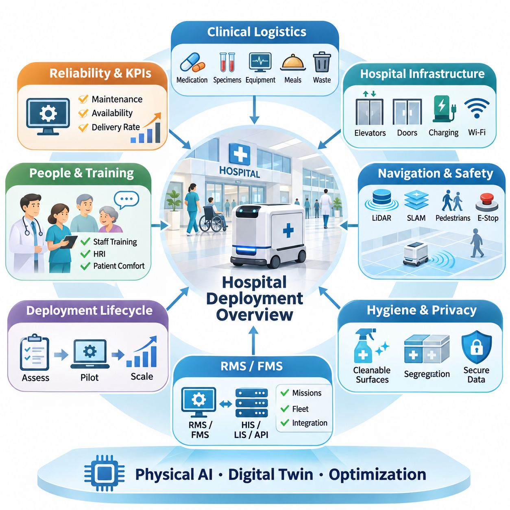
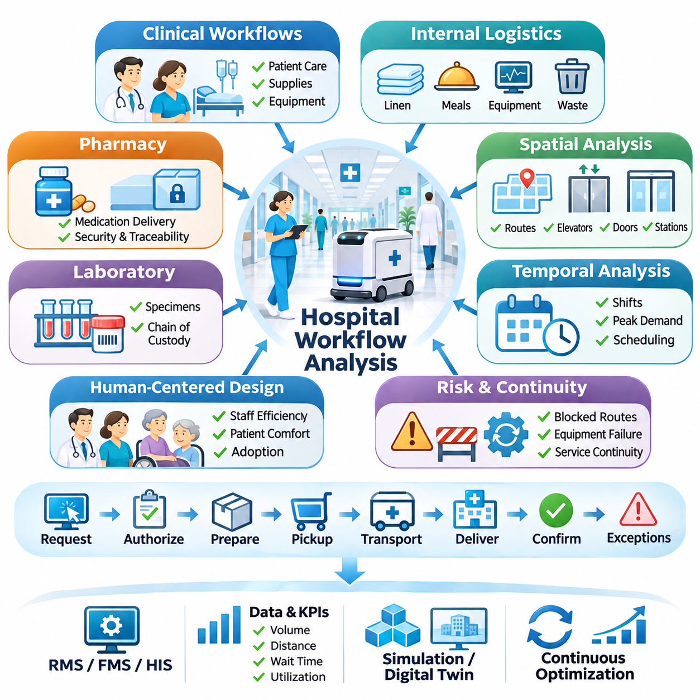
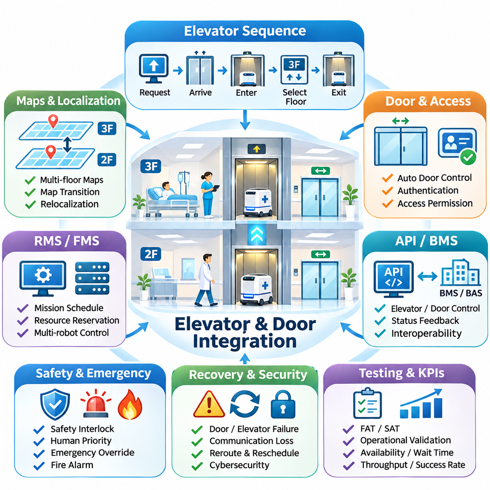
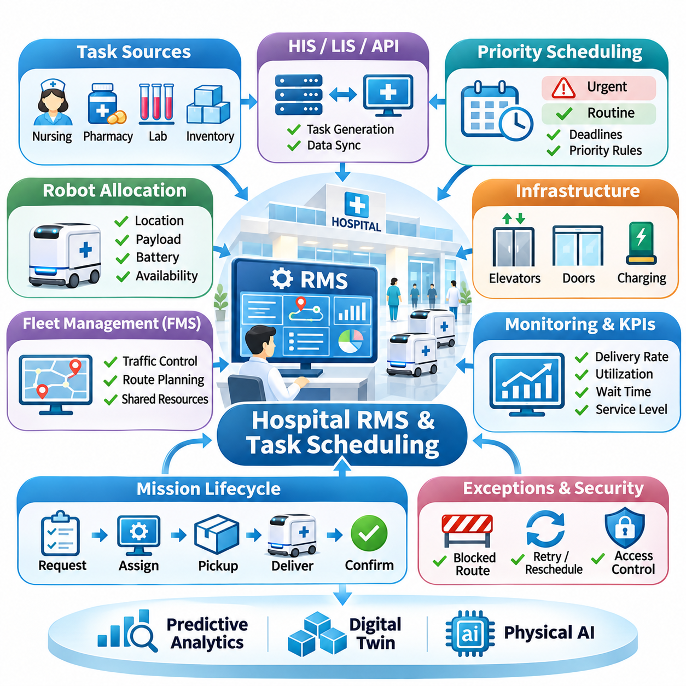
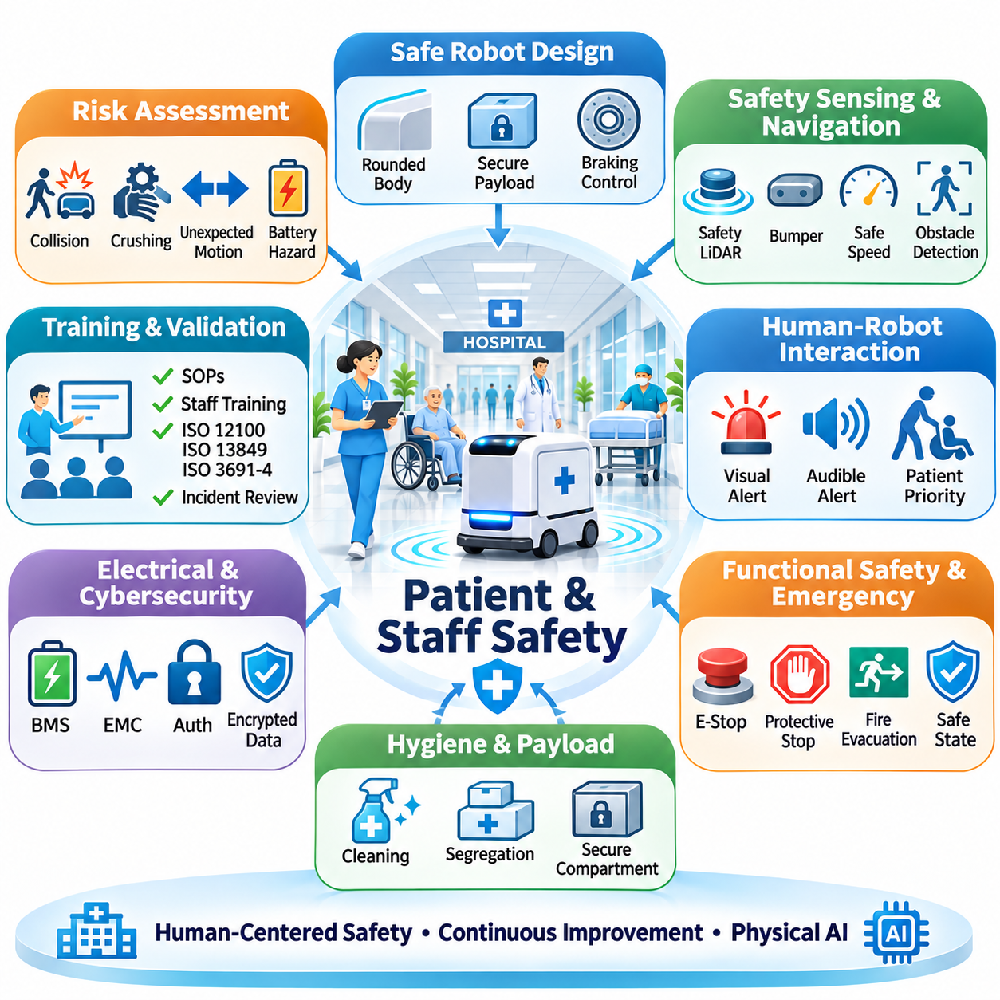
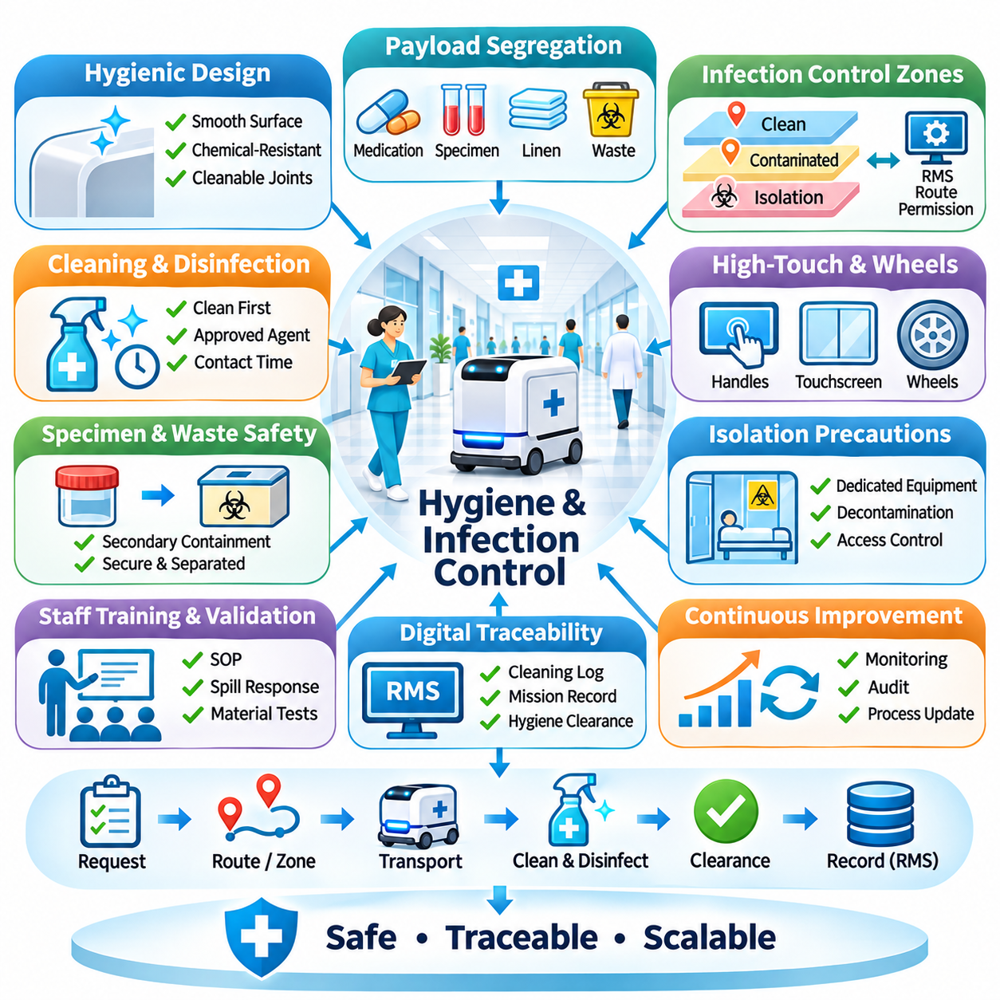
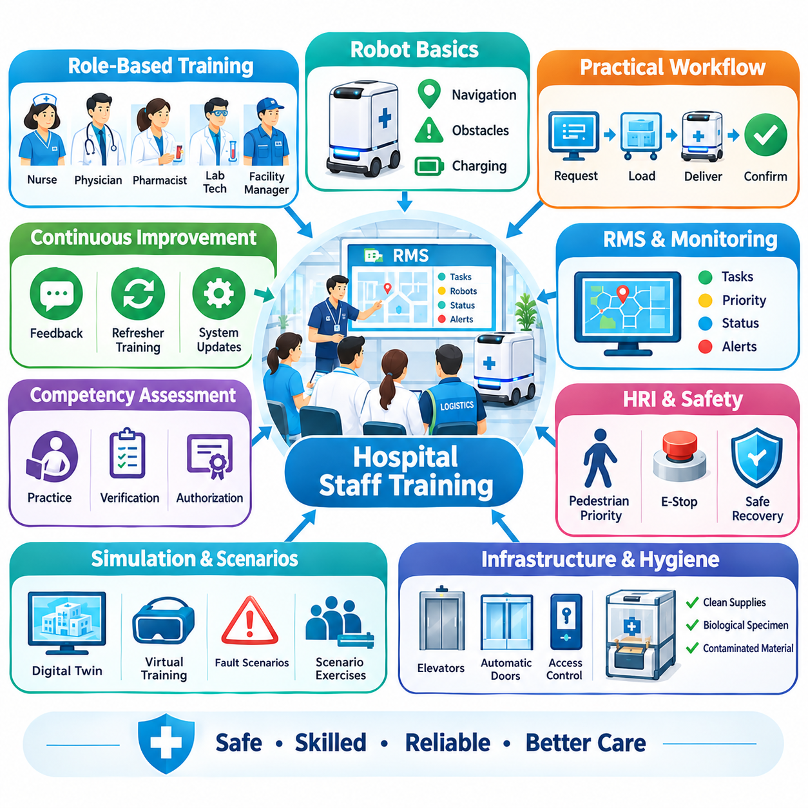
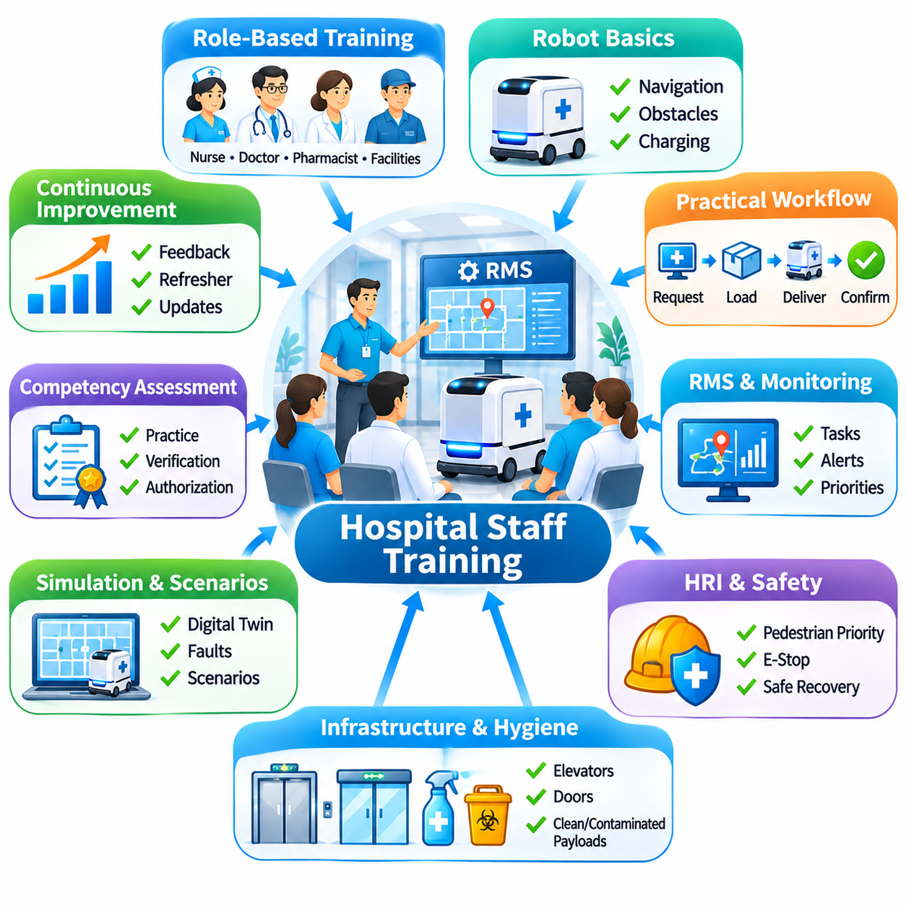
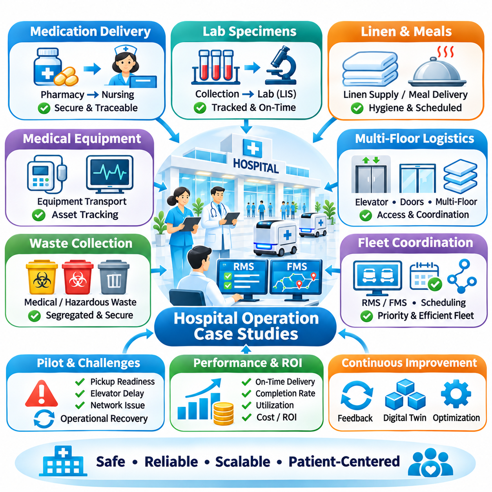

**Volume 08. AMR Operations, Deployment, and MLOps**

# Chapter 18. Hospital Robot Deployment

## 18.1 Hospital Deployment Overview

{width="7.268055555555556in" height="7.268055555555556in"}

Hospital robot deployment represents the systematic introduction of autonomous and intelligent robotic systems into healthcare environments to improve operational efficiency, reduce repetitive workloads, and support patient-centered services. Unlike conventional industrial environments, hospitals require robotic systems to operate within dynamic, human-centered spaces where safety, hygiene, reliability, privacy, and uninterrupted clinical activities are essential.

Autonomous Mobile Robots (AMRs) are increasingly deployed in hospitals to support internal logistics, pharmaceutical transportation, laboratory specimen delivery, medical equipment distribution, meal delivery, and waste collection. Other specialized robotic platforms perform environmental disinfection, facility inspection, and patient guidance. These applications allow healthcare professionals to dedicate more time to clinical responsibilities and direct patient care.

Hospital environments introduce unique operational challenges because patients, medical professionals, visitors, wheelchairs, stretchers, and emergency transportation equipment frequently share the same physical infrastructure. Autonomous robots must recognize unpredictable human movements, navigate narrow corridors, accommodate temporary obstacles, and adjust their operational behavior according to clinical priorities and environmental conditions.

The deployment process begins with a comprehensive assessment of hospital infrastructure, operational workflows, transportation demands, and stakeholder requirements. Site assessments identify corridor dimensions, elevator accessibility, automatic doors, charging locations, wireless communication coverage, and restricted clinical areas. These findings establish the foundation for defining robot specifications, deployment configurations, and operational acceptance criteria.

Hospital robot deployment requires close integration between robotic platforms and existing healthcare infrastructure. Autonomous navigation systems must interact with elevators, automatic doors, access control systems, and designated delivery stations. Robot Management Systems (RMS) and Fleet Management Systems (FMS) coordinate transportation missions, monitor operational status, and manage shared resources across multiple hospital buildings and floors.

Safety management is particularly important because hospitals accommodate individuals with limited mobility, impaired vision, reduced situational awareness, and critical medical conditions. Robotic systems should incorporate appropriate safety sensors, obstacle detection, speed limitations, emergency stop mechanisms, and protective control functions. Risk assessments must consider normal operations, foreseeable misuse, equipment failures, and emergency scenarios.

Infection prevention and hygiene management directly influence the mechanical design and operational procedures of hospital robots. Robot enclosures should incorporate durable, cleanable surfaces that are compatible with approved disinfectants. Transportation compartments must support appropriate containment and segregation of medical supplies, biological specimens, contaminated materials, and general-purpose logistics items to minimize cross-contamination risks.

Autonomous navigation in healthcare facilities typically combines LiDAR sensors, vision systems, inertial measurement units, and Simultaneous Localization and Mapping (SLAM) technologies. Semantic perception enables robots to recognize environmental features and operational zones, while adaptive path planning supports safe movement through crowded corridors. Navigation policies must also respect emergency access routes and location-specific restrictions.

Hospital robot operations increasingly depend on communication infrastructure connecting edge computing devices, local servers, and centralized management platforms. Reliable wireless connectivity supports mission assignment, status monitoring, and infrastructure coordination. However, essential navigation and safety functions must remain available locally, enabling robots to enter a safe operational state when network connectivity becomes unavailable.

Integration with Hospital Information Systems (HIS), Laboratory Information Systems (LIS), pharmacy management platforms, and inventory management systems enables automated logistics workflows. Standardized Application Programming Interfaces (APIs) facilitate mission generation, delivery confirmation, and operational traceability. Access controls and data protection mechanisms must prevent unauthorized exposure of sensitive healthcare information.

Deployment should follow a phased implementation strategy that progresses from feasibility assessment and controlled testing to pilot operations and full-scale commercialization. Initial deployments typically focus on repetitive transportation activities within clearly defined operational areas. Performance data and feedback collected during pilot operations provide the basis for technical improvements, workflow adjustments, and subsequent expansion.

Human-Robot Interaction (HRI) is another fundamental consideration in hospital deployment. Robots should communicate their operational intentions through intuitive visual indicators, audible notifications, and accessible user interfaces. Hospital personnel must receive appropriate training regarding mission requests, emergency intervention, and recovery procedures, while robotic behavior should remain predictable and comfortable for patients and visitors.

Operational reliability must be maintained through preventive maintenance, predictive diagnostics, remote monitoring, and structured incident response procedures. Battery health, sensor performance, localization accuracy, communication quality, and mechanical conditions should be continuously evaluated. Maintenance schedules and software updates must be coordinated with hospital activities to minimize disruption to essential healthcare services.

Deployment success should be evaluated using measurable Key Performance Indicators (KPIs), including mission completion rates, transportation time, system availability, intervention frequency, safety incidents, and operational cost savings. Additional measurements may include staff workload reduction, delivery traceability, and user satisfaction. These indicators support evidence-based investment decisions and continuous operational improvement.

The long-term evolution of hospital robotics will involve coordinated heterogeneous robot fleets, semantic navigation, Physical AI, digital twins, and intelligent operational optimization. By combining autonomous execution with centralized supervision and human oversight, hospitals can establish scalable robotic service infrastructures that improve operational resilience, resource utilization, and the overall quality of healthcare delivery.

The scope of this overview follows a general hospital robotics deployment lifecycle, as the referenced attachment was not available for verification.

## 18.2 Hospital Workflow Analysis

{width="7.268055555555556in" height="7.268055555555556in"}

Hospital workflow analysis is a systematic process of examining clinical, logistical, administrative, and facility management activities to determine where autonomous robotic systems can improve operational performance. Before deploying Autonomous Mobile Robots (AMRs), healthcare organizations must understand how personnel, medical supplies, equipment, information, and transportation requests move throughout the hospital environment.

The primary objective of hospital workflow analysis is to identify repetitive, time-consuming, and resource-intensive activities that can be partially or fully automated without compromising patient safety or clinical service quality. Rather than introducing robots independently of existing processes, workflow analysis establishes a structured foundation for integrating robotic capabilities with healthcare operations and organizational requirements.

Hospital workflows can be categorized into clinical workflows, internal logistics workflows, pharmaceutical distribution workflows, laboratory transportation workflows, environmental management workflows, and administrative support activities. Each category presents different transportation requirements, service priorities, operational constraints, and safety considerations that influence robotic system specifications and deployment strategies.

Clinical workflow analysis examines how healthcare professionals perform their responsibilities and interact with supporting operational systems. Nurses, physicians, laboratory technicians, and other hospital personnel frequently depend on the timely availability of medical supplies, diagnostic specimens, and specialized equipment. Transportation automation can reduce nonclinical workloads and improve the allocation of professional resources.

Internal logistics analysis focuses on the movement of medical supplies, consumables, linens, meals, medical equipment, and waste materials between hospital departments. Transportation frequency, delivery distance, payload capacity, handling requirements, and service schedules must be evaluated. These parameters provide the quantitative foundation for defining robot configurations, fleet capacity, and transportation mission requirements.

Pharmaceutical workflow analysis requires particular attention to medication security, delivery accuracy, authorization procedures, and transportation traceability. Robotic transportation systems may support the distribution of medications from centralized pharmacies to nursing stations and treatment areas. Secure compartments, identity verification, environmental monitoring, and delivery confirmation mechanisms should be considered where appropriate.

Laboratory specimen transportation represents another important application of hospital robotics. Workflow analysis must identify specimen collection points, laboratory destinations, transportation deadlines, handling restrictions, and environmental requirements. Delayed or improperly handled specimens can affect diagnostic accuracy, making mission prioritization, secure transportation, and chain-of-custody management essential considerations.

Spatial workflow analysis examines the relationship between hospital infrastructure and transportation activities. Floor plans, corridor networks, elevator locations, automatic doors, nursing stations, storage facilities, and restricted areas should be mapped to identify operational dependencies. This analysis helps determine navigation routes, delivery stations, charging locations, and potential transportation bottlenecks before deployment.

Temporal workflow analysis evaluates how transportation demand changes throughout the day, across work shifts, and during specific clinical activities. Medication distribution schedules, meal delivery periods, laboratory testing cycles, and emergency situations generate different patterns of demand. Understanding these variations enables fleet management systems to allocate robotic resources dynamically and minimize service delays during peak periods.

Process mapping provides a structured methodology for describing existing hospital operations and identifying opportunities for automation. Each transportation workflow can be decomposed into request generation, task authorization, material preparation, pickup, transportation, delivery, confirmation, and exception handling. Mapping these stages reveals redundant activities, unnecessary waiting periods, and opportunities for digital integration.

Quantitative workflow assessment involves collecting operational data such as transportation volume, travel distance, mission duration, waiting time, labor utilization, and delivery frequency. Historical records and direct observations provide baseline measurements against which robotic performance can be evaluated. These measurements also support fleet sizing, charging strategy development, and return on investment calculations.

Human-centered workflow analysis considers how robotic systems affect healthcare professionals, patients, visitors, and facility management personnel. Interviews, operational observations, and stakeholder workshops help identify practical requirements and potential barriers to adoption. Successful automation should simplify existing responsibilities rather than introduce unnecessary procedural complexity or additional administrative burdens.

Workflow optimization requires integration between Robot Management Systems (RMS), Fleet Management Systems (FMS), Hospital Information Systems (HIS), and other healthcare management platforms. Automated mission generation, priority scheduling, delivery confirmation, and real-time status monitoring can establish a connected operational environment in which transportation activities respond dynamically to clinical and logistical demands.

Risk-based workflow analysis evaluates potential disruptions associated with autonomous transportation, including blocked corridors, elevator failures, communication interruptions, incorrect deliveries, and emergency clinical activities. Operational procedures must define alternative transportation methods, escalation mechanisms, human intervention requirements, and recovery strategies to maintain service continuity under abnormal conditions.

Digital twins and discrete-event simulation can support advanced hospital workflow analysis by modeling transportation networks, robot fleets, resource utilization, and operational demand. Simulation enables engineers to evaluate alternative deployment configurations, estimate congestion, optimize fleet capacity, and examine emergency scenarios before introducing robotic systems into active healthcare environments.

Hospital workflow analysis should continue throughout the operational lifecycle rather than conclude after initial deployment. Continuous monitoring of transportation performance, clinical requirements, user feedback, and environmental changes enables iterative workflow optimization. This approach establishes a foundation for scalable, reliable, and intelligent hospital automation supported by Physical AI and data-driven decision-making.

The referenced attachment was unavailable for verification; therefore, this content follows a general hospital workflow analysis framework consistent with autonomous robot deployment and healthcare operations.

## 18.3 Elevator and Door Integration

{width="7.268055555555556in" height="7.268055555555556in"}

Elevator and door integration is a fundamental requirement for deploying Autonomous Mobile Robots (AMRs) in hospital environments where transportation missions frequently extend across multiple floors, departments, and restricted operational zones. Seamless interaction with building infrastructure enables robots to perform autonomous transportation tasks without requiring continuous human assistance or disrupting essential healthcare activities.

Unlike conventional industrial facilities, hospitals typically incorporate complex elevator networks, automatic doors, fire-rated doors, security-controlled entrances, and specialized clinical access points. Autonomous robotic systems must interact with these infrastructure components while respecting patient safety, infection control procedures, emergency transportation priorities, and building-specific access restrictions throughout their operational lifecycle.

Elevator integration enables autonomous robots to travel between hospital floors by communicating with elevator control systems. A typical transportation sequence involves requesting an elevator, selecting the destination floor, confirming elevator arrival, verifying door opening, entering the elevator cabin, and exiting at the correct destination. Each operation requires reliable synchronization between the robot and the elevator infrastructure.

Elevator communication architectures may utilize wired interfaces, wireless communication modules, industrial gateways, or Application Programming Interfaces (APIs) provided by elevator manufacturers. Integration gateways translate robotic mission requests into supported elevator control commands and return operational information such as cabin position, door status, service availability, and destination floor confirmation.

Robot navigation within elevator environments requires specialized localization and motion control strategies. Reflective metallic surfaces, confined spaces, moving doors, and changing environmental features can affect conventional sensor-based localization. Robots should utilize designated waiting positions, accurate docking trajectories, geometric references, and appropriate sensor fusion techniques to ensure reliable elevator entry and exit.

Multi-floor navigation requires the maintenance of separate environmental maps representing individual hospital floors. When an autonomous robot travels through an elevator, its navigation system must coordinate map transitions with verified floor information. Robot localization should be reestablished before normal navigation resumes, preventing incorrect positioning and transportation failures caused by inconsistent floor identification.

Automatic door integration allows robots to move between hospital corridors, clinical departments, storage facilities, and designated service areas. Depending on the installed infrastructure, door activation may be performed through approved relay interfaces, network-based controllers, wireless gateways, or building automation platforms. Door status feedback is necessary to confirm that the passage is available before robot movement begins.

Access-controlled door integration introduces additional requirements related to authentication, authorization, and operational security. Robots should possess unique digital identities associated with explicitly defined access permissions. Access requests must be evaluated according to destination, mission type, operational schedule, and hospital security policies, preventing unauthorized entry into sensitive clinical and administrative environments.

Integration with Building Management Systems (BMS) and Building Automation Systems (BAS) can establish a unified coordination framework for autonomous robots and hospital infrastructure. Standardized communication interfaces enable robots to exchange operational requests and status information with building subsystems. Middleware can abstract manufacturer-specific protocols and improve interoperability across heterogeneous infrastructure components.

Fleet Management Systems (FMS) play an important role in coordinating elevator and door utilization when multiple robots operate simultaneously. Shared infrastructure resources should be managed through reservation mechanisms, priority scheduling, resource locking, and congestion management. These functions prevent conflicting requests, reduce unnecessary waiting times, and improve transportation efficiency across multiple hospital floors.

Safety mechanisms must ensure that robotic operations never compromise the independent protective functions of elevators and doors. Robots should verify entrance clearance, maintain appropriate separation from passengers, and prevent movement when unsafe conditions are detected. Infrastructure integration must preserve existing safety interlocks, obstruction detection mechanisms, emergency controls, and manual override capabilities.

Emergency operation policies are particularly important in hospitals because fire alarms, emergency patient transportation, evacuation procedures, and infrastructure failures may require immediate changes to robotic activities. Robots must relinquish infrastructure reservations, avoid emergency access routes, and transition to predefined safe states when instructed. Elevator emergency modes and fire protection functions must always retain operational priority.

Communication failures and infrastructure malfunctions must be addressed through robust exception handling and fault recovery mechanisms. When elevator requests fail, doors remain closed, or infrastructure status becomes uncertain, robots should suspend movement and initiate bounded recovery procedures. Alternative routes, mission rescheduling, operator notifications, and manual assistance can help maintain operational continuity.

Cybersecurity is essential because elevator and door integration connects autonomous robotic systems with critical building infrastructure. Network segmentation, encrypted communication, device authentication, role-based access control, and security event logging should be implemented according to system requirements. Integration gateways must restrict robot commands to authorized functions and prevent unauthorized infrastructure manipulation.

System validation should include normal transportation scenarios, concurrent robot requests, passenger interactions, communication interruptions, access denial, emergency signals, and infrastructure failure conditions. Factory Acceptance Testing (FAT) and Site Acceptance Testing (SAT) help verify interface compatibility, synchronization accuracy, safety behavior, and recovery performance before unrestricted operational deployment is authorized.

Operational performance should be evaluated using measurable indicators such as elevator waiting time, door activation success rate, floor transition reliability, infrastructure utilization, mission completion time, and human intervention frequency. Continuous monitoring enables operators to identify recurring integration failures, optimize shared resource allocation, and improve the reliability of multi-floor autonomous transportation.

The future of elevator and door integration will increasingly incorporate intelligent building infrastructure, digital twins, predictive resource scheduling, and Physical AI. By combining infrastructure awareness with autonomous navigation and centralized fleet coordination, hospitals can establish scalable multi-floor robotic transportation networks that improve operational efficiency while preserving human accessibility, safety, and clinical service continuity.

The referenced attachment was unavailable for verification; therefore, this content follows a general hospital infrastructure integration framework covering autonomous navigation, interoperability, safety, cybersecurity, and operational validation.

## 18.4 Hospital RMS and Task Scheduling

{width="7.268055555555556in" height="7.268055555555556in"}

A hospital Robot Management System (RMS) provides a centralized operational framework for organizing, monitoring, and coordinating robotic services within healthcare environments. By integrating autonomous robots, transportation requests, clinical workflows, and building infrastructure, the RMS enables hospitals to establish a systematic approach to logistics automation while maintaining operational reliability, patient safety, and service continuity.

Hospital task scheduling differs from conventional industrial scheduling because healthcare operations involve dynamic transportation demands, unpredictable clinical events, and varying levels of service urgency. Robotic tasks must be scheduled according to medical priorities, delivery deadlines, resource availability, and environmental conditions. Scheduling mechanisms should therefore support both predefined transportation routines and dynamically generated missions.

The hospital RMS architecture typically consists of mission management, task scheduling, robot status monitoring, infrastructure integration, communication management, and operational data analytics. These functional components coordinate individual robotic activities while maintaining centralized visibility across hospital departments. A modular software architecture enables the system to accommodate different robotic platforms and evolving healthcare requirements.

Task generation represents the initial stage of robotic transportation management. Transportation requests may originate from nursing stations, pharmacies, laboratories, inventory management systems, scheduled service routines, or authorized hospital personnel. Each request should include information describing the pickup location, destination, payload characteristics, delivery deadline, access requirements, and operational priority.

Task classification enables the RMS to distinguish between routine logistics missions, scheduled medication deliveries, urgent laboratory specimen transportation, equipment distribution, meal delivery, and waste collection. Each task category should have explicitly defined priority levels, handling requirements, and service constraints. Classification also ensures that robots are assigned only to missions compatible with their capabilities.

Priority-based scheduling is particularly important in hospitals because transportation delays may affect diagnostic procedures, medication availability, and clinical decision-making. Scheduling algorithms should evaluate mission urgency, remaining deadline, estimated travel time, and potential consequences of delay. High-priority missions may preempt lower-priority activities when interruption is safe and operationally permissible.

Dynamic task allocation determines which available robot is most suitable for executing a specific transportation mission. Allocation algorithms consider robot location, battery capacity, payload compatibility, operational status, current workload, and estimated arrival time. Advanced allocation strategies may incorporate predictive travel models and optimization algorithms to minimize overall transportation costs and service delays.

Hospital task scheduling requires coordination with Fleet Management Systems (FMS) responsible for multi-robot traffic management, route planning, collision avoidance coordination, and shared resource allocation. While the RMS manages service-level requirements and mission lifecycles, the FMS coordinates fleet-level execution. Clearly defined interfaces between these systems help prevent conflicting decisions and redundant control functions.

Multi-floor hospital operations introduce scheduling dependencies associated with elevators, automatic doors, restricted corridors, loading stations, and charging facilities. Shared infrastructure resources should be incorporated into the scheduling model through reservation mechanisms and availability monitoring. Infrastructure-aware scheduling reduces resource contention, prevents operational deadlocks, and improves transportation predictability.

Battery management and charging schedules must be integrated with hospital mission planning to maintain continuous service availability. The RMS should monitor battery state of charge, estimated energy consumption, charging station availability, and anticipated transportation demand. Opportunity charging and predictive charging strategies enable robots to maintain sufficient energy reserves for routine missions and unexpected urgent requests.

Integration with Hospital Information Systems (HIS), Laboratory Information Systems (LIS), pharmacy management systems, and inventory management platforms enables automated task generation and operational synchronization. Standardized Application Programming Interfaces (APIs) and event-driven communication mechanisms allow transportation requests, delivery confirmations, and mission status updates to be exchanged between authorized systems.

Task execution monitoring provides real-time visibility into the progress of robotic transportation activities. Each mission should maintain an explicit lifecycle state, including request registration, authorization, assignment, pickup, transportation, delivery, completion, and exception handling. Timestamped operational records support delivery traceability, accountability, performance evaluation, and investigation of service interruptions.

Exception management is essential when transportation missions encounter blocked corridors, elevator failures, inaccessible destinations, communication interruptions, or unavailable receiving personnel. The RMS should support bounded retries, dynamic rescheduling, alternative robot assignment, operator notifications, and manual intervention. Recovery procedures must preserve payload security and prevent duplicate or incorrect deliveries.

Hospital RMS security must address device authentication, role-based access control, encrypted communication, and operational audit logging. Transportation records may contain sensitive information related to medications, specimens, patients, or restricted destinations. Data minimization and access restrictions should therefore be incorporated into system architecture while maintaining sufficient traceability for authorized operational activities.

Operational dashboards provide hospital personnel and system administrators with centralized visibility into robot availability, active missions, pending requests, transportation delays, charging status, and infrastructure conditions. Key Performance Indicators (KPIs) should include on-time delivery rate, mission completion rate, average waiting time, fleet utilization, intervention frequency, and priority-specific service performance.

Advanced scheduling approaches may incorporate artificial intelligence, predictive analytics, mathematical optimization, and discrete-event simulation. Historical transportation records can support demand forecasting, congestion prediction, and proactive resource allocation. Digital twins enable alternative scheduling policies to be evaluated under simulated hospital operating conditions before implementation in active healthcare environments.

The long-term evolution of hospital RMS platforms will emphasize intelligent task orchestration, heterogeneous fleet coordination, adaptive scheduling, and Physical AI integration. By combining real-time operational awareness with predictive decision-making and human oversight, hospitals can establish scalable robotic service infrastructures that dynamically respond to clinical priorities while maintaining safety, reliability, and service continuity.

The referenced attachment was unavailable for verification; therefore, this content follows a general hospital RMS and task scheduling framework. The functional separation between RMS and FMS represents a reference architecture rather than a mandatory industry-wide implementation.

## 18.5 Patient and Staff Safety

{width="7.268055555555556in" height="7.268055555555556in"}

Patient and staff safety is a fundamental requirement for deploying Autonomous Mobile Robots (AMRs) and other intelligent robotic systems within hospital environments. Unlike conventional industrial facilities, hospitals accommodate vulnerable patients, healthcare professionals, visitors, and individuals with limited mobility. Robotic systems must therefore operate within a comprehensive safety framework that prioritizes human protection and clinical service continuity.

Hospital robot safety management begins with systematic hazard identification and risk assessment covering the entire operational lifecycle. Potential hazards include collisions, crushing, trapping, unexpected movement, payload displacement, electrical failures, battery incidents, and cybersecurity-related disruptions. Risk reduction measures must address normal operating conditions, foreseeable misuse, equipment failures, and emergency situations.

The physical design of hospital robots should minimize mechanical hazards through rounded external surfaces, enclosed moving components, stable chassis configurations, secure transportation compartments, and appropriate protective structures. Robot dimensions, weight distribution, payload capacity, and braking characteristics must be evaluated in relation to hospital corridor widths, floor conditions, pedestrian density, and accessibility requirements.

Safety-related sensing systems provide the foundation for detecting humans, obstacles, and potentially hazardous environmental conditions. Safety-rated LiDAR sensors, protective bumpers, and other validated sensing technologies should be selected according to the identified risks. Cameras, depth sensors, and artificial intelligence-based perception can supplement environmental awareness but must not replace required safety-rated protective functions.

Safe navigation requires robots to dynamically adjust their movement according to environmental conditions, pedestrian proximity, and location-specific restrictions. Speed limitations, protective fields, acceleration constraints, and stopping distances should be configured according to the operational risk assessment. Navigation behavior must remain predictable when approaching patients, wheelchairs, stretchers, medical equipment, and crowded intersections.

Hospitals require particular consideration of vulnerable individuals who may have impaired vision, hearing limitations, reduced cognitive awareness, or restricted physical mobility. Autonomous robots must not assume that nearby individuals can recognize warning signals or move away from an approaching platform. Conservative motion policies and adequate separation distances help reduce exposure to foreseeable human interaction hazards.

Human-Robot Interaction (HRI) plays an important role in maintaining patient and staff safety. Robots should communicate their movement intentions, operational status, and abnormal conditions through understandable visual indicators, audible notifications, and accessible interfaces. Warning mechanisms should be designed to minimize unnecessary noise, patient discomfort, and interference with clinical alarms or medical activities.

Functional safety mechanisms should include appropriate emergency stop devices, protective stopping functions, monitored speed limits, and fault detection capabilities. Safety-critical control functions must be sufficiently independent of mission planning, artificial intelligence inference, and centralized management services. Failures affecting essential protective functions should cause the robot to transition to a predefined safe state.

Hospital traffic management must prioritize patients, healthcare professionals, emergency response teams, and medical transportation equipment over routine robotic missions. Robot Management Systems (RMS) and Fleet Management Systems (FMS) should enforce restricted zones, pedestrian priority policies, and infrastructure access rules. Local safety functions must remain effective independently of centralized traffic coordination.

Emergency preparedness requires autonomous robots to respond appropriately to fire alarms, evacuation procedures, urgent patient transportation, power failures, and other abnormal hospital conditions. Robots should avoid obstructing emergency exits, evacuation corridors, and critical medical equipment. Emergency response policies must define safe stopping locations, infrastructure reservation release, operator notification, and authorized recovery procedures.

Payload safety is particularly important when robots transport medications, biological specimens, medical equipment, hazardous waste, or temperature-sensitive materials. Transportation compartments must provide appropriate containment, load retention, access control, and environmental protection. Incorrect loading, excessive payload weight, unauthorized access, and unstable cargo conditions should be prevented or detected through suitable safeguards.

Infection prevention and contamination control are essential elements of hospital robot safety. Robot surfaces, wheels, handles, and transportation compartments should support approved cleaning and disinfection procedures. Operational policies must distinguish between clean and contaminated transportation activities, establish appropriate cleaning schedules, and prevent robotic movement from creating additional pathways for cross-contamination.

Electrical safety, battery protection, and electromagnetic compatibility must be evaluated in relation to hospital infrastructure and nearby medical equipment. Battery Management Systems (BMS), charging protection mechanisms, electrical insulation, and thermal monitoring reduce equipment-related risks. Charging stations should be positioned in approved locations that do not obstruct evacuation routes or interfere with clinical activities.

Cybersecurity and information privacy contribute directly to hospital operational safety because compromised robotic systems may execute unauthorized commands or expose sensitive information. Device authentication, encrypted communication, network segmentation, access control, and security monitoring should be implemented. Safety-related control functions must remain protected against unauthorized software changes and network-based interference.

Staff training and operational awareness are necessary to establish safe collaboration between humans and autonomous robots. Healthcare personnel should understand robot behavior, emergency stop procedures, reporting mechanisms, and authorized intervention methods. Clearly defined responsibilities and Standard Operating Procedures (SOPs) help prevent unsafe manual handling, unauthorized recovery attempts, and inconsistent responses to abnormal conditions.

Safety verification and validation should include representative hospital scenarios involving pedestrian interactions, unexpected obstacles, sensor failures, emergency stopping, communication interruptions, and infrastructure malfunctions. Applicable standards, including ISO 12100, ISO 13849, and ISO 3691-4 where relevant, should inform risk assessment and safety engineering according to the robot classification and intended use.

Continuous safety management requires monitoring collision events, near misses, protective stops, emergency interventions, equipment failures, and staff feedback. Root Cause Analysis (RCA) supports the identification of recurring hazards and the implementation of corrective measures. Changes to robot hardware, software, AI models, navigation policies, and hospital infrastructure should trigger appropriate safety reassessment and validation.

The long-term objective of hospital robot safety is to establish a human-centered operational environment in which Physical AI enhances healthcare services without introducing unacceptable risks. Combining risk-based engineering, functional safety, intelligent perception, operational governance, and continuous improvement enables hospitals to expand robotic automation while protecting patients, staff, and essential clinical activities.

The referenced attachment was unavailable for verification; therefore, this content follows a general hospital robotics safety framework. Applicable regulatory requirements and safety standards must be evaluated according to the robot\'s intended use, classification, and deployment jurisdiction.

## 18.6 Hygiene and Infection Control

{width="7.268055555555556in" height="7.268055555555556in"}

Hygiene and infection control are essential requirements for deploying Autonomous Mobile Robots (AMRs) and intelligent robotic systems in hospitals. Robots frequently travel between clinical departments, storage facilities, laboratories, and patient care areas, creating potential pathways for microbial transmission. Deployment strategies must therefore incorporate infection prevention principles throughout robot design, transportation workflows, maintenance, and daily operations.

Hospital robots operate in environments where healthcare-associated infections can have serious consequences for vulnerable patients and medical personnel. Infection control policies must address contact transmission, contaminated surfaces, biological materials, and environmental exposure. Robotic operations should comply with institutional infection prevention procedures and applicable healthcare regulations while minimizing unnecessary contact with patients and clinical equipment.

Hygienic robot design begins with the selection of materials and mechanical structures that support effective cleaning and disinfection. External surfaces should be smooth, durable, and resistant to approved cleaning chemicals. Enclosures should minimize exposed joints, inaccessible cavities, and unnecessary surface irregularities where contaminants may accumulate. Material compatibility must be verified against intended disinfectants and cleaning frequencies.

Transportation compartments require special attention because hospital robots may carry medications, laboratory specimens, sterile supplies, linens, meals, and contaminated materials. Compartments should provide suitable containment, secure closures, and accessible surfaces for cleaning. Different payload categories may require dedicated containers or separate robots to reduce cross-contamination risks and maintain appropriate hygiene conditions.

Infection control zoning establishes operational boundaries between clean areas, contaminated areas, isolation rooms, and restricted clinical environments. Robot Management Systems (RMS) should incorporate these boundaries into mission authorization and route planning. Robots assigned to contaminated workflows should not enter clean transportation zones without completing required cleaning, disinfection, and operational clearance procedures.

Cleaning and disinfection procedures must be standardized according to robot construction, contamination risks, and hospital infection prevention policies. Routine cleaning removes visible soil and organic material before appropriate disinfection is performed. Procedures should specify approved products, application methods, required contact times, cleaning frequencies, and responsible personnel while following disinfectant manufacturers\' instructions.

High-touch components such as handles, touchscreen interfaces, compartment doors, loading surfaces, and manual control devices require particular attention. These surfaces may be contacted repeatedly by healthcare workers during transportation activities. Cleaning schedules should reflect contact frequency and contamination risk, while touchless interfaces and automated compartment mechanisms can reduce unnecessary physical interactions.

Wheels, chassis undersides, and floor-contact components may accumulate dust, moisture, and environmental contaminants during hospital navigation. Maintenance procedures should include inspection and appropriate cleaning of these components without damaging sensors, motors, or electrical assemblies. Movement between areas with different infection control requirements may require additional precautions determined by hospital infection prevention specialists.

Laboratory specimen transportation must preserve biological containment and prevent leakage or accidental exposure. Specimens should be placed in approved, properly closed containers with suitable secondary containment when required. Transportation procedures must address packaging integrity, spill response, handling authorization, and traceability. Robots should not directly handle uncontained biological materials during routine logistics operations.

Waste transportation requires separation between general waste, contaminated clinical waste, and regulated hazardous materials. Robot payload systems must be compatible with the waste category and applicable handling requirements. Secure containers, controlled access, designated routes, and documented cleaning procedures help prevent accidental contamination and unauthorized exposure during collection and delivery.

Robotic systems used in isolation environments require additional infection prevention controls based on the relevant transmission precautions. Access restrictions, protective equipment requirements for personnel, dedicated transportation equipment, and decontamination procedures should be established before deployment. Robots must not be assumed to eliminate infection risks merely because transportation activities are automated.

Automated disinfection technologies, including ultraviolet irradiation and chemical application systems, may supplement conventional environmental cleaning when appropriately validated. Their effectiveness depends on exposure conditions, surface coverage, environmental characteristics, and microbial targets. Such technologies require separate safety assessments and must not replace established cleaning procedures or institutional infection prevention protocols.

Environmental monitoring and operational traceability can strengthen infection control management by recording robot assignments, transportation zones, cleaning events, and maintenance activities. RMS platforms may maintain digital cleaning logs and prevent mission authorization when required hygiene procedures remain incomplete. These records support operational accountability, compliance verification, and investigation of potential contamination incidents.

Personnel training is necessary to ensure that healthcare workers, cleaning teams, and robotic system operators understand infection prevention responsibilities. Training should address safe loading and unloading, cleaning procedures, contamination reporting, spill response, and equipment handling. Clear Standard Operating Procedures (SOPs) reduce inconsistencies and establish coordinated responsibilities between clinical departments and robotics service providers.

Validation of hygienic performance should include material compatibility testing, cleaning accessibility assessments, contamination control inspections, and representative operational scenarios. Hospitals should evaluate whether cleaning procedures remain effective after repeated use and maintenance. Any changes to robot materials, transportation compartments, disinfectants, or operating zones should trigger appropriate reassessment of infection prevention risks.

Continuous improvement requires coordination between infection prevention specialists, hospital operations managers, biomedical engineering teams, and robotic system developers. Operational feedback, cleaning records, contamination incidents, and updated clinical requirements should inform procedural improvements. A risk-based hygiene management framework enables hospitals to expand robotic logistics while protecting patients, staff, and clinical environments.

The long-term objective of hygiene and infection control in hospital robotics is to establish reliable transportation services that support healthcare operations without introducing unacceptable contamination risks. Combining hygienic engineering, controlled workflows, validated cleaning procedures, digital traceability, and human oversight provides a foundation for safe, scalable, and sustainable robotic deployment.

## 18.7 Hospital Staff Training

{width="7.268055555555556in" height="7.268055555555556in"}

{width="7.268055555555556in" height="7.268055555555556in"}

Hospital staff training is a critical component of successful Autonomous Mobile Robot (AMR) deployment because robotic systems must operate alongside healthcare professionals in complex clinical environments. Effective training enables personnel to understand robotic capabilities, operational limitations, safety requirements, and workflow integration. Training programs should support reliable collaboration while maintaining patient safety and clinical service continuity.

Hospital robot training must accommodate different professional roles, including nurses, physicians, pharmacists, laboratory technicians, logistics personnel, infection prevention specialists, and facility managers. Each group interacts with robotic systems differently and requires appropriate operational knowledge. Role-based training ensures that personnel receive instructions relevant to their responsibilities without unnecessary technical complexity.

Training program development should begin with a structured assessment of hospital workflows, staff responsibilities, and anticipated robot interactions. Educational objectives must reflect actual transportation tasks, clinical priorities, infrastructure conditions, and emergency procedures. Training requirements should be established collaboratively by hospital management, clinical departments, robotics providers, and safety personnel.

Fundamental training introduces the operating principles of autonomous robots, including localization, navigation, obstacle detection, task execution, and charging behavior. Staff should understand that robots operate within defined capabilities and may stop or request assistance when encountering unexpected conditions. Clear explanations help establish realistic expectations and reduce unnecessary intervention during normal operations.

Practical training should demonstrate how healthcare personnel initiate transportation requests, select destinations, identify payload categories, and confirm delivery completion. Participants should practice loading and unloading procedures using representative hospital materials. Training must emphasize payload security, weight limitations, compartment access control, and correct handling of medications, specimens, and other sensitive items.

Robot Management System (RMS) training enables authorized personnel to register tasks, monitor mission progress, manage priorities, and respond to operational notifications. Staff should understand task lifecycle states, estimated delivery times, exception messages, and escalation procedures. System administrators require additional instruction covering user permissions, scheduling policies, operational dashboards, and audit records.

Human-Robot Interaction (HRI) training focuses on predictable robot behavior and safe movement around autonomous platforms. Healthcare personnel should recognize robot indicators, audible notifications, protective stopping behavior, and pedestrian priority rules. Practical demonstrations should explain how robots respond to wheelchairs, stretchers, crowded corridors, and unexpected obstacles without encouraging unsafe physical interference.

Safety training must cover emergency stop devices, restricted operating zones, collision prevention, equipment hazards, and authorized recovery procedures. Staff should understand when manual intervention is appropriate and when technical support is required. Emergency exercises should demonstrate safe responses to blocked routes, sensor faults, unexpected movement, and communication interruptions while protecting patients and medical equipment.

Hospital infrastructure integration requires specialized training for personnel responsible for elevators, automatic doors, access control systems, and charging facilities. Operators should understand how robots request infrastructure access and respond to unavailable resources. Facility teams must be prepared to identify communication failures, equipment malfunctions, and operational conflicts without bypassing established safety controls.

Infection prevention training should address cleaning responsibilities, transportation zoning, compartment disinfection, and contamination reporting. Staff must distinguish between clean supplies, biological specimens, contaminated materials, and regulated waste. Training should explain when dedicated containers, additional protective measures, or decontamination procedures are required before robots can resume normal transportation activities.

Exception handling training prepares personnel to respond to incomplete deliveries, inaccessible destinations, unavailable recipients, incorrect payloads, and robot immobilization. Standard Operating Procedures (SOPs) should define notification channels, escalation responsibilities, and authorized corrective actions. Staff should avoid moving disabled robots or opening secured compartments without following approved procedures.

Simulation-based training provides a controlled environment for practicing routine operations and abnormal situations before live hospital deployment. Digital twins, virtual training platforms, and supervised physical demonstrations can reproduce congestion, infrastructure failures, and urgent transportation requests. Scenario-based exercises improve decision-making while minimizing disruption to clinical operations.

Competency assessment is necessary to verify that training participants can perform assigned tasks safely and consistently. Evaluation methods may include practical demonstrations, scenario-based assessments, knowledge checks, and supervised operational observations. Authorization to operate or administer robotic systems should depend on demonstrated competency rather than attendance alone.

Training effectiveness should be monitored through operational performance indicators, staff feedback, incident reports, and recurring intervention patterns. Metrics may include task registration errors, unsuccessful deliveries, safety interventions, response times, and user satisfaction. Continuous analysis helps identify knowledge gaps and supports targeted refresher training or improvements to operational procedures.

Training programs must evolve as robotic platforms, software interfaces, hospital workflows, and safety requirements change. Significant updates to RMS functions, navigation behavior, payload handling, or emergency procedures should trigger appropriate retraining. Version-controlled training materials, documented competency records, and periodic refresher sessions help maintain organizational readiness across departments.

Change management and staff engagement are essential for sustainable robotic adoption. Hospital personnel should understand how automation supports clinical work without replacing professional judgment or established patient care responsibilities. Transparent communication, accessible support channels, and opportunities for operational feedback help reduce uncertainty and encourage constructive participation in robotic service improvement.

The long-term objective of hospital staff training is to establish a workforce capable of safely supervising, collaborating with, and continuously improving intelligent robotic services. By combining role-based education, practical exercises, competency verification, and continuous learning, hospitals can develop operational confidence and integrate Physical AI technologies into healthcare workflows while maintaining accountability and patient-centered care.

## 18.8 Hospital Operation Case Studies

{width="7.268055555555556in" height="7.268055555555556in"}

Hospital operation case studies provide practical insights into how Autonomous Mobile Robots (AMRs) and intelligent robotic systems can improve healthcare logistics, operational efficiency, and service reliability. By examining representative deployment scenarios, hospitals can identify implementation challenges, evaluate operational benefits, and establish realistic expectations. Case studies should consider clinical workflows, infrastructure constraints, safety requirements, and measurable service outcomes.

A representative medication delivery scenario involves autonomous robots transporting prescribed medicines from centralized pharmacies to nursing stations. Transportation requests originate from pharmacy management systems and are assigned through a Robot Management System (RMS). Secure compartments, recipient authentication, and delivery confirmation help maintain medication accountability while reducing routine transportation responsibilities for clinical personnel.

Medication transportation operations require careful coordination between pharmacy preparation schedules, nursing requirements, and robot availability. Priority-based scheduling can distinguish urgent medication requests from routine replenishment missions. Operational evaluation should examine delivery punctuality, transportation errors, compartment security, and staff workload changes without assuming that automation eliminates clinical verification responsibilities.

Laboratory specimen transportation represents another important application because diagnostic workflows depend on timely and reliable sample movement. Robots can collect sealed specimens from designated clinical pickup stations and transport them to central laboratories. Integration with Laboratory Information Systems (LIS) enables transportation requests, mission tracking, and delivery confirmation while maintaining specimen identification and chain-of-custody requirements.

Specimen delivery performance should be evaluated according to transportation time, sample integrity, handling compliance, and exception frequency. Biological containment, environmental conditions, and restricted access requirements must be incorporated into operational procedures. Urgent specimens may require higher scheduling priority, while failed deliveries must trigger controlled recovery processes that preserve traceability and prevent sample loss.

Hospital linen distribution provides a representative high-volume logistics scenario involving clean linen delivery and used linen collection. Robots can transport standardized carts between storage facilities, wards, and designated collection points. Separate workflows, containers, or equipment may be required to prevent cross-contamination. Performance evaluation should consider delivery frequency, transport capacity, staff walking distance, and operational hygiene.

Meal delivery operations introduce time-sensitive scheduling requirements associated with food preparation, patient meal periods, and temperature preservation. Autonomous robots may transport enclosed meal carts from hospital kitchens to designated distribution locations. Effective deployment requires coordination with dietary services, elevator availability, and receiving personnel while maintaining food safety and avoiding disruption to clinical activities.

Medical equipment distribution demonstrates how robots can support the movement of infusion pumps, monitoring devices, and other portable equipment between departments. Transportation requests may originate from equipment management platforms or authorized healthcare personnel. Asset identification, secure loading, and delivery records improve equipment visibility, while scheduling algorithms help reduce unnecessary searching and transportation delays.

Hospital waste collection presents distinct challenges involving contamination control, hazardous materials, and restricted transportation routes. Robots assigned to approved waste categories can move secured containers from designated collection points to authorized disposal areas. Deployment must follow institutional waste handling procedures, with dedicated equipment and cleaning protocols where necessary to prevent exposure and cross-contamination.

Multi-floor hospital deployment highlights the importance of elevator integration, automatic door control, and shared infrastructure management. Robots must coordinate access to elevators while respecting patient transport priorities and emergency operations. Infrastructure-aware scheduling can reduce congestion and waiting time, but operational validation must address communication failures, unavailable elevators, and safe recovery from interrupted missions.

A representative outpatient hospital scenario involves robotic transportation between pharmacies, diagnostic departments, supply rooms, and treatment areas. Demand patterns may vary significantly throughout the day as patient appointments and clinical activities change. Dynamic task allocation and predictive scheduling can help balance transportation demand, fleet utilization, and service deadlines without obstructing crowded public corridors.

Large hospital campuses may benefit from coordinated operation of heterogeneous robotic fleets with different payload capacities and transportation capabilities. Smaller robots can support lightweight medical deliveries, while larger platforms transport carts or bulk supplies. Fleet Management Systems (FMS) coordinate shared routes and infrastructure, while RMS platforms manage service requests, operational priorities, and mission-level accountability.

Operational challenges frequently emerge during the transition from pilot demonstrations to continuous hospital service. Common issues include inconsistent pickup readiness, unavailable recipients, elevator delays, wireless communication gaps, and changing departmental workflows. Successful deployment requires clearly defined responsibilities, exception handling procedures, infrastructure monitoring, and continuous coordination between hospital personnel and robotics operators.

Pilot deployment programs should begin with controlled transportation routes, clearly defined payload categories, and measurable operational objectives. Baseline performance data should be collected before automation to support meaningful comparisons. Evaluation should distinguish robot travel time from total service completion time, including request preparation, loading, waiting, unloading, and confirmation activities.

Key Performance Indicators (KPIs) for hospital robot operations include mission completion rate, on-time delivery rate, average transportation time, intervention frequency, robot utilization, and infrastructure waiting time. Additional measures may include staff workload reduction, transportation cost, safety incidents, and user satisfaction. Results should be interpreted according to workload characteristics, deployment scale, and hospital operating conditions.

Economic evaluation should consider initial equipment investment, infrastructure integration, software licensing, maintenance, charging facilities, staff training, and operational support. Return on Investment (ROI) depends on transportation volume, labor allocation, service availability, and achievable workflow improvements. Financial assessments should distinguish measurable cost savings from broader benefits such as improved logistics consistency and clinical staff availability.

Continuous improvement transforms individual deployment experiences into reusable operational knowledge. Historical mission records, staff feedback, incident reports, and infrastructure performance data can guide route optimization, scheduling adjustments, and system upgrades. Digital twins and simulation environments may support evaluation of expansion scenarios before additional robots are introduced into active clinical operations.

Hospital operation case studies demonstrate that successful robotic deployment depends on coordinated technology, clinical workflows, infrastructure, and human oversight rather than autonomous navigation alone. The long-term objective is to establish scalable Physical AI-enabled logistics services that improve operational consistency, support healthcare professionals, and maintain patient safety. The scenarios described are illustrative reference cases, not verified performance reports from specific hospitals.
