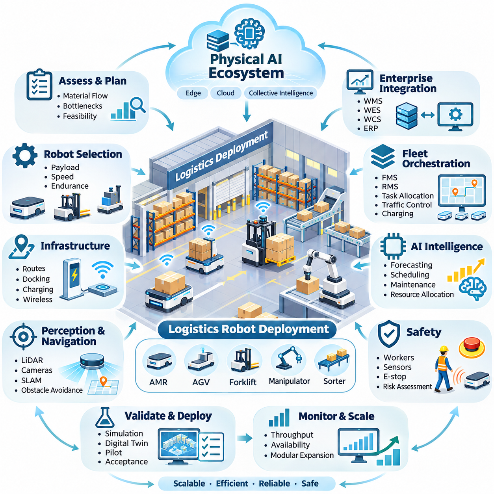
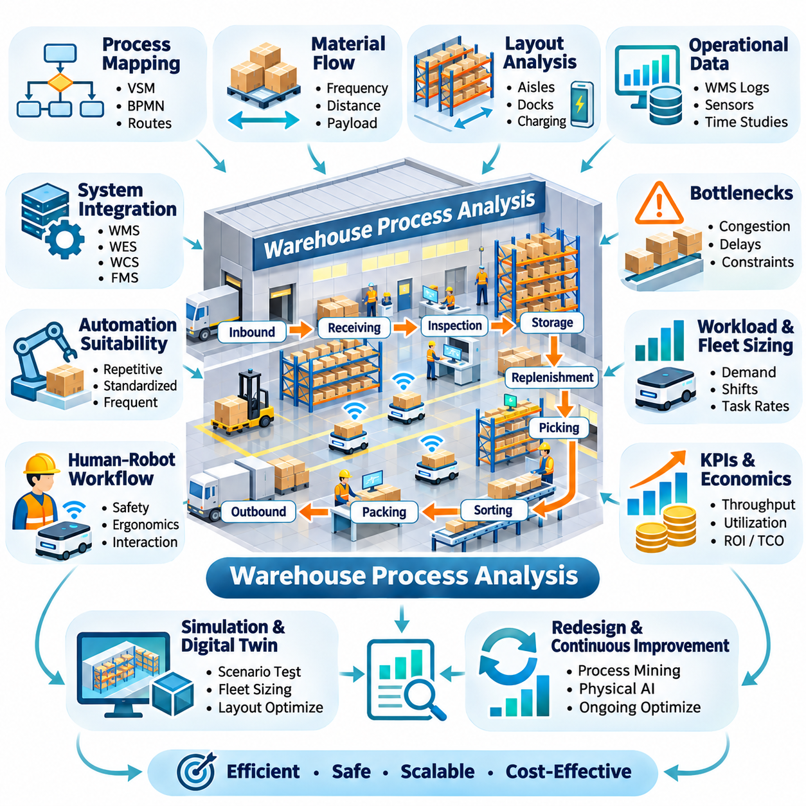
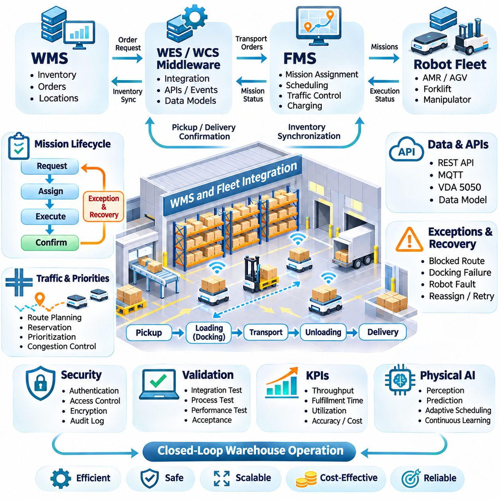
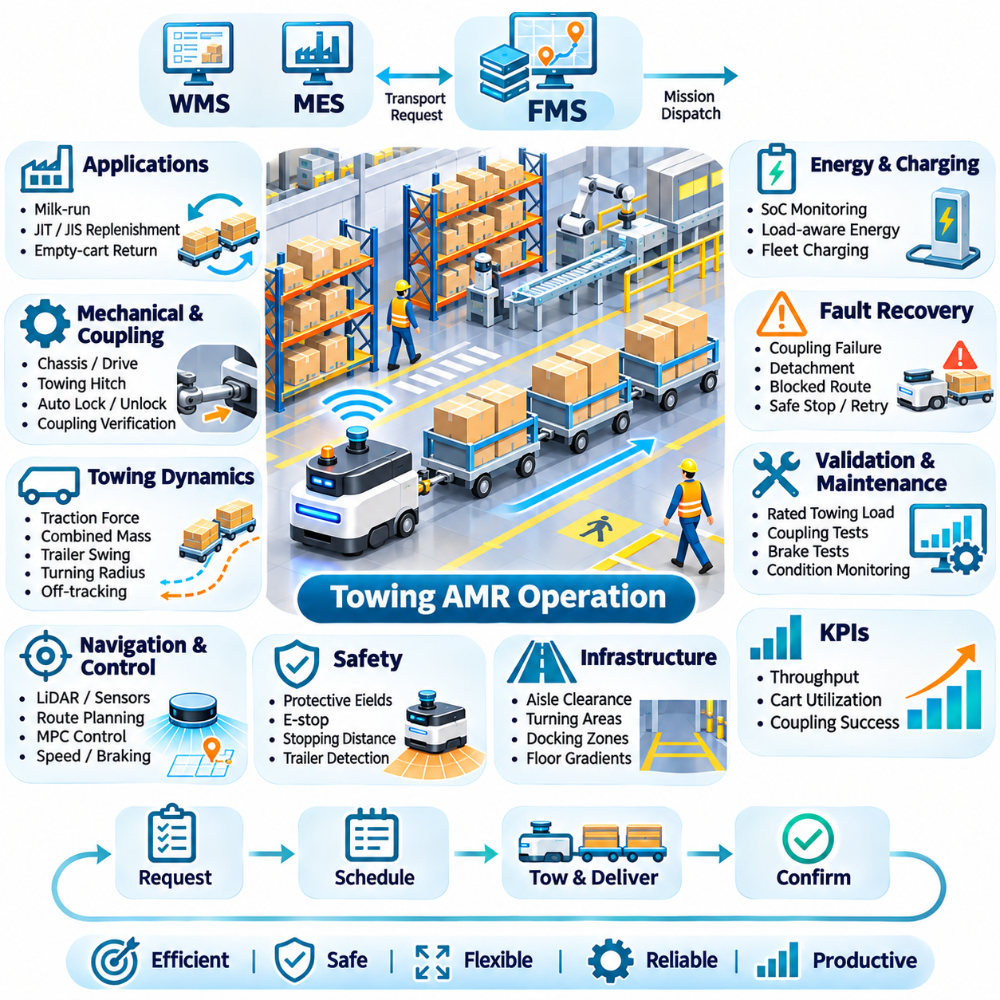
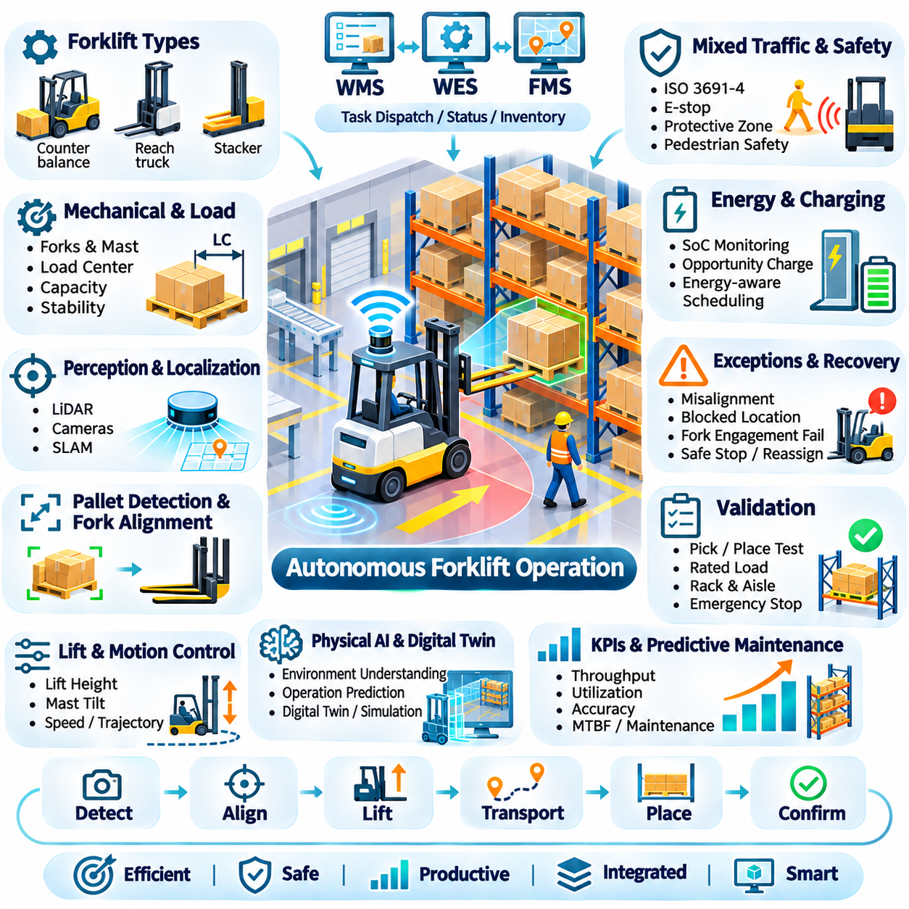
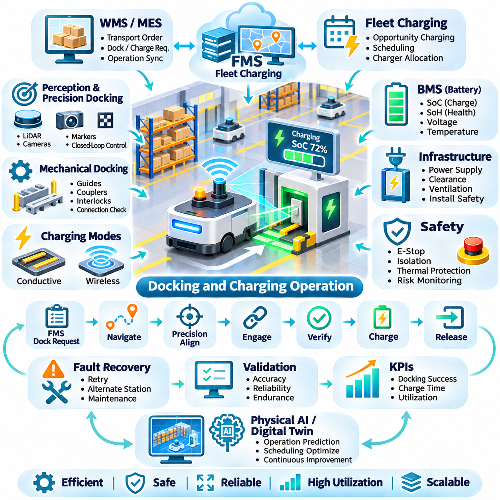
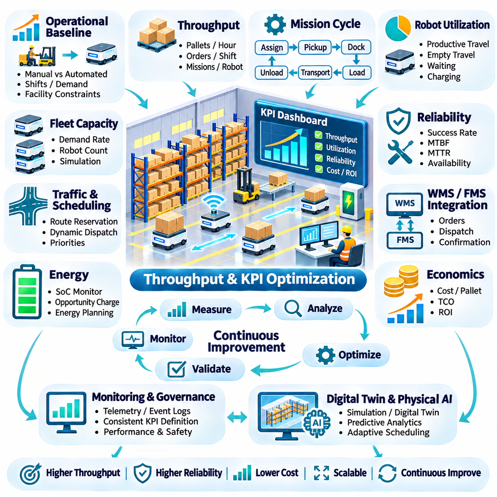
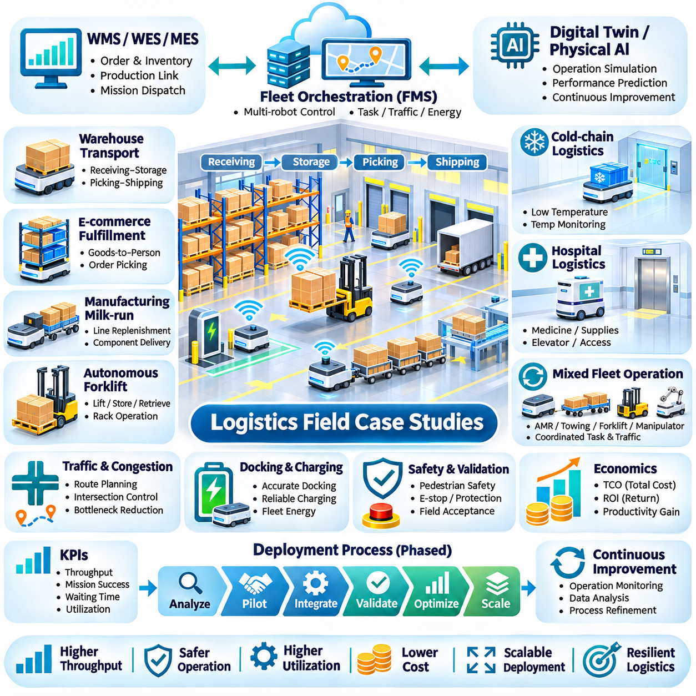

**Volume 08. AMR Operations, Deployment, and MLOps**

# Chapter 19. Logistics Robot Deployment

## 19.1 Logistics Deployment Overview

{width="7.268055555555556in" height="7.268055555555556in"}

Logistics robot deployment is the systematic introduction of autonomous robotic systems into warehouses, distribution centers, fulfillment facilities, manufacturing logistics environments, and transportation hubs. Its primary objective is to improve material handling efficiency, operational productivity, transportation reliability, and workforce safety while establishing a scalable foundation for intelligent logistics automation.

Modern logistics environments require robotic systems capable of operating under dynamic and unpredictable conditions. Autonomous Mobile Robots (AMRs), Automated Guided Vehicles (AGVs), autonomous forklifts, mobile manipulators, and robotic sorting systems perform complementary functions across logistics operations. Their deployment requires coordinated integration of hardware, software, artificial intelligence, communication networks, and operational infrastructure.

The deployment lifecycle begins with an assessment of existing logistics processes, operational requirements, material flow, facility layouts, and transportation demand. Engineers must identify repetitive activities, transportation bottlenecks, inefficient workflows, and potential automation opportunities. This assessment establishes the technical and economic feasibility of robotic automation and provides the foundation for subsequent system design.

Operational requirements determine robot specifications, payload capacity, transportation speed, battery endurance, navigation accuracy, and environmental compatibility. Different logistics applications require different robotic configurations depending on material characteristics, transportation distances, floor conditions, aisle widths, and task complexity. Appropriate robot selection ensures that automation capabilities align with operational objectives.

Infrastructure preparation is essential for reliable logistics robot deployment. Facilities must provide suitable transportation routes, charging stations, docking interfaces, wireless communication coverage, and designated operational zones. Existing infrastructure may require modifications to accommodate autonomous navigation, pedestrian interaction, automatic doors, elevators, conveyors, and other material handling equipment.

Environmental mapping and localization establish the spatial foundation of autonomous logistics operations. Robots utilize LiDAR, cameras, inertial sensors, wheel encoders, and Simultaneous Localization and Mapping (SLAM) technologies to construct and maintain environmental representations. These representations support autonomous navigation, obstacle avoidance, route optimization, and accurate positioning throughout logistics facilities.

System integration connects autonomous robots with enterprise logistics infrastructure. Warehouse Management Systems (WMS), Warehouse Execution Systems (WES), Warehouse Control Systems (WCS), and Enterprise Resource Planning (ERP) platforms exchange operational information with robotic systems. These interfaces enable automated task generation, inventory synchronization, transportation scheduling, and coordinated material handling.

Fleet Management Systems (FMS) and Robot Management Systems (RMS) provide centralized or distributed coordination of multiple logistics robots. They manage task allocation, traffic control, route planning, charging schedules, operational priorities, and robot availability. Effective fleet orchestration prevents congestion, reduces unnecessary transportation movements, and improves resource utilization across the facility.

Artificial intelligence enhances logistics deployment by enabling robots to interpret complex environments, recognize objects, predict operational conditions, and adapt transportation strategies. Machine learning supports demand forecasting, dynamic task scheduling, predictive maintenance, and intelligent resource allocation. These capabilities allow logistics systems to respond more effectively to changing operational requirements.

Safety engineering is a fundamental requirement throughout the deployment lifecycle. Autonomous logistics robots must operate safely around workers, vehicles, machinery, and valuable inventory. Safety-rated sensors, emergency stop mechanisms, protective fields, speed limitations, and risk assessment procedures must be implemented according to applicable safety standards and facility-specific operational requirements.

Deployment validation involves progressive testing under representative logistics conditions. Simulation, digital twin environments, controlled pilot operations, and field acceptance testing verify transportation performance, navigation reliability, system integration, and safety behavior. Identified deficiencies must be resolved before transitioning from experimental operation to full-scale commercial deployment.

Operational monitoring provides continuous visibility into robot availability, mission completion rates, transportation throughput, battery health, system faults, and maintenance requirements. Remote monitoring platforms and analytics dashboards enable operators to identify performance degradation and respond proactively to operational disturbances. Historical data also supports continuous system optimization.

Scalability must be incorporated into the initial deployment architecture to accommodate increasing transportation demand, additional robotic platforms, and facility expansion. Modular interfaces, interoperable communication protocols, distributed computing, and flexible fleet orchestration enable organizations to expand robotic capabilities without fundamentally restructuring existing logistics infrastructure.

The long-term evolution of logistics robot deployment extends beyond conventional transportation automation toward interconnected Physical AI ecosystems. Edge intelligence, cloud computing, digital twins, foundation models, and collective robotic intelligence can support increasingly adaptive logistics operations, transforming conventional facilities into intelligent, resilient, and continuously improving autonomous environments.

## 19.2 Warehouse Process Analysis

{width="7.268055555555556in" height="7.268055555555556in"}

Warehouse process analysis is a systematic methodology for examining material flows, inventory movements, operational activities, resource utilization, and information exchanges within logistics facilities. Its primary objective is to identify operational inefficiencies, transportation bottlenecks, and automation opportunities before deploying autonomous robotic systems into existing warehouse environments.

The analysis begins with a comprehensive assessment of inbound logistics, receiving, inspection, storage, replenishment, order picking, sorting, packing, and outbound transportation. Each process must be evaluated according to its operational purpose, execution sequence, processing time, resource requirements, and interaction with adjacent activities. This assessment establishes a baseline representation of warehouse operations.

Process mapping provides a structured representation of physical material movements and associated information flows. Engineers document transportation routes, material transfer points, storage locations, processing stations, and operational dependencies. Value Stream Mapping (VSM), Business Process Model and Notation (BPMN), and material flow analysis support the identification of redundant activities and non-value-added operations.

Material flow analysis examines how products, pallets, containers, and individual inventory items move throughout a warehouse. Transportation frequency, movement distances, payload characteristics, directional patterns, and handling requirements must be quantified. Understanding these characteristics enables engineers to determine suitable robotic platforms, transportation routes, fleet capacity, and automation priorities.

Warehouse layout analysis evaluates the spatial configuration of storage racks, transportation aisles, loading docks, workstations, charging locations, and restricted operational zones. Physical constraints such as aisle width, floor conditions, turning radius, ceiling height, and pedestrian density directly influence robotic navigation feasibility. Spatial optimization can improve accessibility and reduce transportation conflicts.

Operational data collection establishes a quantitative foundation for warehouse process analysis. Historical transaction records, Warehouse Management System (WMS) logs, sensor measurements, video observations, and manual time studies provide information about actual operating conditions. Data should represent normal operations, peak demand periods, seasonal variations, and exceptional situations to ensure reliable analytical conclusions.

Bottleneck analysis identifies operational stages that restrict warehouse throughput and reduce overall logistics efficiency. Congested transportation corridors, overloaded picking stations, insufficient storage capacity, delayed replenishment, and synchronization failures can create significant operational limitations. Identifying the underlying causes of these constraints prevents robotic automation from merely transferring bottlenecks to other processes.

Workload characterization determines the distribution of transportation tasks across operational shifts, warehouse zones, product categories, and order profiles. Engineers evaluate task arrival rates, execution durations, transportation distances, and demand fluctuations. These parameters support fleet sizing, charging strategy development, task scheduling, and the estimation of robotic system capacity under varying operational conditions.

Human workflow analysis examines interactions between warehouse personnel, autonomous robots, forklifts, conveyors, and stationary machinery. Walking distances, manual handling activities, repetitive movements, ergonomic risks, and pedestrian traffic patterns must be assessed. This analysis supports collaborative operational design while reducing physical workloads and minimizing potential human--robot interaction hazards.

Automation suitability analysis determines which warehouse processes can benefit most effectively from robotic deployment. Repetitive transportation, predictable material transfers, standardized payload handling, and frequent movements between fixed locations are generally appropriate candidates. Processes involving irregular objects, complex manipulation, or rapidly changing conditions may require more advanced perception and decision-making capabilities.

Information flow analysis evaluates how operational commands, inventory records, transportation requests, and completion notifications are exchanged across warehouse management platforms. The integration requirements of WMS, Warehouse Execution Systems (WES), Warehouse Control Systems (WCS), and Fleet Management Systems (FMS) must be identified to ensure consistent task execution and synchronization between physical and digital operations.

Simulation and digital twin technologies enable engineers to evaluate alternative warehouse process configurations before physical deployment. Discrete-event simulation, agent-based modeling, and virtual robotic environments can reproduce transportation demand, traffic conditions, charging behavior, and resource competition. These methods support fleet sizing, layout optimization, and the evaluation of potential operational improvements.

Performance analysis establishes measurable Key Performance Indicators (KPIs) for comparing existing warehouse operations with automated alternatives. Typical indicators include order fulfillment time, transportation throughput, inventory accuracy, resource utilization, travel distance, labor productivity, and operating cost per transaction. Baseline measurements provide objective evidence for evaluating deployment effectiveness and subsequent improvements.

Economic feasibility analysis examines the relationship between anticipated operational benefits and the total cost of robotic automation. Capital expenditure, infrastructure modification, software integration, maintenance, energy consumption, and workforce training must be considered. Return on Investment (ROI), Total Cost of Ownership (TCO), and payback period calculations support investment decisions and phased deployment planning.

Warehouse process redesign converts analytical findings into improved operational architectures that accommodate autonomous robotic systems. Transportation routes, material transfer interfaces, task allocation policies, storage strategies, and exception-handling procedures should be optimized collectively. The objective is not simply to replace manual transportation but to establish a more efficient and coordinated logistics operating model.

Continuous warehouse process analysis extends beyond initial deployment by incorporating operational telemetry, historical performance records, and feedback from robotic systems. Process mining, machine learning, predictive analytics, and digital twins can reveal emerging inefficiencies and changing demand patterns. This continuous improvement framework supports the evolution of conventional warehouses into adaptive, scalable, and intelligent Physical AI logistics environments.

## 19.3 WMS and Fleet Integration

{width="7.268055555555556in" height="7.268055555555556in"}

Warehouse Management System (WMS) and fleet integration establishes a coordinated operational framework connecting enterprise warehouse processes with autonomous robotic transportation systems. The WMS manages inventory, storage locations, order fulfillment, and material movement requirements, while the Fleet Management System (FMS) translates transportation requests into executable robotic missions and coordinates their execution.

The integration architecture typically consists of enterprise management systems, warehouse execution platforms, fleet orchestration services, and individual robotic platforms. Each architectural layer performs distinct responsibilities while exchanging operational information through standardized interfaces. This hierarchical structure separates business-level decisions from robot-level navigation, motion control, and safety functions.

The WMS serves as the primary source of warehouse inventory information and logistics transportation requirements. When receiving, replenishment, picking, or shipping processes require material movement, the WMS generates transportation requests containing source locations, destination locations, payload identifiers, handling requirements, and operational priorities. These requests initiate coordinated autonomous transportation workflows.

The Fleet Management System converts warehouse transportation requests into detailed robotic missions by evaluating robot availability, payload compatibility, current location, battery status, and transportation demand. Mission execution may involve navigation, docking, loading, transportation, unloading, and confirmation activities. Dynamic resource allocation enables the fleet to respond efficiently to changing warehouse conditions.

Middleware provides an interoperability layer between warehouse management platforms and heterogeneous robotic systems. Warehouse Execution Systems (WES), Warehouse Control Systems (WCS), and integration gateways may coordinate information exchanges, protocol conversion, workflow synchronization, and equipment interoperability. This intermediate architecture reduces direct dependencies between enterprise applications and individual robot implementations.

Communication interfaces determine how warehouse management platforms exchange commands, operational events, and status information with fleet management services. RESTful APIs, MQTT, AMQP, WebSocket, and event-driven messaging architectures provide different communication capabilities. Technologies such as VDA 5050 and MassRobotics AMR interoperability specifications can support coordination across heterogeneous robotic environments.

Data standardization is essential for consistent communication between warehouse management and robotic fleet systems. Transportation orders, mission identifiers, location identifiers, payload descriptions, timestamps, execution states, and error codes must follow agreed data models. Version-controlled interface specifications and schema validation reduce semantic inconsistencies and improve maintainability across integrated software components.

Mission lifecycle management maintains synchronization between business-level transportation requirements and physical robotic execution. A transportation request typically progresses through creation, acceptance, allocation, execution, completion, or failure states. Acknowledgment mechanisms, unique transaction identifiers, and idempotent processing help prevent duplicated missions, inconsistent execution records, and unintended transportation activities.

Inventory synchronization ensures that digital warehouse records accurately reflect physical material movements. Robotic systems transmit pickup confirmations, delivery confirmations, payload identification results, and exception notifications to upstream management platforms. Inventory transactions should be committed only after the required physical operation has been verified according to predefined business rules and reconciliation procedures.

Task prioritization enables fleet management systems to balance urgent shipments, production replenishment, routine storage movements, and charging requirements. Scheduling algorithms evaluate order deadlines, robot capabilities, transportation distances, congestion levels, and operational dependencies. Coordinated priority management improves order fulfillment performance while preventing excessive delays and resource starvation.

Traffic management coordinates robotic movements across shared transportation corridors, intersections, loading stations, and restricted operational zones. The fleet management system may utilize reservation mechanisms, dynamic route planning, congestion prediction, and deadlock prevention strategies. Coordination with warehouse process schedules reduces transportation conflicts and improves the utilization of critical logistics infrastructure.

Exception handling is necessary when physical transportation activities deviate from planned warehouse workflows. Blocked routes, unavailable destinations, incorrect payloads, docking failures, communication interruptions, and robot faults must trigger appropriate recovery procedures. Integrated exception management supports mission reassignment, controlled retries, inventory reconciliation, and operator intervention without compromising operational safety.

Cybersecurity and communication resilience protect integrated warehouse and fleet management environments against unauthorized access, data manipulation, and service interruptions. Authentication, role-based access control, encrypted communication, network segmentation, audit logging, and controlled software updates should be implemented. Local robot safety functions must remain effective even when enterprise communication services become unavailable.

Integration testing verifies the complete operational workflow from warehouse order generation to physical transportation completion and inventory confirmation. Simulation, interface testing, hardware-in-the-loop testing, controlled pilot operations, and field acceptance testing evaluate interoperability, transaction consistency, communication recovery, and mission reliability under normal, peak-demand, and abnormal operating conditions.

Performance monitoring provides continuous visibility into the effectiveness of WMS and fleet integration. Key Performance Indicators (KPIs) include transportation order latency, mission completion rate, inventory synchronization accuracy, transaction failure rate, robot utilization, and warehouse throughput. Correlated operational logs and distributed tracing help identify integration bottlenecks and distinguish software failures from physical execution problems.

The long-term evolution of WMS and fleet integration extends toward intelligent, adaptive, and interconnected Physical AI logistics ecosystems. Edge computing, cloud orchestration, digital twins, machine learning, and collective robotic intelligence can support predictive scheduling and dynamic resource optimization. Modular integration architectures provide the foundation for scalable warehouse automation and continuous operational improvement.

## 19.4 Towing AMR Operation

{width="7.268055555555556in" height="7.268055555555556in"}

Towing Autonomous Mobile Robot (AMR) operation involves the autonomous transportation of carts, trailers, trolleys, and wheeled material handling equipment within warehouses, manufacturing facilities, distribution centers, and logistics environments. Unlike conventional payload-carrying AMRs, towing AMRs transfer materials by pulling external transportation units, enabling flexible material movement without requiring extensive modifications to existing logistics equipment.

Towing AMRs are particularly suitable for production line replenishment, warehouse transportation, milk-run logistics, assembly component delivery, and empty container collection. A single robot can transport multiple interconnected carts when the towing configuration permits, increasing transportation capacity per mission. This operational model reduces repetitive manual transportation and improves the utilization of existing material handling resources.

The mechanical architecture of a towing AMR typically consists of a mobile chassis, propulsion system, steering mechanism, braking system, towing hitch, and coupling mechanism. Towing capacity must be evaluated independently of the payload capacity of the robot itself. Motor torque, traction force, structural strength, rolling resistance, gradient capability, and braking performance determine the permissible combined mass of the robot and its trailers.

Automatic coupling and decoupling mechanisms enable towing AMRs to connect with transportation carts without continuous human intervention. Mechanical hooks, electrically actuated locking mechanisms, proximity sensors, and coupling confirmation sensors support reliable attachment procedures. The robot must verify successful mechanical engagement before initiating transportation and confirm complete disengagement before departing from the delivery location.

Navigation of towing AMRs requires consideration of both the robot footprint and the complete geometry of the towed equipment. Trailer articulation, off-tracking, turning radius, swept paths, and rear overhang influence transportation safety and accessibility. Conventional navigation algorithms designed for individual AMRs must therefore be extended to account for the kinematic characteristics and dynamic motion constraints of articulated towing configurations.

Motion planning must incorporate transportation speed, acceleration limits, deceleration profiles, curvature constraints, and trailer stability requirements. Sudden directional changes or excessive acceleration may cause trailer oscillation, cargo displacement, or loss of traction. Model Predictive Control (MPC), trajectory optimization, and load-adaptive motion control can improve transportation stability under varying payload and environmental conditions.

Safety engineering must address the complete towing configuration rather than only the autonomous mobile platform. Safety-rated LiDAR, emergency stop devices, protective fields, speed monitoring, and appropriate trailer detection mechanisms should be implemented according to the operational risk assessment. Protective measures must account for the extended stopping distance, blind zones, trailer swing, and potential crushing hazards around articulated connections.

Warehouse infrastructure must provide sufficient clearance for towing operations, particularly at intersections, narrow aisles, loading stations, and turning areas. Designated cart parking locations, coupling stations, transportation corridors, and unloading zones improve operational predictability. Floor gradients, surface irregularities, friction conditions, and transitions between different floor materials must be evaluated against the specified towing capacity.

Fleet Management Systems (FMS) coordinate towing AMR missions by considering robot availability, cart compatibility, transportation capacity, battery status, route accessibility, and delivery priorities. Integration with Warehouse Management Systems (WMS) and Manufacturing Execution Systems (MES) enables transportation requests to be generated automatically based on inventory movements, production requirements, and material replenishment schedules.

Milk-run logistics represents an important application of towing AMRs in industrial and warehouse environments. Robots follow scheduled or dynamically optimized transportation routes connecting multiple material collection and delivery stations. Consolidating transportation requests reduces unnecessary travel, improves delivery frequency, and supports Just-in-Time (JIT) and Just-in-Sequence (JIS) material supply strategies.

Energy management for towing AMRs must consider variations in total transportation mass, rolling resistance, acceleration frequency, operating speed, and route gradients. Heavy towing operations generally increase propulsion energy consumption and can reduce battery endurance. Fleet-level charging strategies, battery State of Charge (SoC) monitoring, regenerative braking where supported, and energy-aware task allocation improve operational availability.

Exception handling must address coupling failures, unexpected trailer detachment, blocked routes, excessive towing resistance, unstable loads, and communication interruptions. Onboard diagnostic systems should detect abnormal operating conditions and initiate controlled stopping or predefined recovery procedures. Operations requiring physical intervention must be transferred to authorized personnel without permitting unsafe automatic restart or unintended trailer movement.

Predictive maintenance supports reliable towing AMR operation by monitoring motor current, drivetrain temperature, wheel slippage, braking performance, coupling mechanisms, and battery health. Repeated mechanical loading can accelerate wear in towing hitches, bearings, wheels, and trailer components. Condition-based maintenance and historical operating data analysis help identify emerging mechanical degradation before transportation reliability is significantly affected.

Deployment validation must verify towing performance under representative payload conditions, transportation routes, operating speeds, and environmental variations. Testing should include coupling reliability, maximum rated towing mass, emergency braking, gradient operation, cornering behavior, and obstacle detection throughout the towing configuration. Acceptance criteria must reflect applicable safety requirements, including ISO 3691-4 where relevant, and site-specific operational constraints.

Operational performance monitoring evaluates transportation throughput, mission completion rate, cart utilization, coupling success rate, energy consumption, and transportation cost per unit. The long-term evolution of towing AMRs incorporates digital twins, adaptive motion planning, predictive scheduling, and collective robotic intelligence. These technologies support scalable, coordinated, and increasingly intelligent Physical AI logistics operations.

## 19.5 Autonomous Forklift Operation

{width="7.268055555555556in" height="7.268055555555556in"}

Autonomous forklift operation involves the automated lifting, transportation, stacking, and retrieval of palletized materials within warehouses, manufacturing facilities, and distribution centers. Unlike conventional manually operated forklifts, autonomous forklifts integrate perception, localization, navigation, and load-handling control to execute material movement tasks with limited human intervention while maintaining operational safety.

Autonomous forklifts include counterbalance forklifts, reach trucks, pallet stackers, and specialized high-lift vehicles. Each configuration supports different payload capacities, lifting heights, aisle requirements, and storage applications. Selecting an appropriate platform requires evaluating pallet dimensions, load distribution, rack geometry, floor conditions, transportation distances, and the operational characteristics of the facility.

The mechanical architecture integrates a mobile chassis, propulsion motors, steering mechanisms, hydraulic or electric lifting systems, forks, mast assemblies, and braking components. Load capacity depends on the combined effects of load weight, load center distance, lifting height, and vehicle stability. Engineering specifications must define permissible operating envelopes rather than relying exclusively on nominal lifting capacity.

Environmental perception enables autonomous forklifts to identify pallets, storage racks, obstacles, pedestrians, and other industrial vehicles. LiDAR, RGB cameras, depth sensors, and proximity sensors provide complementary environmental information. Sensor fusion improves object detection and spatial understanding, while safety-rated sensing functions must remain independent of non-safety-certified artificial intelligence components.

Localization and mapping establish the spatial reference required for autonomous warehouse navigation. Simultaneous Localization and Mapping (SLAM), reflectors, visual landmarks, and facility reference markers can support reliable positioning. High-precision localization becomes particularly important during pallet engagement, rack alignment, and narrow-aisle operation, where positioning errors may cause equipment damage or unstable handling.

Pallet detection and fork alignment are essential capabilities for autonomous load handling. Computer vision and geometric estimation algorithms identify pallet openings, orientation, dimensions, and relative position. The forklift adjusts its approach trajectory, fork height, and steering alignment before engagement. Verification procedures confirm appropriate fork insertion and load positioning before lifting begins.

Load handling control coordinates mast elevation, fork positioning, vehicle movement, and hydraulic or electric actuation. Safe lifting requires consideration of the load center, mast tilt, lifting height, acceleration, and stability limits. Dynamic load monitoring and appropriate interlocks prevent operations outside validated conditions, reducing the likelihood of load displacement, structural overload, or vehicle instability.

Motion planning must account for the vehicle footprint, fork extension, mast geometry, payload dimensions, and changing center of gravity. Autonomous forklifts generally require more restrictive maneuvering strategies than conventional mobile robots. Speed adaptation, controlled acceleration, trajectory optimization, and obstacle avoidance are particularly important during elevated-load handling and confined-space navigation.

Warehouse integration connects autonomous forklifts with Warehouse Management Systems (WMS), Warehouse Execution Systems (WES), and Fleet Management Systems (FMS). Transportation orders specify pickup locations, storage destinations, pallet identifiers, and operational priorities. The fleet controller allocates missions according to vehicle capabilities, battery availability, route accessibility, and material handling requirements.

Traffic coordination becomes critical when autonomous forklifts share operating areas with pedestrians, manually driven forklifts, conveyors, and other mobile robots. Intersection management, restricted zones, traffic priorities, and route reservation mechanisms reduce operational conflicts. Facility-level coordination must complement onboard safety functions rather than replace local obstacle detection and protective stopping capabilities.

Safety engineering must address collision hazards, load instability, falling objects, mast movement, crushing zones, and pedestrian exposure. Safety-rated protective devices, emergency stops, speed monitoring, and load-dependent operating restrictions are essential. Risk assessment and validation should consider applicable requirements such as ISO 3691-4 and other relevant industrial truck safety standards.

Energy management considers propulsion demand, lifting energy, battery condition, charging schedules, and mission intensity. Repeated lifting operations and heavy payload transportation can significantly influence energy consumption. Opportunity charging, battery State of Charge monitoring, and energy-aware scheduling improve vehicle availability while reducing unnecessary charging interruptions and operational downtime.

Exception handling addresses misaligned pallets, blocked storage locations, failed fork engagement, unstable loads, communication interruptions, and equipment faults. The forklift must detect abnormal conditions and transition to a controlled safe state when required. Recovery procedures may include repositioning, mission reassignment, operator notification, or authorized manual intervention with appropriate safety precautions.

Deployment validation requires representative testing of pallet pickup, transportation, stacking, retrieval, braking, and emergency response. Tests should cover rated loads, lifting heights, rack configurations, floor conditions, and mixed-traffic environments. Simulation and controlled field trials support verification, while final acceptance must demonstrate compliance with defined safety requirements and operational performance criteria.

Performance monitoring evaluates pallet handling throughput, mission completion rate, positioning accuracy, lifting reliability, equipment utilization, and energy consumption. Predictive maintenance analyzes motor condition, hydraulic performance, mast wear, braking behavior, and battery health. Continuous operational data collection supports reliability improvements and more effective maintenance planning throughout the equipment lifecycle.

The long-term development of autonomous forklift operation incorporates advanced perception, adaptive manipulation, digital twins, and intelligent fleet orchestration. Physical AI technologies can improve handling of variable pallet configurations and changing warehouse conditions. Integration with broader logistics automation platforms enables scalable, coordinated, and increasingly autonomous material handling operations.

## 19.6 Docking and Charging Operation

{width="7.268055555555556in" height="7.268055555555556in"}

Docking and charging operation is a fundamental component of autonomous logistics robot deployment, enabling continuous material transportation with minimal human intervention. Docking establishes accurate physical alignment between robots and designated stations, while charging restores battery energy for subsequent missions. Reliable coordination of these functions directly influences fleet availability, operational productivity, and warehouse automation efficiency.

Docking operations typically occur at charging stations, material transfer points, conveyor interfaces, pallet handling locations, and automated equipment connections. Each docking scenario requires specific positioning accuracy, mechanical compatibility, and operational verification. Standardized docking interfaces simplify robot integration and support repeatable operations across warehouses, distribution centers, and manufacturing facilities.

Docking station design must consider robot dimensions, approach direction, positioning tolerances, floor conditions, and surrounding infrastructure. Mechanical guides, alignment markers, electrical contacts, and protective structures may be incorporated to improve docking reliability. Adequate clearance and controlled access zones reduce collision risks and prevent interference with pedestrian movement or adjacent logistics equipment.

Autonomous docking begins when a robot receives a docking request from its mission controller or Fleet Management System (FMS). The robot navigates toward a predefined staging position using its localization and navigation systems. Once the robot reaches the docking area, a dedicated precision alignment procedure replaces conventional navigation to achieve the positional accuracy required for mechanical or electrical engagement.

Precision docking utilizes LiDAR, cameras, depth sensors, proximity sensors, fiducial markers, reflectors, and mechanical references to estimate relative position and orientation. Sensor fusion can compensate for localization uncertainty and environmental variations. Closed-loop control continuously adjusts vehicle movement until the robot satisfies the docking station\'s defined positional and angular tolerances.

Docking control algorithms must account for robot kinematics, wheel slip, steering constraints, approach velocity, and positioning uncertainty. Proportional control, trajectory tracking, and Model Predictive Control (MPC) may be applied depending on system complexity. Low-speed final approach and controlled deceleration reduce mechanical impact, improve repeatability, and protect docking components from excessive loading.

Mechanical docking interfaces provide physical alignment, stabilization, or load transfer between autonomous robots and external equipment. Guide rails, locating pins, locking mechanisms, and automated couplers can establish repeatable engagement. Sensors verify mechanical connection, while interlocks prevent material transfer, charging activation, or vehicle departure until required engagement conditions have been satisfied.

Automatic charging systems commonly employ conductive contacts, docking connectors, or wireless power transfer technologies. Conductive charging generally provides efficient energy transfer through controlled electrical connections, while wireless charging reduces exposed contact requirements. Technology selection depends on charging power, environmental conditions, alignment tolerance, maintenance requirements, and compatibility with the robotic platform.

Battery Management Systems (BMS) supervise charging by monitoring battery voltage, current, temperature, State of Charge (SoC), and State of Health (SoH). Charging controllers must coordinate with the BMS to enforce permitted operating limits. Appropriate charging profiles, thermal protection, electrical isolation, and fault detection mechanisms help prevent battery degradation and hazardous operating conditions.

Fleet-level charging management coordinates energy replenishment across multiple robots and charging stations. The FMS evaluates battery condition, mission priorities, charger availability, expected energy demand, and operational schedules. Opportunity charging during idle periods can improve utilization, while predictive charging strategies reduce mission interruptions and prevent simultaneous charging demand from limiting fleet capacity.

Charging infrastructure planning requires consideration of electrical distribution capacity, charger placement, cable routing, ventilation, environmental protection, and emergency accessibility. Charging stations should be positioned to minimize unnecessary travel while avoiding congestion in critical transportation corridors. Electrical protection, grounding, and equipment compatibility must comply with applicable installation and safety requirements.

Safety engineering must address collision hazards, unintended movement, electrical shock, overheating, short circuits, and battery-related thermal events. Safety-rated protective functions, emergency stops, isolation monitoring, contact verification, and appropriate fire protection measures should be implemented according to system risk assessments. Charging must remain inhibited whenever unsafe electrical or mechanical conditions are detected.

Exception handling covers failed docking attempts, positioning errors, obstructed stations, damaged charging contacts, communication interruptions, and abnormal battery conditions. The robot should terminate unsafe approaches, report diagnostic information, and initiate controlled recovery procedures. Repeated failures may require mission reassignment, alternative charging station selection, or authorized maintenance intervention.

Docking and charging validation must reproduce representative operational conditions, including different battery states, payload configurations, approach directions, floor variations, and environmental disturbances. Testing should verify docking accuracy, engagement reliability, charging efficiency, electrical protection, and safe recovery behavior. Endurance testing helps identify mechanical wear, alignment drift, and long-term performance degradation.

Operational monitoring evaluates docking success rate, average docking time, charging duration, energy transfer efficiency, station utilization, and battery degradation trends. Historical telemetry supports predictive maintenance and optimization of charging schedules. The integration of digital twins, adaptive docking control, and intelligent fleet orchestration enables scalable, energy-efficient, and increasingly autonomous Physical AI logistics operations.

## 19.7 Throughput and KPI Optimization

{width="7.268055555555556in" height="7.268055555555556in"}

Throughput and Key Performance Indicator (KPI) optimization is a systematic approach to improving the productivity, reliability, and economic efficiency of autonomous logistics robot operations. Throughput represents the volume of materials, orders, pallets, or transportation missions completed within a defined period. KPI optimization ensures that robotic automation contributes measurable improvements to overall warehouse performance.

Effective optimization begins with establishing a reliable operational baseline before robotic deployment. Historical warehouse records, transportation logs, manual handling measurements, and production schedules provide reference data. Baseline analysis must account for operating shifts, seasonal demand, workload variations, and facility constraints to enable meaningful comparisons between manual and automated operations.

Throughput measurement requires clearly defined units, operational boundaries, and observation periods. Common indicators include pallets transported per hour, completed orders per shift, material movements per minute, and transportation missions per robot. Measurement methods must distinguish completed physical deliveries from dispatched tasks to prevent inflated productivity estimates and inconsistent performance reporting.

Mission cycle time is a fundamental determinant of robotic transportation throughput. A complete cycle may include task assignment, travel to pickup, docking, loading, loaded transportation, unloading, and repositioning. Analyzing individual cycle components reveals delays and inefficiencies. Reducing unnecessary travel, waiting time, and repeated alignment attempts improves mission productivity without increasing robot speed.

Robot utilization measures the proportion of available operating time spent performing productive activities. Utilization analysis distinguishes active transportation, empty travel, waiting, charging, maintenance, and fault recovery. Excessively high utilization may indicate insufficient spare capacity, while consistently low utilization suggests inefficient task allocation or excessive fleet size. Balanced utilization supports operational resilience.

Fleet capacity planning determines the number and types of robots required to satisfy transportation demand. Engineers evaluate mission arrival rates, average service times, payload capacities, route distances, and peak workload conditions. Queueing models, discrete-event simulation, and empirical operating data help estimate fleet requirements while accounting for congestion, charging interruptions, and operational uncertainty.

Traffic optimization addresses congestion at intersections, narrow aisles, loading stations, and shared transportation corridors. Fleet Management Systems (FMS) can coordinate route reservations, dynamic path planning, and traffic priorities to reduce conflicts. Effective traffic management improves transportation predictability, reduces waiting time, and prevents localized bottlenecks from limiting warehouse-wide throughput.

Task scheduling optimization improves fleet productivity by allocating missions according to robot location, payload compatibility, battery condition, delivery deadlines, and route availability. Dynamic dispatching, task batching, and priority-aware scheduling reduce unnecessary movements. Scheduling policies must balance urgent requests with routine transportation to prevent excessive delays and resource starvation.

Charging optimization directly influences the productive availability of autonomous logistics robots. Charging schedules should consider battery State of Charge (SoC), expected mission energy demand, charger availability, and operating priorities. Opportunity charging and predictive energy management reduce unplanned interruptions, while coordinated charger allocation prevents charging congestion from becoming a fleet-level bottleneck.

Reliability indicators quantify the ability of robotic systems to maintain consistent operations. Mission success rate, Mean Time Between Failures (MTBF), Mean Time To Repair (MTTR), system availability, and recovery time provide complementary perspectives. Reliability analysis should distinguish hardware failures, software faults, navigation errors, infrastructure problems, and external operational interruptions.

Warehouse integration performance must be evaluated alongside robot-level productivity. Delays in Warehouse Management System (WMS) requests, Fleet Management System (FMS) dispatching, inventory confirmation, and material transfer interfaces can reduce overall throughput. End-to-end process monitoring reveals whether performance limitations originate from robotic execution or upstream logistics workflows.

Economic KPIs connect robotic performance with business outcomes. Transportation cost per pallet, operating cost per mission, labor hours saved, energy cost, maintenance expenditure, and Total Cost of Ownership (TCO) support financial evaluation. Return on Investment (ROI) analysis should consider both direct cost reductions and indirect benefits such as improved delivery consistency and reduced operational disruption.

Continuous improvement requires integrating operational telemetry, event logs, maintenance records, and warehouse transaction data into a unified analytics environment. Dashboards provide real-time visibility into throughput, utilization, queue lengths, and operational exceptions. Historical trend analysis, statistical process control, and anomaly detection support early identification of performance degradation.

Simulation and digital twins enable optimization strategies to be evaluated before implementation in live warehouse operations. Alternative fleet sizes, transportation routes, charging policies, and task allocation algorithms can be tested under representative demand scenarios. Controlled experiments and phased deployment reduce operational risks while providing objective evidence of improvement.

KPI governance establishes consistent metric definitions, measurement responsibilities, reporting intervals, and performance targets. Data quality validation and standardized calculation methods ensure that operational comparisons remain reliable. Optimization objectives must also respect safety requirements, workforce considerations, and equipment limitations, preventing productivity improvements from creating unacceptable operational risks.

The long-term evolution of throughput optimization incorporates predictive analytics, reinforcement learning, adaptive scheduling, and collective robotic intelligence. Physical AI systems can learn from operational experience and coordinate transportation resources across interconnected facilities. These capabilities support scalable, resilient, and continuously improving autonomous logistics operations driven by measurable performance outcomes.

## 19.8 Logistics Field Case Studies

{width="7.268055555555556in" height="7.268055555555556in"}

Logistics field case studies provide practical insights into the deployment, operation, and optimization of autonomous robotic systems in real-world logistics environments. They examine how Autonomous Mobile Robots (AMRs), autonomous forklifts, towing robots, and integrated fleet platforms address operational challenges. Case-based analysis connects engineering principles with measurable performance, safety, and business outcomes.

A warehouse transportation case typically focuses on replacing repetitive manual pallet or container movements with autonomous robotic missions. Robots transport materials between receiving areas, storage zones, picking stations, and shipping docks. Successful deployment requires route analysis, standardized transfer interfaces, and coordination with warehouse operations to minimize disruption during the transition.

In an e-commerce fulfillment environment, autonomous mobile robots can support goods-to-person picking by transporting inventory shelves or containers to designated workstations. This approach reduces worker walking distances and improves access to distributed inventory. Operational performance depends on order batching, workstation balancing, robot availability, and synchronization with Warehouse Management Systems (WMS).

Manufacturing logistics provides another representative application through automated production line replenishment. Towing AMRs transport components, empty containers, and material carts between supermarkets and assembly stations. Scheduled milk-run operations can reduce irregular material deliveries, while dynamic dispatching accommodates unexpected production demand and changing replenishment priorities.

Autonomous forklift deployments address pallet transportation, storage, and retrieval in distribution centers and industrial warehouses. Forklifts identify pallets, align their forks, lift loads, and navigate toward designated storage locations. Reliable operation requires accurate pallet detection, load stability monitoring, rack alignment, and coordinated traffic management in environments shared with human-operated vehicles.

A mixed-fleet logistics case involves multiple robot categories operating within the same facility. Transport AMRs, towing robots, autonomous forklifts, and mobile manipulators may perform complementary tasks. Fleet orchestration must account for different payload capacities, navigation constraints, operating speeds, and safety requirements while maintaining consistent task allocation and traffic coordination.

Cold-chain logistics environments introduce additional operational challenges involving low temperatures, condensation, restricted access, and strict handling requirements. Autonomous robots can transport temperature-sensitive materials between storage chambers and processing areas. Successful deployment requires environmental protection, battery performance assessment, reliable sensing, and integration with temperature monitoring systems.

Hospital and healthcare logistics demonstrates the application of autonomous transportation beyond conventional warehouses. Mobile robots can deliver medications, laboratory specimens, linens, and supplies between departments. Integration with elevators, automatic doors, access control systems, and hospital logistics software enables coordinated delivery while requiring careful attention to pedestrian safety and operational hygiene.

Large distribution centers often experience transportation congestion during peak receiving and shipping periods. Field deployments can address these constraints through dynamic route planning, intersection reservation, and fleet-level traffic coordination. Performance analysis should compare transportation throughput, waiting time, mission completion rates, and congestion patterns before and after automation.

Docking and charging operations represent another important field validation scenario. Robots must repeatedly align with charging stations, conveyors, storage interfaces, and material transfer equipment. Deployment studies evaluate docking accuracy, connection reliability, charging availability, and recovery from failed approaches. These findings influence station placement, fleet scheduling, and infrastructure design.

System integration case studies examine how robotic fleets interact with Warehouse Management Systems (WMS), Warehouse Execution Systems (WES), and Manufacturing Execution Systems (MES). Transportation orders are converted into robotic missions, while completion events update inventory and production records. Reliable integration requires consistent data models, transaction validation, and coordinated exception handling.

Safety validation in operational facilities requires testing robotic behavior around pedestrians, forklifts, intersections, loading zones, and unexpected obstacles. Field evaluations examine protective stopping, emergency response, speed adaptation, and recovery procedures. Compliance with applicable safety standards and site-specific risk assessments remains essential before expanding autonomous operations.

Economic evaluation compares robotic deployment costs with measurable operational benefits. Capital investment, integration expenses, maintenance, energy consumption, and training requirements contribute to Total Cost of Ownership (TCO). Benefits may include reduced manual transportation, improved delivery consistency, higher equipment utilization, and fewer operational interruptions. Return on Investment (ROI) depends on facility-specific conditions.

Operational lessons from field deployments frequently emphasize the importance of phased implementation and continuous improvement. Initial pilot projects should validate representative workflows before expanding fleet size or operational coverage. Monitoring mission failures, traffic congestion, charging behavior, and worker interactions provides evidence for refining navigation, scheduling, and infrastructure configurations.

Cross-case analysis identifies recurring success factors and limitations across logistics environments. Standardized material handling interfaces, reliable localization, interoperable software, effective fleet orchestration, and robust safety engineering consistently influence deployment outcomes. Differences in facility layouts, payload characteristics, operating schedules, and workforce practices require application-specific engineering decisions.

The long-term significance of logistics field case studies extends toward the development of intelligent Physical AI logistics ecosystems. Operational data, digital twins, predictive analytics, and adaptive robotic policies can support continuous learning across deployments. Systematic comparison of field results enables organizations to develop scalable automation strategies while improving reliability, efficiency, and operational resilience.
