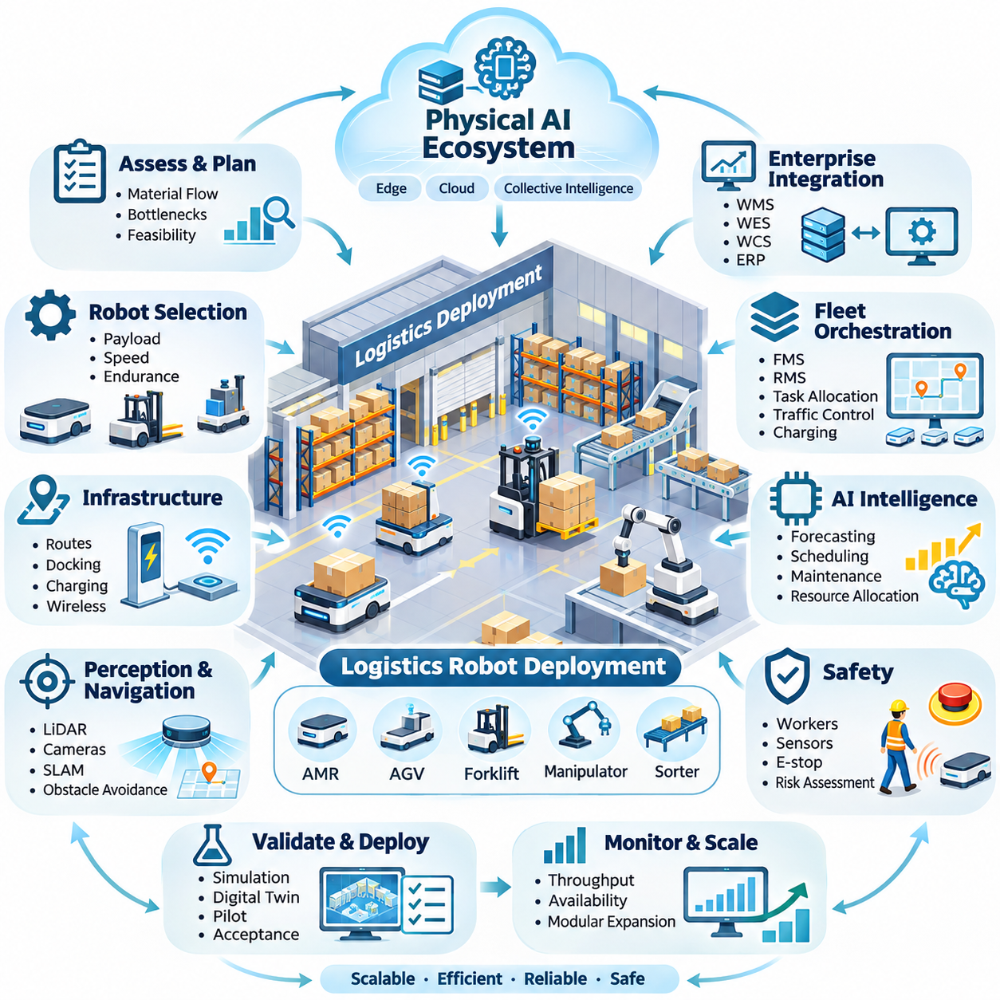
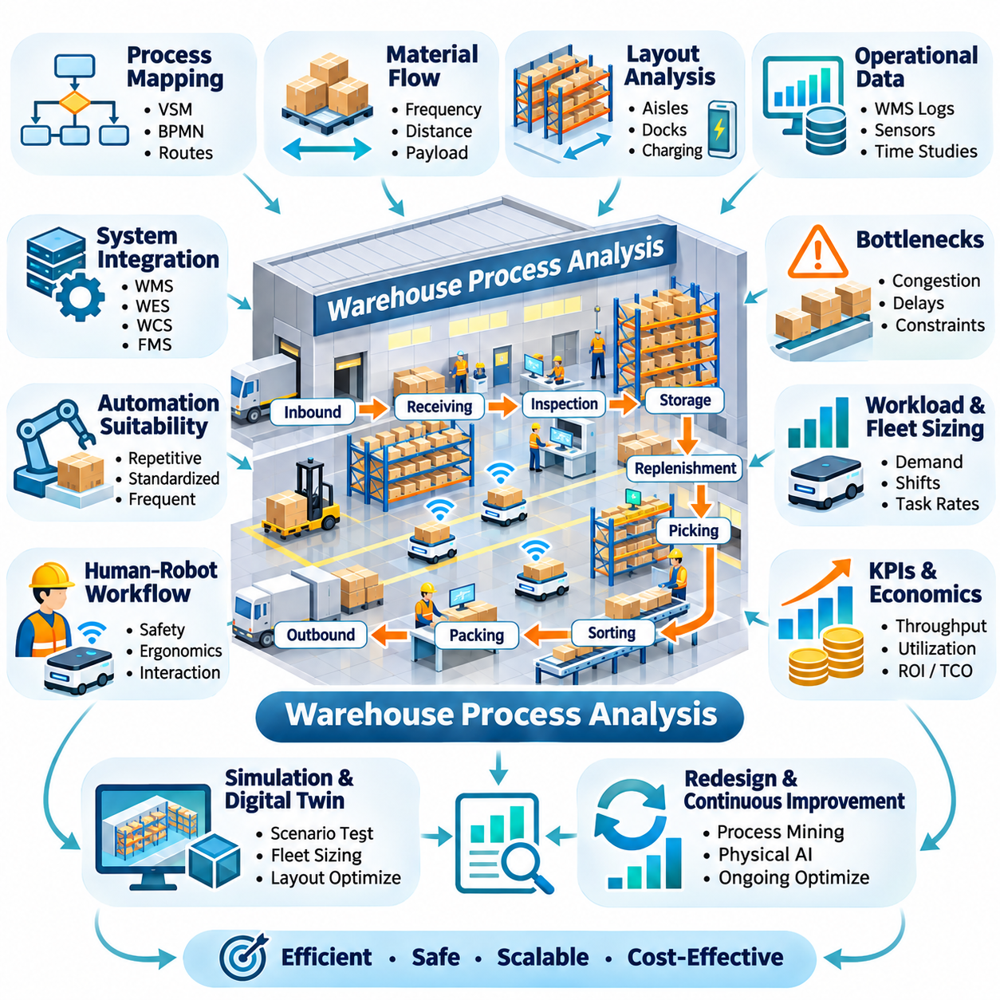
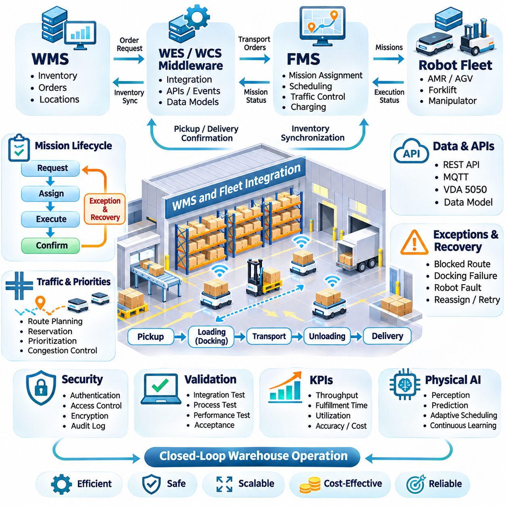
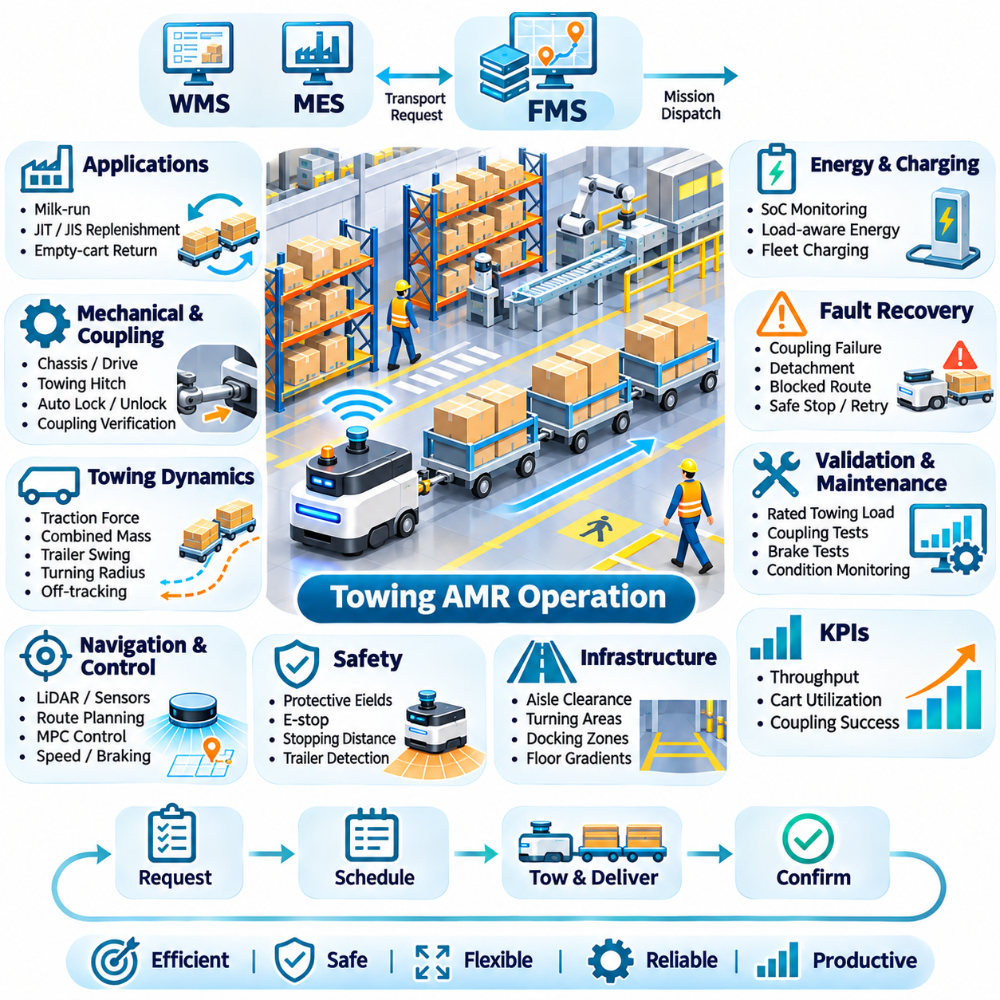
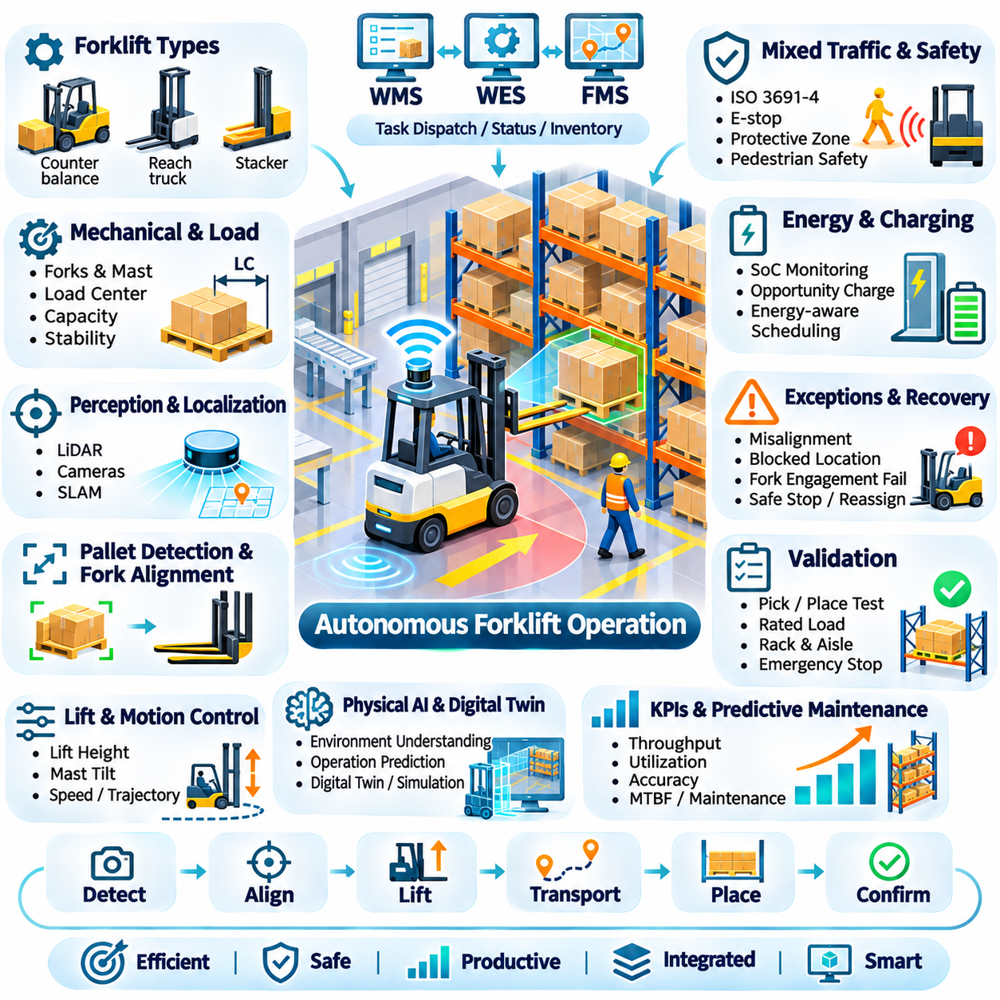
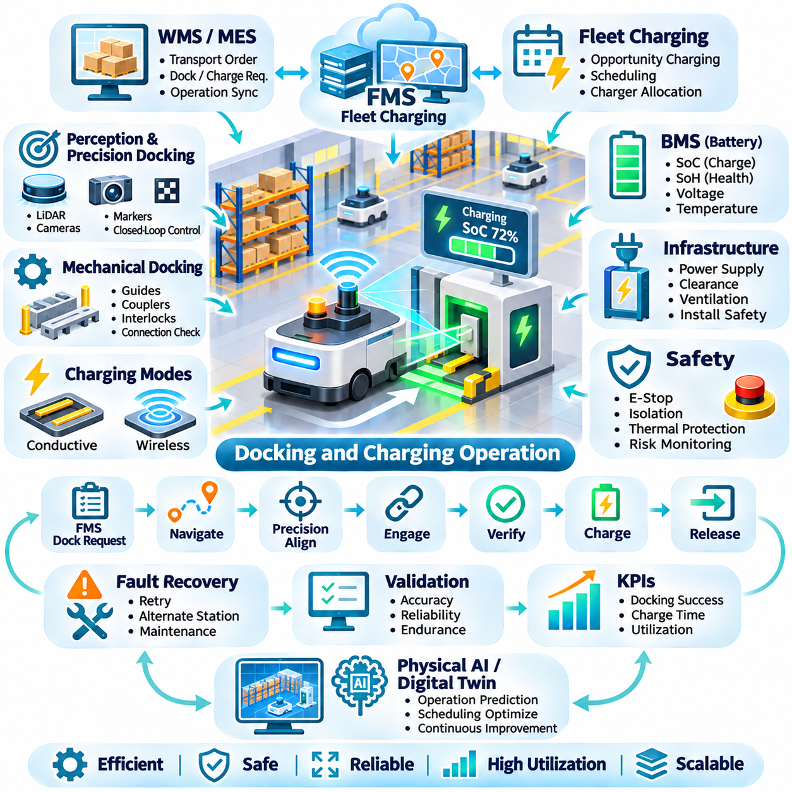
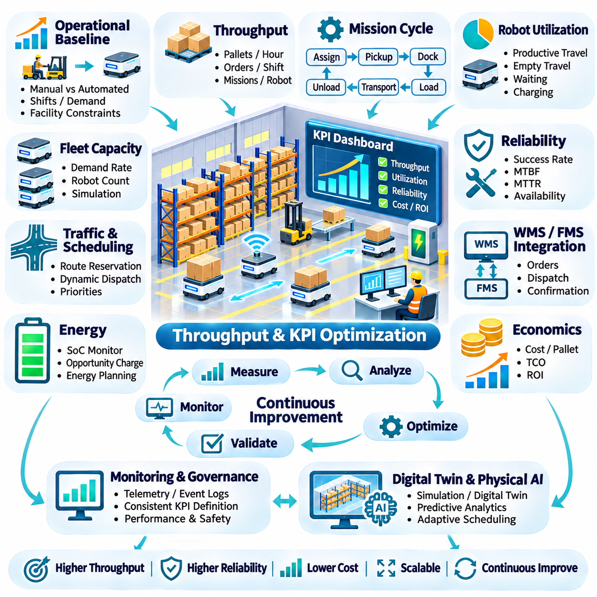
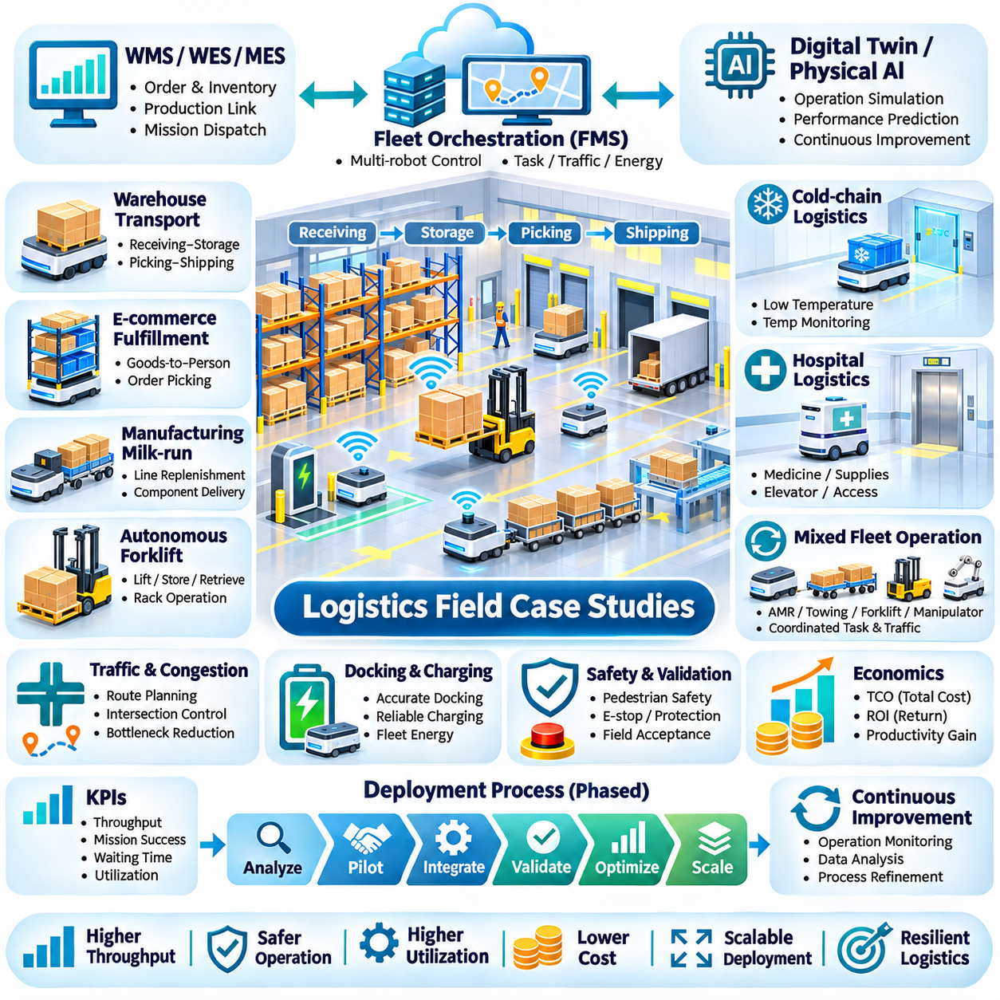

**Volume 08. AMR Operations, Deployment, and MLOps**

# Chapter 19. Logistics Robot Deployment

## 19.1 Logistics Deployment Overview

{width="7.268055555555556in" height="7.268055555555556in"}

물류 로봇 배치(Logistics Robot Deployment)는 창고(Warehouse), 유통 센터(Distribution Center), 주문 처리 시설(Fulfillment Facility), 제조 물류 환경(Manufacturing Logistics Environment) 및 운송 허브(Transportation Hub)에 자율 로봇 시스템(Autonomous Robotic System)을 체계적으로 도입하는 과정이다. 주요 목적은 자재 처리 효율성(Material Handling Efficiency), 운영 생산성(Operational Productivity), 운송 신뢰성(Transportation Reliability) 및 작업자 안전성(Workforce Safety)을 향상시키면서 지능형 물류 자동화(Intelligent Logistics Automation)를 위한 확장 가능한 기반을 구축하는 것이다.

현대 물류 환경(Modern Logistics Environment)은 동적이고 예측하기 어려운 조건에서 작동할 수 있는 로봇 시스템을 요구한다. 자율 이동 로봇(Autonomous Mobile Robot, AMR), 무인 운반차(Automated Guided Vehicle, AGV), 자율 지게차(Autonomous Forklift), 이동형 매니퓰레이터(Mobile Manipulator) 및 로봇 분류 시스템(Robotic Sorting System)은 물류 운영 전반에서 상호 보완적인 기능을 수행한다. 이러한 시스템의 배치를 위해서는 하드웨어(Hardware), 소프트웨어(Software), 인공지능(Artificial Intelligence), 통신 네트워크(Communication Network) 및 운영 인프라(Operational Infrastructure)의 유기적인 통합이 필요하다.

배치 수명주기(Deployment Lifecycle)는 기존 물류 프로세스(Logistics Process), 운영 요구사항(Operational Requirement), 자재 흐름(Material Flow), 시설 배치(Facility Layout) 및 운송 수요(Transportation Demand)에 대한 평가로 시작된다. 엔지니어는 반복적인 작업, 운송 병목현상(Transportation Bottleneck), 비효율적인 작업 흐름(Workflow) 및 잠재적인 자동화 기회(Automation Opportunity)를 식별해야 한다. 이러한 평가는 로봇 자동화(Robotic Automation)의 기술적·경제적 타당성(Technical and Economic Feasibility)을 확립하고 후속 시스템 설계(System Design)를 위한 기반을 제공한다.

운영 요구사항(Operational Requirement)은 로봇 사양(Robot Specification), 적재 용량(Payload Capacity), 운송 속도(Transportation Speed), 배터리 지속 시간(Battery Endurance), 내비게이션 정확도(Navigation Accuracy) 및 환경 적합성(Environmental Compatibility)을 결정한다. 다양한 물류 응용 분야(Logistics Application)는 자재 특성(Material Characteristics), 운송 거리(Transportation Distance), 바닥 상태(Floor Condition), 통로 폭(Aisle Width) 및 작업 복잡도(Task Complexity)에 따라 서로 다른 로봇 구성을 요구한다. 적절한 로봇 선정(Robot Selection)은 자동화 역량이 운영 목표(Operational Objective)에 부합하도록 보장한다.

인프라 준비(Infrastructure Preparation)는 신뢰성 있는 물류 로봇 배치를 위한 필수 요소이다. 시설은 적절한 운송 경로(Transportation Route), 충전 스테이션(Charging Station), 도킹 인터페이스(Docking Interface), 무선 통신 커버리지(Wireless Communication Coverage) 및 지정된 운영 구역(Operational Zone)을 제공해야 한다. 자율 내비게이션(Autonomous Navigation), 보행자 상호작용(Pedestrian Interaction), 자동문(Automatic Door), 엘리베이터(Elevator), 컨베이어(Conveyor) 및 기타 자재 처리 장비(Material Handling Equipment)를 수용하기 위해 기존 인프라의 변경이 필요할 수 있다.

환경 지도 작성(Environmental Mapping)과 위치 추정(Localization)은 자율 물류 운영(Autonomous Logistics Operation)의 공간적 기반을 확립한다. 로봇은 라이다(LiDAR), 카메라(Camera), 관성 센서(Inertial Sensor), 휠 인코더(Wheel Encoder) 및 동시적 위치 추정 및 지도 작성(Simultaneous Localization and Mapping, SLAM) 기술을 활용하여 환경 표현(Environmental Representation)을 구축하고 유지한다. 이러한 환경 표현은 물류 시설 전반에서 자율 내비게이션(Autonomous Navigation), 장애물 회피(Obstacle Avoidance), 경로 최적화(Route Optimization) 및 정밀 위치 결정(Accurate Positioning)을 지원한다.

시스템 통합(System Integration)은 자율 로봇을 기업 물류 인프라(Enterprise Logistics Infrastructure)와 연결한다. 창고 관리 시스템(Warehouse Management System, WMS), 창고 실행 시스템(Warehouse Execution System, WES), 창고 제어 시스템(Warehouse Control System, WCS) 및 전사적 자원 관리(Enterprise Resource Planning, ERP) 플랫폼은 로봇 시스템과 운영 정보(Operational Information)를 교환한다. 이러한 인터페이스는 자동화된 작업 생성(Automated Task Generation), 재고 동기화(Inventory Synchronization), 운송 일정 관리(Transportation Scheduling) 및 자재 처리 조정(Coordinated Material Handling)을 가능하게 한다.

군집 관리 시스템(Fleet Management System, FMS)과 로봇 관리 시스템(Robot Management System, RMS)은 다수의 물류 로봇에 대한 중앙집중형 또는 분산형 조정(Centralized or Distributed Coordination)을 제공한다. 이러한 시스템은 작업 할당(Task Allocation), 교통 제어(Traffic Control), 경로 계획(Route Planning), 충전 일정(Charging Schedule), 운영 우선순위(Operational Priority) 및 로봇 가용성(Robot Availability)을 관리한다. 효과적인 군집 오케스트레이션(Fleet Orchestration)은 혼잡을 방지하고 불필요한 운송 이동을 줄이며 시설 전반의 자원 활용률(Resource Utilization)을 향상시킨다.

인공지능(Artificial Intelligence)은 로봇이 복잡한 환경을 해석하고, 객체를 인식하며, 운영 조건을 예측하고, 운송 전략을 적응적으로 변경할 수 있도록 함으로써 물류 로봇 배치 역량을 향상시킨다. 기계학습(Machine Learning)은 수요 예측(Demand Forecasting), 동적 작업 스케줄링(Dynamic Task Scheduling), 예지 정비(Predictive Maintenance) 및 지능형 자원 할당(Intelligent Resource Allocation)을 지원한다. 이러한 역량은 물류 시스템이 변화하는 운영 요구사항에 더욱 효과적으로 대응할 수 있도록 한다.

안전 공학(Safety Engineering)은 전체 배치 수명주기에 걸쳐 적용되어야 하는 기본적인 요구사항이다. 자율 물류 로봇(Autonomous Logistics Robot)은 작업자, 차량, 기계 장비 및 중요한 재고 자산 주변에서 안전하게 작동해야 한다. 안전 등급 센서(Safety-Rated Sensor), 비상 정지 메커니즘(Emergency Stop Mechanism), 보호 영역(Protective Field), 속도 제한(Speed Limitation) 및 위험성 평가 절차(Risk Assessment Procedure)는 관련 안전 표준(Safety Standard)과 시설별 운영 요구사항에 따라 구현되어야 한다.

배치 검증(Deployment Validation)은 실제 물류 환경을 대표하는 조건에서 단계적인 시험(Progressive Testing)을 수행하는 과정이다. 시뮬레이션(Simulation), 디지털 트윈 환경(Digital Twin Environment), 통제된 시범 운영(Controlled Pilot Operation) 및 현장 인수 시험(Field Acceptance Testing)은 운송 성능(Transportation Performance), 내비게이션 신뢰성(Navigation Reliability), 시스템 통합(System Integration) 및 안전 동작(Safety Behavior)을 검증한다. 식별된 결함과 미비점은 실험적 운영(Experimental Operation)에서 본격적인 상용 운영(Full-Scale Commercial Deployment)으로 전환하기 전에 해결되어야 한다.

운영 모니터링(Operational Monitoring)은 로봇 가용성(Robot Availability), 임무 완료율(Mission Completion Rate), 운송 처리량(Transportation Throughput), 배터리 건전성(Battery Health), 시스템 결함(System Fault) 및 유지보수 요구사항(Maintenance Requirement)에 대한 지속적인 가시성(Visibility)을 제공한다. 원격 모니터링 플랫폼(Remote Monitoring Platform)과 분석 대시보드(Analytics Dashboard)는 운영자가 성능 저하(Performance Degradation)를 식별하고 운영 장애(Operational Disturbance)에 선제적으로 대응할 수 있도록 한다. 이력 데이터(Historical Data)는 지속적인 시스템 최적화(System Optimization)도 지원한다.

확장성(Scalability)은 증가하는 운송 수요(Transportation Demand), 추가적인 로봇 플랫폼(Robotic Platform) 및 시설 확장(Facility Expansion)을 수용할 수 있도록 초기 배치 아키텍처(Deployment Architecture)에 반영되어야 한다. 모듈형 인터페이스(Modular Interface), 상호운용 가능한 통신 프로토콜(Interoperable Communication Protocol), 분산 컴퓨팅(Distributed Computing) 및 유연한 군집 오케스트레이션(Flexible Fleet Orchestration)은 기존 물류 인프라를 근본적으로 재구성하지 않고도 로봇 운영 역량을 확장할 수 있도록 한다.

물류 로봇 배치의 장기적인 발전(Long-Term Evolution)은 기존의 운송 자동화(Transportation Automation)를 넘어 상호 연결된 물리적 인공지능 생태계(Interconnected Physical AI Ecosystem)로 확장된다. 엣지 지능(Edge Intelligence), 클라우드 컴퓨팅(Cloud Computing), 디지털 트윈(Digital Twin), 기반 모델(Foundation Model) 및 로봇 집단지능(Collective Robotic Intelligence)은 더욱 적응적인 물류 운영(Adaptive Logistics Operation)을 지원할 수 있다. 이를 통해 기존 물류 시설은 지능적이고 복원력이 높으며 지속적으로 개선되는 자율 운영 환경(Autonomous Operational Environment)으로 전환된다.

## 19.2 Warehouse Process Analysis

{width="7.268055555555556in" height="7.268055555555556in"}

창고 프로세스 분석(Warehouse Process Analysis)은 물류 시설(Logistics Facility) 내부의 자재 흐름(Material Flow), 재고 이동(Inventory Movement), 운영 활동(Operational Activity), 자원 활용(Resource Utilization) 및 정보 교환(Information Exchange)을 조사하는 체계적인 방법론이다. 주요 목적은 기존 창고 환경(Warehouse Environment)에 자율 로봇 시스템(Autonomous Robotic System)을 배치하기 전에 운영 비효율성(Operational Inefficiency), 운송 병목현상(Transportation Bottleneck) 및 자동화 기회(Automation Opportunity)를 식별하는 것이다.

분석은 입고 물류(Inbound Logistics), 입고 처리(Receiving), 검사(Inspection), 보관(Storage), 재고 보충(Replenishment), 주문 피킹(Order Picking), 분류(Sorting), 포장(Packing) 및 출고 운송(Outbound Transportation)에 대한 종합적인 평가로 시작된다. 각 프로세스는 운영 목적(Operational Purpose), 실행 순서(Execution Sequence), 처리 시간(Processing Time), 자원 요구사항(Resource Requirement) 및 인접 활동과의 상호작용(Interaction)에 따라 평가되어야 한다. 이러한 평가는 창고 운영(Warehouse Operation)의 기준선 표현(Baseline Representation)을 확립한다.

프로세스 매핑(Process Mapping)은 물리적 자재 이동(Physical Material Movement)과 관련 정보 흐름(Information Flow)에 대한 구조화된 표현을 제공한다. 엔지니어는 운송 경로(Transportation Route), 자재 이송 지점(Material Transfer Point), 보관 위치(Storage Location), 처리 작업장(Processing Station) 및 운영 의존성(Operational Dependency)을 문서화한다. 가치 흐름 매핑(Value Stream Mapping, VSM), 비즈니스 프로세스 모델 및 표기법(Business Process Model and Notation, BPMN), 자재 흐름 분석(Material Flow Analysis)은 중복 활동(Redundant Activity)과 비부가가치 작업(Non-Value-Added Operation)의 식별을 지원한다.

자재 흐름 분석(Material Flow Analysis)은 제품(Product), 팔레트(Pallet), 컨테이너(Container) 및 개별 재고 품목(Inventory Item)이 창고 전체에서 어떻게 이동하는지를 조사한다. 운송 빈도(Transportation Frequency), 이동 거리(Movement Distance), 적재물 특성(Payload Characteristics), 이동 방향 패턴(Directional Pattern) 및 취급 요구사항(Handling Requirement)은 정량화되어야 한다. 이러한 특성을 이해함으로써 엔지니어는 적합한 로봇 플랫폼(Robotic Platform), 운송 경로(Transportation Route), 군집 용량(Fleet Capacity) 및 자동화 우선순위(Automation Priority)를 결정할 수 있다.

창고 레이아웃 분석(Warehouse Layout Analysis)은 보관 랙(Storage Rack), 운송 통로(Transportation Aisle), 상하차 도크(Loading Dock), 작업대(Workstation), 충전 위치(Charging Location) 및 제한 운영 구역(Restricted Operational Zone)의 공간적 구성을 평가한다. 통로 폭(Aisle Width), 바닥 상태(Floor Condition), 회전 반경(Turning Radius), 천장 높이(Ceiling Height) 및 보행자 밀도(Pedestrian Density)와 같은 물리적 제약조건(Physical Constraint)은 로봇 내비게이션 타당성(Robotic Navigation Feasibility)에 직접적인 영향을 미친다. 공간 최적화(Spatial Optimization)는 접근성을 향상시키고 운송 충돌 및 간섭을 줄일 수 있다.

운영 데이터 수집(Operational Data Collection)은 창고 프로세스 분석을 위한 정량적 기반(Quantitative Foundation)을 확립한다. 과거 거래 기록(Historical Transaction Record), 창고 관리 시스템(Warehouse Management System, WMS) 로그, 센서 측정값(Sensor Measurement), 영상 관찰(Video Observation) 및 수동 시간 연구(Manual Time Study)는 실제 운영 조건(Actual Operating Condition)에 대한 정보를 제공한다. 신뢰성 있는 분석 결과를 확보하기 위해 데이터는 정상 운영(Normal Operation), 최대 수요 기간(Peak Demand Period), 계절적 변동(Seasonal Variation) 및 예외 상황(Exceptional Situation)을 대표할 수 있어야 한다.

병목현상 분석(Bottleneck Analysis)은 창고 처리량(Warehouse Throughput)을 제한하고 전체 물류 효율성(Logistics Efficiency)을 저하시키는 운영 단계를 식별한다. 혼잡한 운송 통로(Congested Transportation Corridor), 과부하된 피킹 스테이션(Overloaded Picking Station), 부족한 보관 용량(Insufficient Storage Capacity), 재고 보충 지연(Delayed Replenishment) 및 동기화 실패(Synchronization Failure)는 심각한 운영 제약(Operational Limitation)을 발생시킬 수 있다. 이러한 제약의 근본 원인(Root Cause)을 식별함으로써 로봇 자동화가 단순히 병목현상을 다른 프로세스로 이전시키는 것을 방지할 수 있다.

작업 부하 특성화(Workload Characterization)는 운영 교대조(Operational Shift), 창고 구역(Warehouse Zone), 제품 범주(Product Category) 및 주문 프로파일(Order Profile)에 따른 운송 작업(Transportation Task)의 분포를 결정한다. 엔지니어는 작업 도착률(Task Arrival Rate), 작업 실행 시간(Execution Duration), 운송 거리(Transportation Distance) 및 수요 변동(Demand Fluctuation)을 평가한다. 이러한 매개변수는 로봇 군집 규모 산정(Fleet Sizing), 충전 전략 개발(Charging Strategy Development), 작업 스케줄링(Task Scheduling) 및 다양한 운영 조건에서의 로봇 시스템 용량(Robotic System Capacity) 추정을 지원한다.

인간 작업 흐름 분석(Human Workflow Analysis)은 창고 작업자(Warehouse Personnel), 자율 로봇(Autonomous Robot), 지게차(Forklift), 컨베이어(Conveyor) 및 고정형 기계 장비(Stationary Machinery) 사이의 상호작용을 조사한다. 보행 거리(Walking Distance), 수동 자재 취급 활동(Manual Handling Activity), 반복 동작(Repetitive Movement), 인간공학적 위험(Ergonomic Risk) 및 보행자 이동 패턴(Pedestrian Traffic Pattern)을 평가해야 한다. 이러한 분석은 작업자의 물리적 작업 부하(Physical Workload)를 감소시키고 잠재적인 인간-로봇 상호작용 위험(Human--Robot Interaction Hazard)을 최소화하면서 협업 운영 설계(Collaborative Operational Design)를 지원한다.

자동화 적합성 분석(Automation Suitability Analysis)은 어떤 창고 프로세스가 로봇 배치를 통해 가장 효과적인 혜택을 얻을 수 있는지를 결정한다. 반복 운송(Repetitive Transportation), 예측 가능한 자재 이송(Predictable Material Transfer), 표준화된 적재물 취급(Standardized Payload Handling) 및 고정된 위치 사이의 빈번한 이동은 일반적으로 적절한 자동화 대상이다. 비정형 객체(Irregular Object), 복잡한 조작(Complex Manipulation) 또는 급격하게 변화하는 환경 조건을 포함하는 프로세스는 더욱 발전된 인지(Perception) 및 의사결정(Decision-Making) 역량을 요구할 수 있다.

정보 흐름 분석(Information Flow Analysis)은 운영 명령(Operational Command), 재고 기록(Inventory Record), 운송 요청(Transportation Request) 및 완료 알림(Completion Notification)이 창고 관리 플랫폼(Warehouse Management Platform) 전반에서 어떻게 교환되는지를 평가한다. 창고 관리 시스템(Warehouse Management System, WMS), 창고 실행 시스템(Warehouse Execution System, WES), 창고 제어 시스템(Warehouse Control System, WCS) 및 군집 관리 시스템(Fleet Management System, FMS)의 통합 요구사항(Integration Requirement)을 식별하여 일관된 작업 실행(Task Execution)과 물리적 운영(Physical Operation) 및 디지털 운영(Digital Operation) 사이의 동기화(Synchronization)를 보장해야 한다.

시뮬레이션(Simulation)과 디지털 트윈(Digital Twin) 기술은 물리적 배치(Physical Deployment) 이전에 대안적인 창고 프로세스 구성(Warehouse Process Configuration)을 평가할 수 있도록 한다. 이산 사건 시뮬레이션(Discrete-Event Simulation), 에이전트 기반 모델링(Agent-Based Modeling) 및 가상 로봇 환경(Virtual Robotic Environment)은 운송 수요(Transportation Demand), 교통 상황(Traffic Condition), 충전 동작(Charging Behavior) 및 자원 경쟁(Resource Competition)을 재현할 수 있다. 이러한 방법은 로봇 군집 규모 산정(Fleet Sizing), 레이아웃 최적화(Layout Optimization) 및 잠재적인 운영 개선 효과(Operational Improvement)의 평가를 지원한다.

성능 분석(Performance Analysis)은 기존 창고 운영과 자동화 대안을 비교하기 위한 측정 가능한 핵심 성과 지표(Key Performance Indicator, KPI)를 확립한다. 대표적인 지표에는 주문 이행 시간(Order Fulfillment Time), 운송 처리량(Transportation Throughput), 재고 정확도(Inventory Accuracy), 자원 활용률(Resource Utilization), 이동 거리(Travel Distance), 노동 생산성(Labor Productivity) 및 거래당 운영 비용(Operating Cost per Transaction)이 포함된다. 기준선 측정(Baseline Measurement)은 배치 효과성(Deployment Effectiveness)과 후속 개선 사항을 평가하기 위한 객관적인 근거를 제공한다.

경제적 타당성 분석(Economic Feasibility Analysis)은 예상되는 운영상의 혜택(Operational Benefit)과 로봇 자동화의 총비용(Total Cost of Robotic Automation) 사이의 관계를 조사한다. 자본적 지출(Capital Expenditure, CAPEX), 인프라 변경(Infrastructure Modification), 소프트웨어 통합(Software Integration), 유지보수(Maintenance), 에너지 소비(Energy Consumption) 및 작업자 교육(Workforce Training)을 고려해야 한다. 투자 수익률(Return on Investment, ROI), 총소유비용(Total Cost of Ownership, TCO) 및 투자 회수 기간(Payback Period) 계산은 투자 의사결정(Investment Decision)과 단계적 배치 계획(Phased Deployment Planning)을 지원한다.

창고 프로세스 재설계(Warehouse Process Redesign)는 분석 결과를 자율 로봇 시스템을 수용할 수 있는 개선된 운영 아키텍처(Operational Architecture)로 전환하는 과정이다. 운송 경로(Transportation Route), 자재 이송 인터페이스(Material Transfer Interface), 작업 할당 정책(Task Allocation Policy), 보관 전략(Storage Strategy) 및 예외 처리 절차(Exception-Handling Procedure)는 개별적으로 분리되지 않고 종합적으로 최적화되어야 한다. 주요 목적은 단순히 수동 운송(Manual Transportation)을 대체하는 것이 아니라 더욱 효율적이고 유기적으로 조정된 물류 운영 모델(Logistics Operating Model)을 확립하는 것이다.

지속적인 창고 프로세스 분석(Continuous Warehouse Process Analysis)은 운영 원격 측정 데이터(Operational Telemetry), 과거 성능 기록(Historical Performance Record) 및 로봇 시스템의 피드백(Feedback)을 활용하여 초기 배치 이후까지 확장된다. 프로세스 마이닝(Process Mining), 기계학습(Machine Learning), 예측 분석(Predictive Analytics) 및 디지털 트윈(Digital Twin)은 새롭게 발생하는 비효율성과 변화하는 수요 패턴(Demand Pattern)을 식별할 수 있다. 이러한 지속적 개선 프레임워크(Continuous Improvement Framework)는 기존 창고가 적응적이고 확장 가능하며 지능적인 물리적 인공지능 물류 환경(Physical AI Logistics Environment)으로 발전할 수 있도록 지원한다.

## 19.3 WMS and Fleet Integration

{width="7.268055555555556in" height="7.268055555555556in"}

창고 관리 시스템(Warehouse Management System, WMS)과 로봇 군집 통합(Fleet Integration)은 기업의 창고 프로세스(Enterprise Warehouse Process)와 자율 로봇 운송 시스템(Autonomous Robotic Transportation System)을 연결하는 유기적인 운영 프레임워크(Operational Framework)를 확립한다. 창고 관리 시스템(WMS)은 재고(Inventory), 보관 위치(Storage Location), 주문 이행(Order Fulfillment) 및 자재 이동 요구사항(Material Movement Requirement)을 관리하며, 군집 관리 시스템(Fleet Management System, FMS)은 운송 요청(Transportation Request)을 실행 가능한 로봇 임무(Robotic Mission)로 변환하고 해당 임무의 실행을 조정한다.

통합 아키텍처(Integration Architecture)는 일반적으로 기업 관리 시스템(Enterprise Management System), 창고 실행 플랫폼(Warehouse Execution Platform), 군집 오케스트레이션 서비스(Fleet Orchestration Service) 및 개별 로봇 플랫폼(Individual Robotic Platform)으로 구성된다. 각 아키텍처 계층(Architectural Layer)은 표준화된 인터페이스(Standardized Interface)를 통해 운영 정보를 교환하면서 서로 구분된 역할과 책임을 수행한다. 이러한 계층적 구조(Hierarchical Structure)는 비즈니스 수준의 의사결정(Business-Level Decision-Making)을 로봇 수준의 내비게이션(Navigation), 모션 제어(Motion Control) 및 안전 기능(Safety Function)으로부터 분리한다.

창고 관리 시스템(WMS)은 창고 재고 정보(Warehouse Inventory Information)와 물류 운송 요구사항(Logistics Transportation Requirement)의 주요 정보원(Primary Source)으로 기능한다. 입고(Receiving), 재고 보충(Replenishment), 피킹(Picking) 또는 출하(Shipping) 프로세스에서 자재 이동이 필요한 경우, 창고 관리 시스템은 출발 위치(Source Location), 목적지 위치(Destination Location), 적재물 식별자(Payload Identifier), 취급 요구사항(Handling Requirement) 및 운영 우선순위(Operational Priority)를 포함하는 운송 요청을 생성한다. 이러한 요청은 유기적으로 조정된 자율 운송 작업 흐름(Autonomous Transportation Workflow)을 시작한다.

군집 관리 시스템(Fleet Management System, FMS)은 로봇 가용성(Robot Availability), 적재물 호환성(Payload Compatibility), 현재 위치(Current Location), 배터리 상태(Battery Status) 및 운송 수요(Transportation Demand)를 평가하여 창고 운송 요청을 상세한 로봇 임무(Robotic Mission)로 변환한다. 임무 실행(Mission Execution)에는 내비게이션(Navigation), 도킹(Docking), 적재(Loading), 운송(Transportation), 하역(Unloading) 및 확인(Confirmation) 활동이 포함될 수 있다. 동적 자원 할당(Dynamic Resource Allocation)은 로봇 군집이 변화하는 창고 운영 조건에 효율적으로 대응할 수 있도록 한다.

미들웨어(Middleware)는 창고 관리 플랫폼(Warehouse Management Platform)과 이기종 로봇 시스템(Heterogeneous Robotic System) 사이의 상호운용성 계층(Interoperability Layer)을 제공한다. 창고 실행 시스템(Warehouse Execution System, WES), 창고 제어 시스템(Warehouse Control System, WCS) 및 통합 게이트웨이(Integration Gateway)는 정보 교환(Information Exchange), 프로토콜 변환(Protocol Conversion), 작업 흐름 동기화(Workflow Synchronization) 및 장비 상호운용성(Equipment Interoperability)을 조정할 수 있다. 이러한 중간 계층 아키텍처(Intermediate Architecture)는 기업 애플리케이션(Enterprise Application)과 개별 로봇 구현(Individual Robot Implementation) 사이의 직접적인 의존성(Direct Dependency)을 감소시킨다.

통신 인터페이스(Communication Interface)는 창고 관리 플랫폼이 군집 관리 서비스(Fleet Management Service)와 명령(Command), 운영 이벤트(Operational Event) 및 상태 정보(Status Information)를 어떻게 교환하는지를 결정한다. RESTful API, MQTT, AMQP, WebSocket 및 이벤트 기반 메시징 아키텍처(Event-Driven Messaging Architecture)는 서로 다른 통신 역량(Communication Capability)을 제공한다. VDA 5050 및 MassRobotics AMR 상호운용성 명세(MassRobotics AMR Interoperability Specification)와 같은 기술은 이기종 로봇 환경(Heterogeneous Robotic Environment) 전반의 조정과 연계를 지원할 수 있다.

데이터 표준화(Data Standardization)는 창고 관리 시스템과 로봇 군집 시스템 사이의 일관된 통신(Consistent Communication)을 위한 필수 요소이다. 운송 주문(Transportation Order), 임무 식별자(Mission Identifier), 위치 식별자(Location Identifier), 적재물 설명(Payload Description), 타임스탬프(Timestamp), 실행 상태(Execution State) 및 오류 코드(Error Code)는 합의된 데이터 모델(Data Model)을 따라야 한다. 버전 관리된 인터페이스 명세(Version-Controlled Interface Specification)와 스키마 검증(Schema Validation)은 의미적 불일치(Semantic Inconsistency)를 감소시키고 통합 소프트웨어 구성요소(Integrated Software Component) 전반의 유지보수성(Maintainability)을 향상시킨다.

임무 수명주기 관리(Mission Lifecycle Management)는 비즈니스 수준의 운송 요구사항(Business-Level Transportation Requirement)과 물리적 로봇 실행(Physical Robotic Execution) 사이의 동기화를 유지한다. 운송 요청은 일반적으로 생성(Creation), 수락(Acceptance), 할당(Allocation), 실행(Execution), 완료(Completion) 또는 실패(Failure) 상태를 거친다. 수신 확인 메커니즘(Acknowledgment Mechanism), 고유 트랜잭션 식별자(Unique Transaction Identifier) 및 멱등성 처리(Idempotent Processing)는 중복 임무(Duplicated Mission), 일관성 없는 실행 기록(Inconsistent Execution Record) 및 의도하지 않은 운송 활동(Unintended Transportation Activity)을 방지하는 데 기여한다.

재고 동기화(Inventory Synchronization)는 디지털 창고 기록(Digital Warehouse Record)이 물리적 자재 이동(Physical Material Movement)을 정확하게 반영하도록 보장한다. 로봇 시스템은 픽업 확인(Pickup Confirmation), 배송 완료 확인(Delivery Confirmation), 적재물 식별 결과(Payload Identification Result) 및 예외 알림(Exception Notification)을 상위 관리 플랫폼(Upstream Management Platform)으로 전송한다. 재고 트랜잭션(Inventory Transaction)은 사전에 정의된 비즈니스 규칙(Business Rule)과 데이터 대사 절차(Reconciliation Procedure)에 따라 필요한 물리적 작업이 검증된 이후에만 확정 처리(Commit)되어야 한다.

작업 우선순위 지정(Task Prioritization)은 군집 관리 시스템이 긴급 출하(Urgent Shipment), 생산 자재 보충(Production Replenishment), 일상적인 보관 이동(Routine Storage Movement) 및 충전 요구사항(Charging Requirement) 사이의 균형을 유지할 수 있도록 한다. 스케줄링 알고리즘(Scheduling Algorithm)은 주문 마감기한(Order Deadline), 로봇 역량(Robot Capability), 운송 거리(Transportation Distance), 혼잡 수준(Congestion Level) 및 운영 의존성(Operational Dependency)을 평가한다. 유기적인 우선순위 관리(Coordinated Priority Management)는 과도한 지연(Excessive Delay)과 자원 기아 현상(Resource Starvation)을 방지하면서 주문 이행 성능(Order Fulfillment Performance)을 향상시킨다.

교통 관리(Traffic Management)는 공유 운송 통로(Shared Transportation Corridor), 교차로(Intersection), 적재 스테이션(Loading Station) 및 제한 운영 구역(Restricted Operational Zone)에서 로봇의 이동을 조정한다. 군집 관리 시스템은 예약 메커니즘(Reservation Mechanism), 동적 경로 계획(Dynamic Route Planning), 혼잡 예측(Congestion Prediction) 및 교착 상태 방지 전략(Deadlock Prevention Strategy)을 활용할 수 있다. 창고 프로세스 일정(Warehouse Process Schedule)과의 연계는 운송 충돌 및 간섭(Transportation Conflict)을 감소시키고 핵심 물류 인프라(Critical Logistics Infrastructure)의 활용률(Utilization)을 향상시킨다.

예외 처리(Exception Handling)는 물리적 운송 활동(Physical Transportation Activity)이 계획된 창고 작업 흐름(Warehouse Workflow)에서 벗어나는 경우에 필요하다. 차단된 경로(Blocked Route), 사용할 수 없는 목적지(Unavailable Destination), 잘못된 적재물(Incorrect Payload), 도킹 실패(Docking Failure), 통신 중단(Communication Interruption) 및 로봇 결함(Robot Fault)은 적절한 복구 절차(Recovery Procedure)를 작동시켜야 한다. 통합 예외 관리(Integrated Exception Management)는 운영 안전성(Operational Safety)을 저해하지 않으면서 임무 재할당(Mission Reassignment), 통제된 재시도(Controlled Retry), 재고 대사(Inventory Reconciliation) 및 운영자 개입(Operator Intervention)을 지원한다.

사이버 보안(Cybersecurity)과 통신 복원력(Communication Resilience)은 통합된 창고 및 군집 관리 환경을 무단 접근(Unauthorized Access), 데이터 조작(Data Manipulation) 및 서비스 중단(Service Interruption)으로부터 보호한다. 인증(Authentication), 역할 기반 접근 제어(Role-Based Access Control, RBAC), 암호화된 통신(Encrypted Communication), 네트워크 분할(Network Segmentation), 감사 로그(Audit Logging) 및 통제된 소프트웨어 업데이트(Controlled Software Update)가 구현되어야 한다. 기업 통신 서비스(Enterprise Communication Service)를 사용할 수 없는 상황에서도 로봇의 로컬 안전 기능(Local Robot Safety Function)은 지속적으로 유효하게 작동해야 한다.

통합 시험(Integration Testing)은 창고 주문 생성(Warehouse Order Generation)에서 물리적 운송 완료(Physical Transportation Completion)와 재고 확인(Inventory Confirmation)에 이르기까지 전체 운영 작업 흐름(Operational Workflow)을 검증한다. 시뮬레이션(Simulation), 인터페이스 시험(Interface Testing), 하드웨어 연동 시뮬레이션 시험(Hardware-in-the-Loop Testing, HIL), 통제된 시범 운영(Controlled Pilot Operation) 및 현장 인수 시험(Field Acceptance Testing)은 정상 운영(Normal Operation), 최대 수요(Peak Demand) 및 비정상 운영 조건(Abnormal Operating Condition)에서 상호운용성(Interoperability), 트랜잭션 일관성(Transaction Consistency), 통신 복구(Communication Recovery) 및 임무 신뢰성(Mission Reliability)을 평가한다.

성능 모니터링(Performance Monitoring)은 창고 관리 시스템과 로봇 군집 통합의 효과성(Integration Effectiveness)에 대한 지속적인 가시성(Visibility)을 제공한다. 핵심 성과 지표(Key Performance Indicator, KPI)에는 운송 주문 지연 시간(Transportation Order Latency), 임무 완료율(Mission Completion Rate), 재고 동기화 정확도(Inventory Synchronization Accuracy), 트랜잭션 실패율(Transaction Failure Rate), 로봇 활용률(Robot Utilization) 및 창고 처리량(Warehouse Throughput)이 포함된다. 상관관계가 분석된 운영 로그(Correlated Operational Log)와 분산 추적(Distributed Tracing)은 통합 병목현상(Integration Bottleneck)을 식별하고 소프트웨어 장애(Software Failure)와 물리적 실행 문제(Physical Execution Problem)를 구분하는 데 기여한다.

창고 관리 시스템과 로봇 군집 통합의 장기적인 발전(Long-Term Evolution)은 지능적이고 적응적이며 상호 연결된 물리적 인공지능 물류 생태계(Interconnected Physical AI Logistics Ecosystem)로 확장된다. 엣지 컴퓨팅(Edge Computing), 클라우드 오케스트레이션(Cloud Orchestration), 디지털 트윈(Digital Twin), 기계학습(Machine Learning) 및 로봇 집단지능(Collective Robotic Intelligence)은 예측 기반 스케줄링(Predictive Scheduling)과 동적 자원 최적화(Dynamic Resource Optimization)를 지원할 수 있다. 모듈형 통합 아키텍처(Modular Integration Architecture)는 확장 가능한 창고 자동화(Scalable Warehouse Automation)와 지속적인 운영 개선(Continuous Operational Improvement)을 위한 기반을 제공한다.

## 19.4 Towing AMR Operation

{width="7.268055555555556in" height="7.268055555555556in"}

견인형 자율 이동 로봇 운영(Towing Autonomous Mobile Robot Operation, Towing AMR Operation)은 창고(Warehouse), 제조 시설(Manufacturing Facility), 유통 센터(Distribution Center) 및 물류 환경(Logistics Environment)에서 운반 카트(Cart), 트레일러(Trailer), 트롤리(Trolley) 및 바퀴 기반 자재 처리 장비(Wheeled Material Handling Equipment)를 자율적으로 운송하는 것을 의미한다. 기존의 적재형 자율 이동 로봇(Payload-Carrying AMR)과 달리, 견인형 자율 이동 로봇(Towing AMR)은 외부 운송 장치(External Transportation Unit)를 견인하여 자재를 이동시키므로 기존 물류 장비에 대한 대규모 변경 없이 유연한 자재 운송(Flexible Material Movement)을 구현할 수 있다.

견인형 자율 이동 로봇(Towing AMR)은 생산 라인 자재 보충(Production Line Replenishment), 창고 운송(Warehouse Transportation), 순회 물류(Milk-Run Logistics), 조립 부품 배송(Assembly Component Delivery) 및 빈 컨테이너 회수(Empty Container Collection)에 특히 적합하다. 견인 구성(Towing Configuration)이 허용하는 경우 단일 로봇은 상호 연결된 여러 대의 운반 카트를 운송하여 임무당 운송 용량(Transportation Capacity per Mission)을 증가시킬 수 있다. 이러한 운영 모델(Operational Model)은 반복적인 수동 운송(Manual Transportation)을 감소시키고 기존 자재 처리 자원(Material Handling Resource)의 활용률을 향상시킨다.

견인형 자율 이동 로봇의 기계적 아키텍처(Mechanical Architecture)는 일반적으로 이동형 섀시(Mobile Chassis), 추진 시스템(Propulsion System), 조향 메커니즘(Steering Mechanism), 제동 시스템(Braking System), 견인 연결 장치(Towing Hitch) 및 결합 메커니즘(Coupling Mechanism)으로 구성된다. 견인 용량(Towing Capacity)은 로봇 자체의 적재 용량(Payload Capacity)과 독립적으로 평가되어야 한다. 모터 토크(Motor Torque), 견인력(Traction Force), 구조적 강도(Structural Strength), 구름 저항(Rolling Resistance), 경사로 주행 능력(Gradient Capability) 및 제동 성능(Braking Performance)은 로봇과 트레일러의 허용 총중량(Permissible Combined Mass)을 결정한다.

자동 결합 및 분리 메커니즘(Automatic Coupling and Decoupling Mechanism)은 견인형 자율 이동 로봇이 지속적인 인간 개입(Human Intervention) 없이 운반 카트와 연결될 수 있도록 한다. 기계식 후크(Mechanical Hook), 전동식 잠금 메커니즘(Electrically Actuated Locking Mechanism), 근접 센서(Proximity Sensor) 및 결합 확인 센서(Coupling Confirmation Sensor)는 신뢰성 있는 연결 절차(Attachment Procedure)를 지원한다. 로봇은 운송을 시작하기 전에 기계적 결합(Mechanical Engagement)이 성공적으로 이루어졌는지 검증하고, 배송 위치(Delivery Location)에서 출발하기 전에 완전한 분리(Complete Disengagement)가 이루어졌는지 확인해야 한다.

견인형 자율 이동 로봇의 내비게이션(Navigation)은 로봇의 점유 영역(Robot Footprint)과 견인 장비의 전체 기하학적 형상(Complete Geometry)을 모두 고려해야 한다. 트레일러 관절 운동(Trailer Articulation), 내륜차(Off-Tracking), 회전 반경(Turning Radius), 주행 점유 경로(Swept Path) 및 후방 돌출부(Rear Overhang)는 운송 안전성(Transportation Safety)과 접근성(Accessibility)에 영향을 미친다. 따라서 개별 자율 이동 로봇을 위해 설계된 기존 내비게이션 알고리즘(Navigation Algorithm)은 관절형 견인 구성(Articulated Towing Configuration)의 운동학적 특성(Kinematic Characteristics)과 동적 운동 제약조건(Dynamic Motion Constraint)을 고려하도록 확장되어야 한다.

모션 계획(Motion Planning)은 운송 속도(Transportation Speed), 가속도 제한(Acceleration Limit), 감속 프로파일(Deceleration Profile), 곡률 제약조건(Curvature Constraint) 및 트레일러 안정성 요구사항(Trailer Stability Requirement)을 반영해야 한다. 급격한 방향 전환이나 과도한 가속은 트레일러 진동(Trailer Oscillation), 화물 위치 변동(Cargo Displacement) 또는 구동 접지력 상실(Loss of Traction)을 발생시킬 수 있다. 모델 예측 제어(Model Predictive Control, MPC), 궤적 최적화(Trajectory Optimization) 및 부하 적응형 모션 제어(Load-Adaptive Motion Control)는 다양한 적재물과 환경 조건에서 운송 안정성(Transportation Stability)을 향상시킬 수 있다.

안전 공학(Safety Engineering)은 자율 이동 플랫폼(Autonomous Mobile Platform) 자체뿐만 아니라 전체 견인 구성(Complete Towing Configuration)을 대상으로 수행되어야 한다. 안전 등급 라이다(Safety-Rated LiDAR), 비상 정지 장치(Emergency Stop Device), 보호 영역(Protective Field), 속도 모니터링(Speed Monitoring) 및 적절한 트레일러 감지 메커니즘(Trailer Detection Mechanism)은 운영 위험성 평가(Operational Risk Assessment)에 따라 구현되어야 한다. 보호 조치(Protective Measure)는 증가된 정지 거리(Extended Stopping Distance), 사각지대(Blind Zone), 트레일러 선회(Trailer Swing) 및 관절형 연결부(Articulated Connection) 주변의 잠재적인 협착 위험(Crushing Hazard)을 고려해야 한다.

창고 인프라(Warehouse Infrastructure)는 특히 교차로(Intersection), 좁은 통로(Narrow Aisle), 적재 스테이션(Loading Station) 및 회전 구역(Turning Area)에서 견인 작업을 위한 충분한 여유 공간(Clearance)을 제공해야 한다. 지정된 카트 주차 위치(Cart Parking Location), 결합 스테이션(Coupling Station), 운송 통로(Transportation Corridor) 및 하역 구역(Unloading Zone)은 운영 예측 가능성(Operational Predictability)을 향상시킨다. 바닥 경사도(Floor Gradient), 표면 불균일성(Surface Irregularity), 마찰 조건(Friction Condition) 및 서로 다른 바닥 재질 사이의 전환 구간(Floor Material Transition)은 명시된 견인 용량(Specified Towing Capacity)을 기준으로 평가되어야 한다.

군집 관리 시스템(Fleet Management System, FMS)은 로봇 가용성(Robot Availability), 카트 호환성(Cart Compatibility), 운송 용량(Transportation Capacity), 배터리 상태(Battery Status), 경로 접근성(Route Accessibility) 및 배송 우선순위(Delivery Priority)를 고려하여 견인형 자율 이동 로봇의 임무를 조정한다. 창고 관리 시스템(Warehouse Management System, WMS) 및 제조 실행 시스템(Manufacturing Execution System, MES)과의 통합은 재고 이동(Inventory Movement), 생산 요구사항(Production Requirement) 및 자재 보충 일정(Material Replenishment Schedule)을 기반으로 운송 요청(Transportation Request)이 자동으로 생성될 수 있도록 한다.

순회 물류(Milk-Run Logistics)는 산업 및 창고 환경에서 견인형 자율 이동 로봇의 중요한 응용 분야이다. 로봇은 여러 자재 수집 스테이션(Material Collection Station)과 배송 스테이션(Delivery Station)을 연결하는 정기적 또는 동적으로 최적화된 운송 경로(Transportation Route)를 따라 이동한다. 운송 요청의 통합(Transportation Request Consolidation)은 불필요한 이동을 감소시키고 배송 빈도(Delivery Frequency)를 향상시키며, 적시 생산 및 공급(Just-in-Time, JIT)과 순서 동기화 공급(Just-in-Sequence, JIS) 자재 공급 전략(Material Supply Strategy)을 지원한다.

견인형 자율 이동 로봇의 에너지 관리(Energy Management)는 전체 운송 중량(Total Transportation Mass), 구름 저항(Rolling Resistance), 가속 빈도(Acceleration Frequency), 운영 속도(Operating Speed) 및 경로 경사도(Route Gradient)의 변화를 고려해야 한다. 중량물 견인 작업(Heavy Towing Operation)은 일반적으로 추진 에너지 소비(Propulsion Energy Consumption)를 증가시키며 배터리 지속 시간(Battery Endurance)을 감소시킬 수 있다. 군집 수준의 충전 전략(Fleet-Level Charging Strategy), 배터리 충전 상태(State of Charge, SoC) 모니터링, 지원되는 경우의 회생 제동(Regenerative Braking) 및 에너지 인식형 작업 할당(Energy-Aware Task Allocation)은 운영 가용성(Operational Availability)을 향상시킨다.

예외 처리(Exception Handling)는 결합 실패(Coupling Failure), 예상하지 못한 트레일러 분리(Unexpected Trailer Detachment), 경로 차단(Blocked Route), 과도한 견인 저항(Excessive Towing Resistance), 불안정한 적재물(Unstable Load) 및 통신 중단(Communication Interruption)에 대응해야 한다. 온보드 진단 시스템(Onboard Diagnostic System)은 비정상적인 운영 조건(Abnormal Operating Condition)을 감지하고 통제된 정지(Controlled Stopping) 또는 사전에 정의된 복구 절차(Predefined Recovery Procedure)를 시작해야 한다. 물리적 개입(Physical Intervention)이 필요한 작업은 승인된 작업자(Authorized Personnel)에게 이관되어야 하며, 안전하지 않은 자동 재시작(Unsafe Automatic Restart)이나 의도하지 않은 트레일러 이동(Unintended Trailer Movement)이 발생하지 않도록 해야 한다.

예지 정비(Predictive Maintenance)는 모터 전류(Motor Current), 구동계 온도(Drivetrain Temperature), 휠 슬립(Wheel Slippage), 제동 성능(Braking Performance), 결합 메커니즘(Coupling Mechanism) 및 배터리 건전성(Battery Health)을 모니터링함으로써 신뢰성 있는 견인형 자율 이동 로봇 운영을 지원한다. 반복적인 기계적 하중(Mechanical Loading)은 견인 연결 장치(Towing Hitch), 베어링(Bearing), 휠(Wheel) 및 트레일러 구성요소(Trailer Component)의 마모(Wear)를 가속화할 수 있다. 상태 기반 유지보수(Condition-Based Maintenance, CBM)와 과거 운영 데이터 분석(Historical Operating Data Analysis)은 운송 신뢰성(Transportation Reliability)이 심각하게 저하되기 전에 발생 초기의 기계적 성능 저하(Mechanical Degradation)를 식별하는 데 기여한다.

배치 검증(Deployment Validation)은 실제 운영 환경을 대표하는 적재 조건(Payload Condition), 운송 경로(Transportation Route), 운영 속도(Operating Speed) 및 환경 변화(Environmental Variation)에서 견인 성능(Towing Performance)을 검증해야 한다. 시험에는 결합 신뢰성(Coupling Reliability), 최대 정격 견인 중량(Maximum Rated Towing Mass), 비상 제동(Emergency Braking), 경사로 운행(Gradient Operation), 선회 동작(Cornering Behavior) 및 전체 견인 구성에 대한 장애물 감지(Obstacle Detection)가 포함되어야 한다. 인수 기준(Acceptance Criteria)은 해당되는 경우 ISO 3691-4를 포함한 관련 안전 요구사항(Safety Requirement)과 현장별 운영 제약조건(Site-Specific Operational Constraint)을 반영해야 한다.

운영 성능 모니터링(Operational Performance Monitoring)은 운송 처리량(Transportation Throughput), 임무 완료율(Mission Completion Rate), 카트 활용률(Cart Utilization), 결합 성공률(Coupling Success Rate), 에너지 소비량(Energy Consumption) 및 단위당 운송 비용(Transportation Cost per Unit)을 평가한다. 견인형 자율 이동 로봇의 장기적인 발전(Long-Term Evolution)은 디지털 트윈(Digital Twin), 적응형 모션 계획(Adaptive Motion Planning), 예측 기반 스케줄링(Predictive Scheduling) 및 로봇 집단지능(Collective Robotic Intelligence)을 통합하는 방향으로 이루어진다. 이러한 기술은 확장 가능하고 유기적으로 조정되며 지속적으로 지능화되는 물리적 인공지능 물류 운영(Physical AI Logistics Operation)을 지원한다.

## 19.5 Autonomous Forklift Operation

{width="7.268055555555556in" height="7.268055555555556in"}

자율 지게차 운영(Autonomous Forklift Operation)은 창고(Warehouse), 제조 시설(Manufacturing Facility) 및 유통 센터(Distribution Center)에서 팔레트화된 자재(Palletized Material)를 자동으로 들어 올리고, 운송하고, 적재하며, 회수하는 작업을 의미한다. 기존의 수동 운전 지게차(Manually Operated Forklift)와 달리 자율 지게차(Autonomous Forklift)는 환경 인지(Perception), 위치 추정(Localization), 내비게이션(Navigation) 및 적재물 취급 제어(Load-Handling Control)를 통합하여 운영 안전성(Operational Safety)을 유지하면서 제한적인 인간 개입(Human Intervention)으로 자재 이동 작업(Material Movement Task)을 수행한다.

자율 지게차(Autonomous Forklift)에는 카운터밸런스 지게차(Counterbalance Forklift), 리치 트럭(Reach Truck), 팔레트 스태커(Pallet Stacker) 및 특수 고양정 차량(Specialized High-Lift Vehicle)이 포함된다. 각 구성은 서로 다른 적재 용량(Payload Capacity), 인양 높이(Lifting Height), 통로 요구사항(Aisle Requirement) 및 보관 응용 분야(Storage Application)를 지원한다. 적절한 플랫폼을 선정하기 위해서는 팔레트 치수(Pallet Dimension), 하중 분포(Load Distribution), 랙 구조(Rack Geometry), 바닥 상태(Floor Condition), 운송 거리(Transportation Distance) 및 시설의 운영 특성(Operational Characteristics)을 평가해야 한다.

기계적 아키텍처(Mechanical Architecture)는 이동형 섀시(Mobile Chassis), 추진 모터(Propulsion Motor), 조향 메커니즘(Steering Mechanism), 유압식 또는 전동식 인양 시스템(Hydraulic or Electric Lifting System), 포크(Fork), 마스트 어셈블리(Mast Assembly) 및 제동 구성요소(Braking Component)를 통합한다. 적재 용량(Load Capacity)은 적재 중량(Load Weight), 하중 중심 거리(Load Center Distance), 인양 높이(Lifting Height) 및 차량 안정성(Vehicle Stability)의 복합적인 영향에 따라 결정된다. 엔지니어링 사양(Engineering Specification)은 단순히 공칭 인양 용량(Nominal Lifting Capacity)에 의존하는 것이 아니라 허용 가능한 운영 범위(Permissible Operating Envelope)를 정의해야 한다.

환경 인지(Environmental Perception)는 자율 지게차가 팔레트(Pallet), 보관 랙(Storage Rack), 장애물(Obstacle), 보행자(Pedestrian) 및 기타 산업용 차량(Industrial Vehicle)을 식별할 수 있도록 한다. 라이다(LiDAR), RGB 카메라(RGB Camera), 깊이 센서(Depth Sensor) 및 근접 센서(Proximity Sensor)는 상호 보완적인 환경 정보(Environmental Information)를 제공한다. 센서 융합(Sensor Fusion)은 객체 감지(Object Detection)와 공간 이해(Spatial Understanding)를 향상시키며, 안전 등급 감지 기능(Safety-Rated Sensing Function)은 안전 인증을 받지 않은 인공지능 구성요소(Non-Safety-Certified Artificial Intelligence Component)와 독립적으로 유지되어야 한다.

위치 추정 및 지도 작성(Localization and Mapping)은 자율 창고 내비게이션(Autonomous Warehouse Navigation)에 필요한 공간 기준(Spatial Reference)을 확립한다. 동시적 위치 추정 및 지도 작성(Simultaneous Localization and Mapping, SLAM), 반사판(Reflector), 시각적 랜드마크(Visual Landmark) 및 시설 기준 마커(Facility Reference Marker)는 신뢰성 있는 위치 결정(Reliable Positioning)을 지원할 수 있다. 고정밀 위치 추정(High-Precision Localization)은 특히 팔레트 결합(Pallet Engagement), 랙 정렬(Rack Alignment) 및 좁은 통로 운영(Narrow-Aisle Operation)에서 중요하며, 이러한 환경에서는 위치 오차(Positioning Error)가 장비 손상(Equipment Damage)이나 불안정한 적재물 취급(Unstable Load Handling)을 초래할 수 있다.

팔레트 감지(Pallet Detection)와 포크 정렬(Fork Alignment)은 자율 적재물 취급(Autonomous Load Handling)을 위한 핵심 역량이다. 컴퓨터 비전(Computer Vision)과 기하학적 추정 알고리즘(Geometric Estimation Algorithm)은 팔레트 삽입구(Pallet Opening), 방향(Orientation), 치수(Dimension) 및 상대 위치(Relative Position)를 식별한다. 지게차는 결합 전에 접근 궤적(Approach Trajectory), 포크 높이(Fork Height) 및 조향 정렬(Steering Alignment)을 조정한다. 검증 절차(Verification Procedure)는 인양을 시작하기 전에 적절한 포크 삽입(Fork Insertion)과 적재물 위치(Load Positioning)를 확인한다.

적재물 취급 제어(Load Handling Control)는 마스트 상승(Mast Elevation), 포크 위치(Fork Positioning), 차량 이동(Vehicle Movement) 및 유압식 또는 전동식 구동(Hydraulic or Electric Actuation)을 조정한다. 안전한 인양(Safe Lifting)을 위해서는 하중 중심(Load Center), 마스트 기울기(Mast Tilt), 인양 높이(Lifting Height), 가속도(Acceleration) 및 안정성 한계(Stability Limit)를 고려해야 한다. 동적 하중 모니터링(Dynamic Load Monitoring)과 적절한 인터록(Interlock)은 검증된 조건을 벗어나는 작업을 방지하여 적재물 이탈(Load Displacement), 구조적 과부하(Structural Overload) 또는 차량 불안정성(Vehicle Instability)의 가능성을 감소시킨다.

모션 계획(Motion Planning)은 차량 점유 영역(Vehicle Footprint), 포크 돌출 길이(Fork Extension), 마스트 구조(Mast Geometry), 적재물 치수(Payload Dimension) 및 변화하는 무게중심(Changing Center of Gravity)을 고려해야 한다. 자율 지게차는 일반적인 이동 로봇(Conventional Mobile Robot)보다 더욱 제한적인 기동 전략(Maneuvering Strategy)을 요구하는 경우가 많다. 속도 적응(Speed Adaptation), 제어된 가속(Controlled Acceleration), 궤적 최적화(Trajectory Optimization) 및 장애물 회피(Obstacle Avoidance)는 특히 적재물을 들어 올린 상태의 작업(Elevated-Load Handling)과 제한된 공간 내비게이션(Confined-Space Navigation)에서 중요하다.

창고 통합(Warehouse Integration)은 자율 지게차를 창고 관리 시스템(Warehouse Management System, WMS), 창고 실행 시스템(Warehouse Execution System, WES) 및 군집 관리 시스템(Fleet Management System, FMS)과 연결한다. 운송 주문(Transportation Order)은 픽업 위치(Pickup Location), 보관 목적지(Storage Destination), 팔레트 식별자(Pallet Identifier) 및 운영 우선순위(Operational Priority)를 지정한다. 군집 제어기(Fleet Controller)는 차량 역량(Vehicle Capability), 배터리 가용성(Battery Availability), 경로 접근성(Route Accessibility) 및 자재 취급 요구사항(Material Handling Requirement)에 따라 임무를 할당한다.

교통 조정(Traffic Coordination)은 자율 지게차가 보행자(Pedestrian), 수동 운전 지게차(Manually Driven Forklift), 컨베이어(Conveyor) 및 기타 이동 로봇(Mobile Robot)과 운영 구역을 공유할 때 매우 중요하다. 교차로 관리(Intersection Management), 제한 구역(Restricted Zone), 교통 우선순위(Traffic Priority) 및 경로 예약 메커니즘(Route Reservation Mechanism)은 운영 충돌(Operational Conflict)을 감소시킨다. 시설 수준의 조정(Facility-Level Coordination)은 로봇 자체의 안전 기능(Onboard Safety Function)을 대체하는 것이 아니라 로컬 장애물 감지(Local Obstacle Detection)와 보호 정지 기능(Protective Stopping Capability)을 보완해야 한다.

안전 공학(Safety Engineering)은 충돌 위험(Collision Hazard), 적재물 불안정성(Load Instability), 낙하 물체(Falling Object), 마스트 이동(Mast Movement), 협착 구역(Crushing Zone) 및 보행자 위험 노출(Pedestrian Exposure)을 다루어야 한다. 안전 등급 보호 장치(Safety-Rated Protective Device), 비상 정지(Emergency Stop), 속도 모니터링(Speed Monitoring) 및 하중 의존형 운영 제한(Load-Dependent Operating Restriction)은 필수적이다. 위험성 평가(Risk Assessment)와 검증(Validation)은 ISO 3691-4 및 기타 관련 산업용 트럭 안전 표준(Industrial Truck Safety Standard)과 같은 적용 가능한 요구사항을 고려해야 한다.

에너지 관리(Energy Management)는 추진 에너지 수요(Propulsion Demand), 인양 에너지(Lifting Energy), 배터리 상태(Battery Condition), 충전 일정(Charging Schedule) 및 임무 강도(Mission Intensity)를 고려한다. 반복적인 인양 작업(Repeated Lifting Operation)과 중량물 운송(Heavy Payload Transportation)은 에너지 소비(Energy Consumption)에 상당한 영향을 미칠 수 있다. 기회 충전(Opportunity Charging), 배터리 충전 상태(State of Charge, SoC) 모니터링 및 에너지 인식형 스케줄링(Energy-Aware Scheduling)은 불필요한 충전 중단(Charging Interruption)과 운영 중단 시간(Operational Downtime)을 줄이면서 차량 가용성(Vehicle Availability)을 향상시킨다.

예외 처리(Exception Handling)는 팔레트 정렬 불량(Misaligned Pallet), 차단된 보관 위치(Blocked Storage Location), 포크 결합 실패(Failed Fork Engagement), 불안정한 적재물(Unstable Load), 통신 중단(Communication Interruption) 및 장비 결함(Equipment Fault)에 대응한다. 지게차는 비정상적인 조건(Abnormal Condition)을 감지하고 필요한 경우 제어된 안전 상태(Controlled Safe State)로 전환해야 한다. 복구 절차(Recovery Procedure)에는 재위치 조정(Repositioning), 임무 재할당(Mission Reassignment), 운영자 알림(Operator Notification) 또는 적절한 안전 예방조치(Safety Precaution)를 수반하는 승인된 수동 개입(Authorized Manual Intervention)이 포함될 수 있다.

배치 검증(Deployment Validation)은 팔레트 픽업(Pallet Pickup), 운송(Transportation), 적재(Stacking), 회수(Retrieval), 제동(Braking) 및 비상 대응(Emergency Response)에 대한 실제 운영 환경을 대표하는 시험을 요구한다. 시험은 정격 하중(Rated Load), 인양 높이(Lifting Height), 랙 구성(Rack Configuration), 바닥 상태(Floor Condition) 및 혼합 교통 환경(Mixed-Traffic Environment)을 포함해야 한다. 시뮬레이션(Simulation)과 통제된 현장 시험(Controlled Field Trial)은 검증을 지원하며, 최종 인수(Final Acceptance)는 정의된 안전 요구사항(Safety Requirement)과 운영 성능 기준(Operational Performance Criteria)에 대한 적합성을 입증해야 한다.

성능 모니터링(Performance Monitoring)은 팔레트 처리량(Pallet Handling Throughput), 임무 완료율(Mission Completion Rate), 위치 결정 정확도(Positioning Accuracy), 인양 신뢰성(Lifting Reliability), 장비 활용률(Equipment Utilization) 및 에너지 소비량(Energy Consumption)을 평가한다. 예지 정비(Predictive Maintenance)는 모터 상태(Motor Condition), 유압 성능(Hydraulic Performance), 마스트 마모(Mast Wear), 제동 동작(Braking Behavior) 및 배터리 건전성(Battery Health)을 분석한다. 지속적인 운영 데이터 수집(Continuous Operational Data Collection)은 장비 수명주기(Equipment Lifecycle) 전반에 걸쳐 신뢰성 개선(Reliability Improvement)과 더욱 효과적인 유지보수 계획(Maintenance Planning)을 지원한다.

자율 지게차 운영의 장기적인 발전(Long-Term Development)은 고급 환경 인지(Advanced Perception), 적응형 조작(Adaptive Manipulation), 디지털 트윈(Digital Twin) 및 지능형 군집 오케스트레이션(Intelligent Fleet Orchestration)을 통합하는 방향으로 이루어진다. 물리적 인공지능(Physical AI) 기술은 다양한 팔레트 구성(Variable Pallet Configuration)과 변화하는 창고 조건(Changing Warehouse Condition)에 대한 취급 능력을 향상시킬 수 있다. 보다 광범위한 물류 자동화 플랫폼(Logistics Automation Platform)과의 통합은 확장 가능하고 유기적으로 조정되며 자율성이 지속적으로 향상되는 자재 처리 운영(Material Handling Operation)을 가능하게 한다.

## 19.6 Docking and Charging Operation

{width="7.268055555555556in" height="7.268055555555556in"}

도킹 및 충전 운영(Docking and Charging Operation)은 자율 물류 로봇 배치(Autonomous Logistics Robot Deployment)의 핵심 구성요소로, 최소한의 인간 개입(Human Intervention)으로 지속적인 자재 운송(Material Transportation)을 가능하게 한다. 도킹(Docking)은 로봇과 지정된 스테이션(Designated Station) 사이의 정확한 물리적 정렬(Physical Alignment)을 확립하며, 충전(Charging)은 후속 임무(Subsequent Mission)를 수행하기 위한 배터리 에너지(Battery Energy)를 회복시킨다. 이러한 기능의 신뢰성 있는 조정은 로봇 군집 가용성(Fleet Availability), 운영 생산성(Operational Productivity) 및 창고 자동화 효율성(Warehouse Automation Efficiency)에 직접적인 영향을 미친다.

도킹 작업(Docking Operation)은 일반적으로 충전 스테이션(Charging Station), 자재 이송 지점(Material Transfer Point), 컨베이어 인터페이스(Conveyor Interface), 팔레트 취급 위치(Pallet Handling Location) 및 자동화 장비 연결부(Automated Equipment Connection)에서 수행된다. 각 도킹 시나리오(Docking Scenario)는 특정한 위치 결정 정확도(Positioning Accuracy), 기계적 호환성(Mechanical Compatibility) 및 운영 검증(Operational Verification)을 요구한다. 표준화된 도킹 인터페이스(Standardized Docking Interface)는 로봇 통합(Robot Integration)을 단순화하고 창고, 유통 센터 및 제조 시설 전반에서 반복 가능한 운영(Repeatable Operation)을 지원한다.

도킹 스테이션 설계(Docking Station Design)는 로봇 치수(Robot Dimension), 접근 방향(Approach Direction), 위치 허용오차(Positioning Tolerance), 바닥 상태(Floor Condition) 및 주변 인프라(Surrounding Infrastructure)를 고려해야 한다. 기계적 가이드(Mechanical Guide), 정렬 마커(Alignment Marker), 전기 접점(Electrical Contact) 및 보호 구조물(Protective Structure)을 적용하여 도킹 신뢰성(Docking Reliability)을 향상시킬 수 있다. 충분한 여유 공간(Clearance)과 통제된 접근 구역(Controlled Access Zone)은 충돌 위험(Collision Risk)을 감소시키고 보행자 이동(Pedestrian Movement)이나 인접 물류 장비(Adjacent Logistics Equipment)와의 간섭을 방지한다.

자율 도킹(Autonomous Docking)은 로봇이 임무 제어기(Mission Controller) 또는 군집 관리 시스템(Fleet Management System, FMS)으로부터 도킹 요청(Docking Request)을 수신하면서 시작된다. 로봇은 위치 추정 시스템(Localization System)과 내비게이션 시스템(Navigation System)을 활용하여 사전에 정의된 대기 위치(Staging Position)로 이동한다. 로봇이 도킹 구역(Docking Area)에 도달하면 기존 내비게이션(Conventional Navigation) 대신 전용 정밀 정렬 절차(Precision Alignment Procedure)를 수행하여 기계적 또는 전기적 결합(Mechanical or Electrical Engagement)에 필요한 위치 정확도(Positional Accuracy)를 확보한다.

정밀 도킹(Precision Docking)은 라이다(LiDAR), 카메라(Camera), 깊이 센서(Depth Sensor), 근접 센서(Proximity Sensor), 기준 마커(Fiducial Marker), 반사판(Reflector) 및 기계적 기준점(Mechanical Reference)을 활용하여 상대 위치(Relative Position)와 방향(Orientation)을 추정한다. 센서 융합(Sensor Fusion)은 위치 추정 불확실성(Localization Uncertainty)과 환경 변화(Environmental Variation)를 보정할 수 있다. 폐루프 제어(Closed-Loop Control)는 로봇이 도킹 스테이션의 정의된 위치 및 각도 허용오차(Positional and Angular Tolerance)를 만족할 때까지 차량 움직임을 지속적으로 조정한다.

도킹 제어 알고리즘(Docking Control Algorithm)은 로봇 운동학(Robot Kinematics), 휠 슬립(Wheel Slip), 조향 제약조건(Steering Constraint), 접근 속도(Approach Velocity) 및 위치 결정 불확실성(Positioning Uncertainty)을 고려해야 한다. 시스템 복잡도(System Complexity)에 따라 비례 제어(Proportional Control), 궤적 추종(Trajectory Tracking) 및 모델 예측 제어(Model Predictive Control, MPC)를 적용할 수 있다. 저속 최종 접근(Low-Speed Final Approach)과 제어된 감속(Controlled Deceleration)은 기계적 충격(Mechanical Impact)을 감소시키고 반복 정밀도(Repeatability)를 향상시키며 도킹 구성요소(Docking Component)를 과도한 하중(Excessive Loading)으로부터 보호한다.

기계적 도킹 인터페이스(Mechanical Docking Interface)는 자율 로봇과 외부 장비(External Equipment) 사이의 물리적 정렬(Physical Alignment), 안정화(Stabilization) 또는 하중 전달(Load Transfer)을 제공한다. 가이드 레일(Guide Rail), 위치 결정 핀(Locating Pin), 잠금 메커니즘(Locking Mechanism) 및 자동 결합 장치(Automated Coupler)는 반복 가능한 결합(Repeatable Engagement)을 구현할 수 있다. 센서는 기계적 연결(Mechanical Connection)을 검증하며, 인터록(Interlock)은 필요한 결합 조건(Engagement Condition)이 충족되기 전까지 자재 이송(Material Transfer), 충전 활성화(Charging Activation) 또는 차량 출발(Vehicle Departure)을 방지한다.

자동 충전 시스템(Automatic Charging System)은 일반적으로 전도성 접점(Conductive Contact), 도킹 커넥터(Docking Connector) 또는 무선 전력 전송(Wireless Power Transfer) 기술을 활용한다. 전도성 충전(Conductive Charging)은 제어된 전기적 연결(Controlled Electrical Connection)을 통해 일반적으로 효율적인 에너지 전달(Energy Transfer)을 제공하며, 무선 충전(Wireless Charging)은 노출된 접점(Exposed Contact)에 대한 요구사항을 감소시킨다. 기술 선정(Technology Selection)은 충전 전력(Charging Power), 환경 조건(Environmental Condition), 정렬 허용오차(Alignment Tolerance), 유지보수 요구사항(Maintenance Requirement) 및 로봇 플랫폼과의 호환성(Compatibility)에 따라 결정된다.

배터리 관리 시스템(Battery Management System, BMS)은 배터리 전압(Battery Voltage), 전류(Current), 온도(Temperature), 충전 상태(State of Charge, SoC) 및 건전성 상태(State of Health, SoH)를 모니터링하여 충전 과정을 감독한다. 충전 제어기(Charging Controller)는 허용된 운영 한계(Permitted Operating Limit)를 준수하도록 배터리 관리 시스템과 연동해야 한다. 적절한 충전 프로파일(Charging Profile), 열 보호(Thermal Protection), 전기적 절연(Electrical Isolation) 및 결함 감지 메커니즘(Fault Detection Mechanism)은 배터리 성능 저하(Battery Degradation)와 위험한 운영 조건(Hazardous Operating Condition)을 방지하는 데 기여한다.

군집 수준의 충전 관리(Fleet-Level Charging Management)는 다수의 로봇과 충전 스테이션(Charging Station)에 걸친 에너지 보충(Energy Replenishment)을 조정한다. 군집 관리 시스템(FMS)은 배터리 상태(Battery Condition), 임무 우선순위(Mission Priority), 충전기 가용성(Charger Availability), 예상 에너지 수요(Expected Energy Demand) 및 운영 일정(Operational Schedule)을 평가한다. 유휴 시간(Idle Period) 동안의 기회 충전(Opportunity Charging)은 활용률(Utilization)을 향상시킬 수 있으며, 예측 기반 충전 전략(Predictive Charging Strategy)은 임무 중단(Mission Interruption)을 감소시키고 동시 충전 수요(Simultaneous Charging Demand)가 로봇 군집 용량(Fleet Capacity)을 제한하는 것을 방지한다.

충전 인프라 계획(Charging Infrastructure Planning)은 전력 분배 용량(Electrical Distribution Capacity), 충전기 배치(Charger Placement), 케이블 배선(Cable Routing), 환기(Ventilation), 환경 보호(Environmental Protection) 및 비상 접근성(Emergency Accessibility)을 고려해야 한다. 충전 스테이션은 핵심 운송 통로(Critical Transportation Corridor)의 혼잡을 방지하면서 불필요한 이동(Unnecessary Travel)을 최소화할 수 있는 위치에 배치되어야 한다. 전기적 보호(Electrical Protection), 접지(Grounding) 및 장비 호환성(Equipment Compatibility)은 적용 가능한 설치 및 안전 요구사항(Installation and Safety Requirement)을 준수해야 한다.

안전 공학(Safety Engineering)은 충돌 위험(Collision Hazard), 의도하지 않은 이동(Unintended Movement), 감전(Electrical Shock), 과열(Overheating), 단락(Short Circuit) 및 배터리 관련 열적 사고(Battery-Related Thermal Event)를 다루어야 한다. 안전 등급 보호 기능(Safety-Rated Protective Function), 비상 정지(Emergency Stop), 절연 모니터링(Isolation Monitoring), 접점 검증(Contact Verification) 및 적절한 화재 보호 조치(Fire Protection Measure)는 시스템 위험성 평가(System Risk Assessment)에 따라 구현되어야 한다. 안전하지 않은 전기적 또는 기계적 조건(Unsafe Electrical or Mechanical Condition)이 감지되는 경우 충전은 반드시 차단되어야 한다.

예외 처리(Exception Handling)는 도킹 시도 실패(Failed Docking Attempt), 위치 결정 오류(Positioning Error), 장애물로 차단된 스테이션(Obstructed Station), 손상된 충전 접점(Damaged Charging Contact), 통신 중단(Communication Interruption) 및 비정상적인 배터리 상태(Abnormal Battery Condition)를 포함한다. 로봇은 안전하지 않은 접근(Unsafe Approach)을 중단하고 진단 정보(Diagnostic Information)를 보고하며 통제된 복구 절차(Controlled Recovery Procedure)를 시작해야 한다. 반복적인 실패(Repeated Failure)는 임무 재할당(Mission Reassignment), 대체 충전 스테이션 선택(Alternative Charging Station Selection) 또는 승인된 유지보수 개입(Authorized Maintenance Intervention)을 요구할 수 있다.

도킹 및 충전 검증(Docking and Charging Validation)은 다양한 배터리 상태(Battery State), 적재물 구성(Payload Configuration), 접근 방향(Approach Direction), 바닥 상태 변화(Floor Variation) 및 환경적 교란(Environmental Disturbance)을 포함한 실제 운영 환경을 대표하는 조건을 재현해야 한다. 시험은 도킹 정확도(Docking Accuracy), 결합 신뢰성(Engagement Reliability), 충전 효율(Charging Efficiency), 전기적 보호(Electrical Protection) 및 안전한 복구 동작(Safe Recovery Behavior)을 검증해야 한다. 내구 시험(Endurance Testing)은 기계적 마모(Mechanical Wear), 정렬 편차(Alignment Drift) 및 장기적인 성능 저하(Long-Term Performance Degradation)를 식별하는 데 기여한다.

운영 모니터링(Operational Monitoring)은 도킹 성공률(Docking Success Rate), 평균 도킹 시간(Average Docking Time), 충전 소요 시간(Charging Duration), 에너지 전달 효율(Energy Transfer Efficiency), 스테이션 활용률(Station Utilization) 및 배터리 성능 저하 추세(Battery Degradation Trend)를 평가한다. 과거 원격 측정 데이터(Historical Telemetry)는 예지 정비(Predictive Maintenance)와 충전 일정 최적화(Charging Schedule Optimization)를 지원한다. 디지털 트윈(Digital Twin), 적응형 도킹 제어(Adaptive Docking Control) 및 지능형 군집 오케스트레이션(Intelligent Fleet Orchestration)의 통합은 확장 가능하고 에너지 효율적이며 자율성이 지속적으로 향상되는 물리적 인공지능 물류 운영(Physical AI Logistics Operation)을 가능하게 한다.

## 19.7 Throughput and KPI Optimization

{width="7.268055555555556in" height="7.268055555555556in"}

처리량 및 핵심 성과 지표 최적화(Throughput and Key Performance Indicator Optimization)는 자율 물류 로봇 운영(Autonomous Logistics Robot Operation)의 생산성(Productivity), 신뢰성(Reliability) 및 경제적 효율성(Economic Efficiency)을 향상시키기 위한 체계적인 접근 방법이다. 처리량(Throughput)은 정해진 기간 동안 완료된 자재(Material), 주문(Order), 팔레트(Pallet) 또는 운송 임무(Transportation Mission)의 양을 의미한다. 핵심 성과 지표(Key Performance Indicator, KPI) 최적화는 로봇 자동화(Robotic Automation)가 전체 창고 성능(Warehouse Performance)에 측정 가능한 개선 효과를 제공하도록 보장한다.

효과적인 최적화(Effective Optimization)는 로봇 배치(Robotic Deployment) 이전에 신뢰성 있는 운영 기준선(Operational Baseline)을 확립하는 것에서 시작된다. 과거 창고 기록(Historical Warehouse Record), 운송 로그(Transportation Log), 수동 자재 취급 측정값(Manual Handling Measurement) 및 생산 일정(Production Schedule)은 기준 데이터(Reference Data)를 제공한다. 기준선 분석(Baseline Analysis)은 수동 운영(Manual Operation)과 자동화 운영(Automated Operation) 사이의 의미 있는 비교를 가능하게 하기 위해 운영 교대조(Operating Shift), 계절적 수요(Seasonal Demand), 작업 부하 변화(Workload Variation) 및 시설 제약조건(Facility Constraint)을 고려해야 한다.

처리량 측정(Throughput Measurement)은 명확하게 정의된 측정 단위(Measurement Unit), 운영 범위(Operational Boundary) 및 관찰 기간(Observation Period)을 요구한다. 일반적인 지표에는 시간당 운송 팔레트 수(Pallets Transported per Hour), 교대조당 완료 주문 수(Completed Orders per Shift), 분당 자재 이동 횟수(Material Movements per Minute) 및 로봇당 운송 임무 수(Transportation Missions per Robot)가 포함된다. 측정 방법(Measurement Method)은 생산성 추정치(Productivity Estimate)의 과대평가와 일관성 없는 성능 보고(Performance Reporting)를 방지하기 위해 실제 완료된 물리적 배송(Completed Physical Delivery)과 할당된 작업(Dispatched Task)을 구분해야 한다.

임무 주기 시간(Mission Cycle Time)은 로봇 운송 처리량(Robotic Transportation Throughput)을 결정하는 핵심 요소이다. 완전한 작업 주기(Complete Cycle)에는 작업 할당(Task Assignment), 픽업 위치까지의 이동(Travel to Pickup), 도킹(Docking), 적재(Loading), 적재 상태 운송(Loaded Transportation), 하역(Unloading) 및 재위치 조정(Repositioning)이 포함될 수 있다. 개별 주기 구성요소(Cycle Component)를 분석하면 지연(Delay)과 비효율성(Inefficiency)을 식별할 수 있다. 불필요한 이동(Unnecessary Travel), 대기 시간(Waiting Time) 및 반복적인 정렬 시도(Repeated Alignment Attempt)를 감소시키면 로봇 속도를 증가시키지 않고도 임무 생산성(Mission Productivity)을 향상시킬 수 있다.

로봇 활용률(Robot Utilization)은 사용 가능한 운영 시간(Available Operating Time) 중 생산적인 활동(Productive Activity)을 수행하는 데 사용된 시간의 비율을 측정한다. 활용률 분석(Utilization Analysis)은 실제 운송(Active Transportation), 공차 이동(Empty Travel), 대기(Waiting), 충전(Charging), 유지보수(Maintenance) 및 결함 복구(Fault Recovery)를 구분한다. 지나치게 높은 활용률(Excessively High Utilization)은 예비 용량(Spare Capacity)의 부족을 나타낼 수 있으며, 지속적으로 낮은 활용률(Consistently Low Utilization)은 비효율적인 작업 할당(Inefficient Task Allocation)이나 과도한 로봇 군집 규모(Excessive Fleet Size)를 의미할 수 있다. 균형 잡힌 활용률(Balanced Utilization)은 운영 복원력(Operational Resilience)을 지원한다.

로봇 군집 용량 계획(Fleet Capacity Planning)은 운송 수요(Transportation Demand)를 충족하는 데 필요한 로봇의 수량과 유형을 결정한다. 엔지니어는 임무 도착률(Mission Arrival Rate), 평균 서비스 시간(Average Service Time), 적재 용량(Payload Capacity), 경로 거리(Route Distance) 및 최대 작업 부하 조건(Peak Workload Condition)을 평가한다. 대기행렬 모델(Queueing Model), 이산 사건 시뮬레이션(Discrete-Event Simulation) 및 실증 운영 데이터(Empirical Operating Data)는 혼잡(Congestion), 충전 중단(Charging Interruption) 및 운영 불확실성(Operational Uncertainty)을 고려하면서 로봇 군집 요구사항(Fleet Requirement)을 추정하는 데 기여한다.

교통 최적화(Traffic Optimization)는 교차로(Intersection), 좁은 통로(Narrow Aisle), 적재 스테이션(Loading Station) 및 공유 운송 통로(Shared Transportation Corridor)에서 발생하는 혼잡(Congestion)을 해결한다. 군집 관리 시스템(Fleet Management System, FMS)은 경로 예약(Route Reservation), 동적 경로 계획(Dynamic Path Planning) 및 교통 우선순위(Traffic Priority)를 조정하여 충돌과 간섭(Conflict)을 감소시킬 수 있다. 효과적인 교통 관리(Effective Traffic Management)는 운송 예측 가능성(Transportation Predictability)을 향상시키고 대기 시간(Waiting Time)을 감소시키며 국지적인 병목현상(Localized Bottleneck)이 창고 전체 처리량(Warehouse-Wide Throughput)을 제한하는 것을 방지한다.

작업 스케줄링 최적화(Task Scheduling Optimization)는 로봇 위치(Robot Location), 적재물 호환성(Payload Compatibility), 배터리 상태(Battery Condition), 배송 마감기한(Delivery Deadline) 및 경로 가용성(Route Availability)에 따라 임무를 할당함으로써 로봇 군집 생산성(Fleet Productivity)을 향상시킨다. 동적 작업 배차(Dynamic Dispatching), 작업 일괄 처리(Task Batching) 및 우선순위 인식형 스케줄링(Priority-Aware Scheduling)은 불필요한 이동을 감소시킨다. 스케줄링 정책(Scheduling Policy)은 과도한 지연(Excessive Delay)과 자원 기아 현상(Resource Starvation)을 방지하기 위해 긴급 요청(Urgent Request)과 일상적인 운송(Routine Transportation) 사이의 균형을 유지해야 한다.

충전 최적화(Charging Optimization)는 자율 물류 로봇의 생산적 가용성(Productive Availability)에 직접적인 영향을 미친다. 충전 일정(Charging Schedule)은 배터리 충전 상태(State of Charge, SoC), 예상 임무 에너지 수요(Expected Mission Energy Demand), 충전기 가용성(Charger Availability) 및 운영 우선순위(Operating Priority)를 고려해야 한다. 기회 충전(Opportunity Charging)과 예측 기반 에너지 관리(Predictive Energy Management)는 계획되지 않은 운영 중단(Unplanned Interruption)을 감소시키며, 조정된 충전기 할당(Coordinated Charger Allocation)은 충전 혼잡(Charging Congestion)이 로봇 군집 수준의 병목현상(Fleet-Level Bottleneck)으로 발전하는 것을 방지한다.

신뢰성 지표(Reliability Indicator)는 로봇 시스템이 일관된 운영(Consistent Operation)을 유지할 수 있는 능력을 정량화한다. 임무 성공률(Mission Success Rate), 평균 고장 간격(Mean Time Between Failures, MTBF), 평균 수리 시간(Mean Time To Repair, MTTR), 시스템 가용성(System Availability) 및 복구 시간(Recovery Time)은 상호 보완적인 평가 관점을 제공한다. 신뢰성 분석(Reliability Analysis)은 하드웨어 고장(Hardware Failure), 소프트웨어 결함(Software Fault), 내비게이션 오류(Navigation Error), 인프라 문제(Infrastructure Problem) 및 외부 운영 중단(External Operational Interruption)을 구분해야 한다.

창고 통합 성능(Warehouse Integration Performance)은 로봇 수준의 생산성(Robot-Level Productivity)과 함께 평가되어야 한다. 창고 관리 시스템(Warehouse Management System, WMS)의 요청 처리 지연(Request Delay), 군집 관리 시스템(Fleet Management System, FMS)의 작업 배차 지연(Dispatching Delay), 재고 확인(Inventory Confirmation) 및 자재 이송 인터페이스(Material Transfer Interface)에서 발생하는 지연은 전체 처리량(Overall Throughput)을 감소시킬 수 있다. 종단 간 프로세스 모니터링(End-to-End Process Monitoring)은 성능 제한(Performance Limitation)이 로봇 실행(Robotic Execution)에서 발생하는지 또는 상위 물류 작업 흐름(Upstream Logistics Workflow)에서 발생하는지를 식별한다.

경제적 핵심 성과 지표(Economic KPI)는 로봇 운영 성능(Robotic Performance)을 비즈니스 성과(Business Outcome)와 연결한다. 팔레트당 운송 비용(Transportation Cost per Pallet), 임무당 운영 비용(Operating Cost per Mission), 절감된 노동 시간(Labor Hours Saved), 에너지 비용(Energy Cost), 유지보수 지출(Maintenance Expenditure) 및 총소유비용(Total Cost of Ownership, TCO)은 재무 평가(Financial Evaluation)를 지원한다. 투자 수익률(Return on Investment, ROI) 분석은 직접적인 비용 절감(Direct Cost Reduction)뿐만 아니라 배송 일관성 향상(Improved Delivery Consistency)과 운영 중단 감소(Reduced Operational Disruption)와 같은 간접적인 혜택(Indirect Benefit)도 고려해야 한다.

지속적인 개선(Continuous Improvement)을 위해서는 운영 원격 측정 데이터(Operational Telemetry), 이벤트 로그(Event Log), 유지보수 기록(Maintenance Record) 및 창고 거래 데이터(Warehouse Transaction Data)를 통합 분석 환경(Unified Analytics Environment)으로 결합해야 한다. 대시보드(Dashboard)는 처리량(Throughput), 활용률(Utilization), 대기행렬 길이(Queue Length) 및 운영 예외 상황(Operational Exception)에 대한 실시간 가시성(Real-Time Visibility)을 제공한다. 과거 추세 분석(Historical Trend Analysis), 통계적 공정 관리(Statistical Process Control) 및 이상 탐지(Anomaly Detection)는 성능 저하(Performance Degradation)를 조기에 식별하는 데 기여한다.

시뮬레이션(Simulation)과 디지털 트윈(Digital Twin)은 실제 창고 운영(Live Warehouse Operation)에 적용하기 전에 최적화 전략(Optimization Strategy)을 평가할 수 있도록 한다. 대안적인 로봇 군집 규모(Alternative Fleet Size), 운송 경로(Transportation Route), 충전 정책(Charging Policy) 및 작업 할당 알고리즘(Task Allocation Algorithm)을 실제 수요를 대표하는 시나리오(Representative Demand Scenario)에서 시험할 수 있다. 통제된 실험(Controlled Experiment)과 단계적 배치(Phased Deployment)는 운영 위험(Operational Risk)을 감소시키면서 개선 효과(Improvement)에 대한 객관적인 근거(Objective Evidence)를 제공한다.

핵심 성과 지표 거버넌스(KPI Governance)는 일관된 지표 정의(Metric Definition), 측정 책임(Measurement Responsibility), 보고 주기(Reporting Interval) 및 성능 목표(Performance Target)를 확립한다. 데이터 품질 검증(Data Quality Validation)과 표준화된 계산 방법(Standardized Calculation Method)은 운영 비교(Operational Comparison)의 신뢰성을 보장한다. 최적화 목표(Optimization Objective)는 생산성 향상(Productivity Improvement)이 허용할 수 없는 운영 위험(Unacceptable Operational Risk)을 발생시키지 않도록 안전 요구사항(Safety Requirement), 작업자 관련 고려사항(Workforce Consideration) 및 장비 한계(Equipment Limitation)를 준수해야 한다.

처리량 최적화(Throughput Optimization)의 장기적인 발전(Long-Term Evolution)은 예측 분석(Predictive Analytics), 강화학습(Reinforcement Learning), 적응형 스케줄링(Adaptive Scheduling) 및 로봇 집단지능(Collective Robotic Intelligence)을 통합하는 방향으로 이루어진다. 물리적 인공지능 시스템(Physical AI System)은 운영 경험(Operational Experience)으로부터 학습하고 상호 연결된 시설(Interconnected Facility) 전반의 운송 자원(Transportation Resource)을 조정할 수 있다. 이러한 역량은 측정 가능한 성능 성과(Measurable Performance Outcome)를 기반으로 확장 가능하고 복원력이 높으며 지속적으로 개선되는 자율 물류 운영(Autonomous Logistics Operation)을 지원한다.

## 19.8 Logistics Field Case Studies

{width="7.268055555555556in" height="7.268055555555556in"}

물류 현장 사례 연구(Logistics Field Case Studies)는 실제 물류 환경(Real-World Logistics Environment)에서 자율 로봇 시스템(Autonomous Robotic System)의 배치(Deployment), 운영(Operation) 및 최적화(Optimization)에 관한 실질적인 통찰력을 제공한다. 이러한 사례 연구는 자율이동로봇(Autonomous Mobile Robot, AMR), 자율 지게차(Autonomous Forklift), 견인 로봇(Towing Robot) 및 통합 군집 플랫폼(Integrated Fleet Platform)이 운영상의 과제(Operational Challenge)를 어떻게 해결하는지 분석한다. 사례 기반 분석(Case-Based Analysis)은 공학적 원리(Engineering Principle)를 측정 가능한 성능(Measurable Performance), 안전성(Safety) 및 비즈니스 성과(Business Outcome)와 연결한다.

창고 운송 사례(Warehouse Transportation Case)는 일반적으로 반복적인 수동 팔레트 또는 컨테이너 이동(Manual Pallet or Container Movement)을 자율 로봇 임무(Autonomous Robotic Mission)로 대체하는 데 초점을 맞춘다. 로봇은 입고 구역(Receiving Area), 보관 구역(Storage Zone), 피킹 스테이션(Picking Station) 및 출하 도크(Shipping Dock) 사이에서 자재(Material)를 운송한다. 성공적인 배치(Successful Deployment)를 위해서는 경로 분석(Route Analysis), 표준화된 이송 인터페이스(Standardized Transfer Interface) 및 창고 운영(Warehouse Operation)과의 조정이 필요하며, 이를 통해 자동화 전환(Automation Transition) 과정에서 발생하는 운영 중단(Operational Disruption)을 최소화할 수 있다.

전자상거래 주문 이행 환경(E-Commerce Fulfillment Environment)에서는 자율이동로봇(AMR)이 재고 선반(Inventory Shelf)이나 컨테이너(Container)를 지정된 작업대(Designated Workstation)로 운송하여 작업자 중심 피킹(Goods-to-Person Picking)을 지원할 수 있다. 이러한 방식은 작업자의 보행 거리(Worker Walking Distance)를 감소시키고 분산된 재고(Distributed Inventory)에 대한 접근성을 향상시킨다. 운영 성능(Operational Performance)은 주문 일괄 처리(Order Batching), 작업대 부하 균형(Workstation Balancing), 로봇 가용성(Robot Availability) 및 창고 관리 시스템(Warehouse Management System, WMS)과의 동기화(Synchronization)에 따라 결정된다.

제조 물류(Manufacturing Logistics)는 생산라인 자재 보충 자동화(Automated Production Line Replenishment)를 통해 또 다른 대표적인 적용 사례를 제공한다. 견인형 자율이동로봇(Towing AMR)은 자재 공급 구역(Supermarket)과 조립 스테이션(Assembly Station) 사이에서 부품(Component), 빈 컨테이너(Empty Container) 및 자재 카트(Material Cart)를 운송한다. 정기 순회 운송(Scheduled Milk-Run Operation)은 불규칙한 자재 공급(Irregular Material Delivery)을 감소시킬 수 있으며, 동적 작업 배차(Dynamic Dispatching)는 예상하지 못한 생산 수요(Unexpected Production Demand)와 변화하는 보충 우선순위(Changing Replenishment Priority)에 대응할 수 있도록 한다.

자율 지게차 배치(Autonomous Forklift Deployment)는 물류센터(Distribution Center)와 산업용 창고(Industrial Warehouse)에서 팔레트 운송(Pallet Transportation), 보관(Storage) 및 반출(Retrieval) 작업을 수행한다. 자율 지게차는 팔레트(Pallet)를 식별하고 포크(Fork)를 정렬한 후 적재물(Load)을 들어 올려 지정된 보관 위치(Designated Storage Location)로 이동한다. 신뢰성 있는 운영(Reliable Operation)을 위해서는 정확한 팔레트 감지(Pallet Detection), 적재물 안정성 모니터링(Load Stability Monitoring), 랙 정렬(Rack Alignment) 및 사람이 운전하는 차량(Human-Operated Vehicle)과 공유하는 환경에서의 교통 관리(Traffic Management)가 필요하다.

혼합 로봇 군집 물류 사례(Mixed-Fleet Logistics Case)는 동일한 시설 내에서 여러 종류의 로봇이 운영되는 환경을 다룬다. 운송형 자율이동로봇(Transport AMR), 견인 로봇(Towing Robot), 자율 지게차(Autonomous Forklift) 및 이동형 매니퓰레이터(Mobile Manipulator)는 상호 보완적인 작업(Complementary Task)을 수행할 수 있다. 군집 오케스트레이션(Fleet Orchestration)은 일관된 작업 할당(Task Allocation)과 교통 조정(Traffic Coordination)을 유지하면서 서로 다른 적재 용량(Payload Capacity), 내비게이션 제약조건(Navigation Constraint), 운영 속도(Operating Speed) 및 안전 요구사항(Safety Requirement)을 고려해야 한다.

저온 유통 물류 환경(Cold-Chain Logistics Environment)은 저온(Low Temperature), 결로(Condensation), 접근 제한(Restricted Access) 및 엄격한 취급 요구사항(Strict Handling Requirement)과 관련된 추가적인 운영 과제를 발생시킨다. 자율 로봇(Autonomous Robot)은 보관실(Storage Chamber)과 처리 구역(Processing Area) 사이에서 온도 민감성 자재(Temperature-Sensitive Material)를 운송할 수 있다. 성공적인 배치를 위해서는 환경 보호(Environmental Protection), 배터리 성능 평가(Battery Performance Assessment), 신뢰성 있는 센싱(Reliable Sensing) 및 온도 모니터링 시스템(Temperature Monitoring System)과의 통합이 필요하다.

병원 및 의료 물류(Hospital and Healthcare Logistics)는 기존 창고를 넘어 자율 운송(Autonomous Transportation)이 적용되는 사례를 보여준다. 이동형 로봇(Mobile Robot)은 부서 간 의약품(Medication), 실험실 검체(Laboratory Specimen), 린넨(Linen) 및 의료 물품(Supply)을 배송할 수 있다. 엘리베이터(Elevator), 자동문(Automatic Door), 출입 통제 시스템(Access Control System) 및 병원 물류 소프트웨어(Hospital Logistics Software)와의 통합은 조정된 배송(Coordinated Delivery)을 가능하게 하며, 동시에 보행자 안전(Pedestrian Safety)과 운영 위생(Operational Hygiene)에 대한 세심한 고려가 요구된다.

대규모 물류센터(Large Distribution Center)는 입고 및 출하가 집중되는 최대 작업 시간대(Peak Receiving and Shipping Period)에 운송 혼잡(Transportation Congestion)이 자주 발생한다. 현장 배치(Field Deployment)는 동적 경로 계획(Dynamic Route Planning), 교차로 예약(Intersection Reservation) 및 군집 수준의 교통 조정(Fleet-Level Traffic Coordination)을 통해 이러한 제약조건을 해결할 수 있다. 성능 분석(Performance Analysis)은 자동화 전후의 운송 처리량(Transportation Throughput), 대기 시간(Waiting Time), 임무 완료율(Mission Completion Rate) 및 혼잡 패턴(Congestion Pattern)을 비교해야 한다.

도킹 및 충전 운영(Docking and Charging Operation)은 또 다른 중요한 현장 검증 시나리오(Field Validation Scenario)를 구성한다. 로봇은 충전 스테이션(Charging Station), 컨베이어(Conveyor), 보관 인터페이스(Storage Interface) 및 자재 이송 장비(Material Transfer Equipment)에 반복적으로 정렬해야 한다. 배치 연구(Deployment Study)는 도킹 정확도(Docking Accuracy), 연결 신뢰성(Connection Reliability), 충전 가용성(Charging Availability) 및 접근 실패(Failed Approach) 이후의 복구 능력을 평가한다. 이러한 결과는 스테이션 배치(Station Placement), 군집 스케줄링(Fleet Scheduling) 및 인프라 설계(Infrastructure Design)에 영향을 미친다.

시스템 통합 사례 연구(System Integration Case Study)는 로봇 군집(Robotic Fleet)이 창고 관리 시스템(Warehouse Management System, WMS), 창고 실행 시스템(Warehouse Execution System, WES) 및 제조 실행 시스템(Manufacturing Execution System, MES)과 상호작용하는 방식을 분석한다. 운송 주문(Transportation Order)은 로봇 임무(Robotic Mission)로 변환되며, 작업 완료 이벤트(Completion Event)는 재고 기록(Inventory Record)과 생산 기록(Production Record)을 갱신한다. 신뢰성 있는 통합(Reliable Integration)을 위해서는 일관된 데이터 모델(Consistent Data Model), 트랜잭션 검증(Transaction Validation) 및 조정된 예외 처리(Coordinated Exception Handling)가 필요하다.

운영 시설(Operational Facility)에서의 안전 검증(Safety Validation)은 보행자(Pedestrian), 지게차(Forklift), 교차로(Intersection), 적재 구역(Loading Zone) 및 예상하지 못한 장애물(Unexpected Obstacle) 주변에서 로봇의 동작을 시험해야 한다. 현장 평가(Field Evaluation)는 보호 정지(Protective Stopping), 비상 대응(Emergency Response), 속도 적응(Speed Adaptation) 및 복구 절차(Recovery Procedure)를 검토한다. 자율 운영(Autonomous Operation)을 확대하기 전에는 적용 가능한 안전 표준(Applicable Safety Standard)과 현장별 위험성 평가(Site-Specific Risk Assessment)를 준수하는 것이 필수적이다.

경제성 평가(Economic Evaluation)는 로봇 배치 비용(Robotic Deployment Cost)과 측정 가능한 운영 혜택(Measurable Operational Benefit)을 비교한다. 초기 설비 투자(Capital Investment), 통합 비용(Integration Expense), 유지보수(Maintenance), 에너지 소비(Energy Consumption) 및 교육 요구사항(Training Requirement)은 총소유비용(Total Cost of Ownership, TCO)을 구성한다. 주요 혜택에는 수동 운송 감소(Reduced Manual Transportation), 배송 일관성 향상(Improved Delivery Consistency), 장비 활용률 증가(Higher Equipment Utilization) 및 운영 중단 감소(Fewer Operational Interruptions)가 포함될 수 있다. 투자 수익률(Return on Investment, ROI)은 시설별 운영 조건(Facility-Specific Condition)에 따라 달라진다.

현장 배치(Field Deployment)에서 얻은 운영 교훈(Operational Lesson)은 단계적 구현(Phased Implementation)과 지속적인 개선(Continuous Improvement)의 중요성을 강조하는 경우가 많다. 초기 시범 프로젝트(Initial Pilot Project)는 로봇 군집 규모(Fleet Size)나 운영 범위(Operational Coverage)를 확대하기 전에 대표적인 작업 흐름(Representative Workflow)을 검증해야 한다. 임무 실패(Mission Failure), 교통 혼잡(Traffic Congestion), 충전 동작(Charging Behavior) 및 작업자와의 상호작용(Worker Interaction)을 모니터링하면 내비게이션(Navigation), 스케줄링(Scheduling) 및 인프라 구성(Infrastructure Configuration)을 개선하기 위한 근거를 확보할 수 있다.

사례 간 비교 분석(Cross-Case Analysis)은 다양한 물류 환경(Logistics Environment)에서 반복적으로 나타나는 성공 요인(Success Factor)과 한계(Limitation)를 식별한다. 표준화된 자재 취급 인터페이스(Standardized Material Handling Interface), 신뢰성 있는 위치 추정(Reliable Localization), 상호운용 가능한 소프트웨어(Interoperable Software), 효과적인 군집 오케스트레이션(Effective Fleet Orchestration) 및 견고한 안전 공학(Robust Safety Engineering)은 배치 성과(Deployment Outcome)에 지속적으로 영향을 미친다. 시설 배치 구조(Facility Layout), 적재물 특성(Payload Characteristic), 운영 일정(Operating Schedule) 및 작업자 업무 방식(Workforce Practice)의 차이는 적용 환경별 공학적 의사결정(Application-Specific Engineering Decision)을 요구한다.

물류 현장 사례 연구(Logistics Field Case Studies)의 장기적인 중요성(Long-Term Significance)은 지능형 물리적 인공지능 물류 생태계(Intelligent Physical AI Logistics Ecosystem)의 발전으로 확장된다. 운영 데이터(Operational Data), 디지털 트윈(Digital Twin), 예측 분석(Predictive Analytics) 및 적응형 로봇 정책(Adaptive Robotic Policy)은 여러 배치 환경(Deployment Environment)에 걸친 지속적인 학습(Continuous Learning)을 지원할 수 있다. 현장 결과(Field Result)에 대한 체계적인 비교(Systematic Comparison)는 조직이 신뢰성(Reliability), 효율성(Efficiency) 및 운영 복원력(Operational Resilience)을 향상시키면서 확장 가능한 자동화 전략(Scalable Automation Strategy)을 개발할 수 있도록 한다.
