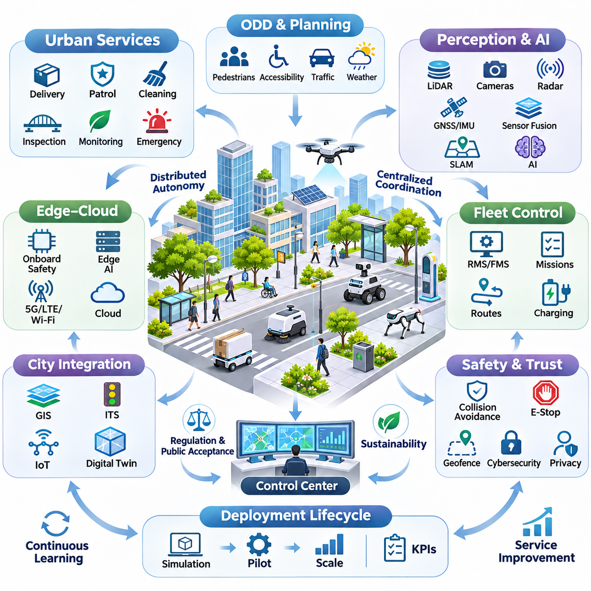
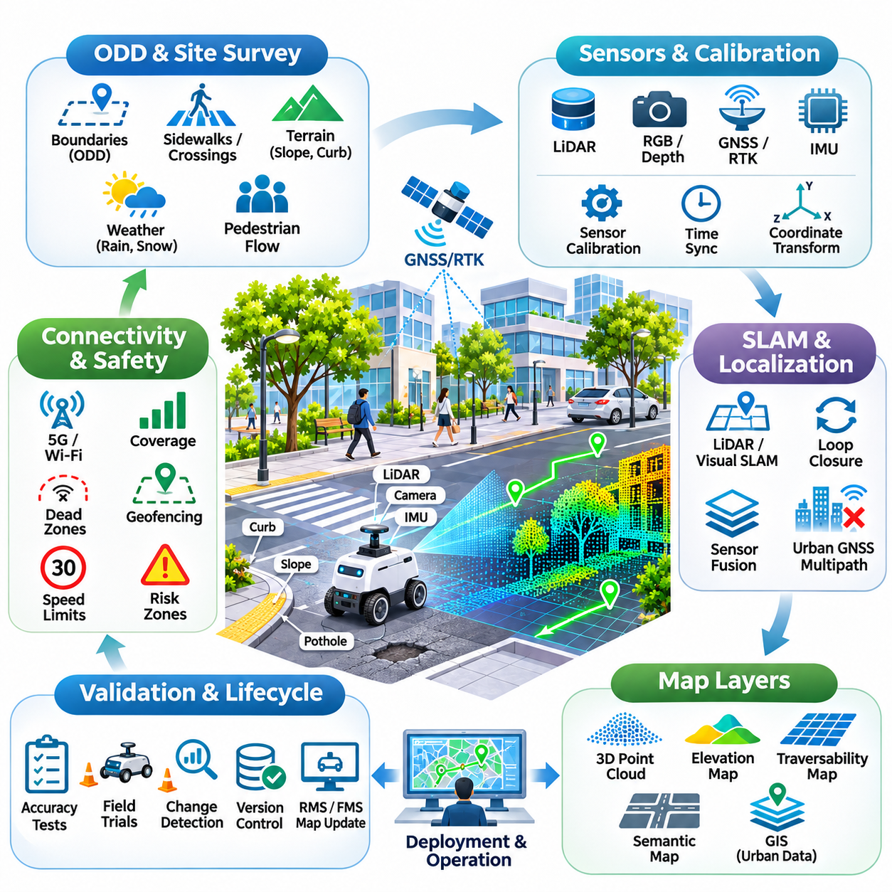
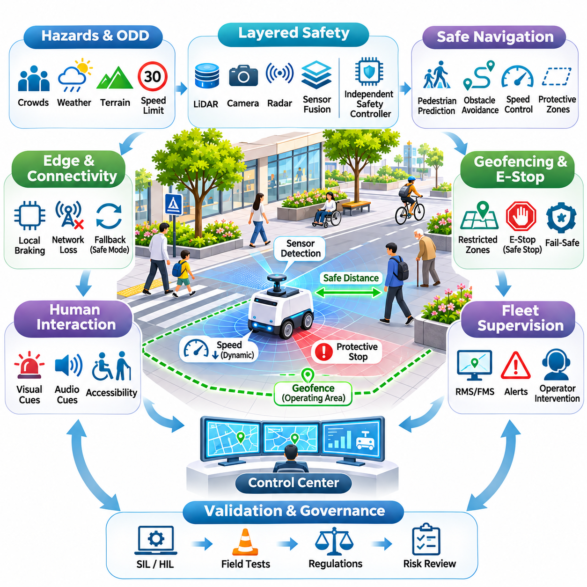
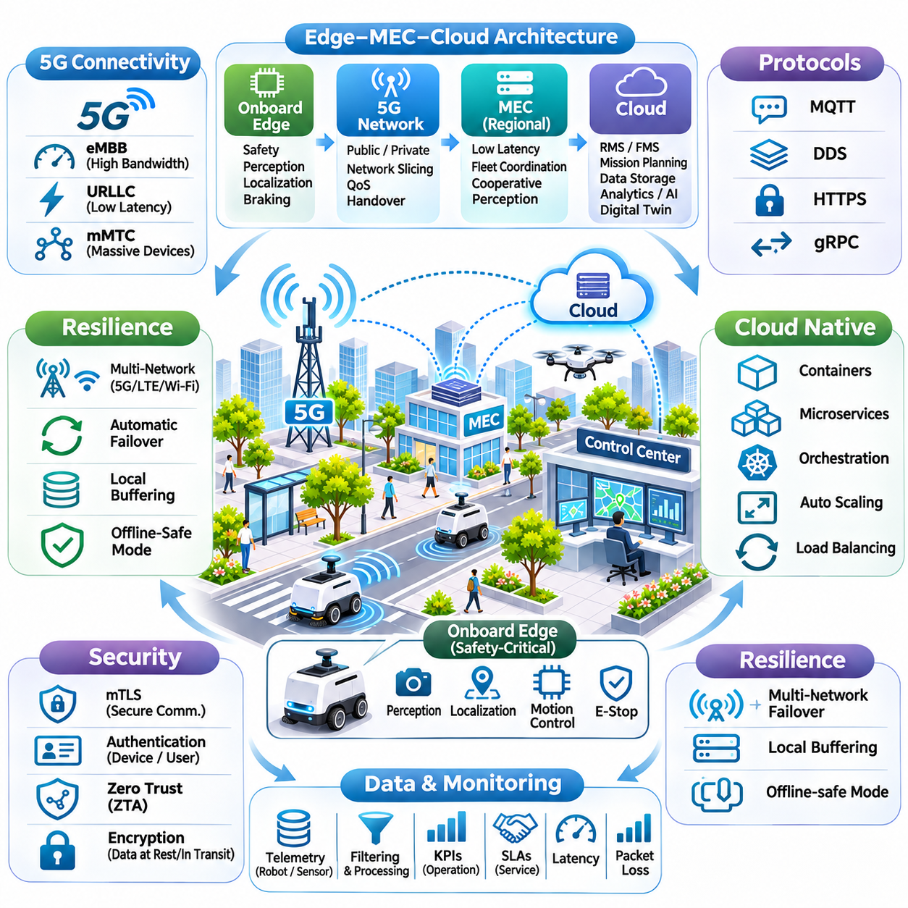
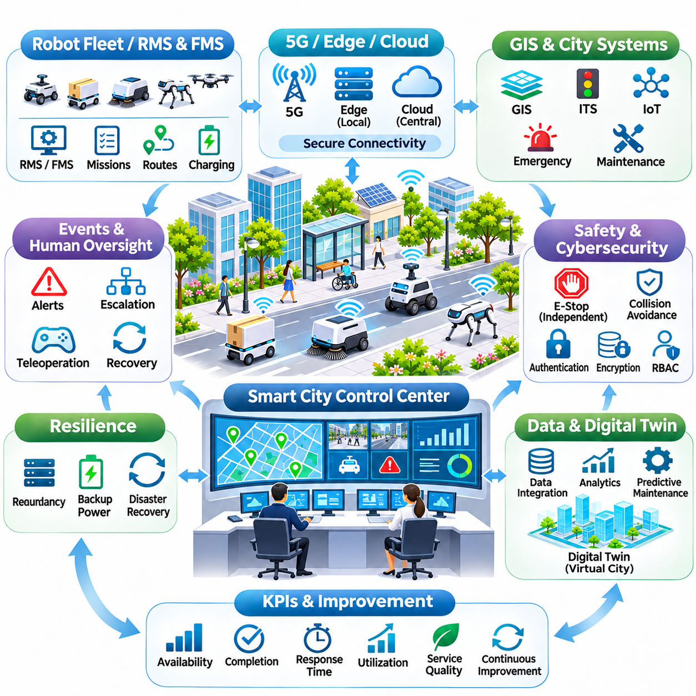
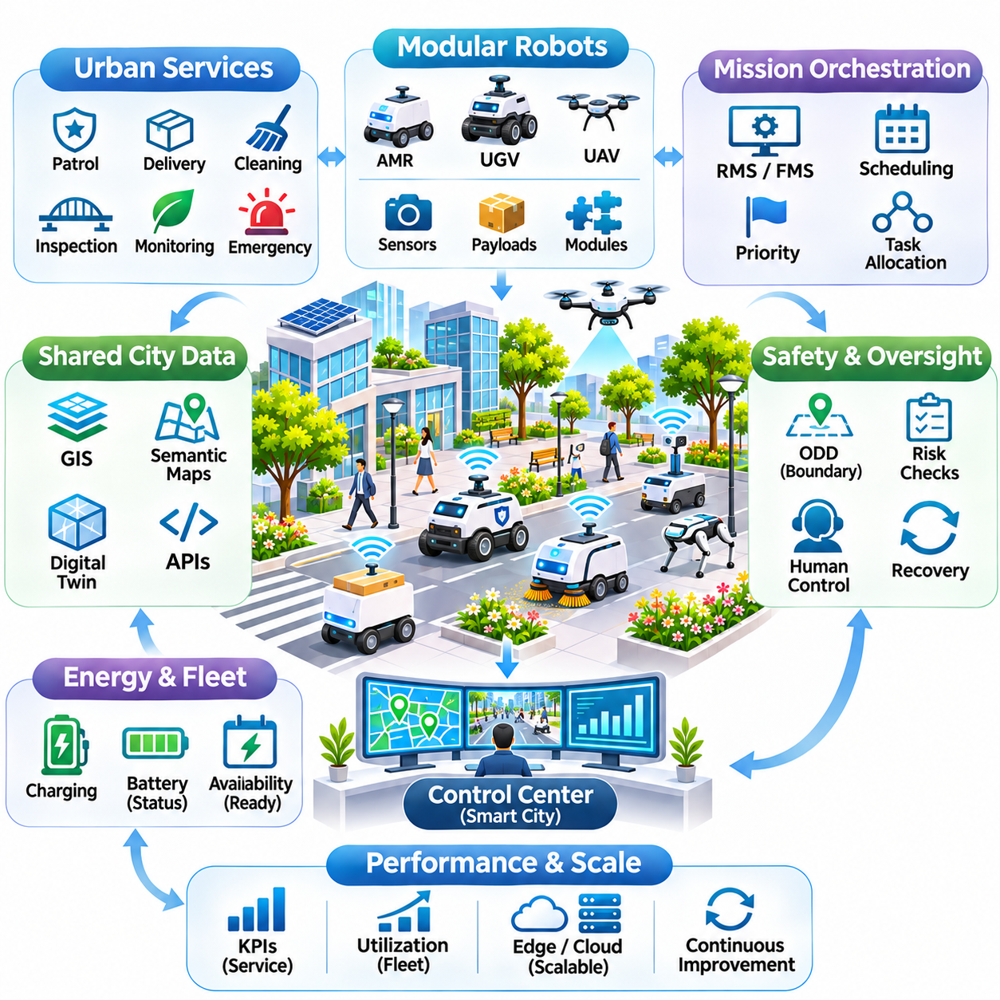
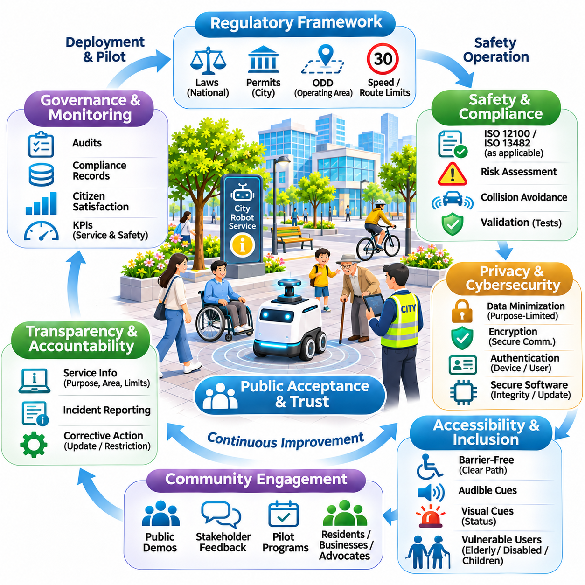
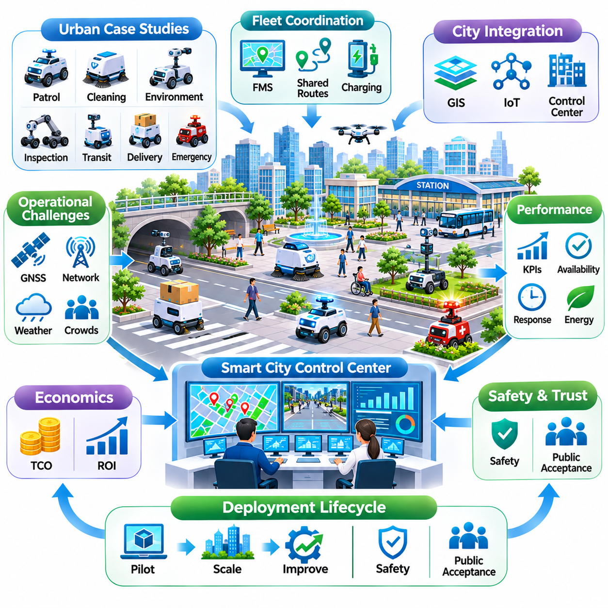
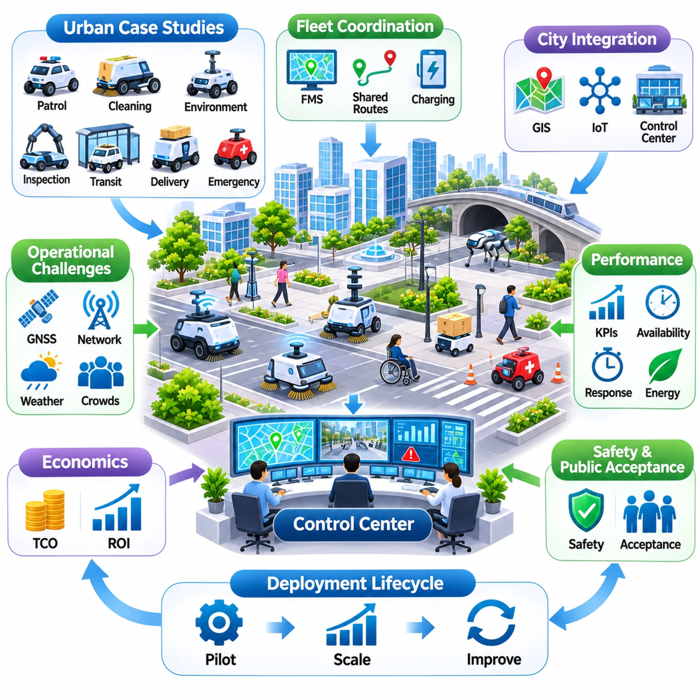

**Volume 08. AMR Operations, Deployment, and MLOps**

# Chapter 20. Smart City Robot Deployment

## 20.1 Smart City Deployment Overview

{width="7.268055555555556in" height="7.268055555555556in"}

Smart city robot deployment represents the systematic introduction of autonomous robotic systems into urban environments to improve public services, operational efficiency, environmental sustainability, and citizen safety. Unlike robots operating within controlled industrial facilities, smart city robots must navigate dynamic public spaces, interact with diverse populations, and cooperate with existing urban infrastructure under continuously changing environmental conditions.

The primary applications of smart city robots include autonomous delivery, public safety patrols, street cleaning, waste collection, infrastructure inspection, environmental monitoring, and emergency response. Autonomous Mobile Robots (AMRs), Unmanned Ground Vehicles (UGVs), Unmanned Aerial Vehicles (UAVs), and quadruped robots can perform complementary missions according to their mobility characteristics, sensing capabilities, and operational requirements.

Successful deployment begins with a comprehensive assessment of urban operating environments. Engineers must evaluate pedestrian density, road conditions, sidewalk geometry, traffic patterns, accessibility requirements, wireless communication coverage, and environmental variability. These factors establish the Operational Design Domain (ODD), which defines the conditions and geographical boundaries within which autonomous robotic systems are permitted to operate.

Smart city robots require robust perception architectures capable of understanding complex and unpredictable surroundings. LiDAR, RGB cameras, depth cameras, radar, Global Navigation Satellite Systems (GNSS), and Inertial Measurement Units (IMUs) provide complementary environmental information. Multi-sensor fusion improves localization, obstacle detection, pedestrian recognition, and scene understanding across diverse weather and illumination conditions.

Autonomous navigation in urban environments requires advanced localization, mapping, path planning, and motion control capabilities. Simultaneous Localization and Mapping (SLAM), semantic mapping, and Real-Time Kinematic (RTK) positioning can support reliable navigation across different operating regions. Robots must dynamically adapt their trajectories while respecting pedestrian movement, accessibility requirements, traffic regulations, and designated operational boundaries.

Artificial Intelligence (AI) provides the foundation for intelligent decision-making in smart city robotic systems. Deep learning models enable object detection, semantic segmentation, trajectory prediction, and anomaly detection. Vision-Language Models (VLMs), Robot Foundation Models (RFMs), and world models may further enhance contextual understanding and mission adaptability, provided their outputs remain subject to validated operational and safety constraints.

A distributed computing architecture supports the integration of robotic platforms with smart city infrastructure. Edge computing processes time-critical perception, navigation, and safety functions directly on the robot, while municipal servers and cloud platforms provide centralized analytics, mission coordination, and AI model management. Essential autonomous functions must remain available when external communication becomes degraded or temporarily unavailable.

Communication infrastructure plays an important role in maintaining connectivity between robots, control centers, and urban information systems. Technologies such as 5G, LTE, Wi-Fi, and dedicated wireless networks support telemetry transmission, mission updates, remote diagnostics, and cooperative operations. Deployment architectures must accommodate network latency, bandwidth limitations, coverage gaps, packet loss, and transitions between communication environments.

Fleet management becomes increasingly important as multiple robotic systems operate simultaneously across urban areas. Robot Management Systems (RMS) and Fleet Management Systems (FMS) coordinate mission allocation, route optimization, charging schedules, operational priorities, and exception handling. Centralized supervision combined with distributed autonomy enables heterogeneous robotic platforms to operate efficiently without overwhelming municipal control centers.

Integration with existing smart city infrastructure requires standardized interfaces, interoperable communication protocols, and consistent data architectures. Geographic Information Systems (GIS), Intelligent Transportation Systems (ITS), Internet of Things (IoT) platforms, and municipal management systems provide valuable operational context. Digital twins can integrate these information sources to support mission simulation, infrastructure monitoring, and deployment planning.

Operational safety represents a fundamental requirement for robots operating in public environments. Safety architectures must incorporate independent protective functions, speed limitation, collision avoidance, emergency stopping, geofencing, and risk-based fallback mechanisms. Particular attention must be given to children, elderly citizens, individuals with disabilities, cyclists, and other vulnerable road users who may encounter autonomous robotic systems.

Cybersecurity and data privacy must be addressed throughout the entire deployment lifecycle. Urban robots continuously generate and process potentially sensitive information, including environmental imagery, location records, and operational telemetry. Secure communication, device authentication, access control, encrypted storage, vulnerability management, and privacy-preserving data processing help protect citizens and critical municipal infrastructure.

Deployment should follow a phased implementation strategy beginning with simulation, controlled testing, pilot operations, and limited commercial or public service deployment. Each phase must establish measurable acceptance criteria before expanding operational coverage. Key Performance Indicators (KPIs) include mission completion rates, operational availability, intervention frequency, safety incidents, energy consumption, and public acceptance.

The long-term development of smart city robotics will increasingly emphasize heterogeneous robot collaboration, distributed intelligence, and continuous operational learning. Connected robotic platforms can collectively improve environmental awareness, resource allocation, and municipal service responsiveness. Successful deployment ultimately requires coordinated management of technology, infrastructure, regulations, economics, and societal expectations.

As no attached structural reference was available, this overview follows a general smart city robotics deployment framework within the broader context of Physical AI and autonomous robot operations.

## 20.2 Outdoor Site Survey and Mapping

{width="7.268055555555556in" height="7.268055555555556in"}

Outdoor site survey and mapping constitute fundamental activities in the deployment of autonomous robots within smart city environments. Unlike indoor facilities characterized by relatively stable spatial configurations, outdoor environments exhibit significant variations in terrain, illumination, weather, traffic, and human activity. A systematic site survey establishes the environmental knowledge required for reliable navigation, operational safety, and long-term robotic service delivery.

The site survey process begins by defining the intended operational area and identifying the environmental characteristics that may influence robotic performance. Engineers examine sidewalks, pedestrian crossings, road surfaces, intersections, public plazas, building entrances, and service locations. These observations contribute to establishing the Operational Design Domain (ODD), including geographical boundaries, mobility constraints, environmental limitations, and permitted operating conditions.

Terrain assessment is particularly important for Autonomous Mobile Robots (AMRs) and Unmanned Ground Vehicles (UGVs) operating in outdoor environments. Surface materials, gradients, cross slopes, potholes, curbs, drainage channels, and uneven pavement directly influence vehicle stability, traction, and energy consumption. Survey results must be evaluated against robot specifications such as ground clearance, wheel configuration, climbing capability, payload capacity, and braking performance.

Environmental assessment must consider both permanent infrastructure and temporary conditions that influence autonomous operations. Buildings, vegetation, street furniture, construction barriers, parked vehicles, and pedestrian concentrations create different navigation challenges. Seasonal changes, rainfall, snowfall, fog, and direct sunlight can further affect perception reliability, localization accuracy, and mobility performance throughout the operational lifecycle.

Outdoor mapping generally requires multiple sensing technologies to capture complementary geometric and semantic information. Three-dimensional LiDAR generates spatial point clouds, RGB cameras capture visual characteristics, and depth cameras provide local geometric measurements. Global Navigation Satellite Systems (GNSS) and Inertial Measurement Units (IMUs) contribute positioning and orientation information, supporting the generation of geographically referenced environmental maps.

Real-Time Kinematic (RTK) GNSS technology can provide centimeter-level positioning accuracy under favorable satellite visibility and correction conditions. However, dense urban environments frequently introduce multipath interference, signal obstruction, and positioning degradation caused by surrounding buildings. Outdoor site surveys must identify these problematic regions and establish alternative localization strategies using LiDAR, visual features, inertial measurements, and wheel odometry.

Simultaneous Localization and Mapping (SLAM) enables robots to construct environmental maps while simultaneously estimating their positions within those environments. LiDAR SLAM, visual SLAM, and multi-sensor SLAM provide different advantages depending on environmental characteristics and computational resources. Large-scale outdoor mapping requires robust loop closure, pose graph optimization, drift correction, and consistent alignment between independently surveyed geographical regions.

Accurate outdoor mapping depends on appropriate sensor calibration, temporal synchronization, and coordinate transformation. Intrinsic calibration characterizes individual sensor measurement properties, while extrinsic calibration establishes spatial relationships between sensors and the robot coordinate frame. Time synchronization ensures that measurements collected from moving platforms correspond to consistent acquisition times, reducing geometric distortion and localization errors.

Outdoor maps should represent both geometric structures and operationally meaningful environmental features. Occupancy grids, three-dimensional point clouds, elevation maps, traversability maps, and semantic maps provide complementary representations of urban environments. Semantic information identifies sidewalks, pedestrian crossings, prohibited zones, charging stations, service locations, and other infrastructure relevant to autonomous mission execution.

Geographic Information Systems (GIS) provide a valuable foundation for integrating robot-generated maps with existing municipal geospatial databases. Building footprints, road networks, administrative boundaries, utility infrastructure, and transportation information can enhance environmental understanding. Consistent coordinate reference systems, geospatial transformations, and map alignment procedures ensure interoperability between robotic navigation systems and municipal information platforms.

Network connectivity assessments should be conducted alongside geometric and environmental mapping. Wireless signal strength, communication latency, bandwidth availability, packet loss, and coverage continuity must be measured throughout the intended operational area. Communication coverage maps identify potential dead zones and support the design of redundant communication pathways, local autonomy mechanisms, and reliable remote monitoring capabilities.

Risk assessment and safety mapping identify locations where autonomous operations may introduce elevated risks to robots, pedestrians, or surrounding infrastructure. High-risk regions include intersections, narrow sidewalks, steep slopes, crowded pedestrian areas, and locations with restricted visibility. These regions should be associated with geofencing boundaries, reduced speed limits, restricted operating conditions, or additional supervisory requirements.

Outdoor mapping accuracy and operational suitability must be verified through repeated field testing under representative environmental conditions. Engineers evaluate absolute positioning accuracy, localization repeatability, map consistency, obstacle representation, and route traversability. Independent reference measurements and predefined acceptance criteria help determine whether the generated maps satisfy the technical and safety requirements of the intended robotic application.

Outdoor environments continuously evolve because of construction activities, infrastructure maintenance, seasonal vegetation, and changes in urban traffic patterns. Map lifecycle management must therefore incorporate change detection, incremental mapping, version control, validation, and controlled map distribution. Robot Management Systems (RMS) and Fleet Management Systems (FMS) can coordinate map updates across distributed robotic platforms.

As an attached structural reference was not available, this section follows a general outdoor robotic deployment framework. Within this framework, outdoor site survey and mapping establish a shared spatial foundation for autonomous navigation, fleet coordination, digital twin integration, and continuous environmental learning. Their effectiveness directly influences operational reliability, deployment scalability, public safety, and sustainable smart city robot operations.

## 20.3 Public Space Safety Operation

{width="7.268055555555556in" height="7.268055555555556in"}

Public space safety operation represents a fundamental requirement for the deployment of autonomous robots within smart city environments. Unlike controlled industrial facilities, public spaces are characterized by unpredictable human behavior, heterogeneous traffic, unrestricted pedestrian movement, and continuously changing environmental conditions. Robotic systems must maintain operational safety while delivering reliable services without disrupting normal urban activities.

Safety management begins with a systematic assessment of potential hazards associated with robotic operations. Engineers must evaluate collision risks, unexpected pedestrian interactions, vehicle instability, mechanical failures, sensor degradation, communication interruptions, and environmental disturbances. Hazard identification and risk assessment establish the foundation for defining protective measures and acceptable residual risk levels throughout the operational lifecycle.

The Operational Design Domain (ODD) defines the geographical, environmental, and functional boundaries within which autonomous robots are authorized to operate. Public space operations require explicit restrictions concerning pedestrian density, weather conditions, surface characteristics, visibility, traffic complexity, and maximum operating speed. Robots must detect conditions outside their approved ODD and initiate appropriate risk mitigation or safe fallback procedures.

A comprehensive safety architecture integrates multiple independent layers of protection to minimize the consequences of individual component failures. Perception systems, navigation algorithms, motion controllers, safety monitoring units, and emergency stopping mechanisms must cooperate without creating unacceptable dependencies. Safety-critical functions should remain sufficiently independent of mission management, cloud connectivity, and general-purpose AI processing.

Reliable environmental perception is essential for detecting pedestrians, cyclists, vehicles, animals, and unexpected obstacles in public spaces. LiDAR, cameras, radar, ultrasonic sensors, and other sensing technologies provide complementary environmental measurements. Multi-sensor fusion can improve detection robustness, while sensor health monitoring identifies degraded measurement quality and triggers appropriate adjustments to operational behavior.

Pedestrian-aware navigation requires robots to understand human movement patterns and maintain appropriate separation from surrounding individuals. Human trajectory prediction, dynamic obstacle avoidance, and socially aware path planning support safe interactions in crowded environments. Particular consideration must be given to children, elderly citizens, individuals with disabilities, and other vulnerable road users whose movements may be difficult to predict.

Dynamic speed management enables autonomous robots to adapt their movement according to environmental conditions and estimated risk levels. Operating speed must reflect pedestrian proximity, available stopping distance, surface traction, sensor detection range, and robot braking capability. Protective zones may be dynamically adjusted according to validated safety parameters, allowing robots to reduce speed or stop when hazardous conditions emerge.

Geofencing provides a spatial mechanism for restricting autonomous robot movement within authorized operational regions. Digital boundaries define permitted routes, restricted areas, pedestrian priority zones, and locations requiring additional supervision. Integration with semantic maps and Geographic Information Systems (GIS) supports location-dependent safety policies, provided that localization accuracy and positioning uncertainty are appropriately considered.

Emergency stopping and fail-safe mechanisms must prevent uncontrolled motion when hazardous conditions or critical system failures occur. Protective stopping functions should bring the robot to a safe state within validated stopping distances and response times. Physical emergency stop devices, appropriately engineered remote stopping functions, and independent safety controllers provide complementary protection against abnormal operating conditions.

Communication failures must not compromise the fundamental safety of autonomous robots operating in public environments. Safety-critical perception, obstacle detection, braking, and motion supervision should be executed locally through edge computing architectures. When network connectivity becomes unavailable, robots must follow predefined fallback policies, which may include restricted autonomous operation, controlled stopping, or movement toward a validated safe location.

Human-Robot Interaction (HRI) plays an important role in establishing predictable and understandable robotic behavior within public spaces. Visual indicators, acoustic signals, status displays, and intentional motion patterns can communicate robot intentions to surrounding individuals. These communication mechanisms should accommodate different languages, accessibility requirements, sensory limitations, and environmental noise without creating unnecessary disturbances.

Public space safety operations require continuous monitoring through Robot Management Systems (RMS) and Fleet Management Systems (FMS). Operational dashboards should provide information regarding robot location, movement status, safety events, sensor health, communication quality, and emergency conditions. Supervisory personnel must have clearly defined intervention authority, escalation procedures, and incident response responsibilities across deployed robotic fleets.

Safety validation must include representative operational scenarios, foreseeable misuse, environmental disturbances, and abnormal system conditions. Simulation, Software-in-the-Loop (SIL), Hardware-in-the-Loop (HIL), controlled field testing, and supervised pilot operations provide complementary verification methods. Validation should demonstrate acceptable safety performance under defined operating conditions before expanding public deployment.

Regulatory compliance and safety governance establish the organizational framework for responsible public space robot operations. Deployment teams must consider applicable machinery safety requirements, local traffic regulations, accessibility obligations, privacy legislation, and municipal operating permits. Safety documentation, maintenance records, incident investigation, and periodic risk reassessment support accountability and continuous improvement.

Public space safety must evolve alongside advances in autonomous navigation, distributed intelligence, and cooperative robotic operations. As no attached structural reference was available, this section follows a general smart city safety operation framework. Within this framework, technical safeguards, operational supervision, regulatory compliance, and public trust collectively establish the foundation for sustainable urban robotic services.

## 20.4 5G and Cloud Infrastructure

{width="7.268055555555556in" height="7.268055555555556in"}

Fifth-generation mobile communication (5G) and cloud infrastructure provide the digital foundation for large-scale smart city robot deployment. Autonomous robots operating across urban environments require reliable connectivity, distributed computing resources, centralized operational supervision, and continuous information exchange. The integration of communication and computing infrastructure supports scalable, coordinated, and intelligent robotic services.

The 5G network architecture introduces communication capabilities that can address diverse requirements associated with autonomous robot operations. Enhanced Mobile Broadband (eMBB) supports high-bandwidth sensor and video transmission, while Ultra-Reliable Low-Latency Communications (URLLC) targets latency-sensitive applications. Massive Machine-Type Communications (mMTC) supports connectivity across large populations of devices, sensors, and urban infrastructure.

Public 5G networks and private 5G networks provide different advantages for smart city robot deployment. Public networks offer extensive geographical coverage and access to existing telecommunications infrastructure, whereas private networks provide greater control over network configuration, security policies, and resource allocation. Hybrid network architectures can combine these capabilities to accommodate diverse operational environments and mission requirements.

Network slicing enables multiple logical communication networks to operate across shared physical infrastructure. Different slices may support robot telemetry, video streaming, remote supervision, infrastructure monitoring, and mission coordination according to their respective service requirements. Appropriate Quality of Service (QoS) configuration and resource management help reduce interference between applications competing for limited communication resources.

Multi-access Edge Computing (MEC) extends computing capabilities toward the access network, reducing the communication distance between autonomous robots and external processing resources. MEC platforms can support regional fleet coordination, cooperative perception, localized analytics, and shared environmental information processing. This architecture reduces dependence on distant cloud data centers for applications requiring relatively low network latency.

Onboard edge computing remains essential for autonomous robots operating in public environments. Safety-critical perception, localization, obstacle detection, motion control, and emergency stopping must remain operational independently of external network availability. Computational workloads should be distributed across onboard processors, regional edge servers, and centralized cloud platforms according to latency, bandwidth, reliability, and safety requirements.

Cloud infrastructure provides centralized computing, storage, analytics, and management capabilities for geographically distributed robotic fleets. Cloud-based Robot Management Systems (RMS) and Fleet Management Systems (FMS) support mission scheduling, resource allocation, operational monitoring, remote diagnostics, and software distribution. Elastic computing resources enable infrastructure capacity to expand as the number of deployed robotic systems increases.

Communication protocols and application interfaces establish interoperability between robotic systems and distributed computing platforms. Technologies such as MQTT, Data Distribution Service (DDS), HTTPS, WebSocket, and gRPC support different information exchange requirements. Protocol selection must consider message delivery guarantees, communication overhead, security mechanisms, network reliability, and interoperability with existing municipal information systems.

Reliable connectivity requires comprehensive network coverage assessment across the intended urban operating environment. Engineers must evaluate signal strength, interference, uplink and downlink throughput, latency, packet loss, and mobility handover performance. Buildings, underground passages, tunnels, vegetation, and densely populated areas may introduce communication degradation that requires alternative connectivity or locally autonomous operation.

Network resilience can be enhanced through multi-network communication architectures incorporating 5G, LTE, Wi-Fi, and multiple telecommunications providers. Automatic connection switching, redundant communication channels, local data buffering, and store-and-forward mechanisms help maintain operational continuity. Robots must implement predefined communication loss policies without compromising safety-critical functions or generating conflicting mission commands.

Cloud-native architectures facilitate the development and operation of scalable smart city robotic services. Containerization, microservices, container orchestration platforms, distributed databases, and event-driven processing enable modular service deployment and independent resource scaling. Load balancing, automated failover, service discovery, and infrastructure monitoring contribute to maintaining service availability across distributed computing environments.

Cybersecurity must be implemented throughout the integrated communication and computing infrastructure. Device authentication, mutual Transport Layer Security (mTLS), encrypted communication, network segmentation, secure boot, and role-based access control protect robotic systems against unauthorized access. Zero Trust Architecture (ZTA) further strengthens security by continuously evaluating the identities and permissions of connected devices and services.

Data management infrastructure must accommodate continuous information generated by distributed robotic platforms. Sensor measurements, operational telemetry, environmental observations, safety events, and diagnostic records require appropriate ingestion, storage, processing, and retention policies. Edge-based data filtering, compression, selective uploading, and event-triggered recording can reduce communication bandwidth requirements and cloud operating costs.

Infrastructure performance must be continuously evaluated using measurable Key Performance Indicators (KPIs) and Service Level Agreements (SLAs). Network availability, end-to-end latency, throughput, jitter, packet loss, cloud service availability, and computational resource utilization provide essential operational indicators. Monitoring and alerting systems should identify infrastructure degradation before it significantly affects robotic service delivery.

As no attached structural reference was available, this section follows a general smart city infrastructure framework. Within this framework, 5G, edge computing, on-premises infrastructure, and cloud computing collectively support distributed intelligence, heterogeneous fleet collaboration, digital twin integration, and continuous AI learning. Their coordinated development establishes the foundation for scalable Physical AI ecosystems and sustainable urban robotic operations.

## 20.5 Smart City Control Center Integration

{width="7.268055555555556in" height="7.268055555555556in"}

Smart city control center integration establishes a unified operational framework for coordinating autonomous robots with municipal infrastructure and public services. As robotic deployments expand across urban environments, centralized supervision becomes essential for maintaining situational awareness, operational efficiency, and public safety. Integrated control centers connect robotic platforms, urban information systems, and human operators through standardized digital interfaces.

The integration architecture typically consists of robotic edge devices, communication networks, fleet management platforms, municipal information systems, and centralized control applications. Autonomous Mobile Robots (AMRs), Unmanned Ground Vehicles (UGVs), and other robotic platforms exchange operational data with Robot Management Systems (RMS) and Fleet Management Systems (FMS). These systems provide coordinated access to mission execution, monitoring, and resource management functions.

A unified operational dashboard enables control center personnel to observe distributed robotic activities through a consistent interface. Real-time information includes robot location, navigation status, mission progress, battery condition, communication quality, sensor health, and active safety alerts. Geographic visualization allows operators to understand spatial relationships between robotic platforms, service locations, restricted areas, and surrounding infrastructure.

Integration with Geographic Information Systems (GIS) provides essential spatial context for smart city robotic operations. Municipal geospatial databases contain road networks, pedestrian pathways, building footprints, administrative boundaries, and infrastructure assets. Combining these resources with robot-generated maps supports route planning, geofencing, operational area management, and coordinated responses to changes in urban environments.

Mission orchestration connects robotic capabilities with municipal service requirements and operational priorities. Control centers can assign inspection, delivery, cleaning, patrol, and environmental monitoring missions according to robot availability, location, equipment configuration, and service urgency. Automated scheduling and task allocation improve resource utilization while allowing authorized operators to modify priorities when unexpected situations occur.

Interoperability with existing municipal systems is necessary for coordinated smart city operations. Intelligent Transportation Systems (ITS), emergency management platforms, infrastructure maintenance systems, and Internet of Things (IoT) networks provide complementary operational information. Standardized Application Programming Interfaces (APIs), event messaging, and data transformation services enable controlled information exchange between heterogeneous systems.

Communication infrastructure connects mobile robots with control center applications through 5G, LTE, Wi-Fi, and other available networks. Edge computing processes time-sensitive robotic functions locally, while regional servers and cloud platforms support coordination, analytics, and historical data management. Communication architectures must account for network interruptions, latency variation, bandwidth limitations, and secure reconnection procedures.

Operational event management converts distributed robot telemetry into actionable information for control center personnel. Events such as navigation failures, unexpected obstacles, low battery conditions, sensor degradation, and communication loss require classification according to severity and operational impact. Event correlation, configurable alert thresholds, and escalation workflows help operators distinguish critical incidents from routine operational notifications.

Human supervision remains essential when autonomous robots encounter situations beyond their validated operational capabilities. Control center interfaces should support mission suspension, authorized intervention, recovery coordination, and controlled resumption of operations. Remote driving or teleoperation, where permitted, requires appropriate communication performance, operator authorization, and independent onboard safety mechanisms.

Safety integration requires clear separation between centralized operational commands and safety-critical robotic functions. Emergency stopping, collision avoidance, protective braking, and local hazard detection must not depend exclusively on remote control center availability. Supervisory commands should be validated against robot operating states, geographical restrictions, and safety constraints before execution.

Cybersecurity and access governance protect the integrated control center from unauthorized access and operational manipulation. Device authentication, encrypted communication, role-based access control, network segmentation, and security event monitoring establish essential protective mechanisms. Audit trails should record operator actions, mission modifications, software changes, and critical events to support accountability and incident investigation.

Data integration enables continuous analysis of robotic operations and municipal service performance. Historical mission records, equipment diagnostics, environmental observations, and operational incidents can be consolidated within centralized data platforms. Analytics applications support performance evaluation, predictive maintenance, resource optimization, and identification of recurring operational constraints across urban service areas.

Digital twin integration extends control center capabilities by connecting live robotic operations with virtual representations of urban infrastructure. Robot positions, mission states, environmental measurements, and infrastructure conditions can be synchronized with simulation environments. Digital twins support scenario evaluation, operational planning, infrastructure change assessment, and validation of proposed deployment configurations.

Control center reliability requires redundant computing resources, resilient communication pathways, backup power systems, and documented disaster recovery procedures. Service continuity mechanisms should preserve essential monitoring and coordination functions during infrastructure failures. Periodic recovery testing, configuration management, and operational readiness assessments help maintain dependable municipal robotic services.

Performance management evaluates control center integration through measurable operational indicators and service objectives. Relevant Key Performance Indicators (KPIs) include fleet availability, mission completion rate, incident response time, alert processing latency, communication reliability, and operator intervention frequency. Continuous monitoring and periodic operational reviews support improvements in service quality, scalability, and resource efficiency.

Successful integration ultimately transforms isolated robotic deployments into coordinated components of a broader smart city operating environment. Standardized interfaces, distributed intelligence, centralized supervision, and human-centered governance enable heterogeneous robotic fleets to support municipal services at scale. This integrated approach establishes the foundation for sustainable urban automation, collective Physical AI, and future intelligent city operations.

## 20.6 Multi-Service Robot Operation

{width="7.268055555555556in" height="7.268055555555556in"}

Multi-service robot operation enables autonomous robotic platforms to perform diverse municipal tasks within a unified smart city environment. Rather than deploying separate robotic systems for every application, cities can coordinate shared platforms and specialized equipment across multiple service domains. This approach improves infrastructure utilization, operational flexibility, and service continuity while reducing unnecessary duplication of robotic resources.

Smart city robotic services commonly include public safety patrols, environmental monitoring, autonomous delivery, infrastructure inspection, street cleaning, and emergency assistance. Each application introduces distinct requirements concerning mobility, sensing, payload capacity, operating schedules, and human interaction. Multi-service architectures must accommodate these differences while maintaining consistent safety and operational management principles.

Heterogeneous robotic fleets combine Autonomous Mobile Robots (AMRs), Unmanned Ground Vehicles (UGVs), Unmanned Aerial Vehicles (UAVs), and specialized inspection robots. Ground platforms provide sustained mobility and payload transportation, while aerial systems offer elevated observation and rapid geographical coverage. Coordinated deployment enables complementary robotic capabilities to address complex urban service requirements.

A modular robotic architecture supports service flexibility through interchangeable sensors, payload modules, and mission-specific equipment. Cameras, thermal imaging systems, environmental sensors, cleaning mechanisms, and delivery compartments can be integrated according to operational requirements. Standardized electrical, mechanical, communication, and software interfaces simplify equipment integration and reduce maintenance complexity.

Mission orchestration provides the operational foundation for coordinating multiple services across distributed robotic platforms. Robot Management Systems (RMS) and Fleet Management Systems (FMS) allocate tasks according to robot capabilities, geographical location, battery condition, mission urgency, and service availability. Dynamic scheduling enables robotic resources to respond to changing municipal priorities without disrupting essential operations.

Service prioritization is particularly important when several municipal applications compete for limited robotic resources. Emergency assistance, public safety incidents, scheduled inspections, and routine maintenance may require different response priorities. Mission management systems should apply configurable policies that account for service urgency, resource constraints, operational risk, and contractual performance obligations.

Multi-service operations require reliable coordination between autonomous navigation, perception, mission execution, and equipment control. A robot assigned to environmental inspection may collect sensor measurements while simultaneously monitoring surrounding infrastructure. However, concurrent activities must remain within validated computing, power, sensing, and safety limits to prevent interference with essential navigation and protective functions.

Shared mapping and localization infrastructure enables heterogeneous robots to operate within consistent geographical reference systems. Geographic Information Systems (GIS), semantic maps, and digital twins provide information about roads, pedestrian pathways, service locations, and restricted areas. Individual platforms may require different traversability maps and navigation constraints despite sharing common environmental information.

Interoperability between robotic platforms and municipal information systems is essential for integrated service delivery. Standardized Application Programming Interfaces (APIs), event-driven communication, and common data models allow service applications to exchange operational information. Integration with transportation, environmental management, public safety, and infrastructure maintenance systems supports coordinated municipal decision-making.

Human supervision remains necessary when robotic systems encounter unexpected events or conflicting service requirements. Centralized control centers provide operational visibility, mission authorization, exception handling, and escalation management. Operators must be able to suspend tasks, modify priorities, and initiate recovery procedures while preserving the independence of safety-critical robotic functions.

Energy management and charging coordination significantly influence the efficiency of multi-service robotic fleets. Different missions impose varying energy demands depending on travel distance, payload weight, sensor utilization, and operating duration. Fleet management platforms should optimize charging schedules, battery reserves, and robot availability while maintaining sufficient capacity for urgent service requests.

Operational safety must remain consistent across all service configurations and mission transitions. Changes in payload, equipment dimensions, center of gravity, or sensor coverage may alter the robot\'s validated operating characteristics. Each service configuration requires appropriate risk assessment, operational restrictions, and verification before autonomous execution in public environments.

Performance evaluation should consider both individual service outcomes and overall fleet efficiency. Key Performance Indicators (KPIs) include mission completion rate, service response time, robot utilization, energy consumption, operational availability, and intervention frequency. Cross-service analytics can identify scheduling conflicts, resource bottlenecks, and opportunities to improve municipal service delivery.

Scalable multi-service operations depend on modular software, distributed computing, and standardized fleet management interfaces. Cloud and edge platforms support mission coordination, operational analytics, software updates, and continuous improvement across geographically distributed deployments. Expansion should preserve interoperability, cybersecurity, safety governance, and consistent operational performance.

The long-term evolution of multi-service robotic operations will emphasize collaborative autonomy, adaptive mission planning, and collective Physical AI. Heterogeneous robots may share environmental observations, coordinate complementary capabilities, and dynamically redistribute workloads according to urban conditions. Such integration establishes a foundation for efficient, resilient, and sustainable smart city robotic ecosystems.

## 20.7 Regulatory and Public Acceptance

{width="7.268055555555556in" height="7.268055555555556in"}

Regulatory compliance and public acceptance are essential foundations for deploying autonomous robots in smart city environments. Unlike industrial robots operating within restricted facilities, urban robots interact directly with citizens, public infrastructure, and transportation systems. Successful deployment therefore requires coordinated consideration of legal obligations, operational safety, ethical responsibilities, and community expectations throughout the robotic service lifecycle.

Regulatory frameworks governing smart city robots vary according to jurisdiction, robot classification, operating environment, and intended application. Autonomous Mobile Robots (AMRs), Unmanned Ground Vehicles (UGVs), and delivery robots may be subject to different requirements concerning mobility, traffic participation, equipment safety, and operational authorization. Deployment organizations must identify applicable national legislation, municipal regulations, and administrative procedures.

Public space authorization establishes the legal conditions under which autonomous robots may operate on sidewalks, pedestrian pathways, public plazas, and other shared environments. Municipal authorities may impose restrictions on operating hours, geographical coverage, maximum speed, vehicle dimensions, and permitted activities. Deployment planning must incorporate these requirements into the Operational Design Domain (ODD) and associated operational control policies.

Safety certification and technical conformity assessment provide structured methods for demonstrating that robotic systems satisfy applicable safety requirements. Relevant standards may address machinery safety, functional safety, mobile robot operation, electrical protection, electromagnetic compatibility, and cybersecurity. Standards such as ISO 12100 and ISO 13482 may inform particular assessments, although applicability depends on robot classification and intended use.

Risk assessment must evaluate foreseeable hazards arising from interactions between autonomous robots, pedestrians, cyclists, vehicles, and surrounding infrastructure. Collision scenarios, unexpected motion, braking failures, sensor limitations, and environmental disturbances require systematic examination. Documented mitigation measures, validation evidence, and periodic risk reassessment support responsible deployment and regulatory accountability.

Accessibility and inclusive design are fundamental considerations when introducing autonomous robots into shared public environments. Robotic systems must not create unreasonable barriers for wheelchair users, visually impaired pedestrians, elderly citizens, or individuals with limited mobility. Route planning, stopping behavior, audible notifications, visual indicators, and pedestrian clearance requirements should reflect inclusive urban accessibility principles.

Privacy protection becomes particularly important when robots collect environmental imagery, location information, audio recordings, or behavioral observations. Data processing must comply with applicable privacy legislation and legitimate operational purposes. Privacy-by-design principles encourage data minimization, purpose limitation, controlled retention, access restrictions, and appropriate anonymization to reduce unnecessary collection of personally identifiable information.

Cybersecurity governance protects robotic platforms and connected municipal systems against unauthorized access, malicious interference, and operational manipulation. Secure communication, device authentication, software integrity verification, vulnerability management, and incident response procedures should be incorporated into deployment requirements. Security responsibilities must be clearly allocated among robot manufacturers, service operators, network providers, and municipal authorities.

Public acceptance depends on citizens understanding the purpose, behavior, and limitations of autonomous robotic services. Robots operating in public spaces should demonstrate predictable movement, transparent service objectives, and respectful interactions with surrounding individuals. Clear identification, accessible information channels, and understandable status indicators help reduce uncertainty and support confidence in robotic operations.

Community engagement should begin before large-scale robotic deployment and continue throughout operational expansion. Public demonstrations, stakeholder consultations, accessibility reviews, and supervised pilot programs provide opportunities to identify concerns and collect feedback. Engagement activities should include residents, businesses, pedestrian organizations, disability advocates, emergency responders, and municipal service personnel.

Transparency and accountability are essential for establishing long-term trust in autonomous urban services. Deployment organizations should communicate operating boundaries, service responsibilities, data collection practices, and incident reporting procedures. Clearly defined ownership of operational decisions and documented escalation mechanisms ensure that citizens and authorities can identify responsible organizations when problems occur.

Incident management procedures must address collisions, property damage, service disruption, privacy complaints, and unexpected robotic behavior. Operators should preserve relevant operational records, notify appropriate authorities when required, and conduct structured investigations. Corrective actions may involve software updates, operational restrictions, additional training, or modifications to equipment and safety procedures.

Public acceptance should be evaluated through measurable indicators rather than assumptions about technological readiness. Citizen satisfaction, complaint frequency, perceived safety, accessibility impacts, service usefulness, and intervention rates provide valuable evidence. Combining survey results with operational performance data enables municipalities to identify concerns and adjust deployment policies before expanding robotic services.

Regulatory and social requirements must remain integrated with technical development through continuous governance processes. Changes in legislation, municipal policy, robot capabilities, and public expectations may require updated risk assessments and operational approvals. Configuration management, compliance documentation, periodic audits, and stakeholder communication support consistent governance across evolving robotic deployments.

Sustainable smart city robotics requires a balanced relationship between technological innovation, legal compliance, operational responsibility, and public confidence. Regulatory frameworks establish enforceable boundaries, while community participation helps ensure that robotic services deliver meaningful social benefits. Their integration creates the conditions for trustworthy, inclusive, and scalable autonomous robot operations within future urban environments.

## 20.8 Smart City Operation Case Studies

{width="7.268055555555556in" height="7.268055555555556in"}

{width="7.268055555555556in" height="7.268055555555556in"}

Smart city operation case studies provide practical insight into how autonomous robotic systems support municipal services under real-world conditions. Deployments across transportation facilities, public spaces, residential districts, and industrial zones demonstrate different operational requirements. Examining these applications reveals the importance of reliable autonomy, coordinated supervision, infrastructure integration, and measurable service outcomes.

Public safety patrol robots represent an important application of autonomous mobility in urban environments. These platforms navigate designated routes while collecting visual observations, detecting abnormal conditions, and reporting potential security incidents. Integration with municipal control centers enables operators to review alerts, verify events, and coordinate responses with authorized personnel without replacing established emergency procedures.

A representative residential district deployment involves autonomous patrol robots operating along pedestrian pathways, parking areas, and shared community facilities. Robots follow predefined schedules while adapting navigation to pedestrians and temporary obstacles. Operational evaluation considers route completion, incident detection, pedestrian interaction, communication availability, and the frequency of human intervention.

Autonomous cleaning robots demonstrate how repetitive municipal maintenance activities can be supported through robotic automation. Public plazas, pedestrian corridors, transportation terminals, and recreational facilities require regular cleaning under variable environmental conditions. Robots equipped with cleaning mechanisms and obstacle detection systems can perform scheduled tasks while avoiding crowded areas and coordinating with maintenance personnel.

Environmental monitoring deployments combine autonomous mobility with distributed sensing to observe urban conditions. Mobile robots equipped with air quality, temperature, humidity, noise, and particulate sensors collect geographically referenced measurements. Integration with municipal environmental platforms supports spatial analysis, identification of recurring pollution patterns, and targeted inspection of areas requiring additional attention.

Infrastructure inspection robots provide another operational model for smart city automation. Robots can inspect bridges, tunnels, drainage facilities, utility corridors, and transportation infrastructure using cameras, thermal sensors, and specialized inspection equipment. Automated data collection improves inspection consistency, while human experts remain responsible for interpreting critical findings and authorizing maintenance actions.

Transportation hubs illustrate the challenges of operating autonomous robots in dynamic, densely populated environments. Railway stations, airports, and bus terminals contain changing pedestrian flows, restricted zones, and complex service schedules. Robotic applications may include cleaning, delivery, passenger assistance, and infrastructure monitoring, requiring careful coordination with facility management and safety procedures.

Autonomous delivery services demonstrate the integration of robotic logistics with urban infrastructure. Delivery robots transport packages, supplies, or maintenance materials between designated locations while navigating approved pedestrian routes. Successful operation depends on route accessibility, secure payload handling, reliable localization, traffic interaction policies, and coordination with receiving personnel.

Emergency support scenarios demonstrate the potential value of robotic platforms during hazardous or rapidly changing urban incidents. Ground robots may provide remote visual assessment, environmental sensing, or transportation of emergency equipment in accessible areas. Their deployment must remain coordinated with incident commanders, and operational limitations must be recognized before robots are introduced into hazardous environments.

Multi-robot coordination becomes particularly valuable when different municipal services operate within overlapping geographical areas. Patrol robots, cleaning platforms, and delivery vehicles may share pathways, charging facilities, and communication infrastructure. Fleet Management Systems (FMS) can coordinate task schedules, route priorities, and resource allocation to reduce operational conflicts and improve overall service availability.

Smart city control center integration connects individual robotic deployments with broader municipal operations. Real-time dashboards display robot locations, mission states, safety alerts, and equipment conditions. Integration with Geographic Information Systems (GIS), Internet of Things (IoT) platforms, and municipal service applications enables operators to interpret robotic observations within the context of surrounding infrastructure.

Operational case studies also reveal recurring technical limitations that influence deployment performance. GNSS degradation, network interruptions, unexpected obstacles, adverse weather, sensor contamination, and pedestrian congestion can reduce mission reliability. Effective deployments combine robust onboard autonomy, defined Operational Design Domains (ODDs), remote supervision, and structured recovery procedures.

Performance assessment requires consistent metrics that connect robotic activity with actual municipal service improvements. Key Performance Indicators (KPIs) include mission completion rate, operational availability, intervention frequency, incident response time, service coverage, and energy efficiency. Comparative analysis should distinguish demonstrated operational results from projected benefits and account for differences in deployment conditions.

Economic evaluation considers acquisition costs, infrastructure preparation, software integration, maintenance, connectivity, staffing, and lifecycle support. Although robotic automation may reduce repetitive manual workload, financial benefits depend on utilization, reliability, service demand, and operational scale. Total Cost of Ownership (TCO) and Return on Investment (ROI) assessments should incorporate both direct costs and measurable service value.

The collective lessons from smart city robotic deployments emphasize phased implementation, operational transparency, and continuous improvement. Pilot programs establish technical feasibility, while expanded deployments test scalability, interoperability, and public acceptance. Successful long-term operation depends on aligning autonomous capabilities with municipal requirements, safety governance, and sustainable service delivery.
