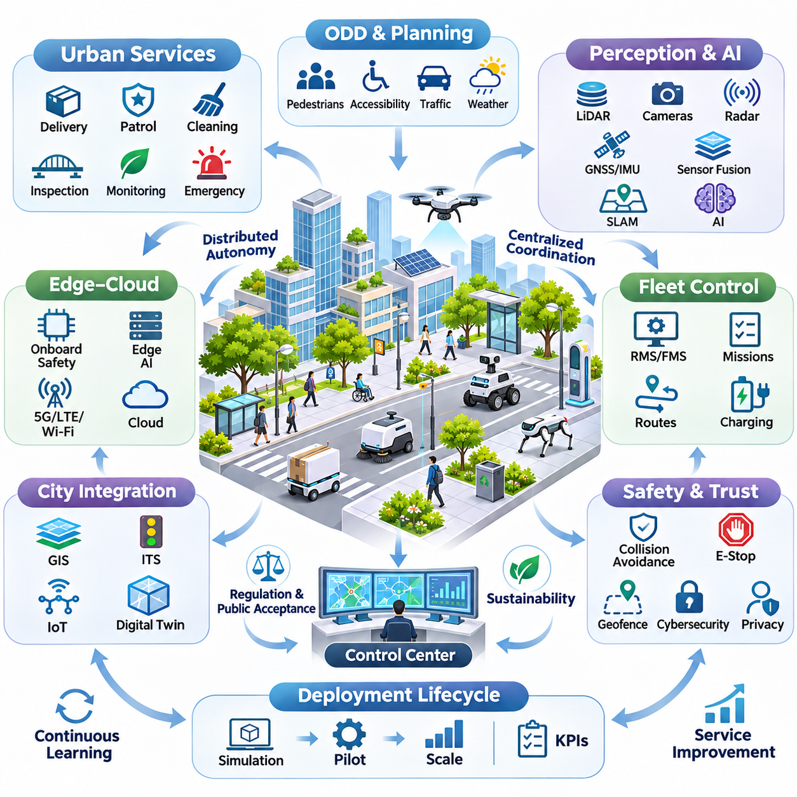
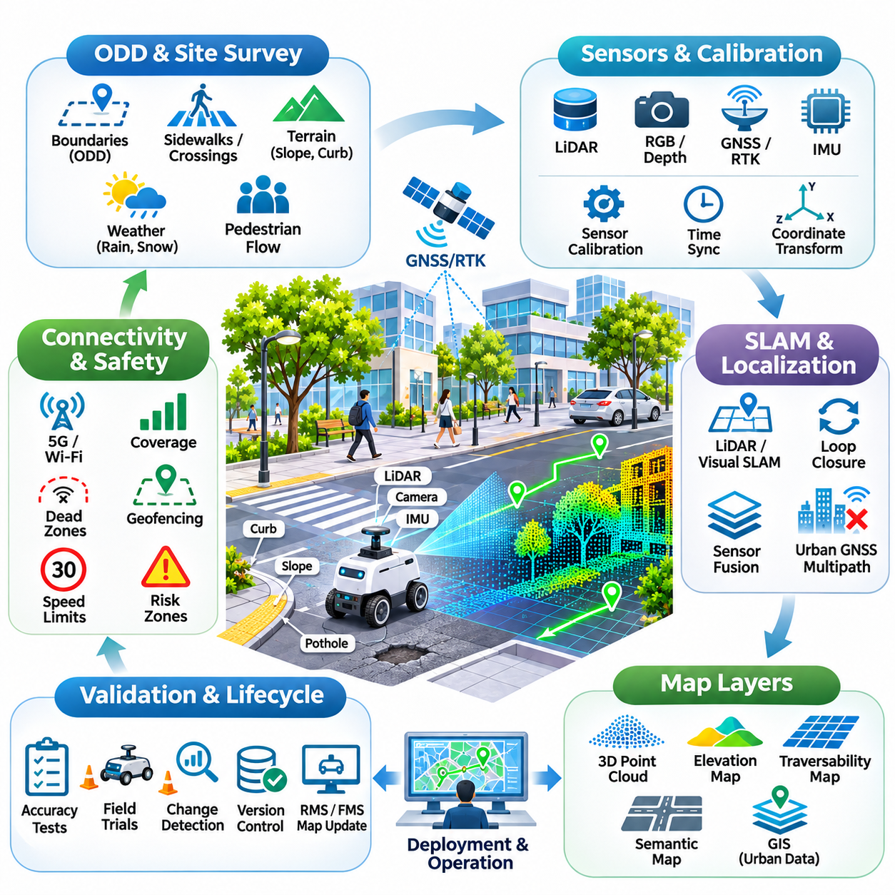
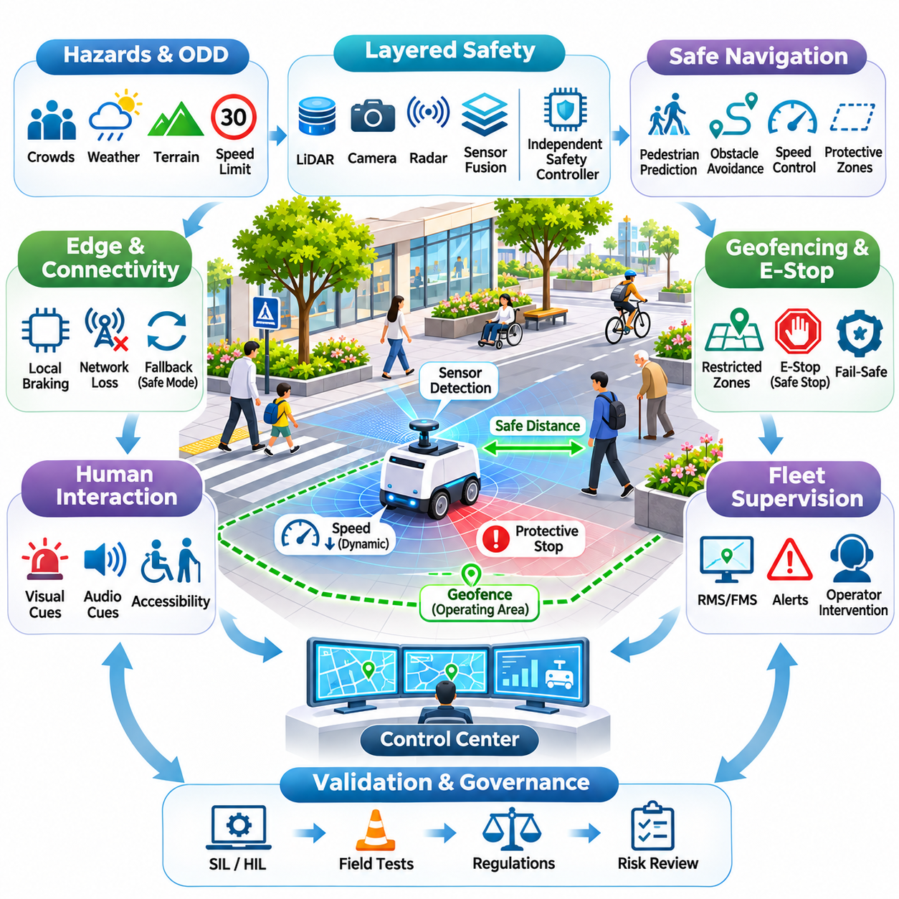
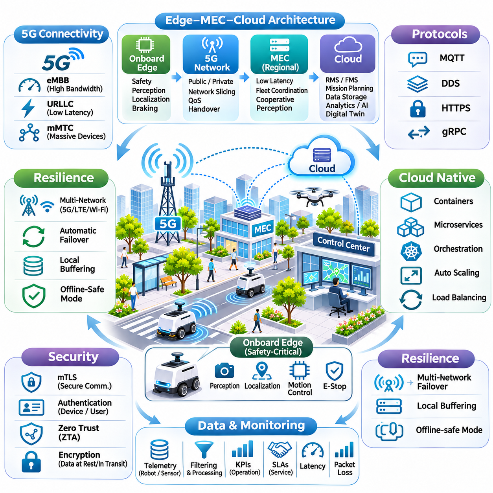
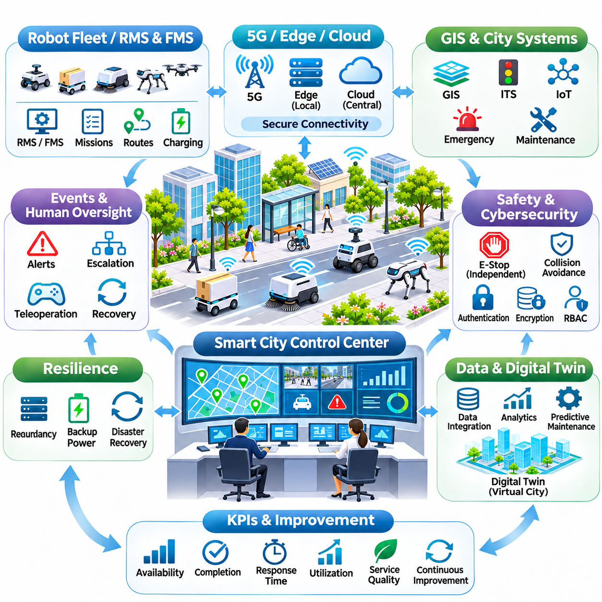
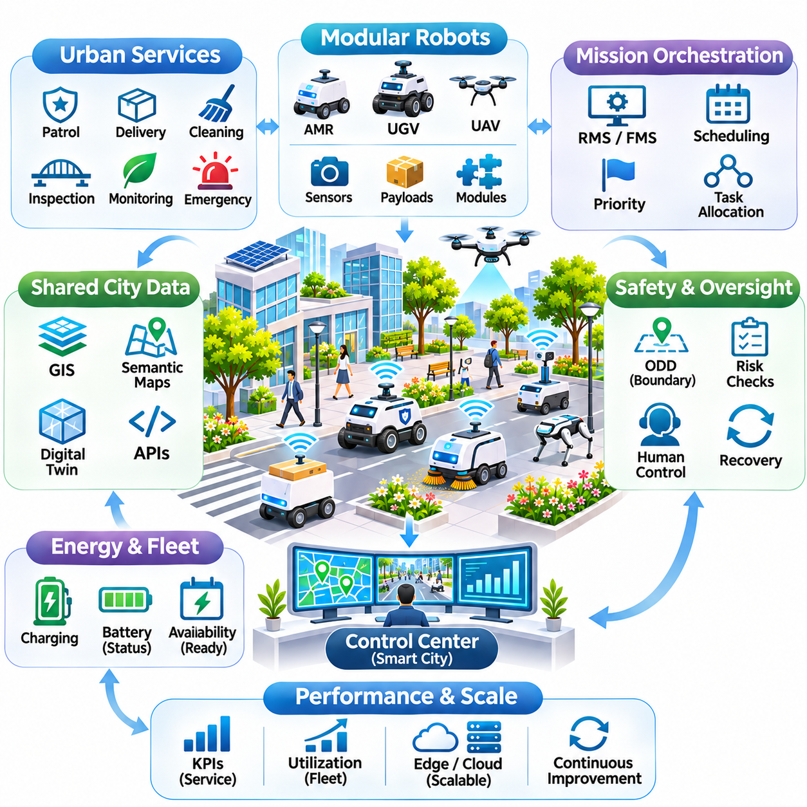
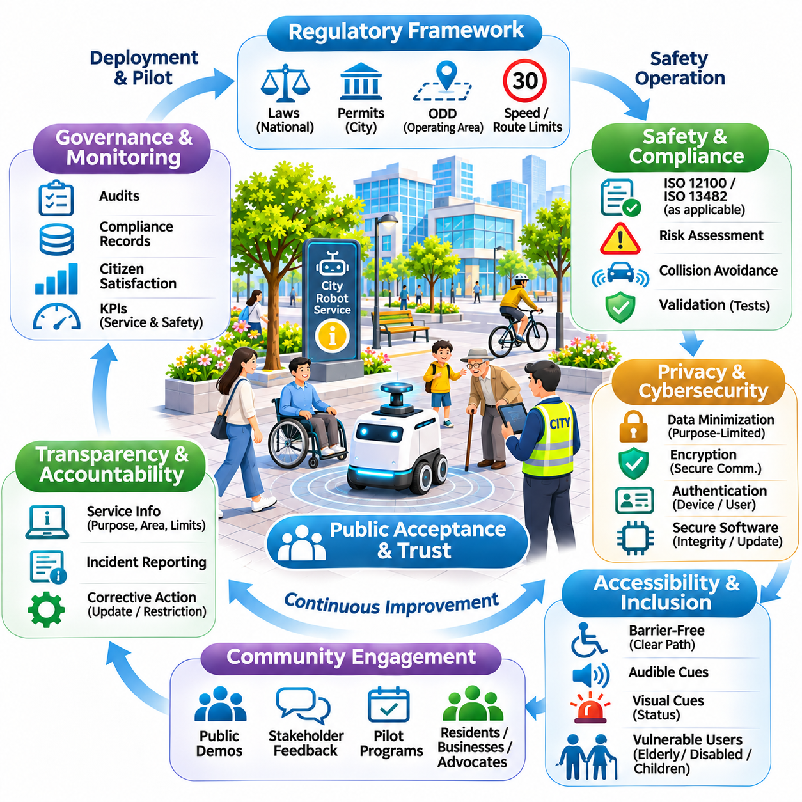
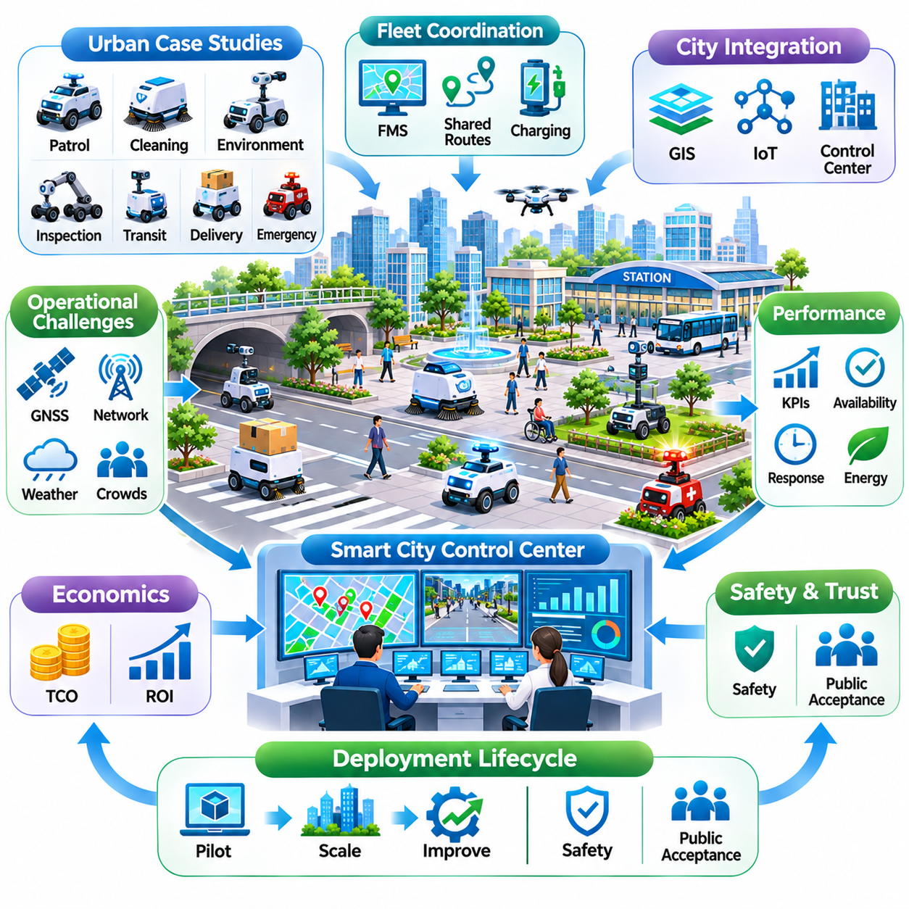
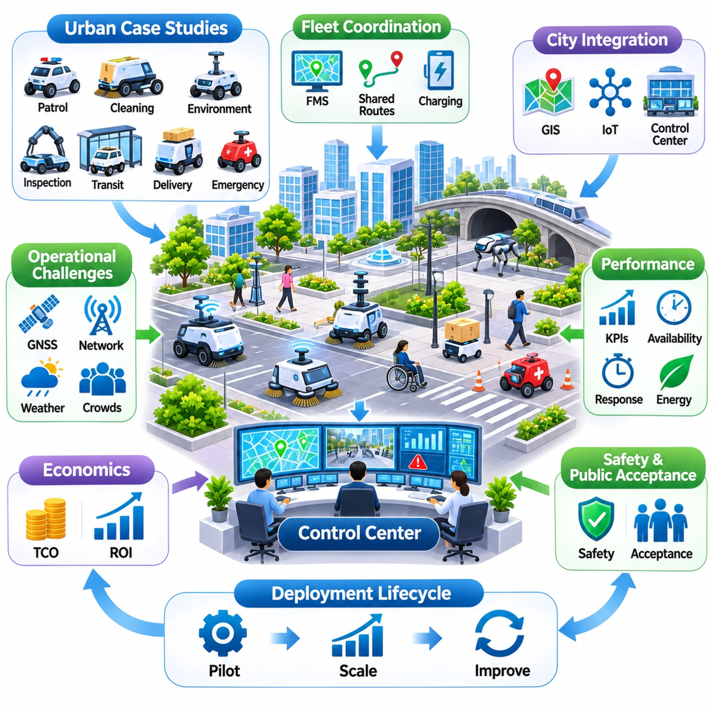

**Volume 08. AMR Operations, Deployment, and MLOps**

# Chapter 20. Smart City Robot Deployment

## 20.1 Smart City Deployment Overview

{width="7.268055555555556in" height="7.268055555555556in"}

스마트 시티 로봇 배치(Smart City Robot Deployment)는 공공 서비스(Public Service), 운영 효율성(Operational Efficiency), 환경 지속가능성(Environmental Sustainability) 및 시민 안전(Citizen Safety)을 향상시키기 위해 도시 환경(Urban Environment)에 자율 로봇 시스템(Autonomous Robotic System)을 체계적으로 도입하는 것을 의미한다. 통제된 산업 시설(Controlled Industrial Facility)에서 운영되는 로봇과 달리, 스마트 시티 로봇은 동적인 공공 공간(Dynamic Public Space)을 이동하고 다양한 시민과 상호작용하며, 지속적으로 변화하는 환경 조건에서 기존 도시 인프라(Urban Infrastructure)와 협력해야 한다.

스마트 시티 로봇의 주요 응용 분야(Application Domain)에는 자율 배송(Autonomous Delivery), 공공 안전 순찰(Public Safety Patrol), 거리 청소(Street Cleaning), 폐기물 수거(Waste Collection), 인프라 검사(Infrastructure Inspection), 환경 모니터링(Environmental Monitoring) 및 긴급 대응(Emergency Response)이 포함된다. 자율이동로봇(Autonomous Mobile Robot, AMR), 무인 지상 차량(Unmanned Ground Vehicle, UGV), 무인 항공기(Unmanned Aerial Vehicle, UAV) 및 사족보행 로봇(Quadruped Robot)은 이동 특성(Mobility Characteristics), 센싱 능력(Sensing Capability) 및 운영 요구사항(Operational Requirements)에 따라 상호 보완적인 임무(Complementary Mission)를 수행할 수 있다.

성공적인 배치(Deployment)는 도시 운영 환경(Urban Operating Environment)에 대한 종합적인 평가(Comprehensive Assessment)에서 시작된다. 엔지니어는 보행자 밀도(Pedestrian Density), 도로 상태(Road Condition), 보행로 구조(Sidewalk Geometry), 교통 패턴(Traffic Pattern), 접근성 요구사항(Accessibility Requirements), 무선 통신 범위(Wireless Communication Coverage) 및 환경 변동성(Environmental Variability)을 평가해야 한다. 이러한 요소는 자율 로봇 시스템의 운영이 허용되는 조건과 지리적 경계를 정의하는 운영 설계 영역(Operational Design Domain, ODD)을 설정하는 기반이 된다.

스마트 시티 로봇은 복잡하고 예측하기 어려운 주변 환경을 이해할 수 있는 강건한 인지 아키텍처(Robust Perception Architecture)를 필요로 한다. 라이다(LiDAR), RGB 카메라(RGB Camera), 깊이 카메라(Depth Camera), 레이더(Radar), 글로벌 위성 항법 시스템(Global Navigation Satellite System, GNSS) 및 관성 측정 장치(Inertial Measurement Unit, IMU)는 상호 보완적인 환경 정보(Environmental Information)를 제공한다. 다중 센서 융합(Multi-Sensor Fusion)은 다양한 기상 및 조명 조건에서 위치 추정(Localization), 장애물 검출(Obstacle Detection), 보행자 인식(Pedestrian Recognition) 및 장면 이해(Scene Understanding) 성능을 향상시킨다.

도시 환경에서의 자율주행(Autonomous Navigation)은 고도화된 위치 추정(Localization), 지도 작성(Mapping), 경로 계획(Path Planning) 및 모션 제어(Motion Control) 능력을 필요로 한다. 동시적 위치 추정 및 지도 작성(Simultaneous Localization and Mapping, SLAM), 의미론적 지도 작성(Semantic Mapping) 및 실시간 이동측위(Real-Time Kinematic, RTK)는 다양한 운영 지역에서 신뢰성 높은 자율주행을 지원할 수 있다. 로봇은 보행자의 이동, 접근성 요구사항, 교통 규제(Traffic Regulation) 및 지정된 운영 경계(Operational Boundary)를 준수하면서 이동 궤적(Trajectory)을 동적으로 조정해야 한다.

인공지능(Artificial Intelligence, AI)은 스마트 시티 로봇 시스템에서 지능형 의사결정(Intelligent Decision-Making)을 구현하기 위한 기반을 제공한다. 딥러닝 모델(Deep Learning Model)은 객체 검출(Object Detection), 의미론적 분할(Semantic Segmentation), 궤적 예측(Trajectory Prediction) 및 이상 탐지(Anomaly Detection)를 가능하게 한다. 비전-언어 모델(Vision-Language Model, VLM), 로봇 파운데이션 모델(Robot Foundation Model, RFM) 및 월드 모델(World Model)은 검증된 운영 및 안전 제약조건(Safety Constraints)의 범위 내에서 상황 이해(Contextual Understanding)와 임무 적응성(Mission Adaptability)을 더욱 향상시킬 수 있다.

분산 컴퓨팅 아키텍처(Distributed Computing Architecture)는 로봇 플랫폼(Robotic Platform)과 스마트 시티 인프라의 통합을 지원한다. 엣지 컴퓨팅(Edge Computing)은 시간 민감형 인지(Time-Critical Perception), 자율주행 및 안전 기능(Safety Function)을 로봇에서 직접 처리하는 반면, 지방자치단체 서버(Municipal Server)와 클라우드 플랫폼(Cloud Platform)은 중앙 집중형 분석(Centralized Analytics), 임무 조정(Mission Coordination) 및 AI 모델 관리(AI Model Management)를 제공한다. 외부 통신(External Communication)의 성능이 저하되거나 일시적으로 중단되는 상황에서도 필수적인 자율 기능(Essential Autonomous Function)은 유지되어야 한다.

통신 인프라(Communication Infrastructure)는 로봇, 관제센터(Control Center) 및 도시 정보 시스템(Urban Information System) 간의 연결성(Connectivity)을 유지하는 데 중요한 역할을 수행한다. 5G, LTE, Wi-Fi 및 전용 무선 네트워크(Dedicated Wireless Network)와 같은 기술은 원격 측정 데이터 전송(Telemetry Transmission), 임무 업데이트(Mission Update), 원격 진단(Remote Diagnostics) 및 협력 운영(Cooperative Operation)을 지원한다. 배치 아키텍처(Deployment Architecture)는 네트워크 지연시간(Network Latency), 대역폭 제한(Bandwidth Limitation), 통신 음영지역(Coverage Gap), 패킷 손실(Packet Loss) 및 통신 환경 간 전환(Communication Environment Transition)을 고려해야 한다.

다수의 로봇 시스템이 도시 전역에서 동시에 운영됨에 따라 군집 관리(Fleet Management)의 중요성이 증가한다. 로봇 관리 시스템(Robot Management System, RMS)과 군집 관리 시스템(Fleet Management System, FMS)은 임무 할당(Mission Allocation), 경로 최적화(Route Optimization), 충전 일정 관리(Charging Scheduling), 운영 우선순위(Operational Priority) 및 예외 처리(Exception Handling)를 조정한다. 중앙 집중형 감독(Centralized Supervision)과 분산 자율성(Distributed Autonomy)의 결합은 지방자치단체 관제센터에 과도한 부담을 주지 않으면서 이기종 로봇 플랫폼(Heterogeneous Robotic Platform)이 효율적으로 운영될 수 있도록 한다.

기존 스마트 시티 인프라와의 통합(Integration)은 표준화된 인터페이스(Standardized Interface), 상호운용 가능한 통신 프로토콜(Interoperable Communication Protocol) 및 일관된 데이터 아키텍처(Data Architecture)를 필요로 한다. 지리 정보 시스템(Geographic Information System, GIS), 지능형 교통 시스템(Intelligent Transportation System, ITS), 사물인터넷 플랫폼(Internet of Things Platform, IoT Platform) 및 지방자치단체 관리 시스템(Municipal Management System)은 중요한 운영 상황 정보(Operational Context)를 제공한다. 디지털 트윈(Digital Twin)은 이러한 정보원을 통합하여 임무 시뮬레이션(Mission Simulation), 인프라 모니터링(Infrastructure Monitoring) 및 배치 계획(Deployment Planning)을 지원할 수 있다.

운영 안전성(Operational Safety)은 공공 환경(Public Environment)에서 운영되는 로봇의 핵심 요구사항이다. 안전 아키텍처(Safety Architecture)는 독립적인 보호 기능(Independent Protective Function), 속도 제한(Speed Limitation), 충돌 회피(Collision Avoidance), 비상 정지(Emergency Stop), 지오펜싱(Geofencing) 및 위험 기반 대체 동작 메커니즘(Risk-Based Fallback Mechanism)을 포함해야 한다. 특히 자율 로봇 시스템과 마주칠 수 있는 어린이, 고령자, 장애인, 자전거 이용자 및 기타 교통약자(Vulnerable Road User)의 안전에 각별한 주의를 기울여야 한다.

사이버 보안(Cybersecurity)과 데이터 프라이버시(Data Privacy)는 전체 배치 수명주기(Deployment Lifecycle)에 걸쳐 고려되어야 한다. 도시 로봇(Urban Robot)은 환경 영상(Environmental Imagery), 위치 기록(Location Record) 및 운영 원격 측정 데이터(Operational Telemetry)를 포함하여 잠재적으로 민감한 정보를 지속적으로 생성하고 처리한다. 보안 통신(Secure Communication), 장치 인증(Device Authentication), 접근 제어(Access Control), 암호화 저장(Encrypted Storage), 취약점 관리(Vulnerability Management) 및 개인정보 보호형 데이터 처리(Privacy-Preserving Data Processing)는 시민과 핵심 도시 인프라(Critical Municipal Infrastructure)를 보호하는 데 기여한다.

배치는 시뮬레이션(Simulation), 통제 환경 시험(Controlled Testing), 시범 운영(Pilot Operation) 및 제한적인 상용 또는 공공 서비스 배치(Limited Commercial or Public Service Deployment)로 이어지는 단계적 구현 전략(Phased Implementation Strategy)을 따라야 한다. 각 단계에서는 운영 범위(Operational Coverage)를 확대하기 전에 측정 가능한 인수 기준(Measurable Acceptance Criteria)을 설정해야 한다. 핵심 성과 지표(Key Performance Indicator, KPI)에는 임무 완료율(Mission Completion Rate), 운영 가용성(Operational Availability), 개입 빈도(Intervention Frequency), 안전 사고(Safety Incident), 에너지 소비량(Energy Consumption) 및 시민 수용성(Public Acceptance)이 포함된다.

스마트 시티 로봇 기술(Smart City Robotics)의 장기적인 발전은 이기종 로봇 협업(Heterogeneous Robot Collaboration), 분산 지능(Distributed Intelligence) 및 지속적인 운영 학습(Continuous Operational Learning)을 더욱 강조하는 방향으로 이루어질 것이다. 상호 연결된 로봇 플랫폼(Connected Robotic Platform)은 집단적으로 환경 인식(Environmental Awareness), 자원 할당(Resource Allocation) 및 지방자치단체 서비스 대응성(Municipal Service Responsiveness)을 향상시킬 수 있다. 궁극적으로 성공적인 배치를 위해서는 기술(Technology), 인프라(Infrastructure), 규제(Regulation), 경제성(Economics) 및 사회적 기대(Societal Expectation)에 대한 통합적이고 체계적인 관리가 필요하다.

첨부된 구조 참조 자료(Structural Reference)를 확인할 수 없었으므로, 본 개요는 피지컬 AI(Physical AI)와 자율 로봇 운영(Autonomous Robot Operations)이라는 보다 광범위한 맥락에서 일반적인 스마트 시티 로봇 배치 프레임워크(Smart City Robotics Deployment Framework)를 기반으로 구성하였다.

## 20.2 Outdoor Site Survey and Mapping

{width="7.268055555555556in" height="7.268055555555556in"}

실외 현장 조사 및 지도 작성(Outdoor Site Survey and Mapping)은 스마트 시티 환경(Smart City Environment)에서 자율 로봇(Autonomous Robot)을 배치하기 위한 기본적인 활동이다. 상대적으로 안정적인 공간 구성(Spatial Configuration)을 가진 실내 시설(Indoor Facility)과 달리, 실외 환경(Outdoor Environment)은 지형(Terrain), 조명(Illumination), 기상(Weather), 교통(Traffic) 및 인간 활동(Human Activity)에서 상당한 변동성을 나타낸다. 체계적인 현장 조사(Systematic Site Survey)는 신뢰성 높은 자율주행(Autonomous Navigation), 운영 안전성(Operational Safety) 및 장기적인 로봇 서비스 제공(Robotic Service Delivery)에 필요한 환경 지식(Environmental Knowledge)을 구축한다.

현장 조사 프로세스(Site Survey Process)는 목표 운영 영역(Intended Operational Area)을 정의하고 로봇 성능(Robot Performance)에 영향을 미칠 수 있는 환경 특성(Environmental Characteristics)을 식별하는 것에서 시작된다. 엔지니어는 보행로(Sidewalk), 횡단보도(Pedestrian Crossing), 도로 표면(Road Surface), 교차로(Intersection), 공공 광장(Public Plaza), 건물 출입구(Building Entrance) 및 서비스 위치(Service Location)를 조사한다. 이러한 관찰 결과는 지리적 경계(Geographical Boundary), 이동 제약조건(Mobility Constraint), 환경적 제한사항(Environmental Limitation) 및 허용된 운영 조건(Permitted Operating Condition)을 포함하는 운영 설계 영역(Operational Design Domain, ODD)을 설정하는 데 기여한다.

지형 평가(Terrain Assessment)는 실외 환경에서 운영되는 자율이동로봇(Autonomous Mobile Robot, AMR)과 무인 지상 차량(Unmanned Ground Vehicle, UGV)에 특히 중요하다. 표면 재질(Surface Material), 경사도(Gradient), 횡단 경사(Cross Slope), 도로 파손부(Pothole), 연석(Curb), 배수로(Drainage Channel) 및 불균일한 포장도로(Uneven Pavement)는 차량 안정성(Vehicle Stability), 접지력(Traction) 및 에너지 소비량(Energy Consumption)에 직접적인 영향을 미친다. 조사 결과는 최저 지상고(Ground Clearance), 휠 구성(Wheel Configuration), 등판 능력(Climbing Capability), 적재 용량(Payload Capacity) 및 제동 성능(Braking Performance)과 같은 로봇 사양(Robot Specification)을 기준으로 평가되어야 한다.

환경 평가(Environmental Assessment)는 자율 운영(Autonomous Operation)에 영향을 미치는 영구적인 인프라(Permanent Infrastructure)와 일시적인 조건(Temporary Condition)을 모두 고려해야 한다. 건물(Building), 식생(Vegetation), 가로 시설물(Street Furniture), 공사 차단시설(Construction Barrier), 주차 차량(Parked Vehicle) 및 보행자 밀집 지역(Pedestrian Concentration)은 서로 다른 자율주행 과제(Navigation Challenge)를 발생시킨다. 계절적 변화(Seasonal Change), 강우(Rainfall), 강설(Snowfall), 안개(Fog) 및 직사광선(Direct Sunlight)은 전체 운영 수명주기(Operational Lifecycle)에 걸쳐 인지 신뢰성(Perception Reliability), 위치 추정 정확도(Localization Accuracy) 및 이동 성능(Mobility Performance)에 추가적인 영향을 미칠 수 있다.

실외 지도 작성(Outdoor Mapping)은 일반적으로 상호 보완적인 기하학적 정보(Geometric Information)와 의미론적 정보(Semantic Information)를 획득하기 위해 다양한 센싱 기술(Sensing Technology)을 필요로 한다. 3차원 라이다(3D LiDAR)는 공간 점군(Spatial Point Cloud)을 생성하고, RGB 카메라(RGB Camera)는 시각적 특성(Visual Characteristics)을 획득하며, 깊이 카메라(Depth Camera)는 국소적인 기하학적 측정값(Local Geometric Measurement)을 제공한다. 글로벌 위성 항법 시스템(Global Navigation Satellite System, GNSS)과 관성 측정 장치(Inertial Measurement Unit, IMU)는 위치 및 방향 정보(Positioning and Orientation Information)를 제공하여 지리적 참조 환경 지도(Geographically Referenced Environmental Map)의 생성을 지원한다.

실시간 이동측위 위성 항법 기술(Real-Time Kinematic GNSS, RTK-GNSS)은 양호한 위성 가시성(Satellite Visibility)과 보정 조건(Correction Condition)에서 센티미터 수준의 위치 추정 정확도(Centimeter-Level Positioning Accuracy)를 제공할 수 있다. 그러나 고밀도 도시 환경(Dense Urban Environment)에서는 주변 건물로 인해 다중 경로 간섭(Multipath Interference), 신호 차단(Signal Obstruction) 및 측위 성능 저하(Positioning Degradation)가 빈번하게 발생한다. 실외 현장 조사는 이러한 문제 지역(Problematic Region)을 식별하고 라이다(LiDAR), 시각적 특징(Visual Feature), 관성 측정값(Inertial Measurement) 및 휠 오도메트리(Wheel Odometry)를 활용하는 대체 위치 추정 전략(Alternative Localization Strategy)을 수립해야 한다.

동시적 위치 추정 및 지도 작성(Simultaneous Localization and Mapping, SLAM)은 로봇이 환경 지도를 구축하는 동시에 해당 환경 내에서 자신의 위치를 추정할 수 있도록 한다. 라이다 기반 SLAM(LiDAR SLAM), 비전 기반 SLAM(Visual SLAM) 및 다중 센서 SLAM(Multi-Sensor SLAM)은 환경 특성과 컴퓨팅 자원(Computational Resource)에 따라 서로 다른 장점을 제공한다. 대규모 실외 지도 작성(Large-Scale Outdoor Mapping)은 강건한 루프 폐쇄(Robust Loop Closure), 자세 그래프 최적화(Pose Graph Optimization), 드리프트 보정(Drift Correction) 및 독립적으로 조사된 지리적 영역 간의 일관된 정합(Consistent Alignment)을 필요로 한다.

정확한 실외 지도 작성은 적절한 센서 보정(Sensor Calibration), 시간 동기화(Temporal Synchronization) 및 좌표 변환(Coordinate Transformation)에 의존한다. 내부 파라미터 보정(Intrinsic Calibration)은 개별 센서의 측정 특성(Measurement Properties)을 정의하는 반면, 외부 파라미터 보정(Extrinsic Calibration)은 센서와 로봇 좌표계(Robot Coordinate Frame) 간의 공간적 관계(Spatial Relationship)를 설정한다. 시간 동기화(Time Synchronization)는 이동 플랫폼(Moving Platform)에서 수집된 측정값이 일관된 획득 시간(Acquisition Time)에 대응하도록 보장하여 기하학적 왜곡(Geometric Distortion)과 위치 추정 오차(Localization Error)를 감소시킨다.

실외 지도(Outdoor Map)는 기하학적 구조(Geometric Structure)와 운영상 의미 있는 환경 특징(Operationally Meaningful Environmental Feature)을 모두 표현해야 한다. 점유 격자 지도(Occupancy Grid Map), 3차원 점군(3D Point Cloud), 고도 지도(Elevation Map), 주행 가능성 지도(Traversability Map) 및 의미론적 지도(Semantic Map)는 도시 환경에 대한 상호 보완적인 표현(Complementary Representation)을 제공한다. 의미론적 정보(Semantic Information)는 보행로, 횡단보도, 진입 금지 구역(Prohibited Zone), 충전소(Charging Station), 서비스 위치 및 자율 임무 수행(Autonomous Mission Execution)과 관련된 기타 인프라를 식별한다.

지리 정보 시스템(Geographic Information System, GIS)은 로봇 생성 지도(Robot-Generated Map)를 기존 지방자치단체 공간정보 데이터베이스(Municipal Geospatial Database)와 통합하기 위한 중요한 기반을 제공한다. 건물 윤곽(Building Footprint), 도로 네트워크(Road Network), 행정구역 경계(Administrative Boundary), 공공 설비 인프라(Utility Infrastructure) 및 교통 정보(Transportation Information)는 환경 이해(Environmental Understanding)를 향상시킬 수 있다. 일관된 좌표 참조 시스템(Coordinate Reference System, CRS), 지리공간 좌표 변환(Geospatial Transformation) 및 지도 정합 절차(Map Alignment Procedure)는 로봇 자율주행 시스템(Robotic Navigation System)과 지방자치단체 정보 플랫폼(Municipal Information Platform) 간의 상호운용성(Interoperability)을 보장한다.

네트워크 연결성 평가(Network Connectivity Assessment)는 기하학적 지도 작성(Geometric Mapping) 및 환경 지도 작성(Environmental Mapping)과 병행하여 수행되어야 한다. 무선 신호 강도(Wireless Signal Strength), 통신 지연시간(Communication Latency), 가용 대역폭(Bandwidth Availability), 패킷 손실(Packet Loss) 및 통신 범위의 연속성(Coverage Continuity)은 전체 목표 운영 영역에서 측정되어야 한다. 통신 커버리지 지도(Communication Coverage Map)는 잠재적인 통신 음영지역(Dead Zone)을 식별하고 이중화 통신 경로(Redundant Communication Pathway), 로컬 자율성 메커니즘(Local Autonomy Mechanism) 및 신뢰성 높은 원격 모니터링 능력(Remote Monitoring Capability)의 설계를 지원한다.

위험 평가(Risk Assessment)와 안전 지도 작성(Safety Mapping)은 자율 운영으로 인해 로봇, 보행자 또는 주변 인프라에 높은 위험이 발생할 수 있는 위치를 식별한다. 고위험 영역(High-Risk Region)에는 교차로, 좁은 보행로(Narrow Sidewalk), 급경사(Steep Slope), 보행자 밀집 지역(Crowded Pedestrian Area) 및 시야 제한 지역(Restricted Visibility Area)이 포함된다. 이러한 영역에는 지오펜싱 경계(Geofencing Boundary), 제한된 주행 속도(Reduced Speed Limit), 제한적 운영 조건(Restricted Operating Condition) 또는 추가적인 감독 요구사항(Supervisory Requirement)이 연계되어야 한다.

실외 지도 작성 정확도(Outdoor Mapping Accuracy)와 운영 적합성(Operational Suitability)은 대표적인 환경 조건(Representative Environmental Condition)에서 반복적인 현장 시험(Repeated Field Testing)을 통해 검증되어야 한다. 엔지니어는 절대 위치 정확도(Absolute Positioning Accuracy), 위치 추정 반복정밀도(Localization Repeatability), 지도 일관성(Map Consistency), 장애물 표현(Obstacle Representation) 및 경로 주행 가능성(Route Traversability)을 평가한다. 독립적인 기준 측정값(Independent Reference Measurement)과 사전에 정의된 인수 기준(Predefined Acceptance Criteria)은 생성된 지도가 목표 로봇 응용 분야의 기술적 요구사항(Technical Requirement)과 안전 요구사항(Safety Requirement)을 충족하는지 판단하는 데 기여한다.

실외 환경은 건설 활동(Construction Activity), 인프라 유지보수(Infrastructure Maintenance), 계절적 식생 변화(Seasonal Vegetation) 및 도시 교통 패턴(Urban Traffic Pattern)의 변화로 인해 지속적으로 발전한다. 따라서 지도 수명주기 관리(Map Lifecycle Management)는 변화 탐지(Change Detection), 점진적 지도 작성(Incremental Mapping), 버전 관리(Version Control), 검증(Validation) 및 통제된 지도 배포(Controlled Map Distribution)를 포함해야 한다. 로봇 관리 시스템(Robot Management System, RMS)과 군집 관리 시스템(Fleet Management System, FMS)은 분산된 로봇 플랫폼(Distributed Robotic Platform) 전반에 걸쳐 지도 업데이트(Map Update)를 조정할 수 있다.

첨부된 구조 참조 자료(Structural Reference)를 확인할 수 없었으므로, 본 절은 일반적인 실외 로봇 배치 프레임워크(Outdoor Robotic Deployment Framework)를 기반으로 구성하였다. 이러한 프레임워크 내에서 실외 현장 조사 및 지도 작성은 자율주행, 군집 조정(Fleet Coordination), 디지털 트윈 통합(Digital Twin Integration) 및 지속적인 환경 학습(Continuous Environmental Learning)을 위한 공통 공간 기반(Shared Spatial Foundation)을 구축한다. 이러한 활동의 효과는 운영 신뢰성(Operational Reliability), 배치 확장성(Deployment Scalability), 공공 안전(Public Safety) 및 지속가능한 스마트 시티 로봇 운영(Sustainable Smart City Robot Operations)에 직접적인 영향을 미친다.

## 20.3 Public Space Safety Operation

{width="7.268055555555556in" height="7.268055555555556in"}

공공 공간 안전 운영(Public Space Safety Operation)은 스마트 시티 환경(Smart City Environment)에서 자율 로봇(Autonomous Robot)을 배치하기 위한 기본적인 요구사항이다. 통제된 산업 시설(Controlled Industrial Facility)과 달리, 공공 공간(Public Space)은 예측하기 어려운 인간 행동(Unpredictable Human Behavior), 다양한 교통 형태(Heterogeneous Traffic), 제한되지 않은 보행자 이동(Unrestricted Pedestrian Movement) 및 지속적으로 변화하는 환경 조건(Environmental Condition)을 특징으로 한다. 로봇 시스템(Robotic System)은 정상적인 도시 활동(Urban Activity)을 방해하지 않으면서 신뢰성 높은 서비스를 제공하고 운영 안전성(Operational Safety)을 유지해야 한다.

안전 관리(Safety Management)는 로봇 운영과 관련된 잠재적 위험요소(Potential Hazard)에 대한 체계적인 평가(Systematic Assessment)에서 시작된다. 엔지니어는 충돌 위험(Collision Risk), 예측하지 못한 보행자 상호작용(Unexpected Pedestrian Interaction), 차량 불안정성(Vehicle Instability), 기계적 고장(Mechanical Failure), 센서 성능 저하(Sensor Degradation), 통신 중단(Communication Interruption) 및 환경적 교란(Environmental Disturbance)을 평가해야 한다. 위험요소 식별(Hazard Identification)과 위험 평가(Risk Assessment)는 전체 운영 수명주기(Operational Lifecycle)에 걸쳐 보호 조치(Protective Measure)와 허용 가능한 잔여 위험 수준(Acceptable Residual Risk Level)을 정의하기 위한 기반을 구축한다.

운영 설계 영역(Operational Design Domain, ODD)은 자율 로봇의 운영이 허용되는 지리적, 환경적 및 기능적 경계(Geographical, Environmental, and Functional Boundary)를 정의한다. 공공 공간 운영(Public Space Operation)은 보행자 밀도(Pedestrian Density), 기상 조건(Weather Condition), 표면 특성(Surface Characteristics), 가시성(Visibility), 교통 복잡성(Traffic Complexity) 및 최대 운영 속도(Maximum Operating Speed)에 대한 명확한 제한사항(Restriction)을 필요로 한다. 로봇은 승인된 운영 설계 영역을 벗어나는 조건을 감지하고 적절한 위험 완화(Risk Mitigation) 또는 안전 대체 동작 절차(Safe Fallback Procedure)를 실행해야 한다.

종합적인 안전 아키텍처(Comprehensive Safety Architecture)는 개별 구성요소 고장(Component Failure)의 영향을 최소화하기 위해 여러 독립적인 보호 계층(Independent Protection Layer)을 통합한다. 인지 시스템(Perception System), 자율주행 알고리즘(Navigation Algorithm), 모션 제어기(Motion Controller), 안전 모니터링 장치(Safety Monitoring Unit) 및 비상 정지 메커니즘(Emergency Stopping Mechanism)은 허용할 수 없는 종속성(Unacceptable Dependency)을 발생시키지 않으면서 상호 협력해야 한다. 안전 필수 기능(Safety-Critical Function)은 임무 관리(Mission Management), 클라우드 연결성(Cloud Connectivity) 및 범용 AI 처리(General-Purpose AI Processing)로부터 충분한 독립성을 유지해야 한다.

신뢰성 높은 환경 인지(Reliable Environmental Perception)는 공공 공간에서 보행자(Pedestrian), 자전거 이용자(Cyclist), 차량(Vehicle), 동물(Animal) 및 예기치 않은 장애물(Unexpected Obstacle)을 검출하는 데 필수적이다. 라이다(LiDAR), 카메라(Camera), 레이더(Radar), 초음파 센서(Ultrasonic Sensor) 및 기타 센싱 기술(Sensing Technology)은 상호 보완적인 환경 측정값(Environmental Measurement)을 제공한다. 다중 센서 융합(Multi-Sensor Fusion)은 검출 강건성(Detection Robustness)을 향상시킬 수 있으며, 센서 상태 모니터링(Sensor Health Monitoring)은 측정 품질(Measurement Quality)의 저하를 식별하고 운영 행동(Operational Behavior)에 대한 적절한 조정을 실행한다.

보행자 인식 기반 자율주행(Pedestrian-Aware Navigation)은 로봇이 인간의 이동 패턴(Human Movement Pattern)을 이해하고 주변 사람들과 적절한 이격 거리(Separation Distance)를 유지할 수 있도록 해야 한다. 인간 궤적 예측(Human Trajectory Prediction), 동적 장애물 회피(Dynamic Obstacle Avoidance) 및 사회적 상황 인식 기반 경로 계획(Socially Aware Path Planning)은 혼잡한 환경(Crowded Environment)에서 안전한 상호작용(Safe Interaction)을 지원한다. 특히 이동을 예측하기 어려울 수 있는 어린이, 고령자, 장애인 및 기타 교통약자(Vulnerable Road User)에 대한 특별한 고려가 필요하다.

동적 속도 관리(Dynamic Speed Management)는 자율 로봇이 환경 조건과 추정된 위험 수준(Estimated Risk Level)에 따라 이동을 조정할 수 있도록 한다. 운영 속도(Operating Speed)는 보행자 근접도(Pedestrian Proximity), 가용 정지 거리(Available Stopping Distance), 노면 접지력(Surface Traction), 센서 검출 범위(Sensor Detection Range) 및 로봇 제동 능력(Robot Braking Capability)을 반영해야 한다. 보호 영역(Protective Zone)은 검증된 안전 파라미터(Validated Safety Parameter)에 따라 동적으로 조정될 수 있으며, 이를 통해 위험한 조건(Hazardous Condition)이 발생할 경우 로봇이 감속하거나 정지할 수 있도록 한다.

지오펜싱(Geofencing)은 승인된 운영 영역(Authorized Operational Region) 내에서 자율 로봇의 이동을 제한하기 위한 공간적 메커니즘(Spatial Mechanism)을 제공한다. 디지털 경계(Digital Boundary)는 허용된 경로(Permitted Route), 제한 구역(Restricted Area), 보행자 우선 구역(Pedestrian Priority Zone) 및 추가적인 감독이 필요한 위치를 정의한다. 의미론적 지도(Semantic Map) 및 지리 정보 시스템(Geographic Information System, GIS)과의 통합은 위치 추정 정확도(Localization Accuracy)와 위치 추정 불확실성(Positioning Uncertainty)이 적절하게 고려되는 조건에서 위치 기반 안전 정책(Location-Dependent Safety Policy)을 지원한다.

비상 정지(Emergency Stopping)와 고장 안전 메커니즘(Fail-Safe Mechanism)은 위험한 상황이나 치명적인 시스템 고장(Critical System Failure)이 발생할 경우 제어되지 않는 움직임(Uncontrolled Motion)을 방지해야 한다. 보호 정지 기능(Protective Stopping Function)은 검증된 정지 거리(Validated Stopping Distance)와 응답 시간(Response Time) 이내에 로봇을 안전 상태(Safe State)로 전환해야 한다. 물리적 비상 정지 장치(Physical Emergency Stop Device), 적절하게 설계된 원격 정지 기능(Remote Stopping Function) 및 독립적인 안전 제어기(Independent Safety Controller)는 비정상적인 운영 조건(Abnormal Operating Condition)에 대한 상호 보완적인 보호 기능을 제공한다.

통신 장애(Communication Failure)는 공공 환경에서 운영되는 자율 로봇의 근본적인 안전성을 저해해서는 안 된다. 안전 필수 인지(Safety-Critical Perception), 장애물 검출(Obstacle Detection), 제동(Braking) 및 모션 감독(Motion Supervision)은 엣지 컴퓨팅 아키텍처(Edge Computing Architecture)를 통해 로봇 내부에서 직접 실행되어야 한다. 네트워크 연결성(Network Connectivity)이 상실되는 경우 로봇은 사전에 정의된 대체 동작 정책(Predefined Fallback Policy)을 따라야 하며, 여기에는 제한적 자율 운영(Restricted Autonomous Operation), 제어된 정지(Controlled Stopping) 또는 검증된 안전 위치(Validated Safe Location)로의 이동이 포함될 수 있다.

인간-로봇 상호작용(Human-Robot Interaction, HRI)은 공공 공간에서 예측 가능하고 이해하기 쉬운 로봇 행동(Robotic Behavior)을 확립하는 데 중요한 역할을 수행한다. 시각적 표시 장치(Visual Indicator), 음향 신호(Acoustic Signal), 상태 표시 장치(Status Display) 및 의도를 전달하는 움직임 패턴(Intentional Motion Pattern)은 주변 사람들에게 로봇의 의도(Robot Intention)를 전달할 수 있다. 이러한 의사소통 메커니즘(Communication Mechanism)은 불필요한 방해를 발생시키지 않으면서 다양한 언어(Language), 접근성 요구사항(Accessibility Requirements), 감각적 제약(Sensory Limitation) 및 환경 소음(Environmental Noise)을 고려해야 한다.

공공 공간 안전 운영은 로봇 관리 시스템(Robot Management System, RMS)과 군집 관리 시스템(Fleet Management System, FMS)을 통한 지속적인 모니터링(Continuous Monitoring)을 필요로 한다. 운영 대시보드(Operational Dashboard)는 로봇 위치(Robot Location), 이동 상태(Movement Status), 안전 이벤트(Safety Event), 센서 상태(Sensor Health), 통신 품질(Communication Quality) 및 비상 상황(Emergency Condition)에 관한 정보를 제공해야 한다. 감독 인력(Supervisory Personnel)은 배치된 전체 로봇 군집(Deployed Robotic Fleet)에 대해 명확하게 정의된 개입 권한(Intervention Authority), 단계적 상향 보고 절차(Escalation Procedure) 및 사고 대응 책임(Incident Response Responsibility)을 가져야 한다.

안전 검증(Safety Validation)은 대표적인 운영 시나리오(Representative Operational Scenario), 예측 가능한 오사용(Foreseeable Misuse), 환경적 교란(Environmental Disturbance) 및 비정상적인 시스템 조건(Abnormal System Condition)을 포함해야 한다. 시뮬레이션(Simulation), 소프트웨어 연동 시험(Software-in-the-Loop, SIL), 하드웨어 연동 시험(Hardware-in-the-Loop, HIL), 통제된 현장 시험(Controlled Field Testing) 및 감독 기반 시범 운영(Supervised Pilot Operation)은 상호 보완적인 검증 방법(Verification Method)을 제공한다. 안전 검증은 공공 공간 배치(Public Deployment)를 확대하기 전에 정의된 운영 조건에서 허용 가능한 안전 성능(Acceptable Safety Performance)을 입증해야 한다.

규제 준수(Regulatory Compliance)와 안전 거버넌스(Safety Governance)는 책임 있는 공공 공간 로봇 운영을 위한 조직적 프레임워크(Organizational Framework)를 구축한다. 배치 담당 조직(Deployment Team)은 적용 가능한 기계류 안전 요구사항(Machinery Safety Requirements), 지역 교통 규제(Local Traffic Regulation), 접근성 의무사항(Accessibility Obligation), 개인정보 보호 법규(Privacy Legislation) 및 지방자치단체 운영 허가(Municipal Operating Permit)를 고려해야 한다. 안전 문서화(Safety Documentation), 유지보수 기록(Maintenance Record), 사고 조사(Incident Investigation) 및 주기적인 위험 재평가(Periodic Risk Reassessment)는 책임성(Accountability)과 지속적인 개선(Continuous Improvement)을 지원한다.

공공 공간 안전성(Public Space Safety)은 자율주행(Autonomous Navigation), 분산 지능(Distributed Intelligence) 및 협력적 로봇 운영(Cooperative Robotic Operation)의 발전과 함께 지속적으로 진화해야 한다. 첨부된 구조 참조 자료(Structural Reference)를 확인할 수 없었으므로, 본 절은 일반적인 스마트 시티 안전 운영 프레임워크(Smart City Safety Operation Framework)를 기반으로 구성하였다. 이러한 프레임워크 내에서 기술적 안전장치(Technical Safeguard), 운영 감독(Operational Supervision), 규제 준수(Regulatory Compliance) 및 시민 신뢰(Public Trust)는 지속가능한 도시 로봇 서비스(Sustainable Urban Robotic Service)를 위한 통합적인 기반을 구축한다.

## 20.4 5G and Cloud Infrastructure

{width="7.268055555555556in" height="7.268055555555556in"}

5세대 이동통신(5th Generation Mobile Communication, 5G)과 클라우드 인프라(Cloud Infrastructure)는 대규모 스마트 시티 로봇 배치(Large-Scale Smart City Robot Deployment)를 위한 디지털 기반(Digital Foundation)을 제공한다. 도시 환경(Urban Environment) 전역에서 운영되는 자율 로봇(Autonomous Robot)은 신뢰성 높은 연결성(Reliable Connectivity), 분산 컴퓨팅 자원(Distributed Computing Resource), 중앙 집중형 운영 감독(Centralized Operational Supervision) 및 지속적인 정보 교환(Continuous Information Exchange)을 필요로 한다. 통신 및 컴퓨팅 인프라(Communication and Computing Infrastructure)의 통합은 확장 가능하고 상호 조정되는 지능형 로봇 서비스(Intelligent Robotic Service)를 지원한다.

5G 네트워크 아키텍처(5G Network Architecture)는 자율 로봇 운영(Autonomous Robot Operation)과 관련된 다양한 요구사항을 충족할 수 있는 통신 기능(Communication Capability)을 제공한다. 향상된 모바일 광대역 통신(Enhanced Mobile Broadband, eMBB)은 고대역폭 센서 및 영상 전송(High-Bandwidth Sensor and Video Transmission)을 지원하며, 초고신뢰 저지연 통신(Ultra-Reliable Low-Latency Communications, URLLC)은 지연시간에 민감한 응용 분야(Latency-Sensitive Application)를 대상으로 한다. 대규모 기계형 통신(Massive Machine-Type Communications, mMTC)은 대규모 장치, 센서 및 도시 인프라(Urban Infrastructure) 전반의 연결성을 지원한다.

공용 5G 네트워크(Public 5G Network)와 사설 5G 네트워크(Private 5G Network)는 스마트 시티 로봇 배치에 서로 다른 장점을 제공한다. 공용 네트워크는 광범위한 지리적 통신 범위(Geographical Coverage)와 기존 통신 인프라(Telecommunications Infrastructure)에 대한 접근성을 제공하는 반면, 사설 네트워크는 네트워크 구성(Network Configuration), 보안 정책(Security Policy) 및 자원 할당(Resource Allocation)에 대한 높은 수준의 제어 능력을 제공한다. 하이브리드 네트워크 아키텍처(Hybrid Network Architecture)는 이러한 기능을 결합하여 다양한 운영 환경(Operational Environment)과 임무 요구사항(Mission Requirement)을 충족할 수 있다.

네트워크 슬라이싱(Network Slicing)은 공유 물리 인프라(Shared Physical Infrastructure)에서 다수의 논리적 통신 네트워크(Logical Communication Network)가 운영될 수 있도록 한다. 각각의 네트워크 슬라이스(Network Slice)는 서비스 요구사항(Service Requirement)에 따라 로봇 원격 측정 데이터(Robot Telemetry), 영상 스트리밍(Video Streaming), 원격 감독(Remote Supervision), 인프라 모니터링(Infrastructure Monitoring) 및 임무 조정(Mission Coordination)을 지원할 수 있다. 적절한 서비스 품질(Quality of Service, QoS) 설정과 자원 관리(Resource Management)는 제한된 통신 자원(Communication Resource)을 경쟁적으로 사용하는 응용 프로그램 간의 간섭을 감소시키는 데 기여한다.

다중 접속 엣지 컴퓨팅(Multi-access Edge Computing, MEC)은 컴퓨팅 능력(Computing Capability)을 접속 네트워크(Access Network) 영역까지 확장하여 자율 로봇과 외부 처리 자원(External Processing Resource) 간의 통신 거리를 감소시킨다. MEC 플랫폼(MEC Platform)은 지역 단위 군집 조정(Regional Fleet Coordination), 협력 인지(Cooperative Perception), 지역 기반 데이터 분석(Localized Analytics) 및 공유 환경 정보 처리(Shared Environmental Information Processing)를 지원할 수 있다. 이러한 아키텍처는 상대적으로 낮은 네트워크 지연시간(Network Latency)이 요구되는 응용 분야에서 원격 클라우드 데이터센터(Remote Cloud Data Center)에 대한 의존성을 감소시킨다.

온보드 엣지 컴퓨팅(Onboard Edge Computing)은 공공 환경(Public Environment)에서 운영되는 자율 로봇에 여전히 필수적인 요소이다. 안전 필수 인지(Safety-Critical Perception), 위치 추정(Localization), 장애물 검출(Obstacle Detection), 모션 제어(Motion Control) 및 비상 정지(Emergency Stopping)는 외부 네트워크 가용성(External Network Availability)과 독립적으로 운영되어야 한다. 컴퓨팅 작업부하(Computational Workload)는 지연시간(Latency), 대역폭(Bandwidth), 신뢰성(Reliability) 및 안전 요구사항(Safety Requirement)에 따라 온보드 프로세서(Onboard Processor), 지역 엣지 서버(Regional Edge Server) 및 중앙 집중형 클라우드 플랫폼(Centralized Cloud Platform)에 분산되어야 한다.

클라우드 인프라(Cloud Infrastructure)는 지리적으로 분산된 로봇 군집(Geographically Distributed Robotic Fleet)을 위한 중앙 집중형 컴퓨팅(Centralized Computing), 스토리지(Storage), 데이터 분석(Analytics) 및 관리 기능(Management Capability)을 제공한다. 클라우드 기반 로봇 관리 시스템(Cloud-Based Robot Management System, RMS)과 군집 관리 시스템(Fleet Management System, FMS)은 임무 스케줄링(Mission Scheduling), 자원 할당, 운영 모니터링(Operational Monitoring), 원격 진단(Remote Diagnostics) 및 소프트웨어 배포(Software Distribution)를 지원한다. 탄력적 컴퓨팅 자원(Elastic Computing Resource)은 배치된 로봇 시스템의 수가 증가함에 따라 인프라 용량(Infrastructure Capacity)을 확장할 수 있도록 한다.

통신 프로토콜(Communication Protocol)과 응용 프로그램 인터페이스(Application Interface)는 로봇 시스템(Robotic System)과 분산 컴퓨팅 플랫폼(Distributed Computing Platform) 간의 상호운용성(Interoperability)을 확립한다. 메시지 큐 원격 측정 전송(Message Queuing Telemetry Transport, MQTT), 데이터 분산 서비스(Data Distribution Service, DDS), 보안 하이퍼텍스트 전송 프로토콜(HTTPS), 웹소켓(WebSocket) 및 원격 프로시저 호출 프레임워크(gRPC)와 같은 기술은 다양한 정보 교환 요구사항(Information Exchange Requirement)을 지원한다. 프로토콜 선정(Protocol Selection)은 메시지 전달 보장(Message Delivery Guarantee), 통신 오버헤드(Communication Overhead), 보안 메커니즘(Security Mechanism), 네트워크 신뢰성(Network Reliability) 및 기존 지방자치단체 정보 시스템(Municipal Information System)과의 상호운용성을 고려해야 한다.

신뢰성 높은 연결성은 목표 도시 운영 환경(Intended Urban Operating Environment) 전반에 대한 종합적인 네트워크 커버리지 평가(Network Coverage Assessment)를 필요로 한다. 엔지니어는 신호 강도(Signal Strength), 간섭(Interference), 상향 및 하향 링크 처리량(Uplink and Downlink Throughput), 지연시간, 패킷 손실(Packet Loss) 및 이동 중 핸드오버 성능(Mobility Handover Performance)을 평가해야 한다. 건물, 지하 통로(Underground Passage), 터널(Tunnel), 식생(Vegetation) 및 인구 밀집 지역(Densely Populated Area)은 통신 성능 저하(Communication Degradation)를 유발할 수 있으며, 이러한 상황에서는 대체 연결성(Alternative Connectivity) 또는 로컬 자율 운영(Local Autonomous Operation)이 요구된다.

네트워크 복원력(Network Resilience)은 5G, LTE, Wi-Fi 및 다수의 통신 서비스 제공업체(Telecommunications Provider)를 포함하는 다중 네트워크 통신 아키텍처(Multi-Network Communication Architecture)를 통해 향상될 수 있다. 자동 연결 전환(Automatic Connection Switching), 이중화 통신 채널(Redundant Communication Channel), 로컬 데이터 버퍼링(Local Data Buffering) 및 저장 후 전달 메커니즘(Store-and-Forward Mechanism)은 운영 연속성(Operational Continuity)을 유지하는 데 기여한다. 로봇은 안전 필수 기능(Safety-Critical Function)을 저해하거나 상충되는 임무 명령(Conflicting Mission Command)을 생성하지 않으면서 사전에 정의된 통신 단절 대응 정책(Predefined Communication Loss Policy)을 실행해야 한다.

클라우드 네이티브 아키텍처(Cloud-Native Architecture)는 확장 가능한 스마트 시티 로봇 서비스(Scalable Smart City Robotic Service)의 개발과 운영을 지원한다. 컨테이너화(Containerization), 마이크로서비스(Microservices), 컨테이너 오케스트레이션 플랫폼(Container Orchestration Platform), 분산 데이터베이스(Distributed Database) 및 이벤트 기반 처리(Event-Driven Processing)는 모듈형 서비스 배포(Modular Service Deployment)와 독립적인 자원 확장(Independent Resource Scaling)을 가능하게 한다. 부하 분산(Load Balancing), 자동 장애 조치(Automated Failover), 서비스 검색(Service Discovery) 및 인프라 모니터링은 분산 컴퓨팅 환경(Distributed Computing Environment) 전반에서 서비스 가용성(Service Availability)을 유지하는 데 기여한다.

사이버 보안(Cybersecurity)은 통합된 통신 및 컴퓨팅 인프라 전체에 걸쳐 구현되어야 한다. 장치 인증(Device Authentication), 상호 전송 계층 보안(Mutual Transport Layer Security, mTLS), 암호화 통신(Encrypted Communication), 네트워크 분할(Network Segmentation), 보안 부팅(Secure Boot) 및 역할 기반 접근 제어(Role-Based Access Control, RBAC)는 비인가 접근(Unauthorized Access)으로부터 로봇 시스템을 보호한다. 제로 트러스트 아키텍처(Zero Trust Architecture, ZTA)는 연결된 장치와 서비스의 신원(Identity) 및 접근 권한(Permission)을 지속적으로 평가함으로써 보안성을 더욱 강화한다.

데이터 관리 인프라(Data Management Infrastructure)는 분산된 로봇 플랫폼(Distributed Robotic Platform)에서 지속적으로 생성되는 정보를 수용할 수 있어야 한다. 센서 측정값(Sensor Measurement), 운영 원격 측정 데이터(Operational Telemetry), 환경 관찰 정보(Environmental Observation), 안전 이벤트(Safety Event) 및 진단 기록(Diagnostic Record)은 적절한 데이터 수집(Data Ingestion), 저장(Storage), 처리(Processing) 및 보존 정책(Retention Policy)을 필요로 한다. 엣지 기반 데이터 필터링(Edge-Based Data Filtering), 압축(Compression), 선택적 업로드(Selective Uploading) 및 이벤트 기반 기록(Event-Triggered Recording)은 통신 대역폭 요구사항(Communication Bandwidth Requirement)과 클라우드 운영 비용(Cloud Operating Cost)을 감소시킬 수 있다.

인프라 성능(Infrastructure Performance)은 측정 가능한 핵심 성과 지표(Key Performance Indicator, KPI)와 서비스 수준 협약(Service Level Agreement, SLA)을 활용하여 지속적으로 평가되어야 한다. 네트워크 가용성(Network Availability), 종단 간 지연시간(End-to-End Latency), 처리량(Throughput), 지터(Jitter), 패킷 손실, 클라우드 서비스 가용성(Cloud Service Availability) 및 컴퓨팅 자원 활용률(Computational Resource Utilization)은 필수적인 운영 지표(Operational Indicator)를 제공한다. 모니터링 및 경보 시스템(Monitoring and Alerting System)은 인프라 성능 저하(Infrastructure Degradation)가 로봇 서비스 제공(Robotic Service Delivery)에 심각한 영향을 미치기 전에 이를 식별해야 한다.

첨부된 구조 참조 자료(Structural Reference)를 확인할 수 없었으므로, 본 절은 일반적인 스마트 시티 인프라 프레임워크(Smart City Infrastructure Framework)를 기반으로 구성하였다. 이러한 프레임워크 내에서 5G, 엣지 컴퓨팅(Edge Computing), 온프레미스 인프라(On-Premises Infrastructure) 및 클라우드 컴퓨팅(Cloud Computing)은 분산 지능(Distributed Intelligence), 이기종 로봇 군집 협업(Heterogeneous Fleet Collaboration), 디지털 트윈 통합(Digital Twin Integration) 및 지속적인 AI 학습(Continuous AI Learning)을 통합적으로 지원한다. 이러한 기술의 상호 연계된 발전은 확장 가능한 피지컬 AI 생태계(Scalable Physical AI Ecosystem)와 지속가능한 도시 로봇 운영(Sustainable Urban Robotic Operation)을 위한 기반을 구축한다.

## 20.5 Smart City Control Center Integration

{width="7.268055555555556in" height="7.268055555555556in"}

스마트 시티 관제센터 통합(Smart City Control Center Integration)은 자율 로봇(Autonomous Robot)을 도시 인프라(Municipal Infrastructure) 및 공공 서비스(Public Service)와 연계하여 조정하기 위한 통합 운영 프레임워크(Unified Operational Framework)를 구축한다. 도시 환경(Urban Environment) 전반으로 로봇 배치(Robotic Deployment)가 확대됨에 따라 상황 인식(Situational Awareness), 운영 효율성(Operational Efficiency) 및 공공 안전(Public Safety)을 유지하기 위한 중앙 집중형 감독(Centralized Supervision)이 필수적이다. 통합 관제센터(Integrated Control Center)는 표준화된 디지털 인터페이스(Standardized Digital Interface)를 통해 로봇 플랫폼(Robotic Platform), 도시 정보 시스템(Urban Information System) 및 인간 운영자(Human Operator)를 연결한다.

통합 아키텍처(Integration Architecture)는 일반적으로 로봇 엣지 장치(Robotic Edge Device), 통신 네트워크(Communication Network), 군집 관리 플랫폼(Fleet Management Platform), 지방자치단체 정보 시스템(Municipal Information System) 및 중앙 집중형 관제 애플리케이션(Centralized Control Application)으로 구성된다. 자율이동로봇(Autonomous Mobile Robot, AMR), 무인 지상 차량(Unmanned Ground Vehicle, UGV) 및 기타 로봇 플랫폼은 로봇 관리 시스템(Robot Management System, RMS)과 군집 관리 시스템(Fleet Management System, FMS)을 통해 운영 데이터를 교환한다. 이러한 시스템은 임무 실행(Mission Execution), 모니터링(Monitoring) 및 자원 관리(Resource Management) 기능에 대한 통합적인 접근을 제공한다.

통합 운영 대시보드(Unified Operational Dashboard)는 관제센터 운영 인력(Control Center Personnel)이 일관된 인터페이스(Consistent Interface)를 통해 분산된 로봇 활동(Distributed Robotic Activity)을 관찰할 수 있도록 한다. 실시간 정보(Real-Time Information)에는 로봇 위치(Robot Location), 자율주행 상태(Navigation Status), 임무 진행 상황(Mission Progress), 배터리 상태(Battery Condition), 통신 품질(Communication Quality), 센서 상태(Sensor Health) 및 활성 안전 경보(Active Safety Alert)가 포함된다. 지리공간 시각화(Geographic Visualization)는 운영자가 로봇 플랫폼, 서비스 위치(Service Location), 제한 구역(Restricted Area) 및 주변 인프라 간의 공간적 관계(Spatial Relationship)를 이해할 수 있도록 지원한다.

지리 정보 시스템(Geographic Information System, GIS)과의 통합은 스마트 시티 로봇 운영(Smart City Robotic Operation)에 필수적인 공간적 맥락(Spatial Context)을 제공한다. 지방자치단체 지리공간 데이터베이스(Municipal Geospatial Database)에는 도로 네트워크(Road Network), 보행자 통행로(Pedestrian Pathway), 건물 윤곽(Building Footprint), 행정구역 경계(Administrative Boundary) 및 인프라 자산(Infrastructure Asset)이 포함된다. 이러한 자원을 로봇 생성 지도(Robot-Generated Map)와 결합하면 경로 계획(Route Planning), 지오펜싱(Geofencing), 운영 영역 관리(Operational Area Management) 및 도시 환경 변화에 대한 협력 대응(Coordinated Response)을 지원할 수 있다.

임무 오케스트레이션(Mission Orchestration)은 로봇의 기능(Robotic Capability)을 지방자치단체 서비스 요구사항(Municipal Service Requirement) 및 운영 우선순위(Operational Priority)와 연결한다. 관제센터는 로봇 가용성(Robot Availability), 위치(Location), 장비 구성(Equipment Configuration) 및 서비스 긴급도(Service Urgency)에 따라 검사(Inspection), 배송(Delivery), 청소(Cleaning), 순찰(Patrol) 및 환경 모니터링(Environmental Monitoring) 임무를 할당할 수 있다. 자동화된 일정 관리(Automated Scheduling)와 작업 할당(Task Allocation)은 자원 활용률(Resource Utilization)을 향상시키는 동시에 예상하지 못한 상황이 발생할 경우 권한이 부여된 운영자(Authorized Operator)가 우선순위를 조정할 수 있도록 한다.

기존 지방자치단체 시스템(Municipal System)과의 상호운용성(Interoperability)은 통합적인 스마트 시티 운영(Coordinated Smart City Operation)을 위해 필수적이다. 지능형 교통 시스템(Intelligent Transportation System, ITS), 비상 관리 플랫폼(Emergency Management Platform), 인프라 유지보수 시스템(Infrastructure Maintenance System) 및 사물인터넷 네트워크(Internet of Things Network, IoT Network)는 상호 보완적인 운영 정보(Operational Information)를 제공한다. 표준화된 응용 프로그램 인터페이스(Application Programming Interface, API), 이벤트 메시징(Event Messaging) 및 데이터 변환 서비스(Data Transformation Service)는 이기종 시스템(Heterogeneous System) 간의 통제된 정보 교환(Controlled Information Exchange)을 가능하게 한다.

통신 인프라(Communication Infrastructure)는 5G, LTE, Wi-Fi 및 기타 사용 가능한 네트워크를 통해 이동 로봇(Mobile Robot)과 관제센터 애플리케이션(Control Center Application)을 연결한다. 엣지 컴퓨팅(Edge Computing)은 시간 민감형 로봇 기능(Time-Sensitive Robotic Function)을 로컬에서 처리하는 반면, 지역 서버(Regional Server)와 클라우드 플랫폼(Cloud Platform)은 조정(Coordination), 데이터 분석(Analytics) 및 이력 데이터 관리(Historical Data Management)를 지원한다. 통신 아키텍처(Communication Architecture)는 네트워크 중단(Network Interruption), 지연시간 변동(Latency Variation), 대역폭 제한(Bandwidth Limitation) 및 보안 재연결 절차(Secure Reconnection Procedure)를 고려해야 한다.

운영 이벤트 관리(Operational Event Management)는 분산된 로봇 원격 측정 데이터(Distributed Robot Telemetry)를 관제센터 운영 인력이 활용할 수 있는 실행 가능한 정보(Actionable Information)로 변환한다. 자율주행 실패(Navigation Failure), 예상하지 못한 장애물(Unexpected Obstacle), 배터리 부족(Low Battery Condition), 센서 성능 저하(Sensor Degradation) 및 통신 단절(Communication Loss)과 같은 이벤트는 심각도(Severity)와 운영 영향도(Operational Impact)에 따라 분류되어야 한다. 이벤트 상관관계 분석(Event Correlation), 설정 가능한 경보 임계값(Configurable Alert Threshold) 및 단계적 대응 절차(Escalation Workflow)는 운영자가 중대한 사고(Critical Incident)와 일상적인 운영 알림(Routine Operational Notification)을 구분할 수 있도록 지원한다.

인간 감독(Human Supervision)은 자율 로봇이 검증된 운영 능력(Validated Operational Capability)을 벗어나는 상황에 직면했을 때 여전히 필수적이다. 관제센터 인터페이스(Control Center Interface)는 임무 일시 중단(Mission Suspension), 승인된 개입(Authorized Intervention), 복구 조정(Recovery Coordination) 및 통제된 운영 재개(Controlled Resumption of Operations)를 지원해야 한다. 원격 주행(Remote Driving) 또는 원격 조작(Teleoperation)은 허용되는 경우 적절한 통신 성능(Communication Performance), 운영자 권한(Operator Authorization) 및 독립적인 온보드 안전 메커니즘(Independent Onboard Safety Mechanism)을 필요로 한다.

안전 통합(Safety Integration)은 중앙 집중형 운영 명령(Centralized Operational Command)과 안전 필수 로봇 기능(Safety-Critical Robotic Function) 간의 명확한 분리를 필요로 한다. 비상 정지(Emergency Stopping), 충돌 회피(Collision Avoidance), 보호 제동(Protective Braking) 및 로컬 위험 감지(Local Hazard Detection)는 원격 관제센터의 가용성(Remote Control Center Availability)에만 의존해서는 안 된다. 감독 명령(Supervisory Command)은 실행 전에 로봇 운영 상태(Robot Operating State), 지리적 제한사항(Geographical Restriction) 및 안전 제약조건(Safety Constraint)에 대한 검증을 거쳐야 한다.

사이버 보안(Cybersecurity)과 접근 거버넌스(Access Governance)는 비인가 접근(Unauthorized Access)과 운영 조작(Operational Manipulation)으로부터 통합 관제센터(Integrated Control Center)를 보호한다. 장치 인증(Device Authentication), 암호화 통신(Encrypted Communication), 역할 기반 접근 제어(Role-Based Access Control, RBAC), 네트워크 분할(Network Segmentation) 및 보안 이벤트 모니터링(Security Event Monitoring)은 필수적인 보호 메커니즘(Protective Mechanism)을 구축한다. 감사 추적 기록(Audit Trail)은 운영자 행동(Operator Action), 임무 변경(Mission Modification), 소프트웨어 변경(Software Change) 및 중요 이벤트(Critical Event)를 기록하여 책임성(Accountability)과 사고 조사(Incident Investigation)를 지원해야 한다.

데이터 통합(Data Integration)은 로봇 운영(Robotic Operation)과 지방자치단체 서비스 성능(Municipal Service Performance)에 대한 지속적인 분석(Continuous Analysis)을 가능하게 한다. 과거 임무 기록(Historical Mission Record), 장비 진단 정보(Equipment Diagnostics), 환경 관찰 정보(Environmental Observation) 및 운영 사고(Operational Incident)는 중앙 집중형 데이터 플랫폼(Centralized Data Platform)에 통합될 수 있다. 데이터 분석 애플리케이션(Analytics Application)은 성능 평가(Performance Evaluation), 예지보전(Predictive Maintenance), 자원 최적화(Resource Optimization) 및 도시 서비스 영역(Urban Service Area) 전반에서 반복적으로 발생하는 운영 제약조건(Operational Constraint)의 식별을 지원한다.

디지털 트윈 통합(Digital Twin Integration)은 실제 로봇 운영(Live Robotic Operation)을 도시 인프라의 가상 표현(Virtual Representation of Urban Infrastructure)과 연결하여 관제센터의 기능을 확장한다. 로봇 위치(Robot Position), 임무 상태(Mission State), 환경 측정값(Environmental Measurement) 및 인프라 상태(Infrastructure Condition)는 시뮬레이션 환경(Simulation Environment)과 동기화될 수 있다. 디지털 트윈(Digital Twin)은 시나리오 평가(Scenario Evaluation), 운영 계획(Operational Planning), 인프라 변경 영향 평가(Infrastructure Change Assessment) 및 제안된 배치 구성(Proposed Deployment Configuration)에 대한 검증을 지원한다.

관제센터 신뢰성(Control Center Reliability)은 이중화된 컴퓨팅 자원(Redundant Computing Resource), 복원력 있는 통신 경로(Resilient Communication Pathway), 예비 전원 시스템(Backup Power System) 및 문서화된 재해 복구 절차(Documented Disaster Recovery Procedure)를 필요로 한다. 서비스 연속성 메커니즘(Service Continuity Mechanism)은 인프라 장애(Infrastructure Failure)가 발생하는 동안에도 필수적인 모니터링 및 조정 기능(Essential Monitoring and Coordination Function)을 유지해야 한다. 주기적인 복구 시험(Periodic Recovery Testing), 구성 관리(Configuration Management) 및 운영 준비 상태 평가(Operational Readiness Assessment)는 신뢰성 높은 지방자치단체 로봇 서비스(Municipal Robotic Service)를 유지하는 데 기여한다.

성능 관리(Performance Management)는 측정 가능한 운영 지표(Operational Indicator)와 서비스 목표(Service Objective)를 통해 관제센터 통합(Control Center Integration)의 효과를 평가한다. 관련 핵심 성과 지표(Key Performance Indicator, KPI)에는 군집 가용성(Fleet Availability), 임무 완료율(Mission Completion Rate), 사고 대응 시간(Incident Response Time), 경보 처리 지연시간(Alert Processing Latency), 통신 신뢰성(Communication Reliability) 및 운영자 개입 빈도(Operator Intervention Frequency)가 포함된다. 지속적인 모니터링(Continuous Monitoring)과 주기적인 운영 검토(Periodic Operational Review)는 서비스 품질(Service Quality), 확장성(Scalability) 및 자원 효율성(Resource Efficiency)의 개선을 지원한다.

성공적인 통합(Successful Integration)은 궁극적으로 개별적으로 배치된 로봇 시스템(Isolated Robotic Deployment)을 보다 광범위한 스마트 시티 운영 환경(Smart City Operating Environment)의 상호 협력적인 구성요소(Coordinated Component)로 전환한다. 표준화된 인터페이스(Standardized Interface), 분산 지능(Distributed Intelligence), 중앙 집중형 감독(Centralized Supervision) 및 인간 중심 거버넌스(Human-Centered Governance)는 이기종 로봇 군집(Heterogeneous Robotic Fleet)이 대규모 지방자치단체 서비스(Municipal Service)를 지원할 수 있도록 한다. 이러한 통합적 접근 방식(Integrated Approach)은 지속가능한 도시 자동화(Sustainable Urban Automation), 집단 피지컬 AI(Collective Physical AI) 및 미래 지능형 도시 운영(Future Intelligent City Operations)을 위한 기반을 구축한다.

## 20.6 Multi-Service Robot Operation

{width="7.268055555555556in" height="7.268055555555556in"}

다중 서비스 로봇 운영(Multi-Service Robot Operation)은 자율 로봇 플랫폼(Autonomous Robotic Platform)이 통합된 스마트 시티 환경(Unified Smart City Environment)에서 다양한 지방자치단체 업무(Municipal Task)를 수행할 수 있도록 한다. 각 응용 분야(Application)마다 별도의 로봇 시스템(Robotic System)을 배치하는 대신, 도시는 여러 서비스 영역(Service Domain)에 걸쳐 공유 플랫폼(Shared Platform)과 특수 목적 장비(Specialized Equipment)를 통합적으로 조정할 수 있다. 이러한 접근 방식은 로봇 자원(Robotic Resource)의 불필요한 중복을 줄이면서 인프라 활용률(Infrastructure Utilization), 운영 유연성(Operational Flexibility) 및 서비스 연속성(Service Continuity)을 향상시킨다.

스마트 시티 로봇 서비스(Smart City Robotic Service)에는 일반적으로 공공 안전 순찰(Public Safety Patrol), 환경 모니터링(Environmental Monitoring), 자율 배송(Autonomous Delivery), 인프라 검사(Infrastructure Inspection), 거리 청소(Street Cleaning) 및 긴급 지원(Emergency Assistance)이 포함된다. 각 응용 분야는 이동성(Mobility), 센싱(Sensing), 적재 용량(Payload Capacity), 운영 일정(Operating Schedule) 및 인간 상호작용(Human Interaction)에 대해 서로 다른 요구사항을 가진다. 다중 서비스 아키텍처(Multi-Service Architecture)는 일관된 안전 및 운영 관리 원칙(Safety and Operational Management Principle)을 유지하면서 이러한 차이를 수용해야 한다.

이기종 로봇 군집(Heterogeneous Robotic Fleet)은 자율이동로봇(Autonomous Mobile Robot, AMR), 무인 지상 차량(Unmanned Ground Vehicle, UGV), 무인 항공기(Unmanned Aerial Vehicle, UAV) 및 특수 목적 검사 로봇(Specialized Inspection Robot)을 결합한다. 지상 플랫폼(Ground Platform)은 지속적인 이동성(Sustained Mobility)과 적재물 운송(Payload Transportation)을 제공하는 반면, 항공 시스템(Aerial System)은 높은 위치에서의 관측(Elevated Observation)과 신속한 지리적 영역 탐색(Rapid Geographical Coverage)을 지원한다. 통합 배치(Coordinated Deployment)는 상호 보완적인 로봇 기능(Complementary Robotic Capability)을 활용하여 복잡한 도시 서비스 요구사항(Urban Service Requirement)에 대응할 수 있도록 한다.

모듈형 로봇 아키텍처(Modular Robotic Architecture)는 교체 가능한 센서(Interchangeable Sensor), 적재 모듈(Payload Module) 및 임무별 특수 장비(Mission-Specific Equipment)를 통해 서비스 유연성(Service Flexibility)을 지원한다. 카메라(Camera), 열화상 시스템(Thermal Imaging System), 환경 센서(Environmental Sensor), 청소 메커니즘(Cleaning Mechanism) 및 배송 보관함(Delivery Compartment)은 운영 요구사항(Operational Requirement)에 따라 통합될 수 있다. 표준화된 전기적, 기계적, 통신 및 소프트웨어 인터페이스(Standardized Electrical, Mechanical, Communication, and Software Interface)는 장비 통합(Equipment Integration)을 단순화하고 유지보수 복잡성(Maintenance Complexity)을 감소시킨다.

임무 오케스트레이션(Mission Orchestration)은 분산된 로봇 플랫폼(Distributed Robotic Platform) 전반에서 여러 서비스를 조정하기 위한 운영 기반(Operational Foundation)을 제공한다. 로봇 관리 시스템(Robot Management System, RMS)과 군집 관리 시스템(Fleet Management System, FMS)은 로봇 기능(Robot Capability), 지리적 위치(Geographical Location), 배터리 상태(Battery Condition), 임무 긴급도(Mission Urgency) 및 서비스 가용성(Service Availability)에 따라 작업을 할당한다. 동적 일정 관리(Dynamic Scheduling)는 필수적인 운영(Essential Operation)을 방해하지 않으면서 변화하는 지방자치단체의 우선순위(Municipal Priority)에 로봇 자원이 대응할 수 있도록 한다.

서비스 우선순위 관리(Service Prioritization)는 여러 지방자치단체 응용 서비스(Municipal Application)가 제한된 로봇 자원(Limited Robotic Resource)을 동시에 요구하는 경우 특히 중요하다. 긴급 지원(Emergency Assistance), 공공 안전 사고(Public Safety Incident), 정기 검사(Scheduled Inspection) 및 일상적인 유지보수(Routine Maintenance)는 서로 다른 대응 우선순위(Response Priority)를 필요로 할 수 있다. 임무 관리 시스템(Mission Management System)은 서비스 긴급도(Service Urgency), 자원 제약조건(Resource Constraint), 운영 위험(Operational Risk) 및 계약상 성능 의무(Contractual Performance Obligation)를 고려하는 설정 가능한 정책(Configurable Policy)을 적용해야 한다.

다중 서비스 운영(Multi-Service Operation)은 자율주행(Autonomous Navigation), 인지(Perception), 임무 실행(Mission Execution) 및 장비 제어(Equipment Control) 간의 신뢰성 높은 조정(Reliable Coordination)을 필요로 한다. 환경 검사(Environmental Inspection) 임무를 수행하는 로봇은 센서 측정값(Sensor Measurement)을 수집하는 동시에 주변 인프라(Surrounding Infrastructure)를 모니터링할 수 있다. 그러나 동시 수행 작업(Concurrent Activity)은 필수적인 자율주행 및 보호 기능(Essential Navigation and Protective Function)에 대한 간섭을 방지하기 위해 검증된 컴퓨팅, 전력, 센싱 및 안전 한계(Validated Computing, Power, Sensing, and Safety Limit) 내에서 유지되어야 한다.

공유 지도 및 위치 추정 인프라(Shared Mapping and Localization Infrastructure)는 이기종 로봇(Heterogeneous Robot)이 일관된 지리적 참조 시스템(Geographical Reference System) 내에서 운영될 수 있도록 한다. 지리 정보 시스템(Geographic Information System, GIS), 의미론적 지도(Semantic Map) 및 디지털 트윈(Digital Twin)은 도로(Road), 보행자 통행로(Pedestrian Pathway), 서비스 위치(Service Location) 및 제한 구역(Restricted Area)에 관한 정보를 제공한다. 개별 플랫폼(Individual Platform)은 공통 환경 정보(Common Environmental Information)를 공유하더라도 서로 다른 주행 가능성 지도(Traversability Map)와 자율주행 제약조건(Navigation Constraint)을 필요로 할 수 있다.

로봇 플랫폼(Robotic Platform)과 지방자치단체 정보 시스템(Municipal Information System) 간의 상호운용성(Interoperability)은 통합 서비스 제공(Integrated Service Delivery)을 위해 필수적이다. 표준화된 응용 프로그램 인터페이스(Application Programming Interface, API), 이벤트 기반 통신(Event-Driven Communication) 및 공통 데이터 모델(Common Data Model)은 서비스 애플리케이션(Service Application) 간의 운영 정보(Operational Information) 교환을 가능하게 한다. 교통(Transportation), 환경 관리(Environmental Management), 공공 안전(Public Safety) 및 인프라 유지보수 시스템(Infrastructure Maintenance System)과의 통합은 지방자치단체의 통합 의사결정(Coordinated Municipal Decision-Making)을 지원한다.

인간 감독(Human Supervision)은 로봇 시스템이 예상하지 못한 이벤트(Unexpected Event)나 상충되는 서비스 요구사항(Conflicting Service Requirement)에 직면하는 경우 여전히 필요하다. 중앙 집중형 관제센터(Centralized Control Center)는 운영 가시성(Operational Visibility), 임무 승인(Mission Authorization), 예외 처리(Exception Handling) 및 단계적 대응 관리(Escalation Management)를 제공한다. 운영자(Operator)는 안전 필수 로봇 기능(Safety-Critical Robotic Function)의 독립성을 유지하면서 작업을 일시 중단하고, 우선순위를 수정하며, 복구 절차(Recovery Procedure)를 실행할 수 있어야 한다.

에너지 관리(Energy Management)와 충전 조정(Charging Coordination)은 다중 서비스 로봇 군집(Multi-Service Robotic Fleet)의 효율성에 상당한 영향을 미친다. 서로 다른 임무는 이동 거리(Travel Distance), 적재 중량(Payload Weight), 센서 활용도(Sensor Utilization) 및 운영 시간(Operating Duration)에 따라 다양한 에너지 요구량(Energy Demand)을 발생시킨다. 군집 관리 플랫폼(Fleet Management Platform)은 긴급 서비스 요청(Urgent Service Request)에 대응할 수 있는 충분한 용량(Capacity)을 유지하면서 충전 일정(Charging Schedule), 배터리 예비 용량(Battery Reserve) 및 로봇 가용성(Robot Availability)을 최적화해야 한다.

운영 안전성(Operational Safety)은 모든 서비스 구성(Service Configuration)과 임무 전환(Mission Transition) 과정에서 일관되게 유지되어야 한다. 적재물(Payload), 장비 크기(Equipment Dimension), 무게중심(Center of Gravity) 또는 센서 감지 범위(Sensor Coverage)의 변화는 로봇의 검증된 운영 특성(Validated Operating Characteristic)을 변경할 수 있다. 각 서비스 구성은 공공 환경(Public Environment)에서 자율 실행(Autonomous Execution)을 시작하기 전에 적절한 위험 평가(Risk Assessment), 운영 제한사항(Operational Restriction) 및 검증(Verification)을 필요로 한다.

성능 평가(Performance Evaluation)는 개별 서비스 성과(Individual Service Outcome)와 전체 군집 효율성(Overall Fleet Efficiency)을 모두 고려해야 한다. 핵심 성과 지표(Key Performance Indicator, KPI)에는 임무 완료율(Mission Completion Rate), 서비스 응답 시간(Service Response Time), 로봇 활용률(Robot Utilization), 에너지 소비량(Energy Consumption), 운영 가용성(Operational Availability) 및 개입 빈도(Intervention Frequency)가 포함된다. 서비스 간 통합 분석(Cross-Service Analytics)은 일정 충돌(Scheduling Conflict), 자원 병목현상(Resource Bottleneck) 및 지방자치단체 서비스 제공(Municipal Service Delivery)을 개선할 수 있는 기회를 식별할 수 있다.

확장 가능한 다중 서비스 운영(Scalable Multi-Service Operation)은 모듈형 소프트웨어(Modular Software), 분산 컴퓨팅(Distributed Computing) 및 표준화된 군집 관리 인터페이스(Standardized Fleet Management Interface)에 의존한다. 클라우드 및 엣지 플랫폼(Cloud and Edge Platform)은 지리적으로 분산된 배치(Geographically Distributed Deployment) 전반에서 임무 조정(Mission Coordination), 운영 데이터 분석(Operational Analytics), 소프트웨어 업데이트(Software Update) 및 지속적인 개선(Continuous Improvement)을 지원한다. 운영 규모 확대(Expansion)는 상호운용성(Interoperability), 사이버 보안(Cybersecurity), 안전 거버넌스(Safety Governance) 및 일관된 운영 성능(Consistent Operational Performance)을 유지해야 한다.

다중 서비스 로봇 운영(Multi-Service Robotic Operation)의 장기적인 발전은 협력적 자율성(Collaborative Autonomy), 적응형 임무 계획(Adaptive Mission Planning) 및 집단 피지컬 AI(Collective Physical AI)를 더욱 강조하는 방향으로 이루어질 것이다. 이기종 로봇은 환경 관찰 정보(Environmental Observation)를 공유하고, 상호 보완적인 기능(Complementary Capability)을 조정하며, 도시 환경 조건(Urban Condition)에 따라 작업부하(Workload)를 동적으로 재분배할 수 있다. 이러한 통합은 효율적이고 복원력 있으며 지속가능한 스마트 시티 로봇 생태계(Efficient, Resilient, and Sustainable Smart City Robotic Ecosystem)를 구축하기 위한 기반을 제공한다.

## 20.7 Regulatory and Public Acceptance

{width="7.268055555555556in" height="7.268055555555556in"}

규제 준수(Regulatory Compliance)와 시민 수용성(Public Acceptance)은 스마트 시티 환경(Smart City Environment)에서 자율 로봇(Autonomous Robot)을 배치하기 위한 필수적인 기반이다. 제한된 산업 시설(Restricted Industrial Facility) 내에서 운영되는 산업용 로봇(Industrial Robot)과 달리, 도시 로봇(Urban Robot)은 시민(Citizen), 공공 인프라(Public Infrastructure) 및 교통 시스템(Transportation System)과 직접 상호작용한다. 따라서 성공적인 배치(Successful Deployment)를 위해서는 로봇 서비스 수명주기(Robotic Service Lifecycle) 전반에 걸쳐 법적 의무(Legal Obligation), 운영 안전성(Operational Safety), 윤리적 책임(Ethical Responsibility) 및 지역사회 기대(Community Expectation)를 통합적으로 고려해야 한다.

스마트 시티 로봇을 규율하는 규제 프레임워크(Regulatory Framework)는 관할권(Jurisdiction), 로봇 분류(Robot Classification), 운영 환경(Operating Environment) 및 의도된 응용 분야(Intended Application)에 따라 달라진다. 자율이동로봇(Autonomous Mobile Robot, AMR), 무인 지상 차량(Unmanned Ground Vehicle, UGV) 및 배송 로봇(Delivery Robot)은 이동성(Mobility), 교통 참여(Traffic Participation), 장비 안전성(Equipment Safety) 및 운영 승인(Operational Authorization)에 관하여 서로 다른 요구사항을 적용받을 수 있다. 로봇 배치 조직(Deployment Organization)은 적용 가능한 국가 법률(National Legislation), 지방자치단체 규정(Municipal Regulation) 및 행정 절차(Administrative Procedure)를 식별해야 한다.

공공 공간 운영 승인(Public Space Authorization)은 자율 로봇이 보행로(Sidewalk), 보행자 통행로(Pedestrian Pathway), 공공 광장(Public Plaza) 및 기타 공유 환경(Shared Environment)에서 운영될 수 있는 법적 조건(Legal Condition)을 설정한다. 지방자치단체(Municipal Authority)는 운영 시간(Operating Hours), 지리적 운영 범위(Geographical Coverage), 최대 속도(Maximum Speed), 차량 크기(Vehicle Dimension) 및 허용된 활동(Permitted Activity)에 제한을 부과할 수 있다. 배치 계획(Deployment Planning)은 이러한 요구사항을 운영 설계 영역(Operational Design Domain, ODD)과 관련 운영 제어 정책(Operational Control Policy)에 반영해야 한다.

안전 인증(Safety Certification)과 기술적 적합성 평가(Technical Conformity Assessment)는 로봇 시스템(Robotic System)이 적용 가능한 안전 요구사항(Safety Requirement)을 충족한다는 사실을 입증하기 위한 체계적인 방법을 제공한다. 관련 표준(Relevant Standard)은 기계류 안전(Machinery Safety), 기능 안전(Functional Safety), 이동 로봇 운영(Mobile Robot Operation), 전기적 보호(Electrical Protection), 전자기 적합성(Electromagnetic Compatibility) 및 사이버 보안(Cybersecurity)을 다룰 수 있다. ISO 12100 및 ISO 13482와 같은 표준은 특정 평가에 참고될 수 있지만, 적용 가능성(Applicability)은 로봇 분류(Robot Classification)와 의도된 사용 목적(Intended Use)에 따라 결정된다.

위험 평가(Risk Assessment)는 자율 로봇, 보행자(Pedestrian), 자전거 이용자(Cyclist), 차량(Vehicle) 및 주변 인프라(Surrounding Infrastructure) 간의 상호작용에서 발생할 수 있는 예측 가능한 위험요소(Foreseeable Hazard)를 평가해야 한다. 충돌 시나리오(Collision Scenario), 예상하지 못한 움직임(Unexpected Motion), 제동 실패(Braking Failure), 센서 한계(Sensor Limitation) 및 환경적 교란(Environmental Disturbance)은 체계적인 검토가 필요하다. 문서화된 위험 완화 조치(Documented Mitigation Measure), 검증 증거(Validation Evidence) 및 주기적인 위험 재평가(Periodic Risk Reassessment)는 책임 있는 배치(Responsible Deployment)와 규제상 책임성(Regulatory Accountability)을 지원한다.

접근성(Accessibility)과 포용적 설계(Inclusive Design)는 공유 공공 환경(Shared Public Environment)에 자율 로봇을 도입할 때 기본적으로 고려해야 하는 요소이다. 로봇 시스템은 휠체어 이용자(Wheelchair User), 시각장애 보행자(Visually Impaired Pedestrian), 고령자(Elderly Citizen) 또는 이동에 제약이 있는 사람(Individual with Limited Mobility)에게 불합리한 장애물(Unreasonable Barrier)을 만들어서는 안 된다. 경로 계획(Route Planning), 정지 동작(Stopping Behavior), 청각적 알림(Audible Notification), 시각적 표시(Visual Indicator) 및 보행자 통행 공간 확보 요구사항(Pedestrian Clearance Requirement)은 포용적인 도시 접근성 원칙(Inclusive Urban Accessibility Principle)을 반영해야 한다.

개인정보 보호(Privacy Protection)는 로봇이 환경 영상(Environmental Imagery), 위치 정보(Location Information), 음성 녹음(Audio Recording) 또는 행동 관찰 정보(Behavioral Observation)를 수집하는 경우 특히 중요하다. 데이터 처리(Data Processing)는 적용 가능한 개인정보 보호 법률(Privacy Legislation)과 정당한 운영 목적(Legitimate Operational Purpose)을 준수해야 한다. 설계 단계부터 개인정보 보호를 고려하는 원칙(Privacy-by-Design Principle)은 데이터 최소화(Data Minimization), 목적 제한(Purpose Limitation), 통제된 보존(Controlled Retention), 접근 제한(Access Restriction) 및 적절한 익명화(Anonymization)를 통해 개인 식별 정보(Personally Identifiable Information)의 불필요한 수집을 줄이도록 한다.

사이버 보안 거버넌스(Cybersecurity Governance)는 비인가 접근(Unauthorized Access), 악의적인 간섭(Malicious Interference) 및 운영 조작(Operational Manipulation)으로부터 로봇 플랫폼(Robotic Platform)과 연결된 지방자치단체 시스템(Connected Municipal System)을 보호한다. 보안 통신(Secure Communication), 장치 인증(Device Authentication), 소프트웨어 무결성 검증(Software Integrity Verification), 취약점 관리(Vulnerability Management) 및 사고 대응 절차(Incident Response Procedure)는 배치 요구사항(Deployment Requirement)에 포함되어야 한다. 보안 책임(Security Responsibility)은 로봇 제조업체(Robot Manufacturer), 서비스 운영자(Service Operator), 네트워크 제공업체(Network Provider) 및 지방자치단체(Municipal Authority) 간에 명확하게 배분되어야 한다.

시민 수용성(Public Acceptance)은 시민이 자율 로봇 서비스(Autonomous Robotic Service)의 목적(Purpose), 행동(Behavior) 및 한계(Limitation)를 이해하는 정도에 따라 달라진다. 공공 공간에서 운영되는 로봇은 예측 가능한 움직임(Predictable Movement), 투명한 서비스 목표(Transparent Service Objective) 및 주변 사람들을 존중하는 상호작용(Respectful Interaction)을 보여주어야 한다. 명확한 식별 표시(Clear Identification), 접근 가능한 정보 채널(Accessible Information Channel) 및 이해하기 쉬운 상태 표시 장치(Understandable Status Indicator)는 불확실성(Uncertainty)을 줄이고 로봇 운영(Robotic Operation)에 대한 신뢰(Confidence)를 형성하는 데 기여한다.

지역사회 참여(Community Engagement)는 대규모 로봇 배치(Large-Scale Robotic Deployment) 이전에 시작되어야 하며 운영 확대(Operational Expansion) 과정 전반에 걸쳐 지속되어야 한다. 공개 시연(Public Demonstration), 이해관계자 협의(Stakeholder Consultation), 접근성 검토(Accessibility Review) 및 감독 기반 시범 프로그램(Supervised Pilot Program)은 우려사항(Concern)을 식별하고 의견(Feedback)을 수집할 기회를 제공한다. 참여 활동(Engagement Activity)에는 지역 주민(Resident), 사업자(Business), 보행자 단체(Pedestrian Organization), 장애인 권익 옹호 단체(Disability Advocate), 긴급 대응 인력(Emergency Responder) 및 지방자치단체 서비스 담당자(Municipal Service Personnel)가 포함되어야 한다.

투명성(Transparency)과 책임성(Accountability)은 자율 도시 서비스(Autonomous Urban Service)에 대한 장기적인 신뢰(Long-Term Trust)를 구축하는 데 필수적이다. 로봇 배치 조직(Deployment Organization)은 운영 경계(Operating Boundary), 서비스 책임(Service Responsibility), 데이터 수집 관행(Data Collection Practice) 및 사고 보고 절차(Incident Reporting Procedure)를 공개해야 한다. 운영 의사결정(Operational Decision)에 대한 명확한 책임 주체(Responsible Entity)와 문서화된 단계적 대응 메커니즘(Documented Escalation Mechanism)은 문제가 발생했을 때 시민과 관계 당국이 책임 조직(Responsible Organization)을 식별할 수 있도록 한다.

사고 관리 절차(Incident Management Procedure)는 충돌(Collision), 재산 피해(Property Damage), 서비스 중단(Service Disruption), 개인정보 관련 민원(Privacy Complaint) 및 예상하지 못한 로봇 행동(Unexpected Robotic Behavior)을 다루어야 한다. 운영자(Operator)는 관련 운영 기록(Operational Record)을 보존하고, 필요한 경우 관계 당국(Appropriate Authority)에 통보하며, 체계적인 사고 조사(Structured Investigation)를 수행해야 한다. 시정 조치(Corrective Action)에는 소프트웨어 업데이트(Software Update), 운영 제한(Operational Restriction), 추가 교육(Additional Training) 또는 장비 및 안전 절차(Equipment and Safety Procedure)의 변경이 포함될 수 있다.

시민 수용성(Public Acceptance)은 기술적 준비 상태(Technological Readiness)에 대한 가정이 아니라 측정 가능한 지표(Measurable Indicator)를 통해 평가되어야 한다. 시민 만족도(Citizen Satisfaction), 민원 발생 빈도(Complaint Frequency), 체감 안전성(Perceived Safety), 접근성 영향(Accessibility Impact), 서비스 유용성(Service Usefulness) 및 개입 빈도(Intervention Rate)는 중요한 평가 근거(Evaluation Evidence)를 제공한다. 설문조사 결과(Survey Result)와 운영 성능 데이터(Operational Performance Data)를 결합하면 지방자치단체가 우려사항을 식별하고 로봇 서비스 확대 이전에 배치 정책(Deployment Policy)을 조정할 수 있다.

규제 및 사회적 요구사항(Regulatory and Social Requirement)은 지속적인 거버넌스 프로세스(Continuous Governance Process)를 통해 기술 개발(Technical Development)과 통합된 상태로 유지되어야 한다. 법률(Legislation), 지방자치단체 정책(Municipal Policy), 로봇 기능(Robot Capability) 및 시민 기대(Public Expectation)의 변화는 위험 평가(Risk Assessment)와 운영 승인(Operational Approval)의 갱신을 필요로 할 수 있다. 구성 관리(Configuration Management), 규제 준수 문서화(Compliance Documentation), 주기적인 감사(Periodic Audit) 및 이해관계자 소통(Stakeholder Communication)은 변화하는 로봇 배치 환경(Evolving Robotic Deployment) 전반에서 일관된 거버넌스(Consistent Governance)를 지원한다.

지속가능한 스마트 시티 로봇 기술(Sustainable Smart City Robotics)은 기술 혁신(Technological Innovation), 법적 준수(Legal Compliance), 운영 책임(Operational Responsibility) 및 시민 신뢰(Public Confidence) 간의 균형 잡힌 관계를 필요로 한다. 규제 프레임워크(Regulatory Framework)는 법적으로 집행 가능한 경계(Enforceable Boundary)를 설정하는 반면, 지역사회 참여(Community Participation)는 로봇 서비스가 실질적인 사회적 편익(Meaningful Social Benefit)을 제공하도록 지원한다. 이러한 요소의 통합은 미래 도시 환경(Future Urban Environment)에서 신뢰할 수 있고 포용적이며 확장 가능한 자율 로봇 운영(Trustworthy, Inclusive, and Scalable Autonomous Robot Operation)을 실현하기 위한 조건을 마련한다.

## 20.8 Smart City Operation Case Studies

{width="7.268055555555556in" height="7.268055555555556in"}

{width="7.268055555555556in" height="7.268055555555556in"}

스마트 시티 운영 사례 연구(Smart City Operation Case Studies)는 자율 로봇 시스템(Autonomous Robotic System)이 실제 환경(Real-World Condition)에서 지방자치단체 서비스(Municipal Service)를 지원하는 방식을 이해하기 위한 실질적인 통찰(Practical Insight)을 제공한다. 교통 시설(Transportation Facility), 공공 공간(Public Space), 주거 지역(Residential District) 및 산업 구역(Industrial Zone)에서 이루어지는 로봇 배치(Robotic Deployment)는 서로 다른 운영 요구사항(Operational Requirement)을 보여준다. 이러한 응용 사례(Application Case)를 분석하면 신뢰성 높은 자율성(Reliable Autonomy), 통합 감독(Coordinated Supervision), 인프라 통합(Infrastructure Integration) 및 측정 가능한 서비스 성과(Measurable Service Outcome)의 중요성을 확인할 수 있다.

공공 안전 순찰 로봇(Public Safety Patrol Robot)은 도시 환경(Urban Environment)에서 자율 이동성(Autonomous Mobility)을 활용하는 중요한 응용 분야(Application)를 대표한다. 이러한 플랫폼(Platform)은 지정된 경로(Designated Route)를 따라 이동하면서 시각적 관찰 정보(Visual Observation)를 수집하고, 비정상 상태(Abnormal Condition)를 감지하며, 잠재적인 보안 사고(Potential Security Incident)를 보고한다. 지방자치단체 관제센터(Municipal Control Center)와의 통합은 기존 비상 대응 절차(Established Emergency Procedure)를 대체하지 않으면서 운영자(Operator)가 경보(Alert)를 검토하고, 이벤트(Event)를 확인하며, 권한이 부여된 담당자(Authorized Personnel)와 대응을 조정할 수 있도록 한다.

대표적인 주거 지역 배치 사례(Representative Residential District Deployment)에서는 자율 순찰 로봇(Autonomous Patrol Robot)이 보행자 통행로(Pedestrian Pathway), 주차 구역(Parking Area) 및 공동 이용 시설(Shared Community Facility)을 따라 운영된다. 로봇은 사전에 정의된 일정(Predefined Schedule)을 따르면서 보행자(Pedestrian)와 일시적인 장애물(Temporary Obstacle)에 맞추어 자율주행(Navigation)을 조정한다. 운영 평가(Operational Evaluation)는 경로 완료율(Route Completion), 사고 감지(Incident Detection), 보행자 상호작용(Pedestrian Interaction), 통신 가용성(Communication Availability) 및 인간 개입 빈도(Human Intervention Frequency)를 고려한다.

자율 청소 로봇(Autonomous Cleaning Robot)은 반복적인 도시 유지관리 활동(Repetitive Municipal Maintenance Activity)이 로봇 자동화(Robotic Automation)를 통해 지원될 수 있는 방식을 보여준다. 공공 광장(Public Plaza), 보행자 통로(Pedestrian Corridor), 교통 터미널(Transportation Terminal) 및 휴양 시설(Recreational Facility)은 변화하는 환경 조건(Variable Environmental Condition)에서 정기적인 청소(Regular Cleaning)를 필요로 한다. 청소 메커니즘(Cleaning Mechanism)과 장애물 감지 시스템(Obstacle Detection System)을 장착한 로봇은 혼잡 구역(Crowded Area)을 회피하고 유지보수 인력(Maintenance Personnel)과 협력하면서 예정된 작업(Scheduled Task)을 수행할 수 있다.

환경 모니터링 배치(Environmental Monitoring Deployment)는 자율 이동성(Autonomous Mobility)과 분산 센싱(Distributed Sensing)을 결합하여 도시 환경 상태(Urban Environmental Condition)를 관찰한다. 대기질 센서(Air Quality Sensor), 온도 센서(Temperature Sensor), 습도 센서(Humidity Sensor), 소음 센서(Noise Sensor) 및 미세입자 센서(Particulate Sensor)를 장착한 이동 로봇(Mobile Robot)은 지리적 위치 정보가 연결된 측정값(Geographically Referenced Measurement)을 수집한다. 지방자치단체 환경 플랫폼(Municipal Environmental Platform)과의 통합은 공간 분석(Spatial Analysis), 반복적인 오염 패턴(Recurring Pollution Pattern)의 식별 및 추가적인 관리가 필요한 지역에 대한 집중 검사(Targeted Inspection)를 지원한다.

인프라 검사 로봇(Infrastructure Inspection Robot)은 스마트 시티 자동화(Smart City Automation)를 위한 또 다른 운영 모델(Operational Model)을 제공한다. 로봇은 카메라(Camera), 열화상 센서(Thermal Sensor) 및 특수 검사 장비(Specialized Inspection Equipment)를 사용하여 교량(Bridge), 터널(Tunnel), 배수 시설(Drainage Facility), 공공 설비 통로(Utility Corridor) 및 교통 인프라(Transportation Infrastructure)를 검사할 수 있다. 자동화된 데이터 수집(Automated Data Collection)은 검사 일관성(Inspection Consistency)을 향상시키며, 중요한 검사 결과(Critical Finding)의 해석과 유지보수 조치(Maintenance Action)의 승인은 여전히 인간 전문가(Human Expert)의 책임으로 유지된다.

교통 허브(Transportation Hub)는 역동적이고 인구 밀도가 높은 환경(Dynamic, Densely Populated Environment)에서 자율 로봇을 운영할 때 발생하는 과제를 보여준다. 철도역(Railway Station), 공항(Airport) 및 버스 터미널(Bus Terminal)에는 변화하는 보행자 흐름(Changing Pedestrian Flow), 제한 구역(Restricted Zone) 및 복잡한 서비스 일정(Complex Service Schedule)이 존재한다. 로봇 응용 분야(Robotic Application)에는 청소(Cleaning), 배송(Delivery), 승객 지원(Passenger Assistance) 및 인프라 모니터링(Infrastructure Monitoring)이 포함될 수 있으며, 이를 위해 시설 관리(Facility Management) 및 안전 절차(Safety Procedure)와의 신중한 조정이 필요하다.

자율 배송 서비스(Autonomous Delivery Service)는 로봇 물류(Robotic Logistics)와 도시 인프라(Urban Infrastructure)의 통합을 보여준다. 배송 로봇(Delivery Robot)은 승인된 보행자 경로(Approved Pedestrian Route)를 따라 이동하면서 지정된 장소(Designated Location) 사이에서 소포(Package), 물품(Supply) 또는 유지보수 자재(Maintenance Material)를 운송한다. 성공적인 운영(Successful Operation)은 경로 접근성(Route Accessibility), 안전한 적재물 취급(Secure Payload Handling), 신뢰성 높은 위치 추정(Reliable Localization), 교통 상호작용 정책(Traffic Interaction Policy) 및 수령 담당자(Receiving Personnel)와의 협력에 달려 있다.

긴급 지원 시나리오(Emergency Support Scenario)는 위험하거나 급격하게 변화하는 도시 사고(Urban Incident) 상황에서 로봇 플랫폼(Robotic Platform)이 제공할 수 있는 잠재적인 가치(Potential Value)를 보여준다. 지상 로봇(Ground Robot)은 접근 가능한 구역(Accessible Area)에서 원격 시각 평가(Remote Visual Assessment), 환경 센싱(Environmental Sensing) 또는 비상 장비 운송(Emergency Equipment Transportation)을 수행할 수 있다. 이러한 로봇의 배치(Deployment)는 사고 지휘관(Incident Commander)과의 조정하에 이루어져야 하며, 위험 환경(Hazardous Environment)에 로봇을 투입하기 전에 운영 한계(Operational Limitation)를 명확하게 인식해야 한다.

다중 로봇 협력(Multi-Robot Coordination)은 서로 다른 지방자치단체 서비스(Municipal Service)가 중첩되는 지리적 영역(Overlapping Geographical Area)에서 운영될 때 특히 중요한 가치를 제공한다. 순찰 로봇(Patrol Robot), 청소 플랫폼(Cleaning Platform) 및 배송 차량(Delivery Vehicle)은 통행로(Pathway), 충전 시설(Charging Facility) 및 통신 인프라(Communication Infrastructure)를 공유할 수 있다. 군집 관리 시스템(Fleet Management System, FMS)은 작업 일정(Task Schedule), 경로 우선순위(Route Priority) 및 자원 할당(Resource Allocation)을 조정하여 운영 충돌(Operational Conflict)을 줄이고 전체 서비스 가용성(Overall Service Availability)을 향상시킬 수 있다.

스마트 시티 관제센터 통합(Smart City Control Center Integration)은 개별 로봇 배치(Individual Robotic Deployment)를 보다 광범위한 지방자치단체 운영(Municipal Operation)과 연결한다. 실시간 대시보드(Real-Time Dashboard)는 로봇 위치(Robot Location), 임무 상태(Mission State), 안전 경보(Safety Alert) 및 장비 상태(Equipment Condition)를 표시한다. 지리 정보 시스템(Geographic Information System, GIS), 사물인터넷 플랫폼(Internet of Things Platform, IoT Platform) 및 지방자치단체 서비스 애플리케이션(Municipal Service Application)과의 통합은 운영자가 주변 인프라(Surrounding Infrastructure)의 맥락에서 로봇 관찰 정보(Robotic Observation)를 해석할 수 있도록 한다.

운영 사례 연구(Operational Case Study)는 로봇 배치 성능(Deployment Performance)에 영향을 미치는 반복적인 기술적 한계(Recurring Technical Limitation)도 보여준다. 위성항법시스템 성능 저하(Global Navigation Satellite System Degradation, GNSS Degradation), 네트워크 중단(Network Interruption), 예상하지 못한 장애물(Unexpected Obstacle), 악천후(Adverse Weather), 센서 오염(Sensor Contamination) 및 보행자 혼잡(Pedestrian Congestion)은 임무 신뢰성(Mission Reliability)을 저하시킬 수 있다. 효과적인 로봇 배치(Effective Deployment)는 견고한 온보드 자율성(Robust Onboard Autonomy), 명확하게 정의된 운영 설계 영역(Operational Design Domain, ODD), 원격 감독(Remote Supervision) 및 체계적인 복구 절차(Structured Recovery Procedure)를 결합한다.

성능 평가(Performance Assessment)는 로봇 활동(Robotic Activity)을 실제 지방자치단체 서비스 개선(Actual Municipal Service Improvement)과 연결하는 일관된 지표(Consistent Metric)를 필요로 한다. 핵심 성과 지표(Key Performance Indicator, KPI)에는 임무 완료율(Mission Completion Rate), 운영 가용성(Operational Availability), 개입 빈도(Intervention Frequency), 사고 대응 시간(Incident Response Time), 서비스 적용 범위(Service Coverage) 및 에너지 효율성(Energy Efficiency)이 포함된다. 비교 분석(Comparative Analysis)은 실증된 운영 성과(Demonstrated Operational Result)와 예상 편익(Projected Benefit)을 구분하고 로봇 배치 조건(Deployment Condition)의 차이를 고려해야 한다.

경제성 평가(Economic Evaluation)는 장비 도입 비용(Acquisition Cost), 인프라 준비(Infrastructure Preparation), 소프트웨어 통합(Software Integration), 유지보수(Maintenance), 연결성(Connectivity), 인력 운영(Staffing) 및 수명주기 지원(Lifecycle Support)을 고려한다. 로봇 자동화(Robotic Automation)가 반복적인 수작업 부담(Repetitive Manual Workload)을 줄일 수 있지만, 재무적 편익(Financial Benefit)은 활용률(Utilization), 신뢰성(Reliability), 서비스 수요(Service Demand) 및 운영 규모(Operational Scale)에 따라 달라진다. 총소유비용(Total Cost of Ownership, TCO)과 투자수익률(Return on Investment, ROI) 평가는 직접 비용(Direct Cost)과 측정 가능한 서비스 가치(Measurable Service Value)를 모두 반영해야 한다.

스마트 시티 로봇 배치(Smart City Robotic Deployment)에서 도출된 종합적인 교훈(Collective Lesson)은 단계적 구현(Phased Implementation), 운영 투명성(Operational Transparency) 및 지속적인 개선(Continuous Improvement)의 중요성을 강조한다. 시범 프로그램(Pilot Program)은 기술적 실현 가능성(Technical Feasibility)을 확인하고, 확대 배치(Expanded Deployment)는 확장성(Scalability), 상호운용성(Interoperability) 및 시민 수용성(Public Acceptance)을 검증한다. 성공적인 장기 운영(Successful Long-Term Operation)은 자율 기능(Autonomous Capability)을 지방자치단체 요구사항(Municipal Requirement), 안전 거버넌스(Safety Governance) 및 지속가능한 서비스 제공(Sustainable Service Delivery)과 일치시키는 데 달려 있다.
