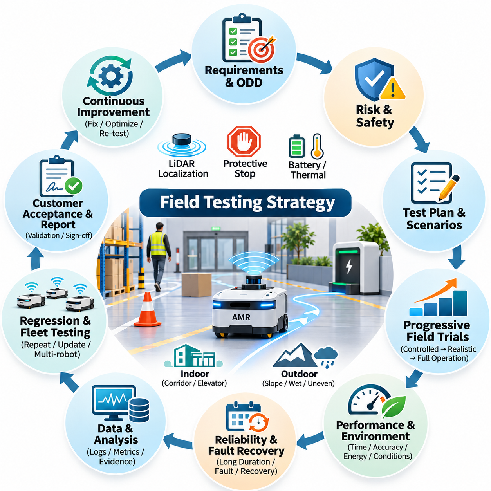
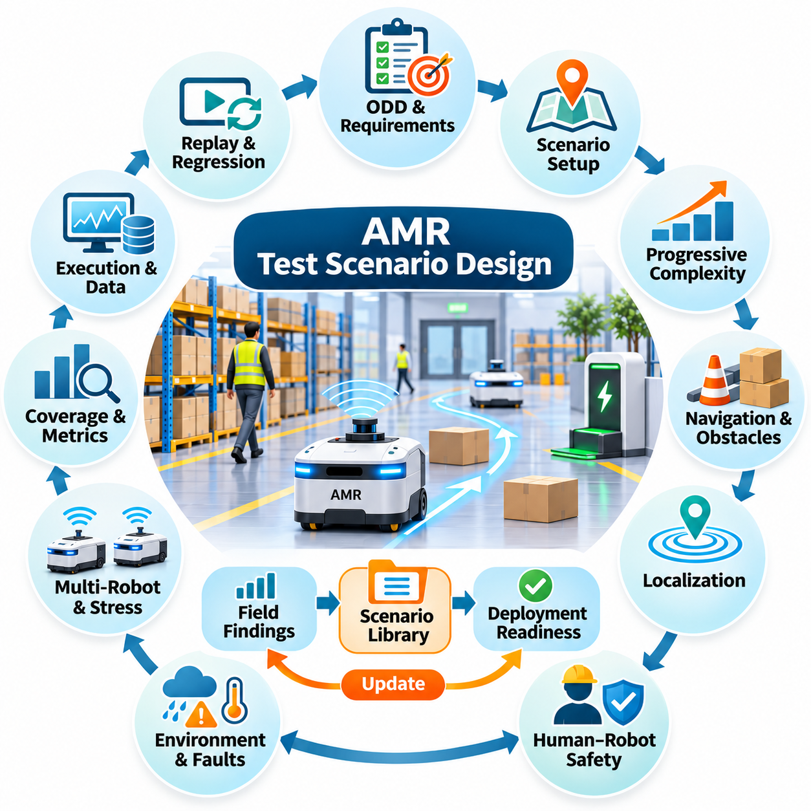
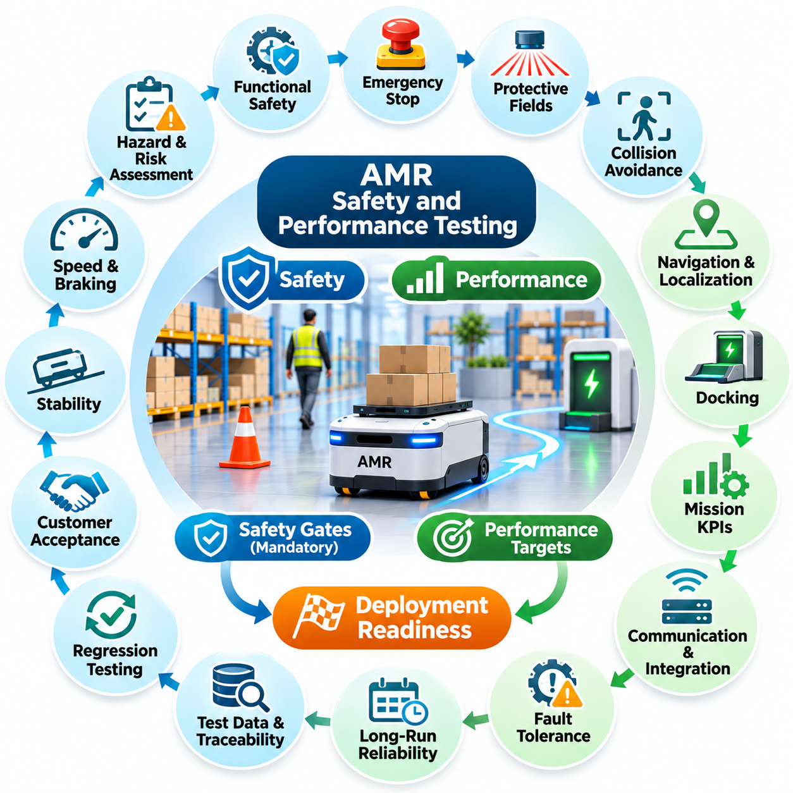
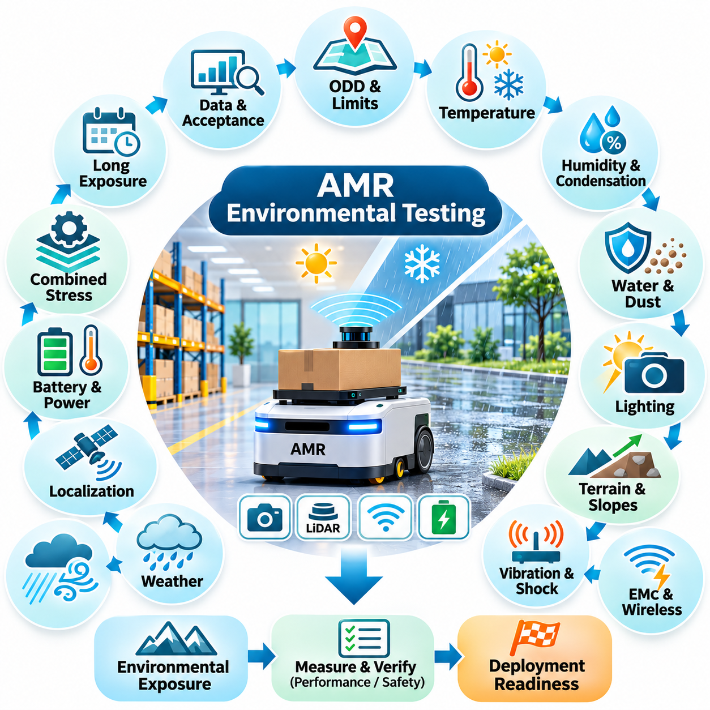
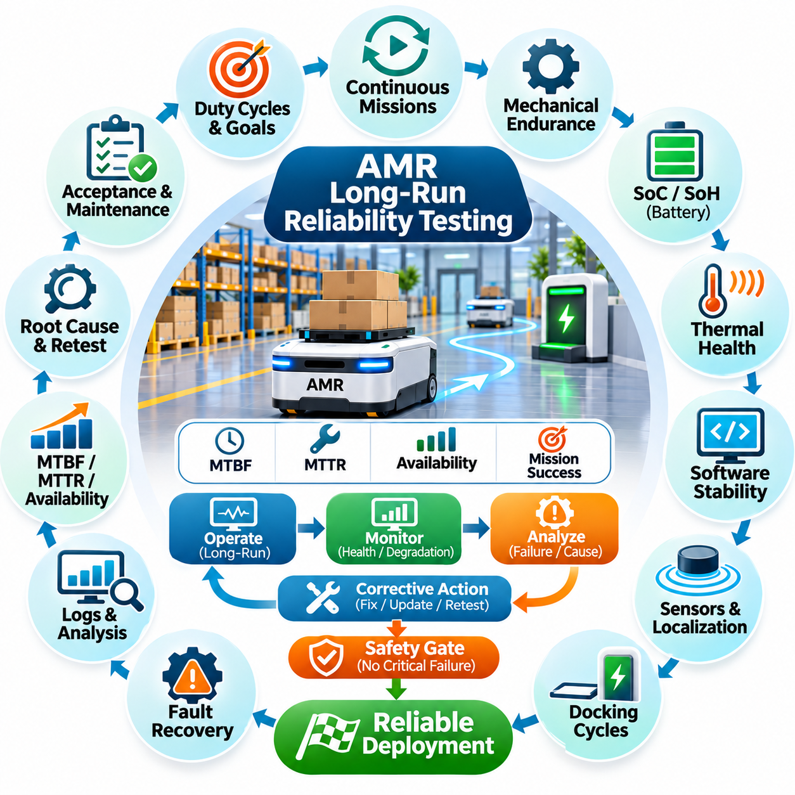
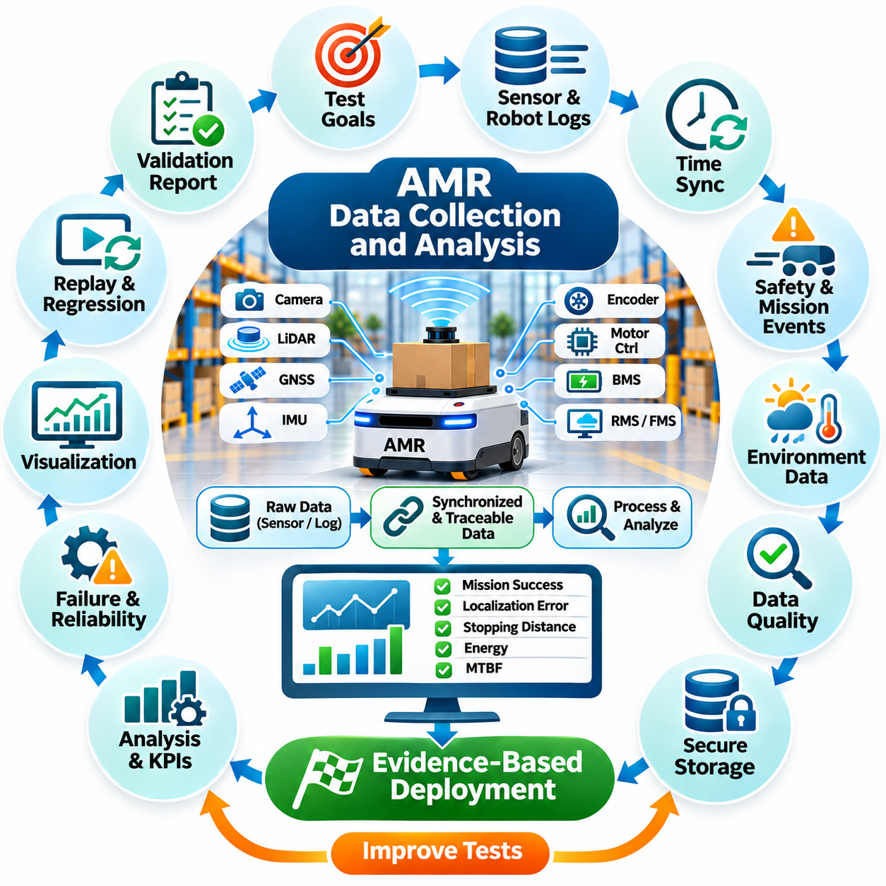
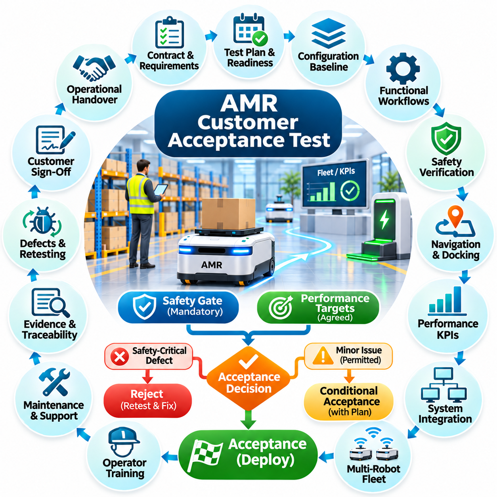
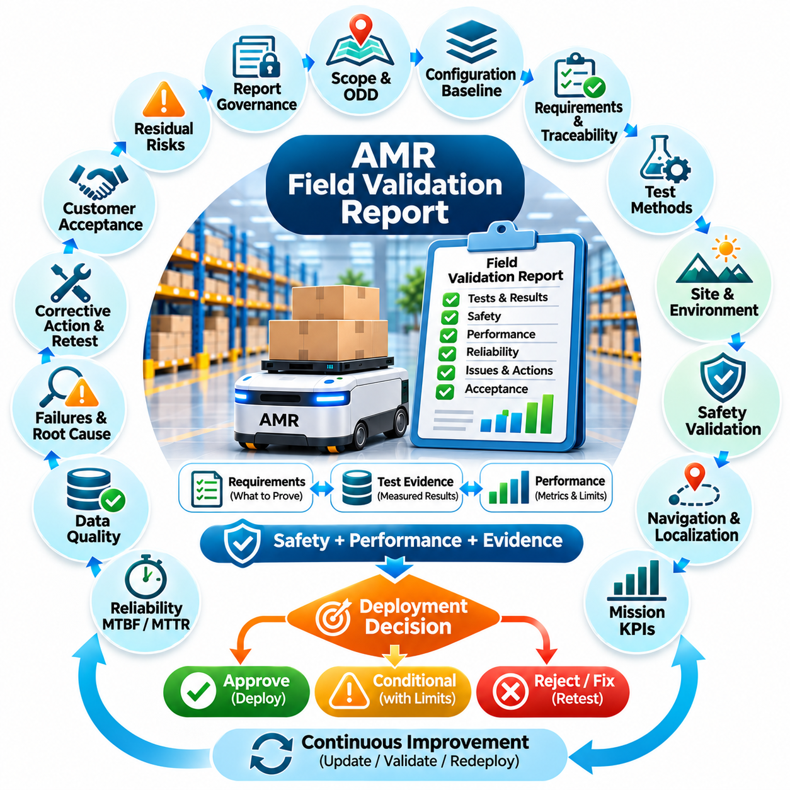

**Volume 08. AMR Operations, Deployment, and MLOps**


# Chapter 21. Field Testing and Validation

##  

## 21.1 Field Testing Strategy

{width="7.268055555555556in" height="7.268055555555556in"}

Field testing is a critical stage in the lifecycle of an Autonomous Mobile Robot (AMR), providing evidence that the system can operate safely, reliably, and efficiently under real deployment conditions. Unlike laboratory testing, field validation exposes robots to unpredictable obstacles, environmental variations, human activities, and operational constraints. A structured testing strategy connects engineering requirements with measurable operational outcomes before commercial deployment.

The primary objective of field testing is to verify that the integrated robotic system satisfies functional, safety, performance, and reliability requirements within its intended Operational Design Domain (ODD). Testing must evaluate not only individual components but also interactions among perception, localization, navigation, motion control, communication, and fleet management. Successful validation demonstrates that these subsystems maintain acceptable performance during realistic missions.

A comprehensive field testing strategy begins with clearly defined requirements and acceptance criteria. Engineering teams translate system specifications into measurable test objectives, including localization accuracy, navigation success rate, obstacle detection performance, stopping distance, mission completion time, and operational availability. Each requirement should be linked to a repeatable test procedure, expected result, and documented verification method.

Field validation should follow a progressive testing approach that increases operational complexity while maintaining controlled risk. Initial tests occur in restricted environments with predictable obstacles and limited robot speeds. Subsequent stages introduce dynamic objects, realistic traffic patterns, environmental disturbances, and longer operating periods. This progression allows engineers to identify fundamental problems before exposing robots to demanding operational conditions.

The testing environment must represent the intended deployment location as accurately as practical. Indoor AMRs require evaluation across corridors, intersections, elevators, automatic doors, loading areas, and shared pedestrian spaces. Outdoor robots require additional testing on slopes, uneven pavement, curbs, gravel, wet surfaces, and variable lighting conditions. Environmental coverage should reflect the actual operating conditions rather than relying exclusively on ideal scenarios.

Risk assessment is an essential prerequisite for every field testing campaign. Engineers must identify hazards associated with unexpected motion, sensor failures, localization loss, communication interruptions, battery faults, and human interaction. Appropriate mitigation measures include restricted test zones, emergency stop access, reduced initial speeds, safety observers, and predefined recovery procedures. Testing must remain within approved safety boundaries throughout execution.

A formal test plan defines the testing scope, required equipment, personnel responsibilities, environmental conditions, and execution sequence. Each test case should specify its initial configuration, robot software version, sensor calibration state, payload condition, and expected behavior. Standardized documentation ensures that results remain comparable across repeated experiments, hardware revisions, software updates, and deployment locations.

Scenario-based testing provides a practical method for evaluating autonomous behavior under representative operational conditions. Scenarios may include obstacle avoidance in narrow corridors, navigation through crowded intersections, docking under positioning uncertainty, and recovery from temporary localization degradation. Each scenario should define observable success conditions and failure criteria so that engineering decisions rely on evidence rather than subjective assessments.

Safety validation requires particular attention because autonomous robots operate near people, vehicles, equipment, and valuable infrastructure. Testing should verify protective stopping functions, speed limitations, safety-zone behavior, emergency stop response, and recovery authorization. Applicable safety standards and site-specific regulations must guide the evaluation, while safety-critical functions should be assessed independently of ordinary navigation performance.

Performance testing evaluates whether the robot achieves its operational objectives within specified constraints. Important measurements include route completion time, path tracking error, localization deviation, obstacle avoidance latency, docking accuracy, and energy consumption. Results should be collected across repeated trials and different environmental conditions to distinguish consistent system behavior from isolated successful demonstrations.

Environmental testing examines how physical conditions influence robot performance. Lighting changes, reflective surfaces, dust, vibration, temperature variation, and electromagnetic interference may affect sensors and computing equipment. Outdoor platforms face additional challenges involving rain, wind, terrain deformation, and GNSS signal degradation. Test conditions should be recorded precisely so performance changes can be associated with identifiable environmental factors.

Long-duration reliability testing evaluates the ability of the AMR to sustain operation beyond short demonstrations. Robots should execute representative missions repeatedly while engineers monitor component temperatures, battery behavior, motor loads, software stability, and communication quality. Extended testing can reveal memory leaks, intermittent sensor faults, thermal limitations, and cumulative localization errors that remain undetected during brief experiments.

Field testing must also evaluate abnormal conditions and system recovery behavior. Representative fault scenarios include temporary network disconnection, blocked routes, sensor degradation, charging failures, and interrupted missions. Engineers should verify whether the robot enters an appropriate safe state, reports diagnostic information, and resumes operation only when recovery conditions are satisfied. Fault injection must be controlled to prevent unacceptable safety risks.

Data collection provides the foundation for objective validation and subsequent engineering improvements. Robot telemetry, sensor measurements, localization estimates, control commands, safety events, and mission logs should be recorded using synchronized timestamps. Each dataset must include relevant configuration metadata and test identifiers. Consistent data structures enable reliable comparison between experimental runs and support efficient root cause analysis.

Analysis should combine quantitative performance metrics with detailed examination of operational events. Statistical summaries can reveal navigation variability, recurring delays, and differences between expected and observed behavior. Engineers should investigate failed trials using synchronized logs and recorded sensor information. Findings must be classified according to severity, reproducibility, operational impact, and the subsystem responsible for corrective action.

Field testing should incorporate regression validation whenever hardware, software, or AI models change. Updated perception algorithms, navigation parameters, firmware, and sensor configurations may introduce unexpected interactions with previously stable functions. A controlled regression test suite verifies that modifications resolve identified problems without degrading established capabilities. Version traceability is necessary to associate performance results with specific system configurations.

Multi-robot testing introduces additional requirements involving traffic coordination, task allocation, shared infrastructure, and communication scalability. Fleet-level validation should examine intersection management, congestion recovery, charging schedules, and dispatch behavior under varying workloads. Robot Management Systems (RMS) and Fleet Management Systems (FMS) must be evaluated together with physical robots to confirm that coordinated operation remains predictable and efficient.

Operational validation should involve the personnel responsible for daily robot deployment and maintenance. Operators can identify workflow constraints, confusing interface behavior, and practical recovery difficulties that engineering teams may overlook. Structured feedback sessions should examine usability, alarm interpretation, manual intervention procedures, and maintenance accessibility. These observations help determine whether technically successful behavior translates into sustainable field operation.

Customer acceptance testing represents the transition from engineering validation to operational approval. Acceptance criteria should be agreed upon before testing and should reflect actual service requirements, safety obligations, and measurable performance targets. Demonstrations alone are insufficient when deployment decisions require repeatable evidence. Test records, unresolved issues, operational limitations, and corrective actions should be reviewed before formal acceptance.

A field validation report consolidates the evidence generated throughout the testing campaign. The report should document objectives, configurations, environmental conditions, executed scenarios, measured results, failures, corrective actions, and remaining risks. It should clearly distinguish verified capabilities from functions requiring additional evaluation. This documentation supports deployment authorization, engineering accountability, maintenance planning, and future system improvements.

An effective field testing strategy ultimately establishes a continuous relationship between real-world operation and engineering development. Field observations become structured datasets, failure investigations generate corrective actions, and validated improvements enter controlled deployment processes. By integrating safety assessment, performance measurement, reliability evaluation, and operational feedback, organizations can progressively transform experimental AMR platforms into dependable autonomous systems.

현장 시험(Field Testing)은 자율이동로봇(Autonomous Mobile Robot, AMR)의 생명주기(Lifecycle)에서 중요한 단계로, 실제 배치 환경(Deployment Environment)에서 시스템이 안전하고 신뢰성 있으며 효율적으로 작동할 수 있음을 입증하는 과정이다. 실험실 시험(Laboratory Testing)과 달리 현장 검증(Field Validation)은 예측하기 어려운 장애물, 환경 변화, 사람의 활동 및 운영 제약 조건에 로봇을 노출시킨다. 체계적인 시험 전략(Testing Strategy)은 상용 배치(Commercial Deployment) 이전에 공학적 요구사항(Engineering Requirements)과 측정 가능한 운영 성과(Operational Outcomes)를 연결한다.

현장 시험(Field Testing)의 주요 목적은 통합 로봇 시스템(Integrated Robotic System)이 의도된 운영 설계 영역(Operational Design Domain, ODD) 내에서 기능, 안전, 성능 및 신뢰성 요구사항을 충족하는지 검증하는 것이다. 시험에서는 개별 구성요소뿐 아니라 인지(Perception), 위치 추정(Localization), 자율주행(Navigation), 모션 제어(Motion Control), 통신(Communication) 및 군집 관리(Fleet Management) 사이의 상호작용도 평가해야 한다. 성공적인 검증은 이러한 하위 시스템(Subsystems)이 실제 임무 수행 중 허용 가능한 성능을 유지한다는 사실을 입증한다.

포괄적인 현장 시험 전략(Field Testing Strategy)은 명확하게 정의된 요구사항(Requirements)과 인수 기준(Acceptance Criteria)에서 시작된다. 엔지니어링 팀(Engineering Team)은 시스템 사양(System Specifications)을 위치 추정 정확도(Localization Accuracy), 주행 성공률(Navigation Success Rate), 장애물 감지 성능(Obstacle Detection Performance), 정지 거리(Stopping Distance), 임무 완료 시간(Mission Completion Time) 및 운영 가용성(Operational Availability)과 같은 측정 가능한 시험 목표(Test Objectives)로 변환한다. 각 요구사항은 반복 가능한 시험 절차(Test Procedure), 예상 결과(Expected Result) 및 문서화된 검증 방법(Verification Method)과 연결되어야 한다.

현장 검증(Field Validation)은 위험을 통제하면서 운영 복잡도를 점진적으로 증가시키는 단계적 시험 접근법(Progressive Testing Approach)을 따라야 한다. 초기 시험은 예측 가능한 장애물과 제한된 로봇 속도를 적용한 통제 환경(Controlled Environment)에서 수행된다. 이후 단계에서는 동적 객체(Dynamic Objects), 실제 교통 패턴(Traffic Patterns), 환경 교란(Environmental Disturbances) 및 장시간 운영 조건을 도입한다. 이러한 단계적 접근은 로봇을 까다로운 운영 조건에 노출시키기 전에 근본적인 문제를 식별하도록 지원한다.

시험 환경(Test Environment)은 실제 배치 장소(Deployment Site)를 가능한 한 정확하게 반영해야 한다. 실내 자율이동로봇(Indoor AMR)은 복도, 교차로, 엘리베이터, 자동문, 적재 구역 및 보행자 공유 공간에서 평가해야 한다. 실외 로봇(Outdoor Robot)은 경사로, 불규칙한 포장도로, 연석, 자갈, 젖은 노면 및 다양한 조명 조건에 대한 추가 시험이 필요하다. 환경 시험 범위(Environmental Test Coverage)는 이상적인 시나리오에만 의존하지 않고 실제 운영 조건을 반영해야 한다.

위험 평가(Risk Assessment)는 모든 현장 시험 활동(Field Testing Campaign)의 필수 선행 조건이다. 엔지니어는 예상치 못한 움직임, 센서 고장(Sensor Failure), 위치 추정 상실(Localization Loss), 통신 중단(Communication Interruption), 배터리 결함(Battery Fault) 및 사람과의 상호작용(Human Interaction)에 관련된 위험요소(Hazards)를 식별해야 한다. 적절한 위험 완화 조치(Risk Mitigation Measures)에는 시험 구역 제한, 비상정지(Emergency Stop) 접근성 확보, 초기 속도 제한, 안전 감시자(Safety Observer) 배치 및 사전 정의된 복구 절차(Recovery Procedures)가 포함된다. 시험은 수행 전 과정에서 승인된 안전 경계(Safety Boundaries)를 준수해야 한다.

공식적인 시험 계획(Test Plan)은 시험 범위(Test Scope), 필요한 장비(Equipment), 담당 인력의 책임(Personnel Responsibilities), 환경 조건(Environmental Conditions) 및 실행 순서(Execution Sequence)를 정의한다. 각 시험 사례(Test Case)에는 초기 구성(Initial Configuration), 로봇 소프트웨어 버전(Software Version), 센서 보정 상태(Sensor Calibration State), 적재 조건(Payload Condition) 및 예상 동작(Expected Behavior)을 명시해야 한다. 표준화된 문서(Standardized Documentation)는 반복 실험, 하드웨어 개정(Hardware Revision), 소프트웨어 업데이트(Software Update) 및 배치 장소 간 결과 비교의 일관성을 보장한다.

시나리오 기반 시험(Scenario-Based Testing)은 대표적인 운영 조건에서 자율 동작(Autonomous Behavior)을 평가하는 실용적인 방법이다. 시험 시나리오(Test Scenarios)에는 좁은 복도에서의 장애물 회피(Obstacle Avoidance), 혼잡한 교차로 통과, 위치 불확실성(Positioning Uncertainty)이 존재하는 도킹(Docking), 일시적인 위치 추정 성능 저하(Localization Degradation) 이후의 복구가 포함될 수 있다. 각 시나리오는 관찰 가능한 성공 조건(Success Conditions)과 실패 기준(Failure Criteria)을 정의하여 엔지니어링 의사결정이 주관적인 평가가 아닌 객관적 증거(Evidence)에 기반하도록 해야 한다.

안전 검증(Safety Validation)은 자율 로봇이 사람, 차량, 장비 및 중요한 시설 근처에서 작동하기 때문에 특별한 주의가 필요하다. 시험에서는 보호 정지 기능(Protective Stop Functions), 속도 제한(Speed Limitations), 안전 구역 동작(Safety Zone Behavior), 비상정지 응답(Emergency Stop Response) 및 복구 승인(Recovery Authorization)을 검증해야 한다. 적용 가능한 안전 표준(Safety Standards)과 현장별 규정(Site-Specific Regulations)이 평가 기준을 제공해야 하며, 안전 필수 기능(Safety-Critical Functions)은 일반적인 주행 성능과 독립적으로 평가해야 한다.

성능 시험(Performance Testing)은 로봇이 지정된 제약 조건(Constraints) 내에서 운영 목표(Operational Objectives)를 달성하는지 평가한다. 중요한 측정 항목(Measurements)에는 경로 완료 시간(Route Completion Time), 경로 추종 오차(Path Tracking Error), 위치 추정 편차(Localization Deviation), 장애물 회피 지연시간(Obstacle Avoidance Latency), 도킹 정확도(Docking Accuracy) 및 에너지 소비량(Energy Consumption)이 포함된다. 일관된 시스템 동작과 일회성 성공 사례를 구분하기 위해 반복 시험(Repeated Trials)과 다양한 환경 조건에서 결과를 수집해야 한다.

환경 시험(Environmental Testing)은 물리적 조건(Physical Conditions)이 로봇 성능에 미치는 영향을 분석한다. 조명 변화(Lighting Changes), 반사 표면(Reflective Surfaces), 먼지(Dust), 진동(Vibration), 온도 변화(Temperature Variation) 및 전자기 간섭(Electromagnetic Interference)은 센서와 컴퓨팅 장비에 영향을 줄 수 있다. 실외 플랫폼(Outdoor Platform)은 비, 바람, 지형 변형(Terrain Deformation) 및 위성항법시스템(GNSS) 신호 저하와 같은 추가적인 문제에 직면한다. 성능 변화가 특정 환경 요인과 연결될 수 있도록 시험 조건을 정확하게 기록해야 한다.

장시간 신뢰성 시험(Long-Duration Reliability Testing)은 자율이동로봇(AMR)이 단시간 시연을 넘어 지속적으로 작동할 수 있는 능력을 평가한다. 로봇은 대표적인 임무(Representative Missions)를 반복 수행해야 하며, 엔지니어는 부품 온도(Component Temperature), 배터리 동작(Battery Behavior), 모터 부하(Motor Load), 소프트웨어 안정성(Software Stability) 및 통신 품질(Communication Quality)을 모니터링해야 한다. 장시간 시험(Extended Testing)은 짧은 실험에서 발견되지 않는 메모리 누수(Memory Leaks), 간헐적인 센서 결함(Intermittent Sensor Faults), 열적 한계(Thermal Limitations) 및 누적 위치 추정 오차(Cumulative Localization Errors)를 드러낼 수 있다.

현장 시험(Field Testing)은 비정상 조건(Abnormal Conditions)과 시스템 복구 동작(System Recovery Behavior)도 평가해야 한다. 대표적인 고장 시나리오(Fault Scenarios)에는 일시적인 네트워크 연결 해제(Network Disconnection), 경로 차단(Blocked Routes), 센서 성능 저하(Sensor Degradation), 충전 실패(Charging Failures) 및 임무 중단(Interrupted Missions)이 포함된다. 엔지니어는 로봇이 적절한 안전 상태(Safe State)로 전환하고 진단 정보(Diagnostic Information)를 보고하며 복구 조건이 충족된 경우에만 운행을 재개하는지 검증해야 한다. 고장 주입(Fault Injection)은 허용할 수 없는 안전 위험을 방지하도록 통제되어야 한다.

데이터 수집(Data Collection)은 객관적인 검증(Objective Validation)과 후속 엔지니어링 개선(Engineering Improvements)의 기반을 제공한다. 로봇 원격측정 데이터(Robot Telemetry), 센서 측정값(Sensor Measurements), 위치 추정값(Localization Estimates), 제어 명령(Control Commands), 안전 이벤트(Safety Events) 및 임무 로그(Mission Logs)는 동기화된 타임스탬프(Synchronized Timestamps)를 사용하여 기록해야 한다. 각 데이터셋(Dataset)에는 관련 구성 메타데이터(Configuration Metadata)와 시험 식별자(Test Identifiers)가 포함되어야 한다. 일관된 데이터 구조(Data Structures)는 실험 간 신뢰할 수 있는 비교와 효율적인 근본 원인 분석(Root Cause Analysis)을 지원한다.

분석(Analysis)은 정량적 성능 지표(Quantitative Performance Metrics)와 운영 이벤트(Operational Events)에 대한 상세한 검토를 결합해야 한다. 통계적 요약(Statistical Summaries)은 주행 성능의 변동성(Navigation Variability), 반복적인 지연(Recurring Delays) 및 예상 동작과 실제 동작의 차이를 식별할 수 있다. 엔지니어는 동기화된 로그(Synchronized Logs)와 기록된 센서 정보(Recorded Sensor Information)를 사용하여 실패한 시험을 조사해야 한다. 분석 결과(Findings)는 심각도(Severity), 재현 가능성(Reproducibility), 운영 영향(Operational Impact) 및 시정 조치(Corrective Action)를 담당하는 하위 시스템에 따라 분류해야 한다.

현장 시험(Field Testing)은 하드웨어(Hardware), 소프트웨어(Software) 또는 인공지능 모델(AI Models)이 변경될 때마다 회귀 검증(Regression Validation)을 포함해야 한다. 업데이트된 인지 알고리즘(Perception Algorithms), 주행 매개변수(Navigation Parameters), 펌웨어(Firmware) 및 센서 구성(Sensor Configurations)은 기존에 안정적으로 작동하던 기능에 예상치 못한 상호작용을 발생시킬 수 있다. 통제된 회귀 시험 모음(Regression Test Suite)은 변경 사항이 기존 기능을 저하시키지 않으면서 확인된 문제를 해결하는지 검증한다. 버전 추적성(Version Traceability)은 성능 결과를 특정 시스템 구성과 연결하는 데 필수적이다.

다중 로봇 시험(Multi-Robot Testing)은 교통 조정(Traffic Coordination), 작업 할당(Task Allocation), 공유 인프라(Shared Infrastructure) 및 통신 확장성(Communication Scalability)에 대한 추가 요구사항을 발생시킨다. 군집 수준 검증(Fleet-Level Validation)은 다양한 작업 부하(Workloads)에서 교차로 관리(Intersection Management), 혼잡 복구(Congestion Recovery), 충전 일정(Charging Schedules) 및 작업 배차 동작(Dispatch Behavior)을 평가해야 한다. 로봇 관리 시스템(Robot Management System, RMS)과 군집 관리 시스템(Fleet Management System, FMS)은 실제 로봇과 함께 평가하여 협업 운영(Coordinated Operation)이 예측 가능하고 효율적으로 유지되는지 확인해야 한다.

운영 검증(Operational Validation)에는 일상적인 로봇 배치와 유지보수(Maintenance)를 담당하는 인력이 참여해야 한다. 운영자(Operators)는 엔지니어링 팀이 간과할 수 있는 작업 흐름 제약(Workflow Constraints), 혼란스러운 사용자 인터페이스 동작(User Interface Behavior) 및 실제 복구 과정의 어려움을 식별할 수 있다. 구조화된 피드백 세션(Structured Feedback Sessions)에서는 사용성(Usability), 경보 해석(Alarm Interpretation), 수동 개입 절차(Manual Intervention Procedures) 및 유지보수 접근성(Maintenance Accessibility)을 평가해야 한다. 이러한 관찰 결과는 기술적으로 성공한 동작이 지속 가능한 현장 운영으로 이어지는지 판단하는 데 도움이 된다.

고객 인수 시험(Customer Acceptance Testing)은 엔지니어링 검증(Engineering Validation)에서 운영 승인(Operational Approval)으로 전환되는 단계를 의미한다. 인수 기준(Acceptance Criteria)은 시험 전에 합의되어야 하며 실제 서비스 요구사항(Service Requirements), 안전 의무(Safety Obligations) 및 측정 가능한 성능 목표(Performance Targets)를 반영해야 한다. 배치 결정(Deployment Decisions)에 반복 가능한 증거(Repeatable Evidence)가 필요한 경우 단순한 시연만으로는 충분하지 않다. 공식적인 인수 승인(Formal Acceptance) 이전에 시험 기록(Test Records), 미해결 문제(Unresolved Issues), 운영 제한사항(Operational Limitations) 및 시정 조치(Corrective Actions)를 검토해야 한다.

현장 검증 보고서(Field Validation Report)는 전체 시험 활동에서 생성된 증거(Evidence)를 통합한다. 보고서에는 시험 목표(Objectives), 시스템 구성(Configurations), 환경 조건(Environmental Conditions), 실행된 시나리오(Executed Scenarios), 측정 결과(Measured Results), 실패 사례(Failures), 시정 조치(Corrective Actions) 및 잔여 위험(Remaining Risks)을 문서화해야 한다. 검증된 기능(Verified Capabilities)과 추가 평가가 필요한 기능을 명확하게 구분해야 한다. 이러한 문서화(Documentation)는 배치 승인(Deployment Authorization), 엔지니어링 책임성(Engineering Accountability), 유지보수 계획(Maintenance Planning) 및 향후 시스템 개선을 지원한다.

효과적인 현장 시험 전략(Field Testing Strategy)은 궁극적으로 실제 운영(Real-World Operation)과 엔지니어링 개발(Engineering Development) 사이에 지속적인 관계를 구축한다. 현장 관찰 결과(Field Observations)는 구조화된 데이터셋(Structured Datasets)으로 전환되고, 고장 조사(Failure Investigations)는 시정 조치(Corrective Actions)로 이어지며, 검증된 개선 사항(Validated Improvements)은 통제된 배치 프로세스(Controlled Deployment Processes)에 반영된다. 안전 평가(Safety Assessment), 성능 측정(Performance Measurement), 신뢰성 평가(Reliability Evaluation) 및 운영 피드백(Operational Feedback)을 통합함으로써 조직은 실험 단계의 자율이동로봇(AMR) 플랫폼을 신뢰할 수 있는 자율 시스템(Autonomous Systems)으로 점진적으로 발전시킬 수 있다.

##  

## 21.2 Test Scenario Design

{width="7.268055555555556in" height="7.268055555555556in"}

Test scenario design is a fundamental element of Autonomous Mobile Robot (AMR) field validation, transforming operational requirements into structured and repeatable experiments. A well-designed scenario represents a realistic situation in which the robot must perceive its surroundings, make decisions, and execute appropriate actions. Scenario design ensures that testing evaluates actual operational capabilities rather than isolated demonstrations under ideal conditions.

The scenario development process begins with an analysis of the robot\'s intended Operational Design Domain (ODD). Engineers identify relevant locations, environmental conditions, traffic patterns, human activities, and operational constraints. These factors establish the boundaries within which the robot is expected to function. Scenarios should represent both routine operations and foreseeable abnormal situations while distinguishing supported conditions from excluded operating environments.

Each test scenario must be associated with specific system requirements and measurable acceptance criteria. For example, a navigation scenario may evaluate route completion, localization accuracy, obstacle clearance, and mission execution time. A docking scenario may examine final positioning error, alignment stability, and charging connection success. Establishing requirement traceability allows engineers to demonstrate that essential functions have been systematically evaluated.

A standardized scenario description should define the initial robot state, starting location, destination, payload, environmental configuration, and expected behavior. It should also specify the sequence of events, triggering conditions, and observable outcomes. Recording software versions, sensor calibration parameters, map revisions, and operating modes enables consistent reproduction of experiments and supports meaningful comparisons between different system configurations.

Scenario complexity should increase progressively throughout the validation campaign. Initial scenarios focus on fundamental movements, including straight-line travel, turning, stopping, and basic obstacle avoidance. Intermediate scenarios introduce intersections, narrow passages, dynamic obstacles, and changing traffic conditions. Advanced scenarios combine multiple operational challenges, requiring the robot to maintain safe and reliable behavior throughout extended missions.

Navigation scenarios evaluate the robot\'s ability to follow planned routes while responding to changes in the surrounding environment. Typical situations include corridor traversal, intersection crossing, route blockage, and navigation around stationary equipment. Engineers should assess whether the robot maintains acceptable path tracking accuracy, respects operational boundaries, and selects appropriate alternative routes when its original path becomes unavailable.

Dynamic obstacle scenarios examine how the robot interacts with moving people, vehicles, and other autonomous machines. Test conditions may include pedestrians crossing unexpectedly, workers approaching from blind corners, or mobile equipment entering shared pathways. The evaluation should measure detection performance, response latency, protective stopping behavior, and successful navigation recovery without compromising pedestrian or equipment safety.

Localization scenarios investigate the robot\'s ability to estimate its position under varying environmental conditions. Representative situations include repetitive corridors, reflective surfaces, temporary occlusions, and changes in mapped surroundings. Outdoor scenarios should additionally consider GNSS degradation, multipath interference, and transitions between satellite-based and local localization methods. Results should quantify positioning errors and recovery performance.

Docking and charging scenarios validate precise positioning and interaction with fixed infrastructure. Tests should examine approach trajectories, final alignment accuracy, connector engagement, charging initiation, and departure behavior. Variations in initial position, approach angle, payload distribution, and environmental conditions help reveal sensitivity to positioning uncertainty. Repeated trials establish whether docking performance remains consistent during normal operations.

Human-robot interaction scenarios assess how autonomous systems behave in shared environments. These scenarios may involve pedestrians stopping unexpectedly, personnel entering restricted areas, or operators requesting assistance. Testing should verify appropriate speed adaptation, warning signals, safe stopping distances, and predictable robot behavior. Special consideration is required in hospitals, factories, and public spaces where human movement patterns vary considerably.

Environmental scenarios reproduce conditions that may degrade sensing, mobility, or computational performance. Indoor tests can introduce lighting changes, reflective floors, dust, and temporary visual obstructions. Outdoor tests may include uneven terrain, slopes, wet pavement, temperature variation, and reduced visibility. Each environmental parameter should be documented so that performance degradation can be correlated with identifiable physical conditions.

Fault and recovery scenarios evaluate system behavior when normal operating assumptions are violated. Controlled tests may simulate communication interruptions, sensor failures, localization uncertainty, or unavailable destinations. Engineers must verify that the robot transitions to an appropriate safe state, reports relevant diagnostic information, and follows authorized recovery procedures. Fault injection should be performed under controlled conditions with suitable safety supervision.

Multi-robot scenarios examine coordination among robots sharing routes, intersections, charging stations, and operational resources. Representative tests include simultaneous task requests, congestion at narrow passages, conflicting route assignments, and charging resource contention. Fleet Management Systems (FMS) should be evaluated for scheduling efficiency, deadlock prevention, traffic coordination, and recovery from individual robot interruptions.

Scenario design should account for workload variation and operational stress. Robots may perform adequately during isolated missions but experience delays when task frequency, payload, traffic density, or fleet size increases. Stress scenarios help identify throughput limitations, computational bottlenecks, communication delays, and resource conflicts. Test conditions should remain representative of credible deployment demands rather than relying exclusively on unrealistic extremes.

A scenario coverage matrix provides a structured method for organizing validation activities. The matrix relates system requirements to environmental conditions, operational functions, hazard categories, and expected outcomes. Coverage analysis helps identify untested combinations and duplicated experiments. Risk-based prioritization directs testing resources toward scenarios involving severe consequences, frequent exposure, or significant uncertainty in system performance.

Quantitative evaluation requires clearly defined performance indicators and consistent measurement procedures. Scenario results may include success rate, mission duration, localization error, obstacle avoidance latency, stopping distance, and intervention frequency. Repeated execution supports statistical analysis of variability and reliability. Acceptance thresholds should be established from system requirements and operational safety needs before testing begins.

Scenario execution must follow documented procedures to maintain repeatability and traceability. Test personnel should verify initial conditions, confirm safety controls, activate synchronized data recording, and monitor robot behavior throughout execution. Deviations from the planned procedure should be recorded rather than ignored. Consistent execution enables engineers to distinguish genuine system improvements from differences in test preparation or environmental conditions.

Recorded field data can support scenario replay and simulation-based regression testing. Sensor logs, robot trajectories, control commands, and environmental observations allow engineers to reconstruct important operational events. Reproducing field scenarios in simulation can accelerate software debugging and evaluate proposed improvements before additional physical testing. However, simulation results must be interpreted alongside real-world validation because physical conditions cannot always be reproduced perfectly.

Scenario libraries should evolve as operational experience reveals new challenges. Unexpected obstacles, unusual pedestrian behavior, environmental disturbances, and recurring mission failures can be converted into additional test cases. Each scenario should maintain version information, associated requirements, execution history, and known limitations. This approach transforms field experience into reusable validation assets that support continuous engineering improvement.

Effective test scenario design ultimately connects operational reality with measurable engineering evidence. By combining representative environments, controlled disturbances, safety-critical events, and repeatable performance measurements, engineering teams can systematically evaluate autonomous behavior. A maintained scenario framework supports deployment readiness decisions, regression prevention, customer acceptance testing, and the long-term reliability of AMR operations.

시험 시나리오 설계(Test Scenario Design)는 자율이동로봇(Autonomous Mobile Robot, AMR)의 현장 검증(Field Validation)에서 핵심적인 요소로, 운영 요구사항(Operational Requirements)을 구조화되고 반복 가능한 실험(Repeatable Experiments)으로 변환하는 과정이다. 잘 설계된 시나리오는 로봇이 주변 환경을 인지(Perception)하고, 의사결정(Decision-Making)을 수행하며, 적절한 동작을 실행해야 하는 현실적인 상황을 나타낸다. 시나리오 설계는 이상적인 조건에서의 개별 시연이 아니라 실제 운영 능력(Operational Capabilities)을 평가하도록 보장한다.

시나리오 개발 프로세스(Scenario Development Process)는 로봇이 의도된 운영 설계 영역(Operational Design Domain, ODD)을 분석하는 것에서 시작된다. 엔지니어는 관련 장소, 환경 조건(Environmental Conditions), 교통 패턴(Traffic Patterns), 사람의 활동(Human Activities) 및 운영 제약사항(Operational Constraints)을 식별한다. 이러한 요소는 로봇이 정상적으로 작동해야 하는 범위를 설정한다. 시나리오는 일상적인 운영(Routine Operations)과 예측 가능한 비정상 상황(Abnormal Situations)을 모두 반영하면서 지원되는 조건과 운영 대상에서 제외되는 환경을 구분해야 한다.

각 시험 시나리오(Test Scenario)는 구체적인 시스템 요구사항(System Requirements)과 측정 가능한 인수 기준(Acceptance Criteria)에 연결되어야 한다. 예를 들어, 주행 시나리오(Navigation Scenario)는 경로 완료(Route Completion), 위치 추정 정확도(Localization Accuracy), 장애물 이격거리(Obstacle Clearance) 및 임무 수행 시간(Mission Execution Time)을 평가할 수 있다. 도킹 시나리오(Docking Scenario)는 최종 위치 오차(Final Positioning Error), 정렬 안정성(Alignment Stability) 및 충전 연결 성공률(Charging Connection Success)을 검토할 수 있다. 요구사항 추적성(Requirement Traceability)을 확보하면 필수 기능이 체계적으로 평가되었음을 입증할 수 있다.

표준화된 시나리오 설명(Standardized Scenario Description)은 로봇의 초기 상태(Initial Robot State), 출발 위치(Starting Location), 목적지(Destination), 적재물(Payload), 환경 구성(Environmental Configuration) 및 예상 동작(Expected Behavior)을 정의해야 한다. 또한 이벤트 순서(Event Sequence), 트리거 조건(Triggering Conditions) 및 관찰 가능한 결과(Observable Outcomes)를 명시해야 한다. 소프트웨어 버전(Software Versions), 센서 보정 매개변수(Sensor Calibration Parameters), 지도 개정 정보(Map Revisions) 및 운영 모드(Operating Modes)를 기록하면 실험을 일관되게 재현하고 서로 다른 시스템 구성 간 의미 있는 비교를 수행할 수 있다.

시나리오 복잡도(Scenario Complexity)는 전체 검증 과정(Validation Campaign)에서 점진적으로 증가해야 한다. 초기 시나리오는 직선 주행(Straight-Line Travel), 회전(Turning), 정지(Stopping) 및 기본 장애물 회피(Basic Obstacle Avoidance)와 같은 기초 동작에 집중한다. 중간 단계에서는 교차로(Intersections), 좁은 통로(Narrow Passages), 동적 장애물(Dynamic Obstacles) 및 변화하는 교통 조건(Traffic Conditions)을 도입한다. 고급 시나리오는 여러 운영상의 문제를 결합하여 로봇이 장시간 임무(Extended Missions) 동안 안전하고 신뢰할 수 있는 동작을 유지하도록 요구한다.

주행 시나리오(Navigation Scenarios)는 주변 환경의 변화에 대응하면서 계획된 경로(Planned Routes)를 따라 이동하는 로봇의 능력을 평가한다. 대표적인 상황에는 복도 통과(Corridor Traversal), 교차로 횡단(Intersection Crossing), 경로 차단(Route Blockage) 및 고정 장비 주변 주행이 포함된다. 엔지니어는 로봇이 허용 가능한 경로 추종 정확도(Path Tracking Accuracy)를 유지하고, 운영 경계(Operational Boundaries)를 준수하며, 기존 경로를 사용할 수 없을 때 적절한 대체 경로(Alternative Routes)를 선택하는지 평가해야 한다.

동적 장애물 시나리오(Dynamic Obstacle Scenarios)는 로봇이 움직이는 사람, 차량 및 다른 자율 기계(Autonomous Machines)와 상호작용하는 방식을 평가한다. 시험 조건에는 보행자의 갑작스러운 횡단, 사각지대(Blind Corners)에서 접근하는 작업자 또는 공유 통로(Shared Pathways)에 진입하는 이동 장비가 포함될 수 있다. 평가에서는 보행자와 장비의 안전을 저해하지 않으면서 감지 성능(Detection Performance), 응답 지연시간(Response Latency), 보호 정지 동작(Protective Stopping Behavior) 및 성공적인 주행 복구(Navigation Recovery)를 측정해야 한다.

위치 추정 시나리오(Localization Scenarios)는 다양한 환경 조건에서 로봇이 자신의 위치를 추정하는 능력을 조사한다. 대표적인 상황에는 반복적인 구조의 복도(Repetitive Corridors), 반사 표면(Reflective Surfaces), 일시적인 가림 현상(Temporary Occlusions) 및 지도에 반영된 주변 환경의 변화가 포함된다. 실외 시나리오는 위성항법시스템(GNSS) 성능 저하, 다중경로 간섭(Multipath Interference) 및 위성 기반 위치 추정과 로컬 위치 추정(Local Localization) 방식 간 전환을 추가로 고려해야 한다. 시험 결과는 위치 오차(Positioning Errors)와 복구 성능(Recovery Performance)을 정량화해야 한다.

도킹 및 충전 시나리오(Docking and Charging Scenarios)는 정밀 위치 결정(Precise Positioning)과 고정 인프라(Fixed Infrastructure)와의 상호작용을 검증한다. 시험에서는 접근 궤적(Approach Trajectories), 최종 정렬 정확도(Final Alignment Accuracy), 커넥터 결합(Connector Engagement), 충전 시작(Charging Initiation) 및 출발 동작(Departure Behavior)을 평가해야 한다. 초기 위치, 접근 각도(Approach Angle), 적재물 분포(Payload Distribution) 및 환경 조건을 변화시키면 위치 불확실성(Positioning Uncertainty)에 대한 민감도를 확인할 수 있다. 반복 시험(Repeated Trials)은 정상 운영 중 도킹 성능의 일관성을 판단하는 근거가 된다.

인간-로봇 상호작용 시나리오(Human-Robot Interaction Scenarios)는 공유 환경(Shared Environments)에서 자율 시스템(Autonomous Systems)이 어떻게 동작하는지 평가한다. 이러한 시나리오에는 보행자의 갑작스러운 정지, 제한 구역(Restricted Areas)에 진입하는 작업자 또는 운영자의 지원 요청이 포함될 수 있다. 시험에서는 적절한 속도 조절(Speed Adaptation), 경고 신호(Warning Signals), 안전 정지 거리(Safe Stopping Distances) 및 예측 가능한 로봇 동작(Predictable Robot Behavior)을 검증해야 한다. 사람의 이동 패턴(Human Movement Patterns)이 크게 달라지는 병원, 공장 및 공공장소에서는 특별한 고려가 필요하다.

환경 시나리오(Environmental Scenarios)는 센싱(Sensing), 이동 성능(Mobility) 또는 컴퓨팅 성능(Computational Performance)을 저하시킬 수 있는 조건을 재현한다. 실내 시험에서는 조명 변화(Lighting Changes), 반사 바닥(Reflective Floors), 먼지(Dust) 및 일시적인 시야 차단(Visual Obstructions)을 도입할 수 있다. 실외 시험에는 불규칙한 지형(Uneven Terrain), 경사로(Slopes), 젖은 포장도로(Wet Pavement), 온도 변화(Temperature Variation) 및 가시거리 감소(Reduced Visibility)가 포함될 수 있다. 성능 저하를 식별 가능한 물리적 조건과 연관시킬 수 있도록 각 환경 매개변수(Environmental Parameter)를 문서화해야 한다.

고장 및 복구 시나리오(Fault and Recovery Scenarios)는 정상적인 운영 가정(Operating Assumptions)이 충족되지 않을 때 시스템의 동작을 평가한다. 통제된 시험에서는 통신 중단(Communication Interruptions), 센서 고장(Sensor Failures), 위치 추정 불확실성(Localization Uncertainty) 또는 목적지 사용 불가(Unavailable Destinations)를 모의할 수 있다. 엔지니어는 로봇이 적절한 안전 상태(Safe State)로 전환하고 관련 진단 정보(Diagnostic Information)를 보고하며 승인된 복구 절차(Authorized Recovery Procedures)를 따르는지 검증해야 한다. 고장 주입(Fault Injection)은 적절한 안전 감독(Safety Supervision)하에 통제된 조건에서 수행되어야 한다.

다중 로봇 시나리오(Multi-Robot Scenarios)는 경로, 교차로, 충전소 및 운영 자원(Operational Resources)을 공유하는 로봇 간의 협업(Coordination)을 평가한다. 대표적인 시험에는 동시 작업 요청(Simultaneous Task Requests), 좁은 통로에서의 혼잡(Congestion), 상충되는 경로 할당(Conflicting Route Assignments) 및 충전 자원 경합(Charging Resource Contention)이 포함된다. 군집 관리 시스템(Fleet Management System, FMS)은 일정 관리 효율성(Scheduling Efficiency), 교착상태 방지(Deadlock Prevention), 교통 조정(Traffic Coordination) 및 개별 로봇 중단 이후의 복구 능력을 평가해야 한다.

시나리오 설계(Scenario Design)는 작업 부하 변화(Workload Variation)와 운영 스트레스(Operational Stress)를 고려해야 한다. 로봇은 개별 임무에서는 적절한 성능을 보일 수 있지만 작업 빈도(Task Frequency), 적재량(Payload), 교통 밀도(Traffic Density) 또는 군집 규모(Fleet Size)가 증가하면 지연이 발생할 수 있다. 스트레스 시나리오(Stress Scenarios)는 처리량 한계(Throughput Limitations), 컴퓨팅 병목현상(Computational Bottlenecks), 통신 지연(Communication Delays) 및 자원 충돌(Resource Conflicts)을 식별하는 데 도움이 된다. 시험 조건은 비현실적인 극한 상황에만 의존하지 않고 실제 배치에서 발생 가능한 요구를 반영해야 한다.

시나리오 커버리지 매트릭스(Scenario Coverage Matrix)는 검증 활동(Validation Activities)을 체계적으로 구성하는 방법을 제공한다. 이 매트릭스는 시스템 요구사항(System Requirements)을 환경 조건(Environmental Conditions), 운영 기능(Operational Functions), 위험 범주(Hazard Categories) 및 예상 결과(Expected Outcomes)와 연결한다. 커버리지 분석(Coverage Analysis)은 시험되지 않은 조건 조합과 중복 실험을 식별하는 데 도움이 된다. 위험 기반 우선순위 설정(Risk-Based Prioritization)은 심각한 결과, 높은 노출 빈도 또는 시스템 성능에 대한 상당한 불확실성이 존재하는 시나리오에 시험 자원을 집중하도록 한다.

정량적 평가(Quantitative Evaluation)를 위해서는 명확하게 정의된 성능 지표(Performance Indicators)와 일관된 측정 절차(Measurement Procedures)가 필요하다. 시나리오 결과에는 성공률(Success Rate), 임무 수행 시간(Mission Duration), 위치 추정 오차(Localization Error), 장애물 회피 지연시간(Obstacle Avoidance Latency), 정지 거리(Stopping Distance) 및 개입 빈도(Intervention Frequency)가 포함될 수 있다. 반복 실행(Repeated Execution)은 변동성과 신뢰성에 대한 통계 분석(Statistical Analysis)을 지원한다. 인수 임계값(Acceptance Thresholds)은 시험 시작 전에 시스템 요구사항과 운영 안전 요구에 따라 설정되어야 한다.

시나리오 실행(Scenario Execution)은 반복 가능성(Repeatability)과 추적성(Traceability)을 유지하기 위해 문서화된 절차를 따라야 한다. 시험 담당자는 초기 조건(Initial Conditions)을 확인하고, 안전 제어(Safety Controls)를 검증하며, 동기화된 데이터 기록(Synchronized Data Recording)을 활성화하고, 실행 전 과정에서 로봇 동작을 모니터링해야 한다. 계획된 절차에서 벗어난 사항(Deviations)은 무시하지 않고 기록해야 한다. 일관된 실행은 엔지니어가 실제 시스템 개선과 시험 준비 또는 환경 조건 차이로 인한 결과 변화를 구분할 수 있도록 한다.

기록된 현장 데이터(Recorded Field Data)는 시나리오 재생(Scenario Replay)과 시뮬레이션 기반 회귀 시험(Simulation-Based Regression Testing)을 지원할 수 있다. 센서 로그(Sensor Logs), 로봇 궤적(Robot Trajectories), 제어 명령(Control Commands) 및 환경 관찰 데이터(Environmental Observations)를 활용하면 중요한 운영 이벤트를 재구성할 수 있다. 현장 시나리오를 시뮬레이션(Simulation)에서 재현하면 소프트웨어 디버깅(Software Debugging)을 가속하고 추가적인 실제 시험 전에 개선안을 평가할 수 있다. 그러나 물리적 조건을 항상 완벽하게 재현할 수는 없으므로 시뮬레이션 결과는 실제 환경 검증(Real-World Validation)과 함께 해석해야 한다.

시나리오 라이브러리(Scenario Libraries)는 운영 경험(Operational Experience)을 통해 새로운 문제가 발견됨에 따라 지속적으로 발전해야 한다. 예상하지 못한 장애물, 특이한 보행자 행동(Unusual Pedestrian Behavior), 환경 교란(Environmental Disturbances) 및 반복적인 임무 실패(Recurring Mission Failures)는 추가 시험 사례(Test Cases)로 전환할 수 있다. 각 시나리오는 버전 정보(Version Information), 관련 요구사항(Associated Requirements), 실행 이력(Execution History) 및 알려진 한계(Known Limitations)를 유지해야 한다. 이러한 접근법은 현장 경험을 지속적인 엔지니어링 개선(Continuous Engineering Improvement)을 지원하는 재사용 가능한 검증 자산(Reusable Validation Assets)으로 전환한다.

효과적인 시험 시나리오 설계(Test Scenario Design)는 궁극적으로 실제 운영 환경(Operational Reality)과 측정 가능한 엔지니어링 증거(Engineering Evidence)를 연결한다. 대표적인 환경(Representative Environments), 통제된 교란(Controlled Disturbances), 안전 필수 이벤트(Safety-Critical Events) 및 반복 가능한 성능 측정(Repeatable Performance Measurements)을 결합함으로써 엔지니어링 팀은 자율 동작(Autonomous Behavior)을 체계적으로 평가할 수 있다. 지속적으로 관리되는 시나리오 프레임워크(Scenario Framework)는 배치 준비 상태 결정(Deployment Readiness Decisions), 회귀 방지(Regression Prevention), 고객 인수 시험(Customer Acceptance Testing) 및 자율이동로봇(AMR) 운영의 장기적인 신뢰성(Long-Term Reliability)을 지원한다.

##  

## 21.3 Safety and Performance Testing

{width="7.268055555555556in" height="7.268055555555556in"}

Safety and performance testing is a fundamental requirement for validating Autonomous Mobile Robots (AMRs) before operational deployment. These evaluations determine whether a robot can execute assigned missions while maintaining acceptable safety margins, functional reliability, and operational efficiency. A comprehensive testing program examines both protective functions and mission performance under realistic conditions, ensuring that productivity objectives never override essential safety requirements.

Safety testing begins with a systematic assessment of operational hazards and potential failure conditions. Engineers identify risks associated with collisions, unexpected acceleration, uncontrolled movement, sensor malfunction, and human interaction. Each hazard should be connected to defined safety requirements and verification procedures. Risk assessment results establish testing priorities, protective measures, and acceptance criteria appropriate to the intended operating environment.

Functional safety validation examines whether protective mechanisms respond correctly to hazardous situations. Emergency stop circuits, protective stopping functions, safety-rated sensors, and motion inhibition mechanisms must operate according to their specified requirements. Testing should verify response consistency across different operating modes and fault conditions. Safety-related control functions must remain effective independently of ordinary navigation and AI decision-making processes.

Emergency stop testing evaluates the complete sequence from activation to motion termination. Engineers measure response time, stopping distance, braking behavior, and system state after activation. Tests should consider different travel speeds, payload conditions, and surface characteristics. Restart procedures must require appropriate authorization and must not automatically resume hazardous motion when an emergency stop device is released.

Protective field testing verifies the behavior of safety sensors and dynamically configured detection zones. Robots may use safety laser scanners, proximity sensors, and other protective devices to detect obstacles and initiate speed reduction or stopping. Engineers should evaluate detection coverage, response latency, and protective separation distances. Test configurations must reflect the robot\'s speed, braking capability, payload, and intended operating conditions.

Collision avoidance testing examines the interaction between perception, planning, and motion control. Scenarios include stationary obstacles, moving pedestrians, crossing vehicles, and sudden path obstructions. Performance measurements should include obstacle detection reliability, avoidance response time, minimum clearance, and successful route recovery. Ordinary perception-based avoidance must not be treated as a substitute for required safety-rated protective functions.

Speed and braking performance require validation across representative operating conditions. Engineers should measure acceleration, deceleration, stopping distance, and trajectory stability at different commanded speeds. Payload mass, center of gravity, tire characteristics, and floor friction can significantly influence braking behavior. Testing should establish safe operating limits and confirm that speed restrictions remain effective in designated zones.

Stability testing evaluates the robot\'s resistance to tipping, sliding, and loss of directional control. Relevant scenarios include cornering, emergency braking, uneven surfaces, slopes, and changes in payload distribution. Outdoor platforms require additional attention to traction and terrain irregularities. Engineers should monitor chassis attitude, wheel behavior, and control responses to identify conditions that could compromise safe mobility.

Navigation performance testing measures the robot\'s ability to complete planned routes accurately and efficiently. Important indicators include route completion rate, path tracking error, travel time, unnecessary stops, and recovery frequency. Repeated trials across different environments reveal performance variability and operational limitations. Results should be compared against predefined acceptance thresholds rather than relying on isolated successful demonstrations.

Localization performance testing examines position estimation accuracy, stability, and recovery behavior. Engineers should evaluate performance in repetitive corridors, dynamic environments, reflective areas, and locations with limited visual features. Outdoor testing may include GNSS degradation and transitions between localization sources. Reference measurements should be used where practical to quantify position error and detect unexpected localization drift.

Docking performance testing validates precise alignment with charging stations, loading interfaces, and operational equipment. Measurements include final position error, angular deviation, approach duration, docking success rate, and recovery attempts. Testing should cover variations in initial position, payload, and environmental conditions. Reliable docking is particularly important for unattended operations requiring repeated charging or automated material transfer.

Operational performance testing evaluates whether the AMR meets mission-level productivity requirements. Metrics may include completed tasks per hour, average mission duration, transport throughput, idle time, and energy consumption per mission. Engineers should evaluate these indicators under representative workloads and traffic conditions. Performance analysis must distinguish limitations caused by robot behavior from delays introduced by external infrastructure.

Communication and system integration testing examines interactions between robots, fleet management platforms, and external equipment. Scenarios should include delayed messages, temporary network interruptions, server unavailability, and conflicting task assignments. Engineers must verify safe behavior during communication failures and correct synchronization after recovery. Operational continuity should never depend on unrestricted remote connectivity for essential safety functions.

Fault tolerance testing evaluates the robot\'s response to degraded components and abnormal system states. Controlled fault scenarios may involve sensor disconnection, actuator feedback errors, low battery conditions, or software process failures. Expected responses should include appropriate fault detection, diagnostic reporting, and transition to a defined safe state. Recovery procedures must prevent uncontrolled movement and require verification before normal operation resumes.

Long-duration performance testing identifies problems that may not appear during short experiments. Repeated missions can expose thermal accumulation, battery degradation effects, computational resource exhaustion, and intermittent communication faults. Engineers should monitor system health alongside navigation and productivity metrics. Sustained performance is essential for evaluating operational availability and determining realistic maintenance intervals.

Test execution requires controlled procedures, calibrated instruments, and synchronized data collection. Robot telemetry, sensor outputs, control commands, safety events, and environmental measurements should be recorded with traceable timestamps. Each test must identify the robot configuration, software version, payload, and operating conditions. Consistent documentation supports reproducibility, root cause analysis, and comparison between successive system revisions.

Safety and performance results should be evaluated separately before considering overall deployment readiness. A robot may demonstrate high mission completion rates while failing critical protective requirements, making it unsuitable for operation. Conversely, a safe robot may still require optimization to satisfy productivity objectives. Deployment approval should require satisfactory evidence for all mandatory safety requirements and agreed operational performance criteria.

Regression testing is necessary whenever modifications affect safety functions, navigation algorithms, control parameters, or hardware configurations. Updated software and AI models may change response timing, obstacle behavior, or system resource utilization. Previously validated scenarios should be repeated to identify unintended degradation. Configuration management and documented approval procedures ensure that only appropriately verified versions enter operational service.

Customer acceptance testing should incorporate representative safety and performance demonstrations using agreed evaluation procedures. Customers and engineering teams should review measured results, operational limitations, unresolved defects, and corrective actions. Acceptance decisions must reflect documented evidence rather than demonstration quality alone. Clear reporting establishes accountability and supports safe transition from engineering validation to routine deployment.

An integrated safety and performance testing framework provides the evidence required to establish dependable AMR operations. By combining hazard-based validation, quantitative performance measurement, controlled fault testing, and long-duration evaluation, engineers can identify weaknesses before deployment. Continuous monitoring and regression validation extend this assurance throughout the robot lifecycle, supporting reliable autonomous operation in increasingly complex environments.

안전 및 성능 시험(Safety and Performance Testing)은 자율이동로봇(Autonomous Mobile Robot, AMR)의 운영 배치(Operational Deployment) 이전에 수행해야 하는 필수적인 검증 과정이다. 이러한 평가는 로봇이 허용 가능한 안전 여유(Safety Margins), 기능적 신뢰성(Functional Reliability) 및 운영 효율성(Operational Efficiency)을 유지하면서 할당된 임무를 수행할 수 있는지 판단한다. 포괄적인 시험 프로그램(Comprehensive Testing Program)은 실제 환경 조건에서 보호 기능(Protective Functions)과 임무 성능(Mission Performance)을 모두 평가하여 생산성 목표(Productivity Objectives)가 필수 안전 요구사항(Safety Requirements)보다 우선하지 않도록 보장한다.

안전 시험(Safety Testing)은 운영 위험요소(Operational Hazards)와 잠재적인 고장 조건(Potential Failure Conditions)에 대한 체계적인 평가에서 시작된다. 엔지니어는 충돌(Collisions), 예상치 못한 가속(Unexpected Acceleration), 제어되지 않는 움직임(Uncontrolled Movement), 센서 오작동(Sensor Malfunction) 및 인간과의 상호작용(Human Interaction)에 관련된 위험을 식별한다. 각 위험요소는 정의된 안전 요구사항(Safety Requirements) 및 검증 절차(Verification Procedures)와 연결되어야 한다. 위험 평가(Risk Assessment) 결과는 의도된 운영 환경(Operating Environment)에 적합한 시험 우선순위(Testing Priorities), 보호 조치(Protective Measures) 및 인수 기준(Acceptance Criteria)을 설정하는 근거가 된다.

기능 안전 검증(Functional Safety Validation)은 보호 메커니즘(Protective Mechanisms)이 위험 상황에 올바르게 대응하는지 평가한다. 비상정지 회로(Emergency Stop Circuits), 보호 정지 기능(Protective Stopping Functions), 안전 등급 센서(Safety-Rated Sensors) 및 동작 억제 메커니즘(Motion Inhibition Mechanisms)은 지정된 요구사항에 따라 작동해야 한다. 시험에서는 다양한 운영 모드(Operating Modes)와 고장 조건(Fault Conditions)에서 응답의 일관성(Response Consistency)을 검증해야 한다. 안전 관련 제어 기능(Safety-Related Control Functions)은 일반적인 자율주행(Navigation) 및 인공지능 의사결정(AI Decision-Making) 프로세스와 독립적으로 효과를 유지해야 한다.

비상정지 시험(Emergency Stop Testing)은 비상정지 장치의 작동부터 로봇의 움직임이 완전히 종료될 때까지의 전체 과정을 평가한다. 엔지니어는 응답 시간(Response Time), 정지 거리(Stopping Distance), 제동 동작(Braking Behavior) 및 작동 이후의 시스템 상태(System State)를 측정한다. 시험에서는 다양한 주행 속도(Travel Speeds), 적재 조건(Payload Conditions) 및 노면 특성(Surface Characteristics)을 고려해야 한다. 재시작 절차(Restart Procedures)는 적절한 승인(Authorization)을 요구해야 하며, 비상정지 장치가 해제되더라도 위험한 움직임(Hazardous Motion)이 자동으로 재개되어서는 안 된다.

보호 영역 시험(Protective Field Testing)은 안전 센서(Safety Sensors)와 동적으로 구성되는 감지 구역(Detection Zones)의 동작을 검증한다. 로봇은 안전 레이저 스캐너(Safety Laser Scanners), 근접 센서(Proximity Sensors) 및 기타 보호 장치(Protective Devices)를 사용하여 장애물을 감지하고 감속(Speed Reduction) 또는 정지(Stopping)를 수행할 수 있다. 엔지니어는 감지 범위(Detection Coverage), 응답 지연시간(Response Latency) 및 보호 이격거리(Protective Separation Distances)를 평가해야 한다. 시험 구성(Test Configurations)은 로봇의 속도, 제동 능력(Braking Capability), 적재량(Payload) 및 의도된 운영 조건을 반영해야 한다.

충돌 회피 시험(Collision Avoidance Testing)은 인지(Perception), 경로 계획(Planning) 및 모션 제어(Motion Control) 사이의 상호작용을 평가한다. 시험 시나리오에는 고정 장애물(Stationary Obstacles), 이동하는 보행자(Moving Pedestrians), 교차하는 차량(Crossing Vehicles) 및 갑작스러운 경로 차단(Sudden Path Obstructions)이 포함된다. 성능 측정 항목에는 장애물 감지 신뢰성(Obstacle Detection Reliability), 회피 응답 시간(Avoidance Response Time), 최소 이격거리(Minimum Clearance) 및 성공적인 경로 복구(Route Recovery)가 포함되어야 한다. 일반적인 인지 기반 장애물 회피(Perception-Based Avoidance)를 필수적인 안전 등급 보호 기능(Safety-Rated Protective Functions)의 대체 수단으로 간주해서는 안 된다.

속도 및 제동 성능(Speed and Braking Performance)은 대표적인 운영 조건(Representative Operating Conditions)에서 검증해야 한다. 엔지니어는 다양한 명령 속도(Commanded Speeds)에서 가속도(Acceleration), 감속도(Deceleration), 정지 거리(Stopping Distance) 및 궤적 안정성(Trajectory Stability)을 측정해야 한다. 적재물 질량(Payload Mass), 무게중심(Center of Gravity), 타이어 특성(Tire Characteristics) 및 바닥 마찰력(Floor Friction)은 제동 동작에 상당한 영향을 미칠 수 있다. 시험에서는 안전 운영 한계(Safe Operating Limits)를 설정하고 지정된 구역에서 속도 제한(Speed Restrictions)이 지속적으로 적용되는지 확인해야 한다.

안정성 시험(Stability Testing)은 로봇의 전복(Tipping), 미끄러짐(Sliding) 및 방향 제어 상실(Loss of Directional Control)에 대한 저항 능력을 평가한다. 관련 시나리오에는 선회(Cornering), 비상 제동(Emergency Braking), 불규칙한 노면(Uneven Surfaces), 경사로(Slopes) 및 적재물 분포(Payload Distribution)의 변화가 포함된다. 실외 플랫폼(Outdoor Platforms)은 접지력(Traction)과 지형 불규칙성(Terrain Irregularities)에 대한 추가적인 고려가 필요하다. 엔지니어는 안전한 이동 성능(Safe Mobility)을 저해할 수 있는 조건을 식별하기 위해 차체 자세(Chassis Attitude), 바퀴 동작(Wheel Behavior) 및 제어 응답(Control Responses)을 모니터링해야 한다.

자율주행 성능 시험(Navigation Performance Testing)은 로봇이 계획된 경로(Planned Routes)를 정확하고 효율적으로 완료하는 능력을 측정한다. 주요 지표에는 경로 완료율(Route Completion Rate), 경로 추종 오차(Path Tracking Error), 이동 시간(Travel Time), 불필요한 정지(Unnecessary Stops) 및 복구 빈도(Recovery Frequency)가 포함된다. 다양한 환경에서 반복 시험(Repeated Trials)을 수행하면 성능 변동성(Performance Variability)과 운영상의 한계(Operational Limitations)를 확인할 수 있다. 시험 결과는 개별적인 성공 시연에 의존하지 않고 사전에 정의된 인수 임계값(Acceptance Thresholds)과 비교해야 한다.

위치 추정 성능 시험(Localization Performance Testing)은 위치 추정 정확도(Position Estimation Accuracy), 안정성(Stability) 및 복구 동작(Recovery Behavior)을 평가한다. 엔지니어는 반복적인 구조의 복도(Repetitive Corridors), 동적 환경(Dynamic Environments), 반사 영역(Reflective Areas) 및 시각적 특징(Visual Features)이 부족한 장소에서 성능을 검증해야 한다. 실외 시험에는 위성항법시스템(GNSS) 성능 저하와 위치 추정 정보원(Localization Sources) 간 전환이 포함될 수 있다. 가능한 경우 기준 측정값(Reference Measurements)을 사용하여 위치 오차(Position Error)를 정량화하고 예상하지 못한 위치 추정 드리프트(Localization Drift)를 감지해야 한다.

도킹 성능 시험(Docking Performance Testing)은 충전소(Charging Stations), 적재 인터페이스(Loading Interfaces) 및 운영 장비(Operational Equipment)와의 정밀 정렬(Precise Alignment)을 검증한다. 측정 항목에는 최종 위치 오차(Final Position Error), 각도 편차(Angular Deviation), 접근 시간(Approach Duration), 도킹 성공률(Docking Success Rate) 및 복구 시도 횟수(Recovery Attempts)가 포함된다. 시험에서는 초기 위치(Initial Position), 적재 조건(Payload) 및 환경 조건(Environmental Conditions)의 변화를 다루어야 한다. 신뢰성 있는 도킹(Reliable Docking)은 반복 충전이나 자동화된 자재 이송(Automated Material Transfer)이 필요한 무인 운영(Unattended Operations)에서 특히 중요하다.

운영 성능 시험(Operational Performance Testing)은 자율이동로봇(AMR)이 임무 수준의 생산성 요구사항(Mission-Level Productivity Requirements)을 충족하는지 평가한다. 성능 지표에는 시간당 완료 작업 수(Completed Tasks per Hour), 평균 임무 수행 시간(Average Mission Duration), 운송 처리량(Transport Throughput), 유휴 시간(Idle Time) 및 임무당 에너지 소비량(Energy Consumption per Mission)이 포함될 수 있다. 엔지니어는 대표적인 작업 부하(Representative Workloads)와 교통 조건(Traffic Conditions)에서 이러한 지표를 평가해야 한다. 성능 분석(Performance Analysis)은 로봇 동작으로 인한 한계와 외부 인프라(External Infrastructure)에서 발생하는 지연을 구분해야 한다.

통신 및 시스템 통합 시험(Communication and System Integration Testing)은 로봇, 군집 관리 플랫폼(Fleet Management Platforms) 및 외부 장비(External Equipment) 사이의 상호작용을 평가한다. 시험 시나리오에는 메시지 지연(Delayed Messages), 일시적인 네트워크 중단(Temporary Network Interruptions), 서버 사용 불가(Server Unavailability) 및 상충되는 작업 할당(Conflicting Task Assignments)이 포함되어야 한다. 엔지니어는 통신 장애(Communication Failures) 중 안전한 동작과 복구 이후의 올바른 동기화(Correct Synchronization)를 검증해야 한다. 필수 안전 기능(Essential Safety Functions)은 제한 없는 원격 연결(Remote Connectivity)에 의존해서는 안 된다.

고장 허용 시험(Fault Tolerance Testing)은 구성요소의 성능 저하(Degraded Components)와 비정상적인 시스템 상태(Abnormal System States)에 대한 로봇의 대응을 평가한다. 통제된 고장 시나리오(Controlled Fault Scenarios)에는 센서 연결 해제(Sensor Disconnection), 액추에이터 피드백 오류(Actuator Feedback Errors), 배터리 부족 상태(Low Battery Conditions) 또는 소프트웨어 프로세스 장애(Software Process Failures)가 포함될 수 있다. 예상되는 대응에는 적절한 고장 감지(Fault Detection), 진단 정보 보고(Diagnostic Reporting) 및 정의된 안전 상태(Safe State)로의 전환이 포함되어야 한다. 복구 절차(Recovery Procedures)는 제어되지 않는 움직임을 방지하고 정상 운영 재개 전에 검증을 요구해야 한다.

장시간 성능 시험(Long-Duration Performance Testing)은 짧은 실험에서는 나타나지 않을 수 있는 문제를 식별한다. 반복적인 임무 수행(Repeated Missions)은 열 축적(Thermal Accumulation), 배터리 성능 저하 영향(Battery Degradation Effects), 컴퓨팅 자원 고갈(Computational Resource Exhaustion) 및 간헐적인 통신 장애(Intermittent Communication Faults)를 드러낼 수 있다. 엔지니어는 자율주행 및 생산성 지표(Navigation and Productivity Metrics)와 함께 시스템 건전성(System Health)을 모니터링해야 한다. 지속적인 성능(Sustained Performance)은 운영 가용성(Operational Availability)을 평가하고 현실적인 유지보수 주기(Maintenance Intervals)를 결정하는 데 필수적이다.

시험 실행(Test Execution)에는 통제된 절차(Controlled Procedures), 교정된 측정 장비(Calibrated Instruments) 및 동기화된 데이터 수집(Synchronized Data Collection)이 필요하다. 로봇 원격측정 데이터(Robot Telemetry), 센서 출력(Sensor Outputs), 제어 명령(Control Commands), 안전 이벤트(Safety Events) 및 환경 측정값(Environmental Measurements)은 추적 가능한 타임스탬프(Traceable Timestamps)와 함께 기록되어야 한다. 각 시험에서는 로봇 구성(Robot Configuration), 소프트웨어 버전(Software Version), 적재 조건(Payload) 및 운영 조건(Operating Conditions)을 명시해야 한다. 일관된 문서화(Consistent Documentation)는 재현성(Reproducibility), 근본 원인 분석(Root Cause Analysis) 및 연속적인 시스템 개정(System Revisions) 간 비교를 지원한다.

안전 및 성능 시험 결과(Safety and Performance Results)는 전체 배치 준비 상태(Deployment Readiness)를 판단하기 전에 각각 독립적으로 평가해야 한다. 로봇이 높은 임무 완료율(Mission Completion Rates)을 보여주더라도 필수 보호 요구사항(Critical Protective Requirements)을 충족하지 못하면 운영에 적합하지 않다. 반대로 안전한 로봇이라도 생산성 목표(Productivity Objectives)를 충족하기 위해 추가적인 최적화(Optimization)가 필요할 수 있다. 배치 승인(Deployment Approval)에는 모든 필수 안전 요구사항(Mandatory Safety Requirements)과 합의된 운영 성능 기준(Operational Performance Criteria)을 충족한다는 충분한 증거가 필요하다.

안전 기능(Safety Functions), 자율주행 알고리즘(Navigation Algorithms), 제어 매개변수(Control Parameters) 또는 하드웨어 구성(Hardware Configurations)에 영향을 주는 변경이 발생할 때마다 회귀 시험(Regression Testing)이 필요하다. 업데이트된 소프트웨어(Software)와 인공지능 모델(AI Models)은 응답 시간(Response Timing), 장애물 대응 동작(Obstacle Behavior) 또는 시스템 자원 사용률(System Resource Utilization)을 변화시킬 수 있다. 이전에 검증된 시나리오(Previously Validated Scenarios)를 반복 실행하여 의도하지 않은 성능 저하(Unintended Degradation)를 식별해야 한다. 구성 관리(Configuration Management)와 문서화된 승인 절차(Documented Approval Procedures)는 적절하게 검증된 버전만 운영 서비스(Operational Service)에 투입되도록 보장한다.

고객 인수 시험(Customer Acceptance Testing)에는 합의된 평가 절차(Agreed Evaluation Procedures)를 사용하는 대표적인 안전 및 성능 시연(Safety and Performance Demonstrations)이 포함되어야 한다. 고객과 엔지니어링 팀은 측정 결과(Measured Results), 운영상의 한계(Operational Limitations), 미해결 결함(Unresolved Defects) 및 시정 조치(Corrective Actions)를 검토해야 한다. 인수 결정(Acceptance Decisions)은 시연의 완성도(Demonstration Quality)만이 아니라 문서화된 증거(Documented Evidence)를 반영해야 한다. 명확한 보고(Clear Reporting)는 책임성(Accountability)을 확립하고 엔지니어링 검증(Engineering Validation)에서 일상적인 운영 배치(Routine Deployment)로의 안전한 전환을 지원한다.

통합된 안전 및 성능 시험 프레임워크(Integrated Safety and Performance Testing Framework)는 신뢰할 수 있는 자율이동로봇(AMR) 운영을 확립하는 데 필요한 증거를 제공한다. 위험요소 기반 검증(Hazard-Based Validation), 정량적 성능 측정(Quantitative Performance Measurement), 통제된 고장 시험(Controlled Fault Testing) 및 장시간 평가(Long-Duration Evaluation)를 결합함으로써 엔지니어는 배치 이전에 시스템의 취약점을 식별할 수 있다. 지속적인 모니터링(Continuous Monitoring)과 회귀 검증(Regression Validation)은 이러한 안전성과 신뢰성에 대한 보증을 로봇 생명주기(Robot Lifecycle) 전반으로 확장하여 점점 복잡해지는 환경에서도 안정적인 자율 운영(Reliable Autonomous Operation)을 지원한다.

##  

## 21.4 Environmental Testing

{width="7.268055555555556in" height="7.268055555555556in"}

Environmental testing is an essential component of Autonomous Mobile Robot (AMR) field validation, ensuring that robotic systems maintain safe and reliable operation under varying physical conditions. Environmental factors can influence perception, localization, mobility, communication, and computational performance. A comprehensive testing strategy evaluates these influences systematically, identifying operational limitations before deployment in factories, hospitals, warehouses, and outdoor environments.

Environmental validation begins with defining the robot\'s Operational Design Domain (ODD) and expected exposure conditions. Engineers identify temperature ranges, humidity levels, lighting variations, surface characteristics, weather conditions, and electromagnetic disturbances. These parameters establish the environmental boundaries within which the robot must operate. Test conditions should reflect realistic deployment requirements while including appropriate margins for foreseeable variations.

Temperature testing evaluates how thermal conditions affect electronic components, batteries, motors, sensors, and computing systems. High temperatures may cause thermal throttling, reduced battery efficiency, or accelerated component degradation. Low temperatures can influence battery discharge capability, lubrication, and mechanical response. Engineers should monitor internal temperatures, processing performance, power consumption, and operational stability during controlled thermal exposure.

Humidity and condensation testing examines the robot\'s resistance to moisture-related failures. High humidity may promote corrosion, insulation degradation, and electrical leakage, while rapid temperature transitions can produce condensation inside enclosures. Testing should evaluate sealing integrity, connector protection, sensor visibility, and electrical functionality. Environmental conditioning procedures must distinguish normal humidity exposure from direct water ingress and condensation events.

Water and dust protection testing determines whether mechanical enclosures and electrical assemblies provide adequate resistance to environmental contamination. Relevant evaluations include dust exposure, water splashing, rainfall simulation, and enclosure sealing inspections. Protection requirements should be selected according to deployment conditions and applicable ingress protection classifications. Testing must also consider connectors, ventilation openings, cable interfaces, and maintenance access points.

Lighting variation testing evaluates the robustness of camera-based perception and visual localization systems. Scenarios may include bright sunlight, deep shadows, artificial lighting, reflections, and rapid transitions between illuminated and dark areas. Engineers should measure object detection accuracy, visual feature stability, exposure adaptation, and navigation continuity. Outdoor robots require additional evaluation of glare, low-angle sunlight, and nighttime illumination conditions.

Surface and terrain testing examines how ground conditions influence mobility, traction, and navigation accuracy. Indoor environments may contain polished floors, ramps, expansion joints, and uneven thresholds. Outdoor environments introduce gravel, wet pavement, grass, soil, and irregular terrain. Engineers should evaluate wheel slip, path tracking, braking distance, vibration, and energy consumption while ensuring that test surfaces represent intended operational conditions.

Slope and obstacle testing evaluates the robot\'s ability to maintain controlled motion on inclined or geometrically challenging surfaces. Test scenarios include uphill travel, downhill braking, cross-slope movement, curb negotiation, and transitions between different surface elevations. Payload distribution and center-of-gravity changes must be considered. Measurements should include traction stability, motor loading, chassis attitude, and the ability to stop safely.

Vibration and mechanical shock testing assesses structural integrity and component reliability during repeated movement over imperfect surfaces. Continuous vibration may loosen connectors, degrade sensor calibration, or accelerate mechanical fatigue. Shock events can occur when crossing joints, thresholds, or unexpected obstacles. Engineers should monitor acceleration levels, mounting stability, electrical continuity, and sensor performance before and after representative exposure.

Electromagnetic compatibility testing evaluates the robot\'s ability to operate reliably in environments containing electrical noise and electromagnetic disturbances. Industrial facilities may expose robots to variable-frequency drives, welding equipment, wireless transmitters, and high-power machinery. Testing should examine communication stability, sensor integrity, controller behavior, and unintended resets. Applicable electromagnetic compatibility requirements should guide laboratory and field evaluations.

Communication environment testing investigates wireless performance under realistic deployment conditions. Metal structures, reinforced walls, moving machinery, and network congestion may reduce signal quality or introduce latency. Engineers should measure packet loss, communication delay, connection recovery, and mission continuity. Robots must maintain safe local behavior during temporary communication interruptions, particularly when operating independently of cloud services.

Outdoor weather testing introduces additional challenges involving rain, wind, fog, snow, and changing surface conditions. Moisture can affect sensor visibility, traction, and enclosure integrity, while wind may influence stability or exposed equipment. Fog and precipitation can degrade optical sensing and LiDAR measurements. Test plans should distinguish conditions within the approved operating domain from severe weather requiring restricted operation.

Environmental effects on localization require dedicated evaluation because sensor reliability changes with surrounding conditions. Reflective surfaces, repetitive structures, moving objects, and reduced visibility may degrade SLAM performance. Outdoor systems must also consider GNSS multipath, signal blockage, and atmospheric influences. Engineers should measure localization error, confidence indicators, and recovery behavior across representative environmental transitions.

Battery and power system testing examines environmental influences on energy availability and electrical stability. Temperature changes affect battery capacity, internal resistance, charging acceptance, and thermal management requirements. Repeated missions under different environmental conditions reveal changes in energy consumption and operating duration. Battery Management System (BMS) protections should be verified against specified operating limits and abnormal thermal conditions.

Environmental stress testing combines multiple factors to evaluate interactions that may not appear during isolated experiments. For example, high temperature combined with heavy payloads may increase motor heating, while wet surfaces combined with slopes may reduce braking performance. Engineers should select credible combinations based on operational risk assessments. Combined testing must remain controlled and should not exceed approved safety boundaries.

Long-duration environmental exposure testing evaluates whether sustained conditions produce progressive degradation. Extended operation in dusty, humid, or thermally demanding environments may reveal enclosure weaknesses, connector corrosion, cooling restrictions, and sensor contamination. Engineers should monitor performance trends and inspect components periodically. These observations support preventive maintenance planning and realistic service interval definitions.

Environmental test execution requires calibrated measurement instruments and consistent documentation. Temperature, humidity, illumination, vibration, surface condition, and weather measurements should be recorded alongside robot telemetry. Each test should identify the hardware configuration, software version, payload, operating mode, and exposure duration. Synchronized records allow engineers to correlate environmental changes with observed performance deviations.

Environmental acceptance criteria must be derived from system requirements, component specifications, safety analysis, and deployment expectations. A robot should demonstrate acceptable performance throughout its declared operating domain without compromising mandatory protective functions. Conditions exceeding validated limits should trigger appropriate restrictions or safe-state behavior. Test reports must distinguish verified capabilities from environmental conditions requiring further validation.

A comprehensive environmental testing program strengthens the reliability and operational readiness of AMR platforms. By systematically evaluating temperature, moisture, lighting, terrain, vibration, electromagnetic disturbances, and weather exposure, engineering teams can identify weaknesses before deployment. Environmental validation also provides evidence for design improvements, maintenance strategies, and operating restrictions, supporting dependable autonomous operation throughout the robot lifecycle.

환경 시험(Environmental Testing)은 자율이동로봇(Autonomous Mobile Robot, AMR)의 현장 검증(Field Validation)에서 필수적인 요소로, 다양한 물리적 조건(Physical Conditions)에서도 로봇 시스템이 안전하고 신뢰성 있게 작동하도록 보장한다. 환경 요인(Environmental Factors)은 인지(Perception), 위치 추정(Localization), 이동 성능(Mobility), 통신(Communication) 및 컴퓨팅 성능(Computational Performance)에 영향을 미칠 수 있다. 포괄적인 시험 전략(Comprehensive Testing Strategy)은 이러한 영향을 체계적으로 평가하여 공장, 병원, 물류창고 및 실외 환경에 로봇을 배치하기 전에 운영상의 한계(Operational Limitations)를 식별한다.

환경 검증(Environmental Validation)은 로봇의 운영 설계 영역(Operational Design Domain, ODD)과 예상 노출 조건(Expected Exposure Conditions)을 정의하는 것에서 시작된다. 엔지니어는 온도 범위(Temperature Ranges), 습도 수준(Humidity Levels), 조명 변화(Lighting Variations), 노면 특성(Surface Characteristics), 기상 조건(Weather Conditions) 및 전자기 교란(Electromagnetic Disturbances)을 식별한다. 이러한 매개변수는 로봇이 정상적으로 작동해야 하는 환경적 경계(Environmental Boundaries)를 설정한다. 시험 조건은 실제 배치 요구사항(Deployment Requirements)을 반영하면서 예측 가능한 변화에 대한 적절한 여유 범위(Margins)를 포함해야 한다.

온도 시험(Temperature Testing)은 열적 조건(Thermal Conditions)이 전자 부품(Electronic Components), 배터리(Batteries), 모터(Motors), 센서(Sensors) 및 컴퓨팅 시스템(Computing Systems)에 미치는 영향을 평가한다. 고온(High Temperatures)은 열적 성능 제한(Thermal Throttling), 배터리 효율 저하(Reduced Battery Efficiency) 또는 부품 열화 가속(Accelerated Component Degradation)을 유발할 수 있다. 저온(Low Temperatures)은 배터리 방전 능력(Battery Discharge Capability), 윤활(Lubrication) 및 기계적 응답(Mechanical Response)에 영향을 미칠 수 있다. 엔지니어는 통제된 열 노출(Controlled Thermal Exposure) 동안 내부 온도(Internal Temperatures), 처리 성능(Processing Performance), 전력 소비(Power Consumption) 및 운영 안정성(Operational Stability)을 모니터링해야 한다.

습도 및 결로 시험(Humidity and Condensation Testing)은 습기 관련 고장(Moisture-Related Failures)에 대한 로봇의 저항성을 평가한다. 높은 습도(High Humidity)는 부식(Corrosion), 절연 성능 저하(Insulation Degradation) 및 누설 전류(Electrical Leakage)를 촉진할 수 있으며, 급격한 온도 변화(Rapid Temperature Transitions)는 인클로저(Enclosures) 내부에 결로(Condensation)를 발생시킬 수 있다. 시험에서는 밀봉 무결성(Sealing Integrity), 커넥터 보호(Connector Protection), 센서 시야 확보(Sensor Visibility) 및 전기적 기능(Electrical Functionality)을 평가해야 한다. 환경 조건화 절차(Environmental Conditioning Procedures)는 일반적인 습도 노출과 직접적인 수분 침투(Water Ingress) 및 결로 현상을 구분해야 한다.

방수 및 방진 시험(Water and Dust Protection Testing)은 기계적 외함(Mechanical Enclosures)과 전기 조립체(Electrical Assemblies)가 환경 오염(Environmental Contamination)에 대해 적절한 저항성을 제공하는지 판단한다. 관련 평가에는 먼지 노출(Dust Exposure), 물 튀김(Water Splashing), 강우 모사(Rainfall Simulation) 및 외함 밀봉 검사(Enclosure Sealing Inspections)가 포함된다. 보호 요구사항(Protection Requirements)은 배치 조건과 적용 가능한 외함 보호 등급(Ingress Protection, IP)에 따라 선정해야 한다. 시험에서는 커넥터(Connectors), 환기구(Ventilation Openings), 케이블 인터페이스(Cable Interfaces) 및 유지보수 접근부(Maintenance Access Points)도 고려해야 한다.

조명 변화 시험(Lighting Variation Testing)은 카메라 기반 인지(Camera-Based Perception) 및 시각적 위치 추정 시스템(Visual Localization Systems)의 강건성(Robustness)을 평가한다. 시험 시나리오에는 강한 햇빛(Bright Sunlight), 짙은 그림자(Deep Shadows), 인공조명(Artificial Lighting), 반사(Reflections) 및 밝은 영역과 어두운 영역 사이의 급격한 전환이 포함될 수 있다. 엔지니어는 객체 감지 정확도(Object Detection Accuracy), 시각적 특징 안정성(Visual Feature Stability), 노출 적응(Exposure Adaptation) 및 주행 연속성(Navigation Continuity)을 측정해야 한다. 실외 로봇은 눈부심(Glare), 낮은 입사각의 햇빛(Low-Angle Sunlight) 및 야간 조명 조건(Nighttime Illumination Conditions)에 대한 추가 평가가 필요하다.

노면 및 지형 시험(Surface and Terrain Testing)은 지면 조건(Ground Conditions)이 이동 성능(Mobility), 접지력(Traction) 및 주행 정확도(Navigation Accuracy)에 미치는 영향을 평가한다. 실내 환경에는 광택 바닥(Polished Floors), 경사로(Ramps), 신축 이음부(Expansion Joints) 및 높이가 불규칙한 문턱(Uneven Thresholds)이 존재할 수 있다. 실외 환경에는 자갈(Gravel), 젖은 포장도로(Wet Pavement), 잔디(Grass), 토양(Soil) 및 불규칙한 지형(Irregular Terrain)이 포함된다. 엔지니어는 시험 노면이 의도된 운영 조건을 대표하도록 하면서 바퀴 미끄러짐(Wheel Slip), 경로 추종(Path Tracking), 제동 거리(Braking Distance), 진동(Vibration) 및 에너지 소비(Energy Consumption)를 평가해야 한다.

경사 및 장애물 시험(Slope and Obstacle Testing)은 경사진 노면(Inclined Surfaces)이나 기하학적으로 까다로운 지형(Geometrically Challenging Surfaces)에서 로봇이 제어된 움직임(Controlled Motion)을 유지하는 능력을 평가한다. 시험 시나리오에는 오르막 주행(Uphill Travel), 내리막 제동(Downhill Braking), 횡경사 주행(Cross-Slope Movement), 연석 통과(Curb Negotiation) 및 서로 다른 노면 높이 사이의 전환이 포함된다. 적재물 분포(Payload Distribution)와 무게중심(Center of Gravity)의 변화를 고려해야 한다. 측정 항목에는 접지 안정성(Traction Stability), 모터 부하(Motor Loading), 차체 자세(Chassis Attitude) 및 안전 정지 능력(Ability to Stop Safely)이 포함되어야 한다.

진동 및 기계적 충격 시험(Vibration and Mechanical Shock Testing)은 불완전한 노면에서 반복적으로 이동하는 동안 구조적 무결성(Structural Integrity)과 부품 신뢰성(Component Reliability)을 평가한다. 지속적인 진동(Continuous Vibration)은 커넥터 풀림(Connector Loosening), 센서 보정 성능 저하(Sensor Calibration Degradation) 또는 기계적 피로(Mechanical Fatigue)의 가속을 유발할 수 있다. 충격 이벤트(Shock Events)는 이음부(Joints), 문턱(Thresholds) 또는 예상하지 못한 장애물을 통과할 때 발생할 수 있다. 엔지니어는 대표적인 노출 시험 전후에 가속도 수준(Acceleration Levels), 장착 안정성(Mounting Stability), 전기적 연속성(Electrical Continuity) 및 센서 성능(Sensor Performance)을 모니터링해야 한다.

전자기 적합성 시험(Electromagnetic Compatibility Testing)은 전기적 잡음(Electrical Noise)과 전자기 교란(Electromagnetic Disturbances)이 존재하는 환경에서 로봇이 신뢰성 있게 작동하는 능력을 평가한다. 산업 시설(Industrial Facilities)에서는 가변 주파수 드라이브(Variable-Frequency Drives), 용접 장비(Welding Equipment), 무선 송신기(Wireless Transmitters) 및 고출력 기계(High-Power Machinery)로 인해 로봇이 전자기적 영향을 받을 수 있다. 시험에서는 통신 안정성(Communication Stability), 센서 무결성(Sensor Integrity), 제어기 동작(Controller Behavior) 및 의도하지 않은 재설정(Unintended Resets)을 평가해야 한다. 적용 가능한 전자기 적합성 요구사항(Electromagnetic Compatibility Requirements)은 실험실 및 현장 평가의 기준이 되어야 한다.

통신 환경 시험(Communication Environment Testing)은 실제 배치 조건에서 무선 통신 성능(Wireless Performance)을 조사한다. 금속 구조물(Metal Structures), 철근 콘크리트 벽(Reinforced Walls), 이동 기계(Moving Machinery) 및 네트워크 혼잡(Network Congestion)은 신호 품질(Signal Quality)을 저하시키거나 지연시간(Latency)을 증가시킬 수 있다. 엔지니어는 패킷 손실(Packet Loss), 통신 지연(Communication Delay), 연결 복구(Connection Recovery) 및 임무 연속성(Mission Continuity)을 측정해야 한다. 로봇은 특히 클라우드 서비스(Cloud Services)와 독립적으로 작동할 때 일시적인 통신 중단 중에도 안전한 로컬 동작(Safe Local Behavior)을 유지해야 한다.

실외 기상 시험(Outdoor Weather Testing)은 비(Rain), 바람(Wind), 안개(Fog), 눈(Snow) 및 변화하는 노면 조건(Changing Surface Conditions)과 관련된 추가적인 문제를 다룬다. 습기(Moisture)는 센서 시야(Sensor Visibility), 접지력(Traction) 및 외함 무결성(Enclosure Integrity)에 영향을 미칠 수 있으며, 바람은 안정성(Stability)이나 외부에 노출된 장비(Exposed Equipment)에 영향을 줄 수 있다. 안개와 강수(Fog and Precipitation)는 광학 센싱(Optical Sensing)과 라이다 측정(LiDAR Measurements)의 성능을 저하시킬 수 있다. 시험 계획(Test Plans)은 승인된 운영 영역(Approved Operating Domain) 내의 조건과 운영 제한이 필요한 악천후(Severe Weather)를 구분해야 한다.

위치 추정에 대한 환경 영향(Environmental Effects on Localization)은 주변 조건에 따라 센서 신뢰성(Sensor Reliability)이 변화하기 때문에 별도의 평가가 필요하다. 반사 표면(Reflective Surfaces), 반복적인 구조(Repetitive Structures), 이동 객체(Moving Objects) 및 가시거리 감소(Reduced Visibility)는 동시적 위치 추정 및 지도 작성(Simultaneous Localization and Mapping, SLAM) 성능을 저하시킬 수 있다. 실외 시스템은 위성항법시스템 다중경로(GNSS Multipath), 신호 차단(Signal Blockage) 및 대기 영향(Atmospheric Influences)도 고려해야 한다. 엔지니어는 대표적인 환경 전환(Environmental Transitions)에서 위치 추정 오차(Localization Error), 신뢰도 지표(Confidence Indicators) 및 복구 동작(Recovery Behavior)을 측정해야 한다.

배터리 및 전력 시스템 시험(Battery and Power System Testing)은 환경이 에너지 가용성(Energy Availability)과 전기적 안정성(Electrical Stability)에 미치는 영향을 평가한다. 온도 변화(Temperature Changes)는 배터리 용량(Battery Capacity), 내부 저항(Internal Resistance), 충전 수용 능력(Charging Acceptance) 및 열 관리 요구사항(Thermal Management Requirements)에 영향을 미친다. 서로 다른 환경 조건에서 반복적인 임무(Repeated Missions)를 수행하면 에너지 소비(Energy Consumption)와 운영 시간(Operating Duration)의 변화를 확인할 수 있다. 배터리 관리 시스템(Battery Management System, BMS)의 보호 기능은 지정된 운영 한계(Operating Limits)와 비정상적인 열 조건(Abnormal Thermal Conditions)에 대해 검증해야 한다.

환경 스트레스 시험(Environmental Stress Testing)은 개별 실험에서는 나타나지 않을 수 있는 상호작용을 평가하기 위해 여러 환경 요인을 결합한다. 예를 들어 높은 온도(High Temperature)와 무거운 적재물(Heavy Payloads)이 결합되면 모터 발열(Motor Heating)이 증가할 수 있으며, 젖은 노면(Wet Surfaces)과 경사로(Slopes)가 결합되면 제동 성능(Braking Performance)이 저하될 수 있다. 엔지니어는 운영 위험 평가(Operational Risk Assessments)를 기반으로 실제 발생 가능한 조건 조합(Credible Combinations)을 선정해야 한다. 복합 시험(Combined Testing)은 통제된 상태에서 수행되어야 하며 승인된 안전 경계(Safety Boundaries)를 초과해서는 안 된다.

장시간 환경 노출 시험(Long-Duration Environmental Exposure Testing)은 지속적인 환경 조건이 점진적인 성능 저하(Progressive Degradation)를 유발하는지 평가한다. 먼지, 습도 또는 열적으로 가혹한 환경에서 장시간 운영하면 외함의 취약점(Enclosure Weaknesses), 커넥터 부식(Connector Corrosion), 냉각 제한(Cooling Restrictions) 및 센서 오염(Sensor Contamination)이 드러날 수 있다. 엔지니어는 성능 변화 추세(Performance Trends)를 모니터링하고 주기적으로 부품을 검사해야 한다. 이러한 관찰 결과는 예방 유지보수 계획(Preventive Maintenance Planning)과 현실적인 정비 주기(Service Interval) 설정을 지원한다.

환경 시험 실행(Environmental Test Execution)에는 교정된 측정 장비(Calibrated Measurement Instruments)와 일관된 문서화(Consistent Documentation)가 필요하다. 온도(Temperature), 습도(Humidity), 조도(Illumination), 진동(Vibration), 노면 상태(Surface Condition) 및 기상 측정값(Weather Measurements)은 로봇 원격측정 데이터(Robot Telemetry)와 함께 기록되어야 한다. 각 시험에서는 하드웨어 구성(Hardware Configuration), 소프트웨어 버전(Software Version), 적재 조건(Payload), 운영 모드(Operating Mode) 및 노출 시간(Exposure Duration)을 명시해야 한다. 동기화된 기록(Synchronized Records)을 통해 엔지니어는 환경 변화와 관찰된 성능 편차(Performance Deviations) 사이의 상관관계를 분석할 수 있다.

환경 인수 기준(Environmental Acceptance Criteria)은 시스템 요구사항(System Requirements), 부품 사양(Component Specifications), 안전 분석(Safety Analysis) 및 배치 기대사항(Deployment Expectations)을 기반으로 도출해야 한다. 로봇은 선언된 운영 영역(Declared Operating Domain) 전체에서 필수 보호 기능(Mandatory Protective Functions)을 저해하지 않으면서 허용 가능한 성능을 입증해야 한다. 검증된 한계(Validated Limits)를 초과하는 조건에서는 적절한 운영 제한(Operating Restrictions) 또는 안전 상태 동작(Safe-State Behavior)이 실행되어야 한다. 시험 보고서(Test Reports)는 검증된 기능(Verified Capabilities)과 추가적인 환경 검증이 필요한 조건을 명확하게 구분해야 한다.

포괄적인 환경 시험 프로그램(Comprehensive Environmental Testing Program)은 자율이동로봇(AMR) 플랫폼의 신뢰성(Reliability)과 운영 준비 상태(Operational Readiness)를 강화한다. 온도(Temperature), 습기(Moisture), 조명(Lighting), 지형(Terrain), 진동(Vibration), 전자기 교란(Electromagnetic Disturbances) 및 기상 노출(Weather Exposure)을 체계적으로 평가함으로써 엔지니어링 팀은 배치 이전에 취약점을 식별할 수 있다. 환경 검증(Environmental Validation)은 설계 개선(Design Improvements), 유지보수 전략(Maintenance Strategies) 및 운영 제한(Operating Restrictions)에 대한 근거를 제공하여 로봇 생명주기(Robot Lifecycle) 전반에 걸쳐 신뢰할 수 있는 자율 운영(Dependable Autonomous Operation)을 지원한다.

##  

## 21.5 Long-Run Reliability Testing

{width="7.268055555555556in" height="7.268055555555556in"}

Long-run reliability testing evaluates whether Autonomous Mobile Robots (AMRs) can sustain safe, consistent, and productive operation over extended periods. Unlike short functional tests, these evaluations reveal cumulative degradation, intermittent failures, and operational instability. Reliability testing provides engineering evidence that robotic systems can withstand repeated missions, changing workloads, and prolonged exposure to realistic deployment conditions.

Reliability validation begins with defining operational profiles, expected duty cycles, and service life requirements. Engineers establish representative mission durations, travel distances, payload distributions, charging frequencies, and environmental conditions. Test profiles should reproduce normal operating patterns while incorporating foreseeable peak workloads. Clearly defined operating assumptions allow reliability results to be interpreted within the robot\'s intended deployment conditions.

A long-run testing campaign should establish measurable reliability and availability objectives before execution. Relevant indicators include Mean Time Between Failures (MTBF), Mean Time To Repair (MTTR), mission success rate, operational availability, and intervention frequency. Failure definitions must distinguish safety-critical faults, mission interruptions, and minor recoverable events. Consistent classification prevents misleading reliability estimates and supports meaningful comparisons.

Continuous operation testing examines whether the robot maintains stable behavior throughout extended missions. Test schedules may include repeated navigation, docking, charging, loading, and unloading activities. Engineers should monitor mission completion, unexpected stops, localization recovery, and communication interruptions. Extended testing can reveal software memory leaks, thermal accumulation, resource exhaustion, and faults that emerge only after prolonged execution.

Mission cycle testing evaluates reliability through repeated execution of representative operational workflows. A cycle may include task assignment, route planning, navigation, obstacle avoidance, docking, payload handling, and task completion. Each cycle should produce a traceable result identifying success, recovery, or failure. Accumulated cycle statistics reveal recurring weaknesses and provide evidence for estimating operational reliability under defined conditions.

Mechanical endurance testing investigates wear and fatigue affecting wheels, bearings, suspension components, steering mechanisms, and drive assemblies. Repeated acceleration, braking, turning, and obstacle crossing can expose progressive mechanical deterioration. Engineers should monitor vibration, backlash, motor current, abnormal noise, and temperature changes. Periodic inspections help correlate measured degradation with accumulated distance and operating hours.

Battery endurance testing evaluates energy system performance throughout repeated discharge and charging cycles. Engineers should monitor usable capacity, State of Charge (SoC), State of Health (SoH), internal resistance, and charging efficiency. Operating temperature and payload variations may influence battery behavior. Long-run observations support battery replacement planning, charging strategies, and estimates of achievable mission duration.

Thermal reliability testing examines sustained heat generation in motors, motor controllers, batteries, and onboard computing equipment. Repeated high-load missions may produce gradual temperature increases or thermal throttling that short tests cannot detect. Engineers should record component temperatures, cooling performance, processor utilization, and power consumption. Thermal trends help identify insufficient cooling capacity and potential component reliability risks.

Software endurance testing focuses on maintaining stable execution over prolonged operating periods. Navigation processes, middleware, AI inference services, and fleet communication modules should be monitored for memory growth, CPU utilization, thread failures, and unexpected restarts. Automated health monitoring can detect progressive resource consumption. Testing should confirm that recovery mechanisms restore functionality without compromising operational safety.

Sensor reliability testing evaluates whether perception and localization components maintain consistent performance during extended operation. Cameras, LiDAR, radar, inertial sensors, and wheel encoders may experience contamination, calibration drift, or intermittent communication errors. Engineers should monitor data quality, timestamp consistency, detection stability, and localization confidence. Periodic reference measurements help identify gradual sensing degradation.

Docking and charging endurance testing examines repeated interaction with fixed infrastructure. Hundreds or thousands of docking cycles may reveal connector wear, alignment sensitivity, charging contact deterioration, or positioning drift. Engineers should record docking success rates, final alignment errors, connection failures, and recovery attempts. Repeated testing supports preventive maintenance schedules and improvements to mechanical interface durability.

Communication reliability testing evaluates network stability during prolonged operations involving wireless access points, fleet servers, and external infrastructure. Tests should capture packet loss, connection interruptions, message latency, and recovery duration. Network roaming and temporary server unavailability may expose weaknesses in task synchronization. Robots must maintain safe local behavior even when communication services become unavailable.

Fleet-level endurance testing investigates reliability when multiple robots share operational resources over extended periods. Repeated task assignments, traffic coordination, charging schedules, and intersection management can expose scheduling defects or deadlocks. Engineers should measure fleet throughput, waiting time, task completion, and recovery frequency. Fleet testing distinguishes individual robot failures from systemic orchestration limitations.

Reliability testing must include controlled fault recovery and maintenance activities. Representative failures may involve temporary sensor loss, low battery conditions, localization uncertainty, or interrupted charging. Engineers should verify fault detection, safe-state transitions, diagnostic reporting, and authorized recovery. Maintenance interventions must be documented to distinguish planned servicing from corrective repairs and unexpected operational failures.

Data collection requires continuous logging of robot telemetry, mission events, fault codes, battery measurements, and environmental conditions. Each record should include synchronized timestamps, robot identifiers, configuration versions, and operating hours. Centralized analysis can identify recurring failure patterns and relationships between workload and degradation. Data integrity and storage management are essential for lengthy validation campaigns.

Reliability analysis should combine failure statistics with operational context. MTBF estimates require clearly defined failure events and accumulated exposure time, while availability calculations must specify included downtime categories. Small samples and limited operating hours can produce uncertain estimates. Confidence intervals and documented assumptions help prevent unsupported claims about long-term reliability or expected service life.

Failure investigation should identify root causes rather than treating every interruption as an isolated event. Engineers can correlate system logs, sensor recordings, environmental measurements, and maintenance records to reconstruct failure sequences. Corrective actions may involve software changes, mechanical redesign, improved sealing, or revised operating procedures. Updated configurations should undergo regression and endurance testing before acceptance.

Long-run acceptance criteria should reflect operational requirements and agreed customer expectations. Validation reports should document accumulated operating hours, completed mission cycles, traveled distance, observed failures, downtime, and maintenance interventions. Results must distinguish demonstrated reliability from projected performance. Unresolved safety-critical defects should prevent deployment approval regardless of favorable productivity indicators.

Long-run reliability testing connects engineering validation with sustainable field operation. By combining continuous missions, mechanical endurance, battery cycling, software monitoring, and systematic failure analysis, teams can identify degradation before widespread deployment. Reliability evidence supports maintenance planning, lifecycle cost estimation, deployment readiness, and continuous improvement of AMR platforms operating in demanding real-world environments.

장시간 신뢰성 시험(Long-Run Reliability Testing)은 자율이동로봇(Autonomous Mobile Robot, AMR)이 장기간에 걸쳐 안전하고 일관되며 생산적인 운영을 지속할 수 있는지 평가한다. 단기 기능 시험(Short Functional Tests)과 달리 이러한 평가는 누적 열화(Cumulative Degradation), 간헐적 고장(Intermittent Failures) 및 운영 불안정성(Operational Instability)을 식별한다. 신뢰성 시험(Reliability Testing)은 로봇 시스템이 반복적인 임무(Repeated Missions), 변화하는 작업 부하(Changing Workloads) 및 실제 배치 조건(Deployment Conditions)에 대한 장기간 노출을 견딜 수 있음을 입증하는 엔지니어링 근거(Engineering Evidence)를 제공한다.

신뢰성 검증(Reliability Validation)은 운영 프로파일(Operational Profiles), 예상 듀티 사이클(Expected Duty Cycles) 및 사용 수명 요구사항(Service Life Requirements)을 정의하는 것에서 시작된다. 엔지니어는 대표적인 임무 수행 시간(Mission Durations), 주행 거리(Travel Distances), 적재물 분포(Payload Distributions), 충전 빈도(Charging Frequencies) 및 환경 조건(Environmental Conditions)을 설정한다. 시험 프로파일(Test Profiles)은 정상적인 운영 패턴(Normal Operating Patterns)을 재현하면서 예측 가능한 최대 작업 부하(Peak Workloads)를 포함해야 한다. 명확하게 정의된 운영 가정(Operating Assumptions)을 통해 로봇의 의도된 배치 조건에서 신뢰성 결과를 해석할 수 있다.

장시간 시험 캠페인(Long-Run Testing Campaign)은 실행 전에 측정 가능한 신뢰성 및 가용성 목표(Reliability and Availability Objectives)를 설정해야 한다. 관련 지표에는 평균 고장 간격(Mean Time Between Failures, MTBF), 평균 수리 시간(Mean Time To Repair, MTTR), 임무 성공률(Mission Success Rate), 운영 가용성(Operational Availability) 및 개입 빈도(Intervention Frequency)가 포함된다. 고장 정의(Failure Definitions)는 안전 필수 고장(Safety-Critical Faults), 임무 중단(Mission Interruptions) 및 경미한 복구 가능 이벤트(Minor Recoverable Events)를 구분해야 한다. 일관된 분류(Consistent Classification)는 잘못된 신뢰성 추정(Reliability Estimates)을 방지하고 의미 있는 비교를 지원한다.

연속 운영 시험(Continuous Operation Testing)은 로봇이 장시간 임무(Extended Missions) 동안 안정적인 동작을 유지하는지 평가한다. 시험 일정(Test Schedules)에는 반복적인 자율주행(Navigation), 도킹(Docking), 충전(Charging), 적재(Loading) 및 하역(Unloading) 활동이 포함될 수 있다. 엔지니어는 임무 완료(Mission Completion), 예상하지 못한 정지(Unexpected Stops), 위치 추정 복구(Localization Recovery) 및 통신 중단(Communication Interruptions)을 모니터링해야 한다. 장시간 시험은 소프트웨어 메모리 누수(Software Memory Leaks), 열 축적(Thermal Accumulation), 자원 고갈(Resource Exhaustion) 및 장시간 실행 이후에만 나타나는 고장을 식별할 수 있다.

임무 사이클 시험(Mission Cycle Testing)은 대표적인 운영 작업 흐름(Operational Workflows)을 반복 실행하여 신뢰성을 평가한다. 하나의 사이클(Cycle)에는 작업 할당(Task Assignment), 경로 계획(Route Planning), 자율주행(Navigation), 장애물 회피(Obstacle Avoidance), 도킹(Docking), 적재물 처리(Payload Handling) 및 작업 완료(Task Completion)가 포함될 수 있다. 각 사이클은 성공(Success), 복구(Recovery) 또는 실패(Failure)를 식별할 수 있는 추적 가능한 결과(Traceable Result)를 생성해야 한다. 누적된 사이클 통계(Accumulated Cycle Statistics)는 반복적인 취약점을 드러내고 정의된 조건에서 운영 신뢰성(Operational Reliability)을 추정하기 위한 근거를 제공한다.

기계적 내구 시험(Mechanical Endurance Testing)은 바퀴(Wheels), 베어링(Bearings), 현가장치 구성요소(Suspension Components), 조향 메커니즘(Steering Mechanisms) 및 구동 조립체(Drive Assemblies)에 영향을 미치는 마모(Wear)와 피로(Fatigue)를 조사한다. 반복적인 가속(Acceleration), 제동(Braking), 회전(Turning) 및 장애물 통과(Obstacle Crossing)는 점진적인 기계적 열화(Progressive Mechanical Deterioration)를 드러낼 수 있다. 엔지니어는 진동(Vibration), 백래시(Backlash), 모터 전류(Motor Current), 비정상 소음(Abnormal Noise) 및 온도 변화(Temperature Changes)를 모니터링해야 한다. 주기적인 검사(Periodic Inspections)는 측정된 열화와 누적 주행 거리 및 운영 시간 사이의 상관관계를 분석하는 데 도움이 된다.

배터리 내구 시험(Battery Endurance Testing)은 반복적인 방전 및 충전 사이클(Discharge and Charging Cycles) 전반에서 에너지 시스템(Energy System)의 성능을 평가한다. 엔지니어는 사용 가능 용량(Usable Capacity), 충전 상태(State of Charge, SoC), 건강 상태(State of Health, SoH), 내부 저항(Internal Resistance) 및 충전 효율(Charging Efficiency)을 모니터링해야 한다. 운영 온도(Operating Temperature)와 적재물 변화(Payload Variations)는 배터리 동작(Battery Behavior)에 영향을 미칠 수 있다. 장시간 관찰(Long-Run Observations)은 배터리 교체 계획(Battery Replacement Planning), 충전 전략(Charging Strategies) 및 달성 가능한 임무 수행 시간(Achievable Mission Duration)의 추정을 지원한다.

열 신뢰성 시험(Thermal Reliability Testing)은 모터(Motors), 모터 제어기(Motor Controllers), 배터리(Batteries) 및 온보드 컴퓨팅 장비(Onboard Computing Equipment)에서 지속적으로 발생하는 열을 평가한다. 반복적인 고부하 임무(High-Load Missions)는 단기 시험에서 감지할 수 없는 점진적인 온도 상승(Temperature Increases)이나 열적 성능 제한(Thermal Throttling)을 유발할 수 있다. 엔지니어는 부품 온도(Component Temperatures), 냉각 성능(Cooling Performance), 프로세서 사용률(Processor Utilization) 및 전력 소비(Power Consumption)를 기록해야 한다. 열 변화 추세(Thermal Trends)는 불충분한 냉각 용량(Insufficient Cooling Capacity)과 잠재적인 부품 신뢰성 위험(Component Reliability Risks)을 식별하는 데 도움이 된다.

소프트웨어 내구 시험(Software Endurance Testing)은 장시간 운영 동안 안정적인 실행(Stable Execution)을 유지하는 데 중점을 둔다. 자율주행 프로세스(Navigation Processes), 미들웨어(Middleware), 인공지능 추론 서비스(AI Inference Services) 및 군집 통신 모듈(Fleet Communication Modules)은 메모리 사용량 증가(Memory Growth), 중앙처리장치 사용률(CPU Utilization), 스레드 장애(Thread Failures) 및 예상하지 못한 재시작(Unexpected Restarts)에 대해 모니터링해야 한다. 자동화된 상태 모니터링(Automated Health Monitoring)은 점진적인 자원 소비(Progressive Resource Consumption)를 감지할 수 있다. 시험에서는 복구 메커니즘(Recovery Mechanisms)이 운영 안전(Operational Safety)을 저해하지 않으면서 기능을 복원하는지 확인해야 한다.

센서 신뢰성 시험(Sensor Reliability Testing)은 인지 및 위치 추정 구성요소(Perception and Localization Components)가 장시간 운영 중에도 일관된 성능을 유지하는지 평가한다. 카메라(Cameras), 라이다(LiDAR), 레이더(Radar), 관성 센서(Inertial Sensors) 및 휠 엔코더(Wheel Encoders)는 오염(Contamination), 보정 드리프트(Calibration Drift) 또는 간헐적인 통신 오류(Intermittent Communication Errors)를 경험할 수 있다. 엔지니어는 데이터 품질(Data Quality), 타임스탬프 일관성(Timestamp Consistency), 감지 안정성(Detection Stability) 및 위치 추정 신뢰도(Localization Confidence)를 모니터링해야 한다. 주기적인 기준 측정(Periodic Reference Measurements)은 점진적인 센싱 성능 저하(Gradual Sensing Degradation)를 식별하는 데 도움이 된다.

도킹 및 충전 내구 시험(Docking and Charging Endurance Testing)은 고정 인프라(Fixed Infrastructure)와의 반복적인 상호작용을 평가한다. 수백 또는 수천 회의 도킹 사이클(Docking Cycles)은 커넥터 마모(Connector Wear), 정렬 민감도(Alignment Sensitivity), 충전 접점 열화(Charging Contact Deterioration) 또는 위치 결정 드리프트(Positioning Drift)를 드러낼 수 있다. 엔지니어는 도킹 성공률(Docking Success Rates), 최종 정렬 오차(Final Alignment Errors), 연결 실패(Connection Failures) 및 복구 시도(Recovery Attempts)를 기록해야 한다. 반복 시험(Repeated Testing)은 예방 유지보수 일정(Preventive Maintenance Schedules)과 기계적 인터페이스 내구성(Mechanical Interface Durability)의 개선을 지원한다.

통신 신뢰성 시험(Communication Reliability Testing)은 무선 액세스 포인트(Wireless Access Points), 군집 서버(Fleet Servers) 및 외부 인프라(External Infrastructure)를 사용하는 장시간 운영에서 네트워크 안정성(Network Stability)을 평가한다. 시험에서는 패킷 손실(Packet Loss), 연결 중단(Connection Interruptions), 메시지 지연시간(Message Latency) 및 복구 시간(Recovery Duration)을 기록해야 한다. 네트워크 로밍(Network Roaming)과 일시적인 서버 사용 불가(Temporary Server Unavailability)는 작업 동기화(Task Synchronization)의 취약점을 드러낼 수 있다. 로봇은 통신 서비스를 사용할 수 없게 되더라도 안전한 로컬 동작(Safe Local Behavior)을 유지해야 한다.

군집 수준 내구 시험(Fleet-Level Endurance Testing)은 여러 로봇이 장시간 운영 자원(Operational Resources)을 공유할 때의 신뢰성을 조사한다. 반복적인 작업 할당(Task Assignments), 교통 조정(Traffic Coordination), 충전 일정(Charging Schedules) 및 교차로 관리(Intersection Management)는 스케줄링 결함(Scheduling Defects)이나 교착상태(Deadlocks)를 드러낼 수 있다. 엔지니어는 군집 처리량(Fleet Throughput), 대기 시간(Waiting Time), 작업 완료(Task Completion) 및 복구 빈도(Recovery Frequency)를 측정해야 한다. 군집 시험(Fleet Testing)은 개별 로봇 고장(Individual Robot Failures)과 시스템 수준의 오케스트레이션 한계(Systemic Orchestration Limitations)를 구분한다.

신뢰성 시험(Reliability Testing)에는 통제된 고장 복구(Controlled Fault Recovery)와 유지보수 활동(Maintenance Activities)이 포함되어야 한다. 대표적인 고장에는 일시적인 센서 손실(Temporary Sensor Loss), 배터리 부족 상태(Low Battery Conditions), 위치 추정 불확실성(Localization Uncertainty) 또는 충전 중단(Interrupted Charging)이 포함될 수 있다. 엔지니어는 고장 감지(Fault Detection), 안전 상태 전환(Safe-State Transitions), 진단 정보 보고(Diagnostic Reporting) 및 승인된 복구(Authorized Recovery)를 검증해야 한다. 유지보수 개입(Maintenance Interventions)은 계획된 정비(Planned Servicing), 시정 수리(Corrective Repairs) 및 예상하지 못한 운영 고장(Unexpected Operational Failures)을 구분할 수 있도록 문서화해야 한다.

데이터 수집(Data Collection)에는 로봇 원격측정 데이터(Robot Telemetry), 임무 이벤트(Mission Events), 고장 코드(Fault Codes), 배터리 측정값(Battery Measurements) 및 환경 조건(Environmental Conditions)에 대한 지속적인 로깅(Continuous Logging)이 필요하다. 각 기록에는 동기화된 타임스탬프(Synchronized Timestamps), 로봇 식별자(Robot Identifiers), 구성 버전(Configuration Versions) 및 운영 시간(Operating Hours)이 포함되어야 한다. 중앙 집중식 분석(Centralized Analysis)은 반복적인 고장 패턴(Recurring Failure Patterns)과 작업 부하 및 열화 사이의 관계를 식별할 수 있다. 데이터 무결성(Data Integrity)과 저장소 관리(Storage Management)는 장기간 검증 캠페인(Lengthy Validation Campaigns)에 필수적이다.

신뢰성 분석(Reliability Analysis)은 고장 통계(Failure Statistics)와 운영 맥락(Operational Context)을 결합해야 한다. 평균 고장 간격(MTBF) 추정에는 명확하게 정의된 고장 이벤트(Failure Events)와 누적 노출 시간(Accumulated Exposure Time)이 필요하며, 가용성 계산(Availability Calculations)에서는 포함되는 가동 중단 범주(Downtime Categories)를 명시해야 한다. 적은 표본 수(Small Samples)와 제한된 운영 시간(Limited Operating Hours)은 불확실한 추정 결과를 초래할 수 있다. 신뢰구간(Confidence Intervals)과 문서화된 가정(Documented Assumptions)은 장기 신뢰성(Long-Term Reliability)이나 예상 사용 수명(Expected Service Life)에 대한 근거 없는 주장을 방지하는 데 도움이 된다.

고장 조사(Failure Investigation)는 모든 중단을 개별적인 이벤트(Isolated Event)로 취급하는 대신 근본 원인(Root Causes)을 식별해야 한다. 엔지니어는 시스템 로그(System Logs), 센서 기록(Sensor Recordings), 환경 측정값(Environmental Measurements) 및 유지보수 기록(Maintenance Records)을 연관 분석하여 고장 발생 순서(Failure Sequences)를 재구성할 수 있다. 시정 조치(Corrective Actions)에는 소프트웨어 변경(Software Changes), 기계적 재설계(Mechanical Redesign), 밀봉 성능 개선(Improved Sealing) 또는 운영 절차 개정(Revised Operating Procedures)이 포함될 수 있다. 업데이트된 구성(Updated Configurations)은 승인 전에 회귀 시험(Regression Testing)과 내구 시험(Endurance Testing)을 거쳐야 한다.

장시간 신뢰성 인수 기준(Long-Run Acceptance Criteria)은 운영 요구사항(Operational Requirements)과 합의된 고객 기대사항(Customer Expectations)을 반영해야 한다. 검증 보고서(Validation Reports)에는 누적 운영 시간(Accumulated Operating Hours), 완료된 임무 사이클(Completed Mission Cycles), 주행 거리(Traveled Distance), 관찰된 고장(Observed Failures), 가동 중단 시간(Downtime) 및 유지보수 개입(Maintenance Interventions)을 문서화해야 한다. 시험 결과는 입증된 신뢰성(Demonstrated Reliability)과 예측된 성능(Projected Performance)을 구분해야 한다. 해결되지 않은 안전 필수 결함(Unresolved Safety-Critical Defects)이 존재하는 경우 생산성 지표(Productivity Indicators)가 양호하더라도 배치 승인(Deployment Approval)을 허용해서는 안 된다.

장시간 신뢰성 시험(Long-Run Reliability Testing)은 엔지니어링 검증(Engineering Validation)과 지속 가능한 현장 운영(Sustainable Field Operation)을 연결한다. 연속적인 임무 수행(Continuous Missions), 기계적 내구 시험(Mechanical Endurance), 배터리 충방전 사이클(Battery Cycling), 소프트웨어 모니터링(Software Monitoring) 및 체계적인 고장 분석(Systematic Failure Analysis)을 결합함으로써 엔지니어링 팀은 광범위한 배치 이전에 성능 열화(Degradation)를 식별할 수 있다. 신뢰성에 대한 검증 근거(Reliability Evidence)는 유지보수 계획(Maintenance Planning), 생명주기 비용 추정(Lifecycle Cost Estimation), 배치 준비 상태(Deployment Readiness) 및 까다로운 실제 환경에서 운영되는 자율이동로봇(AMR) 플랫폼의 지속적인 개선(Continuous Improvement)을 지원한다.

##  

## 21.6 Data Collection and Analysis

{width="7.268055555555556in" height="7.268055555555556in"}

Data collection and analysis form the foundation of evidence-based field validation for Autonomous Mobile Robots (AMRs). Reliable evaluation requires more than observing successful missions; it depends on measurable records of robot behavior, environmental conditions, and system responses. A structured data strategy enables engineers to verify requirements, investigate failures, compare configurations, and determine whether a robotic platform is ready for operational deployment.

Field data planning begins by connecting validation objectives with measurable parameters and recording requirements. Engineers identify the information needed to evaluate navigation accuracy, obstacle avoidance, safety functions, mission efficiency, and system reliability. Each test scenario should specify relevant signals, sampling frequencies, measurement units, and expected data quality. Planning prevents critical evidence from being lost during field execution.

A comprehensive collection architecture integrates sensor measurements, control signals, operational events, and system health information. Typical sources include LiDAR, cameras, GNSS, inertial sensors, wheel encoders, motor controllers, and battery management systems. Robot Management Systems (RMS) and Fleet Management Systems (FMS) provide mission histories and coordination events. Combining these sources creates a unified record of robot operation.

Time synchronization is essential for reconstructing the sequence of events across distributed robot components. Sensor timestamps, controller logs, network messages, and external reference measurements must share a consistent time basis. Precision Time Protocol (PTP) or other suitable synchronization methods can reduce timing uncertainty. Engineers should monitor clock drift, missing timestamps, and synchronization failures that could invalidate analysis.

Sensor data collection should preserve the information necessary to evaluate perception and localization performance. Raw images, point clouds, depth measurements, and inertial observations may be recorded alongside processed detections and estimated poses. Recording both input data and algorithm outputs supports detailed debugging. Storage limitations require deliberate selection of recording modes without sacrificing safety-critical evidence.

Robot motion data provides quantitative evidence of navigation and control performance. Relevant measurements include commanded velocity, actual velocity, acceleration, steering angle, wheel speed, trajectory, and localization estimates. Reference positioning systems may be used to establish ground truth where practical. Comparing commanded and measured behavior helps identify tracking errors, control delays, mechanical limitations, and localization drift.

Safety event logging must capture protective stops, emergency stop activation, obstacle detections, speed restrictions, and abnormal operating conditions. Each event should include its triggering condition, system response, and resulting robot state. Safety-related records should remain distinguishable from ordinary application logs. Engineers must verify that logging does not interfere with the execution of independent protective functions.

Mission-level data collection connects technical measurements with operational productivity. Records should identify task assignments, mission start and completion times, route changes, docking attempts, charging periods, and operator interventions. These events enable calculation of mission success rates, cycle times, throughput, and utilization. Consistent event definitions are necessary when comparing robots, test locations, or software versions.

Environmental measurements provide essential context for interpreting field results. Temperature, humidity, illumination, surface conditions, precipitation, and wireless signal quality may influence system behavior. Engineers should record relevant environmental parameters throughout testing rather than relying only on initial observations. Correlating environmental changes with performance deviations helps distinguish external disturbances from internal system defects.

Data quality assurance begins with automated checks for missing records, inconsistent timestamps, invalid measurements, and unexpected signal discontinuities. Sensor calibration status, coordinate frames, measurement units, and recording configurations must be verified. Corrupted or incomplete datasets should be identified before statistical analysis. Quality indicators should accompany each test result so that conclusions reflect the reliability of the underlying evidence.

Data storage and transfer procedures must accommodate large sensor recordings and prolonged test campaigns. Edge devices may temporarily buffer data before transferring selected records to centralized storage. Compression, event-triggered recording, and retention policies can reduce storage demands. Engineers should verify file integrity through checksums and maintain backup procedures to prevent the loss of irreplaceable validation evidence.

Data governance protects sensitive information collected in operational environments. Camera recordings and location histories may contain personal or commercially confidential information. Access controls, encryption, retention limits, and appropriate anonymization should be applied according to legal and contractual requirements. Dataset ownership, permitted usage, and sharing restrictions must be documented before information is transferred between organizations.

Analysis begins by organizing recordings according to test scenarios, robot identifiers, software versions, and environmental conditions. Automated processing pipelines can extract relevant events, calculate performance indicators, and generate comparable results. Engineers should preserve links between derived metrics and original recordings. Reproducible analysis procedures reduce interpretation differences and support independent technical reviews.

Quantitative performance analysis evaluates mission completion, localization error, stopping distance, obstacle clearance, energy consumption, and recovery frequency. Results should include distributions and variability rather than relying exclusively on averages. Repeated trials support confidence interval estimation and identification of inconsistent behavior. Acceptance decisions must compare measured outcomes against criteria established before testing.

Failure analysis requires reconstructing events before, during, and after an operational interruption. Engineers correlate sensor recordings, controller commands, diagnostic messages, and environmental observations to identify contributing factors. Root cause analysis should distinguish hardware defects, software faults, configuration errors, and external disturbances. Findings must support corrective actions and subsequent regression testing.

Longitudinal analysis examines performance changes across accumulated operating hours, mission cycles, and maintenance activities. Trends in battery capacity, motor temperature, localization stability, and intervention frequency may reveal progressive degradation. Reliability indicators such as Mean Time Between Failures (MTBF) require consistent failure definitions. Limited exposure and small samples must be acknowledged when estimating long-term performance.

Visualization supports engineering interpretation through trajectory plots, event timelines, performance distributions, and system health trends. Geographic heatmaps can identify locations associated with repeated localization errors or obstacle avoidance failures. Comparative dashboards help reveal differences between robot configurations and operating conditions. Visual summaries should remain connected to traceable numerical evidence rather than replacing detailed analysis.

Field recordings also support simulation replay, regression testing, and AI model improvement. Difficult perception cases and unusual navigation events can become reusable validation scenarios or carefully governed training datasets. Updated algorithms should be evaluated against previously recorded failures and representative normal conditions. Simulation results must complement physical verification rather than substitute for required real-world safety testing.

Validation reports should document collection methods, dataset coverage, measurement uncertainty, analysis procedures, and observed limitations. Every reported result should be traceable to a defined test configuration and supporting evidence. Unresolved data gaps must be disclosed rather than interpreted as successful performance. A disciplined data collection and analysis framework strengthens deployment decisions and supports continuous improvement throughout the AMR lifecycle.

데이터 수집 및 분석(Data Collection and Analysis)은 자율이동로봇(Autonomous Mobile Robot, AMR)의 증거 기반 현장 검증(Evidence-Based Field Validation)을 위한 기초를 형성한다. 신뢰할 수 있는 평가(Reliable Evaluation)는 성공적인 임무를 관찰하는 것만으로 충분하지 않으며, 로봇 동작(Robot Behavior), 환경 조건(Environmental Conditions) 및 시스템 응답(System Responses)에 대한 측정 가능한 기록에 의존한다. 체계적인 데이터 전략(Structured Data Strategy)을 통해 엔지니어는 요구사항을 검증하고, 고장을 조사하며, 시스템 구성을 비교하고, 로봇 플랫폼의 운영 배치 준비 상태(Operational Deployment Readiness)를 판단할 수 있다.

현장 데이터 계획(Field Data Planning)은 검증 목표(Validation Objectives)를 측정 가능한 매개변수(Measurable Parameters) 및 기록 요구사항(Recording Requirements)과 연결하는 것에서 시작된다. 엔지니어는 주행 정확도(Navigation Accuracy), 장애물 회피(Obstacle Avoidance), 안전 기능(Safety Functions), 임무 효율성(Mission Efficiency) 및 시스템 신뢰성(System Reliability)을 평가하는 데 필요한 정보를 식별한다. 각 시험 시나리오(Test Scenario)는 관련 신호(Signals), 샘플링 주파수(Sampling Frequencies), 측정 단위(Measurement Units) 및 예상 데이터 품질(Expected Data Quality)을 명시해야 한다. 이러한 계획은 현장 시험 실행 중 중요한 검증 증거(Critical Evidence)가 손실되는 것을 방지한다.

포괄적인 데이터 수집 아키텍처(Comprehensive Data Collection Architecture)는 센서 측정값(Sensor Measurements), 제어 신호(Control Signals), 운영 이벤트(Operational Events) 및 시스템 건전성 정보(System Health Information)를 통합한다. 대표적인 데이터 소스(Data Sources)에는 라이다(LiDAR), 카메라(Cameras), 위성항법시스템(GNSS), 관성 센서(Inertial Sensors), 휠 엔코더(Wheel Encoders), 모터 제어기(Motor Controllers) 및 배터리 관리 시스템(Battery Management Systems)이 포함된다. 로봇 관리 시스템(Robot Management System, RMS)과 군집 관리 시스템(Fleet Management System, FMS)은 임무 이력(Mission Histories)과 협업 이벤트(Coordination Events)를 제공한다. 이러한 데이터 소스를 결합하면 로봇 운영에 대한 통합 기록(Unified Record)을 생성할 수 있다.

시간 동기화(Time Synchronization)는 분산된 로봇 구성요소(Distributed Robot Components)에서 발생한 이벤트의 순서를 재구성하는 데 필수적이다. 센서 타임스탬프(Sensor Timestamps), 제어기 로그(Controller Logs), 네트워크 메시지(Network Messages) 및 외부 기준 측정값(External Reference Measurements)은 일관된 시간 기준(Consistent Time Basis)을 공유해야 한다. 정밀 시간 프로토콜(Precision Time Protocol, PTP) 또는 기타 적절한 동기화 방법(Synchronization Methods)은 시간 불확실성(Timing Uncertainty)을 줄일 수 있다. 엔지니어는 분석의 유효성을 저해할 수 있는 시계 드리프트(Clock Drift), 누락된 타임스탬프(Missing Timestamps) 및 동기화 장애(Synchronization Failures)를 모니터링해야 한다.

센서 데이터 수집(Sensor Data Collection)은 인지 및 위치 추정 성능(Perception and Localization Performance)을 평가하는 데 필요한 정보를 보존해야 한다. 원본 이미지(Raw Images), 포인트 클라우드(Point Clouds), 깊이 측정값(Depth Measurements) 및 관성 관측값(Inertial Observations)은 처리된 감지 결과(Processed Detections)와 추정 자세(Estimated Poses)와 함께 기록할 수 있다. 입력 데이터(Input Data)와 알고리즘 출력(Algorithm Outputs)을 모두 기록하면 상세한 디버깅(Detailed Debugging)을 지원할 수 있다. 저장 용량의 한계(Storage Limitations)를 고려하여 안전 필수 증거(Safety-Critical Evidence)를 손상시키지 않는 범위에서 기록 모드(Recording Modes)를 신중하게 선택해야 한다.

로봇 모션 데이터(Robot Motion Data)는 자율주행 및 제어 성능(Navigation and Control Performance)에 대한 정량적 증거(Quantitative Evidence)를 제공한다. 관련 측정 항목에는 명령 속도(Commanded Velocity), 실제 속도(Actual Velocity), 가속도(Acceleration), 조향각(Steering Angle), 바퀴 속도(Wheel Speed), 주행 궤적(Trajectory) 및 위치 추정값(Localization Estimates)이 포함된다. 가능한 경우 기준 위치 측정 시스템(Reference Positioning Systems)을 사용하여 실측 기준값(Ground Truth)을 확보할 수 있다. 명령된 동작과 측정된 동작을 비교하면 추종 오차(Tracking Errors), 제어 지연(Control Delays), 기계적 한계(Mechanical Limitations) 및 위치 추정 드리프트(Localization Drift)를 식별하는 데 도움이 된다.

안전 이벤트 로깅(Safety Event Logging)은 보호 정지(Protective Stops), 비상정지 활성화(Emergency Stop Activation), 장애물 감지(Obstacle Detections), 속도 제한(Speed Restrictions) 및 비정상적인 운영 조건(Abnormal Operating Conditions)을 기록해야 한다. 각 이벤트에는 발생 조건(Triggering Condition), 시스템 응답(System Response) 및 결과적인 로봇 상태(Resulting Robot State)가 포함되어야 한다. 안전 관련 기록(Safety-Related Records)은 일반적인 애플리케이션 로그(Application Logs)와 구분하여 관리해야 한다. 엔지니어는 로깅(Logging)이 독립적인 보호 기능(Independent Protective Functions)의 실행을 방해하지 않는지 검증해야 한다.

임무 수준 데이터 수집(Mission-Level Data Collection)은 기술적 측정값(Technical Measurements)을 운영 생산성(Operational Productivity)과 연결한다. 기록에는 작업 할당(Task Assignments), 임무 시작 및 완료 시간(Mission Start and Completion Times), 경로 변경(Route Changes), 도킹 시도(Docking Attempts), 충전 기간(Charging Periods) 및 운영자 개입(Operator Interventions)이 포함되어야 한다. 이러한 이벤트를 통해 임무 성공률(Mission Success Rates), 사이클 시간(Cycle Times), 처리량(Throughput) 및 활용률(Utilization)을 계산할 수 있다. 서로 다른 로봇, 시험 장소 또는 소프트웨어 버전을 비교할 때는 일관된 이벤트 정의(Consistent Event Definitions)가 필요하다.

환경 측정값(Environmental Measurements)은 현장 시험 결과(Field Results)를 해석하는 데 필수적인 맥락 정보를 제공한다. 온도(Temperature), 습도(Humidity), 조도(Illumination), 노면 상태(Surface Conditions), 강수(Precipitation) 및 무선 신호 품질(Wireless Signal Quality)은 시스템 동작(System Behavior)에 영향을 미칠 수 있다. 엔지니어는 초기 관찰 결과에만 의존하지 않고 시험 전반에 걸쳐 관련 환경 매개변수(Environmental Parameters)를 기록해야 한다. 환경 변화(Environmental Changes)와 성능 편차(Performance Deviations)의 상관관계를 분석하면 외부 교란(External Disturbances)과 내부 시스템 결함(Internal System Defects)을 구분하는 데 도움이 된다.

데이터 품질 보증(Data Quality Assurance)은 누락된 기록(Missing Records), 일관되지 않은 타임스탬프(Inconsistent Timestamps), 유효하지 않은 측정값(Invalid Measurements) 및 예상하지 못한 신호 불연속(Unexpected Signal Discontinuities)에 대한 자동화된 검사(Automated Checks)에서 시작된다. 센서 보정 상태(Sensor Calibration Status), 좌표계(Coordinate Frames), 측정 단위(Measurement Units) 및 기록 구성(Recording Configurations)을 검증해야 한다. 손상되거나 불완전한 데이터셋(Corrupted or Incomplete Datasets)은 통계 분석(Statistical Analysis) 전에 식별해야 한다. 각 시험 결과에는 데이터 품질 지표(Quality Indicators)를 함께 제공하여 결론이 기초 증거의 신뢰성(Reliability of Underlying Evidence)을 반영하도록 해야 한다.

데이터 저장 및 전송 절차(Data Storage and Transfer Procedures)는 대용량 센서 기록(Large Sensor Recordings)과 장기간 시험 캠페인(Prolonged Test Campaigns)을 지원할 수 있어야 한다. 엣지 장치(Edge Devices)는 선택된 기록을 중앙 집중식 저장소(Centralized Storage)로 전송하기 전에 데이터를 임시로 버퍼링(Buffering)할 수 있다. 압축(Compression), 이벤트 기반 기록(Event-Triggered Recording) 및 보존 정책(Retention Policies)은 저장 공간 요구량(Storage Demands)을 줄일 수 있다. 엔지니어는 체크섬(Checksums)을 통해 파일 무결성(File Integrity)을 검증하고, 대체할 수 없는 검증 증거(Validation Evidence)의 손실을 방지하기 위한 백업 절차(Backup Procedures)를 유지해야 한다.

데이터 거버넌스(Data Governance)는 운영 환경(Operational Environments)에서 수집되는 민감한 정보(Sensitive Information)를 보호한다. 카메라 기록(Camera Recordings)과 위치 이력(Location Histories)에는 개인정보(Personal Information) 또는 상업적 기밀정보(Commercially Confidential Information)가 포함될 수 있다. 접근 제어(Access Controls), 암호화(Encryption), 보존 기간 제한(Retention Limits) 및 적절한 익명화(Anonymization)는 법적·계약적 요구사항(Legal and Contractual Requirements)에 따라 적용되어야 한다. 데이터셋 소유권(Dataset Ownership), 허용된 사용 범위(Permitted Usage) 및 공유 제한(Sharing Restrictions)은 조직 간 정보 전송 이전에 문서화해야 한다.

데이터 분석(Data Analysis)은 시험 시나리오(Test Scenarios), 로봇 식별자(Robot Identifiers), 소프트웨어 버전(Software Versions) 및 환경 조건(Environmental Conditions)에 따라 기록을 정리하는 것에서 시작된다. 자동화된 처리 파이프라인(Automated Processing Pipelines)은 관련 이벤트를 추출하고, 성능 지표(Performance Indicators)를 계산하며, 비교 가능한 결과를 생성할 수 있다. 엔지니어는 파생된 지표(Derived Metrics)와 원본 기록(Original Recordings) 사이의 연결 관계를 보존해야 한다. 재현 가능한 분석 절차(Reproducible Analysis Procedures)는 해석상의 차이(Interpretation Differences)를 줄이고 독립적인 기술 검토(Independent Technical Reviews)를 지원한다.

정량적 성능 분석(Quantitative Performance Analysis)은 임무 완료(Mission Completion), 위치 추정 오차(Localization Error), 정지 거리(Stopping Distance), 장애물 이격거리(Obstacle Clearance), 에너지 소비(Energy Consumption) 및 복구 빈도(Recovery Frequency)를 평가한다. 시험 결과에는 평균값(Averages)에만 의존하지 않고 분포(Distributions)와 변동성(Variability)을 포함해야 한다. 반복 시험(Repeated Trials)은 신뢰구간 추정(Confidence Interval Estimation)과 불일치한 동작(Inconsistent Behavior)의 식별을 지원한다. 인수 결정(Acceptance Decisions)은 측정된 결과(Measured Outcomes)를 시험 전에 설정된 기준(Predefined Criteria)과 비교하여 이루어져야 한다.

고장 분석(Failure Analysis)은 운영 중단(Operational Interruption) 이전, 발생 중 및 이후의 이벤트를 재구성해야 한다. 엔지니어는 센서 기록(Sensor Recordings), 제어기 명령(Controller Commands), 진단 메시지(Diagnostic Messages) 및 환경 관찰값(Environmental Observations)을 연관 분석하여 고장에 기여한 요인(Contributing Factors)을 식별한다. 근본 원인 분석(Root Cause Analysis)은 하드웨어 결함(Hardware Defects), 소프트웨어 고장(Software Faults), 구성 오류(Configuration Errors) 및 외부 교란(External Disturbances)을 구분해야 한다. 분석 결과는 시정 조치(Corrective Actions)와 후속 회귀 시험(Regression Testing)을 지원해야 한다.

종단적 분석(Longitudinal Analysis)은 누적 운영 시간(Accumulated Operating Hours), 임무 사이클(Mission Cycles) 및 유지보수 활동(Maintenance Activities)에 따른 성능 변화를 조사한다. 배터리 용량(Battery Capacity), 모터 온도(Motor Temperature), 위치 추정 안정성(Localization Stability) 및 개입 빈도(Intervention Frequency)의 변화 추세는 점진적인 열화(Progressive Degradation)를 나타낼 수 있다. 평균 고장 간격(Mean Time Between Failures, MTBF)과 같은 신뢰성 지표(Reliability Indicators)에는 일관된 고장 정의(Consistent Failure Definitions)가 필요하다. 장기 성능(Long-Term Performance)을 추정할 때는 제한된 노출 시간(Limited Exposure)과 적은 표본 수(Small Samples)를 명시해야 한다.

데이터 시각화(Data Visualization)는 주행 궤적 그래프(Trajectory Plots), 이벤트 타임라인(Event Timelines), 성능 분포(Performance Distributions) 및 시스템 건전성 추세(System Health Trends)를 통해 엔지니어링 해석(Engineering Interpretation)을 지원한다. 지리적 히트맵(Geographic Heatmaps)은 반복적인 위치 추정 오류(Localization Errors) 또는 장애물 회피 실패(Obstacle Avoidance Failures)가 발생하는 위치를 식별할 수 있다. 비교 대시보드(Comparative Dashboards)는 로봇 구성(Robot Configurations)과 운영 조건(Operating Conditions) 사이의 차이를 파악하는 데 도움이 된다. 시각적 요약(Visual Summaries)은 상세 분석을 대체하는 것이 아니라 추적 가능한 수치적 증거(Traceable Numerical Evidence)와 연결되어야 한다.

현장 기록(Field Recordings)은 시뮬레이션 재생(Simulation Replay), 회귀 시험(Regression Testing) 및 인공지능 모델 개선(AI Model Improvement)도 지원한다. 어려운 인지 사례(Difficult Perception Cases)와 비정상적인 주행 이벤트(Unusual Navigation Events)는 재사용 가능한 검증 시나리오(Reusable Validation Scenarios) 또는 적절한 거버넌스가 적용된 학습 데이터셋(Training Datasets)으로 전환할 수 있다. 업데이트된 알고리즘(Updated Algorithms)은 이전에 기록된 고장 사례(Previously Recorded Failures)와 대표적인 정상 조건(Representative Normal Conditions)을 대상으로 평가해야 한다. 시뮬레이션 결과(Simulation Results)는 실제 환경 검증(Physical Verification)을 보완해야 하며, 필수적인 실환경 안전 시험(Real-World Safety Testing)을 대체해서는 안 된다.

검증 보고서(Validation Reports)는 데이터 수집 방법(Collection Methods), 데이터셋 커버리지(Dataset Coverage), 측정 불확실성(Measurement Uncertainty), 분석 절차(Analysis Procedures) 및 관찰된 한계(Observed Limitations)를 문서화해야 한다. 보고된 모든 결과는 정의된 시험 구성(Test Configuration)과 이를 뒷받침하는 증거(Supporting Evidence)까지 추적할 수 있어야 한다. 해결되지 않은 데이터 공백(Unresolved Data Gaps)은 성공적인 성능으로 해석하지 않고 명확하게 공개해야 한다. 체계적인 데이터 수집 및 분석 프레임워크(Disciplined Data Collection and Analysis Framework)는 배치 의사결정(Deployment Decisions)의 신뢰성을 강화하고 자율이동로봇 생명주기(AMR Lifecycle) 전반에 걸친 지속적인 개선(Continuous Improvement)을 지원한다.

##  

## 21.7 Customer Acceptance Test

{width="7.268055555555556in" height="7.268055555555556in"}

Customer Acceptance Testing (CAT) is the formal process through which customers verify that an Autonomous Mobile Robot (AMR) system satisfies agreed operational, functional, and safety requirements. Unlike internal engineering validation, acceptance testing emphasizes performance within the customer\'s actual workflow. Successful acceptance demonstrates that the delivered system is suitable for its intended operational environment and contractual scope.

Acceptance planning begins with reviewing contractual specifications, approved requirements, deployment boundaries, and previously agreed success criteria. Customers and suppliers should establish measurable expectations for mission completion, navigation accuracy, throughput, availability, and system integration. Each requirement must correspond to a verifiable test or documented evidence. Ambiguous criteria should be resolved before testing begins.

The acceptance test plan defines the testing environment, participating organizations, responsibilities, procedures, and required documentation. It should identify robot configurations, software versions, maps, payloads, operating schedules, and supporting infrastructure. Entry criteria confirm that installation and preliminary safety checks are complete. Both parties should approve the plan before formal acceptance activities begin.

Acceptance readiness requires confirming that the deployed robot matches the approved system configuration. Engineers should verify hardware identification, firmware versions, AI models, sensor calibration, safety settings, and network parameters. Charging stations, access controls, and external interfaces must also be inspected. Configuration records establish the technical baseline against which acceptance results will be evaluated.

Functional acceptance testing verifies that the robot performs its intended tasks according to customer requirements. Typical scenarios include task assignment, autonomous navigation, obstacle avoidance, docking, charging, payload transportation, and mission completion. Each scenario should specify expected behavior and observable outcomes. Testing must reflect actual operational workflows rather than relying exclusively on isolated demonstrations.

Safety acceptance testing confirms that protective functions remain effective in the customer\'s environment. Evaluations may include emergency stopping, protective field monitoring, speed restrictions, obstacle response, and recovery authorization. Test methods must respect established safety boundaries and applicable requirements. Safety-critical failures require corrective action and successful retesting before operational approval.

Navigation acceptance testing evaluates performance along approved routes and within defined operating areas. Engineers should assess localization stability, route completion, stopping accuracy, turning behavior, and obstacle clearance. Representative tests should include narrow passages, intersections, dynamic obstacles, and docking approaches. Results must be compared with agreed tolerances and documented operating limitations.

Operational performance acceptance focuses on measurable productivity under realistic workloads. Relevant indicators include mission success rate, cycle time, transportation throughput, waiting time, and robot utilization. Testing should account for traffic conditions, payload variations, and scheduled charging. Performance results must distinguish robot limitations from external delays caused by infrastructure or customer processes.

System integration acceptance verifies reliable communication with customer infrastructure and enterprise applications. Interfaces may include Warehouse Management Systems (WMS), Manufacturing Execution Systems (MES), elevators, automatic doors, and fleet management platforms. Engineers should test task exchanges, acknowledgments, status updates, and error handling. Integration failures must be documented with clear ownership and recovery procedures.

Multi-robot acceptance testing examines coordinated operation when several robots share routes and infrastructure. Scenarios should evaluate task allocation, traffic management, intersection access, charging schedules, and recovery from blocked routes. Fleet-level performance must remain consistent with agreed operational capacity. Testing should identify whether delays originate from individual robots, scheduling logic, or infrastructure constraints.

Reliability acceptance evaluates whether the deployed system can sustain operation throughout an agreed observation period. Engineers should record operating hours, completed missions, unexpected stops, intervention frequency, and corrective maintenance. Availability and reliability indicators require consistent definitions of failures and downtime. The observation period and required confidence level should reflect contractual expectations.

Operator acceptance evaluates whether customer personnel can use the system safely and effectively. Training should cover mission initiation, status monitoring, routine charging, emergency response, and authorized recovery procedures. Operators may demonstrate practical competence through supervised scenarios. Usability feedback should identify unclear interfaces, excessive intervention requirements, and gaps in operational documentation.

Maintenance and service acceptance verifies that the customer receives sufficient support for routine operation and fault recovery. Required materials may include maintenance instructions, spare parts information, diagnostic procedures, and service contact arrangements. Engineers should demonstrate inspection tasks and fault reporting workflows. Support responsibilities, response expectations, and escalation procedures must be clearly documented.

Acceptance evidence must be collected through consistent and traceable procedures. Each test record should identify the requirement, scenario, configuration, execution date, participants, measured results, and pass or fail status. Robot logs, screenshots, sensor recordings, and signed observations may provide supporting evidence. Data integrity is essential when acceptance decisions have contractual or regulatory consequences.

Nonconformities discovered during acceptance testing should be classified according to severity and operational impact. Safety-critical defects must prevent acceptance until resolved, while minor issues may be addressed through an agreed corrective action plan. Each issue requires an owner, target resolution date, and verification method. Conditional acceptance should occur only when explicitly permitted by the agreement and supported by documented restrictions.

Acceptance decisions should distinguish technical compliance from commercial approval. A robot may satisfy individual performance tests while remaining unsuitable for deployment because of incomplete integration or operational documentation. Conversely, customer approval should not override unresolved mandatory safety requirements. Formal review meetings should reconcile test evidence, outstanding issues, and contractual obligations.

The final acceptance report should summarize tested requirements, achieved performance, deviations, corrective actions, and remaining limitations. Supporting documents may include signed test records, configuration baselines, training completion evidence, and maintenance arrangements. Customer representatives and authorized supplier personnel should review the results. Formal signatures establish the documented acceptance decision and its conditions.

Operational handover follows successful acceptance and transfers responsibility according to agreed contractual arrangements. The handover should include approved operating procedures, user access, system documentation, support contacts, and maintenance schedules. Warranty commencement and service-level obligations should follow the contract. A controlled transition prevents uncertainty about ownership, support, and operational responsibilities.

Customer Acceptance Testing establishes the final connection between engineering validation and dependable commercial operation. By combining requirement verification, safety assessment, workflow testing, performance measurement, and documented approval, organizations can reduce deployment uncertainty. A disciplined acceptance process protects customer expectations, clarifies supplier responsibilities, and supports sustainable AMR operation throughout the service lifecycle.

고객 인수 시험(Customer Acceptance Testing, CAT)은 자율이동로봇(Autonomous Mobile Robot, AMR) 시스템이 합의된 운영 요구사항(Operational Requirements), 기능 요구사항(Functional Requirements) 및 안전 요구사항(Safety Requirements)을 충족하는지 고객이 검증하는 공식적인 절차(Formal Process)이다. 내부 엔지니어링 검증(Internal Engineering Validation)과 달리 인수 시험(Acceptance Testing)은 고객의 실제 업무 흐름(Actual Workflow)에서 나타나는 성능을 중점적으로 평가한다. 성공적인 인수 시험은 납품된 시스템(Delivered System)이 의도된 운영 환경(Intended Operational Environment)과 계약 범위(Contractual Scope)에 적합하다는 것을 입증한다.

인수 계획(Acceptance Planning)은 계약 사양(Contractual Specifications), 승인된 요구사항(Approved Requirements), 배치 경계(Deployment Boundaries) 및 사전에 합의된 성공 기준(Success Criteria)을 검토하는 것에서 시작된다. 고객과 공급업체(Customers and Suppliers)는 임무 완료(Mission Completion), 주행 정확도(Navigation Accuracy), 처리량(Throughput), 가용성(Availability) 및 시스템 통합(System Integration)에 대한 측정 가능한 기대 수준을 설정해야 한다. 각 요구사항은 검증 가능한 시험(Verifiable Test) 또는 문서화된 증거(Documented Evidence)와 연결되어야 한다. 모호한 기준(Ambiguous Criteria)은 시험이 시작되기 전에 명확하게 해결해야 한다.

인수 시험 계획서(Acceptance Test Plan)는 시험 환경(Testing Environment), 참여 조직(Participating Organizations), 책임(Responsibilities), 절차(Procedures) 및 필수 문서(Required Documentation)를 정의한다. 여기에는 로봇 구성(Robot Configurations), 소프트웨어 버전(Software Versions), 지도(Maps), 적재물(Payloads), 운영 일정(Operating Schedules) 및 지원 인프라(Supporting Infrastructure)가 명시되어야 한다. 시험 착수 기준(Entry Criteria)은 설치(Installation)와 사전 안전 점검(Preliminary Safety Checks)이 완료되었는지 확인한다. 양측은 공식적인 인수 활동(Formal Acceptance Activities)이 시작되기 전에 시험 계획을 승인해야 한다.

인수 준비 상태(Acceptance Readiness)를 확인하려면 배치된 로봇이 승인된 시스템 구성(Approved System Configuration)과 일치하는지 검증해야 한다. 엔지니어는 하드웨어 식별 정보(Hardware Identification), 펌웨어 버전(Firmware Versions), 인공지능 모델(AI Models), 센서 보정(Sensor Calibration), 안전 설정(Safety Settings) 및 네트워크 매개변수(Network Parameters)를 확인해야 한다. 충전 스테이션(Charging Stations), 접근 제어(Access Controls) 및 외부 인터페이스(External Interfaces)도 검사해야 한다. 구성 기록(Configuration Records)은 인수 결과를 평가하는 기술적 기준선(Technical Baseline)을 설정한다.

기능 인수 시험(Functional Acceptance Testing)은 로봇이 고객 요구사항(Customer Requirements)에 따라 의도된 작업(Intended Tasks)을 수행하는지 검증한다. 대표적인 시나리오에는 작업 할당(Task Assignment), 자율주행(Autonomous Navigation), 장애물 회피(Obstacle Avoidance), 도킹(Docking), 충전(Charging), 적재물 운송(Payload Transportation) 및 임무 완료(Mission Completion)가 포함된다. 각 시나리오는 예상 동작(Expected Behavior)과 관찰 가능한 결과(Observable Outcomes)를 명시해야 한다. 시험은 개별적인 시연(Isolated Demonstrations)에만 의존하지 않고 실제 운영 작업 흐름(Actual Operational Workflows)을 반영해야 한다.

안전 인수 시험(Safety Acceptance Testing)은 고객의 운영 환경에서 보호 기능(Protective Functions)이 효과적으로 유지되는지 확인한다. 평가에는 비상정지(Emergency Stopping), 보호 영역 감시(Protective Field Monitoring), 속도 제한(Speed Restrictions), 장애물 대응(Obstacle Response) 및 복구 승인(Recovery Authorization)이 포함될 수 있다. 시험 방법(Test Methods)은 설정된 안전 경계(Safety Boundaries)와 적용 가능한 요구사항(Applicable Requirements)을 준수해야 한다. 안전 필수 고장(Safety-Critical Failures)이 발생한 경우 운영 승인(Operational Approval) 전에 시정 조치(Corrective Action)와 성공적인 재시험(Successful Retesting)이 필요하다.

주행 인수 시험(Navigation Acceptance Testing)은 승인된 경로(Approved Routes)와 정의된 운영 구역(Defined Operating Areas)에서의 성능을 평가한다. 엔지니어는 위치 추정 안정성(Localization Stability), 경로 완료(Route Completion), 정지 정확도(Stopping Accuracy), 회전 동작(Turning Behavior) 및 장애물 이격거리(Obstacle Clearance)를 평가해야 한다. 대표적인 시험에는 좁은 통로(Narrow Passages), 교차로(Intersections), 동적 장애물(Dynamic Obstacles) 및 도킹 접근(Docking Approaches)이 포함되어야 한다. 결과는 합의된 허용 오차(Agreed Tolerances) 및 문서화된 운영 한계(Documented Operating Limitations)와 비교해야 한다.

운영 성능 인수(Operational Performance Acceptance)는 실제 작업 부하(Realistic Workloads)에서 측정 가능한 생산성(Measurable Productivity)에 중점을 둔다. 관련 지표에는 임무 성공률(Mission Success Rate), 사이클 시간(Cycle Time), 운송 처리량(Transportation Throughput), 대기 시간(Waiting Time) 및 로봇 활용률(Robot Utilization)이 포함된다. 시험에서는 교통 상황(Traffic Conditions), 적재물 변화(Payload Variations) 및 예정된 충전(Scheduled Charging)을 고려해야 한다. 성능 결과는 로봇 자체의 한계(Robot Limitations)와 인프라 또는 고객 업무 프로세스(Customer Processes)로 인해 발생하는 외부 지연(External Delays)을 구분해야 한다.

시스템 통합 인수(System Integration Acceptance)는 고객 인프라(Customer Infrastructure) 및 기업용 애플리케이션(Enterprise Applications)과의 안정적인 통신을 검증한다. 인터페이스(Interfaces)에는 창고 관리 시스템(Warehouse Management System, WMS), 제조 실행 시스템(Manufacturing Execution System, MES), 엘리베이터(Elevators), 자동문(Automatic Doors) 및 군집 관리 플랫폼(Fleet Management Platforms)이 포함될 수 있다. 엔지니어는 작업 정보 교환(Task Exchanges), 수신 확인(Acknowledgments), 상태 업데이트(Status Updates) 및 오류 처리(Error Handling)를 시험해야 한다. 통합 실패(Integration Failures)는 명확한 책임 주체(Ownership)와 복구 절차(Recovery Procedures)를 포함하여 문서화해야 한다.

다중 로봇 인수 시험(Multi-Robot Acceptance Testing)은 여러 로봇이 경로와 인프라를 공유할 때의 협조 운영(Coordinated Operation)을 평가한다. 시나리오에서는 작업 할당(Task Allocation), 교통 관리(Traffic Management), 교차로 진입(Intersection Access), 충전 일정(Charging Schedules) 및 차단된 경로에서의 복구(Recovery from Blocked Routes)를 평가해야 한다. 군집 수준 성능(Fleet-Level Performance)은 합의된 운영 용량(Agreed Operational Capacity)에 부합해야 한다. 시험에서는 지연이 개별 로봇(Individual Robots), 스케줄링 로직(Scheduling Logic) 또는 인프라 제약(Infrastructure Constraints) 중 어디에서 발생하는지 식별해야 한다.

신뢰성 인수(Reliability Acceptance)는 배치된 시스템이 합의된 관찰 기간(Agreed Observation Period) 동안 지속적으로 운영될 수 있는지 평가한다. 엔지니어는 운영 시간(Operating Hours), 완료된 임무(Completed Missions), 예상하지 못한 정지(Unexpected Stops), 개입 빈도(Intervention Frequency) 및 시정 유지보수(Corrective Maintenance)를 기록해야 한다. 가용성 및 신뢰성 지표(Availability and Reliability Indicators)에는 고장(Failures)과 가동 중단 시간(Downtime)에 대한 일관된 정의가 필요하다. 관찰 기간(Observation Period)과 요구되는 신뢰 수준(Required Confidence Level)은 계약상 기대사항(Contractual Expectations)을 반영해야 한다.

운영자 인수(Operator Acceptance)는 고객 담당자가 시스템을 안전하고 효과적으로 사용할 수 있는지 평가한다. 교육(Training)에는 임무 시작(Mission Initiation), 상태 모니터링(Status Monitoring), 일상적인 충전(Routine Charging), 비상 대응(Emergency Response) 및 승인된 복구 절차(Authorized Recovery Procedures)가 포함되어야 한다. 운영자는 감독하에 수행하는 시나리오(Supervised Scenarios)를 통해 실무 역량(Practical Competence)을 입증할 수 있다. 사용성 피드백(Usability Feedback)은 불명확한 인터페이스(Unclear Interfaces), 과도한 개입 요구사항(Excessive Intervention Requirements) 및 운영 문서(Operational Documentation)의 부족한 부분을 식별해야 한다.

유지보수 및 서비스 인수(Maintenance and Service Acceptance)는 고객이 일상적인 운영(Routine Operation)과 고장 복구(Fault Recovery)에 필요한 충분한 지원을 제공받는지 검증한다. 필수 자료(Required Materials)에는 유지보수 지침(Maintenance Instructions), 예비 부품 정보(Spare Parts Information), 진단 절차(Diagnostic Procedures) 및 서비스 연락 체계(Service Contact Arrangements)가 포함될 수 있다. 엔지니어는 점검 작업(Inspection Tasks)과 고장 보고 작업 흐름(Fault Reporting Workflows)을 시연해야 한다. 지원 책임(Support Responsibilities), 대응 기대 수준(Response Expectations) 및 문제 상향 보고 절차(Escalation Procedures)를 명확하게 문서화해야 한다.

인수 증거(Acceptance Evidence)는 일관되고 추적 가능한 절차(Consistent and Traceable Procedures)를 통해 수집해야 한다. 각 시험 기록(Test Record)에는 요구사항(Requirement), 시나리오(Scenario), 시스템 구성(Configuration), 실행 날짜(Execution Date), 참여자(Participants), 측정 결과(Measured Results) 및 합격 또는 불합격 상태(Pass or Fail Status)가 명시되어야 한다. 로봇 로그(Robot Logs), 화면 캡처(Screenshots), 센서 기록(Sensor Recordings) 및 서명된 관찰 기록(Signed Observations)은 증빙 자료(Supporting Evidence)로 활용될 수 있다. 인수 결정(Acceptance Decisions)이 계약상 또는 규제상 영향을 미치는 경우 데이터 무결성(Data Integrity)은 필수적이다.

인수 시험 중 발견된 부적합 사항(Nonconformities)은 심각도(Severity)와 운영 영향(Operational Impact)에 따라 분류해야 한다. 안전 필수 결함(Safety-Critical Defects)은 해결될 때까지 인수를 허용해서는 안 되며, 경미한 문제(Minor Issues)는 합의된 시정 조치 계획(Corrective Action Plan)에 따라 처리할 수 있다. 각 문제에는 책임자(Owner), 목표 해결 날짜(Target Resolution Date) 및 검증 방법(Verification Method)이 지정되어야 한다. 조건부 인수(Conditional Acceptance)는 계약에서 명시적으로 허용하고 문서화된 제한사항(Documented Restrictions)이 뒷받침되는 경우에만 이루어져야 한다.

인수 결정(Acceptance Decisions)은 기술적 적합성(Technical Compliance)과 상업적 승인(Commercial Approval)을 구분해야 한다. 로봇이 개별 성능 시험(Individual Performance Tests)을 충족하더라도 시스템 통합(System Integration)이나 운영 문서(Operational Documentation)가 불완전하면 배치에 적합하지 않을 수 있다. 반대로 고객 승인(Customer Approval)이 해결되지 않은 필수 안전 요구사항(Mandatory Safety Requirements)을 무효화해서는 안 된다. 공식 검토 회의(Formal Review Meetings)에서는 시험 증거(Test Evidence), 미해결 문제(Outstanding Issues) 및 계약상 의무(Contractual Obligations)를 검토하고 조정해야 한다.

최종 인수 보고서(Final Acceptance Report)는 시험된 요구사항(Tested Requirements), 달성된 성능(Achieved Performance), 편차(Deviations), 시정 조치(Corrective Actions) 및 잔여 한계(Remaining Limitations)를 요약해야 한다. 증빙 문서(Supporting Documents)에는 서명된 시험 기록(Signed Test Records), 구성 기준선(Configuration Baselines), 교육 완료 증거(Training Completion Evidence) 및 유지보수 협약(Maintenance Arrangements)이 포함될 수 있다. 고객 대표자(Customer Representatives)와 권한을 부여받은 공급업체 담당자(Authorized Supplier Personnel)는 결과를 검토해야 한다. 공식 서명(Formal Signatures)은 문서화된 인수 결정(Documented Acceptance Decision)과 그 조건을 확정한다.

운영 인계(Operational Handover)는 성공적인 인수 이후에 진행되며, 합의된 계약 조건(Contractual Arrangements)에 따라 책임을 이전한다. 인계에는 승인된 운영 절차(Approved Operating Procedures), 사용자 접근 권한(User Access), 시스템 문서(System Documentation), 지원 연락처(Support Contacts) 및 유지보수 일정(Maintenance Schedules)이 포함되어야 한다. 보증 개시(Warranty Commencement)와 서비스 수준 의무(Service-Level Obligations)는 계약에 따라 적용되어야 한다. 통제된 전환(Controlled Transition)은 소유권(Ownership), 지원(Support) 및 운영 책임(Operational Responsibilities)에 대한 불확실성을 방지한다.

고객 인수 시험(Customer Acceptance Testing)은 엔지니어링 검증(Engineering Validation)과 신뢰할 수 있는 상업적 운영(Dependable Commercial Operation)을 연결하는 최종 단계이다. 요구사항 검증(Requirement Verification), 안전 평가(Safety Assessment), 업무 흐름 시험(Workflow Testing), 성능 측정(Performance Measurement) 및 문서화된 승인(Documented Approval)을 결합함으로써 조직은 배치 불확실성(Deployment Uncertainty)을 줄일 수 있다. 체계적인 인수 절차(Disciplined Acceptance Process)는 고객 기대사항(Customer Expectations)을 보호하고, 공급업체 책임(Supplier Responsibilities)을 명확하게 하며, 서비스 생명주기(Service Lifecycle) 전반에 걸쳐 지속 가능한 자율이동로봇 운영(Sustainable AMR Operation)을 지원한다.

##  

## 21.8 Field Validation Report

{width="7.268055555555556in" height="7.268055555555556in"}

A Field Validation Report provides the formal engineering record of how an Autonomous Mobile Robot (AMR) system performed under representative deployment conditions. It consolidates test objectives, procedures, measurements, failures, and acceptance outcomes into traceable evidence. Unlike informal test summaries, the report supports technical decisions, customer approval, regulatory review, and future improvements throughout the robot\'s operational lifecycle.

The report begins by defining the validation purpose, project scope, intended operating environment, and system boundaries. It should identify the robot platform, application, deployment location, participating organizations, and evaluation period. Operational assumptions and exclusions must be stated explicitly. This context establishes where the findings are applicable and prevents conclusions from being extended beyond the conditions actually tested.

System configuration documentation establishes the technical baseline for interpreting validation results. Relevant information includes robot identification, mechanical configuration, sensor specifications, battery capacity, computing hardware, firmware, software versions, and AI model identifiers. Maps, safety parameters, and communication settings should also be recorded. Configuration traceability ensures that results correspond to a reproducible system state.

Validation requirements must be connected to measurable acceptance criteria and corresponding test evidence. Each requirement should identify its source, verification method, target value, and acceptance status. A requirements traceability matrix can link contractual specifications, safety objectives, and operational performance expectations to completed tests. Unverified requirements must remain visible rather than being treated as successfully demonstrated.

The testing methodology describes how field scenarios were selected, prepared, executed, and evaluated. Documentation should include test routes, payload conditions, operating speeds, environmental constraints, and repetition counts. Measurement instruments, calibration status, and data recording procedures must be identified. Sufficient methodological detail allows independent reviewers to assess whether the results are technically credible.

Environmental and site conditions provide essential context for evaluating robot behavior. Reports should document floor surfaces, slopes, obstacles, pedestrian traffic, illumination, temperature, precipitation, and communication coverage where applicable. Changes during testing must be recorded when they influence performance. Environmental descriptions help distinguish limitations of the robot from disturbances introduced by the deployment location.

Safety validation results should demonstrate the behavior of protective functions under defined test conditions. Evidence may cover emergency stopping, protective field monitoring, speed limitation, obstacle response, and authorized recovery. Each test should document expected behavior, observed response, and acceptance status. Safety-critical deviations require explicit investigation, corrective action, and successful verification before deployment authorization.

Navigation and localization results should describe the robot\'s ability to complete assigned routes accurately and consistently. Relevant measurements include localization error, trajectory deviation, stopping accuracy, obstacle clearance, and recovery frequency. Results should reflect repeated trials and representative operating conditions. Statistical summaries and supporting records allow reviewers to distinguish isolated anomalies from systematic performance limitations.

Operational performance findings connect technical capabilities with customer productivity requirements. Reports should present mission success rate, cycle time, throughput, docking success, charging behavior, and intervention frequency. Measurements must identify the workload and observation period used for evaluation. Results should distinguish robot-generated delays from waiting time caused by external systems, infrastructure, or operational procedures.

Reliability evidence should summarize accumulated operating hours, traveled distance, completed mission cycles, unexpected interruptions, and maintenance activities. Mean Time Between Failures (MTBF), Mean Time To Repair (MTTR), and operational availability may be reported when definitions and exposure data support calculation. Confidence limitations must be acknowledged. Short observation periods should not be presented as proof of long-term service life.

Data collection and analysis procedures should explain how measurements were recorded, synchronized, processed, and verified. Reports must identify logging systems, sampling rates, reference instruments, and relevant data quality limitations. Raw records should remain traceable to calculated performance indicators. Missing measurements, corrupted files, or uncertain reference values must be disclosed because they can affect the validity of conclusions.

Failure and anomaly reporting should describe every significant deviation from expected system behavior. Each record should identify the event, operating context, severity, suspected cause, and operational consequence. Supporting logs and sensor recordings help reconstruct failure sequences. Root cause analysis should separate confirmed findings from unresolved hypotheses and distinguish hardware, software, environmental, and procedural contributors.

Corrective action documentation establishes how identified problems were addressed and verified. Reports should describe configuration changes, software modifications, mechanical repairs, calibration adjustments, and revised operating procedures. Each action requires an accountable owner and verification result. Regression testing must demonstrate that corrections resolve the original issue without introducing unacceptable new behavior.

Comparative analysis helps determine whether the validated configuration improves upon earlier versions or established baselines. Engineers may compare navigation accuracy, energy consumption, mission completion, and recovery performance across configurations. Comparisons must account for differences in workload, environment, and measurement methods. Unsupported claims of improvement should be avoided when test conditions are not sufficiently comparable.

Customer acceptance results should connect field validation evidence with agreed contractual and operational requirements. The report should identify completed acceptance tests, customer observations, outstanding deviations, and any approved restrictions. Technical compliance must remain distinct from formal commercial acceptance. Signed records and documented decisions establish the basis for operational handover and subsequent service responsibilities.

Residual risks and operating limitations must be communicated clearly to deployment stakeholders. Examples include restricted weather conditions, maximum payload limits, network dependencies, difficult localization areas, and unresolved noncritical defects. Each limitation should identify the operational impact and required mitigation. Unresolved safety-critical issues must prevent deployment approval regardless of favorable results in other categories.

The validation conclusion should provide an evidence-based assessment of deployment readiness. Possible outcomes include approval, conditional approval subject to defined restrictions, or rejection pending corrective action. The decision must reflect safety compliance, operational performance, reliability evidence, and unresolved risks. Recommendations should identify required improvements, additional testing, and responsibilities for completing outstanding work.

Report governance ensures that validation evidence remains accessible, controlled, and reproducible after project completion. Documents should include revision history, approval authority, preparation dates, and references to supporting datasets. Secure storage, access permissions, and retention periods should follow organizational and contractual requirements. Configuration-controlled records support future audits, incident investigations, and engineering change assessments.

A comprehensive Field Validation Report transforms field observations into defensible engineering conclusions. By integrating requirement traceability, safety verification, performance measurements, reliability analysis, and corrective action records, it establishes a foundation for responsible deployment. The report also becomes a reference for maintenance planning, customer communication, future validation campaigns, and continuous improvement of AMR systems.

현장 검증 보고서(Field Validation Report)는 자율이동로봇(Autonomous Mobile Robot, AMR) 시스템이 실제 배치 환경을 대표하는 조건(Representative Deployment Conditions)에서 어떻게 작동했는지를 기록하는 공식 엔지니어링 문서(Formal Engineering Record)이다. 이 보고서는 시험 목표(Test Objectives), 절차(Procedures), 측정값(Measurements), 고장(Failures) 및 인수 결과(Acceptance Outcomes)를 추적 가능한 증거(Traceable Evidence)로 통합한다. 비공식적인 시험 요약(Informal Test Summaries)과 달리 현장 검증 보고서는 기술적 의사결정(Technical Decisions), 고객 승인(Customer Approval), 규제 검토(Regulatory Review) 및 로봇 운영 생명주기(Operational Lifecycle) 전반의 지속적인 개선(Future Improvements)을 지원한다.

보고서는 검증 목적(Validation Purpose), 프로젝트 범위(Project Scope), 의도된 운영 환경(Intended Operating Environment) 및 시스템 경계(System Boundaries)를 정의하는 것에서 시작된다. 로봇 플랫폼(Robot Platform), 적용 분야(Application), 배치 장소(Deployment Location), 참여 조직(Participating Organizations) 및 평가 기간(Evaluation Period)을 명시해야 한다. 운영 가정(Operational Assumptions)과 제외 사항(Exclusions)은 명확하게 기술해야 한다. 이러한 맥락 정보(Context)는 검증 결과가 적용될 수 있는 범위를 설정하고, 실제로 시험하지 않은 조건까지 결론이 확대 해석되는 것을 방지한다.

시스템 구성 문서(System Configuration Documentation)는 검증 결과(Validation Results)를 해석하기 위한 기술적 기준선(Technical Baseline)을 설정한다. 관련 정보에는 로봇 식별 정보(Robot Identification), 기계적 구성(Mechanical Configuration), 센서 사양(Sensor Specifications), 배터리 용량(Battery Capacity), 컴퓨팅 하드웨어(Computing Hardware), 펌웨어(Firmware), 소프트웨어 버전(Software Versions) 및 인공지능 모델 식별자(AI Model Identifiers)가 포함된다. 지도(Maps), 안전 매개변수(Safety Parameters) 및 통신 설정(Communication Settings)도 기록해야 한다. 구성 추적성(Configuration Traceability)은 검증 결과가 재현 가능한 시스템 상태(Reproducible System State)에 대응하도록 보장한다.

검증 요구사항(Validation Requirements)은 측정 가능한 인수 기준(Measurable Acceptance Criteria) 및 해당 시험 증거(Test Evidence)와 연결되어야 한다. 각 요구사항은 출처(Source), 검증 방법(Verification Method), 목표값(Target Value) 및 인수 상태(Acceptance Status)를 명시해야 한다. 요구사항 추적성 매트릭스(Requirements Traceability Matrix)는 계약 사양(Contractual Specifications), 안전 목표(Safety Objectives) 및 운영 성능 기대 수준(Operational Performance Expectations)을 완료된 시험(Completed Tests)과 연결할 수 있다. 검증되지 않은 요구사항(Unverified Requirements)은 성공적으로 입증된 것으로 처리하지 않고 명확하게 표시해야 한다.

시험 방법론(Testing Methodology)은 현장 시험 시나리오(Field Scenarios)가 어떻게 선정되고, 준비되고, 실행되고, 평가되었는지를 설명한다. 문서에는 시험 경로(Test Routes), 적재 조건(Payload Conditions), 운영 속도(Operating Speeds), 환경 제약(Environmental Constraints) 및 반복 횟수(Repetition Counts)가 포함되어야 한다. 측정 장비(Measurement Instruments), 보정 상태(Calibration Status) 및 데이터 기록 절차(Data Recording Procedures)를 명시해야 한다. 충분히 상세한 방법론(Methodological Detail)은 독립적인 검토자(Independent Reviewers)가 결과의 기술적 신뢰성(Technical Credibility)을 평가할 수 있도록 한다.

환경 및 현장 조건(Environmental and Site Conditions)은 로봇 동작(Robot Behavior)을 평가하는 데 필수적인 맥락 정보를 제공한다. 보고서는 해당되는 경우 바닥 표면(Floor Surfaces), 경사(Slopes), 장애물(Obstacles), 보행자 통행(Pedestrian Traffic), 조도(Illumination), 온도(Temperature), 강수(Precipitation) 및 통신 커버리지(Communication Coverage)를 기록해야 한다. 시험 중 발생한 변화(Changes During Testing)가 성능에 영향을 미치는 경우 이를 기록해야 한다. 환경 조건에 대한 설명(Environmental Descriptions)은 로봇 자체의 한계(Robot Limitations)와 배치 장소에서 발생한 외부 교란(Disturbances)을 구분하는 데 도움이 된다.

안전 검증 결과(Safety Validation Results)는 정의된 시험 조건(Defined Test Conditions)에서 보호 기능(Protective Functions)의 동작을 입증해야 한다. 증거에는 비상정지(Emergency Stopping), 보호 영역 감시(Protective Field Monitoring), 속도 제한(Speed Limitation), 장애물 대응(Obstacle Response) 및 승인된 복구(Authorized Recovery)가 포함될 수 있다. 각 시험은 예상 동작(Expected Behavior), 관찰된 응답(Observed Response) 및 인수 상태(Acceptance Status)를 문서화해야 한다. 안전 필수 편차(Safety-Critical Deviations)는 배치 승인(Deployment Authorization) 이전에 명확한 조사(Investigation), 시정 조치(Corrective Action) 및 성공적인 검증(Successful Verification)을 필요로 한다.

주행 및 위치 추정 결과(Navigation and Localization Results)는 로봇이 할당된 경로(Assigned Routes)를 정확하고 일관되게 완료할 수 있는 능력을 설명해야 한다. 관련 측정 항목에는 위치 추정 오차(Localization Error), 궤적 편차(Trajectory Deviation), 정지 정확도(Stopping Accuracy), 장애물 이격거리(Obstacle Clearance) 및 복구 빈도(Recovery Frequency)가 포함된다. 결과는 반복 시험(Repeated Trials)과 대표적인 운영 조건(Representative Operating Conditions)을 반영해야 한다. 통계적 요약(Statistical Summaries)과 증빙 기록(Supporting Records)은 검토자가 일시적인 이상 현상(Isolated Anomalies)과 체계적인 성능 한계(Systematic Performance Limitations)를 구분할 수 있도록 한다.

운영 성능 결과(Operational Performance Findings)는 기술적 역량(Technical Capabilities)을 고객의 생산성 요구사항(Customer Productivity Requirements)과 연결한다. 보고서는 임무 성공률(Mission Success Rate), 사이클 시간(Cycle Time), 처리량(Throughput), 도킹 성공률(Docking Success), 충전 동작(Charging Behavior) 및 개입 빈도(Intervention Frequency)를 제시해야 한다. 측정값에는 평가에 사용된 작업 부하(Workload)와 관찰 기간(Observation Period)을 명시해야 한다. 결과는 로봇으로 인해 발생한 지연(Robot-Generated Delays)과 외부 시스템(External Systems), 인프라(Infrastructure) 또는 운영 절차(Operational Procedures)로 인한 대기 시간(Waiting Time)을 구분해야 한다.

신뢰성 증거(Reliability Evidence)는 누적 운영 시간(Accumulated Operating Hours), 주행 거리(Traveled Distance), 완료된 임무 사이클(Completed Mission Cycles), 예상하지 못한 운영 중단(Unexpected Interruptions) 및 유지보수 활동(Maintenance Activities)을 요약해야 한다. 평균 고장 간격(Mean Time Between Failures, MTBF), 평균 수리 시간(Mean Time To Repair, MTTR) 및 운영 가용성(Operational Availability)은 정의와 운영 노출 데이터(Exposure Data)가 계산을 뒷받침하는 경우 보고할 수 있다. 신뢰 수준의 한계(Confidence Limitations)를 인정해야 하며, 짧은 관찰 기간(Short Observation Periods)을 장기 사용 수명(Long-Term Service Life)에 대한 증거로 제시해서는 안 된다.

데이터 수집 및 분석 절차(Data Collection and Analysis Procedures)는 측정값이 어떻게 기록되고, 동기화되고, 처리되고, 검증되었는지를 설명해야 한다. 보고서는 로깅 시스템(Logging Systems), 샘플링 주파수(Sampling Rates), 기준 측정 장비(Reference Instruments) 및 관련 데이터 품질 한계(Data Quality Limitations)를 명시해야 한다. 원본 기록(Raw Records)은 계산된 성능 지표(Calculated Performance Indicators)까지 추적할 수 있어야 한다. 누락된 측정값(Missing Measurements), 손상된 파일(Corrupted Files) 또는 불확실한 기준값(Uncertain Reference Values)은 결론의 유효성(Validity of Conclusions)에 영향을 미칠 수 있으므로 명확하게 공개해야 한다.

고장 및 이상 현상 보고(Failure and Anomaly Reporting)는 예상된 시스템 동작(Expected System Behavior)에서 발생한 모든 중요한 편차(Significant Deviations)를 설명해야 한다. 각 기록은 이벤트(Event), 운영 맥락(Operating Context), 심각도(Severity), 추정 원인(Suspected Cause) 및 운영상 결과(Operational Consequence)를 명시해야 한다. 관련 로그(Supporting Logs)와 센서 기록(Sensor Recordings)은 고장 발생 순서(Failure Sequences)를 재구성하는 데 도움이 된다. 근본 원인 분석(Root Cause Analysis)은 확인된 결과(Confirmed Findings)와 해결되지 않은 가설(Unresolved Hypotheses)을 구분하고, 하드웨어(Hardware), 소프트웨어(Software), 환경(Environmental) 및 절차적 요인(Procedural Contributors)을 분리해야 한다.

시정 조치 문서(Corrective Action Documentation)는 식별된 문제가 어떻게 해결되고 검증되었는지를 명확하게 기록한다. 보고서는 구성 변경(Configuration Changes), 소프트웨어 수정(Software Modifications), 기계적 수리(Mechanical Repairs), 보정 조정(Calibration Adjustments) 및 개정된 운영 절차(Revised Operating Procedures)를 설명해야 한다. 각 조치에는 책임자(Accountable Owner)와 검증 결과(Verification Result)가 필요하다. 회귀 시험(Regression Testing)은 수정 사항이 원래 문제(Original Issue)를 해결하면서 허용할 수 없는 새로운 동작(Unacceptable New Behavior)을 발생시키지 않았음을 입증해야 한다.

비교 분석(Comparative Analysis)은 검증된 시스템 구성(Validated Configuration)이 이전 버전(Earlier Versions)이나 설정된 기준선(Established Baselines)보다 개선되었는지를 판단하는 데 도움이 된다. 엔지니어는 시스템 구성 간 주행 정확도(Navigation Accuracy), 에너지 소비(Energy Consumption), 임무 완료(Mission Completion) 및 복구 성능(Recovery Performance)을 비교할 수 있다. 비교에서는 작업 부하(Workload), 환경(Environment) 및 측정 방법(Measurement Methods)의 차이를 고려해야 한다. 시험 조건(Test Conditions)이 충분히 비교 가능하지 않은 경우 근거가 부족한 개선 주장(Unsupported Claims of Improvement)을 피해야 한다.

고객 인수 결과(Customer Acceptance Results)는 현장 검증 증거(Field Validation Evidence)를 합의된 계약 요구사항(Contractual Requirements) 및 운영 요구사항(Operational Requirements)과 연결해야 한다. 보고서는 완료된 인수 시험(Completed Acceptance Tests), 고객 관찰 결과(Customer Observations), 미해결 편차(Outstanding Deviations) 및 승인된 제한사항(Approved Restrictions)을 명시해야 한다. 기술적 적합성(Technical Compliance)은 공식적인 상업적 인수(Formal Commercial Acceptance)와 구분되어야 한다. 서명된 기록(Signed Records)과 문서화된 결정(Documented Decisions)은 운영 인계(Operational Handover) 및 후속 서비스 책임(Subsequent Service Responsibilities)의 근거를 설정한다.

잔여 위험(Residual Risks)과 운영 한계(Operating Limitations)는 배치 이해관계자(Deployment Stakeholders)에게 명확하게 전달되어야 한다. 대표적인 사례에는 제한된 기상 조건(Restricted Weather Conditions), 최대 적재 한계(Maximum Payload Limits), 네트워크 의존성(Network Dependencies), 위치 추정이 어려운 구역(Difficult Localization Areas) 및 해결되지 않은 비중대 결함(Unresolved Noncritical Defects)이 포함된다. 각 제한사항은 운영 영향(Operational Impact)과 필요한 위험 완화 조치(Required Mitigation)를 명시해야 한다. 해결되지 않은 안전 필수 문제(Unresolved Safety-Critical Issues)가 존재하는 경우 다른 평가 항목에서 양호한 결과를 얻었더라도 배치 승인(Deployment Approval)을 허용해서는 안 된다.

검증 결론(Validation Conclusion)은 증거 기반의 배치 준비 상태 평가(Evidence-Based Assessment of Deployment Readiness)를 제공해야 한다. 가능한 결과에는 승인(Approval), 정의된 제한사항을 조건으로 하는 조건부 승인(Conditional Approval), 시정 조치가 완료될 때까지의 거부(Rejection Pending Corrective Action)가 포함된다. 결정은 안전 적합성(Safety Compliance), 운영 성능(Operational Performance), 신뢰성 증거(Reliability Evidence) 및 미해결 위험(Unresolved Risks)을 반영해야 한다. 권고사항(Recommendations)은 필요한 개선(Required Improvements), 추가 시험(Additional Testing) 및 미완료 작업(Outstanding Work)을 수행할 책임을 명시해야 한다.

보고서 거버넌스(Report Governance)는 프로젝트 완료 이후에도 검증 증거(Validation Evidence)에 접근할 수 있고, 이를 통제하며, 재현할 수 있도록 보장한다. 문서에는 개정 이력(Revision History), 승인 권한(Approval Authority), 작성 날짜(Preparation Dates) 및 증빙 데이터셋(Supporting Datasets)에 대한 참조가 포함되어야 한다. 안전한 저장(Secure Storage), 접근 권한(Access Permissions) 및 보존 기간(Retention Periods)은 조직 및 계약 요구사항(Organizational and Contractual Requirements)을 따라야 한다. 구성 관리가 적용된 기록(Configuration-Controlled Records)은 향후 감사(Future Audits), 사고 조사(Incident Investigations) 및 엔지니어링 변경 평가(Engineering Change Assessments)를 지원한다.

포괄적인 현장 검증 보고서(Comprehensive Field Validation Report)는 현장 관찰 결과(Field Observations)를 객관적으로 입증할 수 있는 엔지니어링 결론(Defensible Engineering Conclusions)으로 전환한다. 요구사항 추적성(Requirement Traceability), 안전 검증(Safety Verification), 성능 측정(Performance Measurements), 신뢰성 분석(Reliability Analysis) 및 시정 조치 기록(Corrective Action Records)을 통합함으로써 책임 있는 배치(Responsible Deployment)를 위한 기반을 확립한다. 또한 이 보고서는 유지보수 계획(Maintenance Planning), 고객 커뮤니케이션(Customer Communication), 향후 검증 활동(Future Validation Campaigns) 및 자율이동로봇 시스템(AMR Systems)의 지속적인 개선(Continuous Improvement)을 위한 기준 자료가 된다.
