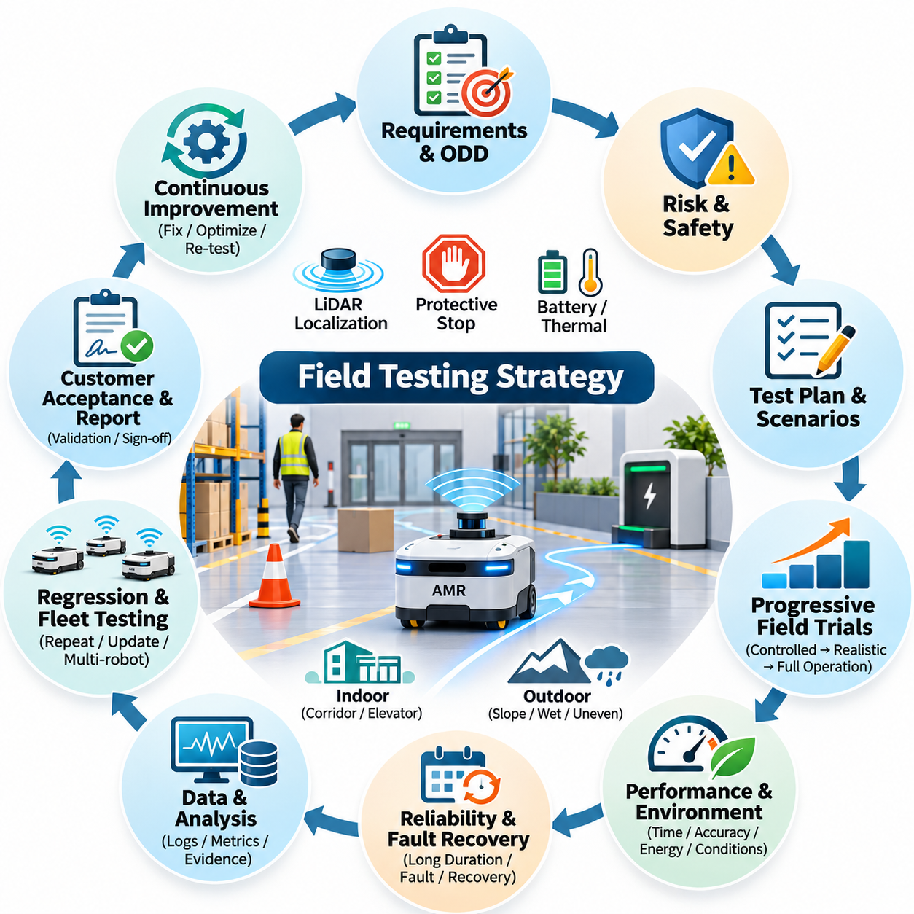
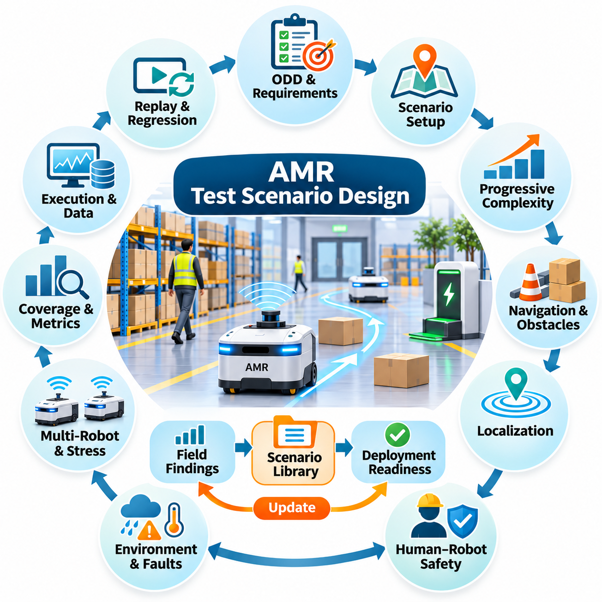
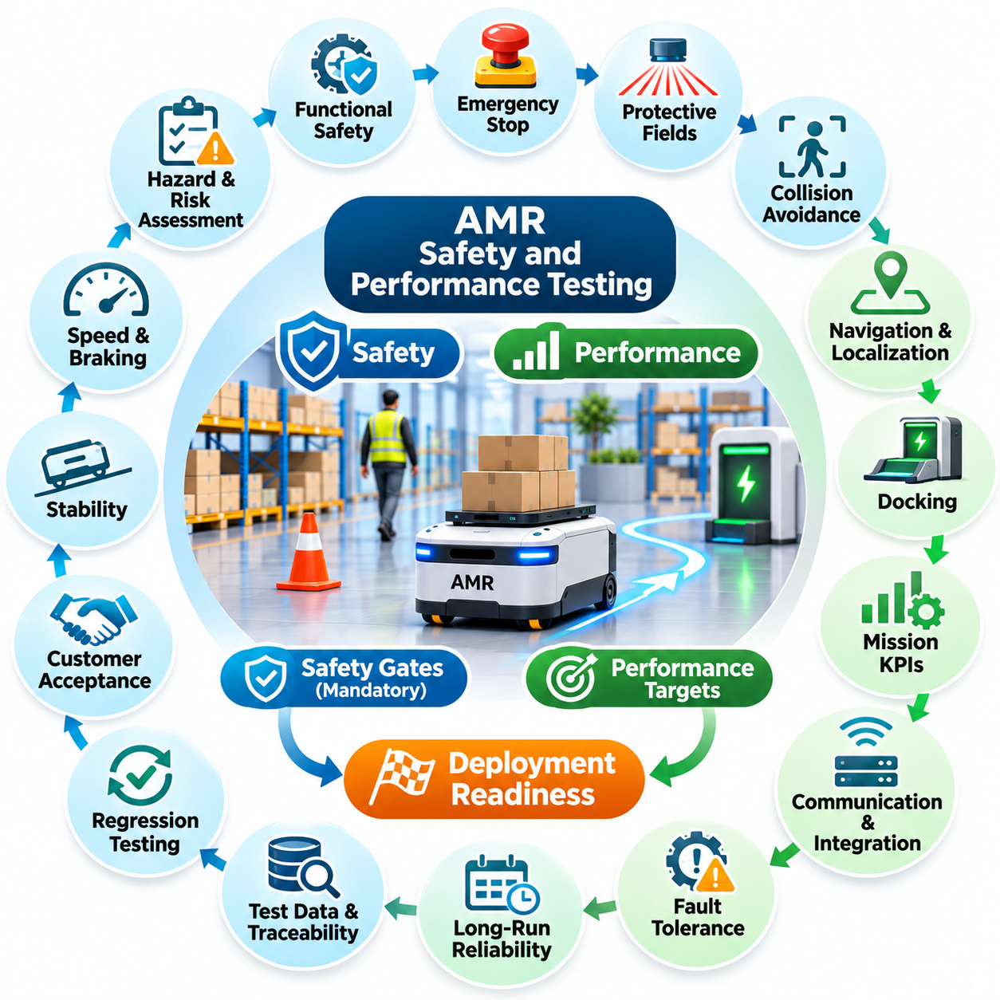
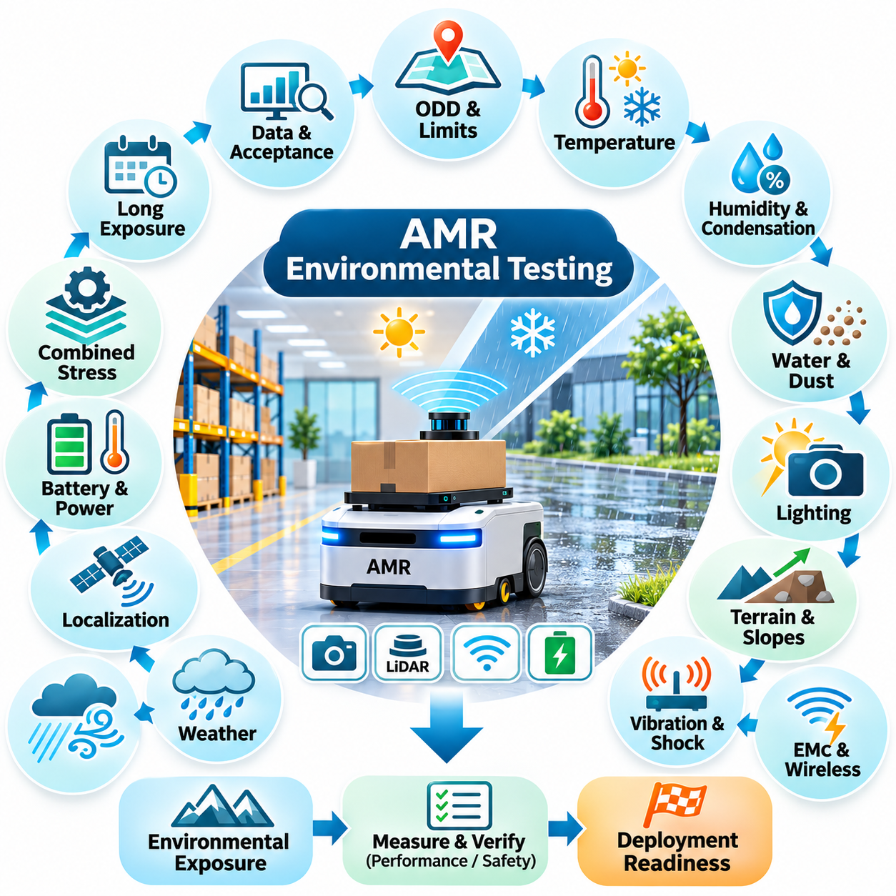
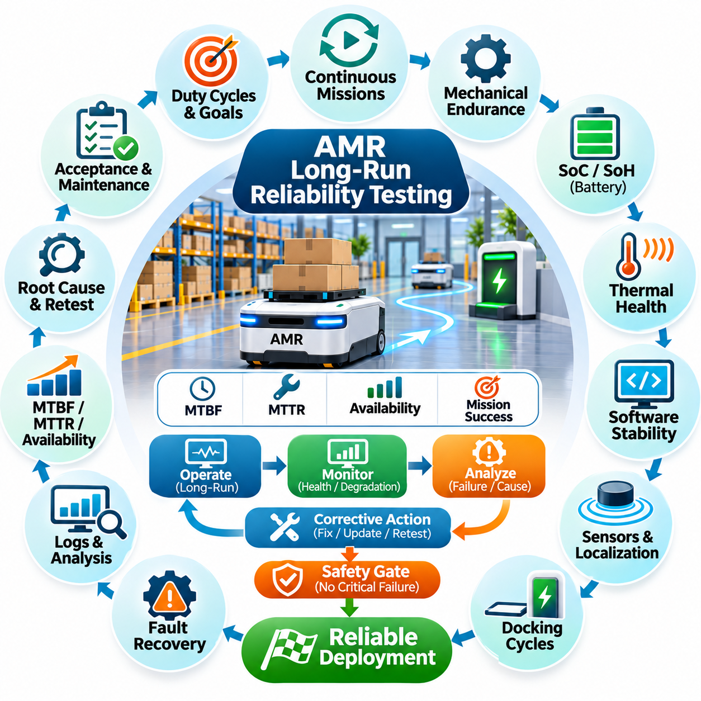
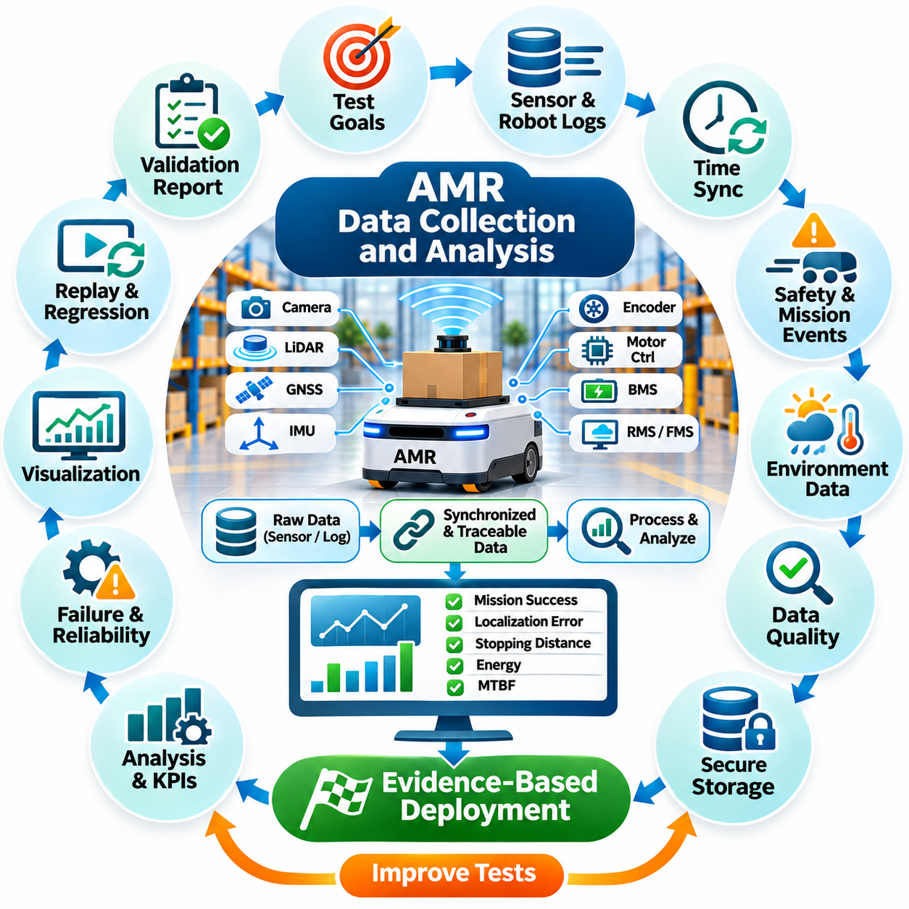
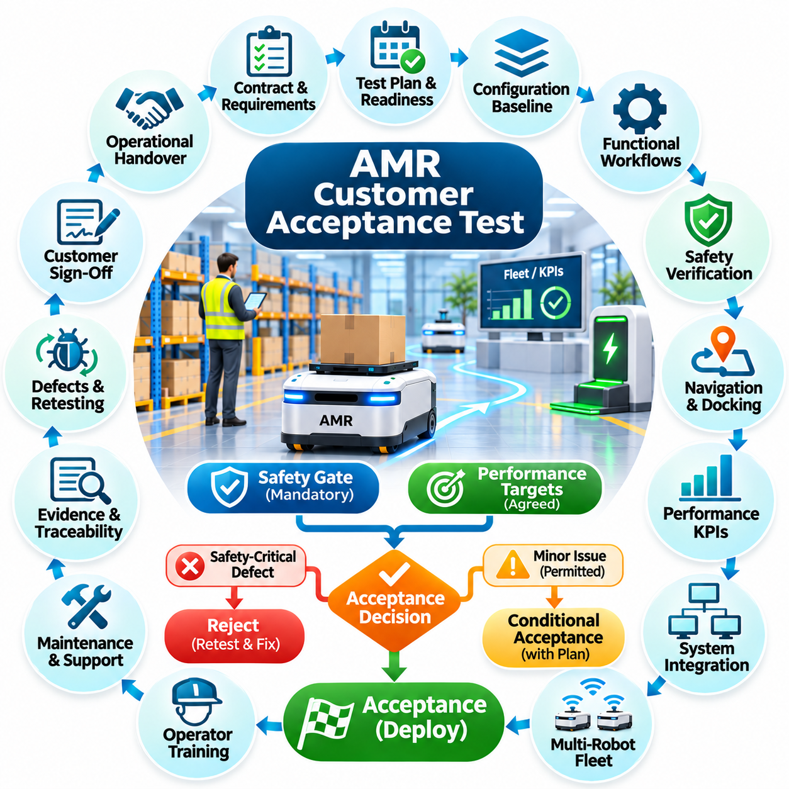
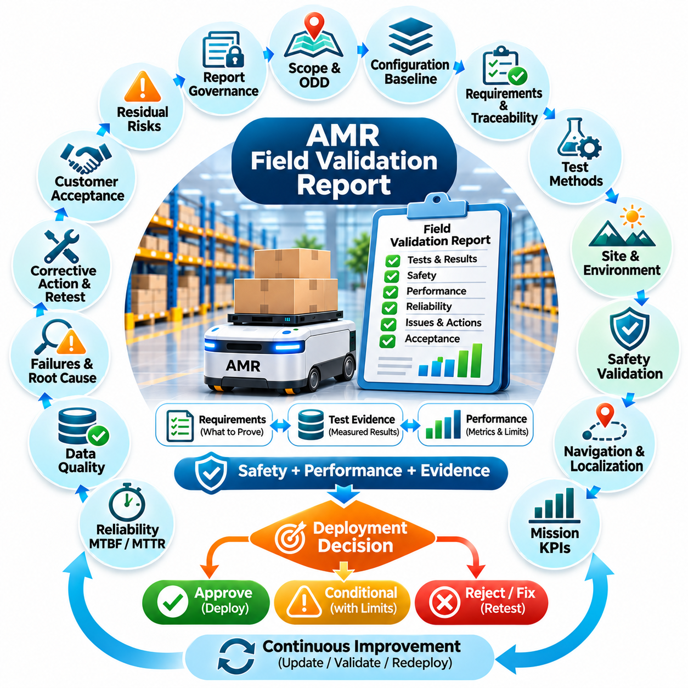

**Volume 08. AMR Operations, Deployment, and MLOps**

# Chapter 21. Field Testing and Validation

## 21.1 Field Testing Strategy

{width="7.268055555555556in" height="7.268055555555556in"}

Field testing is a critical stage in the lifecycle of an Autonomous Mobile Robot (AMR), providing evidence that the system can operate safely, reliably, and efficiently under real deployment conditions. Unlike laboratory testing, field validation exposes robots to unpredictable obstacles, environmental variations, human activities, and operational constraints. A structured testing strategy connects engineering requirements with measurable operational outcomes before commercial deployment.

The primary objective of field testing is to verify that the integrated robotic system satisfies functional, safety, performance, and reliability requirements within its intended Operational Design Domain (ODD). Testing must evaluate not only individual components but also interactions among perception, localization, navigation, motion control, communication, and fleet management. Successful validation demonstrates that these subsystems maintain acceptable performance during realistic missions.

A comprehensive field testing strategy begins with clearly defined requirements and acceptance criteria. Engineering teams translate system specifications into measurable test objectives, including localization accuracy, navigation success rate, obstacle detection performance, stopping distance, mission completion time, and operational availability. Each requirement should be linked to a repeatable test procedure, expected result, and documented verification method.

Field validation should follow a progressive testing approach that increases operational complexity while maintaining controlled risk. Initial tests occur in restricted environments with predictable obstacles and limited robot speeds. Subsequent stages introduce dynamic objects, realistic traffic patterns, environmental disturbances, and longer operating periods. This progression allows engineers to identify fundamental problems before exposing robots to demanding operational conditions.

The testing environment must represent the intended deployment location as accurately as practical. Indoor AMRs require evaluation across corridors, intersections, elevators, automatic doors, loading areas, and shared pedestrian spaces. Outdoor robots require additional testing on slopes, uneven pavement, curbs, gravel, wet surfaces, and variable lighting conditions. Environmental coverage should reflect the actual operating conditions rather than relying exclusively on ideal scenarios.

Risk assessment is an essential prerequisite for every field testing campaign. Engineers must identify hazards associated with unexpected motion, sensor failures, localization loss, communication interruptions, battery faults, and human interaction. Appropriate mitigation measures include restricted test zones, emergency stop access, reduced initial speeds, safety observers, and predefined recovery procedures. Testing must remain within approved safety boundaries throughout execution.

A formal test plan defines the testing scope, required equipment, personnel responsibilities, environmental conditions, and execution sequence. Each test case should specify its initial configuration, robot software version, sensor calibration state, payload condition, and expected behavior. Standardized documentation ensures that results remain comparable across repeated experiments, hardware revisions, software updates, and deployment locations.

Scenario-based testing provides a practical method for evaluating autonomous behavior under representative operational conditions. Scenarios may include obstacle avoidance in narrow corridors, navigation through crowded intersections, docking under positioning uncertainty, and recovery from temporary localization degradation. Each scenario should define observable success conditions and failure criteria so that engineering decisions rely on evidence rather than subjective assessments.

Safety validation requires particular attention because autonomous robots operate near people, vehicles, equipment, and valuable infrastructure. Testing should verify protective stopping functions, speed limitations, safety-zone behavior, emergency stop response, and recovery authorization. Applicable safety standards and site-specific regulations must guide the evaluation, while safety-critical functions should be assessed independently of ordinary navigation performance.

Performance testing evaluates whether the robot achieves its operational objectives within specified constraints. Important measurements include route completion time, path tracking error, localization deviation, obstacle avoidance latency, docking accuracy, and energy consumption. Results should be collected across repeated trials and different environmental conditions to distinguish consistent system behavior from isolated successful demonstrations.

Environmental testing examines how physical conditions influence robot performance. Lighting changes, reflective surfaces, dust, vibration, temperature variation, and electromagnetic interference may affect sensors and computing equipment. Outdoor platforms face additional challenges involving rain, wind, terrain deformation, and GNSS signal degradation. Test conditions should be recorded precisely so performance changes can be associated with identifiable environmental factors.

Long-duration reliability testing evaluates the ability of the AMR to sustain operation beyond short demonstrations. Robots should execute representative missions repeatedly while engineers monitor component temperatures, battery behavior, motor loads, software stability, and communication quality. Extended testing can reveal memory leaks, intermittent sensor faults, thermal limitations, and cumulative localization errors that remain undetected during brief experiments.

Field testing must also evaluate abnormal conditions and system recovery behavior. Representative fault scenarios include temporary network disconnection, blocked routes, sensor degradation, charging failures, and interrupted missions. Engineers should verify whether the robot enters an appropriate safe state, reports diagnostic information, and resumes operation only when recovery conditions are satisfied. Fault injection must be controlled to prevent unacceptable safety risks.

Data collection provides the foundation for objective validation and subsequent engineering improvements. Robot telemetry, sensor measurements, localization estimates, control commands, safety events, and mission logs should be recorded using synchronized timestamps. Each dataset must include relevant configuration metadata and test identifiers. Consistent data structures enable reliable comparison between experimental runs and support efficient root cause analysis.

Analysis should combine quantitative performance metrics with detailed examination of operational events. Statistical summaries can reveal navigation variability, recurring delays, and differences between expected and observed behavior. Engineers should investigate failed trials using synchronized logs and recorded sensor information. Findings must be classified according to severity, reproducibility, operational impact, and the subsystem responsible for corrective action.

Field testing should incorporate regression validation whenever hardware, software, or AI models change. Updated perception algorithms, navigation parameters, firmware, and sensor configurations may introduce unexpected interactions with previously stable functions. A controlled regression test suite verifies that modifications resolve identified problems without degrading established capabilities. Version traceability is necessary to associate performance results with specific system configurations.

Multi-robot testing introduces additional requirements involving traffic coordination, task allocation, shared infrastructure, and communication scalability. Fleet-level validation should examine intersection management, congestion recovery, charging schedules, and dispatch behavior under varying workloads. Robot Management Systems (RMS) and Fleet Management Systems (FMS) must be evaluated together with physical robots to confirm that coordinated operation remains predictable and efficient.

Operational validation should involve the personnel responsible for daily robot deployment and maintenance. Operators can identify workflow constraints, confusing interface behavior, and practical recovery difficulties that engineering teams may overlook. Structured feedback sessions should examine usability, alarm interpretation, manual intervention procedures, and maintenance accessibility. These observations help determine whether technically successful behavior translates into sustainable field operation.

Customer acceptance testing represents the transition from engineering validation to operational approval. Acceptance criteria should be agreed upon before testing and should reflect actual service requirements, safety obligations, and measurable performance targets. Demonstrations alone are insufficient when deployment decisions require repeatable evidence. Test records, unresolved issues, operational limitations, and corrective actions should be reviewed before formal acceptance.

A field validation report consolidates the evidence generated throughout the testing campaign. The report should document objectives, configurations, environmental conditions, executed scenarios, measured results, failures, corrective actions, and remaining risks. It should clearly distinguish verified capabilities from functions requiring additional evaluation. This documentation supports deployment authorization, engineering accountability, maintenance planning, and future system improvements.

An effective field testing strategy ultimately establishes a continuous relationship between real-world operation and engineering development. Field observations become structured datasets, failure investigations generate corrective actions, and validated improvements enter controlled deployment processes. By integrating safety assessment, performance measurement, reliability evaluation, and operational feedback, organizations can progressively transform experimental AMR platforms into dependable autonomous systems.

## 21.2 Test Scenario Design

{width="7.268055555555556in" height="7.268055555555556in"}

Test scenario design is a fundamental element of Autonomous Mobile Robot (AMR) field validation, transforming operational requirements into structured and repeatable experiments. A well-designed scenario represents a realistic situation in which the robot must perceive its surroundings, make decisions, and execute appropriate actions. Scenario design ensures that testing evaluates actual operational capabilities rather than isolated demonstrations under ideal conditions.

The scenario development process begins with an analysis of the robot\'s intended Operational Design Domain (ODD). Engineers identify relevant locations, environmental conditions, traffic patterns, human activities, and operational constraints. These factors establish the boundaries within which the robot is expected to function. Scenarios should represent both routine operations and foreseeable abnormal situations while distinguishing supported conditions from excluded operating environments.

Each test scenario must be associated with specific system requirements and measurable acceptance criteria. For example, a navigation scenario may evaluate route completion, localization accuracy, obstacle clearance, and mission execution time. A docking scenario may examine final positioning error, alignment stability, and charging connection success. Establishing requirement traceability allows engineers to demonstrate that essential functions have been systematically evaluated.

A standardized scenario description should define the initial robot state, starting location, destination, payload, environmental configuration, and expected behavior. It should also specify the sequence of events, triggering conditions, and observable outcomes. Recording software versions, sensor calibration parameters, map revisions, and operating modes enables consistent reproduction of experiments and supports meaningful comparisons between different system configurations.

Scenario complexity should increase progressively throughout the validation campaign. Initial scenarios focus on fundamental movements, including straight-line travel, turning, stopping, and basic obstacle avoidance. Intermediate scenarios introduce intersections, narrow passages, dynamic obstacles, and changing traffic conditions. Advanced scenarios combine multiple operational challenges, requiring the robot to maintain safe and reliable behavior throughout extended missions.

Navigation scenarios evaluate the robot\'s ability to follow planned routes while responding to changes in the surrounding environment. Typical situations include corridor traversal, intersection crossing, route blockage, and navigation around stationary equipment. Engineers should assess whether the robot maintains acceptable path tracking accuracy, respects operational boundaries, and selects appropriate alternative routes when its original path becomes unavailable.

Dynamic obstacle scenarios examine how the robot interacts with moving people, vehicles, and other autonomous machines. Test conditions may include pedestrians crossing unexpectedly, workers approaching from blind corners, or mobile equipment entering shared pathways. The evaluation should measure detection performance, response latency, protective stopping behavior, and successful navigation recovery without compromising pedestrian or equipment safety.

Localization scenarios investigate the robot\'s ability to estimate its position under varying environmental conditions. Representative situations include repetitive corridors, reflective surfaces, temporary occlusions, and changes in mapped surroundings. Outdoor scenarios should additionally consider GNSS degradation, multipath interference, and transitions between satellite-based and local localization methods. Results should quantify positioning errors and recovery performance.

Docking and charging scenarios validate precise positioning and interaction with fixed infrastructure. Tests should examine approach trajectories, final alignment accuracy, connector engagement, charging initiation, and departure behavior. Variations in initial position, approach angle, payload distribution, and environmental conditions help reveal sensitivity to positioning uncertainty. Repeated trials establish whether docking performance remains consistent during normal operations.

Human-robot interaction scenarios assess how autonomous systems behave in shared environments. These scenarios may involve pedestrians stopping unexpectedly, personnel entering restricted areas, or operators requesting assistance. Testing should verify appropriate speed adaptation, warning signals, safe stopping distances, and predictable robot behavior. Special consideration is required in hospitals, factories, and public spaces where human movement patterns vary considerably.

Environmental scenarios reproduce conditions that may degrade sensing, mobility, or computational performance. Indoor tests can introduce lighting changes, reflective floors, dust, and temporary visual obstructions. Outdoor tests may include uneven terrain, slopes, wet pavement, temperature variation, and reduced visibility. Each environmental parameter should be documented so that performance degradation can be correlated with identifiable physical conditions.

Fault and recovery scenarios evaluate system behavior when normal operating assumptions are violated. Controlled tests may simulate communication interruptions, sensor failures, localization uncertainty, or unavailable destinations. Engineers must verify that the robot transitions to an appropriate safe state, reports relevant diagnostic information, and follows authorized recovery procedures. Fault injection should be performed under controlled conditions with suitable safety supervision.

Multi-robot scenarios examine coordination among robots sharing routes, intersections, charging stations, and operational resources. Representative tests include simultaneous task requests, congestion at narrow passages, conflicting route assignments, and charging resource contention. Fleet Management Systems (FMS) should be evaluated for scheduling efficiency, deadlock prevention, traffic coordination, and recovery from individual robot interruptions.

Scenario design should account for workload variation and operational stress. Robots may perform adequately during isolated missions but experience delays when task frequency, payload, traffic density, or fleet size increases. Stress scenarios help identify throughput limitations, computational bottlenecks, communication delays, and resource conflicts. Test conditions should remain representative of credible deployment demands rather than relying exclusively on unrealistic extremes.

A scenario coverage matrix provides a structured method for organizing validation activities. The matrix relates system requirements to environmental conditions, operational functions, hazard categories, and expected outcomes. Coverage analysis helps identify untested combinations and duplicated experiments. Risk-based prioritization directs testing resources toward scenarios involving severe consequences, frequent exposure, or significant uncertainty in system performance.

Quantitative evaluation requires clearly defined performance indicators and consistent measurement procedures. Scenario results may include success rate, mission duration, localization error, obstacle avoidance latency, stopping distance, and intervention frequency. Repeated execution supports statistical analysis of variability and reliability. Acceptance thresholds should be established from system requirements and operational safety needs before testing begins.

Scenario execution must follow documented procedures to maintain repeatability and traceability. Test personnel should verify initial conditions, confirm safety controls, activate synchronized data recording, and monitor robot behavior throughout execution. Deviations from the planned procedure should be recorded rather than ignored. Consistent execution enables engineers to distinguish genuine system improvements from differences in test preparation or environmental conditions.

Recorded field data can support scenario replay and simulation-based regression testing. Sensor logs, robot trajectories, control commands, and environmental observations allow engineers to reconstruct important operational events. Reproducing field scenarios in simulation can accelerate software debugging and evaluate proposed improvements before additional physical testing. However, simulation results must be interpreted alongside real-world validation because physical conditions cannot always be reproduced perfectly.

Scenario libraries should evolve as operational experience reveals new challenges. Unexpected obstacles, unusual pedestrian behavior, environmental disturbances, and recurring mission failures can be converted into additional test cases. Each scenario should maintain version information, associated requirements, execution history, and known limitations. This approach transforms field experience into reusable validation assets that support continuous engineering improvement.

Effective test scenario design ultimately connects operational reality with measurable engineering evidence. By combining representative environments, controlled disturbances, safety-critical events, and repeatable performance measurements, engineering teams can systematically evaluate autonomous behavior. A maintained scenario framework supports deployment readiness decisions, regression prevention, customer acceptance testing, and the long-term reliability of AMR operations.

## 21.3 Safety and Performance Testing

{width="7.268055555555556in" height="7.268055555555556in"}

Safety and performance testing is a fundamental requirement for validating Autonomous Mobile Robots (AMRs) before operational deployment. These evaluations determine whether a robot can execute assigned missions while maintaining acceptable safety margins, functional reliability, and operational efficiency. A comprehensive testing program examines both protective functions and mission performance under realistic conditions, ensuring that productivity objectives never override essential safety requirements.

Safety testing begins with a systematic assessment of operational hazards and potential failure conditions. Engineers identify risks associated with collisions, unexpected acceleration, uncontrolled movement, sensor malfunction, and human interaction. Each hazard should be connected to defined safety requirements and verification procedures. Risk assessment results establish testing priorities, protective measures, and acceptance criteria appropriate to the intended operating environment.

Functional safety validation examines whether protective mechanisms respond correctly to hazardous situations. Emergency stop circuits, protective stopping functions, safety-rated sensors, and motion inhibition mechanisms must operate according to their specified requirements. Testing should verify response consistency across different operating modes and fault conditions. Safety-related control functions must remain effective independently of ordinary navigation and AI decision-making processes.

Emergency stop testing evaluates the complete sequence from activation to motion termination. Engineers measure response time, stopping distance, braking behavior, and system state after activation. Tests should consider different travel speeds, payload conditions, and surface characteristics. Restart procedures must require appropriate authorization and must not automatically resume hazardous motion when an emergency stop device is released.

Protective field testing verifies the behavior of safety sensors and dynamically configured detection zones. Robots may use safety laser scanners, proximity sensors, and other protective devices to detect obstacles and initiate speed reduction or stopping. Engineers should evaluate detection coverage, response latency, and protective separation distances. Test configurations must reflect the robot\'s speed, braking capability, payload, and intended operating conditions.

Collision avoidance testing examines the interaction between perception, planning, and motion control. Scenarios include stationary obstacles, moving pedestrians, crossing vehicles, and sudden path obstructions. Performance measurements should include obstacle detection reliability, avoidance response time, minimum clearance, and successful route recovery. Ordinary perception-based avoidance must not be treated as a substitute for required safety-rated protective functions.

Speed and braking performance require validation across representative operating conditions. Engineers should measure acceleration, deceleration, stopping distance, and trajectory stability at different commanded speeds. Payload mass, center of gravity, tire characteristics, and floor friction can significantly influence braking behavior. Testing should establish safe operating limits and confirm that speed restrictions remain effective in designated zones.

Stability testing evaluates the robot\'s resistance to tipping, sliding, and loss of directional control. Relevant scenarios include cornering, emergency braking, uneven surfaces, slopes, and changes in payload distribution. Outdoor platforms require additional attention to traction and terrain irregularities. Engineers should monitor chassis attitude, wheel behavior, and control responses to identify conditions that could compromise safe mobility.

Navigation performance testing measures the robot\'s ability to complete planned routes accurately and efficiently. Important indicators include route completion rate, path tracking error, travel time, unnecessary stops, and recovery frequency. Repeated trials across different environments reveal performance variability and operational limitations. Results should be compared against predefined acceptance thresholds rather than relying on isolated successful demonstrations.

Localization performance testing examines position estimation accuracy, stability, and recovery behavior. Engineers should evaluate performance in repetitive corridors, dynamic environments, reflective areas, and locations with limited visual features. Outdoor testing may include GNSS degradation and transitions between localization sources. Reference measurements should be used where practical to quantify position error and detect unexpected localization drift.

Docking performance testing validates precise alignment with charging stations, loading interfaces, and operational equipment. Measurements include final position error, angular deviation, approach duration, docking success rate, and recovery attempts. Testing should cover variations in initial position, payload, and environmental conditions. Reliable docking is particularly important for unattended operations requiring repeated charging or automated material transfer.

Operational performance testing evaluates whether the AMR meets mission-level productivity requirements. Metrics may include completed tasks per hour, average mission duration, transport throughput, idle time, and energy consumption per mission. Engineers should evaluate these indicators under representative workloads and traffic conditions. Performance analysis must distinguish limitations caused by robot behavior from delays introduced by external infrastructure.

Communication and system integration testing examines interactions between robots, fleet management platforms, and external equipment. Scenarios should include delayed messages, temporary network interruptions, server unavailability, and conflicting task assignments. Engineers must verify safe behavior during communication failures and correct synchronization after recovery. Operational continuity should never depend on unrestricted remote connectivity for essential safety functions.

Fault tolerance testing evaluates the robot\'s response to degraded components and abnormal system states. Controlled fault scenarios may involve sensor disconnection, actuator feedback errors, low battery conditions, or software process failures. Expected responses should include appropriate fault detection, diagnostic reporting, and transition to a defined safe state. Recovery procedures must prevent uncontrolled movement and require verification before normal operation resumes.

Long-duration performance testing identifies problems that may not appear during short experiments. Repeated missions can expose thermal accumulation, battery degradation effects, computational resource exhaustion, and intermittent communication faults. Engineers should monitor system health alongside navigation and productivity metrics. Sustained performance is essential for evaluating operational availability and determining realistic maintenance intervals.

Test execution requires controlled procedures, calibrated instruments, and synchronized data collection. Robot telemetry, sensor outputs, control commands, safety events, and environmental measurements should be recorded with traceable timestamps. Each test must identify the robot configuration, software version, payload, and operating conditions. Consistent documentation supports reproducibility, root cause analysis, and comparison between successive system revisions.

Safety and performance results should be evaluated separately before considering overall deployment readiness. A robot may demonstrate high mission completion rates while failing critical protective requirements, making it unsuitable for operation. Conversely, a safe robot may still require optimization to satisfy productivity objectives. Deployment approval should require satisfactory evidence for all mandatory safety requirements and agreed operational performance criteria.

Regression testing is necessary whenever modifications affect safety functions, navigation algorithms, control parameters, or hardware configurations. Updated software and AI models may change response timing, obstacle behavior, or system resource utilization. Previously validated scenarios should be repeated to identify unintended degradation. Configuration management and documented approval procedures ensure that only appropriately verified versions enter operational service.

Customer acceptance testing should incorporate representative safety and performance demonstrations using agreed evaluation procedures. Customers and engineering teams should review measured results, operational limitations, unresolved defects, and corrective actions. Acceptance decisions must reflect documented evidence rather than demonstration quality alone. Clear reporting establishes accountability and supports safe transition from engineering validation to routine deployment.

An integrated safety and performance testing framework provides the evidence required to establish dependable AMR operations. By combining hazard-based validation, quantitative performance measurement, controlled fault testing, and long-duration evaluation, engineers can identify weaknesses before deployment. Continuous monitoring and regression validation extend this assurance throughout the robot lifecycle, supporting reliable autonomous operation in increasingly complex environments.

## 21.4 Environmental Testing

{width="7.268055555555556in" height="7.268055555555556in"}

Environmental testing is an essential component of Autonomous Mobile Robot (AMR) field validation, ensuring that robotic systems maintain safe and reliable operation under varying physical conditions. Environmental factors can influence perception, localization, mobility, communication, and computational performance. A comprehensive testing strategy evaluates these influences systematically, identifying operational limitations before deployment in factories, hospitals, warehouses, and outdoor environments.

Environmental validation begins with defining the robot\'s Operational Design Domain (ODD) and expected exposure conditions. Engineers identify temperature ranges, humidity levels, lighting variations, surface characteristics, weather conditions, and electromagnetic disturbances. These parameters establish the environmental boundaries within which the robot must operate. Test conditions should reflect realistic deployment requirements while including appropriate margins for foreseeable variations.

Temperature testing evaluates how thermal conditions affect electronic components, batteries, motors, sensors, and computing systems. High temperatures may cause thermal throttling, reduced battery efficiency, or accelerated component degradation. Low temperatures can influence battery discharge capability, lubrication, and mechanical response. Engineers should monitor internal temperatures, processing performance, power consumption, and operational stability during controlled thermal exposure.

Humidity and condensation testing examines the robot\'s resistance to moisture-related failures. High humidity may promote corrosion, insulation degradation, and electrical leakage, while rapid temperature transitions can produce condensation inside enclosures. Testing should evaluate sealing integrity, connector protection, sensor visibility, and electrical functionality. Environmental conditioning procedures must distinguish normal humidity exposure from direct water ingress and condensation events.

Water and dust protection testing determines whether mechanical enclosures and electrical assemblies provide adequate resistance to environmental contamination. Relevant evaluations include dust exposure, water splashing, rainfall simulation, and enclosure sealing inspections. Protection requirements should be selected according to deployment conditions and applicable ingress protection classifications. Testing must also consider connectors, ventilation openings, cable interfaces, and maintenance access points.

Lighting variation testing evaluates the robustness of camera-based perception and visual localization systems. Scenarios may include bright sunlight, deep shadows, artificial lighting, reflections, and rapid transitions between illuminated and dark areas. Engineers should measure object detection accuracy, visual feature stability, exposure adaptation, and navigation continuity. Outdoor robots require additional evaluation of glare, low-angle sunlight, and nighttime illumination conditions.

Surface and terrain testing examines how ground conditions influence mobility, traction, and navigation accuracy. Indoor environments may contain polished floors, ramps, expansion joints, and uneven thresholds. Outdoor environments introduce gravel, wet pavement, grass, soil, and irregular terrain. Engineers should evaluate wheel slip, path tracking, braking distance, vibration, and energy consumption while ensuring that test surfaces represent intended operational conditions.

Slope and obstacle testing evaluates the robot\'s ability to maintain controlled motion on inclined or geometrically challenging surfaces. Test scenarios include uphill travel, downhill braking, cross-slope movement, curb negotiation, and transitions between different surface elevations. Payload distribution and center-of-gravity changes must be considered. Measurements should include traction stability, motor loading, chassis attitude, and the ability to stop safely.

Vibration and mechanical shock testing assesses structural integrity and component reliability during repeated movement over imperfect surfaces. Continuous vibration may loosen connectors, degrade sensor calibration, or accelerate mechanical fatigue. Shock events can occur when crossing joints, thresholds, or unexpected obstacles. Engineers should monitor acceleration levels, mounting stability, electrical continuity, and sensor performance before and after representative exposure.

Electromagnetic compatibility testing evaluates the robot\'s ability to operate reliably in environments containing electrical noise and electromagnetic disturbances. Industrial facilities may expose robots to variable-frequency drives, welding equipment, wireless transmitters, and high-power machinery. Testing should examine communication stability, sensor integrity, controller behavior, and unintended resets. Applicable electromagnetic compatibility requirements should guide laboratory and field evaluations.

Communication environment testing investigates wireless performance under realistic deployment conditions. Metal structures, reinforced walls, moving machinery, and network congestion may reduce signal quality or introduce latency. Engineers should measure packet loss, communication delay, connection recovery, and mission continuity. Robots must maintain safe local behavior during temporary communication interruptions, particularly when operating independently of cloud services.

Outdoor weather testing introduces additional challenges involving rain, wind, fog, snow, and changing surface conditions. Moisture can affect sensor visibility, traction, and enclosure integrity, while wind may influence stability or exposed equipment. Fog and precipitation can degrade optical sensing and LiDAR measurements. Test plans should distinguish conditions within the approved operating domain from severe weather requiring restricted operation.

Environmental effects on localization require dedicated evaluation because sensor reliability changes with surrounding conditions. Reflective surfaces, repetitive structures, moving objects, and reduced visibility may degrade SLAM performance. Outdoor systems must also consider GNSS multipath, signal blockage, and atmospheric influences. Engineers should measure localization error, confidence indicators, and recovery behavior across representative environmental transitions.

Battery and power system testing examines environmental influences on energy availability and electrical stability. Temperature changes affect battery capacity, internal resistance, charging acceptance, and thermal management requirements. Repeated missions under different environmental conditions reveal changes in energy consumption and operating duration. Battery Management System (BMS) protections should be verified against specified operating limits and abnormal thermal conditions.

Environmental stress testing combines multiple factors to evaluate interactions that may not appear during isolated experiments. For example, high temperature combined with heavy payloads may increase motor heating, while wet surfaces combined with slopes may reduce braking performance. Engineers should select credible combinations based on operational risk assessments. Combined testing must remain controlled and should not exceed approved safety boundaries.

Long-duration environmental exposure testing evaluates whether sustained conditions produce progressive degradation. Extended operation in dusty, humid, or thermally demanding environments may reveal enclosure weaknesses, connector corrosion, cooling restrictions, and sensor contamination. Engineers should monitor performance trends and inspect components periodically. These observations support preventive maintenance planning and realistic service interval definitions.

Environmental test execution requires calibrated measurement instruments and consistent documentation. Temperature, humidity, illumination, vibration, surface condition, and weather measurements should be recorded alongside robot telemetry. Each test should identify the hardware configuration, software version, payload, operating mode, and exposure duration. Synchronized records allow engineers to correlate environmental changes with observed performance deviations.

Environmental acceptance criteria must be derived from system requirements, component specifications, safety analysis, and deployment expectations. A robot should demonstrate acceptable performance throughout its declared operating domain without compromising mandatory protective functions. Conditions exceeding validated limits should trigger appropriate restrictions or safe-state behavior. Test reports must distinguish verified capabilities from environmental conditions requiring further validation.

A comprehensive environmental testing program strengthens the reliability and operational readiness of AMR platforms. By systematically evaluating temperature, moisture, lighting, terrain, vibration, electromagnetic disturbances, and weather exposure, engineering teams can identify weaknesses before deployment. Environmental validation also provides evidence for design improvements, maintenance strategies, and operating restrictions, supporting dependable autonomous operation throughout the robot lifecycle.

## 21.5 Long-Run Reliability Testing

{width="7.268055555555556in" height="7.268055555555556in"}

Long-run reliability testing evaluates whether Autonomous Mobile Robots (AMRs) can sustain safe, consistent, and productive operation over extended periods. Unlike short functional tests, these evaluations reveal cumulative degradation, intermittent failures, and operational instability. Reliability testing provides engineering evidence that robotic systems can withstand repeated missions, changing workloads, and prolonged exposure to realistic deployment conditions.

Reliability validation begins with defining operational profiles, expected duty cycles, and service life requirements. Engineers establish representative mission durations, travel distances, payload distributions, charging frequencies, and environmental conditions. Test profiles should reproduce normal operating patterns while incorporating foreseeable peak workloads. Clearly defined operating assumptions allow reliability results to be interpreted within the robot\'s intended deployment conditions.

A long-run testing campaign should establish measurable reliability and availability objectives before execution. Relevant indicators include Mean Time Between Failures (MTBF), Mean Time To Repair (MTTR), mission success rate, operational availability, and intervention frequency. Failure definitions must distinguish safety-critical faults, mission interruptions, and minor recoverable events. Consistent classification prevents misleading reliability estimates and supports meaningful comparisons.

Continuous operation testing examines whether the robot maintains stable behavior throughout extended missions. Test schedules may include repeated navigation, docking, charging, loading, and unloading activities. Engineers should monitor mission completion, unexpected stops, localization recovery, and communication interruptions. Extended testing can reveal software memory leaks, thermal accumulation, resource exhaustion, and faults that emerge only after prolonged execution.

Mission cycle testing evaluates reliability through repeated execution of representative operational workflows. A cycle may include task assignment, route planning, navigation, obstacle avoidance, docking, payload handling, and task completion. Each cycle should produce a traceable result identifying success, recovery, or failure. Accumulated cycle statistics reveal recurring weaknesses and provide evidence for estimating operational reliability under defined conditions.

Mechanical endurance testing investigates wear and fatigue affecting wheels, bearings, suspension components, steering mechanisms, and drive assemblies. Repeated acceleration, braking, turning, and obstacle crossing can expose progressive mechanical deterioration. Engineers should monitor vibration, backlash, motor current, abnormal noise, and temperature changes. Periodic inspections help correlate measured degradation with accumulated distance and operating hours.

Battery endurance testing evaluates energy system performance throughout repeated discharge and charging cycles. Engineers should monitor usable capacity, State of Charge (SoC), State of Health (SoH), internal resistance, and charging efficiency. Operating temperature and payload variations may influence battery behavior. Long-run observations support battery replacement planning, charging strategies, and estimates of achievable mission duration.

Thermal reliability testing examines sustained heat generation in motors, motor controllers, batteries, and onboard computing equipment. Repeated high-load missions may produce gradual temperature increases or thermal throttling that short tests cannot detect. Engineers should record component temperatures, cooling performance, processor utilization, and power consumption. Thermal trends help identify insufficient cooling capacity and potential component reliability risks.

Software endurance testing focuses on maintaining stable execution over prolonged operating periods. Navigation processes, middleware, AI inference services, and fleet communication modules should be monitored for memory growth, CPU utilization, thread failures, and unexpected restarts. Automated health monitoring can detect progressive resource consumption. Testing should confirm that recovery mechanisms restore functionality without compromising operational safety.

Sensor reliability testing evaluates whether perception and localization components maintain consistent performance during extended operation. Cameras, LiDAR, radar, inertial sensors, and wheel encoders may experience contamination, calibration drift, or intermittent communication errors. Engineers should monitor data quality, timestamp consistency, detection stability, and localization confidence. Periodic reference measurements help identify gradual sensing degradation.

Docking and charging endurance testing examines repeated interaction with fixed infrastructure. Hundreds or thousands of docking cycles may reveal connector wear, alignment sensitivity, charging contact deterioration, or positioning drift. Engineers should record docking success rates, final alignment errors, connection failures, and recovery attempts. Repeated testing supports preventive maintenance schedules and improvements to mechanical interface durability.

Communication reliability testing evaluates network stability during prolonged operations involving wireless access points, fleet servers, and external infrastructure. Tests should capture packet loss, connection interruptions, message latency, and recovery duration. Network roaming and temporary server unavailability may expose weaknesses in task synchronization. Robots must maintain safe local behavior even when communication services become unavailable.

Fleet-level endurance testing investigates reliability when multiple robots share operational resources over extended periods. Repeated task assignments, traffic coordination, charging schedules, and intersection management can expose scheduling defects or deadlocks. Engineers should measure fleet throughput, waiting time, task completion, and recovery frequency. Fleet testing distinguishes individual robot failures from systemic orchestration limitations.

Reliability testing must include controlled fault recovery and maintenance activities. Representative failures may involve temporary sensor loss, low battery conditions, localization uncertainty, or interrupted charging. Engineers should verify fault detection, safe-state transitions, diagnostic reporting, and authorized recovery. Maintenance interventions must be documented to distinguish planned servicing from corrective repairs and unexpected operational failures.

Data collection requires continuous logging of robot telemetry, mission events, fault codes, battery measurements, and environmental conditions. Each record should include synchronized timestamps, robot identifiers, configuration versions, and operating hours. Centralized analysis can identify recurring failure patterns and relationships between workload and degradation. Data integrity and storage management are essential for lengthy validation campaigns.

Reliability analysis should combine failure statistics with operational context. MTBF estimates require clearly defined failure events and accumulated exposure time, while availability calculations must specify included downtime categories. Small samples and limited operating hours can produce uncertain estimates. Confidence intervals and documented assumptions help prevent unsupported claims about long-term reliability or expected service life.

Failure investigation should identify root causes rather than treating every interruption as an isolated event. Engineers can correlate system logs, sensor recordings, environmental measurements, and maintenance records to reconstruct failure sequences. Corrective actions may involve software changes, mechanical redesign, improved sealing, or revised operating procedures. Updated configurations should undergo regression and endurance testing before acceptance.

Long-run acceptance criteria should reflect operational requirements and agreed customer expectations. Validation reports should document accumulated operating hours, completed mission cycles, traveled distance, observed failures, downtime, and maintenance interventions. Results must distinguish demonstrated reliability from projected performance. Unresolved safety-critical defects should prevent deployment approval regardless of favorable productivity indicators.

Long-run reliability testing connects engineering validation with sustainable field operation. By combining continuous missions, mechanical endurance, battery cycling, software monitoring, and systematic failure analysis, teams can identify degradation before widespread deployment. Reliability evidence supports maintenance planning, lifecycle cost estimation, deployment readiness, and continuous improvement of AMR platforms operating in demanding real-world environments.

## 21.6 Data Collection and Analysis

{width="7.268055555555556in" height="7.268055555555556in"}

Data collection and analysis form the foundation of evidence-based field validation for Autonomous Mobile Robots (AMRs). Reliable evaluation requires more than observing successful missions; it depends on measurable records of robot behavior, environmental conditions, and system responses. A structured data strategy enables engineers to verify requirements, investigate failures, compare configurations, and determine whether a robotic platform is ready for operational deployment.

Field data planning begins by connecting validation objectives with measurable parameters and recording requirements. Engineers identify the information needed to evaluate navigation accuracy, obstacle avoidance, safety functions, mission efficiency, and system reliability. Each test scenario should specify relevant signals, sampling frequencies, measurement units, and expected data quality. Planning prevents critical evidence from being lost during field execution.

A comprehensive collection architecture integrates sensor measurements, control signals, operational events, and system health information. Typical sources include LiDAR, cameras, GNSS, inertial sensors, wheel encoders, motor controllers, and battery management systems. Robot Management Systems (RMS) and Fleet Management Systems (FMS) provide mission histories and coordination events. Combining these sources creates a unified record of robot operation.

Time synchronization is essential for reconstructing the sequence of events across distributed robot components. Sensor timestamps, controller logs, network messages, and external reference measurements must share a consistent time basis. Precision Time Protocol (PTP) or other suitable synchronization methods can reduce timing uncertainty. Engineers should monitor clock drift, missing timestamps, and synchronization failures that could invalidate analysis.

Sensor data collection should preserve the information necessary to evaluate perception and localization performance. Raw images, point clouds, depth measurements, and inertial observations may be recorded alongside processed detections and estimated poses. Recording both input data and algorithm outputs supports detailed debugging. Storage limitations require deliberate selection of recording modes without sacrificing safety-critical evidence.

Robot motion data provides quantitative evidence of navigation and control performance. Relevant measurements include commanded velocity, actual velocity, acceleration, steering angle, wheel speed, trajectory, and localization estimates. Reference positioning systems may be used to establish ground truth where practical. Comparing commanded and measured behavior helps identify tracking errors, control delays, mechanical limitations, and localization drift.

Safety event logging must capture protective stops, emergency stop activation, obstacle detections, speed restrictions, and abnormal operating conditions. Each event should include its triggering condition, system response, and resulting robot state. Safety-related records should remain distinguishable from ordinary application logs. Engineers must verify that logging does not interfere with the execution of independent protective functions.

Mission-level data collection connects technical measurements with operational productivity. Records should identify task assignments, mission start and completion times, route changes, docking attempts, charging periods, and operator interventions. These events enable calculation of mission success rates, cycle times, throughput, and utilization. Consistent event definitions are necessary when comparing robots, test locations, or software versions.

Environmental measurements provide essential context for interpreting field results. Temperature, humidity, illumination, surface conditions, precipitation, and wireless signal quality may influence system behavior. Engineers should record relevant environmental parameters throughout testing rather than relying only on initial observations. Correlating environmental changes with performance deviations helps distinguish external disturbances from internal system defects.

Data quality assurance begins with automated checks for missing records, inconsistent timestamps, invalid measurements, and unexpected signal discontinuities. Sensor calibration status, coordinate frames, measurement units, and recording configurations must be verified. Corrupted or incomplete datasets should be identified before statistical analysis. Quality indicators should accompany each test result so that conclusions reflect the reliability of the underlying evidence.

Data storage and transfer procedures must accommodate large sensor recordings and prolonged test campaigns. Edge devices may temporarily buffer data before transferring selected records to centralized storage. Compression, event-triggered recording, and retention policies can reduce storage demands. Engineers should verify file integrity through checksums and maintain backup procedures to prevent the loss of irreplaceable validation evidence.

Data governance protects sensitive information collected in operational environments. Camera recordings and location histories may contain personal or commercially confidential information. Access controls, encryption, retention limits, and appropriate anonymization should be applied according to legal and contractual requirements. Dataset ownership, permitted usage, and sharing restrictions must be documented before information is transferred between organizations.

Analysis begins by organizing recordings according to test scenarios, robot identifiers, software versions, and environmental conditions. Automated processing pipelines can extract relevant events, calculate performance indicators, and generate comparable results. Engineers should preserve links between derived metrics and original recordings. Reproducible analysis procedures reduce interpretation differences and support independent technical reviews.

Quantitative performance analysis evaluates mission completion, localization error, stopping distance, obstacle clearance, energy consumption, and recovery frequency. Results should include distributions and variability rather than relying exclusively on averages. Repeated trials support confidence interval estimation and identification of inconsistent behavior. Acceptance decisions must compare measured outcomes against criteria established before testing.

Failure analysis requires reconstructing events before, during, and after an operational interruption. Engineers correlate sensor recordings, controller commands, diagnostic messages, and environmental observations to identify contributing factors. Root cause analysis should distinguish hardware defects, software faults, configuration errors, and external disturbances. Findings must support corrective actions and subsequent regression testing.

Longitudinal analysis examines performance changes across accumulated operating hours, mission cycles, and maintenance activities. Trends in battery capacity, motor temperature, localization stability, and intervention frequency may reveal progressive degradation. Reliability indicators such as Mean Time Between Failures (MTBF) require consistent failure definitions. Limited exposure and small samples must be acknowledged when estimating long-term performance.

Visualization supports engineering interpretation through trajectory plots, event timelines, performance distributions, and system health trends. Geographic heatmaps can identify locations associated with repeated localization errors or obstacle avoidance failures. Comparative dashboards help reveal differences between robot configurations and operating conditions. Visual summaries should remain connected to traceable numerical evidence rather than replacing detailed analysis.

Field recordings also support simulation replay, regression testing, and AI model improvement. Difficult perception cases and unusual navigation events can become reusable validation scenarios or carefully governed training datasets. Updated algorithms should be evaluated against previously recorded failures and representative normal conditions. Simulation results must complement physical verification rather than substitute for required real-world safety testing.

Validation reports should document collection methods, dataset coverage, measurement uncertainty, analysis procedures, and observed limitations. Every reported result should be traceable to a defined test configuration and supporting evidence. Unresolved data gaps must be disclosed rather than interpreted as successful performance. A disciplined data collection and analysis framework strengthens deployment decisions and supports continuous improvement throughout the AMR lifecycle.

## 21.7 Customer Acceptance Test

{width="7.268055555555556in" height="7.268055555555556in"}

Customer Acceptance Testing (CAT) is the formal process through which customers verify that an Autonomous Mobile Robot (AMR) system satisfies agreed operational, functional, and safety requirements. Unlike internal engineering validation, acceptance testing emphasizes performance within the customer\'s actual workflow. Successful acceptance demonstrates that the delivered system is suitable for its intended operational environment and contractual scope.

Acceptance planning begins with reviewing contractual specifications, approved requirements, deployment boundaries, and previously agreed success criteria. Customers and suppliers should establish measurable expectations for mission completion, navigation accuracy, throughput, availability, and system integration. Each requirement must correspond to a verifiable test or documented evidence. Ambiguous criteria should be resolved before testing begins.

The acceptance test plan defines the testing environment, participating organizations, responsibilities, procedures, and required documentation. It should identify robot configurations, software versions, maps, payloads, operating schedules, and supporting infrastructure. Entry criteria confirm that installation and preliminary safety checks are complete. Both parties should approve the plan before formal acceptance activities begin.

Acceptance readiness requires confirming that the deployed robot matches the approved system configuration. Engineers should verify hardware identification, firmware versions, AI models, sensor calibration, safety settings, and network parameters. Charging stations, access controls, and external interfaces must also be inspected. Configuration records establish the technical baseline against which acceptance results will be evaluated.

Functional acceptance testing verifies that the robot performs its intended tasks according to customer requirements. Typical scenarios include task assignment, autonomous navigation, obstacle avoidance, docking, charging, payload transportation, and mission completion. Each scenario should specify expected behavior and observable outcomes. Testing must reflect actual operational workflows rather than relying exclusively on isolated demonstrations.

Safety acceptance testing confirms that protective functions remain effective in the customer\'s environment. Evaluations may include emergency stopping, protective field monitoring, speed restrictions, obstacle response, and recovery authorization. Test methods must respect established safety boundaries and applicable requirements. Safety-critical failures require corrective action and successful retesting before operational approval.

Navigation acceptance testing evaluates performance along approved routes and within defined operating areas. Engineers should assess localization stability, route completion, stopping accuracy, turning behavior, and obstacle clearance. Representative tests should include narrow passages, intersections, dynamic obstacles, and docking approaches. Results must be compared with agreed tolerances and documented operating limitations.

Operational performance acceptance focuses on measurable productivity under realistic workloads. Relevant indicators include mission success rate, cycle time, transportation throughput, waiting time, and robot utilization. Testing should account for traffic conditions, payload variations, and scheduled charging. Performance results must distinguish robot limitations from external delays caused by infrastructure or customer processes.

System integration acceptance verifies reliable communication with customer infrastructure and enterprise applications. Interfaces may include Warehouse Management Systems (WMS), Manufacturing Execution Systems (MES), elevators, automatic doors, and fleet management platforms. Engineers should test task exchanges, acknowledgments, status updates, and error handling. Integration failures must be documented with clear ownership and recovery procedures.

Multi-robot acceptance testing examines coordinated operation when several robots share routes and infrastructure. Scenarios should evaluate task allocation, traffic management, intersection access, charging schedules, and recovery from blocked routes. Fleet-level performance must remain consistent with agreed operational capacity. Testing should identify whether delays originate from individual robots, scheduling logic, or infrastructure constraints.

Reliability acceptance evaluates whether the deployed system can sustain operation throughout an agreed observation period. Engineers should record operating hours, completed missions, unexpected stops, intervention frequency, and corrective maintenance. Availability and reliability indicators require consistent definitions of failures and downtime. The observation period and required confidence level should reflect contractual expectations.

Operator acceptance evaluates whether customer personnel can use the system safely and effectively. Training should cover mission initiation, status monitoring, routine charging, emergency response, and authorized recovery procedures. Operators may demonstrate practical competence through supervised scenarios. Usability feedback should identify unclear interfaces, excessive intervention requirements, and gaps in operational documentation.

Maintenance and service acceptance verifies that the customer receives sufficient support for routine operation and fault recovery. Required materials may include maintenance instructions, spare parts information, diagnostic procedures, and service contact arrangements. Engineers should demonstrate inspection tasks and fault reporting workflows. Support responsibilities, response expectations, and escalation procedures must be clearly documented.

Acceptance evidence must be collected through consistent and traceable procedures. Each test record should identify the requirement, scenario, configuration, execution date, participants, measured results, and pass or fail status. Robot logs, screenshots, sensor recordings, and signed observations may provide supporting evidence. Data integrity is essential when acceptance decisions have contractual or regulatory consequences.

Nonconformities discovered during acceptance testing should be classified according to severity and operational impact. Safety-critical defects must prevent acceptance until resolved, while minor issues may be addressed through an agreed corrective action plan. Each issue requires an owner, target resolution date, and verification method. Conditional acceptance should occur only when explicitly permitted by the agreement and supported by documented restrictions.

Acceptance decisions should distinguish technical compliance from commercial approval. A robot may satisfy individual performance tests while remaining unsuitable for deployment because of incomplete integration or operational documentation. Conversely, customer approval should not override unresolved mandatory safety requirements. Formal review meetings should reconcile test evidence, outstanding issues, and contractual obligations.

The final acceptance report should summarize tested requirements, achieved performance, deviations, corrective actions, and remaining limitations. Supporting documents may include signed test records, configuration baselines, training completion evidence, and maintenance arrangements. Customer representatives and authorized supplier personnel should review the results. Formal signatures establish the documented acceptance decision and its conditions.

Operational handover follows successful acceptance and transfers responsibility according to agreed contractual arrangements. The handover should include approved operating procedures, user access, system documentation, support contacts, and maintenance schedules. Warranty commencement and service-level obligations should follow the contract. A controlled transition prevents uncertainty about ownership, support, and operational responsibilities.

Customer Acceptance Testing establishes the final connection between engineering validation and dependable commercial operation. By combining requirement verification, safety assessment, workflow testing, performance measurement, and documented approval, organizations can reduce deployment uncertainty. A disciplined acceptance process protects customer expectations, clarifies supplier responsibilities, and supports sustainable AMR operation throughout the service lifecycle.

## 21.8 Field Validation Report

{width="7.268055555555556in" height="7.268055555555556in"}

A Field Validation Report provides the formal engineering record of how an Autonomous Mobile Robot (AMR) system performed under representative deployment conditions. It consolidates test objectives, procedures, measurements, failures, and acceptance outcomes into traceable evidence. Unlike informal test summaries, the report supports technical decisions, customer approval, regulatory review, and future improvements throughout the robot\'s operational lifecycle.

The report begins by defining the validation purpose, project scope, intended operating environment, and system boundaries. It should identify the robot platform, application, deployment location, participating organizations, and evaluation period. Operational assumptions and exclusions must be stated explicitly. This context establishes where the findings are applicable and prevents conclusions from being extended beyond the conditions actually tested.

System configuration documentation establishes the technical baseline for interpreting validation results. Relevant information includes robot identification, mechanical configuration, sensor specifications, battery capacity, computing hardware, firmware, software versions, and AI model identifiers. Maps, safety parameters, and communication settings should also be recorded. Configuration traceability ensures that results correspond to a reproducible system state.

Validation requirements must be connected to measurable acceptance criteria and corresponding test evidence. Each requirement should identify its source, verification method, target value, and acceptance status. A requirements traceability matrix can link contractual specifications, safety objectives, and operational performance expectations to completed tests. Unverified requirements must remain visible rather than being treated as successfully demonstrated.

The testing methodology describes how field scenarios were selected, prepared, executed, and evaluated. Documentation should include test routes, payload conditions, operating speeds, environmental constraints, and repetition counts. Measurement instruments, calibration status, and data recording procedures must be identified. Sufficient methodological detail allows independent reviewers to assess whether the results are technically credible.

Environmental and site conditions provide essential context for evaluating robot behavior. Reports should document floor surfaces, slopes, obstacles, pedestrian traffic, illumination, temperature, precipitation, and communication coverage where applicable. Changes during testing must be recorded when they influence performance. Environmental descriptions help distinguish limitations of the robot from disturbances introduced by the deployment location.

Safety validation results should demonstrate the behavior of protective functions under defined test conditions. Evidence may cover emergency stopping, protective field monitoring, speed limitation, obstacle response, and authorized recovery. Each test should document expected behavior, observed response, and acceptance status. Safety-critical deviations require explicit investigation, corrective action, and successful verification before deployment authorization.

Navigation and localization results should describe the robot\'s ability to complete assigned routes accurately and consistently. Relevant measurements include localization error, trajectory deviation, stopping accuracy, obstacle clearance, and recovery frequency. Results should reflect repeated trials and representative operating conditions. Statistical summaries and supporting records allow reviewers to distinguish isolated anomalies from systematic performance limitations.

Operational performance findings connect technical capabilities with customer productivity requirements. Reports should present mission success rate, cycle time, throughput, docking success, charging behavior, and intervention frequency. Measurements must identify the workload and observation period used for evaluation. Results should distinguish robot-generated delays from waiting time caused by external systems, infrastructure, or operational procedures.

Reliability evidence should summarize accumulated operating hours, traveled distance, completed mission cycles, unexpected interruptions, and maintenance activities. Mean Time Between Failures (MTBF), Mean Time To Repair (MTTR), and operational availability may be reported when definitions and exposure data support calculation. Confidence limitations must be acknowledged. Short observation periods should not be presented as proof of long-term service life.

Data collection and analysis procedures should explain how measurements were recorded, synchronized, processed, and verified. Reports must identify logging systems, sampling rates, reference instruments, and relevant data quality limitations. Raw records should remain traceable to calculated performance indicators. Missing measurements, corrupted files, or uncertain reference values must be disclosed because they can affect the validity of conclusions.

Failure and anomaly reporting should describe every significant deviation from expected system behavior. Each record should identify the event, operating context, severity, suspected cause, and operational consequence. Supporting logs and sensor recordings help reconstruct failure sequences. Root cause analysis should separate confirmed findings from unresolved hypotheses and distinguish hardware, software, environmental, and procedural contributors.

Corrective action documentation establishes how identified problems were addressed and verified. Reports should describe configuration changes, software modifications, mechanical repairs, calibration adjustments, and revised operating procedures. Each action requires an accountable owner and verification result. Regression testing must demonstrate that corrections resolve the original issue without introducing unacceptable new behavior.

Comparative analysis helps determine whether the validated configuration improves upon earlier versions or established baselines. Engineers may compare navigation accuracy, energy consumption, mission completion, and recovery performance across configurations. Comparisons must account for differences in workload, environment, and measurement methods. Unsupported claims of improvement should be avoided when test conditions are not sufficiently comparable.

Customer acceptance results should connect field validation evidence with agreed contractual and operational requirements. The report should identify completed acceptance tests, customer observations, outstanding deviations, and any approved restrictions. Technical compliance must remain distinct from formal commercial acceptance. Signed records and documented decisions establish the basis for operational handover and subsequent service responsibilities.

Residual risks and operating limitations must be communicated clearly to deployment stakeholders. Examples include restricted weather conditions, maximum payload limits, network dependencies, difficult localization areas, and unresolved noncritical defects. Each limitation should identify the operational impact and required mitigation. Unresolved safety-critical issues must prevent deployment approval regardless of favorable results in other categories.

The validation conclusion should provide an evidence-based assessment of deployment readiness. Possible outcomes include approval, conditional approval subject to defined restrictions, or rejection pending corrective action. The decision must reflect safety compliance, operational performance, reliability evidence, and unresolved risks. Recommendations should identify required improvements, additional testing, and responsibilities for completing outstanding work.

Report governance ensures that validation evidence remains accessible, controlled, and reproducible after project completion. Documents should include revision history, approval authority, preparation dates, and references to supporting datasets. Secure storage, access permissions, and retention periods should follow organizational and contractual requirements. Configuration-controlled records support future audits, incident investigations, and engineering change assessments.

A comprehensive Field Validation Report transforms field observations into defensible engineering conclusions. By integrating requirement traceability, safety verification, performance measurements, reliability analysis, and corrective action records, it establishes a foundation for responsible deployment. The report also becomes a reference for maintenance planning, customer communication, future validation campaigns, and continuous improvement of AMR systems.
