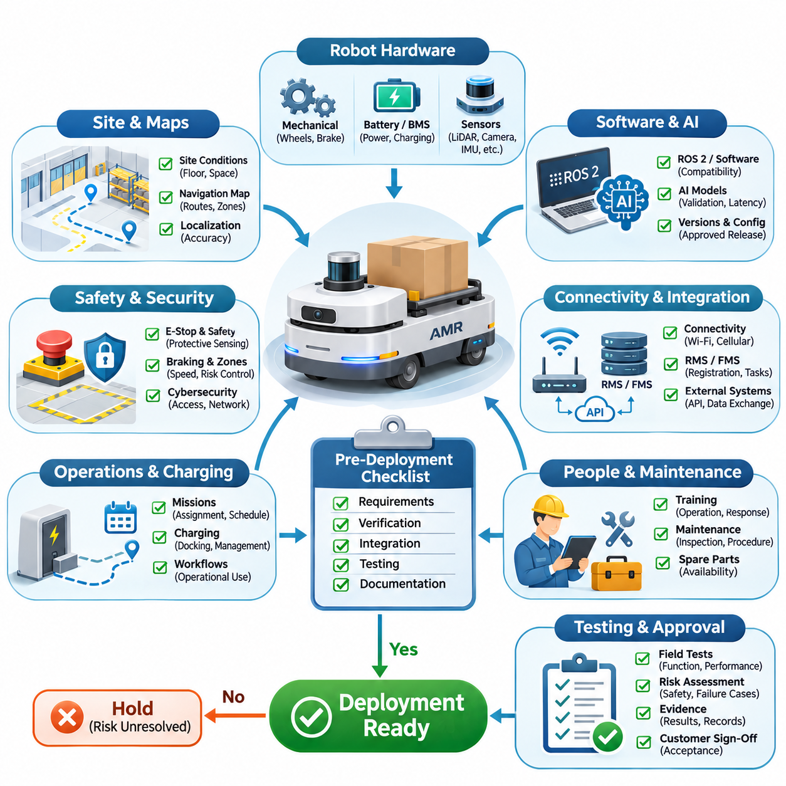
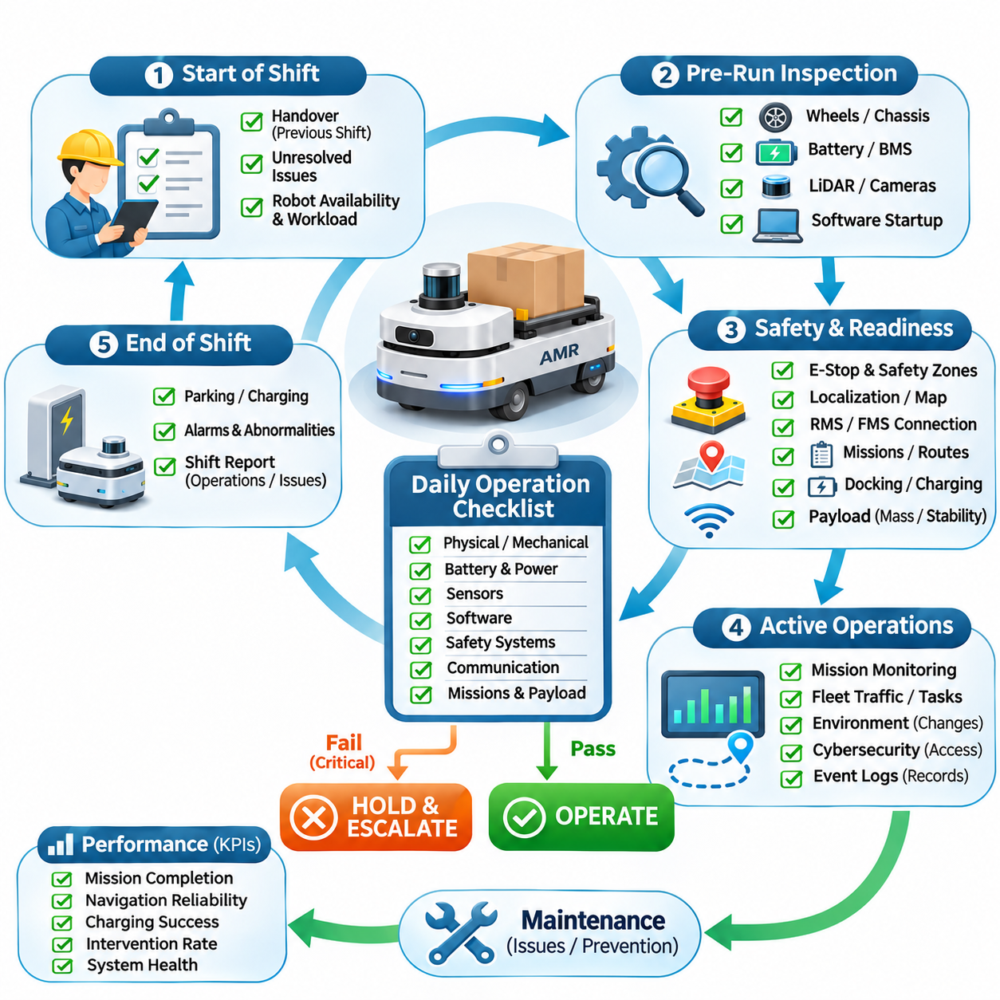
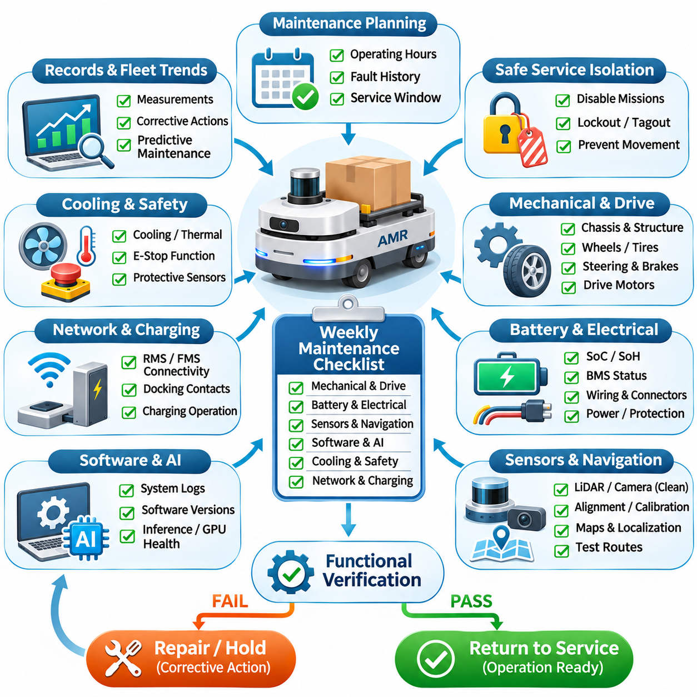
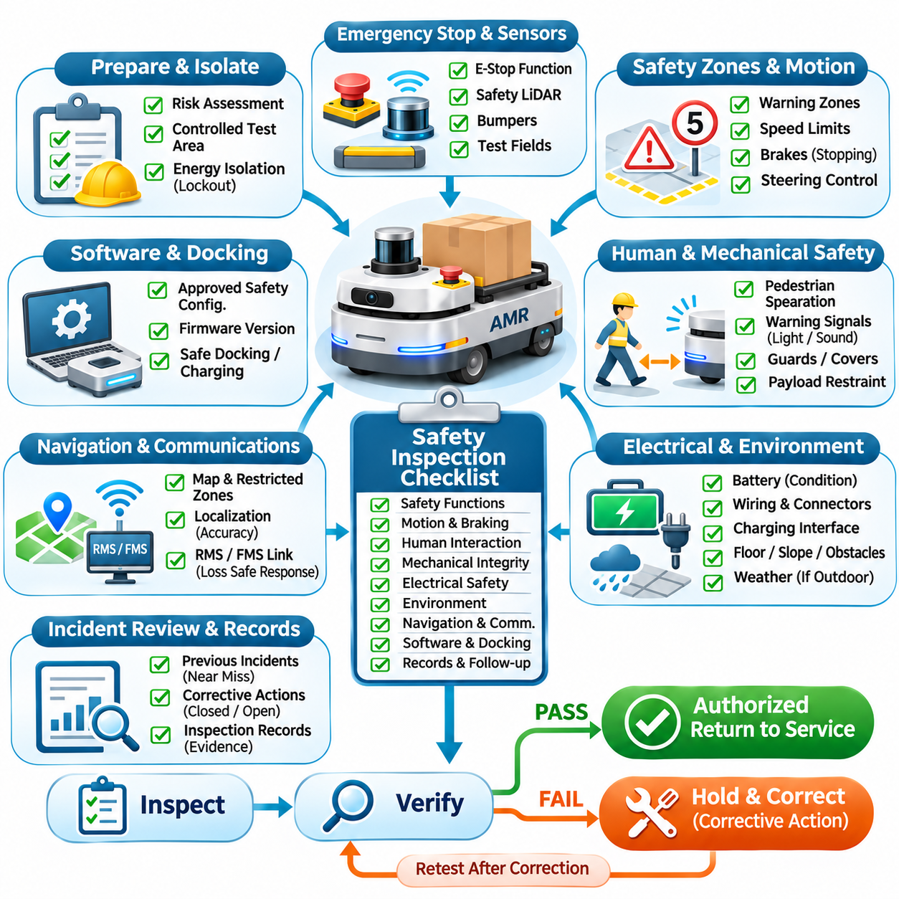
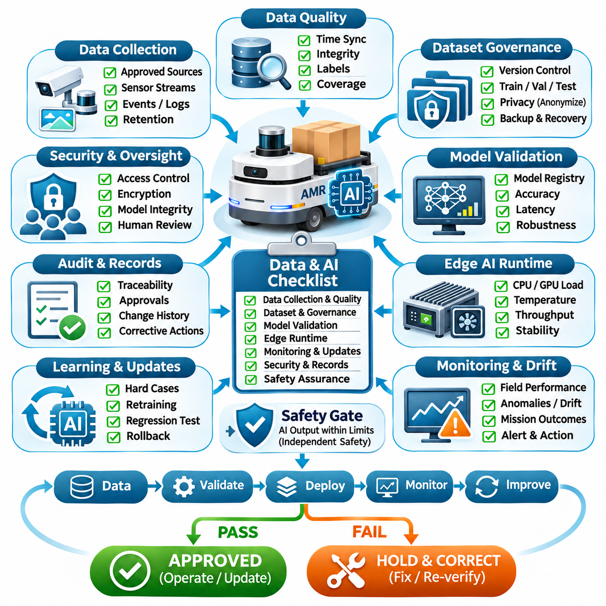
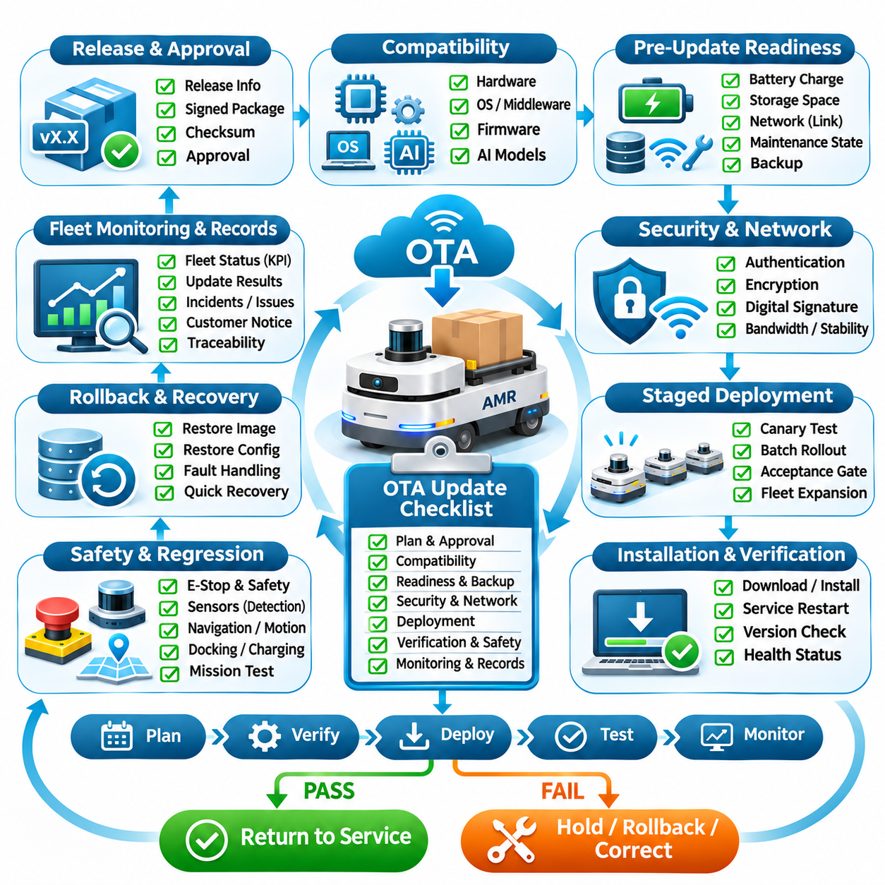
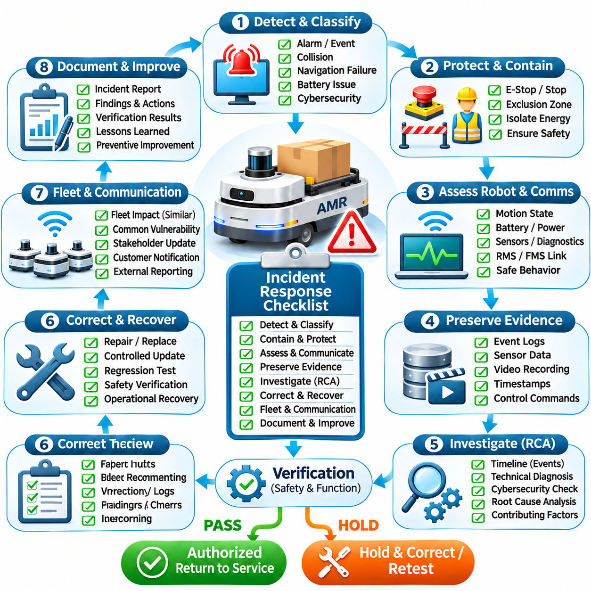
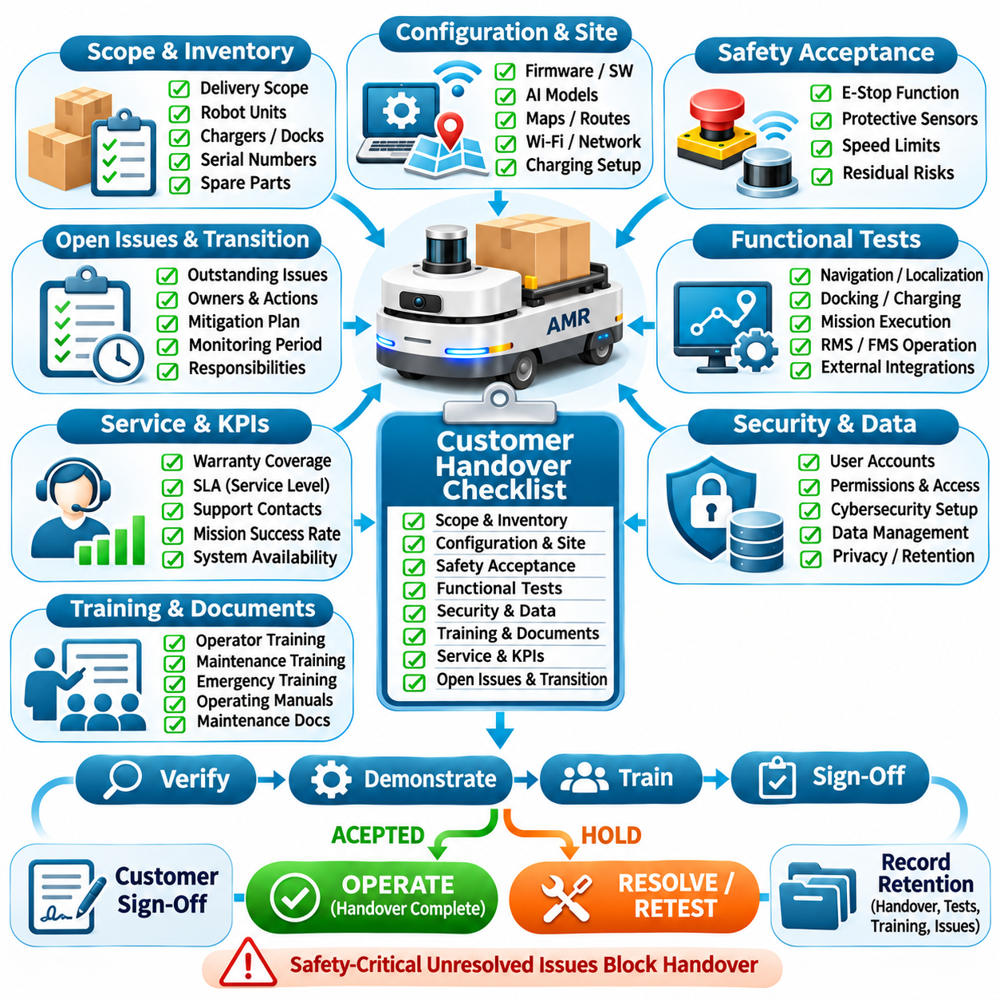

**Volume 08. AMR Operations, Deployment, and MLOps**

# Chapter 22. Operations Checklists

## 22.1 Pre-Deployment Checklist

{width="7.268055555555556in" height="7.268055555555556in"}

Pre-deployment verification is a critical control process that confirms whether an Autonomous Mobile Robot (AMR) system is technically, operationally, and organizationally ready for field installation. The checklist establishes a consistent method for evaluating site conditions, robot hardware, software configurations, safety requirements, communication infrastructure, and operational responsibilities before commissioning activities begin.

The preparation process starts with a comprehensive review of deployment objectives, operational requirements, and customer expectations. Engineering teams verify the intended application, robot quantity, payload characteristics, operating schedules, navigation boundaries, and performance targets. Each requirement must be linked to an acceptance criterion so that deployment readiness can be demonstrated through measurable evidence rather than subjective judgment.

Site readiness assessment determines whether the physical environment can support reliable autonomous operation. Engineers inspect floor conditions, corridor dimensions, turning spaces, slopes, doorways, elevators, loading stations, and pedestrian traffic patterns. Environmental factors such as illumination, reflective surfaces, dust, moisture, temperature, and temporary obstacles must be evaluated against the robot\'s validated operating limits.

The deployment team must confirm that navigation maps accurately represent the current operating environment. Mapping verification includes coordinate consistency, restricted zones, docking locations, charging stations, intersections, and designated emergency access routes. Localization performance should be tested in representative areas, particularly where repetitive structures, dynamic obstacles, or limited sensor visibility may reduce positioning reliability.

Mechanical readiness verification examines the robot chassis, wheels, steering mechanisms, suspension components, brakes, mounting structures, and payload interfaces. Technicians inspect fasteners, structural integrity, wheel alignment, mechanical clearances, and signs of transportation damage. The robot must demonstrate stable movement and acceptable vibration characteristics under representative payload and operating conditions.

Electrical inspection confirms that battery assemblies, power distribution circuits, motor controllers, protective devices, connectors, and wiring harnesses are correctly installed. Battery Management System (BMS) status, insulation condition, grounding, voltage stability, and charging interfaces require verification. Electrical abnormalities must be resolved before enabling autonomous motion or connecting the robot to operational infrastructure.

Sensor readiness includes inspection and calibration of LiDAR, cameras, depth sensors, ultrasonic devices, radar, inertial measurement units, and positioning equipment where installed. Engineers verify mounting orientation, calibration parameters, field of view, communication status, and sensor data quality. Time synchronization between sensing and computing components must also be confirmed to prevent inconsistent perception and localization results.

Software readiness verification establishes that the deployed operating system, middleware, navigation stack, control software, and application services correspond to approved release configurations. Robot Operating System 2 (ROS 2) components, dependencies, containers, and configuration files must be checked for compatibility. Startup behavior, process supervision, resource utilization, and recovery procedures should be tested before deployment approval.

Artificial intelligence readiness requires verification of perception models, inference runtimes, model versions, and hardware compatibility. Engineers confirm that deployed models satisfy established performance criteria under representative environmental conditions. Detection reliability, inference latency, computational resource consumption, and behavior under uncertain predictions must be assessed without assuming that laboratory performance guarantees field reliability.

Functional safety verification is mandatory before autonomous operation. Emergency stop devices, protective sensing functions, safety zones, speed restrictions, braking behavior, and fault-response mechanisms must be tested against the approved risk assessment. Safety-related control functions must remain effective during communication interruptions, software failures, sensor faults, and unexpected environmental changes within the defined safety architecture.

Communication infrastructure readiness covers wireless coverage, network segmentation, bandwidth availability, latency, authentication, and connection recovery. Wi-Fi, cellular, and private network interfaces must be validated according to deployment requirements. Engineers should test communication performance throughout operational routes and confirm that temporary connectivity loss cannot cause uncontrolled robot behavior or compromise essential safety functions.

Robot Management System (RMS) and Fleet Management System (FMS) integration must be verified before coordinated operation begins. The checklist covers robot registration, task assignment, mission scheduling, traffic coordination, charging management, and status reporting. Integration tests should demonstrate that commands, acknowledgments, operational events, and exception notifications are exchanged correctly between robots and supervisory platforms.

External system integration requires confirmation of interfaces with warehouse management, manufacturing execution, enterprise resource planning, building automation, or hospital information systems where applicable. Engineers verify Application Programming Interface (API) compatibility, message formats, access permissions, timeout handling, and transaction consistency. Failure scenarios must be tested to ensure that interrupted external services do not create unsafe or ambiguous robot missions.

Charging infrastructure inspection confirms electrical compatibility, charger positioning, docking alignment, environmental protection, and access clearance. Autonomous charging procedures should be evaluated through repeated docking and undocking operations. Battery charging limits, thermal behavior, communication handshakes, and abnormal charging responses must satisfy manufacturer requirements and the site\'s electrical safety procedures.

Operational workflow verification ensures that robot missions correspond to actual business processes. Teams validate pickup and delivery locations, payload transfer mechanisms, task priorities, waiting zones, and interactions with personnel. Representative scenarios should include normal operation, peak traffic, temporary obstruction, delayed task completion, and manual intervention to identify workflow conflicts before production deployment.

Cybersecurity readiness requires confirmation of device identities, authentication mechanisms, access privileges, encrypted communications, and approved network configurations. Default credentials must be replaced, unnecessary services disabled, and software components reviewed for known vulnerabilities. Remote access and Over-the-Air (OTA) update capabilities must operate through authorized channels with appropriate logging, integrity verification, and recovery controls.

Data management readiness establishes how operational information will be collected, transmitted, stored, protected, and retained. Engineers verify event logging, diagnostic records, telemetry pipelines, timestamp accuracy, and storage capacity. Where cameras or other sensors may capture personal information, deployment procedures must incorporate applicable privacy requirements, access restrictions, retention policies, and customer-approved data handling practices.

Field testing readiness requires documented test scenarios, calibrated measurement equipment, defined acceptance thresholds, and clearly assigned test responsibilities. Navigation accuracy, obstacle avoidance, stopping performance, docking repeatability, mission completion, and operational endurance should be evaluated under representative conditions. Test results must distinguish successful verification from unresolved deviations and conditions requiring further investigation.

Personnel readiness is equally important because reliable deployment depends on trained operators and support teams. The checklist verifies completion of operator instruction, emergency response training, maintenance orientation, and system administration preparation. Personnel must understand operational boundaries, warning indicators, manual recovery procedures, escalation channels, and circumstances requiring immediate suspension of autonomous operation.

Maintenance preparation confirms that inspection procedures, service intervals, replacement components, diagnostic tools, and technical documentation are available before commissioning. Critical spare parts should be identified according to component failure consequences and expected replacement lead times. Service teams must establish responsibilities for preventive maintenance, troubleshooting, software recovery, and technical escalation during initial operations.

Deployment risk assessment consolidates hazards associated with robot movement, human interaction, payload handling, electrical systems, environmental exposure, and infrastructure dependencies. Each significant risk requires documented mitigation measures and verification evidence. Residual risks must be evaluated by authorized personnel, and unresolved safety-critical findings must prevent operational release until appropriate corrective actions are completed.

Documentation readiness confirms the availability of approved configuration records, installation instructions, network diagrams, operating procedures, safety assessments, and test reports. Robot serial numbers, hardware revisions, firmware versions, software releases, and calibration records should be traceable. Configuration baselines provide the reference needed for future maintenance, incident investigation, performance comparison, and controlled system updates.

Final readiness evaluation combines technical verification, operational testing, safety approval, and customer coordination into a formal deployment decision. Each checklist item should identify its acceptance requirement, verification result, responsible person, and supporting evidence. Open issues must be classified according to operational impact, with explicit restrictions and corrective actions documented before any conditional authorization is considered.

The deployment authorization process should involve engineering, field operations, safety representatives, information technology personnel, and customer stakeholders according to their responsibilities. Approval confirms that defined prerequisites have been satisfied and that remaining limitations are understood. A controlled transition into pilot operation should include monitoring arrangements, escalation procedures, and predefined criteria for suspending or expanding deployment.

A standardized pre-deployment checklist transforms deployment preparation from an informal inspection into a repeatable engineering assurance process. By connecting physical readiness, software integrity, functional safety, cybersecurity, operational workflows, and acceptance evidence, organizations can reduce commissioning uncertainty, improve deployment consistency, and establish a reliable foundation for long-term autonomous robot operations.

## 22.2 Daily Operation Checklist

{width="7.268055555555556in" height="7.268055555555556in"}

Daily operation checklists provide a systematic framework for maintaining the safety, reliability, and efficiency of Autonomous Mobile Robot (AMR) systems during routine field activities. Unlike pre-deployment verification, daily inspections focus on detecting operational abnormalities, confirming mission readiness, and preventing minor equipment problems from developing into service interruptions. Consistent execution establishes a dependable operational baseline.

The daily operating cycle begins with a structured handover between responsible personnel. Operators review previous shift reports, unresolved incidents, maintenance notifications, and operational restrictions. Robot availability, scheduled missions, charging status, and expected workload must be confirmed before activation. Any outstanding safety-related issue requires explicit resolution or authorization before the affected robot returns to service.

Physical inspection verifies that the robot remains mechanically suitable for operation. Operators examine wheels, tires, chassis surfaces, protective covers, payload platforms, and visible mounting structures for damage or contamination. Loose components, abnormal wear, fluid leakage, or foreign objects must be reported immediately. Inspection results should distinguish cosmetic defects from conditions that could compromise mobility or operational safety.

Battery and power verification confirms that sufficient energy is available for planned missions. Operators examine State of Charge (SoC), battery warnings, charging history, and Battery Management System (BMS) notifications. Charging connectors and docking contacts should be checked for damage or contamination. Robots displaying abnormal battery temperature, voltage imbalance, or charging faults must be withheld from operation pending technical assessment.

Sensor readiness inspection confirms that perception and localization devices are unobstructed and functioning correctly. LiDAR windows, camera lenses, depth sensors, and other exposed sensing surfaces should be inspected for dust, moisture, scratches, or physical displacement. Diagnostic interfaces must confirm sensor connectivity and valid data streams. Suspected calibration changes or persistent sensor errors require engineering evaluation before autonomous navigation begins.

Software startup verification ensures that essential robot services initialize successfully. Operators confirm the status of navigation, localization, perception, motion control, and diagnostic processes through the approved monitoring interface. Unexpected process restarts, configuration mismatches, or repeated error messages must be investigated. Software versions should remain consistent with the authorized operational configuration and release baseline.

Safety system verification is a mandatory part of daily readiness assessment. Emergency stop accessibility, protective sensor status, safety zone configuration, and warning indicators must be checked using approved procedures. Any functional test must be performed in a controlled area without creating additional hazards. A robot with a failed safety function must remain unavailable until corrective action and authorized verification are completed.

Localization readiness is confirmed by comparing the robot\'s estimated position with its known physical location. Operators examine map selection, localization confidence, coordinate alignment, and navigation readiness indicators. Significant position discrepancies or unexpected map changes must be investigated before mission execution. Areas affected by environmental modifications may require additional localization validation or updated navigation restrictions.

Communication readiness checks verify connectivity between the robot, Robot Management System (RMS), Fleet Management System (FMS), and relevant infrastructure. Operators confirm network registration, telemetry updates, command acknowledgment, and operational status reporting. Persistent communication delays or intermittent disconnections must be documented. Communication failures should trigger the defined safe operating response rather than uncontrolled mission continuation.

Mission readiness verification confirms that task definitions, routes, destinations, and operational priorities remain appropriate for current conditions. Operators review restricted zones, temporary obstacles, loading areas, and scheduled facility activities. Changes affecting pedestrian movement or equipment access must be reflected in operational controls. Missions should not begin when required infrastructure or authorized personnel are unavailable.

Charging and docking readiness includes inspection of charging stations, approach paths, alignment conditions, and electrical interfaces. Operators verify that charging areas remain unobstructed and that the robot can safely enter and leave designated docking positions. Repeated docking failures, abnormal charging interruptions, or unexpected battery behavior must be recorded and escalated according to established maintenance procedures.

Payload handling verification ensures that transported materials remain within approved mass, dimensional, and stability limits. Operators inspect payload restraints, containers, lifting mechanisms, and transfer interfaces where applicable. Loads must not obstruct safety sensors or interfere with mechanical movement. Special handling requirements for medical supplies, industrial materials, or sensitive equipment must be confirmed before transport missions begin.

During active operation, monitoring personnel observe mission execution, navigation behavior, battery consumption, and system health indicators. Unexpected stops, repeated replanning, localization instability, and unusual motor behavior should be investigated using available diagnostic information. Operators must distinguish temporary environmental disturbances from recurring technical faults that require maintenance intervention or operational suspension.

Fleet-level supervision evaluates robot distribution, task queues, traffic congestion, and charging availability throughout the operating period. RMS and FMS dashboards should provide consistent information about active missions, idle robots, delayed tasks, and unavailable units. Supervisors may adjust task priorities or deployment assignments when necessary, provided that changes remain within approved operational and safety constraints.

Operational event logging preserves evidence of system performance and abnormal behavior. Daily records should include robot identification, operating hours, mission completion, charging events, fault notifications, and manual interventions. Significant incidents require timestamps, contextual information, and assigned follow-up actions. Accurate records support troubleshooting, reliability analysis, predictive maintenance, and continuous improvement.

Daily cybersecurity checks focus on unusual authentication activity, unexpected connectivity changes, unauthorized configuration modifications, and security alerts. Operators should confirm that remote access remains restricted to approved personnel and that system updates have not introduced unverified configurations. Suspected security incidents must follow established escalation procedures, with affected systems isolated when required by the incident response plan.

Environmental monitoring ensures that operating conditions remain within validated limits. Indoor facilities require attention to floor contamination, temporary construction, pedestrian congestion, and changing storage arrangements. Outdoor deployments additionally require assessment of weather, visibility, surface traction, drainage, and route accessibility. Environmental conditions exceeding approved operating boundaries must result in appropriate mission restrictions or suspension.

End-of-shift procedures confirm that robots are safely parked, charging where appropriate, and placed in their designated operational states. Operators review unfinished missions, outstanding alarms, maintenance requests, and battery readiness for the next shift. Any unresolved abnormality must be documented with its operational impact and assigned responsibility. Shift handover should preserve continuity without relying on informal verbal communication alone.

Daily checklist completion requires traceable confirmation of inspection results, detected abnormalities, corrective actions, and responsible personnel. Digital records may integrate with maintenance management and fleet monitoring systems to reduce administrative effort. However, automated health indicators cannot replace physical inspections or required safety verification. Missing or failed critical checks must prevent release until the established approval process is satisfied.

Performance review connects daily inspection results with operational Key Performance Indicators (KPIs), including availability, mission success rate, interruption frequency, charging efficiency, and recovery time. Repeated abnormalities should be analyzed across multiple operating periods to identify emerging degradation. These observations provide valuable inputs for preventive maintenance scheduling, software improvement, and operational workflow optimization.

A disciplined daily operation checklist establishes a continuous connection between equipment readiness, human supervision, system monitoring, and operational accountability. By combining physical inspection, safety verification, mission control, event recording, and structured handover, organizations can reduce avoidable downtime and improve fleet reliability. Consistent daily execution supports safe, predictable, and scalable autonomous robot operations.

## 22.3 Weekly Maintenance Checklist

{width="7.268055555555556in" height="7.268055555555556in"}

Weekly maintenance checklists establish a structured preventive maintenance process for Autonomous Mobile Robot (AMR) systems operating in industrial, healthcare, logistics, and outdoor environments. Unlike daily inspections, weekly maintenance emphasizes component degradation, accumulated operational stress, diagnostic trends, and long-term reliability. The objective is to identify developing faults before they affect mission availability or operational safety.

Weekly maintenance planning begins with reviewing robot operating hours, completed missions, fault histories, and previous inspection records. Maintenance personnel identify equipment requiring additional attention based on workload, environmental exposure, and recurring abnormalities. Service activities should be scheduled during approved maintenance windows to minimize operational disruption while ensuring sufficient time for inspection, corrective action, and verification.

Before maintenance begins, technicians must place the robot in a controlled service condition. Autonomous missions should be disabled, unexpected movement prevented, and hazardous energy isolated according to approved procedures. Battery disconnection, mechanical restraint, and lockout or tagout measures may be necessary depending on the task. Maintenance activities must not compromise protective systems or expose personnel to uncontrolled mechanical or electrical hazards.

Mechanical inspection evaluates the condition of the chassis, structural joints, protective covers, mounting brackets, and payload interfaces. Technicians examine fasteners, deformation, corrosion, vibration damage, and signs of mechanical fatigue. Components exposed to repeated impacts or heavy loading require particular attention. Any structural abnormality affecting stability, load retention, or safe movement must be corrected before returning the robot to operation.

Wheel and drivetrain maintenance focuses on tire wear, wheel alignment, bearing condition, gear transmission, and drive motor mounting. Technicians inspect rolling resistance, abnormal noise, looseness, and mechanical backlash where applicable. Tire pressure and tread condition should be checked for pneumatic wheel configurations. Excessive wear or misalignment can increase energy consumption, reduce localization accuracy, and compromise braking or traction performance.

Steering and braking systems require periodic functional inspection because they directly influence motion safety. Technicians evaluate steering response, mechanical linkage integrity, actuator behavior, and braking consistency. Abnormal resistance, delayed response, fluid leakage, or unusual vibration must be investigated. Brake performance should be verified through approved controlled tests, with acceptance limits determined by the robot design and applicable safety requirements.

Battery maintenance includes reviewing State of Charge (SoC), State of Health (SoH), cell voltage consistency, temperature history, and Battery Management System (BMS) warnings. Technicians inspect accessible electrical connections, battery enclosures, and cooling arrangements without opening sealed assemblies unless authorized. Repeated temperature excursions, unexpected capacity loss, or voltage imbalance require further diagnosis before continued operation.

Power distribution inspection examines wiring harnesses, connectors, fuses, protective devices, grounding connections, and DC/DC conversion modules. Technicians look for insulation damage, discoloration, corrosion, loose connections, and evidence of overheating. Electrical measurements must follow approved procedures and equipment ratings. Any abnormal power behavior should be investigated before it develops into intermittent failures or system shutdowns.

Sensor maintenance ensures that perception and localization devices retain their expected performance. LiDAR surfaces, camera lenses, depth sensors, radar covers, and ultrasonic transducers should be cleaned using approved methods. Mounting stability, cable condition, and sensor alignment must be inspected. Calibration verification is necessary when mechanical disturbance, mounting changes, or diagnostic evidence suggests that sensor geometry has shifted.

Localization and navigation verification examines map consistency, positioning stability, route execution, and obstacle avoidance behavior. Technicians review localization errors, repeated path replanning, navigation failures, and environmental changes recorded during the previous week. Representative test routes should be executed under controlled conditions. Persistent deviations may indicate sensor degradation, map inaccuracies, wheel wear, or software configuration problems.

Motor and actuator maintenance evaluates operating temperature, current consumption, vibration, fault counters, and response consistency. Historical telemetry can reveal gradual increases in mechanical resistance or electrical loading. Technicians compare measured behavior against established equipment baselines rather than relying only on immediate fault alarms. Abnormal trends should trigger targeted inspection and maintenance planning before component failure occurs.

Cooling and thermal management inspection verifies that fans, ventilation paths, heat sinks, filters, and temperature sensors remain functional. Dust accumulation and blocked airflow can reduce the performance of embedded computers, motor controllers, and power electronics. Technicians should inspect cooling components without introducing contamination or damaging sensitive equipment. Persistent thermal warnings require investigation of both environmental conditions and internal heat generation.

Software maintenance includes reviewing operating system health, middleware status, application logs, storage utilization, and process stability. Technicians examine repeated crashes, memory consumption, disk errors, and unexpected service restarts. Approved configuration baselines should be compared with deployed versions. Software changes must follow established release management procedures rather than being introduced informally during routine maintenance.

Artificial intelligence system maintenance focuses on inference stability, model integrity, computational resource utilization, and perception performance trends. Engineers review model versions, inference latency, GPU or accelerator temperatures, and recurring detection failures. Field observations should be compared with validated performance baselines. Suspected model degradation must be documented and evaluated through the controlled Model Operations (MLOps) process.

Communication system maintenance verifies network interface health, wireless signal quality, antenna condition, and connection stability. Technicians review packet loss, latency trends, disconnection events, and authentication failures. Robot Management System (RMS) and Fleet Management System (FMS) connectivity should be confirmed after maintenance. Persistent network abnormalities may require coordination with facility information technology personnel.

Charging infrastructure maintenance examines docking alignment, charging contacts, mechanical guides, electrical protection, and charger communication. Technicians inspect contamination, contact wear, cable damage, and abnormal charging interruptions. Repeated docking tests may be performed when maintenance findings justify functional verification. Charging equipment must remain within manufacturer specifications and applicable electrical safety requirements.

Safety system maintenance verifies the condition and operation of emergency stop devices, protective sensors, safety controllers, warning indicators, and speed limitation functions. Tests must follow approved procedures and documented acceptance criteria. Any failed safety-related function requires immediate restriction of robot availability. Safety mechanisms must never be bypassed merely to complete maintenance or restore operational throughput.

Weekly maintenance records should capture inspection findings, measured values, replaced components, diagnostic evidence, and corrective actions. Each record must identify the robot, maintenance date, responsible technician, and remaining restrictions. Significant abnormalities should be linked to incident or maintenance tracking systems. Consistent documentation supports traceability, warranty evaluation, reliability engineering, and future failure analysis.

Fleet maintenance analysis compares recurring defects, component replacement frequency, operational hours, and environmental exposure across multiple robots. Common failure patterns may indicate design weaknesses, inappropriate maintenance intervals, or demanding operating conditions. Maintenance priorities should reflect both failure probability and operational consequences. These findings support predictive maintenance models and improvements to preventive service schedules.

After maintenance, technicians must perform functional verification appropriate to the completed work. This may include controlled movement, braking checks, sensor diagnostics, localization validation, charging tests, and communication confirmation. Maintenance-induced configuration changes must be reviewed before release. The robot should return to service only after required inspections pass and authorized personnel approve its operational readiness.

A disciplined weekly maintenance checklist connects preventive inspection, condition monitoring, corrective maintenance, and operational decision-making. By combining mechanical, electrical, sensing, software, safety, and fleet-level assessments, organizations can reduce unexpected failures and extend equipment service life. Consistent maintenance execution improves robot availability, strengthens safety assurance, and supports reliable long-term autonomous operations.

## 22.4 Safety Inspection Checklist

{width="7.268055555555556in" height="7.268055555555556in"}

Safety inspection checklists establish a systematic verification process for maintaining safe Autonomous Mobile Robot (AMR) operations across industrial, healthcare, logistics, and public environments. Unlike general maintenance inspections, safety inspections concentrate on hazard prevention, protective function integrity, and operational risk control. Their primary objective is to identify unsafe conditions before they result in injury, equipment damage, or operational disruption.

Safety inspection planning begins with reviewing the approved risk assessment, operating conditions, previous incidents, and unresolved safety findings. Inspectors identify critical hazards associated with robot movement, human interaction, payload handling, and environmental exposure. Inspection frequency and scope should reflect operational risk, equipment condition, and applicable requirements. Safety-critical deficiencies must receive priority over routine maintenance activities.

Before inspection activities begin, the robot must be placed in an appropriate controlled state. Autonomous motion should be disabled when physical access or functional testing creates exposure to hazards. Inspectors verify that hazardous energy is isolated where required and that test areas are secured against unauthorized entry. Safety testing must follow approved procedures that prevent unexpected movement or uncontrolled interaction with nearby personnel.

Emergency stop inspection verifies the accessibility, identification, mechanical condition, and functional response of emergency stop devices. Each designated device should be tested according to approved procedures to confirm that the required stopping function operates correctly. Resetting an emergency stop must not automatically initiate hazardous motion. Failed devices require immediate operational restriction until corrective action and verification are completed.

Protective sensing inspection evaluates safety-rated LiDAR, protective scanners, bumpers, and other installed safeguarding devices. Inspectors confirm that detection zones remain unobstructed and correspond to approved safety configurations. Contamination, physical displacement, wiring damage, or diagnostic faults may reduce protective effectiveness. Safety-related sensing functions must be validated using specified test objects and documented acceptance criteria.

Safety zone verification confirms that protective fields, warning zones, and speed restrictions remain appropriate for operating conditions. Inspectors examine intersections, pedestrian crossings, narrow corridors, loading areas, and shared traffic routes. Changes in facility layout or robot behavior may require reassessment of safety boundaries. Any modification to safety parameters must follow controlled configuration management and authorized validation.

Braking system inspection verifies that service braking, protective stopping, and parking functions perform as required by the robot design. Inspectors examine braking response, stopping consistency, mechanical condition, and diagnostic indicators. Controlled stopping tests should consider representative speeds, payloads, and surface conditions. Any braking deficiency affecting required stopping performance must prevent continued autonomous operation.

Motion control safety inspection evaluates speed limitation, acceleration control, steering response, and fault handling. Inspectors verify that commanded motion remains within approved operational limits and that abnormal control behavior produces the defined safe response. Unexpected acceleration, unstable steering, or persistent control errors require investigation. Safety-related motion restrictions must remain effective independently of non-safety application commands where required.

Human-robot interaction safety inspection focuses on pedestrian detection, predictable robot behavior, warning signals, and safe separation. Inspectors evaluate robot movement near workers, patients, visitors, and other vulnerable users where applicable. Audible and visual indicators must remain functional and understandable. Operational procedures should prevent personnel from entering hazardous areas during docking, payload transfer, or automated equipment interaction.

Mechanical safety inspection examines structural integrity, exposed moving parts, protective covers, payload restraints, and potential trapping or crushing points. Inspectors identify loose components, sharp edges, damaged guards, and unstable loads. Payload mechanisms must remain secure during acceleration, turning, and stopping. Any condition that creates unacceptable mechanical hazards requires correction before the robot returns to service.

Electrical safety inspection covers battery enclosures, accessible wiring, connectors, protective devices, grounding, and charging interfaces. Inspectors look for damaged insulation, overheating, corrosion, and unauthorized modifications. Electrical testing must use appropriate equipment and approved isolation procedures. Suspected battery faults, exposed conductors, or damaged charging equipment require immediate restriction and qualified technical assessment.

Environmental safety inspection determines whether operating conditions remain within validated limits. Indoor facilities require evaluation of floor contamination, slopes, temporary obstacles, lighting changes, and pedestrian congestion. Outdoor environments additionally require assessment of precipitation, visibility, traction, drainage, and surface deterioration. Conditions exceeding approved operating boundaries must trigger appropriate speed restrictions, route changes, or suspension.

Localization and navigation safety inspection verifies that positioning errors cannot produce unacceptable operational hazards. Inspectors review map accuracy, restricted zones, localization confidence, and navigation behavior near sensitive areas. Unexpected route deviations or repeated localization failures require investigation. Safety-critical restrictions must not depend solely on unvalidated positioning estimates or non-safety navigation software.

Communication failure safety inspection confirms that network interruptions produce predictable and controlled robot behavior. Inspectors evaluate loss of connectivity with Robot Management Systems (RMS), Fleet Management Systems (FMS), and remote supervision platforms. Communication-dependent functions must have defined timeout and recovery behavior. Essential protective functions must remain effective when external communication becomes unavailable.

Software and configuration safety inspection verifies that approved safety parameters, firmware versions, and control configurations remain unchanged. Inspectors compare deployed settings with authorized baselines and examine modification records. Unauthorized updates or configuration mismatches must be investigated before operation continues. Safety-related software changes require documented verification and approval through the established change management process.

Charging and docking safety inspection evaluates approach speed, alignment behavior, electrical contact protection, and personnel access. Inspectors confirm that docking areas remain free from obstructions and that charging equipment operates within specified limits. Unexpected motion during docking or abnormal charging conditions must trigger the appropriate protective response. Repeated failures require corrective maintenance and controlled retesting.

Safety event and incident review examines emergency stops, protective sensor activations, near misses, collisions, and manual interventions recorded during operation. Inspectors identify recurring patterns, unresolved corrective actions, and changes in risk exposure. Significant events require investigation of contributing technical and organizational factors. Inspection findings should be linked to incident management and continuous safety improvement processes.

Inspection documentation must record the robot identification, inspection date, tested safety functions, measured results, detected deficiencies, and responsible personnel. Each finding should be classified according to its potential safety impact and required corrective action. Failed critical checks must prevent operational release. Traceable records support regulatory compliance, safety audits, incident investigation, and long-term risk management.

After corrective maintenance, affected safety functions must undergo appropriate verification before operational release. Inspectors confirm that repairs restore the intended protective behavior without introducing new hazards. Regression testing may be required when software, sensors, braking components, or safety configurations have changed. Authorized personnel must approve the return to service based on documented acceptance evidence.

A disciplined safety inspection checklist connects hazard identification, protective system verification, corrective action, and operational authorization. By integrating mechanical, electrical, sensing, software, environmental, and human interaction assessments, organizations can maintain effective safety controls throughout the robot lifecycle. Consistent inspection practices strengthen operational confidence and support safe, reliable, and scalable autonomous robot deployment.

## 22.5 Data and AI Checklist

{width="7.268055555555556in" height="7.268055555555556in"}

The Data and AI Checklist establishes a systematic verification framework for managing operational data and artificial intelligence within Autonomous Mobile Robot (AMR) systems. It connects field data collection, data quality assurance, model validation, deployment monitoring, and governance. Its primary objective is to ensure that information remains trustworthy and AI functions operate consistently within approved performance and safety boundaries.

Data management verification begins with reviewing collection policies, operational requirements, and authorized data sources. Engineers confirm which sensor streams, system events, mission records, and diagnostic measurements are required. Collection frequency and retention settings must reflect operational needs and privacy obligations. Unnecessary acquisition should be avoided to reduce storage demand, processing overhead, and security exposure.

Sensor data inspection verifies that LiDAR, cameras, depth sensors, inertial measurement units, and positioning devices produce valid information. Engineers examine timestamps, sampling rates, synchronization accuracy, missing frames, and measurement consistency. Sensor failures or calibration changes can introduce misleading training examples. Abnormal streams must be identified and excluded from downstream processing until their reliability is established.

Data integrity verification ensures that recorded information remains complete, consistent, and traceable throughout the operational pipeline. Checks include file integrity, message ordering, schema compatibility, and transmission errors. Each dataset should preserve essential metadata describing robot identity, sensor configuration, collection conditions, and software versions. Corrupted or incomplete records require quarantine and documented handling.

Time synchronization inspection confirms that sensor measurements, control commands, and operational events share a consistent temporal reference. Engineers evaluate clock drift, synchronization failures, timestamp discontinuities, and network timing conditions. Accurate timing is essential for sensor fusion, trajectory reconstruction, and incident analysis. Unresolved synchronization errors must be flagged before affected data is used for model development.

Data quality assessment examines completeness, accuracy, relevance, and diversity across collected operational records. Engineers identify duplicate samples, corrupted images, invalid measurements, and inconsistent annotations. Dataset coverage should include representative environments, lighting conditions, obstacles, and operating modes. Quality thresholds must be documented so unsuitable information cannot silently enter training or evaluation datasets.

Data labeling verification evaluates annotation accuracy, category definitions, labeling consistency, and reviewer agreement. Engineers inspect representative samples and prioritize difficult cases involving occlusion, unusual objects, or ambiguous events. Labeling guidelines should remain aligned with model objectives and operational terminology. Significant annotation errors require correction before the affected dataset is approved for training.

Dataset version control ensures that training, validation, and testing resources remain reproducible. Each approved dataset should have a unique identifier, documented composition, preprocessing configuration, and modification history. Engineers verify that dataset partitions remain appropriately separated and that evaluation data has not leaked into training. Version changes must be traceable to their source records and approval decisions.

Data privacy inspection confirms that collection, storage, and processing follow applicable privacy requirements and organizational policies. Personal information, identifiable images, and sensitive facility records require appropriate handling controls. Engineers verify access permissions, encryption, retention limits, and approved anonymization procedures. Data sharing with external parties must remain restricted to authorized purposes and documented agreements.

Data storage and transfer verification examines capacity, availability, backup status, and transmission reliability. Engineers review edge storage utilization, upload failures, checksum validation, and archival completion. Interrupted transfers should support controlled recovery without creating inconsistent copies. Backup and restoration procedures must be periodically tested to ensure operational evidence and approved datasets remain recoverable.

AI model inventory inspection confirms that every deployed model has an approved identity, version, configuration, and ownership record. Engineers compare active model packages against the authorized model registry. Model dependencies, preprocessing steps, and supported hardware platforms must be documented. Unregistered or incompatible models should not enter operational service, particularly when their outputs influence robot movement or task execution.

Model performance verification evaluates perception accuracy, inference latency, robustness, and resource consumption against established benchmarks. Engineers examine detection failures, false positives, false negatives, and performance variation across operating environments. Evaluation should include representative difficult scenarios and known failure cases. Models that fail mandatory acceptance criteria must remain unavailable for production deployment.

Edge AI runtime inspection confirms that deployed models operate reliably on designated computing hardware. Engineers monitor processor utilization, GPU memory, accelerator temperature, inference throughput, and application stability. Resource contention may increase latency or disrupt navigation services. Sustained performance must be assessed under representative concurrent workloads rather than isolated benchmark conditions.

Model drift monitoring identifies changes in operational data distributions and AI performance after deployment. Engineers compare recent field observations with validated reference datasets and historical metrics. Changes in lighting, environmental layout, sensor characteristics, or task composition may reduce prediction reliability. Significant drift requires investigation and controlled mitigation rather than automatic acceptance of degraded performance.

Continuous learning verification ensures that field observations enter model improvement pipelines through approved procedures. Hard cases, operator interventions, and recurring perception failures should be prioritized for analysis. Data selection, labeling, retraining, and validation must remain traceable. Updated models must demonstrate acceptable performance on both new scenarios and established regression tests before release.

Human oversight inspection confirms that qualified personnel can review uncertain AI outputs, intervene in abnormal operations, and approve consequential changes. Confidence thresholds and escalation rules should reflect task risk. AI recommendations must not override independent safety functions or authorized operational restrictions. Human review decisions should be recorded to support accountability and subsequent model improvement.

AI update readiness verification examines model compatibility, package integrity, deployment approval, and rollback availability. Engineers confirm that updated models remain compatible with sensors, runtime libraries, and robot control interfaces. Controlled testing should precede fleet-wide distribution. Any regression affecting safety, navigation reliability, or mission performance must block deployment until corrective action is completed.

Cybersecurity inspection covers dataset access, model artifact protection, authentication, audit logging, and secure communication. Engineers verify that unauthorized users cannot alter training data, model parameters, or deployment configurations. Model packages should be authenticated and integrity-checked before activation. Suspected tampering or unexplained configuration changes require immediate investigation under established security procedures.

Operational AI monitoring connects model behavior with mission outcomes, intervention frequency, navigation failures, and service availability. Engineers correlate inference anomalies with environmental conditions and robot health indicators. Fleet-level comparisons help identify common defects and platform-specific problems. Performance dashboards should distinguish genuine model degradation from sensor faults, communication interruptions, and infrastructure limitations.

Checklist documentation must record dataset identifiers, model versions, validation results, detected anomalies, corrective actions, and responsible personnel. Failed critical checks require explicit operational restrictions and authorized resolution. Audit records should preserve the evidence supporting deployment decisions. Consistent documentation strengthens reproducibility, compliance, incident investigation, and long-term AI governance.

A disciplined Data and AI Checklist integrates trustworthy information management with controlled artificial intelligence operations. By combining data integrity, privacy protection, model validation, edge monitoring, continuous learning, and deployment governance, organizations can reduce technical uncertainty and prevent uncontrolled model degradation. Consistent verification supports reliable, secure, and scalable AI-enabled autonomous robot operations.

## 22.6 OTA Update Checklist

{width="7.268055555555556in" height="7.268055555555556in"}

The Over-the-Air (OTA) Update Checklist establishes a controlled process for distributing software, firmware, and AI model updates to Autonomous Mobile Robot (AMR) systems. It connects release approval, compatibility verification, cybersecurity protection, deployment execution, and operational validation. Its primary objective is to improve robot capabilities without compromising safety, service availability, configuration integrity, or fleet reliability.

OTA update planning begins with identifying the affected robot models, installed software versions, hardware configurations, and operational dependencies. Engineers review release objectives, known defects, security fixes, and expected behavioral changes. Update schedules should consider mission commitments, maintenance windows, and customer requirements. Safety-critical changes require additional verification and explicit authorization before deployment.

Release package inspection verifies that update artifacts originate from approved build pipelines and match authorized release records. Engineers examine package identifiers, version numbers, cryptographic signatures, checksums, and dependency manifests. Software binaries, firmware images, configuration files, and AI models must remain traceable. Packages with invalid signatures, incomplete metadata, or unexplained modifications must be rejected.

Compatibility verification confirms that each update supports the target robot hardware, operating system, middleware, and installed applications. Engineers evaluate processor architecture, sensor drivers, communication protocols, and control interfaces. Firmware compatibility with motor controllers, battery systems, and safety devices requires particular attention. Unsupported combinations must be excluded from deployment until validated.

Pre-update health inspection evaluates battery charge, storage capacity, network connectivity, thermal conditions, and active fault states. Robots should have sufficient energy to complete installation and recovery without interruption. Engineers verify available disk space and the integrity of critical storage partitions. Robots experiencing unresolved hardware faults or unstable operating conditions should not receive routine updates.

Operational readiness verification confirms that robots are placed in an approved maintenance state before installation begins. Active missions must be completed, suspended, or reassigned according to established procedures. Movement commands should be disabled where required, and hazardous interactions prevented. Update execution must not interfere with emergency response, essential services, or safety-related operational commitments.

Backup verification ensures that essential configurations, operational records, and recovery information remain available before deployment. Engineers preserve approved software baselines, calibration parameters, maps, and relevant system settings. Backup integrity should be checked rather than assumed. Recovery procedures must identify which components can be restored and which require separate reconfiguration or physical servicing.

Cybersecurity verification confirms that update distribution uses authenticated devices, encrypted communication, and authorized deployment services. Engineers validate certificate status, access permissions, signing keys, and package integrity. Secure boot and trusted execution mechanisms should be checked where supported. Unauthorized update requests, suspicious network behavior, or authentication failures must prevent installation.

Network readiness inspection evaluates available bandwidth, latency, packet loss, and connection stability across deployment locations. Engineers determine whether update packages can be transferred without disrupting operational communications. Interrupted downloads should support authenticated resumption and integrity verification. Bandwidth scheduling and local caching may reduce congestion when large robot fleets receive simultaneous updates.

Deployment strategy verification determines whether updates should use staged rollout, canary deployment, or controlled fleet batches. Initial deployment should target representative robots with sufficient monitoring coverage. Engineers define acceptance thresholds, observation periods, and escalation conditions before expansion. Fleet-wide installation must remain conditional on successful results from earlier deployment stages.

AI model update inspection verifies model identifiers, preprocessing requirements, runtime compatibility, and expected inference performance. Engineers confirm that new models have passed approved validation and regression testing. Changes affecting perception, navigation, or manipulation require representative operational scenarios. Updated AI components must not bypass independent safety controls or introduce unapproved autonomous behavior.

Safety-related update verification examines potential changes to motion control, braking interfaces, protective sensing, and emergency stop behavior. Engineers determine whether the update affects validated safety functions or configuration parameters. Applicable safety assessments and regression tests must be completed before release. Any unresolved safety impact requires deployment suspension until authorized technical review is completed.

Installation monitoring tracks download completion, package verification, installation progress, service restarts, and device responses. Engineers review update logs and error codes to identify unexpected behavior. Power interruption, storage failure, or package corruption must trigger defined recovery procedures. Installation status should be reported accurately to the Robot Management System (RMS) or Fleet Management System (FMS).

Post-installation verification confirms that the intended software and firmware versions are active and that required services initialize correctly. Engineers examine process health, device communication, sensor availability, and configuration consistency. Update completion messages alone are insufficient evidence of success. Functional checks must confirm that the robot operates within its approved system configuration.

Operational regression testing evaluates navigation, localization, obstacle detection, docking, charging, mission execution, and remote communication. Test scope should reflect the components changed by the update. Engineers compare measured behavior with established acceptance criteria and previous performance baselines. Unexpected deviations require investigation before the robot is returned to unrestricted operation.

Rollback readiness verification ensures that a validated recovery path exists for unsuccessful installations or unacceptable performance changes. Engineers confirm recovery image availability, compatible configuration backups, and authorized rollback procedures. Some firmware or database migrations may not support automatic reversal. Such limitations must be documented and addressed through alternative recovery plans before deployment.

Failure response procedures define how robots are isolated, diagnosed, recovered, and returned to service after unsuccessful updates. Engineers distinguish communication failures, installation errors, compatibility problems, and functional regressions. Repeated installation attempts must not proceed without understanding the failure condition. Safety-critical faults require immediate operational restriction and escalation to responsible personnel.

Fleet monitoring after deployment evaluates error rates, mission completion, resource utilization, connectivity, and recurring incidents. Engineers compare updated robots with baseline populations to detect unexpected regressions. Monitoring should continue through a defined observation period under representative workloads. Significant adverse trends must trigger rollout suspension, investigation, or controlled rollback.

Customer communication verification ensures that affected operators and administrators receive appropriate release information, maintenance schedules, and operational instructions. Changes to interfaces, workflows, or robot behavior should be explained before activation. Customer acceptance may be required for significant functional changes. Communication records should identify affected sites, approved schedules, and unresolved concerns.

Update documentation must capture package identifiers, target robots, approval records, installation timestamps, verification results, and recovery actions. Engineers record deployment failures, configuration changes, and final operational status. Each update should remain traceable from release authorization through fleet acceptance. Consistent records support compliance, incident investigation, cybersecurity audits, and future maintenance planning.

A disciplined OTA Update Checklist connects software delivery with operational safety, cybersecurity, and fleet governance. By integrating release validation, compatibility checks, controlled deployment, regression testing, rollback preparation, and post-update monitoring, organizations can reduce update-related failures. Consistent execution enables secure, reliable, and scalable evolution of autonomous robot systems throughout their operational lifecycle.

## 22.7 Incident Response Checklist

{width="7.268055555555556in" height="7.268055555555556in"}

The Incident Response Checklist establishes a structured process for identifying, containing, investigating, and resolving operational incidents involving Autonomous Mobile Robot (AMR) systems. It connects personnel safety, technical recovery, communication, and corrective action. Its primary objective is to minimize harm, prevent incident escalation, restore controlled operations, and preserve reliable evidence for subsequent investigation and improvement.

Incident readiness begins with reviewing approved emergency procedures, operational responsibilities, communication channels, and escalation requirements. Operators must understand how to recognize abnormal robot behavior and initiate appropriate protective actions. Emergency contacts, response equipment, and site-specific instructions should remain accessible. Response procedures must reflect the operating environment, robot capabilities, and potential exposure of nearby personnel.

Incident detection verification confirms that alarms, diagnostic events, operator observations, and remote monitoring systems can identify abnormal conditions promptly. Relevant events include collisions, unexpected movement, navigation failures, communication loss, and battery abnormalities. Engineers verify alert classification and notification delivery. Critical incidents must trigger immediate protective action rather than waiting for routine maintenance review.

Initial response procedures prioritize human safety and prevention of additional hazards. Operators should stop affected robots using approved controls and activate emergency stopping functions when necessary. Personnel must remain outside hazardous areas until movement and other risks are controlled. Where injuries, fire, or serious electrical hazards are suspected, authorized emergency responders must be contacted according to established site procedures.

Incident classification determines the severity, operational impact, and required escalation level. Events may involve personnel injury, equipment damage, mission interruption, cybersecurity compromise, or environmental hazards. Classification should consider actual consequences and credible potential outcomes. High-severity incidents require immediate management notification and may require external reporting under applicable requirements.

Scene isolation verification ensures that affected robots, charging stations, and surrounding equipment remain in a controlled condition. Operators establish appropriate exclusion zones and prevent unauthorized access. Hazardous energy must be isolated when required by approved procedures and qualified personnel. Incident containment should avoid introducing additional risks through uncontrolled movement, electrical exposure, or unsafe equipment handling.

Robot status assessment examines motion state, emergency stop activation, battery condition, controller diagnostics, and sensor availability. Engineers identify whether the robot is stationary, disabled, or capable of unexpected movement. Remote status information should be verified against physical conditions when safe and practical. Uncertain equipment states require conservative restrictions until technical assessment establishes acceptable conditions.

Communication failure response verifies that robots enter their defined safe behavior when connectivity with Robot Management Systems (RMS) or Fleet Management Systems (FMS) is lost. Engineers examine network status, command delivery, and timeout behavior. Remote commands must not be assumed effective without confirmation. Recovery actions should follow approved procedures that prevent unintended movement after communication restoration.

Evidence preservation begins immediately after the incident is contained. Engineers secure event logs, sensor recordings, system timestamps, control commands, and relevant video evidence. Data collection must preserve original records and maintain traceable copies. Automatic log rotation or subsequent testing may overwrite important information. Evidence handling must also comply with applicable privacy and security requirements.

Incident timeline reconstruction combines robot telemetry, operator reports, mission records, and environmental observations. Investigators identify the sequence of events before, during, and after the abnormal condition. Timestamp consistency and synchronization accuracy must be checked before correlating records. Uncertain observations should remain distinguishable from verified facts to prevent unsupported conclusions.

Technical diagnosis evaluates hardware faults, software exceptions, sensor failures, localization errors, and communication disruptions. Engineers compare diagnostic results with known failure patterns and approved system baselines. Investigation should distinguish the initiating fault from secondary symptoms. Repeated restart attempts or uncontrolled experiments must be avoided when they could destroy evidence or recreate hazardous conditions.

Cybersecurity incident assessment determines whether abnormal robot behavior may involve unauthorized access, malicious commands, compromised software, or manipulated data. Security personnel examine authentication records, network activity, and configuration changes. Suspected compromises require controlled isolation and evidence preservation. Restoring connectivity or software services must not occur before relevant security risks are evaluated.

Root cause analysis examines technical, environmental, procedural, and organizational factors contributing to the incident. Investigators evaluate component failures, operational conditions, configuration changes, maintenance history, and human interaction. Methods such as fault tree analysis or structured causal investigation may support consistent findings. Corrective actions must address verified causes rather than merely suppressing visible symptoms.

Corrective action planning defines required repairs, software changes, configuration corrections, and operational restrictions. Each action should have an assigned owner, priority, completion target, and verification requirement. Temporary mitigations must be documented with their limitations. Changes affecting safety-related functions require appropriate technical review and authorization before implementation.

Recovery verification confirms that affected systems satisfy approved safety and functional requirements before returning to service. Engineers test relevant sensors, braking functions, navigation behavior, communication interfaces, and mission execution. Regression testing should reflect the identified failure mechanism. Successful component replacement alone does not establish operational readiness without documented functional verification.

Fleet impact assessment determines whether similar robots, software versions, or deployment sites may share the same vulnerability. Engineers compare configuration inventories, event histories, and operational conditions across the fleet. Common defects may require broader inspection, temporary restrictions, or controlled updates. Corrective actions should prevent recurrence beyond the individual robot involved in the original incident.

Stakeholder communication ensures that operators, maintenance teams, customers, and responsible management receive accurate incident information. Reports should distinguish confirmed facts, ongoing investigation, operational impact, and expected recovery activities. External notification obligations must be evaluated according to applicable requirements. Communication should remain coordinated to avoid conflicting instructions or premature conclusions.

Incident documentation records the event identifier, affected equipment, location, detection time, severity, immediate response, collected evidence, and responsible personnel. Investigation findings, corrective actions, verification results, and approval decisions must remain traceable. Significant changes to incident classification should be documented. Complete records support audits, insurance reviews, regulatory reporting, and organizational learning.

Post-incident review evaluates response effectiveness, detection delays, escalation accuracy, recovery duration, and communication quality. Teams identify procedural weaknesses and opportunities to improve monitoring, training, and preventive maintenance. Lessons learned should inform risk assessments and future operational checklists. Repeated incidents require examination of systemic weaknesses rather than isolated corrective measures.

A disciplined Incident Response Checklist connects immediate hazard control with technical investigation, recovery authorization, and continuous improvement. By integrating personnel protection, evidence management, root cause analysis, corrective action, and fleet-wide learning, organizations can reduce recurring failures and strengthen operational resilience. Consistent incident management supports safe, accountable, and reliable autonomous robot deployment.

## 22.8 Customer Handover Checklist

{width="7.268055555555556in" height="7.268055555555556in"}

The Customer Handover Checklist establishes a structured process for transferring Autonomous Mobile Robot (AMR) systems from deployment teams to customer operations. It connects technical acceptance, safety verification, documentation, training, and service responsibility. Its primary objective is to ensure that customers can operate, monitor, maintain, and manage deployed robots reliably within agreed operational and contractual boundaries.

Handover preparation begins with reviewing project scope, delivery commitments, acceptance criteria, and contractual requirements. Deployment engineers confirm the number of robots, installed options, supported workflows, and agreed service capabilities. Outstanding issues must be identified before the handover meeting. Any deviation from the approved delivery scope requires documented customer acknowledgment and an agreed resolution plan.

Equipment inventory verification confirms that delivered robots, charging stations, accessories, and spare parts match the approved delivery records. Engineers inspect serial numbers, hardware revisions, installed sensors, battery specifications, and computing modules. Physical damage or missing components must be recorded. The final inventory should establish clear ownership and provide a reliable reference for maintenance and future expansion.

System configuration inspection verifies that each robot operates with approved software, firmware, AI models, and parameter settings. Engineers document version identifiers, network configurations, navigation maps, safety zones, and operational limits. Configuration backups should be preserved in authorized storage. Unapproved modifications or inconsistent settings must be resolved before final operational acceptance.

Site readiness verification confirms that deployment environments support the intended robot operations. Engineers inspect travel routes, floor conditions, charging locations, wireless coverage, access restrictions, and pedestrian interaction areas. Environmental hazards and infrastructure dependencies must be documented. Customer representatives should understand which site modifications or operating restrictions remain necessary for safe deployment.

Safety acceptance verification confirms that emergency stopping, protective sensing, obstacle avoidance, speed restrictions, and recovery procedures function as approved. Engineers demonstrate relevant safety responses under controlled conditions. Customer personnel must understand residual risks and required protective measures. Any unresolved safety-critical deficiency must prevent unrestricted operational handover until formally corrected.

Functional acceptance testing demonstrates that robots can perform agreed missions under representative operating conditions. Engineers verify navigation, localization, docking, charging, task scheduling, and recovery from expected interruptions. Results should be compared with approved acceptance criteria. Failed tests require corrective action, documented retesting, or an explicitly authorized limitation before acceptance.

Fleet management verification confirms that Robot Management Systems (RMS) and Fleet Management Systems (FMS) provide the required operational functions. Engineers demonstrate task assignment, traffic coordination, robot status monitoring, alert handling, and operational reporting. User permissions and dashboard access must be checked. Customers should be able to identify abnormal conditions and understand when escalation is required.

External system integration verification examines connections with elevators, automatic doors, warehouse systems, manufacturing platforms, and other approved infrastructure. Engineers validate interface behavior, communication recovery, and operational dependencies. Integration boundaries must be documented clearly. Failures involving third-party equipment require agreed responsibilities and established coordination procedures.

Cybersecurity handover verification confirms that customer accounts, authentication methods, network permissions, and remote access policies are properly configured. Default credentials must be replaced or disabled according to approved security procedures. Engineers explain access management, security logging, and update authorization. Responsibility for certificates, credentials, and security incident reporting must be explicitly assigned.

Data governance verification establishes how operational logs, sensor recordings, mission histories, and AI-related information will be collected and managed. Engineers explain storage locations, retention policies, access restrictions, and privacy controls. Data ownership and permitted sharing arrangements must follow applicable agreements. Customers should understand how operational evidence supports diagnostics, compliance, and continuous improvement.

Operator training verification confirms that designated customer personnel can start, stop, supervise, and recover robots during normal operations. Training should cover mission execution, dashboard interpretation, charging procedures, and common error conditions. Practical demonstrations are essential for verifying competence. Training completion records should identify participants, covered topics, and any additional instruction required.

Maintenance training verification ensures that responsible personnel understand routine inspections, cleaning, battery care, consumable replacement, and preventive maintenance schedules. Engineers explain inspection intervals, maintenance records, and authorized service boundaries. Activities requiring qualified technicians must be distinguished from routine operator tasks. Customers should receive clear instructions for reporting defects and requesting service.

Emergency response training confirms that customer personnel understand collision response, unexpected movement, communication loss, battery abnormalities, and emergency stop procedures. Engineers demonstrate safe isolation and escalation practices. Recovery actions must follow approved instructions rather than informal troubleshooting. Emergency contacts and incident reporting channels should remain accessible at all operating locations.

Documentation delivery verification confirms that customers receive operating manuals, maintenance instructions, safety information, configuration records, and relevant technical specifications. Documents should reflect the delivered system rather than obsolete reference configurations. Revision identifiers and controlled distribution methods must be established. Missing or inaccurate documentation should be corrected before handover completion.

Service agreement verification establishes warranty coverage, maintenance responsibilities, response expectations, and support availability. Engineers and customer representatives review service level agreements, escalation contacts, spare parts arrangements, and remote assistance procedures. Exclusions and customer obligations should be explained clearly. Operational responsibility must not be transferred without agreement on ongoing support arrangements.

Performance baseline verification records the operating conditions and measured results achieved during acceptance testing. Relevant indicators include mission completion rate, navigation reliability, docking success, service availability, and intervention frequency. Engineers explain measurement methods and reporting intervals. Baseline records provide a reference for identifying degradation and evaluating future optimization.

Open issue management verifies that unresolved defects, improvement requests, and operational limitations are documented with assigned owners and completion targets. Each issue should include severity, temporary mitigation, and verification requirements. Safety-critical issues require explicit restrictions and authorized resolution. Customer acceptance must not be interpreted as approval to ignore unresolved contractual or safety obligations.

Operational transition planning defines the responsibilities of deployment engineers, customer operators, maintenance personnel, and remote support teams. Engineers establish the initial monitoring period, support escalation process, and criteria for completing transition. Early operational observations should be reviewed jointly. A controlled transition reduces confusion and allows emerging problems to be addressed before routine service becomes fully independent.

Final acceptance documentation records delivered equipment, completed tests, training results, outstanding issues, service arrangements, and responsible representatives. Customer approval should reference the agreed acceptance criteria and any documented exceptions. Signed records must be retained in authorized repositories. Formal acceptance establishes a traceable operational baseline without eliminating continuing warranty, safety, or contractual responsibilities.

A disciplined Customer Handover Checklist connects technical deployment completion with sustainable customer operation. By integrating equipment verification, safety acceptance, functional testing, training, documentation, and service governance, organizations can reduce transition risks and operational uncertainty. Consistent handover practices support reliable robot adoption, accountable service delivery, and long-term customer confidence.
