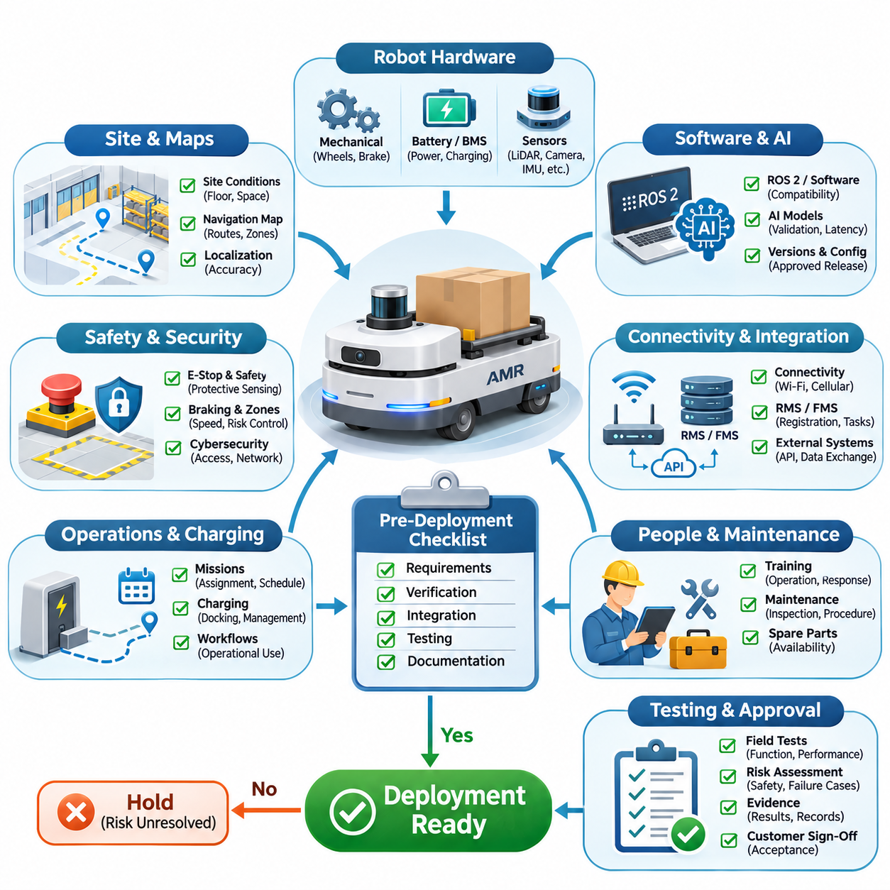
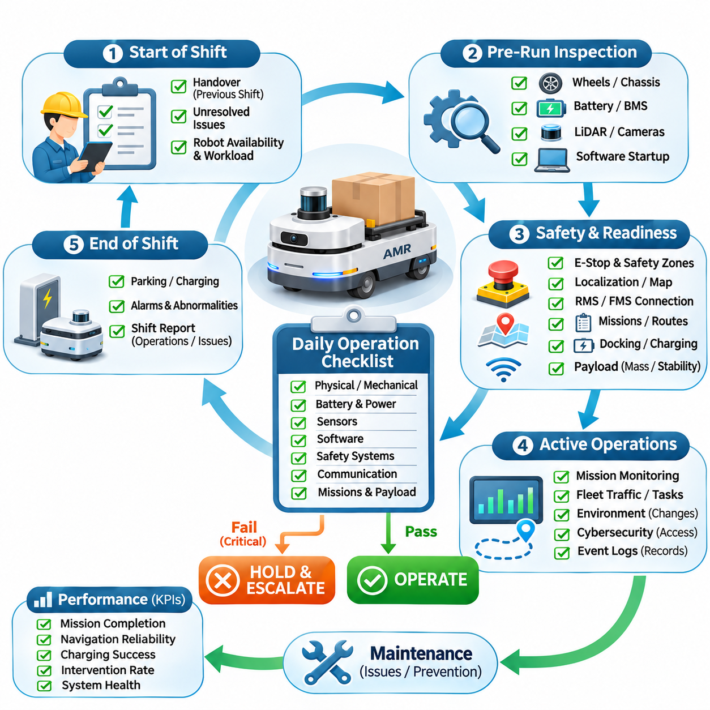
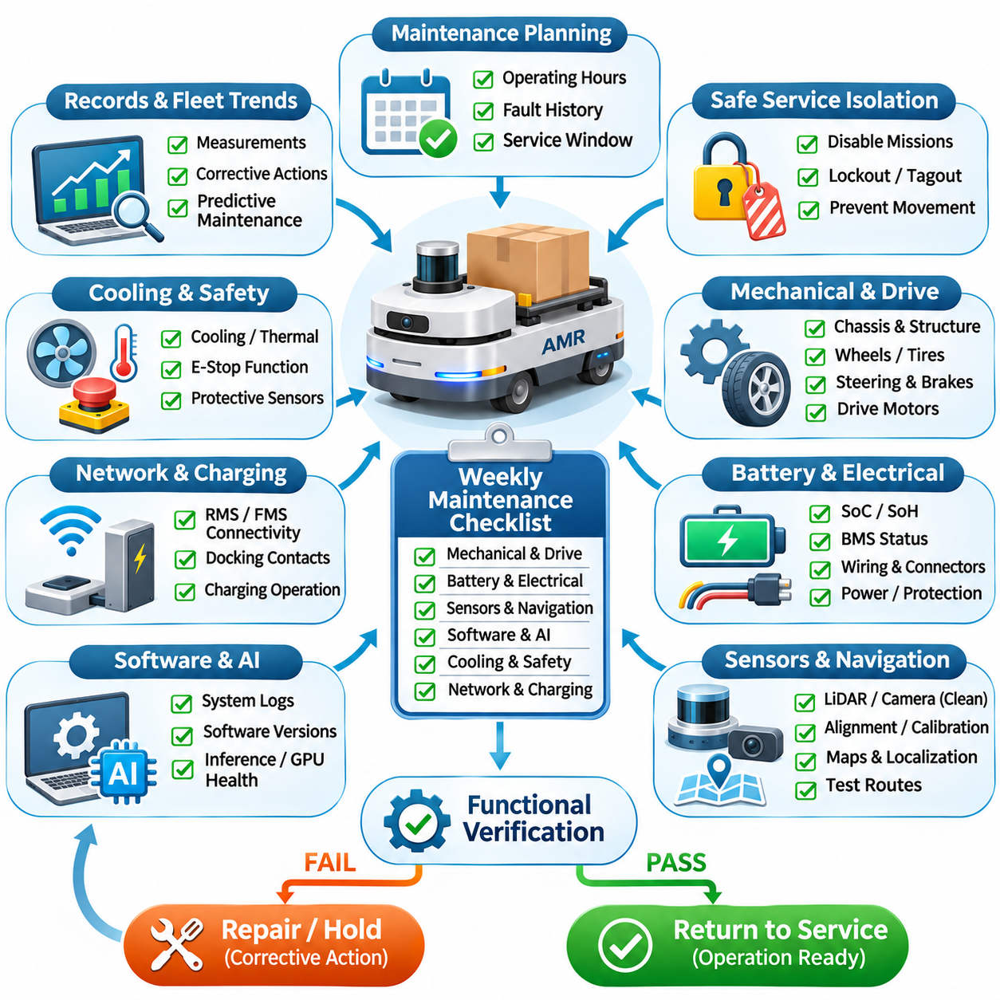
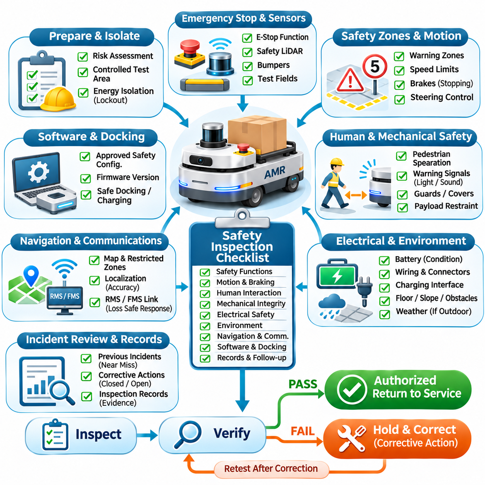
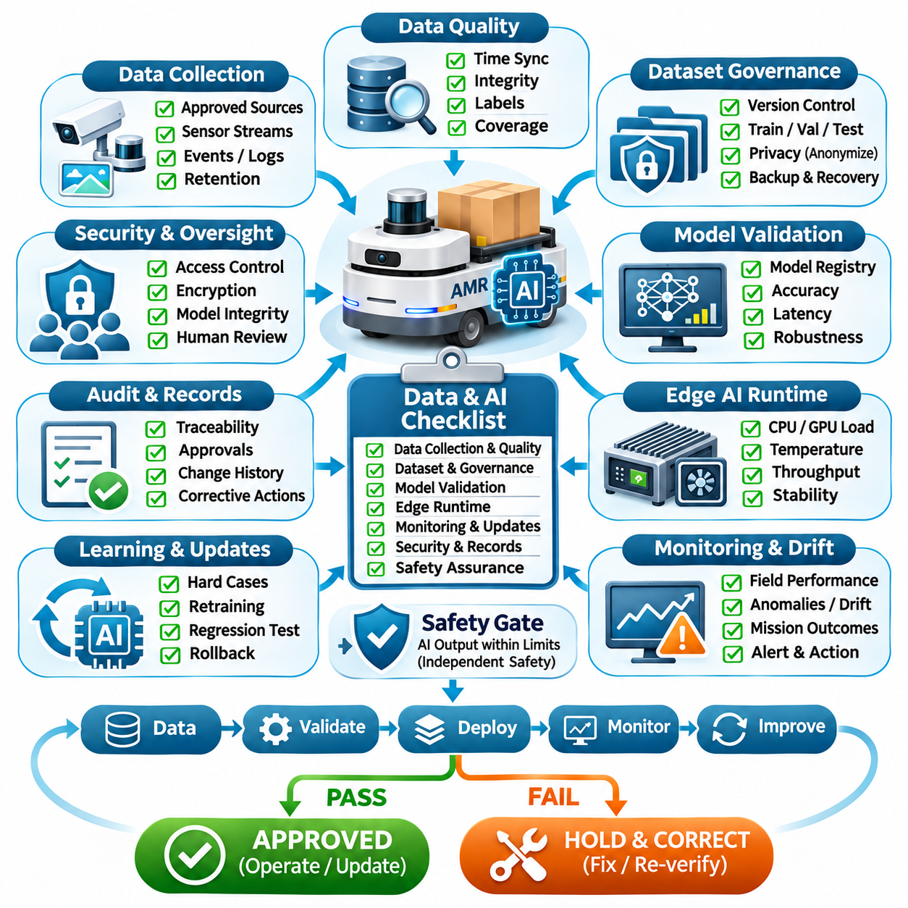
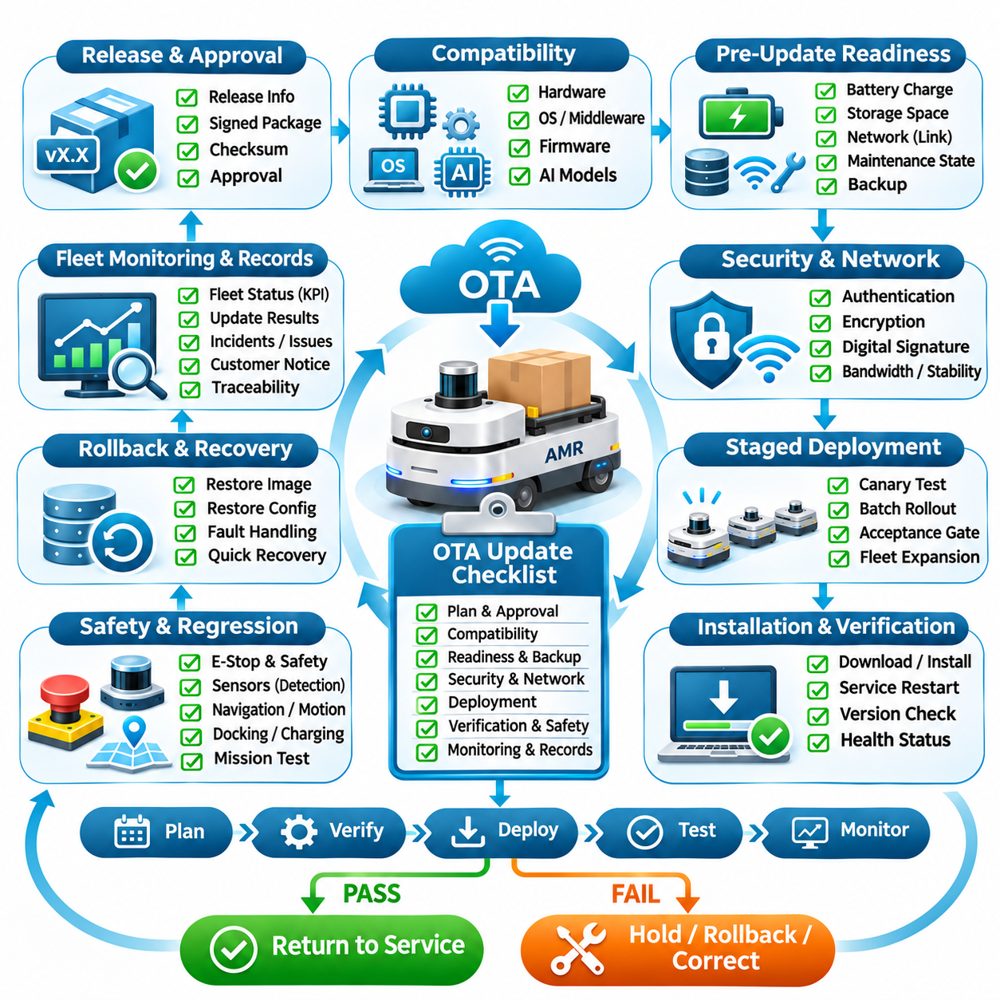
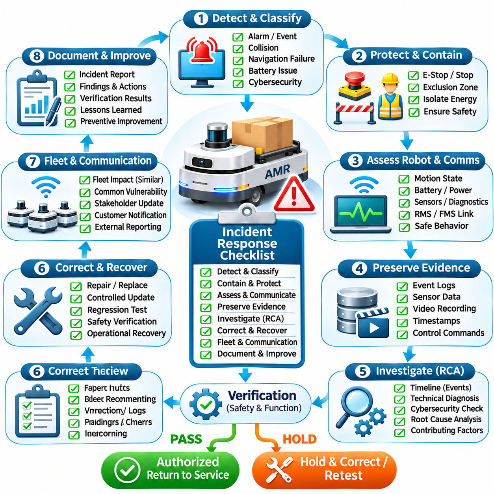
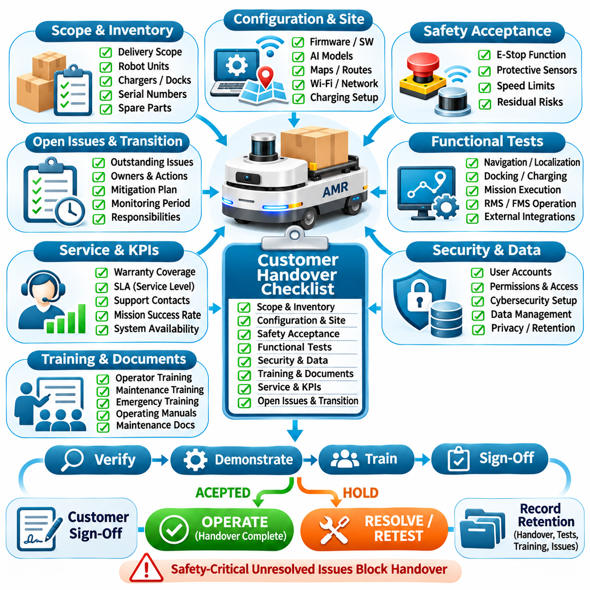

**Volume 08. AMR Operations, Deployment, and MLOps**

# Chapter 22. Operations Checklists

## 22.1 Pre-Deployment Checklist

{width="7.268055555555556in" height="7.268055555555556in"}

배포 전 검증(Pre-Deployment Verification)은 자율이동로봇(Autonomous Mobile Robot, AMR) 시스템이 현장 설치에 필요한 기술적, 운영적, 조직적 준비 상태를 갖추었는지 확인하는 핵심 관리 절차이다. 배포 전 점검표(Pre-Deployment Checklist)는 시운전(Commissioning)을 시작하기 전에 현장 조건, 로봇 하드웨어(Hardware), 소프트웨어(Software) 구성, 안전 요구사항(Safety Requirements), 통신 인프라(Communication Infrastructure), 운영 책임(Operational Responsibilities)을 일관된 방법으로 평가하도록 지원한다.

준비 절차(Preparation Process)는 배포 목표(Deployment Objectives), 운영 요구사항(Operational Requirements), 고객 기대사항(Customer Expectations)에 대한 종합적인 검토로 시작된다. 엔지니어링 팀(Engineering Team)은 적용 업무(Application), 로봇 수량(Robot Quantity), 적재물 특성(Payload Characteristics), 운영 일정(Operating Schedules), 주행 경계(Navigation Boundaries), 성능 목표(Performance Targets)를 확인한다. 각 요구사항은 수용 기준(Acceptance Criteria)과 연결되어야 하며, 이를 통해 주관적인 판단이 아닌 측정 가능한 증거(Measurable Evidence)를 기반으로 배포 준비 상태를 입증할 수 있어야 한다.

현장 준비 상태 평가(Site Readiness Assessment)는 물리적 환경(Physical Environment)이 안정적인 자율주행(Autonomous Navigation)을 지원할 수 있는지 판단하는 과정이다. 엔지니어는 바닥 상태(Floor Conditions), 통로 폭(Corridor Dimensions), 회전 공간(Turning Spaces), 경사로(Slopes), 출입문(Doorways), 엘리베이터(Elevators), 적재 구역(Loading Stations), 보행자 이동 패턴(Pedestrian Traffic Patterns)을 점검한다. 조도(Illumination), 반사 표면(Reflective Surfaces), 먼지(Dust), 습기(Moisture), 온도(Temperature), 임시 장애물(Temporary Obstacles)과 같은 환경 요인도 로봇의 검증된 운영 한계(Validated Operating Limits)를 기준으로 평가해야 한다.

배포 팀(Deployment Team)은 주행 지도(Navigation Maps)가 현재 운영 환경을 정확하게 반영하는지 확인해야 한다. 지도 검증(Map Verification)에는 좌표계 일관성(Coordinate Consistency), 제한 구역(Restricted Zones), 도킹 위치(Docking Locations), 충전소(Charging Stations), 교차로(Intersections), 지정된 비상 접근 경로(Emergency Access Routes)가 포함된다. 특히 반복적인 구조(Repetitive Structures), 동적 장애물(Dynamic Obstacles), 제한된 센서 가시성(Limited Sensor Visibility)으로 인해 위치 추정 신뢰성이 저하될 수 있는 구역에서는 위치 추정(Localization) 성능을 별도로 시험해야 한다.

기계적 준비 상태 검증(Mechanical Readiness Verification)은 로봇 섀시(Chassis), 바퀴(Wheels), 조향 장치(Steering Mechanisms), 현가 장치(Suspension Components), 제동 장치(Brakes), 장착 구조물(Mounting Structures), 적재물 연결 인터페이스(Payload Interfaces)를 대상으로 수행된다. 기술자는 체결 부품(Fasteners), 구조적 무결성(Structural Integrity), 휠 정렬(Wheel Alignment), 기계적 간극(Mechanical Clearances), 운송 중 손상(Transportation Damage) 여부를 점검한다. 로봇은 대표적인 적재 조건(Representative Payload Conditions)과 운영 조건에서 안정적인 이동 및 허용 가능한 진동 특성(Vibration Characteristics)을 입증해야 한다.

전기적 점검(Electrical Inspection)은 배터리 조립체(Battery Assemblies), 전력 분배 회로(Power Distribution Circuits), 모터 제어기(Motor Controllers), 보호 장치(Protective Devices), 커넥터(Connectors), 배선 하네스(Wiring Harnesses)가 올바르게 설치되었는지 확인하는 과정이다. 배터리 관리 시스템(Battery Management System, BMS)의 상태, 절연 상태(Insulation Condition), 접지(Grounding), 전압 안정성(Voltage Stability), 충전 인터페이스(Charging Interfaces)를 검증해야 한다. 전기적 이상(Electrical Abnormalities)은 자율주행을 활성화하거나 로봇을 운영 인프라에 연결하기 전에 반드시 해결해야 한다.

센서 준비 상태(Sensor Readiness)는 설치된 라이다(LiDAR), 카메라(Cameras), 깊이 센서(Depth Sensors), 초음파 센서(Ultrasonic Devices), 레이더(Radar), 관성측정장치(Inertial Measurement Unit, IMU), 위치 측정 장비(Positioning Equipment)의 점검과 보정을 포함한다. 엔지니어는 장착 방향(Mounting Orientation), 보정 매개변수(Calibration Parameters), 시야각(Field of View), 통신 상태(Communication Status), 센서 데이터 품질(Sensor Data Quality)을 확인한다. 인지(Perception) 및 위치 추정 결과의 불일치를 방지하기 위해 센서와 컴퓨팅 구성요소(Computing Components) 사이의 시간 동기화(Time Synchronization)도 검증해야 한다.

소프트웨어 준비 상태 검증(Software Readiness Verification)은 배포된 운영체제(Operating System), 미들웨어(Middleware), 주행 소프트웨어 스택(Navigation Stack), 제어 소프트웨어(Control Software), 응용 서비스(Application Services)가 승인된 릴리스 구성(Approved Release Configurations)과 일치하는지 확인하는 과정이다. 로봇 운영체제 2(Robot Operating System 2, ROS 2)의 구성요소, 의존성(Dependencies), 컨테이너(Containers), 설정 파일(Configuration Files)에 대한 호환성(Compatibility)을 점검해야 한다. 배포 승인 전에 시작 동작(Startup Behavior), 프로세스 감독(Process Supervision), 자원 사용률(Resource Utilization), 복구 절차(Recovery Procedures)를 시험해야 한다.

인공지능 준비 상태(Artificial Intelligence Readiness)는 인지 모델(Perception Models), 추론 실행 환경(Inference Runtimes), 모델 버전(Model Versions), 하드웨어 호환성(Hardware Compatibility)에 대한 검증을 요구한다. 엔지니어는 배포된 모델이 대표적인 환경 조건에서 설정된 성능 기준(Performance Criteria)을 충족하는지 확인한다. 실험실 성능이 현장 신뢰성을 보장한다고 가정하지 않고, 탐지 신뢰성(Detection Reliability), 추론 지연시간(Inference Latency), 컴퓨팅 자원 소비(Computational Resource Consumption), 불확실한 예측(Uncertain Predictions)에 대한 대응 동작을 평가해야 한다.

기능 안전 검증(Functional Safety Verification)은 자율주행 운영 전에 반드시 수행해야 한다. 비상 정지 장치(Emergency Stop Devices), 보호 감지 기능(Protective Sensing Functions), 안전 구역(Safety Zones), 속도 제한(Speed Restrictions), 제동 동작(Braking Behavior), 고장 대응 메커니즘(Fault-Response Mechanisms)을 승인된 위험 평가(Approved Risk Assessment)에 따라 시험해야 한다. 안전 관련 제어 기능(Safety-Related Control Functions)은 정의된 안전 아키텍처(Safety Architecture) 내에서 통신 중단, 소프트웨어 고장, 센서 결함, 예상하지 못한 환경 변화가 발생하더라도 유효하게 유지되어야 한다.

통신 인프라 준비 상태(Communication Infrastructure Readiness)는 무선 통신 범위(Wireless Coverage), 네트워크 분리(Network Segmentation), 대역폭 가용성(Bandwidth Availability), 지연시간(Latency), 인증(Authentication), 연결 복구(Connection Recovery)를 포함한다. 와이파이(Wi-Fi), 이동통신(Cellular), 사설 네트워크(Private Network) 인터페이스는 배포 요구사항에 따라 검증해야 한다. 엔지니어는 전체 운영 경로에서 통신 성능을 시험하고, 일시적인 연결 손실이 제어되지 않은 로봇 동작이나 필수 안전 기능의 손상을 유발하지 않는지 확인해야 한다.

로봇 관리 시스템(Robot Management System, RMS)과 군집 관리 시스템(Fleet Management System, FMS)의 통합은 협조 운영(Coordinated Operation)을 시작하기 전에 검증해야 한다. 점검 항목에는 로봇 등록(Robot Registration), 작업 할당(Task Assignment), 임무 일정 관리(Mission Scheduling), 교통 조정(Traffic Coordination), 충전 관리(Charging Management), 상태 보고(Status Reporting)가 포함된다. 통합 시험(Integration Tests)을 통해 로봇과 상위 관리 플랫폼(Supervisory Platforms) 사이에서 명령(Commands), 응답 확인(Acknowledgments), 운영 이벤트(Operational Events), 예외 알림(Exception Notifications)이 정확하게 교환되는지 입증해야 한다.

외부 시스템 통합(External System Integration)은 해당되는 경우 창고 관리 시스템(Warehouse Management System, WMS), 제조 실행 시스템(Manufacturing Execution System, MES), 전사적 자원 관리(Enterprise Resource Planning, ERP), 건물 자동화(Building Automation), 병원 정보 시스템(Hospital Information System)과의 인터페이스를 확인하는 과정이다. 엔지니어는 응용 프로그램 인터페이스(Application Programming Interface, API)의 호환성, 메시지 형식(Message Formats), 접근 권한(Access Permissions), 시간 초과 처리(Timeout Handling), 트랜잭션 일관성(Transaction Consistency)을 검증한다. 외부 서비스 중단이 위험하거나 불명확한 로봇 임무를 발생시키지 않도록 장애 상황도 시험해야 한다.

충전 인프라 점검(Charging Infrastructure Inspection)은 전기적 호환성(Electrical Compatibility), 충전기 위치(Charger Positioning), 도킹 정렬(Docking Alignment), 환경 보호(Environmental Protection), 접근 공간(Access Clearance)을 확인한다. 자동 충전 절차(Autonomous Charging Procedures)는 반복적인 도킹(Docking)과 도킹 해제(Undocking)를 통해 평가해야 한다. 배터리 충전 한계(Battery Charging Limits), 열적 거동(Thermal Behavior), 통신 핸드셰이크(Communication Handshakes), 비정상 충전 대응(Abnormal Charging Responses)은 제조업체 요구사항과 현장 전기 안전 절차를 충족해야 한다.

운영 업무 흐름 검증(Operational Workflow Verification)은 로봇 임무(Robot Missions)가 실제 업무 프로세스(Business Processes)와 일치하는지 확인하는 과정이다. 운영 팀은 물품 수령 및 배송 위치(Pickup and Delivery Locations), 적재물 이송 메커니즘(Payload Transfer Mechanisms), 작업 우선순위(Task Priorities), 대기 구역(Waiting Zones), 작업자와의 상호작용(Interactions with Personnel)을 검증한다. 대표적인 시험 시나리오에는 정상 운영(Normal Operation), 최대 교통량(Peak Traffic), 일시적 장애물(Temporary Obstruction), 작업 완료 지연(Delayed Task Completion), 수동 개입(Manual Intervention)을 포함하여 실제 운영 전에 업무 충돌을 식별해야 한다.

사이버보안 준비 상태(Cybersecurity Readiness)는 장치 식별 정보(Device Identities), 인증 메커니즘(Authentication Mechanisms), 접근 권한(Access Privileges), 암호화 통신(Encrypted Communications), 승인된 네트워크 구성(Approved Network Configurations)을 확인해야 한다. 기본 인증 정보(Default Credentials)를 변경하고 불필요한 서비스를 비활성화하며 소프트웨어 구성요소의 알려진 취약점(Known Vulnerabilities)을 검토해야 한다. 원격 접근(Remote Access)과 무선 소프트웨어 업데이트(Over-the-Air Update, OTA)는 적절한 기록 관리(Logging), 무결성 검증(Integrity Verification), 복구 통제(Recovery Controls)를 갖춘 승인된 경로를 통해 수행되어야 한다.

데이터 관리 준비 상태(Data Management Readiness)는 운영 정보(Operational Information)를 수집, 전송, 저장, 보호, 보존하는 방법을 정의한다. 엔지니어는 이벤트 기록(Event Logging), 진단 기록(Diagnostic Records), 원격 측정 데이터 처리 파이프라인(Telemetry Pipelines), 타임스탬프 정확도(Timestamp Accuracy), 저장 용량(Storage Capacity)을 검증한다. 카메라나 기타 센서가 개인정보(Personal Information)를 수집할 가능성이 있는 경우, 배포 절차에는 관련 개인정보 보호 요구사항(Privacy Requirements), 접근 제한(Access Restrictions), 보존 정책(Retention Policies), 고객이 승인한 데이터 처리 절차를 반영해야 한다.

현장 시험 준비 상태(Field Testing Readiness)는 문서화된 시험 시나리오(Test Scenarios), 교정된 측정 장비(Calibrated Measurement Equipment), 정의된 수용 임계값(Acceptance Thresholds), 명확하게 지정된 시험 책임(Test Responsibilities)을 요구한다. 주행 정확도(Navigation Accuracy), 장애물 회피(Obstacle Avoidance), 정지 성능(Stopping Performance), 도킹 반복 정밀도(Docking Repeatability), 임무 완료(Mission Completion), 운영 지속시간(Operational Endurance)을 대표적인 조건에서 평가해야 한다. 시험 결과는 성공적인 검증과 해결되지 않은 편차(Unresolved Deviations), 추가 조사가 필요한 조건을 명확하게 구분해야 한다.

인력 준비 상태(Personnel Readiness) 역시 중요하다. 안정적인 배포는 교육받은 운영자(Trained Operators)와 지원 팀(Support Teams)에 의존하기 때문이다. 점검표는 운영자 교육(Operator Instruction), 비상 대응 교육(Emergency Response Training), 유지보수 교육(Maintenance Orientation), 시스템 관리 준비(System Administration Preparation)의 완료 여부를 확인한다. 담당자는 운영 경계(Operational Boundaries), 경고 표시(Warning Indicators), 수동 복구 절차(Manual Recovery Procedures), 상위 보고 경로(Escalation Channels), 자율주행 운영을 즉시 중단해야 하는 상황을 이해해야 한다.

유지보수 준비(Maintenance Preparation)는 시운전 전에 점검 절차(Inspection Procedures), 정비 주기(Service Intervals), 교체 부품(Replacement Components), 진단 도구(Diagnostic Tools), 기술 문서(Technical Documentation)를 확보하는 과정이다. 핵심 예비 부품(Critical Spare Parts)은 구성요소 고장에 따른 영향(Failure Consequences)과 예상 교체 소요기간(Replacement Lead Times)을 고려하여 선정해야 한다. 서비스 팀은 초기 운영 기간에 필요한 예방 정비(Preventive Maintenance), 문제 해결(Troubleshooting), 소프트웨어 복구(Software Recovery), 기술적 상위 지원 요청(Technical Escalation)의 책임을 확립해야 한다.

배포 위험 평가(Deployment Risk Assessment)는 로봇 이동(Robot Movement), 사람과의 상호작용(Human Interaction), 적재물 취급(Payload Handling), 전기 시스템(Electrical Systems), 환경 노출(Environmental Exposure), 인프라 의존성(Infrastructure Dependencies)과 관련된 위험요소를 종합한다. 주요 위험에는 문서화된 위험 완화 조치(Mitigation Measures)와 검증 증거(Verification Evidence)가 필요하다. 잔여 위험(Residual Risks)은 승인된 담당자가 평가해야 하며, 해결되지 않은 안전 핵심 문제(Safety-Critical Findings)는 적절한 시정 조치(Corrective Actions)가 완료될 때까지 운영 승인을 제한해야 한다.

문서 준비 상태(Documentation Readiness)는 승인된 구성 기록(Configuration Records), 설치 지침(Installation Instructions), 네트워크 구성도(Network Diagrams), 운영 절차(Operating Procedures), 안전 평가(Safety Assessments), 시험 보고서(Test Reports)의 확보 여부를 확인한다. 로봇 일련번호(Serial Numbers), 하드웨어 개정 버전(Hardware Revisions), 펌웨어 버전(Firmware Versions), 소프트웨어 릴리스(Software Releases), 보정 기록(Calibration Records)은 추적 가능해야 한다. 구성 기준선(Configuration Baselines)은 향후 유지보수, 사고 조사, 성능 비교, 통제된 시스템 업데이트를 위한 기준 정보를 제공한다.

최종 준비 상태 평가(Final Readiness Evaluation)는 기술 검증(Technical Verification), 운영 시험(Operational Testing), 안전 승인(Safety Approval), 고객 협의(Customer Coordination)를 통합하여 공식적인 배포 결정(Formal Deployment Decision)을 수행한다. 각 점검 항목에는 수용 요구사항(Acceptance Requirement), 검증 결과(Verification Result), 책임자(Responsible Person), 증빙 자료(Supporting Evidence)가 포함되어야 한다. 미해결 문제(Open Issues)는 운영 영향도에 따라 분류하고, 조건부 승인(Conditional Authorization)을 검토하기 전에 명시적인 제한사항과 시정 조치를 문서화해야 한다.

배포 승인 절차(Deployment Authorization Process)에는 각자의 책임에 따라 엔지니어링(Engineering), 현장 운영(Field Operations), 안전 담당자(Safety Representatives), 정보기술 담당자(Information Technology Personnel), 고객 이해관계자(Customer Stakeholders)가 참여해야 한다. 승인은 정의된 사전 요구조건(Prerequisites)이 충족되었고 남아 있는 제한사항이 충분히 이해되었음을 확인하는 것이다. 통제된 시범 운영(Pilot Operation)으로의 전환에는 모니터링 체계(Monitoring Arrangements), 상위 보고 절차(Escalation Procedures), 배포 중단 또는 확대를 위한 사전 정의된 기준(Predefined Criteria)이 포함되어야 한다.

표준화된 배포 전 점검표(Standardized Pre-Deployment Checklist)는 배포 준비를 비공식적인 점검에서 반복 가능한 엔지니어링 보증 절차(Repeatable Engineering Assurance Process)로 전환한다. 물리적 준비 상태(Physical Readiness), 소프트웨어 무결성(Software Integrity), 기능 안전(Functional Safety), 사이버보안(Cybersecurity), 운영 업무 흐름(Operational Workflows), 수용 증거(Acceptance Evidence)를 연결함으로써 조직은 시운전의 불확실성을 줄이고 배포 일관성을 개선하며 장기적인 자율이동로봇 운영(Long-Term Autonomous Robot Operations)을 위한 신뢰성 높은 기반을 구축할 수 있다.

## 22.2 Daily Operation Checklist

{width="7.268055555555556in" height="7.268055555555556in"}

일일 운영 점검표(Daily Operation Checklist)는 자율이동로봇(Autonomous Mobile Robot, AMR) 시스템의 일상적인 현장 운영에서 안전성(Safety), 신뢰성(Reliability), 효율성(Efficiency)을 유지하기 위한 체계적인 관리 프레임워크(Systematic Management Framework)를 제공한다. 배포 전 검증(Pre-Deployment Verification)과 달리 일일 점검(Daily Inspection)은 운영 이상(Operational Abnormalities)을 조기에 발견하고 임무 준비 상태(Mission Readiness)를 확인하며, 사소한 장비 문제가 서비스 중단(Service Interruptions)으로 확대되는 것을 방지하는 데 중점을 둔다. 일관된 점검 수행은 신뢰할 수 있는 운영 기준선(Operational Baseline)을 확립한다.

일일 운영 주기(Daily Operating Cycle)는 담당 인력 간의 체계적인 인수인계(Structured Handover)로 시작된다. 운영자(Operators)는 이전 교대 근무 보고서(Previous Shift Reports), 미해결 사고(Unresolved Incidents), 유지보수 알림(Maintenance Notifications), 운영 제한사항(Operational Restrictions)을 검토한다. 로봇 가용성(Robot Availability), 예정된 임무(Scheduled Missions), 충전 상태(Charging Status), 예상 작업량(Expected Workload)은 가동 전에 확인해야 한다. 해결되지 않은 안전 관련 문제(Safety-Related Issues)는 해당 로봇을 운영에 복귀시키기 전에 명확하게 해결하거나 적절한 승인을 받아야 한다.

물리적 점검(Physical Inspection)은 로봇이 기계적으로 운영에 적합한 상태를 유지하고 있는지 확인하는 과정이다. 운영자는 바퀴(Wheels), 타이어(Tires), 섀시 표면(Chassis Surfaces), 보호 덮개(Protective Covers), 적재 플랫폼(Payload Platforms), 외부 장착 구조물(Mounting Structures)의 손상이나 오염 여부를 검사한다. 느슨해진 부품(Loose Components), 비정상 마모(Abnormal Wear), 유체 누출(Fluid Leakage), 이물질(Foreign Objects)은 즉시 보고해야 한다. 점검 결과는 외관상 결함(Cosmetic Defects)과 이동 성능 또는 운영 안전성을 저하시킬 수 있는 상태를 구분해야 한다.

배터리 및 전원 검증(Battery and Power Verification)은 계획된 임무를 수행하기에 충분한 에너지(Energy)가 확보되어 있는지 확인한다. 운영자는 충전 상태(State of Charge, SoC), 배터리 경고(Battery Warnings), 충전 이력(Charging History), 배터리 관리 시스템(Battery Management System, BMS)의 알림을 점검한다. 충전 커넥터(Charging Connectors)와 도킹 접점(Docking Contacts)의 손상 및 오염 여부도 확인해야 한다. 비정상적인 배터리 온도(Battery Temperature), 전압 불균형(Voltage Imbalance), 충전 오류(Charging Faults)가 나타나는 로봇은 기술적 평가(Technical Assessment)가 완료될 때까지 운영에서 제외해야 한다.

센서 준비 상태 점검(Sensor Readiness Inspection)은 인지(Perception) 및 위치 추정(Localization) 장치가 장애물에 가려지지 않고 정상적으로 작동하는지 확인한다. 라이다(LiDAR) 투과창, 카메라 렌즈(Camera Lenses), 깊이 센서(Depth Sensors), 기타 외부 노출 감지 표면(Sensing Surfaces)의 먼지, 습기, 긁힘, 물리적 위치 변화를 점검해야 한다. 진단 인터페이스(Diagnostic Interfaces)를 통해 센서 연결 상태(Sensor Connectivity)와 유효한 데이터 스트림(Valid Data Streams)을 확인해야 한다. 보정 상태 변화(Calibration Changes)가 의심되거나 지속적인 센서 오류가 발생하면 자율주행을 시작하기 전에 엔지니어링 평가(Engineering Evaluation)를 수행해야 한다.

소프트웨어 시작 검증(Software Startup Verification)은 필수 로봇 서비스(Essential Robot Services)가 정상적으로 초기화되는지 확인하는 과정이다. 운영자는 승인된 모니터링 인터페이스(Monitoring Interface)를 통해 주행(Navigation), 위치 추정(Localization), 인지(Perception), 운동 제어(Motion Control), 진단 프로세스(Diagnostic Processes)의 상태를 확인한다. 예상하지 못한 프로세스 재시작(Process Restarts), 구성 불일치(Configuration Mismatches), 반복적인 오류 메시지(Error Messages)는 조사해야 한다. 소프트웨어 버전(Software Versions)은 승인된 운영 구성(Authorized Operational Configuration) 및 릴리스 기준선(Release Baseline)과 일치해야 한다.

안전 시스템 검증(Safety System Verification)은 일일 준비 상태 평가(Daily Readiness Assessment)의 필수 항목이다. 비상 정지 장치(Emergency Stop)의 접근성, 보호 센서(Protective Sensors)의 상태, 안전 구역 설정(Safety Zone Configuration), 경고 표시 장치(Warning Indicators)를 승인된 절차에 따라 점검해야 한다. 기능 시험(Functional Test)은 추가적인 위험을 발생시키지 않는 통제된 구역(Controlled Area)에서 수행해야 한다. 안전 기능(Safety Function)에 문제가 있는 로봇은 시정 조치(Corrective Action)와 승인된 검증(Authorized Verification)이 완료될 때까지 운영할 수 없는 상태로 유지해야 한다.

위치 추정 준비 상태(Localization Readiness)는 로봇의 추정 위치(Estimated Position)를 실제로 확인된 물리적 위치(Known Physical Location)와 비교하여 검증한다. 운영자는 지도 선택(Map Selection), 위치 추정 신뢰도(Localization Confidence), 좌표 정렬(Coordinate Alignment), 주행 준비 상태 표시(Navigation Readiness Indicators)를 확인한다. 심각한 위치 불일치(Position Discrepancies)나 예상하지 못한 지도 변경(Map Changes)은 임무 수행 전에 조사해야 한다. 환경 변경(Environmental Modifications)이 발생한 구역에서는 추가적인 위치 추정 검증이나 주행 제한(Navigation Restrictions)의 갱신이 필요할 수 있다.

통신 준비 상태 점검(Communication Readiness Checks)은 로봇, 로봇 관리 시스템(Robot Management System, RMS), 군집 관리 시스템(Fleet Management System, FMS), 관련 인프라 사이의 연결 상태를 검증한다. 운영자는 네트워크 등록(Network Registration), 원격 측정 데이터 갱신(Telemetry Updates), 명령 응답 확인(Command Acknowledgment), 운영 상태 보고(Operational Status Reporting)를 확인한다. 지속적인 통신 지연(Communication Delays)이나 간헐적인 연결 중단(Intermittent Disconnections)은 기록해야 한다. 통신 장애는 통제되지 않은 임무 지속이 아니라 정의된 안전 운영 대응(Safe Operating Response)을 유발해야 한다.

임무 준비 상태 검증(Mission Readiness Verification)은 작업 정의(Task Definitions), 주행 경로(Routes), 목적지(Destinations), 운영 우선순위(Operational Priorities)가 현재 조건에 적합한지 확인한다. 운영자는 제한 구역(Restricted Zones), 임시 장애물(Temporary Obstacles), 적재 구역(Loading Areas), 예정된 시설 활동(Scheduled Facility Activities)을 검토한다. 보행자 이동(Pedestrian Movement)이나 장비 접근(Equipment Access)에 영향을 미치는 변경사항은 운영 통제(Operational Controls)에 반영해야 한다. 필요한 인프라나 승인된 담당자가 준비되지 않은 경우에는 임무를 시작해서는 안 된다.

충전 및 도킹 준비 상태(Charging and Docking Readiness)는 충전소(Charging Stations), 접근 경로(Approach Paths), 정렬 상태(Alignment Conditions), 전기적 인터페이스(Electrical Interfaces)의 점검을 포함한다. 운영자는 충전 구역에 장애물이 없으며 로봇이 지정된 도킹 위치(Docking Positions)에 안전하게 진입하고 이탈할 수 있는지 확인한다. 반복적인 도킹 실패(Docking Failures), 비정상적인 충전 중단(Charging Interruptions), 예상하지 못한 배터리 동작(Battery Behavior)은 확립된 유지보수 절차(Maintenance Procedures)에 따라 기록하고 상위 담당자에게 보고해야 한다.

적재물 취급 검증(Payload Handling Verification)은 운송 물품(Transported Materials)이 승인된 중량(Mass), 크기(Dimensions), 안정성(Stability) 한계 내에 있는지 확인한다. 운영자는 적재물 고정 장치(Payload Restraints), 운반 용기(Containers), 승강 메커니즘(Lifting Mechanisms), 이송 인터페이스(Transfer Interfaces)를 해당되는 경우 점검한다. 적재물이 안전 센서(Safety Sensors)를 가리거나 기계적 움직임(Mechanical Movement)을 방해해서는 안 된다. 의료 물품(Medical Supplies), 산업 자재(Industrial Materials), 민감 장비(Sensitive Equipment)의 특별 취급 요구사항(Special Handling Requirements)은 운송 임무 전에 확인해야 한다.

실제 운영(Active Operation) 중 모니터링 담당자(Monitoring Personnel)는 임무 수행(Mission Execution), 주행 동작(Navigation Behavior), 배터리 소비(Battery Consumption), 시스템 상태 지표(System Health Indicators)를 관찰한다. 예상하지 못한 정지(Unexpected Stops), 반복적인 경로 재계획(Repeated Replanning), 위치 추정 불안정(Localization Instability), 비정상적인 모터 동작(Unusual Motor Behavior)은 확보된 진단 정보(Diagnostic Information)를 활용하여 조사해야 한다. 운영자는 일시적인 환경 교란(Temporary Environmental Disturbances)과 유지보수 개입(Maintenance Intervention) 또는 운영 중단(Operational Suspension)이 필요한 반복적인 기술적 결함(Recurring Technical Faults)을 구분해야 한다.

군집 수준 감독(Fleet-Level Supervision)은 운영 기간 동안 로봇 배치(Robot Distribution), 작업 대기열(Task Queues), 교통 혼잡(Traffic Congestion), 충전 가용성(Charging Availability)을 평가한다. RMS 및 FMS 대시보드(Dashboards)는 진행 중인 임무(Active Missions), 유휴 로봇(Idle Robots), 지연된 작업(Delayed Tasks), 사용 불가능한 로봇(Unavailable Units)에 대한 일관된 정보를 제공해야 한다. 감독자(Supervisors)는 필요한 경우 작업 우선순위(Task Priorities)나 배포 할당(Deployment Assignments)을 조정할 수 있지만, 모든 변경은 승인된 운영 및 안전 제약조건(Operational and Safety Constraints) 내에서 이루어져야 한다.

운영 이벤트 기록(Operational Event Logging)은 시스템 성능(System Performance)과 비정상 동작(Abnormal Behavior)에 대한 증거를 보존한다. 일일 기록(Daily Records)에는 로봇 식별 정보(Robot Identification), 운영 시간(Operating Hours), 임무 완료(Mission Completion), 충전 이벤트(Charging Events), 고장 알림(Fault Notifications), 수동 개입(Manual Interventions)이 포함되어야 한다. 중요한 사고(Significant Incidents)는 타임스탬프(Timestamps), 상황 정보(Contextual Information), 지정된 후속 조치(Assigned Follow-Up Actions)와 함께 기록해야 한다. 정확한 기록은 문제 해결(Troubleshooting), 신뢰성 분석(Reliability Analysis), 예지보전(Predictive Maintenance), 지속적 개선(Continuous Improvement)을 지원한다.

일일 사이버보안 점검(Daily Cybersecurity Checks)은 비정상적인 인증 활동(Unusual Authentication Activity), 예상하지 못한 연결 상태 변화(Unexpected Connectivity Changes), 승인되지 않은 구성 변경(Unauthorized Configuration Modifications), 보안 경고(Security Alerts)에 중점을 둔다. 운영자는 원격 접근(Remote Access)이 승인된 인력에게만 허용되고 시스템 업데이트(System Updates)가 검증되지 않은 구성을 도입하지 않았는지 확인해야 한다. 의심되는 보안 사고(Security Incidents)는 확립된 상위 보고 절차(Escalation Procedures)를 따라야 하며, 사고 대응 계획(Incident Response Plan)에 따라 필요한 경우 영향을 받은 시스템을 격리해야 한다.

환경 모니터링(Environmental Monitoring)은 운영 조건(Operating Conditions)이 검증된 한계(Validated Limits) 내에 유지되는지 확인한다. 실내 시설(Indoor Facilities)에서는 바닥 오염(Floor Contamination), 임시 공사(Temporary Construction), 보행자 혼잡(Pedestrian Congestion), 보관 배치 변경(Changing Storage Arrangements)에 주의를 기울여야 한다. 실외 배포(Outdoor Deployments)에서는 날씨(Weather), 가시성(Visibility), 노면 접지력(Surface Traction), 배수 상태(Drainage), 경로 접근성(Route Accessibility)을 추가로 평가해야 한다. 환경 조건이 승인된 운영 범위(Approved Operating Boundaries)를 초과하면 적절한 임무 제한(Mission Restrictions) 또는 운영 중단(Suspension)을 적용해야 한다.

교대 근무 종료 절차(End-of-Shift Procedures)는 로봇이 안전하게 주차되어 있고 필요한 경우 충전 중이며 지정된 운영 상태(Designated Operational States)로 전환되었는지 확인한다. 운영자는 완료되지 않은 임무(Unfinished Missions), 미해결 경고(Outstanding Alarms), 유지보수 요청(Maintenance Requests), 다음 교대를 위한 배터리 준비 상태(Battery Readiness)를 검토한다. 해결되지 않은 이상(Abnormalities)은 운영에 미치는 영향(Operational Impact)과 지정된 책임(Assigned Responsibility)을 함께 문서화해야 한다. 교대 인수인계(Shift Handover)는 비공식적인 구두 전달(Informal Verbal Communication)에만 의존하지 않고 업무 연속성(Operational Continuity)을 유지할 수 있어야 한다.

일일 점검표 완료(Daily Checklist Completion)는 점검 결과(Inspection Results), 발견된 이상(Detected Abnormalities), 시정 조치(Corrective Actions), 담당 인력(Responsible Personnel)에 대한 추적 가능한 확인(Traceable Confirmation)을 요구한다. 디지털 기록(Digital Records)은 유지보수 관리 시스템(Maintenance Management Systems) 및 군집 모니터링 시스템(Fleet Monitoring Systems)과 통합하여 관리 업무를 줄일 수 있다. 그러나 자동화된 상태 지표(Automated Health Indicators)가 물리적 점검(Physical Inspections)이나 필수 안전 검증(Required Safety Verification)을 대체할 수는 없다. 누락되거나 실패한 핵심 점검(Critical Checks)이 있는 경우에는 정해진 승인 절차가 충족될 때까지 운영 재개를 제한해야 한다.

성능 검토(Performance Review)는 일일 점검 결과를 가용성(Availability), 임무 성공률(Mission Success Rate), 운영 중단 빈도(Interruption Frequency), 충전 효율(Charging Efficiency), 복구 시간(Recovery Time) 등의 운영 핵심성과지표(Key Performance Indicators, KPIs)와 연결한다. 반복적으로 발생하는 이상(Repeated Abnormalities)은 여러 운영 기간(Operating Periods)에 걸쳐 분석하여 초기 성능 저하(Emerging Degradation)를 식별해야 한다. 이러한 관찰 결과는 예방 정비 일정(Preventive Maintenance Scheduling), 소프트웨어 개선(Software Improvement), 운영 업무 흐름 최적화(Operational Workflow Optimization)를 위한 중요한 입력 자료가 된다.

체계적인 일일 운영 점검표(Disciplined Daily Operation Checklist)는 장비 준비 상태(Equipment Readiness), 인적 감독(Human Supervision), 시스템 모니터링(System Monitoring), 운영 책임성(Operational Accountability) 사이의 지속적인 연결을 확립한다. 물리적 점검(Physical Inspection), 안전 검증(Safety Verification), 임무 제어(Mission Control), 이벤트 기록(Event Recording), 체계적인 인수인계(Structured Handover)를 결합함으로써 조직은 예방 가능한 가동 중단(Avoidable Downtime)을 줄이고 군집 신뢰성(Fleet Reliability)을 향상시킬 수 있다. 일관된 일일 점검 수행은 안전하고 예측 가능하며 확장 가능한 자율로봇 운영(Autonomous Robot Operations)을 지원한다.

## 22.3 Weekly Maintenance Checklist

{width="7.268055555555556in" height="7.268055555555556in"}

주간 유지보수 점검표(Weekly Maintenance Checklist)는 산업(Industrial), 의료(Healthcare), 물류(Logistics), 실외(Outdoor) 환경에서 운영되는 자율이동로봇(Autonomous Mobile Robot, AMR) 시스템을 위한 체계적인 예방 정비 절차(Preventive Maintenance Process)를 확립한다. 일일 점검(Daily Inspection)과 달리 주간 유지보수(Weekly Maintenance)는 구성요소 성능 저하(Component Degradation), 누적된 운영 부하(Accumulated Operational Stress), 진단 추세(Diagnostic Trends), 장기 신뢰성(Long-Term Reliability)에 중점을 둔다. 주요 목적은 발생 중인 결함(Developing Faults)이 임무 가용성(Mission Availability)이나 운영 안전성(Operational Safety)에 영향을 미치기 전에 식별하는 것이다.

주간 유지보수 계획(Weekly Maintenance Planning)은 로봇 운영 시간(Robot Operating Hours), 완료된 임무(Completed Missions), 고장 이력(Fault Histories), 이전 점검 기록(Previous Inspection Records)을 검토하는 것으로 시작된다. 유지보수 담당자(Maintenance Personnel)는 작업량(Workload), 환경 노출(Environmental Exposure), 반복적인 이상(Recurring Abnormalities)을 기준으로 추가적인 점검이 필요한 장비를 식별한다. 정비 활동(Service Activities)은 운영 중단(Operational Disruption)을 최소화하면서 점검, 시정 조치(Corrective Action), 검증(Verification)에 충분한 시간을 확보할 수 있도록 승인된 유지보수 시간(Maintenance Windows)에 계획해야 한다.

유지보수를 시작하기 전에 기술자(Technicians)는 로봇을 통제된 정비 상태(Controlled Service Condition)로 전환해야 한다. 자율 임무(Autonomous Missions)를 비활성화하고 예상하지 못한 움직임(Unexpected Movement)을 방지하며, 승인된 절차에 따라 위험 에너지(Hazardous Energy)를 차단해야 한다. 작업에 따라 배터리 분리(Battery Disconnection), 기계적 고정(Mechanical Restraint), 잠금 및 표지 조치(Lockout/Tagout)가 필요할 수 있다. 유지보수 작업은 보호 시스템(Protective Systems)을 손상시키거나 작업자를 통제되지 않은 기계적 또는 전기적 위험에 노출시켜서는 안 된다.

기계적 점검(Mechanical Inspection)은 섀시(Chassis), 구조적 연결부(Structural Joints), 보호 덮개(Protective Covers), 장착 브래킷(Mounting Brackets), 적재물 인터페이스(Payload Interfaces)의 상태를 평가한다. 기술자는 체결 부품(Fasteners), 변형(Deformation), 부식(Corrosion), 진동 손상(Vibration Damage), 기계적 피로(Mechanical Fatigue)의 징후를 검사한다. 반복적인 충격(Repeated Impacts)이나 고하중(Heavy Loading)에 노출되는 구성요소는 특별한 주의가 필요하다. 안정성(Stability), 적재물 고정(Load Retention), 안전한 이동(Safe Movement)에 영향을 미치는 구조적 이상(Structural Abnormalities)은 로봇을 운영에 복귀시키기 전에 반드시 수정해야 한다.

바퀴 및 구동계 유지보수(Wheel and Drivetrain Maintenance)는 타이어 마모(Tire Wear), 휠 정렬(Wheel Alignment), 베어링 상태(Bearing Condition), 기어 전달 장치(Gear Transmission), 구동 모터 장착 상태(Drive Motor Mounting)에 중점을 둔다. 기술자는 구름 저항(Rolling Resistance), 비정상 소음(Abnormal Noise), 느슨함(Looseness), 해당되는 경우 기계적 백래시(Mechanical Backlash)를 점검한다. 공기압 타이어(Pneumatic Wheels)를 사용하는 구성에서는 타이어 공기압(Tire Pressure)과 트레드 상태(Tread Condition)를 확인해야 한다. 과도한 마모나 정렬 불량(Misalignment)은 에너지 소비(Energy Consumption)를 증가시키고 위치 추정 정확도(Localization Accuracy)를 저하시키며 제동 성능(Braking Performance)이나 접지력(Traction Performance)을 손상시킬 수 있다.

조향 및 제동 시스템(Steering and Braking Systems)은 이동 안전성(Motion Safety)에 직접적인 영향을 미치므로 정기적인 기능 점검(Functional Inspection)이 필요하다. 기술자는 조향 응답(Steering Response), 기계적 연결 장치의 무결성(Mechanical Linkage Integrity), 액추에이터 동작(Actuator Behavior), 제동 일관성(Braking Consistency)을 평가한다. 비정상적인 저항(Abnormal Resistance), 응답 지연(Delayed Response), 유체 누출(Fluid Leakage), 비정상 진동(Unusual Vibration)은 조사해야 한다. 제동 성능은 승인된 통제 시험(Controlled Tests)을 통해 검증해야 하며, 수용 한계(Acceptance Limits)는 로봇 설계(Robot Design)와 적용 가능한 안전 요구사항(Safety Requirements)에 따라 결정해야 한다.

배터리 유지보수(Battery Maintenance)는 충전 상태(State of Charge, SoC), 건강 상태(State of Health, SoH), 셀 전압 일관성(Cell Voltage Consistency), 온도 이력(Temperature History), 배터리 관리 시스템(Battery Management System, BMS)의 경고를 검토하는 과정을 포함한다. 기술자는 별도의 승인이 없는 한 밀봉된 배터리 조립체(Sealed Battery Assemblies)를 개방하지 않고 접근 가능한 전기 연결부(Electrical Connections), 배터리 외함(Battery Enclosures), 냉각 장치(Cooling Arrangements)를 점검해야 한다. 반복적인 온도 한계 초과(Temperature Excursions), 예상하지 못한 용량 감소(Capacity Loss), 전압 불균형(Voltage Imbalance)은 지속적인 운영 전에 추가 진단이 필요하다.

전력 분배 점검(Power Distribution Inspection)은 배선 하네스(Wiring Harnesses), 커넥터(Connectors), 퓨즈(Fuses), 보호 장치(Protective Devices), 접지 연결부(Grounding Connections), 직류 변환 모듈(DC/DC Conversion Modules)을 검사한다. 기술자는 절연 손상(Insulation Damage), 변색(Discoloration), 부식(Corrosion), 느슨한 연결(Loose Connections), 과열 흔적(Evidence of Overheating)을 확인한다. 전기적 측정(Electrical Measurements)은 승인된 절차와 장비 정격(Equipment Ratings)에 따라 수행해야 한다. 비정상적인 전력 동작(Abnormal Power Behavior)은 간헐적 고장(Intermittent Failures)이나 시스템 종료(System Shutdowns)로 확대되기 전에 조사해야 한다.

센서 유지보수(Sensor Maintenance)는 인지(Perception) 및 위치 추정(Localization) 장치가 기대 성능(Expected Performance)을 유지하도록 보장하는 과정이다. 라이다(LiDAR) 표면, 카메라 렌즈(Camera Lenses), 깊이 센서(Depth Sensors), 레이더 덮개(Radar Covers), 초음파 변환기(Ultrasonic Transducers)는 승인된 방법으로 청소해야 한다. 장착 안정성(Mounting Stability), 케이블 상태(Cable Condition), 센서 정렬(Sensor Alignment)도 점검해야 한다. 기계적 충격(Mechanical Disturbance), 장착 위치 변경(Mounting Changes), 진단 증거(Diagnostic Evidence)를 통해 센서 기하학적 배치(Sensor Geometry)의 변화가 의심되는 경우 보정 검증(Calibration Verification)이 필요하다.

위치 추정 및 주행 검증(Localization and Navigation Verification)은 지도 일관성(Map Consistency), 위치 안정성(Positioning Stability), 경로 수행(Route Execution), 장애물 회피 동작(Obstacle Avoidance Behavior)을 검사한다. 기술자는 지난주에 기록된 위치 추정 오류(Localization Errors), 반복적인 경로 재계획(Repeated Path Replanning), 주행 실패(Navigation Failures), 환경 변화(Environmental Changes)를 검토한다. 대표적인 시험 경로(Test Routes)는 통제된 조건(Controlled Conditions)에서 실행해야 한다. 지속적인 편차(Persistent Deviations)는 센서 성능 저하(Sensor Degradation), 지도 부정확성(Map Inaccuracies), 바퀴 마모(Wheel Wear), 소프트웨어 구성 문제(Software Configuration Problems)를 나타낼 수 있다.

모터 및 액추에이터 유지보수(Motor and Actuator Maintenance)는 작동 온도(Operating Temperature), 전류 소비(Current Consumption), 진동(Vibration), 고장 계수(Fault Counters), 응답 일관성(Response Consistency)을 평가한다. 과거 원격 측정 데이터(Historical Telemetry)는 기계적 저항(Mechanical Resistance)이나 전기적 부하(Electrical Loading)가 점진적으로 증가하는 현상을 보여줄 수 있다. 기술자는 즉각적인 고장 경고(Fault Alarms)에만 의존하지 않고 측정된 동작을 기존 장비 기준선(Equipment Baselines)과 비교해야 한다. 비정상적인 추세(Abnormal Trends)는 구성요소 고장이 발생하기 전에 집중 점검(Targeted Inspection)과 유지보수 계획(Maintenance Planning)을 유발해야 한다.

냉각 및 열 관리 점검(Cooling and Thermal Management Inspection)은 냉각 팬(Fans), 환기 경로(Ventilation Paths), 방열판(Heat Sinks), 필터(Filters), 온도 센서(Temperature Sensors)가 정상적으로 작동하는지 확인한다. 먼지 축적(Dust Accumulation)과 공기 흐름 차단(Blocked Airflow)은 임베디드 컴퓨터(Embedded Computers), 모터 제어기(Motor Controllers), 전력 전자 장치(Power Electronics)의 성능을 저하시킬 수 있다. 기술자는 오염을 유발하거나 민감한 장비(Sensitive Equipment)를 손상시키지 않도록 냉각 구성요소를 점검해야 한다. 지속적인 열 경고(Thermal Warnings)는 환경 조건(Environmental Conditions)과 내부 발열(Internal Heat Generation)을 모두 조사해야 한다.

소프트웨어 유지보수(Software Maintenance)는 운영체제 상태(Operating System Health), 미들웨어 상태(Middleware Status), 응용 프로그램 로그(Application Logs), 저장 공간 사용률(Storage Utilization), 프로세스 안정성(Process Stability)을 검토하는 과정을 포함한다. 기술자는 반복적인 충돌(Repeated Crashes), 메모리 소비(Memory Consumption), 디스크 오류(Disk Errors), 예상하지 못한 서비스 재시작(Service Restarts)을 검사한다. 승인된 구성 기준선(Approved Configuration Baselines)은 배포된 버전(Deployed Versions)과 비교해야 한다. 소프트웨어 변경(Software Changes)은 일상적인 유지보수 과정에서 비공식적으로 도입하지 않고 확립된 릴리스 관리 절차(Release Management Procedures)를 따라야 한다.

인공지능 시스템 유지보수(Artificial Intelligence System Maintenance)는 추론 안정성(Inference Stability), 모델 무결성(Model Integrity), 컴퓨팅 자원 사용률(Computational Resource Utilization), 인지 성능 추세(Perception Performance Trends)에 중점을 둔다. 엔지니어는 모델 버전(Model Versions), 추론 지연시간(Inference Latency), 그래픽처리장치(GPU) 또는 가속기(Accelerator)의 온도, 반복적인 탐지 실패(Detection Failures)를 검토한다. 현장 관찰 결과(Field Observations)는 검증된 성능 기준선(Validated Performance Baselines)과 비교해야 한다. 모델 성능 저하(Model Degradation)가 의심되는 경우 이를 문서화하고 통제된 머신러닝 운영(Machine Learning Operations, MLOps) 절차를 통해 평가해야 한다.

통신 시스템 유지보수(Communication System Maintenance)는 네트워크 인터페이스 상태(Network Interface Health), 무선 신호 품질(Wireless Signal Quality), 안테나 상태(Antenna Condition), 연결 안정성(Connection Stability)을 검증한다. 기술자는 패킷 손실(Packet Loss), 지연시간 추세(Latency Trends), 연결 중단 이벤트(Disconnection Events), 인증 실패(Authentication Failures)를 검토한다. 유지보수 후에는 로봇 관리 시스템(Robot Management System, RMS) 및 군집 관리 시스템(Fleet Management System, FMS)과의 연결 상태를 확인해야 한다. 지속적인 네트워크 이상(Network Abnormalities)은 시설 정보기술 담당자(Information Technology Personnel)와의 협력이 필요할 수 있다.

충전 인프라 유지보수(Charging Infrastructure Maintenance)는 도킹 정렬(Docking Alignment), 충전 접점(Charging Contacts), 기계적 가이드(Mechanical Guides), 전기적 보호(Electrical Protection), 충전기 통신(Charger Communication)을 점검한다. 기술자는 오염(Contamination), 접점 마모(Contact Wear), 케이블 손상(Cable Damage), 비정상적인 충전 중단(Charging Interruptions)을 확인한다. 유지보수 결과에 따라 기능 검증(Functional Verification)이 필요한 경우 반복적인 도킹 시험(Repeated Docking Tests)을 수행할 수 있다. 충전 장비(Charging Equipment)는 제조업체 사양(Manufacturer Specifications)과 적용 가능한 전기 안전 요구사항(Electrical Safety Requirements)을 준수해야 한다.

안전 시스템 유지보수(Safety System Maintenance)는 비상 정지 장치(Emergency Stop Devices), 보호 센서(Protective Sensors), 안전 제어기(Safety Controllers), 경고 표시 장치(Warning Indicators), 속도 제한 기능(Speed Limitation Functions)의 상태와 작동을 검증한다. 시험은 승인된 절차(Approved Procedures)와 문서화된 수용 기준(Documented Acceptance Criteria)에 따라 수행해야 한다. 안전 관련 기능(Safety-Related Functions)에 문제가 발생하면 즉시 로봇 가용성(Robot Availability)을 제한해야 한다. 유지보수를 완료하거나 운영 처리량(Operational Throughput)을 회복하기 위한 목적으로 안전 메커니즘(Safety Mechanisms)을 우회해서는 안 된다.

주간 유지보수 기록(Weekly Maintenance Records)에는 점검 결과(Inspection Findings), 측정값(Measured Values), 교체된 구성요소(Replaced Components), 진단 증거(Diagnostic Evidence), 시정 조치(Corrective Actions)를 포함해야 한다. 각 기록에는 로봇 식별 정보(Robot Identification), 유지보수 날짜(Maintenance Date), 담당 기술자(Responsible Technician), 남아 있는 제한사항(Remaining Restrictions)을 명시해야 한다. 중요한 이상(Significant Abnormalities)은 사고 또는 유지보수 추적 시스템(Incident or Maintenance Tracking Systems)과 연결해야 한다. 일관된 문서화(Consistent Documentation)는 추적성(Traceability), 보증 평가(Warranty Evaluation), 신뢰성 엔지니어링(Reliability Engineering), 향후 고장 분석(Failure Analysis)을 지원한다.

군집 유지보수 분석(Fleet Maintenance Analysis)은 여러 로봇의 반복적인 결함(Recurring Defects), 구성요소 교체 빈도(Component Replacement Frequency), 운영 시간(Operational Hours), 환경 노출(Environmental Exposure)을 비교한다. 공통적인 고장 패턴(Common Failure Patterns)은 설계상의 약점(Design Weaknesses), 부적절한 유지보수 주기(Inappropriate Maintenance Intervals), 가혹한 운영 조건(Demanding Operating Conditions)을 나타낼 수 있다. 유지보수 우선순위(Maintenance Priorities)는 고장 발생 확률(Failure Probability)과 운영상 영향(Operational Consequences)을 모두 반영해야 한다. 이러한 분석 결과는 예지보전 모델(Predictive Maintenance Models)과 예방 정비 일정(Preventive Service Schedules)의 개선을 지원한다.

유지보수 완료 후 기술자는 수행한 작업에 적합한 기능 검증(Functional Verification)을 실시해야 한다. 여기에는 통제된 이동 시험(Controlled Movement), 제동 점검(Braking Checks), 센서 진단(Sensor Diagnostics), 위치 추정 검증(Localization Validation), 충전 시험(Charging Tests), 통신 확인(Communication Confirmation)이 포함될 수 있다. 유지보수 과정에서 발생한 구성 변경(Configuration Changes)은 운영 재개 전에 검토해야 한다. 로봇은 필수 점검을 통과하고 승인된 담당자(Authorized Personnel)가 운영 준비 상태(Operational Readiness)를 승인한 후에만 서비스에 복귀해야 한다.

체계적인 주간 유지보수 점검표(Disciplined Weekly Maintenance Checklist)는 예방 점검(Preventive Inspection), 상태 모니터링(Condition Monitoring), 시정 정비(Corrective Maintenance), 운영 의사결정(Operational Decision-Making)을 연결한다. 기계(Mechanical), 전기(Electrical), 센서(Sensing), 소프트웨어(Software), 안전(Safety), 군집 수준 평가(Fleet-Level Assessments)를 결합함으로써 조직은 예상하지 못한 고장(Unexpected Failures)을 줄이고 장비 수명(Equipment Service Life)을 연장할 수 있다. 일관된 유지보수 수행은 로봇 가용성(Robot Availability)을 향상시키고 안전 보증(Safety Assurance)을 강화하며 신뢰할 수 있는 장기 자율 운영(Long-Term Autonomous Operations)을 지원한다.

## 22.4 Safety Inspection Checklist

{width="7.268055555555556in" height="7.268055555555556in"}

안전 점검표(Safety Inspection Checklist)는 산업(Industrial), 의료(Healthcare), 물류(Logistics), 공공 환경(Public Environments)에서 자율이동로봇(Autonomous Mobile Robot, AMR)의 안전한 운영을 유지하기 위한 체계적인 검증 절차(Systematic Verification Process)를 확립한다. 일반적인 유지보수 점검(General Maintenance Inspection)과 달리 안전 점검(Safety Inspection)은 위험 예방(Hazard Prevention), 보호 기능 무결성(Protective Function Integrity), 운영 위험 통제(Operational Risk Control)에 중점을 둔다. 주요 목적은 부상(Injury), 장비 손상(Equipment Damage), 운영 중단(Operational Disruption)이 발생하기 전에 불안전한 상태(Unsafe Conditions)를 식별하는 것이다.

안전 점검 계획(Safety Inspection Planning)은 승인된 위험 평가(Approved Risk Assessment), 운영 조건(Operating Conditions), 이전 사고(Previous Incidents), 미해결 안전 점검 결과(Unresolved Safety Findings)를 검토하는 것으로 시작된다. 점검 담당자(Inspectors)는 로봇 이동(Robot Movement), 사람과의 상호작용(Human Interaction), 적재물 취급(Payload Handling), 환경 노출(Environmental Exposure)과 관련된 주요 위험요소(Critical Hazards)를 식별한다. 점검 주기(Inspection Frequency)와 범위(Inspection Scope)는 운영 위험(Operational Risk), 장비 상태(Equipment Condition), 적용 요구사항(Applicable Requirements)을 반영해야 한다. 안전에 중대한 결함(Safety-Critical Deficiencies)은 일반 유지보수 작업보다 우선적으로 처리해야 한다.

점검 활동(Inspection Activities)을 시작하기 전에 로봇을 적절한 통제 상태(Controlled State)로 전환해야 한다. 물리적 접근(Physical Access)이나 기능 시험(Functional Testing)으로 위험에 노출될 가능성이 있는 경우 자율 이동(Autonomous Motion)을 비활성화해야 한다. 점검 담당자는 필요한 경우 위험 에너지(Hazardous Energy)가 차단되었는지 확인하고, 시험 구역(Test Areas)에 승인되지 않은 인원이 진입하지 못하도록 통제해야 한다. 안전 시험(Safety Testing)은 예상하지 못한 이동(Unexpected Movement)이나 주변 인력과의 통제되지 않은 상호작용(Uncontrolled Interaction)을 방지하는 승인된 절차(Approved Procedures)에 따라 수행해야 한다.

비상 정지 점검(Emergency Stop Inspection)은 비상 정지 장치(Emergency Stop Devices)의 접근성(Accessibility), 식별 표시(Identification), 기계적 상태(Mechanical Condition), 기능적 응답(Functional Response)을 검증한다. 지정된 각 장치는 승인된 절차에 따라 시험하여 요구되는 정지 기능(Stopping Function)이 정상적으로 작동하는지 확인해야 한다. 비상 정지 해제(Emergency Stop Reset)가 위험한 움직임(Hazardous Motion)을 자동으로 시작해서는 안 된다. 고장 난 장치(Failed Devices)는 시정 조치(Corrective Action)와 검증(Verification)이 완료될 때까지 즉시 운영을 제한해야 한다.

보호 감지 점검(Protective Sensing Inspection)은 안전 등급 라이다(Safety-Rated LiDAR), 보호 스캐너(Protective Scanners), 범퍼(Bumpers), 기타 설치된 안전 보호 장치(Safeguarding Devices)를 평가한다. 점검 담당자는 감지 구역(Detection Zones)에 장애물이 없으며 승인된 안전 구성(Approved Safety Configurations)과 일치하는지 확인해야 한다. 오염(Contamination), 물리적 위치 변화(Physical Displacement), 배선 손상(Wiring Damage), 진단 오류(Diagnostic Faults)는 보호 기능의 효과(Protective Effectiveness)를 저하시킬 수 있다. 안전 관련 감지 기능(Safety-Related Sensing Functions)은 지정된 시험 물체(Test Objects)와 문서화된 수용 기준(Documented Acceptance Criteria)을 사용하여 검증해야 한다.

안전 구역 검증(Safety Zone Verification)은 보호 영역(Protective Fields), 경고 구역(Warning Zones), 속도 제한(Speed Restrictions)이 운영 조건에 적합하게 유지되는지 확인한다. 점검 담당자는 교차로(Intersections), 보행자 횡단 구역(Pedestrian Crossings), 좁은 통로(Narrow Corridors), 적재 구역(Loading Areas), 공동 통행 경로(Shared Traffic Routes)를 검사한다. 시설 배치(Facility Layout)나 로봇 동작(Robot Behavior)의 변경은 안전 경계(Safety Boundaries)에 대한 재평가를 요구할 수 있다. 안전 매개변수(Safety Parameters)의 모든 변경은 통제된 구성 관리(Controlled Configuration Management)와 승인된 검증(Authorized Validation)을 따라야 한다.

제동 시스템 점검(Braking System Inspection)은 상용 제동(Service Braking), 보호 정지(Protective Stopping), 주차 기능(Parking Functions)이 로봇 설계(Robot Design)에서 요구하는 성능을 발휘하는지 검증한다. 점검 담당자는 제동 응답(Braking Response), 정지 일관성(Stopping Consistency), 기계적 상태(Mechanical Condition), 진단 표시(Diagnostic Indicators)를 검사한다. 통제된 정지 시험(Controlled Stopping Tests)은 대표적인 속도(Speeds), 적재 하중(Payloads), 노면 조건(Surface Conditions)을 고려해야 한다. 요구되는 정지 성능(Required Stopping Performance)에 영향을 미치는 제동 결함(Braking Deficiencies)이 발견되면 자율주행 운영을 지속해서는 안 된다.

운동 제어 안전 점검(Motion Control Safety Inspection)은 속도 제한(Speed Limitation), 가속도 제어(Acceleration Control), 조향 응답(Steering Response), 고장 처리(Fault Handling)를 평가한다. 점검 담당자는 명령된 움직임(Commanded Motion)이 승인된 운영 한계(Approved Operational Limits) 내에 유지되고, 비정상적인 제어 동작(Abnormal Control Behavior)이 정의된 안전 대응(Safe Response)을 유발하는지 확인해야 한다. 예상하지 못한 가속(Unexpected Acceleration), 불안정한 조향(Unstable Steering), 지속적인 제어 오류(Persistent Control Errors)는 조사가 필요하다. 필요한 경우 안전 관련 이동 제한(Safety-Related Motion Restrictions)은 비안전 응용 프로그램 명령(Non-Safety Application Commands)과 독립적으로 유효하게 유지되어야 한다.

인간-로봇 상호작용 안전 점검(Human-Robot Interaction Safety Inspection)은 보행자 감지(Pedestrian Detection), 예측 가능한 로봇 동작(Predictable Robot Behavior), 경고 신호(Warning Signals), 안전 이격 거리(Safe Separation)에 중점을 둔다. 점검 담당자는 해당되는 경우 작업자(Workers), 환자(Patients), 방문객(Visitors), 기타 취약 이용자(Vulnerable Users) 주변에서의 로봇 이동을 평가한다. 청각 및 시각 경고 장치(Audible and Visual Indicators)는 정상적으로 작동하고 이해하기 쉬워야 한다. 운영 절차(Operational Procedures)는 도킹(Docking), 적재물 이송(Payload Transfer), 자동화 장비와의 상호작용(Automated Equipment Interaction) 중 인원이 위험 구역(Hazardous Areas)에 진입하지 않도록 해야 한다.

기계적 안전 점검(Mechanical Safety Inspection)은 구조적 무결성(Structural Integrity), 노출된 가동 부품(Exposed Moving Parts), 보호 덮개(Protective Covers), 적재물 고정 장치(Payload Restraints), 끼임 또는 압착 위험 지점(Trapping or Crushing Points)을 검사한다. 점검 담당자는 느슨한 구성요소(Loose Components), 날카로운 모서리(Sharp Edges), 손상된 보호 장치(Damaged Guards), 불안정한 적재물(Unstable Loads)을 식별한다. 적재물 메커니즘(Payload Mechanisms)은 가속(Acceleration), 회전(Turning), 정지(Stopping) 중에도 안전하게 유지되어야 한다. 허용할 수 없는 기계적 위험(Mechanical Hazards)을 발생시키는 상태는 로봇이 운영에 복귀하기 전에 수정해야 한다.

전기 안전 점검(Electrical Safety Inspection)은 배터리 외함(Battery Enclosures), 접근 가능한 배선(Accessible Wiring), 커넥터(Connectors), 보호 장치(Protective Devices), 접지(Grounding), 충전 인터페이스(Charging Interfaces)를 대상으로 한다. 점검 담당자는 절연 손상(Damaged Insulation), 과열(Overheating), 부식(Corrosion), 승인되지 않은 변경(Unauthorized Modifications)을 확인한다. 전기 시험(Electrical Testing)은 적절한 장비와 승인된 절연 및 차단 절차(Isolation Procedures)를 사용해야 한다. 배터리 결함(Battery Faults)이 의심되거나 노출된 도체(Exposed Conductors), 손상된 충전 장비(Damaged Charging Equipment)가 발견되면 즉시 운영을 제한하고 자격을 갖춘 기술자의 평가(Qualified Technical Assessment)를 받아야 한다.

환경 안전 점검(Environmental Safety Inspection)은 운영 조건(Operating Conditions)이 검증된 한계(Validated Limits) 내에 유지되는지 판단한다. 실내 시설(Indoor Facilities)에서는 바닥 오염(Floor Contamination), 경사로(Slopes), 임시 장애물(Temporary Obstacles), 조명 변화(Lighting Changes), 보행자 혼잡(Pedestrian Congestion)을 평가해야 한다. 실외 환경(Outdoor Environments)에서는 강수(Precipitation), 가시성(Visibility), 접지력(Traction), 배수 상태(Drainage), 노면 손상(Surface Deterioration)을 추가로 평가해야 한다. 승인된 운영 경계(Approved Operating Boundaries)를 초과하는 조건에서는 적절한 속도 제한(Speed Restrictions), 경로 변경(Route Changes), 운영 중단(Suspension)을 적용해야 한다.

위치 추정 및 주행 안전 점검(Localization and Navigation Safety Inspection)은 위치 오차(Positioning Errors)가 허용할 수 없는 운영 위험(Operational Hazards)을 발생시키지 않는지 검증한다. 점검 담당자는 지도 정확도(Map Accuracy), 제한 구역(Restricted Zones), 위치 추정 신뢰도(Localization Confidence), 민감 구역(Sensitive Areas) 주변의 주행 동작(Navigation Behavior)을 검토한다. 예상하지 못한 경로 이탈(Route Deviations)이나 반복적인 위치 추정 실패(Localization Failures)는 조사가 필요하다. 안전에 중요한 제한사항(Safety-Critical Restrictions)은 검증되지 않은 위치 추정값(Unvalidated Positioning Estimates)이나 비안전 주행 소프트웨어(Non-Safety Navigation Software)에만 의존해서는 안 된다.

통신 장애 안전 점검(Communication Failure Safety Inspection)은 네트워크 중단(Network Interruptions)이 예측 가능하고 통제된 로봇 동작(Predictable and Controlled Robot Behavior)을 유발하는지 확인한다. 점검 담당자는 로봇 관리 시스템(Robot Management System, RMS), 군집 관리 시스템(Fleet Management System, FMS), 원격 감독 플랫폼(Remote Supervision Platforms)과의 연결 손실(Loss of Connectivity)을 평가한다. 통신 의존 기능(Communication-Dependent Functions)에는 정의된 시간 초과(Timeout) 및 복구 동작(Recovery Behavior)이 있어야 한다. 필수 보호 기능(Essential Protective Functions)은 외부 통신(External Communication)을 사용할 수 없는 상황에서도 유효하게 유지되어야 한다.

소프트웨어 및 구성 안전 점검(Software and Configuration Safety Inspection)은 승인된 안전 매개변수(Safety Parameters), 펌웨어 버전(Firmware Versions), 제어 구성(Control Configurations)이 변경되지 않았는지 검증한다. 점검 담당자는 배포된 설정(Deployed Settings)을 승인된 기준선(Authorized Baselines)과 비교하고 변경 기록(Modification Records)을 검사한다. 승인되지 않은 업데이트(Unauthorized Updates)나 구성 불일치(Configuration Mismatches)는 운영을 지속하기 전에 조사해야 한다. 안전 관련 소프트웨어 변경(Safety-Related Software Changes)은 확립된 변경 관리 절차(Change Management Process)를 통해 문서화된 검증(Documented Verification)과 승인을 받아야 한다.

충전 및 도킹 안전 점검(Charging and Docking Safety Inspection)은 접근 속도(Approach Speed), 정렬 동작(Alignment Behavior), 전기 접점 보호(Electrical Contact Protection), 인원 접근(Personnel Access)을 평가한다. 점검 담당자는 도킹 구역(Docking Areas)에 장애물이 없고 충전 장비(Charging Equipment)가 지정된 한계(Specified Limits) 내에서 작동하는지 확인한다. 도킹 중 예상하지 못한 움직임(Unexpected Motion)이나 비정상적인 충전 상태(Abnormal Charging Conditions)가 발생하면 적절한 보호 대응(Protective Response)이 실행되어야 한다. 반복적인 실패(Repeated Failures)는 시정 정비(Corrective Maintenance)와 통제된 재시험(Controlled Retesting)이 필요하다.

안전 이벤트 및 사고 검토(Safety Event and Incident Review)는 운영 중 기록된 비상 정지(Emergency Stops), 보호 센서 작동(Protective Sensor Activations), 아차사고(Near Misses), 충돌(Collisions), 수동 개입(Manual Interventions)을 검사한다. 점검 담당자는 반복적인 패턴(Recurring Patterns), 해결되지 않은 시정 조치(Unresolved Corrective Actions), 위험 노출 변화(Changes in Risk Exposure)를 식별한다. 중요한 이벤트(Significant Events)는 기술적 및 조직적 기여 요인(Technical and Organizational Factors)을 조사해야 한다. 점검 결과(Inspection Findings)는 사고 관리(Incident Management) 및 지속적인 안전 개선(Continuous Safety Improvement) 절차와 연결되어야 한다.

점검 문서화(Inspection Documentation)는 로봇 식별 정보(Robot Identification), 점검 날짜(Inspection Date), 시험한 안전 기능(Tested Safety Functions), 측정 결과(Measured Results), 발견된 결함(Detected Deficiencies), 담당 인력(Responsible Personnel)을 기록해야 한다. 각 점검 결과(Finding)는 잠재적인 안전 영향(Potential Safety Impact)과 필요한 시정 조치(Required Corrective Action)에 따라 분류해야 한다. 핵심 점검(Critical Checks)에 실패한 경우 운영 승인을 허용해서는 안 된다. 추적 가능한 기록(Traceable Records)은 규제 준수(Regulatory Compliance), 안전 감사(Safety Audits), 사고 조사(Incident Investigation), 장기 위험 관리(Long-Term Risk Management)를 지원한다.

시정 정비(Corrective Maintenance)가 완료된 후에는 운영 재개 전에 영향을 받은 안전 기능(Safety Functions)에 대한 적절한 검증(Verification)을 수행해야 한다. 점검 담당자는 수리(Repairs)가 새로운 위험(New Hazards)을 유발하지 않으면서 의도된 보호 동작(Intended Protective Behavior)을 복원했는지 확인해야 한다. 소프트웨어(Software), 센서(Sensors), 제동 구성요소(Braking Components), 안전 구성(Safety Configurations)이 변경된 경우 회귀 시험(Regression Testing)이 필요할 수 있다. 승인된 담당자(Authorized Personnel)는 문서화된 수용 증거(Documented Acceptance Evidence)를 기반으로 서비스 복귀(Return to Service)를 승인해야 한다.

체계적인 안전 점검표(Disciplined Safety Inspection Checklist)는 위험요소 식별(Hazard Identification), 보호 시스템 검증(Protective System Verification), 시정 조치(Corrective Action), 운영 승인(Operational Authorization)을 연결한다. 기계(Mechanical), 전기(Electrical), 센서(Sensing), 소프트웨어(Software), 환경(Environmental), 인간-로봇 상호작용(Human-Robot Interaction)에 대한 평가를 통합함으로써 조직은 로봇 수명주기(Robot Lifecycle) 전반에 걸쳐 효과적인 안전 통제(Safety Controls)를 유지할 수 있다. 일관된 점검 활동(Consistent Inspection Practices)은 운영 신뢰도(Operational Confidence)를 강화하고 안전하고 신뢰할 수 있으며 확장 가능한 자율로봇 배포(Autonomous Robot Deployment)를 지원한다.

## 22.5 Data and AI Checklist

{width="7.268055555555556in" height="7.268055555555556in"}

데이터 및 인공지능 점검표(Data and AI Checklist)는 자율이동로봇(Autonomous Mobile Robot, AMR) 시스템에서 운영 데이터(Operational Data)와 인공지능(Artificial Intelligence, AI)을 관리하기 위한 체계적인 검증 프레임워크(Systematic Verification Framework)를 확립한다. 이 점검표는 현장 데이터 수집(Field Data Collection), 데이터 품질 보증(Data Quality Assurance), 모델 검증(Model Validation), 배포 모니터링(Deployment Monitoring), 거버넌스(Governance)를 연결한다. 주요 목적은 정보의 신뢰성(Trustworthiness)을 보장하고 인공지능 기능이 승인된 성능 및 안전 범위(Performance and Safety Boundaries) 내에서 일관되게 작동하도록 하는 것이다.

데이터 관리 검증(Data Management Verification)은 수집 정책(Collection Policies), 운영 요구사항(Operational Requirements), 승인된 데이터 소스(Authorized Data Sources)를 검토하는 것으로 시작된다. 엔지니어는 필요한 센서 데이터 스트림(Sensor Streams), 시스템 이벤트(System Events), 임무 기록(Mission Records), 진단 측정값(Diagnostic Measurements)을 확인한다. 데이터 수집 주기(Collection Frequency)와 보존 설정(Retention Settings)은 운영 요구사항과 개인정보 보호 의무(Privacy Obligations)를 반영해야 한다. 저장 공간 요구량(Storage Demand), 처리 부하(Processing Overhead), 보안 노출(Security Exposure)을 줄이기 위해 불필요한 데이터 수집은 피해야 한다.

센서 데이터 점검(Sensor Data Inspection)은 라이다(LiDAR), 카메라(Cameras), 깊이 센서(Depth Sensors), 관성측정장치(Inertial Measurement Units, IMU), 위치 측정 장치(Positioning Devices)가 유효한 정보를 생성하는지 검증한다. 엔지니어는 타임스탬프(Timestamps), 샘플링 주파수(Sampling Rates), 동기화 정확도(Synchronization Accuracy), 누락된 프레임(Missing Frames), 측정 일관성(Measurement Consistency)을 검사한다. 센서 고장(Sensor Failures)이나 보정 상태 변화(Calibration Changes)는 잘못된 학습 사례(Misleading Training Examples)를 생성할 수 있다. 비정상적인 데이터 스트림(Abnormal Streams)은 신뢰성이 확인될 때까지 식별하고 후속 처리(Downstream Processing)에서 제외해야 한다.

데이터 무결성 검증(Data Integrity Verification)은 기록된 정보가 운영 파이프라인(Operational Pipeline) 전반에서 완전성(Completeness), 일관성(Consistency), 추적성(Traceability)을 유지하도록 보장한다. 점검 항목에는 파일 무결성(File Integrity), 메시지 순서(Message Ordering), 스키마 호환성(Schema Compatibility), 전송 오류(Transmission Errors)가 포함된다. 각 데이터셋(Dataset)은 로봇 식별 정보(Robot Identity), 센서 구성(Sensor Configuration), 수집 조건(Collection Conditions), 소프트웨어 버전(Software Versions)을 설명하는 필수 메타데이터(Essential Metadata)를 보존해야 한다. 손상되거나 불완전한 기록(Corrupted or Incomplete Records)은 격리(Quarantine)하고 처리 내역을 문서화해야 한다.

시간 동기화 점검(Time Synchronization Inspection)은 센서 측정값(Sensor Measurements), 제어 명령(Control Commands), 운영 이벤트(Operational Events)가 일관된 시간 기준(Temporal Reference)을 공유하는지 확인한다. 엔지니어는 시계 드리프트(Clock Drift), 동기화 실패(Synchronization Failures), 타임스탬프 불연속(Timestamp Discontinuities), 네트워크 시간 동기화 조건(Network Timing Conditions)을 평가한다. 정확한 시간 정보(Accurate Timing)는 센서 융합(Sensor Fusion), 궤적 재구성(Trajectory Reconstruction), 사고 분석(Incident Analysis)에 필수적이다. 해결되지 않은 동기화 오류(Synchronization Errors)는 영향을 받은 데이터를 모델 개발(Model Development)에 사용하기 전에 표시해야 한다.

데이터 품질 평가(Data Quality Assessment)는 수집된 운영 기록(Operational Records)의 완전성(Completeness), 정확성(Accuracy), 관련성(Relevance), 다양성(Diversity)을 검사한다. 엔지니어는 중복 샘플(Duplicate Samples), 손상된 이미지(Corrupted Images), 유효하지 않은 측정값(Invalid Measurements), 일관되지 않은 주석(Inconsistent Annotations)을 식별한다. 데이터셋 범위(Dataset Coverage)에는 대표적인 환경(Representative Environments), 조명 조건(Lighting Conditions), 장애물(Obstacles), 운영 모드(Operating Modes)가 포함되어야 한다. 부적합한 정보가 학습 또는 평가 데이터셋(Training or Evaluation Datasets)에 인지되지 않은 상태로 유입되지 않도록 품질 임계값(Quality Thresholds)을 문서화해야 한다.

데이터 라벨링 검증(Data Labeling Verification)은 주석 정확도(Annotation Accuracy), 범주 정의(Category Definitions), 라벨링 일관성(Labeling Consistency), 검토자 간 일치도(Reviewer Agreement)를 평가한다. 엔지니어는 대표적인 샘플(Representative Samples)을 검사하고 가림 현상(Occlusion), 비정상적인 객체(Unusual Objects), 모호한 이벤트(Ambiguous Events)가 포함된 어려운 사례(Difficult Cases)를 우선적으로 검토한다. 라벨링 지침(Labeling Guidelines)은 모델 목표(Model Objectives)와 운영 용어(Operational Terminology)에 일치해야 한다. 중요한 주석 오류(Significant Annotation Errors)는 해당 데이터셋을 학습용으로 승인하기 전에 수정해야 한다.

데이터셋 버전 관리(Dataset Version Control)는 학습(Training), 검증(Validation), 시험(Testing)에 사용되는 데이터 자원의 재현 가능성(Reproducibility)을 보장한다. 승인된 각 데이터셋에는 고유 식별자(Unique Identifier), 문서화된 구성(Documented Composition), 전처리 설정(Preprocessing Configuration), 변경 이력(Modification History)이 있어야 한다. 엔지니어는 데이터셋 분할(Dataset Partitions)이 적절하게 분리되어 있고 평가 데이터(Evaluation Data)가 학습 데이터에 유출되지 않았는지 확인해야 한다. 버전 변경(Version Changes)은 원본 기록(Source Records)과 승인 결정(Approval Decisions)까지 추적할 수 있어야 한다.

데이터 개인정보 보호 점검(Data Privacy Inspection)은 데이터 수집(Collection), 저장(Storage), 처리(Processing)가 적용 가능한 개인정보 보호 요구사항(Privacy Requirements)과 조직 정책(Organizational Policies)을 준수하는지 확인한다. 개인정보(Personal Information), 식별 가능한 이미지(Identifiable Images), 민감한 시설 기록(Sensitive Facility Records)에는 적절한 취급 통제(Handling Controls)가 필요하다. 엔지니어는 접근 권한(Access Permissions), 암호화(Encryption), 보존 기간 제한(Retention Limits), 승인된 익명화 절차(Anonymization Procedures)를 검증한다. 외부 기관과의 데이터 공유(Data Sharing)는 승인된 목적(Authorized Purposes)과 문서화된 계약(Documented Agreements)으로 제한해야 한다.

데이터 저장 및 전송 검증(Data Storage and Transfer Verification)은 저장 용량(Capacity), 가용성(Availability), 백업 상태(Backup Status), 전송 신뢰성(Transmission Reliability)을 검사한다. 엔지니어는 엣지 저장 공간 사용률(Edge Storage Utilization), 업로드 실패(Upload Failures), 체크섬 검증(Checksum Validation), 아카이브 완료 상태(Archival Completion)를 검토한다. 중단된 전송(Interrupted Transfers)은 일관되지 않은 복사본(Inconsistent Copies)을 생성하지 않으면서 통제된 복구(Controlled Recovery)를 지원해야 한다. 운영 증거(Operational Evidence)와 승인된 데이터셋(Approved Datasets)의 복구 가능성을 보장하기 위해 백업 및 복원 절차(Backup and Restoration Procedures)를 정기적으로 시험해야 한다.

인공지능 모델 목록 점검(AI Model Inventory Inspection)은 배포된 모든 모델(Deployed Models)이 승인된 식별 정보(Approved Identity), 버전(Version), 구성(Configuration), 소유권 기록(Ownership Record)을 가지고 있는지 확인한다. 엔지니어는 활성 모델 패키지(Active Model Packages)를 승인된 모델 레지스트리(Authorized Model Registry)와 비교한다. 모델 의존성(Model Dependencies), 전처리 단계(Preprocessing Steps), 지원 하드웨어 플랫폼(Supported Hardware Platforms)을 문서화해야 한다. 등록되지 않았거나 호환되지 않는 모델(Unregistered or Incompatible Models)은 특히 출력 결과가 로봇 이동(Robot Movement)이나 작업 수행(Task Execution)에 영향을 미치는 경우 운영 서비스에 투입해서는 안 된다.

모델 성능 검증(Model Performance Verification)은 인지 정확도(Perception Accuracy), 추론 지연시간(Inference Latency), 강건성(Robustness), 자원 소비(Resource Consumption)를 기존 벤치마크(Established Benchmarks)와 비교하여 평가한다. 엔지니어는 탐지 실패(Detection Failures), 오탐(False Positives), 미탐(False Negatives), 운영 환경에 따른 성능 변화(Performance Variation)를 검사한다. 평가에는 대표적인 어려운 시나리오(Difficult Scenarios)와 알려진 실패 사례(Known Failure Cases)가 포함되어야 한다. 필수 수용 기준(Mandatory Acceptance Criteria)을 충족하지 못한 모델은 운영 환경 배포(Production Deployment)에서 제외해야 한다.

엣지 인공지능 실행환경 점검(Edge AI Runtime Inspection)은 배포된 모델이 지정된 컴퓨팅 하드웨어(Computing Hardware)에서 안정적으로 작동하는지 확인한다. 엔지니어는 프로세서 사용률(Processor Utilization), 그래픽처리장치 메모리(GPU Memory), 가속기 온도(Accelerator Temperature), 추론 처리량(Inference Throughput), 응용 프로그램 안정성(Application Stability)을 모니터링한다. 자원 경합(Resource Contention)은 지연시간을 증가시키거나 주행 서비스(Navigation Services)를 방해할 수 있다. 지속적인 성능(Sustained Performance)은 독립적인 벤치마크 조건(Isolated Benchmark Conditions)이 아니라 대표적인 동시 작업 부하(Representative Concurrent Workloads)에서 평가해야 한다.

모델 드리프트 모니터링(Model Drift Monitoring)은 배포 이후 운영 데이터 분포(Operational Data Distributions)와 인공지능 성능(AI Performance)의 변화를 식별한다. 엔지니어는 최근 현장 관찰 결과(Recent Field Observations)를 검증된 참조 데이터셋(Validated Reference Datasets) 및 과거 성능 지표(Historical Metrics)와 비교한다. 조명(Lighting), 환경 배치(Environmental Layout), 센서 특성(Sensor Characteristics), 작업 구성(Task Composition)의 변화는 예측 신뢰성(Prediction Reliability)을 저하시킬 수 있다. 심각한 드리프트(Significant Drift)는 성능 저하를 자동으로 수용하는 대신 조사와 통제된 완화 조치(Controlled Mitigation)를 수행해야 한다.

지속적 학습 검증(Continuous Learning Verification)은 현장 관찰 결과(Field Observations)가 승인된 절차를 통해 모델 개선 파이프라인(Model Improvement Pipelines)에 유입되도록 보장한다. 어려운 사례(Hard Cases), 운영자 개입(Operator Interventions), 반복적인 인지 실패(Recurring Perception Failures)는 우선적으로 분석해야 한다. 데이터 선택(Data Selection), 라벨링(Labeling), 재학습(Retraining), 검증(Validation)은 추적 가능해야 한다. 업데이트된 모델(Updated Models)은 배포 전에 새로운 시나리오(New Scenarios)와 기존 회귀 시험(Established Regression Tests) 모두에서 허용 가능한 성능(Acceptable Performance)을 입증해야 한다.

인적 감독 점검(Human Oversight Inspection)은 자격을 갖춘 담당자(Qualified Personnel)가 불확실한 인공지능 출력(Uncertain AI Outputs)을 검토하고 비정상적인 운영(Abnormal Operations)에 개입하며 중요한 변경(Consequential Changes)을 승인할 수 있는지 확인한다. 신뢰도 임계값(Confidence Thresholds)과 상위 보고 규칙(Escalation Rules)은 작업 위험(Task Risk)을 반영해야 한다. 인공지능 권고(AI Recommendations)는 독립적인 안전 기능(Independent Safety Functions)이나 승인된 운영 제한사항(Authorized Operational Restrictions)을 무시해서는 안 된다. 인적 검토 결정(Human Review Decisions)은 책임성(Accountability)과 후속 모델 개선(Subsequent Model Improvement)을 지원하도록 기록해야 한다.

인공지능 업데이트 준비 상태 검증(AI Update Readiness Verification)은 모델 호환성(Model Compatibility), 패키지 무결성(Package Integrity), 배포 승인(Deployment Approval), 롤백 가용성(Rollback Availability)을 검사한다. 엔지니어는 업데이트된 모델이 센서(Sensors), 실행환경 라이브러리(Runtime Libraries), 로봇 제어 인터페이스(Robot Control Interfaces)와 계속 호환되는지 확인한다. 전체 로봇 군집 배포(Fleet-Wide Distribution)에 앞서 통제된 시험(Controlled Testing)을 수행해야 한다. 안전(Safety), 주행 신뢰성(Navigation Reliability), 임무 성능(Mission Performance)에 영향을 미치는 회귀 문제(Regression)는 시정 조치(Corrective Action)가 완료될 때까지 배포를 차단해야 한다.

사이버보안 점검(Cybersecurity Inspection)은 데이터셋 접근(Dataset Access), 모델 산출물 보호(Model Artifact Protection), 인증(Authentication), 감사 로그(Audit Logging), 보안 통신(Secure Communication)을 포함한다. 엔지니어는 승인되지 않은 사용자(Unauthorized Users)가 학습 데이터(Training Data), 모델 매개변수(Model Parameters), 배포 구성(Deployment Configurations)을 변경할 수 없는지 검증한다. 모델 패키지(Model Packages)는 활성화 전에 인증(Authentication)과 무결성 검사(Integrity Check)를 거쳐야 한다. 변조(Tampering)가 의심되거나 설명할 수 없는 구성 변경(Unexplained Configuration Changes)이 발견되면 확립된 보안 절차(Security Procedures)에 따라 즉시 조사해야 한다.

운영 인공지능 모니터링(Operational AI Monitoring)은 모델 동작(Model Behavior)을 임무 결과(Mission Outcomes), 개입 빈도(Intervention Frequency), 주행 실패(Navigation Failures), 서비스 가용성(Service Availability)과 연결한다. 엔지니어는 추론 이상(Inference Anomalies)을 환경 조건(Environmental Conditions) 및 로봇 상태 지표(Robot Health Indicators)와 연관 분석한다. 군집 수준 비교(Fleet-Level Comparisons)는 공통 결함(Common Defects)과 플랫폼별 문제(Platform-Specific Problems)를 식별하는 데 도움이 된다. 성능 대시보드(Performance Dashboards)는 실제 모델 성능 저하(Genuine Model Degradation)를 센서 고장(Sensor Faults), 통신 중단(Communication Interruptions), 인프라 제한(Infrastructure Limitations)과 구분해야 한다.

점검 문서화(Checklist Documentation)는 데이터셋 식별자(Dataset Identifiers), 모델 버전(Model Versions), 검증 결과(Validation Results), 발견된 이상(Detected Anomalies), 시정 조치(Corrective Actions), 담당 인력(Responsible Personnel)을 기록해야 한다. 핵심 점검(Critical Checks)에 실패한 경우 명시적인 운영 제한(Operational Restrictions)과 승인된 해결 조치(Authorized Resolution)가 필요하다. 감사 기록(Audit Records)은 배포 결정(Deployment Decisions)을 뒷받침하는 증거(Evidence)를 보존해야 한다. 일관된 문서화(Consistent Documentation)는 재현 가능성(Reproducibility), 규정 준수(Compliance), 사고 조사(Incident Investigation), 장기 인공지능 거버넌스(Long-Term AI Governance)를 강화한다.

체계적인 데이터 및 인공지능 점검표(Disciplined Data and AI Checklist)는 신뢰할 수 있는 정보 관리(Trustworthy Information Management)와 통제된 인공지능 운영(Controlled Artificial Intelligence Operations)을 통합한다. 데이터 무결성(Data Integrity), 개인정보 보호(Privacy Protection), 모델 검증(Model Validation), 엣지 모니터링(Edge Monitoring), 지속적 학습(Continuous Learning), 배포 거버넌스(Deployment Governance)를 결합함으로써 조직은 기술적 불확실성(Technical Uncertainty)을 줄이고 통제되지 않은 모델 성능 저하(Uncontrolled Model Degradation)를 방지할 수 있다. 일관된 검증(Consistent Verification)은 신뢰할 수 있고 안전하며 확장 가능한 인공지능 기반 자율로봇 운영(AI-Enabled Autonomous Robot Operations)을 지원한다.

## 22.6 OTA Update Checklist

{width="7.268055555555556in" height="7.268055555555556in"}

무선 원격 업데이트 점검표(Over-the-Air Update Checklist, OTA Update Checklist)는 자율이동로봇(Autonomous Mobile Robot, AMR) 시스템에 소프트웨어(Software), 펌웨어(Firmware), 인공지능 모델(AI Models)의 업데이트를 배포하기 위한 통제된 절차(Controlled Process)를 확립한다. 이 점검표는 릴리스 승인(Release Approval), 호환성 검증(Compatibility Verification), 사이버보안 보호(Cybersecurity Protection), 배포 실행(Deployment Execution), 운영 검증(Operational Validation)을 연결한다. 주요 목적은 안전성(Safety), 서비스 가용성(Service Availability), 구성 무결성(Configuration Integrity), 군집 신뢰성(Fleet Reliability)을 저해하지 않으면서 로봇 기능을 개선하는 것이다.

무선 원격 업데이트 계획(OTA Update Planning)은 영향을 받는 로봇 모델(Robot Models), 설치된 소프트웨어 버전(Installed Software Versions), 하드웨어 구성(Hardware Configurations), 운영 의존성(Operational Dependencies)을 식별하는 것으로 시작된다. 엔지니어는 릴리스 목표(Release Objectives), 알려진 결함(Known Defects), 보안 수정 사항(Security Fixes), 예상되는 동작 변화(Expected Behavioral Changes)를 검토한다. 업데이트 일정(Update Schedules)은 임무 수행 약정(Mission Commitments), 유지보수 시간(Maintenance Windows), 고객 요구사항(Customer Requirements)을 고려해야 한다. 안전에 중요한 변경(Safety-Critical Changes)은 배포 전에 추가 검증과 명시적인 승인이 필요하다.

릴리스 패키지 점검(Release Package Inspection)은 업데이트 산출물(Update Artifacts)이 승인된 빌드 파이프라인(Approved Build Pipelines)에서 생성되었으며 승인된 릴리스 기록(Authorized Release Records)과 일치하는지 검증한다. 엔지니어는 패키지 식별자(Package Identifiers), 버전 번호(Version Numbers), 암호화 서명(Cryptographic Signatures), 체크섬(Checksums), 의존성 명세서(Dependency Manifests)를 검사한다. 소프트웨어 바이너리(Software Binaries), 펌웨어 이미지(Firmware Images), 구성 파일(Configuration Files), 인공지능 모델(AI Models)은 추적 가능성을 유지해야 한다. 유효하지 않은 서명(Invalid Signatures), 불완전한 메타데이터(Incomplete Metadata), 설명되지 않은 변경(Unexplained Modifications)이 포함된 패키지는 거부해야 한다.

호환성 검증(Compatibility Verification)은 각 업데이트가 대상 로봇 하드웨어(Target Robot Hardware), 운영체제(Operating System), 미들웨어(Middleware), 설치된 응용 프로그램(Installed Applications)을 지원하는지 확인한다. 엔지니어는 프로세서 아키텍처(Processor Architecture), 센서 드라이버(Sensor Drivers), 통신 프로토콜(Communication Protocols), 제어 인터페이스(Control Interfaces)를 평가한다. 모터 제어기(Motor Controllers), 배터리 시스템(Battery Systems), 안전 장치(Safety Devices)와의 펌웨어 호환성(Firmware Compatibility)은 특별한 주의가 필요하다. 지원되지 않는 구성 조합(Unsupported Combinations)은 검증이 완료될 때까지 배포 대상에서 제외해야 한다.

업데이트 전 상태 점검(Pre-Update Health Inspection)은 배터리 충전량(Battery Charge), 저장 용량(Storage Capacity), 네트워크 연결성(Network Connectivity), 열 상태(Thermal Conditions), 활성 고장 상태(Active Fault States)를 평가한다. 로봇은 중단 없이 설치(Installation)와 복구(Recovery)를 완료할 수 있는 충분한 에너지를 확보해야 한다. 엔지니어는 사용 가능한 디스크 공간(Available Disk Space)과 주요 저장 파티션(Critical Storage Partitions)의 무결성을 검증한다. 해결되지 않은 하드웨어 결함(Unresolved Hardware Faults)이나 불안정한 운영 조건(Unstable Operating Conditions)이 있는 로봇에는 일반적인 업데이트를 적용해서는 안 된다.

운영 준비 상태 검증(Operational Readiness Verification)은 설치를 시작하기 전에 로봇이 승인된 유지보수 상태(Approved Maintenance State)로 전환되었는지 확인한다. 활성 임무(Active Missions)는 확립된 절차에 따라 완료(Completed), 일시 중단(Suspended), 재할당(Reassigned)해야 한다. 필요한 경우 이동 명령(Movement Commands)을 비활성화하고 위험한 상호작용(Hazardous Interactions)을 방지해야 한다. 업데이트 실행(Update Execution)은 비상 대응(Emergency Response), 필수 서비스(Essential Services), 안전 관련 운영 의무(Safety-Related Operational Commitments)를 방해해서는 안 된다.

백업 검증(Backup Verification)은 배포 전에 필수 구성 정보(Essential Configurations), 운영 기록(Operational Records), 복구 정보(Recovery Information)를 사용할 수 있도록 보장한다. 엔지니어는 승인된 소프트웨어 기준선(Approved Software Baselines), 보정 매개변수(Calibration Parameters), 지도(Maps), 관련 시스템 설정(System Settings)을 보존한다. 백업 무결성(Backup Integrity)은 정상이라고 가정하지 않고 실제로 확인해야 한다. 복구 절차(Recovery Procedures)에는 복원 가능한 구성요소(Components)와 별도의 재구성(Reconfiguration) 또는 물리적 정비(Physical Servicing)가 필요한 구성요소를 명확히 식별해야 한다.

사이버보안 검증(Cybersecurity Verification)은 업데이트 배포(Update Distribution)가 인증된 장치(Authenticated Devices), 암호화된 통신(Encrypted Communication), 승인된 배포 서비스(Authorized Deployment Services)를 사용하는지 확인한다. 엔지니어는 인증서 상태(Certificate Status), 접근 권한(Access Permissions), 서명 키(Signing Keys), 패키지 무결성(Package Integrity)을 검증한다. 지원되는 경우 보안 부팅(Secure Boot)과 신뢰 실행 메커니즘(Trusted Execution Mechanisms)을 점검해야 한다. 승인되지 않은 업데이트 요청(Unauthorized Update Requests), 의심스러운 네트워크 동작(Suspicious Network Behavior), 인증 실패(Authentication Failures)가 발생하면 설치를 차단해야 한다.

네트워크 준비 상태 점검(Network Readiness Inspection)은 배포 위치(Deployment Locations) 전반의 가용 대역폭(Available Bandwidth), 지연시간(Latency), 패킷 손실(Packet Loss), 연결 안정성(Connection Stability)을 평가한다. 엔지니어는 업데이트 패키지(Update Packages)를 운영 통신(Operational Communications)에 지장을 주지 않고 전송할 수 있는지 판단한다. 중단된 다운로드(Interrupted Downloads)는 인증된 재개(Authenticated Resumption)와 무결성 검증(Integrity Verification)을 지원해야 한다. 대역폭 스케줄링(Bandwidth Scheduling)과 로컬 캐싱(Local Caching)은 대규모 로봇 군집(Large Robot Fleets)이 동시에 업데이트를 수신할 때 네트워크 혼잡(Network Congestion)을 줄일 수 있다.

배포 전략 검증(Deployment Strategy Verification)은 업데이트에 단계적 배포(Staged Rollout), 카나리 배포(Canary Deployment), 통제된 군집 단위 배포(Controlled Fleet Batches) 중 어떤 방식을 적용할지 결정한다. 초기 배포(Initial Deployment)는 충분한 모니터링 범위(Monitoring Coverage)가 확보된 대표적인 로봇(Representative Robots)을 대상으로 해야 한다. 엔지니어는 배포 확대 전에 수용 임계값(Acceptance Thresholds), 관찰 기간(Observation Periods), 상위 보고 조건(Escalation Conditions)을 정의한다. 전체 군집 설치(Fleet-Wide Installation)는 이전 배포 단계(Earlier Deployment Stages)의 성공적인 결과를 조건으로 진행해야 한다.

인공지능 모델 업데이트 점검(AI Model Update Inspection)은 모델 식별자(Model Identifiers), 전처리 요구사항(Preprocessing Requirements), 실행환경 호환성(Runtime Compatibility), 예상 추론 성능(Expected Inference Performance)을 검증한다. 엔지니어는 새로운 모델(New Models)이 승인된 검증(Approved Validation)과 회귀 시험(Regression Testing)을 통과했는지 확인한다. 인지(Perception), 주행(Navigation), 조작(Manipulation)에 영향을 미치는 변경에는 대표적인 운영 시나리오(Representative Operational Scenarios)가 필요하다. 업데이트된 인공지능 구성요소(Updated AI Components)는 독립적인 안전 제어(Independent Safety Controls)를 우회하거나 승인되지 않은 자율 동작(Unapproved Autonomous Behavior)을 도입해서는 안 된다.

안전 관련 업데이트 검증(Safety-Related Update Verification)은 운동 제어(Motion Control), 제동 인터페이스(Braking Interfaces), 보호 감지(Protective Sensing), 비상 정지 동작(Emergency Stop Behavior)에 발생할 수 있는 변화를 검사한다. 엔지니어는 업데이트가 검증된 안전 기능(Validated Safety Functions)이나 구성 매개변수(Configuration Parameters)에 영향을 미치는지 판단한다. 적용 가능한 안전 평가(Safety Assessments)와 회귀 시험(Regression Tests)은 릴리스 전에 완료해야 한다. 해결되지 않은 안전 영향(Unresolved Safety Impact)이 있는 경우 승인된 기술 검토(Authorized Technical Review)가 완료될 때까지 배포를 중단해야 한다.

설치 모니터링(Installation Monitoring)은 다운로드 완료(Download Completion), 패키지 검증(Package Verification), 설치 진행 상태(Installation Progress), 서비스 재시작(Service Restarts), 장치 응답(Device Responses)을 추적한다. 엔지니어는 업데이트 로그(Update Logs)와 오류 코드(Error Codes)를 검토하여 예상하지 못한 동작(Unexpected Behavior)을 식별한다. 전원 중단(Power Interruption), 저장 장치 오류(Storage Failure), 패키지 손상(Package Corruption)이 발생하면 정의된 복구 절차(Recovery Procedures)를 실행해야 한다. 설치 상태(Installation Status)는 로봇 관리 시스템(Robot Management System, RMS) 또는 군집 관리 시스템(Fleet Management System, FMS)에 정확하게 보고되어야 한다.

설치 후 검증(Post-Installation Verification)은 의도한 소프트웨어 및 펌웨어 버전(Software and Firmware Versions)이 활성화되었고 필요한 서비스(Required Services)가 정상적으로 초기화되는지 확인한다. 엔지니어는 프로세스 상태(Process Health), 장치 통신(Device Communication), 센서 가용성(Sensor Availability), 구성 일관성(Configuration Consistency)을 검사한다. 업데이트 완료 메시지(Update Completion Messages)만으로는 성공을 입증하기에 충분하지 않다. 기능 점검(Functional Checks)을 통해 로봇이 승인된 시스템 구성(Approved System Configuration) 내에서 작동하는지 확인해야 한다.

운영 회귀 시험(Operational Regression Testing)은 주행(Navigation), 위치 추정(Localization), 장애물 감지(Obstacle Detection), 도킹(Docking), 충전(Charging), 임무 수행(Mission Execution), 원격 통신(Remote Communication)을 평가한다. 시험 범위(Test Scope)는 업데이트로 변경된 구성요소(Changed Components)를 반영해야 한다. 엔지니어는 측정된 동작(Measured Behavior)을 기존 수용 기준(Established Acceptance Criteria) 및 이전 성능 기준선(Previous Performance Baselines)과 비교한다. 예상하지 못한 편차(Unexpected Deviations)는 로봇을 제한 없는 운영(Unrestricted Operation)에 복귀시키기 전에 조사해야 한다.

롤백 준비 상태 검증(Rollback Readiness Verification)은 설치 실패(Unsuccessful Installations)나 허용할 수 없는 성능 변화(Unacceptable Performance Changes)에 대비한 검증된 복구 경로(Validated Recovery Path)가 존재하는지 확인한다. 엔지니어는 복구 이미지(Recovery Images)의 가용성, 호환 가능한 구성 백업(Compatible Configuration Backups), 승인된 롤백 절차(Authorized Rollback Procedures)를 검증한다. 일부 펌웨어 또는 데이터베이스 마이그레이션(Firmware or Database Migrations)은 자동 복원(Automatic Reversal)을 지원하지 않을 수 있다. 이러한 제한사항(Limitations)은 배포 전에 문서화하고 대체 복구 계획(Alternative Recovery Plans)을 통해 대응해야 한다.

실패 대응 절차(Failure Response Procedures)는 업데이트에 실패한 로봇을 격리(Isolation), 진단(Diagnosis), 복구(Recovery)하고 서비스에 복귀(Return to Service)시키는 방법을 정의한다. 엔지니어는 통신 장애(Communication Failures), 설치 오류(Installation Errors), 호환성 문제(Compatibility Problems), 기능 회귀(Functional Regressions)를 구분한다. 실패 원인(Failure Condition)을 이해하지 못한 상태에서 반복적인 설치 시도(Repeated Installation Attempts)를 진행해서는 안 된다. 안전에 중요한 고장(Safety-Critical Faults)은 즉각적인 운영 제한(Operational Restriction)과 담당 인력(Responsible Personnel)에 대한 상위 보고(Escalation)가 필요하다.

배포 후 군집 모니터링(Fleet Monitoring After Deployment)은 오류율(Error Rates), 임무 완료(Mission Completion), 자원 사용률(Resource Utilization), 연결성(Connectivity), 반복적인 사고(Recurring Incidents)를 평가한다. 엔지니어는 업데이트된 로봇(Updated Robots)을 기준 집단(Baseline Populations)과 비교하여 예상하지 못한 성능 회귀(Unexpected Regressions)를 탐지한다. 모니터링은 대표적인 작업 부하(Representative Workloads)에서 정의된 관찰 기간(Defined Observation Period) 동안 지속되어야 한다. 심각한 부정적 추세(Significant Adverse Trends)가 나타나면 배포 중단(Rollout Suspension), 조사(Investigation), 통제된 롤백(Controlled Rollback)을 실행해야 한다.

고객 커뮤니케이션 검증(Customer Communication Verification)은 영향을 받는 운영자(Operators)와 관리자(Administrators)가 적절한 릴리스 정보(Release Information), 유지보수 일정(Maintenance Schedules), 운영 지침(Operational Instructions)을 제공받았는지 확인한다. 인터페이스(Interfaces), 작업 흐름(Workflows), 로봇 동작(Robot Behavior)의 변경은 활성화 전에 설명해야 한다. 중요한 기능 변경(Significant Functional Changes)에는 고객 승인(Customer Acceptance)이 필요할 수 있다. 커뮤니케이션 기록(Communication Records)에는 영향을 받는 현장(Affected Sites), 승인된 일정(Approved Schedules), 해결되지 않은 우려사항(Unresolved Concerns)을 명시해야 한다.

업데이트 문서화(Update Documentation)는 패키지 식별자(Package Identifiers), 대상 로봇(Target Robots), 승인 기록(Approval Records), 설치 타임스탬프(Installation Timestamps), 검증 결과(Verification Results), 복구 조치(Recovery Actions)를 기록해야 한다. 엔지니어는 배포 실패(Deployment Failures), 구성 변경(Configuration Changes), 최종 운영 상태(Final Operational Status)를 문서화한다. 각 업데이트는 릴리스 승인(Release Authorization)부터 군집 수용(Fleet Acceptance)까지 추적 가능해야 한다. 일관된 기록(Consistent Records)은 규정 준수(Compliance), 사고 조사(Incident Investigation), 사이버보안 감사(Cybersecurity Audits), 향후 유지보수 계획(Future Maintenance Planning)을 지원한다.

체계적인 무선 원격 업데이트 점검표(Disciplined OTA Update Checklist)는 소프트웨어 전달(Software Delivery)을 운영 안전(Operational Safety), 사이버보안(Cybersecurity), 군집 거버넌스(Fleet Governance)와 연결한다. 릴리스 검증(Release Validation), 호환성 점검(Compatibility Checks), 통제된 배포(Controlled Deployment), 회귀 시험(Regression Testing), 롤백 준비(Rollback Preparation), 업데이트 후 모니터링(Post-Update Monitoring)을 통합함으로써 조직은 업데이트 관련 장애(Update-Related Failures)를 줄일 수 있다. 일관된 절차 수행(Consistent Execution)은 자율로봇 시스템(Autonomous Robot Systems)의 운영 수명주기(Operational Lifecycle) 전반에 걸쳐 안전하고 신뢰할 수 있으며 확장 가능한 시스템 발전을 가능하게 한다.

## 22.7 Incident Response Checklist

{width="7.268055555555556in" height="7.268055555555556in"}

사고 대응 점검표(Incident Response Checklist)는 자율이동로봇(Autonomous Mobile Robot, AMR) 시스템과 관련된 운영 사고(Operational Incidents)를 식별(Identification), 통제(Containment), 조사(Investigation), 해결(Resolution)하기 위한 체계적인 절차(Structured Process)를 확립한다. 이 점검표는 인명 안전(Personnel Safety), 기술적 복구(Technical Recovery), 의사소통(Communication), 시정 조치(Corrective Action)를 연결한다. 주요 목적은 피해를 최소화하고 사고 확대(Incident Escalation)를 방지하며 통제된 운영(Controlled Operations)을 복원하고, 후속 조사와 개선을 위한 신뢰할 수 있는 증거(Reliable Evidence)를 보존하는 것이다.

사고 대응 준비(Incident Readiness)는 승인된 비상 절차(Approved Emergency Procedures), 운영 책임(Operational Responsibilities), 의사소통 경로(Communication Channels), 상위 보고 요구사항(Escalation Requirements)을 검토하는 것으로 시작된다. 운영자(Operators)는 비정상적인 로봇 동작(Abnormal Robot Behavior)을 인식하고 적절한 보호 조치(Protective Actions)를 시작하는 방법을 이해해야 한다. 비상 연락처(Emergency Contacts), 대응 장비(Response Equipment), 현장별 지침(Site-Specific Instructions)은 언제든지 이용할 수 있어야 한다. 대응 절차(Response Procedures)는 운영 환경(Operating Environment), 로봇 기능(Robot Capabilities), 주변 인력의 잠재적 위험 노출(Potential Exposure)을 반영해야 한다.

사고 탐지 검증(Incident Detection Verification)은 경보(Alarms), 진단 이벤트(Diagnostic Events), 운영자 관찰(Operator Observations), 원격 모니터링 시스템(Remote Monitoring Systems)이 비정상적인 상태(Abnormal Conditions)를 신속하게 식별할 수 있는지 확인한다. 관련 이벤트에는 충돌(Collisions), 예상하지 못한 움직임(Unexpected Movement), 주행 실패(Navigation Failures), 통신 손실(Communication Loss), 배터리 이상(Battery Abnormalities)이 포함된다. 엔지니어는 경보 분류(Alert Classification)와 알림 전달(Notification Delivery)을 검증한다. 중대한 사고(Critical Incidents)는 일반 유지보수 검토(Routine Maintenance Review)를 기다리지 않고 즉각적인 보호 조치(Immediate Protective Action)를 실행해야 한다.

초기 대응 절차(Initial Response Procedures)는 인명 안전(Human Safety)과 추가 위험(Additional Hazards)의 예방을 최우선으로 한다. 운영자는 승인된 제어 장치(Approved Controls)를 사용하여 영향을 받은 로봇을 정지시키고, 필요한 경우 비상 정지 기능(Emergency Stopping Functions)을 작동시켜야 한다. 이동 및 기타 위험이 통제될 때까지 인원은 위험 구역(Hazardous Areas) 밖에 머물러야 한다. 부상(Injuries), 화재(Fire), 심각한 전기적 위험(Serious Electrical Hazards)이 의심되는 경우 확립된 현장 절차(Site Procedures)에 따라 승인된 비상 대응 인력(Authorized Emergency Responders)에게 연락해야 한다.

사고 분류(Incident Classification)는 심각도(Severity), 운영 영향(Operational Impact), 필요한 상위 보고 수준(Required Escalation Level)을 결정한다. 사고에는 인명 피해(Personnel Injury), 장비 손상(Equipment Damage), 임무 중단(Mission Interruption), 사이버보안 침해(Cybersecurity Compromise), 환경적 위험(Environmental Hazards)이 포함될 수 있다. 사고 분류는 실제 결과(Actual Consequences)와 합리적으로 예상 가능한 잠재적 결과(Credible Potential Outcomes)를 함께 고려해야 한다. 심각도가 높은 사고(High-Severity Incidents)는 즉각적인 경영진 보고(Management Notification)가 필요하며, 적용 가능한 요구사항(Applicable Requirements)에 따라 외부 보고(External Reporting)가 필요할 수 있다.

현장 격리 검증(Scene Isolation Verification)은 영향을 받은 로봇(Affected Robots), 충전소(Charging Stations), 주변 장비(Surrounding Equipment)가 통제된 상태(Controlled Condition)를 유지하는지 확인한다. 운영자는 적절한 출입 제한 구역(Exclusion Zones)을 설정하고 승인되지 않은 접근(Unauthorized Access)을 방지해야 한다. 필요한 경우 승인된 절차(Approved Procedures)에 따라 자격을 갖춘 담당자(Qualified Personnel)가 위험 에너지(Hazardous Energy)를 차단해야 한다. 사고 확산 방지(Incident Containment)는 통제되지 않은 이동(Uncontrolled Movement), 전기적 노출(Electrical Exposure), 안전하지 않은 장비 취급(Unsafe Equipment Handling)으로 추가 위험을 발생시키지 않아야 한다.

로봇 상태 평가(Robot Status Assessment)는 이동 상태(Motion State), 비상 정지 활성화(Emergency Stop Activation), 배터리 상태(Battery Condition), 제어기 진단 정보(Controller Diagnostics), 센서 가용성(Sensor Availability)을 검사한다. 엔지니어는 로봇이 정지 상태(Stationary), 비활성화 상태(Disabled), 또는 예상하지 못한 움직임이 가능한 상태(Capable of Unexpected Movement)인지 식별한다. 안전하고 실행 가능한 경우 원격 상태 정보(Remote Status Information)를 실제 물리적 상태(Physical Conditions)와 비교하여 검증해야 한다. 장비 상태(Equipment States)가 불확실한 경우 기술적 평가(Technical Assessment)를 통해 허용 가능한 상태가 확인될 때까지 보수적인 운영 제한(Conservative Restrictions)을 적용해야 한다.

통신 장애 대응(Communication Failure Response)은 로봇 관리 시스템(Robot Management System, RMS) 또는 군집 관리 시스템(Fleet Management System, FMS)과의 연결이 끊어졌을 때 로봇이 정의된 안전 동작(Defined Safe Behavior)으로 전환되는지 검증한다. 엔지니어는 네트워크 상태(Network Status), 명령 전달(Command Delivery), 시간 초과 동작(Timeout Behavior)을 검사한다. 원격 명령(Remote Commands)은 확인 없이 정상적으로 실행되었다고 가정해서는 안 된다. 복구 조치(Recovery Actions)는 통신 복원(Communication Restoration) 이후 의도하지 않은 움직임(Unintended Movement)을 방지하는 승인된 절차(Approved Procedures)를 따라야 한다.

증거 보존(Evidence Preservation)은 사고가 통제된 직후 시작된다. 엔지니어는 이벤트 로그(Event Logs), 센서 기록(Sensor Recordings), 시스템 타임스탬프(System Timestamps), 제어 명령(Control Commands), 관련 영상 증거(Video Evidence)를 확보한다. 데이터 수집(Data Collection)은 원본 기록(Original Records)을 보존하고 추적 가능한 복사본(Traceable Copies)을 유지해야 한다. 자동 로그 순환(Automatic Log Rotation)이나 후속 시험(Subsequent Testing)은 중요한 정보를 덮어쓸 수 있다. 증거 취급(Evidence Handling)은 적용 가능한 개인정보 보호(Privacy) 및 보안 요구사항(Security Requirements)도 준수해야 한다.

사고 시간순 재구성(Incident Timeline Reconstruction)은 로봇 원격측정 데이터(Robot Telemetry), 운영자 보고(Operator Reports), 임무 기록(Mission Records), 환경 관찰(Environmental Observations)을 결합한다. 조사 담당자(Investigators)는 비정상 상태(Abnormal Condition)가 발생하기 전, 발생 중, 발생 후의 이벤트 순서(Sequence of Events)를 식별한다. 기록을 연관 분석하기 전에 타임스탬프 일관성(Timestamp Consistency)과 동기화 정확도(Synchronization Accuracy)를 확인해야 한다. 불확실한 관찰(Uncertain Observations)은 검증된 사실(Verified Facts)과 구분하여 근거 없는 결론(Unsupported Conclusions)을 방지해야 한다.

기술적 진단(Technical Diagnosis)은 하드웨어 고장(Hardware Faults), 소프트웨어 예외(Software Exceptions), 센서 장애(Sensor Failures), 위치 추정 오류(Localization Errors), 통신 중단(Communication Disruptions)을 평가한다. 엔지니어는 진단 결과(Diagnostic Results)를 알려진 고장 패턴(Known Failure Patterns) 및 승인된 시스템 기준선(Approved System Baselines)과 비교한다. 조사 과정에서는 최초 발생 고장(Initiating Fault)과 이차적인 증상(Secondary Symptoms)을 구분해야 한다. 증거를 훼손하거나 위험한 상태를 재현할 수 있는 반복적인 재시작(Repeated Restart Attempts)이나 통제되지 않은 실험(Uncontrolled Experiments)은 피해야 한다.

사이버보안 사고 평가(Cybersecurity Incident Assessment)는 비정상적인 로봇 동작이 승인되지 않은 접근(Unauthorized Access), 악의적인 명령(Malicious Commands), 손상된 소프트웨어(Compromised Software), 조작된 데이터(Manipulated Data)와 관련될 가능성이 있는지 판단한다. 보안 담당자(Security Personnel)는 인증 기록(Authentication Records), 네트워크 활동(Network Activity), 구성 변경(Configuration Changes)을 검사한다. 침해가 의심되는 경우 통제된 격리(Controlled Isolation)와 증거 보존(Evidence Preservation)이 필요하다. 관련 보안 위험(Security Risks)을 평가하기 전에는 연결성(Connectivity)이나 소프트웨어 서비스(Software Services)를 복원해서는 안 된다.

근본 원인 분석(Root Cause Analysis)은 사고에 기여한 기술적(Technical), 환경적(Environmental), 절차적(Procedural), 조직적 요인(Organizational Factors)을 검사한다. 조사 담당자는 구성요소 고장(Component Failures), 운영 조건(Operational Conditions), 구성 변경(Configuration Changes), 유지보수 이력(Maintenance History), 인간과의 상호작용(Human Interaction)을 평가한다. 결함수 분석(Fault Tree Analysis)이나 구조화된 인과관계 조사(Structured Causal Investigation)와 같은 방법은 일관된 분석 결과를 도출하는 데 도움이 될 수 있다. 시정 조치(Corrective Actions)는 눈에 보이는 증상(Visible Symptoms)만 억제하는 것이 아니라 검증된 원인(Verified Causes)을 해결해야 한다.

시정 조치 계획(Corrective Action Planning)은 필요한 수리(Repairs), 소프트웨어 변경(Software Changes), 구성 수정(Configuration Corrections), 운영 제한(Operational Restrictions)을 정의한다. 각 조치에는 담당자(Assigned Owner), 우선순위(Priority), 완료 목표(Completion Target), 검증 요구사항(Verification Requirement)을 지정해야 한다. 임시 완화 조치(Temporary Mitigations)는 제한사항(Limitations)과 함께 문서화해야 한다. 안전 관련 기능(Safety-Related Functions)에 영향을 미치는 변경은 적용 전에 적절한 기술 검토(Technical Review)와 승인(Authorization)을 받아야 한다.

복구 검증(Recovery Verification)은 영향을 받은 시스템(Affected Systems)이 서비스 복귀(Return to Service) 전에 승인된 안전 및 기능 요구사항(Approved Safety and Functional Requirements)을 충족하는지 확인한다. 엔지니어는 관련 센서(Sensors), 제동 기능(Braking Functions), 주행 동작(Navigation Behavior), 통신 인터페이스(Communication Interfaces), 임무 수행(Mission Execution)을 시험한다. 회귀 시험(Regression Testing)은 식별된 고장 메커니즘(Identified Failure Mechanism)을 반영해야 한다. 구성요소 교체(Component Replacement)가 성공적으로 완료되었다는 사실만으로는 충분하지 않으며, 문서화된 기능 검증(Documented Functional Verification)을 통해 운영 준비 상태(Operational Readiness)를 입증해야 한다.

군집 영향 평가(Fleet Impact Assessment)는 유사한 로봇(Similar Robots), 소프트웨어 버전(Software Versions), 배포 현장(Deployment Sites)이 동일한 취약점(Vulnerability)을 공유할 가능성이 있는지 판단한다. 엔지니어는 군집 전반의 구성 목록(Configuration Inventories), 이벤트 이력(Event Histories), 운영 조건(Operational Conditions)을 비교한다. 공통 결함(Common Defects)이 발견되면 광범위한 점검(Broader Inspection), 임시 운영 제한(Temporary Restrictions), 통제된 업데이트(Controlled Updates)가 필요할 수 있다. 시정 조치(Corrective Actions)는 최초 사고(Original Incident)에 관련된 개별 로봇뿐 아니라 다른 로봇에서도 재발을 방지해야 한다.

이해관계자 의사소통(Stakeholder Communication)은 운영자(Operators), 유지보수 팀(Maintenance Teams), 고객(Customers), 책임 경영진(Responsible Management)이 정확한 사고 정보(Accurate Incident Information)를 전달받도록 보장한다. 보고서(Reports)는 확인된 사실(Confirmed Facts), 진행 중인 조사(Ongoing Investigation), 운영 영향(Operational Impact), 예상 복구 활동(Expected Recovery Activities)을 구분해야 한다. 외부 통지 의무(External Notification Obligations)는 적용 가능한 요구사항(Applicable Requirements)에 따라 평가해야 한다. 의사소통은 상충하는 지시(Conflicting Instructions)나 성급한 결론(Premature Conclusions)을 방지하도록 조정되어야 한다.

사고 문서화(Incident Documentation)는 이벤트 식별자(Event Identifier), 영향을 받은 장비(Affected Equipment), 위치(Location), 탐지 시각(Detection Time), 심각도(Severity), 초기 대응(Immediate Response), 수집된 증거(Collected Evidence), 담당 인력(Responsible Personnel)을 기록한다. 조사 결과(Investigation Findings), 시정 조치(Corrective Actions), 검증 결과(Verification Results), 승인 결정(Approval Decisions)은 추적 가능해야 한다. 사고 분류(Incident Classification)의 중요한 변경사항도 문서화해야 한다. 완전한 기록(Complete Records)은 감사(Audits), 보험 검토(Insurance Reviews), 규제 보고(Regulatory Reporting), 조직 학습(Organizational Learning)을 지원한다.

사고 후 검토(Post-Incident Review)는 대응 효과(Response Effectiveness), 탐지 지연(Detection Delays), 상위 보고 정확도(Escalation Accuracy), 복구 소요 시간(Recovery Duration), 의사소통 품질(Communication Quality)을 평가한다. 담당 팀은 절차적 취약점(Procedural Weaknesses)을 식별하고 모니터링(Monitoring), 교육(Training), 예방 정비(Preventive Maintenance)를 개선할 기회를 도출한다. 도출된 교훈(Lessons Learned)은 위험 평가(Risk Assessments)와 향후 운영 점검표(Future Operational Checklists)에 반영해야 한다. 반복적인 사고(Repeated Incidents)는 개별적인 시정 조치(Isolated Corrective Measures)에 그치지 않고 시스템 전반의 구조적 취약점(Systemic Weaknesses)을 검사해야 한다.

체계적인 사고 대응 점검표(Disciplined Incident Response Checklist)는 즉각적인 위험 통제(Immediate Hazard Control)를 기술적 조사(Technical Investigation), 복구 승인(Recovery Authorization), 지속적인 개선(Continuous Improvement)과 연결한다. 인명 보호(Personnel Protection), 증거 관리(Evidence Management), 근본 원인 분석(Root Cause Analysis), 시정 조치(Corrective Action), 군집 전체 학습(Fleet-Wide Learning)을 통합함으로써 조직은 반복적인 장애(Recurring Failures)를 줄이고 운영 복원력(Operational Resilience)을 강화할 수 있다. 일관된 사고 관리(Consistent Incident Management)는 안전하고 책임성 있으며 신뢰할 수 있는 자율로봇 배포(Autonomous Robot Deployment)를 지원한다.

## 22.8 Customer Handover Checklist

{width="7.268055555555556in" height="7.268055555555556in"}

고객 인수인계 점검표(Customer Handover Checklist)는 자율이동로봇(Autonomous Mobile Robot, AMR) 시스템을 배포 팀(Deployment Teams)에서 고객 운영 조직(Customer Operations)으로 이관하기 위한 체계적인 절차(Structured Process)를 확립한다. 이 점검표는 기술적 인수(Technical Acceptance), 안전 검증(Safety Verification), 문서화(Documentation), 교육(Training), 서비스 책임(Service Responsibility)을 연결한다. 주요 목적은 고객이 합의된 운영 및 계약 범위(Operational and Contractual Boundaries) 내에서 배포된 로봇을 안정적으로 운영(Operate), 모니터링(Monitor), 유지보수(Maintain), 관리(Manage)할 수 있도록 보장하는 것이다.

인수인계 준비(Handover Preparation)는 프로젝트 범위(Project Scope), 납품 약정(Delivery Commitments), 인수 기준(Acceptance Criteria), 계약 요구사항(Contractual Requirements)을 검토하는 것으로 시작된다. 배포 엔지니어(Deployment Engineers)는 로봇 수량(Number of Robots), 설치된 옵션(Installed Options), 지원되는 작업 흐름(Supported Workflows), 합의된 서비스 기능(Agreed Service Capabilities)을 확인한다. 미해결 문제(Outstanding Issues)는 인수인계 회의(Handover Meeting) 전에 식별해야 한다. 승인된 납품 범위(Approved Delivery Scope)에서 벗어나는 사항은 고객의 문서화된 확인(Documented Customer Acknowledgment)과 합의된 해결 계획(Agreed Resolution Plan)이 필요하다.

장비 목록 검증(Equipment Inventory Verification)은 납품된 로봇(Delivered Robots), 충전소(Charging Stations), 부속품(Accessories), 예비 부품(Spare Parts)이 승인된 납품 기록(Approved Delivery Records)과 일치하는지 확인한다. 엔지니어는 일련번호(Serial Numbers), 하드웨어 개정 버전(Hardware Revisions), 설치된 센서(Installed Sensors), 배터리 사양(Battery Specifications), 컴퓨팅 모듈(Computing Modules)을 검사한다. 물리적 손상(Physical Damage)이나 누락된 구성요소(Missing Components)는 기록해야 한다. 최종 장비 목록(Final Inventory)은 소유권(Ownership)을 명확히 하고 유지보수(Maintenance)와 향후 확장(Future Expansion)을 위한 신뢰할 수 있는 기준 자료를 제공해야 한다.

시스템 구성 점검(System Configuration Inspection)은 각 로봇이 승인된 소프트웨어(Software), 펌웨어(Firmware), 인공지능 모델(AI Models), 매개변수 설정(Parameter Settings)으로 작동하는지 검증한다. 엔지니어는 버전 식별자(Version Identifiers), 네트워크 구성(Network Configurations), 주행 지도(Navigation Maps), 안전 구역(Safety Zones), 운영 제한(Operational Limits)을 문서화한다. 구성 백업(Configuration Backups)은 승인된 저장소(Authorized Storage)에 보존해야 한다. 승인되지 않은 변경(Unapproved Modifications)이나 일관되지 않은 설정(Inconsistent Settings)은 최종 운영 인수(Final Operational Acceptance) 전에 해결해야 한다.

현장 준비 상태 검증(Site Readiness Verification)은 배포 환경(Deployment Environments)이 의도한 로봇 운영(Intended Robot Operations)을 지원하는지 확인한다. 엔지니어는 주행 경로(Travel Routes), 바닥 상태(Floor Conditions), 충전 위치(Charging Locations), 무선 통신 범위(Wireless Coverage), 접근 제한(Access Restrictions), 보행자 상호작용 구역(Pedestrian Interaction Areas)을 검사한다. 환경적 위험(Environmental Hazards)과 인프라 의존성(Infrastructure Dependencies)은 문서화해야 한다. 고객 담당자(Customer Representatives)는 안전한 배포를 위해 필요한 현장 변경(Site Modifications)이나 운영 제한(Operating Restrictions)을 이해해야 한다.

안전 인수 검증(Safety Acceptance Verification)은 비상 정지(Emergency Stopping), 보호 감지(Protective Sensing), 장애물 회피(Obstacle Avoidance), 속도 제한(Speed Restrictions), 복구 절차(Recovery Procedures)가 승인된 대로 작동하는지 확인한다. 엔지니어는 통제된 조건(Controlled Conditions)에서 관련 안전 대응(Safety Responses)을 시연한다. 고객 담당자(Customer Personnel)는 잔여 위험(Residual Risks)과 필요한 보호 조치(Required Protective Measures)를 이해해야 한다. 해결되지 않은 안전 필수 결함(Safety-Critical Deficiency)이 있는 경우 공식적인 시정(Formal Correction)이 완료될 때까지 제한 없는 운영 인수(Unrestricted Operational Handover)를 허용해서는 안 된다.

기능 인수 시험(Functional Acceptance Testing)은 로봇이 대표적인 운영 조건(Representative Operating Conditions)에서 합의된 임무(Agreed Missions)를 수행할 수 있는지 입증한다. 엔지니어는 주행(Navigation), 위치 추정(Localization), 도킹(Docking), 충전(Charging), 작업 스케줄링(Task Scheduling), 예상 가능한 중단 상황에서의 복구(Recovery from Expected Interruptions)를 검증한다. 시험 결과(Test Results)는 승인된 인수 기준(Approved Acceptance Criteria)과 비교해야 한다. 실패한 시험(Failed Tests)은 인수 전에 시정 조치(Corrective Action), 문서화된 재시험(Documented Retesting), 또는 명시적으로 승인된 제한사항(Explicitly Authorized Limitation)이 필요하다.

군집 관리 검증(Fleet Management Verification)은 로봇 관리 시스템(Robot Management System, RMS)과 군집 관리 시스템(Fleet Management System, FMS)이 필요한 운영 기능(Required Operational Functions)을 제공하는지 확인한다. 엔지니어는 작업 할당(Task Assignment), 교통 조정(Traffic Coordination), 로봇 상태 모니터링(Robot Status Monitoring), 경보 처리(Alert Handling), 운영 보고(Operational Reporting)를 시연한다. 사용자 권한(User Permissions)과 대시보드 접근(Dashboard Access)을 점검해야 한다. 고객은 비정상적인 상태(Abnormal Conditions)를 식별하고 상위 보고(Escalation)가 필요한 시점을 이해할 수 있어야 한다.

외부 시스템 통합 검증(External System Integration Verification)은 엘리베이터(Elevators), 자동문(Automatic Doors), 창고 시스템(Warehouse Systems), 제조 플랫폼(Manufacturing Platforms), 기타 승인된 인프라(Approved Infrastructure)와의 연결을 검사한다. 엔지니어는 인터페이스 동작(Interface Behavior), 통신 복구(Communication Recovery), 운영 의존성(Operational Dependencies)을 검증한다. 통합 경계(Integration Boundaries)는 명확하게 문서화해야 한다. 제3자 장비(Third-Party Equipment)와 관련된 장애에는 합의된 책임(Agreed Responsibilities)과 확립된 협력 절차(Established Coordination Procedures)가 필요하다.

사이버보안 인수인계 검증(Cybersecurity Handover Verification)은 고객 계정(Customer Accounts), 인증 방식(Authentication Methods), 네트워크 권한(Network Permissions), 원격 접근 정책(Remote Access Policies)이 적절하게 구성되었는지 확인한다. 기본 인증 정보(Default Credentials)는 승인된 보안 절차(Approved Security Procedures)에 따라 변경하거나 비활성화해야 한다. 엔지니어는 접근 관리(Access Management), 보안 로깅(Security Logging), 업데이트 승인(Update Authorization)을 설명한다. 인증서(Certificates), 인증 정보(Credentials), 보안 사고 보고(Security Incident Reporting)에 대한 책임은 명시적으로 지정해야 한다.

데이터 거버넌스 검증(Data Governance Verification)은 운영 로그(Operational Logs), 센서 기록(Sensor Recordings), 임무 이력(Mission Histories), 인공지능 관련 정보(AI-Related Information)를 수집하고 관리하는 방법을 확립한다. 엔지니어는 저장 위치(Storage Locations), 보존 정책(Retention Policies), 접근 제한(Access Restrictions), 개인정보 보호 통제(Privacy Controls)를 설명한다. 데이터 소유권(Data Ownership)과 허용된 공유 방식(Permitted Sharing Arrangements)은 적용 가능한 계약(Applicable Agreements)을 따라야 한다. 고객은 운영 증거(Operational Evidence)가 진단(Diagnostics), 규정 준수(Compliance), 지속적인 개선(Continuous Improvement)을 어떻게 지원하는지 이해해야 한다.

운영자 교육 검증(Operator Training Verification)은 지정된 고객 담당자(Designated Customer Personnel)가 정상 운영(Normal Operations) 중 로봇을 시작(Start), 정지(Stop), 감독(Supervise), 복구(Recover)할 수 있는지 확인한다. 교육에는 임무 수행(Mission Execution), 대시보드 해석(Dashboard Interpretation), 충전 절차(Charging Procedures), 일반적인 오류 상태(Common Error Conditions)가 포함되어야 한다. 실습 시연(Practical Demonstrations)은 역량(Competence)을 검증하는 데 필수적이다. 교육 완료 기록(Training Completion Records)에는 참가자(Participants), 교육 주제(Covered Topics), 추가 교육 필요사항(Additional Instruction Required)을 명시해야 한다.

유지보수 교육 검증(Maintenance Training Verification)은 담당 인력이 정기 점검(Routine Inspections), 청소(Cleaning), 배터리 관리(Battery Care), 소모품 교체(Consumable Replacement), 예방 정비 일정(Preventive Maintenance Schedules)을 이해하는지 확인한다. 엔지니어는 점검 주기(Inspection Intervals), 유지보수 기록(Maintenance Records), 승인된 서비스 범위(Authorized Service Boundaries)를 설명한다. 자격을 갖춘 기술자(Qualified Technicians)가 수행해야 하는 작업은 일반 운영자 작업(Routine Operator Tasks)과 구분해야 한다. 고객에게는 결함 보고(Defect Reporting)와 서비스 요청(Service Requests)에 관한 명확한 지침을 제공해야 한다.

비상 대응 교육(Emergency Response Training)은 고객 담당자가 충돌 대응(Collision Response), 예상하지 못한 움직임(Unexpected Movement), 통신 손실(Communication Loss), 배터리 이상(Battery Abnormalities), 비상 정지 절차(Emergency Stop Procedures)를 이해하는지 확인한다. 엔지니어는 안전한 격리(Safe Isolation)와 상위 보고 절차(Escalation Practices)를 시연한다. 복구 조치(Recovery Actions)는 비공식적인 문제 해결(Informal Troubleshooting)이 아니라 승인된 지침(Approved Instructions)을 따라야 한다. 비상 연락처(Emergency Contacts)와 사고 보고 경로(Incident Reporting Channels)는 모든 운영 장소(Operating Locations)에서 쉽게 이용할 수 있어야 한다.

문서 전달 검증(Documentation Delivery Verification)은 고객이 운영 매뉴얼(Operating Manuals), 유지보수 지침(Maintenance Instructions), 안전 정보(Safety Information), 구성 기록(Configuration Records), 관련 기술 사양(Relevant Technical Specifications)을 제공받았는지 확인한다. 문서는 오래된 참조 구성(Obsolete Reference Configurations)이 아니라 실제 납품된 시스템(Delivered System)을 반영해야 한다. 개정 식별자(Revision Identifiers)와 통제된 배포 방식(Controlled Distribution Methods)을 확립해야 한다. 누락되거나 부정확한 문서(Missing or Inaccurate Documentation)는 인수인계 완료(Handover Completion) 전에 수정해야 한다.

서비스 계약 검증(Service Agreement Verification)은 보증 범위(Warranty Coverage), 유지보수 책임(Maintenance Responsibilities), 대응 기대 수준(Response Expectations), 지원 가용성(Support Availability)을 확립한다. 엔지니어와 고객 담당자는 서비스 수준 계약(Service Level Agreements, SLA), 상위 보고 연락처(Escalation Contacts), 예비 부품 공급 체계(Spare Parts Arrangements), 원격 지원 절차(Remote Assistance Procedures)를 검토한다. 서비스 제외사항(Exclusions)과 고객 의무(Customer Obligations)는 명확하게 설명해야 한다. 지속적인 지원 체계(Ongoing Support Arrangements)에 대한 합의 없이 운영 책임(Operational Responsibility)을 이전해서는 안 된다.

성능 기준선 검증(Performance Baseline Verification)은 인수 시험(Acceptance Testing) 중 달성한 운영 조건(Operating Conditions)과 측정 결과(Measured Results)를 기록한다. 관련 지표에는 임무 완료율(Mission Completion Rate), 주행 신뢰성(Navigation Reliability), 도킹 성공률(Docking Success), 서비스 가용성(Service Availability), 개입 빈도(Intervention Frequency)가 포함된다. 엔지니어는 측정 방법(Measurement Methods)과 보고 주기(Reporting Intervals)를 설명한다. 기준선 기록(Baseline Records)은 성능 저하(Degradation)를 식별하고 향후 최적화(Future Optimization)를 평가하기 위한 참조 자료를 제공한다.

미해결 문제 관리(Open Issue Management)는 해결되지 않은 결함(Unresolved Defects), 개선 요청(Improvement Requests), 운영 제한(Operational Limitations)이 담당자(Assigned Owners)와 완료 목표(Completion Targets)를 포함하여 문서화되었는지 검증한다. 각 문제에는 심각도(Severity), 임시 완화 조치(Temporary Mitigation), 검증 요구사항(Verification Requirements)이 포함되어야 한다. 안전 필수 문제(Safety-Critical Issues)는 명시적인 제한사항(Explicit Restrictions)과 승인된 해결 조치(Authorized Resolution)가 필요하다. 고객 인수(Customer Acceptance)를 해결되지 않은 계약상 의무(Contractual Obligations)나 안전 의무(Safety Obligations)를 무시하는 승인으로 해석해서는 안 된다.

운영 전환 계획(Operational Transition Planning)은 배포 엔지니어(Deployment Engineers), 고객 운영자(Customer Operators), 유지보수 담당자(Maintenance Personnel), 원격 지원 팀(Remote Support Teams)의 책임을 정의한다. 엔지니어는 초기 모니터링 기간(Initial Monitoring Period), 지원 상위 보고 절차(Support Escalation Process), 전환 완료 기준(Criteria for Completing Transition)을 확립한다. 초기 운영 관찰 결과(Early Operational Observations)는 공동으로 검토해야 한다. 통제된 전환(Controlled Transition)은 혼란을 줄이고 일상적인 서비스(Routine Service)가 완전히 독립적으로 운영되기 전에 발생하는 문제를 해결할 수 있도록 한다.

최종 인수 문서화(Final Acceptance Documentation)는 납품된 장비(Delivered Equipment), 완료된 시험(Completed Tests), 교육 결과(Training Results), 미해결 문제(Outstanding Issues), 서비스 계약(Service Arrangements), 책임 담당자(Responsible Representatives)를 기록한다. 고객 승인(Customer Approval)은 합의된 인수 기준(Agreed Acceptance Criteria)과 문서화된 예외사항(Documented Exceptions)을 참조해야 한다. 서명된 기록(Signed Records)은 승인된 저장소(Authorized Repositories)에 보존해야 한다. 공식 인수(Formal Acceptance)는 추적 가능한 운영 기준선(Traceable Operational Baseline)을 확립하지만, 지속적인 보증 책임(Warranty Responsibilities), 안전 책임(Safety Responsibilities), 계약상 의무(Contractual Responsibilities)를 소멸시키지는 않는다.

체계적인 고객 인수인계 점검표(Disciplined Customer Handover Checklist)는 기술적 배포 완료(Technical Deployment Completion)를 지속 가능한 고객 운영(Sustainable Customer Operation)과 연결한다. 장비 검증(Equipment Verification), 안전 인수(Safety Acceptance), 기능 시험(Functional Testing), 교육(Training), 문서화(Documentation), 서비스 거버넌스(Service Governance)를 통합함으로써 조직은 전환 위험(Transition Risks)과 운영 불확실성(Operational Uncertainty)을 줄일 수 있다. 일관된 인수인계 절차(Consistent Handover Practices)는 안정적인 로봇 도입(Reliable Robot Adoption), 책임 있는 서비스 제공(Accountable Service Delivery), 장기적인 고객 신뢰(Long-Term Customer Confidence)를 지원한다.
