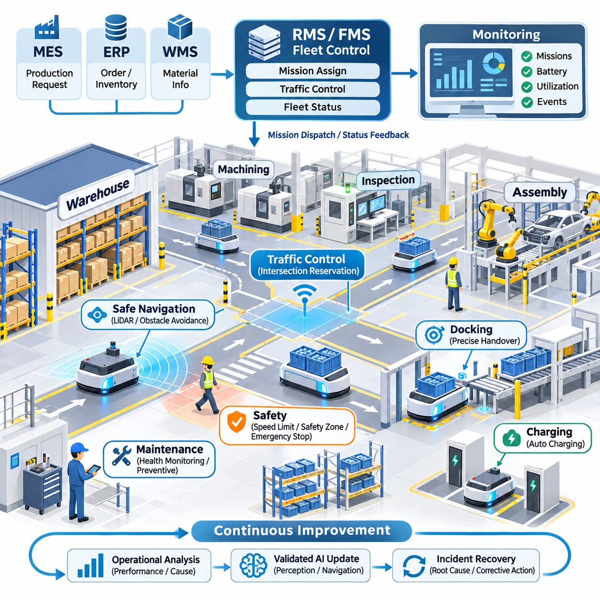
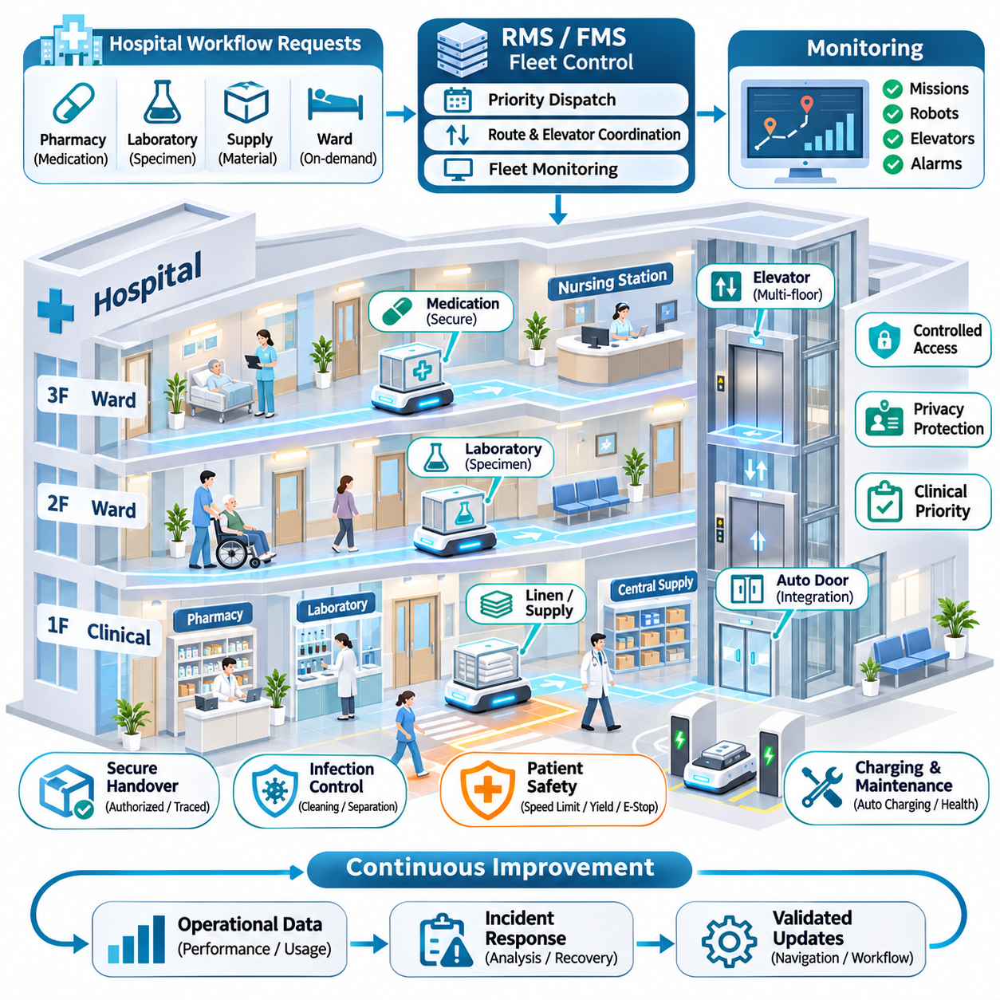
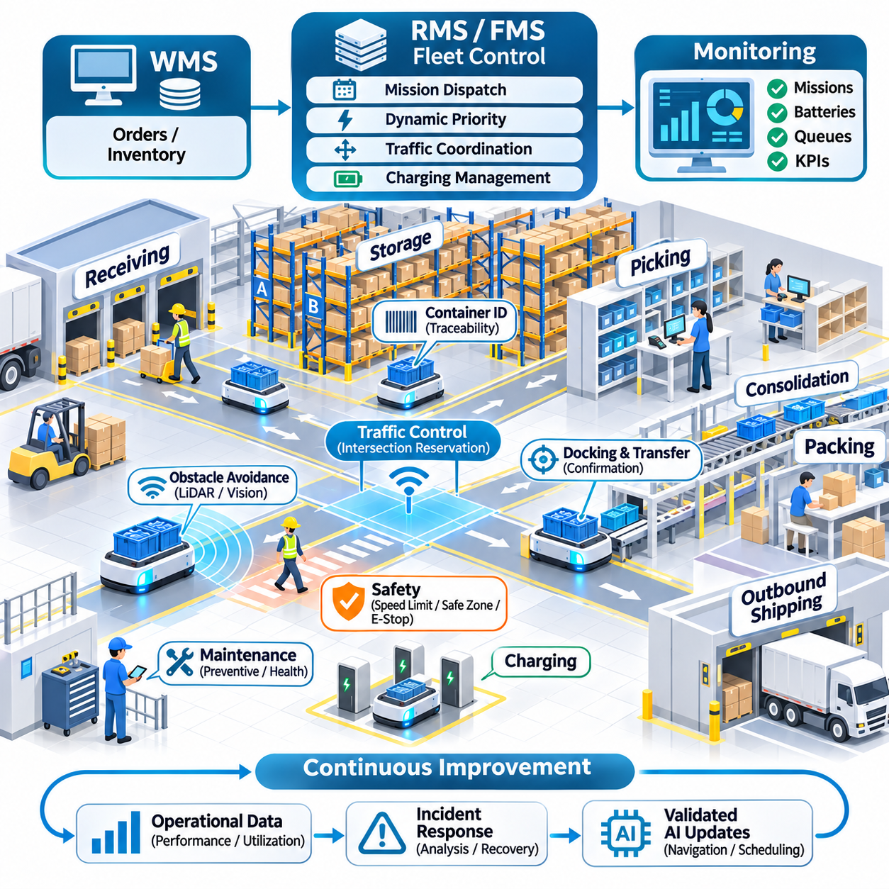
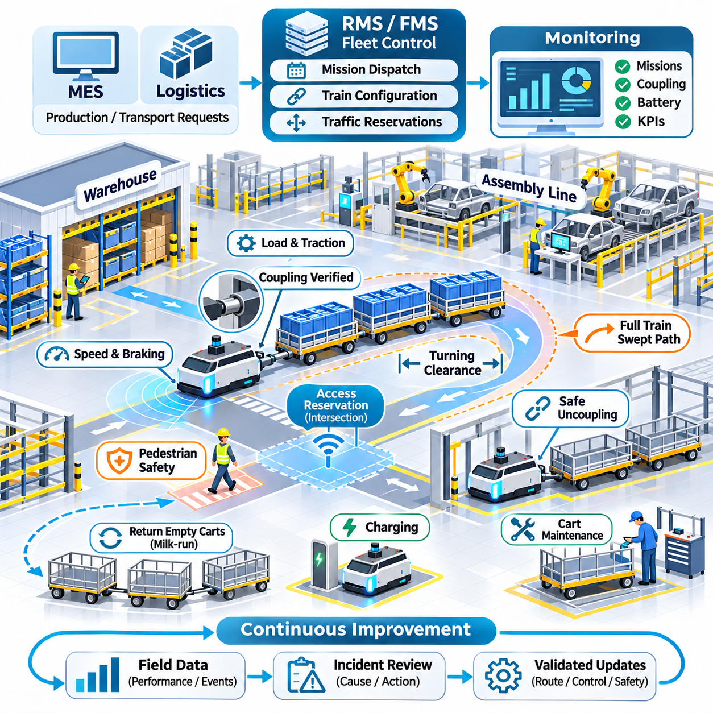
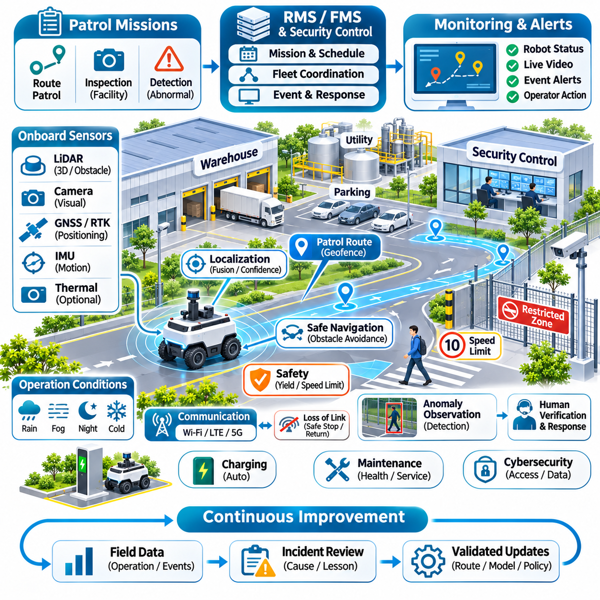
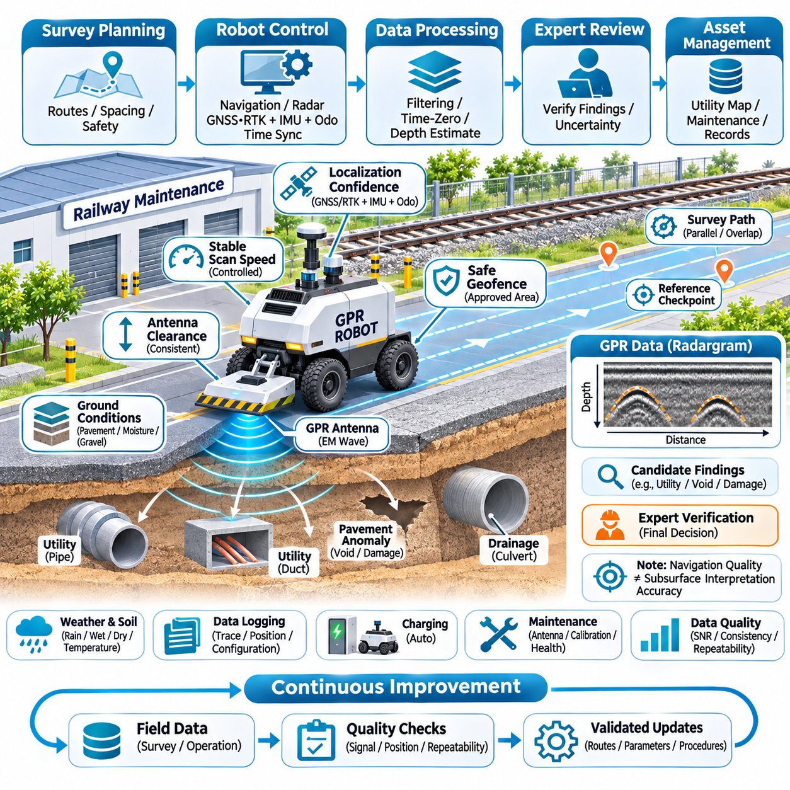
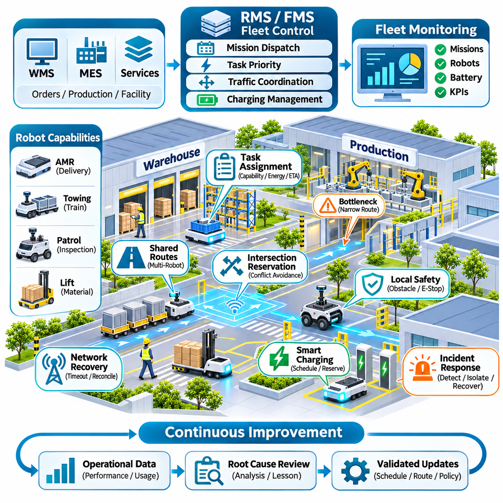
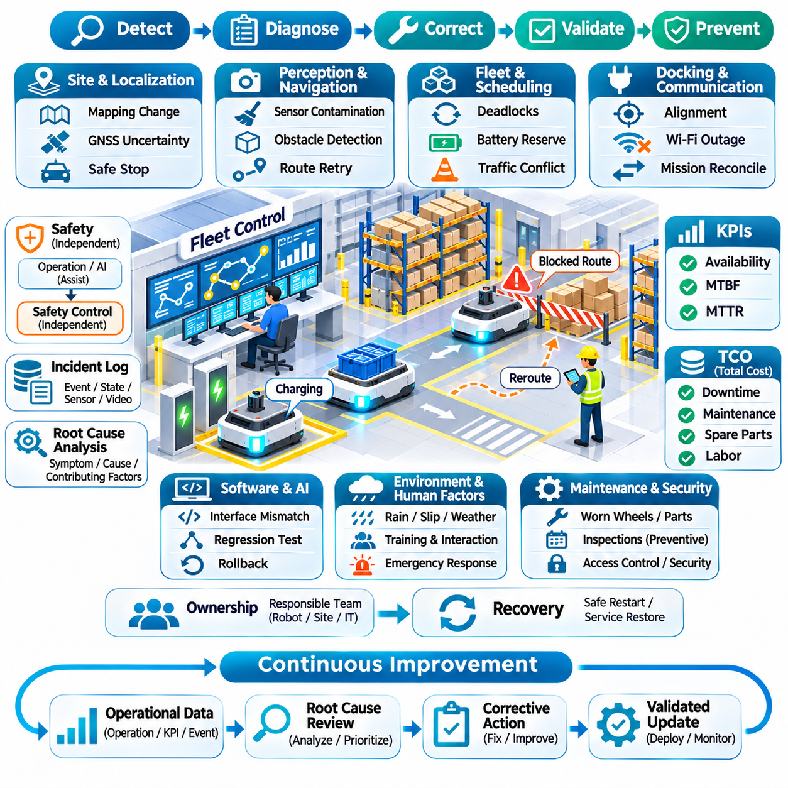

**Volume 08. AMR Operations, Deployment, and MLOps**

# Chapter 23. Operational Case Studies

## 23.1 Smart Factory Operation Case

{width="7.268055555555556in" height="7.268055555555556in"}

A smart factory operation case demonstrates how Autonomous Mobile Robots (AMRs) can transform internal material transportation into a coordinated, data-driven manufacturing service. Rather than treating robots as isolated transportation devices, the factory integrates navigation, production scheduling, safety supervision, fleet management, and maintenance into a unified operational framework that supports continuous production.

Consider a representative automotive component factory operating multiple assembly lines, machining cells, inspection stations, and material storage areas. The facility previously depended on manually operated carts and forklifts for moving components between production zones. Increasing product variation, frequent schedule changes, and labor-intensive transportation created a need for flexible automation without extensive reconstruction of the existing factory layout.

The deployment objective was to establish reliable material delivery between the central warehouse, intermediate buffers, and assembly stations. AMRs were assigned repetitive transportation missions involving component containers, production kits, and empty material carriers. The operational design emphasized predictable delivery intervals, safe movement through shared corridors, and synchronization with production demand rather than maximizing individual robot speed.

Before deployment, engineers conducted a detailed site survey covering corridor dimensions, floor conditions, pedestrian crossings, equipment locations, wireless connectivity, and material transfer interfaces. Traffic observations identified recurring congestion near machining cells and warehouse entrances. These findings informed route planning, safety zone configuration, charging station placement, and the selection of suitable robot payload capacities.

The initial system architecture combined mobile robots, a Robot Management System (RMS), a Fleet Management System (FMS), and factory information systems. Manufacturing Execution System (MES) requests were translated into transportation missions, while Enterprise Resource Planning (ERP) and Warehouse Management System (WMS) interfaces supplied relevant inventory and material information. Clear interface ownership reduced duplicated commands and inconsistent task states.

Each transportation request included a pickup location, delivery destination, material identifier, priority, and required completion time. The fleet controller evaluated robot availability, battery status, travel distance, and current traffic conditions before assigning a mission. Mission acknowledgments and completion confirmations were exchanged with factory systems to maintain traceability between physical material movement and production records.

Navigation relied on LiDAR-based localization, mapped routes, and continuous obstacle detection. Robots traveled through designated corridors while adapting to temporary obstructions such as parked carts or moving personnel. Local navigation handled immediate obstacle avoidance, whereas fleet-level traffic management coordinated shared intersections and narrow passages to prevent conflicts between multiple robots operating simultaneously.

Factory safety requirements extended beyond basic obstacle detection. Engineers established speed limits, protective detection zones, emergency stop procedures, and restricted operating areas based on site-specific risk assessments. Safety-related functions required appropriate validation independently of ordinary navigation software. Personnel received training on robot behavior, pedestrian interactions, emergency procedures, and authorized recovery operations.

Material transfer stations represented a critical operational interface. Robots needed to approach conveyors, racks, or automated loading mechanisms with sufficient positioning accuracy for reliable handover. Where normal navigation accuracy was insufficient, dedicated docking references and local alignment procedures were introduced. Transfer confirmation sensors prevented robots from departing before loading or unloading operations were completed.

The deployment followed a phased commissioning strategy beginning with controlled transportation routes during low-activity production periods. Engineers verified localization stability, docking performance, communication recovery, and emergency stop behavior before expanding operating hours. Subsequent trials introduced normal pedestrian traffic, production schedule variations, and simultaneous missions to evaluate the system under realistic manufacturing conditions.

During pilot operation, engineers observed that robot navigation performance alone did not determine transportation reliability. Delays frequently originated from unavailable loading stations, incomplete material preparation, blocked corridors, or delayed responses from factory equipment. Operational analysis therefore distinguished robot-related failures from external process constraints, allowing corrective actions to target the actual causes of mission disruption.

A representative improvement involved congestion at a shared intersection connecting the warehouse and two assembly zones. Initially, multiple robots approached the crossing independently, producing repeated waiting cycles. The fleet controller was subsequently configured to reserve access to the intersection and release it after passage. This coordination reduced conflicting movements and made transportation timing more predictable.

Another operational challenge involved temporary changes to the factory environment. Pallets, maintenance equipment, and production carts occasionally occupied mapped routes, forcing robots to wait or request alternative paths. Engineers established procedures for identifying persistent obstructions, updating approved route configurations, and notifying production supervisors when environmental changes affected transportation service availability.

Battery management became increasingly important as operating hours expanded. Instead of charging every robot according to a fixed schedule, the fleet controller considered remaining energy, expected mission consumption, charging station availability, and upcoming production demand. Opportunity charging during low-demand intervals helped maintain fleet readiness while reducing unnecessary interruptions to material transportation.

The operations dashboard provided visibility into active missions, robot positions, battery conditions, charging states, blocked routes, and abnormal events. Supervisors could distinguish robots performing missions from those waiting for material, charging, or requiring assistance. Historical event records supported investigations into recurring delays and allowed engineering teams to evaluate whether operational changes improved overall factory performance.

Operational performance was assessed through mission completion rate, delivery punctuality, transportation cycle time, robot availability, intervention frequency, and fleet utilization. These indicators were analyzed together because high robot utilization did not necessarily indicate efficient production support. Excessive utilization could reduce recovery capacity and increase the probability of delayed deliveries during unexpected demand peaks.

For example, a robot fleet operating near full utilization might achieve high transportation activity while accumulating queues at loading stations. A more balanced scheduling strategy could maintain available capacity for urgent production requests and unexpected disturbances. Fleet sizing therefore considered demand variability, charging requirements, route congestion, and recovery margins rather than average transportation volume alone.

Robot health monitoring incorporated battery condition, motor temperature, controller status, sensor availability, communication quality, and software process health. Maintenance personnel reviewed abnormal trends and recurring fault codes to identify components requiring inspection. Predictive maintenance methods could be introduced after sufficient operating history was collected, supporting condition-based servicing rather than relying exclusively on fixed maintenance intervals.

Operational data also supported continuous improvement of perception and navigation functions. Difficult scenarios involving reflective surfaces, unexpected obstacles, or localization uncertainty were recorded and classified for engineering review. Selected datasets could support simulation, algorithm evaluation, and model refinement, while deployment approval remained dependent on regression testing and documented safety validation.

Software and AI model updates were managed through controlled release procedures. New versions were first evaluated in simulation and representative test environments before limited field deployment. Compatibility checks covered robot hardware, navigation maps, communication interfaces, and mission execution behavior. Rollback mechanisms allowed operators to restore a previously validated configuration when an update introduced unacceptable operational changes.

Incident response procedures defined how operators should react to navigation failures, unexpected stops, communication interruptions, and material transfer errors. Each event required an appropriate classification, immediate safety assessment, and recovery decision. Serious or repeated incidents triggered root cause analysis involving robot logs, fleet events, factory system records, and relevant environmental observations.

Cybersecurity controls protected the connections between mobile robots and manufacturing infrastructure. Device authentication, role-based access control, encrypted communication, network segmentation, and controlled software distribution reduced exposure to unauthorized commands and configuration changes. Operational security monitoring also helped identify unusual communication patterns or unexpected access attempts affecting robot services.

The economic evaluation considered more than direct labor substitution. Potential benefits included reduced manual transportation effort, improved material traceability, more consistent delivery timing, and better allocation of personnel to production activities. Costs included robot acquisition, infrastructure integration, maintenance, software operation, charging facilities, training, and system support. Return on investment depended on measured site-specific performance.

As the deployment matured, factory managers could expand AMR services from simple point-to-point transportation to production-responsive material replenishment. Integration with MES events enabled missions to be generated according to actual production consumption and workstation demand. This approach reduced dependence on fixed transportation schedules and created opportunities for closer coordination between manufacturing execution and internal logistics.

The representative case illustrates that successful smart factory automation requires coordinated engineering across robotics, manufacturing processes, information systems, and daily operations. Sustainable performance emerges when transportation reliability, functional safety, operational visibility, maintenance readiness, and continuous improvement are managed together. AMRs consequently become an integrated manufacturing capability rather than standalone mobile machines.

## 23.2 Hospital AMR Operation Case

{width="7.268055555555556in" height="7.268055555555556in"}

Hospital Autonomous Mobile Robot (AMR) operations demonstrate how intelligent transportation systems can improve healthcare logistics while supporting clinical staff and maintaining patient safety. Unlike conventional industrial environments, hospitals require robots to navigate unpredictable human activity, strict hygiene requirements, and time-sensitive medical workflows. Successful deployment depends on integrating robotic mobility with hospital procedures and operational governance.

Consider a representative general hospital operating emergency departments, inpatient wards, laboratories, pharmacies, and central supply facilities across several floors. Traditionally, nurses, logistics personnel, and support staff transported medications, laboratory specimens, linens, and medical supplies manually. Increasing service demand and staffing constraints created opportunities to automate repetitive transportation while preserving clinical accountability.

The primary deployment objective was to establish a dependable internal logistics network connecting pharmacies, laboratories, supply rooms, and nursing stations. AMRs were assigned scheduled deliveries and on-demand transportation missions according to clinical priorities. The operating model distinguished routine material movement from urgent deliveries requiring immediate dispatch, ensuring that automation supported rather than disrupted patient care.

Before deployment, engineers conducted detailed workflow analysis and site surveys covering corridor dimensions, elevator capacity, automatic doors, pedestrian congestion, and wireless connectivity. Particular attention was given to emergency routes, restricted treatment areas, and high-traffic nursing stations. The resulting operational map identified approved travel corridors, docking locations, charging facilities, and areas requiring additional access authorization.

The system architecture combined hospital AMRs, a Robot Management System (RMS), a Fleet Management System (FMS), and selected hospital information services. Transportation requests could originate from authorized pharmacy, laboratory, or logistics applications through controlled interfaces. Mission records included pickup and delivery locations, material categories, priority levels, authorization requirements, and confirmation states.

Task scheduling considered delivery urgency, robot availability, battery condition, travel distance, and destination accessibility. Routine supply missions were grouped where operationally appropriate, while urgent specimen or medication requests received higher dispatch priority. Scheduling rules also accounted for elevator delays, clinical shift changes, and predictable congestion periods to improve delivery reliability without compromising safety.

Multi-floor transportation required coordinated elevator and automatic door integration. Robots requested elevator service through approved interfaces, verified access conditions, and entered only when sufficient space and safe operating conditions were available. Door controllers and elevator systems retained their independent safety functions. Communication failures triggered controlled waiting or recovery procedures rather than unrestricted robot movement.

Hospital navigation presented challenges associated with patients, wheelchairs, beds, visitors, and rapidly changing corridor conditions. LiDAR and camera-based perception supported obstacle detection and localization, while navigation policies maintained conservative speeds in shared spaces. Robots yielded to pedestrians and avoided blocking clinical activities. Emergency corridors and evacuation routes remained subject to hospital-defined access restrictions.

Patient safety required a risk-based operational framework addressing collision hazards, accessibility, emergency response, and human interaction. Engineers configured protective zones, speed restrictions, emergency stop functions, and safe stopping behavior according to validated operating conditions. Robots were not permitted to obstruct emergency medical equipment or critical treatment activities, and safety-related controls remained independent of ordinary task optimization.

Material handling procedures differed according to transportation categories. Medication deliveries required secure compartments, authorized access, and documented handover. Laboratory specimens required appropriate containment, identification, and handling conditions. Clean linens and sterile supplies were separated from contaminated materials through designated containers and workflows, preventing inappropriate mixing during routine transportation.

Infection prevention represented a major difference between hospital and factory operations. Robot surfaces, storage compartments, and frequently touched interfaces required cleaning procedures compatible with hospital infection control policies. Cleaning schedules were aligned with transported material types and exposure conditions. Robots assigned to potentially contaminated workflows required additional controls before returning to clean transportation services.

A phased deployment began with low-risk supply transportation between central storage and selected nursing stations. Engineers evaluated route completion, docking accuracy, elevator integration, communication stability, and staff interaction before expanding operational coverage. Subsequent phases introduced pharmacy deliveries, laboratory specimen transportation, and additional hospital floors after relevant workflow and safety requirements were validated.

During pilot operation, one recurring challenge involved robots waiting near elevators during peak visitor periods. Although navigation remained functional, unpredictable elevator availability increased mission completion times. The fleet controller was adjusted to account for historical elevator waiting patterns and avoid unnecessary concentration of robots at shared access points. This improved scheduling consistency without requiring higher travel speeds.

Another challenge involved incomplete handovers at nursing stations. Staff occasionally became occupied with urgent clinical tasks, leaving robots waiting with delivered materials. The operating procedure introduced arrival notifications, configurable waiting periods, and escalation to designated personnel. Mission completion required appropriate acknowledgment, ensuring that unattended deliveries were not incorrectly recorded as successful.

Operational monitoring provided real-time visibility into robot locations, active missions, compartment status, battery levels, elevator delays, and abnormal events. Supervisors could identify missions requiring assistance and distinguish technical failures from clinical workflow interruptions. Historical records supported service reviews and helped hospital administrators understand transportation demand across departments and operating periods.

Performance evaluation considered successful delivery rate, delivery punctuality, average mission duration, robot availability, intervention frequency, and clinical staff time released from transportation duties. Additional indicators included elevator waiting time, failed handovers, and safety-related events. These measures were interpreted together because transportation efficiency could not justify reduced patient safety or compromised material handling requirements.

Fleet capacity planning accounted for daily demand cycles, emergency reserves, charging requirements, and variations between hospital departments. A fleet operating continuously at maximum utilization could struggle to accommodate unexpected urgent requests. Maintaining appropriate spare capacity improved operational resilience and allowed robots to respond to changing clinical priorities without repeatedly delaying scheduled deliveries.

Battery management used scheduled charging and opportunity charging during periods of lower transportation demand. Charging stations were positioned away from emergency access routes and high-traffic clinical areas. Robot health monitoring tracked battery condition, motor status, sensor availability, communication quality, and software performance. Maintenance activities were coordinated to minimize interruptions during critical hospital operating periods.

Incident response procedures addressed unexpected stops, blocked corridors, elevator communication failures, unauthorized compartment access, and incomplete deliveries. Operators first assessed patient and staff safety before initiating recovery actions. Events involving medication security, specimen integrity, or infection control required notification of the responsible hospital personnel and handling according to established clinical procedures.

Cybersecurity and privacy controls protected hospital robot operations from unauthorized access and inappropriate data exposure. Device authentication, encrypted communication, role-based permissions, and network segmentation restricted system interactions. Operational logs were designed to retain necessary transportation evidence while minimizing sensitive patient information. Access to mission records and remote-control functions was governed by authorized responsibilities.

Continuous improvement relied on operational data collected during routine missions. Engineers analyzed repeated navigation delays, difficult obstacle encounters, docking failures, and communication interruptions. Selected data supported simulation, software refinement, and controlled AI model evaluation. Updated models underwent regression testing and safety validation before deployment, with rollback procedures available when performance deteriorated.

The economic assessment considered transportation labor requirements, delivery reliability, equipment utilization, maintenance costs, and system integration expenses. Benefits could include reduced nonclinical workload for nursing personnel, more consistent supply movement, and improved transportation traceability. However, financial outcomes depended on actual mission volumes, hospital layout, staffing practices, and the cost of maintaining dependable operational support.

As the hospital deployment matured, AMRs could support coordinated logistics across pharmacy, laboratory, central supply, and inpatient departments. Integration with approved hospital workflow systems enabled transportation requests to reflect actual operational demand. Centralized fleet orchestration improved resource allocation while maintaining departmental responsibilities for clinical decisions, material authorization, and patient-related procedures.

This representative hospital operation case demonstrates that AMR success depends on more than autonomous navigation and transportation efficiency. Reliable healthcare robotics requires coordinated workflow integration, patient safety, infection prevention, secure material handling, fleet management, and continuous operational improvement. When these elements are governed effectively, AMRs become dependable infrastructure supporting hospital logistics and clinical service continuity.

## 23.3 Logistics AMR Operation Case

{width="7.268055555555556in" height="7.268055555555556in"}

Logistics Autonomous Mobile Robot (AMR) operations demonstrate how intelligent mobile automation can improve warehouse productivity, material flow, and order fulfillment reliability. Modern distribution centers must manage fluctuating order volumes, diverse product categories, and strict delivery schedules. Successful AMR deployment requires coordinated integration of robotic transportation, warehouse processes, inventory systems, and fleet-level operational control.

Consider a representative e-commerce distribution center containing receiving docks, storage racks, picking stations, packing areas, and outbound shipping zones. Traditionally, warehouse personnel moved goods using manual carts, pallet trucks, and forklifts. Increasing order frequency and shorter fulfillment deadlines created pressure to reduce unnecessary travel, improve material handling consistency, and maintain operational flexibility during demand fluctuations.

The primary deployment objective was to automate repetitive transportation between storage areas, picking stations, consolidation zones, and packing lines. AMRs transported containers, totes, and selected material carriers according to warehouse task priorities. The operating strategy focused on reducing nonproductive movement, improving workstation replenishment, and maintaining predictable transportation capacity throughout daily warehouse operations.

Before deployment, engineers conducted a detailed warehouse site survey covering aisle dimensions, floor conditions, rack layouts, loading interfaces, pedestrian routes, and wireless network coverage. Traffic analysis identified congestion near picking stations, conveyor intersections, and shipping preparation areas. These findings supported navigation map development, robot selection, charging infrastructure planning, and operational safety zone configuration.

The system architecture integrated AMRs with a Warehouse Management System (WMS), Fleet Management System (FMS), and Robot Management System (RMS). The WMS generated transportation requests based on inventory movements and order fulfillment requirements. The fleet controller converted these requests into executable missions, assigned suitable robots, and reported completion status through standardized interfaces.

Each transportation mission included pickup and destination identifiers, container information, priority, and expected completion conditions. Robot assignment considered current position, payload capability, battery level, route availability, and workload distribution. The scheduling algorithm balanced urgent orders against routine replenishment activities while avoiding excessive concentration of robots around high-demand workstations.

Warehouse navigation relied on mapped routes, localization sensors, obstacle detection, and dynamic path planning. Robots operated around pedestrians, pallet trucks, and stationary equipment while maintaining defined safety distances. Local navigation handled immediate obstacle avoidance, whereas fleet-level traffic management coordinated intersections, narrow aisles, and shared loading zones to reduce congestion and prevent conflicting movements.

Material transfer interfaces represented an important source of operational complexity. Robots needed to align with conveyor systems, storage racks, or workstation docking points before loading and unloading. Position verification and transfer confirmation prevented incomplete handovers. Where automated transfer mechanisms were unavailable, operator-assisted procedures were designed to maintain consistent mission status and material traceability.

Warehouse safety management required consideration of mixed traffic involving personnel, forklifts, pallet trucks, and autonomous robots. Engineers established operating speed limits, restricted zones, pedestrian crossing rules, and emergency stop procedures through site-specific risk assessments. Safety functions were validated under representative operating conditions, and personnel received training on robot behavior and emergency response responsibilities.

Deployment began with a limited pilot connecting selected storage zones and picking stations. Engineers measured mission completion, docking reliability, navigation interruptions, and operator intervention frequency. After initial acceptance, additional routes and robots were introduced gradually. This phased rollout allowed warehouse managers to identify workflow bottlenecks before expanding automation into critical outbound fulfillment processes.

During pilot operation, one recurring problem involved congestion near high-volume picking stations. Multiple robots arrived simultaneously, creating queues that reduced effective transportation throughput. The fleet controller was modified to consider workstation readiness and available buffer capacity before dispatching additional robots. This reduced unnecessary waiting and improved coordination between picking operations and material transportation.

Another operational challenge involved inventory discrepancies between physical containers and WMS records. A robot could complete transportation successfully while the associated inventory transaction remained incomplete or incorrect. Engineers introduced container identification checks, mission acknowledgment rules, and exception handling procedures to maintain consistency between physical material movement and digital inventory records.

Fleet scheduling became increasingly important as order volumes varied throughout the day. During peak periods, transportation requests accumulated faster than available robots could execute them. The scheduling strategy therefore considered order urgency, workstation dependencies, estimated travel time, and charging requirements. Dynamic prioritization helped maintain critical fulfillment activities without allowing routine transportation queues to grow uncontrollably.

Battery management combined scheduled charging with opportunity charging during periods of reduced warehouse demand. Charging stations were positioned to minimize interference with primary transportation routes. Fleet software monitored remaining energy and predicted whether robots could complete assigned missions before requiring recharge. Appropriate charging reserves prevented unexpected robot shortages during high-demand fulfillment periods.

Operational dashboards displayed robot positions, active missions, battery levels, charging states, blocked routes, and workstation queues. Supervisors used these interfaces to identify abnormal delays and distinguish robot failures from warehouse process interruptions. Historical operational records supported daily performance reviews and helped engineering teams identify recurring congestion patterns or inefficient transportation assignments.

Performance evaluation considered mission completion rate, average transportation cycle time, robot availability, fleet utilization, order fulfillment support, and intervention frequency. Additional indicators included empty travel distance, charging downtime, workstation waiting time, and transportation-related delays. These metrics were evaluated together because maximizing individual robot activity did not necessarily maximize overall warehouse throughput.

A representative optimization involved reducing empty robot travel between distant storage and packing zones. Initially, robots frequently returned to their original waiting locations after completing deliveries. Revised dispatch logic assigned nearby pickup missions whenever operationally appropriate. This reduced unnecessary movement and improved productive fleet utilization without increasing robot travel speed or hardware capacity.

Robot health monitoring tracked battery degradation, motor temperature, drive performance, sensor availability, communication quality, and software process stability. Maintenance personnel reviewed abnormal trends and repeated fault events to identify components requiring inspection. As operational history accumulated, predictive maintenance methods could estimate failure risks and support maintenance scheduling during lower-demand warehouse periods.

Incident response procedures addressed blocked aisles, localization failures, incomplete material transfers, communication interruptions, and unexpected robot stops. Operators first evaluated safety conditions before initiating recovery. Each incident was recorded with relevant mission information, robot status, and environmental observations. Repeated failures triggered root cause analysis and corrective actions involving both robotics engineers and warehouse operations personnel.

Cybersecurity controls protected communication between robots, warehouse systems, and remote management services. Device authentication, encrypted communication, role-based access control, and network segmentation restricted unauthorized interactions. Software updates were distributed through controlled deployment procedures, while operational logs supported security monitoring and investigation of abnormal system behavior.

Continuous improvement relied on operational data collected during routine warehouse missions. Engineers analyzed navigation delays, obstacle encounters, docking errors, and scheduling inefficiencies. Selected datasets supported simulation, software optimization, and controlled AI model refinement. Updated navigation or perception models underwent regression testing and field validation before deployment to prevent unintended operational degradation.

Economic evaluation considered transportation labor requirements, robot acquisition costs, infrastructure integration, maintenance expenses, and software operation. Potential benefits included reduced manual travel, improved material movement consistency, and increased order processing capacity. Return on investment depended on actual transportation demand, warehouse layout, utilization patterns, and the cost of sustaining reliable automation services.

As the deployment matured, the warehouse could expand from simple point-to-point transportation toward coordinated fulfillment automation. AMRs operated alongside conveyors, automated storage systems, picking stations, and inventory management applications. Fleet orchestration synchronized transportation with workstation readiness and order priorities, enabling more adaptive material flow across interconnected warehouse processes.

This representative logistics operation case demonstrates that AMR success depends on system-level coordination rather than autonomous navigation alone. Reliable warehouse automation requires effective WMS integration, fleet scheduling, traffic management, material traceability, operational safety, and continuous performance optimization. When these capabilities operate together, AMRs become scalable infrastructure supporting flexible and resilient logistics operations.

## 23.4 Towing AMR Operation Case

{width="7.268055555555556in" height="7.268055555555556in"}

Towing Autonomous Mobile Robot (AMR) operations demonstrate how autonomous traction systems can improve industrial material transportation by moving multiple carts or heavy loads along coordinated routes. Unlike conventional payload-carrying robots, towing AMRs must manage the combined dynamics of the robot, coupling mechanism, and trailing carts. Reliable deployment requires integrated mechanical engineering, navigation control, traffic management, and operational safety.

Consider a representative automotive assembly facility where components are transported from central storage areas to production lines using wheeled carts. Traditional tugger trains require human drivers and fixed transportation schedules, creating inefficiencies during production changes. Introducing towing AMRs enables flexible material replenishment while reducing repetitive driving tasks and improving transportation traceability across manufacturing operations.

The deployment objective was to automate scheduled milk-run transportation between warehouses, intermediate buffers, and assembly stations. Each towing AMR collected prepared carts, followed an approved delivery route, and returned empty containers to designated locations. The operational design emphasized consistent delivery intervals, predictable route completion, and synchronization with production demand rather than maximizing vehicle speed.

Before deployment, engineers surveyed corridor widths, turning areas, floor gradients, loading stations, and pedestrian crossings. Special attention was given to intersections where trailing carts could occupy adjacent traffic lanes. The site assessment also examined floor friction, uneven surfaces, and emergency stopping distances under representative towing loads. These observations informed route design, operating limits, and safety validation.

The towing system consisted of an autonomous tractor, mechanical coupling device, compatible carts, and fleet management infrastructure. The coupling mechanism required sufficient strength to withstand acceleration, braking, and turning forces. Cart compatibility depended on wheel configuration, drawbar geometry, load distribution, and connection height. Mechanical interfaces were standardized to reduce coupling errors and simplify daily operations.

Towing capacity was evaluated using total train mass, rolling resistance, acceleration requirements, floor gradients, and traction availability. Engineers considered both continuous pulling force and peak forces during starting or stopping. The rated towing capability could not be determined from motor power alone because wheel traction, braking performance, coupling strength, and cart stability imposed additional operational constraints.

Navigation planning accounted for the swept path of the entire cart train rather than only the tractor footprint. During turns, trailing carts could follow different trajectories and create off-tracking hazards near walls or equipment. Engineers evaluated turning radius, articulation angles, train length, and clearance margins. Routes were approved only after representative loaded and unloaded configurations were tested.

The control architecture integrated localization, trajectory tracking, speed regulation, coupling supervision, and fleet coordination. Robot motion commands were constrained by the towing configuration and validated operating envelope. Acceleration and deceleration profiles were adjusted to limit excessive drawbar forces and unstable cart movement. Sharp steering changes were avoided where they could produce dangerous articulation or lateral displacement.

Automatic coupling introduced additional operational complexity. The robot approached a prepared cart, aligned with the coupling interface, and engaged the connection mechanism. Mechanical engagement was verified through suitable sensors before transportation began. If coupling confirmation failed, the robot remained stationary and requested recovery assistance rather than attempting to tow an unsecured cart.

Uncoupling procedures required equivalent verification. The towing AMR positioned the cart at an approved transfer station, confirmed that the cart was stable, and released the coupling mechanism. Where necessary, wheel restraints or station fixtures prevented unintended cart movement. Mission completion was reported only after successful release and confirmation that the cart remained within the designated transfer area.

Fleet management coordinated towing missions according to production schedules, cart availability, route occupancy, and robot readiness. Transportation requests originated from manufacturing or logistics systems and were converted into executable missions. The dispatcher considered train length, destination accessibility, battery status, and traffic conditions before assigning a robot to a particular towing operation.

Traffic management was especially important because towing trains occupied more space and required longer maneuvering distances than individual AMRs. Shared intersections, narrow corridors, and loading zones were managed through access reservations and controlled entry rules. Fleet software prevented incompatible movements from entering constrained areas simultaneously, reducing congestion and minimizing the need for difficult reversing maneuvers.

Safety engineering addressed hazards associated with both the tractor and trailing carts. Protective detection coverage, operating speeds, stopping distances, and emergency stop behavior were evaluated for the complete towing configuration. Additional measures were required where carts could create blind zones or lateral collision risks. Safety validation considered representative loads, surface conditions, and pedestrian interactions.

A phased deployment began with a single towing route operating during controlled production periods. Engineers verified coupling reliability, cart tracking, braking performance, localization stability, and mission completion. Subsequent trials introduced multiple carts, normal factory traffic, and simultaneous robot operations. Expansion proceeded only after mechanical, navigation, and safety acceptance criteria were satisfied.

During pilot operation, a recurring issue involved carts deviating from expected paths at tight corners. Although the tractor followed its planned trajectory, the rear carts approached nearby equipment more closely than anticipated. Engineers revised route geometry, increased clearance margins, and reduced turning speeds. This demonstrated why towing navigation must consider the full articulated train rather than tractor localization alone.

Another operational challenge involved inconsistent cart wheel conditions. Worn casters and uneven wheel resistance increased towing force and caused unpredictable tracking behavior. Maintenance inspections were expanded to include cart wheels, bearings, drawbars, and coupling components. Standardized cart condition requirements improved transportation reliability and reduced the likelihood of mechanical incidents during routine operations.

Battery management considered the higher and more variable energy consumption associated with towing. Energy demand depended on train mass, route length, floor resistance, acceleration frequency, and gradients. Fleet software monitored remaining battery capacity and mission energy estimates before dispatch. Charging schedules were coordinated with production demand to preserve sufficient towing capacity during peak material replenishment periods.

Operational dashboards displayed towing missions, robot positions, coupling states, train configurations, battery levels, and route availability. Supervisors could distinguish transportation delays caused by robot faults from those caused by unavailable carts or blocked transfer stations. Historical mission records supported analysis of route efficiency, coupling performance, and recurring operational interruptions.

Performance evaluation considered completed towing missions, transported material volume, route cycle time, coupling success rate, robot availability, and operator intervention frequency. Additional indicators included empty travel distance, average train utilization, charging downtime, and safety-related events. These metrics were interpreted together because increasing cart quantity did not necessarily improve overall material flow efficiency.

A representative optimization involved adjusting cart train composition according to production demand. Initially, every mission used a fixed number of carts, resulting in unnecessary movement during low-demand periods. Revised scheduling allowed different approved train configurations based on material requirements and route constraints. This improved operational flexibility while maintaining validated towing and braking limits.

Robot health monitoring included motor temperature, drive current, battery condition, braking performance, coupling status, and localization quality. Abnormal towing resistance or repeated coupling errors triggered maintenance inspections. As operational history accumulated, predictive maintenance methods could identify developing mechanical problems and support planned servicing before failures interrupted production transportation.

Incident response procedures addressed coupling failures, unexpected cart movement, blocked routes, localization errors, and emergency stops. Operators first secured the towing train and evaluated surrounding safety conditions before initiating recovery. Incident records included robot status, cart configuration, load conditions, and relevant environmental observations. Repeated events triggered root cause analysis and corrective engineering actions.

Continuous improvement relied on field data describing towing forces, route deviations, mission delays, and equipment conditions. Engineers used these observations to refine navigation parameters, cart compatibility requirements, and operational scheduling. Software updates were validated through simulation and controlled field testing, while changes affecting safety-related behavior required appropriate reassessment before release.

Economic evaluation considered transportation labor savings, towing robot acquisition costs, cart standardization, infrastructure modifications, maintenance expenses, and software integration. Potential benefits included improved material delivery consistency, reduced repetitive driving, and better utilization of existing cart systems. Return on investment depended on actual transportation volume, route characteristics, fleet utilization, and operational support costs.

As the deployment matured, towing AMRs could become part of a coordinated factory logistics network integrating warehouses, production lines, and automated transfer stations. Fleet orchestration synchronized cart movement with manufacturing demand and available loading capacity. This representative case demonstrates that reliable towing automation depends on complete train dynamics, verified coupling, safe navigation, and disciplined operational management.

## 23.5 Outdoor Patrol Robot Case

{width="7.268055555555556in" height="7.268055555555556in"}

Outdoor autonomous patrol robots demonstrate how intelligent mobile systems can support public safety, infrastructure inspection, and continuous facility monitoring. Unlike indoor AMRs, outdoor robots must operate across changing terrain, unpredictable weather, and environments shared with pedestrians and vehicles. Reliable deployment requires robust mobility, environmental perception, communication resilience, and coordinated human supervision.

Consider a representative industrial complex containing perimeter roads, warehouses, parking areas, utility facilities, and restricted access zones. Security personnel traditionally conducted scheduled patrols using vehicles or walking routes. Large coverage areas and repetitive inspections created opportunities for autonomous patrol robots to extend monitoring coverage while allowing personnel to concentrate on incident assessment and response.

The primary deployment objective was to establish regular autonomous patrols covering designated routes and critical infrastructure locations. Robots performed scheduled inspections, captured environmental observations, and reported abnormal conditions to a central control room. Their responsibilities focused on detection, documentation, and notification rather than independent enforcement or emergency intervention.

Before deployment, engineers surveyed road surfaces, slopes, drainage channels, curbs, pedestrian crossings, and restricted areas. Environmental analysis considered rain, fog, darkness, seasonal vegetation, and temporary construction obstacles. The resulting operational map identified approved patrol corridors, inspection points, communication limitations, charging locations, and areas requiring supervised operation.

The patrol platform combined electric mobility, localization sensors, environmental perception, onboard computing, and wireless communication. LiDAR, cameras, inertial sensors, and GNSS supported navigation and obstacle detection. Optional thermal cameras and radar improved situational awareness under selected conditions. Sensor configuration was validated against actual site hazards rather than assumed to provide universal detection capability.

Outdoor localization combined GNSS positioning with inertial measurements, wheel odometry, and LiDAR-based environmental matching. RTK corrections improved positioning where satellite visibility and correction services were reliable. Buildings, trees, and covered structures could degrade satellite reception. The navigation system therefore monitored localization confidence and initiated controlled stopping when position uncertainty exceeded approved limits.

Patrol route planning considered road width, turning radius, terrain gradients, surface traction, and visibility around intersections. Engineers defined geofenced operating areas and prohibited entry into unapproved roads or hazardous zones. Route segments received appropriate speed limits based on pedestrian activity and environmental risk. Temporary obstacles triggered safe rerouting only when alternative paths had been validated.

Public-space safety required conservative interaction policies around pedestrians, cyclists, and moving vehicles. Robots reduced speed near crossings, yielded when necessary, and maintained protective stopping distances. Emergency stop functions and safety monitoring remained independent of ordinary mission optimization. Operations near active vehicle traffic required specific authorization and validated separation measures.

The operational architecture connected patrol robots to a Robot Management System, Fleet Management System, and security control center. Scheduled missions included patrol routes, inspection checkpoints, reporting requirements, and escalation rules. Supervisors monitored robot positions, communication status, battery levels, and detected events. Human operators retained responsibility for interpreting security incidents and initiating appropriate responses.

Patrol inspection procedures used predefined observation points to improve consistency between missions. Cameras recorded selected infrastructure conditions, while authorized analytics identified unusual objects, damaged barriers, or unexpected activity. Detection results were treated as preliminary observations requiring verification. The system avoided assuming that every unusual visual pattern represented an actual security threat.

Nighttime operations introduced additional challenges involving reduced visibility, reflective surfaces, and changing illumination. Thermal imaging could assist detection of temperature differences, but interpretation depended on distance, weather, and target characteristics. Engineers evaluated perception performance during representative night conditions and established restrictions for scenarios where detection reliability was insufficient.

Wireless connectivity relied on available Wi-Fi, LTE, or 5G infrastructure according to site coverage. Network surveys identified weak-signal areas and potential communication interruptions. The robot maintained essential local safety functions independently of cloud connectivity. Prolonged communication loss triggered predefined behavior, such as stopping at a safe location or returning through an approved route when conditions permitted.

A phased deployment began with supervised daytime patrols along short, controlled routes. Engineers evaluated localization accuracy, obstacle handling, route completion, communication stability, and operator intervention frequency. Subsequent phases introduced longer routes, nighttime operation, and additional inspection tasks. Expansion followed documented safety acceptance and environmental validation rather than fixed deployment deadlines.

During pilot operation, one recurring challenge involved GNSS degradation near large warehouse buildings. Position estimates occasionally shifted despite stable vehicle motion. Engineers improved sensor fusion, refined localization confidence thresholds, and restricted operation in poorly observable areas. This demonstrated the importance of detecting localization uncertainty instead of relying exclusively on nominal positioning accuracy.

Another challenge involved temporary obstacles such as parked vehicles, delivery equipment, and construction barriers. Repeated attempts to bypass these objects could create unsafe or inefficient behavior. The operating procedure introduced obstacle persistence checks, approved alternative routes, and escalation to remote supervisors. Robots waited or terminated missions when no verified safe route remained available.

Weather management required explicit operating limits for rainfall, standing water, wind, temperature, and surface conditions. Sensors and electrical enclosures were protected according to environmental requirements, but protection ratings alone did not guarantee safe mobility. Operators reviewed weather alerts and site conditions before dispatch. Unsafe conditions resulted in delayed missions, restricted routes, or controlled suspension.

Battery management considered patrol distance, terrain resistance, auxiliary sensor consumption, and temperature-dependent performance. Fleet software estimated mission energy requirements and maintained reserves for safe recovery. Charging stations were located in protected areas with controlled access. Patrol schedules coordinated charging periods with security coverage requirements to avoid predictable monitoring gaps.

Operational dashboards displayed patrol progress, inspection completion, robot health, communication quality, and abnormal events. Alerts were classified by urgency and associated with location, timestamp, and available sensor evidence. Supervisors distinguished environmental anomalies from navigation faults and communication failures. Event records supported follow-up investigations and consistent shift handovers.

Performance evaluation considered patrol completion rate, inspection coverage, robot availability, intervention frequency, localization interruptions, and incident reporting latency. Additional measures included false alert frequency, charging downtime, and environmental operating restrictions. These indicators were reviewed together because increased patrol distance did not necessarily produce better security awareness or safer operations.

Robot health monitoring tracked battery condition, motor performance, braking behavior, sensor contamination, enclosure integrity, and communication stability. Outdoor exposure increased maintenance requirements for wheels, seals, cameras, and connectors. Preventive inspections addressed accumulated dust, water exposure, and mechanical wear. Repeated anomalies supported predictive maintenance and scheduled component replacement.

Incident response procedures addressed unexpected stops, collisions, sensor failures, unauthorized interference, and communication outages. Operators assessed nearby human safety before attempting remote recovery. Events requiring physical intervention were assigned to trained personnel. Incident records preserved relevant robot status, environmental observations, and operator actions for root cause analysis and corrective measures.

Cybersecurity and privacy controls protected patrol operations against unauthorized access and inappropriate surveillance. Device authentication, encrypted communication, access permissions, and secure software updates reduced system exposure. Camera recording and retention followed applicable site policies and legal requirements. Human oversight governed access to sensitive imagery, remote control, and incident evidence.

Continuous improvement used field data describing difficult terrain, perception errors, route interruptions, and environmental changes. Engineers selected representative cases for simulation, model refinement, and regression testing. Updated navigation or detection models underwent controlled field validation before operational release. Rollback procedures preserved previously approved behavior when new software introduced unacceptable performance changes.

Economic evaluation considered security labor allocation, patrol coverage, equipment acquisition, network infrastructure, maintenance, and operational supervision. Potential benefits included more consistent inspections, improved event traceability, and reduced repetitive patrol workload. Financial value depended on site characteristics, actual operating hours, intervention requirements, and the continuing need for qualified security personnel.

As deployment matured, outdoor patrol robots could integrate with facility management systems, access control infrastructure, and centralized security operations. Multiple robots could coordinate inspection coverage while maintaining independent safety constraints. This representative case demonstrates that dependable outdoor autonomy requires environmental resilience, verified navigation, responsible human oversight, and continuous operational improvement.

## 23.6 GPR Robot Operation Case

{width="7.268055555555556in" height="7.268055555555556in"}

Ground Penetrating Radar (GPR) robots demonstrate how autonomous mobility and subsurface sensing can support infrastructure inspection, underground utility mapping, and pavement assessment. Unlike conventional patrol robots, GPR platforms must coordinate vehicle motion with electromagnetic measurements. Reliable operation depends on consistent sensor positioning, accurate localization, controlled scanning speed, and systematic interpretation of underground reflections.

Consider a representative railway maintenance facility containing service roads, paved inspection areas, drainage structures, and buried utility networks. Traditional GPR surveys required technicians to push scanning equipment or operate manually driven platforms. Repetitive coverage over extensive areas created challenges in positioning consistency, operator workload, and data traceability. Autonomous GPR robots offered a method for improving survey repeatability.

The deployment objective was to automate predefined subsurface inspection routes while preserving measurement quality and operational safety. The robot collected radar profiles along designated survey lines and associated each measurement with spatial coordinates. Survey results supported the identification of possible buried structures, pavement anomalies, and areas requiring further investigation. Final engineering decisions remained subject to expert verification.

Before deployment, engineers surveyed pavement conditions, surface gradients, drainage channels, metallic obstacles, pedestrian routes, and vehicle traffic. They also reviewed available underground utility drawings and historical maintenance records. The resulting survey plan defined scanning corridors, measurement spacing, reference points, restricted zones, and locations where manual inspection or additional positioning support would be necessary.

The robotic platform integrated electric mobility, GPR antennas, positioning sensors, onboard computing, and communication equipment. Radar antenna selection depended on target depth, desired resolution, and ground conditions. Higher-frequency antennas generally offered finer resolution with reduced penetration, while lower frequencies supported deeper investigation with less detail. Antenna configuration was selected according to the inspection objective.

GPR measurements relied on transmitting electromagnetic pulses into the ground and recording reflected signals from changes in subsurface electrical properties. Reflection strength depended on dielectric contrast, material composition, moisture, and conductivity. Metallic utilities often produced recognizable responses, but other underground features could create similar patterns. Interpretation therefore required contextual information and appropriate uncertainty assessment.

Sensor mounting represented an important mechanical design consideration. Antenna height, orientation, vibration, and distance from the ground affected measurement consistency. Engineers designed mounting structures to maintain stable geometry during robot motion while protecting the antenna from surface impacts. Calibration and reference measurements were performed before operational scanning to identify configuration errors or unexpected signal degradation.

Localization combined GNSS, inertial measurements, wheel odometry, and environmental mapping where appropriate. RTK positioning improved georeferencing under favorable satellite conditions, while buildings and covered structures could reduce accuracy. Radar traces were synchronized with robot pose estimates using consistent timestamps. Position uncertainty was recorded so analysts could distinguish measurement anomalies from spatial registration errors.

Survey path planning emphasized systematic coverage rather than rapid transportation. Parallel scanning lines, controlled overlap, and consistent travel direction supported comparable radar profiles. Robot speed was selected according to the radar acquisition rate, desired trace spacing, and surface conditions. Acceleration and sharp turning were minimized during active scanning to reduce positioning errors and mechanical disturbances.

The control architecture coordinated navigation, radar acquisition, localization, and data logging. Each mission contained survey boundaries, scanning parameters, route identifiers, and completion requirements. The robot recorded radar traces together with timestamps, positioning information, sensor configuration, and operational status. This integration supported repeatable surveys and later reconstruction of the measurement process.

Operational safety required separation from moving vehicles, pedestrians, and active maintenance equipment. Survey routes were authorized through site-specific risk assessments and coordinated with facility operators. Protective sensing, speed restrictions, emergency stopping, and supervised recovery procedures reduced operational hazards. Work near railway tracks or active transport corridors required additional authorization and appropriate access controls.

A phased deployment began with controlled scanning over reference areas containing known subsurface features. Engineers compared robotic measurements with existing utility records and independently collected survey data. Initial acceptance focused on route repeatability, localization quality, radar signal consistency, and data completeness. Subsequent trials introduced more complex surfaces and realistic maintenance traffic.

During pilot operation, one recurring issue involved radar signal variation caused by uneven pavement and changing antenna clearance. Although navigation remained stable, measurement quality differed between adjacent survey passes. Engineers improved antenna mounting, adjusted scanning speed, and introduced quality checks based on signal characteristics. This demonstrated that reliable robot motion alone did not guarantee reliable subsurface measurements.

Another challenge involved localization degradation near large metallic structures and buildings. GNSS errors caused apparent shifts in the positions of detected underground features. Engineers introduced reference checkpoints, improved sensor fusion, and flagged measurements collected under uncertain positioning conditions. Survey reports distinguished raw radar observations from interpreted features and their estimated spatial confidence.

Environmental conditions significantly influenced GPR performance. Wet soil, conductive clay, surface water, and variable pavement composition could attenuate radar signals or change reflection characteristics. Operators documented weather and surface conditions before scanning. Where penetration or signal quality became inadequate, the mission was restricted and supplementary inspection methods were recommended rather than producing unsupported conclusions.

Data processing included signal filtering, time-zero correction, background removal, gain adjustment, and visualization of radar profiles. Processing parameters were documented to preserve reproducibility. Analysts examined reflection patterns and estimated target depth using appropriate electromagnetic velocity assumptions. Depth estimates were treated cautiously because variations in dielectric properties could introduce substantial uncertainty.

AI-assisted interpretation could help identify recurring reflection patterns, candidate utilities, or suspicious subsurface anomalies. However, model predictions depended on training data quality and similarity to actual ground conditions. Engineers evaluated false detections, missed features, and confidence calibration using representative reference datasets. Human specialists reviewed consequential findings before maintenance or excavation decisions.

Operational dashboards displayed survey progress, robot location, battery status, radar acquisition state, and data quality indicators. Supervisors could identify incomplete scan lines, communication interruptions, or sensor faults. Mission records linked each radar dataset to the corresponding route and configuration. This traceability supported comparison between repeated inspections and reduced the risk of confusing measurements from different survey sessions.

Performance evaluation considered survey coverage, positioning accuracy, trace spacing consistency, radar data completeness, robot availability, and operator intervention frequency. Additional indicators included rescan requirements, processing time, and agreement with verified reference features. Detection performance was reported separately from navigation performance because accurate driving did not necessarily imply accurate underground interpretation.

Battery management considered traction demand, onboard computing, radar acquisition power, and survey duration. Mission planning maintained sufficient energy reserves for safe return and data preservation. Charging schedules were coordinated with survey access windows. Local storage buffered measurements during communication interruptions, while verified data transfer procedures protected completed survey records from accidental loss.

Robot health monitoring tracked drive motors, braking systems, localization sensors, antenna connections, storage capacity, and software process stability. Maintenance personnel inspected mounting structures and connectors exposed to vibration, dust, and moisture. Abnormal signal trends triggered sensor diagnostics before additional scanning. Preventive maintenance reduced repeated surveys caused by equipment degradation.

Incident response procedures addressed navigation faults, unexpected obstacles, radar acquisition failures, data corruption, and communication loss. Operators secured the robot before attempting recovery and documented affected survey segments. Incomplete or questionable measurements were flagged for review rather than silently accepted. Root cause analysis considered both robotic system failures and environmental measurement limitations.

Cybersecurity and data governance protected infrastructure survey information, which could reveal sensitive underground utility locations. Device authentication, encrypted communication, role-based access control, and controlled data retention restricted unauthorized disclosure. Software and AI model updates followed validated deployment procedures. Dataset versions, processing configurations, and interpretation records were preserved for technical accountability.

Continuous improvement used operational data to refine route planning, antenna configuration, localization methods, and radar interpretation models. Repeated surveys enabled comparison of subsurface observations over time when acquisition conditions were sufficiently consistent. Updated processing algorithms underwent regression testing against reference datasets. Changes affecting measurement comparability were documented before field deployment.

Economic evaluation considered survey labor, robot acquisition, positioning infrastructure, radar equipment, maintenance, and specialist interpretation. Potential benefits included more repeatable coverage, improved measurement traceability, and reduced repetitive field work. Return on investment depended on survey frequency, site accessibility, data quality requirements, and the cost of verification. Autonomous operation did not eliminate the need for qualified geophysical analysis.

As deployment matured, GPR robots could integrate with infrastructure asset management systems, digital maps, and scheduled maintenance workflows. Survey findings could guide targeted inspection and support long-term condition monitoring. This representative case demonstrates that successful robotic GPR operation requires coordinated mobility, calibrated sensing, trustworthy georeferencing, disciplined data processing, and expert interpretation.

## 23.7 Multi-Robot Fleet Case

{width="7.268055555555556in" height="7.268055555555556in"}

Multi-robot fleet operations demonstrate how coordinated autonomous systems can improve transportation efficiency, service continuity, and resource utilization across complex facilities. Unlike isolated robot deployments, fleet operations require centralized mission coordination, shared traffic awareness, and consistent operational policies. Reliable performance depends on integrating individual robot autonomy with system-level scheduling, monitoring, and recovery.

Consider a representative industrial campus containing warehouses, production buildings, inspection corridors, and shared transportation routes. Different autonomous mobile robots performed material delivery, equipment inspection, and internal logistics tasks. Initially, robots operated independently, creating congestion and inconsistent task allocation. A unified fleet management approach was introduced to coordinate movement and improve operational visibility.

The deployment objective was to establish a scalable multi-robot system capable of assigning missions, managing traffic, balancing workloads, and maintaining service availability. Robots received tasks through a centralized dispatcher while retaining local obstacle avoidance and safety functions. Fleet orchestration coordinated mission priorities, route access, charging schedules, and exception handling across the operating environment.

Before deployment, engineers analyzed facility layouts, transportation demand, corridor capacity, intersection geometry, and charging infrastructure. They identified shared bottlenecks, high-frequency destinations, and areas requiring controlled access. Operational requirements included robot compatibility, communication coverage, emergency procedures, and integration with existing manufacturing and logistics information systems.

The fleet architecture consisted of autonomous robots, a Robot Management System, a Fleet Management System, and external enterprise applications. Individual robots handled localization, perception, and motion control, while fleet services managed task distribution and shared resources. Standardized interfaces enabled mission exchange, status reporting, and coordinated operations without requiring identical hardware platforms.

Mission requests originated from warehouse management, manufacturing execution, or facility service applications. The fleet dispatcher converted requests into executable tasks containing pickup locations, destinations, priorities, and operational constraints. Assignment decisions considered robot capabilities, payload availability, battery condition, distance, and estimated completion time. This reduced unnecessary travel and improved workload distribution.

Traffic coordination represented a major operational challenge because multiple robots shared narrow corridors, intersections, elevators, and loading stations. Fleet software maintained reservations for constrained areas and prevented conflicting movements. Local safety controllers continued to detect immediate hazards independently. This separation ensured that traffic optimization did not replace essential collision prevention functions.

Route planning combined global traffic information with local navigation capabilities. The fleet system selected feasible routes according to congestion, access restrictions, and mission urgency. Individual robots adjusted movement around temporary obstacles within approved operating boundaries. When a route became unavailable, the dispatcher evaluated alternatives or suspended the mission until safe access could be restored.

A representative bottleneck occurred at a narrow corridor connecting two production buildings. Independent robots frequently approached from opposite directions and stopped while waiting for clearance. Engineers introduced directional access reservations and priority rules based on mission urgency. The revised traffic policy reduced repeated conflicts and improved predictability without increasing individual robot speed.

Charging coordination was essential because simultaneous charging could reduce available fleet capacity during peak demand. The fleet system monitored battery state, expected mission energy, charger availability, and future workload. Robots were assigned charging opportunities according to operational priorities. Reserve capacity was maintained for urgent tasks, while charging congestion was reduced through staggered scheduling.

Heterogeneous fleet operation introduced additional complexity because robots differed in size, payload capacity, turning radius, speed, and sensor configuration. The fleet manager maintained capability profiles and route eligibility constraints for each platform. Tasks were assigned only to compatible robots. Shared traffic rules considered physical dimensions and maneuvering limitations rather than assuming uniform vehicle behavior.

System integration required reliable communication between robots, fleet servers, and enterprise applications. Message interfaces supported task requests, mission acknowledgments, status updates, and exception notifications. Communication interruptions were handled through timeouts and recovery policies. Robots maintained local safety behavior during network failures, while fleet services reconciled mission states after connectivity returned.

A phased deployment began with a small group of robots operating on limited routes. Engineers validated task assignment, traffic reservations, charging coordination, and recovery procedures. Additional robots were introduced gradually while monitoring congestion and service quality. Expansion proceeded only when fleet-level acceptance criteria demonstrated stable operation under representative workload conditions.

During pilot operation, task allocation occasionally favored nearby robots without considering their remaining battery capacity or future assignments. This produced unexpected charging interruptions and uneven utilization. Engineers refined dispatch scoring to incorporate energy reserves, task compatibility, and projected workload. The revised allocation policy improved continuity and reduced avoidable mission reassignment.

Another operational issue involved inconsistent mission states following temporary network disconnections. Robots sometimes completed physical tasks before the central system received confirmation. Engineers introduced unique mission identifiers, acknowledgment tracking, and reconciliation procedures. These mechanisms reduced duplicate assignments and supported reliable recovery without assuming that communication messages were delivered exactly once.

Fleet monitoring dashboards displayed robot positions, mission progress, battery levels, traffic reservations, and system alerts. Supervisors could identify idle robots, delayed deliveries, blocked intersections, and unavailable charging stations. Historical records supported analysis of recurring bottlenecks and abnormal operating patterns. Centralized visibility improved operational decisions and reduced dependence on manual status checks.

Performance evaluation considered completed missions, fleet availability, average task completion time, robot utilization, traffic waiting time, and intervention frequency. Additional indicators included empty travel distance, charging downtime, mission reassignment, and safety-related events. These metrics were analyzed together because high robot utilization could increase congestion and reduce overall system throughput.

Fleet scalability depended on more than increasing the number of robots. Communication bandwidth, server processing capacity, map synchronization, traffic coordination, and charging infrastructure imposed practical limits. Engineers evaluated system behavior under increasing mission loads and simulated peak demand. Capacity planning identified when additional robots would improve performance and when infrastructure upgrades were necessary.

Operational safety required consistent policies across all robots while preserving platform-specific protection mechanisms. Shared rules defined speed limits, restricted zones, emergency responses, and human interaction requirements. Each robot retained responsibility for its validated local safety functions. Fleet-level coordination provided additional organization but was not treated as a substitute for independent safety protection.

Incident response procedures addressed blocked routes, failed missions, localization errors, communication outages, and robot breakdowns. Fleet software isolated affected resources and reassigned eligible tasks when safe alternatives existed. Operators reviewed incidents requiring physical recovery or safety intervention. Event records preserved robot states, mission context, traffic conditions, and recovery actions for subsequent analysis.

Cybersecurity controls protected fleet communication, mission commands, operational maps, and administrative interfaces. Device authentication, encrypted channels, role-based permissions, and audit logging reduced unauthorized access risks. Software updates followed staged validation procedures to avoid fleet-wide disruption. Version compatibility checks ensured that robots and central services continued exchanging consistent operational information.

Continuous improvement relied on operational data describing mission delays, traffic conflicts, energy consumption, and equipment availability. Engineers refined dispatch algorithms, route policies, and charging schedules using representative workloads. Simulation and controlled field testing evaluated proposed changes before deployment. Regression monitoring identified unintended effects on safety, fairness, and service performance.

Economic evaluation considered robot acquisition, fleet software, network infrastructure, integration costs, maintenance, and operational supervision. Potential benefits included improved resource utilization, reduced repetitive transportation work, and more consistent service delivery. Return on investment depended on actual workload, fleet size, facility constraints, and system support requirements. Adding robots without improving coordination could increase costs without increasing productivity.

As operations matured, the fleet could support predictive maintenance, dynamic task prioritization, and coordinated services across multiple buildings. Integration with digital twins and enterprise planning systems enabled evaluation of future workload scenarios. This representative case demonstrates that successful multi-robot deployment depends on coordinated scheduling, reliable communication, traffic governance, safety independence, and continuous fleet-level optimization.

## 23.8 Operation Failure Lessons

{width="7.268055555555556in" height="7.268055555555556in"}

Operational failures in autonomous mobile robot deployments provide essential lessons about the difference between technical demonstrations and dependable field operations. A robot may navigate successfully during controlled testing yet encounter unexpected problems during continuous service. Understanding these failures requires examining hardware, software, environmental conditions, organizational procedures, and human decisions as interconnected elements.

Consider a representative deployment involving warehouse transport robots, hospital delivery AMRs, outdoor patrol platforms, and a shared fleet management system. Initial demonstrations achieved their intended tasks, but extended operation revealed recurring interruptions, inconsistent recovery, and unexpected maintenance demands. Engineers reviewed these events to identify systemic weaknesses rather than treating each malfunction as an isolated defect.

One fundamental lesson concerned incomplete site assessment before deployment. Temporary storage areas, changing pedestrian routes, reflective surfaces, and restricted passages were not fully represented in initial maps. Robots consequently encountered situations outside their validated operating assumptions. Improved deployment procedures required detailed environmental surveys, operational boundary definitions, and periodic reassessment of site changes.

Localization failures demonstrated the limitations of relying on nominal sensor accuracy. Repetitive warehouse structures, reflective glass, metallic equipment, and degraded GNSS reception produced uncertain position estimates. Some robots continued moving despite reduced localization confidence. Corrective measures introduced uncertainty thresholds, independent consistency checks, and controlled stopping when reliable positioning could not be maintained.

Obstacle perception failures often resulted from unusual object geometry, sensor contamination, or environmental interference. Transparent barriers, low-profile equipment, hanging materials, and reflective surfaces challenged detection systems. Engineers expanded validation scenarios and introduced sensor health monitoring. Safety-critical detection remained subject to independent protective mechanisms rather than relying exclusively on AI perception models.

Navigation failures frequently involved interactions between local obstacle avoidance and global route planning. Robots repeatedly attempted blocked corridors or oscillated between alternative paths. These behaviors increased mission delays and occasionally created congestion. Revised navigation policies introduced obstacle persistence detection, route feasibility checks, bounded retry attempts, and escalation when no verified safe path remained available.

Multi-robot traffic failures revealed that individually safe robots could collectively create inefficient or unstable operations. Opposing vehicles entered narrow passages, intersection reservations expired unexpectedly, and priority rules produced excessive waiting. Engineers refined shared resource management and deadlock detection. Fleet coordination was evaluated separately from individual collision avoidance because the two functions addressed different operational risks.

Mission scheduling failures emerged when dispatch algorithms prioritized immediate distance without considering battery reserves, payload compatibility, or future workload. Robots received assignments they could not complete efficiently. Improved scheduling incorporated capability constraints, energy forecasts, traffic conditions, and task urgency. Performance was measured through completed service rather than the number of missions initially assigned.

Battery-related failures included unexpected shutdowns, inaccurate remaining-range estimates, and charging interruptions. Actual energy consumption varied with payload, temperature, terrain, and auxiliary computing demand. Engineers introduced conservative energy reserves, battery health monitoring, and mission-specific consumption models. Charging availability became part of operational capacity planning rather than a separate maintenance concern.

Docking and charging failures demonstrated the importance of mechanical tolerance and environmental consistency. Misaligned charging contacts, worn connectors, floor irregularities, and obstructed docking stations caused repeated attempts. Engineers refined alignment procedures, monitored contact quality, and limited automatic retries. Repeated docking failure triggered inspection rather than uncontrolled repetition that could damage equipment.

Communication failures exposed weaknesses in assumptions about continuous network connectivity. Wi-Fi roaming delays, overloaded access points, and temporary server outages interrupted mission reporting. Robots sometimes completed tasks before confirmation reached the fleet system. Recovery procedures introduced persistent mission identifiers, acknowledgment tracking, local buffering, and state reconciliation after communication restoration.

Software integration failures occurred when robot firmware, fleet services, and enterprise applications used incompatible message formats or inconsistent state definitions. A task marked complete by one subsystem could remain active in another. Engineers introduced interface contracts, schema validation, compatibility testing, and explicit state transition rules. Integration reliability became a formal acceptance criterion before production deployment.

AI model updates occasionally introduced regressions despite improving selected benchmark results. A perception model trained on new obstacles could perform worse under familiar lighting conditions. Engineers established versioned datasets, representative regression tests, staged rollout procedures, and rollback capabilities. Model approval required evidence of operational improvement without unacceptable degradation in previously validated scenarios.

Sensor degradation was another recurring source of failure. Dust-covered cameras, misaligned LiDAR units, loose connectors, and accumulated vibration gradually reduced performance. These changes were not always detected through simple device availability checks. Engineers expanded health monitoring to include signal quality, calibration consistency, temperature trends, and abnormal measurement patterns before failures affected missions.

Environmental failures illustrated the limitations of laboratory qualification. Rain, standing water, slippery surfaces, temperature extremes, and changing illumination affected outdoor mobility and perception. Equipment protection ratings did not guarantee safe navigation under every condition. Operators established weather-dependent operating limits and validated recovery procedures for conditions exceeding the approved operational envelope.

Human interaction failures emerged when staff misunderstood robot intentions, blocked routes unintentionally, or attempted unauthorized recovery. Inadequate training increased downtime and created additional safety risks. Engineers improved visual status indicators, operating instructions, and escalation procedures. Training emphasized emergency response, restricted intervention methods, and clear separation between operator authority and autonomous control.

Incident management failures occurred when alerts lacked sufficient context or responsibility for response was unclear. Operators received repeated notifications without knowing whether intervention was necessary. Revised procedures classified incidents by severity, assigned response ownership, and defined escalation timelines. Event records included robot state, environmental conditions, operator actions, and recovery outcomes.

Incomplete logging made root cause analysis difficult. Missing timestamps, inconsistent identifiers, and unavailable sensor evidence prevented reliable reconstruction of failure sequences. Engineers standardized event schemas and synchronized clocks across robots and servers. Logs captured software versions, mission identifiers, localization confidence, and relevant system states while respecting storage limitations and privacy requirements.

Maintenance failures resulted from treating preventive inspections as optional activities. Worn wheels, degraded brakes, contaminated sensors, and damaged charging contacts accumulated until service interruptions occurred. Maintenance planning incorporated operating hours, environmental exposure, and component condition. Predictive indicators supported scheduled intervention, but physical inspection remained necessary for safety-critical components.

Cybersecurity incidents and configuration errors demonstrated that operational reliability also depended on access control and software integrity. Weak credentials, excessive permissions, and unverified updates could compromise fleet availability. Engineers introduced device authentication, least-privilege access, secure update validation, and audit logging. Recovery planning included credential revocation, configuration restoration, and controlled service restart.

Organizational failures often arose from unclear responsibilities between robot suppliers, system integrators, facility operators, and maintenance teams. Problems remained unresolved when each party assumed another organization owned the corrective action. Deployment governance established responsibility matrices, service agreements, escalation contacts, and acceptance criteria. Technical reliability improved when operational accountability became explicit.

Root cause analysis distinguished immediate symptoms from underlying contributing factors. A stopped robot might reflect localization uncertainty, poor network coverage, an obstructed route, or an incorrect dispatch decision. Engineers reconstructed event timelines and evaluated interacting causes before selecting corrective actions. Effective investigations avoided assigning blame solely to the last visible component or human operator.

Corrective action management required more than repairing individual failures. Each finding was linked to a responsible owner, implementation deadline, validation method, and closure evidence. Changes underwent controlled testing to verify effectiveness and detect unintended consequences. Recurring incidents triggered broader design reviews when local adjustments failed to address systemic weaknesses.

Performance evaluation incorporated mission completion, robot availability, mean time between failures, mean time to recovery, intervention frequency, and safety-related events. Metrics were segmented by robot type, route, environment, and software version. This prevented improvements in one operating area from concealing deterioration elsewhere. Reliability trends were evaluated over representative operating periods.

The economic consequences of failures extended beyond repair expenses. Repeated interventions, interrupted workflows, lost production time, and additional supervision reduced expected automation benefits. Engineers incorporated downtime, maintenance labor, spare parts, and recovery effort into total cost of ownership. Investment decisions increasingly depended on verified service reliability rather than demonstration performance alone.

The central lesson from operational failure analysis is that dependable autonomy emerges from coordinated engineering, disciplined deployment, and continuous learning. Reliable robots require validated operating boundaries, independent safety protection, observable system behavior, and accountable recovery processes. These representative lessons demonstrate that operational maturity is achieved by systematically preventing recurrence, not merely restoring service after failure.
