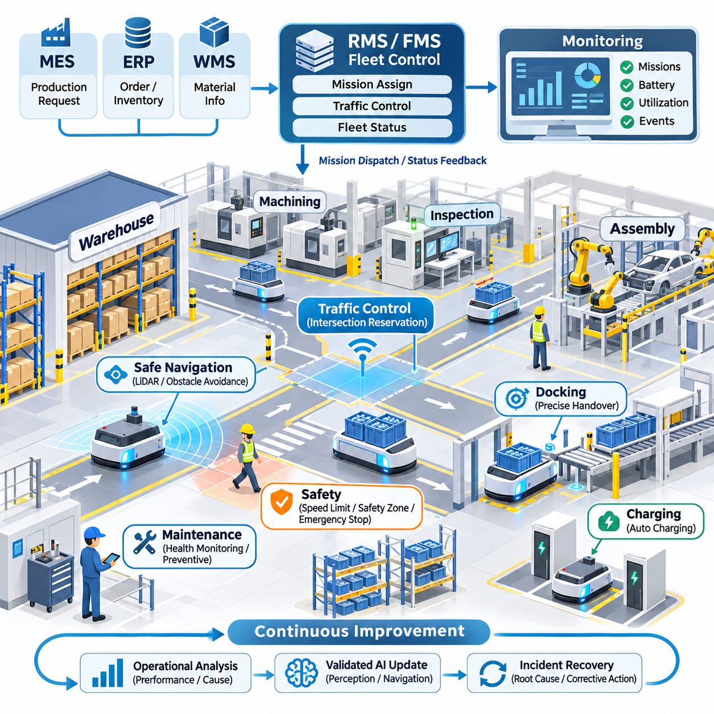
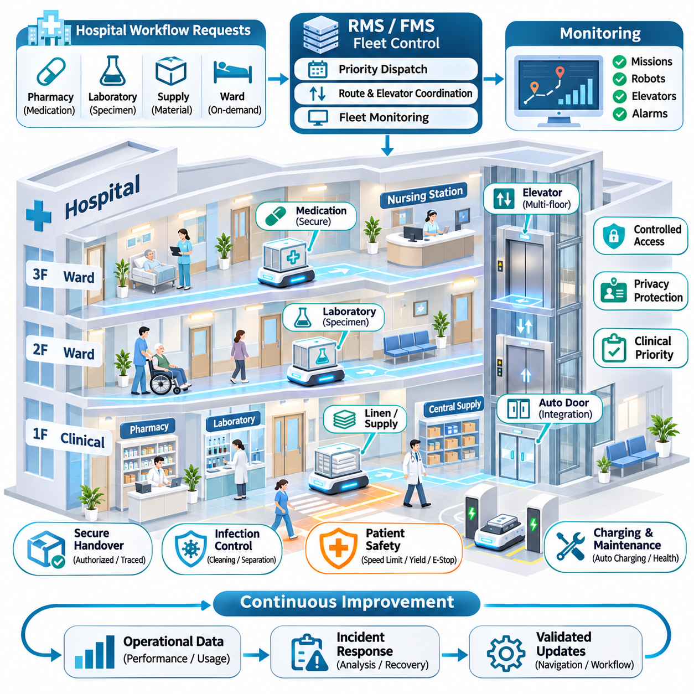
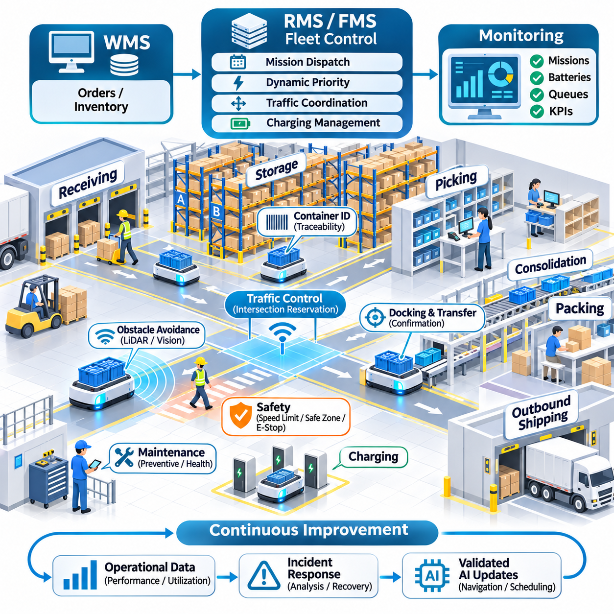
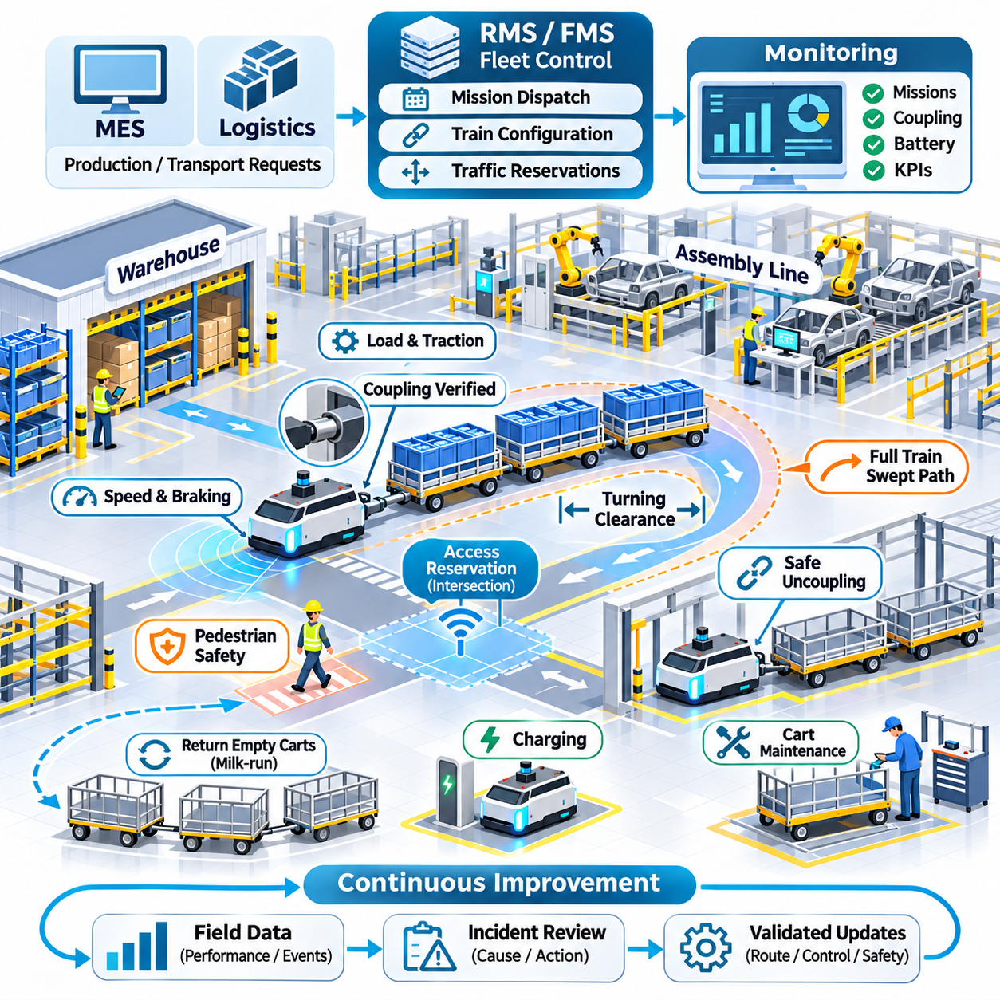
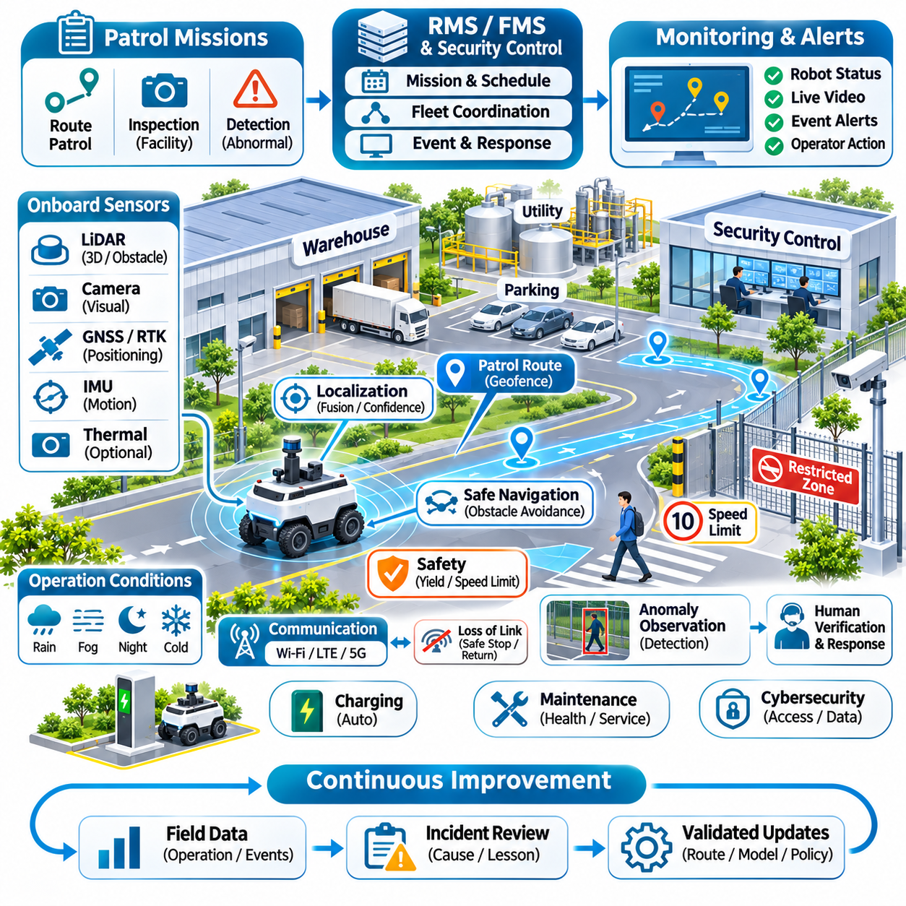
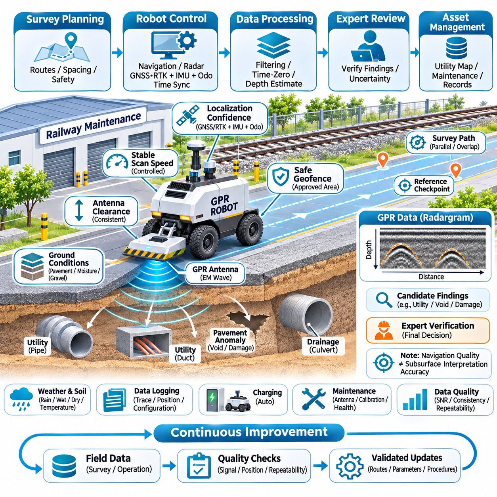
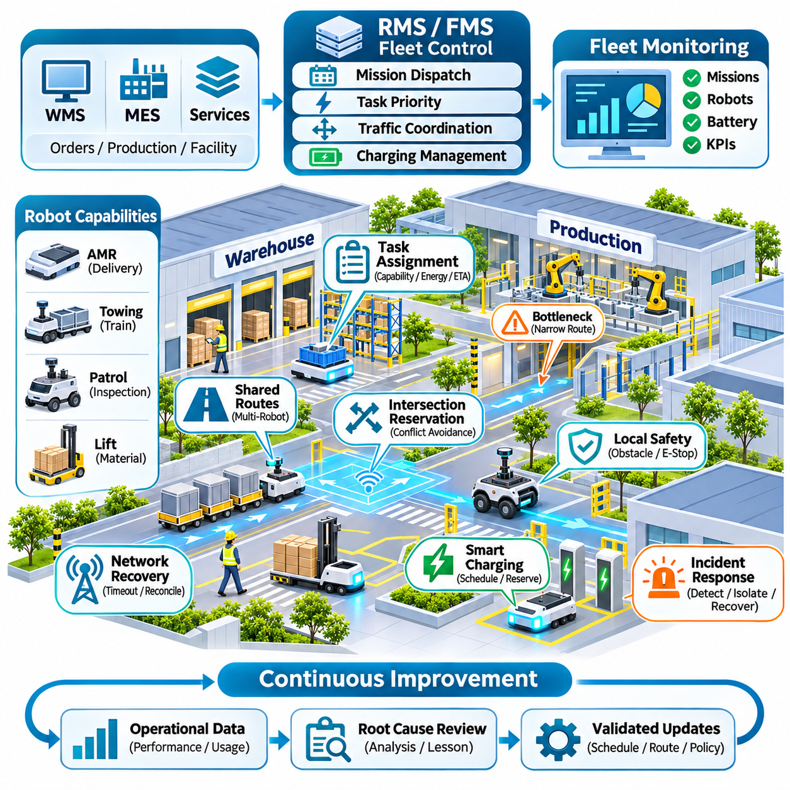
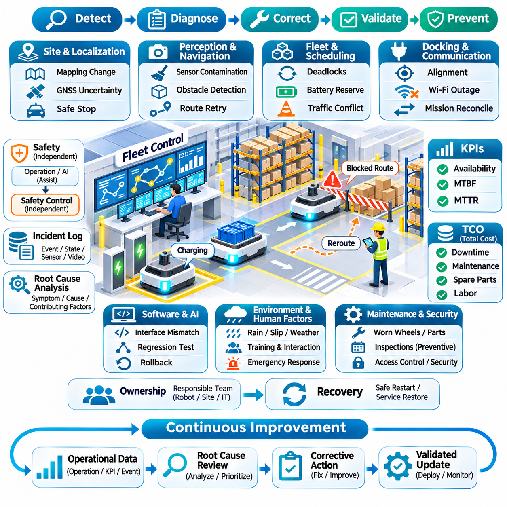

**Volume 08. AMR Operations, Deployment, and MLOps**

# Chapter 23. Operational Case Studies

## 23.1 Smart Factory Operation Case

{width="7.268055555555556in" height="7.268055555555556in"}

스마트 팩토리(Smart Factory) 운영 사례는 자율이동로봇(Autonomous Mobile Robot, AMR)이 공장 내부의 자재 운송을 통합적이고 데이터 기반(Data-Driven)의 제조 서비스로 전환하는 과정을 보여준다. 로봇을 독립적인 운송 장치로 취급하는 대신, 공장은 자율주행(Navigation), 생산 일정 관리(Production Scheduling), 안전 감독(Safety Supervision), 군집 관리(Fleet Management), 유지보수(Maintenance)를 통합하여 연속적인 생산을 지원하는 운영 체계를 구축한다.

대표적인 사례로 여러 조립 라인(Assembly Line), 기계 가공 셀(Machining Cell), 검사 스테이션(Inspection Station), 자재 보관 구역(Material Storage Area)을 운영하는 자동차 부품 공장을 고려할 수 있다. 이 공장은 기존에 생산 구역 간 부품 운송을 수동 운반 카트(Manual Cart)와 지게차(Forklift)에 의존하였다. 제품 종류의 증가, 빈번한 생산 일정 변경, 노동집약적인 운송 작업으로 인해 기존 공장 배치를 대규모로 변경하지 않으면서 유연한 자동화(Flexible Automation)를 구현할 필요성이 높아졌다.

도입 목표는 중앙 창고(Central Warehouse), 중간 버퍼(Intermediate Buffer), 조립 작업장(Assembly Station) 사이에 신뢰성 높은 자재 공급 체계를 구축하는 것이었다. 자율이동로봇(AMR)은 부품 컨테이너(Component Container), 생산 키트(Production Kit), 빈 자재 운반 장치(Empty Material Carrier)를 이동시키는 반복적인 운송 임무를 수행하도록 배정되었다. 운영 설계에서는 개별 로봇의 최고 속도를 높이는 것보다 예측 가능한 배송 간격, 공용 통로에서의 안전한 이동, 생산 수요와의 동기화(Synchronization)를 우선하였다.

도입에 앞서 엔지니어들은 통로 폭(Corridor Width), 바닥 상태(Floor Condition), 보행자 횡단 구역(Pedestrian Crossing), 설비 위치(Equipment Location), 무선 통신 연결성(Wireless Connectivity), 자재 이송 인터페이스(Material Transfer Interface)를 포함하는 상세한 현장 조사(Site Survey)를 수행하였다. 교통 흐름 분석(Traffic Analysis)을 통해 기계 가공 셀과 창고 출입구 주변에서 반복적으로 발생하는 혼잡 구간을 확인하였다. 이러한 결과는 경로 계획(Path Planning), 안전 구역 설정(Safety Zone Configuration), 충전소 배치(Charging Station Placement), 로봇 적재 용량(Payload Capacity) 선정에 반영되었다.

초기 시스템 아키텍처(System Architecture)는 이동로봇(Mobile Robot), 로봇 관리 시스템(Robot Management System, RMS), 군집 관리 시스템(Fleet Management System, FMS), 공장 정보 시스템(Factory Information System)을 결합하였다. 제조 실행 시스템(Manufacturing Execution System, MES)의 요청은 운송 임무(Transportation Mission)로 변환되었으며, 전사적 자원 관리(Enterprise Resource Planning, ERP)와 창고 관리 시스템(Warehouse Management System, WMS)의 인터페이스는 재고 및 자재 정보를 제공하였다. 시스템 간 책임 범위를 명확히 구분하여 중복 명령과 불일치하는 작업 상태를 줄였다.

각 운송 요청(Transportation Request)에는 픽업 위치(Pickup Location), 배송 목적지(Delivery Destination), 자재 식별자(Material Identifier), 우선순위(Priority), 요구 완료 시간(Required Completion Time)이 포함되었다. 군집 제어기(Fleet Controller)는 임무를 배정하기 전에 로봇 가용성(Robot Availability), 배터리 상태(Battery Status), 이동 거리(Travel Distance), 현재 교통 상황(Traffic Condition)을 평가하였다. 임무 수신 확인(Mission Acknowledgment)과 완료 확인(Completion Confirmation)은 공장 시스템과 교환되어 실제 자재 이동과 생산 기록 사이의 추적성(Traceability)을 유지하였다.

자율주행(Navigation)은 라이다 기반 위치 추정(LiDAR-Based Localization), 지도 기반 경로(Mapped Route), 지속적인 장애물 감지(Obstacle Detection)에 의존하였다. 로봇은 지정된 통로를 이동하면서 주차된 카트나 이동하는 작업자와 같은 일시적인 장애물에 대응하였다. 지역 경로 계획(Local Navigation)은 즉각적인 장애물 회피(Obstacle Avoidance)를 처리하였으며, 군집 수준 교통 관리(Fleet-Level Traffic Management)는 여러 로봇이 동시에 운행할 때 공용 교차로와 좁은 통로에서 발생하는 충돌 가능성을 조정하였다.

공장 안전 요구사항(Factory Safety Requirements)은 기본적인 장애물 감지를 넘어서는 범위를 포함하였다. 엔지니어들은 현장별 위험성 평가(Site-Specific Risk Assessment)를 기반으로 속도 제한(Speed Limit), 보호 감지 구역(Protective Detection Zone), 비상 정지 절차(Emergency Stop Procedure), 제한 운행 구역(Restricted Operating Area)을 설정하였다. 안전 관련 기능(Safety-Related Function)은 일반 자율주행 소프트웨어와 독립적으로 적절한 검증을 받아야 했다. 작업자들은 로봇 동작, 보행자와의 상호작용, 비상 대응 절차, 승인된 복구 작업에 관한 교육을 받았다.

자재 이송 스테이션(Material Transfer Station)은 중요한 운영 인터페이스(Operational Interface)를 구성하였다. 로봇은 컨베이어(Conveyor), 적재 랙(Storage Rack), 자동 적재 장치(Automated Loading Mechanism)에 접근할 때 안정적인 인계 작업을 수행할 수 있을 정도의 위치 정확도(Positioning Accuracy)를 확보해야 했다. 일반적인 자율주행 정확도가 충분하지 않은 경우 전용 도킹 기준점(Docking Reference)과 국부 정렬 절차(Local Alignment Procedure)를 도입하였다. 이송 확인 센서(Transfer Confirmation Sensor)는 적재 또는 하역 작업이 완료되기 전에 로봇이 출발하는 것을 방지하였다.

도입 과정은 생산 활동이 적은 시간대에 통제된 운송 경로부터 시작하는 단계적 시운전 전략(Phased Commissioning Strategy)을 따랐다. 엔지니어들은 운영 시간을 확대하기 전에 위치 추정 안정성(Localization Stability), 도킹 성능(Docking Performance), 통신 복구(Communication Recovery), 비상 정지 동작(Emergency Stop Behavior)을 검증하였다. 이후 시험에서는 일반적인 보행자 이동, 생산 일정 변화, 동시 임무(Simultaneous Mission)를 도입하여 실제 제조 환경에서 시스템의 성능을 평가하였다.

시범 운영(Pilot Operation) 과정에서 엔지니어들은 로봇의 자율주행 성능만으로 운송 신뢰성(Transportation Reliability)이 결정되지 않는다는 사실을 확인하였다. 지연은 적재 스테이션의 사용 불가, 미완료된 자재 준비, 차단된 통로, 공장 설비의 응답 지연 등에서 자주 발생하였다. 따라서 운영 분석(Operational Analysis)은 로봇 자체의 고장과 외부 공정 제약(External Process Constraint)을 구분하였으며, 실제 임무 중단 원인에 맞추어 시정 조치(Corrective Action)를 수행할 수 있도록 하였다.

대표적인 개선 사례는 창고와 두 개의 조립 구역을 연결하는 공용 교차로(Shared Intersection)의 혼잡 문제였다. 초기에는 여러 로봇이 독립적으로 교차로에 접근하면서 반복적인 대기 주기(Waiting Cycle)가 발생하였다. 이후 군집 제어기(Fleet Controller)는 교차로 진입 권한을 예약하고 통과 후 이를 해제하도록 설정되었다. 이러한 조정은 상충하는 이동을 줄이고 운송 시간을 더욱 예측 가능하게 만들었다.

또 다른 운영 과제는 공장 환경의 일시적인 변화였다. 팔레트(Pallet), 유지보수 장비(Maintenance Equipment), 생산 카트(Production Cart)가 지도에 등록된 경로를 점유하면서 로봇이 대기하거나 대체 경로(Alternative Path)를 요청해야 하는 상황이 발생하였다. 엔지니어들은 지속적인 장애물을 식별하고 승인된 경로 설정(Route Configuration)을 갱신하며, 환경 변화가 운송 서비스 가용성(Transportation Service Availability)에 영향을 미치는 경우 생산 감독자에게 통보하는 절차를 수립하였다.

운영 시간이 확대되면서 배터리 관리(Battery Management)의 중요성이 증가하였다. 모든 로봇을 고정된 일정에 따라 충전하는 대신, 군집 제어기는 잔여 에너지(Remaining Energy), 예상 임무 에너지 소비량(Expected Mission Energy Consumption), 충전소 가용성(Charging Station Availability), 향후 생산 수요(Production Demand)를 고려하였다. 수요가 적은 시간대에 기회 충전(Opportunity Charging)을 수행함으로써 자재 운송의 불필요한 중단을 줄이면서 군집의 운행 준비 상태(Fleet Readiness)를 유지할 수 있었다.

운영 대시보드(Operations Dashboard)는 진행 중인 임무(Active Mission), 로봇 위치(Robot Position), 배터리 상태(Battery Condition), 충전 상태(Charging State), 차단된 경로(Blocked Route), 이상 이벤트(Abnormal Event)를 가시화하였다. 감독자는 임무를 수행하는 로봇과 자재 대기, 충전, 지원이 필요한 로봇을 구분할 수 있었다. 과거 이벤트 기록(Historical Event Record)은 반복적인 지연 원인을 조사하고 운영 변경이 전체 공장 성능을 개선하였는지 평가하는 데 활용되었다.

운영 성능(Operational Performance)은 임무 완료율(Mission Completion Rate), 정시 배송률(Delivery Punctuality), 운송 주기 시간(Transportation Cycle Time), 로봇 가용성(Robot Availability), 개입 빈도(Intervention Frequency), 군집 활용률(Fleet Utilization)을 통해 평가하였다. 이러한 지표들은 높은 로봇 활용률이 반드시 효율적인 생산 지원을 의미하지 않기 때문에 종합적으로 분석되었다. 지나치게 높은 활용률은 복구 여유 용량(Recovery Capacity)을 감소시키고 예상하지 못한 수요 증가 시 배송 지연 가능성을 높일 수 있었다.

예를 들어 거의 최대 활용률로 운영되는 로봇 군집은 높은 운송 활동량(Transportation Activity)을 달성하면서도 적재 스테이션에 대기열(Queue)을 누적시킬 수 있다. 보다 균형 잡힌 일정 관리 전략(Scheduling Strategy)은 긴급 생산 요청과 예상하지 못한 장애에 대응할 수 있는 가용 용량(Available Capacity)을 유지할 수 있다. 따라서 군집 규모 산정(Fleet Sizing)은 평균 운송량뿐 아니라 수요 변동성(Demand Variability), 충전 요구사항(Charging Requirement), 경로 혼잡(Route Congestion), 복구 여유(Recovery Margin)를 함께 고려하였다.

로봇 상태 모니터링(Robot Health Monitoring)은 배터리 상태(Battery Condition), 모터 온도(Motor Temperature), 제어기 상태(Controller Status), 센서 가용성(Sensor Availability), 통신 품질(Communication Quality), 소프트웨어 프로세스 상태(Software Process Health)를 포함하였다. 유지보수 담당자는 이상 추세(Abnormal Trend)와 반복적인 고장 코드(Fault Code)를 검토하여 점검이 필요한 부품을 식별하였다. 충분한 운영 이력이 축적된 이후에는 예지보전(Predictive Maintenance)을 도입하여 고정된 정비 주기에만 의존하지 않고 상태 기반 정비(Condition-Based Maintenance)를 수행할 수 있었다.

운영 데이터(Operational Data)는 인지(Perception) 및 자율주행 기능(Navigation Function)의 지속적인 개선에도 활용되었다. 반사 표면(Reflective Surface), 예상하지 못한 장애물(Unexpected Obstacle), 위치 추정 불확실성(Localization Uncertainty)과 관련된 어려운 상황은 기록되고 분류되어 엔지니어링 검토에 사용되었다. 선별된 데이터셋(Dataset)은 시뮬레이션(Simulation), 알고리즘 평가(Algorithm Evaluation), 모델 개선(Model Refinement)에 활용될 수 있었으며, 배포 승인은 회귀 시험(Regression Testing)과 문서화된 안전 검증(Safety Validation)을 전제로 하였다.

소프트웨어 및 인공지능 모델 업데이트(Software and AI Model Update)는 통제된 릴리스 절차(Controlled Release Procedure)를 통해 관리되었다. 새로운 버전은 제한적인 현장 배포(Limited Field Deployment)에 앞서 시뮬레이션과 대표적인 시험 환경에서 평가되었다. 호환성 검사(Compatibility Check)는 로봇 하드웨어, 자율주행 지도(Navigation Map), 통신 인터페이스, 임무 실행 동작(Mission Execution Behavior)을 포함하였다. 롤백 메커니즘(Rollback Mechanism)은 업데이트로 인해 허용할 수 없는 운영 변화가 발생한 경우 이전에 검증된 설정을 복원할 수 있도록 하였다.

사고 대응 절차(Incident Response Procedure)는 자율주행 실패(Navigation Failure), 예기치 않은 정지(Unexpected Stop), 통신 중단(Communication Interruption), 자재 이송 오류(Material Transfer Error)에 운영자가 어떻게 대응해야 하는지를 정의하였다. 각 이벤트에는 적절한 분류(Classification), 즉각적인 안전 평가(Safety Assessment), 복구 결정(Recovery Decision)이 필요하였다. 심각하거나 반복적인 사고는 로봇 로그(Robot Log), 군집 이벤트(Fleet Event), 공장 시스템 기록(Factory System Record), 관련 환경 관측 자료를 활용한 근본 원인 분석(Root Cause Analysis)으로 이어졌다.

사이버보안 통제(Cybersecurity Control)는 이동로봇과 제조 인프라(Manufacturing Infrastructure) 사이의 연결을 보호하였다. 장치 인증(Device Authentication), 역할 기반 접근 제어(Role-Based Access Control), 암호화 통신(Encrypted Communication), 네트워크 분리(Network Segmentation), 통제된 소프트웨어 배포(Controlled Software Distribution)는 승인되지 않은 명령과 설정 변경에 대한 노출을 줄였다. 운영 보안 모니터링(Operational Security Monitoring)은 로봇 서비스에 영향을 미치는 비정상적인 통신 패턴이나 예상하지 못한 접근 시도를 식별하는 데에도 기여하였다.

경제성 평가(Economic Evaluation)는 직접적인 노동력 대체 효과 이상의 요소를 고려하였다. 잠재적인 이점에는 수작업 운송 부담 감소, 자재 추적성(Material Traceability) 향상, 배송 시간의 일관성 개선, 생산 업무에 대한 인력 배치 최적화가 포함되었다. 비용에는 로봇 도입, 인프라 통합(Infrastructure Integration), 유지보수, 소프트웨어 운영, 충전 시설, 교육, 시스템 지원이 포함되었다. 투자수익률(Return on Investment, ROI)은 현장별로 측정된 실제 운영 성능에 따라 결정되었다.

도입이 성숙 단계에 도달하면서 공장 관리자는 단순한 지점 간 운송(Point-to-Point Transportation)에서 생산 수요에 반응하는 자재 보충(Production-Responsive Material Replenishment)으로 자율이동로봇 서비스를 확장할 수 있었다. 제조 실행 시스템(MES) 이벤트와의 통합을 통해 실제 생산 소비량(Production Consumption)과 작업장 수요(Workstation Demand)에 따라 임무를 생성할 수 있었다. 이러한 접근은 고정된 운송 일정에 대한 의존도를 낮추고 제조 실행과 내부 물류(Internal Logistics) 사이의 긴밀한 협력을 가능하게 하였다.

이 대표적인 사례는 성공적인 스마트 팩토리 자동화(Smart Factory Automation)를 위해 로봇공학(Robotics), 제조 공정(Manufacturing Process), 정보 시스템(Information System), 일상 운영(Daily Operations) 전반에 걸친 통합 엔지니어링(Integrated Engineering)이 필요하다는 점을 보여준다. 지속 가능한 성능은 운송 신뢰성(Transportation Reliability), 기능 안전(Functional Safety), 운영 가시성(Operational Visibility), 유지보수 준비 상태(Maintenance Readiness), 지속적 개선(Continuous Improvement)을 함께 관리할 때 확보된다. 결과적으로 자율이동로봇(AMR)은 독립적인 이동 장비를 넘어 제조 시스템에 통합된 핵심 운영 역량(Integrated Manufacturing Capability)으로 발전한다.

## 23.2 Hospital AMR Operation Case

{width="7.268055555555556in" height="7.268055555555556in"}

병원 자율이동로봇(Autonomous Mobile Robot, AMR) 운영은 지능형 운송 시스템(Intelligent Transportation System)이 의료 물류(Healthcare Logistics)를 개선하면서 의료진의 업무를 지원하고 환자 안전(Patient Safety)을 유지할 수 있는 방법을 보여준다. 일반적인 산업 환경과 달리 병원에서는 예측하기 어려운 사람의 이동, 엄격한 위생 요구사항(Hygiene Requirements), 시간에 민감한 의료 업무 흐름(Clinical Workflow)에 대응해야 한다. 성공적인 도입을 위해서는 로봇의 이동 기능을 병원 운영 절차(Hospital Procedures) 및 운영 거버넌스(Operational Governance)와 통합해야 한다.

대표적인 사례로 응급실(Emergency Department), 입원 병동(Inpatient Ward), 검사실(Laboratory), 약국(Pharmacy), 중앙 물품 공급 시설(Central Supply Facility)을 여러 층에 걸쳐 운영하는 종합병원을 고려할 수 있다. 기존에는 간호사, 물류 담당자, 지원 인력이 의약품(Medication), 검사 검체(Laboratory Specimen), 린넨(Linen), 의료 물품(Medical Supply)을 수작업으로 운송하였다. 의료 서비스 수요 증가와 인력 운영의 제약으로 인해 임상적 책임(Clinical Accountability)을 유지하면서 반복적인 운송 작업을 자동화할 필요성이 높아졌다.

주요 도입 목표는 약국, 검사실, 물품 보관실(Supply Room), 간호사 스테이션(Nursing Station)을 연결하는 신뢰성 높은 내부 물류 네트워크(Internal Logistics Network)를 구축하는 것이었다. 자율이동로봇(AMR)은 임상적 우선순위(Clinical Priority)에 따라 정기 배송(Scheduled Delivery)과 주문형 운송 임무(On-Demand Transportation Mission)를 수행하도록 배정되었다. 운영 모델(Operating Model)은 일반적인 자재 이동과 즉각적인 배차가 필요한 긴급 배송(Urgent Delivery)을 구분하여 자동화가 환자 진료를 방해하지 않고 지원하도록 설계되었다.

도입에 앞서 엔지니어들은 통로 폭(Corridor Dimension), 엘리베이터 수용 능력(Elevator Capacity), 자동문(Automatic Door), 보행자 혼잡(Pedestrian Congestion), 무선 통신 연결성(Wireless Connectivity)을 포함하는 상세한 업무 흐름 분석(Workflow Analysis)과 현장 조사(Site Survey)를 수행하였다. 특히 응급 이동 경로(Emergency Route), 출입이 제한된 치료 구역(Restricted Treatment Area), 통행량이 많은 간호사 스테이션에 주의를 기울였다. 이를 바탕으로 승인된 이동 통로, 도킹 위치(Docking Location), 충전 시설(Charging Facility), 추가 접근 권한이 필요한 구역을 운영 지도(Operational Map)에 반영하였다.

시스템 아키텍처(System Architecture)는 병원 자율이동로봇(Hospital AMR), 로봇 관리 시스템(Robot Management System, RMS), 군집 관리 시스템(Fleet Management System, FMS), 병원 정보 서비스(Hospital Information Service)를 결합하였다. 운송 요청(Transportation Request)은 승인된 약국, 검사실 또는 물류 애플리케이션에서 통제된 인터페이스(Controlled Interface)를 통해 생성될 수 있었다. 임무 기록(Mission Record)에는 픽업 및 배송 위치, 자재 유형(Material Category), 우선순위(Priority Level), 승인 요구사항(Authorization Requirement), 확인 상태(Confirmation State)가 포함되었다.

작업 일정 관리(Task Scheduling)는 배송 긴급도(Delivery Urgency), 로봇 가용성(Robot Availability), 배터리 상태(Battery Condition), 이동 거리(Travel Distance), 목적지 접근성(Destination Accessibility)을 고려하였다. 일반적인 물품 공급 임무는 운영상 적절한 경우 통합하여 처리하였으며, 긴급 검체 또는 의약품 운송 요청에는 높은 배차 우선순위(Dispatch Priority)를 부여하였다. 일정 관리 규칙(Scheduling Rule)은 엘리베이터 지연, 의료진 교대 시간(Clinical Shift Change), 예측 가능한 혼잡 시간대를 반영하여 안전을 저해하지 않으면서 배송 신뢰성(Delivery Reliability)을 개선하였다.

다층 운송(Multi-Floor Transportation)을 위해서는 엘리베이터와 자동문의 통합 제어(Coordinated Integration)가 필요하였다. 로봇은 승인된 인터페이스를 통해 엘리베이터 서비스를 요청하고, 접근 조건을 확인한 후 충분한 공간과 안전한 운행 조건이 확보된 경우에만 진입하였다. 출입문 제어기(Door Controller)와 엘리베이터 시스템(Elevator System)은 독립적인 안전 기능(Independent Safety Function)을 유지하였다. 통신 장애(Communication Failure)가 발생하면 로봇이 제한 없이 이동하는 대신 통제된 대기 또는 복구 절차(Recovery Procedure)를 수행하도록 하였다.

병원 자율주행(Hospital Navigation)은 환자, 휠체어(Wheelchair), 병상(Bed), 방문객(Visitor), 빠르게 변화하는 통로 환경으로 인해 다양한 어려움에 직면하였다. 라이다(LiDAR)와 카메라 기반 인지(Camera-Based Perception)는 장애물 감지(Obstacle Detection)와 위치 추정(Localization)을 지원하였으며, 자율주행 정책(Navigation Policy)은 공용 공간에서 보수적인 속도 제한을 유지하였다. 로봇은 보행자에게 통행 우선권을 양보하고 의료 활동을 방해하지 않도록 하였다. 응급 통로와 대피 경로(Evacuation Route)는 병원이 정의한 접근 제한 규정을 준수하였다.

환자 안전(Patient Safety)을 위해서는 충돌 위험(Collision Hazard), 접근성(Accessibility), 비상 대응(Emergency Response), 인간과 로봇의 상호작용(Human-Robot Interaction)을 다루는 위험 기반 운영 체계(Risk-Based Operational Framework)가 필요하였다. 엔지니어들은 검증된 운행 조건에 따라 보호 구역(Protective Zone), 속도 제한(Speed Restriction), 비상 정지 기능(Emergency Stop Function), 안전 정지 동작(Safe Stopping Behavior)을 설정하였다. 로봇은 응급 의료 장비나 필수 치료 활동을 방해해서는 안 되었으며, 안전 관련 제어 기능은 일반적인 작업 최적화(Task Optimization)와 독립적으로 유지되었다.

자재 취급 절차(Material Handling Procedure)는 운송 대상의 유형에 따라 달라졌다. 의약품 배송(Medication Delivery)에는 보안 적재함(Secure Compartment), 승인된 접근(Authorized Access), 문서화된 인계 절차(Documented Handover)가 필요하였다. 검사 검체(Laboratory Specimen)는 적절한 밀폐 보관(Containment), 식별(Identification), 취급 조건(Handling Condition)을 충족해야 했다. 깨끗한 린넨(Clean Linen)과 멸균 물품(Sterile Supply)은 지정된 용기와 업무 흐름을 통해 오염 물질(Contaminated Material)과 분리하여 일반 운송 과정에서 부적절한 혼합이 발생하지 않도록 하였다.

감염 예방(Infection Prevention)은 병원 운영과 공장 운영을 구분하는 중요한 요소였다. 로봇 표면(Robot Surface), 보관함(Storage Compartment), 자주 접촉하는 인터페이스(Frequently Touched Interface)에는 병원 감염 관리 정책(Infection Control Policy)에 부합하는 세척 절차(Cleaning Procedure)가 필요하였다. 세척 일정(Cleaning Schedule)은 운송 자재 유형과 노출 조건(Exposure Condition)에 맞추어 조정되었다. 오염 가능성이 있는 업무에 배정된 로봇은 청결 운송 서비스(Clean Transportation Service)로 복귀하기 전에 추가적인 관리 절차를 거쳐야 했다.

단계적 도입(Phased Deployment)은 중앙 보관 시설과 일부 간호사 스테이션 사이의 저위험 물품 운송(Low-Risk Supply Transportation)부터 시작되었다. 엔지니어들은 운영 범위를 확대하기 전에 경로 완료율(Route Completion), 도킹 정확도(Docking Accuracy), 엘리베이터 통합(Elevator Integration), 통신 안정성(Communication Stability), 직원과의 상호작용(Staff Interaction)을 평가하였다. 이후 단계에서는 관련 업무 흐름과 안전 요구사항이 검증된 후 약국 배송, 검사 검체 운송, 추가 병원 층으로 운영 범위를 확대하였다.

시범 운영(Pilot Operation) 중 반복적으로 발생한 문제 중 하나는 방문객이 집중되는 시간대에 로봇이 엘리베이터 주변에서 대기하는 상황이었다. 자율주행 기능은 정상적으로 작동하였지만 예측하기 어려운 엘리베이터 가용성(Elevator Availability)으로 인해 임무 완료 시간(Mission Completion Time)이 증가하였다. 군집 제어기(Fleet Controller)는 과거 엘리베이터 대기 패턴(Historical Elevator Waiting Pattern)을 고려하고 공용 접근 지점에 로봇이 불필요하게 집중되지 않도록 조정되었다. 이를 통해 이동 속도를 높이지 않고도 일정 관리의 일관성을 개선하였다.

또 다른 문제는 간호사 스테이션에서 발생하는 불완전한 인계(Incomplete Handover)였다. 의료진이 긴급한 임상 업무에 투입되면서 로봇이 배송된 자재를 싣고 대기하는 상황이 발생하였다. 운영 절차에는 도착 알림(Arrival Notification), 설정 가능한 대기 시간(Configurable Waiting Period), 지정 담당자에 대한 단계적 통보(Escalation)가 도입되었다. 임무 완료(Mission Completion)는 적절한 수령 확인(Acknowledgment)을 요구하도록 하여 인계되지 않은 배송이 성공적으로 완료된 것으로 잘못 기록되지 않도록 하였다.

운영 모니터링(Operational Monitoring)은 로봇 위치(Robot Location), 진행 중인 임무(Active Mission), 적재함 상태(Compartment Status), 배터리 잔량(Battery Level), 엘리베이터 지연(Elevator Delay), 이상 이벤트(Abnormal Event)를 실시간으로 가시화하였다. 감독자는 지원이 필요한 임무를 식별하고 기술적 고장(Technical Failure)과 임상 업무 흐름 중단(Clinical Workflow Interruption)을 구분할 수 있었다. 과거 기록(Historical Record)은 서비스 검토(Service Review)를 지원하고 병원 관리자가 부서별 및 시간대별 운송 수요를 이해하는 데 활용되었다.

성능 평가(Performance Evaluation)는 배송 성공률(Successful Delivery Rate), 정시 배송률(Delivery Punctuality), 평균 임무 소요 시간(Average Mission Duration), 로봇 가용성(Robot Availability), 개입 빈도(Intervention Frequency), 의료진이 운송 업무에서 절감한 시간(Clinical Staff Time Released)을 고려하였다. 추가 지표에는 엘리베이터 대기 시간(Elevator Waiting Time), 인계 실패(Failed Handover), 안전 관련 이벤트(Safety-Related Event)가 포함되었다. 운송 효율성 향상이 환자 안전이나 자재 취급 요구사항의 저하를 정당화할 수 없으므로 이러한 지표는 종합적으로 해석되었다.

군집 용량 계획(Fleet Capacity Planning)은 일일 수요 주기(Daily Demand Cycle), 긴급 대응 예비 용량(Emergency Reserve), 충전 요구사항(Charging Requirement), 병원 부서별 수요 변동을 고려하였다. 최대 활용률(Maximum Utilization)로 지속적으로 운영되는 로봇 군집은 예상하지 못한 긴급 요청에 대응하기 어려울 수 있었다. 적절한 여유 용량(Spare Capacity)을 유지하면 운영 회복탄력성(Operational Resilience)이 향상되고 정기 배송을 반복적으로 지연시키지 않으면서 변화하는 임상적 우선순위에 대응할 수 있었다.

배터리 관리(Battery Management)는 정기 충전(Scheduled Charging)과 운송 수요가 적은 시간대의 기회 충전(Opportunity Charging)을 활용하였다. 충전소(Charging Station)는 응급 접근 경로와 통행량이 많은 의료 구역을 피하여 배치하였다. 로봇 상태 모니터링(Robot Health Monitoring)은 배터리 상태(Battery Condition), 모터 상태(Motor Status), 센서 가용성(Sensor Availability), 통신 품질(Communication Quality), 소프트웨어 성능(Software Performance)을 추적하였다. 유지보수 활동(Maintenance Activity)은 병원의 중요한 운영 시간대에 발생하는 중단을 최소화하도록 조정되었다.

사고 대응 절차(Incident Response Procedure)는 예기치 않은 정지(Unexpected Stop), 차단된 통로(Blocked Corridor), 엘리베이터 통신 장애(Elevator Communication Failure), 승인되지 않은 적재함 접근(Unauthorized Compartment Access), 불완전한 배송(Incomplete Delivery)을 다루었다. 운영자는 복구 조치(Recovery Action)를 시작하기 전에 환자와 직원의 안전을 먼저 평가하였다. 의약품 보안(Medication Security), 검체 무결성(Specimen Integrity), 감염 관리(Infection Control)와 관련된 사건은 병원 책임자에게 통보하고 확립된 임상 절차(Clinical Procedure)에 따라 처리해야 했다.

사이버보안(Cybersecurity)과 개인정보 보호 통제(Privacy Control)는 병원 로봇 운영을 승인되지 않은 접근과 부적절한 데이터 노출(Data Exposure)로부터 보호하였다. 장치 인증(Device Authentication), 암호화 통신(Encrypted Communication), 역할 기반 권한(Role-Based Permission), 네트워크 분리(Network Segmentation)를 통해 시스템 간 상호작용을 제한하였다. 운영 로그(Operational Log)는 민감한 환자 정보(Sensitive Patient Information)를 최소화하면서 필요한 운송 증거를 보존하도록 설계되었다. 임무 기록과 원격 제어 기능(Remote-Control Function)에 대한 접근은 승인된 책임과 권한에 따라 관리되었다.

지속적 개선(Continuous Improvement)은 일상적인 임무 수행 과정에서 수집된 운영 데이터(Operational Data)에 기반하였다. 엔지니어들은 반복적인 자율주행 지연(Navigation Delay), 어려운 장애물 상황(Obstacle Encounter), 도킹 실패(Docking Failure), 통신 중단(Communication Interruption)을 분석하였다. 선별된 데이터는 시뮬레이션(Simulation), 소프트웨어 개선(Software Refinement), 통제된 인공지능 모델 평가(Controlled AI Model Evaluation)를 지원하였다. 업데이트된 모델은 배포 전에 회귀 시험(Regression Testing)과 안전 검증(Safety Validation)을 거쳤으며, 성능이 저하되는 경우 롤백 절차(Rollback Procedure)를 사용할 수 있도록 하였다.

경제성 평가(Economic Assessment)는 운송 인력 요구사항(Transportation Labor Requirement), 배송 신뢰성(Delivery Reliability), 장비 활용률(Equipment Utilization), 유지보수 비용(Maintenance Cost), 시스템 통합 비용(System Integration Expense)을 고려하였다. 기대 효과에는 간호 인력의 비임상 업무 부담(Nonclinical Workload) 감소, 물품 이동의 일관성 향상, 운송 추적성(Transportation Traceability) 개선이 포함될 수 있었다. 그러나 재무적 성과(Financial Outcome)는 실제 임무 수행량(Mission Volume), 병원 배치(Hospital Layout), 인력 운영 방식(Staffing Practice), 신뢰성 높은 운영 지원을 유지하는 비용에 따라 달라졌다.

병원 도입이 성숙 단계에 도달하면서 자율이동로봇(AMR)은 약국, 검사실, 중앙 물품 공급 시설, 입원 부서 전반에 걸친 통합 물류(Coordinated Logistics)를 지원할 수 있었다. 승인된 병원 업무 시스템(Hospital Workflow System)과의 통합을 통해 실제 운영 수요(Operational Demand)에 따라 운송 요청을 생성할 수 있었다. 중앙집중식 군집 오케스트레이션(Centralized Fleet Orchestration)은 자원 배분(Resource Allocation)을 개선하면서 임상적 의사결정(Clinical Decision), 자재 승인(Material Authorization), 환자 관련 절차(Patient-Related Procedure)에 대한 각 부서의 책임을 유지하였다.

이 대표적인 병원 운영 사례는 자율이동로봇(AMR)의 성공이 단순한 자율주행(Autonomous Navigation)과 운송 효율성(Transportation Efficiency) 이상의 요소에 달려 있음을 보여준다. 신뢰성 높은 의료 로봇 운영(Healthcare Robotics Operation)을 위해서는 업무 흐름 통합(Workflow Integration), 환자 안전(Patient Safety), 감염 예방(Infection Prevention), 안전한 자재 취급(Secure Material Handling), 군집 관리(Fleet Management), 지속적인 운영 개선(Continuous Operational Improvement)이 함께 이루어져야 한다. 이러한 요소들이 효과적으로 관리될 때 자율이동로봇은 병원 물류와 임상 서비스의 연속성(Clinical Service Continuity)을 지원하는 신뢰성 높은 운영 인프라(Operational Infrastructure)로 발전한다.

## 23.3 Logistics AMR Operation Case

{width="7.268055555555556in" height="7.268055555555556in"}

물류 자율이동로봇(Autonomous Mobile Robot, AMR) 운영은 지능형 이동 자동화(Intelligent Mobile Automation)가 창고 생산성(Warehouse Productivity), 자재 흐름(Material Flow), 주문 이행 신뢰성(Order Fulfillment Reliability)을 개선하는 방법을 보여준다. 현대적인 물류센터(Distribution Center)는 변동하는 주문량(Order Volume), 다양한 제품 유형(Product Category), 엄격한 배송 일정(Delivery Schedule)을 관리해야 한다. 성공적인 자율이동로봇 도입을 위해서는 로봇 운송(Robotic Transportation), 창고 운영 프로세스(Warehouse Process), 재고 관리 시스템(Inventory System), 군집 수준 운영 제어(Fleet-Level Operational Control)의 통합이 필요하다.

대표적인 사례로 입고 도크(Receiving Dock), 보관 랙(Storage Rack), 피킹 스테이션(Picking Station), 포장 구역(Packing Area), 출고 구역(Outbound Shipping Zone)을 갖춘 전자상거래 물류센터(E-Commerce Distribution Center)를 고려할 수 있다. 기존에는 창고 작업자가 수동 카트(Manual Cart), 팔레트 트럭(Pallet Truck), 지게차(Forklift)를 이용하여 상품을 운송하였다. 주문 빈도 증가와 주문 처리 기한(Fulfillment Deadline)의 단축으로 인해 불필요한 이동을 줄이고 자재 취급의 일관성(Material Handling Consistency)을 개선하며 수요 변동에 대응하는 운영 유연성(Operational Flexibility)을 유지해야 할 필요성이 높아졌다.

주요 도입 목표는 보관 구역(Storage Area), 피킹 스테이션, 집하 구역(Consolidation Zone), 포장 라인(Packing Line) 사이에서 반복적으로 발생하는 운송 작업을 자동화하는 것이었다. 자율이동로봇(AMR)은 창고 작업 우선순위(Warehouse Task Priority)에 따라 컨테이너(Container), 토트(Tote), 지정된 자재 운반 장치(Material Carrier)를 운송하였다. 운영 전략(Operating Strategy)은 비생산적인 이동(Nonproductive Movement)을 줄이고 작업장 자재 보충(Workstation Replenishment)을 개선하며 일상적인 창고 운영에서 예측 가능한 운송 능력(Transportation Capacity)을 유지하는 데 중점을 두었다.

도입에 앞서 엔지니어들은 통로 크기(Aisle Dimension), 바닥 상태(Floor Condition), 랙 배치(Rack Layout), 적재 인터페이스(Loading Interface), 보행자 이동 경로(Pedestrian Route), 무선 네트워크 범위(Wireless Network Coverage)를 포함하는 상세한 창고 현장 조사(Warehouse Site Survey)를 수행하였다. 교통 흐름 분석(Traffic Analysis)을 통해 피킹 스테이션, 컨베이어 교차 구역(Conveyor Intersection), 출고 준비 구역(Shipping Preparation Area) 주변의 혼잡 지점을 식별하였다. 이러한 결과는 자율주행 지도 개발(Navigation Map Development), 로봇 선정(Robot Selection), 충전 인프라 계획(Charging Infrastructure Planning), 운영 안전 구역 설정(Operational Safety Zone Configuration)에 활용되었다.

시스템 아키텍처(System Architecture)는 자율이동로봇(AMR)을 창고 관리 시스템(Warehouse Management System, WMS), 군집 관리 시스템(Fleet Management System, FMS), 로봇 관리 시스템(Robot Management System, RMS)과 통합하였다. 창고 관리 시스템은 재고 이동(Inventory Movement)과 주문 이행 요구사항(Order Fulfillment Requirement)에 따라 운송 요청(Transportation Request)을 생성하였다. 군집 제어기(Fleet Controller)는 이러한 요청을 실행 가능한 임무(Executable Mission)로 변환하고 적합한 로봇을 배정한 후 표준화된 인터페이스(Standardized Interface)를 통해 완료 상태를 보고하였다.

각 운송 임무(Transportation Mission)에는 픽업 위치 식별자(Pickup Identifier), 목적지 식별자(Destination Identifier), 컨테이너 정보(Container Information), 우선순위(Priority), 예상 완료 조건(Expected Completion Condition)이 포함되었다. 로봇 배정(Robot Assignment)은 현재 위치(Current Position), 적재 능력(Payload Capability), 배터리 잔량(Battery Level), 경로 가용성(Route Availability), 작업 부하 분산(Workload Distribution)을 고려하였다. 일정 관리 알고리즘(Scheduling Algorithm)은 긴급 주문(Urgent Order)과 일반적인 자재 보충 작업(Routine Replenishment Activity) 사이의 균형을 유지하면서 수요가 높은 작업장 주변에 로봇이 과도하게 집중되는 것을 방지하였다.

창고 자율주행(Warehouse Navigation)은 지도 기반 경로(Mapped Route), 위치 추정 센서(Localization Sensor), 장애물 감지(Obstacle Detection), 동적 경로 계획(Dynamic Path Planning)에 의존하였다. 로봇은 보행자, 팔레트 트럭, 고정 설비 주변에서 정의된 안전거리(Safety Distance)를 유지하며 운행하였다. 지역 자율주행(Local Navigation)은 즉각적인 장애물 회피(Obstacle Avoidance)를 담당하였으며, 군집 수준 교통 관리(Fleet-Level Traffic Management)는 교차로(Intersection), 좁은 통로(Narrow Aisle), 공용 적재 구역(Shared Loading Zone)을 조정하여 혼잡을 줄이고 상충하는 이동을 방지하였다.

자재 이송 인터페이스(Material Transfer Interface)는 운영 복잡성(Operational Complexity)을 높이는 중요한 요소였다. 로봇은 적재 및 하역(Loading and Unloading) 작업을 수행하기 전에 컨베이어 시스템(Conveyor System), 보관 랙(Storage Rack), 작업장 도킹 지점(Workstation Docking Point)에 정확하게 정렬되어야 했다. 위치 확인(Position Verification)과 이송 완료 확인(Transfer Confirmation)은 불완전한 인계(Incomplete Handover)를 방지하였다. 자동 이송 장치(Automated Transfer Mechanism)를 사용할 수 없는 경우에는 일관된 임무 상태(Mission Status)와 자재 추적성(Material Traceability)을 유지할 수 있도록 작업자 지원 절차(Operator-Assisted Procedure)를 설계하였다.

창고 안전 관리(Warehouse Safety Management)는 작업자, 지게차, 팔레트 트럭, 자율이동로봇이 함께 이동하는 혼합 교통 환경(Mixed Traffic Environment)을 고려해야 했다. 엔지니어들은 현장별 위험성 평가(Site-Specific Risk Assessment)를 통해 운행 속도 제한(Operating Speed Limit), 제한 구역(Restricted Zone), 보행자 횡단 규칙(Pedestrian Crossing Rule), 비상 정지 절차(Emergency Stop Procedure)를 수립하였다. 안전 기능(Safety Function)은 대표적인 운행 조건에서 검증되었으며, 작업자들은 로봇 동작(Robot Behavior)과 비상 대응 책임(Emergency Response Responsibility)에 관한 교육을 받았다.

도입은 일부 보관 구역과 피킹 스테이션을 연결하는 제한적인 시범 운영(Limited Pilot)으로 시작되었다. 엔지니어들은 임무 완료(Mission Completion), 도킹 신뢰성(Docking Reliability), 자율주행 중단(Navigation Interruption), 작업자 개입 빈도(Operator Intervention Frequency)를 측정하였다. 초기 승인(Initial Acceptance) 이후 추가 경로와 로봇을 단계적으로 도입하였다. 이러한 단계적 확대(Phased Rollout)를 통해 창고 관리자는 자동화를 중요한 출고 주문 처리 프로세스(Outbound Fulfillment Process)로 확장하기 전에 업무 흐름의 병목 현상(Workflow Bottleneck)을 식별할 수 있었다.

시범 운영(Pilot Operation) 중 반복적으로 발생한 문제 중 하나는 처리량이 많은 피킹 스테이션(High-Volume Picking Station) 주변의 혼잡이었다. 여러 로봇이 동시에 도착하면서 대기열(Queue)이 형성되었고 실질적인 운송 처리량(Transportation Throughput)이 감소하였다. 군집 제어기(Fleet Controller)는 추가 로봇을 배차하기 전에 작업장 준비 상태(Workstation Readiness)와 사용 가능한 버퍼 용량(Available Buffer Capacity)을 고려하도록 수정되었다. 이를 통해 불필요한 대기 시간을 줄이고 피킹 작업(Picking Operation)과 자재 운송 사이의 협조를 개선하였다.

또 다른 운영 과제는 실제 컨테이너(Physical Container)와 창고 관리 시스템(WMS)의 기록 사이에서 발생하는 재고 불일치(Inventory Discrepancy)였다. 로봇이 운송을 성공적으로 완료하더라도 관련 재고 거래(Inventory Transaction)가 완료되지 않았거나 잘못 기록될 수 있었다. 엔지니어들은 실제 자재 이동과 디지털 재고 기록(Digital Inventory Record) 사이의 일관성을 유지하기 위해 컨테이너 식별 확인(Container Identification Check), 임무 수신 확인 규칙(Mission Acknowledgment Rule), 예외 처리 절차(Exception Handling Procedure)를 도입하였다.

하루 동안 주문량이 변동하면서 군집 일정 관리(Fleet Scheduling)의 중요성이 더욱 높아졌다. 최대 수요 시간대(Peak Period)에는 운송 요청이 가용 로봇(Available Robot)의 처리 능력보다 빠르게 누적되었다. 따라서 일정 관리 전략(Scheduling Strategy)은 주문 긴급도(Order Urgency), 작업장 간 의존성(Workstation Dependency), 예상 이동 시간(Estimated Travel Time), 충전 요구사항(Charging Requirement)을 고려하였다. 동적 우선순위 지정(Dynamic Prioritization)은 일반 운송 대기열이 통제 불가능하게 증가하지 않도록 하면서 중요한 주문 처리 활동(Critical Fulfillment Activity)을 유지하는 데 기여하였다.

배터리 관리(Battery Management)는 정기 충전(Scheduled Charging)과 창고 수요가 감소하는 시간대의 기회 충전(Opportunity Charging)을 결합하였다. 충전소(Charging Station)는 주요 운송 경로(Primary Transportation Route)에 대한 간섭을 최소화하도록 배치되었다. 군집 소프트웨어(Fleet Software)는 잔여 에너지(Remaining Energy)를 모니터링하고 로봇이 재충전 전에 배정된 임무를 완료할 수 있는지 예측하였다. 적절한 충전 예비 용량(Charging Reserve)을 유지함으로써 수요가 높은 주문 처리 시간대에 예상하지 못한 로봇 부족(Robot Shortage)이 발생하는 것을 방지하였다.

운영 대시보드(Operational Dashboard)는 로봇 위치(Robot Position), 진행 중인 임무(Active Mission), 배터리 잔량(Battery Level), 충전 상태(Charging State), 차단된 경로(Blocked Route), 작업장 대기열(Workstation Queue)을 표시하였다. 감독자는 이러한 인터페이스를 활용하여 비정상적인 지연(Abnormal Delay)을 식별하고 로봇 고장(Robot Failure)과 창고 프로세스 중단(Warehouse Process Interruption)을 구분하였다. 과거 운영 기록(Historical Operational Record)은 일일 성능 검토(Daily Performance Review)를 지원하고 반복적인 혼잡 패턴(Congestion Pattern)이나 비효율적인 운송 배정을 식별하는 데 활용되었다.

성능 평가(Performance Evaluation)는 임무 완료율(Mission Completion Rate), 평균 운송 주기 시간(Average Transportation Cycle Time), 로봇 가용성(Robot Availability), 군집 활용률(Fleet Utilization), 주문 이행 지원(Order Fulfillment Support), 개입 빈도(Intervention Frequency)를 고려하였다. 추가 지표에는 공차 이동 거리(Empty Travel Distance), 충전 중단 시간(Charging Downtime), 작업장 대기 시간(Workstation Waiting Time), 운송 관련 지연(Transportation-Related Delay)이 포함되었다. 개별 로봇의 활동량을 최대화하는 것이 반드시 전체 창고 처리량(Warehouse Throughput)을 최대화하는 것은 아니므로 이러한 지표를 종합적으로 평가하였다.

대표적인 최적화(Optimization) 사례는 멀리 떨어진 보관 구역과 포장 구역 사이에서 발생하는 로봇의 공차 이동(Empty Robot Travel)을 줄이는 것이었다. 초기에는 로봇이 배송을 완료한 후 원래 대기 위치(Waiting Location)로 자주 복귀하였다. 개선된 배차 로직(Dispatch Logic)은 운영상 적절한 경우 가까운 위치의 픽업 임무(Nearby Pickup Mission)를 배정하도록 변경되었다. 이를 통해 로봇의 이동 속도(Travel Speed)나 하드웨어 용량(Hardware Capacity)을 증가시키지 않고도 불필요한 이동을 줄이고 생산적인 군집 활용률(Productive Fleet Utilization)을 개선하였다.

로봇 상태 모니터링(Robot Health Monitoring)은 배터리 열화(Battery Degradation), 모터 온도(Motor Temperature), 구동 성능(Drive Performance), 센서 가용성(Sensor Availability), 통신 품질(Communication Quality), 소프트웨어 프로세스 안정성(Software Process Stability)을 추적하였다. 유지보수 담당자는 이상 추세(Abnormal Trend)와 반복적인 고장 이벤트(Fault Event)를 검토하여 점검이 필요한 부품을 식별하였다. 운영 이력이 축적되면 예지보전(Predictive Maintenance) 기법을 통해 고장 위험(Failure Risk)을 추정하고 창고 수요가 낮은 시간대에 유지보수 일정을 수립할 수 있었다.

사고 대응 절차(Incident Response Procedure)는 차단된 통로(Blocked Aisle), 위치 추정 실패(Localization Failure), 불완전한 자재 이송(Incomplete Material Transfer), 통신 중단(Communication Interruption), 예기치 않은 로봇 정지(Unexpected Robot Stop)를 다루었다. 운영자는 복구 작업(Recovery Action)을 시작하기 전에 안전 상태(Safety Condition)를 먼저 평가하였다. 각 사고는 관련 임무 정보(Mission Information), 로봇 상태(Robot Status), 환경 관측 정보(Environmental Observation)와 함께 기록되었다. 반복적인 고장은 로봇 엔지니어와 창고 운영 담당자가 함께 수행하는 근본 원인 분석(Root Cause Analysis)과 시정 조치(Corrective Action)로 이어졌다.

사이버보안 통제(Cybersecurity Control)는 로봇, 창고 시스템(Warehouse System), 원격 관리 서비스(Remote Management Service) 사이의 통신을 보호하였다. 장치 인증(Device Authentication), 암호화 통신(Encrypted Communication), 역할 기반 접근 제어(Role-Based Access Control), 네트워크 분리(Network Segmentation)는 승인되지 않은 상호작용을 제한하였다. 소프트웨어 업데이트(Software Update)는 통제된 배포 절차(Controlled Deployment Procedure)를 통해 제공되었으며, 운영 로그(Operational Log)는 보안 모니터링(Security Monitoring)과 비정상적인 시스템 동작(Abnormal System Behavior)에 대한 조사를 지원하였다.

지속적 개선(Continuous Improvement)은 일상적인 창고 임무에서 수집된 운영 데이터(Operational Data)를 기반으로 수행되었다. 엔지니어들은 자율주행 지연(Navigation Delay), 장애물 발생 상황(Obstacle Encounter), 도킹 오류(Docking Error), 일정 관리 비효율성(Scheduling Inefficiency)을 분석하였다. 선별된 데이터셋(Dataset)은 시뮬레이션(Simulation), 소프트웨어 최적화(Software Optimization), 통제된 인공지능 모델 개선(Controlled AI Model Refinement)을 지원하였다. 업데이트된 자율주행 또는 인지 모델(Navigation or Perception Model)은 의도하지 않은 운영 성능 저하(Operational Degradation)를 방지하기 위해 배포 전에 회귀 시험(Regression Testing)과 현장 검증(Field Validation)을 거쳤다.

경제성 평가(Economic Evaluation)는 운송 인력 요구사항(Transportation Labor Requirement), 로봇 도입 비용(Robot Acquisition Cost), 인프라 통합(Infrastructure Integration), 유지보수 비용(Maintenance Expense), 소프트웨어 운영(Software Operation)을 고려하였다. 잠재적인 이점에는 수작업 이동(Manual Travel) 감소, 자재 이동의 일관성(Material Movement Consistency) 개선, 주문 처리 능력(Order Processing Capacity) 증가가 포함되었다. 투자수익률(Return on Investment, ROI)은 실제 운송 수요(Transportation Demand), 창고 배치(Warehouse Layout), 활용 패턴(Utilization Pattern), 신뢰성 높은 자동화 서비스(Reliable Automation Service)를 유지하는 비용에 따라 결정되었다.

도입이 성숙 단계에 도달하면서 창고는 단순한 지점 간 운송(Point-to-Point Transportation)에서 통합 주문 이행 자동화(Coordinated Fulfillment Automation)로 확장할 수 있었다. 자율이동로봇(AMR)은 컨베이어(Conveyor), 자동 보관 시스템(Automated Storage System), 피킹 스테이션(Picking Station), 재고 관리 애플리케이션(Inventory Management Application)과 함께 운영되었다. 군집 오케스트레이션(Fleet Orchestration)은 작업장 준비 상태(Workstation Readiness)와 주문 우선순위(Order Priority)에 맞추어 운송을 동기화함으로써 상호 연결된 창고 프로세스 전반에서 더욱 적응적인 자재 흐름(Adaptive Material Flow)을 가능하게 하였다.

이 대표적인 물류 운영 사례는 자율이동로봇(AMR)의 성공이 자율주행(Autonomous Navigation)만이 아니라 시스템 수준의 조정(System-Level Coordination)에 달려 있음을 보여준다. 신뢰성 높은 창고 자동화(Reliable Warehouse Automation)를 위해서는 효과적인 창고 관리 시스템 통합(WMS Integration), 군집 일정 관리(Fleet Scheduling), 교통 관리(Traffic Management), 자재 추적성(Material Traceability), 운영 안전(Operational Safety), 지속적인 성능 최적화(Continuous Performance Optimization)가 필요하다. 이러한 기능이 통합적으로 작동할 때 자율이동로봇은 유연하고 회복탄력적인 물류 운영(Flexible and Resilient Logistics Operations)을 지원하는 확장 가능한 인프라(Scalable Infrastructure)로 발전한다.

## 23.4 Towing AMR Operation Case

{width="7.268055555555556in" height="7.268055555555556in"}

견인형 자율이동로봇(Towing Autonomous Mobile Robot, Towing AMR) 운영은 자율 견인 시스템(Autonomous Traction System)이 여러 대의 카트(Cart) 또는 중량 화물(Heavy Load)을 조정된 경로를 따라 이동시킴으로써 산업 현장의 자재 운송(Material Transportation)을 개선하는 방법을 보여준다. 일반적인 적재형 로봇(Payload-Carrying Robot)과 달리 견인형 자율이동로봇은 로봇 본체, 연결 장치(Coupling Mechanism), 후방 견인 카트(Trailing Cart)가 결합된 전체 시스템의 동역학(Combined Dynamics)을 관리해야 한다. 신뢰성 높은 도입을 위해서는 기계공학(Mechanical Engineering), 자율주행 제어(Navigation Control), 교통 관리(Traffic Management), 운영 안전(Operational Safety)의 통합이 필요하다.

대표적인 사례로 중앙 보관 구역(Central Storage Area)에서 생산 라인(Production Line)까지 바퀴가 장착된 카트(Wheeled Cart)를 이용하여 부품을 운송하는 자동차 조립 공장(Automotive Assembly Facility)을 고려할 수 있다. 기존의 견인 운반 열차(Tugger Train)는 운전자가 필요하고 고정된 운송 일정(Fixed Transportation Schedule)에 의존하기 때문에 생산 변경 시 비효율성이 발생하였다. 견인형 자율이동로봇을 도입하면 반복적인 운전 작업을 줄이면서 유연한 자재 보충(Flexible Material Replenishment)을 구현하고 제조 운영 전반의 운송 추적성(Transportation Traceability)을 향상시킬 수 있다.

도입 목표는 창고(Warehouse), 중간 버퍼(Intermediate Buffer), 조립 스테이션(Assembly Station) 사이에서 정기적으로 수행되는 순회 운송(Milk-Run Transportation)을 자동화하는 것이었다. 각 견인형 자율이동로봇은 준비된 카트를 연결하고 승인된 배송 경로(Approved Delivery Route)를 따라 이동한 후 빈 컨테이너(Empty Container)를 지정된 위치로 반환하였다. 운영 설계(Operational Design)는 차량의 최고 속도를 높이는 것보다 일정한 배송 간격(Consistent Delivery Interval), 예측 가능한 경로 완료 시간(Predictable Route Completion), 생산 수요와의 동기화(Synchronization)를 우선하였다.

도입에 앞서 엔지니어들은 통로 폭(Corridor Width), 회전 구역(Turning Area), 바닥 경사도(Floor Gradient), 적재 스테이션(Loading Station), 보행자 횡단 구역(Pedestrian Crossing)을 조사하였다. 특히 후방 견인 카트가 인접한 교통 차선(Adjacent Traffic Lane)을 점유할 수 있는 교차로(Intersection)에 주의를 기울였다. 현장 평가(Site Assessment)에서는 대표적인 견인 하중(Towing Load) 조건에서 바닥 마찰(Floor Friction), 불균일한 노면(Uneven Surface), 비상 제동 거리(Emergency Stopping Distance)도 검토하였다. 이러한 관측 결과는 경로 설계(Route Design), 운행 한계(Operating Limit), 안전 검증(Safety Validation)에 반영되었다.

견인 시스템(Towing System)은 자율 견인 차량(Autonomous Tractor), 기계식 연결 장치(Mechanical Coupling Device), 호환 가능한 카트(Compatible Cart), 군집 관리 인프라(Fleet Management Infrastructure)로 구성되었다. 연결 장치는 가속(Acceleration), 제동(Braking), 회전(Turning) 과정에서 발생하는 힘을 견딜 수 있는 충분한 강도를 확보해야 했다. 카트 호환성(Cart Compatibility)은 바퀴 구성(Wheel Configuration), 견인봉 형상(Drawbar Geometry), 하중 분포(Load Distribution), 연결 높이(Connection Height)에 따라 결정되었다. 기계적 인터페이스(Mechanical Interface)는 연결 오류(Coupling Error)를 줄이고 일상적인 운영을 단순화하기 위해 표준화되었다.

견인 능력(Towing Capacity)은 전체 견인 열차 질량(Total Train Mass), 구름 저항(Rolling Resistance), 가속 요구사항(Acceleration Requirement), 바닥 경사도(Floor Gradient), 가용 견인력(Available Traction)을 기준으로 평가하였다. 엔지니어들은 연속 견인력(Continuous Pulling Force)과 출발 또는 정지 과정에서 발생하는 최대 힘(Peak Force)을 모두 고려하였다. 정격 견인 능력(Rated Towing Capability)은 모터 출력(Motor Power)만으로 결정할 수 없으며, 바퀴 접지력(Wheel Traction), 제동 성능(Braking Performance), 연결 장치 강도(Coupling Strength), 카트 안정성(Cart Stability)이 추가적인 운행 제약 조건(Operational Constraint)을 형성하였다.

자율주행 경로 계획(Navigation Planning)은 견인 차량 본체의 점유 영역(Tractor Footprint)뿐 아니라 전체 카트 열차의 주행 궤적(Swept Path)을 고려하였다. 회전 과정에서 후방 카트는 견인 차량과 다른 궤적(Trajectory)을 따라 이동할 수 있으며, 벽이나 설비 주변에서 내륜차(Off-Tracking)로 인한 위험이 발생할 수 있었다. 엔지니어들은 회전반경(Turning Radius), 관절각(Articulation Angle), 열차 길이(Train Length), 이격 여유(Clearance Margin)를 평가하였다. 경로는 적재 및 비적재 구성(Loaded and Unloaded Configuration)을 대표하는 시험을 완료한 후에만 승인되었다.

제어 아키텍처(Control Architecture)는 위치 추정(Localization), 궤적 추종(Trajectory Tracking), 속도 조절(Speed Regulation), 연결 상태 감시(Coupling Supervision), 군집 협조(Fleet Coordination)를 통합하였다. 로봇의 이동 명령(Motion Command)은 견인 구성(Towing Configuration)과 검증된 운행 가능 범위(Validated Operating Envelope)에 따라 제한되었다. 가속 및 감속 프로파일(Acceleration and Deceleration Profile)은 과도한 견인봉 하중(Drawbar Force)과 불안정한 카트 움직임(Unstable Cart Movement)을 줄이도록 조정되었다. 위험한 관절 운동(Articulation)이나 횡방향 변위(Lateral Displacement)를 유발할 수 있는 급격한 조향 변화(Sharp Steering Change)는 회피하였다.

자동 연결(Automatic Coupling)은 추가적인 운영 복잡성(Operational Complexity)을 발생시켰다. 로봇은 준비된 카트에 접근하여 연결 인터페이스(Coupling Interface)에 정렬한 후 연결 장치를 체결하였다. 운송을 시작하기 전에 적절한 센서를 통해 기계적 체결 상태(Mechanical Engagement)를 확인하였다. 연결 확인(Coupling Confirmation)에 실패한 경우 로봇은 고정되지 않은 카트를 견인하려고 시도하지 않고 정지 상태를 유지하며 복구 지원(Recovery Assistance)을 요청하였다.

연결 해제 절차(Uncoupling Procedure)에도 동일한 수준의 검증이 필요하였다. 견인형 자율이동로봇은 카트를 승인된 이송 스테이션(Approved Transfer Station)에 위치시키고 카트의 안정성(Cart Stability)을 확인한 후 연결 장치를 해제하였다. 필요한 경우 바퀴 고정 장치(Wheel Restraint)나 스테이션 고정 장치(Station Fixture)를 사용하여 의도하지 않은 카트 이동(Unintended Cart Movement)을 방지하였다. 임무 완료(Mission Completion)는 연결 해제가 성공적으로 수행되고 카트가 지정된 이송 구역(Designated Transfer Area) 안에 유지되는 것이 확인된 후에만 보고되었다.

군집 관리(Fleet Management)는 생산 일정(Production Schedule), 카트 가용성(Cart Availability), 경로 점유 상태(Route Occupancy), 로봇 준비 상태(Robot Readiness)에 따라 견인 임무(Towing Mission)를 조정하였다. 운송 요청(Transportation Request)은 제조 또는 물류 시스템(Manufacturing or Logistics System)에서 생성되어 실행 가능한 임무(Executable Mission)로 변환되었다. 배차 시스템(Dispatcher)은 특정 견인 작업에 로봇을 배정하기 전에 열차 길이(Train Length), 목적지 접근성(Destination Accessibility), 배터리 상태(Battery Status), 교통 상황(Traffic Condition)을 고려하였다.

견인 열차(Towing Train)는 개별 자율이동로봇보다 더 넓은 공간을 점유하고 더 긴 조향 거리(Maneuvering Distance)를 필요로 하기 때문에 교통 관리(Traffic Management)가 특히 중요하였다. 공용 교차로(Shared Intersection), 좁은 통로(Narrow Corridor), 적재 구역(Loading Zone)은 진입 권한 예약(Access Reservation)과 통제된 진입 규칙(Controlled Entry Rule)을 통해 관리되었다. 군집 소프트웨어(Fleet Software)는 공간 제약이 있는 구역(Constrained Area)에 상충하는 이동이 동시에 진입하지 못하도록 하여 혼잡을 줄이고 어려운 후진 조작(Reversing Maneuver)의 필요성을 최소화하였다.

안전 엔지니어링(Safety Engineering)은 견인 차량(Tractor)과 후방 카트(Trailing Cart) 모두에서 발생할 수 있는 위험을 다루었다. 보호 감지 범위(Protective Detection Coverage), 운행 속도(Operating Speed), 정지 거리(Stopping Distance), 비상 정지 동작(Emergency Stop Behavior)은 전체 견인 구성(Complete Towing Configuration)을 기준으로 평가하였다. 카트가 사각지대(Blind Zone)나 횡방향 충돌 위험(Lateral Collision Risk)을 발생시키는 경우 추가적인 안전 대책이 필요하였다. 안전 검증(Safety Validation)은 대표적인 하중(Representative Load), 노면 상태(Surface Condition), 보행자와의 상호작용(Pedestrian Interaction)을 고려하였다.

단계적 도입(Phased Deployment)은 통제된 생산 시간대에 단일 견인 경로(Single Towing Route)를 운영하는 것으로 시작되었다. 엔지니어들은 연결 신뢰성(Coupling Reliability), 카트 궤적 추종(Cart Tracking), 제동 성능(Braking Performance), 위치 추정 안정성(Localization Stability), 임무 완료(Mission Completion)를 검증하였다. 이후 시험에서는 여러 대의 카트(Multiple Cart), 일반적인 공장 교통(Normal Factory Traffic), 동시 로봇 운행(Simultaneous Robot Operation)을 도입하였다. 운영 범위 확대는 기계적 성능, 자율주행, 안전 승인 기준(Safety Acceptance Criteria)이 충족된 이후에만 진행되었다.

시범 운영(Pilot Operation) 중 반복적으로 발생한 문제는 급격한 코너(Tight Corner)에서 카트가 예상 경로(Expected Path)를 벗어나는 현상이었다. 견인 차량은 계획된 궤적(Planned Trajectory)을 정확하게 추종하였지만 후방 카트는 예상보다 주변 설비에 더 가까이 접근하였다. 엔지니어들은 경로 형상(Route Geometry)을 수정하고 이격 여유(Clearance Margin)를 확대하며 회전 속도(Turning Speed)를 낮추었다. 이 사례는 견인 자율주행(Towing Navigation)이 견인 차량의 위치 추정(Tractor Localization)만이 아니라 전체 관절형 열차(Articulated Train)를 고려해야 한다는 점을 보여주었다.

또 다른 운영 과제는 카트 바퀴 상태(Cart Wheel Condition)의 불균일성이었다. 마모된 캐스터(Worn Caster)와 불균일한 바퀴 저항(Uneven Wheel Resistance)은 견인력(Towing Force)을 증가시키고 예측하기 어려운 궤적 추종 동작(Tracking Behavior)을 발생시켰다. 유지보수 점검(Maintenance Inspection)은 카트 바퀴(Cart Wheel), 베어링(Bearing), 견인봉(Drawbar), 연결 부품(Coupling Component)을 포함하도록 확대되었다. 표준화된 카트 상태 요구사항(Standardized Cart Condition Requirement)은 운송 신뢰성(Transportation Reliability)을 개선하고 일상적인 운행 중 기계적 사고(Mechanical Incident)의 발생 가능성을 줄였다.

배터리 관리(Battery Management)는 견인 작업과 관련된 더 높고 변동성이 큰 에너지 소비량(Variable Energy Consumption)을 고려하였다. 에너지 수요(Energy Demand)는 열차 질량(Train Mass), 경로 길이(Route Length), 바닥 저항(Floor Resistance), 가속 빈도(Acceleration Frequency), 경사도(Gradient)에 따라 달라졌다. 군집 소프트웨어(Fleet Software)는 배차 전에 잔여 배터리 용량(Remaining Battery Capacity)과 예상 임무 에너지(Mission Energy Estimate)를 모니터링하였다. 충전 일정(Charging Schedule)은 최대 자재 보충 수요(Peak Material Replenishment Demand) 시간대에 충분한 견인 능력을 유지할 수 있도록 생산 수요와 연계하여 조정되었다.

운영 대시보드(Operational Dashboard)는 견인 임무(Towing Mission), 로봇 위치(Robot Position), 연결 상태(Coupling State), 열차 구성(Train Configuration), 배터리 잔량(Battery Level), 경로 가용성(Route Availability)을 표시하였다. 감독자는 로봇 고장(Robot Fault)으로 인한 운송 지연과 카트 부족(Unavailable Cart) 또는 차단된 이송 스테이션(Blocked Transfer Station)으로 인한 지연을 구분할 수 있었다. 과거 임무 기록(Historical Mission Record)은 경로 효율성(Route Efficiency), 연결 성능(Coupling Performance), 반복적인 운영 중단(Operational Interruption)을 분석하는 데 활용되었다.

성능 평가(Performance Evaluation)는 완료된 견인 임무(Completed Towing Mission), 운송 자재량(Transported Material Volume), 경로 주기 시간(Route Cycle Time), 연결 성공률(Coupling Success Rate), 로봇 가용성(Robot Availability), 작업자 개입 빈도(Operator Intervention Frequency)를 고려하였다. 추가 지표에는 공차 이동 거리(Empty Travel Distance), 평균 열차 활용률(Average Train Utilization), 충전 중단 시간(Charging Downtime), 안전 관련 이벤트(Safety-Related Event)가 포함되었다. 카트 수량 증가가 반드시 전체 자재 흐름 효율성(Material Flow Efficiency)의 개선을 의미하지 않기 때문에 이러한 지표는 종합적으로 해석되었다.

대표적인 최적화(Optimization) 사례는 생산 수요(Production Demand)에 따라 카트 열차 구성(Cart Train Composition)을 조정하는 것이었다. 초기에는 모든 임무에서 고정된 수의 카트를 사용하여 수요가 낮은 시간대에도 불필요한 이동이 발생하였다. 개선된 일정 관리(Revised Scheduling)는 자재 요구사항(Material Requirement)과 경로 제약(Route Constraint)에 따라 승인된 여러 열차 구성(Approved Train Configuration)을 사용할 수 있도록 하였다. 이를 통해 검증된 견인 및 제동 한계(Validated Towing and Braking Limit)를 유지하면서 운영 유연성(Operational Flexibility)을 개선하였다.

로봇 상태 모니터링(Robot Health Monitoring)은 모터 온도(Motor Temperature), 구동 전류(Drive Current), 배터리 상태(Battery Condition), 제동 성능(Braking Performance), 연결 상태(Coupling Status), 위치 추정 품질(Localization Quality)을 포함하였다. 비정상적인 견인 저항(Abnormal Towing Resistance)이나 반복적인 연결 오류(Coupling Error)는 유지보수 점검(Maintenance Inspection)을 유발하였다. 운영 이력이 축적되면 예지보전(Predictive Maintenance)을 통해 진행 중인 기계적 문제(Developing Mechanical Problem)를 식별하고 고장이 생산 운송을 중단시키기 전에 계획된 정비(Planned Servicing)를 수행할 수 있었다.

사고 대응 절차(Incident Response Procedure)는 연결 실패(Coupling Failure), 예상하지 못한 카트 이동(Unexpected Cart Movement), 차단된 경로(Blocked Route), 위치 추정 오류(Localization Error), 비상 정지(Emergency Stop)를 다루었다. 운영자는 복구 작업(Recovery Action)을 시작하기 전에 견인 열차를 안전하게 고정하고 주변 안전 상태(Surrounding Safety Condition)를 평가하였다. 사고 기록(Incident Record)에는 로봇 상태(Robot Status), 카트 구성(Cart Configuration), 하중 조건(Load Condition), 관련 환경 관측 정보(Environmental Observation)가 포함되었다. 반복적인 사고는 근본 원인 분석(Root Cause Analysis)과 시정 엔지니어링 조치(Corrective Engineering Action)로 이어졌다.

지속적 개선(Continuous Improvement)은 견인력(Towing Force), 경로 이탈(Route Deviation), 임무 지연(Mission Delay), 장비 상태(Equipment Condition)를 설명하는 현장 데이터(Field Data)에 기반하였다. 엔지니어들은 이러한 관측 결과를 활용하여 자율주행 매개변수(Navigation Parameter), 카트 호환성 요구사항(Cart Compatibility Requirement), 운영 일정 관리(Operational Scheduling)를 개선하였다. 소프트웨어 업데이트(Software Update)는 시뮬레이션(Simulation)과 통제된 현장 시험(Controlled Field Testing)을 통해 검증되었으며, 안전 관련 동작(Safety-Related Behavior)에 영향을 미치는 변경은 배포 전에 적절한 재평가(Reassessment)를 거쳐야 했다.

경제성 평가(Economic Evaluation)는 운송 인건비 절감(Transportation Labor Savings), 견인 로봇 도입 비용(Towing Robot Acquisition Cost), 카트 표준화(Cart Standardization), 인프라 변경(Infrastructure Modification), 유지보수 비용(Maintenance Expense), 소프트웨어 통합(Software Integration)을 고려하였다. 잠재적인 이점에는 자재 배송의 일관성(Material Delivery Consistency) 개선, 반복적인 운전 작업(Repetitive Driving) 감소, 기존 카트 시스템(Existing Cart System)의 활용도 향상이 포함되었다. 투자수익률(Return on Investment, ROI)은 실제 운송량(Transportation Volume), 경로 특성(Route Characteristic), 군집 활용률(Fleet Utilization), 운영 지원 비용(Operational Support Cost)에 따라 결정되었다.

도입이 성숙 단계에 도달하면서 견인형 자율이동로봇(Towing AMR)은 창고(Warehouse), 생산 라인(Production Line), 자동 이송 스테이션(Automated Transfer Station)을 통합하는 공장 물류 네트워크(Factory Logistics Network)의 일부로 발전할 수 있었다. 군집 오케스트레이션(Fleet Orchestration)은 제조 수요(Manufacturing Demand)와 가용 적재 용량(Available Loading Capacity)에 맞추어 카트 이동을 동기화하였다. 이 대표적인 사례는 신뢰성 높은 견인 자동화(Reliable Towing Automation)가 전체 열차 동역학(Complete Train Dynamics), 검증된 연결 상태(Verified Coupling), 안전한 자율주행(Safe Navigation), 체계적인 운영 관리(Disciplined Operational Management)에 달려 있음을 보여준다.

## 23.5 Outdoor Patrol Robot Case

{width="7.268055555555556in" height="7.268055555555556in"}

실외 자율 순찰 로봇(Outdoor Autonomous Patrol Robot)은 지능형 이동 시스템(Intelligent Mobile System)이 공공 안전(Public Safety), 인프라 점검(Infrastructure Inspection), 지속적인 시설 모니터링(Continuous Facility Monitoring)을 지원하는 방법을 보여준다. 실내 자율이동로봇(Autonomous Mobile Robot, AMR)과 달리 실외 로봇은 변화하는 지형(Changing Terrain), 예측하기 어려운 기상 조건(Unpredictable Weather), 보행자와 차량이 함께 이용하는 환경에서 운행해야 한다. 신뢰성 높은 도입을 위해서는 견고한 이동 성능(Robust Mobility), 환경 인지(Environmental Perception), 통신 회복탄력성(Communication Resilience), 체계적인 인간 감독(Human Supervision)이 필요하다.

대표적인 사례로 외곽 순찰 도로(Perimeter Road), 창고(Warehouse), 주차 구역(Parking Area), 유틸리티 시설(Utility Facility), 출입 제한 구역(Restricted Access Zone)을 포함하는 산업 단지(Industrial Complex)를 고려할 수 있다. 기존에는 보안 인력(Security Personnel)이 차량이나 도보 경로를 이용하여 정기 순찰(Scheduled Patrol)을 수행하였다. 넓은 순찰 범위(Coverage Area)와 반복적인 점검 작업(Inspection Task)은 자율 순찰 로봇을 통해 감시 범위를 확대하고 보안 인력이 사고 평가(Incident Assessment)와 대응(Response)에 집중할 수 있는 기회를 제공하였다.

주요 도입 목표는 지정된 경로(Designated Route)와 핵심 인프라 위치(Critical Infrastructure Location)를 대상으로 정기적인 자율 순찰(Autonomous Patrol)을 구축하는 것이었다. 로봇은 예정된 점검(Scheduled Inspection)을 수행하고 환경 관측 정보(Environmental Observation)를 수집하며 이상 상태(Abnormal Condition)를 중앙 관제실(Central Control Room)에 보고하였다. 로봇의 역할은 독립적인 법 집행(Independent Enforcement)이나 비상 개입(Emergency Intervention)이 아니라 탐지(Detection), 기록(Documentation), 통보(Notification)에 중점을 두었다.

도입에 앞서 엔지니어들은 도로 표면(Road Surface), 경사로(Slope), 배수로(Drainage Channel), 연석(Curb), 보행자 횡단 구역(Pedestrian Crossing), 출입 제한 구역(Restricted Area)을 조사하였다. 환경 분석(Environmental Analysis)에서는 강우(Rain), 안개(Fog), 어둠(Darkness), 계절별 식생 변화(Seasonal Vegetation), 임시 공사 장애물(Temporary Construction Obstacle)을 고려하였다. 이를 바탕으로 승인된 순찰 통로(Approved Patrol Corridor), 점검 지점(Inspection Point), 통신 제한 구역(Communication Limitation), 충전 위치(Charging Location), 감독 운행(Supervised Operation)이 필요한 구역을 운영 지도(Operational Map)에 반영하였다.

순찰 로봇 플랫폼(Patrol Robot Platform)은 전기 구동 이동 시스템(Electric Mobility), 위치 추정 센서(Localization Sensor), 환경 인지 시스템(Environmental Perception), 온보드 컴퓨팅(Onboard Computing), 무선 통신(Wireless Communication)을 결합하였다. 라이다(LiDAR), 카메라(Camera), 관성 센서(Inertial Sensor), 위성항법시스템(Global Navigation Satellite System, GNSS)은 자율주행(Navigation)과 장애물 감지(Obstacle Detection)를 지원하였다. 선택적으로 열화상 카메라(Thermal Camera)와 레이더(Radar)를 적용하여 특정 조건에서 상황 인식(Situational Awareness)을 개선할 수 있었다. 센서 구성(Sensor Configuration)은 모든 상황에서 탐지할 수 있다고 가정하는 대신 실제 현장 위험(Site Hazard)을 기준으로 검증되었다.

실외 위치 추정(Outdoor Localization)은 위성항법시스템(GNSS) 위치 정보와 관성 측정(Inertial Measurement), 바퀴 주행거리 추정(Wheel Odometry), 라이다 기반 환경 정합(LiDAR-Based Environmental Matching)을 결합하였다. 실시간 이동측위(Real-Time Kinematic, RTK) 보정은 위성 가시성(Satellite Visibility)과 보정 서비스(Correction Service)가 안정적인 환경에서 위치 정확도를 향상시켰다. 건물, 나무, 지붕이 있는 구조물은 위성 신호 수신(Satellite Reception)을 저하시킬 수 있었다. 따라서 자율주행 시스템(Navigation System)은 위치 추정 신뢰도(Localization Confidence)를 모니터링하고 위치 불확실성(Position Uncertainty)이 승인된 한계를 초과하면 통제된 정지(Controlled Stopping)를 수행하였다.

순찰 경로 계획(Patrol Route Planning)은 도로 폭(Road Width), 회전반경(Turning Radius), 지형 경사도(Terrain Gradient), 노면 접지력(Surface Traction), 교차로 주변 가시성(Intersection Visibility)을 고려하였다. 엔지니어들은 지오펜싱(Geofencing)을 적용한 운행 구역(Operating Area)을 정의하고 승인되지 않은 도로나 위험 구역(Hazardous Zone)으로의 진입을 금지하였다. 각 경로 구간(Route Segment)에는 보행자 활동(Pedestrian Activity)과 환경 위험(Environmental Risk)에 따라 적절한 속도 제한(Speed Limit)을 적용하였다. 임시 장애물이 발생한 경우에는 대체 경로(Alternative Path)가 사전에 검증된 경우에만 안전한 경로 재계획(Safe Rerouting)을 수행하였다.

공공 공간 안전(Public-Space Safety)을 위해서는 보행자(Pedestrian), 자전거 이용자(Cyclist), 이동 차량(Moving Vehicle) 주변에서 보수적인 상호작용 정책(Conservative Interaction Policy)이 필요하였다. 로봇은 횡단 구역 근처에서 속도를 줄이고 필요한 경우 통행 우선권을 양보하며 보호 정지 거리(Protective Stopping Distance)를 유지하였다. 비상 정지 기능(Emergency Stop Function)과 안전 모니터링(Safety Monitoring)은 일반적인 임무 최적화(Mission Optimization)와 독립적으로 유지되었다. 실제 차량 통행이 있는 구역(Active Vehicle Traffic) 주변에서의 운행에는 별도의 승인(Specific Authorization)과 검증된 분리 대책(Validated Separation Measure)이 필요하였다.

운영 아키텍처(Operational Architecture)는 순찰 로봇(Patrol Robot)을 로봇 관리 시스템(Robot Management System, RMS), 군집 관리 시스템(Fleet Management System, FMS), 보안 관제센터(Security Control Center)와 연결하였다. 예정된 임무(Scheduled Mission)에는 순찰 경로(Patrol Route), 점검 지점(Inspection Checkpoint), 보고 요구사항(Reporting Requirement), 단계적 보고 규칙(Escalation Rule)이 포함되었다. 감독자는 로봇 위치(Robot Position), 통신 상태(Communication Status), 배터리 잔량(Battery Level), 탐지된 이벤트(Detected Event)를 모니터링하였다. 보안 사고(Security Incident)를 해석하고 적절한 대응을 시작하는 책임은 인간 운영자(Human Operator)에게 유지되었다.

순찰 점검 절차(Patrol Inspection Procedure)는 임무 간 일관성을 개선하기 위해 사전에 정의된 관측 지점(Predefined Observation Point)을 활용하였다. 카메라는 선택된 인프라 상태(Infrastructure Condition)를 기록하였으며, 승인된 분석 기능(Authorized Analytics)은 비정상적인 물체(Unusual Object), 손상된 방호 시설(Damaged Barrier), 예상하지 못한 활동(Unexpected Activity)을 식별하였다. 탐지 결과(Detection Result)는 검증이 필요한 예비 관측 정보(Preliminary Observation)로 취급되었다. 시스템은 모든 비정상적인 시각 패턴(Unusual Visual Pattern)을 실제 보안 위협(Security Threat)으로 단정하지 않도록 설계되었다.

야간 운영(Nighttime Operation)은 가시성 감소(Reduced Visibility), 반사 표면(Reflective Surface), 변화하는 조도(Changing Illumination)와 관련된 추가적인 문제를 발생시켰다. 열화상 영상(Thermal Imaging)은 온도 차이(Temperature Difference)를 탐지하는 데 도움을 줄 수 있지만 해석 결과는 거리(Distance), 날씨(Weather), 탐지 대상 특성(Target Characteristic)에 따라 달라졌다. 엔지니어들은 대표적인 야간 조건(Representative Night Condition)에서 인지 성능(Perception Performance)을 평가하고 탐지 신뢰성(Detection Reliability)이 충분하지 않은 상황에 대한 운행 제한(Operating Restriction)을 설정하였다.

무선 연결성(Wireless Connectivity)은 현장 통신 범위(Site Coverage)에 따라 와이파이(Wi-Fi), LTE(Long-Term Evolution), 5세대 이동통신(5G) 인프라를 활용하였다. 네트워크 조사(Network Survey)를 통해 신호 취약 구역(Weak-Signal Area)과 잠재적인 통신 중단(Communication Interruption) 지점을 식별하였다. 로봇은 클라우드 연결(Cloud Connectivity)과 독립적으로 필수적인 로컬 안전 기능(Local Safety Function)을 유지하였다. 장시간 통신이 끊어지면 안전한 위치에서 정지하거나 조건이 허용되는 경우 승인된 경로를 통해 복귀하는 등 사전에 정의된 동작(Predefined Behavior)을 수행하였다.

단계적 도입(Phased Deployment)은 짧고 통제된 경로(Controlled Route)를 따라 감독하에 주간 순찰(Supervised Daytime Patrol)을 수행하는 것으로 시작되었다. 엔지니어들은 위치 추정 정확도(Localization Accuracy), 장애물 대응(Obstacle Handling), 경로 완료(Route Completion), 통신 안정성(Communication Stability), 운영자 개입 빈도(Operator Intervention Frequency)를 평가하였다. 이후 단계에서는 더 긴 경로(Longer Route), 야간 운영(Nighttime Operation), 추가 점검 작업(Additional Inspection Task)을 도입하였다. 운영 확대는 고정된 도입 일정이 아니라 문서화된 안전 승인(Safety Acceptance)과 환경 검증(Environmental Validation)을 기준으로 진행되었다.

시범 운영(Pilot Operation) 중 반복적으로 발생한 문제 중 하나는 대형 창고 건물 주변에서 발생하는 위성항법시스템 성능 저하(GNSS Degradation)였다. 차량의 움직임이 안정적인 상황에서도 위치 추정값(Position Estimate)이 간헐적으로 이동하는 현상이 나타났다. 엔지니어들은 센서 융합(Sensor Fusion)을 개선하고 위치 추정 신뢰도 임계값(Localization Confidence Threshold)을 조정하며 환경 관측 가능성(Environmental Observability)이 낮은 구역의 운행을 제한하였다. 이 사례는 명목상의 위치 정확도(Nominal Positioning Accuracy)에만 의존하지 않고 위치 추정 불확실성(Localization Uncertainty)을 탐지하는 것이 중요함을 보여주었다.

또 다른 문제는 주차된 차량(Parked Vehicle), 배송 장비(Delivery Equipment), 공사 차단물(Construction Barrier)과 같은 임시 장애물(Temporary Obstacle)이었다. 이러한 물체를 반복적으로 우회하려는 시도는 안전하지 않거나 비효율적인 동작(Unsafe or Inefficient Behavior)을 발생시킬 수 있었다. 운영 절차(Operating Procedure)에는 장애물 지속성 확인(Obstacle Persistence Check), 승인된 대체 경로(Approved Alternative Route), 원격 감독자(Remote Supervisor)에 대한 단계적 보고(Escalation)가 도입되었다. 검증된 안전 경로(Verified Safe Route)가 더 이상 존재하지 않는 경우 로봇은 대기하거나 임무를 종료하였다.

기상 관리(Weather Management)를 위해서는 강우량(Rainfall), 고인 물(Standing Water), 풍속(Wind), 온도(Temperature), 노면 상태(Surface Condition)에 대한 명확한 운행 한계(Operating Limit)가 필요하였다. 센서와 전기 외함(Electrical Enclosure)은 환경 요구사항(Environmental Requirement)에 따라 보호되었지만 보호 등급(Protection Rating)만으로 안전한 이동 성능(Safe Mobility)이 보장되는 것은 아니었다. 운영자는 배차 전에 기상 경보(Weather Alert)와 현장 상태(Site Condition)를 검토하였다. 안전하지 않은 조건에서는 임무 연기(Delayed Mission), 경로 제한(Restricted Route), 통제된 운영 중단(Controlled Suspension)을 수행하였다.

배터리 관리(Battery Management)는 순찰 거리(Patrol Distance), 지형 저항(Terrain Resistance), 보조 센서 소비 전력(Auxiliary Sensor Consumption), 온도에 따른 성능 변화(Temperature-Dependent Performance)를 고려하였다. 군집 소프트웨어(Fleet Software)는 임무 에너지 요구량(Mission Energy Requirement)을 추정하고 안전한 복귀(Safe Recovery)를 위한 예비 에너지(Reserve Energy)를 유지하였다. 충전소(Charging Station)는 접근이 통제되는 보호 구역(Protected Area)에 배치되었다. 순찰 일정(Patrol Schedule)은 예측 가능한 감시 공백(Monitoring Gap)이 발생하지 않도록 보안 감시 범위 요구사항(Security Coverage Requirement)과 충전 시간을 조정하였다.

운영 대시보드(Operational Dashboard)는 순찰 진행 상황(Patrol Progress), 점검 완료 상태(Inspection Completion), 로봇 상태(Robot Health), 통신 품질(Communication Quality), 이상 이벤트(Abnormal Event)를 표시하였다. 경보(Alert)는 긴급도(Urgency)에 따라 분류되었으며 위치(Location), 타임스탬프(Timestamp), 사용 가능한 센서 증거(Sensor Evidence)와 연결되었다. 감독자는 환경 이상(Environmental Anomaly)을 자율주행 고장(Navigation Fault)이나 통신 장애(Communication Failure)와 구분하였다. 이벤트 기록(Event Record)은 후속 조사(Follow-Up Investigation)와 일관된 교대 근무 인계(Shift Handover)를 지원하였다.

성능 평가(Performance Evaluation)는 순찰 완료율(Patrol Completion Rate), 점검 범위(Inspection Coverage), 로봇 가용성(Robot Availability), 개입 빈도(Intervention Frequency), 위치 추정 중단(Localization Interruption), 사고 보고 지연 시간(Incident Reporting Latency)을 고려하였다. 추가 지표에는 오경보 빈도(False Alert Frequency), 충전 중단 시간(Charging Downtime), 환경적 운행 제한(Environmental Operating Restriction)이 포함되었다. 순찰 거리 증가가 반드시 보안 상황 인식(Security Awareness) 향상이나 안전한 운영으로 이어지는 것은 아니므로 이러한 지표를 종합적으로 검토하였다.

로봇 상태 모니터링(Robot Health Monitoring)은 배터리 상태(Battery Condition), 모터 성능(Motor Performance), 제동 동작(Braking Behavior), 센서 오염(Sensor Contamination), 외함 무결성(Enclosure Integrity), 통신 안정성(Communication Stability)을 추적하였다. 실외 환경 노출(Outdoor Exposure)은 바퀴(Wheel), 밀봉 부품(Seal), 카메라(Camera), 커넥터(Connector)의 유지보수 요구사항을 증가시켰다. 예방 점검(Preventive Inspection)은 축적된 먼지(Accumulated Dust), 수분 노출(Water Exposure), 기계적 마모(Mechanical Wear)를 다루었다. 반복적인 이상 현상(Repeated Anomaly)은 예지보전(Predictive Maintenance)과 계획된 부품 교체(Scheduled Component Replacement)에 활용되었다.

사고 대응 절차(Incident Response Procedure)는 예상하지 못한 정지(Unexpected Stop), 충돌(Collision), 센서 고장(Sensor Failure), 승인되지 않은 외부 간섭(Unauthorized Interference), 통신 장애(Communication Outage)를 다루었다. 운영자는 원격 복구(Remote Recovery)를 시도하기 전에 주변 사람의 안전(Human Safety)을 평가하였다. 물리적 개입(Physical Intervention)이 필요한 이벤트는 교육받은 담당자(Trained Personnel)에게 배정되었다. 사고 기록(Incident Record)은 근본 원인 분석(Root Cause Analysis)과 시정 조치(Corrective Measure)를 위해 관련 로봇 상태(Robot Status), 환경 관측 정보(Environmental Observation), 운영자 조치(Operator Action)를 보존하였다.

사이버보안(Cybersecurity)과 개인정보 보호 통제(Privacy Control)는 승인되지 않은 접근(Unauthorized Access)과 부적절한 감시(Inappropriate Surveillance)로부터 순찰 운영을 보호하였다. 장치 인증(Device Authentication), 암호화 통신(Encrypted Communication), 접근 권한(Access Permission), 안전한 소프트웨어 업데이트(Secure Software Update)는 시스템의 보안 노출(System Exposure)을 줄였다. 카메라 영상 기록(Camera Recording)과 보존(Retention)은 적용 가능한 현장 정책(Site Policy)과 법적 요구사항(Legal Requirement)을 준수하였다. 인간 감독(Human Oversight)은 민감한 영상(Sensitive Imagery), 원격 제어(Remote Control), 사고 증거(Incident Evidence)에 대한 접근을 관리하였다.

지속적 개선(Continuous Improvement)은 주행이 어려운 지형(Difficult Terrain), 인지 오류(Perception Error), 경로 중단(Route Interruption), 환경 변화(Environmental Change)를 설명하는 현장 데이터(Field Data)를 활용하였다. 엔지니어들은 시뮬레이션(Simulation), 모델 개선(Model Refinement), 회귀 시험(Regression Testing)을 위해 대표적인 사례(Representative Case)를 선정하였다. 업데이트된 자율주행 또는 탐지 모델(Navigation or Detection Model)은 운영 배포(Operational Release) 전에 통제된 현장 검증(Controlled Field Validation)을 거쳤다. 새로운 소프트웨어가 허용할 수 없는 성능 변화(Unacceptable Performance Change)를 발생시키는 경우 롤백 절차(Rollback Procedure)를 통해 이전에 승인된 동작(Previously Approved Behavior)을 유지하였다.

경제성 평가(Economic Evaluation)는 보안 인력 배치(Security Labor Allocation), 순찰 범위(Patrol Coverage), 장비 도입 비용(Equipment Acquisition), 네트워크 인프라(Network Infrastructure), 유지보수(Maintenance), 운영 감독(Operational Supervision)을 고려하였다. 잠재적인 이점에는 점검 일관성(Inspection Consistency) 향상, 이벤트 추적성(Event Traceability) 개선, 반복적인 순찰 업무 부담(Repetitive Patrol Workload) 감소가 포함되었다. 경제적 가치(Financial Value)는 현장 특성(Site Characteristic), 실제 운영 시간(Actual Operating Hour), 개입 요구사항(Intervention Requirement), 자격을 갖춘 보안 인력(Qualified Security Personnel)의 지속적인 필요성에 따라 달라졌다.

도입이 성숙 단계에 도달하면서 실외 순찰 로봇(Outdoor Patrol Robot)은 시설 관리 시스템(Facility Management System), 출입 통제 인프라(Access Control Infrastructure), 중앙집중식 보안 운영(Centralized Security Operations)과 통합될 수 있었다. 여러 대의 로봇(Multiple Robot)은 독립적인 안전 제약 조건(Independent Safety Constraint)을 유지하면서 점검 범위(Inspection Coverage)를 조정할 수 있었다. 이 대표적인 사례는 신뢰성 높은 실외 자율주행(Dependable Outdoor Autonomy)을 위해 환경 회복탄력성(Environmental Resilience), 검증된 자율주행(Verified Navigation), 책임 있는 인간 감독(Responsible Human Oversight), 지속적인 운영 개선(Continuous Operational Improvement)이 필요하다는 점을 보여준다.

## 23.6 GPR Robot Operation Case

{width="7.268055555555556in" height="7.268055555555556in"}

지표투과레이더(Ground Penetrating Radar, GPR) 로봇은 자율 이동(Autonomous Mobility)과 지하 탐지(Subsurface Sensing) 기술을 결합하여 인프라 점검(Infrastructure Inspection), 지하 매설물 지도화(Underground Utility Mapping), 포장도로 상태 평가(Pavement Assessment)를 지원하는 방법을 보여준다. 일반적인 순찰 로봇(Patrol Robot)과 달리 지표투과레이더 로봇은 차량 이동(Vehicle Motion)과 전자기 측정(Electromagnetic Measurement)을 조정해야 한다. 신뢰성 높은 운영을 위해서는 일관된 센서 위치(Sensor Positioning), 정확한 위치 추정(Localization), 제어된 탐사 속도(Scanning Speed), 체계적인 지하 반사 신호 해석(Subsurface Reflection Interpretation)이 필요하다.

대표적인 사례로 유지보수 도로(Service Road), 포장된 점검 구역(Paved Inspection Area), 배수 구조물(Drainage Structure), 지하 매설물 네트워크(Buried Utility Network)를 포함하는 철도 유지보수 시설(Railway Maintenance Facility)을 고려할 수 있다. 기존의 지표투과레이더 탐사(GPR Survey)는 기술자가 탐사 장비를 직접 밀거나 수동 운전 플랫폼(Manually Driven Platform)을 조작해야 했다. 넓은 구역에서 반복적으로 탐사를 수행하면 위치 일관성(Positioning Consistency), 작업자 부담(Operator Workload), 데이터 추적성(Data Traceability) 측면에서 문제가 발생하였다. 자율 지표투과레이더 로봇(Autonomous GPR Robot)은 탐사 반복성(Survey Repeatability)을 개선할 수 있는 방법을 제공하였다.

도입 목표는 측정 품질(Measurement Quality)과 운영 안전(Operational Safety)을 유지하면서 사전에 정의된 지하 탐사 경로(Subsurface Inspection Route)를 자동화하는 것이었다. 로봇은 지정된 탐사선(Survey Line)을 따라 레이더 프로파일(Radar Profile)을 수집하고 각 측정값을 공간 좌표(Spatial Coordinate)와 연결하였다. 탐사 결과(Survey Result)는 잠재적인 지하 매설 구조물(Buried Structure), 포장도로 이상(Pavement Anomaly), 추가 조사가 필요한 구역의 식별을 지원하였다. 최종 엔지니어링 의사결정(Final Engineering Decision)은 전문가 검증(Expert Verification)을 거쳐야 했다.

도입에 앞서 엔지니어들은 포장 상태(Pavement Condition), 지표면 경사(Surface Gradient), 배수로(Drainage Channel), 금속 장애물(Metallic Obstacle), 보행자 이동 경로(Pedestrian Route), 차량 통행(Vehicle Traffic)을 조사하였다. 또한 기존 지하 매설물 도면(Underground Utility Drawing)과 과거 유지보수 기록(Historical Maintenance Record)을 검토하였다. 이를 바탕으로 탐사 계획(Survey Plan)에는 탐사 통로(Scanning Corridor), 측정 간격(Measurement Spacing), 기준점(Reference Point), 제한 구역(Restricted Zone), 수동 점검(Manual Inspection) 또는 추가 위치 측위 지원(Additional Positioning Support)이 필요한 위치를 정의하였다.

로봇 플랫폼(Robotic Platform)은 전기 구동 이동 시스템(Electric Mobility), 지표투과레이더 안테나(GPR Antenna), 위치 측위 센서(Positioning Sensor), 온보드 컴퓨팅(Onboard Computing), 통신 장비(Communication Equipment)를 통합하였다. 레이더 안테나 선정(Radar Antenna Selection)은 탐지 대상 깊이(Target Depth), 요구 해상도(Desired Resolution), 지반 조건(Ground Condition)에 따라 결정되었다. 일반적으로 고주파 안테나(Higher-Frequency Antenna)는 더 높은 해상도를 제공하지만 탐투 깊이(Penetration Depth)가 감소하며, 저주파 안테나(Lower-Frequency Antenna)는 세부 해상도가 낮아지는 대신 더 깊은 탐사를 지원하였다. 안테나 구성(Antenna Configuration)은 점검 목적(Inspection Objective)에 맞추어 선정되었다.

지표투과레이더 측정(GPR Measurement)은 전자기 펄스(Electromagnetic Pulse)를 지반 내부로 송신하고 지하 물질의 전기적 특성(Subsurface Electrical Property) 변화로 발생하는 반사 신호(Reflected Signal)를 기록하는 원리에 기반하였다. 반사 강도(Reflection Strength)는 유전율 대비(Dielectric Contrast), 물질 구성(Material Composition), 수분(Moisture), 전기전도도(Conductivity)에 따라 달라졌다. 금속 매설물(Metallic Utility)은 특징적인 반응을 나타내는 경우가 많지만 다른 지하 구조물(Underground Feature)도 유사한 패턴을 생성할 수 있었다. 따라서 해석에는 주변 환경 정보(Contextual Information)와 적절한 불확실성 평가(Uncertainty Assessment)가 필요하였다.

센서 장착(Sensor Mounting)은 중요한 기계 설계 요소(Mechanical Design Consideration)였다. 안테나 높이(Antenna Height), 방향(Orientation), 진동(Vibration), 지표면과의 거리(Distance from Ground)는 측정 일관성(Measurement Consistency)에 영향을 미쳤다. 엔지니어들은 로봇 이동 중 안정적인 기하학적 배치(Stable Geometry)를 유지하면서 지표면 충격(Surface Impact)으로부터 안테나를 보호하도록 장착 구조물(Mounting Structure)을 설계하였다. 운영 탐사(Operational Scanning)를 시작하기 전에 교정(Calibration)과 기준 측정(Reference Measurement)을 수행하여 구성 오류(Configuration Error)나 예상하지 못한 신호 품질 저하(Signal Degradation)를 식별하였다.

위치 추정(Localization)은 필요한 경우 위성항법시스템(Global Navigation Satellite System, GNSS), 관성 측정(Inertial Measurement), 바퀴 주행거리 추정(Wheel Odometry), 환경 지도화(Environmental Mapping)를 결합하였다. 실시간 이동측위(Real-Time Kinematic, RTK)는 위성 수신 조건이 양호할 때 지리좌표 참조(Georeferencing)의 정확도를 개선하였지만 건물과 지붕이 있는 구조물은 정확도를 낮출 수 있었다. 레이더 트레이스(Radar Trace)는 일관된 타임스탬프(Timestamp)를 사용하여 로봇 자세 추정값(Robot Pose Estimate)과 동기화되었다. 위치 불확실성(Position Uncertainty)을 기록함으로써 분석가는 측정 이상(Measurement Anomaly)과 공간 정합 오류(Spatial Registration Error)를 구분할 수 있었다.

탐사 경로 계획(Survey Path Planning)은 빠른 이동보다 체계적인 탐사 범위(Systematic Coverage)를 우선하였다. 평행 탐사선(Parallel Scanning Line), 통제된 중첩 구간(Controlled Overlap), 일관된 이동 방향(Consistent Travel Direction)은 비교 가능한 레이더 프로파일(Comparable Radar Profile)을 확보하는 데 기여하였다. 로봇 속도(Robot Speed)는 레이더 데이터 취득률(Radar Acquisition Rate), 목표 트레이스 간격(Desired Trace Spacing), 지표면 상태(Surface Condition)에 따라 선정되었다. 활성 탐사(Active Scanning) 중에는 위치 오차(Positioning Error)와 기계적 교란(Mechanical Disturbance)을 줄이기 위해 가속(Acceleration)과 급격한 회전(Sharp Turning)을 최소화하였다.

제어 아키텍처(Control Architecture)는 자율주행(Navigation), 레이더 데이터 취득(Radar Acquisition), 위치 추정(Localization), 데이터 로깅(Data Logging)을 조정하였다. 각 임무(Mission)에는 탐사 경계(Survey Boundary), 탐사 매개변수(Scanning Parameter), 경로 식별자(Route Identifier), 완료 요구사항(Completion Requirement)이 포함되었다. 로봇은 레이더 트레이스(Radar Trace)를 타임스탬프(Timestamp), 위치 정보(Positioning Information), 센서 구성(Sensor Configuration), 운영 상태(Operational Status)와 함께 기록하였다. 이러한 통합은 반복 가능한 탐사(Repeatable Survey)와 이후 측정 과정(Measurement Process)의 재구성을 지원하였다.

운영 안전(Operational Safety)을 위해서는 이동 차량(Moving Vehicle), 보행자(Pedestrian), 가동 중인 유지보수 장비(Active Maintenance Equipment)와의 분리가 필요하였다. 탐사 경로(Survey Route)는 현장별 위험성 평가(Site-Specific Risk Assessment)를 통해 승인되었으며 시설 운영자(Facility Operator)와 조정되었다. 보호 감지(Protective Sensing), 속도 제한(Speed Restriction), 비상 정지(Emergency Stopping), 감독하 복구 절차(Supervised Recovery Procedure)는 운영 위험(Operational Hazard)을 줄였다. 철도 선로(Railway Track) 또는 운행 중인 교통 통로(Active Transport Corridor) 주변 작업에는 추가 승인(Additional Authorization)과 적절한 접근 통제(Access Control)가 필요하였다.

단계적 도입(Phased Deployment)은 알려진 지하 구조물(Known Subsurface Feature)이 존재하는 기준 구역(Reference Area)에서 통제된 탐사(Controlled Scanning)를 수행하는 것으로 시작되었다. 엔지니어들은 로봇 측정값(Robotic Measurement)을 기존 매설물 기록(Existing Utility Record) 및 독립적으로 수집된 탐사 데이터(Independently Collected Survey Data)와 비교하였다. 초기 승인(Initial Acceptance)은 경로 반복성(Route Repeatability), 위치 추정 품질(Localization Quality), 레이더 신호 일관성(Radar Signal Consistency), 데이터 완전성(Data Completeness)에 중점을 두었다. 이후 시험에서는 더 복잡한 지표면(Complex Surface)과 실제 유지보수 차량 통행(Realistic Maintenance Traffic)을 도입하였다.

시범 운영(Pilot Operation) 중 반복적으로 발생한 문제 중 하나는 불균일한 포장도로(Uneven Pavement)와 변화하는 안테나 이격 거리(Antenna Clearance)로 인한 레이더 신호 변동(Radar Signal Variation)이었다. 자율주행(Navigation)은 안정적으로 유지되었지만 인접한 탐사 구간(Adjacent Survey Pass) 사이에서 측정 품질(Measurement Quality)의 차이가 발생하였다. 엔지니어들은 안테나 장착 구조(Antenna Mounting)를 개선하고 탐사 속도(Scanning Speed)를 조정하며 신호 특성(Signal Characteristic)을 기반으로 품질 검사(Quality Check)를 도입하였다. 이는 안정적인 로봇 이동(Reliable Robot Motion)만으로 신뢰성 높은 지하 측정(Reliable Subsurface Measurement)이 보장되지 않는다는 점을 보여주었다.

또 다른 문제는 대형 금속 구조물(Large Metallic Structure)과 건물 주변에서 발생하는 위치 추정 성능 저하(Localization Degradation)였다. 위성항법시스템 오차(GNSS Error)는 탐지된 지하 구조물(Detected Underground Feature)의 위치가 실제와 다르게 이동한 것처럼 나타나게 하였다. 엔지니어들은 기준 확인 지점(Reference Checkpoint)을 도입하고 센서 융합(Sensor Fusion)을 개선하며 위치 측위가 불확실한 조건(Uncertain Positioning Condition)에서 수집된 측정값에 표시를 추가하였다. 탐사 보고서(Survey Report)는 원시 레이더 관측값(Raw Radar Observation)과 해석된 구조물(Interpreted Feature), 추정된 공간 신뢰도(Estimated Spatial Confidence)를 구분하였다.

환경 조건(Environmental Condition)은 지표투과레이더 성능(GPR Performance)에 상당한 영향을 미쳤다. 젖은 토양(Wet Soil), 전도성 점토(Conductive Clay), 지표수(Surface Water), 다양한 포장 재료(Variable Pavement Composition)는 레이더 신호를 감쇠(Attenuation)시키거나 반사 특성(Reflection Characteristic)을 변화시킬 수 있었다. 운영자는 탐사 전에 날씨(Weather)와 지표면 상태(Surface Condition)를 기록하였다. 탐투 깊이(Penetration Depth)나 신호 품질(Signal Quality)이 불충분해지는 경우에는 근거가 부족한 결론을 생성하는 대신 임무를 제한하고 보완적인 점검 방법(Supplementary Inspection Method)을 권고하였다.

데이터 처리(Data Processing)에는 신호 필터링(Signal Filtering), 시간 영점 보정(Time-Zero Correction), 배경 신호 제거(Background Removal), 이득 조정(Gain Adjustment), 레이더 프로파일 시각화(Radar Profile Visualization)가 포함되었다. 처리 매개변수(Processing Parameter)는 재현성(Reproducibility)을 유지하기 위해 문서화되었다. 분석가는 반사 패턴(Reflection Pattern)을 검토하고 적절한 전자기파 속도 가정(Electromagnetic Velocity Assumption)을 적용하여 탐지 대상 깊이(Target Depth)를 추정하였다. 유전 특성(Dielectric Property)의 변화가 상당한 불확실성(Uncertainty)을 발생시킬 수 있으므로 깊이 추정값(Depth Estimate)은 신중하게 해석되었다.

인공지능 지원 해석(AI-Assisted Interpretation)은 반복적인 반사 패턴(Recurring Reflection Pattern), 매설물 후보(Candidate Utility), 의심스러운 지하 이상(Suspicious Subsurface Anomaly)을 식별하는 데 도움을 줄 수 있었다. 그러나 모델 예측(Model Prediction)은 학습 데이터 품질(Training Data Quality)과 실제 지반 조건(Actual Ground Condition)과의 유사성에 따라 달라졌다. 엔지니어들은 대표적인 기준 데이터셋(Representative Reference Dataset)을 활용하여 오탐지(False Detection), 미탐지(Missed Feature), 신뢰도 보정(Confidence Calibration)을 평가하였다. 유지보수 또는 굴착 의사결정(Maintenance or Excavation Decision)에 중요한 영향을 미치는 결과는 인간 전문가(Human Specialist)가 검토하였다.

운영 대시보드(Operational Dashboard)는 탐사 진행 상황(Survey Progress), 로봇 위치(Robot Location), 배터리 상태(Battery Status), 레이더 데이터 취득 상태(Radar Acquisition State), 데이터 품질 지표(Data Quality Indicator)를 표시하였다. 감독자는 불완전한 탐사선(Incomplete Scan Line), 통신 중단(Communication Interruption), 센서 고장(Sensor Fault)을 식별할 수 있었다. 임무 기록(Mission Record)은 각 레이더 데이터셋(Radar Dataset)을 해당 경로(Route)와 센서 구성(Configuration)에 연결하였다. 이러한 추적성(Traceability)은 반복 점검(Repeated Inspection) 간 비교를 지원하고 서로 다른 탐사 세션(Survey Session)의 측정값이 혼동될 위험을 줄였다.

성능 평가(Performance Evaluation)는 탐사 범위(Survey Coverage), 위치 측위 정확도(Positioning Accuracy), 트레이스 간격 일관성(Trace Spacing Consistency), 레이더 데이터 완전성(Radar Data Completeness), 로봇 가용성(Robot Availability), 작업자 개입 빈도(Operator Intervention Frequency)를 고려하였다. 추가 지표에는 재탐사 요구사항(Rescan Requirement), 처리 시간(Processing Time), 검증된 기준 구조물(Verified Reference Feature)과의 일치도가 포함되었다. 정확한 주행(Accurate Driving)이 반드시 정확한 지하 해석(Accurate Underground Interpretation)을 의미하지 않으므로 탐지 성능(Detection Performance)은 자율주행 성능(Navigation Performance)과 별도로 보고되었다.

배터리 관리(Battery Management)는 구동 에너지 수요(Traction Demand), 온보드 컴퓨팅(Onboard Computing), 레이더 데이터 취득 전력(Radar Acquisition Power), 탐사 지속 시간(Survey Duration)을 고려하였다. 임무 계획(Mission Planning)은 안전한 복귀(Safe Return)와 데이터 보존(Data Preservation)을 위해 충분한 에너지 예비량(Energy Reserve)을 유지하였다. 충전 일정(Charging Schedule)은 탐사 접근 가능 시간대(Survey Access Window)와 조정되었다. 로컬 저장장치(Local Storage)는 통신 중단 중에도 측정 데이터를 임시 저장하였으며, 검증된 데이터 전송 절차(Verified Data Transfer Procedure)는 완료된 탐사 기록(Completed Survey Record)이 우발적으로 손실되지 않도록 보호하였다.

로봇 상태 모니터링(Robot Health Monitoring)은 구동 모터(Drive Motor), 제동 시스템(Braking System), 위치 추정 센서(Localization Sensor), 안테나 연결부(Antenna Connection), 저장 용량(Storage Capacity), 소프트웨어 프로세스 안정성(Software Process Stability)을 추적하였다. 유지보수 담당자는 진동(Vibration), 먼지(Dust), 습기(Moisture)에 노출되는 장착 구조물(Mounting Structure)과 커넥터(Connector)를 점검하였다. 비정상적인 신호 추세(Abnormal Signal Trend)가 발생하면 추가 탐사 전에 센서 진단(Sensor Diagnostics)을 수행하였다. 예방 정비(Preventive Maintenance)는 장비 성능 저하(Equipment Degradation)로 인한 반복 탐사를 줄였다.

사고 대응 절차(Incident Response Procedure)는 자율주행 고장(Navigation Fault), 예상하지 못한 장애물(Unexpected Obstacle), 레이더 데이터 취득 실패(Radar Acquisition Failure), 데이터 손상(Data Corruption), 통신 장애(Communication Loss)를 다루었다. 운영자는 복구를 시도하기 전에 로봇을 안전하게 확보하고 영향을 받은 탐사 구간(Affected Survey Segment)을 기록하였다. 불완전하거나 의심스러운 측정값(Questionable Measurement)은 별도 검토 대상으로 표시하였으며 검증 없이 수용하지 않았다. 근본 원인 분석(Root Cause Analysis)은 로봇 시스템 고장(Robotic System Failure)과 환경적 측정 한계(Environmental Measurement Limitation)를 모두 고려하였다.

사이버보안(Cybersecurity)과 데이터 거버넌스(Data Governance)는 민감한 지하 매설물 위치(Sensitive Underground Utility Location)를 노출할 수 있는 인프라 탐사 정보(Infrastructure Survey Information)를 보호하였다. 장치 인증(Device Authentication), 암호화 통신(Encrypted Communication), 역할 기반 접근 제어(Role-Based Access Control), 통제된 데이터 보존(Controlled Data Retention)은 승인되지 않은 정보 공개(Unauthorized Disclosure)를 제한하였다. 소프트웨어 및 인공지능 모델 업데이트(Software and AI Model Update)는 검증된 배포 절차(Validated Deployment Procedure)를 따랐다. 기술적 책임성(Technical Accountability)을 확보하기 위해 데이터셋 버전(Dataset Version), 처리 구성(Processing Configuration), 해석 기록(Interpretation Record)을 보존하였다.

지속적 개선(Continuous Improvement)은 운영 데이터(Operational Data)를 활용하여 경로 계획(Route Planning), 안테나 구성(Antenna Configuration), 위치 추정 방법(Localization Method), 레이더 해석 모델(Radar Interpretation Model)을 개선하였다. 반복 탐사(Repeated Survey)는 데이터 취득 조건(Acquisition Condition)이 충분히 일관된 경우 시간 경과에 따른 지하 관측값(Subsurface Observation)의 비교를 가능하게 하였다. 업데이트된 처리 알고리즘(Processing Algorithm)은 기준 데이터셋(Reference Dataset)을 대상으로 회귀 시험(Regression Testing)을 거쳤다. 측정 비교 가능성(Measurement Comparability)에 영향을 미치는 변경사항은 현장 배포(Field Deployment) 전에 문서화되었다.

경제성 평가(Economic Evaluation)는 탐사 인건비(Survey Labor), 로봇 도입 비용(Robot Acquisition), 위치 측위 인프라(Positioning Infrastructure), 레이더 장비(Radar Equipment), 유지보수(Maintenance), 전문가 해석(Specialist Interpretation)을 고려하였다. 잠재적인 이점에는 반복 가능한 탐사 범위(Repeatable Coverage) 확대, 측정 추적성(Measurement Traceability) 개선, 반복적인 현장 작업(Repetitive Field Work) 감소가 포함되었다. 투자수익률(Return on Investment, ROI)은 탐사 빈도(Survey Frequency), 현장 접근성(Site Accessibility), 데이터 품질 요구사항(Data Quality Requirement), 검증 비용(Verification Cost)에 따라 달라졌다. 자율 운영(Autonomous Operation)이 자격을 갖춘 지구물리 전문가(Qualified Geophysical Specialist)의 분석 필요성을 제거하는 것은 아니었다.

도입이 성숙 단계에 도달하면서 지표투과레이더 로봇(GPR Robot)은 인프라 자산 관리 시스템(Infrastructure Asset Management System), 디지털 지도(Digital Map), 정기 유지보수 업무 흐름(Scheduled Maintenance Workflow)과 통합될 수 있었다. 탐사 결과(Survey Finding)는 표적 점검(Targeted Inspection)의 방향을 제시하고 장기적인 상태 모니터링(Long-Term Condition Monitoring)을 지원할 수 있었다. 이 대표적인 사례는 성공적인 로봇 기반 지표투과레이더 운영(Robotic GPR Operation)을 위해 조정된 이동 제어(Coordinated Mobility), 교정된 센싱(Calibrated Sensing), 신뢰할 수 있는 지리좌표 참조(Trustworthy Georeferencing), 체계적인 데이터 처리(Disciplined Data Processing), 전문가 해석(Expert Interpretation)이 필요하다는 점을 보여준다.

## 23.7 Multi-Robot Fleet Case

{width="7.268055555555556in" height="7.268055555555556in"}

다중 로봇 군집 운영(Multi-Robot Fleet Operations)은 여러 자율 시스템(Autonomous System)의 협조를 통해 복잡한 시설 전반에서 운송 효율성(Transportation Efficiency), 서비스 연속성(Service Continuity), 자원 활용률(Resource Utilization)을 개선하는 방법을 보여준다. 개별 로봇 도입(Isolated Robot Deployment)과 달리 군집 운영(Fleet Operations)에는 중앙집중식 임무 조정(Centralized Mission Coordination), 공유 교통 상황 인식(Shared Traffic Awareness), 일관된 운영 정책(Consistent Operational Policy)이 필요하다. 신뢰성 높은 성능은 개별 로봇의 자율성(Individual Robot Autonomy)을 시스템 수준의 일정 관리(System-Level Scheduling), 모니터링(Monitoring), 복구(Recovery)와 통합하는 데 달려 있다.

대표적인 사례로 창고(Warehouse), 생산 건물(Production Building), 점검 통로(Inspection Corridor), 공용 운송 경로(Shared Transportation Route)를 포함하는 산업 단지(Industrial Campus)를 고려할 수 있다. 서로 다른 자율이동로봇(Autonomous Mobile Robot, AMR)은 자재 배송(Material Delivery), 장비 점검(Equipment Inspection), 내부 물류(Internal Logistics) 작업을 수행하였다. 초기에는 로봇들이 독립적으로 운행하면서 교통 혼잡(Congestion)과 일관되지 않은 작업 배정(Inconsistent Task Allocation)이 발생하였다. 이를 해결하기 위해 이동을 조정하고 운영 가시성(Operational Visibility)을 개선하는 통합 군집 관리(Unified Fleet Management) 방식이 도입되었다.

도입 목표는 임무 배정(Mission Assignment), 교통 관리(Traffic Management), 작업 부하 균형(Workload Balancing), 서비스 가용성(Service Availability) 유지를 수행할 수 있는 확장 가능한 다중 로봇 시스템(Scalable Multi-Robot System)을 구축하는 것이었다. 로봇은 중앙 배차 시스템(Centralized Dispatcher)을 통해 작업을 수신하면서 로컬 장애물 회피(Local Obstacle Avoidance)와 안전 기능(Safety Function)을 유지하였다. 군집 오케스트레이션(Fleet Orchestration)은 운영 환경 전반에서 임무 우선순위(Mission Priority), 경로 접근(Route Access), 충전 일정(Charging Schedule), 예외 처리(Exception Handling)를 조정하였다.

도입에 앞서 엔지니어들은 시설 배치(Facility Layout), 운송 수요(Transportation Demand), 통로 수용 능력(Corridor Capacity), 교차로 형상(Intersection Geometry), 충전 인프라(Charging Infrastructure)를 분석하였다. 공용 병목 구간(Shared Bottleneck), 이동 빈도가 높은 목적지(High-Frequency Destination), 접근 통제가 필요한 구역(Controlled Access Area)을 식별하였다. 운영 요구사항(Operational Requirement)에는 로봇 호환성(Robot Compatibility), 통신 범위(Communication Coverage), 비상 절차(Emergency Procedure), 기존 제조 및 물류 정보 시스템(Manufacturing and Logistics Information System)과의 통합이 포함되었다.

군집 아키텍처(Fleet Architecture)는 자율 로봇(Autonomous Robot), 로봇 관리 시스템(Robot Management System, RMS), 군집 관리 시스템(Fleet Management System, FMS), 외부 기업용 애플리케이션(External Enterprise Application)으로 구성되었다. 개별 로봇은 위치 추정(Localization), 환경 인지(Perception), 운동 제어(Motion Control)를 수행하였으며, 군집 서비스(Fleet Service)는 작업 분배(Task Distribution)와 공유 자원(Shared Resource)을 관리하였다. 표준화된 인터페이스(Standardized Interface)는 동일한 하드웨어 플랫폼(Hardware Platform)을 요구하지 않으면서 임무 교환(Mission Exchange), 상태 보고(Status Reporting), 협조 운영(Coordinated Operation)을 가능하게 하였다.

임무 요청(Mission Request)은 창고 관리(Warehouse Management), 제조 실행(Manufacturing Execution), 시설 서비스 애플리케이션(Facility Service Application)에서 생성되었다. 군집 배차 시스템(Fleet Dispatcher)은 요청을 픽업 위치(Pickup Location), 목적지(Destination), 우선순위(Priority), 운영 제약 조건(Operational Constraint)이 포함된 실행 가능한 작업(Executable Task)으로 변환하였다. 배정 결정(Assignment Decision)은 로봇 능력(Robot Capability), 적재 가능 상태(Payload Availability), 배터리 상태(Battery Condition), 이동 거리(Distance), 예상 완료 시간(Estimated Completion Time)을 고려하였다. 이를 통해 불필요한 이동(Unnecessary Travel)을 줄이고 작업 부하 분배(Workload Distribution)를 개선하였다.

여러 로봇이 좁은 통로(Narrow Corridor), 교차로(Intersection), 엘리베이터(Elevator), 적재 스테이션(Loading Station)을 공유하기 때문에 교통 조정(Traffic Coordination)은 주요 운영 과제였다. 군집 소프트웨어(Fleet Software)는 공간 제약 구역(Constrained Area)에 대한 진입 예약(Access Reservation)을 관리하고 상충하는 이동(Conflicting Movement)을 방지하였다. 로컬 안전 제어기(Local Safety Controller)는 즉각적인 위험(Immediate Hazard)을 독립적으로 계속 감지하였다. 이러한 기능 분리(Functional Separation)는 교통 최적화(Traffic Optimization)가 필수적인 충돌 방지 기능(Collision Prevention Function)을 대체하지 않도록 보장하였다.

경로 계획(Route Planning)은 전역 교통 정보(Global Traffic Information)와 로컬 자율주행 능력(Local Navigation Capability)을 결합하였다. 군집 시스템(Fleet System)은 혼잡도(Congestion), 접근 제한(Access Restriction), 임무 긴급도(Mission Urgency)에 따라 실행 가능한 경로(Feasible Route)를 선정하였다. 개별 로봇은 승인된 운행 경계(Approved Operating Boundary) 안에서 임시 장애물(Temporary Obstacle)을 회피하도록 이동을 조정하였다. 경로를 사용할 수 없게 되면 배차 시스템(Dispatcher)은 대체 경로(Alternative Route)를 평가하거나 안전한 접근(Safe Access)이 복구될 때까지 임무를 중단하였다.

대표적인 병목 현상(Bottleneck)은 두 생산 건물(Production Building)을 연결하는 좁은 통로(Narrow Corridor)에서 발생하였다. 독립적으로 운행하던 로봇들이 반대 방향에서 동시에 접근하여 통행 가능 상태(Clearance)를 기다리며 자주 정지하였다. 엔지니어들은 방향별 진입 예약(Directional Access Reservation)과 임무 긴급도(Mission Urgency)에 따른 우선순위 규칙(Priority Rule)을 도입하였다. 개선된 교통 정책(Traffic Policy)은 개별 로봇의 속도를 높이지 않고도 반복적인 충돌 상황(Repeated Conflict)을 줄이고 운영 예측 가능성(Operational Predictability)을 개선하였다.

동시 충전(Simultaneous Charging)은 최대 수요 시간대(Peak Demand)에 가용 군집 용량(Available Fleet Capacity)을 감소시킬 수 있기 때문에 충전 조정(Charging Coordination)이 중요하였다. 군집 시스템은 배터리 충전 상태(Battery State), 예상 임무 에너지(Expected Mission Energy), 충전기 가용성(Charger Availability), 향후 작업 부하(Future Workload)를 모니터링하였다. 로봇에는 운영 우선순위(Operational Priority)에 따라 충전 기회(Charging Opportunity)가 배정되었다. 긴급 작업(Urgent Task)을 위한 예비 용량(Reserve Capacity)을 유지하면서 분산 충전 일정(Staggered Charging Schedule)을 통해 충전 혼잡(Charging Congestion)을 줄였다.

이기종 군집 운영(Heterogeneous Fleet Operation)은 로봇마다 크기(Size), 적재 용량(Payload Capacity), 회전반경(Turning Radius), 속도(Speed), 센서 구성(Sensor Configuration)이 다르기 때문에 추가적인 복잡성을 발생시켰다. 군집 관리자(Fleet Manager)는 각 플랫폼(Platform)에 대한 기능 프로파일(Capability Profile)과 경로 적합성 제약 조건(Route Eligibility Constraint)을 관리하였다. 작업은 호환 가능한 로봇(Compatible Robot)에만 배정되었다. 공유 교통 규칙(Shared Traffic Rule)은 모든 차량의 동작이 동일하다고 가정하는 대신 물리적 치수(Physical Dimension)와 조향 한계(Maneuvering Limitation)를 고려하였다.

시스템 통합(System Integration)을 위해서는 로봇(Robot), 군집 서버(Fleet Server), 기업용 애플리케이션(Enterprise Application) 사이의 신뢰성 높은 통신(Reliable Communication)이 필요하였다. 메시지 인터페이스(Message Interface)는 작업 요청(Task Request), 임무 수신 확인(Mission Acknowledgment), 상태 업데이트(Status Update), 예외 알림(Exception Notification)을 지원하였다. 통신 중단(Communication Interruption)은 타임아웃(Timeout)과 복구 정책(Recovery Policy)을 통해 처리되었다. 로봇은 네트워크 장애(Network Failure) 중에도 로컬 안전 동작(Local Safety Behavior)을 유지하였으며, 연결이 복구되면 군집 서비스가 임무 상태(Mission State)를 대조하고 일치시켰다.

단계적 도입(Phased Deployment)은 제한된 경로(Limited Route)에서 소규모 로봇 그룹(Small Robot Group)을 운영하는 것으로 시작되었다. 엔지니어들은 작업 배정(Task Assignment), 교통 예약(Traffic Reservation), 충전 조정(Charging Coordination), 복구 절차(Recovery Procedure)를 검증하였다. 혼잡도(Congestion)와 서비스 품질(Service Quality)을 모니터링하면서 추가 로봇을 점진적으로 도입하였다. 운영 확대는 대표적인 작업 부하 조건(Representative Workload Condition)에서 군집 수준의 승인 기준(Fleet-Level Acceptance Criteria)이 안정적인 운영을 입증한 이후에만 진행되었다.

시범 운영(Pilot Operation) 중 작업 배정(Task Allocation)은 간혹 잔여 배터리 용량(Remaining Battery Capacity)이나 향후 배정(Future Assignment)을 고려하지 않고 가까운 로봇(Nearby Robot)을 우선하였다. 이로 인해 예상하지 못한 충전 중단(Charging Interruption)과 불균등한 활용률(Uneven Utilization)이 발생하였다. 엔지니어들은 에너지 예비량(Energy Reserve), 작업 호환성(Task Compatibility), 예상 작업 부하(Projected Workload)를 반영하도록 배차 점수(Dispatch Scoring)를 개선하였다. 수정된 배정 정책(Allocation Policy)은 운영 연속성(Operational Continuity)을 개선하고 불필요한 임무 재배정(Mission Reassignment)을 줄였다.

또 다른 운영 문제는 일시적인 네트워크 연결 해제(Network Disconnection) 이후 발생하는 불일치한 임무 상태(Inconsistent Mission State)였다. 로봇이 실제 작업(Physical Task)을 완료하였지만 중앙 시스템(Central System)이 완료 확인(Completion Confirmation)을 받지 못하는 경우가 있었다. 엔지니어들은 고유 임무 식별자(Unique Mission Identifier), 수신 확인 추적(Acknowledgment Tracking), 상태 조정 절차(Reconciliation Procedure)를 도입하였다. 이러한 메커니즘은 메시지가 정확히 한 번 전달된다고 가정하지 않으면서 중복 배정(Duplicate Assignment)을 줄이고 신뢰성 높은 복구(Reliable Recovery)를 지원하였다.

군집 모니터링 대시보드(Fleet Monitoring Dashboard)는 로봇 위치(Robot Position), 임무 진행 상황(Mission Progress), 배터리 잔량(Battery Level), 교통 예약(Traffic Reservation), 시스템 경보(System Alert)를 표시하였다. 감독자는 유휴 로봇(Idle Robot), 지연된 배송(Delayed Delivery), 차단된 교차로(Blocked Intersection), 사용할 수 없는 충전소(Unavailable Charging Station)를 식별할 수 있었다. 과거 기록(Historical Record)은 반복적인 병목 현상(Recurring Bottleneck)과 비정상적인 운영 패턴(Abnormal Operating Pattern)의 분석을 지원하였다. 중앙집중식 가시성(Centralized Visibility)은 운영 의사결정(Operational Decision)을 개선하고 수동 상태 확인(Manual Status Check)에 대한 의존도를 줄였다.

성능 평가(Performance Evaluation)는 완료된 임무(Completed Mission), 군집 가용성(Fleet Availability), 평균 작업 완료 시간(Average Task Completion Time), 로봇 활용률(Robot Utilization), 교통 대기 시간(Traffic Waiting Time), 개입 빈도(Intervention Frequency)를 고려하였다. 추가 지표에는 공차 이동 거리(Empty Travel Distance), 충전 중단 시간(Charging Downtime), 임무 재배정(Mission Reassignment), 안전 관련 이벤트(Safety-Related Event)가 포함되었다. 높은 로봇 활용률(High Robot Utilization)이 혼잡을 증가시키고 전체 시스템 처리량(System Throughput)을 감소시킬 수 있으므로 이러한 지표는 종합적으로 분석되었다.

군집 확장성(Fleet Scalability)은 단순히 로봇 수(Number of Robots)를 증가시키는 것 이상에 달려 있었다. 통신 대역폭(Communication Bandwidth), 서버 처리 용량(Server Processing Capacity), 지도 동기화(Map Synchronization), 교통 조정(Traffic Coordination), 충전 인프라(Charging Infrastructure)는 실질적인 한계를 형성하였다. 엔지니어들은 증가하는 임무 부하(Mission Load)에 따른 시스템 동작(System Behavior)을 평가하고 최대 수요(Peak Demand)를 시뮬레이션하였다. 용량 계획(Capacity Planning)은 추가 로봇이 성능을 개선하는 시점과 인프라 업그레이드(Infrastructure Upgrade)가 필요한 시점을 식별하였다.

운영 안전(Operational Safety)을 위해서는 플랫폼별 보호 메커니즘(Platform-Specific Protection Mechanism)을 유지하면서 모든 로봇에 일관된 정책(Consistent Policy)을 적용해야 했다. 공유 규칙(Shared Rule)은 속도 제한(Speed Limit), 출입 제한 구역(Restricted Zone), 비상 대응(Emergency Response), 인간 상호작용 요구사항(Human Interaction Requirement)을 정의하였다. 각 로봇은 검증된 로컬 안전 기능(Validated Local Safety Function)에 대한 책임을 유지하였다. 군집 수준의 조정(Fleet-Level Coordination)은 추가적인 운영 체계를 제공하였지만 독립적인 안전 보호(Independent Safety Protection)를 대체하는 것으로 간주되지 않았다.

사고 대응 절차(Incident Response Procedure)는 차단된 경로(Blocked Route), 임무 실패(Failed Mission), 위치 추정 오류(Localization Error), 통신 장애(Communication Outage), 로봇 고장(Robot Breakdown)을 다루었다. 군집 소프트웨어(Fleet Software)는 영향을 받은 자원(Affected Resource)을 격리하고 안전한 대안(Safe Alternative)이 존재하는 경우 적합한 작업(Eligible Task)을 재배정하였다. 운영자는 물리적 복구(Physical Recovery)나 안전 개입(Safety Intervention)이 필요한 사고를 검토하였다. 이벤트 기록(Event Record)은 후속 분석(Subsequent Analysis)을 위해 로봇 상태(Robot State), 임무 상황(Mission Context), 교통 조건(Traffic Condition), 복구 조치(Recovery Action)를 보존하였다.

사이버보안 통제(Cybersecurity Control)는 군집 통신(Fleet Communication), 임무 명령(Mission Command), 운영 지도(Operational Map), 관리 인터페이스(Administrative Interface)를 보호하였다. 장치 인증(Device Authentication), 암호화 채널(Encrypted Channel), 역할 기반 권한(Role-Based Permission), 감사 로깅(Audit Logging)은 승인되지 않은 접근(Unauthorized Access)의 위험을 줄였다. 소프트웨어 업데이트(Software Update)는 군집 전체의 운영 중단(Fleet-Wide Disruption)을 방지하기 위해 단계적 검증 절차(Staged Validation Procedure)를 따랐다. 버전 호환성 검사(Version Compatibility Check)는 로봇과 중앙 서비스(Central Service)가 일관된 운영 정보(Consistent Operational Information)를 계속 교환하도록 보장하였다.

지속적 개선(Continuous Improvement)은 임무 지연(Mission Delay), 교통 충돌 상황(Traffic Conflict), 에너지 소비(Energy Consumption), 장비 가용성(Equipment Availability)을 설명하는 운영 데이터(Operational Data)에 기반하였다. 엔지니어들은 대표적인 작업 부하(Representative Workload)를 활용하여 배차 알고리즘(Dispatch Algorithm), 경로 정책(Route Policy), 충전 일정(Charging Schedule)을 개선하였다. 시뮬레이션(Simulation)과 통제된 현장 시험(Controlled Field Testing)은 배포 전에 제안된 변경사항(Proposed Change)을 평가하였다. 회귀 모니터링(Regression Monitoring)은 안전(Safety), 공정성(Fairness), 서비스 성능(Service Performance)에 대한 의도하지 않은 영향(Unintended Effect)을 식별하였다.

경제성 평가(Economic Evaluation)는 로봇 도입 비용(Robot Acquisition), 군집 소프트웨어(Fleet Software), 네트워크 인프라(Network Infrastructure), 통합 비용(Integration Cost), 유지보수(Maintenance), 운영 감독(Operational Supervision)을 고려하였다. 잠재적인 이점에는 자원 활용률(Resource Utilization) 개선, 반복적인 운송 작업(Repetitive Transportation Work) 감소, 일관된 서비스 제공(Consistent Service Delivery)이 포함되었다. 투자수익률(Return on Investment, ROI)은 실제 작업 부하(Actual Workload), 군집 규모(Fleet Size), 시설 제약 조건(Facility Constraint), 시스템 지원 요구사항(System Support Requirement)에 따라 달라졌다. 조정 기능(Coordination)을 개선하지 않고 로봇만 추가하면 생산성(Productivity) 향상 없이 비용이 증가할 수 있었다.

운영이 성숙 단계에 도달하면서 로봇 군집(Fleet)은 예지보전(Predictive Maintenance), 동적 작업 우선순위 설정(Dynamic Task Prioritization), 여러 건물에 걸친 협조 서비스(Coordinated Service)를 지원할 수 있었다. 디지털 트윈(Digital Twin)과 기업 자원 계획 시스템(Enterprise Planning System)의 통합은 향후 작업 부하 시나리오(Future Workload Scenario)의 평가를 가능하게 하였다. 이 대표적인 사례는 성공적인 다중 로봇 도입(Multi-Robot Deployment)이 협조된 일정 관리(Coordinated Scheduling), 신뢰성 높은 통신(Reliable Communication), 교통 거버넌스(Traffic Governance), 독립적인 안전 기능(Safety Independence), 지속적인 군집 수준 최적화(Continuous Fleet-Level Optimization)에 달려 있음을 보여준다.

## 23.8 Operation Failure Lessons

{width="7.268055555555556in" height="7.268055555555556in"}

자율이동로봇(Autonomous Mobile Robot, AMR) 도입 과정에서 발생하는 운영 실패(Operational Failure)는 기술 시연(Technical Demonstration)과 신뢰성 높은 현장 운영(Dependable Field Operation)의 차이를 이해하는 데 중요한 교훈을 제공한다. 로봇은 통제된 시험 환경(Controlled Testing Environment)에서 성공적으로 자율주행을 수행하더라도 지속적인 서비스(Continuous Service) 과정에서 예상하지 못한 문제에 직면할 수 있다. 이러한 실패를 이해하려면 하드웨어(Hardware), 소프트웨어(Software), 환경 조건(Environmental Condition), 조직적 절차(Organizational Procedure), 인간의 의사결정(Human Decision)을 상호 연결된 요소로 분석해야 한다.

대표적인 사례로 창고 운송 로봇(Warehouse Transport Robot), 병원 배송 자율이동로봇(Hospital Delivery AMR), 실외 순찰 플랫폼(Outdoor Patrol Platform), 공유 군집 관리 시스템(Shared Fleet Management System)을 포함하는 운영 환경을 고려할 수 있다. 초기 시연(Initial Demonstration)에서는 의도한 작업을 성공적으로 수행하였지만 장시간 운영(Extended Operation) 과정에서 반복적인 중단(Recurring Interruption), 일관되지 않은 복구(Inconsistent Recovery), 예상하지 못한 유지보수 요구사항(Unexpected Maintenance Demand)이 나타났다. 엔지니어들은 각각의 오작동을 독립적인 결함(Isolated Defect)으로 취급하는 대신 시스템적 취약점(Systemic Weakness)을 식별하기 위해 이러한 이벤트를 검토하였다.

가장 기본적인 교훈 중 하나는 도입 전 현장 평가(Site Assessment)가 불완전했다는 점이었다. 임시 보관 구역(Temporary Storage Area), 변화하는 보행자 이동 경로(Changing Pedestrian Route), 반사 표면(Reflective Surface), 통행 제한 구간(Restricted Passage)이 초기 지도(Initial Map)에 충분히 반영되지 않았다. 그 결과 로봇은 검증된 운행 가정(Validated Operating Assumption)을 벗어나는 상황에 직면하였다. 개선된 도입 절차(Deployment Procedure)에서는 상세한 환경 조사(Environmental Survey), 운행 경계 정의(Operational Boundary Definition), 현장 변화에 대한 정기적인 재평가(Periodic Reassessment)를 요구하였다.

위치 추정 실패(Localization Failure)는 명목상의 센서 정확도(Nominal Sensor Accuracy)에 의존하는 방식의 한계를 보여주었다. 반복적인 창고 구조(Repetitive Warehouse Structure), 반사 유리(Reflective Glass), 금속 장비(Metallic Equipment), 위성항법시스템 수신 성능 저하(Degraded GNSS Reception)는 불확실한 위치 추정값(Uncertain Position Estimate)을 발생시켰다. 일부 로봇은 위치 추정 신뢰도(Localization Confidence)가 낮아졌음에도 계속 이동하였다. 시정 조치(Corrective Measure)에는 불확실성 임계값(Uncertainty Threshold), 독립적인 일관성 검사(Independent Consistency Check), 신뢰할 수 있는 위치 측위가 불가능한 경우의 통제된 정지(Controlled Stopping)가 도입되었다.

장애물 인지 실패(Obstacle Perception Failure)는 비정상적인 물체 형상(Unusual Object Geometry), 센서 오염(Sensor Contamination), 환경 간섭(Environmental Interference)으로 인해 자주 발생하였다. 투명 차단물(Transparent Barrier), 낮은 높이의 장비(Low-Profile Equipment), 매달린 물체(Hanging Material), 반사 표면(Reflective Surface)은 탐지 시스템(Detection System)에 어려움을 주었다. 엔지니어들은 검증 시나리오(Validation Scenario)를 확대하고 센서 상태 모니터링(Sensor Health Monitoring)을 도입하였다. 안전 필수 탐지(Safety-Critical Detection)는 인공지능 인지 모델(AI Perception Model)에만 의존하지 않고 독립적인 보호 메커니즘(Independent Protective Mechanism)의 적용을 받도록 유지하였다.

자율주행 실패(Navigation Failure)는 로컬 장애물 회피(Local Obstacle Avoidance)와 전역 경로 계획(Global Route Planning) 사이의 상호작용에서 자주 발생하였다. 로봇은 차단된 통로(Blocked Corridor)에 반복적으로 진입하려 하거나 대체 경로(Alternative Path) 사이에서 진동하듯 경로를 변경하였다. 이러한 동작은 임무 지연(Mission Delay)을 증가시키고 때로는 교통 혼잡(Congestion)을 유발하였다. 수정된 자율주행 정책(Navigation Policy)에는 장애물 지속성 탐지(Obstacle Persistence Detection), 경로 실행 가능성 검사(Route Feasibility Check), 제한된 재시도(Bounded Retry Attempt), 검증된 안전 경로가 없는 경우의 단계적 보고(Escalation)가 도입되었다.

다중 로봇 교통 관리 실패(Multi-Robot Traffic Failure)는 개별적으로 안전한 로봇이라도 집단적으로는 비효율적이거나 불안정한 운영을 초래할 수 있음을 보여주었다. 반대 방향으로 이동하는 로봇들이 좁은 통로(Narrow Passage)에 진입하고, 교차로 예약(Intersection Reservation)이 예상하지 못하게 만료되며, 우선순위 규칙(Priority Rule)이 과도한 대기 시간을 발생시켰다. 엔지니어들은 공유 자원 관리(Shared Resource Management)와 교착상태 탐지(Deadlock Detection)를 개선하였다. 군집 조정(Fleet Coordination)과 개별 충돌 회피(Individual Collision Avoidance)는 서로 다른 운영 위험을 다루므로 별도로 평가되었다.

임무 일정 관리 실패(Mission Scheduling Failure)는 배차 알고리즘(Dispatch Algorithm)이 배터리 예비량(Battery Reserve), 적재물 호환성(Payload Compatibility), 향후 작업 부하(Future Workload)를 고려하지 않고 즉각적인 이동 거리(Immediate Distance)를 우선할 때 발생하였다. 로봇은 효율적으로 완료할 수 없는 작업을 배정받았다. 개선된 일정 관리(Improved Scheduling)는 기능 제약 조건(Capability Constraint), 에너지 예측(Energy Forecast), 교통 상황(Traffic Condition), 작업 긴급도(Task Urgency)를 반영하였다. 성능은 최초 배정된 임무 수(Number of Initially Assigned Missions)가 아니라 완료된 서비스(Completed Service)를 기준으로 측정되었다.

배터리 관련 실패(Battery-Related Failure)에는 예상하지 못한 전원 차단(Unexpected Shutdown), 부정확한 잔여 주행거리 추정(Inaccurate Remaining-Range Estimate), 충전 중단(Charging Interruption)이 포함되었다. 실제 에너지 소비(Actual Energy Consumption)는 적재 중량(Payload), 온도(Temperature), 지형(Terrain), 보조 컴퓨팅 수요(Auxiliary Computing Demand)에 따라 달라졌다. 엔지니어들은 보수적인 에너지 예비량(Conservative Energy Reserve), 배터리 상태 모니터링(Battery Health Monitoring), 임무별 에너지 소비 모델(Mission-Specific Consumption Model)을 도입하였다. 충전 가용성(Charging Availability)은 별도의 유지보수 문제가 아니라 운영 용량 계획(Operational Capacity Planning)의 일부가 되었다.

도킹 및 충전 실패(Docking and Charging Failure)는 기계적 허용오차(Mechanical Tolerance)와 환경 일관성(Environmental Consistency)의 중요성을 보여주었다. 정렬되지 않은 충전 접점(Misaligned Charging Contact), 마모된 커넥터(Worn Connector), 바닥 불균일(Floor Irregularity), 장애물로 막힌 도킹 스테이션(Obstructed Docking Station)은 반복적인 도킹 시도(Repeated Docking Attempt)를 발생시켰다. 엔지니어들은 정렬 절차(Alignment Procedure)를 개선하고 접촉 품질(Contact Quality)을 모니터링하며 자동 재시도(Automatic Retry)를 제한하였다. 반복적인 도킹 실패는 장비 손상을 유발할 수 있는 무제한 반복 대신 점검을 수행하도록 하였다.

통신 실패(Communication Failure)는 지속적인 네트워크 연결(Continuous Network Connectivity)을 전제로 한 설계의 취약점을 드러냈다. 와이파이 로밍 지연(Wi-Fi Roaming Delay), 과부하된 액세스 포인트(Overloaded Access Point), 일시적인 서버 장애(Temporary Server Outage)는 임무 보고(Mission Reporting)를 중단시켰다. 일부 로봇은 작업 완료 확인(Completion Confirmation)이 군집 시스템(Fleet System)에 도달하기 전에 작업을 완료하였다. 복구 절차(Recovery Procedure)에는 지속적인 임무 식별자(Persistent Mission Identifier), 수신 확인 추적(Acknowledgment Tracking), 로컬 버퍼링(Local Buffering), 통신 복구 후 상태 조정(State Reconciliation)이 도입되었다.

소프트웨어 통합 실패(Software Integration Failure)는 로봇 펌웨어(Robot Firmware), 군집 서비스(Fleet Service), 기업용 애플리케이션(Enterprise Application)이 호환되지 않는 메시지 형식(Incompatible Message Format)이나 일관되지 않은 상태 정의(Inconsistent State Definition)를 사용할 때 발생하였다. 한 하위 시스템(Subsystem)에서 완료로 표시된 작업이 다른 시스템에서는 활성 상태(Active State)로 남아 있을 수 있었다. 엔지니어들은 인터페이스 계약(Interface Contract), 스키마 검증(Schema Validation), 호환성 시험(Compatibility Testing), 명시적인 상태 전이 규칙(Explicit State Transition Rule)을 도입하였다. 통합 신뢰성(Integration Reliability)은 실제 운영 배포(Production Deployment) 이전의 공식 승인 기준(Formal Acceptance Criterion)이 되었다.

인공지능 모델 업데이트(AI Model Update)는 특정 벤치마크 결과(Benchmark Result)를 개선했음에도 때때로 성능 회귀(Regression)를 발생시켰다. 새로운 장애물(New Obstacle)을 학습한 인지 모델(Perception Model)이 기존에 익숙한 조명 조건(Familiar Lighting Condition)에서는 더 낮은 성능을 나타낼 수 있었다. 엔지니어들은 버전 관리 데이터셋(Versioned Dataset), 대표적인 회귀 시험(Representative Regression Test), 단계적 배포 절차(Staged Rollout Procedure), 롤백 기능(Rollback Capability)을 구축하였다. 모델 승인(Model Approval)에는 이전에 검증된 시나리오에서 허용할 수 없는 성능 저하(Unacceptable Degradation)가 발생하지 않으면서 운영 성능이 개선되었다는 증거가 필요하였다.

센서 성능 저하(Sensor Degradation)도 반복적으로 발생하는 실패 원인이었다. 먼지로 오염된 카메라(Dust-Covered Camera), 정렬이 틀어진 라이다(Misaligned LiDAR), 느슨한 커넥터(Loose Connector), 누적 진동(Accumulated Vibration)은 성능을 점진적으로 저하시켰다. 이러한 변화는 단순한 장치 가용성 검사(Device Availability Check)만으로 항상 탐지할 수 있는 것은 아니었다. 엔지니어들은 신호 품질(Signal Quality), 교정 일관성(Calibration Consistency), 온도 추세(Temperature Trend), 비정상적인 측정 패턴(Abnormal Measurement Pattern)을 포함하도록 상태 모니터링(Health Monitoring)을 확대하여 고장이 임무에 영향을 미치기 전에 이상을 식별하였다.

환경적 실패(Environmental Failure)는 실험실 적합성 검증(Laboratory Qualification)의 한계를 보여주었다. 강우(Rain), 고인 물(Standing Water), 미끄러운 표면(Slippery Surface), 극한 온도(Temperature Extreme), 변화하는 조도(Changing Illumination)는 실외 이동 성능(Outdoor Mobility)과 환경 인지(Perception)에 영향을 미쳤다. 장비 보호 등급(Equipment Protection Rating)이 모든 조건에서 안전한 자율주행(Safe Navigation)을 보장하는 것은 아니었다. 운영자는 기상 조건에 따른 운행 한계(Weather-Dependent Operating Limit)를 설정하고 승인된 운행 범위(Approved Operational Envelope)를 초과하는 조건에 대한 복구 절차(Recovery Procedure)를 검증하였다.

인간 상호작용 실패(Human Interaction Failure)는 직원들이 로봇의 동작 의도(Robot Intention)를 잘못 이해하거나 이동 경로를 의도하지 않게 차단하거나 승인되지 않은 복구(Unauthorized Recovery)를 시도할 때 발생하였다. 불충분한 교육(Inadequate Training)은 가동 중단 시간(Downtime)을 증가시키고 추가적인 안전 위험(Safety Risk)을 발생시켰다. 엔지니어들은 시각적 상태 표시기(Visual Status Indicator), 운영 지침(Operating Instruction), 단계적 보고 절차(Escalation Procedure)를 개선하였다. 교육은 비상 대응(Emergency Response), 제한된 개입 방법(Restricted Intervention Method), 운영자 권한(Operator Authority)과 자율 제어(Autonomous Control)의 명확한 분리를 강조하였다.

사고 관리 실패(Incident Management Failure)는 경보(Alert)에 충분한 상황 정보(Context)가 없거나 대응 책임(Response Responsibility)이 불명확할 때 발생하였다. 운영자는 개입이 필요한지 판단하지 못한 상태에서 반복적인 알림(Repeated Notification)을 수신하였다. 개선된 절차는 심각도(Severity)에 따라 사고를 분류하고 대응 책임자(Response Owner)를 지정하며 단계적 보고 시간(Escalation Timeline)을 정의하였다. 이벤트 기록(Event Record)에는 로봇 상태(Robot State), 환경 조건(Environmental Condition), 운영자 조치(Operator Action), 복구 결과(Recovery Outcome)가 포함되었다.

불완전한 로깅(Incomplete Logging)은 근본 원인 분석(Root Cause Analysis)을 어렵게 만들었다. 누락된 타임스탬프(Missing Timestamp), 일관되지 않은 식별자(Inconsistent Identifier), 확보되지 않은 센서 증거(Unavailable Sensor Evidence)는 실패 발생 순서(Failure Sequence)를 신뢰성 있게 재구성하는 것을 방해하였다. 엔지니어들은 이벤트 스키마(Event Schema)를 표준화하고 로봇과 서버 간 시계 동기화(Clock Synchronization)를 수행하였다. 로그(Log)는 저장 용량 제한(Storage Limitation)과 개인정보 보호 요구사항(Privacy Requirement)을 준수하면서 소프트웨어 버전(Software Version), 임무 식별자(Mission Identifier), 위치 추정 신뢰도(Localization Confidence), 관련 시스템 상태(System State)를 기록하였다.

유지보수 실패(Maintenance Failure)는 예방 점검(Preventive Inspection)을 선택적인 활동으로 취급하면서 발생하였다. 마모된 바퀴(Worn Wheel), 성능이 저하된 브레이크(Degraded Brake), 오염된 센서(Contaminated Sensor), 손상된 충전 접점(Damaged Charging Contact)은 서비스 중단(Service Interruption)이 발생할 때까지 문제가 누적되었다. 유지보수 계획(Maintenance Planning)은 운영 시간(Operating Hour), 환경 노출(Environmental Exposure), 부품 상태(Component Condition)를 반영하였다. 예측 지표(Predictive Indicator)는 계획된 정비(Scheduled Intervention)를 지원하였지만 안전 필수 부품(Safety-Critical Component)에 대한 물리적 점검(Physical Inspection)은 여전히 필요하였다.

사이버보안 사고(Cybersecurity Incident)와 구성 오류(Configuration Error)는 운영 신뢰성(Operational Reliability)이 접근 제어(Access Control)와 소프트웨어 무결성(Software Integrity)에도 의존한다는 점을 보여주었다. 취약한 인증 정보(Weak Credential), 과도한 권한(Excessive Permission), 검증되지 않은 업데이트(Unverified Update)는 군집 가용성(Fleet Availability)을 손상시킬 수 있었다. 엔지니어들은 장치 인증(Device Authentication), 최소 권한 접근(Least-Privilege Access), 안전한 업데이트 검증(Secure Update Validation), 감사 로깅(Audit Logging)을 도입하였다. 복구 계획(Recovery Planning)에는 인증 정보 폐기(Credential Revocation), 구성 복원(Configuration Restoration), 통제된 서비스 재시작(Controlled Service Restart)이 포함되었다.

조직적 실패(Organizational Failure)는 로봇 공급업체(Robot Supplier), 시스템 통합업체(System Integrator), 시설 운영자(Facility Operator), 유지보수 팀(Maintenance Team) 사이의 책임이 불명확할 때 자주 발생하였다. 각 조직이 다른 조직에서 시정 조치(Corrective Action)를 담당한다고 가정하면서 문제가 해결되지 않은 상태로 남아 있었다. 도입 거버넌스(Deployment Governance)는 책임 분담표(Responsibility Matrix), 서비스 계약(Service Agreement), 단계적 보고 연락처(Escalation Contact), 승인 기준(Acceptance Criteria)을 수립하였다. 운영 책임성(Operational Accountability)이 명확해지면서 기술적 신뢰성(Technical Reliability)도 개선되었다.

근본 원인 분석(Root Cause Analysis)은 직접적인 증상(Immediate Symptom)과 근본적인 기여 요인(Underlying Contributing Factor)을 구분하였다. 로봇 정지(Stopped Robot)는 위치 추정 불확실성(Localization Uncertainty), 불량한 네트워크 통신 범위(Poor Network Coverage), 차단된 경로(Obstructed Route), 잘못된 배차 결정(Incorrect Dispatch Decision)으로 인해 발생할 수 있었다. 엔지니어들은 이벤트 타임라인(Event Timeline)을 재구성하고 상호작용하는 원인(Interacting Cause)을 평가한 후 시정 조치를 선정하였다. 효과적인 조사는 마지막으로 관찰된 부품이나 인간 운영자(Human Operator)에게만 책임을 돌리는 방식을 피하였다.

시정 조치 관리(Corrective Action Management)는 개별 고장(Individual Failure)을 수리하는 것 이상의 접근이 필요하였다. 각 발견사항(Finding)은 책임자(Responsible Owner), 실행 기한(Implementation Deadline), 검증 방법(Validation Method), 조치 완료 증거(Closure Evidence)와 연결되었다. 변경사항(Change)은 효과를 검증하고 의도하지 않은 결과(Unintended Consequence)를 탐지하기 위해 통제된 시험(Controlled Testing)을 거쳤다. 국소적인 조정(Local Adjustment)이 시스템적 취약점(Systemic Weakness)을 해결하지 못하는 경우 반복 사고(Recurring Incident)는 더 광범위한 설계 검토(Broader Design Review)로 이어졌다.

성능 평가(Performance Evaluation)에는 임무 완료율(Mission Completion Rate), 로봇 가용성(Robot Availability), 평균 고장 간격(Mean Time Between Failures, MTBF), 평균 복구 시간(Mean Time to Recovery, MTTR), 개입 빈도(Intervention Frequency), 안전 관련 이벤트(Safety-Related Event)가 포함되었다. 지표(Metric)는 로봇 유형(Robot Type), 경로(Route), 환경(Environment), 소프트웨어 버전(Software Version)에 따라 구분되었다. 이를 통해 특정 운영 구역(Operating Area)의 개선이 다른 구역의 성능 저하(Deterioration)를 가리는 것을 방지하였다. 신뢰성 추세(Reliability Trend)는 대표적인 운영 기간(Representative Operating Period)을 기준으로 평가되었다.

운영 실패의 경제적 영향(Economic Consequence)은 단순한 수리 비용(Repair Expense)을 넘어섰다. 반복적인 개입(Repeated Intervention), 중단된 업무 흐름(Interrupted Workflow), 생산 시간 손실(Lost Production Time), 추가적인 감독(Additional Supervision)은 예상했던 자동화 이점(Automation Benefit)을 감소시켰다. 엔지니어들은 가동 중단 시간(Downtime), 유지보수 인건비(Maintenance Labor), 예비 부품(Spare Part), 복구 작업(Recovery Effort)을 총소유비용(Total Cost of Ownership, TCO)에 반영하였다. 투자 의사결정(Investment Decision)은 시연 성능(Demonstration Performance)보다 검증된 서비스 신뢰성(Verified Service Reliability)에 점점 더 의존하게 되었다.

운영 실패 분석(Operational Failure Analysis)의 핵심 교훈은 신뢰성 높은 자율성(Dependable Autonomy)이 조정된 엔지니어링(Coordinated Engineering), 체계적인 도입(Disciplined Deployment), 지속적 학습(Continuous Learning)을 통해 형성된다는 것이다. 신뢰성 높은 로봇(Reliable Robot)을 위해서는 검증된 운행 경계(Validated Operating Boundary), 독립적인 안전 보호(Independent Safety Protection), 관측 가능한 시스템 동작(Observable System Behavior), 책임이 명확한 복구 절차(Accountable Recovery Process)가 필요하다. 이러한 대표적인 교훈은 운영 성숙도(Operational Maturity)가 단순히 고장 이후 서비스를 복구하는 것이 아니라 재발을 체계적으로 방지함으로써 달성된다는 점을 보여준다.
