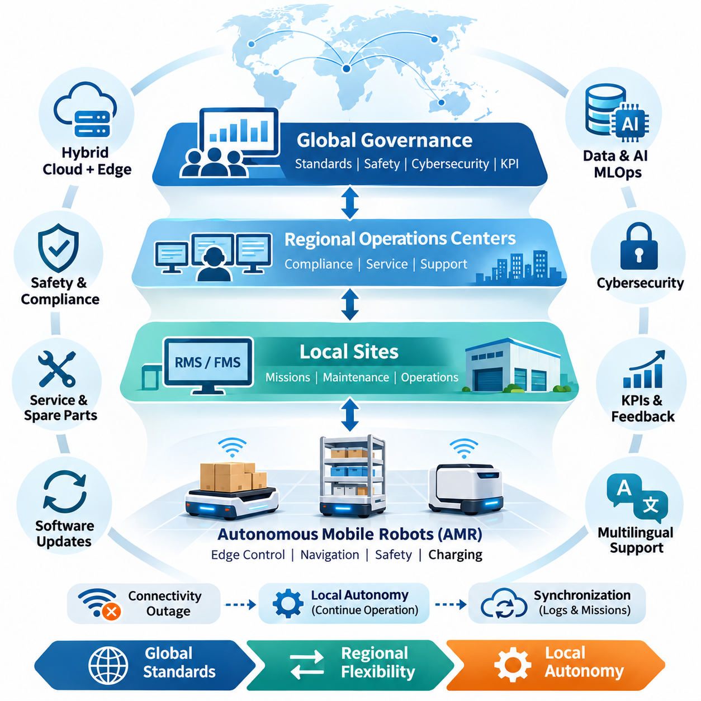
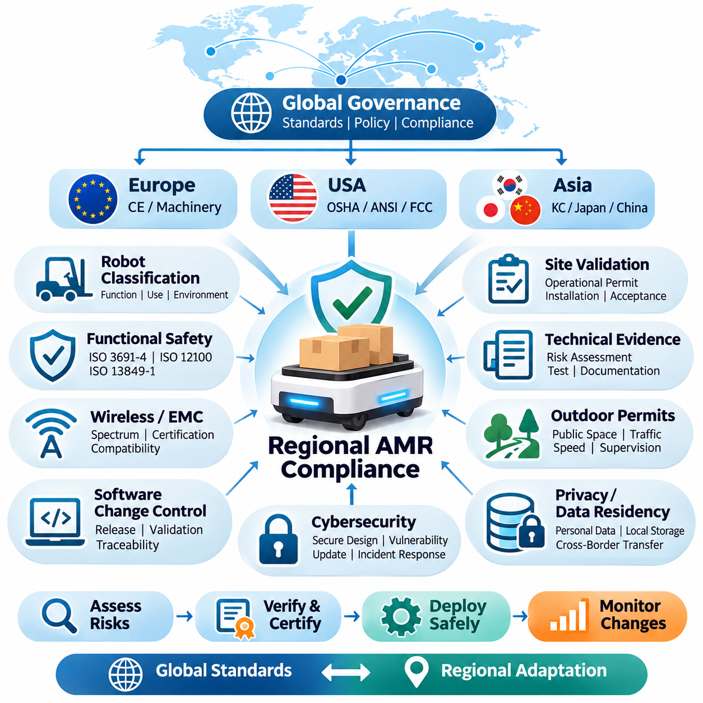
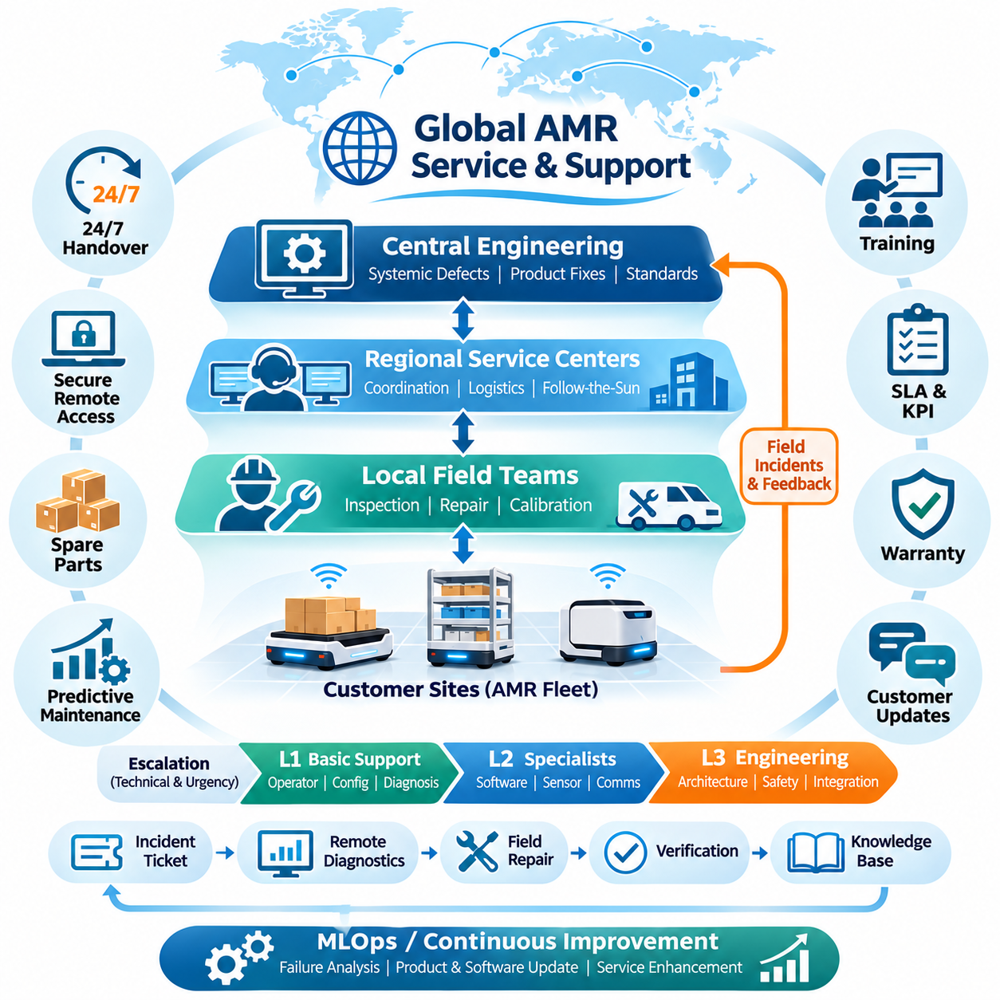
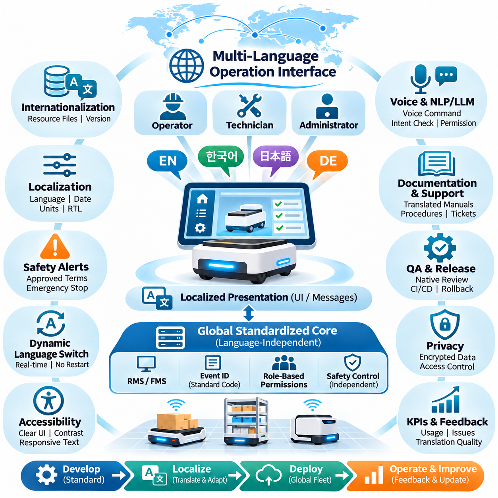
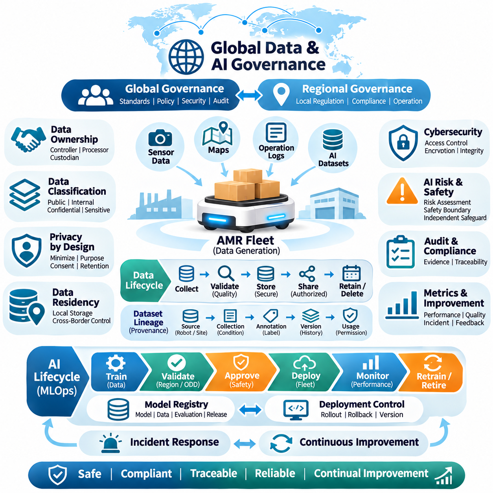
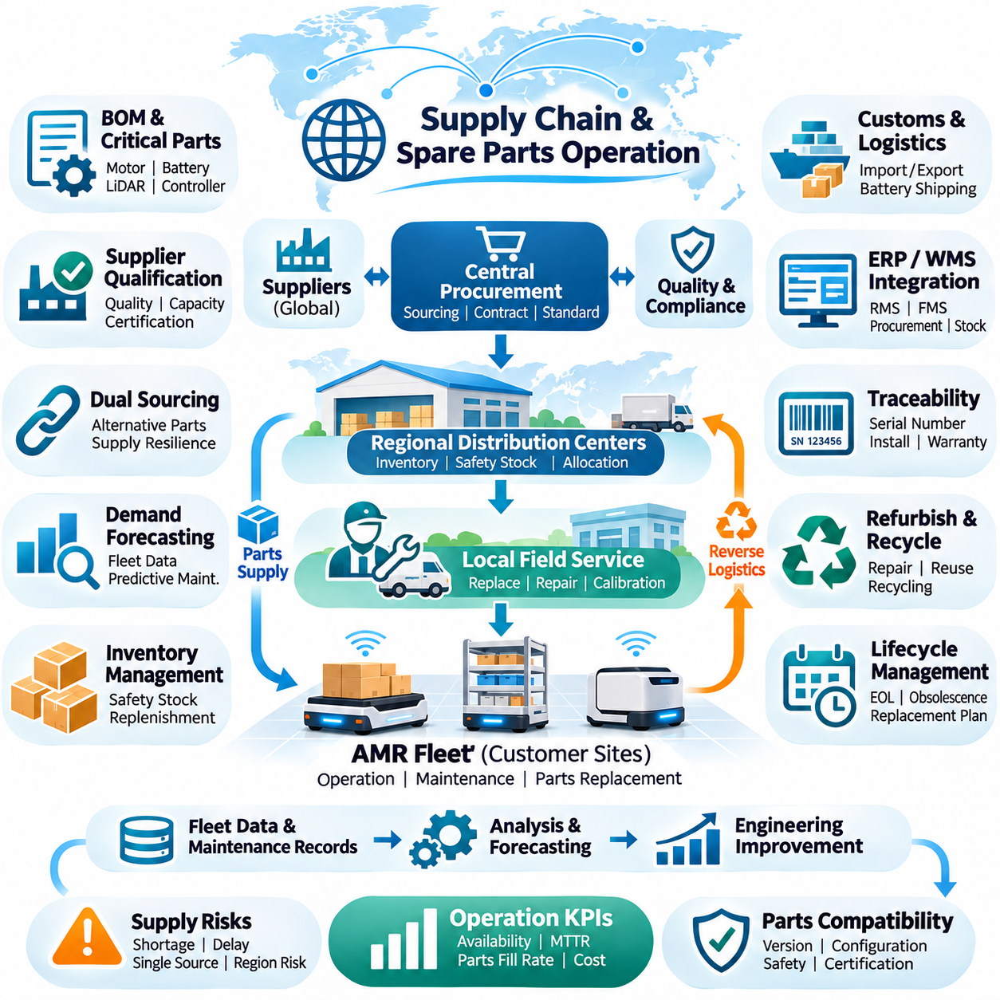
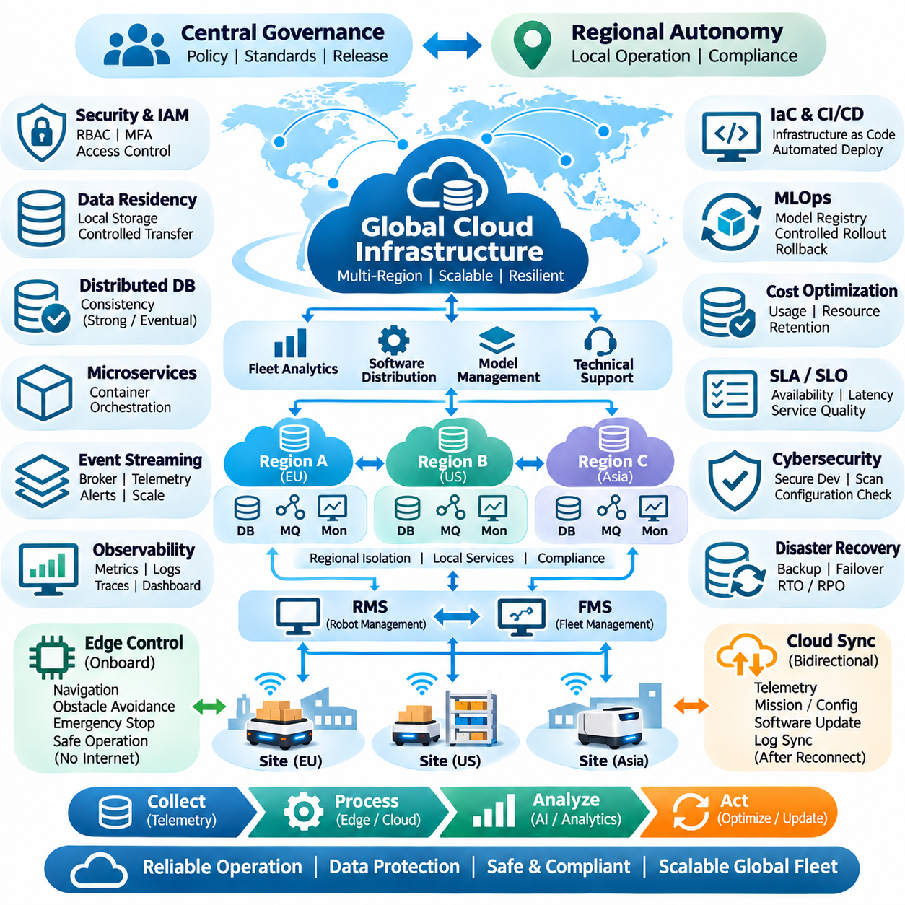
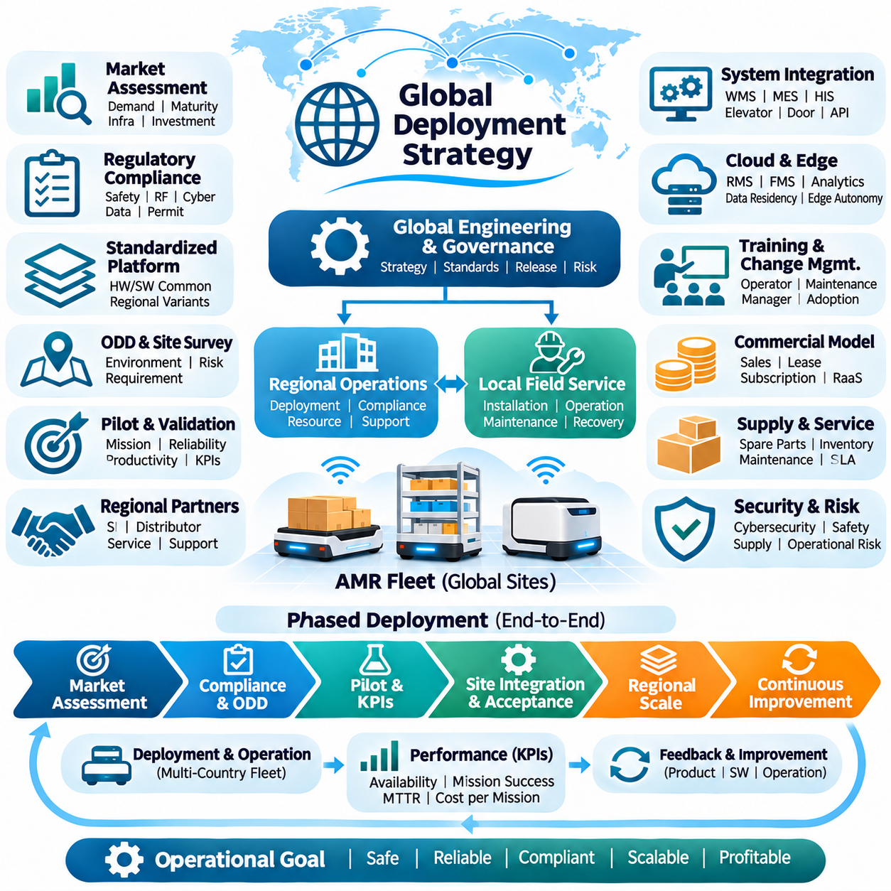

**Volume 08. AMR Operations, Deployment, and MLOps**

# Chapter 24. Global AMR Operations

## 24.1 Global Operation Model

{width="7.268055555555556in" height="7.268055555555556in"}

Global Autonomous Mobile Robot (AMR) operations require a unified management framework that supports consistent performance, safety, and service quality across multiple countries and operating environments. Unlike single-site deployments, global operations must coordinate geographically distributed robot fleets while accommodating differences in infrastructure, regulations, languages, customer expectations, and technical capabilities. The operating model must combine global standardization with regional flexibility.

A global AMR operating model establishes a hierarchical structure connecting central management, regional operations centers, local service organizations, and individual deployment sites. Central management defines common policies, technical standards, cybersecurity requirements, and performance objectives. Regional organizations adapt these requirements to local conditions, while site-level teams execute daily operations, maintenance, incident response, and customer support.

The architecture typically separates strategic governance, operational coordination, and real-time robot execution. Global governance manages technology roadmaps, service agreements, risk policies, and fleet-wide performance analysis. Regional coordination manages deployment schedules, technical support, resource allocation, and regulatory compliance. Local execution systems handle navigation, task scheduling, charging, safety monitoring, and immediate operational decisions.

Robot Management Systems (RMS) and Fleet Management Systems (FMS) provide the technical foundation for distributed operations. RMS platforms monitor individual robots, software versions, hardware conditions, and operational events. FMS platforms coordinate missions, traffic management, resource utilization, and fleet scheduling. Integration between these platforms enables centralized visibility while preserving local control over time-sensitive robotic functions.

A hybrid cloud-edge architecture is particularly important for international AMR deployments. Cloud infrastructure supports global fleet analytics, centralized configuration, software distribution, and long-term operational reporting. Regional cloud services reduce communication latency and support data residency requirements. Edge computing platforms maintain navigation, obstacle avoidance, emergency handling, and essential mission execution when external connectivity becomes unreliable.

Operational autonomy must be maintained independently of wide-area network availability. Robots should continue executing authorized missions when communication with global management platforms is temporarily interrupted, provided local safety conditions remain satisfied. Local controllers must preserve emergency stopping, obstacle detection, and safe recovery capabilities. Once connectivity returns, operational logs and mission states can be synchronized without compromising data consistency.

Global deployment standardization begins with a common robot configuration baseline. Hardware interfaces, software architecture, communication protocols, diagnostic messages, and maintenance procedures should follow controlled specifications. Standardization reduces engineering complexity and simplifies technical support across regions. Nevertheless, localization may require different wireless modules, power interfaces, environmental protection measures, and application-specific sensor configurations.

Regional operating environments introduce significant differences in navigation and mobility requirements. Indoor industrial facilities may provide structured routes and predictable traffic patterns, while outdoor environments introduce weather exposure, uneven terrain, GNSS limitations, and interactions with public infrastructure. A global operating model must define common validation principles while allowing regional teams to establish environment-specific operating envelopes and performance acceptance criteria.

Regulatory compliance must be integrated into the operational lifecycle rather than treated as a final deployment activity. Different jurisdictions impose requirements concerning machinery safety, wireless communication, cybersecurity, privacy, workplace protection, and autonomous operation in public spaces. Regional compliance teams should maintain applicable regulatory registers and coordinate certification evidence, operational restrictions, and periodic inspections with central engineering organizations.

Functional safety governance requires clear separation between global safety policies and site-specific risk controls. Central engineering teams establish safety architecture, validation methods, and approved operational configurations. Regional specialists evaluate local hazards, environmental conditions, and legal obligations. Site operators implement restricted zones, speed limits, emergency procedures, and access controls. Safety-critical changes must undergo documented assessment before deployment.

Global service management depends on clearly defined responsibilities and escalation pathways. Local technicians address routine inspections, component replacement, calibration, and immediate troubleshooting. Regional engineering centers investigate recurring failures and coordinate specialized repairs. Central engineering teams resolve systemic design defects, software regressions, and complex technical issues. Shared ticketing systems preserve incident histories and support consistent service-level management.

Follow-the-sun support can improve operational continuity for fleets distributed across multiple time zones. Regional support centers transfer unresolved incidents through structured handover procedures containing robot identifiers, diagnostic information, safety status, and completed recovery actions. Escalation rules should distinguish operational interruptions from safety-critical emergencies. Continuous support coverage must be matched to contractual obligations and the actual availability of qualified personnel.

Performance management requires a common set of Key Performance Indicators (KPIs) across international deployments. Typical indicators include robot availability, mission completion rate, intervention frequency, Mean Time Between Failures (MTBF), Mean Time To Repair (MTTR), charging efficiency, and fleet utilization. Global definitions ensure meaningful comparisons, while regional analysis accounts for differences in workload, operating hours, environmental conditions, and customer requirements.

A centralized operational data framework enables comparative analysis across geographically distributed fleets. Robot telemetry, mission records, diagnostic events, maintenance histories, and software configurations should follow consistent data schemas. Unique robot identifiers and synchronized timestamps support traceability across systems. Regional data processing policies determine which information can be transferred globally and which information must remain within local infrastructure.

Artificial Intelligence (AI) model governance introduces additional complexity because perception and navigation performance may vary across geographic environments. Lighting, weather, architectural layouts, traffic behavior, and human interaction patterns influence model reliability. Global Machine Learning Operations (MLOps) should maintain common model registries, validation procedures, and release criteria. Regional datasets can support targeted adaptation without eliminating fleet-wide performance controls.

Software and AI updates should follow controlled international release procedures. Central engineering teams prepare validated software packages, compatibility matrices, and rollback mechanisms. Regional teams verify deployment readiness against local configurations and operational restrictions. Canary deployments allow limited field evaluation before broader distribution. Update orchestration should consider time zones, mission schedules, connectivity limitations, and customer maintenance windows.

Cybersecurity operations require consistent identity management, encrypted communication, secure provisioning, and continuous vulnerability monitoring. Global security policies establish minimum protection requirements for robots, edge gateways, cloud services, and administrative interfaces. Regional implementations must satisfy applicable data protection obligations. Security incident procedures should coordinate containment, forensic evidence preservation, credential management, and recovery across organizational boundaries.

Supply chain coordination is another essential component of global AMR operations. Spare parts availability directly affects fleet downtime, repair costs, and contractual service performance. Central procurement organizations can standardize critical components and supplier qualification, while regional warehouses maintain appropriate inventories. Demand forecasting should incorporate installed fleet size, component failure rates, transportation lead times, and expected maintenance requirements.

Multilingual operation interfaces improve accessibility for operators, technicians, administrators, and customer representatives. User interfaces should support localized terminology, measurement units, timestamps, and operational instructions. Safety warnings require technically accurate translations and consistent interpretation across regions. Training materials, maintenance procedures, and incident reporting templates should preserve common technical meanings while accommodating regional language requirements.

Customer governance must balance global service consistency with local contractual expectations. International customers may require centralized reporting across facilities while maintaining independent operational authority at individual sites. Service Level Agreements (SLAs) should define availability targets, response commitments, maintenance responsibilities, and escalation conditions. Contractual performance measurement must distinguish robot defects from infrastructure failures, customer-induced interruptions, and planned maintenance.

Global operational scalability depends on automation, organizational maturity, and architectural modularity. As fleet populations expand, manual configuration and individualized support become increasingly expensive. Automated provisioning, configuration management, fleet monitoring, predictive maintenance, and remote diagnostics reduce repetitive operational effort. Modular regional infrastructure allows new deployment territories to be introduced without redesigning the entire global management platform.

The effectiveness of a global AMR operating model ultimately depends on continuous coordination between engineering, operations, service, cybersecurity, compliance, and customer organizations. Standardized governance establishes consistency, regional autonomy enables practical execution, and local safety systems protect real-time operations. When these elements are integrated through shared platforms, measurable performance objectives, and structured feedback processes, global robot fleets can scale with greater reliability and operational accountability.

## 24.2 Regional Regulation and Compliance

{width="7.268055555555556in" height="7.268055555555556in"}

Regional regulation and compliance are fundamental requirements for deploying Autonomous Mobile Robots (AMRs) across international markets. Each jurisdiction establishes distinct rules governing machinery safety, wireless communication, cybersecurity, privacy, workplace protection, and public mobility. A globally standardized robot platform must therefore accommodate regional legal obligations without compromising its core safety architecture, operational reliability, or engineering consistency.

Regulatory compliance begins with identifying the intended application, operating environment, and legal classification of the robotic system. Industrial transport robots, hospital service robots, autonomous forklifts, and outdoor patrol robots may fall under different regulatory frameworks. Classification depends on the robot\'s functions, physical characteristics, intended users, and operating conditions. These factors determine applicable conformity assessments, certifications, and operational restrictions.

A regional compliance framework should combine centralized regulatory governance with local legal interpretation. Global engineering teams establish common safety requirements, technical documentation standards, and product configuration controls. Regional compliance specialists identify jurisdiction-specific obligations and coordinate with authorities or accredited assessment bodies. Local deployment organizations verify that each installation satisfies applicable operational permits and site-specific safety requirements.

International standards provide an important technical foundation for AMR safety engineering. ISO 3691-4 addresses safety requirements for driverless industrial trucks and their systems within its defined scope. ISO 12100 supports machinery risk assessment and risk reduction, while ISO 13849-1 provides principles for safety-related control systems. Their applicability depends on robot classification, intended use, and the regulatory framework governing the deployment.

European market access requires careful consideration of machinery legislation, product conformity, and applicable harmonized standards. Depending on product classification and timing, manufacturers must address the Machinery Directive 2006/42/EC or Machinery Regulation (EU) 2023/1230. Relevant products may require CE marking, technical documentation, conformity assessment, and an EU Declaration of Conformity. Additional requirements can apply to radio equipment, electromagnetic compatibility, and electrical systems.

In the United States, AMR compliance involves federal requirements, state regulations, and workplace-specific safety obligations. Occupational Safety and Health Administration (OSHA) requirements influence industrial deployment, while applicable consensus standards support safety engineering. ANSI/RIA R15.08 addresses industrial mobile robot safety within its defined scope. Wireless devices may require Federal Communications Commission (FCC) authorization, and outdoor operations can introduce additional state or municipal restrictions.

Asian markets require similarly structured regulatory analysis because national certification systems and operating requirements differ. South Korea may require applicable KC conformity procedures, radio equipment approvals, and compliance with relevant safety legislation. Japan applies its own electrical, radio, and industrial safety frameworks. China maintains product-specific certification requirements and national standards. Compliance teams must verify the exact obligations associated with each robot configuration and intended application.

Functional safety compliance requires systematic identification of hazards throughout the robot lifecycle. Relevant hazards include collisions, crushing, uncontrolled movement, braking failures, battery faults, and unexpected restart conditions. Risk assessments should consider normal operation, maintenance, foreseeable misuse, and reasonably foreseeable abnormal conditions. Safety measures must be supported by documented engineering analysis, verification evidence, and validation under representative operating conditions.

Safety-related control functions must be designed according to the required risk reduction. Emergency stopping, protective stopping, speed monitoring, braking supervision, and personnel detection may require dedicated safety architectures. The necessary Performance Level (PL) or Safety Integrity Level (SIL) depends on the applicable methodology and risk assessment. General-purpose perception algorithms should not automatically be treated as certified safety functions without appropriate evidence and assessment.

Outdoor AMR operations introduce regulatory challenges beyond conventional industrial environments. Robots operating on sidewalks, roads, campuses, ports, or public facilities may encounter traffic regulations, pedestrian safety obligations, access restrictions, and municipal authorization procedures. Legal treatment varies significantly between jurisdictions. Deployment approval must therefore consider the robot\'s operating domain, maximum speed, physical dimensions, remote supervision capabilities, and interaction with surrounding traffic.

Wireless communication compliance is essential because AMRs frequently integrate Wi-Fi, Bluetooth, cellular connectivity, GNSS receivers, and industrial radio interfaces. Regional spectrum allocations, transmission power limits, equipment certification rules, and electromagnetic compatibility requirements must be evaluated. A communication module approved in one country may not automatically be authorized elsewhere. Regional hardware configurations should preserve traceability between approved components and deployed robot variants.

Cybersecurity requirements increasingly influence robot product development and operational governance. Secure boot, authenticated communication, access control, vulnerability management, and software integrity verification establish essential protection mechanisms. Applicable regional legislation may impose additional cybersecurity obligations depending on product category and market. Compliance documentation should identify security responsibilities, supported software versions, update procedures, and mechanisms for responding to discovered vulnerabilities.

Data privacy compliance becomes particularly important when robots collect video, audio, location information, or operational records containing personal information. The European General Data Protection Regulation (GDPR) and comparable regional privacy frameworks can impose requirements concerning lawful processing, transparency, retention, access rights, and international transfers. Privacy-by-design principles should guide sensor configuration, data minimization, encryption, and operational data governance.

Cross-border data transfers require explicit consideration within global Robot Management Systems (RMS) and Fleet Management Systems (FMS). Centralized cloud monitoring may transfer diagnostic information, images, or event records between jurisdictions. Regional data residency obligations and contractual restrictions can limit such transfers. A compliant architecture should support regional storage, controlled replication, role-based access, and configurable retention policies without compromising essential fleet management functions.

Regulatory compliance must also address software updates and configuration changes after deployment. Changes to navigation algorithms, safety parameters, sensors, braking systems, or communication modules can affect previously established conformity evidence. Engineering teams should perform change-impact assessments before releasing updates. Significant modifications may require renewed testing, updated documentation, or additional conformity procedures depending on the applicable regulatory framework.

Technical documentation provides the evidence necessary to demonstrate regulatory compliance. Documentation commonly includes system descriptions, intended-use definitions, risk assessments, electrical schematics, safety calculations, test reports, operating instructions, and maintenance procedures. Configuration records should connect each deployed robot to its hardware revision, software baseline, certification evidence, and approved operating conditions. Document control supports regulatory inspections and long-term traceability.

Regional deployment validation translates product-level compliance into site-specific operational assurance. Factory layouts, pedestrian traffic, floor conditions, emergency exits, wireless coverage, and environmental hazards influence the actual safety of an installation. Site acceptance procedures should verify protective functions, stopping behavior, restricted areas, operator training, and emergency response readiness. Product certification alone does not eliminate the need for installation-specific risk assessment.

Compliance responsibilities must remain clearly assigned throughout the operational lifecycle. Manufacturers typically manage product design conformity and associated technical evidence, while integrators and deployment organizations address their applicable installation responsibilities. Operators maintain approved operating conditions, training records, and inspection procedures. Contractual agreements should define these responsibilities without assuming that legal obligations can always be transferred between parties.

A regulatory monitoring process is necessary because laws, technical standards, and administrative interpretations evolve. Compliance teams should maintain jurisdiction-specific requirement registers, track regulatory changes, and periodically review deployed configurations. Engineering change management should connect new requirements to product development and operational procedures. This approach reduces the risk of outdated certifications, unsupported configurations, and unexpected deployment restrictions.

Effective regional regulation and compliance management enables international AMR expansion while preserving consistent engineering quality and operational safety. Global standardization reduces duplication, regional expertise addresses jurisdiction-specific obligations, and documented verification provides evidence of conformity. Integrating regulatory intelligence, functional safety, cybersecurity, privacy, and field validation into a unified governance framework creates a scalable foundation for responsible global robot operations.

## 24.3 Global Service and Support Network

{width="7.268055555555556in" height="7.268055555555556in"}

A global service and support network is essential for maintaining reliable Autonomous Mobile Robot (AMR) operations across geographically distributed markets. International deployments require coordinated technical assistance, maintenance services, spare parts availability, and incident response capabilities. An effective support network combines centralized engineering expertise with regional service organizations and local field technicians to minimize downtime and maintain consistent operational quality.

The global support architecture typically consists of central engineering headquarters, regional service centers, authorized service partners, and customer-site support teams. Central engineering organizations manage complex technical issues, product reliability improvements, and standardized service procedures. Regional centers coordinate technical resources and logistics, while local teams perform inspections, repairs, calibration, and operational recovery within defined response commitments.

Service responsibilities should follow a structured escalation framework that reflects technical complexity and operational urgency. First-level support addresses routine operator questions, configuration issues, and basic diagnostics. Second-level specialists investigate recurring software, sensor, and communication problems. Third-level engineering teams resolve architecture-level defects, safety-related failures, and complex system integration issues requiring product development expertise.

A globally integrated service management platform provides visibility into incidents, maintenance activities, warranty claims, and customer support performance. Each service request should contain robot identification, hardware configuration, software version, location, fault classification, and diagnostic evidence. Standardized ticket records enable consistent escalation and facilitate analysis of recurring problems across countries, customer organizations, and robot product families.

Follow-the-sun support operations can provide continuous assistance by coordinating service teams across different time zones. Regional support centers transfer unresolved incidents through documented handover procedures that preserve technical context and operational priorities. Critical incidents require immediate escalation to qualified personnel regardless of regional working hours. Support coverage should be designed according to customer contracts, deployment density, and actual technical staffing capacity.

Remote diagnostics are a foundational capability for scalable international robot support. Secure connectivity allows authorized engineers to inspect robot telemetry, application logs, sensor health, battery status, and software processes without visiting the deployment site. Diagnostic tools should support historical event reconstruction and controlled troubleshooting. Remote interventions must preserve safety boundaries and require appropriate authorization before changing operational parameters.

Local field service remains indispensable because mechanical damage, electrical faults, sensor replacement, and physical calibration often require direct intervention. Regional service organizations should maintain trained technicians capable of performing preventive maintenance and corrective repairs. Field procedures must include equipment isolation, electrical safety, mechanical inspection, and functional verification. Robots should return to operation only after applicable recovery and safety checks are completed.

Service Level Agreements (SLAs) establish measurable expectations between robot providers, service partners, and customers. Agreements commonly define support availability, incident response time, restoration objectives, preventive maintenance responsibilities, and escalation procedures. Service performance should distinguish acknowledgment time from actual repair completion. Contractual commitments must account for geographic accessibility, spare parts lead times, and the complexity of technical interventions.

Incident classification enables support organizations to allocate resources according to operational impact. Safety-critical failures, uncontrolled motion, or compromised protective functions require immediate containment and controlled recovery. Major service interruptions may demand urgent remote assistance or technician dispatch. Minor faults can follow scheduled maintenance procedures when safe operation remains possible. Classification criteria should remain consistent across regions while respecting local regulatory obligations.

Spare parts logistics directly influence service responsiveness and fleet availability. Global support networks should maintain regional inventories of critical components such as sensors, motor controllers, batteries, computing modules, and communication devices. Inventory planning must consider installed fleet populations, component reliability, transportation delays, and regional import restrictions. Traceable replacement records support warranty management, product quality analysis, and configuration control.

Predictive maintenance can reduce service costs by identifying developing faults before they cause operational interruptions. Robot health monitoring systems collect information about motor temperature, battery degradation, vibration, braking behavior, and sensor performance. Analytical models estimate maintenance needs and identify abnormal trends. Regional service centers can use these predictions to schedule technician visits, prepare replacement parts, and reduce unnecessary emergency interventions.

A global knowledge management system improves technical consistency by preserving troubleshooting procedures, repair instructions, known defects, and validated recovery methods. Service engineers should contribute verified incident resolutions to a shared knowledge base. Technical documentation must remain synchronized with hardware revisions and software releases. Multilingual access enables regional technicians to apply standardized procedures without losing essential safety information.

Training and certification programs establish consistent service competence across international partner networks. Technicians require practical knowledge of robot mechanics, electrical systems, embedded computing, navigation software, and safety procedures. Training should combine theoretical instruction with supervised field exercises and competency assessments. Periodic recertification helps maintain technical proficiency as robot architectures, diagnostic tools, and maintenance procedures evolve.

Cybersecurity must be integrated into every remote support workflow. Service personnel should use authenticated identities, role-based permissions, encrypted connections, and auditable access procedures. Temporary diagnostic privileges should expire when maintenance activities are completed. Remote software installation and configuration changes require authorization and traceability. Regional privacy regulations may restrict access to customer data, camera recordings, or operational information.

Warranty management requires clear definitions of covered components, operating conditions, service responsibilities, and exclusion criteria. Service records should distinguish manufacturing defects from wear, accidental damage, unauthorized modifications, and environmental misuse. Standardized warranty procedures support consistent decisions across markets. Engineering teams should analyze warranty trends to identify design weaknesses and improve component reliability in future product revisions.

Global service performance should be evaluated through standardized Key Performance Indicators (KPIs). Relevant measures include Mean Time To Repair (MTTR), Mean Time Between Failures (MTBF), first-time fix rate, service response compliance, repeat incident frequency, and spare parts fulfillment time. These indicators reveal differences in regional service effectiveness. Performance comparisons should account for robot utilization, environmental conditions, and deployment complexity.

Customer communication is an essential component of effective technical support. Operators and administrators need clear information about incident severity, expected recovery actions, service progress, and operational restrictions. Regional service organizations should provide communication in the customer\'s preferred language and established business channels. Transparent reporting strengthens operational coordination and reduces uncertainty during prolonged service interruptions.

Service network scalability depends on balancing centralized expertise with decentralized execution. As international fleet populations increase, remote monitoring, automated diagnostics, standardized maintenance procedures, and regional parts distribution reduce support complexity. Service partners can extend geographic coverage when supported by technical certification and quality controls. Central engineering teams should retain responsibility for systemic defects and product-wide corrective actions.

Continuous improvement requires connecting service operations with product engineering, quality assurance, and Machine Learning Operations (MLOps). Field incidents provide evidence about hardware durability, software stability, perception limitations, and operational usability. Structured feedback enables engineering teams to prioritize corrective actions and validate improvements. Updated procedures, replacement components, and software releases should then be distributed through controlled global service processes.

A mature global service and support network transforms AMR maintenance from reactive troubleshooting into coordinated lifecycle management. Centralized engineering governance ensures technical consistency, regional service centers provide operational coordination, and local technicians deliver physical support. When these capabilities are integrated with remote diagnostics, predictive maintenance, secure information sharing, and measurable service commitments, international AMR fleets can achieve greater reliability and sustainable operational scalability.

## 24.4 Multi-Language Operation Interface

{width="7.268055555555556in" height="7.268055555555556in"}

A multilingual operation interface is essential for managing Autonomous Mobile Robot (AMR) fleets across international markets and diverse working environments. Operators, maintenance technicians, administrators, and customer representatives may use different languages while interacting with the same robotic platform. A well-designed interface must provide consistent operational meaning, accessible navigation, and accurate safety information without fragmenting the underlying software architecture.

Multilingual interface design should begin with a centralized internationalization framework that separates language resources from application logic. User interface labels, system messages, alerts, and instructional content should be stored in structured localization resources. This separation enables new languages to be introduced without modifying core robot functions. Consistent resource identifiers and version control support reliable translation management across software releases.

Localization extends beyond translating individual words into different languages. Regional users may expect different date formats, numerical separators, measurement units, time conventions, and terminology. Robot Management Systems (RMS) and Fleet Management Systems (FMS) should present information according to user preferences while preserving standardized internal data representations. This approach improves usability without introducing inconsistencies into operational records.

Safety-related messages require particular attention because incorrect translation can create operational hazards. Emergency stop instructions, collision warnings, battery fault notifications, and restricted-area alerts must communicate unambiguous actions. Translation procedures should include technical review, contextual validation, and approval by qualified personnel. Critical safety terminology should remain consistent across interfaces, training materials, and maintenance documentation.

A multilingual AMR interface should support different user roles without compromising operational authority. Operators primarily require mission status, task assignment, and immediate fault information. Maintenance technicians need diagnostic details, component identification, and repair procedures. Administrators require fleet analytics, configuration management, and access control functions. Language preferences should remain independent of role-based permissions and safety restrictions.

Human-machine interface (HMI) architecture should support dynamic language selection without requiring unnecessary system restarts. Interface components should retrieve translated resources through a common localization service. Language changes must not interrupt active robot missions or alter safety-critical control behavior. Session-level preferences can be synchronized across authorized devices while preserving the operational state of connected robots and fleet management services.

Terminology management is necessary to maintain consistent technical communication across international organizations. Terms such as localization, docking, protective stop, mission recovery, and fleet dispatch may have different interpretations in regional languages. A controlled terminology database should define approved translations and contextual meanings. Engineering, service, and localization teams should collaborate to prevent ambiguous instructions and inconsistent diagnostic descriptions.

Multilingual alarm and event management must preserve the original technical identity of every operational condition. Each event should have a language-independent identifier, severity classification, timestamp, and diagnostic context. User interfaces can display localized descriptions while backend systems retain standardized event codes. This structure enables global incident analysis, cross-regional technical support, and consistent interpretation of robot operating conditions.

Visual interface design must accommodate variations in text length and writing systems. Translated labels may require significantly more space than their original English equivalents. Layout components should support flexible sizing, text wrapping, and appropriate font rendering. Interfaces intended for right-to-left languages require additional layout adaptation. These considerations are particularly important for compact robot touchscreens and mobile maintenance applications.

Accessibility should be integrated into multilingual interface engineering rather than treated as an optional feature. Clear typography, sufficient contrast, recognizable symbols, and predictable navigation improve usability across languages. Color should not be the sole indicator of operational status or safety severity. Interfaces should provide text alternatives and accessible interaction patterns where practical, supporting operators with different visual, physical, and cognitive capabilities.

Voice interaction introduces additional localization requirements for service robots operating in hospitals, public facilities, and customer-facing environments. Speech recognition and speech synthesis systems must support regional languages, accents, and pronunciation differences. Voice commands should be mapped to standardized robot intents rather than directly controlling low-level motion. Safety-sensitive commands require explicit validation and appropriate confirmation before execution.

Natural Language Processing (NLP) can improve multilingual human-robot interaction by interpreting user requests and generating localized responses. Large Language Models (LLMs) may support conversational assistance, operational guidance, and technical troubleshooting. However, language model outputs should not independently authorize unsafe robot actions. Structured intent validation, permission checks, and deterministic safety controls must remain responsible for execution decisions.

Multilingual documentation is essential for international deployment and service operations. Installation instructions, maintenance manuals, troubleshooting guides, and emergency procedures should be available in languages appropriate to local users. Documentation versions must remain synchronized with robot hardware and software configurations. Controlled translation workflows help ensure that updated procedures reach regional service teams without introducing outdated or contradictory technical information.

Global support platforms should connect localized customer communication with standardized engineering records. A service ticket may be submitted in a regional language while technical specialists investigate the same issue from another country. Translation services can assist communication, but original reports and standardized diagnostic identifiers should be preserved. This approach supports efficient escalation while reducing the risk of losing important technical context.

Localization testing should evaluate both linguistic accuracy and operational functionality. Test scenarios should include normal mission execution, emergency notifications, diagnostic workflows, maintenance procedures, and software update messages. Native-language reviewers and technical specialists should verify terminology and usability. Automated interface testing can detect missing translations, text overflow, encoding errors, and inconsistent resource mappings across supported languages.

Software release management must treat language resources as controlled configuration artifacts. Translation packages should include version identifiers, compatibility information, and validation status. Continuous Integration and Continuous Deployment (CI/CD) pipelines can verify resource completeness and compatibility before distribution. Regional deployments should receive approved language updates through secure software distribution mechanisms with rollback support when necessary.

Multilingual data governance requires careful handling of operational records containing user-generated text or personal information. Support conversations, voice recordings, and incident descriptions may be subject to regional privacy requirements. Translation services should apply appropriate access controls, encryption, and retention policies. Organizations must evaluate whether external language processing services are permitted to receive operational or customer information across jurisdictional boundaries.

Performance monitoring should measure the effectiveness of multilingual interfaces through operational indicators. Relevant metrics include task completion time, user error frequency, support request volume, translation defect rates, and operator satisfaction. Regional comparisons can reveal terminology problems or interface designs that create unnecessary complexity. Feedback from field operators and service technicians should guide continuous localization improvements.

A scalable multilingual interface strategy balances centralized software governance with regional linguistic expertise. Global engineering teams maintain common interface architecture, event definitions, and release controls. Regional specialists validate translations, cultural suitability, and operational terminology. Local users contribute practical feedback from daily robot operations. This organizational structure supports consistent functionality while accommodating diverse international requirements.

An effective multilingual AMR operation interface improves safety, usability, service efficiency, and global deployment scalability. Standardized internal data models preserve technical consistency, while localized presentation layers make robotic systems accessible to regional users. By integrating internationalization, terminology governance, accessibility, secure language processing, and continuous validation, AMR providers can deliver reliable operational experiences across languages and markets.

## 24.5 Global Data and AI Governance

{width="7.268055555555556in" height="7.268055555555556in"}

Global data and AI governance establishes the policies, responsibilities, and technical controls required to manage Autonomous Mobile Robot (AMR) information and intelligent systems across international operations. Distributed robot fleets generate sensor recordings, navigation maps, operational logs, and AI training datasets. Effective governance ensures that these assets remain secure, traceable, legally compliant, and suitable for reliable decision-making throughout their lifecycle.

A global governance framework should combine centralized technical standards with regional regulatory responsibilities. Corporate governance teams define common data classifications, AI development policies, security requirements, and audit procedures. Regional organizations interpret local legal obligations and operational constraints. This structure maintains consistent engineering practices while allowing necessary adaptations to jurisdiction-specific requirements and customer agreements.

Data ownership and stewardship must be established before collecting information from deployed robots. Customer organizations, robot manufacturers, cloud operators, and service partners may hold different contractual rights and responsibilities. Governance policies should identify data controllers, processors, custodians, and authorized users where applicable. Clear agreements prevent unauthorized secondary use of operational information and establish accountability for retention, access, and deletion.

Data classification provides the foundation for consistent protection and handling requirements. Robot information may include public technical documentation, internal diagnostic records, confidential facility maps, and sensitive personal information. Each category should have defined access permissions, encryption requirements, storage locations, and retention periods. Classification metadata enables automated enforcement across edge devices, regional cloud platforms, and centralized engineering repositories.

Global data architectures must address data sovereignty, residency, and cross-border transfer restrictions. Some jurisdictions or customer contracts require operational information to remain within designated geographic boundaries. Regional storage services can retain sensitive records locally while sharing approved aggregated statistics globally. Transfer mechanisms should incorporate legal authorization, encryption, access logging, and appropriate contractual safeguards before information crosses jurisdictional boundaries.

Privacy-by-design principles should guide the configuration of cameras, microphones, location tracking, and human interaction systems. Robots operating in hospitals, workplaces, and public facilities may capture information about identifiable individuals. Data minimization, purpose limitation, selective recording, and configurable retention reduce unnecessary exposure. Privacy impact assessments should evaluate collection practices, processing purposes, and potential risks before deployment.

Data lifecycle governance covers acquisition, transmission, storage, processing, sharing, archival, and deletion. Each stage requires documented controls and responsible organizations. Edge devices should protect temporary recordings, communication channels should preserve confidentiality and integrity, and storage platforms should enforce access policies. Verified deletion procedures and retention schedules prevent uncontrolled accumulation of sensitive or obsolete information.

Data quality management is essential because AI models depend on accurate and representative operational information. Sensor calibration errors, timestamp inconsistencies, missing annotations, and corrupted recordings can undermine training reliability. Automated validation pipelines should examine completeness, synchronization, labeling accuracy, and dataset integrity. Quality metrics and documented acceptance criteria help determine whether collected information is suitable for model development.

Dataset provenance and lineage establish traceability from original robot observations to processed training assets. Each dataset should record its source, collection conditions, sensor configuration, annotation methods, transformation history, and usage permissions. Versioned metadata supports reproducible experiments and regulatory investigations. Lineage tracking also enables organizations to identify affected models when source data is corrected, restricted, or withdrawn.

AI governance must extend across model development, validation, deployment, monitoring, and retirement. Model registries should preserve training dataset references, architecture descriptions, evaluation results, approved operating domains, and release histories. Formal approval gates should verify performance and safety evidence before deployment. Model changes must remain traceable to responsible engineering teams and documented technical decisions.

Risk-based AI governance distinguishes operational assistance from safety-sensitive autonomy. Models supporting report generation or maintenance recommendations present different hazards from systems influencing navigation, obstacle avoidance, or robotic manipulation. Risk assessments should consider failure severity, environmental uncertainty, human interaction, and automation authority. Safety-critical decisions require appropriate independent safeguards and validated control boundaries.

AI performance evaluation should account for regional differences in infrastructure, environments, and user behavior. Models trained in one country may encounter unfamiliar signage, floor materials, pedestrian patterns, or lighting conditions elsewhere. Regional validation datasets should represent expected operating conditions and foreseeable disturbances. Deployment approval should depend on demonstrated performance within the defined Operational Design Domain rather than global averages alone.

Model bias and generalization limitations require continuous investigation. Training datasets may overrepresent certain facilities, geographic regions, lighting conditions, or equipment configurations. Such imbalances can produce uneven perception and navigation performance. Governance teams should examine subgroup performance, rare-event coverage, and distribution shifts. Corrective actions may include targeted data collection, retraining, operating restrictions, or additional safeguards.

Secure AI development requires controlled access to datasets, model weights, training infrastructure, and deployment pipelines. Encryption, identity management, software signing, and artifact integrity verification protect intellectual property and operational systems. Development environments should maintain reproducible builds and auditable changes. Third-party models and datasets require licensing, provenance, vulnerability, and security reviews before integration.

Continuous learning introduces governance challenges because field data can influence future model behavior. New training information should pass privacy screening, quality validation, and dataset approval before entering development pipelines. Retrained models require regression testing, safety evaluation, and release authorization. Online adaptation should operate within explicitly validated limits, while unapproved model changes must not alter safety-critical behavior.

Global MLOps platforms should coordinate model versioning, experiment tracking, deployment authorization, and performance monitoring across regions. Central governance establishes common release standards, while regional teams validate local compatibility. Controlled rollout strategies can introduce updates to limited robot populations before broader deployment. Monitoring and rollback mechanisms help contain unexpected performance degradation and maintain fleet reliability.

AI incident management must preserve evidence and establish clear accountability. Unexpected navigation decisions, perception failures, data leaks, or unauthorized model changes should trigger structured investigation procedures. Incident records should include model versions, relevant sensor observations, operational context, and corrective actions. Reporting obligations may vary by jurisdiction, requiring coordination among engineering, cybersecurity, legal, and regional operations teams.

Governance effectiveness should be measured through auditable operational indicators. Relevant metrics include data quality defect rates, unauthorized access events, dataset traceability coverage, model validation completion, privacy incidents, and deployment policy violations. Periodic reviews should examine compliance gaps and recurring weaknesses. Independent audits and management oversight provide additional assurance that documented controls operate effectively.

A mature global data and AI governance framework integrates legal compliance, technical integrity, operational safety, and organizational accountability. Centralized standards establish consistency, regional controls address local obligations, and lifecycle traceability supports responsible AI evolution. By connecting data stewardship, secure infrastructure, model validation, MLOps, and continuous oversight, international AMR operations can scale while maintaining trust, reliability, and regulatory readiness.

## 24.6 Supply Chain and Spare Parts Operation

{width="7.268055555555556in" height="7.268055555555556in"}

Global supply chain and spare parts operations are essential for maintaining the reliability and availability of Autonomous Mobile Robot (AMR) fleets across international markets. Distributed deployments require coordinated procurement, inventory management, transportation, and replacement services. An effective supply chain ensures that critical components remain available despite geographic distance, supplier constraints, customs procedures, and unexpected equipment failures.

A global supply chain architecture should integrate centralized procurement governance with regional distribution and local service capabilities. Central organizations establish supplier qualification standards, component specifications, and purchasing agreements. Regional distribution centers maintain inventories based on installed fleet populations and expected demand. Local service partners provide rapid access to replacement components and coordinate field repairs.

Supply chain planning begins with a comprehensive understanding of the robot Bill of Materials (BOM) and component criticality. Drive motors, motor controllers, batteries, LiDAR sensors, computing modules, and safety devices may have different failure consequences and procurement lead times. Criticality assessments should consider operational impact, replacement difficulty, supplier availability, and safety requirements. These assessments determine stocking priorities and contingency strategies.

Supplier qualification is necessary to maintain consistent component quality across international manufacturing networks. Evaluation criteria should include production capability, quality management systems, technical documentation, delivery reliability, and long-term product support. Suppliers of safety-related components require additional verification of conformity evidence and configuration stability. Periodic audits and performance reviews help identify quality deterioration and supply continuity risks.

Strategic sourcing reduces dependency on individual suppliers and vulnerable geographic regions. Dual sourcing or approved alternative components can improve resilience when technically feasible. However, replacement components must satisfy mechanical, electrical, software, and safety compatibility requirements. Engineering change control should verify alternatives before procurement authorization. Unvalidated substitutions can introduce reliability problems or invalidate existing certification evidence.

Demand forecasting should combine historical failure records, fleet expansion plans, maintenance schedules, and component lifecycle information. Robot utilization, environmental conditions, and operating intensity influence replacement demand. Predictive maintenance data can improve forecasts by identifying developing component degradation. Forecasting models should distinguish routine consumables from low-frequency critical parts to avoid excessive inventory or unexpected shortages.

Inventory management requires balancing service availability against storage and working capital costs. Regional warehouses should maintain safety stock based on component demand variability, replenishment lead times, and contractual service commitments. High-value components may require centralized pooling, while frequently replaced items should remain close to deployment sites. Inventory policies should be reviewed as fleet density, supplier performance, and operating conditions change.

Spare parts classification supports efficient stocking and distribution decisions. Consumable items such as filters, wheels, and cleaning materials generally require predictable replenishment. Repairable modules, including motor assemblies and computing units, may support exchange programs. Safety-critical components require strict traceability and approved replacement procedures. Classification enables differentiated inventory policies without compromising maintenance quality.

Global logistics operations must account for customs regulations, import duties, transportation restrictions, and regional documentation requirements. Lithium batteries and other regulated components may require specialized packaging, labeling, and shipping procedures. International shipments should include accurate product descriptions, origin information, and applicable compliance documents. Logistics planning must anticipate customs delays and restrictions affecting emergency replacement deliveries.

Regional distribution centers improve service responsiveness by positioning critical parts near installed robot populations. Warehouse locations should reflect customer concentration, transportation connectivity, and expected repair demand. Distribution systems must provide inventory visibility across regional facilities. When local stock becomes insufficient, controlled transfers between warehouses can reduce downtime while preserving inventory traceability and regional regulatory compliance.

Digital supply chain platforms should connect procurement, warehouse operations, service management, and fleet monitoring systems. Enterprise Resource Planning (ERP) and Warehouse Management Systems (WMS) can track purchase orders, inventory movements, and component availability. Integration with Robot Management Systems (RMS) and Fleet Management Systems (FMS) enables maintenance demand to inform replenishment decisions. Shared data reduces delays caused by fragmented operational processes.

Component traceability is essential for quality management, warranty administration, and regulatory investigations. Each critical part should be associated with manufacturer information, part number, serial number, production batch, and approved configuration. Installation records should connect replacement components to specific robots and service events. Traceability enables targeted recalls, failure analysis, and identification of affected fleets without unnecessary replacement of unaffected equipment.

Spare parts compatibility management becomes increasingly important as robot platforms evolve. Hardware revisions, firmware dependencies, connector changes, and mechanical modifications can create compatibility constraints. A controlled parts catalog should identify approved replacements for each robot model and configuration. Service technicians must verify compatibility before installation. Configuration records should be updated after repairs to preserve accurate fleet maintenance histories.

Reverse logistics manages the return of defective, repairable, or obsolete components from deployment sites. Returned parts should undergo inspection, fault classification, and disposition decisions. Repairable modules may enter refurbishment programs after appropriate testing and validation. Defective components should be preserved when engineering investigation is required. Reverse logistics processes support warranty recovery, failure analysis, and responsible material handling.

Lifecycle management must anticipate component obsolescence and supplier discontinuation. Computing modules, sensors, communication devices, and electronic controllers may become unavailable before the end of a robot platform\'s service life. Procurement teams should monitor end-of-life notices and last-time-buy opportunities. Engineering organizations should qualify successor components and plan migration strategies that preserve safety, software compatibility, and maintenance continuity.

Supply chain risk management should address geopolitical disruption, transportation interruptions, supplier insolvency, manufacturing defects, and unexpected demand increases. Risk registers can identify vulnerable components and estimate operational consequences. Mitigation strategies may include alternate suppliers, regional buffer inventories, strategic purchasing, and redesign plans. Scenario exercises help organizations evaluate whether existing contingency measures can sustain essential robot operations.

Supply chain performance should be monitored through standardized Key Performance Indicators (KPIs). Relevant measures include parts availability, inventory turnover, order fulfillment time, supplier on-time delivery, stockout frequency, and emergency shipment costs. Service-related indicators should connect parts shortages to robot downtime and repair completion. Regional performance comparisons help identify inefficient inventory placement and recurring procurement bottlenecks.

Sustainable spare parts operations should consider repairability, material recovery, packaging reduction, and responsible disposal. Modular robot architectures can simplify component replacement and reduce unnecessary equipment waste. Refurbishment and remanufacturing programs may extend component life when safety and quality requirements are satisfied. Battery recycling and electronic waste management must follow applicable regional environmental regulations and approved handling procedures.

Continuous improvement requires close coordination among procurement, engineering, quality assurance, logistics, and field service organizations. Component failure trends should influence supplier reviews and future design decisions. Maintenance feedback can reveal recurring shortages, difficult replacement procedures, and unsuitable stocking policies. Shared operational analysis enables organizations to improve component reliability, optimize inventory, and reduce total lifecycle support costs.

A mature global supply chain and spare parts operation transforms component logistics into a strategic capability for international AMR deployment. Centralized sourcing maintains technical consistency, regional inventories improve responsiveness, and digital traceability supports reliable maintenance. Integrating demand forecasting, supplier governance, logistics resilience, lifecycle planning, and continuous performance monitoring enables scalable robot operations with reduced downtime and controlled support costs.

## 24.7 Global Cloud Infrastructure

{width="7.268055555555556in" height="7.268055555555556in"}

Global cloud infrastructure provides the digital foundation for operating Autonomous Mobile Robot (AMR) fleets across countries, regions, and distributed customer facilities. It connects robot telemetry, fleet coordination, software management, analytics, and technical support through geographically distributed computing services. A well-designed infrastructure must balance global operational visibility with regional autonomy, regulatory compliance, cybersecurity, and service continuity.

A global cloud architecture should separate centralized governance functions from regional operational services. Central platforms manage identity policies, software releases, fleet analytics, and common service standards. Regional environments process local robot data and support customer operations under applicable jurisdictional requirements. This separation allows organizations to maintain consistent management while reducing unnecessary cross-border data movement and operational dependencies.

Multi-region deployment architectures improve resilience by distributing workloads across independent cloud regions. Each region may host application services, databases, message brokers, and monitoring components. Regional isolation limits the impact of infrastructure failures and supports local service continuity. Deployment planning should consider availability zones, network connectivity, geographic risk, and the recovery requirements of critical operational applications.

Cloud connectivity should integrate Robot Management Systems (RMS), Fleet Management Systems (FMS), and edge computing platforms through standardized interfaces. Robots transmit health information, mission events, diagnostic logs, and selected sensor data to authorized services. Cloud platforms return approved configurations, mission assignments, and software packages. Communication protocols must support authentication, message integrity, and controlled recovery from interrupted connections.

Edge-cloud coordination is essential because robot safety and immediate motion control cannot depend on continuous internet availability. Obstacle avoidance, emergency stopping, protective functions, and local navigation must remain within validated onboard control boundaries. Cloud services can provide scheduling, analytics, long-term storage, and fleet-level optimization. When connectivity fails, robots should follow predefined degraded-operation policies and restore synchronization after reconnection.

Global data storage architectures should support regional data residency, lifecycle management, and controlled information sharing. Operational databases retain robot states, maintenance records, and mission histories, while object storage manages selected logs, images, and datasets. Regional storage policies determine which information may be replicated internationally. Encryption, access restrictions, retention schedules, and auditable transfers help protect sensitive customer information.

Distributed database design requires explicit consistency and availability policies. Mission execution records, robot configuration states, and maintenance transactions may require different synchronization guarantees. Strong consistency is appropriate for certain configuration and authorization operations, while eventual consistency may support aggregated analytics. Architects must define conflict resolution, transaction ownership, and recovery behavior to prevent contradictory commands or duplicated operational actions.

Cloud networking should provide secure communication between regional services, customer facilities, and mobile robots. Virtual private networks, private endpoints, encrypted tunnels, and identity-based access controls can reduce exposure to unauthorized traffic. Network segmentation should separate operational control, diagnostics, administration, and data analytics. Connectivity designs must accommodate cellular networks, enterprise Wi-Fi, firewalls, and variable communication quality.

Identity and access management establishes consistent security boundaries across global cloud services. Operators, service technicians, administrators, and automated applications require distinct permissions based on their responsibilities. Role-based access control, multifactor authentication, and short-lived credentials reduce unauthorized access risks. Regional access restrictions and privileged session auditing should prevent inappropriate control of robots deployed in different jurisdictions.

Cloud-native application platforms can improve scalability through containerization, service orchestration, and automated deployment. Microservices may separate fleet scheduling, telemetry ingestion, device management, user authentication, and reporting functions. Container orchestration platforms allocate computing resources and recover failed services. However, architecture complexity should remain proportional to fleet size, operational requirements, and the engineering organization\'s support capabilities.

Message processing infrastructure must handle large volumes of asynchronous robot events without overwhelming downstream applications. Event brokers and streaming platforms can distribute telemetry, alerts, and operational updates to authorized consumers. Message schemas should include robot identifiers, timestamps, sequence information, and version metadata. Delivery guarantees, deduplication, and backpressure controls help maintain reliable processing during network disruption or demand spikes.

Global observability requires unified monitoring of infrastructure health, application behavior, and robot fleet operations. Metrics, logs, and distributed traces reveal service latency, resource consumption, communication failures, and abnormal event patterns. Regional dashboards support local operators, while centralized monitoring identifies cross-region trends. Alerting policies should distinguish infrastructure incidents from robot-level faults and prioritize conditions affecting safety or service availability.

Disaster recovery planning should define recovery time objectives and recovery point objectives for each cloud service. Backup policies, database replication, infrastructure templates, and tested restoration procedures reduce prolonged outages. Critical services may require regional failover, but failover must respect data residency and authorization constraints. Recovery exercises should verify application behavior, data integrity, and safe robot operation under disrupted infrastructure conditions.

Cloud cybersecurity must protect infrastructure configurations, software supply chains, application interfaces, and stored information. Secure development practices, vulnerability scanning, secrets management, and continuous configuration assessment reduce attack exposure. Software artifacts should be signed and verified before deployment. Security monitoring should detect unusual access, unauthorized configuration changes, and suspicious communication patterns across regional environments.

Global cloud infrastructure also supports AI model distribution and Machine Learning Operations (MLOps). Model registries maintain approved versions, evaluation evidence, compatibility information, and deployment histories. Regional services distribute authorized models to compatible robot configurations. Controlled rollouts, performance monitoring, and rollback mechanisms reduce deployment risk. Safety-related model updates must follow validated release procedures rather than unrestricted automated replacement.

Cost management becomes increasingly important as fleet populations and data volumes expand. Cloud expenditure includes computing resources, databases, storage, network transfer, monitoring, and backup services. Cost allocation should distinguish regional operations, customer workloads, and shared global infrastructure. Data filtering at the edge, retention optimization, and workload scheduling can reduce unnecessary expenditure without weakening operational visibility.

Infrastructure automation enables consistent deployment across countries and cloud regions. Infrastructure as Code defines networks, computing services, security policies, and monitoring configurations through version-controlled specifications. Continuous Integration and Continuous Deployment pipelines validate changes before controlled release. Regional variations should be managed through approved configuration parameters rather than undocumented manual modifications.

Cloud service governance should establish clear operational ownership, change approval procedures, and measurable Service Level Objectives (SLOs). Platform teams manage shared infrastructure, regional teams supervise local services, and security organizations oversee access and compliance. Service Level Agreements define contractual expectations where applicable. Regular reviews should evaluate availability, latency, incident recovery, security posture, and infrastructure capacity.

A mature global cloud infrastructure combines regional resilience with centralized operational intelligence. Distributed services support local continuity, while common governance maintains consistent security, software management, and fleet visibility. Integrating edge autonomy, secure networking, regional data controls, automated deployment, observability, and disaster recovery creates a scalable foundation for reliable international AMR operations.

## 24.8 Global Deployment Strategy

{width="7.268055555555556in" height="7.268055555555556in"}

A global deployment strategy provides a structured approach for expanding Autonomous Mobile Robot (AMR) operations across international markets. Successful expansion requires coordination among engineering, regulatory compliance, commercial planning, service infrastructure, and local operations. The strategy must balance standardized robotic platforms with regional adaptations while maintaining safety, reliability, financial sustainability, and consistent customer experience.

Market selection should begin with a systematic assessment of industrial demand, automation maturity, labor availability, and infrastructure readiness. Manufacturing facilities, hospitals, logistics centers, and public institutions may present different adoption opportunities. Evaluation should consider customer investment capacity, regulatory complexity, competitive conditions, and expected service costs. Prioritizing suitable markets reduces deployment risk and improves resource allocation.

A phased international expansion model enables organizations to validate operational assumptions before committing substantial resources. Initial deployments should target controlled environments with measurable performance requirements and cooperative customers. Successful pilots provide evidence for regional commercialization and broader fleet expansion. Each phase should include defined acceptance criteria, financial objectives, and documented decisions about whether to proceed.

Regional regulatory readiness must be evaluated before commercial commitments are finalized. Product classification, machinery safety requirements, wireless certification, cybersecurity obligations, and data protection laws vary across jurisdictions. Outdoor robots may require additional operating permissions and local authority coordination. Compliance assessments should identify necessary certifications, operational restrictions, and documentation requirements early in deployment planning.

Global product standardization reduces engineering complexity and improves manufacturing efficiency. Common mechanical platforms, electrical architectures, software interfaces, and safety functions should remain consistent wherever possible. Regional variants may accommodate communication frequencies, power systems, language requirements, and environmental conditions. Configuration management must ensure that localized modifications do not compromise validated safety or system compatibility.

Deployment planning should define the intended Operational Design Domain (ODD) for each customer installation. Environmental characteristics, pedestrian traffic, floor conditions, weather exposure, communication coverage, and operational schedules influence robot suitability. Site surveys and risk assessments should establish technical requirements before installation. Deployment approval must depend on demonstrated compatibility between robot capabilities and actual operating conditions.

Pilot programs should produce measurable evidence of technical and commercial feasibility. Evaluation criteria may include mission completion rate, navigation reliability, intervention frequency, system availability, and customer productivity improvements. Baseline operational measurements are necessary to distinguish actual benefits from assumptions. Pilot results should document technical limitations, operational changes, and requirements for scaling beyond the initial installation.

Regional partnerships are essential for market access and long-term operational support. Local system integrators, distributors, maintenance providers, and technology partners can contribute customer relationships and deployment expertise. Partner selection should evaluate technical competence, financial stability, geographic coverage, and service quality. Clear agreements must define installation responsibilities, customer communication, warranty handling, and escalation procedures.

A global deployment organization should establish consistent project governance across countries. Central engineering teams maintain product standards, technical documentation, and release controls. Regional deployment managers coordinate customer requirements, site preparation, training, and acceptance testing. Local service teams provide maintenance and operational assistance. Defined responsibilities and reporting structures reduce misunderstandings and prevent fragmented execution.

Deployment execution should follow standardized readiness and acceptance procedures. Site preparation includes mapping, network validation, charging infrastructure, traffic management, and integration with facility systems. Installation teams verify robot configuration, protective functions, mission workflows, and emergency procedures. Formal site acceptance testing confirms operational readiness. Handover documentation should establish approved operating conditions and customer responsibilities.

Integration with customer infrastructure is a major determinant of deployment success. AMRs may need to communicate with Warehouse Management Systems (WMS), Manufacturing Execution Systems (MES), hospital information platforms, elevators, and automated doors. Standardized APIs and integration adapters reduce customization effort. Interface testing must verify data consistency, command authorization, failure recovery, and safe behavior when external systems become unavailable.

Regional cloud and data architectures should support local operational requirements while preserving global management visibility. Data residency rules, customer contracts, network latency, and cybersecurity policies influence infrastructure placement. Regional services can manage local telemetry and operational records while sharing approved aggregated information centrally. Edge autonomy should maintain safe robot behavior when cloud connectivity is interrupted.

Global fleet deployment requires scalable software configuration and lifecycle management. Robot Management Systems (RMS) and Fleet Management Systems (FMS) should support multiple customers, sites, regions, and robot models. Configuration templates can standardize missions, maps, access permissions, and maintenance policies. Controlled software releases and regional validation prevent incompatible updates from disrupting active operations.

Training and organizational change management are critical for customer adoption. Operators require instruction in mission supervision, fault recovery, and emergency response. Maintenance personnel need practical knowledge of inspection and service procedures. Managers should understand performance dashboards and operational responsibilities. Training programs must accommodate regional languages, workplace practices, and varying levels of automation experience.

Commercial deployment models should reflect regional purchasing behavior and customer financial requirements. Options may include direct equipment sales, leasing, subscription services, and Robotics as a Service (RaaS). Financial analysis should consider acquisition costs, installation expenses, maintenance obligations, cloud services, and replacement parts. Pricing structures must support sustainable margins while demonstrating measurable customer value.

Deployment risk management should address technical failures, regulatory delays, supply disruptions, cybersecurity incidents, and insufficient customer readiness. Risk registers should assign ownership, probability, operational impact, and mitigation actions. Contingency planning may include alternative suppliers, additional field support, or adjusted deployment schedules. Regular risk reviews enable early intervention before local issues affect broader expansion programs.

Global performance governance requires consistent Key Performance Indicators (KPIs) across deployed fleets. Relevant measures include system availability, mission success rate, Mean Time To Repair (MTTR), intervention frequency, customer satisfaction, and operational cost per mission. Regional comparisons should account for workload intensity and environmental differences. Performance reviews identify opportunities for product improvement and operational standardization.

Scaling from individual installations to regional fleets requires repeatable deployment processes and sufficient support capacity. Standardized site assessment tools, installation templates, training materials, and maintenance procedures reduce deployment variability. Regional spare parts inventories and qualified technicians support growing robot populations. Expansion decisions should consider service readiness and operational stability rather than sales volume alone.

Continuous improvement should connect field experience with product development and global operational planning. Deployment incidents, customer feedback, and performance data reveal recurring integration problems and environmental limitations. Engineering teams can translate these findings into hardware revisions, software improvements, and updated procedures. Lessons learned should be shared across regions through controlled documentation and coordinated release processes.

A mature global deployment strategy combines disciplined market selection, standardized engineering, regional compliance, scalable infrastructure, and continuous operational improvement. Central governance preserves technical consistency while local organizations adapt execution to customer and regulatory requirements. By integrating phased expansion, measurable acceptance criteria, service readiness, and lifecycle management, AMR providers can establish sustainable international operations and expand robotic fleets responsibly.
