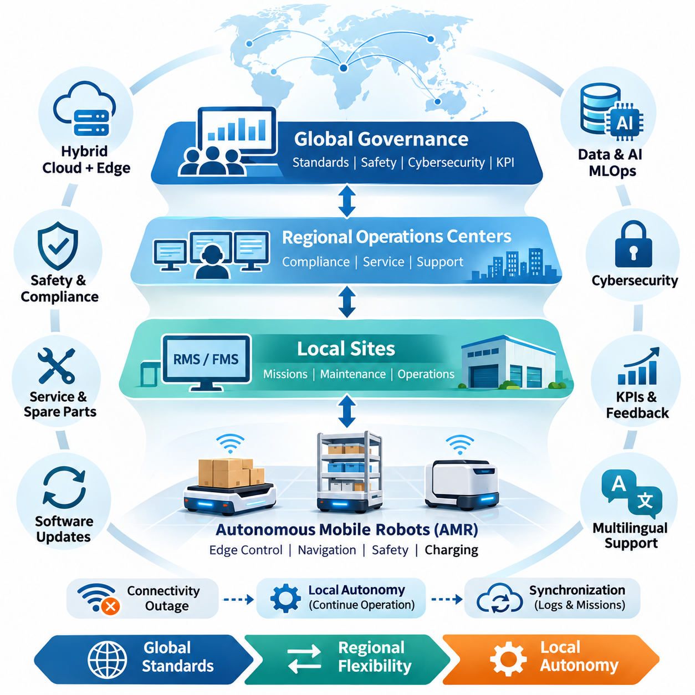
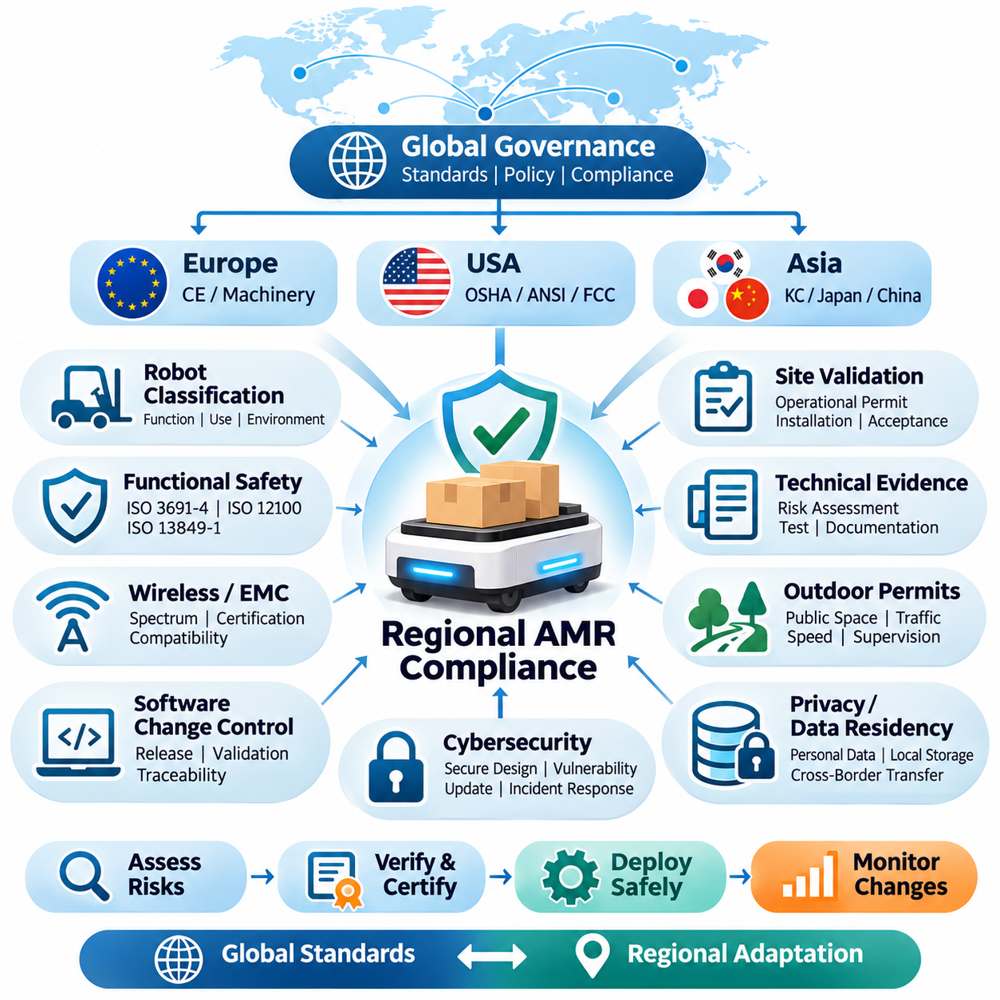
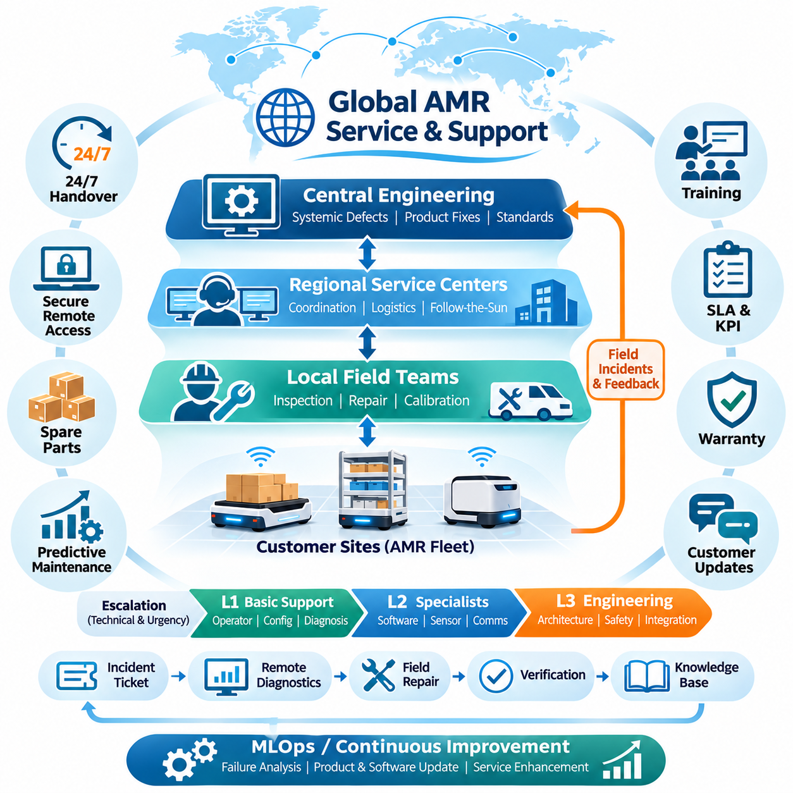
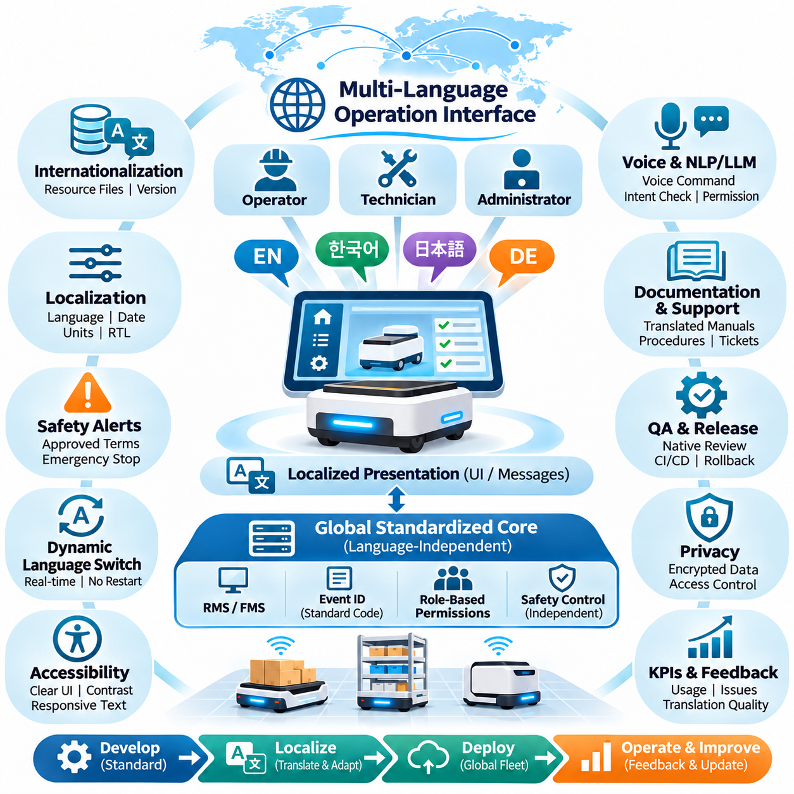
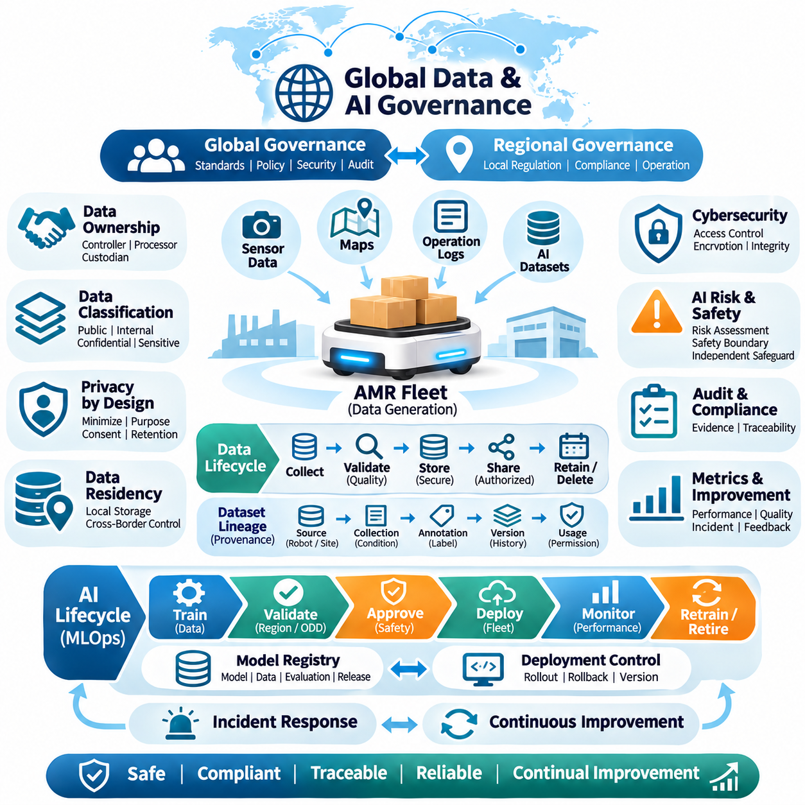
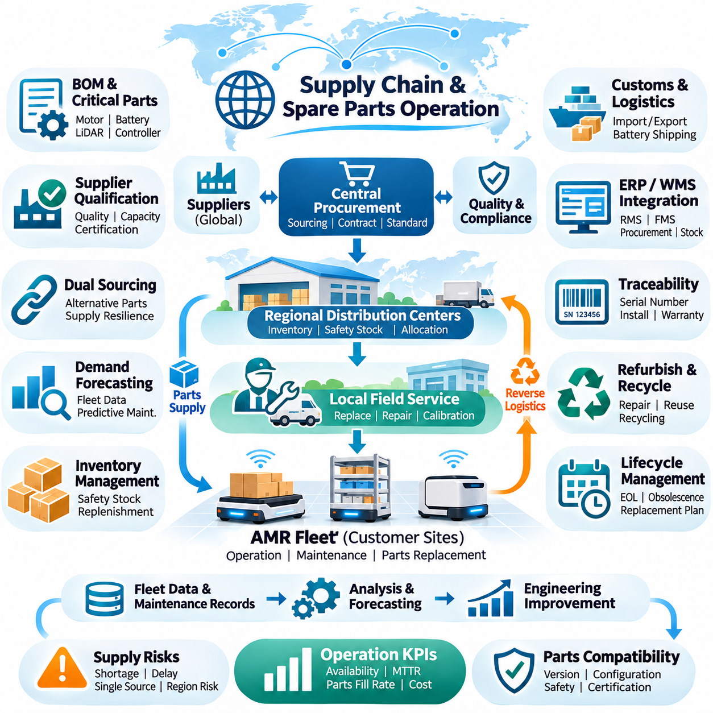
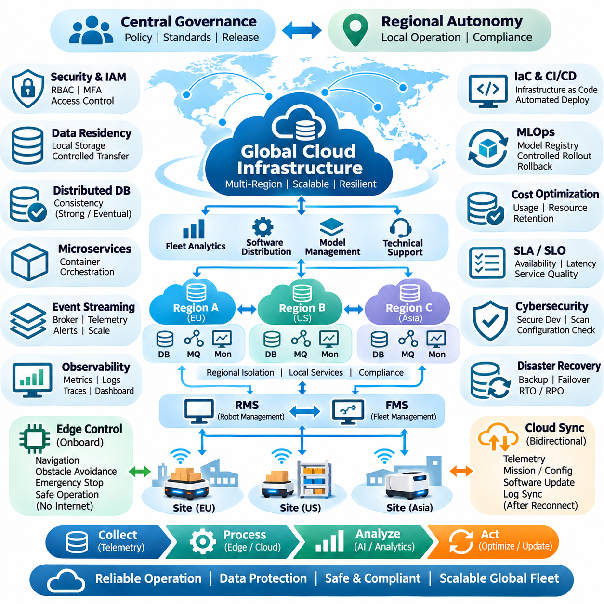
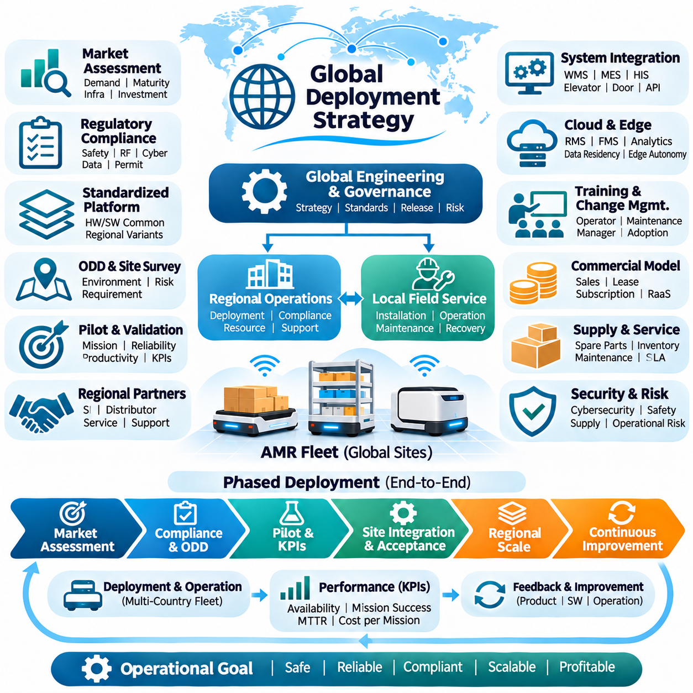

**Volume 08. AMR Operations, Deployment, and MLOps**

# Chapter 24. Global AMR Operations

## 24.1 Global Operation Model

{width="7.268055555555556in" height="7.268055555555556in"}

글로벌 자율이동로봇(Autonomous Mobile Robot, AMR) 운영에는 여러 국가와 운영 환경에서 일관된 성능, 안전성 및 서비스 품질을 지원하는 통합 관리 체계(Unified Management Framework)가 필요하다. 단일 현장 배포와 달리 글로벌 운영은 인프라, 규제, 언어, 고객 요구사항 및 기술 역량의 차이를 수용하면서 지리적으로 분산된 로봇 군집(Robot Fleet)을 조정해야 한다. 운영 모델(Operation Model)은 글로벌 표준화(Global Standardization)와 지역별 유연성(Regional Flexibility)을 결합해야 한다.

글로벌 AMR 운영 모델(Global AMR Operating Model)은 중앙 관리 조직(Central Management), 지역 운영 센터(Regional Operations Center), 현지 서비스 조직(Local Service Organization) 및 개별 배포 현장(Deployment Site)을 연결하는 계층적 구조(Hierarchical Structure)를 구축한다. 중앙 관리 조직은 공통 정책, 기술 표준, 사이버보안 요구사항 및 성능 목표를 정의한다. 지역 조직은 이러한 요구사항을 현지 조건에 맞게 조정하며, 현장 운영팀은 일상 운영, 유지보수, 사고 대응 및 고객 지원을 수행한다.

운영 아키텍처(Operational Architecture)는 일반적으로 전략적 거버넌스(Strategic Governance), 운영 조정(Operational Coordination) 및 실시간 로봇 실행(Real-Time Robot Execution)을 분리한다. 글로벌 거버넌스는 기술 로드맵, 서비스 계약, 위험 관리 정책 및 전체 로봇 군집의 성능 분석을 담당한다. 지역 운영 조직은 배포 일정, 기술 지원, 자원 배분 및 규제 준수를 관리한다. 현장 실행 시스템은 내비게이션, 작업 일정 관리, 충전, 안전 모니터링 및 즉각적인 운영 의사결정을 처리한다.

로봇 관리 시스템(Robot Management System, RMS)과 군집 관리 시스템(Fleet Management System, FMS)은 분산 운영(Distributed Operations)의 기술적 기반을 제공한다. RMS 플랫폼은 개별 로봇의 상태, 소프트웨어 버전, 하드웨어 상태 및 운영 이벤트를 모니터링한다. FMS 플랫폼은 임무, 교통 관리, 자원 활용 및 군집 일정 관리를 조정한다. 두 플랫폼의 통합은 현장 제어 권한을 유지하면서 중앙 집중식 가시성(Centralized Visibility)을 확보하도록 지원한다.

하이브리드 클라우드-엣지 아키텍처(Hybrid Cloud-Edge Architecture)는 국제 AMR 배포에서 특히 중요하다. 클라우드 인프라(Cloud Infrastructure)는 글로벌 군집 분석, 중앙 구성 관리, 소프트웨어 배포 및 장기 운영 보고를 지원한다. 지역 클라우드 서비스(Regional Cloud Services)는 통신 지연을 줄이고 데이터 지역 보관(Data Residency) 요구사항을 충족하도록 지원한다. 엣지 컴퓨팅(Edge Computing)은 외부 연결이 불안정할 때에도 내비게이션, 장애물 회피, 비상 대응 및 핵심 임무 실행을 유지한다.

운영 자율성(Operational Autonomy)은 광역 네트워크(Wide Area Network, WAN)의 가용성과 독립적으로 유지되어야 한다. 로봇은 글로벌 관리 플랫폼과의 통신이 일시적으로 중단되더라도 현장 안전 조건이 충족되는 범위에서 승인된 임무를 계속 수행할 수 있어야 한다. 로컬 제어기(Local Controller)는 비상 정지, 장애물 감지 및 안전 복구 기능을 유지해야 한다. 연결이 복구되면 운영 로그와 임무 상태를 데이터 일관성(Data Consistency)을 손상하지 않고 동기화할 수 있어야 한다.

글로벌 배포 표준화(Global Deployment Standardization)는 공통 로봇 구성 기준(Common Robot Configuration Baseline)에서 시작된다. 하드웨어 인터페이스, 소프트웨어 아키텍처, 통신 프로토콜, 진단 메시지 및 유지보수 절차는 관리되는 규격을 따라야 한다. 표준화는 엔지니어링 복잡성을 줄이고 지역 간 기술 지원을 단순화한다. 그러나 현지화(Localization)를 위해 서로 다른 무선 통신 모듈, 전원 인터페이스, 환경 보호 대책 및 응용 분야별 센서 구성이 필요할 수 있다.

지역별 운영 환경(Regional Operating Environment)은 내비게이션과 이동성(Mobility) 요구사항에 상당한 차이를 발생시킨다. 실내 산업 시설은 구조화된 경로와 예측 가능한 교통 패턴을 제공할 수 있지만, 실외 환경은 기상 노출, 불규칙한 지형, 위성항법시스템(Global Navigation Satellite System, GNSS)의 제약 및 공공 인프라와의 상호작용을 포함한다. 글로벌 운영 모델은 공통 검증 원칙을 정의하면서 지역 조직이 환경별 운영 허용 범위(Operating Envelope)와 성능 인수 기준을 설정할 수 있도록 해야 한다.

규제 준수(Regulatory Compliance)는 최종 배포 단계에서만 수행하는 활동이 아니라 전체 운영 수명주기(Operational Lifecycle)에 통합되어야 한다. 국가와 지역에 따라 기계 안전, 무선 통신, 사이버보안, 개인정보 보호, 작업장 안전 및 공공장소 자율운행에 관한 요구사항이 다르다. 지역 규제 준수 조직은 적용 가능한 규제 목록(Regulatory Register)을 관리하고, 중앙 엔지니어링 조직과 인증 증빙, 운영 제한 및 정기 검사에 관한 사항을 조정해야 한다.

기능 안전 거버넌스(Functional Safety Governance)는 글로벌 안전 정책과 현장별 위험 통제를 명확하게 분리해야 한다. 중앙 엔지니어링 조직은 안전 아키텍처, 검증 방법 및 승인된 운영 구성을 수립한다. 지역 전문가는 현지 위험 요소, 환경 조건 및 법적 의무를 평가한다. 현장 운영자는 제한 구역, 속도 제한, 비상 절차 및 접근 통제를 적용한다. 안전에 중요한 변경사항은 배포 전에 문서화된 평가를 거쳐야 한다.

글로벌 서비스 관리(Global Service Management)는 명확하게 정의된 책임과 단계별 대응 경로(Escalation Pathway)에 의존한다. 현지 기술자는 정기 점검, 부품 교체, 보정 및 초기 문제 해결을 담당한다. 지역 엔지니어링 센터는 반복적인 고장을 조사하고 전문 수리를 조정한다. 중앙 엔지니어링 조직은 시스템 전반의 설계 결함, 소프트웨어 회귀 문제 및 복잡한 기술적 문제를 해결한다. 공통 티켓 관리 시스템(Shared Ticketing System)은 사고 이력을 보존하고 일관된 서비스 수준 관리를 지원한다.

시간대 연계 지원(Follow-the-Sun Support)은 여러 시간대에 분산된 로봇 군집의 운영 연속성을 향상할 수 있다. 지역 지원 센터는 로봇 식별자, 진단 정보, 안전 상태 및 완료된 복구 조치를 포함하는 구조화된 인계 절차(Structured Handover Procedure)를 통해 미해결 사고를 전달한다. 단계별 대응 규칙은 일반 운영 중단과 안전에 중대한 비상 상황을 구분해야 한다. 지속적인 지원 범위는 계약상 의무와 실제 자격을 갖춘 인력의 가용성에 맞게 설정되어야 한다.

성능 관리(Performance Management)에는 국제 배포 전반에서 공통으로 적용되는 핵심 성과 지표(Key Performance Indicator, KPI)가 필요하다. 대표적인 지표에는 로봇 가용성(Robot Availability), 임무 완료율(Mission Completion Rate), 개입 빈도(Intervention Frequency), 평균 고장 간격(Mean Time Between Failures, MTBF), 평균 수리 시간(Mean Time To Repair, MTTR), 충전 효율 및 군집 활용률이 포함된다. 글로벌 공통 정의는 의미 있는 비교를 가능하게 하며, 지역별 분석은 작업량, 운영 시간, 환경 조건 및 고객 요구사항의 차이를 반영한다.

중앙 집중식 운영 데이터 프레임워크(Centralized Operational Data Framework)는 지리적으로 분산된 로봇 군집의 비교 분석을 가능하게 한다. 로봇 원격 측정 데이터(Telemetry), 임무 기록, 진단 이벤트, 유지보수 이력 및 소프트웨어 구성은 일관된 데이터 스키마(Data Schema)를 따라야 한다. 고유 로봇 식별자와 동기화된 타임스탬프(Timestamp)는 시스템 간 추적성을 지원한다. 지역별 데이터 처리 정책은 글로벌 전송이 가능한 정보와 현지 인프라에 유지해야 하는 정보를 결정한다.

인공지능(Artificial Intelligence, AI) 모델 거버넌스(Model Governance)는 인지 및 내비게이션 성능이 지리적 환경에 따라 달라질 수 있기 때문에 추가적인 복잡성을 발생시킨다. 조명, 날씨, 건축 구조, 교통 행동 및 인간과의 상호작용 패턴은 모델 신뢰성에 영향을 미친다. 글로벌 기계학습 운영(Machine Learning Operations, MLOps)은 공통 모델 레지스트리(Model Registry), 검증 절차 및 배포 승인 기준을 유지해야 한다. 지역별 데이터셋은 전체 군집의 성능 통제를 유지하면서 특정 환경에 대한 적응을 지원할 수 있다.

소프트웨어와 AI 업데이트는 통제된 국제 배포 절차(Controlled International Release Procedure)를 따라야 한다. 중앙 엔지니어링 조직은 검증된 소프트웨어 패키지, 호환성 매트릭스(Compatibility Matrix) 및 롤백 메커니즘(Rollback Mechanism)을 준비한다. 지역 조직은 현지 구성과 운영 제한을 기준으로 배포 준비 상태를 검증한다. 카나리 배포(Canary Deployment)는 광범위한 배포 이전에 제한된 현장 평가를 가능하게 한다. 업데이트 조정은 시간대, 임무 일정, 연결 제약 및 고객 유지보수 시간을 고려해야 한다.

사이버보안 운영(Cybersecurity Operations)에는 일관된 신원 관리(Identity Management), 암호화 통신, 보안 프로비저닝(Secure Provisioning) 및 지속적인 취약점 모니터링이 필요하다. 글로벌 보안 정책은 로봇, 엣지 게이트웨이, 클라우드 서비스 및 관리 인터페이스에 대한 최소 보호 요구사항을 수립한다. 지역별 구현은 적용 가능한 데이터 보호 의무를 충족해야 한다. 보안 사고 대응 절차는 조직 간 위협 격리, 포렌식 증거 보존, 자격 증명 관리 및 복구를 조정해야 한다.

공급망 조정(Supply Chain Coordination)은 글로벌 AMR 운영의 또 다른 핵심 구성요소이다. 예비 부품(Spare Parts)의 가용성은 로봇 군집의 가동 중단 시간, 수리 비용 및 계약상 서비스 성능에 직접적인 영향을 미친다. 중앙 조달 조직은 핵심 부품과 공급업체 자격 평가를 표준화할 수 있으며, 지역 창고는 적절한 재고를 유지한다. 수요 예측(Demand Forecasting)은 설치된 로봇 수, 부품 고장률, 운송 소요 시간 및 예상 유지보수 요구사항을 반영해야 한다.

다국어 운영 인터페이스(Multilingual Operation Interface)는 운영자, 기술자, 관리자 및 고객 담당자의 접근성을 향상한다. 사용자 인터페이스(User Interface, UI)는 현지화된 용어, 측정 단위, 타임스탬프 및 운영 지침을 지원해야 한다. 안전 경고는 기술적으로 정확하게 번역되어야 하며 지역 간 일관된 해석을 보장해야 한다. 교육 자료, 유지보수 절차 및 사고 보고 양식은 지역별 언어 요구사항을 수용하면서 공통된 기술적 의미를 유지해야 한다.

고객 거버넌스(Customer Governance)는 글로벌 서비스 일관성과 현지 계약 요구사항 사이의 균형을 유지해야 한다. 국제 고객은 개별 현장의 독립적인 운영 권한을 유지하면서 여러 시설에 대한 중앙 집중식 보고를 요구할 수 있다. 서비스 수준 협약(Service Level Agreement, SLA)은 가용성 목표, 대응 의무, 유지보수 책임 및 단계별 대응 조건을 정의해야 한다. 계약상 성능 측정은 로봇 결함, 인프라 장애, 고객에 의한 운영 중단 및 계획된 유지보수를 구분해야 한다.

글로벌 운영 확장성(Global Operational Scalability)은 자동화, 조직 성숙도(Organizational Maturity) 및 아키텍처 모듈성(Architectural Modularity)에 의존한다. 로봇 군집 규모가 확대되면 수동 구성과 개별 지원에 필요한 비용이 증가한다. 자동 프로비저닝(Automated Provisioning), 구성 관리, 군집 모니터링, 예지보전(Predictive Maintenance) 및 원격 진단은 반복적인 운영 부담을 줄인다. 모듈형 지역 인프라는 전체 글로벌 관리 플랫폼을 재설계하지 않고 새로운 배포 지역을 추가할 수 있도록 한다.

글로벌 AMR 운영 모델의 효과성은 궁극적으로 엔지니어링, 운영, 서비스, 사이버보안, 규제 준수 및 고객 조직 간의 지속적인 조정에 달려 있다. 표준화된 거버넌스는 일관성을 확보하고, 지역별 자율성은 실질적인 실행을 가능하게 하며, 현장 안전 시스템은 실시간 운영을 보호한다. 이러한 요소가 공통 플랫폼, 측정 가능한 성능 목표 및 구조화된 피드백 프로세스(Structured Feedback Process)를 통해 통합되면 글로벌 로봇 군집은 더 높은 신뢰성과 운영 책임성(Operational Accountability)을 확보하면서 확장될 수 있다.

## 24.2 Regional Regulation and Compliance

{width="7.268055555555556in" height="7.268055555555556in"}

지역별 규제 및 규정 준수(Regional Regulation and Compliance)는 국제 시장에서 자율이동로봇(Autonomous Mobile Robot, AMR)을 배포하기 위한 기본 요구사항이다. 각 국가와 관할 지역은 기계 안전(Machinery Safety), 무선 통신(Wireless Communication), 사이버보안(Cybersecurity), 개인정보 보호(Privacy), 작업장 보호(Workplace Protection) 및 공공 이동성(Public Mobility)에 관한 서로 다른 규칙을 수립한다. 따라서 글로벌 표준화 로봇 플랫폼은 핵심 안전 아키텍처, 운영 신뢰성 및 엔지니어링 일관성을 유지하면서 지역별 법적 의무를 수용해야 한다.

규정 준수(Regulatory Compliance)는 로봇 시스템의 의도된 용도(Intended Application), 운영 환경(Operating Environment) 및 법적 분류(Legal Classification)를 식별하는 것에서 시작된다. 산업용 운송 로봇, 병원 서비스 로봇, 자율주행 지게차 및 실외 순찰 로봇에는 서로 다른 규제 체계가 적용될 수 있다. 분류는 로봇의 기능, 물리적 특성, 사용 대상 및 운영 조건에 따라 결정된다. 이러한 요소는 적용 가능한 적합성 평가(Conformity Assessment), 인증(Certification) 및 운영 제한사항을 결정한다.

지역별 규정 준수 체계(Regional Compliance Framework)는 중앙 집중식 규제 거버넌스(Centralized Regulatory Governance)와 현지 법률 해석(Local Legal Interpretation)을 결합해야 한다. 글로벌 엔지니어링 조직은 공통 안전 요구사항, 기술 문서 표준 및 제품 구성 관리 기준을 수립한다. 지역별 규정 준수 전문가는 관할 지역별 의무사항을 식별하고 규제 당국 또는 공인 평가기관과 협력한다. 현지 배포 조직은 각 설치 현장이 적용 가능한 운영 허가와 현장별 안전 요구사항을 충족하는지 검증한다.

국제 표준(International Standards)은 AMR 안전 엔지니어링(Safety Engineering)의 중요한 기술적 기반을 제공한다. ISO 3691-4는 정의된 적용 범위 내에서 무인 산업용 트럭(Driverless Industrial Trucks) 및 관련 시스템의 안전 요구사항을 다룬다. ISO 12100은 기계류 위험 평가(Risk Assessment)와 위험 감소(Risk Reduction)를 지원하며, ISO 13849-1은 안전 관련 제어 시스템(Safety-Related Control Systems)의 설계 원칙을 제공한다. 이러한 표준의 적용 가능성은 로봇 분류, 의도된 사용 목적 및 배포 지역의 규제 체계에 따라 달라진다.

유럽 시장 진입(European Market Access)을 위해서는 기계류 관련 법규, 제품 적합성(Product Conformity) 및 적용 가능한 조화 표준(Harmonized Standards)을 신중하게 검토해야 한다. 제품 분류와 적용 시점에 따라 제조업체는 기계류 지침(Machinery Directive 2006/42/EC) 또는 기계류 규정(Machinery Regulation (EU) 2023/1230)을 준수해야 한다. 관련 제품에는 CE 마킹(CE Marking), 기술 문서(Technical Documentation), 적합성 평가 및 EU 적합성 선언서(EU Declaration of Conformity)가 요구될 수 있다. 무선 장비, 전자기 적합성 및 전기 시스템에도 추가 요구사항이 적용될 수 있다.

미국의 AMR 규정 준수는 연방 요구사항(Federal Requirements), 주별 규정(State Regulations) 및 작업장별 안전 의무를 포함한다. 미국 산업안전보건청(Occupational Safety and Health Administration, OSHA)의 요구사항은 산업 현장 배포에 영향을 미치며, 적용 가능한 합의 표준(Consensus Standards)은 안전 엔지니어링을 지원한다. ANSI/RIA R15.08은 정의된 적용 범위 내에서 산업용 이동로봇(Industrial Mobile Robot)의 안전을 다룬다. 무선 장비에는 미국 연방통신위원회(Federal Communications Commission, FCC)의 승인이 필요할 수 있으며, 실외 운영에는 추가적인 주 또는 지방자치단체의 제한사항이 적용될 수 있다.

아시아 시장에서도 국가별 인증 체계와 운영 요구사항이 다르기 때문에 체계적인 규제 분석(Regulatory Analysis)이 필요하다. 대한민국에서는 적용 가능한 KC 적합성 절차(KC Conformity Procedures), 무선 장비 승인 및 관련 안전 법규 준수가 요구될 수 있다. 일본은 자체적인 전기, 무선 및 산업 안전 체계를 적용한다. 중국은 제품별 인증 요구사항과 국가 표준(National Standards)을 유지한다. 규정 준수 조직은 각 로봇 구성과 의도된 응용 분야에 적용되는 정확한 의무사항을 확인해야 한다.

기능 안전 규정 준수(Functional Safety Compliance)는 로봇 수명주기(Robot Lifecycle) 전반에서 위험 요소를 체계적으로 식별해야 한다. 관련 위험에는 충돌(Collision), 압착(Crushing), 제어되지 않는 이동(Uncontrolled Movement), 제동 실패(Braking Failure), 배터리 고장(Battery Fault) 및 예기치 않은 재시작(Unexpected Restart)이 포함된다. 위험 평가는 정상 운영, 유지보수, 예측 가능한 오용(Foreseeable Misuse) 및 합리적으로 예측 가능한 비정상 조건을 고려해야 한다. 안전 대책은 문서화된 엔지니어링 분석, 검증 증거 및 대표적인 운영 조건에서의 유효성 확인(Validation)을 통해 뒷받침되어야 한다.

안전 관련 제어 기능(Safety-Related Control Functions)은 요구되는 위험 감소 수준에 따라 설계되어야 한다. 비상 정지(Emergency Stop), 보호 정지(Protective Stop), 속도 모니터링(Speed Monitoring), 제동 감시(Braking Supervision) 및 사람 감지(Personnel Detection)에는 전용 안전 아키텍처가 필요할 수 있다. 필요한 성능 수준(Performance Level, PL) 또는 안전 무결성 수준(Safety Integrity Level, SIL)은 적용 방법론과 위험 평가에 따라 결정된다. 범용 인지 알고리즘(General-Purpose Perception Algorithm)은 적절한 증거와 평가 없이 인증된 안전 기능으로 간주해서는 안 된다.

실외 AMR 운영(Outdoor AMR Operations)은 기존 산업 환경을 넘어서는 규제 문제를 발생시킨다. 보도, 도로, 캠퍼스, 항만 또는 공공시설에서 운영되는 로봇에는 교통 규정(Traffic Regulations), 보행자 안전 의무, 접근 제한 및 지방자치단체의 승인 절차가 적용될 수 있다. 법적 취급 방식은 관할 지역에 따라 크게 달라진다. 따라서 배포 승인은 로봇의 운행 설계 영역(Operational Design Domain, ODD), 최대 속도, 물리적 크기, 원격 감독 기능 및 주변 교통과의 상호작용을 고려해야 한다.

무선 통신 규정 준수(Wireless Communication Compliance)는 AMR이 일반적으로 Wi-Fi, 블루투스(Bluetooth), 셀룰러 연결(Cellular Connectivity), GNSS 수신기 및 산업용 무선 인터페이스를 통합하기 때문에 필수적이다. 지역별 주파수 할당(Spectrum Allocation), 송신 출력 제한, 장비 인증 규칙 및 전자기 적합성(Electromagnetic Compatibility, EMC) 요구사항을 평가해야 한다. 한 국가에서 승인된 통신 모듈이 다른 국가에서도 자동으로 허가되는 것은 아니다. 지역별 하드웨어 구성은 승인된 부품과 실제 배포된 로봇 변형 모델 사이의 추적성을 유지해야 한다.

사이버보안 요구사항(Cybersecurity Requirements)은 로봇 제품 개발과 운영 거버넌스에 점점 더 큰 영향을 미치고 있다. 보안 부팅(Secure Boot), 인증된 통신(Authenticated Communication), 접근 제어(Access Control), 취약점 관리(Vulnerability Management) 및 소프트웨어 무결성 검증(Software Integrity Verification)은 핵심 보호 메커니즘을 구성한다. 적용 가능한 지역 법규는 제품 범주와 시장에 따라 추가적인 사이버보안 의무를 부과할 수 있다. 규정 준수 문서는 보안 책임, 지원되는 소프트웨어 버전, 업데이트 절차 및 발견된 취약점에 대응하는 메커니즘을 명시해야 한다.

데이터 개인정보 보호 규정 준수(Data Privacy Compliance)는 로봇이 영상, 음성, 위치 정보 또는 개인정보가 포함된 운영 기록을 수집할 때 특히 중요해진다. 유럽 일반개인정보보호법(General Data Protection Regulation, GDPR)과 유사한 지역별 개인정보 보호 체계는 적법한 처리(Lawful Processing), 투명성(Transparency), 보존 기간(Retention), 정보주체의 권리(Access Rights) 및 국제 데이터 이전에 관한 요구사항을 부과할 수 있다. 설계 단계부터 개인정보 보호를 고려하는 원칙(Privacy by Design)은 센서 구성, 데이터 최소화(Data Minimization), 암호화 및 운영 데이터 거버넌스의 기준이 되어야 한다.

국경 간 데이터 이전(Cross-Border Data Transfer)은 글로벌 로봇 관리 시스템(Robot Management System, RMS)과 군집 관리 시스템(Fleet Management System, FMS)에서 명시적으로 고려되어야 한다. 중앙 집중식 클라우드 모니터링은 진단 정보, 이미지 또는 이벤트 기록을 관할 지역 간에 전송할 수 있다. 지역별 데이터 현지 보관 의무(Data Residency Obligations)와 계약상 제한사항은 이러한 이전을 제한할 수 있다. 규정을 준수하는 아키텍처는 필수적인 군집 관리 기능을 손상하지 않으면서 지역별 저장, 통제된 복제(Controlled Replication), 역할 기반 접근 제어(Role-Based Access Control) 및 설정 가능한 보존 정책을 지원해야 한다.

규정 준수는 배포 이후의 소프트웨어 업데이트와 구성 변경(Configuration Change)도 다루어야 한다. 내비게이션 알고리즘, 안전 매개변수, 센서, 제동 시스템 또는 통신 모듈의 변경은 기존에 확보한 적합성 증거(Conformity Evidence)에 영향을 줄 수 있다. 엔지니어링 조직은 업데이트를 배포하기 전에 변경 영향 평가(Change-Impact Assessment)를 수행해야 한다. 중요한 변경사항은 적용 가능한 규제 체계에 따라 재시험, 문서 갱신 또는 추가 적합성 평가 절차가 필요할 수 있다.

기술 문서(Technical Documentation)는 규정 준수를 입증하는 데 필요한 증거를 제공한다. 일반적으로 시스템 설명서, 의도된 사용 목적 정의, 위험 평가서, 전기 회로도, 안전 계산서, 시험 보고서, 운영 지침 및 유지보수 절차가 포함된다. 구성 기록(Configuration Records)은 배포된 각 로봇을 하드웨어 개정 버전, 소프트웨어 기준 버전(Software Baseline), 인증 증거 및 승인된 운영 조건과 연결해야 한다. 문서 관리(Document Control)는 규제 검사와 장기적인 추적성을 지원한다.

지역별 배포 검증(Regional Deployment Validation)은 제품 수준의 규정 준수를 현장별 운영 안전 보증(Site-Specific Operational Assurance)으로 전환한다. 공장 배치, 보행자 통행, 바닥 상태, 비상구, 무선 통신 범위 및 환경 위험 요소는 실제 설치 환경의 안전성에 영향을 미친다. 현장 인수 절차(Site Acceptance Procedure)는 보호 기능, 정지 동작, 제한 구역, 운영자 교육 및 비상 대응 준비 상태를 검증해야 한다. 제품 인증만으로 설치 현장별 위험 평가의 필요성이 없어지는 것은 아니다.

규정 준수 책임(Compliance Responsibilities)은 전체 운영 수명주기 동안 명확하게 할당되어야 한다. 제조업체는 일반적으로 제품 설계 적합성과 관련 기술 증거를 관리하며, 시스템 통합업체(System Integrator)와 배포 조직은 적용 가능한 설치 책임을 수행한다. 운영자는 승인된 운영 조건, 교육 기록 및 점검 절차를 유지한다. 계약상 합의는 법적 의무가 당사자 간에 항상 이전될 수 있다고 가정하지 않으면서 이러한 책임을 정의해야 한다.

법률, 기술 표준 및 행정적 해석은 지속적으로 변화하므로 규제 모니터링 프로세스(Regulatory Monitoring Process)가 필요하다. 규정 준수 조직은 관할 지역별 요구사항 등록부(Requirement Register)를 유지하고, 규제 변경사항을 추적하며, 배포된 구성을 정기적으로 검토해야 한다. 엔지니어링 변경 관리(Engineering Change Management)는 새로운 요구사항을 제품 개발 및 운영 절차와 연결해야 한다. 이러한 접근 방식은 오래된 인증, 지원되지 않는 구성 및 예상하지 못한 배포 제한의 위험을 줄인다.

효과적인 지역별 규제 및 규정 준수 관리(Regional Regulation and Compliance Management)는 일관된 엔지니어링 품질과 운영 안전성을 유지하면서 국제적인 AMR 확장을 가능하게 한다. 글로벌 표준화(Global Standardization)는 중복 작업을 줄이고, 지역별 전문성(Regional Expertise)은 관할 지역별 의무사항에 대응하며, 문서화된 검증(Documented Verification)은 적합성 증거를 제공한다. 규제 정보(Regulatory Intelligence), 기능 안전, 사이버보안, 개인정보 보호 및 현장 검증을 통합 거버넌스 체계(Unified Governance Framework)에 결합하면 책임 있는 글로벌 로봇 운영을 위한 확장 가능한 기반을 구축할 수 있다.

## 24.3 Global Service and Support Network

{width="7.268055555555556in" height="7.268055555555556in"}

글로벌 서비스 및 지원 네트워크(Global Service and Support Network)는 지리적으로 분산된 시장에서 자율이동로봇(Autonomous Mobile Robot, AMR)의 안정적인 운영을 유지하기 위한 핵심 요소이다. 국제적인 로봇 배포에는 기술 지원(Technical Assistance), 유지보수 서비스(Maintenance Services), 예비 부품 가용성(Spare Parts Availability) 및 사고 대응 역량(Incident Response Capabilities)의 체계적인 조정이 필요하다. 효과적인 지원 네트워크는 중앙 엔지니어링 전문 조직, 지역 서비스 조직 및 현장 기술자를 결합하여 가동 중단 시간을 최소화하고 일관된 운영 품질을 유지한다.

글로벌 지원 아키텍처(Global Support Architecture)는 일반적으로 중앙 엔지니어링 본부(Central Engineering Headquarters), 지역 서비스 센터(Regional Service Centers), 공인 서비스 협력업체(Authorized Service Partners) 및 고객 현장 지원팀(Customer-Site Support Teams)으로 구성된다. 중앙 엔지니어링 조직은 복잡한 기술 문제, 제품 신뢰성 개선 및 표준화된 서비스 절차를 관리한다. 지역 센터는 기술 자원과 물류를 조정하며, 현장 조직은 정해진 대응 의무에 따라 점검, 수리, 보정 및 운영 복구를 수행한다.

서비스 책임(Service Responsibilities)은 기술적 복잡성과 운영상 긴급성을 반영하는 체계적인 단계별 대응 체계(Structured Escalation Framework)를 따라야 한다. 1차 지원(First-Level Support)은 일반적인 운영자 문의, 구성 문제 및 기본 진단을 처리한다. 2차 전문 지원(Second-Level Support)은 반복적으로 발생하는 소프트웨어, 센서 및 통신 문제를 조사한다. 3차 엔지니어링 지원(Third-Level Engineering Support)은 제품 개발 전문성이 필요한 아키텍처 수준의 결함, 안전 관련 고장 및 복잡한 시스템 통합 문제를 해결한다.

글로벌 통합 서비스 관리 플랫폼(Globally Integrated Service Management Platform)은 사고, 유지보수 활동, 보증 청구 및 고객 지원 성과에 대한 가시성을 제공한다. 각 서비스 요청(Service Request)에는 로봇 식별 정보, 하드웨어 구성, 소프트웨어 버전, 위치, 고장 분류 및 진단 증거가 포함되어야 한다. 표준화된 서비스 티켓 기록(Standardized Ticket Records)은 일관된 단계별 대응을 가능하게 하며, 국가, 고객 조직 및 로봇 제품군 전반에서 반복되는 문제의 분석을 지원한다.

시간대 연계 지원 운영(Follow-the-Sun Support Operations)은 서로 다른 시간대의 서비스 조직을 조정하여 지속적인 기술 지원을 제공할 수 있다. 지역 지원 센터는 기술적 맥락과 운영 우선순위를 유지하는 문서화된 인계 절차(Documented Handover Procedures)를 통해 미해결 사고를 전달한다. 중대한 사고(Critical Incidents)는 지역별 근무 시간과 관계없이 자격을 갖춘 담당자에게 즉시 상향 보고되어야 한다. 지원 범위는 고객 계약, 배포 밀도 및 실제 기술 인력의 가용성을 기준으로 설계해야 한다.

원격 진단(Remote Diagnostics)은 확장 가능한 국제 로봇 지원을 위한 기본 역량이다. 보안 연결(Secure Connectivity)을 통해 권한을 부여받은 엔지니어는 배포 현장을 직접 방문하지 않고도 로봇 원격 측정 데이터(Telemetry), 애플리케이션 로그(Application Logs), 센서 상태, 배터리 상태 및 소프트웨어 프로세스를 점검할 수 있다. 진단 도구는 과거 이벤트 재구성(Historical Event Reconstruction)과 통제된 문제 해결을 지원해야 한다. 원격 개입(Remote Intervention)은 안전 경계를 유지해야 하며, 운영 매개변수를 변경하기 전에 적절한 승인을 받아야 한다.

현장 서비스(Local Field Service)는 기계적 손상, 전기적 고장, 센서 교체 및 물리적 보정에 직접적인 개입이 필요한 경우가 많기 때문에 여전히 필수적이다. 지역 서비스 조직은 예방 정비(Preventive Maintenance)와 고장 수리(Corrective Repairs)를 수행할 수 있는 숙련된 기술자를 확보해야 한다. 현장 절차에는 장비 격리(Equipment Isolation), 전기 안전(Electrical Safety), 기계 점검(Mechanical Inspection) 및 기능 검증(Functional Verification)이 포함되어야 한다. 로봇은 적용 가능한 복구 및 안전 점검이 완료된 이후에만 운영에 복귀해야 한다.

서비스 수준 협약(Service Level Agreement, SLA)은 로봇 공급업체, 서비스 협력업체 및 고객 간에 측정 가능한 기대 수준을 설정한다. 협약은 일반적으로 지원 가용성(Support Availability), 사고 대응 시간(Incident Response Time), 복구 목표(Restoration Objectives), 예방 정비 책임 및 단계별 대응 절차를 정의한다. 서비스 성과는 접수 확인 시간(Acknowledgment Time)과 실제 수리 완료 시간을 구분하여 측정해야 한다. 계약상 의무는 지리적 접근성, 예비 부품 조달 기간 및 기술적 개입의 복잡성을 고려해야 한다.

사고 분류(Incident Classification)는 지원 조직이 운영상 영향에 따라 자원을 배분할 수 있도록 한다. 안전에 중대한 고장(Safety-Critical Failures), 제어되지 않는 이동(Uncontrolled Motion) 또는 보호 기능 손상(Compromised Protective Functions)은 즉각적인 위험 격리와 통제된 복구가 필요하다. 중대한 서비스 중단(Major Service Interruptions)은 긴급 원격 지원이나 기술자 파견을 요구할 수 있다. 안전한 운영이 가능한 경미한 고장(Minor Faults)은 계획된 유지보수 절차에 따라 처리할 수 있다. 분류 기준은 지역별 법적 의무를 준수하면서도 글로벌 차원에서 일관성을 유지해야 한다.

예비 부품 물류(Spare Parts Logistics)는 서비스 대응 속도와 로봇 군집 가용성(Fleet Availability)에 직접적인 영향을 미친다. 글로벌 지원 네트워크는 센서, 모터 제어기(Motor Controllers), 배터리, 컴퓨팅 모듈(Computing Modules) 및 통신 장치와 같은 핵심 부품의 지역별 재고를 유지해야 한다. 재고 계획(Inventory Planning)은 설치된 로봇 수, 부품 신뢰성, 운송 지연 및 지역별 수입 제한을 고려해야 한다. 추적 가능한 부품 교체 기록(Traceable Replacement Records)은 보증 관리, 제품 품질 분석 및 구성 관리를 지원한다.

예지보전(Predictive Maintenance)은 운영 중단이 발생하기 전에 진행 중인 고장을 식별하여 서비스 비용을 줄일 수 있다. 로봇 상태 모니터링 시스템(Robot Health Monitoring Systems)은 모터 온도, 배터리 열화(Battery Degradation), 진동, 제동 동작 및 센서 성능에 관한 정보를 수집한다. 분석 모델(Analytical Models)은 유지보수 필요성을 예측하고 비정상적인 추세를 식별한다. 지역 서비스 센터는 이러한 예측을 활용하여 기술자 방문 일정을 수립하고 교체 부품을 준비하며 불필요한 긴급 출동을 줄일 수 있다.

글로벌 지식 관리 시스템(Global Knowledge Management System)은 문제 해결 절차, 수리 지침, 알려진 결함(Known Defects) 및 검증된 복구 방법을 보존하여 기술적 일관성을 향상한다. 서비스 엔지니어는 검증된 사고 해결 사례를 공통 지식 저장소(Shared Knowledge Base)에 등록해야 한다. 기술 문서는 하드웨어 개정 버전(Hardware Revisions) 및 소프트웨어 릴리스(Software Releases)와 동기화된 상태를 유지해야 한다. 다국어 접근(Multilingual Access)은 지역 기술자가 필수 안전 정보를 잃지 않으면서 표준화된 절차를 적용하도록 지원한다.

교육 및 인증 프로그램(Training and Certification Programs)은 국제 서비스 협력 네트워크 전반에서 일관된 서비스 역량을 확보한다. 기술자는 로봇 기계 시스템, 전기 시스템, 임베디드 컴퓨팅(Embedded Computing), 내비게이션 소프트웨어 및 안전 절차에 관한 실무 지식을 갖추어야 한다. 교육은 이론 학습과 감독하의 현장 실습(Supervised Field Exercises), 역량 평가(Competency Assessments)를 결합해야 한다. 정기적인 재인증(Periodic Recertification)은 로봇 아키텍처, 진단 도구 및 유지보수 절차가 발전함에 따라 기술적 숙련도를 유지하는 데 도움이 된다.

사이버보안(Cybersecurity)은 모든 원격 지원 업무 흐름(Remote Support Workflow)에 통합되어야 한다. 서비스 담당자는 인증된 신원(Authenticated Identities), 역할 기반 권한(Role-Based Permissions), 암호화된 연결(Encrypted Connections) 및 감사 가능한 접근 절차(Auditable Access Procedures)를 사용해야 한다. 임시 진단 권한(Temporary Diagnostic Privileges)은 유지보수 활동이 완료되면 만료되어야 한다. 원격 소프트웨어 설치와 구성 변경에는 승인과 추적성이 필요하다. 지역별 개인정보 보호 규정은 고객 데이터, 카메라 영상 또는 운영 정보에 대한 접근을 제한할 수 있다.

보증 관리(Warranty Management)에는 보증 대상 부품, 운영 조건, 서비스 책임 및 보증 제외 기준(Exclusion Criteria)에 대한 명확한 정의가 필요하다. 서비스 기록은 제조 결함(Manufacturing Defects), 일반적인 마모(Wear), 우발적 손상(Accidental Damage), 승인되지 않은 개조(Unauthorized Modifications) 및 환경적 오용(Environmental Misuse)을 구분해야 한다. 표준화된 보증 절차는 시장 전반에서 일관된 의사결정을 지원한다. 엔지니어링 조직은 보증 관련 추세를 분석하여 설계상 취약점을 식별하고 향후 제품 개정에서 부품 신뢰성을 개선해야 한다.

글로벌 서비스 성과(Global Service Performance)는 표준화된 핵심 성과 지표(Key Performance Indicators, KPIs)를 통해 평가해야 한다. 관련 지표에는 평균 수리 시간(Mean Time To Repair, MTTR), 평균 고장 간격(Mean Time Between Failures, MTBF), 최초 방문 해결률(First-Time Fix Rate), 서비스 대응 준수율(Service Response Compliance), 반복 사고 빈도(Repeat Incident Frequency) 및 예비 부품 공급 소요 시간(Spare Parts Fulfillment Time)이 포함된다. 이러한 지표는 지역별 서비스 효과성의 차이를 보여준다. 성과 비교에는 로봇 활용률, 환경 조건 및 배포 복잡성을 반영해야 한다.

고객 커뮤니케이션(Customer Communication)은 효과적인 기술 지원의 필수 구성요소이다. 운영자와 관리자는 사고 심각도(Incident Severity), 예상 복구 조치, 서비스 진행 상황 및 운영 제한사항에 관한 명확한 정보가 필요하다. 지역 서비스 조직은 고객이 선호하는 언어와 기존 업무 채널을 통해 정보를 제공해야 한다. 투명한 보고(Transparent Reporting)는 운영 조정을 강화하고 장시간 서비스 중단이 발생했을 때 불확실성을 줄인다.

서비스 네트워크 확장성(Service Network Scalability)은 중앙 집중식 전문성과 분산 실행(Decentralized Execution) 사이의 균형에 달려 있다. 국제 로봇 군집 규모가 증가하면 원격 모니터링, 자동 진단(Automated Diagnostics), 표준화된 유지보수 절차 및 지역별 부품 공급 체계가 지원 복잡성을 줄인다. 서비스 협력업체는 기술 인증과 품질 관리 체계의 지원을 받을 때 지리적 서비스 범위를 확대할 수 있다. 중앙 엔지니어링 조직은 시스템 전반의 결함과 제품 전체에 영향을 미치는 시정 조치(Corrective Actions)에 대한 책임을 유지해야 한다.

지속적인 개선(Continuous Improvement)을 위해서는 서비스 운영을 제품 엔지니어링(Product Engineering), 품질 보증(Quality Assurance) 및 기계학습 운영(Machine Learning Operations, MLOps)과 연결해야 한다. 현장 사고는 하드웨어 내구성, 소프트웨어 안정성, 인지 기능의 한계 및 운영 사용성에 관한 증거를 제공한다. 구조화된 피드백(Structured Feedback)은 엔지니어링 조직이 시정 조치의 우선순위를 정하고 개선 효과를 검증하도록 지원한다. 이후 갱신된 절차, 교체 부품 및 소프트웨어 릴리스는 통제된 글로벌 서비스 프로세스를 통해 배포되어야 한다.

성숙한 글로벌 서비스 및 지원 네트워크(Mature Global Service and Support Network)는 AMR 유지보수를 사후 대응형 문제 해결(Reactive Troubleshooting)에서 체계적인 수명주기 관리(Coordinated Lifecycle Management)로 전환한다. 중앙 집중식 엔지니어링 거버넌스는 기술적 일관성을 보장하고, 지역 서비스 센터는 운영 조정을 제공하며, 현장 기술자는 물리적 지원을 수행한다. 이러한 역량이 원격 진단, 예지보전, 안전한 정보 공유 및 측정 가능한 서비스 의무와 통합되면 국제 AMR 군집은 더 높은 신뢰성과 지속 가능한 운영 확장성(Sustainable Operational Scalability)을 확보할 수 있다.

## 24.4 Multi-Language Operation Interface

{width="7.268055555555556in" height="7.268055555555556in"}

다국어 운영 인터페이스(Multilingual Operation Interface)는 국제 시장과 다양한 작업 환경에서 자율이동로봇(Autonomous Mobile Robot, AMR) 군집을 관리하기 위한 필수 요소이다. 운영자, 유지보수 기술자, 관리자 및 고객 담당자는 동일한 로봇 플랫폼과 상호작용하면서 서로 다른 언어를 사용할 수 있다. 잘 설계된 인터페이스는 기본 소프트웨어 아키텍처를 분리하지 않으면서 일관된 운영 의미, 접근하기 쉬운 탐색 기능 및 정확한 안전 정보를 제공해야 한다.

다국어 인터페이스 설계(Multilingual Interface Design)는 언어 자원을 애플리케이션 로직(Application Logic)과 분리하는 중앙 집중식 국제화 프레임워크(Centralized Internationalization Framework)에서 시작해야 한다. 사용자 인터페이스 레이블, 시스템 메시지, 경고 및 안내 콘텐츠는 구조화된 현지화 자원(Structured Localization Resources)에 저장해야 한다. 이러한 분리는 핵심 로봇 기능을 수정하지 않고도 새로운 언어를 추가할 수 있도록 한다. 일관된 자원 식별자(Resource Identifiers)와 버전 관리(Version Control)는 소프트웨어 릴리스 전반에서 안정적인 번역 관리를 지원한다.

현지화(Localization)는 개별 단어를 다른 언어로 번역하는 것 이상의 의미를 가진다. 지역별 사용자는 날짜 형식, 숫자 구분 기호, 측정 단위, 시간 표기 방식 및 전문 용어에 대해 서로 다른 관행을 가질 수 있다. 로봇 관리 시스템(Robot Management System, RMS)과 군집 관리 시스템(Fleet Management System, FMS)은 표준화된 내부 데이터 표현(Standardized Internal Data Representation)을 유지하면서 사용자 선호도에 따라 정보를 표시해야 한다. 이러한 접근 방식은 운영 기록의 일관성을 손상하지 않으면서 사용성을 향상한다.

안전 관련 메시지(Safety-Related Messages)는 잘못된 번역이 운영상 위험을 발생시킬 수 있으므로 특별한 주의가 필요하다. 비상 정지 지침(Emergency Stop Instructions), 충돌 경고(Collision Warnings), 배터리 고장 알림(Battery Fault Notifications) 및 제한 구역 경고(Restricted-Area Alerts)는 모호하지 않은 행동 지침을 전달해야 한다. 번역 절차에는 기술 검토(Technical Review), 문맥 검증(Contextual Validation) 및 자격을 갖춘 담당자의 승인이 포함되어야 한다. 핵심 안전 용어는 인터페이스, 교육 자료 및 유지보수 문서 전반에서 일관성을 유지해야 한다.

다국어 AMR 인터페이스는 운영 권한(Operational Authority)을 손상하지 않으면서 다양한 사용자 역할(User Roles)을 지원해야 한다. 운영자는 주로 임무 상태, 작업 할당 및 즉각적인 고장 정보가 필요하다. 유지보수 기술자는 진단 세부정보, 부품 식별 정보 및 수리 절차가 필요하다. 관리자는 군집 분석, 구성 관리(Configuration Management) 및 접근 제어(Access Control) 기능이 필요하다. 언어 설정(Language Preferences)은 역할 기반 권한(Role-Based Permissions) 및 안전 제한사항과 독립적으로 유지되어야 한다.

인간-기계 인터페이스(Human-Machine Interface, HMI) 아키텍처는 불필요한 시스템 재시작 없이 동적으로 언어를 선택할 수 있도록 지원해야 한다. 인터페이스 구성요소는 공통 현지화 서비스(Common Localization Service)를 통해 번역된 자원을 가져와야 한다. 언어 변경은 실행 중인 로봇 임무를 중단하거나 안전에 중요한 제어 동작을 변경해서는 안 된다. 세션 수준 설정(Session-Level Preferences)은 연결된 로봇과 군집 관리 서비스의 운영 상태를 유지하면서 승인된 장치 간에 동기화할 수 있다.

용어 관리(Terminology Management)는 국제 조직 간에 일관된 기술 커뮤니케이션(Technical Communication)을 유지하기 위해 필요하다. 위치 추정(Localization), 도킹(Docking), 보호 정지(Protective Stop), 임무 복구(Mission Recovery) 및 군집 작업 배차(Fleet Dispatch)와 같은 용어는 지역별 언어에서 서로 다르게 해석될 수 있다. 통제된 용어 데이터베이스(Controlled Terminology Database)는 승인된 번역과 문맥적 의미를 정의해야 한다. 엔지니어링, 서비스 및 현지화 조직은 모호한 지침과 일관되지 않은 진단 설명을 방지하기 위해 협력해야 한다.

다국어 경보 및 이벤트 관리(Multilingual Alarm and Event Management)는 모든 운영 상태의 원래 기술적 식별 정보(Technical Identity)를 유지해야 한다. 각 이벤트에는 언어와 독립적인 식별자(Language-Independent Identifier), 심각도 분류(Severity Classification), 타임스탬프(Timestamp) 및 진단 문맥(Diagnostic Context)이 포함되어야 한다. 사용자 인터페이스는 현지화된 설명을 표시할 수 있지만, 백엔드 시스템(Backend Systems)은 표준화된 이벤트 코드(Standardized Event Codes)를 유지해야 한다. 이러한 구조는 글로벌 사고 분석, 지역 간 기술 지원 및 로봇 운영 상태의 일관된 해석을 가능하게 한다.

시각적 인터페이스 설계(Visual Interface Design)는 텍스트 길이와 문자 체계(Writing Systems)의 차이를 수용해야 한다. 번역된 레이블은 원래 영어 표현보다 훨씬 많은 공간을 필요로 할 수 있다. 레이아웃 구성요소(Layout Components)는 유연한 크기 조정, 자동 줄바꿈(Text Wrapping) 및 적절한 글꼴 렌더링(Font Rendering)을 지원해야 한다. 오른쪽에서 왼쪽으로 쓰는 언어(Right-to-Left Languages)를 대상으로 하는 인터페이스에는 추가적인 레이아웃 조정이 필요하다. 이러한 고려사항은 특히 소형 로봇 터치스크린과 모바일 유지보수 애플리케이션에서 중요하다.

접근성(Accessibility)은 선택적인 기능이 아니라 다국어 인터페이스 엔지니어링(Multilingual Interface Engineering)에 통합되어야 한다. 명확한 글꼴 구성(Typography), 충분한 명암 대비(Contrast), 인식하기 쉬운 기호 및 예측 가능한 탐색 구조는 언어에 관계없이 사용성을 향상한다. 색상만으로 운영 상태나 안전 심각도를 표시해서는 안 된다. 인터페이스는 가능한 범위에서 대체 텍스트(Text Alternatives)와 접근 가능한 상호작용 방식(Accessible Interaction Patterns)을 제공하여 서로 다른 시각적, 신체적 및 인지적 능력을 가진 운영자를 지원해야 한다.

음성 상호작용(Voice Interaction)은 병원, 공공시설 및 고객 대면 환경에서 운영되는 서비스 로봇에 추가적인 현지화 요구사항을 발생시킨다. 음성 인식(Speech Recognition) 및 음성 합성(Speech Synthesis) 시스템은 지역별 언어, 억양 및 발음 차이를 지원해야 한다. 음성 명령(Voice Commands)은 저수준 이동 제어(Low-Level Motion Control)를 직접 수행하는 대신 표준화된 로봇 의도(Standardized Robot Intents)에 매핑되어야 한다. 안전에 민감한 명령은 실행 전에 명시적인 검증과 적절한 확인 절차를 거쳐야 한다.

자연어 처리(Natural Language Processing, NLP)는 사용자 요청을 해석하고 현지화된 응답을 생성하여 다국어 인간-로봇 상호작용(Human-Robot Interaction)을 향상할 수 있다. 대규모 언어 모델(Large Language Model, LLM)은 대화형 지원, 운영 안내 및 기술적 문제 해결을 지원할 수 있다. 그러나 언어 모델의 출력이 독립적으로 안전하지 않은 로봇 동작을 승인해서는 안 된다. 구조화된 의도 검증(Structured Intent Validation), 권한 검사(Permission Checks) 및 결정론적 안전 제어(Deterministic Safety Controls)가 실행 의사결정을 담당해야 한다.

다국어 문서(Multilingual Documentation)는 국제적인 배포와 서비스 운영에 필수적이다. 설치 지침, 유지보수 매뉴얼, 문제 해결 가이드 및 비상 절차는 현지 사용자에게 적합한 언어로 제공되어야 한다. 문서 버전(Documentation Versions)은 로봇 하드웨어 및 소프트웨어 구성과 동기화된 상태를 유지해야 한다. 통제된 번역 업무 흐름(Controlled Translation Workflows)은 오래되거나 모순된 기술 정보를 발생시키지 않으면서 갱신된 절차가 지역 서비스 조직에 전달되도록 지원한다.

글로벌 지원 플랫폼(Global Support Platforms)은 현지화된 고객 커뮤니케이션(Localized Customer Communication)을 표준화된 엔지니어링 기록(Standardized Engineering Records)과 연결해야 한다. 서비스 티켓(Service Ticket)은 지역 언어로 제출될 수 있으며, 다른 국가의 기술 전문가가 동일한 문제를 조사할 수 있다. 번역 서비스는 의사소통을 지원할 수 있지만, 원본 보고서와 표준화된 진단 식별자(Standardized Diagnostic Identifiers)는 보존되어야 한다. 이러한 접근 방식은 중요한 기술적 문맥이 손실될 위험을 줄이면서 효율적인 단계별 대응(Escalation)을 지원한다.

현지화 테스트(Localization Testing)는 언어적 정확성(Linguistic Accuracy)과 운영 기능(Operational Functionality)을 모두 평가해야 한다. 테스트 시나리오에는 정상 임무 실행, 비상 알림, 진단 업무 흐름, 유지보수 절차 및 소프트웨어 업데이트 메시지가 포함되어야 한다. 원어민 검토자(Native-Language Reviewers)와 기술 전문가는 용어와 사용성을 검증해야 한다. 자동화된 인터페이스 테스트(Automated Interface Testing)는 지원 언어 전반에서 누락된 번역, 텍스트 영역 초과(Text Overflow), 인코딩 오류(Encoding Errors) 및 일관되지 않은 자원 매핑(Resource Mapping)을 감지할 수 있다.

소프트웨어 릴리스 관리(Software Release Management)는 언어 자원(Language Resources)을 통제된 구성 산출물(Controlled Configuration Artifacts)로 취급해야 한다. 번역 패키지(Translation Packages)에는 버전 식별자, 호환성 정보 및 검증 상태가 포함되어야 한다. 지속적 통합 및 지속적 배포(Continuous Integration and Continuous Deployment, CI/CD) 파이프라인은 배포 전에 자원의 완전성과 호환성을 검증할 수 있다. 지역별 배포 환경은 필요한 경우 롤백 지원(Rollback Support)을 제공하는 보안 소프트웨어 배포 메커니즘을 통해 승인된 언어 업데이트를 받아야 한다.

다국어 데이터 거버넌스(Multilingual Data Governance)는 사용자가 생성한 텍스트 또는 개인정보가 포함된 운영 기록을 신중하게 처리해야 한다. 지원 대화, 음성 녹음 및 사고 설명은 지역별 개인정보 보호 요구사항의 적용을 받을 수 있다. 번역 서비스는 적절한 접근 제어, 암호화 및 데이터 보존 정책(Data Retention Policies)을 적용해야 한다. 조직은 외부 언어 처리 서비스(External Language Processing Services)가 관할 지역 간에 운영 정보 또는 고객 정보를 수신하는 것이 허용되는지 평가해야 한다.

성능 모니터링(Performance Monitoring)은 운영 지표(Operational Indicators)를 통해 다국어 인터페이스의 효과성을 측정해야 한다. 관련 지표에는 작업 완료 시간(Task Completion Time), 사용자 오류 빈도(User Error Frequency), 지원 요청량(Support Request Volume), 번역 결함률(Translation Defect Rate) 및 운영자 만족도(Operator Satisfaction)가 포함된다. 지역별 비교는 불필요한 복잡성을 발생시키는 용어 문제나 인터페이스 설계를 식별할 수 있다. 현장 운영자와 서비스 기술자의 피드백은 지속적인 현지화 개선(Continuous Localization Improvement)의 기준이 되어야 한다.

확장 가능한 다국어 인터페이스 전략(Scalable Multilingual Interface Strategy)은 중앙 집중식 소프트웨어 거버넌스(Centralized Software Governance)와 지역별 언어 전문성(Regional Linguistic Expertise) 사이의 균형을 유지해야 한다. 글로벌 엔지니어링 조직은 공통 인터페이스 아키텍처, 이벤트 정의 및 릴리스 통제를 관리한다. 지역 전문가는 번역, 문화적 적합성(Cultural Suitability) 및 운영 용어를 검증한다. 현지 사용자는 일상적인 로봇 운영에서 얻은 실질적인 피드백을 제공한다. 이러한 조직 구조는 다양한 국제적 요구사항을 수용하면서 일관된 기능을 지원한다.

효과적인 다국어 AMR 운영 인터페이스(Effective Multilingual AMR Operation Interface)는 안전성, 사용성, 서비스 효율성 및 글로벌 배포 확장성을 향상한다. 표준화된 내부 데이터 모델(Standardized Internal Data Models)은 기술적 일관성을 유지하며, 현지화된 표현 계층(Localized Presentation Layers)은 지역 사용자들이 로봇 시스템에 쉽게 접근할 수 있도록 한다. 국제화(Internationalization), 용어 거버넌스(Terminology Governance), 접근성, 안전한 언어 처리(Secure Language Processing) 및 지속적인 검증(Continuous Validation)을 통합함으로써 AMR 공급업체는 다양한 언어와 시장에서 신뢰할 수 있는 운영 경험을 제공할 수 있다.

## 24.5 Global Data and AI Governance

{width="7.268055555555556in" height="7.268055555555556in"}

글로벌 데이터 및 인공지능 거버넌스(Global Data and AI Governance)는 국제적인 운영 환경에서 자율이동로봇(Autonomous Mobile Robot, AMR)의 정보와 지능형 시스템을 관리하는 데 필요한 정책, 책임 및 기술적 통제 체계를 수립한다. 분산된 로봇 군집(Distributed Robot Fleets)은 센서 기록, 내비게이션 지도, 운영 로그 및 인공지능 학습 데이터셋(AI Training Datasets)을 생성한다. 효과적인 거버넌스는 이러한 자산이 전체 수명주기(Lifecycle) 동안 보안성, 추적성, 법적 규정 준수 및 신뢰할 수 있는 의사결정에 필요한 적합성을 유지하도록 보장한다.

글로벌 거버넌스 프레임워크(Global Governance Framework)는 중앙 집중식 기술 표준(Centralized Technical Standards)과 지역별 규제 책임(Regional Regulatory Responsibilities)을 결합해야 한다. 기업 거버넌스 조직은 공통 데이터 분류, 인공지능 개발 정책, 보안 요구사항 및 감사 절차를 정의한다. 지역 조직은 현지 법적 의무와 운영상 제약을 해석한다. 이러한 구조는 관할 지역별 요구사항과 고객 계약에 필요한 조정을 허용하면서 일관된 엔지니어링 관행을 유지한다.

데이터 소유권(Data Ownership)과 데이터 관리 책임(Data Stewardship)은 배포된 로봇에서 정보를 수집하기 전에 확립되어야 한다. 고객 조직, 로봇 제조업체, 클라우드 운영자 및 서비스 협력업체는 서로 다른 계약상 권리와 책임을 가질 수 있다. 거버넌스 정책은 적용 가능한 경우 데이터 관리자(Data Controllers), 데이터 처리자(Data Processors), 데이터 보관 책임자(Data Custodians) 및 승인된 사용자(Authorized Users)를 식별해야 한다. 명확한 계약은 운영 정보의 승인되지 않은 2차 사용을 방지하고 데이터 보존, 접근 및 삭제에 대한 책임을 확립한다.

데이터 분류(Data Classification)는 일관된 보호 및 처리 요구사항의 기반을 제공한다. 로봇 정보에는 공개 기술 문서, 내부 진단 기록, 기밀 시설 지도 및 민감한 개인정보가 포함될 수 있다. 각 범주에는 정의된 접근 권한(Access Permissions), 암호화 요구사항(Encryption Requirements), 저장 위치 및 보존 기간이 지정되어야 한다. 분류 메타데이터(Classification Metadata)는 엣지 장치(Edge Devices), 지역별 클라우드 플랫폼 및 중앙 엔지니어링 저장소 전반에서 자동화된 정책 적용을 가능하게 한다.

글로벌 데이터 아키텍처(Global Data Architecture)는 데이터 주권(Data Sovereignty), 데이터 현지 보관(Data Residency) 및 국경 간 데이터 이전 제한(Cross-Border Transfer Restrictions)을 다루어야 한다. 일부 관할 지역이나 고객 계약에서는 운영 정보를 지정된 지리적 경계 내에 보관하도록 요구한다. 지역별 저장 서비스(Regional Storage Services)는 민감한 기록을 현지에 유지하면서 승인된 집계 통계(Aggregated Statistics)를 전 세계적으로 공유할 수 있다. 데이터 이전 메커니즘은 정보가 관할 지역의 경계를 넘기 전에 법적 승인, 암호화, 접근 기록 및 적절한 계약상 보호 조치를 포함해야 한다.

설계 단계부터 개인정보 보호를 고려하는 원칙(Privacy by Design)은 카메라, 마이크, 위치 추적 및 인간 상호작용 시스템의 구성을 안내해야 한다. 병원, 작업장 및 공공시설에서 운영되는 로봇은 식별 가능한 개인에 관한 정보를 수집할 수 있다. 데이터 최소화(Data Minimization), 목적 제한(Purpose Limitation), 선택적 기록(Selective Recording) 및 설정 가능한 보존 기간은 불필요한 정보 노출을 줄인다. 개인정보 영향 평가(Privacy Impact Assessment)는 배포 전에 데이터 수집 관행, 처리 목적 및 잠재적 위험을 평가해야 한다.

데이터 수명주기 거버넌스(Data Lifecycle Governance)는 수집, 전송, 저장, 처리, 공유, 보관 및 삭제를 포함한다. 각 단계에는 문서화된 통제 조치와 책임 조직이 필요하다. 엣지 장치는 임시 기록을 보호해야 하며, 통신 채널은 기밀성(Confidentiality)과 무결성(Integrity)을 유지하고, 저장 플랫폼은 접근 정책을 시행해야 한다. 검증된 삭제 절차(Verified Deletion Procedures)와 보존 일정(Retention Schedules)은 민감하거나 오래된 정보가 통제 없이 축적되는 것을 방지한다.

데이터 품질 관리(Data Quality Management)는 인공지능 모델이 정확하고 대표성 있는 운영 정보에 의존하기 때문에 필수적이다. 센서 보정 오류(Sensor Calibration Errors), 타임스탬프 불일치(Timestamp Inconsistencies), 누락된 주석(Missing Annotations) 및 손상된 기록은 학습 신뢰성을 저하시킬 수 있다. 자동화된 검증 파이프라인(Automated Validation Pipelines)은 완전성, 동기화, 레이블 정확성 및 데이터셋 무결성을 검사해야 한다. 품질 지표(Quality Metrics)와 문서화된 승인 기준(Acceptance Criteria)은 수집된 정보가 모델 개발에 적합한지 판단하는 데 도움이 된다.

데이터셋 출처 및 계보(Dataset Provenance and Lineage)는 원본 로봇 관측 데이터부터 가공된 학습 자산까지의 추적성을 확립한다. 각 데이터셋은 출처, 수집 조건, 센서 구성, 주석 방법(Annotation Methods), 변환 이력(Transformation History) 및 사용 권한을 기록해야 한다. 버전 관리된 메타데이터(Versioned Metadata)는 재현 가능한 실험(Reproducible Experiments)과 규제 조사를 지원한다. 데이터 계보 추적(Lineage Tracking)은 원본 데이터가 수정되거나 사용이 제한되거나 철회될 때 영향을 받는 모델을 식별할 수 있도록 한다.

인공지능 거버넌스(AI Governance)는 모델 개발, 검증, 배포, 모니터링 및 폐기 전반으로 확장되어야 한다. 모델 등록소(Model Registry)는 학습 데이터셋 참조 정보, 아키텍처 설명, 평가 결과, 승인된 운영 영역(Approved Operating Domains) 및 릴리스 이력을 보존해야 한다. 공식 승인 관문(Formal Approval Gates)은 배포 전에 성능과 안전성에 관한 증거를 검증해야 한다. 모델 변경사항은 담당 엔지니어링 조직과 문서화된 기술적 의사결정으로 추적할 수 있어야 한다.

위험 기반 인공지능 거버넌스(Risk-Based AI Governance)는 운영 지원(Operational Assistance)과 안전에 민감한 자율 기능(Safety-Sensitive Autonomy)을 구분한다. 보고서 생성이나 유지보수 권고를 지원하는 모델은 내비게이션, 장애물 회피 또는 로봇 조작에 영향을 미치는 시스템과 서로 다른 위험을 가진다. 위험 평가(Risk Assessment)는 고장 심각도, 환경적 불확실성, 인간과의 상호작용 및 자동화 권한(Automation Authority)을 고려해야 한다. 안전에 중요한 의사결정에는 적절한 독립적 보호 장치(Independent Safeguards)와 검증된 제어 경계(Validated Control Boundaries)가 필요하다.

인공지능 성능 평가(AI Performance Evaluation)는 인프라, 환경 및 사용자 행동의 지역별 차이를 고려해야 한다. 한 국가에서 학습된 모델은 다른 지역에서 익숙하지 않은 표지판, 바닥 재질, 보행자 이동 패턴 또는 조명 조건을 마주할 수 있다. 지역별 검증 데이터셋(Regional Validation Datasets)은 예상 운영 조건과 예측 가능한 외란(Foreseeable Disturbances)을 대표해야 한다. 배포 승인은 전체 평균 성능만이 아니라 정의된 운행 설계 영역(Operational Design Domain, ODD) 내에서 입증된 성능을 기반으로 이루어져야 한다.

모델 편향(Model Bias)과 일반화 한계(Generalization Limitations)는 지속적인 조사가 필요하다. 학습 데이터셋은 특정 시설, 지리적 지역, 조명 조건 또는 장비 구성을 과도하게 대표할 수 있다. 이러한 불균형은 인지 및 내비게이션 성능의 불균일성을 발생시킬 수 있다. 거버넌스 조직은 하위 집단별 성능(Subgroup Performance), 희귀 이벤트 포함 범위(Rare-Event Coverage) 및 데이터 분포 변화(Distribution Shifts)를 조사해야 한다. 시정 조치(Corrective Actions)에는 목표 지향적 데이터 수집, 재학습, 운영 제한 또는 추가 보호 장치가 포함될 수 있다.

안전한 인공지능 개발(Secure AI Development)을 위해서는 데이터셋, 모델 가중치(Model Weights), 학습 인프라 및 배포 파이프라인에 대한 통제된 접근이 필요하다. 암호화, 신원 관리(Identity Management), 소프트웨어 서명(Software Signing) 및 산출물 무결성 검증(Artifact Integrity Verification)은 지식재산권과 운영 시스템을 보호한다. 개발 환경은 재현 가능한 빌드(Reproducible Builds)와 감사 가능한 변경 이력을 유지해야 한다. 외부 모델과 데이터셋은 통합 전에 라이선스, 출처, 취약점 및 보안 검토를 거쳐야 한다.

지속 학습(Continuous Learning)은 현장 데이터가 향후 모델 동작에 영향을 미칠 수 있기 때문에 새로운 거버넌스 과제를 발생시킨다. 새로운 학습 정보는 개발 파이프라인에 들어가기 전에 개인정보 검사(Privacy Screening), 품질 검증 및 데이터셋 승인을 통과해야 한다. 재학습된 모델(Retrained Models)은 회귀 테스트(Regression Testing), 안전성 평가 및 릴리스 승인이 필요하다. 온라인 적응(Online Adaptation)은 명시적으로 검증된 한계 내에서 작동해야 하며, 승인되지 않은 모델 변경이 안전에 중요한 동작을 변경해서는 안 된다.

글로벌 기계학습 운영 플랫폼(Global MLOps Platforms)은 지역 전반에서 모델 버전 관리(Model Versioning), 실험 추적(Experiment Tracking), 배포 승인(Deployment Authorization) 및 성능 모니터링을 조정해야 한다. 중앙 거버넌스는 공통 릴리스 표준을 수립하고, 지역 조직은 현지 호환성을 검증한다. 통제된 단계적 배포 전략(Controlled Rollout Strategies)은 광범위한 배포에 앞서 제한된 로봇 집단에 업데이트를 적용할 수 있다. 모니터링 및 롤백 메커니즘(Rollback Mechanisms)은 예상하지 못한 성능 저하를 억제하고 군집 신뢰성을 유지하는 데 도움이 된다.

인공지능 사고 관리(AI Incident Management)는 증거를 보존하고 명확한 책임 소재를 확립해야 한다. 예기치 않은 내비게이션 의사결정, 인지 실패(Perception Failures), 데이터 유출 또는 승인되지 않은 모델 변경은 구조화된 조사 절차(Structured Investigation Procedures)를 시작하는 계기가 되어야 한다. 사고 기록에는 모델 버전, 관련 센서 관측 정보, 운영 문맥 및 시정 조치가 포함되어야 한다. 보고 의무(Reporting Obligations)는 관할 지역에 따라 달라질 수 있으므로 엔지니어링, 사이버보안, 법무 및 지역 운영 조직 간의 협력이 필요하다.

거버넌스 효과성(Governance Effectiveness)은 감사 가능한 운영 지표(Auditable Operational Indicators)를 통해 측정해야 한다. 관련 지표에는 데이터 품질 결함률(Data Quality Defect Rates), 무단 접근 이벤트(Unauthorized Access Events), 데이터셋 추적성 확보율(Dataset Traceability Coverage), 모델 검증 완료율(Model Validation Completion), 개인정보 침해 사고(Privacy Incidents) 및 배포 정책 위반(Deployment Policy Violations)이 포함된다. 정기적인 검토는 규정 준수 격차와 반복되는 취약점을 조사해야 한다. 독립 감사(Independent Audits)와 경영진 감독(Management Oversight)은 문서화된 통제 조치가 효과적으로 작동하고 있다는 추가적인 보증을 제공한다.

성숙한 글로벌 데이터 및 인공지능 거버넌스 프레임워크(Mature Global Data and AI Governance Framework)는 법적 규정 준수, 기술적 무결성, 운영 안전 및 조직적 책임을 통합한다. 중앙 집중식 표준은 일관성을 확립하고, 지역별 통제는 현지 의무사항에 대응하며, 수명주기 추적성(Lifecycle Traceability)은 책임 있는 인공지능 발전을 지원한다. 데이터 관리 책임, 보안 인프라, 모델 검증, 기계학습 운영(MLOps) 및 지속적인 감독(Continuous Oversight)을 연결함으로써 국제 AMR 운영은 신뢰성, 안정성 및 규제 대응 준비 상태(Regulatory Readiness)를 유지하면서 확장될 수 있다.

## 24.6 Supply Chain and Spare Parts Operation

{width="7.268055555555556in" height="7.268055555555556in"}

글로벌 공급망 및 예비 부품 운영(Global Supply Chain and Spare Parts Operations)은 국제 시장 전반에서 자율이동로봇(Autonomous Mobile Robot, AMR) 군집의 신뢰성과 가용성을 유지하기 위한 필수 요소이다. 분산된 배포 환경(Distributed Deployments)에서는 조달(Procurement), 재고 관리(Inventory Management), 운송(Transportation) 및 부품 교체 서비스(Replacement Services)의 체계적인 조정이 필요하다. 효과적인 공급망은 지리적 거리, 공급업체 제약, 통관 절차 및 예기치 않은 장비 고장에도 불구하고 핵심 부품의 지속적인 가용성을 보장한다.

글로벌 공급망 아키텍처(Global Supply Chain Architecture)는 중앙 집중식 조달 거버넌스(Centralized Procurement Governance)와 지역별 유통 및 현장 서비스 역량을 통합해야 한다. 중앙 조직은 공급업체 자격 평가 기준(Supplier Qualification Standards), 부품 사양(Component Specifications) 및 구매 계약(Purchasing Agreements)을 수립한다. 지역 물류센터(Regional Distribution Centers)는 설치된 로봇 군집 규모와 예상 수요를 기반으로 재고를 유지한다. 현지 서비스 협력업체는 교체 부품에 대한 신속한 접근을 제공하고 현장 수리를 조정한다.

공급망 계획(Supply Chain Planning)은 로봇 자재명세서(Bill of Materials, BOM)와 부품 중요도(Component Criticality)에 대한 포괄적인 이해에서 시작된다. 구동 모터(Drive Motors), 모터 제어기(Motor Controllers), 배터리, 라이다(LiDAR) 센서, 컴퓨팅 모듈(Computing Modules) 및 안전 장치는 서로 다른 고장 영향과 조달 소요 기간을 가질 수 있다. 중요도 평가(Criticality Assessment)는 운영 영향, 교체 난이도, 공급업체 가용성 및 안전 요구사항을 고려해야 한다. 이러한 평가는 재고 확보 우선순위와 비상 대응 전략(Contingency Strategies)을 결정한다.

공급업체 자격 평가(Supplier Qualification)는 국제 제조 네트워크 전반에서 일관된 부품 품질을 유지하기 위해 필요하다. 평가 기준에는 생산 능력(Production Capability), 품질경영시스템(Quality Management Systems), 기술 문서, 납품 신뢰성(Delivery Reliability) 및 장기 제품 지원이 포함되어야 한다. 안전 관련 부품(Safety-Related Components)의 공급업체에는 적합성 증거(Conformity Evidence)와 구성 안정성(Configuration Stability)에 대한 추가 검증이 필요하다. 정기적인 감사(Periodic Audits)와 성과 검토는 품질 저하와 공급 연속성 위험을 식별하는 데 도움이 된다.

전략적 소싱(Strategic Sourcing)은 개별 공급업체와 취약한 지리적 지역에 대한 의존도를 줄인다. 기술적으로 가능한 경우 이중 공급원 확보(Dual Sourcing) 또는 승인된 대체 부품(Approved Alternative Components)은 공급망 복원력(Supply Chain Resilience)을 향상할 수 있다. 그러나 교체 부품은 기계적, 전기적, 소프트웨어 및 안전 호환성 요구사항을 충족해야 한다. 엔지니어링 변경 관리(Engineering Change Control)는 조달 승인 전에 대체 부품을 검증해야 한다. 검증되지 않은 부품 대체는 신뢰성 문제를 발생시키거나 기존 인증 증거를 무효화할 수 있다.

수요 예측(Demand Forecasting)은 과거 고장 기록, 로봇 군집 확장 계획, 유지보수 일정 및 부품 수명주기 정보를 결합해야 한다. 로봇 활용률(Robot Utilization), 환경 조건 및 운영 강도(Operating Intensity)는 교체 수요에 영향을 미친다. 예지보전(Predictive Maintenance) 데이터는 진행 중인 부품 열화(Component Degradation)를 식별하여 예측 정확도를 향상할 수 있다. 예측 모델은 과도한 재고나 예상하지 못한 부족을 방지하기 위해 정기 소모품(Routine Consumables)과 발생 빈도가 낮은 핵심 부품을 구분해야 한다.

재고 관리(Inventory Management)는 서비스 가용성과 보관 비용 및 운전자본 비용(Working Capital Costs) 사이의 균형을 유지해야 한다. 지역 창고(Regional Warehouses)는 부품 수요 변동성(Demand Variability), 재보충 소요 기간(Replenishment Lead Times) 및 계약상 서비스 의무를 기반으로 안전 재고(Safety Stock)를 유지해야 한다. 고가 부품은 중앙 집중식 공동 재고 관리(Centralized Pooling)가 적합할 수 있으며, 자주 교체되는 품목은 배포 현장 가까이에 보관해야 한다. 재고 정책은 군집 밀도, 공급업체 성과 및 운영 조건이 변화함에 따라 검토되어야 한다.

예비 부품 분류(Spare Parts Classification)는 효율적인 재고 확보와 유통 의사결정을 지원한다. 필터, 바퀴 및 청소 자재와 같은 소모품(Consumable Items)은 일반적으로 예측 가능한 재보충이 필요하다. 모터 조립체(Motor Assemblies)와 컴퓨팅 장치(Computing Units)를 포함한 수리 가능한 모듈(Repairable Modules)은 교환 프로그램(Exchange Programs)을 지원할 수 있다. 안전 필수 부품(Safety-Critical Components)에는 엄격한 추적성과 승인된 교체 절차가 필요하다. 부품 분류는 유지보수 품질을 손상하지 않으면서 차별화된 재고 정책을 가능하게 한다.

글로벌 물류 운영(Global Logistics Operations)은 통관 규정(Customs Regulations), 수입 관세(Import Duties), 운송 제한 및 지역별 문서 요구사항을 고려해야 한다. 리튬 배터리(Lithium Batteries)와 기타 규제 대상 부품(Regulated Components)에는 특수 포장, 표시 및 운송 절차가 필요할 수 있다. 국제 운송에는 정확한 제품 설명, 원산지 정보(Origin Information) 및 적용 가능한 규정 준수 문서가 포함되어야 한다. 물류 계획은 긴급 교체 부품 배송에 영향을 미치는 통관 지연과 제한사항을 예상해야 한다.

지역 물류센터(Regional Distribution Centers)는 설치된 로봇 군집 가까이에 핵심 부품을 배치하여 서비스 대응 속도를 향상한다. 창고 위치는 고객 집중도(Customer Concentration), 운송 연결성(Transportation Connectivity) 및 예상 수리 수요를 반영해야 한다. 유통 시스템은 지역별 시설 전반에서 재고 가시성(Inventory Visibility)을 제공해야 한다. 현지 재고가 부족해지면 창고 간 통제된 재고 이동(Controlled Inventory Transfers)을 통해 재고 추적성과 지역별 규정 준수를 유지하면서 가동 중단 시간을 줄일 수 있다.

디지털 공급망 플랫폼(Digital Supply Chain Platforms)은 조달, 창고 운영, 서비스 관리 및 로봇 군집 모니터링 시스템을 연결해야 한다. 전사적 자원 관리(Enterprise Resource Planning, ERP)와 창고 관리 시스템(Warehouse Management System, WMS)은 구매 주문, 재고 이동 및 부품 가용성을 추적할 수 있다. 로봇 관리 시스템(Robot Management System, RMS) 및 군집 관리 시스템(Fleet Management System, FMS)과의 통합은 유지보수 수요를 재고 보충 의사결정에 반영할 수 있도록 한다. 공유 데이터는 분리된 운영 프로세스로 인해 발생하는 지연을 줄인다.

부품 추적성(Component Traceability)은 품질 관리, 보증 관리(Warranty Administration) 및 규제 조사를 위해 필수적이다. 각 핵심 부품에는 제조업체 정보, 부품 번호(Part Number), 일련번호(Serial Number), 생산 배치(Production Batch) 및 승인된 구성 정보가 연결되어야 한다. 설치 기록은 교체 부품을 특정 로봇 및 서비스 이벤트와 연결해야 한다. 추적성은 영향을 받지 않은 장비를 불필요하게 교체하지 않으면서 대상별 리콜(Targeted Recalls), 고장 분석(Failure Analysis) 및 영향받은 로봇 군집의 식별을 가능하게 한다.

예비 부품 호환성 관리(Spare Parts Compatibility Management)는 로봇 플랫폼이 발전함에 따라 점점 더 중요해진다. 하드웨어 개정 버전(Hardware Revisions), 펌웨어 의존성(Firmware Dependencies), 커넥터 변경 및 기계적 수정은 호환성 제약을 발생시킬 수 있다. 통제된 부품 목록(Controlled Parts Catalog)은 각 로봇 모델과 구성에 대해 승인된 교체 부품을 식별해야 한다. 서비스 기술자는 설치 전에 호환성을 검증해야 한다. 수리 후에는 정확한 군집 유지보수 이력을 보존하기 위해 구성 기록(Configuration Records)을 갱신해야 한다.

역물류(Reverse Logistics)는 배포 현장에서 결함이 있거나 수리가 가능하거나 노후화된 부품을 회수하는 과정을 관리한다. 반품된 부품은 검사, 고장 분류(Fault Classification) 및 처리 결정(Disposition Decisions)을 거쳐야 한다. 수리 가능한 모듈은 적절한 시험과 검증을 거친 후 재생 프로그램(Refurbishment Programs)에 투입될 수 있다. 엔지니어링 조사가 필요한 경우 결함 부품을 보존해야 한다. 역물류 프로세스는 보증 비용 회수(Warranty Recovery), 고장 분석 및 책임 있는 자재 처리를 지원한다.

수명주기 관리(Lifecycle Management)는 부품 단종(Component Obsolescence)과 공급업체의 생산 중단(Supplier Discontinuation)을 사전에 예상해야 한다. 컴퓨팅 모듈, 센서, 통신 장치 및 전자 제어기는 로봇 플랫폼의 서비스 수명이 종료되기 전에 공급이 중단될 수 있다. 조달 조직은 제품 수명 종료 통지(End-of-Life Notices)와 최종 구매 기회(Last-Time-Buy Opportunities)를 모니터링해야 한다. 엔지니어링 조직은 후속 부품(Successor Components)의 적합성을 검증하고 안전성, 소프트웨어 호환성 및 유지보수 연속성을 보존하는 전환 전략(Migration Strategies)을 계획해야 한다.

공급망 위험 관리(Supply Chain Risk Management)는 지정학적 혼란(Geopolitical Disruption), 운송 중단, 공급업체 파산(Supplier Insolvency), 제조 결함 및 예상하지 못한 수요 증가를 다루어야 한다. 위험 등록부(Risk Registers)는 취약한 부품을 식별하고 운영상 영향을 추정할 수 있다. 위험 완화 전략(Mitigation Strategies)에는 대체 공급업체, 지역별 완충 재고(Buffer Inventories), 전략적 구매 및 재설계 계획이 포함될 수 있다. 시나리오 훈련(Scenario Exercises)은 기존 비상 대응 조치가 필수적인 로봇 운영을 유지할 수 있는지 평가하는 데 도움이 된다.

공급망 성과(Supply Chain Performance)는 표준화된 핵심 성과 지표(Key Performance Indicators, KPIs)를 통해 모니터링해야 한다. 관련 지표에는 부품 가용성(Parts Availability), 재고 회전율(Inventory Turnover), 주문 이행 시간(Order Fulfillment Time), 공급업체 정시 납품률(Supplier On-Time Delivery), 재고 부족 빈도(Stockout Frequency) 및 긴급 운송 비용(Emergency Shipment Costs)이 포함된다. 서비스 관련 지표는 부품 부족을 로봇 가동 중단 시간과 수리 완료에 연결해야 한다. 지역별 성과 비교는 비효율적인 재고 배치와 반복적인 조달 병목 현상(Procurement Bottlenecks)을 식별하는 데 도움이 된다.

지속 가능한 예비 부품 운영(Sustainable Spare Parts Operations)은 수리 가능성(Repairability), 자재 회수(Material Recovery), 포장재 절감(Packaging Reduction) 및 책임 있는 폐기(Responsible Disposal)를 고려해야 한다. 모듈형 로봇 아키텍처(Modular Robot Architecture)는 부품 교체를 단순화하고 불필요한 장비 폐기물을 줄일 수 있다. 재생(Refurbishment) 및 재제조(Remanufacturing) 프로그램은 안전 및 품질 요구사항을 충족하는 경우 부품 수명을 연장할 수 있다. 배터리 재활용(Battery Recycling)과 전자폐기물 관리(Electronic Waste Management)는 적용 가능한 지역 환경 규정과 승인된 처리 절차를 따라야 한다.

지속적인 개선(Continuous Improvement)을 위해서는 조달, 엔지니어링, 품질 보증(Quality Assurance), 물류 및 현장 서비스 조직 간의 긴밀한 협력이 필요하다. 부품 고장 추세(Component Failure Trends)는 공급업체 검토와 향후 설계 의사결정에 반영되어야 한다. 유지보수 피드백(Maintenance Feedback)은 반복적인 부품 부족, 어려운 교체 절차 및 부적절한 재고 정책을 드러낼 수 있다. 공유된 운영 분석(Shared Operational Analysis)은 부품 신뢰성을 향상하고 재고를 최적화하며 전체 수명주기 지원 비용(Total Lifecycle Support Costs)을 줄이는 데 도움이 된다.

성숙한 글로벌 공급망 및 예비 부품 운영(Mature Global Supply Chain and Spare Parts Operation)은 부품 물류를 국제 AMR 배포를 위한 전략적 역량(Strategic Capability)으로 전환한다. 중앙 집중식 소싱(Centralized Sourcing)은 기술적 일관성을 유지하고, 지역별 재고는 대응 속도를 향상하며, 디지털 추적성(Digital Traceability)은 신뢰할 수 있는 유지보수를 지원한다. 수요 예측, 공급업체 거버넌스, 물류 복원력(Logistics Resilience), 수명주기 계획 및 지속적인 성과 모니터링을 통합함으로써 가동 중단 시간을 줄이고 지원 비용을 통제하면서 확장 가능한 로봇 운영을 실현할 수 있다.

## 24.7 Global Cloud Infrastructure

{width="7.268055555555556in" height="7.268055555555556in"}

글로벌 클라우드 인프라(Global Cloud Infrastructure)는 국가, 지역 및 분산된 고객 시설 전반에서 자율이동로봇(Autonomous Mobile Robot, AMR) 군집을 운영하기 위한 디지털 기반을 제공한다. 지리적으로 분산된 컴퓨팅 서비스(Geographically Distributed Computing Services)를 통해 로봇 원격 측정 데이터(Telemetry), 군집 조정(Fleet Coordination), 소프트웨어 관리, 분석 및 기술 지원을 연결한다. 잘 설계된 인프라는 글로벌 운영 가시성(Global Operational Visibility)과 지역별 자율성(Regional Autonomy), 규정 준수, 사이버보안 및 서비스 연속성 사이의 균형을 유지해야 한다.

글로벌 클라우드 아키텍처(Global Cloud Architecture)는 중앙 집중식 거버넌스 기능(Centralized Governance Functions)과 지역별 운영 서비스(Regional Operational Services)를 분리해야 한다. 중앙 플랫폼은 신원 정책(Identity Policies), 소프트웨어 릴리스, 군집 분석 및 공통 서비스 표준을 관리한다. 지역별 환경은 해당 관할 지역의 요구사항에 따라 현지 로봇 데이터를 처리하고 고객 운영을 지원한다. 이러한 분리는 불필요한 국경 간 데이터 이동과 운영 의존성을 줄이면서 일관된 관리를 유지할 수 있도록 한다.

다중 지역 배포 아키텍처(Multi-Region Deployment Architecture)는 독립적인 클라우드 지역(Cloud Regions)에 작업 부하(Workloads)를 분산하여 복원력(Resilience)을 향상한다. 각 지역은 애플리케이션 서비스, 데이터베이스, 메시지 브로커(Message Brokers) 및 모니터링 구성요소를 호스팅할 수 있다. 지역별 격리(Regional Isolation)는 인프라 장애의 영향을 제한하고 현지 서비스 연속성을 지원한다. 배포 계획은 가용 영역(Availability Zones), 네트워크 연결성, 지리적 위험 및 핵심 운영 애플리케이션의 복구 요구사항을 고려해야 한다.

클라우드 연결(Cloud Connectivity)은 표준화된 인터페이스(Standardized Interfaces)를 통해 로봇 관리 시스템(Robot Management System, RMS), 군집 관리 시스템(Fleet Management System, FMS) 및 엣지 컴퓨팅 플랫폼(Edge Computing Platforms)을 통합해야 한다. 로봇은 상태 정보, 임무 이벤트, 진단 로그 및 선택된 센서 데이터를 승인된 서비스로 전송한다. 클라우드 플랫폼은 승인된 구성, 임무 할당 및 소프트웨어 패키지를 반환한다. 통신 프로토콜(Communication Protocols)은 인증(Authentication), 메시지 무결성(Message Integrity) 및 통신 중단 이후의 통제된 복구를 지원해야 한다.

엣지-클라우드 협조(Edge-Cloud Coordination)는 로봇 안전과 즉각적인 이동 제어가 지속적인 인터넷 연결에 의존해서는 안 되기 때문에 필수적이다. 장애물 회피(Obstacle Avoidance), 비상 정지(Emergency Stopping), 보호 기능(Protective Functions) 및 로컬 내비게이션(Local Navigation)은 검증된 온보드 제어 경계(Validated Onboard Control Boundaries) 내에서 유지되어야 한다. 클라우드 서비스는 스케줄링, 분석, 장기 저장 및 군집 수준 최적화를 제공할 수 있다. 연결이 끊어지면 로봇은 사전에 정의된 성능 저하 운영 정책(Degraded-Operation Policies)을 따르고 재연결 이후 동기화를 복구해야 한다.

글로벌 데이터 저장 아키텍처(Global Data Storage Architecture)는 지역별 데이터 현지 보관(Data Residency), 수명주기 관리(Lifecycle Management) 및 통제된 정보 공유를 지원해야 한다. 운영 데이터베이스(Operational Databases)는 로봇 상태, 유지보수 기록 및 임무 이력을 보존하며, 객체 저장소(Object Storage)는 선택된 로그, 이미지 및 데이터셋을 관리한다. 지역별 저장 정책은 어떤 정보를 국제적으로 복제할 수 있는지 결정한다. 암호화, 접근 제한, 보존 일정 및 감사 가능한 데이터 이전(Auditable Transfers)은 민감한 고객 정보를 보호하는 데 도움이 된다.

분산 데이터베이스 설계(Distributed Database Design)에는 명시적인 일관성(Consistency) 및 가용성(Availability) 정책이 필요하다. 임무 실행 기록, 로봇 구성 상태 및 유지보수 트랜잭션(Maintenance Transactions)은 서로 다른 동기화 보장 수준을 요구할 수 있다. 강한 일관성(Strong Consistency)은 특정 구성 및 승인 작업에 적합하며, 최종 일관성(Eventual Consistency)은 집계 분석(Aggregated Analytics)을 지원할 수 있다. 아키텍트는 상충되는 명령이나 중복된 운영 동작을 방지하기 위해 충돌 해결(Conflict Resolution), 트랜잭션 소유권(Transaction Ownership) 및 복구 동작을 정의해야 한다.

클라우드 네트워킹(Cloud Networking)은 지역별 서비스, 고객 시설 및 이동로봇 간의 안전한 통신을 제공해야 한다. 가상 사설망(Virtual Private Network, VPN), 프라이빗 엔드포인트(Private Endpoints), 암호화된 터널(Encrypted Tunnels) 및 신원 기반 접근 제어(Identity-Based Access Control)는 승인되지 않은 트래픽에 대한 노출을 줄일 수 있다. 네트워크 분할(Network Segmentation)은 운영 제어, 진단, 관리 및 데이터 분석을 분리해야 한다. 연결 설계는 셀룰러 네트워크, 기업용 Wi-Fi, 방화벽 및 가변적인 통신 품질을 수용해야 한다.

신원 및 접근 관리(Identity and Access Management, IAM)는 글로벌 클라우드 서비스 전반에서 일관된 보안 경계(Security Boundaries)를 확립한다. 운영자, 서비스 기술자, 관리자 및 자동화된 애플리케이션은 각자의 책임에 따라 서로 다른 권한을 필요로 한다. 역할 기반 접근 제어(Role-Based Access Control, RBAC), 다중 요소 인증(Multifactor Authentication, MFA) 및 단기 유효 자격 증명(Short-Lived Credentials)은 무단 접근 위험을 줄인다. 지역별 접근 제한과 특권 세션 감사(Privileged Session Auditing)는 서로 다른 관할 지역에 배포된 로봇에 대한 부적절한 제어를 방지해야 한다.

클라우드 네이티브 애플리케이션 플랫폼(Cloud-Native Application Platforms)은 컨테이너화(Containerization), 서비스 오케스트레이션(Service Orchestration) 및 자동화된 배포를 통해 확장성을 향상할 수 있다. 마이크로서비스(Microservices)는 군집 스케줄링, 원격 측정 데이터 수집(Telemetry Ingestion), 장치 관리, 사용자 인증 및 보고 기능을 분리할 수 있다. 컨테이너 오케스트레이션 플랫폼(Container Orchestration Platforms)은 컴퓨팅 자원을 할당하고 장애가 발생한 서비스를 복구한다. 그러나 아키텍처 복잡성은 군집 규모, 운영 요구사항 및 엔지니어링 조직의 지원 역량에 비례해야 한다.

메시지 처리 인프라(Message Processing Infrastructure)는 대량의 비동기 로봇 이벤트(Asynchronous Robot Events)를 하위 애플리케이션에 과부하를 주지 않으면서 처리해야 한다. 이벤트 브로커(Event Brokers)와 스트리밍 플랫폼(Streaming Platforms)은 원격 측정 데이터, 경고 및 운영 업데이트를 승인된 소비자에게 배포할 수 있다. 메시지 스키마(Message Schemas)에는 로봇 식별자, 타임스탬프, 순서 정보(Sequence Information) 및 버전 메타데이터가 포함되어야 한다. 전달 보장(Delivery Guarantees), 중복 제거(Deduplication) 및 역압 제어(Backpressure Controls)는 네트워크 중단이나 수요 급증 시에도 안정적인 처리를 유지하는 데 도움이 된다.

글로벌 관측 가능성(Global Observability)을 확보하려면 인프라 상태, 애플리케이션 동작 및 로봇 군집 운영을 통합적으로 모니터링해야 한다. 메트릭(Metrics), 로그(Logs) 및 분산 추적(Distributed Traces)은 서비스 지연 시간, 자원 소비, 통신 장애 및 비정상적인 이벤트 패턴을 보여준다. 지역별 대시보드(Regional Dashboards)는 현지 운영자를 지원하며, 중앙 집중식 모니터링은 지역 간 추세를 식별한다. 경고 정책(Alerting Policies)은 인프라 사고와 로봇 수준의 고장을 구분하고 안전 또는 서비스 가용성에 영향을 미치는 상황에 우선순위를 부여해야 한다.

재해 복구 계획(Disaster Recovery Planning)은 각 클라우드 서비스의 복구 시간 목표(Recovery Time Objective, RTO)와 복구 시점 목표(Recovery Point Objective, RPO)를 정의해야 한다. 백업 정책(Backup Policies), 데이터베이스 복제(Database Replication), 인프라 템플릿(Infrastructure Templates) 및 검증된 복원 절차는 장시간 서비스 중단을 줄인다. 핵심 서비스에는 지역 간 장애 조치(Regional Failover)가 필요할 수 있지만, 장애 조치는 데이터 현지 보관 및 승인 제약을 준수해야 한다. 복구 훈련(Recovery Exercises)은 인프라 장애 상황에서 애플리케이션 동작, 데이터 무결성 및 안전한 로봇 운영을 검증해야 한다.

클라우드 사이버보안(Cloud Cybersecurity)은 인프라 구성, 소프트웨어 공급망(Software Supply Chains), 애플리케이션 인터페이스 및 저장된 정보를 보호해야 한다. 안전한 개발 관행(Secure Development Practices), 취약점 스캐닝(Vulnerability Scanning), 비밀정보 관리(Secrets Management) 및 지속적인 구성 평가(Continuous Configuration Assessment)는 공격 노출을 줄인다. 소프트웨어 산출물(Software Artifacts)은 배포 전에 서명되고 검증되어야 한다. 보안 모니터링은 지역별 환경 전반에서 비정상적인 접근, 승인되지 않은 구성 변경 및 의심스러운 통신 패턴을 탐지해야 한다.

글로벌 클라우드 인프라는 인공지능 모델 배포(AI Model Distribution)와 기계학습 운영(Machine Learning Operations, MLOps)도 지원한다. 모델 등록소(Model Registries)는 승인된 버전, 평가 증거, 호환성 정보 및 배포 이력을 관리한다. 지역별 서비스는 승인된 모델을 호환 가능한 로봇 구성에 배포한다. 통제된 단계적 배포(Controlled Rollouts), 성능 모니터링 및 롤백 메커니즘(Rollback Mechanisms)은 배포 위험을 줄인다. 안전 관련 모델 업데이트(Safety-Related Model Updates)는 제한 없는 자동 교체가 아니라 검증된 릴리스 절차를 따라야 한다.

군집 규모와 데이터 양이 증가함에 따라 비용 관리(Cost Management)의 중요성도 커진다. 클라우드 지출(Cloud Expenditure)에는 컴퓨팅 자원, 데이터베이스, 저장소, 네트워크 전송, 모니터링 및 백업 서비스가 포함된다. 비용 배분(Cost Allocation)은 지역별 운영, 고객 작업 부하 및 공유 글로벌 인프라를 구분해야 한다. 엣지에서의 데이터 필터링(Edge Data Filtering), 보존 정책 최적화(Retention Optimization) 및 작업 부하 스케줄링(Workload Scheduling)은 운영 가시성을 약화하지 않으면서 불필요한 지출을 줄일 수 있다.

인프라 자동화(Infrastructure Automation)는 국가와 클라우드 지역 전반에서 일관된 배포를 가능하게 한다. 코드형 인프라(Infrastructure as Code, IaC)는 버전 관리된 명세를 통해 네트워크, 컴퓨팅 서비스, 보안 정책 및 모니터링 구성을 정의한다. 지속적 통합 및 지속적 배포(Continuous Integration and Continuous Deployment, CI/CD) 파이프라인은 통제된 릴리스 전에 변경사항을 검증한다. 지역별 차이는 문서화되지 않은 수동 수정이 아니라 승인된 구성 매개변수(Approved Configuration Parameters)를 통해 관리해야 한다.

클라우드 서비스 거버넌스(Cloud Service Governance)는 명확한 운영 책임, 변경 승인 절차 및 측정 가능한 서비스 수준 목표(Service Level Objectives, SLOs)를 수립해야 한다. 플랫폼 조직은 공유 인프라를 관리하고, 지역 조직은 현지 서비스를 감독하며, 보안 조직은 접근 및 규정 준수를 관리한다. 서비스 수준 협약(Service Level Agreements, SLAs)은 적용 가능한 경우 계약상 기대 수준을 정의한다. 정기적인 검토는 가용성, 지연 시간, 사고 복구, 보안 상태(Security Posture) 및 인프라 용량을 평가해야 한다.

성숙한 글로벌 클라우드 인프라(Mature Global Cloud Infrastructure)는 지역별 복원력(Regional Resilience)과 중앙 집중식 운영 지능(Centralized Operational Intelligence)을 결합한다. 분산 서비스(Distributed Services)는 현지 운영 연속성을 지원하며, 공통 거버넌스(Common Governance)는 일관된 보안, 소프트웨어 관리 및 군집 가시성을 유지한다. 엣지 자율성(Edge Autonomy), 보안 네트워킹(Secure Networking), 지역별 데이터 통제(Regional Data Controls), 자동화된 배포, 관측 가능성 및 재해 복구를 통합하면 신뢰할 수 있는 국제 AMR 운영을 위한 확장 가능한 기반을 구축할 수 있다.

## 24.8 Global Deployment Strategy

{width="7.268055555555556in" height="7.268055555555556in"}

글로벌 배포 전략(Global Deployment Strategy)은 국제 시장 전반에서 자율이동로봇(Autonomous Mobile Robot, AMR) 운영을 확장하기 위한 체계적인 접근 방식을 제공한다. 성공적인 글로벌 확장을 위해서는 엔지니어링, 규정 준수(Regulatory Compliance), 사업 계획(Commercial Planning), 서비스 인프라 및 현지 운영 조직 간의 협력이 필요하다. 이 전략은 안전성, 신뢰성, 재무적 지속 가능성(Financial Sustainability) 및 일관된 고객 경험을 유지하면서 표준화된 로봇 플랫폼과 지역별 적응 사이의 균형을 확보해야 한다.

시장 선정(Market Selection)은 산업 수요, 자동화 성숙도(Automation Maturity), 노동력 가용성(Labor Availability) 및 인프라 준비 상태(Infrastructure Readiness)에 대한 체계적인 평가에서 시작해야 한다. 제조시설, 병원, 물류센터 및 공공기관은 서로 다른 도입 기회를 제공할 수 있다. 평가에는 고객의 투자 역량, 규제 복잡성, 경쟁 환경 및 예상 서비스 비용을 고려해야 한다. 적합한 시장에 우선순위를 부여하면 배포 위험을 줄이고 자원 배분(Resource Allocation)의 효율성을 향상할 수 있다.

단계적 국제 확장 모델(Phased International Expansion Model)은 조직이 상당한 자원을 투입하기 전에 운영 가정을 검증할 수 있도록 한다. 초기 배포는 측정 가능한 성능 요구사항과 협력적인 고객을 확보할 수 있는 통제된 환경(Controlled Environments)을 대상으로 해야 한다. 성공적인 시범 운영(Pilot Deployments)은 지역별 상용화(Regional Commercialization)와 광범위한 로봇 군집 확장을 위한 근거를 제공한다. 각 단계에는 명확한 승인 기준(Acceptance Criteria), 재무 목표 및 다음 단계 진행 여부에 대한 문서화된 의사결정이 포함되어야 한다.

지역별 규제 준비 상태(Regional Regulatory Readiness)는 상업적 계약이 최종 확정되기 전에 평가되어야 한다. 제품 분류(Product Classification), 기계 안전 요구사항(Machinery Safety Requirements), 무선 인증(Wireless Certification), 사이버보안 의무 및 데이터 보호 법규는 관할 지역에 따라 달라진다. 실외 로봇(Outdoor Robots)은 추가적인 운영 허가와 현지 규제 당국과의 협의가 필요할 수 있다. 규정 준수 평가(Compliance Assessment)는 배포 계획 초기 단계에서 필요한 인증, 운영 제한사항 및 문서 요구사항을 식별해야 한다.

글로벌 제품 표준화(Global Product Standardization)는 엔지니어링 복잡성을 줄이고 제조 효율성을 향상한다. 공통 기계 플랫폼(Common Mechanical Platforms), 전기 아키텍처(Electrical Architectures), 소프트웨어 인터페이스 및 안전 기능은 가능한 범위에서 일관성을 유지해야 한다. 지역별 변형 모델(Regional Variants)은 통신 주파수, 전원 시스템, 언어 요구사항 및 환경 조건을 수용할 수 있다. 구성 관리(Configuration Management)는 현지화된 수정사항이 검증된 안전성이나 시스템 호환성을 손상하지 않도록 보장해야 한다.

배포 계획(Deployment Planning)은 각 고객 설치 환경에 대한 운행 설계 영역(Operational Design Domain, ODD)을 정의해야 한다. 환경적 특성, 보행자 통행, 바닥 상태, 기상 노출(Weather Exposure), 통신 범위 및 운영 일정은 로봇의 적합성에 영향을 미친다. 현장 조사(Site Surveys)와 위험 평가(Risk Assessments)는 설치 전에 기술적 요구사항을 수립해야 한다. 배포 승인은 로봇의 기능과 실제 운영 조건 사이의 적합성이 입증된 경우에만 이루어져야 한다.

시범 운영 프로그램(Pilot Programs)은 기술적 및 상업적 실현 가능성(Technical and Commercial Feasibility)에 대한 측정 가능한 증거를 생성해야 한다. 평가 기준에는 임무 완료율(Mission Completion Rate), 내비게이션 신뢰성(Navigation Reliability), 개입 빈도(Intervention Frequency), 시스템 가용성(System Availability) 및 고객 생산성 향상이 포함될 수 있다. 실제 효과와 가정을 구분하기 위해서는 기준 운영 측정값(Baseline Operational Measurements)이 필요하다. 시범 운영 결과는 기술적 한계, 운영 변경사항 및 초기 설치 이후 확장에 필요한 요구사항을 문서화해야 한다.

지역별 협력 관계(Regional Partnerships)는 시장 진입과 장기적인 운영 지원을 위해 필수적이다. 현지 시스템 통합업체(System Integrators), 유통업체(Distributors), 유지보수 제공업체(Maintenance Providers) 및 기술 협력업체는 고객 관계와 배포 전문성을 제공할 수 있다. 협력업체 선정(Partner Selection)은 기술 역량, 재무 안정성, 지리적 서비스 범위 및 서비스 품질을 평가해야 한다. 명확한 계약은 설치 책임, 고객 커뮤니케이션, 보증 처리(Warranty Handling) 및 단계별 대응 절차(Escalation Procedures)를 정의해야 한다.

글로벌 배포 조직(Global Deployment Organization)은 국가 전반에서 일관된 프로젝트 거버넌스(Project Governance)를 확립해야 한다. 중앙 엔지니어링 조직은 제품 표준, 기술 문서 및 릴리스 통제(Release Controls)를 유지한다. 지역별 배포 관리자(Regional Deployment Managers)는 고객 요구사항, 현장 준비, 교육 및 인수 시험(Acceptance Testing)을 조정한다. 현지 서비스 조직은 유지보수와 운영 지원을 제공한다. 명확한 책임과 보고 체계(Reporting Structures)는 오해를 줄이고 분산된 실행으로 인한 문제를 방지한다.

배포 실행(Deployment Execution)은 표준화된 준비 및 인수 절차(Standardized Readiness and Acceptance Procedures)를 따라야 한다. 현장 준비에는 지도 작성(Mapping), 네트워크 검증(Network Validation), 충전 인프라(Charging Infrastructure), 교통 관리(Traffic Management) 및 시설 시스템과의 통합이 포함된다. 설치 조직은 로봇 구성, 보호 기능(Protective Functions), 임무 업무 흐름(Mission Workflows) 및 비상 절차를 검증한다. 공식 현장 인수 시험(Formal Site Acceptance Testing)은 운영 준비 상태를 확인한다. 인수인계 문서(Handover Documentation)는 승인된 운영 조건과 고객의 책임을 명확히 해야 한다.

고객 인프라와의 통합(Integration with Customer Infrastructure)은 배포 성공을 결정하는 주요 요소이다. AMR은 창고 관리 시스템(Warehouse Management System, WMS), 제조 실행 시스템(Manufacturing Execution System, MES), 병원 정보 플랫폼(Hospital Information Platforms), 엘리베이터 및 자동문과 통신해야 할 수 있다. 표준화된 응용 프로그램 인터페이스(Application Programming Interfaces, APIs)와 통합 어댑터(Integration Adapters)는 맞춤형 개발 작업을 줄인다. 인터페이스 테스트(Interface Testing)는 데이터 일관성, 명령 승인(Command Authorization), 장애 복구 및 외부 시스템을 사용할 수 없을 때의 안전한 동작을 검증해야 한다.

지역별 클라우드 및 데이터 아키텍처(Regional Cloud and Data Architectures)는 글로벌 관리 가시성을 유지하면서 현지 운영 요구사항을 지원해야 한다. 데이터 현지 보관 규칙(Data Residency Rules), 고객 계약, 네트워크 지연 시간(Network Latency) 및 사이버보안 정책은 인프라 배치에 영향을 미친다. 지역별 서비스는 현지 원격 측정 데이터(Telemetry)와 운영 기록을 관리하면서 승인된 집계 정보(Aggregated Information)를 중앙 조직과 공유할 수 있다. 엣지 자율성(Edge Autonomy)은 클라우드 연결이 중단되더라도 안전한 로봇 동작을 유지해야 한다.

글로벌 로봇 군집 배포(Global Fleet Deployment)에는 확장 가능한 소프트웨어 구성과 수명주기 관리(Lifecycle Management)가 필요하다. 로봇 관리 시스템(Robot Management System, RMS)과 군집 관리 시스템(Fleet Management System, FMS)은 여러 고객, 현장, 지역 및 로봇 모델을 지원해야 한다. 구성 템플릿(Configuration Templates)은 임무, 지도, 접근 권한 및 유지보수 정책을 표준화할 수 있다. 통제된 소프트웨어 릴리스(Controlled Software Releases)와 지역별 검증(Regional Validation)은 호환되지 않는 업데이트가 운영 중인 시스템을 중단시키는 것을 방지한다.

교육 및 조직 변화 관리(Training and Organizational Change Management)는 고객의 로봇 도입에 중요한 요소이다. 운영자는 임무 감독(Mission Supervision), 고장 복구(Fault Recovery) 및 비상 대응(Emergency Response)에 관한 교육이 필요하다. 유지보수 담당자는 점검과 서비스 절차에 대한 실무 지식이 필요하다. 관리자는 성능 대시보드(Performance Dashboards)와 운영 책임을 이해해야 한다. 교육 프로그램은 지역별 언어, 작업장 관행 및 서로 다른 자동화 경험 수준을 수용해야 한다.

상업적 배포 모델(Commercial Deployment Models)은 지역별 구매 행동과 고객의 재무적 요구사항을 반영해야 한다. 선택 가능한 방식에는 장비 직접 판매(Direct Equipment Sales), 리스(Leasing), 구독 서비스(Subscription Services) 및 서비스형 로봇(Robotics as a Service, RaaS)이 포함될 수 있다. 재무 분석(Financial Analysis)은 장비 취득 비용, 설치 비용, 유지보수 의무, 클라우드 서비스 및 교체 부품을 고려해야 한다. 가격 구조(Pricing Structures)는 측정 가능한 고객 가치를 입증하면서 지속 가능한 수익성을 지원해야 한다.

배포 위험 관리(Deployment Risk Management)는 기술적 고장, 규제 지연, 공급 중단, 사이버보안 사고 및 고객 준비 부족을 다루어야 한다. 위험 등록부(Risk Registers)는 책임자, 발생 가능성(Probability), 운영 영향(Operational Impact) 및 완화 조치(Mitigation Actions)를 지정해야 한다. 비상 대응 계획(Contingency Planning)에는 대체 공급업체, 추가 현장 지원 또는 조정된 배포 일정이 포함될 수 있다. 정기적인 위험 검토는 현지 문제가 광범위한 확장 프로그램에 영향을 미치기 전에 조기 개입을 가능하게 한다.

글로벌 성과 거버넌스(Global Performance Governance)는 배포된 로봇 군집 전반에서 일관된 핵심 성과 지표(Key Performance Indicators, KPIs)를 요구한다. 관련 지표에는 시스템 가용성, 임무 성공률(Mission Success Rate), 평균 수리 시간(Mean Time To Repair, MTTR), 개입 빈도, 고객 만족도(Customer Satisfaction) 및 임무당 운영 비용(Operational Cost per Mission)이 포함된다. 지역별 비교는 작업 부하 강도(Workload Intensity)와 환경적 차이를 고려해야 한다. 성과 검토는 제품 개선과 운영 표준화(Operational Standardization)를 위한 기회를 식별한다.

개별 설치에서 지역별 로봇 군집으로 확장하려면 반복 가능한 배포 프로세스(Repeatable Deployment Processes)와 충분한 지원 역량이 필요하다. 표준화된 현장 평가 도구(Site Assessment Tools), 설치 템플릿(Installation Templates), 교육 자료 및 유지보수 절차는 배포 편차(Deployment Variability)를 줄인다. 지역별 예비 부품 재고(Regional Spare Parts Inventories)와 자격을 갖춘 기술자는 증가하는 로봇 수를 지원한다. 확장 의사결정은 판매량만이 아니라 서비스 준비 상태(Service Readiness)와 운영 안정성(Operational Stability)을 고려해야 한다.

지속적인 개선(Continuous Improvement)은 현장 경험을 제품 개발(Product Development) 및 글로벌 운영 계획(Global Operational Planning)과 연결해야 한다. 배포 사고, 고객 피드백 및 성능 데이터는 반복되는 통합 문제와 환경적 한계를 보여준다. 엔지니어링 조직은 이러한 결과를 하드웨어 개정(Hardware Revisions), 소프트웨어 개선 및 갱신된 절차로 전환할 수 있다. 학습된 교훈(Lessons Learned)은 통제된 문서 관리(Controlled Documentation)와 조정된 릴리스 프로세스(Coordinated Release Processes)를 통해 지역 전반에 공유되어야 한다.

성숙한 글로벌 배포 전략(Mature Global Deployment Strategy)은 체계적인 시장 선정, 표준화된 엔지니어링, 지역별 규정 준수, 확장 가능한 인프라 및 지속적인 운영 개선을 결합한다. 중앙 집중식 거버넌스(Central Governance)는 기술적 일관성을 유지하며, 현지 조직은 고객과 규제 요구사항에 맞게 실행 방식을 조정한다. 단계적 확장(Phased Expansion), 측정 가능한 승인 기준, 서비스 준비 상태 및 수명주기 관리를 통합함으로써 AMR 공급업체는 지속 가능한 국제 운영 체계를 구축하고 로봇 군집을 책임 있게 확장할 수 있다.
